<!-- AUTOGENERADO por tools/inventario/catalogo.mjs. No editar manualmente. -->

# Catálogo del schema `scheduling`

- **Tablas:** 18 · **Columnas:** 277 (78 con descripción: 28.2 %) · **Índices:** 127
- **Dominio:** Práctica y Agenda
- Método y límites del catálogo: [README del inventario](../README.md)

## Tablas

| Tabla | Propósito | Columnas | Índices | Operaciones | ORM |
|---|---|---|---|---|---|
| [appointment_bookings](#appointment_bookings) | Registra reservas de turnos entre pacientes, profesionales y recursos de atención. | 22 | 15 | 124 | DIVERGE |
| [appointment_payment_states](#appointment_payment_states) | Guarda el estado de pago asociado a una reserva de turno, permitiendo consultar la situación financiera de la cita sin perder su vínculo con la agenda asistencial. | 12 | 4 | 4 | COINCIDE |
| [appointment_reminders](#appointment_reminders) | Registra recordatorios de turnos para apoyar la comunicación previa a la atención y seguimiento de su entrega. | 13 | 6 | 8 | COINCIDE |
| [availability_exceptions](#availability_exceptions) | Registra excepciones que modifican la disponibilidad habitual, como cierres, licencias o cambios puntuales. | 12 | 5 | 21 | COINCIDE |
| [availability_slots](#availability_slots) | Representa intervalos de disponibilidad de profesionales o recursos que pueden ofrecerse para reserva de atención. | 13 | 8 | 0 | COINCIDE |
| [bookable_slots](#bookable_slots) | Mantiene espacios de agenda listos para reservar y permite coordinar disponibilidad con solicitudes de turnos. | 15 | 7 | 141 | COINCIDE |
| [booking_cancellations](#booking_cancellations) | Documenta cancelaciones de turnos y sus motivos para conservar el historial operativo de agenda. | 15 | 8 | 6 | COINCIDE |
| [booking_confirmation_rules](#booking_confirmation_rules) | Establece cuándo y cómo debe confirmarse una reserva para reducir inasistencias y mantener agenda confiable. | 16 | 2 | 7 | COINCIDE |
| [booking_policies](#booking_policies) | Define reglas de reserva de turnos para controlar anticipación, cancelación y condiciones de agenda. | 19 | 7 | 14 | COINCIDE |
| [booking_reschedules](#booking_reschedules) | Preserva cambios de fecha u hora de reservas para mantener trazabilidad de reprogramaciones. | 9 | 7 | 5 | COINCIDE |
| [calendar_absences](#calendar_absences) | Registra ausencias de calendario de profesionales o recursos para impedir ofrecer disponibilidad cuando no se prestará atención. | 24 | 7 | 3 | COINCIDE |
| [practitioner_schedules](#practitioner_schedules) | Define horarios recurrentes de profesionales para calcular períodos en que pueden brindar atención. | 16 | 7 | 15 | COINCIDE |
| [practitioner_service_offerings](#practitioner_service_offerings) | Define qué prestaciones ofrece cada profesional y bajo qué condiciones, para que la agenda publique y reserve servicios asistenciales disponibles. | 16 | 6 | 16 | COINCIDE |
| [schedulable_resources](#schedulable_resources) | Cataloga recursos reservables, como profesionales, espacios o equipos, para organizar capacidad asistencial. | 15 | 7 | 129 | COINCIDE |
| [schedule_rules](#schedule_rules) | Almacena reglas de agenda que controlan cómo se generan y ofrecen espacios de atención. | 17 | 5 | 22 | DIVERGE |
| [schedule_templates](#schedule_templates) | Define plantillas de horarios que permiten configurar patrones recurrentes de disponibilidad. | 15 | 8 | 29 | DIVERGE |
| [slot_holds](#slot_holds) | Retiene temporalmente espacios de agenda durante procesos de reserva para evitar asignaciones concurrentes incompatibles. | 13 | 8 | 16 | COINCIDE |
| [waitlist_entries](#waitlist_entries) | Administra pacientes en espera para ocupar espacios de atención que se liberen en la agenda. | 15 | 10 | 10 | COINCIDE |

## Diagrama entidad-relación

Las tablas se agrupan en familias por sus claves foráneas dentro del schema (máximo 40 por diagrama). Las FK hacia otros schemas se listan en la ficha de cada tabla.

### Familia 1 de 1 — 17 tablas

```mermaid
erDiagram
  scheduling_appointment_bookings["scheduling.appointment_bookings"] {
    uuid id PK
    uuid tenant_id FK
    uuid patient_profile_id FK
    uuid bookable_slot_id FK
    uuid resource_id FK
    uuid appointment_id FK
    uuid service_concept_id FK
    uuid booking_channel_concept_id FK
  }
  scheduling_appointment_payment_states["scheduling.appointment_payment_states"] {
    uuid id PK
    uuid tenant_id FK
    uuid appointment_booking_id FK
    uuid status_concept_id FK
    uuid marked_by_user_id FK
    uuid created_by_user_id FK
    uuid updated_by_user_id FK
  }
  scheduling_appointment_reminders["scheduling.appointment_reminders"] {
    uuid id PK
    uuid booking_id FK
    uuid channel_concept_id FK
    uuid notification_request_id FK
    uuid status_concept_id FK
    uuid created_by_user_id FK
    uuid updated_by_user_id FK
  }
  scheduling_bookable_slots["scheduling.bookable_slots"] {
    uuid id PK
    uuid resource_id FK
    uuid schedule_template_id FK
    uuid service_concept_id FK
    uuid practitioner_service_offering_id FK
    uuid status_concept_id FK
    uuid created_by_user_id FK
    uuid updated_by_user_id FK
  }
  scheduling_booking_cancellations["scheduling.booking_cancellations"] {
    uuid id PK
    uuid booking_id FK
    uuid reason_concept_id FK
    uuid cancelled_by_user_id FK
    uuid currency_concept_id FK
    uuid fee_payment_intent_id FK
    uuid status_concept_id FK
    uuid created_by_user_id FK
  }
  scheduling_booking_policies["scheduling.booking_policies"] {
    uuid id PK
    uuid tenant_id FK
    uuid practice_id FK
    uuid currency_concept_id FK
    uuid state_concept_id FK
    uuid created_by_user_id FK
    uuid updated_by_user_id FK
  }
  scheduling_booking_reschedules["scheduling.booking_reschedules"] {
    uuid id PK
    uuid booking_id FK
    uuid from_slot_id FK
    uuid to_slot_id FK
    uuid reason_concept_id FK
    uuid rescheduled_by_user_id FK
    uuid recorded_by_user_id FK
  }
  scheduling_practitioner_service_offerings["scheduling.practitioner_service_offerings"] {
    uuid id PK
    uuid practitioner_profile_id FK
    uuid service_catalog_id FK
    uuid channel_concept_id FK
    uuid status_concept_id FK
    uuid created_by_user_id FK
    uuid updated_by_user_id FK
  }
  scheduling_schedulable_resources["scheduling.schedulable_resources"] {
    uuid id PK
    uuid tenant_id FK
    uuid practice_id FK
    uuid resource_type_concept_id FK
    uuid state_concept_id FK
    uuid created_by_user_id FK
    uuid updated_by_user_id FK
  }
  scheduling_waitlist_entries["scheduling.waitlist_entries"] {
    uuid id PK
    uuid tenant_id FK
    uuid patient_profile_id FK
    uuid resource_id FK
    uuid service_concept_id FK
    uuid status_concept_id FK
    uuid fulfilled_booking_id FK
    uuid created_by_user_id FK
  }
  scheduling_schedule_templates["scheduling.schedule_templates"] {
    uuid id PK
    uuid resource_id FK
    uuid practitioner_schedule_id FK
    uuid service_concept_id FK
    uuid booking_policy_id FK
    uuid status_concept_id FK
    uuid created_by_user_id FK
    uuid updated_by_user_id FK
  }
  scheduling_slot_holds["scheduling.slot_holds"] {
    uuid id PK
    uuid bookable_slot_id FK
    uuid patient_profile_id FK
    uuid held_by_user_id FK
    uuid status_concept_id FK
    uuid created_by_user_id FK
    uuid updated_by_user_id FK
  }
  scheduling_availability_exceptions["scheduling.availability_exceptions"] {
    uuid id PK
    uuid resource_id FK
    uuid exception_type_concept_id FK
    uuid created_by_user_id FK
    uuid updated_by_user_id FK
  }
  scheduling_calendar_absences["scheduling.calendar_absences"] {
    uuid id PK
    uuid tenant_id FK
    uuid practice_id FK
    uuid subject_type_concept_id FK
    uuid person_id FK
    uuid user_id FK
    uuid resource_id FK
    uuid absence_type_concept_id FK
  }
  scheduling_practitioner_schedules["scheduling.practitioner_schedules"] {
    uuid id PK
    uuid practitioner_profile_id FK
    uuid practice_id FK
    uuid care_space_id FK
    uuid status_concept_id FK
    uuid created_by_user_id FK
    uuid updated_by_user_id FK
  }
  scheduling_schedule_rules["scheduling.schedule_rules"] {
    uuid id PK
    uuid schedule_template_id FK
    uuid booking_mode_concept_id FK
    uuid created_by_user_id FK
    uuid updated_by_user_id FK
  }
  scheduling_availability_slots["scheduling.availability_slots"] {
    uuid id PK
    uuid schedule_id FK
    uuid practitioner_profile_id FK
    uuid care_space_id FK
    uuid status_concept_id FK
    uuid appointment_id FK
    uuid created_by_user_id FK
    uuid updated_by_user_id FK
  }
  scheduling_appointment_bookings }o--|| scheduling_bookable_slots : "bookable_slot_id"
  scheduling_appointment_bookings }o--o| scheduling_schedulable_resources : "resource_id"
  scheduling_appointment_bookings }o--o| scheduling_booking_policies : "booking_policy_id"
  scheduling_appointment_bookings }o--o| scheduling_practitioner_service_offerings : "practitioner_service_offering…"
  scheduling_appointment_payment_states }o--|| scheduling_appointment_bookings : "appointment_booking_id"
  scheduling_appointment_reminders }o--|| scheduling_appointment_bookings : "booking_id"
  scheduling_bookable_slots }o--|| scheduling_schedulable_resources : "resource_id"
  scheduling_bookable_slots }o--o| scheduling_schedule_templates : "schedule_template_id"
  scheduling_bookable_slots }o--o| scheduling_practitioner_service_offerings : "practitioner_service_offering…"
  scheduling_booking_cancellations }o--|| scheduling_appointment_bookings : "booking_id"
  scheduling_booking_reschedules }o--|| scheduling_appointment_bookings : "booking_id"
  scheduling_booking_reschedules }o--|| scheduling_bookable_slots : "from_slot_id"
  scheduling_booking_reschedules }o--|| scheduling_bookable_slots : "to_slot_id"
  scheduling_waitlist_entries }o--o| scheduling_schedulable_resources : "resource_id"
  scheduling_waitlist_entries }o--o| scheduling_appointment_bookings : "fulfilled_booking_id"
  scheduling_schedule_templates }o--|| scheduling_schedulable_resources : "resource_id"
  scheduling_schedule_templates }o--o| scheduling_practitioner_schedules : "practitioner_schedule_id"
  scheduling_schedule_templates }o--o| scheduling_booking_policies : "booking_policy_id"
  scheduling_slot_holds }o--|| scheduling_bookable_slots : "bookable_slot_id"
  scheduling_availability_exceptions }o--|| scheduling_schedulable_resources : "resource_id"
  scheduling_calendar_absences }o--o| scheduling_schedulable_resources : "resource_id"
  scheduling_schedule_rules }o--|| scheduling_schedule_templates : "schedule_template_id"
  scheduling_availability_slots }o--o| scheduling_practitioner_schedules : "schedule_id"
```

### Tablas sin relaciones dentro del schema

`scheduling.booking_confirmation_rules`

## Fichas

### appointment_bookings

#### Vista general

Registra reservas de turnos entre pacientes, profesionales y recursos de atención.

- **Estado del propósito:** DOMAIN_CURATED_DRAFT · fuente: `Mantra Core Health Context/modules/diagram_41_scheduling.puml: appointment_bookings`
- **Dominio:** Práctica y Agenda · **Diagrama:** `Mantra Core Health Context/modules/diagram_41_scheduling.puml` · **DDL:** `SQL/41_scheduling/02_tables.sql`
- **Entidad del ORM:** `AppointmentBookings` — `src/modules/scheduling/entities/appointment_bookings.entity.ts`
- **Resumen:** 22 columnas · 15 índices · 13 FK salientes · 7 entrantes · 124 operaciones

#### Columnas

| # | Columna | Tipo | Rol estructural | Descripción | ORM |
|---|---|---|---|---|---|
| 1 | `id` | `uuid` | Clave primaria; Obligatoria | Identificador único de la instancia. _(JSDOC_ESTANDAR, `src/modules/scheduling/entities/appointment_bookings.entity.ts:12`)_ | coincide |
| 2 | `tenant_id` | `uuid` | Clave foránea → directory.tenants.id; Obligatoria | _sin dato_ | coincide |
| 3 | `patient_profile_id` | `uuid` | Clave foránea → profiles.patient_profiles.profile_id; Obligatoria | _sin dato_ | coincide |
| 4 | `bookable_slot_id` | `uuid` | Clave foránea → scheduling.bookable_slots.id; Obligatoria | _sin dato_ | coincide |
| 5 | `resource_id` | `uuid` | Clave foránea → scheduling.schedulable_resources.id; Opcional | _sin dato_ | coincide |
| 6 | `appointment_id` | `uuid` | Clave foránea → clinical.appointments.id; Opcional | _sin dato_ | coincide |
| 7 | `service_concept_id` | `uuid` | Clave foránea → terminology.catalog_concepts.id; Opcional | _sin dato_ | coincide |
| 8 | `booking_channel_concept_id` | `uuid` | Clave foránea → terminology.catalog_concepts.id; Obligatoria | _sin dato_ | coincide |
| 9 | `booked_by_user_id` | `uuid` | Clave foránea → iam.users.id; Opcional | _sin dato_ | coincide |
| 10 | `status_concept_id` | `uuid` | Clave foránea → terminology.catalog_concepts.id; Obligatoria | _sin dato_ | coincide |
| 11 | `confirmed_at` | `timestamptz` | Opcional | _sin dato_ | coincide |
| 12 | `checked_in_at` | `timestamptz` | Opcional | _sin dato_ | coincide |
| 13 | `reason_text` | `text` | Opcional | _sin dato_ | coincide |
| 14 | `booking_policy_id` | `uuid` | Clave foránea → scheduling.booking_policies.id; Opcional | _sin dato_ | coincide |
| 15 | `created_at` | `timestamptz` | Obligatoria | Fecha y hora en que se creó el registro. _(JSDOC_ESTANDAR, `src/modules/scheduling/entities/appointment_bookings.entity.ts:104`)_ | coincide |
| 16 | `updated_at` | `timestamptz` | Obligatoria | Fecha y hora de la última actualización. _(JSDOC_ESTANDAR, `src/modules/scheduling/entities/appointment_bookings.entity.ts:110`)_ | coincide |
| 17 | `created_by_user_id` | `uuid` | Clave foránea → iam.users.id; Opcional | _sin dato_ | coincide |
| 18 | `updated_by_user_id` | `uuid` | Clave foránea → iam.users.id; Opcional | _sin dato_ | coincide |
| 19 | `row_version` | `integer = 1` | Obligatoria | Versión usada para controlar actualizaciones concurrentes. _(JSDOC_ENTIDAD, `src/modules/scheduling/entities/appointment_bookings.entity.ts:128`)_ | coincide |
| 20 | `cancellation_policy_snapshot` | `jsonb` | Opcional | + v4.0.8 (ALOVIDA CAN-APT): copia congelada de la política de cancelación tal como se aceptó al reservar. Se guarda el snapshot, no una FK, justamente para que un cambio posterior de la política no reescriba lo que el paciente aceptó. _(MODELO_PUML, `Mantra Core Health Context/modules/diagram_41_scheduling.puml:268`)_ | coincide |
| 21 | `practitioner_service_offering_id` | `uuid` | Clave foránea → scheduling.practitioner_service_offerings.id; Opcional | + v4.2.40 — la reserva de un servicio (no de una consulta). `practitioner_service_offering_id` apunta a la oferta del profesional; `service_snapshot` congela lo que el paciente aceptó (nombre, precio, moneda, duración mín/máx y colchones) con el mismo criterio que `cancellation_policy_snapshot`: un cambio posterior de la oferta no reescribe la reserva. Ambas NULL ≡ consulta. _(MODELO_PUML, `Mantra Core Health Context/modules/diagram_41_scheduling.puml:272`)_ | coincide |
| 22 | `service_snapshot` | `jsonb` | Opcional | Copia congelada de lo que el paciente aceptó al reservar el servicio: nombre, precio, moneda, duración mínima y máxima y colchones. Mismo criterio que : un cambio posterior de la oferta no reescribe la reserva. _(JSDOC_ENTIDAD, `src/modules/scheduling/entities/appointment_bookings.entity.ts:163`)_ | coincide |

#### Relaciones

| Sentido | Columnas | Tabla | Restricción |
|---|---|---|---|
| hacia | bookable_slot_id | scheduling.bookable_slots (id) | fk_appointment_bookings_bookable_slot_id |
| hacia | resource_id | scheduling.schedulable_resources (id) | fk_appointment_bookings_resource_id |
| hacia | booking_policy_id | scheduling.booking_policies (id) | fk_appointment_bookings_booking_policy_id |
| hacia | practitioner_service_offering_id | scheduling.practitioner_service_offerings (id) | fk_appointment_bookings_practitioner_service_offering_id |
| hacia | tenant_id | directory.tenants (id) | fk_appointment_bookings_tenant_id |
| hacia | patient_profile_id | profiles.patient_profiles (profile_id) | fk_appointment_bookings_patient_profile_id |
| hacia | appointment_id | clinical.appointments (id) | fk_appointment_bookings_appointment_id |
| hacia | service_concept_id | terminology.catalog_concepts (id) | fk_appointment_bookings_service_concept_id |
| hacia | booking_channel_concept_id | terminology.catalog_concepts (id) | fk_appointment_bookings_booking_channel_concept_id |
| hacia | booked_by_user_id | iam.users (id) | fk_appointment_bookings_booked_by_user_id |
| hacia | status_concept_id | terminology.catalog_concepts (id) | fk_appointment_bookings_status_concept_id |
| hacia | created_by_user_id | iam.users (id) | fk_appointment_bookings_created_by_user_id |
| hacia | updated_by_user_id | iam.users (id) | fk_appointment_bookings_updated_by_user_id |
| desde | id | scheduling.booking_reschedules (booking_id) | fk_booking_reschedules_booking_id |
| desde | id | scheduling.booking_cancellations (booking_id) | fk_booking_cancellations_booking_id |
| desde | id | scheduling.waitlist_entries (fulfilled_booking_id) | fk_waitlist_entries_fulfilled_booking_id |
| desde | id | scheduling.appointment_reminders (booking_id) | fk_appointment_reminders_booking_id |
| desde | id | scheduling.appointment_payment_states (appointment_booking_id) | fk_appointment_payment_states_appointment_booking_id |
| desde | id | audit.appointment_bookings_history (appointment_booking_id) | fk_appointment_bookings_history_appointment_booking_id |
| desde | id | surveys.survey_invitations (appointment_booking_id) | fk_survey_invitations_appointment_booking_id |

#### Índices

| Índice | Único | Columnas | Para qué |
|---|---|---|---|
| `ix_appointment_bookings_tenant_id` | no | tenant_id | Soporta la clave foránea fk_appointment_bookings_tenant_id: PostgreSQL no indexa las FK por sí mismo _(DOCUMENTO)_; 1 consulta(s) de repositorio filtran u ordenan por «tenant_id», la primera columna del índice _(CONSULTA)_ |
| `ix_appointment_bookings_patient_profile_id` | no | patient_profile_id | Soporta la clave foránea fk_appointment_bookings_patient_profile_id: PostgreSQL no indexa las FK por sí mismo _(DOCUMENTO)_; 3 consulta(s) de repositorio filtran u ordenan por «patient_profile_id», la primera columna del índice _(CONSULTA)_ |
| `ix_appointment_bookings_bookable_slot_id` | no | bookable_slot_id | Soporta la clave foránea fk_appointment_bookings_bookable_slot_id: PostgreSQL no indexa las FK por sí mismo _(DOCUMENTO)_; 3 consulta(s) de repositorio filtran u ordenan por «bookable_slot_id», la primera columna del índice _(CONSULTA)_ |
| `ix_appointment_bookings_resource_id` | no | resource_id | Soporta la clave foránea fk_appointment_bookings_resource_id: PostgreSQL no indexa las FK por sí mismo _(DOCUMENTO)_; 1 consulta(s) de repositorio filtran u ordenan por «resource_id», la primera columna del índice _(CONSULTA)_ |
| `ix_appointment_bookings_appointment_id` | no | appointment_id | Soporta la clave foránea fk_appointment_bookings_appointment_id: PostgreSQL no indexa las FK por sí mismo _(DOCUMENTO)_; 1 consulta(s) de repositorio filtran u ordenan por «appointment_id», la primera columna del índice _(CONSULTA)_ |
| `ix_appointment_bookings_service_concept_id` | no | service_concept_id | Soporta la clave foránea fk_appointment_bookings_service_concept_id: PostgreSQL no indexa las FK por sí mismo _(DOCUMENTO)_ |
| `ix_appointment_bookings_booking_channel_concept_id` | no | booking_channel_concept_id | Soporta la clave foránea fk_appointment_bookings_booking_channel_concept_id: PostgreSQL no indexa las FK por sí mismo _(DOCUMENTO)_ |
| `ix_appointment_bookings_booked_by_user_id` | no | booked_by_user_id | Soporta la clave foránea fk_appointment_bookings_booked_by_user_id: PostgreSQL no indexa las FK por sí mismo _(DOCUMENTO)_; 1 consulta(s) de repositorio filtran u ordenan por «booked_by_user_id», la primera columna del índice _(CONSULTA)_ |
| `ix_appointment_bookings_status_concept_id` | no | status_concept_id | Soporta la clave foránea fk_appointment_bookings_status_concept_id: PostgreSQL no indexa las FK por sí mismo _(DOCUMENTO)_; 4 consulta(s) de repositorio filtran u ordenan por «status_concept_id», la primera columna del índice _(CONSULTA)_ |
| `ix_appointment_bookings_booking_policy_id` | no | booking_policy_id | Soporta la clave foránea fk_appointment_bookings_booking_policy_id: PostgreSQL no indexa las FK por sí mismo _(DOCUMENTO)_ |
| `ix_appointment_bookings_practitioner_service_offering_id` | no | practitioner_service_offering_id | Soporta la clave foránea fk_appointment_bookings_practitioner_service_offering_id: PostgreSQL no indexa las FK por sí mismo _(DOCUMENTO)_ |
| `ix_appointment_bookings_created_by_user_id` | no | created_by_user_id | Soporta la clave foránea fk_appointment_bookings_created_by_user_id: PostgreSQL no indexa las FK por sí mismo _(DOCUMENTO)_ |
| `ix_appointment_bookings_updated_by_user_id` | no | updated_by_user_id | Soporta la clave foránea fk_appointment_bookings_updated_by_user_id: PostgreSQL no indexa las FK por sí mismo _(DOCUMENTO)_ |
| `ix_appointment_bookings_tenant_id_status_concept_id` | no | tenant_id, status_concept_id, ("updated_at" DESC) | _sin uso detectado estáticamente_ |
| `ix_appointment_bookings_patient_profile_id_updated_at` | no | tenant_id, patient_profile_id, ("updated_at" DESC) | _sin uso detectado estáticamente_ |

#### Operaciones que la tocan

| Operación | Efecto | Confianza |
|---|---|---|
| POST /authz/care-relationships | LEE | DIRECTA |
| POST /authz/legal-representations | LEE | DIRECTA |
| POST /authz/patients/{patientProfileId}/break-the-glass | LEE | DIRECTA |
| POST /authz/patients/{patientProfileId}/clinical-access-grants | LEE | DIRECTA |
| PATCH /charts/care-plans/{planId}/activities/{activityId} | LEE | POR_SQL |
| GET /charts/documents/{documentId}/files/{fileId}/content | LEE | POR_SQL |
| GET /charts/encounters/{id}/pdf | LEE | POR_SQL |
| POST /charts/notes/{noteId}/amendments | LEE | POR_SQL |
| PUT /charts/notes/{noteId}/versions | LEE | POR_SQL |
| POST /charts/notes/{noteId}/versions/{versionId}/cosign | LEE | POR_SQL |
| POST /charts/notes/{noteId}/versions/{versionId}/sign | LEE | POR_SQL |
| POST /charts/notes/versions/{versionId}/exam-findings | LEE | POR_SQL |
| POST /charts/notes/versions/{versionId}/release | LEE | POR_SQL |
| POST /charts/notes/versions/{versionId}/withhold | LEE | POR_SQL |
| GET /clinical/allergy-intolerances/{id}/attachments | LEE | POR_SQL |
| POST /clinical/allergy-intolerances/{id}/attachments | LEE | POR_SQL |
| POST /clinical/conditions/{id}/attachments | LEE | POR_SQL |
| POST /clinical/conditions/{id}/change-status | LEE | POR_SQL |
| POST /clinical/conditions/{id}/verification | LEE | POR_SQL |
| POST /clinical/diagnostic-reports/{id}/release | LEE | POR_SQL |
| GET /clinical/encounters/{id}/attachments | LEE | POR_SQL |
| POST /clinical/encounters/{id}/attachments | LEE | POR_SQL |
| POST /clinical/encounters/{id}/close | LEE | POR_SQL |
| POST /clinical/encounters/check-in | LEE | DIRECTA |
| GET /clinical/medication-requests/{id}/attachments | LEE | POR_SQL |
| POST /clinical/medication-requests/{id}/attachments | LEE | POR_SQL |
| POST /clinical/medication-requests/{id}/edit | LEE | POR_SQL |
| POST /clinical/medication-requests/{id}/invalidate | LEE | POR_SQL |
| POST /clinical/medication-requests/{id}/issue | LEE | POR_SQL |
| POST /clinical/medication-requests/{id}/renew | LEE | POR_SQL |
| POST /clinical/medication-requests/{id}/replace | LEE | POR_SQL |
| POST /clinical/medication-requests/{id}/sign | LEE | POR_SQL |
| PATCH /clinical/observations/{id}/amend | LEE | POR_SQL |
| GET /clinical/prescriptions/{id}/pdf | LEE | POR_SQL |
| POST /clinical/procedures/{id}/attachments | LEE | POR_SQL |
| POST /clinical/service-requests/duplicate-check | LEE | POR_SQL |
| POST /care-gaps/recompute | LEE | POR_SQL |
| GET /care-teams | LEE | POR_SQL |
| POST /care-teams | LEE | POR_SQL |
| POST /order-sets/{id}/apply | LEE | POR_SQL |
| POST /patients/{id}/immunization-plan/project | LEE | POR_SQL |
| GET /referrals | LEE | POR_SQL |
| POST /referrals | LEE | POR_SQL |
| GET /referrals/{id} | LEE | POR_SQL |
| PATCH /referrals/{id}/cancel | LEE | POR_SQL |
| PATCH /referrals/{id}/counter-referral | LEE | POR_SQL |
| PUT /community/ratings | LEE | DIRECTA |
| GET /consent/encounters/{encounterId}/informed-consent | LEE | POR_SQL |
| POST /consent/encounters/{encounterId}/informed-consent | LEE | POR_SQL |
| GET /consent/treatment-informed-consents | LEE | POR_SQL |
| POST /consent/treatment-informed-consents | LEE | POR_SQL |
| GET /consent/treatment-informed-consents/{id} | LEE | POR_SQL |
| POST /consent/treatment-informed-consents/{id}/evidence | LEE | POR_SQL |
| PATCH /consent/treatment-informed-consents/{id}/post-emergency-information | LEE | POR_SQL |
| PATCH /consent/treatment-informed-consents/{id}/withdraw | LEE | POR_SQL |
| GET /forms/instances | LEE | POR_SQL |
| GET /forms/instances/{id} | LEE | POR_SQL |
| POST /medical-groups | LEE | POR_SQL |
| GET /medical-groups/patients/{patientProfileId}/conditions | LEE | POR_SQL |
| GET /dental-procedures | LEE | POR_SQL |
| POST /dental-procedures | LEE | POR_SQL |
| GET /procedure-cases/{id} | LEE | POR_SQL |
| GET /quotations | LEE | POR_SQL |
| POST /quotations | LEE | POR_SQL |
| GET /portals/{portalCode}/routes/{routeCode}/views/{viewCode}/actions | LEE | POR_SQL |
| GET /portals/{portalCode}/routes/{routeCode}/views/{viewCode}/data | LEE | POR_SQL |
| POST /scheduling/appointments/direct | CREA | DIRECTA |
| POST /scheduling/appointments/direct | LEE | DIRECTA |
| POST /scheduling/appointments/walk-in | CREA | DIRECTA |
| POST /scheduling/appointments/walk-in | ACTUALIZA | POR_TIPO |
| POST /scheduling/appointments/walk-in | LEE | DIRECTA |
| GET /scheduling/bookings | LEE | DIRECTA |
| GET /scheduling/bookings/{id} | LEE | DIRECTA |
| POST /scheduling/bookings/{id}/accept | ACTUALIZA | POR_TIPO |
| POST /scheduling/bookings/{id}/accept | LEE | DIRECTA |
| POST /scheduling/bookings/{id}/cancel | ACTUALIZA | POR_TIPO |
| POST /scheduling/bookings/{id}/cancel | LEE | DIRECTA |
| POST /scheduling/bookings/{id}/check-in | ACTUALIZA | POR_TIPO |
| POST /scheduling/bookings/{id}/check-in | LEE | DIRECTA |
| POST /scheduling/bookings/{id}/complete | ACTUALIZA | POR_TIPO |
| POST /scheduling/bookings/{id}/complete | LEE | DIRECTA |
| POST /scheduling/bookings/{id}/delay | LEE | DIRECTA |
| GET /scheduling/bookings/{id}/payment-receipts | LEE | DIRECTA |
| POST /scheduling/bookings/{id}/payment-receipts | LEE | DIRECTA |
| POST /scheduling/bookings/{id}/payment-receipts/{receiptId}/confirm | LEE | DIRECTA |
| GET /scheduling/bookings/{id}/payment-receipts/{receiptId}/content | LEE | DIRECTA |
| POST /scheduling/bookings/{id}/payment-receipts/{receiptId}/reject | LEE | DIRECTA |
| GET /scheduling/bookings/{id}/payment-state | LEE | DIRECTA |
| PUT /scheduling/bookings/{id}/payment-state | LEE | DIRECTA |
| POST /scheduling/bookings/{id}/propose-schedule | ACTUALIZA | POR_TIPO |
| POST /scheduling/bookings/{id}/propose-schedule | LEE | DIRECTA |
| POST /scheduling/bookings/{id}/reject | ACTUALIZA | POR_TIPO |
| POST /scheduling/bookings/{id}/reject | LEE | DIRECTA |
| POST /scheduling/bookings/{id}/reminders | LEE | DIRECTA |
| POST /scheduling/bookings/{id}/request-info | ACTUALIZA | POR_TIPO |
| POST /scheduling/bookings/{id}/request-info | LEE | DIRECTA |
| POST /scheduling/bookings/{id}/reschedule | ACTUALIZA | POR_TIPO |
| POST /scheduling/bookings/{id}/reschedule | LEE | DIRECTA |
| POST /scheduling/bookings/{id}/start | ACTUALIZA | POR_TIPO |
| POST /scheduling/bookings/{id}/start | LEE | DIRECTA |
| POST /scheduling/holds/{holdToken}/confirm | CREA | DIRECTA |
| POST /scheduling/holds/{holdToken}/confirm | LEE | POR_SQL |
| POST /scheduling/holds/{holdToken}/request | CREA | DIRECTA |
| POST /scheduling/holds/{holdToken}/request | LEE | DIRECTA |
| POST /scheduling/internal/dispatch-reminders | LEE | DIRECTA |
| POST /scheduling/internal/expire-holds | LEE | POR_SQL |
| POST /scheduling/resources/{id}/close-slots | ACTUALIZA | POR_TIPO |
| POST /scheduling/resources/{id}/close-slots | LEE | DIRECTA |
| POST /scheduling/resources/{id}/delay | LEE | DIRECTA |
| GET /scheduling/resources/{id}/exceptions | LEE | DIRECTA |
| POST /scheduling/resources/{id}/exceptions | ACTUALIZA | POR_TIPO |
| POST /scheduling/resources/{id}/exceptions | LEE | DIRECTA |
| GET /scheduling/resources/{id}/flexible-availability | LEE | POR_SQL |
| POST /scheduling/resources/{id}/flexible-holds | LEE | DIRECTA |
| POST /scheduling/resources/{id}/shift-slots | LEE | DIRECTA |
| GET /scheduling/service-availability | LEE | POR_SQL |
| POST /scheduling/service-offerings/{id}/holds | LEE | POR_SQL |
| POST /scheduling/slots/{id}/holds | LEE | DIRECTA |
| DELETE /scheduling/templates/{id} | ACTUALIZA | POR_TIPO |
| DELETE /scheduling/templates/{id} | LEE | DIRECTA |
| POST /scheduling/templates/{id}/generate-slots | LEE | POR_SQL |
| GET /scheduling/templates/{id}/live-bookings | LEE | DIRECTA |
| GET /tenants/{tenantId}/agenda | LEE | DIRECTA |
| POST /surveys/invitations | LEE | DIRECTA |

#### Gobierno

| Atributo | Valor | Fuente |
|---|---|---|
| Append-only | no declarado | — |
| Datos personales | sin fuente | — |
| Financiera | sin fuente | — |
| Crítica para auditoría | sin fuente | — |
| Retención | sin fuente | — |
| Responsable | sin fuente | — |
| Revisión | AUTO_DETECTADA | — |

---

### appointment_payment_states

#### Vista general

Guarda el estado de pago asociado a una reserva de turno, permitiendo consultar la situación financiera de la cita sin perder su vínculo con la agenda asistencial.

- **Estado del propósito:** DOMAIN_CURATED_DRAFT · fuente: `Mantra Core Health Context/modules/diagram_41_scheduling.puml:695: entity appointment_payment_states {`
- **Dominio:** Práctica y Agenda · **Diagrama:** `Mantra Core Health Context/modules/diagram_41_scheduling.puml` · **DDL:** `SQL/41_scheduling/02_tables.sql`
- **Entidad del ORM:** `AppointmentPaymentStates` — `src/modules/scheduling/entities/appointment_payment_states.entity.ts`
- **Resumen:** 12 columnas · 4 índices · 6 FK salientes · 0 entrantes · 4 operaciones

#### Columnas

| # | Columna | Tipo | Rol estructural | Descripción | ORM |
|---|---|---|---|---|---|
| 1 | `id` | `uuid` | Clave primaria; Obligatoria | Identificador único de la instancia. _(JSDOC_ESTANDAR, `src/modules/scheduling/entities/appointment_payment_states.entity.ts:25`)_ | coincide |
| 2 | `tenant_id` | `uuid` | Clave foránea → directory.tenants.id; Obligatoria | _sin dato_ | coincide |
| 3 | `appointment_booking_id` | `uuid` | Clave foránea → scheduling.appointment_bookings.id; Obligatoria | _sin dato_ | coincide |
| 4 | `status_concept_id` | `uuid` | Clave foránea → terminology.catalog_concepts.id; Obligatoria | pendiente de pago / parcialmente pagada / pagada. Estado cerrado, así que es un concepto de terminología y nunca un enum ni un booleano. _(MODELO_PUML, `Mantra Core Health Context/modules/diagram_41_scheduling.puml:756`)_ | coincide |
| 5 | `insurance_used` | `boolean` | Obligatoria | La marca de seguro es SEPARADA del estado, por decisión del propietario: una cita puede estar parcialmente pagada con seguro o sin él, y meter el seguro dentro del estado daría seis valores para dos preguntas distintas. Booleano y no concepto porque no es un estado cerrado: es un sí o un no. _(MODELO_PUML, `Mantra Core Health Context/modules/diagram_41_scheduling.puml:759`)_ | coincide |
| 6 | `marked_by_user_id` | `uuid` | Clave foránea → iam.users.id; Obligatoria | Quién y cuándo: es el «nada se pisa en silencio» de AC-13-10. _(MODELO_PUML, `Mantra Core Health Context/modules/diagram_41_scheduling.puml:764`)_ | coincide |
| 7 | `marked_at` | `timestamptz` | Obligatoria | Cuándo. Junto con `markedByUserId` es el «quién y cuándo» de AC-13-10. _(JSDOC_ENTIDAD, `src/modules/scheduling/entities/appointment_payment_states.entity.ts:69`)_ | coincide |
| 8 | `created_at` | `timestamptz` | Obligatoria | Fecha y hora en que se creó el registro. _(JSDOC_ESTANDAR, `src/modules/scheduling/entities/appointment_payment_states.entity.ts:75`)_ | coincide |
| 9 | `updated_at` | `timestamptz` | Obligatoria | Fecha y hora de la última actualización. _(JSDOC_ESTANDAR, `src/modules/scheduling/entities/appointment_payment_states.entity.ts:81`)_ | coincide |
| 10 | `created_by_user_id` | `uuid` | Clave foránea → iam.users.id; Opcional | _sin dato_ | coincide |
| 11 | `updated_by_user_id` | `uuid` | Clave foránea → iam.users.id; Opcional | _sin dato_ | coincide |
| 12 | `row_version` | `integer = 1` | Obligatoria | Versión usada para controlar actualizaciones concurrentes. _(JSDOC_ENTIDAD, `src/modules/scheduling/entities/appointment_payment_states.entity.ts:99`)_ | coincide |

#### Relaciones

| Sentido | Columnas | Tabla | Restricción |
|---|---|---|---|
| hacia | appointment_booking_id | scheduling.appointment_bookings (id) | fk_appointment_payment_states_appointment_booking_id |
| hacia | tenant_id | directory.tenants (id) | fk_appointment_payment_states_tenant_id |
| hacia | status_concept_id | terminology.catalog_concepts (id) | fk_appointment_payment_states_status_concept_id |
| hacia | marked_by_user_id | iam.users (id) | fk_appointment_payment_states_marked_by_user_id |
| hacia | created_by_user_id | iam.users (id) | fk_appointment_payment_states_created_by_user_id |
| hacia | updated_by_user_id | iam.users (id) | fk_appointment_payment_states_updated_by_user_id |

#### Índices

| Índice | Único | Columnas | Para qué |
|---|---|---|---|
| `ux_appointment_payment_states_booking` | sí | appointment_booking_id | Garantiza que no se repita la combinación (appointment_booking_id) _(DOCUMENTO)_; Soporta la clave foránea fk_appointment_payment_states_appointment_booking_id: PostgreSQL no indexa las FK por sí mismo _(DOCUMENTO)_; 3 consulta(s) de repositorio filtran u ordenan por «appointment_booking_id», la primera columna del índice _(CONSULTA)_ |
| `ix_appointment_payment_states_tenant_status` | no | tenant_id, status_concept_id | Soporta la clave foránea fk_appointment_payment_states_tenant_id: PostgreSQL no indexa las FK por sí mismo _(DOCUMENTO)_ |
| `ix_appointment_payment_states_status_concept_id` | no | status_concept_id | Soporta la clave foránea fk_appointment_payment_states_status_concept_id: PostgreSQL no indexa las FK por sí mismo _(DOCUMENTO)_ |
| `ix_appointment_payment_states_marked_by_user_id` | no | marked_by_user_id | Soporta la clave foránea fk_appointment_payment_states_marked_by_user_id: PostgreSQL no indexa las FK por sí mismo _(DOCUMENTO)_ |

#### Restricciones

| Restricción | Tipo | Definición |
|---|---|---|
| `ux_appointment_payment_states_booking` | UNIQUE INDEX | UNIQUE INDEX ("appointment_booking_id") |

#### Operaciones que la tocan

| Operación | Efecto | Confianza |
|---|---|---|
| GET /scheduling/bookings | LEE | DIRECTA |
| POST /scheduling/bookings/{id}/payment-receipts | LEE | DIRECTA |
| POST /scheduling/bookings/{id}/payment-receipts/{receiptId}/confirm | LEE | DIRECTA |
| GET /scheduling/bookings/{id}/payment-state | LEE | DIRECTA |

#### Gobierno

| Atributo | Valor | Fuente |
|---|---|---|
| Append-only | no declarado | — |
| Datos personales | sin fuente | — |
| Financiera | sin fuente | — |
| Crítica para auditoría | sin fuente | — |
| Retención | sin fuente | — |
| Responsable | sin fuente | — |
| Revisión | AUTO_DETECTADA | — |

---

### appointment_reminders

#### Vista general

Registra recordatorios de turnos para apoyar la comunicación previa a la atención y seguimiento de su entrega.

- **Estado del propósito:** DOMAIN_CURATED_DRAFT · fuente: `Mantra Core Health Context/modules/diagram_41_scheduling.puml: appointment_reminders`
- **Dominio:** Práctica y Agenda · **Diagrama:** `Mantra Core Health Context/modules/diagram_41_scheduling.puml` · **DDL:** `SQL/41_scheduling/02_tables.sql`
- **Entidad del ORM:** `AppointmentReminders` — `src/modules/scheduling/entities/appointment_reminders.entity.ts`
- **Resumen:** 13 columnas · 6 índices · 6 FK salientes · 0 entrantes · 8 operaciones

#### Columnas

| # | Columna | Tipo | Rol estructural | Descripción | ORM |
|---|---|---|---|---|---|
| 1 | `id` | `uuid` | Clave primaria; Obligatoria | Identificador único de la instancia. _(JSDOC_ESTANDAR, `src/modules/scheduling/entities/appointment_reminders.entity.ts:12`)_ | coincide |
| 2 | `booking_id` | `uuid` | Clave foránea → scheduling.appointment_bookings.id; Obligatoria | _sin dato_ | coincide |
| 3 | `channel_concept_id` | `uuid` | Clave foránea → terminology.catalog_concepts.id; Obligatoria | _sin dato_ | coincide |
| 4 | `offset_minutes` | `integer` | Obligatoria | _sin dato_ | coincide |
| 5 | `scheduled_at` | `timestamptz` | Obligatoria | _sin dato_ | coincide |
| 6 | `sent_at` | `timestamptz` | Opcional | _sin dato_ | coincide |
| 7 | `notification_request_id` | `uuid` | Clave foránea → messaging.notification_requests.id; Opcional | _sin dato_ | coincide |
| 8 | `status_concept_id` | `uuid` | Clave foránea → terminology.catalog_concepts.id; Obligatoria | _sin dato_ | coincide |
| 9 | `created_at` | `timestamptz` | Obligatoria | Fecha y hora en que se creó el registro. _(JSDOC_ESTANDAR, `src/modules/scheduling/entities/appointment_reminders.entity.ts:64`)_ | coincide |
| 10 | `updated_at` | `timestamptz` | Obligatoria | Fecha y hora de la última actualización. _(JSDOC_ESTANDAR, `src/modules/scheduling/entities/appointment_reminders.entity.ts:70`)_ | coincide |
| 11 | `created_by_user_id` | `uuid` | Clave foránea → iam.users.id; Opcional | _sin dato_ | coincide |
| 12 | `updated_by_user_id` | `uuid` | Clave foránea → iam.users.id; Opcional | _sin dato_ | coincide |
| 13 | `row_version` | `integer = 1` | Obligatoria | Versión usada para controlar actualizaciones concurrentes. _(JSDOC_ENTIDAD, `src/modules/scheduling/entities/appointment_reminders.entity.ts:88`)_ | coincide |

#### Relaciones

| Sentido | Columnas | Tabla | Restricción |
|---|---|---|---|
| hacia | booking_id | scheduling.appointment_bookings (id) | fk_appointment_reminders_booking_id |
| hacia | channel_concept_id | terminology.catalog_concepts (id) | fk_appointment_reminders_channel_concept_id |
| hacia | notification_request_id | messaging.notification_requests (id) | fk_appointment_reminders_notification_request_id |
| hacia | status_concept_id | terminology.catalog_concepts (id) | fk_appointment_reminders_status_concept_id |
| hacia | created_by_user_id | iam.users (id) | fk_appointment_reminders_created_by_user_id |
| hacia | updated_by_user_id | iam.users (id) | fk_appointment_reminders_updated_by_user_id |

#### Índices

| Índice | Único | Columnas | Para qué |
|---|---|---|---|
| `ix_appointment_reminders_booking_id` | no | booking_id | Soporta la clave foránea fk_appointment_reminders_booking_id: PostgreSQL no indexa las FK por sí mismo _(DOCUMENTO)_ |
| `ix_appointment_reminders_channel_concept_id` | no | channel_concept_id | Soporta la clave foránea fk_appointment_reminders_channel_concept_id: PostgreSQL no indexa las FK por sí mismo _(DOCUMENTO)_ |
| `ix_appointment_reminders_notification_request_id` | no | notification_request_id | Soporta la clave foránea fk_appointment_reminders_notification_request_id: PostgreSQL no indexa las FK por sí mismo _(DOCUMENTO)_ |
| `ix_appointment_reminders_status_concept_id` | no | status_concept_id | Soporta la clave foránea fk_appointment_reminders_status_concept_id: PostgreSQL no indexa las FK por sí mismo _(DOCUMENTO)_; 1 consulta(s) de repositorio filtran u ordenan por «status_concept_id», la primera columna del índice _(CONSULTA)_ |
| `ix_appointment_reminders_created_by_user_id` | no | created_by_user_id | Soporta la clave foránea fk_appointment_reminders_created_by_user_id: PostgreSQL no indexa las FK por sí mismo _(DOCUMENTO)_ |
| `ix_appointment_reminders_updated_by_user_id` | no | updated_by_user_id | Soporta la clave foránea fk_appointment_reminders_updated_by_user_id: PostgreSQL no indexa las FK por sí mismo _(DOCUMENTO)_ |

#### Operaciones que la tocan

| Operación | Efecto | Confianza |
|---|---|---|
| POST /scheduling/appointments/direct | CREA | DIRECTA |
| POST /scheduling/appointments/walk-in | CREA | DIRECTA |
| POST /scheduling/bookings/{id}/accept | CREA | DIRECTA |
| POST /scheduling/bookings/{id}/reminders | CREA | DIRECTA |
| POST /scheduling/holds/{holdToken}/confirm | CREA | DIRECTA |
| POST /scheduling/holds/{holdToken}/request | CREA | DIRECTA |
| POST /scheduling/internal/dispatch-reminders | ACTUALIZA | POR_TIPO |
| POST /scheduling/internal/dispatch-reminders | LEE | DIRECTA |

#### Gobierno

| Atributo | Valor | Fuente |
|---|---|---|
| Append-only | no declarado | — |
| Datos personales | sin fuente | — |
| Financiera | sin fuente | — |
| Crítica para auditoría | sin fuente | — |
| Retención | sin fuente | — |
| Responsable | sin fuente | — |
| Revisión | AUTO_DETECTADA | — |

---

### availability_exceptions

#### Vista general

Registra excepciones que modifican la disponibilidad habitual, como cierres, licencias o cambios puntuales.

- **Estado del propósito:** DOMAIN_CURATED_DRAFT · fuente: `Mantra Core Health Context/modules/diagram_41_scheduling.puml: availability_exceptions`
- **Dominio:** Práctica y Agenda · **Diagrama:** `Mantra Core Health Context/modules/diagram_41_scheduling.puml` · **DDL:** `SQL/41_scheduling/02_tables.sql`
- **Entidad del ORM:** `AvailabilityExceptions` — `src/modules/scheduling/entities/availability_exceptions.entity.ts`
- **Resumen:** 12 columnas · 5 índices · 4 FK salientes · 0 entrantes · 21 operaciones

#### Columnas

| # | Columna | Tipo | Rol estructural | Descripción | ORM |
|---|---|---|---|---|---|
| 1 | `id` | `uuid` | Clave primaria; Obligatoria | Identificador único de la instancia. _(JSDOC_ESTANDAR, `src/modules/scheduling/entities/availability_exceptions.entity.ts:12`)_ | coincide |
| 2 | `resource_id` | `uuid` | Clave foránea → scheduling.schedulable_resources.id; Obligatoria | _sin dato_ | coincide |
| 3 | `exception_type_concept_id` | `uuid` | Clave foránea → terminology.catalog_concepts.id; Obligatoria | _sin dato_ | coincide |
| 4 | `start_at` | `timestamptz` | Obligatoria | _sin dato_ | coincide |
| 5 | `end_at` | `timestamptz` | Obligatoria | _sin dato_ | coincide |
| 6 | `reason` | `varchar` | Opcional | _sin dato_ | coincide |
| 7 | `is_available` | `boolean` | Opcional | _sin dato_ | coincide |
| 8 | `created_at` | `timestamptz` | Obligatoria | Fecha y hora en que se creó el registro. _(JSDOC_ESTANDAR, `src/modules/scheduling/entities/availability_exceptions.entity.ts:54`)_ | coincide |
| 9 | `updated_at` | `timestamptz` | Obligatoria | Fecha y hora de la última actualización. _(JSDOC_ESTANDAR, `src/modules/scheduling/entities/availability_exceptions.entity.ts:60`)_ | coincide |
| 10 | `created_by_user_id` | `uuid` | Clave foránea → iam.users.id; Opcional | _sin dato_ | coincide |
| 11 | `updated_by_user_id` | `uuid` | Clave foránea → iam.users.id; Opcional | _sin dato_ | coincide |
| 12 | `row_version` | `integer = 1` | Obligatoria | Versión usada para controlar actualizaciones concurrentes. _(JSDOC_ENTIDAD, `src/modules/scheduling/entities/availability_exceptions.entity.ts:78`)_ | coincide |

#### Relaciones

| Sentido | Columnas | Tabla | Restricción |
|---|---|---|---|
| hacia | resource_id | scheduling.schedulable_resources (id) | fk_availability_exceptions_resource_id |
| hacia | exception_type_concept_id | terminology.catalog_concepts (id) | fk_availability_exceptions_exception_type_concept_id |
| hacia | created_by_user_id | iam.users (id) | fk_availability_exceptions_created_by_user_id |
| hacia | updated_by_user_id | iam.users (id) | fk_availability_exceptions_updated_by_user_id |

#### Índices

| Índice | Único | Columnas | Para qué |
|---|---|---|---|
| `ix_availability_exceptions_resource_id` | no | resource_id | Soporta la clave foránea fk_availability_exceptions_resource_id: PostgreSQL no indexa las FK por sí mismo _(DOCUMENTO)_; 1 consulta(s) de repositorio filtran u ordenan por «resource_id», la primera columna del índice _(CONSULTA)_ |
| `ix_availability_exceptions_exception_type_concept_id` | no | exception_type_concept_id | Soporta la clave foránea fk_availability_exceptions_exception_type_concept_id: PostgreSQL no indexa las FK por sí mismo _(DOCUMENTO)_ |
| `ix_availability_exceptions_created_by_user_id` | no | created_by_user_id | Soporta la clave foránea fk_availability_exceptions_created_by_user_id: PostgreSQL no indexa las FK por sí mismo _(DOCUMENTO)_ |
| `ix_availability_exceptions_updated_by_user_id` | no | updated_by_user_id | Soporta la clave foránea fk_availability_exceptions_updated_by_user_id: PostgreSQL no indexa las FK por sí mismo _(DOCUMENTO)_ |
| `gist_availability_exceptions_effective_period` | no | (tstzrange(start_at, end_at, '[)')) | GiST para periodos, no solapamiento y geografía _(DOCUMENTO)_ |

#### Operaciones que la tocan

| Operación | Efecto | Confianza |
|---|---|---|
| POST /scheduling/appointments/direct | LEE | POR_SQL |
| POST /scheduling/appointments/walk-in | LEE | POR_SQL |
| POST /scheduling/bookings/{id}/accept | LEE | POR_SQL |
| POST /scheduling/bookings/{id}/cancel | LEE | POR_SQL |
| POST /scheduling/bookings/{id}/complete | LEE | POR_SQL |
| POST /scheduling/bookings/{id}/reschedule | LEE | POR_SQL |
| DELETE /scheduling/exceptions/{id} | BORRA | POR_TIPO |
| DELETE /scheduling/exceptions/{id} | LEE | DIRECTA |
| PATCH /scheduling/exceptions/{id} | ACTUALIZA | POR_TIPO |
| PATCH /scheduling/exceptions/{id} | LEE | DIRECTA |
| POST /scheduling/holds/{holdToken}/confirm | LEE | POR_SQL |
| POST /scheduling/holds/{holdToken}/request | LEE | POR_SQL |
| POST /scheduling/internal/expire-holds | LEE | POR_SQL |
| POST /scheduling/resources/{id}/close-slots | CREA | DIRECTA |
| GET /scheduling/resources/{id}/exceptions | LEE | DIRECTA |
| POST /scheduling/resources/{id}/exceptions | CREA | DIRECTA |
| GET /scheduling/resources/{id}/flexible-availability | LEE | POR_SQL |
| POST /scheduling/resources/{id}/flexible-holds | LEE | POR_SQL |
| GET /scheduling/service-availability | LEE | POR_SQL |
| POST /scheduling/service-offerings/{id}/holds | LEE | POR_SQL |
| POST /scheduling/templates/{id}/generate-slots | LEE | POR_SQL |

#### Gobierno

| Atributo | Valor | Fuente |
|---|---|---|
| Append-only | no declarado | — |
| Datos personales | sin fuente | — |
| Financiera | sin fuente | — |
| Crítica para auditoría | sin fuente | — |
| Retención | sin fuente | — |
| Responsable | sin fuente | — |
| Revisión | AUTO_DETECTADA | — |

---

### availability_slots

#### Vista general

Representa intervalos de disponibilidad de profesionales o recursos que pueden ofrecerse para reserva de atención.

- **Estado del propósito:** DOMAIN_CURATED_DRAFT · fuente: `Mantra Core Health Context/modules/diagram_41_scheduling.puml: availability_slots`
- **Dominio:** Práctica y Agenda · **Diagrama:** `Mantra Core Health Context/modules/diagram_41_scheduling.puml` · **DDL:** `SQL/41_scheduling/02_tables.sql`
- **Entidad del ORM:** `AvailabilitySlots` — `src/modules/scheduling/entities/availability_slots.entity.ts`
- **Resumen:** 13 columnas · 8 índices · 7 FK salientes · 0 entrantes · 0 operaciones

#### Columnas

| # | Columna | Tipo | Rol estructural | Descripción | ORM |
|---|---|---|---|---|---|
| 1 | `id` | `uuid` | Clave primaria; Obligatoria | Identificador único de la instancia. _(JSDOC_ESTANDAR, `src/modules/scheduling/entities/availability_slots.entity.ts:12`)_ | coincide |
| 2 | `schedule_id` | `uuid` | Clave foránea → scheduling.practitioner_schedules.id; Opcional | _sin dato_ | coincide |
| 3 | `practitioner_profile_id` | `uuid` | Clave foránea → profiles.health_practitioner_profiles.profile_id; Obligatoria | _sin dato_ | coincide |
| 4 | `care_space_id` | `uuid` | Clave foránea → practice.care_spaces.id; Opcional | _sin dato_ | coincide |
| 5 | `start_at` | `timestamptz` | Obligatoria | _sin dato_ | coincide |
| 6 | `end_at` | `timestamptz` | Obligatoria | _sin dato_ | coincide |
| 7 | `status_concept_id` | `uuid` | Clave foránea → terminology.catalog_concepts.id; Obligatoria | _sin dato_ | coincide |
| 8 | `appointment_id` | `uuid` | Clave foránea → clinical.appointments.id; Opcional | _sin dato_ | coincide |
| 9 | `created_at` | `timestamptz` | Obligatoria | Fecha y hora en que se creó el registro. _(JSDOC_ESTANDAR, `src/modules/scheduling/entities/availability_slots.entity.ts:60`)_ | coincide |
| 10 | `updated_at` | `timestamptz` | Obligatoria | Fecha y hora de la última actualización. _(JSDOC_ESTANDAR, `src/modules/scheduling/entities/availability_slots.entity.ts:66`)_ | coincide |
| 11 | `created_by_user_id` | `uuid` | Clave foránea → iam.users.id; Opcional | _sin dato_ | coincide |
| 12 | `updated_by_user_id` | `uuid` | Clave foránea → iam.users.id; Opcional | _sin dato_ | coincide |
| 13 | `row_version` | `integer = 1` | Obligatoria | Versión usada para controlar actualizaciones concurrentes. _(JSDOC_ENTIDAD, `src/modules/scheduling/entities/availability_slots.entity.ts:84`)_ | coincide |

#### Relaciones

| Sentido | Columnas | Tabla | Restricción |
|---|---|---|---|
| hacia | schedule_id | scheduling.practitioner_schedules (id) | fk_availability_slots_schedule_id |
| hacia | practitioner_profile_id | profiles.health_practitioner_profiles (profile_id) | fk_availability_slots_practitioner_profile_id |
| hacia | care_space_id | practice.care_spaces (id) | fk_availability_slots_care_space_id |
| hacia | status_concept_id | terminology.catalog_concepts (id) | fk_availability_slots_status_concept_id |
| hacia | appointment_id | clinical.appointments (id) | fk_availability_slots_appointment_id |
| hacia | created_by_user_id | iam.users (id) | fk_availability_slots_created_by_user_id |
| hacia | updated_by_user_id | iam.users (id) | fk_availability_slots_updated_by_user_id |

#### Índices

| Índice | Único | Columnas | Para qué |
|---|---|---|---|
| `ix_availability_slots_schedule_id` | no | schedule_id | Soporta la clave foránea fk_availability_slots_schedule_id: PostgreSQL no indexa las FK por sí mismo _(DOCUMENTO)_ |
| `ix_availability_slots_practitioner_profile_id` | no | practitioner_profile_id | Soporta la clave foránea fk_availability_slots_practitioner_profile_id: PostgreSQL no indexa las FK por sí mismo _(DOCUMENTO)_ |
| `ix_availability_slots_care_space_id` | no | care_space_id | Soporta la clave foránea fk_availability_slots_care_space_id: PostgreSQL no indexa las FK por sí mismo _(DOCUMENTO)_ |
| `ix_availability_slots_status_concept_id` | no | status_concept_id | Soporta la clave foránea fk_availability_slots_status_concept_id: PostgreSQL no indexa las FK por sí mismo _(DOCUMENTO)_ |
| `ix_availability_slots_appointment_id` | no | appointment_id | Soporta la clave foránea fk_availability_slots_appointment_id: PostgreSQL no indexa las FK por sí mismo _(DOCUMENTO)_ |
| `ix_availability_slots_created_by_user_id` | no | created_by_user_id | Soporta la clave foránea fk_availability_slots_created_by_user_id: PostgreSQL no indexa las FK por sí mismo _(DOCUMENTO)_ |
| `ix_availability_slots_updated_by_user_id` | no | updated_by_user_id | Soporta la clave foránea fk_availability_slots_updated_by_user_id: PostgreSQL no indexa las FK por sí mismo _(DOCUMENTO)_ |
| `gist_availability_slots_effective_period` | no | (tstzrange(start_at, end_at, '[)')) | GiST para periodos, no solapamiento y geografía _(DOCUMENTO)_ |

#### Operaciones que la tocan

_Ninguna operación HTTP la toca según el análisis estático (puede usarla un worker, un trigger o una migración)._

#### Gobierno

| Atributo | Valor | Fuente |
|---|---|---|
| Append-only | no declarado | — |
| Datos personales | sin fuente | — |
| Financiera | sin fuente | — |
| Crítica para auditoría | sin fuente | — |
| Retención | sin fuente | — |
| Responsable | sin fuente | — |
| Revisión | AUTO_DETECTADA | — |

---

### bookable_slots

#### Vista general

Mantiene espacios de agenda listos para reservar y permite coordinar disponibilidad con solicitudes de turnos.

- **Estado del propósito:** DOMAIN_CURATED_DRAFT · fuente: `Mantra Core Health Context/modules/diagram_41_scheduling.puml: bookable_slots`
- **Dominio:** Práctica y Agenda · **Diagrama:** `Mantra Core Health Context/modules/diagram_41_scheduling.puml` · **DDL:** `SQL/41_scheduling/02_tables.sql`
- **Entidad del ORM:** `BookableSlots` — `src/modules/scheduling/entities/bookable_slots.entity.ts`
- **Resumen:** 15 columnas · 7 índices · 7 FK salientes · 4 entrantes · 141 operaciones

#### Columnas

| # | Columna | Tipo | Rol estructural | Descripción | ORM |
|---|---|---|---|---|---|
| 1 | `id` | `uuid` | Clave primaria; Obligatoria | Identificador único de la instancia. _(JSDOC_ESTANDAR, `src/modules/scheduling/entities/bookable_slots.entity.ts:12`)_ | coincide |
| 2 | `resource_id` | `uuid` | Clave foránea → scheduling.schedulable_resources.id; Obligatoria | _sin dato_ | coincide |
| 3 | `schedule_template_id` | `uuid` | Clave foránea → scheduling.schedule_templates.id; Opcional | _sin dato_ | coincide |
| 4 | `service_concept_id` | `uuid` | Clave foránea → terminology.catalog_concepts.id; Opcional | _sin dato_ | coincide |
| 5 | `practitioner_service_offering_id` | `uuid` | Clave foránea → scheduling.practitioner_service_offerings.id; Opcional | + v4.2.40 — el cupo de un SERVICIO nace al retener (no se pre-genera) y guarda de qué oferta es: es lo que le dice al confirmar cuánto dura, a qué precio y con qué colchones, sin fiarse de un dato que mande el navegador. NULL ≡ cupo de consulta. _(MODELO_PUML, `Mantra Core Health Context/modules/diagram_41_scheduling.puml:189`)_ | coincide |
| 6 | `start_at` | `timestamptz` | Obligatoria | _sin dato_ | coincide |
| 7 | `end_at` | `timestamptz` | Obligatoria | _sin dato_ | coincide |
| 8 | `capacity` | `integer` | Obligatoria | _sin dato_ | coincide |
| 9 | `remaining_capacity` | `integer` | Obligatoria | _sin dato_ | coincide |
| 10 | `status_concept_id` | `uuid` | Clave foránea → terminology.catalog_concepts.id; Obligatoria | _sin dato_ | coincide |
| 11 | `created_at` | `timestamptz` | Obligatoria | Fecha y hora en que se creó el registro. _(JSDOC_ESTANDAR, `src/modules/scheduling/entities/bookable_slots.entity.ts:80`)_ | coincide |
| 12 | `updated_at` | `timestamptz` | Obligatoria | Fecha y hora de la última actualización. _(JSDOC_ESTANDAR, `src/modules/scheduling/entities/bookable_slots.entity.ts:86`)_ | coincide |
| 13 | `created_by_user_id` | `uuid` | Clave foránea → iam.users.id; Opcional | _sin dato_ | coincide |
| 14 | `updated_by_user_id` | `uuid` | Clave foránea → iam.users.id; Opcional | _sin dato_ | coincide |
| 15 | `row_version` | `integer = 1` | Obligatoria | Versión usada para controlar actualizaciones concurrentes. _(JSDOC_ENTIDAD, `src/modules/scheduling/entities/bookable_slots.entity.ts:104`)_ | coincide |

#### Relaciones

| Sentido | Columnas | Tabla | Restricción |
|---|---|---|---|
| hacia | resource_id | scheduling.schedulable_resources (id) | fk_bookable_slots_resource_id |
| hacia | schedule_template_id | scheduling.schedule_templates (id) | fk_bookable_slots_schedule_template_id |
| hacia | practitioner_service_offering_id | scheduling.practitioner_service_offerings (id) | fk_bookable_slots_practitioner_service_offering_id |
| hacia | service_concept_id | terminology.catalog_concepts (id) | fk_bookable_slots_service_concept_id |
| hacia | status_concept_id | terminology.catalog_concepts (id) | fk_bookable_slots_status_concept_id |
| hacia | created_by_user_id | iam.users (id) | fk_bookable_slots_created_by_user_id |
| hacia | updated_by_user_id | iam.users (id) | fk_bookable_slots_updated_by_user_id |
| desde | id | scheduling.slot_holds (bookable_slot_id) | fk_slot_holds_bookable_slot_id |
| desde | id | scheduling.appointment_bookings (bookable_slot_id) | fk_appointment_bookings_bookable_slot_id |
| desde | id | scheduling.booking_reschedules (from_slot_id) | fk_booking_reschedules_from_slot_id |
| desde | id | scheduling.booking_reschedules (to_slot_id) | fk_booking_reschedules_to_slot_id |

#### Índices

| Índice | Único | Columnas | Para qué |
|---|---|---|---|
| `ix_bookable_slots_resource_id` | no | resource_id | Soporta la clave foránea fk_bookable_slots_resource_id: PostgreSQL no indexa las FK por sí mismo _(DOCUMENTO)_; 9 consulta(s) de repositorio filtran u ordenan por «resource_id», la primera columna del índice _(CONSULTA)_ |
| `ix_bookable_slots_schedule_template_id` | no | schedule_template_id | Soporta la clave foránea fk_bookable_slots_schedule_template_id: PostgreSQL no indexa las FK por sí mismo _(DOCUMENTO)_; 4 consulta(s) de repositorio filtran u ordenan por «schedule_template_id», la primera columna del índice _(CONSULTA)_ |
| `ix_bookable_slots_service_concept_id` | no | service_concept_id | Soporta la clave foránea fk_bookable_slots_service_concept_id: PostgreSQL no indexa las FK por sí mismo _(DOCUMENTO)_ |
| `ix_bookable_slots_practitioner_service_offering_id` | no | practitioner_service_offering_id | Soporta la clave foránea fk_bookable_slots_practitioner_service_offering_id: PostgreSQL no indexa las FK por sí mismo _(DOCUMENTO)_ |
| `ix_bookable_slots_status_concept_id` | no | status_concept_id | Soporta la clave foránea fk_bookable_slots_status_concept_id: PostgreSQL no indexa las FK por sí mismo _(DOCUMENTO)_; 2 consulta(s) de repositorio filtran u ordenan por «status_concept_id», la primera columna del índice _(CONSULTA)_ |
| `ix_bookable_slots_created_by_user_id` | no | created_by_user_id | Soporta la clave foránea fk_bookable_slots_created_by_user_id: PostgreSQL no indexa las FK por sí mismo _(DOCUMENTO)_ |
| `ix_bookable_slots_updated_by_user_id` | no | updated_by_user_id | Soporta la clave foránea fk_bookable_slots_updated_by_user_id: PostgreSQL no indexa las FK por sí mismo _(DOCUMENTO)_ |

#### Operaciones que la tocan

| Operación | Efecto | Confianza |
|---|---|---|
| PATCH /charts/care-plans/{planId}/activities/{activityId} | LEE | POR_SQL |
| GET /charts/documents/{documentId}/files/{fileId}/content | LEE | POR_SQL |
| GET /charts/encounters/{id}/pdf | LEE | POR_SQL |
| POST /charts/notes/{noteId}/amendments | LEE | POR_SQL |
| PUT /charts/notes/{noteId}/versions | LEE | POR_SQL |
| POST /charts/notes/{noteId}/versions/{versionId}/cosign | LEE | POR_SQL |
| POST /charts/notes/{noteId}/versions/{versionId}/sign | LEE | POR_SQL |
| POST /charts/notes/versions/{versionId}/exam-findings | LEE | POR_SQL |
| POST /charts/notes/versions/{versionId}/release | LEE | POR_SQL |
| POST /charts/notes/versions/{versionId}/withhold | LEE | POR_SQL |
| GET /clinical/allergy-intolerances/{id}/attachments | LEE | POR_SQL |
| POST /clinical/allergy-intolerances/{id}/attachments | LEE | POR_SQL |
| POST /clinical/conditions/{id}/attachments | LEE | POR_SQL |
| POST /clinical/conditions/{id}/change-status | LEE | POR_SQL |
| POST /clinical/conditions/{id}/verification | LEE | POR_SQL |
| POST /clinical/diagnostic-reports/{id}/release | LEE | POR_SQL |
| GET /clinical/encounters/{id}/attachments | LEE | POR_SQL |
| POST /clinical/encounters/{id}/attachments | LEE | POR_SQL |
| POST /clinical/encounters/{id}/close | LEE | POR_SQL |
| GET /clinical/medication-requests/{id}/attachments | LEE | POR_SQL |
| POST /clinical/medication-requests/{id}/attachments | LEE | POR_SQL |
| POST /clinical/medication-requests/{id}/edit | LEE | POR_SQL |
| POST /clinical/medication-requests/{id}/invalidate | LEE | POR_SQL |
| POST /clinical/medication-requests/{id}/issue | LEE | POR_SQL |
| POST /clinical/medication-requests/{id}/renew | LEE | POR_SQL |
| POST /clinical/medication-requests/{id}/replace | LEE | POR_SQL |
| POST /clinical/medication-requests/{id}/sign | LEE | POR_SQL |
| PATCH /clinical/observations/{id}/amend | LEE | POR_SQL |
| GET /clinical/prescriptions/{id}/pdf | LEE | POR_SQL |
| POST /clinical/procedures/{id}/attachments | LEE | POR_SQL |
| POST /clinical/service-requests/duplicate-check | LEE | POR_SQL |
| POST /care-gaps/recompute | LEE | POR_SQL |
| GET /care-teams | LEE | POR_SQL |
| POST /care-teams | LEE | POR_SQL |
| POST /order-sets/{id}/apply | LEE | POR_SQL |
| POST /patients/{id}/immunization-plan/project | LEE | POR_SQL |
| GET /referrals | LEE | POR_SQL |
| POST /referrals | LEE | POR_SQL |
| GET /referrals/{id} | LEE | POR_SQL |
| PATCH /referrals/{id}/cancel | LEE | POR_SQL |
| PATCH /referrals/{id}/counter-referral | LEE | POR_SQL |
| GET /f/{slug} | LEE | POR_SQL |
| POST /internal/community/search/reindex | LEE | POR_SQL |
| GET /l/{slug} | LEE | POR_SQL |
| GET /o/{slug} | LEE | POR_SQL |
| GET /p/{slug} | LEE | POR_SQL |
| GET /public/nearby | LEE | POR_SQL |
| GET /public/profiles/{prefijo}/{slug} | LEE | POR_SQL |
| GET /public/search | LEE | POR_SQL |
| GET /public/search/diagnostic-units | LEE | POR_SQL |
| GET /public/search/insurers | LEE | POR_SQL |
| GET /public/search/medications | LEE | POR_SQL |
| GET /public/search/organizations | LEE | POR_SQL |
| GET /public/search/pharmacies | LEE | POR_SQL |
| GET /public/search/practitioners | LEE | POR_SQL |
| GET /s/{slug} | LEE | POR_SQL |
| GET /consent/encounters/{encounterId}/informed-consent | LEE | POR_SQL |
| POST /consent/encounters/{encounterId}/informed-consent | LEE | POR_SQL |
| GET /consent/treatment-informed-consents | LEE | POR_SQL |
| POST /consent/treatment-informed-consents | LEE | POR_SQL |
| GET /consent/treatment-informed-consents/{id} | LEE | POR_SQL |
| POST /consent/treatment-informed-consents/{id}/evidence | LEE | POR_SQL |
| PATCH /consent/treatment-informed-consents/{id}/post-emergency-information | LEE | POR_SQL |
| PATCH /consent/treatment-informed-consents/{id}/withdraw | LEE | POR_SQL |
| GET /forms/instances | LEE | POR_SQL |
| GET /forms/instances/{id} | LEE | POR_SQL |
| POST /medical-groups | LEE | POR_SQL |
| GET /medical-groups/patients/{patientProfileId}/conditions | LEE | POR_SQL |
| POST /visit-requests | LEE | DIRECTA |
| POST /visit-requests/{visitRequestId}/propose-time | LEE | DIRECTA |
| POST /visit-requests/{visitRequestId}/reschedule | LEE | DIRECTA |
| GET /dental-procedures | LEE | POR_SQL |
| POST /dental-procedures | LEE | POR_SQL |
| GET /procedure-cases/{id} | LEE | POR_SQL |
| GET /profiles/practitioners/me/onboarding | LEE | DIRECTA |
| GET /quotations | LEE | POR_SQL |
| POST /quotations | LEE | POR_SQL |
| GET /portals/{portalCode}/routes/{routeCode}/views/{viewCode}/actions | LEE | POR_SQL |
| GET /portals/{portalCode}/routes/{routeCode}/views/{viewCode}/data | LEE | POR_SQL |
| POST /scheduling/appointments/direct | ACTUALIZA | POR_TIPO |
| POST /scheduling/appointments/direct | CREA | DIRECTA |
| POST /scheduling/appointments/direct | LEE | DIRECTA |
| POST /scheduling/appointments/walk-in | ACTUALIZA | POR_TIPO |
| POST /scheduling/appointments/walk-in | CREA | DIRECTA |
| POST /scheduling/appointments/walk-in | LEE | DIRECTA |
| GET /scheduling/bookings | LEE | DIRECTA |
| GET /scheduling/bookings/{id} | LEE | DIRECTA |
| POST /scheduling/bookings/{id}/accept | ACTUALIZA | POR_TIPO |
| POST /scheduling/bookings/{id}/accept | LEE | DIRECTA |
| POST /scheduling/bookings/{id}/cancel | ACTUALIZA | POR_TIPO |
| POST /scheduling/bookings/{id}/cancel | LEE | DIRECTA |
| POST /scheduling/bookings/{id}/complete | ACTUALIZA | POR_TIPO |
| POST /scheduling/bookings/{id}/complete | LEE | DIRECTA |
| POST /scheduling/bookings/{id}/delay | LEE | DIRECTA |
| POST /scheduling/bookings/{id}/payment-receipts | LEE | DIRECTA |
| POST /scheduling/bookings/{id}/payment-receipts/{receiptId}/confirm | LEE | DIRECTA |
| POST /scheduling/bookings/{id}/payment-receipts/{receiptId}/reject | LEE | DIRECTA |
| POST /scheduling/bookings/{id}/propose-schedule | ACTUALIZA | POR_TIPO |
| POST /scheduling/bookings/{id}/propose-schedule | LEE | DIRECTA |
| POST /scheduling/bookings/{id}/reject | ACTUALIZA | POR_TIPO |
| POST /scheduling/bookings/{id}/reject | LEE | DIRECTA |
| POST /scheduling/bookings/{id}/reminders | LEE | DIRECTA |
| POST /scheduling/bookings/{id}/reschedule | ACTUALIZA | POR_TIPO |
| POST /scheduling/bookings/{id}/reschedule | LEE | DIRECTA |
| PATCH /scheduling/exceptions/{id} | ACTUALIZA | POR_TIPO |
| PATCH /scheduling/exceptions/{id} | LEE | DIRECTA |
| POST /scheduling/holds/{holdToken}/confirm | ACTUALIZA | POR_TIPO |
| POST /scheduling/holds/{holdToken}/confirm | LEE | DIRECTA |
| POST /scheduling/holds/{holdToken}/request | ACTUALIZA | POR_TIPO |
| POST /scheduling/holds/{holdToken}/request | LEE | DIRECTA |
| POST /scheduling/internal/dispatch-reminders | LEE | DIRECTA |
| POST /scheduling/internal/expire-holds | ACTUALIZA | POR_TIPO |
| POST /scheduling/internal/expire-holds | LEE | DIRECTA |
| POST /scheduling/internal/promote-waitlist/{slotId} | LEE | DIRECTA |
| GET /scheduling/internal/waitlist-candidates | LEE | DIRECTA |
| POST /scheduling/resources/{id}/close-slots | ACTUALIZA | POR_TIPO |
| POST /scheduling/resources/{id}/close-slots | LEE | DIRECTA |
| POST /scheduling/resources/{id}/delay | LEE | DIRECTA |
| POST /scheduling/resources/{id}/exceptions | ACTUALIZA | POR_TIPO |
| POST /scheduling/resources/{id}/exceptions | LEE | DIRECTA |
| GET /scheduling/resources/{id}/flexible-availability | LEE | POR_SQL |
| POST /scheduling/resources/{id}/flexible-holds | CREA | DIRECTA |
| POST /scheduling/resources/{id}/flexible-holds | LEE | POR_SQL |
| POST /scheduling/resources/{id}/shift-slots | ACTUALIZA | POR_TIPO |
| POST /scheduling/resources/{id}/shift-slots | LEE | DIRECTA |
| GET /scheduling/resources/{id}/slots | LEE | DIRECTA |
| GET /scheduling/service-availability | LEE | POR_SQL |
| POST /scheduling/service-offerings/{id}/holds | ACTUALIZA | POR_TIPO |
| POST /scheduling/service-offerings/{id}/holds | CREA | DIRECTA |
| POST /scheduling/service-offerings/{id}/holds | LEE | DIRECTA |
| GET /scheduling/slots | LEE | DIRECTA |
| POST /scheduling/slots/{id}/holds | ACTUALIZA | POR_TIPO |
| POST /scheduling/slots/{id}/holds | LEE | DIRECTA |
| DELETE /scheduling/templates/{id} | BORRA | DIRECTA |
| DELETE /scheduling/templates/{id} | ACTUALIZA | POR_TIPO |
| DELETE /scheduling/templates/{id} | LEE | DIRECTA |
| POST /scheduling/templates/{id}/generate-slots | CREA | DIRECTA |
| POST /scheduling/templates/{id}/generate-slots | LEE | DIRECTA |
| GET /scheduling/templates/{id}/live-bookings | LEE | DIRECTA |
| GET /tenants/{tenantId}/agenda | LEE | DIRECTA |
| POST /surveys/invitations | LEE | DIRECTA |

#### Gobierno

| Atributo | Valor | Fuente |
|---|---|---|
| Append-only | no declarado | — |
| Datos personales | sin fuente | — |
| Financiera | sin fuente | — |
| Crítica para auditoría | sin fuente | — |
| Retención | sin fuente | — |
| Responsable | sin fuente | — |
| Revisión | AUTO_DETECTADA | — |

---

### booking_cancellations

#### Vista general

Documenta cancelaciones de turnos y sus motivos para conservar el historial operativo de agenda.

- **Estado del propósito:** DOMAIN_CURATED_DRAFT · fuente: `Mantra Core Health Context/modules/diagram_41_scheduling.puml: booking_cancellations`
- **Dominio:** Práctica y Agenda · **Diagrama:** `Mantra Core Health Context/modules/diagram_41_scheduling.puml` · **DDL:** `SQL/41_scheduling/02_tables.sql`
- **Entidad del ORM:** `BookingCancellations` — `src/modules/scheduling/entities/booking_cancellations.entity.ts`
- **Resumen:** 15 columnas · 8 índices · 8 FK salientes · 0 entrantes · 6 operaciones

#### Columnas

| # | Columna | Tipo | Rol estructural | Descripción | ORM |
|---|---|---|---|---|---|
| 1 | `id` | `uuid` | Clave primaria; Obligatoria | Identificador único de la instancia. _(JSDOC_ESTANDAR, `src/modules/scheduling/entities/booking_cancellations.entity.ts:12`)_ | coincide |
| 2 | `booking_id` | `uuid` | Clave foránea → scheduling.appointment_bookings.id; Obligatoria | _sin dato_ | coincide |
| 3 | `reason_concept_id` | `uuid` | Clave foránea → terminology.catalog_concepts.id; Obligatoria | _sin dato_ | coincide |
| 4 | `cancelled_by_user_id` | `uuid` | Clave foránea → iam.users.id; Opcional | _sin dato_ | coincide |
| 5 | `is_no_show` | `boolean` | Opcional | _sin dato_ | coincide |
| 6 | `fee_amount` | `numeric` | Opcional | _sin dato_ | coincide |
| 7 | `currency_concept_id` | `uuid` | Clave foránea → terminology.catalog_concepts.id; Opcional | _sin dato_ | coincide |
| 8 | `fee_payment_intent_id` | `uuid` | Clave foránea → payments.payment_intents.id; Opcional | _sin dato_ | coincide |
| 9 | `cancelled_at` | `timestamptz` | Opcional | _sin dato_ | coincide |
| 10 | `status_concept_id` | `uuid` | Clave foránea → terminology.catalog_concepts.id; Obligatoria | _sin dato_ | coincide |
| 11 | `created_at` | `timestamptz` | Obligatoria | Fecha y hora en que se creó el registro. _(JSDOC_ESTANDAR, `src/modules/scheduling/entities/booking_cancellations.entity.ts:80`)_ | coincide |
| 12 | `updated_at` | `timestamptz` | Obligatoria | Fecha y hora de la última actualización. _(JSDOC_ESTANDAR, `src/modules/scheduling/entities/booking_cancellations.entity.ts:86`)_ | coincide |
| 13 | `created_by_user_id` | `uuid` | Clave foránea → iam.users.id; Opcional | _sin dato_ | coincide |
| 14 | `updated_by_user_id` | `uuid` | Clave foránea → iam.users.id; Opcional | _sin dato_ | coincide |
| 15 | `row_version` | `integer = 1` | Obligatoria | Versión usada para controlar actualizaciones concurrentes. _(JSDOC_ENTIDAD, `src/modules/scheduling/entities/booking_cancellations.entity.ts:104`)_ | coincide |

#### Relaciones

| Sentido | Columnas | Tabla | Restricción |
|---|---|---|---|
| hacia | booking_id | scheduling.appointment_bookings (id) | fk_booking_cancellations_booking_id |
| hacia | reason_concept_id | terminology.catalog_concepts (id) | fk_booking_cancellations_reason_concept_id |
| hacia | cancelled_by_user_id | iam.users (id) | fk_booking_cancellations_cancelled_by_user_id |
| hacia | currency_concept_id | terminology.catalog_concepts (id) | fk_booking_cancellations_currency_concept_id |
| hacia | fee_payment_intent_id | payments.payment_intents (id) | fk_booking_cancellations_fee_payment_intent_id |
| hacia | status_concept_id | terminology.catalog_concepts (id) | fk_booking_cancellations_status_concept_id |
| hacia | created_by_user_id | iam.users (id) | fk_booking_cancellations_created_by_user_id |
| hacia | updated_by_user_id | iam.users (id) | fk_booking_cancellations_updated_by_user_id |

#### Índices

| Índice | Único | Columnas | Para qué |
|---|---|---|---|
| `ix_booking_cancellations_booking_id` | no | booking_id | Soporta la clave foránea fk_booking_cancellations_booking_id: PostgreSQL no indexa las FK por sí mismo _(DOCUMENTO)_ |
| `ix_booking_cancellations_reason_concept_id` | no | reason_concept_id | Soporta la clave foránea fk_booking_cancellations_reason_concept_id: PostgreSQL no indexa las FK por sí mismo _(DOCUMENTO)_ |
| `ix_booking_cancellations_cancelled_by_user_id` | no | cancelled_by_user_id | Soporta la clave foránea fk_booking_cancellations_cancelled_by_user_id: PostgreSQL no indexa las FK por sí mismo _(DOCUMENTO)_ |
| `ix_booking_cancellations_currency_concept_id` | no | currency_concept_id | Soporta la clave foránea fk_booking_cancellations_currency_concept_id: PostgreSQL no indexa las FK por sí mismo _(DOCUMENTO)_ |
| `ix_booking_cancellations_fee_payment_intent_id` | no | fee_payment_intent_id | Soporta la clave foránea fk_booking_cancellations_fee_payment_intent_id: PostgreSQL no indexa las FK por sí mismo _(DOCUMENTO)_ |
| `ix_booking_cancellations_status_concept_id` | no | status_concept_id | Soporta la clave foránea fk_booking_cancellations_status_concept_id: PostgreSQL no indexa las FK por sí mismo _(DOCUMENTO)_ |
| `ix_booking_cancellations_created_by_user_id` | no | created_by_user_id | Soporta la clave foránea fk_booking_cancellations_created_by_user_id: PostgreSQL no indexa las FK por sí mismo _(DOCUMENTO)_ |
| `ix_booking_cancellations_updated_by_user_id` | no | updated_by_user_id | Soporta la clave foránea fk_booking_cancellations_updated_by_user_id: PostgreSQL no indexa las FK por sí mismo _(DOCUMENTO)_ |

#### Operaciones que la tocan

| Operación | Efecto | Confianza |
|---|---|---|
| POST /scheduling/bookings/{id}/accept | CREA | DIRECTA |
| POST /scheduling/bookings/{id}/cancel | CREA | DIRECTA |
| POST /scheduling/bookings/{id}/reject | CREA | DIRECTA |
| POST /scheduling/resources/{id}/close-slots | CREA | DIRECTA |
| POST /scheduling/resources/{id}/exceptions | CREA | DIRECTA |
| DELETE /scheduling/templates/{id} | CREA | DIRECTA |

#### Gobierno

| Atributo | Valor | Fuente |
|---|---|---|
| Append-only | no declarado | — |
| Datos personales | sin fuente | — |
| Financiera | sin fuente | — |
| Crítica para auditoría | sin fuente | — |
| Retención | sin fuente | — |
| Responsable | sin fuente | — |
| Revisión | AUTO_DETECTADA | — |

---

### booking_confirmation_rules

#### Vista general

Establece cuándo y cómo debe confirmarse una reserva para reducir inasistencias y mantener agenda confiable.

- **Estado del propósito:** DOMAIN_CURATED_DRAFT · fuente: `Mantra Core Health Context/modules/diagram_41_scheduling.puml: booking_confirmation_rules`
- **Dominio:** Práctica y Agenda · **Diagrama:** `Mantra Core Health Context/modules/diagram_41_scheduling.puml` · **DDL:** `SQL/41_scheduling/02_tables.sql`
- **Entidad del ORM:** `BookingConfirmationRules` — `src/modules/scheduling/entities/booking_confirmation_rules.entity.ts`
- **Resumen:** 16 columnas · 2 índices · 5 FK salientes · 0 entrantes · 7 operaciones

#### Columnas

| # | Columna | Tipo | Rol estructural | Descripción | ORM |
|---|---|---|---|---|---|
| 1 | `id` | `uuid` | Clave primaria; Obligatoria | Identificador único de la instancia. _(JSDOC_ESTANDAR, `src/modules/scheduling/entities/booking_confirmation_rules.entity.ts:17`)_ | coincide |
| 2 | `tenant_id` | `uuid` | Clave foránea → directory.tenants.id; Obligatoria | _sin dato_ | coincide |
| 3 | `scope_type_concept_id` | `uuid` | Clave foránea → terminology.catalog_concepts.id; Obligatoria | _sin dato_ | coincide |
| 4 | `scope_id` | `uuid` | Opcional | Alcance concreto (practice / resource / service) según scope_type_concept_id; NULL = todo el tipo. Polimórfica por diseño, por eso no lleva <<FK>>. _(MODELO_PUML, `Mantra Core Health Context/modules/diagram_41_scheduling.puml:345`)_ | coincide |
| 5 | `priority` | `integer` | Obligatoria | Menor número = mayor prioridad al resolver empates de especificidad. _(JSDOC_ENTIDAD, `src/modules/scheduling/entities/booking_confirmation_rules.entity.ts:37`)_ | coincide |
| 6 | `effective_from` | `timestamptz` | Obligatoria | _sin dato_ | coincide |
| 7 | `effective_to` | `timestamptz` | Opcional | _sin dato_ | coincide |
| 8 | `condition_json` | `jsonb` | Obligatoria | _sin dato_ | coincide |
| 9 | `decision_concept_id` | `uuid` | Clave foránea → terminology.catalog_concepts.id; Obligatoria | _sin dato_ | coincide |
| 10 | `enabled` | `boolean` | Obligatoria | _sin dato_ | coincide |
| 11 | `version` | `integer` | Obligatoria | _sin dato_ | coincide |
| 12 | `created_at` | `timestamptz` | Obligatoria | Fecha y hora en que se creó el registro. _(JSDOC_ESTANDAR, `src/modules/scheduling/entities/booking_confirmation_rules.entity.ts:83`)_ | coincide |
| 13 | `updated_at` | `timestamptz` | Obligatoria | Fecha y hora de la última actualización. _(JSDOC_ESTANDAR, `src/modules/scheduling/entities/booking_confirmation_rules.entity.ts:89`)_ | coincide |
| 14 | `created_by_user_id` | `uuid` | Clave foránea → iam.users.id; Opcional | _sin dato_ | coincide |
| 15 | `updated_by_user_id` | `uuid` | Clave foránea → iam.users.id; Opcional | _sin dato_ | coincide |
| 16 | `row_version` | `integer = 1` | Obligatoria | Versión usada para controlar actualizaciones concurrentes. _(JSDOC_ENTIDAD, `src/modules/scheduling/entities/booking_confirmation_rules.entity.ts:107`)_ | coincide |

#### Relaciones

| Sentido | Columnas | Tabla | Restricción |
|---|---|---|---|
| hacia | tenant_id | directory.tenants (id) | fk_booking_confirmation_rules_tenant_id |
| hacia | scope_type_concept_id | terminology.catalog_concepts (id) | fk_booking_confirmation_rules_scope_type_concept_id |
| hacia | decision_concept_id | terminology.catalog_concepts (id) | fk_booking_confirmation_rules_decision_concept_id |
| hacia | created_by_user_id | iam.users (id) | fk_booking_confirmation_rules_created_by_user_id |
| hacia | updated_by_user_id | iam.users (id) | fk_booking_confirmation_rules_updated_by_user_id |

#### Índices

| Índice | Único | Columnas | Para qué |
|---|---|---|---|
| `ix_booking_confirmation_rules_tenant_id` | no | tenant_id | Soporta la clave foránea fk_booking_confirmation_rules_tenant_id: PostgreSQL no indexa las FK por sí mismo _(DOCUMENTO)_; 1 consulta(s) de repositorio filtran u ordenan por «tenant_id», la primera columna del índice _(CONSULTA)_ |
| `ix_booking_confirmation_rules_scope` | no | scope_type_concept_id, scope_id | Soporta la clave foránea fk_booking_confirmation_rules_scope_type_concept_id: PostgreSQL no indexa las FK por sí mismo _(DOCUMENTO)_ |

#### Operaciones que la tocan

| Operación | Efecto | Confianza |
|---|---|---|
| GET /scheduling/confirmation-rules | LEE | DIRECTA |
| POST /scheduling/confirmation-rules | CREA | DIRECTA |
| POST /scheduling/confirmation-rules/{id}/activate | ACTUALIZA | POR_TIPO |
| POST /scheduling/confirmation-rules/{id}/activate | LEE | DIRECTA |
| POST /scheduling/confirmation-rules/{id}/deactivate | ACTUALIZA | POR_TIPO |
| POST /scheduling/confirmation-rules/{id}/deactivate | LEE | DIRECTA |
| POST /scheduling/confirmation-rules/evaluate | LEE | DIRECTA |

#### Gobierno

| Atributo | Valor | Fuente |
|---|---|---|
| Append-only | no declarado | — |
| Datos personales | sin fuente | — |
| Financiera | sin fuente | — |
| Crítica para auditoría | sin fuente | — |
| Retención | sin fuente | — |
| Responsable | sin fuente | — |
| Revisión | AUTO_DETECTADA | — |

---

### booking_policies

#### Vista general

Define reglas de reserva de turnos para controlar anticipación, cancelación y condiciones de agenda.

- **Estado del propósito:** DOMAIN_CURATED_DRAFT · fuente: `Mantra Core Health Context/modules/diagram_41_scheduling.puml: booking_policies`
- **Dominio:** Práctica y Agenda · **Diagrama:** `Mantra Core Health Context/modules/diagram_41_scheduling.puml` · **DDL:** `SQL/41_scheduling/02_tables.sql`
- **Entidad del ORM:** `BookingPolicies` — `src/modules/scheduling/entities/booking_policies.entity.ts`
- **Resumen:** 19 columnas · 7 índices · 6 FK salientes · 3 entrantes · 14 operaciones

#### Columnas

| # | Columna | Tipo | Rol estructural | Descripción | ORM |
|---|---|---|---|---|---|
| 1 | `id` | `uuid` | Clave primaria; Obligatoria | Identificador único de la instancia. _(JSDOC_ESTANDAR, `src/modules/scheduling/entities/booking_policies.entity.ts:12`)_ | coincide |
| 2 | `tenant_id` | `uuid` | Clave foránea → directory.tenants.id; Obligatoria | _sin dato_ | coincide |
| 3 | `practice_id` | `uuid` | Clave foránea → practice.practices.id; Opcional | _sin dato_ | coincide |
| 4 | `code` | `varchar` | Obligatoria | _sin dato_ | coincide |
| 5 | `name` | `varchar` | Obligatoria | _sin dato_ | coincide |
| 6 | `min_notice_minutes` | `integer` | Opcional | _sin dato_ | coincide |
| 7 | `max_advance_days` | `integer` | Opcional | _sin dato_ | coincide |
| 8 | `cancellation_window_minutes` | `integer` | Opcional | _sin dato_ | coincide |
| 9 | `no_show_fee_amount` | `numeric` | Opcional | _sin dato_ | coincide |
| 10 | `currency_concept_id` | `uuid` | Clave foránea → terminology.catalog_concepts.id; Opcional | _sin dato_ | coincide |
| 11 | `allow_overbooking` | `boolean` | Opcional | _sin dato_ | coincide |
| 12 | `max_active_per_patient` | `integer` | Opcional | _sin dato_ | coincide |
| 13 | `hold_ttl_seconds` | `integer` | Opcional | _sin dato_ | coincide |
| 14 | `state_concept_id` | `uuid` | Clave foránea → terminology.catalog_concepts.id; Obligatoria | _sin dato_ | coincide |
| 15 | `created_at` | `timestamptz` | Obligatoria | Fecha y hora en que se creó el registro. _(JSDOC_ESTANDAR, `src/modules/scheduling/entities/booking_policies.entity.ts:120`)_ | coincide |
| 16 | `updated_at` | `timestamptz` | Obligatoria | Fecha y hora de la última actualización. _(JSDOC_ESTANDAR, `src/modules/scheduling/entities/booking_policies.entity.ts:126`)_ | coincide |
| 17 | `created_by_user_id` | `uuid` | Clave foránea → iam.users.id; Opcional | _sin dato_ | coincide |
| 18 | `updated_by_user_id` | `uuid` | Clave foránea → iam.users.id; Opcional | _sin dato_ | coincide |
| 19 | `row_version` | `integer = 1` | Obligatoria | Versión usada para controlar actualizaciones concurrentes. _(JSDOC_ENTIDAD, `src/modules/scheduling/entities/booking_policies.entity.ts:144`)_ | coincide |

#### Relaciones

| Sentido | Columnas | Tabla | Restricción |
|---|---|---|---|
| hacia | tenant_id | directory.tenants (id) | fk_booking_policies_tenant_id |
| hacia | practice_id | practice.practices (id) | fk_booking_policies_practice_id |
| hacia | currency_concept_id | terminology.catalog_concepts (id) | fk_booking_policies_currency_concept_id |
| hacia | state_concept_id | terminology.catalog_concepts (id) | fk_booking_policies_state_concept_id |
| hacia | created_by_user_id | iam.users (id) | fk_booking_policies_created_by_user_id |
| hacia | updated_by_user_id | iam.users (id) | fk_booking_policies_updated_by_user_id |
| desde | id | scheduling.schedule_templates (booking_policy_id) | fk_schedule_templates_booking_policy_id |
| desde | id | scheduling.appointment_bookings (booking_policy_id) | fk_appointment_bookings_booking_policy_id |
| desde | id | audit.booking_policies_history (booking_policy_id) | fk_booking_policies_history_booking_policy_id |

#### Índices

| Índice | Único | Columnas | Para qué |
|---|---|---|---|
| `ix_booking_policies_tenant_id` | no | tenant_id | Soporta la clave foránea fk_booking_policies_tenant_id: PostgreSQL no indexa las FK por sí mismo _(DOCUMENTO)_; 1 consulta(s) de repositorio filtran u ordenan por «tenant_id», la primera columna del índice _(CONSULTA)_ |
| `ix_booking_policies_practice_id` | no | practice_id | Soporta la clave foránea fk_booking_policies_practice_id: PostgreSQL no indexa las FK por sí mismo _(DOCUMENTO)_ |
| `ix_booking_policies_currency_concept_id` | no | currency_concept_id | Soporta la clave foránea fk_booking_policies_currency_concept_id: PostgreSQL no indexa las FK por sí mismo _(DOCUMENTO)_ |
| `ix_booking_policies_state_concept_id` | no | state_concept_id | Soporta la clave foránea fk_booking_policies_state_concept_id: PostgreSQL no indexa las FK por sí mismo _(DOCUMENTO)_ |
| `ix_booking_policies_created_by_user_id` | no | created_by_user_id | Soporta la clave foránea fk_booking_policies_created_by_user_id: PostgreSQL no indexa las FK por sí mismo _(DOCUMENTO)_ |
| `ix_booking_policies_updated_by_user_id` | no | updated_by_user_id | Soporta la clave foránea fk_booking_policies_updated_by_user_id: PostgreSQL no indexa las FK por sí mismo _(DOCUMENTO)_ |
| `ix_booking_policies_tenant_id_state_concept_id` | no | tenant_id, state_concept_id, ("updated_at" DESC) | _sin uso detectado estáticamente_ |

#### Operaciones que la tocan

| Operación | Efecto | Confianza |
|---|---|---|
| POST /scheduling/booking-policies | CREA | DIRECTA |
| POST /scheduling/booking-policies | LEE | DIRECTA |
| POST /scheduling/bookings/{id}/cancel | LEE | DIRECTA |
| POST /scheduling/bookings/{id}/reject | LEE | DIRECTA |
| POST /scheduling/holds/{holdToken}/confirm | LEE | DIRECTA |
| POST /scheduling/holds/{holdToken}/request | LEE | DIRECTA |
| POST /scheduling/resources/{id}/close-slots | LEE | DIRECTA |
| POST /scheduling/resources/{id}/exceptions | LEE | DIRECTA |
| GET /scheduling/resources/{id}/flexible-availability | LEE | DIRECTA |
| POST /scheduling/resources/{id}/flexible-holds | LEE | DIRECTA |
| GET /scheduling/service-availability | LEE | DIRECTA |
| POST /scheduling/service-offerings/{id}/holds | LEE | DIRECTA |
| POST /scheduling/slots/{id}/holds | LEE | DIRECTA |
| DELETE /scheduling/templates/{id} | LEE | DIRECTA |

#### Gobierno

| Atributo | Valor | Fuente |
|---|---|---|
| Append-only | no declarado | — |
| Datos personales | sin fuente | — |
| Financiera | sin fuente | — |
| Crítica para auditoría | sin fuente | — |
| Retención | sin fuente | — |
| Responsable | sin fuente | — |
| Revisión | AUTO_DETECTADA | — |

---

### booking_reschedules

#### Vista general

Preserva cambios de fecha u hora de reservas para mantener trazabilidad de reprogramaciones.

- **Estado del propósito:** DOMAIN_CURATED_DRAFT · fuente: `Mantra Core Health Context/modules/diagram_41_scheduling.puml: booking_reschedules`
- **Dominio:** Práctica y Agenda · **Diagrama:** `Mantra Core Health Context/modules/diagram_41_scheduling.puml` · **DDL:** `SQL/41_scheduling/02_tables.sql`
- **Entidad del ORM:** `BookingReschedules` — `src/modules/scheduling/entities/booking_reschedules.entity.ts`
- **Resumen:** 9 columnas · 7 índices · 6 FK salientes · 0 entrantes · 5 operaciones

#### Columnas

| # | Columna | Tipo | Rol estructural | Descripción | ORM |
|---|---|---|---|---|---|
| 1 | `id` | `uuid` | Clave primaria; Obligatoria | Identificador único de la instancia. _(JSDOC_ESTANDAR, `src/modules/scheduling/entities/booking_reschedules.entity.ts:12`)_ | coincide |
| 2 | `booking_id` | `uuid` | Clave foránea → scheduling.appointment_bookings.id; Obligatoria | _sin dato_ | coincide |
| 3 | `from_slot_id` | `uuid` | Clave foránea → scheduling.bookable_slots.id; Obligatoria | _sin dato_ | coincide |
| 4 | `to_slot_id` | `uuid` | Clave foránea → scheduling.bookable_slots.id; Obligatoria | _sin dato_ | coincide |
| 5 | `reason_concept_id` | `uuid` | Clave foránea → terminology.catalog_concepts.id; Opcional | _sin dato_ | coincide |
| 6 | `rescheduled_by_user_id` | `uuid` | Clave foránea → iam.users.id; Opcional | _sin dato_ | coincide |
| 7 | `occurred_at` | `timestamptz` | Opcional | _sin dato_ | coincide |
| 8 | `recorded_at` | `timestamptz` | Obligatoria | _sin dato_ | coincide |
| 9 | `recorded_by_user_id` | `uuid` | Clave foránea → iam.users.id; Opcional | _sin dato_ | coincide |

#### Relaciones

| Sentido | Columnas | Tabla | Restricción |
|---|---|---|---|
| hacia | booking_id | scheduling.appointment_bookings (id) | fk_booking_reschedules_booking_id |
| hacia | from_slot_id | scheduling.bookable_slots (id) | fk_booking_reschedules_from_slot_id |
| hacia | to_slot_id | scheduling.bookable_slots (id) | fk_booking_reschedules_to_slot_id |
| hacia | reason_concept_id | terminology.catalog_concepts (id) | fk_booking_reschedules_reason_concept_id |
| hacia | rescheduled_by_user_id | iam.users (id) | fk_booking_reschedules_rescheduled_by_user_id |
| hacia | recorded_by_user_id | iam.users (id) | fk_booking_reschedules_recorded_by_user_id |

#### Índices

| Índice | Único | Columnas | Para qué |
|---|---|---|---|
| `ix_booking_reschedules_booking_id` | no | booking_id | Soporta la clave foránea fk_booking_reschedules_booking_id: PostgreSQL no indexa las FK por sí mismo _(DOCUMENTO)_; 1 consulta(s) de repositorio filtran u ordenan por «booking_id», la primera columna del índice _(CONSULTA)_ |
| `ix_booking_reschedules_from_slot_id` | no | from_slot_id | Soporta la clave foránea fk_booking_reschedules_from_slot_id: PostgreSQL no indexa las FK por sí mismo _(DOCUMENTO)_ |
| `ix_booking_reschedules_to_slot_id` | no | to_slot_id | Soporta la clave foránea fk_booking_reschedules_to_slot_id: PostgreSQL no indexa las FK por sí mismo _(DOCUMENTO)_ |
| `ix_booking_reschedules_reason_concept_id` | no | reason_concept_id | Soporta la clave foránea fk_booking_reschedules_reason_concept_id: PostgreSQL no indexa las FK por sí mismo _(DOCUMENTO)_ |
| `ix_booking_reschedules_rescheduled_by_user_id` | no | rescheduled_by_user_id | Soporta la clave foránea fk_booking_reschedules_rescheduled_by_user_id: PostgreSQL no indexa las FK por sí mismo _(DOCUMENTO)_ |
| `ix_booking_reschedules_recorded_by_user_id` | no | recorded_by_user_id | Soporta la clave foránea fk_booking_reschedules_recorded_by_user_id: PostgreSQL no indexa las FK por sí mismo _(DOCUMENTO)_ |
| `brin_booking_reschedules_recorded_at` | no | recorded_at | BRIN para logs e historiales append-only de gran volumen _(DOCUMENTO)_; 1 consulta(s) de repositorio filtran u ordenan por «recorded_at», la primera columna del índice _(CONSULTA)_ |

#### Operaciones que la tocan

| Operación | Efecto | Confianza |
|---|---|---|
| GET /scheduling/bookings | LEE | DIRECTA |
| GET /scheduling/bookings/{id} | LEE | DIRECTA |
| POST /scheduling/bookings/{id}/propose-schedule | CREA | DIRECTA |
| POST /scheduling/bookings/{id}/reschedule | CREA | DIRECTA |
| DELETE /scheduling/templates/{id} | LEE | DIRECTA |

#### Gobierno

| Atributo | Valor | Fuente |
|---|---|---|
| Append-only | no declarado | — |
| Datos personales | sin fuente | — |
| Financiera | sin fuente | — |
| Crítica para auditoría | sin fuente | — |
| Retención | sin fuente | — |
| Responsable | sin fuente | — |
| Revisión | AUTO_DETECTADA | — |

---

### calendar_absences

#### Vista general

Registra ausencias de calendario de profesionales o recursos para impedir ofrecer disponibilidad cuando no se prestará atención.

- **Estado del propósito:** DOMAIN_CURATED_DRAFT · fuente: `Mantra Core Health Context/modules/diagram_41_scheduling.puml: calendar_absences`
- **Dominio:** Práctica y Agenda · **Diagrama:** `Mantra Core Health Context/modules/diagram_41_scheduling.puml` · **DDL:** `SQL/41_scheduling/02_tables.sql`
- **Entidad del ORM:** `CalendarAbsences` — `src/modules/scheduling/entities/calendar_absences.entity.ts`
- **Resumen:** 24 columnas · 7 índices · 13 FK salientes · 0 entrantes · 3 operaciones

#### Columnas

| # | Columna | Tipo | Rol estructural | Descripción | ORM |
|---|---|---|---|---|---|
| 1 | `id` | `uuid` | Clave primaria; Obligatoria | Identificador único de la instancia. _(JSDOC_ESTANDAR, `src/modules/scheduling/entities/calendar_absences.entity.ts:12`)_ | coincide |
| 2 | `tenant_id` | `uuid` | Clave foránea → directory.tenants.id; Obligatoria | _sin dato_ | coincide |
| 3 | `practice_id` | `uuid` | Clave foránea → practice.practices.id; Opcional | _sin dato_ | coincide |
| 4 | `subject_type_concept_id` | `uuid` | Clave foránea → terminology.catalog_concepts.id; Obligatoria | _sin dato_ | coincide |
| 5 | `subject_ref_id` | `uuid` | Obligatoria | _sin dato_ | coincide |
| 6 | `person_id` | `uuid` | Clave foránea → profiles.persons.id; Opcional | _sin dato_ | coincide |
| 7 | `user_id` | `uuid` | Clave foránea → iam.users.id; Opcional | _sin dato_ | coincide |
| 8 | `resource_id` | `uuid` | Clave foránea → scheduling.schedulable_resources.id; Opcional | _sin dato_ | coincide |
| 9 | `absence_type_concept_id` | `uuid` | Clave foránea → terminology.catalog_concepts.id; Obligatoria | _sin dato_ | coincide |
| 10 | `start_at` | `timestamptz` | Obligatoria | _sin dato_ | coincide |
| 11 | `end_at` | `timestamptz` | Obligatoria | _sin dato_ | coincide |
| 12 | `all_day` | `boolean` | Opcional | _sin dato_ | coincide |
| 13 | `reason` | `varchar` | Opcional | _sin dato_ | coincide |
| 14 | `approval_status_concept_id` | `uuid` | Clave foránea → terminology.catalog_concepts.id; Obligatoria | _sin dato_ | coincide |
| 15 | `approved_by_user_id` | `uuid` | Clave foránea → iam.users.id; Opcional | _sin dato_ | coincide |
| 16 | `approved_at` | `timestamptz` | Opcional | _sin dato_ | coincide |
| 17 | `time_off_request_id` | `uuid` | Clave foránea → erp.time_off_requests.id; Opcional | _sin dato_ | coincide |
| 18 | `blocks_scheduling` | `boolean` | Opcional | _sin dato_ | coincide |
| 19 | `status_concept_id` | `uuid` | Clave foránea → terminology.catalog_concepts.id; Obligatoria | _sin dato_ | coincide |
| 20 | `created_at` | `timestamptz` | Obligatoria | Fecha y hora en que se creó el registro. _(JSDOC_ESTANDAR, `src/modules/scheduling/entities/calendar_absences.entity.ts:130`)_ | coincide |
| 21 | `updated_at` | `timestamptz` | Obligatoria | Fecha y hora de la última actualización. _(JSDOC_ESTANDAR, `src/modules/scheduling/entities/calendar_absences.entity.ts:136`)_ | coincide |
| 22 | `created_by_user_id` | `uuid` | Clave foránea → iam.users.id; Opcional | _sin dato_ | coincide |
| 23 | `updated_by_user_id` | `uuid` | Clave foránea → iam.users.id; Opcional | _sin dato_ | coincide |
| 24 | `row_version` | `integer = 1` | Obligatoria | Versión usada para controlar actualizaciones concurrentes. _(JSDOC_ENTIDAD, `src/modules/scheduling/entities/calendar_absences.entity.ts:154`)_ | coincide |

#### Relaciones

| Sentido | Columnas | Tabla | Restricción |
|---|---|---|---|
| hacia | resource_id | scheduling.schedulable_resources (id) | fk_calendar_absences_resource_id |
| hacia | tenant_id | directory.tenants (id) | fk_calendar_absences_tenant_id |
| hacia | practice_id | practice.practices (id) | fk_calendar_absences_practice_id |
| hacia | subject_type_concept_id | terminology.catalog_concepts (id) | fk_calendar_absences_subject_type_concept_id |
| hacia | person_id | profiles.persons (id) | fk_calendar_absences_person_id |
| hacia | user_id | iam.users (id) | fk_calendar_absences_user_id |
| hacia | absence_type_concept_id | terminology.catalog_concepts (id) | fk_calendar_absences_absence_type_concept_id |
| hacia | approval_status_concept_id | terminology.catalog_concepts (id) | fk_calendar_absences_approval_status_concept_id |
| hacia | approved_by_user_id | iam.users (id) | fk_calendar_absences_approved_by_user_id |
| hacia | time_off_request_id | erp.time_off_requests (id) | fk_calendar_absences_time_off_request_id |
| hacia | status_concept_id | terminology.catalog_concepts (id) | fk_calendar_absences_status_concept_id |
| hacia | created_by_user_id | iam.users (id) | fk_calendar_absences_created_by_user_id |
| hacia | updated_by_user_id | iam.users (id) | fk_calendar_absences_updated_by_user_id |

#### Índices

| Índice | Único | Columnas | Para qué |
|---|---|---|---|
| `ix_calendar_absences_subject` | no | tenant_id, subject_type_concept_id, subject_ref_id | Soporta la clave foránea fk_calendar_absences_tenant_id: PostgreSQL no indexa las FK por sí mismo _(DOCUMENTO)_; 2 consulta(s) de repositorio filtran u ordenan por «tenant_id», la primera columna del índice _(CONSULTA)_ |
| `ix_calendar_absences_resource_id` | no | resource_id | Soporta la clave foránea fk_calendar_absences_resource_id: PostgreSQL no indexa las FK por sí mismo _(DOCUMENTO)_; 1 consulta(s) de repositorio filtran u ordenan por «resource_id», la primera columna del índice _(CONSULTA)_ |
| `ix_calendar_absences_person_id` | no | person_id | Soporta la clave foránea fk_calendar_absences_person_id: PostgreSQL no indexa las FK por sí mismo _(DOCUMENTO)_ |
| `ix_calendar_absences_user_id` | no | user_id | Soporta la clave foránea fk_calendar_absences_user_id: PostgreSQL no indexa las FK por sí mismo _(DOCUMENTO)_; 1 consulta(s) de repositorio filtran u ordenan por «user_id», la primera columna del índice _(CONSULTA)_ |
| `ix_calendar_absences_range` | no | tenant_id, start_at, end_at | Soporta la clave foránea fk_calendar_absences_tenant_id: PostgreSQL no indexa las FK por sí mismo _(DOCUMENTO)_; 2 consulta(s) de repositorio filtran u ordenan por «tenant_id», la primera columna del índice _(CONSULTA)_ |
| `ix_calendar_absences_approval_status_concept_id` | no | approval_status_concept_id | Soporta la clave foránea fk_calendar_absences_approval_status_concept_id: PostgreSQL no indexa las FK por sí mismo _(DOCUMENTO)_ |
| `ix_calendar_absences_time_off_request_id` | no | time_off_request_id | Soporta la clave foránea fk_calendar_absences_time_off_request_id: PostgreSQL no indexa las FK por sí mismo _(DOCUMENTO)_ |

#### Operaciones que la tocan

| Operación | Efecto | Confianza |
|---|---|---|
| POST /visit-requests | LEE | DIRECTA |
| POST /visit-requests/{visitRequestId}/propose-time | LEE | DIRECTA |
| POST /visit-requests/{visitRequestId}/reschedule | LEE | DIRECTA |

#### Gobierno

| Atributo | Valor | Fuente |
|---|---|---|
| Append-only | no declarado | — |
| Datos personales | sin fuente | — |
| Financiera | sin fuente | — |
| Crítica para auditoría | sin fuente | — |
| Retención | sin fuente | — |
| Responsable | sin fuente | — |
| Revisión | AUTO_DETECTADA | — |

---

### practitioner_schedules

#### Vista general

Define horarios recurrentes de profesionales para calcular períodos en que pueden brindar atención.

- **Estado del propósito:** DOMAIN_CURATED_DRAFT · fuente: `Mantra Core Health Context/modules/diagram_41_scheduling.puml: practitioner_schedules`
- **Dominio:** Práctica y Agenda · **Diagrama:** `Mantra Core Health Context/modules/diagram_41_scheduling.puml` · **DDL:** `SQL/41_scheduling/02_tables.sql`
- **Entidad del ORM:** `PractitionerSchedules` — `src/modules/scheduling/entities/practitioner_schedules.entity.ts`
- **Resumen:** 16 columnas · 7 índices · 6 FK salientes · 2 entrantes · 15 operaciones

#### Columnas

| # | Columna | Tipo | Rol estructural | Descripción | ORM |
|---|---|---|---|---|---|
| 1 | `id` | `uuid` | Clave primaria; Obligatoria | Identificador único de la instancia. _(JSDOC_ESTANDAR, `src/modules/scheduling/entities/practitioner_schedules.entity.ts:12`)_ | coincide |
| 2 | `practitioner_profile_id` | `uuid` | Clave foránea → profiles.health_practitioner_profiles.profile_id; Obligatoria | _sin dato_ | coincide |
| 3 | `practice_id` | `uuid` | Clave foránea → practice.practices.id; Opcional | _sin dato_ | coincide |
| 4 | `care_space_id` | `uuid` | Clave foránea → practice.care_spaces.id; Opcional | _sin dato_ | coincide |
| 5 | `day_of_week` | `integer` | Opcional | _sin dato_ | coincide |
| 6 | `start_time` | `time` | Opcional | _sin dato_ | coincide |
| 7 | `end_time` | `time` | Opcional | _sin dato_ | coincide |
| 8 | `slot_minutes` | `integer` | Opcional | _sin dato_ | coincide |
| 9 | `valid_from` | `date` | Opcional | _sin dato_ | coincide |
| 10 | `valid_to` | `date` | Opcional | _sin dato_ | coincide |
| 11 | `status_concept_id` | `uuid` | Clave foránea → terminology.catalog_concepts.id; Obligatoria | _sin dato_ | coincide |
| 12 | `created_at` | `timestamptz` | Obligatoria | Fecha y hora en que se creó el registro. _(JSDOC_ESTANDAR, `src/modules/scheduling/entities/practitioner_schedules.entity.ts:78`)_ | coincide |
| 13 | `updated_at` | `timestamptz` | Obligatoria | Fecha y hora de la última actualización. _(JSDOC_ESTANDAR, `src/modules/scheduling/entities/practitioner_schedules.entity.ts:84`)_ | coincide |
| 14 | `created_by_user_id` | `uuid` | Clave foránea → iam.users.id; Opcional | _sin dato_ | coincide |
| 15 | `updated_by_user_id` | `uuid` | Clave foránea → iam.users.id; Opcional | _sin dato_ | coincide |
| 16 | `row_version` | `integer = 1` | Obligatoria | Versión usada para controlar actualizaciones concurrentes. _(JSDOC_ENTIDAD, `src/modules/scheduling/entities/practitioner_schedules.entity.ts:102`)_ | coincide |

#### Relaciones

| Sentido | Columnas | Tabla | Restricción |
|---|---|---|---|
| hacia | practitioner_profile_id | profiles.health_practitioner_profiles (profile_id) | fk_practitioner_schedules_practitioner_profile_id |
| hacia | practice_id | practice.practices (id) | fk_practitioner_schedules_practice_id |
| hacia | care_space_id | practice.care_spaces (id) | fk_practitioner_schedules_care_space_id |
| hacia | status_concept_id | terminology.catalog_concepts (id) | fk_practitioner_schedules_status_concept_id |
| hacia | created_by_user_id | iam.users (id) | fk_practitioner_schedules_created_by_user_id |
| hacia | updated_by_user_id | iam.users (id) | fk_practitioner_schedules_updated_by_user_id |
| desde | id | scheduling.availability_slots (schedule_id) | fk_availability_slots_schedule_id |
| desde | id | scheduling.schedule_templates (practitioner_schedule_id) | fk_schedule_templates_practitioner_schedule_id |

#### Índices

| Índice | Único | Columnas | Para qué |
|---|---|---|---|
| `ix_practitioner_schedules_practitioner_profile_id` | no | practitioner_profile_id | Soporta la clave foránea fk_practitioner_schedules_practitioner_profile_id: PostgreSQL no indexa las FK por sí mismo _(DOCUMENTO)_ |
| `ix_practitioner_schedules_practice_id` | no | practice_id | Soporta la clave foránea fk_practitioner_schedules_practice_id: PostgreSQL no indexa las FK por sí mismo _(DOCUMENTO)_ |
| `ix_practitioner_schedules_care_space_id` | no | care_space_id | Soporta la clave foránea fk_practitioner_schedules_care_space_id: PostgreSQL no indexa las FK por sí mismo _(DOCUMENTO)_ |
| `ix_practitioner_schedules_status_concept_id` | no | status_concept_id | Soporta la clave foránea fk_practitioner_schedules_status_concept_id: PostgreSQL no indexa las FK por sí mismo _(DOCUMENTO)_ |
| `ix_practitioner_schedules_created_by_user_id` | no | created_by_user_id | Soporta la clave foránea fk_practitioner_schedules_created_by_user_id: PostgreSQL no indexa las FK por sí mismo _(DOCUMENTO)_ |
| `ix_practitioner_schedules_updated_by_user_id` | no | updated_by_user_id | Soporta la clave foránea fk_practitioner_schedules_updated_by_user_id: PostgreSQL no indexa las FK por sí mismo _(DOCUMENTO)_ |
| `gist_practitioner_schedules_effective_period` | no | (daterange(valid_from, valid_to, '[)')) | GiST para periodos, no solapamiento y geografía _(DOCUMENTO)_ |

#### Operaciones que la tocan

| Operación | Efecto | Confianza |
|---|---|---|
| GET /f/{slug} | LEE | POR_SQL |
| POST /internal/community/search/reindex | LEE | POR_SQL |
| GET /l/{slug} | LEE | POR_SQL |
| GET /o/{slug} | LEE | POR_SQL |
| GET /p/{slug} | LEE | POR_SQL |
| GET /public/nearby | LEE | POR_SQL |
| GET /public/profiles/{prefijo}/{slug} | LEE | POR_SQL |
| GET /public/search | LEE | POR_SQL |
| GET /public/search/diagnostic-units | LEE | POR_SQL |
| GET /public/search/insurers | LEE | POR_SQL |
| GET /public/search/medications | LEE | POR_SQL |
| GET /public/search/organizations | LEE | POR_SQL |
| GET /public/search/pharmacies | LEE | POR_SQL |
| GET /public/search/practitioners | LEE | POR_SQL |
| GET /s/{slug} | LEE | POR_SQL |

#### Gobierno

| Atributo | Valor | Fuente |
|---|---|---|
| Append-only | no declarado | — |
| Datos personales | sin fuente | — |
| Financiera | sin fuente | — |
| Crítica para auditoría | sin fuente | — |
| Retención | sin fuente | — |
| Responsable | sin fuente | — |
| Revisión | AUTO_DETECTADA | — |

---

### practitioner_service_offerings

#### Vista general

Define qué prestaciones ofrece cada profesional y bajo qué condiciones, para que la agenda publique y reserve servicios asistenciales disponibles.

- **Estado del propósito:** DOMAIN_CURATED_DRAFT · fuente: `Mantra Core Health Context/modules/diagram_41_scheduling.puml:251: entity practitioner_service_offerings {`
- **Dominio:** Práctica y Agenda · **Diagrama:** `Mantra Core Health Context/modules/diagram_41_scheduling.puml` · **DDL:** `SQL/41_scheduling/02_tables.sql`
- **Entidad del ORM:** `PractitionerServiceOfferings` — `src/modules/scheduling/entities/practitioner_service_offerings.entity.ts`
- **Resumen:** 16 columnas · 6 índices · 6 FK salientes · 2 entrantes · 16 operaciones

#### Columnas

| # | Columna | Tipo | Rol estructural | Descripción | ORM |
|---|---|---|---|---|---|
| 1 | `id` | `uuid` | Clave primaria; Obligatoria | _sin dato_ | coincide |
| 2 | `practitioner_profile_id` | `uuid` | Clave foránea → profiles.health_practitioner_profiles.profile_id; Obligatoria | _sin dato_ | coincide |
| 3 | `service_catalog_id` | `uuid` | Clave foránea → billing.service_catalog.id; Obligatoria | _sin dato_ | coincide |
| 4 | `min_duration_minutes` | `integer` | Obligatoria | _sin dato_ | coincide |
| 5 | `max_duration_minutes` | `integer` | Obligatoria | _sin dato_ | coincide |
| 6 | `prep_minutes` | `integer` | Opcional | _sin dato_ | coincide |
| 7 | `cleanup_minutes` | `integer` | Opcional | _sin dato_ | coincide |
| 8 | `is_patient_bookable` | `boolean` | Obligatoria | _sin dato_ | coincide |
| 9 | `requires_approval` | `boolean` | Obligatoria | _sin dato_ | coincide |
| 10 | `channel_concept_id` | `uuid` | Clave foránea → terminology.catalog_concepts.id; Opcional | _sin dato_ | coincide |
| 11 | `status_concept_id` | `uuid` | Clave foránea → terminology.catalog_concepts.id; Obligatoria | _sin dato_ | coincide |
| 12 | `created_at` | `timestamptz` | Obligatoria | _sin dato_ | coincide |
| 13 | `updated_at` | `timestamptz` | Obligatoria | _sin dato_ | coincide |
| 14 | `created_by_user_id` | `uuid` | Clave foránea → iam.users.id; Opcional | _sin dato_ | coincide |
| 15 | `updated_by_user_id` | `uuid` | Clave foránea → iam.users.id; Opcional | _sin dato_ | coincide |
| 16 | `row_version` | `integer = 1` | Obligatoria | _sin dato_ | coincide |

#### Relaciones

| Sentido | Columnas | Tabla | Restricción |
|---|---|---|---|
| hacia | practitioner_profile_id | profiles.health_practitioner_profiles (profile_id) | fk_practitioner_service_offerings_practitioner_profile_id |
| hacia | service_catalog_id | billing.service_catalog (id) | fk_practitioner_service_offerings_service_catalog_id |
| hacia | channel_concept_id | terminology.catalog_concepts (id) | fk_practitioner_service_offerings_channel_concept_id |
| hacia | status_concept_id | terminology.catalog_concepts (id) | fk_practitioner_service_offerings_status_concept_id |
| hacia | created_by_user_id | iam.users (id) | fk_practitioner_service_offerings_created_by_user_id |
| hacia | updated_by_user_id | iam.users (id) | fk_practitioner_service_offerings_updated_by_user_id |
| desde | id | scheduling.bookable_slots (practitioner_service_offering_id) | fk_bookable_slots_practitioner_service_offering_id |
| desde | id | scheduling.appointment_bookings (practitioner_service_offering_id) | fk_appointment_bookings_practitioner_service_offering_id |

#### Índices

| Índice | Único | Columnas | Para qué |
|---|---|---|---|
| `ux_practitioner_service_offerings_practitioner_service` | sí | practitioner_profile_id, service_catalog_id | Garantiza que no se repita la combinación (practitioner_profile_id, service_catalog_id) _(DOCUMENTO)_; Soporta la clave foránea fk_practitioner_service_offerings_practitioner_profile_id: PostgreSQL no indexa las FK por sí mismo _(DOCUMENTO)_; 2 consulta(s) de repositorio filtran u ordenan por «practitioner_profile_id», la primera columna del índice _(CONSULTA)_ |
| `ix_practitioner_service_offerings_service_catalog_id` | no | service_catalog_id | Soporta la clave foránea fk_practitioner_service_offerings_service_catalog_id: PostgreSQL no indexa las FK por sí mismo _(DOCUMENTO)_; 1 consulta(s) de repositorio filtran u ordenan por «service_catalog_id», la primera columna del índice _(CONSULTA)_ |
| `ix_practitioner_service_offerings_channel_concept_id` | no | channel_concept_id | Soporta la clave foránea fk_practitioner_service_offerings_channel_concept_id: PostgreSQL no indexa las FK por sí mismo _(DOCUMENTO)_ |
| `ix_practitioner_service_offerings_status_concept_id` | no | status_concept_id | Soporta la clave foránea fk_practitioner_service_offerings_status_concept_id: PostgreSQL no indexa las FK por sí mismo _(DOCUMENTO)_ |
| `ix_practitioner_service_offerings_created_by_user_id` | no | created_by_user_id | Soporta la clave foránea fk_practitioner_service_offerings_created_by_user_id: PostgreSQL no indexa las FK por sí mismo _(DOCUMENTO)_ |
| `ix_practitioner_service_offerings_updated_by_user_id` | no | updated_by_user_id | Soporta la clave foránea fk_practitioner_service_offerings_updated_by_user_id: PostgreSQL no indexa las FK por sí mismo _(DOCUMENTO)_ |

#### Restricciones

| Restricción | Tipo | Definición |
|---|---|---|
| `ux_practitioner_service_offerings_practitioner_service` | UNIQUE INDEX | UNIQUE INDEX ("practitioner_profile_id", "service_catalog_id") |
| `ck_practitioner_service_offerings_duration_range` | CHECK | CHECK (("min_duration_minutes" > 0 AND "min_duration_minutes" <= "max_duration_minutes" AND "max_duration_minutes" <= 720)) |
| `ck_practitioner_service_offerings_buffers` | CHECK | CHECK ((COALESCE("prep_minutes", 0) >= 0 AND COALESCE("cleanup_minutes", 0) >= 0)) |

#### Operaciones que la tocan

| Operación | Efecto | Confianza |
|---|---|---|
| POST /referrals | LEE | DIRECTA |
| GET /referrals/target-services | LEE | DIRECTA |
| POST /scheduling/bookings/{id}/cancel | LEE | POR_SQL |
| POST /scheduling/bookings/{id}/complete | LEE | POR_SQL |
| POST /scheduling/holds/{holdToken}/confirm | LEE | DIRECTA |
| POST /scheduling/holds/{holdToken}/request | LEE | DIRECTA |
| POST /scheduling/internal/expire-holds | LEE | POR_SQL |
| GET /scheduling/resources/{id}/flexible-availability | LEE | POR_SQL |
| POST /scheduling/resources/{id}/flexible-holds | LEE | POR_SQL |
| GET /scheduling/service-availability | LEE | DIRECTA |
| GET /scheduling/service-offerings | LEE | DIRECTA |
| POST /scheduling/service-offerings | CREA | DIRECTA |
| POST /scheduling/service-offerings | LEE | DIRECTA |
| PATCH /scheduling/service-offerings/{id} | ACTUALIZA | POR_TIPO |
| PATCH /scheduling/service-offerings/{id} | LEE | DIRECTA |
| POST /scheduling/service-offerings/{id}/holds | LEE | DIRECTA |

#### Gobierno

| Atributo | Valor | Fuente |
|---|---|---|
| Append-only | no declarado | — |
| Datos personales | sin fuente | — |
| Financiera | sin fuente | — |
| Crítica para auditoría | sin fuente | — |
| Retención | sin fuente | — |
| Responsable | sin fuente | — |
| Revisión | AUTO_DETECTADA | — |

---

### schedulable_resources

#### Vista general

Cataloga recursos reservables, como profesionales, espacios o equipos, para organizar capacidad asistencial.

- **Estado del propósito:** DOMAIN_CURATED_DRAFT · fuente: `Mantra Core Health Context/modules/diagram_41_scheduling.puml: schedulable_resources`
- **Dominio:** Práctica y Agenda · **Diagrama:** `Mantra Core Health Context/modules/diagram_41_scheduling.puml` · **DDL:** `SQL/41_scheduling/02_tables.sql`
- **Entidad del ORM:** `SchedulableResources` — `src/modules/scheduling/entities/schedulable_resources.entity.ts`
- **Resumen:** 15 columnas · 7 índices · 6 FK salientes · 6 entrantes · 129 operaciones

#### Columnas

| # | Columna | Tipo | Rol estructural | Descripción | ORM |
|---|---|---|---|---|---|
| 1 | `id` | `uuid` | Clave primaria; Obligatoria | Identificador único de la instancia. _(JSDOC_ESTANDAR, `src/modules/scheduling/entities/schedulable_resources.entity.ts:12`)_ | coincide |
| 2 | `tenant_id` | `uuid` | Clave foránea → directory.tenants.id; Obligatoria | _sin dato_ | coincide |
| 3 | `practice_id` | `uuid` | Clave foránea → practice.practices.id; Opcional | _sin dato_ | coincide |
| 4 | `resource_type_concept_id` | `uuid` | Clave foránea → terminology.catalog_concepts.id; Obligatoria | _sin dato_ | coincide |
| 5 | `resource_ref_type` | `varchar` | Obligatoria | _sin dato_ | coincide |
| 6 | `resource_ref_id` | `uuid` | Obligatoria | _sin dato_ | coincide |
| 7 | `name` | `varchar` | Obligatoria | _sin dato_ | coincide |
| 8 | `time_zone` | `varchar` | Opcional | _sin dato_ | coincide |
| 9 | `capacity` | `integer` | Opcional | _sin dato_ | coincide |
| 10 | `state_concept_id` | `uuid` | Clave foránea → terminology.catalog_concepts.id; Obligatoria | _sin dato_ | coincide |
| 11 | `created_at` | `timestamptz` | Obligatoria | Fecha y hora en que se creó el registro. _(JSDOC_ESTANDAR, `src/modules/scheduling/entities/schedulable_resources.entity.ts:72`)_ | coincide |
| 12 | `updated_at` | `timestamptz` | Obligatoria | Fecha y hora de la última actualización. _(JSDOC_ESTANDAR, `src/modules/scheduling/entities/schedulable_resources.entity.ts:78`)_ | coincide |
| 13 | `created_by_user_id` | `uuid` | Clave foránea → iam.users.id; Opcional | _sin dato_ | coincide |
| 14 | `updated_by_user_id` | `uuid` | Clave foránea → iam.users.id; Opcional | _sin dato_ | coincide |
| 15 | `row_version` | `integer = 1` | Obligatoria | Versión usada para controlar actualizaciones concurrentes. _(JSDOC_ENTIDAD, `src/modules/scheduling/entities/schedulable_resources.entity.ts:96`)_ | coincide |

#### Relaciones

| Sentido | Columnas | Tabla | Restricción |
|---|---|---|---|
| hacia | tenant_id | directory.tenants (id) | fk_schedulable_resources_tenant_id |
| hacia | practice_id | practice.practices (id) | fk_schedulable_resources_practice_id |
| hacia | resource_type_concept_id | terminology.catalog_concepts (id) | fk_schedulable_resources_resource_type_concept_id |
| hacia | state_concept_id | terminology.catalog_concepts (id) | fk_schedulable_resources_state_concept_id |
| hacia | created_by_user_id | iam.users (id) | fk_schedulable_resources_created_by_user_id |
| hacia | updated_by_user_id | iam.users (id) | fk_schedulable_resources_updated_by_user_id |
| desde | id | scheduling.schedule_templates (resource_id) | fk_schedule_templates_resource_id |
| desde | id | scheduling.availability_exceptions (resource_id) | fk_availability_exceptions_resource_id |
| desde | id | scheduling.bookable_slots (resource_id) | fk_bookable_slots_resource_id |
| desde | id | scheduling.appointment_bookings (resource_id) | fk_appointment_bookings_resource_id |
| desde | id | scheduling.waitlist_entries (resource_id) | fk_waitlist_entries_resource_id |
| desde | id | scheduling.calendar_absences (resource_id) | fk_calendar_absences_resource_id |

#### Índices

| Índice | Único | Columnas | Para qué |
|---|---|---|---|
| `ix_schedulable_resources_tenant_id` | no | tenant_id | Soporta la clave foránea fk_schedulable_resources_tenant_id: PostgreSQL no indexa las FK por sí mismo _(DOCUMENTO)_ |
| `ix_schedulable_resources_practice_id` | no | practice_id | Soporta la clave foránea fk_schedulable_resources_practice_id: PostgreSQL no indexa las FK por sí mismo _(DOCUMENTO)_ |
| `ix_schedulable_resources_resource_type_concept_id` | no | resource_type_concept_id | Soporta la clave foránea fk_schedulable_resources_resource_type_concept_id: PostgreSQL no indexa las FK por sí mismo _(DOCUMENTO)_ |
| `ix_schedulable_resources_state_concept_id` | no | state_concept_id | Soporta la clave foránea fk_schedulable_resources_state_concept_id: PostgreSQL no indexa las FK por sí mismo _(DOCUMENTO)_ |
| `ix_schedulable_resources_created_by_user_id` | no | created_by_user_id | Soporta la clave foránea fk_schedulable_resources_created_by_user_id: PostgreSQL no indexa las FK por sí mismo _(DOCUMENTO)_ |
| `ix_schedulable_resources_updated_by_user_id` | no | updated_by_user_id | Soporta la clave foránea fk_schedulable_resources_updated_by_user_id: PostgreSQL no indexa las FK por sí mismo _(DOCUMENTO)_ |
| `ix_schedulable_resources_tenant_id_state_concept_id` | no | tenant_id, state_concept_id, ("updated_at" DESC) | _sin uso detectado estáticamente_ |

#### Operaciones que la tocan

| Operación | Efecto | Confianza |
|---|---|---|
| PATCH /charts/care-plans/{planId}/activities/{activityId} | LEE | POR_SQL |
| GET /charts/documents/{documentId}/files/{fileId}/content | LEE | POR_SQL |
| GET /charts/encounters/{id}/pdf | LEE | POR_SQL |
| POST /charts/notes/{noteId}/amendments | LEE | POR_SQL |
| PUT /charts/notes/{noteId}/versions | LEE | POR_SQL |
| POST /charts/notes/{noteId}/versions/{versionId}/cosign | LEE | POR_SQL |
| POST /charts/notes/{noteId}/versions/{versionId}/sign | LEE | POR_SQL |
| POST /charts/notes/versions/{versionId}/exam-findings | LEE | POR_SQL |
| POST /charts/notes/versions/{versionId}/release | LEE | POR_SQL |
| POST /charts/notes/versions/{versionId}/withhold | LEE | POR_SQL |
| GET /clinical/allergy-intolerances/{id}/attachments | LEE | POR_SQL |
| POST /clinical/allergy-intolerances/{id}/attachments | LEE | POR_SQL |
| POST /clinical/conditions/{id}/attachments | LEE | POR_SQL |
| POST /clinical/conditions/{id}/change-status | LEE | POR_SQL |
| POST /clinical/conditions/{id}/verification | LEE | POR_SQL |
| POST /clinical/diagnostic-reports/{id}/release | LEE | POR_SQL |
| GET /clinical/encounters/{id}/attachments | LEE | POR_SQL |
| POST /clinical/encounters/{id}/attachments | LEE | POR_SQL |
| POST /clinical/encounters/{id}/close | LEE | POR_SQL |
| GET /clinical/medication-requests/{id}/attachments | LEE | POR_SQL |
| POST /clinical/medication-requests/{id}/attachments | LEE | POR_SQL |
| POST /clinical/medication-requests/{id}/edit | LEE | POR_SQL |
| POST /clinical/medication-requests/{id}/invalidate | LEE | POR_SQL |
| POST /clinical/medication-requests/{id}/issue | LEE | POR_SQL |
| POST /clinical/medication-requests/{id}/renew | LEE | POR_SQL |
| POST /clinical/medication-requests/{id}/replace | LEE | POR_SQL |
| POST /clinical/medication-requests/{id}/sign | LEE | POR_SQL |
| PATCH /clinical/observations/{id}/amend | LEE | POR_SQL |
| GET /clinical/prescriptions/{id}/pdf | LEE | POR_SQL |
| POST /clinical/procedures/{id}/attachments | LEE | POR_SQL |
| POST /clinical/service-requests/duplicate-check | LEE | POR_SQL |
| POST /care-gaps/recompute | LEE | POR_SQL |
| GET /care-teams | LEE | POR_SQL |
| POST /care-teams | LEE | POR_SQL |
| POST /order-sets/{id}/apply | LEE | POR_SQL |
| POST /patients/{id}/immunization-plan/project | LEE | POR_SQL |
| GET /referrals | LEE | POR_SQL |
| POST /referrals | LEE | POR_SQL |
| GET /referrals/{id} | LEE | POR_SQL |
| PATCH /referrals/{id}/cancel | LEE | POR_SQL |
| PATCH /referrals/{id}/counter-referral | LEE | POR_SQL |
| PUT /community/ratings | LEE | DIRECTA |
| GET /f/{slug} | LEE | POR_SQL |
| POST /internal/community/search/reindex | LEE | POR_SQL |
| GET /l/{slug} | LEE | POR_SQL |
| GET /o/{slug} | LEE | POR_SQL |
| GET /p/{slug} | LEE | POR_SQL |
| GET /public/nearby | LEE | POR_SQL |
| GET /public/profiles/{prefijo}/{slug} | LEE | POR_SQL |
| GET /public/search | LEE | POR_SQL |
| GET /public/search/diagnostic-units | LEE | POR_SQL |
| GET /public/search/insurers | LEE | POR_SQL |
| GET /public/search/medications | LEE | POR_SQL |
| GET /public/search/organizations | LEE | POR_SQL |
| GET /public/search/pharmacies | LEE | POR_SQL |
| GET /public/search/practitioners | LEE | POR_SQL |
| GET /s/{slug} | LEE | POR_SQL |
| GET /consent/encounters/{encounterId}/informed-consent | LEE | POR_SQL |
| POST /consent/encounters/{encounterId}/informed-consent | LEE | POR_SQL |
| GET /consent/treatment-informed-consents | LEE | POR_SQL |
| POST /consent/treatment-informed-consents | LEE | POR_SQL |
| GET /consent/treatment-informed-consents/{id} | LEE | POR_SQL |
| POST /consent/treatment-informed-consents/{id}/evidence | LEE | POR_SQL |
| PATCH /consent/treatment-informed-consents/{id}/post-emergency-information | LEE | POR_SQL |
| PATCH /consent/treatment-informed-consents/{id}/withdraw | LEE | POR_SQL |
| GET /forms/instances | LEE | POR_SQL |
| GET /forms/instances/{id} | LEE | POR_SQL |
| POST /medical-groups | LEE | POR_SQL |
| GET /medical-groups/patients/{patientProfileId}/conditions | LEE | POR_SQL |
| POST /visit-requests | LEE | DIRECTA |
| POST /visit-requests/{visitRequestId}/propose-time | LEE | DIRECTA |
| POST /visit-requests/{visitRequestId}/reschedule | LEE | DIRECTA |
| GET /dental-procedures | LEE | POR_SQL |
| POST /dental-procedures | LEE | POR_SQL |
| GET /procedure-cases/{id} | LEE | POR_SQL |
| GET /profiles/practitioners/me/onboarding | LEE | DIRECTA |
| GET /quotations | LEE | POR_SQL |
| POST /quotations | LEE | POR_SQL |
| GET /portals/{portalCode}/routes/{routeCode}/views/{viewCode}/actions | LEE | POR_SQL |
| GET /portals/{portalCode}/routes/{routeCode}/views/{viewCode}/data | LEE | POR_SQL |
| POST /scheduling/appointments/direct | LEE | DIRECTA |
| POST /scheduling/appointments/walk-in | LEE | DIRECTA |
| GET /scheduling/bookings | LEE | DIRECTA |
| GET /scheduling/bookings/{id} | LEE | DIRECTA |
| POST /scheduling/bookings/{id}/accept | LEE | DIRECTA |
| POST /scheduling/bookings/{id}/cancel | LEE | DIRECTA |
| POST /scheduling/bookings/{id}/complete | LEE | DIRECTA |
| POST /scheduling/bookings/{id}/delay | LEE | DIRECTA |
| GET /scheduling/bookings/{id}/payment-receipts | LEE | DIRECTA |
| POST /scheduling/bookings/{id}/payment-receipts | LEE | DIRECTA |
| POST /scheduling/bookings/{id}/payment-receipts/{receiptId}/confirm | LEE | DIRECTA |
| GET /scheduling/bookings/{id}/payment-receipts/{receiptId}/content | LEE | DIRECTA |
| POST /scheduling/bookings/{id}/payment-receipts/{receiptId}/reject | LEE | DIRECTA |
| GET /scheduling/bookings/{id}/payment-state | LEE | DIRECTA |
| PUT /scheduling/bookings/{id}/payment-state | LEE | DIRECTA |
| POST /scheduling/bookings/{id}/propose-schedule | LEE | DIRECTA |
| POST /scheduling/bookings/{id}/reject | LEE | DIRECTA |
| POST /scheduling/bookings/{id}/request-info | LEE | DIRECTA |
| POST /scheduling/bookings/{id}/reschedule | LEE | DIRECTA |
| POST /scheduling/bookings/{id}/start | LEE | DIRECTA |
| DELETE /scheduling/exceptions/{id} | LEE | DIRECTA |
| PATCH /scheduling/exceptions/{id} | LEE | DIRECTA |
| POST /scheduling/holds/{holdToken}/confirm | LEE | DIRECTA |
| POST /scheduling/holds/{holdToken}/request | LEE | DIRECTA |
| POST /scheduling/internal/dispatch-reminders | LEE | DIRECTA |
| POST /scheduling/internal/expire-holds | LEE | DIRECTA |
| POST /scheduling/internal/promote-waitlist/{slotId} | LEE | DIRECTA |
| GET /scheduling/resources | LEE | DIRECTA |
| POST /scheduling/resources | CREA | DIRECTA |
| POST /scheduling/resources/{id}/close-slots | LEE | DIRECTA |
| POST /scheduling/resources/{id}/delay | LEE | DIRECTA |
| GET /scheduling/resources/{id}/exceptions | LEE | DIRECTA |
| POST /scheduling/resources/{id}/exceptions | LEE | DIRECTA |
| GET /scheduling/resources/{id}/flexible-availability | LEE | DIRECTA |
| POST /scheduling/resources/{id}/flexible-holds | LEE | DIRECTA |
| POST /scheduling/resources/{id}/shift-slots | LEE | DIRECTA |
| GET /scheduling/resources/{id}/slots | LEE | DIRECTA |
| GET /scheduling/resources/{id}/templates | LEE | DIRECTA |
| POST /scheduling/resources/{id}/templates | LEE | DIRECTA |
| GET /scheduling/resources/{resourceId}/waitlist | LEE | DIRECTA |
| GET /scheduling/service-availability | LEE | DIRECTA |
| POST /scheduling/service-offerings/{id}/holds | LEE | DIRECTA |
| DELETE /scheduling/templates/{id} | LEE | DIRECTA |
| PATCH /scheduling/templates/{id} | LEE | DIRECTA |
| POST /scheduling/templates/{id}/generate-slots | LEE | DIRECTA |
| GET /scheduling/templates/{id}/live-bookings | LEE | DIRECTA |
| POST /scheduling/templates/{id}/reactivate | LEE | DIRECTA |
| GET /scheduling/waitlist | LEE | DIRECTA |
| GET /tenants/{tenantId}/agenda | LEE | DIRECTA |

#### Gobierno

| Atributo | Valor | Fuente |
|---|---|---|
| Append-only | no declarado | — |
| Datos personales | sin fuente | — |
| Financiera | sin fuente | — |
| Crítica para auditoría | sin fuente | — |
| Retención | sin fuente | — |
| Responsable | sin fuente | — |
| Revisión | AUTO_DETECTADA | — |

---

### schedule_rules

#### Vista general

Almacena reglas de agenda que controlan cómo se generan y ofrecen espacios de atención.

- **Estado del propósito:** DOMAIN_CURATED_DRAFT · fuente: `Mantra Core Health Context/modules/diagram_41_scheduling.puml: schedule_rules`
- **Dominio:** Práctica y Agenda · **Diagrama:** `Mantra Core Health Context/modules/diagram_41_scheduling.puml` · **DDL:** `SQL/41_scheduling/02_tables.sql`
- **Entidad del ORM:** `ScheduleRules` — `src/modules/scheduling/entities/schedule_rules.entity.ts`
- **Resumen:** 17 columnas · 5 índices · 4 FK salientes · 0 entrantes · 22 operaciones

#### Columnas

| # | Columna | Tipo | Rol estructural | Descripción | ORM |
|---|---|---|---|---|---|
| 1 | `id` | `uuid` | Clave primaria; Obligatoria | Identificador único de la instancia. _(JSDOC_ESTANDAR, `src/modules/scheduling/entities/schedule_rules.entity.ts:12`)_ | coincide |
| 2 | `schedule_template_id` | `uuid` | Clave foránea → scheduling.schedule_templates.id; Obligatoria | _sin dato_ | coincide |
| 3 | `day_of_week` | `integer` | Obligatoria | _sin dato_ | coincide |
| 4 | `start_time` | `time` | Obligatoria | _sin dato_ | coincide |
| 5 | `end_time` | `time` | Obligatoria | _sin dato_ | coincide |
| 6 | `slot_minutes` | `integer` | Opcional | _sin dato_ | coincide |
| 7 | `capacity_per_slot` | `integer` | Opcional | _sin dato_ | coincide |
| 8 | `gap_minutes` | `integer` | Opcional | + v4.2.2 — el receso entre consultas, POR FRANJA. «El lunes consultas de 45 sin respiro, el miércoles de 20 con 10 de margen»: el respiro es una propiedad de la franja, igual que `slot_minutes`, y por eso vive acá y no en la plantilla — partirlo en dos fuentes obligaría a preguntarle a dos filas cuánto dura un turno. El paso del generador pasa a ser `slot_minutes + gap_minutes`, pero **cada turno sigue midiendo su duración real**: el paciente reserva 20 minutos y el respiro es aire del profesional, no un cupo que alguien pueda pedir ni un bloqueo que ocupe. Nullable y SIN default, como su vecina `slot_minutes`: el modelo no emite defaults —`row_version` es la única excepción, y la emite el generador— y acá no harían falta, porque `NULL` ≡ «sin respiro» dice exactamente lo mismo que 0. El `?? 0` lo pone el servicio, igual que ya hace con `slot_minutes ?? DEFAULT_SLOT_MINUTES`. _(MODELO_PUML, `Mantra Core Health Context/modules/diagram_41_scheduling.puml:126`)_ | coincide |
| 9 | `booking_mode_concept_id` | `uuid` | Clave foránea → terminology.catalog_concepts.id; Opcional | + v4.2.40 — qué admite la franja: consultas, servicios o ambos. Nullable y SIN default, como `gap_minutes`: `NULL` ≡ «sólo consultas» (lo que toda franja era antes), así que ninguna fila existente cambia de significado. El valor es un concepto del value set `scheduling:rule-booking-mode` (CONSULTATIONS · SERVICES · MIXED), no un enum. _(MODELO_PUML, `Mantra Core Health Context/modules/diagram_41_scheduling.puml:140`)_ | coincide |
| 10 | `telemedicine_enabled` | `boolean = false` | Obligatoria | + v4.2.61 — la franja atiende también por telemedicina. Se habilita POR FRANJA porque «los martes a la tarde atiendo por video, el resto en el consultorio» es una propiedad del rato, no del horario entero. NOT NULL DEFAULT false, como `flexible_hours` de la plantilla: toda franja existente queda «sólo presencial», que es lo que era, y la telemedicina está apagada hasta que el profesional la activa. Una cita directa con modalidad TELECONSULTA sólo se acepta si su inicio cae en una franja vigente con este valor en `true` (la API responde 422 si no). _(MODELO_PUML, `Mantra Core Health Context/modules/diagram_41_scheduling.puml:145`)_ | coincide |
| 11 | `valid_from` | `date` | Opcional | _sin dato_ | coincide |
| 12 | `valid_to` | `date` | Opcional | _sin dato_ | coincide |
| 13 | `created_at` | `timestamptz` | Obligatoria | Fecha y hora en que se creó el registro. _(JSDOC_ESTANDAR, `src/modules/scheduling/entities/schedule_rules.entity.ts:111`)_ | coincide |
| 14 | `updated_at` | `timestamptz` | Obligatoria | Fecha y hora de la última actualización. _(JSDOC_ESTANDAR, `src/modules/scheduling/entities/schedule_rules.entity.ts:117`)_ | coincide |
| 15 | `created_by_user_id` | `uuid` | Clave foránea → iam.users.id; Opcional | _sin dato_ | coincide |
| 16 | `updated_by_user_id` | `uuid` | Clave foránea → iam.users.id; Opcional | _sin dato_ | coincide |
| 17 | `row_version` | `integer = 1` | Obligatoria | Versión usada para controlar actualizaciones concurrentes. _(JSDOC_ENTIDAD, `src/modules/scheduling/entities/schedule_rules.entity.ts:135`)_ | coincide |

#### Relaciones

| Sentido | Columnas | Tabla | Restricción |
|---|---|---|---|
| hacia | schedule_template_id | scheduling.schedule_templates (id) | fk_schedule_rules_schedule_template_id |
| hacia | booking_mode_concept_id | terminology.catalog_concepts (id) | fk_schedule_rules_booking_mode_concept_id |
| hacia | created_by_user_id | iam.users (id) | fk_schedule_rules_created_by_user_id |
| hacia | updated_by_user_id | iam.users (id) | fk_schedule_rules_updated_by_user_id |

#### Índices

| Índice | Único | Columnas | Para qué |
|---|---|---|---|
| `ix_schedule_rules_schedule_template_id` | no | schedule_template_id | Soporta la clave foránea fk_schedule_rules_schedule_template_id: PostgreSQL no indexa las FK por sí mismo _(DOCUMENTO)_; 5 consulta(s) de repositorio filtran u ordenan por «schedule_template_id», la primera columna del índice _(CONSULTA)_ |
| `ix_schedule_rules_booking_mode_concept_id` | no | booking_mode_concept_id | Soporta la clave foránea fk_schedule_rules_booking_mode_concept_id: PostgreSQL no indexa las FK por sí mismo _(DOCUMENTO)_ |
| `ix_schedule_rules_created_by_user_id` | no | created_by_user_id | Soporta la clave foránea fk_schedule_rules_created_by_user_id: PostgreSQL no indexa las FK por sí mismo _(DOCUMENTO)_ |
| `ix_schedule_rules_updated_by_user_id` | no | updated_by_user_id | Soporta la clave foránea fk_schedule_rules_updated_by_user_id: PostgreSQL no indexa las FK por sí mismo _(DOCUMENTO)_ |
| `gist_schedule_rules_effective_period` | no | (daterange(valid_from, valid_to, '[)')) | GiST para periodos, no solapamiento y geografía _(DOCUMENTO)_ |

#### Operaciones que la tocan

| Operación | Efecto | Confianza |
|---|---|---|
| POST /scheduling/appointments/direct | LEE | DIRECTA |
| POST /scheduling/appointments/walk-in | LEE | DIRECTA |
| POST /scheduling/bookings/{id}/accept | LEE | DIRECTA |
| POST /scheduling/bookings/{id}/cancel | LEE | DIRECTA |
| POST /scheduling/bookings/{id}/propose-schedule | LEE | DIRECTA |
| POST /scheduling/bookings/{id}/reject | LEE | DIRECTA |
| POST /scheduling/bookings/{id}/reschedule | LEE | DIRECTA |
| POST /scheduling/internal/expire-holds | LEE | DIRECTA |
| POST /scheduling/resources/{id}/close-slots | LEE | DIRECTA |
| POST /scheduling/resources/{id}/exceptions | LEE | DIRECTA |
| GET /scheduling/resources/{id}/flexible-availability | LEE | DIRECTA |
| POST /scheduling/resources/{id}/flexible-holds | LEE | DIRECTA |
| GET /scheduling/resources/{id}/templates | LEE | DIRECTA |
| POST /scheduling/resources/{id}/templates | CREA | DIRECTA |
| POST /scheduling/resources/{id}/templates | LEE | DIRECTA |
| GET /scheduling/service-availability | LEE | DIRECTA |
| POST /scheduling/service-offerings/{id}/holds | LEE | DIRECTA |
| DELETE /scheduling/templates/{id} | LEE | DIRECTA |
| PATCH /scheduling/templates/{id} | BORRA | DIRECTA |
| PATCH /scheduling/templates/{id} | CREA | DIRECTA |
| PATCH /scheduling/templates/{id} | LEE | DIRECTA |
| POST /scheduling/templates/{id}/generate-slots | LEE | DIRECTA |

#### Gobierno

| Atributo | Valor | Fuente |
|---|---|---|
| Append-only | no declarado | — |
| Datos personales | sin fuente | — |
| Financiera | sin fuente | — |
| Crítica para auditoría | sin fuente | — |
| Retención | sin fuente | — |
| Responsable | sin fuente | — |
| Revisión | AUTO_DETECTADA | — |

---

### schedule_templates

#### Vista general

Define plantillas de horarios que permiten configurar patrones recurrentes de disponibilidad.

- **Estado del propósito:** DOMAIN_CURATED_DRAFT · fuente: `Mantra Core Health Context/modules/diagram_41_scheduling.puml: schedule_templates`
- **Dominio:** Práctica y Agenda · **Diagrama:** `Mantra Core Health Context/modules/diagram_41_scheduling.puml` · **DDL:** `SQL/41_scheduling/02_tables.sql`
- **Entidad del ORM:** `ScheduleTemplates` — `src/modules/scheduling/entities/schedule_templates.entity.ts`
- **Resumen:** 15 columnas · 8 índices · 7 FK salientes · 3 entrantes · 29 operaciones

#### Columnas

| # | Columna | Tipo | Rol estructural | Descripción | ORM |
|---|---|---|---|---|---|
| 1 | `id` | `uuid` | Clave primaria; Obligatoria | Identificador único de la instancia. _(JSDOC_ESTANDAR, `src/modules/scheduling/entities/schedule_templates.entity.ts:12`)_ | coincide |
| 2 | `resource_id` | `uuid` | Clave foránea → scheduling.schedulable_resources.id; Obligatoria | _sin dato_ | coincide |
| 3 | `practitioner_schedule_id` | `uuid` | Clave foránea → scheduling.practitioner_schedules.id; Opcional | _sin dato_ | coincide |
| 4 | `name` | `varchar` | Obligatoria | _sin dato_ | coincide |
| 5 | `service_concept_id` | `uuid` | Clave foránea → terminology.catalog_concepts.id; Opcional | _sin dato_ | coincide |
| 6 | `valid_from` | `date` | Opcional | _sin dato_ | coincide |
| 7 | `valid_to` | `date` | Opcional | _sin dato_ | coincide |
| 8 | `slot_minutes` | `integer` | Opcional | _sin dato_ | coincide |
| 9 | `booking_policy_id` | `uuid` | Clave foránea → scheduling.booking_policies.id; Opcional | _sin dato_ | coincide |
| 10 | `status_concept_id` | `uuid` | Clave foránea → terminology.catalog_concepts.id; Obligatoria | _sin dato_ | coincide |
| 11 | `created_at` | `timestamptz` | Obligatoria | Fecha y hora en que se creó el registro. _(JSDOC_ESTANDAR, `src/modules/scheduling/entities/schedule_templates.entity.ts:86`)_ | coincide |
| 12 | `updated_at` | `timestamptz` | Obligatoria | Fecha y hora de la última actualización. _(JSDOC_ESTANDAR, `src/modules/scheduling/entities/schedule_templates.entity.ts:92`)_ | coincide |
| 13 | `created_by_user_id` | `uuid` | Clave foránea → iam.users.id; Opcional | _sin dato_ | coincide |
| 14 | `updated_by_user_id` | `uuid` | Clave foránea → iam.users.id; Opcional | _sin dato_ | coincide |
| 15 | `row_version` | `integer = 1` | Obligatoria | Versión usada para controlar actualizaciones concurrentes. _(JSDOC_ENTIDAD, `src/modules/scheduling/entities/schedule_templates.entity.ts:110`)_ | coincide |

#### Relaciones

| Sentido | Columnas | Tabla | Restricción |
|---|---|---|---|
| hacia | resource_id | scheduling.schedulable_resources (id) | fk_schedule_templates_resource_id |
| hacia | practitioner_schedule_id | scheduling.practitioner_schedules (id) | fk_schedule_templates_practitioner_schedule_id |
| hacia | booking_policy_id | scheduling.booking_policies (id) | fk_schedule_templates_booking_policy_id |
| hacia | service_concept_id | terminology.catalog_concepts (id) | fk_schedule_templates_service_concept_id |
| hacia | status_concept_id | terminology.catalog_concepts (id) | fk_schedule_templates_status_concept_id |
| hacia | created_by_user_id | iam.users (id) | fk_schedule_templates_created_by_user_id |
| hacia | updated_by_user_id | iam.users (id) | fk_schedule_templates_updated_by_user_id |
| desde | id | scheduling.schedule_rules (schedule_template_id) | fk_schedule_rules_schedule_template_id |
| desde | id | scheduling.bookable_slots (schedule_template_id) | fk_bookable_slots_schedule_template_id |
| desde | id | audit.schedule_templates_history (schedule_template_id) | fk_schedule_templates_history_schedule_template_id |

#### Índices

| Índice | Único | Columnas | Para qué |
|---|---|---|---|
| `ix_schedule_templates_resource_id` | no | resource_id | Soporta la clave foránea fk_schedule_templates_resource_id: PostgreSQL no indexa las FK por sí mismo _(DOCUMENTO)_; 3 consulta(s) de repositorio filtran u ordenan por «resource_id», la primera columna del índice _(CONSULTA)_ |
| `ix_schedule_templates_practitioner_schedule_id` | no | practitioner_schedule_id | Soporta la clave foránea fk_schedule_templates_practitioner_schedule_id: PostgreSQL no indexa las FK por sí mismo _(DOCUMENTO)_ |
| `ix_schedule_templates_service_concept_id` | no | service_concept_id | Soporta la clave foránea fk_schedule_templates_service_concept_id: PostgreSQL no indexa las FK por sí mismo _(DOCUMENTO)_ |
| `ix_schedule_templates_booking_policy_id` | no | booking_policy_id | Soporta la clave foránea fk_schedule_templates_booking_policy_id: PostgreSQL no indexa las FK por sí mismo _(DOCUMENTO)_ |
| `ix_schedule_templates_status_concept_id` | no | status_concept_id | Soporta la clave foránea fk_schedule_templates_status_concept_id: PostgreSQL no indexa las FK por sí mismo _(DOCUMENTO)_; 2 consulta(s) de repositorio filtran u ordenan por «status_concept_id», la primera columna del índice _(CONSULTA)_ |
| `ix_schedule_templates_created_by_user_id` | no | created_by_user_id | Soporta la clave foránea fk_schedule_templates_created_by_user_id: PostgreSQL no indexa las FK por sí mismo _(DOCUMENTO)_ |
| `ix_schedule_templates_updated_by_user_id` | no | updated_by_user_id | Soporta la clave foránea fk_schedule_templates_updated_by_user_id: PostgreSQL no indexa las FK por sí mismo _(DOCUMENTO)_ |
| `gist_schedule_templates_effective_period` | no | (daterange(valid_from, valid_to, '[)')) | GiST para periodos, no solapamiento y geografía _(DOCUMENTO)_ |

#### Operaciones que la tocan

| Operación | Efecto | Confianza |
|---|---|---|
| POST /scheduling/appointments/direct | LEE | DIRECTA |
| POST /scheduling/appointments/walk-in | LEE | DIRECTA |
| POST /scheduling/bookings/{id}/accept | LEE | DIRECTA |
| POST /scheduling/bookings/{id}/cancel | LEE | DIRECTA |
| POST /scheduling/bookings/{id}/complete | LEE | POR_SQL |
| POST /scheduling/bookings/{id}/propose-schedule | LEE | DIRECTA |
| POST /scheduling/bookings/{id}/reject | LEE | DIRECTA |
| POST /scheduling/bookings/{id}/reschedule | LEE | DIRECTA |
| POST /scheduling/holds/{holdToken}/confirm | LEE | DIRECTA |
| POST /scheduling/holds/{holdToken}/request | LEE | DIRECTA |
| POST /scheduling/internal/expire-holds | LEE | DIRECTA |
| POST /scheduling/resources/{id}/close-slots | LEE | DIRECTA |
| POST /scheduling/resources/{id}/exceptions | LEE | DIRECTA |
| GET /scheduling/resources/{id}/flexible-availability | LEE | DIRECTA |
| POST /scheduling/resources/{id}/flexible-holds | LEE | DIRECTA |
| GET /scheduling/resources/{id}/templates | LEE | DIRECTA |
| POST /scheduling/resources/{id}/templates | CREA | DIRECTA |
| POST /scheduling/resources/{id}/templates | LEE | DIRECTA |
| GET /scheduling/service-availability | LEE | DIRECTA |
| POST /scheduling/service-offerings/{id}/holds | LEE | DIRECTA |
| POST /scheduling/slots/{id}/holds | LEE | DIRECTA |
| DELETE /scheduling/templates/{id} | ACTUALIZA | POR_TIPO |
| DELETE /scheduling/templates/{id} | LEE | DIRECTA |
| PATCH /scheduling/templates/{id} | ACTUALIZA | POR_TIPO |
| PATCH /scheduling/templates/{id} | LEE | DIRECTA |
| POST /scheduling/templates/{id}/generate-slots | LEE | DIRECTA |
| GET /scheduling/templates/{id}/live-bookings | LEE | DIRECTA |
| POST /scheduling/templates/{id}/reactivate | ACTUALIZA | POR_TIPO |
| POST /scheduling/templates/{id}/reactivate | LEE | DIRECTA |

#### Gobierno

| Atributo | Valor | Fuente |
|---|---|---|
| Append-only | no declarado | — |
| Datos personales | sin fuente | — |
| Financiera | sin fuente | — |
| Crítica para auditoría | sin fuente | — |
| Retención | sin fuente | — |
| Responsable | sin fuente | — |
| Revisión | AUTO_DETECTADA | — |

---

### slot_holds

#### Vista general

Retiene temporalmente espacios de agenda durante procesos de reserva para evitar asignaciones concurrentes incompatibles.

- **Estado del propósito:** DOMAIN_CURATED_DRAFT · fuente: `Mantra Core Health Context/modules/diagram_41_scheduling.puml: slot_holds`
- **Dominio:** Práctica y Agenda · **Diagrama:** `Mantra Core Health Context/modules/diagram_41_scheduling.puml` · **DDL:** `SQL/41_scheduling/02_tables.sql`
- **Entidad del ORM:** `SlotHolds` — `src/modules/scheduling/entities/slot_holds.entity.ts`
- **Resumen:** 13 columnas · 8 índices · 6 FK salientes · 0 entrantes · 16 operaciones

#### Columnas

| # | Columna | Tipo | Rol estructural | Descripción | ORM |
|---|---|---|---|---|---|
| 1 | `id` | `uuid` | Clave primaria; Obligatoria | Identificador único de la instancia. _(JSDOC_ESTANDAR, `src/modules/scheduling/entities/slot_holds.entity.ts:12`)_ | coincide |
| 2 | `bookable_slot_id` | `uuid` | Clave foránea → scheduling.bookable_slots.id; Obligatoria | _sin dato_ | coincide |
| 3 | `patient_profile_id` | `uuid` | Clave foránea → profiles.patient_profiles.profile_id; Opcional | _sin dato_ | coincide |
| 4 | `held_by_user_id` | `uuid` | Clave foránea → iam.users.id; Obligatoria | _sin dato_ | coincide |
| 5 | `hold_token` | `varchar` | Obligatoria | _sin dato_ | coincide |
| 6 | `status_concept_id` | `uuid` | Clave foránea → terminology.catalog_concepts.id; Obligatoria | _sin dato_ | coincide |
| 7 | `expires_at` | `timestamptz` | Obligatoria | _sin dato_ | coincide |
| 8 | `released_at` | `timestamptz` | Opcional | _sin dato_ | coincide |
| 9 | `created_at` | `timestamptz` | Obligatoria | Fecha y hora en que se creó el registro. _(JSDOC_ESTANDAR, `src/modules/scheduling/entities/slot_holds.entity.ts:64`)_ | coincide |
| 10 | `updated_at` | `timestamptz` | Obligatoria | Fecha y hora de la última actualización. _(JSDOC_ESTANDAR, `src/modules/scheduling/entities/slot_holds.entity.ts:70`)_ | coincide |
| 11 | `created_by_user_id` | `uuid` | Clave foránea → iam.users.id; Opcional | _sin dato_ | coincide |
| 12 | `updated_by_user_id` | `uuid` | Clave foránea → iam.users.id; Opcional | _sin dato_ | coincide |
| 13 | `row_version` | `integer = 1` | Obligatoria | Versión usada para controlar actualizaciones concurrentes. _(JSDOC_ENTIDAD, `src/modules/scheduling/entities/slot_holds.entity.ts:88`)_ | coincide |

#### Relaciones

| Sentido | Columnas | Tabla | Restricción |
|---|---|---|---|
| hacia | bookable_slot_id | scheduling.bookable_slots (id) | fk_slot_holds_bookable_slot_id |
| hacia | patient_profile_id | profiles.patient_profiles (profile_id) | fk_slot_holds_patient_profile_id |
| hacia | held_by_user_id | iam.users (id) | fk_slot_holds_held_by_user_id |
| hacia | status_concept_id | terminology.catalog_concepts (id) | fk_slot_holds_status_concept_id |
| hacia | created_by_user_id | iam.users (id) | fk_slot_holds_created_by_user_id |
| hacia | updated_by_user_id | iam.users (id) | fk_slot_holds_updated_by_user_id |

#### Índices

| Índice | Único | Columnas | Para qué |
|---|---|---|---|
| `uq_slot_holds_hold_token` | sí | hold_token | Garantiza que no se repita la combinación (hold_token) _(DOCUMENTO)_; 1 consulta(s) de repositorio filtran u ordenan por «hold_token», la primera columna del índice _(CONSULTA)_ |
| `ix_slot_holds_bookable_slot_id` | no | bookable_slot_id | Soporta la clave foránea fk_slot_holds_bookable_slot_id: PostgreSQL no indexa las FK por sí mismo _(DOCUMENTO)_; 1 consulta(s) de repositorio filtran u ordenan por «bookable_slot_id», la primera columna del índice _(CONSULTA)_ |
| `ix_slot_holds_patient_profile_id` | no | patient_profile_id | Soporta la clave foránea fk_slot_holds_patient_profile_id: PostgreSQL no indexa las FK por sí mismo _(DOCUMENTO)_ |
| `ix_slot_holds_held_by_user_id` | no | held_by_user_id | Soporta la clave foránea fk_slot_holds_held_by_user_id: PostgreSQL no indexa las FK por sí mismo _(DOCUMENTO)_ |
| `ix_slot_holds_status_concept_id` | no | status_concept_id | Soporta la clave foránea fk_slot_holds_status_concept_id: PostgreSQL no indexa las FK por sí mismo _(DOCUMENTO)_; 1 consulta(s) de repositorio filtran u ordenan por «status_concept_id», la primera columna del índice _(CONSULTA)_ |
| `ix_slot_holds_created_by_user_id` | no | created_by_user_id | Soporta la clave foránea fk_slot_holds_created_by_user_id: PostgreSQL no indexa las FK por sí mismo _(DOCUMENTO)_ |
| `ix_slot_holds_updated_by_user_id` | no | updated_by_user_id | Soporta la clave foránea fk_slot_holds_updated_by_user_id: PostgreSQL no indexa las FK por sí mismo _(DOCUMENTO)_ |
| `ix_slot_holds_patient_profile_id_updated_at` | no | patient_profile_id, ("updated_at" DESC) | _sin uso detectado estáticamente_ |

#### Restricciones

| Restricción | Tipo | Definición |
|---|---|---|
| `uq_slot_holds_hold_token` | UNIQUE INDEX | UNIQUE INDEX ("hold_token") |

#### Operaciones que la tocan

| Operación | Efecto | Confianza |
|---|---|---|
| POST /scheduling/bookings/{id}/cancel | LEE | POR_SQL |
| POST /scheduling/bookings/{id}/complete | LEE | POR_SQL |
| POST /scheduling/holds/{holdToken}/confirm | ACTUALIZA | POR_TIPO |
| POST /scheduling/holds/{holdToken}/confirm | LEE | DIRECTA |
| POST /scheduling/holds/{holdToken}/request | ACTUALIZA | POR_TIPO |
| POST /scheduling/holds/{holdToken}/request | LEE | DIRECTA |
| POST /scheduling/internal/expire-holds | ACTUALIZA | POR_TIPO |
| POST /scheduling/internal/expire-holds | LEE | DIRECTA |
| GET /scheduling/resources/{id}/flexible-availability | LEE | POR_SQL |
| POST /scheduling/resources/{id}/flexible-holds | CREA | DIRECTA |
| POST /scheduling/resources/{id}/flexible-holds | LEE | POR_SQL |
| GET /scheduling/service-availability | LEE | POR_SQL |
| POST /scheduling/service-offerings/{id}/holds | CREA | DIRECTA |
| POST /scheduling/service-offerings/{id}/holds | LEE | POR_SQL |
| POST /scheduling/slots/{id}/holds | CREA | DIRECTA |
| DELETE /scheduling/templates/{id} | BORRA | DIRECTA |

#### Gobierno

| Atributo | Valor | Fuente |
|---|---|---|
| Append-only | no declarado | — |
| Datos personales | sin fuente | — |
| Financiera | sin fuente | — |
| Crítica para auditoría | sin fuente | — |
| Retención | sin fuente | — |
| Responsable | sin fuente | — |
| Revisión | AUTO_DETECTADA | — |

---

### waitlist_entries

#### Vista general

Administra pacientes en espera para ocupar espacios de atención que se liberen en la agenda.

- **Estado del propósito:** DOMAIN_CURATED_DRAFT · fuente: `Mantra Core Health Context/modules/diagram_41_scheduling.puml: waitlist_entries`
- **Dominio:** Práctica y Agenda · **Diagrama:** `Mantra Core Health Context/modules/diagram_41_scheduling.puml` · **DDL:** `SQL/41_scheduling/02_tables.sql`
- **Entidad del ORM:** `WaitlistEntries` — `src/modules/scheduling/entities/waitlist_entries.entity.ts`
- **Resumen:** 15 columnas · 10 índices · 8 FK salientes · 0 entrantes · 10 operaciones

#### Columnas

| # | Columna | Tipo | Rol estructural | Descripción | ORM |
|---|---|---|---|---|---|
| 1 | `id` | `uuid` | Clave primaria; Obligatoria | Identificador único de la instancia. _(JSDOC_ESTANDAR, `src/modules/scheduling/entities/waitlist_entries.entity.ts:12`)_ | coincide |
| 2 | `tenant_id` | `uuid` | Clave foránea → directory.tenants.id; Obligatoria | _sin dato_ | coincide |
| 3 | `patient_profile_id` | `uuid` | Clave foránea → profiles.patient_profiles.profile_id; Obligatoria | _sin dato_ | coincide |
| 4 | `resource_id` | `uuid` | Clave foránea → scheduling.schedulable_resources.id; Opcional | _sin dato_ | coincide |
| 5 | `service_concept_id` | `uuid` | Clave foránea → terminology.catalog_concepts.id; Opcional | _sin dato_ | coincide |
| 6 | `desired_from` | `timestamptz` | Opcional | _sin dato_ | coincide |
| 7 | `desired_to` | `timestamptz` | Opcional | _sin dato_ | coincide |
| 8 | `priority` | `integer` | Obligatoria | _sin dato_ | coincide |
| 9 | `status_concept_id` | `uuid` | Clave foránea → terminology.catalog_concepts.id; Obligatoria | _sin dato_ | coincide |
| 10 | `fulfilled_booking_id` | `uuid` | Clave foránea → scheduling.appointment_bookings.id; Opcional | _sin dato_ | coincide |
| 11 | `created_at` | `timestamptz` | Obligatoria | Fecha y hora en que se creó el registro. _(JSDOC_ESTANDAR, `src/modules/scheduling/entities/waitlist_entries.entity.ts:80`)_ | coincide |
| 12 | `updated_at` | `timestamptz` | Obligatoria | Fecha y hora de la última actualización. _(JSDOC_ESTANDAR, `src/modules/scheduling/entities/waitlist_entries.entity.ts:86`)_ | coincide |
| 13 | `created_by_user_id` | `uuid` | Clave foránea → iam.users.id; Opcional | _sin dato_ | coincide |
| 14 | `updated_by_user_id` | `uuid` | Clave foránea → iam.users.id; Opcional | _sin dato_ | coincide |
| 15 | `row_version` | `integer = 1` | Obligatoria | Versión usada para controlar actualizaciones concurrentes. _(JSDOC_ENTIDAD, `src/modules/scheduling/entities/waitlist_entries.entity.ts:104`)_ | coincide |

#### Relaciones

| Sentido | Columnas | Tabla | Restricción |
|---|---|---|---|
| hacia | resource_id | scheduling.schedulable_resources (id) | fk_waitlist_entries_resource_id |
| hacia | fulfilled_booking_id | scheduling.appointment_bookings (id) | fk_waitlist_entries_fulfilled_booking_id |
| hacia | tenant_id | directory.tenants (id) | fk_waitlist_entries_tenant_id |
| hacia | patient_profile_id | profiles.patient_profiles (profile_id) | fk_waitlist_entries_patient_profile_id |
| hacia | service_concept_id | terminology.catalog_concepts (id) | fk_waitlist_entries_service_concept_id |
| hacia | status_concept_id | terminology.catalog_concepts (id) | fk_waitlist_entries_status_concept_id |
| hacia | created_by_user_id | iam.users (id) | fk_waitlist_entries_created_by_user_id |
| hacia | updated_by_user_id | iam.users (id) | fk_waitlist_entries_updated_by_user_id |

#### Índices

| Índice | Único | Columnas | Para qué |
|---|---|---|---|
| `ix_waitlist_entries_tenant_id` | no | tenant_id | Soporta la clave foránea fk_waitlist_entries_tenant_id: PostgreSQL no indexa las FK por sí mismo _(DOCUMENTO)_ |
| `ix_waitlist_entries_patient_profile_id` | no | patient_profile_id | Soporta la clave foránea fk_waitlist_entries_patient_profile_id: PostgreSQL no indexa las FK por sí mismo _(DOCUMENTO)_; 1 consulta(s) de repositorio filtran u ordenan por «patient_profile_id», la primera columna del índice _(CONSULTA)_ |
| `ix_waitlist_entries_resource_id` | no | resource_id | Soporta la clave foránea fk_waitlist_entries_resource_id: PostgreSQL no indexa las FK por sí mismo _(DOCUMENTO)_; 3 consulta(s) de repositorio filtran u ordenan por «resource_id», la primera columna del índice _(CONSULTA)_ |
| `ix_waitlist_entries_service_concept_id` | no | service_concept_id | Soporta la clave foránea fk_waitlist_entries_service_concept_id: PostgreSQL no indexa las FK por sí mismo _(DOCUMENTO)_ |
| `ix_waitlist_entries_status_concept_id` | no | status_concept_id | Soporta la clave foránea fk_waitlist_entries_status_concept_id: PostgreSQL no indexa las FK por sí mismo _(DOCUMENTO)_; 2 consulta(s) de repositorio filtran u ordenan por «status_concept_id», la primera columna del índice _(CONSULTA)_ |
| `ix_waitlist_entries_fulfilled_booking_id` | no | fulfilled_booking_id | Soporta la clave foránea fk_waitlist_entries_fulfilled_booking_id: PostgreSQL no indexa las FK por sí mismo _(DOCUMENTO)_ |
| `ix_waitlist_entries_created_by_user_id` | no | created_by_user_id | Soporta la clave foránea fk_waitlist_entries_created_by_user_id: PostgreSQL no indexa las FK por sí mismo _(DOCUMENTO)_ |
| `ix_waitlist_entries_updated_by_user_id` | no | updated_by_user_id | Soporta la clave foránea fk_waitlist_entries_updated_by_user_id: PostgreSQL no indexa las FK por sí mismo _(DOCUMENTO)_ |
| `ix_waitlist_entries_tenant_id_status_concept_id` | no | tenant_id, status_concept_id, ("updated_at" DESC) | _sin uso detectado estáticamente_ |
| `ix_waitlist_entries_patient_profile_id_updated_at` | no | tenant_id, patient_profile_id, ("updated_at" DESC) | _sin uso detectado estáticamente_ |

#### Operaciones que la tocan

| Operación | Efecto | Confianza |
|---|---|---|
| POST /scheduling/bookings/{id}/cancel | ACTUALIZA | POR_TIPO |
| POST /scheduling/bookings/{id}/cancel | LEE | DIRECTA |
| POST /scheduling/bookings/{id}/reject | ACTUALIZA | POR_TIPO |
| POST /scheduling/bookings/{id}/reject | LEE | DIRECTA |
| POST /scheduling/internal/promote-waitlist/{slotId} | ACTUALIZA | POR_TIPO |
| POST /scheduling/internal/promote-waitlist/{slotId} | LEE | DIRECTA |
| GET /scheduling/internal/waitlist-candidates | LEE | DIRECTA |
| GET /scheduling/resources/{resourceId}/waitlist | LEE | DIRECTA |
| GET /scheduling/waitlist | LEE | DIRECTA |
| POST /scheduling/waitlist | CREA | DIRECTA |

#### Gobierno

| Atributo | Valor | Fuente |
|---|---|---|
| Append-only | no declarado | — |
| Datos personales | sin fuente | — |
| Financiera | sin fuente | — |
| Crítica para auditoría | sin fuente | — |
| Retención | sin fuente | — |
| Responsable | sin fuente | — |
| Revisión | AUTO_DETECTADA | — |

---

