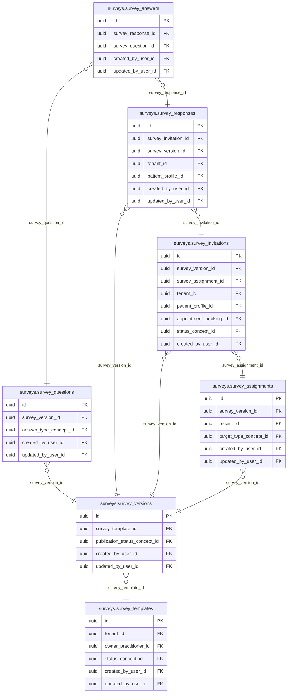

<!-- AUTOGENERADO por tools/inventario/catalogo.mjs. No editar manualmente. -->

# Catálogo del schema `surveys`

- **Tablas:** 7 · **Columnas:** 87 (55 con descripción: 63.2 %) · **Índices:** 17
- **Dominio:** sin dato
- Método y límites del catálogo: [README del inventario](../README.md)

## Tablas

| Tabla | Propósito | Columnas | Índices | Operaciones | ORM |
|---|---|---|---|---|---|
| [survey_answers](#survey_answers) | Conserva respuestas por pregunta para permitir análisis de experiencia sin mezclar resultados con reseñas públicas. | 12 | 2 | 2 | COINCIDE |
| [survey_assignments](#survey_assignments) | Asocia versiones de encuestas a profesionales o tipos de atención que deben utilizarlas. | 11 | 2 | 5 | COINCIDE |
| [survey_invitations](#survey_invitations) | Emite invitaciones para responder una encuesta a un paciente después de una atención y controla su vigencia. | 15 | 5 | 7 | COINCIDE |
| [survey_questions](#survey_questions) | Define preguntas que componen cada versión de un cuestionario post-visita. | 14 | 1 | 15 | COINCIDE |
| [survey_responses](#survey_responses) | Registra respuestas privadas de pacientes a encuestas post-visita sin alimentar la calificación pública de prestadores. | 11 | 4 | 2 | COINCIDE |
| [survey_templates](#survey_templates) | Define cuestionarios post-atención que profesionales pueden usar para consultar la experiencia del paciente. | 11 | 2 | 21 | COINCIDE |
| [survey_versions](#survey_versions) | Preserva versiones inmutables de cuestionarios para conocer qué preguntas se presentaron en cada atención. | 13 | 1 | 20 | COINCIDE |

## Diagrama entidad-relación

Las tablas se agrupan en familias por sus claves foráneas dentro del schema (máximo 40 por diagrama). Las FK hacia otros schemas se listan en la ficha de cada tabla.

### Familia 1 de 1 — 7 tablas

## Fichas

### survey_answers

#### Vista general

Conserva respuestas por pregunta para permitir análisis de experiencia sin mezclar resultados con reseñas públicas.

- **Estado del propósito:** DOMAIN_CURATED_DRAFT · fuente: `Mantra Core Health Context/modules/diagram_65_surveys.puml: survey_answers; BIZ note`
- **Dominio:** sin dato · **Diagrama:** `Mantra Core Health Context/modules/diagram_65_surveys.puml` · **DDL:** `SQL/65_surveys/02_tables.sql`
- **Entidad del ORM:** `SurveyAnswers` — `src/modules/surveys/entities/survey_answers.entity.ts`
- **Resumen:** 12 columnas · 2 índices · 4 FK salientes · 0 entrantes · 2 operaciones

#### Columnas

| # | Columna | Tipo | Rol estructural | Descripción | ORM |
|---|---|---|---|---|---|
| 1 | `id` | `uuid` | Clave primaria; Obligatoria | Identificador único de la instancia. _(JSDOC_ESTANDAR, `src/modules/surveys/entities/survey_answers.entity.ts:18`)_ | coincide |
| 2 | `survey_response_id` | `uuid` | Clave foránea → surveys.survey_responses.id; Obligatoria | _sin dato_ | coincide |
| 3 | `survey_question_id` | `uuid` | Clave foránea → surveys.survey_questions.id; Obligatoria | _sin dato_ | coincide |
| 4 | `value_text` | `text` | Opcional | Respuesta de texto libre. Poblada solo para preguntas de tipo TEXT. _(JSDOC_ENTIDAD, `src/modules/surveys/entities/survey_answers.entity.ts:36`)_ | coincide |
| 5 | `value_number` | `integer` | Opcional | Respuesta numérica. Poblada solo para preguntas de tipo SCALE. _(JSDOC_ENTIDAD, `src/modules/surveys/entities/survey_answers.entity.ts:42`)_ | coincide |
| 6 | `value_boolean` | `boolean` | Opcional | Respuesta sí/no. Poblada solo para preguntas de tipo BOOLEAN. _(JSDOC_ENTIDAD, `src/modules/surveys/entities/survey_answers.entity.ts:48`)_ | coincide |
| 7 | `value_choices` | `jsonb` | Opcional | Opciones elegidas. Poblada solo para los dos tipos de elección; la de elección simple guarda un único elemento para no necesitar otra columna. _(JSDOC_ENTIDAD, `src/modules/surveys/entities/survey_answers.entity.ts:59`)_ | coincide |
| 8 | `created_at` | `timestamptz` | Obligatoria | Fecha y hora en que se creó el registro. _(JSDOC_ESTANDAR, `src/modules/surveys/entities/survey_answers.entity.ts:70`)_ | coincide |
| 9 | `updated_at` | `timestamptz` | Obligatoria | Fecha y hora de la última actualización. _(JSDOC_ESTANDAR, `src/modules/surveys/entities/survey_answers.entity.ts:76`)_ | coincide |
| 10 | `created_by_user_id` | `uuid` | Clave foránea → iam.users.id; Opcional | _sin dato_ | coincide |
| 11 | `updated_by_user_id` | `uuid` | Clave foránea → iam.users.id; Opcional | _sin dato_ | coincide |
| 12 | `row_version` | `integer = 1` | Obligatoria | Versión usada para controlar actualizaciones concurrentes. _(JSDOC_ENTIDAD, `src/modules/surveys/entities/survey_answers.entity.ts:94`)_ | coincide |

#### Relaciones

| Sentido | Columnas | Tabla | Restricción |
|---|---|---|---|
| hacia | survey_response_id | surveys.survey_responses (id) | fk_survey_answers_survey_response_id |
| hacia | survey_question_id | surveys.survey_questions (id) | fk_survey_answers_survey_question_id |
| hacia | created_by_user_id | iam.users (id) | fk_survey_answers_created_by_user_id |
| hacia | updated_by_user_id | iam.users (id) | fk_survey_answers_updated_by_user_id |

#### Índices

| Índice | Único | Columnas | Para qué |
|---|---|---|---|
| `ix_survey_answers_response` | no | survey_response_id | Soporta la clave foránea fk_survey_answers_survey_response_id: PostgreSQL no indexa las FK por sí mismo _(DOCUMENTO)_; 1 consulta(s) de repositorio filtran u ordenan por «survey_response_id», la primera columna del índice _(CONSULTA)_ |
| `ix_survey_answers_question` | no | survey_question_id | Soporta la clave foránea fk_survey_answers_survey_question_id: PostgreSQL no indexa las FK por sí mismo _(DOCUMENTO)_ |

#### Operaciones que la tocan

| Operación | Efecto | Confianza |
|---|---|---|
| POST /surveys/me/invitations/{id}/responses | CREA | DIRECTA |
| GET /surveys/templates/{id}/responses | LEE | DIRECTA |

#### Gobierno

| Atributo | Valor | Fuente |
|---|---|---|
| Append-only | no declarado | — |
| Datos personales | sin fuente | — |
| Financiera | sin fuente | — |
| Crítica para auditoría | sin fuente | — |
| Retención | sin fuente | — |
| Responsable | sin fuente | — |
| Revisión | AUTO_DETECTADA | — |

---

### survey_assignments

#### Vista general

Asocia versiones de encuestas a profesionales o tipos de atención que deben utilizarlas.

- **Estado del propósito:** DOMAIN_CURATED_DRAFT · fuente: `Mantra Core Health Context/modules/diagram_65_surveys.puml: survey_assignments`
- **Dominio:** sin dato · **Diagrama:** `Mantra Core Health Context/modules/diagram_65_surveys.puml` · **DDL:** `SQL/65_surveys/02_tables.sql`
- **Entidad del ORM:** `SurveyAssignments` — `src/modules/surveys/entities/survey_assignments.entity.ts`
- **Resumen:** 11 columnas · 2 índices · 5 FK salientes · 1 entrantes · 5 operaciones

#### Columnas

| # | Columna | Tipo | Rol estructural | Descripción | ORM |
|---|---|---|---|---|---|
| 1 | `id` | `uuid` | Clave primaria; Obligatoria | Identificador único de la instancia. _(JSDOC_ESTANDAR, `src/modules/surveys/entities/survey_assignments.entity.ts:18`)_ | coincide |
| 2 | `survey_version_id` | `uuid` | Clave foránea → surveys.survey_versions.id; Obligatoria | _sin dato_ | coincide |
| 3 | `tenant_id` | `uuid` | Clave foránea → directory.tenants.id; Obligatoria | _sin dato_ | coincide |
| 4 | `target_type_concept_id` | `uuid` | Clave foránea → terminology.catalog_concepts.id; Obligatoria | _sin dato_ | coincide |
| 5 | `target_id` | `uuid` | Obligatoria | Identificador de la cosa evaluada, interpretado según `targetTypeConceptId`: la reserva concreta, el servicio de salud o el tipo de atención. _(JSDOC_ENTIDAD, `src/modules/surveys/entities/survey_assignments.entity.ts:43`)_ | coincide |
| 6 | `active` | `boolean` | Obligatoria | Si la asignación sigue vigente. Desactivarla frena las emisiones nuevas sin borrar el histórico de lo ya emitido. _(JSDOC_ENTIDAD, `src/modules/surveys/entities/survey_assignments.entity.ts:50`)_ | coincide |
| 7 | `created_at` | `timestamptz` | Obligatoria | Fecha y hora en que se creó el registro. _(JSDOC_ESTANDAR, `src/modules/surveys/entities/survey_assignments.entity.ts:56`)_ | coincide |
| 8 | `updated_at` | `timestamptz` | Obligatoria | Fecha y hora de la última actualización. _(JSDOC_ESTANDAR, `src/modules/surveys/entities/survey_assignments.entity.ts:62`)_ | coincide |
| 9 | `created_by_user_id` | `uuid` | Clave foránea → iam.users.id; Opcional | _sin dato_ | coincide |
| 10 | `updated_by_user_id` | `uuid` | Clave foránea → iam.users.id; Opcional | _sin dato_ | coincide |
| 11 | `row_version` | `integer = 1` | Obligatoria | Versión usada para controlar actualizaciones concurrentes. _(JSDOC_ENTIDAD, `src/modules/surveys/entities/survey_assignments.entity.ts:80`)_ | coincide |

#### Relaciones

| Sentido | Columnas | Tabla | Restricción |
|---|---|---|---|
| hacia | survey_version_id | surveys.survey_versions (id) | fk_survey_assignments_survey_version_id |
| hacia | tenant_id | directory.tenants (id) | fk_survey_assignments_tenant_id |
| hacia | target_type_concept_id | terminology.catalog_concepts (id) | fk_survey_assignments_target_type_concept_id |
| hacia | created_by_user_id | iam.users (id) | fk_survey_assignments_created_by_user_id |
| hacia | updated_by_user_id | iam.users (id) | fk_survey_assignments_updated_by_user_id |
| desde | id | surveys.survey_invitations (survey_assignment_id) | fk_survey_invitations_survey_assignment_id |

#### Índices

| Índice | Único | Columnas | Para qué |
|---|---|---|---|
| `ix_survey_assignments_tenant_target` | no | tenant_id, target_id, active | Soporta la clave foránea fk_survey_assignments_tenant_id: PostgreSQL no indexa las FK por sí mismo _(DOCUMENTO)_; 1 consulta(s) de repositorio filtran u ordenan por «tenant_id», la primera columna del índice _(CONSULTA)_ |
| `ix_survey_assignments_version` | no | survey_version_id | Soporta la clave foránea fk_survey_assignments_survey_version_id: PostgreSQL no indexa las FK por sí mismo _(DOCUMENTO)_; 2 consulta(s) de repositorio filtran u ordenan por «survey_version_id», la primera columna del índice _(CONSULTA)_ |

#### Operaciones que la tocan

| Operación | Efecto | Confianza |
|---|---|---|
| POST /billing/service-catalog | CREA | DIRECTA |
| POST /billing/service-catalog/import-procedures | CREA | DIRECTA |
| POST /surveys/assignments | CREA | DIRECTA |
| POST /surveys/assignments | LEE | DIRECTA |
| POST /surveys/invitations | LEE | DIRECTA |

#### Gobierno

| Atributo | Valor | Fuente |
|---|---|---|
| Append-only | no declarado | — |
| Datos personales | sin fuente | — |
| Financiera | sin fuente | — |
| Crítica para auditoría | sin fuente | — |
| Retención | sin fuente | — |
| Responsable | sin fuente | — |
| Revisión | AUTO_DETECTADA | — |

---

### survey_invitations

#### Vista general

Emite invitaciones para responder una encuesta a un paciente después de una atención y controla su vigencia.

- **Estado del propósito:** DOMAIN_CURATED_DRAFT · fuente: `Mantra Core Health Context/modules/diagram_65_surveys.puml: survey_invitations; BIZ note`
- **Dominio:** sin dato · **Diagrama:** `Mantra Core Health Context/modules/diagram_65_surveys.puml` · **DDL:** `SQL/65_surveys/02_tables.sql`
- **Entidad del ORM:** `SurveyInvitations` — `src/modules/surveys/entities/survey_invitations.entity.ts`
- **Resumen:** 15 columnas · 5 índices · 8 FK salientes · 1 entrantes · 7 operaciones

#### Columnas

| # | Columna | Tipo | Rol estructural | Descripción | ORM |
|---|---|---|---|---|---|
| 1 | `id` | `uuid` | Clave primaria; Obligatoria | Identificador único de la instancia. _(JSDOC_ESTANDAR, `src/modules/surveys/entities/survey_invitations.entity.ts:22`)_ | coincide |
| 2 | `survey_version_id` | `uuid` | Clave foránea → surveys.survey_versions.id; Obligatoria | _sin dato_ | coincide |
| 3 | `survey_assignment_id` | `uuid` | Clave foránea → surveys.survey_assignments.id; Obligatoria | _sin dato_ | coincide |
| 4 | `tenant_id` | `uuid` | Clave foránea → directory.tenants.id; Obligatoria | _sin dato_ | coincide |
| 5 | `patient_profile_id` | `uuid` | Clave foránea → profiles.patient_profiles.profile_id; Obligatoria | Destinatario. Es la única persona que puede responder esta invitación. _(JSDOC_ENTIDAD, `src/modules/surveys/entities/survey_invitations.entity.ts:46`)_ | coincide |
| 6 | `appointment_booking_id` | `uuid` | Clave foránea → scheduling.appointment_bookings.id; Obligatoria | La atención completada que habilita la invitación. _(JSDOC_ENTIDAD, `src/modules/surveys/entities/survey_invitations.entity.ts:52`)_ | coincide |
| 7 | `status_concept_id` | `uuid` | Clave foránea → terminology.catalog_concepts.id; Obligatoria | _sin dato_ | coincide |
| 8 | `issued_at` | `timestamptz` | Obligatoria | Desde cuándo se puede responder. _(JSDOC_ENTIDAD, `src/modules/surveys/entities/survey_invitations.entity.ts:64`)_ | coincide |
| 9 | `expires_at` | `timestamptz` | Obligatoria | Hasta cuándo se puede responder. Derivado de `responseWindowDays` de la versión en el momento de emitir, no calculado al vuelo: si alguien cambia el plazo después, la ventana ya prometida al paciente no se mueve. _(JSDOC_ENTIDAD, `src/modules/surveys/entities/survey_invitations.entity.ts:72`)_ | coincide |
| 10 | `answered_at` | `timestamptz` | Opcional | Momento en que se envió la respuesta. Nulo mientras sigue pendiente. _(JSDOC_ENTIDAD, `src/modules/surveys/entities/survey_invitations.entity.ts:78`)_ | coincide |
| 11 | `created_at` | `timestamptz` | Obligatoria | Fecha y hora en que se creó el registro. _(JSDOC_ESTANDAR, `src/modules/surveys/entities/survey_invitations.entity.ts:88`)_ | coincide |
| 12 | `updated_at` | `timestamptz` | Obligatoria | Fecha y hora de la última actualización. _(JSDOC_ESTANDAR, `src/modules/surveys/entities/survey_invitations.entity.ts:94`)_ | coincide |
| 13 | `created_by_user_id` | `uuid` | Clave foránea → iam.users.id; Opcional | _sin dato_ | coincide |
| 14 | `updated_by_user_id` | `uuid` | Clave foránea → iam.users.id; Opcional | _sin dato_ | coincide |
| 15 | `row_version` | `integer = 1` | Obligatoria | Versión usada para controlar actualizaciones concurrentes. _(JSDOC_ENTIDAD, `src/modules/surveys/entities/survey_invitations.entity.ts:112`)_ | coincide |

#### Relaciones

| Sentido | Columnas | Tabla | Restricción |
|---|---|---|---|
| hacia | survey_version_id | surveys.survey_versions (id) | fk_survey_invitations_survey_version_id |
| hacia | survey_assignment_id | surveys.survey_assignments (id) | fk_survey_invitations_survey_assignment_id |
| hacia | tenant_id | directory.tenants (id) | fk_survey_invitations_tenant_id |
| hacia | patient_profile_id | profiles.patient_profiles (profile_id) | fk_survey_invitations_patient_profile_id |
| hacia | appointment_booking_id | scheduling.appointment_bookings (id) | fk_survey_invitations_appointment_booking_id |
| hacia | status_concept_id | terminology.catalog_concepts (id) | fk_survey_invitations_status_concept_id |
| hacia | created_by_user_id | iam.users (id) | fk_survey_invitations_created_by_user_id |
| hacia | updated_by_user_id | iam.users (id) | fk_survey_invitations_updated_by_user_id |
| desde | id | surveys.survey_responses (survey_invitation_id) | fk_survey_responses_survey_invitation_id |

#### Índices

| Índice | Único | Columnas | Para qué |
|---|---|---|---|
| `ix_survey_invitations_patient_issued` | no | patient_profile_id, ("issued_at" DESC) | _sin uso detectado estáticamente_ |
| `ix_survey_invitations_booking` | no | appointment_booking_id | Soporta la clave foránea fk_survey_invitations_appointment_booking_id: PostgreSQL no indexa las FK por sí mismo _(DOCUMENTO)_; 1 consulta(s) de repositorio filtran u ordenan por «appointment_booking_id», la primera columna del índice _(CONSULTA)_ |
| `ix_survey_invitations_version` | no | survey_version_id | Soporta la clave foránea fk_survey_invitations_survey_version_id: PostgreSQL no indexa las FK por sí mismo _(DOCUMENTO)_; 1 consulta(s) de repositorio filtran u ordenan por «survey_version_id», la primera columna del índice _(CONSULTA)_ |
| `ix_survey_invitations_assignment` | no | survey_assignment_id | Soporta la clave foránea fk_survey_invitations_survey_assignment_id: PostgreSQL no indexa las FK por sí mismo _(DOCUMENTO)_ |
| `ix_survey_invitations_tenant_id` | no | tenant_id | Soporta la clave foránea fk_survey_invitations_tenant_id: PostgreSQL no indexa las FK por sí mismo _(DOCUMENTO)_; 1 consulta(s) de repositorio filtran u ordenan por «tenant_id», la primera columna del índice _(CONSULTA)_ |

#### Operaciones que la tocan

| Operación | Efecto | Confianza |
|---|---|---|
| POST /surveys/invitations | CREA | DIRECTA |
| POST /surveys/invitations | LEE | DIRECTA |
| GET /surveys/me/invitations | LEE | DIRECTA |
| GET /surveys/me/invitations/{id} | LEE | DIRECTA |
| POST /surveys/me/invitations/{id}/responses | ACTUALIZA | POR_TIPO |
| POST /surveys/me/invitations/{id}/responses | LEE | DIRECTA |
| GET /surveys/templates/{id}/responses | LEE | DIRECTA |

#### Gobierno

| Atributo | Valor | Fuente |
|---|---|---|
| Append-only | no declarado | — |
| Datos personales | sin fuente | — |
| Financiera | sin fuente | — |
| Crítica para auditoría | sin fuente | — |
| Retención | sin fuente | — |
| Responsable | sin fuente | — |
| Revisión | AUTO_DETECTADA | — |

---

### survey_questions

#### Vista general

Define preguntas que componen cada versión de un cuestionario post-visita.

- **Estado del propósito:** DOMAIN_CURATED_DRAFT · fuente: `Mantra Core Health Context/modules/diagram_65_surveys.puml: survey_questions`
- **Dominio:** sin dato · **Diagrama:** `Mantra Core Health Context/modules/diagram_65_surveys.puml` · **DDL:** `SQL/65_surveys/02_tables.sql`
- **Entidad del ORM:** `SurveyQuestions` — `src/modules/surveys/entities/survey_questions.entity.ts`
- **Resumen:** 14 columnas · 1 índices · 4 FK salientes · 1 entrantes · 15 operaciones

#### Columnas

| # | Columna | Tipo | Rol estructural | Descripción | ORM |
|---|---|---|---|---|---|
| 1 | `id` | `uuid` | Clave primaria; Obligatoria | Identificador único de la instancia. _(JSDOC_ESTANDAR, `src/modules/surveys/entities/survey_questions.entity.ts:16`)_ | coincide |
| 2 | `survey_version_id` | `uuid` | Clave foránea → surveys.survey_versions.id; Obligatoria | _sin dato_ | coincide |
| 3 | `position` | `integer` | Obligatoria | Posición de la pregunta dentro del cuestionario, arrancando en 1. _(JSDOC_ENTIDAD, `src/modules/surveys/entities/survey_questions.entity.ts:28`)_ | coincide |
| 4 | `question_text` | `text` | Obligatoria | Enunciado que lee el paciente. _(JSDOC_ENTIDAD, `src/modules/surveys/entities/survey_questions.entity.ts:34`)_ | coincide |
| 5 | `answer_type_concept_id` | `uuid` | Clave foránea → terminology.catalog_concepts.id; Obligatoria | _sin dato_ | coincide |
| 6 | `required` | `boolean` | Obligatoria | Si responderla es obligatorio para poder enviar el cuestionario. _(JSDOC_ENTIDAD, `src/modules/surveys/entities/survey_questions.entity.ts:46`)_ | coincide |
| 7 | `options` | `jsonb` | Opcional | Opciones de las preguntas de elección, en orden de presentación. Nulo para los tipos que no las admiten (texto, escala, sí/no). _(JSDOC_ENTIDAD, `src/modules/surveys/entities/survey_questions.entity.ts:53`)_ | coincide |
| 8 | `scale_min` | `integer` | Opcional | Mínimo admitido en las preguntas de escala. Nulo en el resto. _(JSDOC_ENTIDAD, `src/modules/surveys/entities/survey_questions.entity.ts:64`)_ | coincide |
| 9 | `scale_max` | `integer` | Opcional | Máximo admitido en las preguntas de escala. Nulo en el resto. _(JSDOC_ENTIDAD, `src/modules/surveys/entities/survey_questions.entity.ts:70`)_ | coincide |
| 10 | `created_at` | `timestamptz` | Obligatoria | Fecha y hora en que se creó el registro. _(JSDOC_ESTANDAR, `src/modules/surveys/entities/survey_questions.entity.ts:76`)_ | coincide |
| 11 | `updated_at` | `timestamptz` | Obligatoria | Fecha y hora de la última actualización. _(JSDOC_ESTANDAR, `src/modules/surveys/entities/survey_questions.entity.ts:82`)_ | coincide |
| 12 | `created_by_user_id` | `uuid` | Clave foránea → iam.users.id; Opcional | _sin dato_ | coincide |
| 13 | `updated_by_user_id` | `uuid` | Clave foránea → iam.users.id; Opcional | _sin dato_ | coincide |
| 14 | `row_version` | `integer = 1` | Obligatoria | Versión usada para controlar actualizaciones concurrentes. _(JSDOC_ENTIDAD, `src/modules/surveys/entities/survey_questions.entity.ts:100`)_ | coincide |

#### Relaciones

| Sentido | Columnas | Tabla | Restricción |
|---|---|---|---|
| hacia | survey_version_id | surveys.survey_versions (id) | fk_survey_questions_survey_version_id |
| hacia | answer_type_concept_id | terminology.catalog_concepts (id) | fk_survey_questions_answer_type_concept_id |
| hacia | created_by_user_id | iam.users (id) | fk_survey_questions_created_by_user_id |
| hacia | updated_by_user_id | iam.users (id) | fk_survey_questions_updated_by_user_id |
| desde | id | surveys.survey_answers (survey_question_id) | fk_survey_answers_survey_question_id |

#### Índices

| Índice | Único | Columnas | Para qué |
|---|---|---|---|
| `ix_survey_questions_version_position` | no | survey_version_id, position | Soporta la clave foránea fk_survey_questions_survey_version_id: PostgreSQL no indexa las FK por sí mismo _(DOCUMENTO)_; 2 consulta(s) de repositorio filtran u ordenan por «survey_version_id», la primera columna del índice _(CONSULTA)_ |

#### Operaciones que la tocan

| Operación | Efecto | Confianza |
|---|---|---|
| POST /billing/service-catalog | CREA | DIRECTA |
| POST /billing/service-catalog/import-procedures | CREA | DIRECTA |
| GET /surveys/me/invitations/{id} | LEE | DIRECTA |
| POST /surveys/me/invitations/{id}/responses | LEE | DIRECTA |
| GET /surveys/templates | LEE | DIRECTA |
| GET /surveys/templates/{id} | LEE | DIRECTA |
| POST /surveys/templates/{id}/questions | CREA | DIRECTA |
| POST /surveys/templates/{id}/questions | LEE | DIRECTA |
| DELETE /surveys/templates/{id}/questions/{questionId} | BORRA | POR_TIPO |
| DELETE /surveys/templates/{id}/questions/{questionId} | LEE | DIRECTA |
| PATCH /surveys/templates/{id}/questions/{questionId} | ACTUALIZA | POR_TIPO |
| PATCH /surveys/templates/{id}/questions/{questionId} | LEE | DIRECTA |
| PUT /surveys/templates/{id}/questions/order | LEE | DIRECTA |
| GET /surveys/templates/{id}/responses | LEE | DIRECTA |
| POST /surveys/templates/{id}/versions/{versionNumber}/publish | LEE | DIRECTA |

#### Gobierno

| Atributo | Valor | Fuente |
|---|---|---|
| Append-only | no declarado | — |
| Datos personales | sin fuente | — |
| Financiera | sin fuente | — |
| Crítica para auditoría | sin fuente | — |
| Retención | sin fuente | — |
| Responsable | sin fuente | — |
| Revisión | AUTO_DETECTADA | — |

---

### survey_responses

#### Vista general

Registra respuestas privadas de pacientes a encuestas post-visita sin alimentar la calificación pública de prestadores.

- **Estado del propósito:** DOMAIN_CURATED_DRAFT · fuente: `Mantra Core Health Context/modules/diagram_65_surveys.puml: survey_responses; BIZ note`
- **Dominio:** sin dato · **Diagrama:** `Mantra Core Health Context/modules/diagram_65_surveys.puml` · **DDL:** `SQL/65_surveys/02_tables.sql`
- **Entidad del ORM:** `SurveyResponses` — `src/modules/surveys/entities/survey_responses.entity.ts`
- **Resumen:** 11 columnas · 4 índices · 6 FK salientes · 1 entrantes · 2 operaciones

#### Columnas

| # | Columna | Tipo | Rol estructural | Descripción | ORM |
|---|---|---|---|---|---|
| 1 | `id` | `uuid` | Clave primaria; Obligatoria | Identificador único de la instancia. _(JSDOC_ESTANDAR, `src/modules/surveys/entities/survey_responses.entity.ts:19`)_ | coincide |
| 2 | `survey_invitation_id` | `uuid` | Clave foránea → surveys.survey_invitations.id; Obligatoria | _sin dato_ | coincide |
| 3 | `survey_version_id` | `uuid` | Clave foránea → surveys.survey_versions.id; Obligatoria | _sin dato_ | coincide |
| 4 | `tenant_id` | `uuid` | Clave foránea → directory.tenants.id; Obligatoria | _sin dato_ | coincide |
| 5 | `patient_profile_id` | `uuid` | Clave foránea → profiles.patient_profiles.profile_id; Obligatoria | Quién respondió. Redundante con la invitación a propósito: las lecturas del profesional filtran por paciente sin tener que unir la invitación. _(JSDOC_ENTIDAD, `src/modules/surveys/entities/survey_responses.entity.ts:44`)_ | coincide |
| 6 | `submitted_at` | `timestamptz` | Obligatoria | Momento del envío. _(JSDOC_ENTIDAD, `src/modules/surveys/entities/survey_responses.entity.ts:50`)_ | coincide |
| 7 | `created_at` | `timestamptz` | Obligatoria | Fecha y hora en que se creó el registro. _(JSDOC_ESTANDAR, `src/modules/surveys/entities/survey_responses.entity.ts:56`)_ | coincide |
| 8 | `updated_at` | `timestamptz` | Obligatoria | Fecha y hora de la última actualización. _(JSDOC_ESTANDAR, `src/modules/surveys/entities/survey_responses.entity.ts:62`)_ | coincide |
| 9 | `created_by_user_id` | `uuid` | Clave foránea → iam.users.id; Opcional | _sin dato_ | coincide |
| 10 | `updated_by_user_id` | `uuid` | Clave foránea → iam.users.id; Opcional | _sin dato_ | coincide |
| 11 | `row_version` | `integer = 1` | Obligatoria | Versión usada para controlar actualizaciones concurrentes. _(JSDOC_ENTIDAD, `src/modules/surveys/entities/survey_responses.entity.ts:80`)_ | coincide |

#### Relaciones

| Sentido | Columnas | Tabla | Restricción |
|---|---|---|---|
| hacia | survey_invitation_id | surveys.survey_invitations (id) | fk_survey_responses_survey_invitation_id |
| hacia | survey_version_id | surveys.survey_versions (id) | fk_survey_responses_survey_version_id |
| hacia | tenant_id | directory.tenants (id) | fk_survey_responses_tenant_id |
| hacia | patient_profile_id | profiles.patient_profiles (profile_id) | fk_survey_responses_patient_profile_id |
| hacia | created_by_user_id | iam.users (id) | fk_survey_responses_created_by_user_id |
| hacia | updated_by_user_id | iam.users (id) | fk_survey_responses_updated_by_user_id |
| desde | id | surveys.survey_answers (survey_response_id) | fk_survey_answers_survey_response_id |

#### Índices

| Índice | Único | Columnas | Para qué |
|---|---|---|---|
| `ix_survey_responses_invitation` | no | survey_invitation_id | Soporta la clave foránea fk_survey_responses_survey_invitation_id: PostgreSQL no indexa las FK por sí mismo _(DOCUMENTO)_; 2 consulta(s) de repositorio filtran u ordenan por «survey_invitation_id», la primera columna del índice _(CONSULTA)_ |
| `ix_survey_responses_patient_submitted` | no | patient_profile_id, ("submitted_at" DESC) | _sin uso detectado estáticamente_ |
| `ix_survey_responses_version` | no | survey_version_id | Soporta la clave foránea fk_survey_responses_survey_version_id: PostgreSQL no indexa las FK por sí mismo _(DOCUMENTO)_ |
| `ix_survey_responses_tenant_id` | no | tenant_id | Soporta la clave foránea fk_survey_responses_tenant_id: PostgreSQL no indexa las FK por sí mismo _(DOCUMENTO)_ |

#### Operaciones que la tocan

| Operación | Efecto | Confianza |
|---|---|---|
| POST /surveys/me/invitations/{id}/responses | CREA | DIRECTA |
| GET /surveys/templates/{id}/responses | LEE | DIRECTA |

#### Gobierno

| Atributo | Valor | Fuente |
|---|---|---|
| Append-only | no declarado | — |
| Datos personales | sin fuente | — |
| Financiera | sin fuente | — |
| Crítica para auditoría | sin fuente | — |
| Retención | sin fuente | — |
| Responsable | sin fuente | — |
| Revisión | AUTO_DETECTADA | — |

---

### survey_templates

#### Vista general

Define cuestionarios post-atención que profesionales pueden usar para consultar la experiencia del paciente.

- **Estado del propósito:** DOMAIN_CURATED_DRAFT · fuente: `Mantra Core Health Context/modules/diagram_65_surveys.puml: survey_templates; BIZ note`
- **Dominio:** sin dato · **Diagrama:** `Mantra Core Health Context/modules/diagram_65_surveys.puml` · **DDL:** `SQL/65_surveys/02_tables.sql`
- **Entidad del ORM:** `SurveyTemplates` — `src/modules/surveys/entities/survey_templates.entity.ts`
- **Resumen:** 11 columnas · 2 índices · 5 FK salientes · 1 entrantes · 21 operaciones

#### Columnas

| # | Columna | Tipo | Rol estructural | Descripción | ORM |
|---|---|---|---|---|---|
| 1 | `id` | `uuid` | Clave primaria; Obligatoria | Identificador único de la instancia. _(JSDOC_ESTANDAR, `src/modules/surveys/entities/survey_templates.entity.ts:17`)_ | coincide |
| 2 | `tenant_id` | `uuid` | Clave foránea → directory.tenants.id; Obligatoria | _sin dato_ | coincide |
| 3 | `owner_practitioner_id` | `uuid` | Clave foránea → profiles.health_practitioner_profiles.profile_id; Obligatoria | Profesional dueño del instrumento. Es quien puede editarlo y quien puede leer las respuestas: la autorización de lectura sale de acá, no de un rol. _(JSDOC_ENTIDAD, `src/modules/surveys/entities/survey_templates.entity.ts:30`)_ | coincide |
| 4 | `title` | `text` | Obligatoria | Título visible del instrumento. _(JSDOC_ENTIDAD, `src/modules/surveys/entities/survey_templates.entity.ts:36`)_ | coincide |
| 5 | `description` | `text` | Opcional | Descripción o consigna que se muestra al paciente antes de responder. _(JSDOC_ENTIDAD, `src/modules/surveys/entities/survey_templates.entity.ts:42`)_ | coincide |
| 6 | `status_concept_id` | `uuid` | Clave foránea → terminology.catalog_concepts.id; Obligatoria | _sin dato_ | coincide |
| 7 | `created_at` | `timestamptz` | Obligatoria | Fecha y hora en que se creó el registro. _(JSDOC_ESTANDAR, `src/modules/surveys/entities/survey_templates.entity.ts:54`)_ | coincide |
| 8 | `updated_at` | `timestamptz` | Obligatoria | Fecha y hora de la última actualización. _(JSDOC_ESTANDAR, `src/modules/surveys/entities/survey_templates.entity.ts:60`)_ | coincide |
| 9 | `created_by_user_id` | `uuid` | Clave foránea → iam.users.id; Opcional | _sin dato_ | coincide |
| 10 | `updated_by_user_id` | `uuid` | Clave foránea → iam.users.id; Opcional | _sin dato_ | coincide |
| 11 | `row_version` | `integer = 1` | Obligatoria | Versión usada para controlar actualizaciones concurrentes. _(JSDOC_ENTIDAD, `src/modules/surveys/entities/survey_templates.entity.ts:78`)_ | coincide |

#### Relaciones

| Sentido | Columnas | Tabla | Restricción |
|---|---|---|---|
| hacia | tenant_id | directory.tenants (id) | fk_survey_templates_tenant_id |
| hacia | owner_practitioner_id | profiles.health_practitioner_profiles (profile_id) | fk_survey_templates_owner_practitioner_id |
| hacia | status_concept_id | terminology.catalog_concepts (id) | fk_survey_templates_status_concept_id |
| hacia | created_by_user_id | iam.users (id) | fk_survey_templates_created_by_user_id |
| hacia | updated_by_user_id | iam.users (id) | fk_survey_templates_updated_by_user_id |
| desde | id | surveys.survey_versions (survey_template_id) | fk_survey_versions_survey_template_id |

#### Índices

| Índice | Único | Columnas | Para qué |
|---|---|---|---|
| `ix_survey_templates_owner` | no | owner_practitioner_id, ("created_at" DESC) | _sin uso detectado estáticamente_ |
| `ix_survey_templates_tenant_id` | no | tenant_id | Soporta la clave foránea fk_survey_templates_tenant_id: PostgreSQL no indexa las FK por sí mismo _(DOCUMENTO)_; 1 consulta(s) de repositorio filtran u ordenan por «tenant_id», la primera columna del índice _(CONSULTA)_ |

#### Operaciones que la tocan

| Operación | Efecto | Confianza |
|---|---|---|
| POST /billing/service-catalog | CREA | DIRECTA |
| POST /billing/service-catalog/import-procedures | CREA | DIRECTA |
| POST /surveys/assignments | LEE | DIRECTA |
| POST /surveys/invitations | LEE | DIRECTA |
| GET /surveys/me/invitations | LEE | DIRECTA |
| GET /surveys/me/invitations/{id} | LEE | DIRECTA |
| GET /surveys/templates | LEE | DIRECTA |
| POST /surveys/templates | CREA | DIRECTA |
| GET /surveys/templates/{id} | LEE | DIRECTA |
| PATCH /surveys/templates/{id} | ACTUALIZA | POR_TIPO |
| PATCH /surveys/templates/{id} | LEE | DIRECTA |
| POST /surveys/templates/{id}/deactivate | ACTUALIZA | POR_TIPO |
| POST /surveys/templates/{id}/deactivate | LEE | DIRECTA |
| POST /surveys/templates/{id}/questions | LEE | DIRECTA |
| DELETE /surveys/templates/{id}/questions/{questionId} | LEE | DIRECTA |
| PATCH /surveys/templates/{id}/questions/{questionId} | LEE | DIRECTA |
| PUT /surveys/templates/{id}/questions/order | LEE | DIRECTA |
| GET /surveys/templates/{id}/responses | LEE | DIRECTA |
| POST /surveys/templates/{id}/versions | LEE | DIRECTA |
| POST /surveys/templates/{id}/versions/{versionNumber}/publish | ACTUALIZA | POR_TIPO |
| POST /surveys/templates/{id}/versions/{versionNumber}/publish | LEE | DIRECTA |

#### Gobierno

| Atributo | Valor | Fuente |
|---|---|---|
| Append-only | no declarado | — |
| Datos personales | sin fuente | — |
| Financiera | sin fuente | — |
| Crítica para auditoría | sin fuente | — |
| Retención | sin fuente | — |
| Responsable | sin fuente | — |
| Revisión | AUTO_DETECTADA | — |

---

### survey_versions

#### Vista general

Preserva versiones inmutables de cuestionarios para conocer qué preguntas se presentaron en cada atención.

- **Estado del propósito:** DOMAIN_CURATED_DRAFT · fuente: `Mantra Core Health Context/modules/diagram_65_surveys.puml: survey_versions; BIZ note`
- **Dominio:** sin dato · **Diagrama:** `Mantra Core Health Context/modules/diagram_65_surveys.puml` · **DDL:** `SQL/65_surveys/02_tables.sql`
- **Entidad del ORM:** `SurveyVersions` — `src/modules/surveys/entities/survey_versions.entity.ts`
- **Resumen:** 13 columnas · 1 índices · 4 FK salientes · 4 entrantes · 20 operaciones

#### Columnas

| # | Columna | Tipo | Rol estructural | Descripción | ORM |
|---|---|---|---|---|---|
| 1 | `id` | `uuid` | Clave primaria; Obligatoria | Identificador único de la instancia. _(JSDOC_ESTANDAR, `src/modules/surveys/entities/survey_versions.entity.ts:22`)_ | coincide |
| 2 | `survey_template_id` | `uuid` | Clave foránea → surveys.survey_templates.id; Obligatoria | _sin dato_ | coincide |
| 3 | `version_number` | `integer` | Obligatoria | Número de versión, correlativo dentro de la plantilla y arrancando en 1. _(JSDOC_ENTIDAD, `src/modules/surveys/entities/survey_versions.entity.ts:34`)_ | coincide |
| 4 | `publication_status_concept_id` | `uuid` | Clave foránea → terminology.catalog_concepts.id; Obligatoria | _sin dato_ | coincide |
| 5 | `effective_from` | `timestamptz` | Opcional | Inicio de vigencia. Nulo mientras la versión sigue en borrador. _(JSDOC_ENTIDAD, `src/modules/surveys/entities/survey_versions.entity.ts:46`)_ | coincide |
| 6 | `effective_to` | `timestamptz` | Opcional | Fin de vigencia. Nulo significa vigencia abierta. _(JSDOC_ENTIDAD, `src/modules/surveys/entities/survey_versions.entity.ts:56`)_ | coincide |
| 7 | `response_window_days` | `integer` | Obligatoria | Plazo, en días, que tiene el paciente para responder desde que se le emite la invitación. Es distinto de la vigencia de la versión: la vigencia dice hasta cuándo se reparte el instrumento; esto, cuánto dura cada reparto. _(JSDOC_ENTIDAD, `src/modules/surveys/entities/survey_versions.entity.ts:68`)_ | coincide |
| 8 | `published_at` | `timestamptz` | Opcional | Momento de publicación. Nulo mientras es borrador. _(JSDOC_ENTIDAD, `src/modules/surveys/entities/survey_versions.entity.ts:74`)_ | coincide |
| 9 | `created_at` | `timestamptz` | Obligatoria | Fecha y hora en que se creó el registro. _(JSDOC_ESTANDAR, `src/modules/surveys/entities/survey_versions.entity.ts:84`)_ | coincide |
| 10 | `updated_at` | `timestamptz` | Obligatoria | Fecha y hora de la última actualización. _(JSDOC_ESTANDAR, `src/modules/surveys/entities/survey_versions.entity.ts:90`)_ | coincide |
| 11 | `created_by_user_id` | `uuid` | Clave foránea → iam.users.id; Opcional | _sin dato_ | coincide |
| 12 | `updated_by_user_id` | `uuid` | Clave foránea → iam.users.id; Opcional | _sin dato_ | coincide |
| 13 | `row_version` | `integer = 1` | Obligatoria | Versión usada para controlar actualizaciones concurrentes. _(JSDOC_ENTIDAD, `src/modules/surveys/entities/survey_versions.entity.ts:108`)_ | coincide |

#### Relaciones

| Sentido | Columnas | Tabla | Restricción |
|---|---|---|---|
| hacia | survey_template_id | surveys.survey_templates (id) | fk_survey_versions_survey_template_id |
| hacia | publication_status_concept_id | terminology.catalog_concepts (id) | fk_survey_versions_publication_status_concept_id |
| hacia | created_by_user_id | iam.users (id) | fk_survey_versions_created_by_user_id |
| hacia | updated_by_user_id | iam.users (id) | fk_survey_versions_updated_by_user_id |
| desde | id | surveys.survey_questions (survey_version_id) | fk_survey_questions_survey_version_id |
| desde | id | surveys.survey_assignments (survey_version_id) | fk_survey_assignments_survey_version_id |
| desde | id | surveys.survey_invitations (survey_version_id) | fk_survey_invitations_survey_version_id |
| desde | id | surveys.survey_responses (survey_version_id) | fk_survey_responses_survey_version_id |

#### Índices

| Índice | Único | Columnas | Para qué |
|---|---|---|---|
| `ix_survey_versions_template_number` | no | survey_template_id, version_number | Soporta la clave foránea fk_survey_versions_survey_template_id: PostgreSQL no indexa las FK por sí mismo _(DOCUMENTO)_; 2 consulta(s) de repositorio filtran u ordenan por «survey_template_id», la primera columna del índice _(CONSULTA)_ |

#### Operaciones que la tocan

| Operación | Efecto | Confianza |
|---|---|---|
| POST /billing/service-catalog | CREA | DIRECTA |
| POST /billing/service-catalog/import-procedures | CREA | DIRECTA |
| POST /surveys/assignments | LEE | DIRECTA |
| POST /surveys/invitations | LEE | DIRECTA |
| GET /surveys/me/invitations | LEE | DIRECTA |
| GET /surveys/me/invitations/{id} | LEE | DIRECTA |
| GET /surveys/templates | LEE | DIRECTA |
| POST /surveys/templates | CREA | DIRECTA |
| GET /surveys/templates/{id} | LEE | DIRECTA |
| PATCH /surveys/templates/{id} | ACTUALIZA | POR_TIPO |
| PATCH /surveys/templates/{id} | LEE | DIRECTA |
| POST /surveys/templates/{id}/questions | LEE | DIRECTA |
| DELETE /surveys/templates/{id}/questions/{questionId} | LEE | DIRECTA |
| PATCH /surveys/templates/{id}/questions/{questionId} | LEE | DIRECTA |
| PUT /surveys/templates/{id}/questions/order | LEE | DIRECTA |
| GET /surveys/templates/{id}/responses | LEE | DIRECTA |
| POST /surveys/templates/{id}/versions | CREA | DIRECTA |
| POST /surveys/templates/{id}/versions | LEE | DIRECTA |
| POST /surveys/templates/{id}/versions/{versionNumber}/publish | ACTUALIZA | POR_TIPO |
| POST /surveys/templates/{id}/versions/{versionNumber}/publish | LEE | DIRECTA |

#### Gobierno

| Atributo | Valor | Fuente |
|---|---|---|
| Append-only | no declarado | — |
| Datos personales | sin fuente | — |
| Financiera | sin fuente | — |
| Crítica para auditoría | sin fuente | — |
| Retención | sin fuente | — |
| Responsable | sin fuente | — |
| Revisión | AUTO_DETECTADA | — |

---

