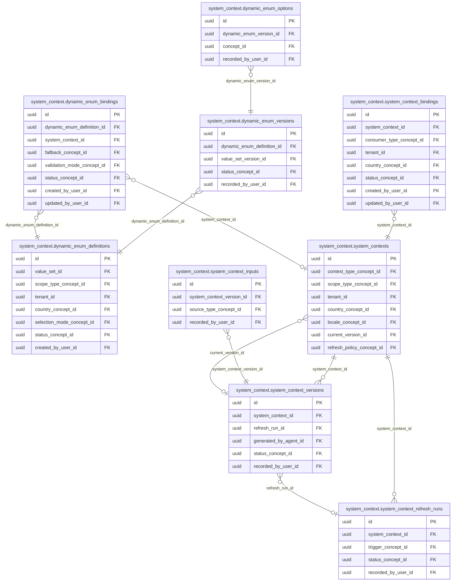

<!-- AUTOGENERADO por tools/inventario/catalogo.mjs. No editar manualmente. -->

# Catálogo del schema `system_context`

- **Tablas:** 9 · **Columnas:** 126 (21 con descripción: 16.7 %) · **Índices:** 62
- **Dominio:** Núcleo y Terminología
- Método y límites del catálogo: [README del inventario](../README.md)

## Tablas

| Tabla | Propósito | Columnas | Índices | Operaciones | ORM |
|---|---|---|---|---|---|
| [dynamic_enum_bindings](#dynamic_enum_bindings) | Asocia enumeraciones con sus consumidores para delimitar dónde aplica cada conjunto de opciones. | 15 | 7 | 7 | COINCIDE |
| [dynamic_enum_definitions](#dynamic_enum_definitions) | Define enumeraciones controladas que consumidores resuelven desde base de datos en vez de listas hardcodeadas. | 17 | 10 | 10 | COINCIDE |
| [dynamic_enum_options](#dynamic_enum_options) | Cataloga valores disponibles en versiones de enumeraciones para ofrecer opciones reproducibles. | 11 | 4 | 4 | COINCIDE |
| [dynamic_enum_versions](#dynamic_enum_versions) | Versiona enumeraciones para preservar qué opciones estaban vigentes al capturar o interpretar datos. | 11 | 5 | 6 | COINCIDE |
| [system_context_bindings](#system_context_bindings) | Vincula contextos con tenants, agentes o módulos consumidores para determinar su alcance de aplicación. | 16 | 8 | 2 | COINCIDE |
| [system_context_inputs](#system_context_inputs) | Relaciona entradas y fuentes incluidas en una versión de contexto para conservar procedencia. | 13 | 4 | 1 | COINCIDE |
| [system_context_refresh_runs](#system_context_refresh_runs) | Registra ejecuciones de actualización de contextos para trazar qué fuente produjo cada cambio. | 12 | 6 | 3 | COINCIDE |
| [system_context_versions](#system_context_versions) | Preserva versiones reproducibles de contextos para que consumidores reciban reglas y datos consistentes. | 14 | 6 | 7 | COINCIDE |
| [system_contexts](#system_contexts) | Define paquetes versionables de contexto que consumen agentes, módulos y workflows del sistema médico. | 17 | 12 | 9 | COINCIDE |

## Diagrama entidad-relación

Las tablas se agrupan en familias por sus claves foráneas dentro del schema (máximo 40 por diagrama). Las FK hacia otros schemas se listan en la ficha de cada tabla.

### Familia 1 de 1 — 9 tablas

## Fichas

### dynamic_enum_bindings

#### Vista general

Asocia enumeraciones con sus consumidores para delimitar dónde aplica cada conjunto de opciones.

- **Estado del propósito:** DOMAIN_CURATED_DRAFT · fuente: `Mantra Core Health Context/modules/diagram_45_system_context.puml: dynamic_enum_bindings`
- **Dominio:** Núcleo y Terminología · **Diagrama:** `Mantra Core Health Context/modules/diagram_45_system_context.puml` · **DDL:** `SQL/45_system_context/02_tables.sql`
- **Entidad del ORM:** `DynamicEnumBindings` — `src/modules/system_context/entities/dynamic_enum_bindings.entity.ts`
- **Resumen:** 15 columnas · 7 índices · 7 FK salientes · 0 entrantes · 7 operaciones

#### Columnas

| # | Columna | Tipo | Rol estructural | Descripción | ORM |
|---|---|---|---|---|---|
| 1 | `id` | `uuid` | Clave primaria; Obligatoria | Identificador único de la instancia. _(JSDOC_ESTANDAR, `src/modules/system_context/entities/dynamic_enum_bindings.entity.ts:12`)_ | coincide |
| 2 | `dynamic_enum_definition_id` | `uuid` | Clave foránea → system_context.dynamic_enum_definitions.id; Obligatoria | _sin dato_ | coincide |
| 3 | `target_schema_name` | `varchar` | Obligatoria | _sin dato_ | coincide |
| 4 | `target_entity_name` | `varchar` | Obligatoria | _sin dato_ | coincide |
| 5 | `target_field_name` | `varchar` | Obligatoria | _sin dato_ | coincide |
| 6 | `system_context_id` | `uuid` | Clave foránea → system_context.system_contexts.id; Opcional | _sin dato_ | coincide |
| 7 | `required` | `boolean` | Opcional | _sin dato_ | coincide |
| 8 | `fallback_concept_id` | `uuid` | Clave foránea → terminology.catalog_concepts.id; Opcional | _sin dato_ | coincide |
| 9 | `validation_mode_concept_id` | `uuid` | Clave foránea → terminology.catalog_concepts.id; Opcional | _sin dato_ | coincide |
| 10 | `status_concept_id` | `uuid` | Clave foránea → terminology.catalog_concepts.id; Obligatoria | _sin dato_ | coincide |
| 11 | `created_at` | `timestamptz` | Obligatoria | Fecha y hora en que se creó el registro. _(JSDOC_ESTANDAR, `src/modules/system_context/entities/dynamic_enum_bindings.entity.ts:76`)_ | coincide |
| 12 | `updated_at` | `timestamptz` | Obligatoria | Fecha y hora de la última actualización. _(JSDOC_ESTANDAR, `src/modules/system_context/entities/dynamic_enum_bindings.entity.ts:82`)_ | coincide |
| 13 | `created_by_user_id` | `uuid` | Clave foránea → iam.users.id; Opcional | _sin dato_ | coincide |
| 14 | `updated_by_user_id` | `uuid` | Clave foránea → iam.users.id; Opcional | _sin dato_ | coincide |
| 15 | `row_version` | `integer = 1` | Obligatoria | Versión usada para controlar actualizaciones concurrentes. _(JSDOC_ENTIDAD, `src/modules/system_context/entities/dynamic_enum_bindings.entity.ts:100`)_ | coincide |

#### Relaciones

| Sentido | Columnas | Tabla | Restricción |
|---|---|---|---|
| hacia | dynamic_enum_definition_id | system_context.dynamic_enum_definitions (id) | fk_dynamic_enum_bindings_dynamic_enum_definition_id |
| hacia | system_context_id | system_context.system_contexts (id) | fk_dynamic_enum_bindings_system_context_id |
| hacia | fallback_concept_id | terminology.catalog_concepts (id) | fk_dynamic_enum_bindings_fallback_concept_id |
| hacia | validation_mode_concept_id | terminology.catalog_concepts (id) | fk_dynamic_enum_bindings_validation_mode_concept_id |
| hacia | status_concept_id | terminology.catalog_concepts (id) | fk_dynamic_enum_bindings_status_concept_id |
| hacia | created_by_user_id | iam.users (id) | fk_dynamic_enum_bindings_created_by_user_id |
| hacia | updated_by_user_id | iam.users (id) | fk_dynamic_enum_bindings_updated_by_user_id |

#### Índices

| Índice | Único | Columnas | Para qué |
|---|---|---|---|
| `ix_dynamic_enum_bindings_dynamic_enum_definition_id` | no | dynamic_enum_definition_id | Soporta la clave foránea fk_dynamic_enum_bindings_dynamic_enum_definition_id: PostgreSQL no indexa las FK por sí mismo _(DOCUMENTO)_; 1 consulta(s) de repositorio filtran u ordenan por «dynamic_enum_definition_id», la primera columna del índice _(CONSULTA)_ |
| `ix_dynamic_enum_bindings_system_context_id` | no | system_context_id | Soporta la clave foránea fk_dynamic_enum_bindings_system_context_id: PostgreSQL no indexa las FK por sí mismo _(DOCUMENTO)_ |
| `ix_dynamic_enum_bindings_fallback_concept_id` | no | fallback_concept_id | Soporta la clave foránea fk_dynamic_enum_bindings_fallback_concept_id: PostgreSQL no indexa las FK por sí mismo _(DOCUMENTO)_ |
| `ix_dynamic_enum_bindings_validation_mode_concept_id` | no | validation_mode_concept_id | Soporta la clave foránea fk_dynamic_enum_bindings_validation_mode_concept_id: PostgreSQL no indexa las FK por sí mismo _(DOCUMENTO)_ |
| `ix_dynamic_enum_bindings_status_concept_id` | no | status_concept_id | Soporta la clave foránea fk_dynamic_enum_bindings_status_concept_id: PostgreSQL no indexa las FK por sí mismo _(DOCUMENTO)_; 2 consulta(s) de repositorio filtran u ordenan por «status_concept_id», la primera columna del índice _(CONSULTA)_ |
| `ix_dynamic_enum_bindings_created_by_user_id` | no | created_by_user_id | Soporta la clave foránea fk_dynamic_enum_bindings_created_by_user_id: PostgreSQL no indexa las FK por sí mismo _(DOCUMENTO)_ |
| `ix_dynamic_enum_bindings_updated_by_user_id` | no | updated_by_user_id | Soporta la clave foránea fk_dynamic_enum_bindings_updated_by_user_id: PostgreSQL no indexa las FK por sí mismo _(DOCUMENTO)_ |

#### Operaciones que la tocan

| Operación | Efecto | Confianza |
|---|---|---|
| GET /system-context/dynamic-enums | LEE | DIRECTA |
| GET /system-context/dynamic-enums/bindings | LEE | DIRECTA |
| POST /system-context/dynamic-enums/definitions/{defId}/bindings | CREA | DIRECTA |
| POST /system-context/dynamic-enums/definitions/{defId}/bindings | LEE | DIRECTA |
| POST /system-context/dynamic-enums/definitions/{defId}/retire | ACTUALIZA | POR_TIPO |
| POST /system-context/dynamic-enums/definitions/{defId}/retire | LEE | DIRECTA |
| POST /system-context/dynamic-enums/resolve | LEE | DIRECTA |

#### Gobierno

| Atributo | Valor | Fuente |
|---|---|---|
| Append-only | no declarado | — |
| Datos personales | sin fuente | — |
| Financiera | sin fuente | — |
| Crítica para auditoría | sin fuente | — |
| Retención | sin fuente | — |
| Responsable | sin fuente | — |
| Revisión | AUTO_DETECTADA | — |

---

### dynamic_enum_definitions

#### Vista general

Define enumeraciones controladas que consumidores resuelven desde base de datos en vez de listas hardcodeadas.

- **Estado del propósito:** DOMAIN_CURATED_DRAFT · fuente: `Mantra Core Health Context/modules/diagram_45_system_context.puml: dynamic_enum_definitions`
- **Dominio:** Núcleo y Terminología · **Diagrama:** `Mantra Core Health Context/modules/diagram_45_system_context.puml` · **DDL:** `SQL/45_system_context/02_tables.sql`
- **Entidad del ORM:** `DynamicEnumDefinitions` — `src/modules/system_context/entities/dynamic_enum_definitions.entity.ts`
- **Resumen:** 17 columnas · 10 índices · 8 FK salientes · 3 entrantes · 10 operaciones

#### Columnas

| # | Columna | Tipo | Rol estructural | Descripción | ORM |
|---|---|---|---|---|---|
| 1 | `id` | `uuid` | Clave primaria; Obligatoria | Identificador único de la instancia. _(JSDOC_ESTANDAR, `src/modules/system_context/entities/dynamic_enum_definitions.entity.ts:12`)_ | coincide |
| 2 | `code` | `varchar` | Obligatoria | _sin dato_ | coincide |
| 3 | `name` | `varchar` | Obligatoria | _sin dato_ | coincide |
| 4 | `description` | `text` | Opcional | _sin dato_ | coincide |
| 5 | `value_set_id` | `uuid` | Clave foránea → terminology.value_sets.id; Obligatoria | _sin dato_ | coincide |
| 6 | `scope_type_concept_id` | `uuid` | Clave foránea → terminology.catalog_concepts.id; Obligatoria | _sin dato_ | coincide |
| 7 | `tenant_id` | `uuid` | Clave foránea → directory.tenants.id; Opcional | _sin dato_ | coincide |
| 8 | `country_concept_id` | `uuid` | Clave foránea → terminology.catalog_concepts.id; Opcional | _sin dato_ | coincide |
| 9 | `selection_mode_concept_id` | `uuid` | Clave foránea → terminology.catalog_concepts.id; Opcional | _sin dato_ | coincide |
| 10 | `allow_tenant_extension` | `boolean` | Opcional | _sin dato_ | coincide |
| 11 | `allow_custom_value` | `boolean` | Opcional | _sin dato_ | coincide |
| 12 | `status_concept_id` | `uuid` | Clave foránea → terminology.catalog_concepts.id; Obligatoria | _sin dato_ | coincide |
| 13 | `created_at` | `timestamptz` | Obligatoria | Fecha y hora en que se creó el registro. _(JSDOC_ESTANDAR, `src/modules/system_context/entities/dynamic_enum_definitions.entity.ts:96`)_ | coincide |
| 14 | `updated_at` | `timestamptz` | Obligatoria | Fecha y hora de la última actualización. _(JSDOC_ESTANDAR, `src/modules/system_context/entities/dynamic_enum_definitions.entity.ts:102`)_ | coincide |
| 15 | `created_by_user_id` | `uuid` | Clave foránea → iam.users.id; Opcional | _sin dato_ | coincide |
| 16 | `updated_by_user_id` | `uuid` | Clave foránea → iam.users.id; Opcional | _sin dato_ | coincide |
| 17 | `row_version` | `integer = 1` | Obligatoria | Versión usada para controlar actualizaciones concurrentes. _(JSDOC_ENTIDAD, `src/modules/system_context/entities/dynamic_enum_definitions.entity.ts:120`)_ | coincide |

#### Relaciones

| Sentido | Columnas | Tabla | Restricción |
|---|---|---|---|
| hacia | value_set_id | terminology.value_sets (id) | fk_dynamic_enum_definitions_value_set_id |
| hacia | scope_type_concept_id | terminology.catalog_concepts (id) | fk_dynamic_enum_definitions_scope_type_concept_id |
| hacia | tenant_id | directory.tenants (id) | fk_dynamic_enum_definitions_tenant_id |
| hacia | country_concept_id | terminology.catalog_concepts (id) | fk_dynamic_enum_definitions_country_concept_id |
| hacia | selection_mode_concept_id | terminology.catalog_concepts (id) | fk_dynamic_enum_definitions_selection_mode_concept_id |
| hacia | status_concept_id | terminology.catalog_concepts (id) | fk_dynamic_enum_definitions_status_concept_id |
| hacia | created_by_user_id | iam.users (id) | fk_dynamic_enum_definitions_created_by_user_id |
| hacia | updated_by_user_id | iam.users (id) | fk_dynamic_enum_definitions_updated_by_user_id |
| desde | id | system_context.dynamic_enum_versions (dynamic_enum_definition_id) | fk_dynamic_enum_versions_dynamic_enum_definition_id |
| desde | id | system_context.dynamic_enum_bindings (dynamic_enum_definition_id) | fk_dynamic_enum_bindings_dynamic_enum_definition_id |
| desde | id | read_models.frontend_view_filters (dynamic_enum_definition_id) | fk_frontend_view_filters_dynamic_enum_definition_id |

#### Índices

| Índice | Único | Columnas | Para qué |
|---|---|---|---|
| `uq_dynamic_enum_definitions_code` | sí | code | Garantiza que no se repita la combinación (code) _(DOCUMENTO)_; 1 consulta(s) de repositorio filtran u ordenan por «code», la primera columna del índice _(CONSULTA)_ |
| `ix_dynamic_enum_definitions_value_set_id` | no | value_set_id | Soporta la clave foránea fk_dynamic_enum_definitions_value_set_id: PostgreSQL no indexa las FK por sí mismo _(DOCUMENTO)_ |
| `ix_dynamic_enum_definitions_scope_type_concept_id` | no | scope_type_concept_id | Soporta la clave foránea fk_dynamic_enum_definitions_scope_type_concept_id: PostgreSQL no indexa las FK por sí mismo _(DOCUMENTO)_ |
| `ix_dynamic_enum_definitions_tenant_id` | no | tenant_id | Soporta la clave foránea fk_dynamic_enum_definitions_tenant_id: PostgreSQL no indexa las FK por sí mismo _(DOCUMENTO)_ |
| `ix_dynamic_enum_definitions_country_concept_id` | no | country_concept_id | Soporta la clave foránea fk_dynamic_enum_definitions_country_concept_id: PostgreSQL no indexa las FK por sí mismo _(DOCUMENTO)_ |
| `ix_dynamic_enum_definitions_selection_mode_concept_id` | no | selection_mode_concept_id | Soporta la clave foránea fk_dynamic_enum_definitions_selection_mode_concept_id: PostgreSQL no indexa las FK por sí mismo _(DOCUMENTO)_ |
| `ix_dynamic_enum_definitions_status_concept_id` | no | status_concept_id | Soporta la clave foránea fk_dynamic_enum_definitions_status_concept_id: PostgreSQL no indexa las FK por sí mismo _(DOCUMENTO)_ |
| `ix_dynamic_enum_definitions_created_by_user_id` | no | created_by_user_id | Soporta la clave foránea fk_dynamic_enum_definitions_created_by_user_id: PostgreSQL no indexa las FK por sí mismo _(DOCUMENTO)_ |
| `ix_dynamic_enum_definitions_updated_by_user_id` | no | updated_by_user_id | Soporta la clave foránea fk_dynamic_enum_definitions_updated_by_user_id: PostgreSQL no indexa las FK por sí mismo _(DOCUMENTO)_ |
| `ix_dynamic_enum_definitions_tenant_id_status_concept_id` | no | tenant_id, status_concept_id, ("updated_at" DESC) | _sin uso detectado estáticamente_ |

#### Restricciones

| Restricción | Tipo | Definición |
|---|---|---|
| `uq_dynamic_enum_definitions_code` | UNIQUE INDEX | UNIQUE INDEX ("code") |

#### Operaciones que la tocan

| Operación | Efecto | Confianza |
|---|---|---|
| GET /system-context/dynamic-enums | LEE | DIRECTA |
| GET /system-context/dynamic-enums/bindings | LEE | DIRECTA |
| POST /system-context/dynamic-enums/definitions | CREA | DIRECTA |
| POST /system-context/dynamic-enums/definitions | LEE | DIRECTA |
| POST /system-context/dynamic-enums/definitions/{defId}/bindings | LEE | DIRECTA |
| POST /system-context/dynamic-enums/definitions/{defId}/retire | ACTUALIZA | POR_TIPO |
| POST /system-context/dynamic-enums/definitions/{defId}/retire | LEE | DIRECTA |
| POST /system-context/dynamic-enums/definitions/{defId}/versions | LEE | DIRECTA |
| POST /system-context/dynamic-enums/definitions/{defId}/versions/{version}/publish | ACTUALIZA | POR_TIPO |
| POST /system-context/dynamic-enums/definitions/{defId}/versions/{version}/publish | LEE | DIRECTA |

#### Gobierno

| Atributo | Valor | Fuente |
|---|---|---|
| Append-only | no declarado | — |
| Datos personales | sin fuente | — |
| Financiera | sin fuente | — |
| Crítica para auditoría | sin fuente | — |
| Retención | sin fuente | — |
| Responsable | sin fuente | — |
| Revisión | AUTO_DETECTADA | — |

---

### dynamic_enum_options

#### Vista general

Cataloga valores disponibles en versiones de enumeraciones para ofrecer opciones reproducibles.

- **Estado del propósito:** DOMAIN_CURATED_DRAFT · fuente: `Mantra Core Health Context/modules/diagram_45_system_context.puml: dynamic_enum_options`
- **Dominio:** Núcleo y Terminología · **Diagrama:** `Mantra Core Health Context/modules/diagram_45_system_context.puml` · **DDL:** `SQL/45_system_context/02_tables.sql`
- **Entidad del ORM:** `DynamicEnumOptions` — `src/modules/system_context/entities/dynamic_enum_options.entity.ts`
- **Resumen:** 11 columnas · 4 índices · 3 FK salientes · 0 entrantes · 4 operaciones

#### Columnas

| # | Columna | Tipo | Rol estructural | Descripción | ORM |
|---|---|---|---|---|---|
| 1 | `id` | `uuid` | Clave primaria; Obligatoria | Identificador único de la instancia. _(JSDOC_ESTANDAR, `src/modules/system_context/entities/dynamic_enum_options.entity.ts:12`)_ | coincide |
| 2 | `dynamic_enum_version_id` | `uuid` | Clave foránea → system_context.dynamic_enum_versions.id; Obligatoria | _sin dato_ | coincide |
| 3 | `concept_id` | `uuid` | Clave foránea → terminology.catalog_concepts.id; Obligatoria | _sin dato_ | coincide |
| 4 | `code` | `varchar` | Obligatoria | _sin dato_ | coincide |
| 5 | `display` | `varchar` | Obligatoria | _sin dato_ | coincide |
| 6 | `ordinal` | `integer` | Opcional | _sin dato_ | coincide |
| 7 | `is_default` | `boolean` | Opcional | _sin dato_ | coincide |
| 8 | `enabled` | `boolean` | Opcional | _sin dato_ | coincide |
| 9 | `metadata_json` | `jsonb` | Opcional | _sin dato_ | coincide |
| 10 | `recorded_at` | `timestamptz` | Obligatoria | _sin dato_ | coincide |
| 11 | `recorded_by_user_id` | `uuid` | Clave foránea → iam.users.id; Opcional | _sin dato_ | coincide |

#### Relaciones

| Sentido | Columnas | Tabla | Restricción |
|---|---|---|---|
| hacia | dynamic_enum_version_id | system_context.dynamic_enum_versions (id) | fk_dynamic_enum_options_dynamic_enum_version_id |
| hacia | concept_id | terminology.catalog_concepts (id) | fk_dynamic_enum_options_concept_id |
| hacia | recorded_by_user_id | iam.users (id) | fk_dynamic_enum_options_recorded_by_user_id |

#### Índices

| Índice | Único | Columnas | Para qué |
|---|---|---|---|
| `ix_dynamic_enum_options_dynamic_enum_version_id` | no | dynamic_enum_version_id | Soporta la clave foránea fk_dynamic_enum_options_dynamic_enum_version_id: PostgreSQL no indexa las FK por sí mismo _(DOCUMENTO)_; 2 consulta(s) de repositorio filtran u ordenan por «dynamic_enum_version_id», la primera columna del índice _(CONSULTA)_ |
| `ix_dynamic_enum_options_concept_id` | no | concept_id | Soporta la clave foránea fk_dynamic_enum_options_concept_id: PostgreSQL no indexa las FK por sí mismo _(DOCUMENTO)_ |
| `ix_dynamic_enum_options_recorded_by_user_id` | no | recorded_by_user_id | Soporta la clave foránea fk_dynamic_enum_options_recorded_by_user_id: PostgreSQL no indexa las FK por sí mismo _(DOCUMENTO)_ |
| `brin_dynamic_enum_options_recorded_at` | no | recorded_at | BRIN para logs e historiales append-only de gran volumen _(DOCUMENTO)_ |

#### Operaciones que la tocan

| Operación | Efecto | Confianza |
|---|---|---|
| GET /system-context/dynamic-enums | LEE | DIRECTA |
| POST /system-context/dynamic-enums/definitions/{defId}/versions | CREA | DIRECTA |
| POST /system-context/dynamic-enums/definitions/{defId}/versions/{version}/publish | LEE | DIRECTA |
| POST /system-context/dynamic-enums/resolve | LEE | DIRECTA |

#### Gobierno

| Atributo | Valor | Fuente |
|---|---|---|
| Append-only | no declarado | — |
| Datos personales | sin fuente | — |
| Financiera | sin fuente | — |
| Crítica para auditoría | sin fuente | — |
| Retención | sin fuente | — |
| Responsable | sin fuente | — |
| Revisión | AUTO_DETECTADA | — |

---

### dynamic_enum_versions

#### Vista general

Versiona enumeraciones para preservar qué opciones estaban vigentes al capturar o interpretar datos.

- **Estado del propósito:** DOMAIN_CURATED_DRAFT · fuente: `Mantra Core Health Context/modules/diagram_45_system_context.puml: dynamic_enum_versions`
- **Dominio:** Núcleo y Terminología · **Diagrama:** `Mantra Core Health Context/modules/diagram_45_system_context.puml` · **DDL:** `SQL/45_system_context/02_tables.sql`
- **Entidad del ORM:** `DynamicEnumVersions` — `src/modules/system_context/entities/dynamic_enum_versions.entity.ts`
- **Resumen:** 11 columnas · 5 índices · 4 FK salientes · 1 entrantes · 6 operaciones

#### Columnas

| # | Columna | Tipo | Rol estructural | Descripción | ORM |
|---|---|---|---|---|---|
| 1 | `id` | `uuid` | Clave primaria; Obligatoria | Identificador único de la instancia. _(JSDOC_ESTANDAR, `src/modules/system_context/entities/dynamic_enum_versions.entity.ts:12`)_ | coincide |
| 2 | `dynamic_enum_definition_id` | `uuid` | Clave foránea → system_context.dynamic_enum_definitions.id; Obligatoria | _sin dato_ | coincide |
| 3 | `version_number` | `integer` | Obligatoria | _sin dato_ | coincide |
| 4 | `value_set_version_id` | `uuid` | Clave foránea → terminology.value_set_versions.id; Obligatoria | _sin dato_ | coincide |
| 5 | `schema_version` | `varchar` | Obligatoria | _sin dato_ | coincide |
| 6 | `cache_token` | `varchar` | Opcional | _sin dato_ | coincide |
| 7 | `effective_from` | `timestamptz` | Obligatoria | _sin dato_ | coincide |
| 8 | `effective_to` | `timestamptz` | Opcional | _sin dato_ | coincide |
| 9 | `status_concept_id` | `uuid` | Clave foránea → terminology.catalog_concepts.id; Obligatoria | _sin dato_ | coincide |
| 10 | `recorded_at` | `timestamptz` | Obligatoria | _sin dato_ | coincide |
| 11 | `recorded_by_user_id` | `uuid` | Clave foránea → iam.users.id; Opcional | _sin dato_ | coincide |

#### Relaciones

| Sentido | Columnas | Tabla | Restricción |
|---|---|---|---|
| hacia | dynamic_enum_definition_id | system_context.dynamic_enum_definitions (id) | fk_dynamic_enum_versions_dynamic_enum_definition_id |
| hacia | value_set_version_id | terminology.value_set_versions (id) | fk_dynamic_enum_versions_value_set_version_id |
| hacia | status_concept_id | terminology.catalog_concepts (id) | fk_dynamic_enum_versions_status_concept_id |
| hacia | recorded_by_user_id | iam.users (id) | fk_dynamic_enum_versions_recorded_by_user_id |
| desde | id | system_context.dynamic_enum_options (dynamic_enum_version_id) | fk_dynamic_enum_options_dynamic_enum_version_id |

#### Índices

| Índice | Único | Columnas | Para qué |
|---|---|---|---|
| `ix_dynamic_enum_versions_dynamic_enum_definition_id` | no | dynamic_enum_definition_id | Soporta la clave foránea fk_dynamic_enum_versions_dynamic_enum_definition_id: PostgreSQL no indexa las FK por sí mismo _(DOCUMENTO)_; 5 consulta(s) de repositorio filtran u ordenan por «dynamic_enum_definition_id», la primera columna del índice _(CONSULTA)_ |
| `ix_dynamic_enum_versions_value_set_version_id` | no | value_set_version_id | Soporta la clave foránea fk_dynamic_enum_versions_value_set_version_id: PostgreSQL no indexa las FK por sí mismo _(DOCUMENTO)_ |
| `ix_dynamic_enum_versions_status_concept_id` | no | status_concept_id | Soporta la clave foránea fk_dynamic_enum_versions_status_concept_id: PostgreSQL no indexa las FK por sí mismo _(DOCUMENTO)_; 2 consulta(s) de repositorio filtran u ordenan por «status_concept_id», la primera columna del índice _(CONSULTA)_ |
| `ix_dynamic_enum_versions_recorded_by_user_id` | no | recorded_by_user_id | Soporta la clave foránea fk_dynamic_enum_versions_recorded_by_user_id: PostgreSQL no indexa las FK por sí mismo _(DOCUMENTO)_ |
| `uq_dynamic_enum_versions_dynamic_enum_definition_id_ve_fe5c676f` | sí | dynamic_enum_definition_id, version_number | Garantiza que no se repita la combinación (dynamic_enum_definition_id, version_number) _(DOCUMENTO)_; Soporta la clave foránea fk_dynamic_enum_versions_dynamic_enum_definition_id: PostgreSQL no indexa las FK por sí mismo _(DOCUMENTO)_; 5 consulta(s) de repositorio filtran u ordenan por «dynamic_enum_definition_id», la primera columna del índice _(CONSULTA)_ |

#### Restricciones

| Restricción | Tipo | Definición |
|---|---|---|
| `uq_dynamic_enum_versions_dynamic_enum_definition_id_ve_fe5c676f` | UNIQUE INDEX | UNIQUE INDEX ("dynamic_enum_definition_id", "version_number") |

#### Operaciones que la tocan

| Operación | Efecto | Confianza |
|---|---|---|
| GET /system-context/dynamic-enums | LEE | DIRECTA |
| POST /system-context/dynamic-enums/definitions/{defId}/versions | CREA | DIRECTA |
| POST /system-context/dynamic-enums/definitions/{defId}/versions | LEE | DIRECTA |
| POST /system-context/dynamic-enums/definitions/{defId}/versions/{version}/publish | ACTUALIZA | POR_TIPO |
| POST /system-context/dynamic-enums/definitions/{defId}/versions/{version}/publish | LEE | DIRECTA |
| POST /system-context/dynamic-enums/resolve | LEE | DIRECTA |

#### Gobierno

| Atributo | Valor | Fuente |
|---|---|---|
| Append-only | no declarado | — |
| Datos personales | sin fuente | — |
| Financiera | sin fuente | — |
| Crítica para auditoría | sin fuente | — |
| Retención | sin fuente | — |
| Responsable | sin fuente | — |
| Revisión | AUTO_DETECTADA | — |

---

### system_context_bindings

#### Vista general

Vincula contextos con tenants, agentes o módulos consumidores para determinar su alcance de aplicación.

- **Estado del propósito:** DOMAIN_CURATED_DRAFT · fuente: `Mantra Core Health Context/modules/diagram_45_system_context.puml: system_context_bindings`
- **Dominio:** Núcleo y Terminología · **Diagrama:** `Mantra Core Health Context/modules/diagram_45_system_context.puml` · **DDL:** `SQL/45_system_context/02_tables.sql`
- **Entidad del ORM:** `SystemContextBindings` — `src/modules/system_context/entities/system_context_bindings.entity.ts`
- **Resumen:** 16 columnas · 8 índices · 7 FK salientes · 0 entrantes · 2 operaciones

#### Columnas

| # | Columna | Tipo | Rol estructural | Descripción | ORM |
|---|---|---|---|---|---|
| 1 | `id` | `uuid` | Clave primaria; Obligatoria | Identificador único de la instancia. _(JSDOC_ESTANDAR, `src/modules/system_context/entities/system_context_bindings.entity.ts:12`)_ | coincide |
| 2 | `system_context_id` | `uuid` | Clave foránea → system_context.system_contexts.id; Obligatoria | _sin dato_ | coincide |
| 3 | `consumer_type_concept_id` | `uuid` | Clave foránea → terminology.catalog_concepts.id; Obligatoria | _sin dato_ | coincide |
| 4 | `consumer_id` | `uuid` | Obligatoria | _sin dato_ | coincide |
| 5 | `tenant_id` | `uuid` | Clave foránea → directory.tenants.id; Opcional | _sin dato_ | coincide |
| 6 | `country_concept_id` | `uuid` | Clave foránea → terminology.catalog_concepts.id; Opcional | _sin dato_ | coincide |
| 7 | `activation_rule_json` | `jsonb` | Opcional | _sin dato_ | coincide |
| 8 | `priority` | `integer` | Opcional | _sin dato_ | coincide |
| 9 | `valid_from` | `timestamptz` | Opcional | _sin dato_ | coincide |
| 10 | `valid_to` | `timestamptz` | Opcional | _sin dato_ | coincide |
| 11 | `status_concept_id` | `uuid` | Clave foránea → terminology.catalog_concepts.id; Obligatoria | _sin dato_ | coincide |
| 12 | `created_at` | `timestamptz` | Obligatoria | Fecha y hora en que se creó el registro. _(JSDOC_ESTANDAR, `src/modules/system_context/entities/system_context_bindings.entity.ts:91`)_ | coincide |
| 13 | `updated_at` | `timestamptz` | Obligatoria | Fecha y hora de la última actualización. _(JSDOC_ESTANDAR, `src/modules/system_context/entities/system_context_bindings.entity.ts:97`)_ | coincide |
| 14 | `created_by_user_id` | `uuid` | Clave foránea → iam.users.id; Opcional | _sin dato_ | coincide |
| 15 | `updated_by_user_id` | `uuid` | Clave foránea → iam.users.id; Opcional | _sin dato_ | coincide |
| 16 | `row_version` | `integer = 1` | Obligatoria | Versión usada para controlar actualizaciones concurrentes. _(JSDOC_ENTIDAD, `src/modules/system_context/entities/system_context_bindings.entity.ts:115`)_ | coincide |

#### Relaciones

| Sentido | Columnas | Tabla | Restricción |
|---|---|---|---|
| hacia | system_context_id | system_context.system_contexts (id) | fk_system_context_bindings_system_context_id |
| hacia | consumer_type_concept_id | terminology.catalog_concepts (id) | fk_system_context_bindings_consumer_type_concept_id |
| hacia | tenant_id | directory.tenants (id) | fk_system_context_bindings_tenant_id |
| hacia | country_concept_id | terminology.catalog_concepts (id) | fk_system_context_bindings_country_concept_id |
| hacia | status_concept_id | terminology.catalog_concepts (id) | fk_system_context_bindings_status_concept_id |
| hacia | created_by_user_id | iam.users (id) | fk_system_context_bindings_created_by_user_id |
| hacia | updated_by_user_id | iam.users (id) | fk_system_context_bindings_updated_by_user_id |

#### Índices

| Índice | Único | Columnas | Para qué |
|---|---|---|---|
| `ix_system_context_bindings_system_context_id` | no | system_context_id | Soporta la clave foránea fk_system_context_bindings_system_context_id: PostgreSQL no indexa las FK por sí mismo _(DOCUMENTO)_; 1 consulta(s) de repositorio filtran u ordenan por «system_context_id», la primera columna del índice _(CONSULTA)_ |
| `ix_system_context_bindings_consumer_type_concept_id` | no | consumer_type_concept_id | Soporta la clave foránea fk_system_context_bindings_consumer_type_concept_id: PostgreSQL no indexa las FK por sí mismo _(DOCUMENTO)_; 1 consulta(s) de repositorio filtran u ordenan por «consumer_type_concept_id», la primera columna del índice _(CONSULTA)_ |
| `ix_system_context_bindings_tenant_id` | no | tenant_id | Soporta la clave foránea fk_system_context_bindings_tenant_id: PostgreSQL no indexa las FK por sí mismo _(DOCUMENTO)_ |
| `ix_system_context_bindings_country_concept_id` | no | country_concept_id | Soporta la clave foránea fk_system_context_bindings_country_concept_id: PostgreSQL no indexa las FK por sí mismo _(DOCUMENTO)_ |
| `ix_system_context_bindings_status_concept_id` | no | status_concept_id | Soporta la clave foránea fk_system_context_bindings_status_concept_id: PostgreSQL no indexa las FK por sí mismo _(DOCUMENTO)_; 1 consulta(s) de repositorio filtran u ordenan por «status_concept_id», la primera columna del índice _(CONSULTA)_ |
| `ix_system_context_bindings_created_by_user_id` | no | created_by_user_id | Soporta la clave foránea fk_system_context_bindings_created_by_user_id: PostgreSQL no indexa las FK por sí mismo _(DOCUMENTO)_ |
| `ix_system_context_bindings_updated_by_user_id` | no | updated_by_user_id | Soporta la clave foránea fk_system_context_bindings_updated_by_user_id: PostgreSQL no indexa las FK por sí mismo _(DOCUMENTO)_ |
| `ix_system_context_bindings_tenant_id_status_concept_id` | no | tenant_id, status_concept_id, ("updated_at" DESC) | _sin uso detectado estáticamente_ |

#### Operaciones que la tocan

| Operación | Efecto | Confianza |
|---|---|---|
| POST /system-context/contexts/{id}/bindings | CREA | DIRECTA |
| POST /system-context/contexts/{id}/bindings | LEE | DIRECTA |

#### Gobierno

| Atributo | Valor | Fuente |
|---|---|---|
| Append-only | no declarado | — |
| Datos personales | sin fuente | — |
| Financiera | sin fuente | — |
| Crítica para auditoría | sin fuente | — |
| Retención | sin fuente | — |
| Responsable | sin fuente | — |
| Revisión | AUTO_DETECTADA | — |

---

### system_context_inputs

#### Vista general

Relaciona entradas y fuentes incluidas en una versión de contexto para conservar procedencia.

- **Estado del propósito:** DOMAIN_CURATED_DRAFT · fuente: `Mantra Core Health Context/modules/diagram_45_system_context.puml: system_context_inputs`
- **Dominio:** Núcleo y Terminología · **Diagrama:** `Mantra Core Health Context/modules/diagram_45_system_context.puml` · **DDL:** `SQL/45_system_context/02_tables.sql`
- **Entidad del ORM:** `SystemContextInputs` — `src/modules/system_context/entities/system_context_inputs.entity.ts`
- **Resumen:** 13 columnas · 4 índices · 3 FK salientes · 0 entrantes · 1 operaciones

#### Columnas

| # | Columna | Tipo | Rol estructural | Descripción | ORM |
|---|---|---|---|---|---|
| 1 | `id` | `uuid` | Clave primaria; Obligatoria | Identificador único de la instancia. _(JSDOC_ESTANDAR, `src/modules/system_context/entities/system_context_inputs.entity.ts:12`)_ | coincide |
| 2 | `system_context_version_id` | `uuid` | Clave foránea → system_context.system_context_versions.id; Obligatoria | _sin dato_ | coincide |
| 3 | `source_type_concept_id` | `uuid` | Clave foránea → terminology.catalog_concepts.id; Obligatoria | _sin dato_ | coincide |
| 4 | `source_schema_name` | `varchar` | Obligatoria | _sin dato_ | coincide |
| 5 | `source_entity_name` | `varchar` | Obligatoria | _sin dato_ | coincide |
| 6 | `source_record_id` | `uuid` | Obligatoria | _sin dato_ | coincide |
| 7 | `source_version_id` | `uuid` | Opcional | _sin dato_ | coincide |
| 8 | `source_content_hash` | `varchar` | Obligatoria | _sin dato_ | coincide |
| 9 | `source_freshness_at` | `timestamptz` | Opcional | _sin dato_ | coincide |
| 10 | `precedence` | `integer` | Opcional | _sin dato_ | coincide |
| 11 | `required` | `boolean` | Opcional | _sin dato_ | coincide |
| 12 | `recorded_at` | `timestamptz` | Obligatoria | _sin dato_ | coincide |
| 13 | `recorded_by_user_id` | `uuid` | Clave foránea → iam.users.id; Opcional | _sin dato_ | coincide |

#### Relaciones

| Sentido | Columnas | Tabla | Restricción |
|---|---|---|---|
| hacia | system_context_version_id | system_context.system_context_versions (id) | fk_system_context_inputs_system_context_version_id |
| hacia | source_type_concept_id | terminology.catalog_concepts (id) | fk_system_context_inputs_source_type_concept_id |
| hacia | recorded_by_user_id | iam.users (id) | fk_system_context_inputs_recorded_by_user_id |

#### Índices

| Índice | Único | Columnas | Para qué |
|---|---|---|---|
| `ix_system_context_inputs_system_context_version_id` | no | system_context_version_id | Soporta la clave foránea fk_system_context_inputs_system_context_version_id: PostgreSQL no indexa las FK por sí mismo _(DOCUMENTO)_; 1 consulta(s) de repositorio filtran u ordenan por «system_context_version_id», la primera columna del índice _(CONSULTA)_ |
| `ix_system_context_inputs_source_type_concept_id` | no | source_type_concept_id | Soporta la clave foránea fk_system_context_inputs_source_type_concept_id: PostgreSQL no indexa las FK por sí mismo _(DOCUMENTO)_ |
| `ix_system_context_inputs_recorded_by_user_id` | no | recorded_by_user_id | Soporta la clave foránea fk_system_context_inputs_recorded_by_user_id: PostgreSQL no indexa las FK por sí mismo _(DOCUMENTO)_ |
| `brin_system_context_inputs_recorded_at` | no | recorded_at | BRIN para logs e historiales append-only de gran volumen _(DOCUMENTO)_ |

#### Operaciones que la tocan

| Operación | Efecto | Confianza |
|---|---|---|
| POST /system-context/contexts/{id}/refresh | CREA | DIRECTA |

#### Gobierno

| Atributo | Valor | Fuente |
|---|---|---|
| Append-only | no declarado | — |
| Datos personales | sin fuente | — |
| Financiera | sin fuente | — |
| Crítica para auditoría | sin fuente | — |
| Retención | sin fuente | — |
| Responsable | sin fuente | — |
| Revisión | AUTO_DETECTADA | — |

---

### system_context_refresh_runs

#### Vista general

Registra ejecuciones de actualización de contextos para trazar qué fuente produjo cada cambio.

- **Estado del propósito:** DOMAIN_CURATED_DRAFT · fuente: `Mantra Core Health Context/modules/diagram_45_system_context.puml: system_context_refresh_runs`
- **Dominio:** Núcleo y Terminología · **Diagrama:** `Mantra Core Health Context/modules/diagram_45_system_context.puml` · **DDL:** `SQL/45_system_context/02_tables.sql`
- **Entidad del ORM:** `SystemContextRefreshRuns` — `src/modules/system_context/entities/system_context_refresh_runs.entity.ts`
- **Resumen:** 12 columnas · 6 índices · 4 FK salientes · 1 entrantes · 3 operaciones

#### Columnas

| # | Columna | Tipo | Rol estructural | Descripción | ORM |
|---|---|---|---|---|---|
| 1 | `id` | `uuid` | Clave primaria; Obligatoria | Identificador único de la instancia. _(JSDOC_ESTANDAR, `src/modules/system_context/entities/system_context_refresh_runs.entity.ts:12`)_ | coincide |
| 2 | `system_context_id` | `uuid` | Clave foránea → system_context.system_contexts.id; Obligatoria | _sin dato_ | coincide |
| 3 | `idempotency_key` | `varchar` | Obligatoria | _sin dato_ | coincide |
| 4 | `trigger_concept_id` | `uuid` | Clave foránea → terminology.catalog_concepts.id; Obligatoria | _sin dato_ | coincide |
| 5 | `status_concept_id` | `uuid` | Clave foránea → terminology.catalog_concepts.id; Obligatoria | _sin dato_ | coincide |
| 6 | `started_at` | `timestamptz` | Obligatoria | _sin dato_ | coincide |
| 7 | `finished_at` | `timestamptz` | Opcional | _sin dato_ | coincide |
| 8 | `input_count` | `integer` | Opcional | _sin dato_ | coincide |
| 9 | `output_content_hash` | `varchar` | Opcional | _sin dato_ | coincide |
| 10 | `error_summary` | `text` | Opcional | _sin dato_ | coincide |
| 11 | `recorded_at` | `timestamptz` | Obligatoria | _sin dato_ | coincide |
| 12 | `recorded_by_user_id` | `uuid` | Clave foránea → iam.users.id; Opcional | _sin dato_ | coincide |

#### Relaciones

| Sentido | Columnas | Tabla | Restricción |
|---|---|---|---|
| hacia | system_context_id | system_context.system_contexts (id) | fk_system_context_refresh_runs_system_context_id |
| hacia | trigger_concept_id | terminology.catalog_concepts (id) | fk_system_context_refresh_runs_trigger_concept_id |
| hacia | status_concept_id | terminology.catalog_concepts (id) | fk_system_context_refresh_runs_status_concept_id |
| hacia | recorded_by_user_id | iam.users (id) | fk_system_context_refresh_runs_recorded_by_user_id |
| desde | id | system_context.system_context_versions (refresh_run_id) | fk_system_context_versions_refresh_run_id |

#### Índices

| Índice | Único | Columnas | Para qué |
|---|---|---|---|
| `uq_system_context_refresh_runs_idempotency_key` | sí | idempotency_key | Garantiza que no se repita la combinación (idempotency_key) _(DOCUMENTO)_; 1 consulta(s) de repositorio filtran u ordenan por «idempotency_key», la primera columna del índice _(CONSULTA)_ |
| `ix_system_context_refresh_runs_system_context_id` | no | system_context_id | Soporta la clave foránea fk_system_context_refresh_runs_system_context_id: PostgreSQL no indexa las FK por sí mismo _(DOCUMENTO)_ |
| `ix_system_context_refresh_runs_trigger_concept_id` | no | trigger_concept_id | Soporta la clave foránea fk_system_context_refresh_runs_trigger_concept_id: PostgreSQL no indexa las FK por sí mismo _(DOCUMENTO)_ |
| `ix_system_context_refresh_runs_status_concept_id` | no | status_concept_id | Soporta la clave foránea fk_system_context_refresh_runs_status_concept_id: PostgreSQL no indexa las FK por sí mismo _(DOCUMENTO)_ |
| `ix_system_context_refresh_runs_recorded_by_user_id` | no | recorded_by_user_id | Soporta la clave foránea fk_system_context_refresh_runs_recorded_by_user_id: PostgreSQL no indexa las FK por sí mismo _(DOCUMENTO)_ |
| `brin_system_context_refresh_runs_recorded_at` | no | recorded_at | BRIN para logs e historiales append-only de gran volumen _(DOCUMENTO)_ |

#### Restricciones

| Restricción | Tipo | Definición |
|---|---|---|
| `uq_system_context_refresh_runs_idempotency_key` | UNIQUE INDEX | UNIQUE INDEX ("idempotency_key") |

#### Operaciones que la tocan

| Operación | Efecto | Confianza |
|---|---|---|
| POST /system-context/contexts/{id}/refresh | ACTUALIZA | POR_TIPO |
| POST /system-context/contexts/{id}/refresh | CREA | DIRECTA |
| POST /system-context/contexts/{id}/refresh | LEE | DIRECTA |

#### Gobierno

| Atributo | Valor | Fuente |
|---|---|---|
| Append-only | no declarado | — |
| Datos personales | sin fuente | — |
| Financiera | sin fuente | — |
| Crítica para auditoría | sin fuente | — |
| Retención | sin fuente | — |
| Responsable | sin fuente | — |
| Revisión | AUTO_DETECTADA | — |

---

### system_context_versions

#### Vista general

Preserva versiones reproducibles de contextos para que consumidores reciban reglas y datos consistentes.

- **Estado del propósito:** DOMAIN_CURATED_DRAFT · fuente: `Mantra Core Health Context/modules/diagram_45_system_context.puml: system_context_versions`
- **Dominio:** Núcleo y Terminología · **Diagrama:** `Mantra Core Health Context/modules/diagram_45_system_context.puml` · **DDL:** `SQL/45_system_context/02_tables.sql`
- **Entidad del ORM:** `SystemContextVersions` — `src/modules/system_context/entities/system_context_versions.entity.ts`
- **Resumen:** 14 columnas · 6 índices · 5 FK salientes · 2 entrantes · 7 operaciones

#### Columnas

| # | Columna | Tipo | Rol estructural | Descripción | ORM |
|---|---|---|---|---|---|
| 1 | `id` | `uuid` | Clave primaria; Obligatoria | Identificador único de la instancia. _(JSDOC_ESTANDAR, `src/modules/system_context/entities/system_context_versions.entity.ts:12`)_ | coincide |
| 2 | `system_context_id` | `uuid` | Clave foránea → system_context.system_contexts.id; Obligatoria | _sin dato_ | coincide |
| 3 | `version_number` | `integer` | Obligatoria | _sin dato_ | coincide |
| 4 | `refresh_run_id` | `uuid` | Clave foránea → system_context.system_context_refresh_runs.id; Opcional | _sin dato_ | coincide |
| 5 | `schema_version` | `varchar` | Obligatoria | _sin dato_ | coincide |
| 6 | `context_json` | `jsonb` | Obligatoria | _sin dato_ | coincide |
| 7 | `content_hash` | `varchar` | Obligatoria | _sin dato_ | coincide |
| 8 | `generated_by_agent_id` | `uuid` | Clave foránea → automation.agents.id; Opcional | _sin dato_ | coincide |
| 9 | `effective_from` | `timestamptz` | Obligatoria | _sin dato_ | coincide |
| 10 | `effective_to` | `timestamptz` | Opcional | _sin dato_ | coincide |
| 11 | `expires_at` | `timestamptz` | Opcional | _sin dato_ | coincide |
| 12 | `status_concept_id` | `uuid` | Clave foránea → terminology.catalog_concepts.id; Obligatoria | _sin dato_ | coincide |
| 13 | `recorded_at` | `timestamptz` | Obligatoria | _sin dato_ | coincide |
| 14 | `recorded_by_user_id` | `uuid` | Clave foránea → iam.users.id; Opcional | _sin dato_ | coincide |

#### Relaciones

| Sentido | Columnas | Tabla | Restricción |
|---|---|---|---|
| hacia | system_context_id | system_context.system_contexts (id) | fk_system_context_versions_system_context_id |
| hacia | refresh_run_id | system_context.system_context_refresh_runs (id) | fk_system_context_versions_refresh_run_id |
| hacia | generated_by_agent_id | automation.agents (id) | fk_system_context_versions_generated_by_agent_id |
| hacia | status_concept_id | terminology.catalog_concepts (id) | fk_system_context_versions_status_concept_id |
| hacia | recorded_by_user_id | iam.users (id) | fk_system_context_versions_recorded_by_user_id |
| desde | id | system_context.system_contexts (current_version_id) | fk_system_contexts_current_version_id |
| desde | id | system_context.system_context_inputs (system_context_version_id) | fk_system_context_inputs_system_context_version_id |

#### Índices

| Índice | Único | Columnas | Para qué |
|---|---|---|---|
| `ix_system_context_versions_system_context_id` | no | system_context_id | Soporta la clave foránea fk_system_context_versions_system_context_id: PostgreSQL no indexa las FK por sí mismo _(DOCUMENTO)_; 3 consulta(s) de repositorio filtran u ordenan por «system_context_id», la primera columna del índice _(CONSULTA)_ |
| `ix_system_context_versions_refresh_run_id` | no | refresh_run_id | Soporta la clave foránea fk_system_context_versions_refresh_run_id: PostgreSQL no indexa las FK por sí mismo _(DOCUMENTO)_ |
| `ix_system_context_versions_generated_by_agent_id` | no | generated_by_agent_id | Soporta la clave foránea fk_system_context_versions_generated_by_agent_id: PostgreSQL no indexa las FK por sí mismo _(DOCUMENTO)_ |
| `ix_system_context_versions_status_concept_id` | no | status_concept_id | Soporta la clave foránea fk_system_context_versions_status_concept_id: PostgreSQL no indexa las FK por sí mismo _(DOCUMENTO)_; 1 consulta(s) de repositorio filtran u ordenan por «status_concept_id», la primera columna del índice _(CONSULTA)_ |
| `ix_system_context_versions_recorded_by_user_id` | no | recorded_by_user_id | Soporta la clave foránea fk_system_context_versions_recorded_by_user_id: PostgreSQL no indexa las FK por sí mismo _(DOCUMENTO)_ |
| `uq_system_context_versions_system_context_id_version_number` | sí | system_context_id, version_number | Garantiza que no se repita la combinación (system_context_id, version_number) _(DOCUMENTO)_; Soporta la clave foránea fk_system_context_versions_system_context_id: PostgreSQL no indexa las FK por sí mismo _(DOCUMENTO)_; 3 consulta(s) de repositorio filtran u ordenan por «system_context_id», la primera columna del índice _(CONSULTA)_ |

#### Restricciones

| Restricción | Tipo | Definición |
|---|---|---|
| `uq_system_context_versions_system_context_id_version_number` | UNIQUE INDEX | UNIQUE INDEX ("system_context_id", "version_number") |

#### Operaciones que la tocan

| Operación | Efecto | Confianza |
|---|---|---|
| POST /system-context/contexts | CREA | DIRECTA |
| POST /system-context/contexts/{id}/refresh | CREA | DIRECTA |
| POST /system-context/contexts/{id}/refresh | LEE | DIRECTA |
| POST /system-context/contexts/{id}/rollback | ACTUALIZA | POR_TIPO |
| POST /system-context/contexts/{id}/rollback | LEE | DIRECTA |
| POST /system-context/contexts/{id}/versions/{version}/activate | ACTUALIZA | POR_TIPO |
| POST /system-context/contexts/{id}/versions/{version}/activate | LEE | DIRECTA |

#### Gobierno

| Atributo | Valor | Fuente |
|---|---|---|
| Append-only | no declarado | — |
| Datos personales | sin fuente | — |
| Financiera | sin fuente | — |
| Crítica para auditoría | sin fuente | — |
| Retención | sin fuente | — |
| Responsable | sin fuente | — |
| Revisión | AUTO_DETECTADA | — |

---

### system_contexts

#### Vista general

Define paquetes versionables de contexto que consumen agentes, módulos y workflows del sistema médico.

- **Estado del propósito:** DOMAIN_CURATED_DRAFT · fuente: `Mantra Core Health Context/modules/diagram_45_system_context.puml: system_contexts; BIZ note`
- **Dominio:** Núcleo y Terminología · **Diagrama:** `Mantra Core Health Context/modules/diagram_45_system_context.puml` · **DDL:** `SQL/45_system_context/02_tables.sql`
- **Entidad del ORM:** `SystemContexts` — `src/modules/system_context/entities/system_contexts.entity.ts`
- **Resumen:** 17 columnas · 12 índices · 10 FK salientes · 5 entrantes · 9 operaciones

#### Columnas

| # | Columna | Tipo | Rol estructural | Descripción | ORM |
|---|---|---|---|---|---|
| 1 | `id` | `uuid` | Clave primaria; Obligatoria | Identificador único de la instancia. _(JSDOC_ESTANDAR, `src/modules/system_context/entities/system_contexts.entity.ts:12`)_ | coincide |
| 2 | `code` | `varchar` | Obligatoria | _sin dato_ | coincide |
| 3 | `name` | `varchar` | Obligatoria | _sin dato_ | coincide |
| 4 | `description` | `text` | Opcional | _sin dato_ | coincide |
| 5 | `context_type_concept_id` | `uuid` | Clave foránea → terminology.catalog_concepts.id; Obligatoria | _sin dato_ | coincide |
| 6 | `scope_type_concept_id` | `uuid` | Clave foránea → terminology.catalog_concepts.id; Obligatoria | _sin dato_ | coincide |
| 7 | `tenant_id` | `uuid` | Clave foránea → directory.tenants.id; Opcional | _sin dato_ | coincide |
| 8 | `country_concept_id` | `uuid` | Clave foránea → terminology.catalog_concepts.id; Opcional | _sin dato_ | coincide |
| 9 | `locale_concept_id` | `uuid` | Clave foránea → terminology.catalog_concepts.id; Opcional | _sin dato_ | coincide |
| 10 | `current_version_id` | `uuid` | Clave foránea → system_context.system_context_versions.id; Opcional | _sin dato_ | coincide |
| 11 | `refresh_policy_concept_id` | `uuid` | Clave foránea → terminology.catalog_concepts.id; Opcional | _sin dato_ | coincide |
| 12 | `status_concept_id` | `uuid` | Clave foránea → terminology.catalog_concepts.id; Obligatoria | _sin dato_ | coincide |
| 13 | `created_at` | `timestamptz` | Obligatoria | Fecha y hora en que se creó el registro. _(JSDOC_ESTANDAR, `src/modules/system_context/entities/system_contexts.entity.ts:88`)_ | coincide |
| 14 | `updated_at` | `timestamptz` | Obligatoria | Fecha y hora de la última actualización. _(JSDOC_ESTANDAR, `src/modules/system_context/entities/system_contexts.entity.ts:94`)_ | coincide |
| 15 | `created_by_user_id` | `uuid` | Clave foránea → iam.users.id; Opcional | _sin dato_ | coincide |
| 16 | `updated_by_user_id` | `uuid` | Clave foránea → iam.users.id; Opcional | _sin dato_ | coincide |
| 17 | `row_version` | `integer = 1` | Obligatoria | Versión usada para controlar actualizaciones concurrentes. _(JSDOC_ENTIDAD, `src/modules/system_context/entities/system_contexts.entity.ts:112`)_ | coincide |

#### Relaciones

| Sentido | Columnas | Tabla | Restricción |
|---|---|---|---|
| hacia | current_version_id | system_context.system_context_versions (id) | fk_system_contexts_current_version_id |
| hacia | context_type_concept_id | terminology.catalog_concepts (id) | fk_system_contexts_context_type_concept_id |
| hacia | scope_type_concept_id | terminology.catalog_concepts (id) | fk_system_contexts_scope_type_concept_id |
| hacia | tenant_id | directory.tenants (id) | fk_system_contexts_tenant_id |
| hacia | country_concept_id | terminology.catalog_concepts (id) | fk_system_contexts_country_concept_id |
| hacia | locale_concept_id | terminology.catalog_concepts (id) | fk_system_contexts_locale_concept_id |
| hacia | refresh_policy_concept_id | terminology.catalog_concepts (id) | fk_system_contexts_refresh_policy_concept_id |
| hacia | status_concept_id | terminology.catalog_concepts (id) | fk_system_contexts_status_concept_id |
| hacia | created_by_user_id | iam.users (id) | fk_system_contexts_created_by_user_id |
| hacia | updated_by_user_id | iam.users (id) | fk_system_contexts_updated_by_user_id |
| desde | id | system_context.system_context_refresh_runs (system_context_id) | fk_system_context_refresh_runs_system_context_id |
| desde | id | system_context.system_context_versions (system_context_id) | fk_system_context_versions_system_context_id |
| desde | id | system_context.system_context_bindings (system_context_id) | fk_system_context_bindings_system_context_id |
| desde | id | system_context.dynamic_enum_bindings (system_context_id) | fk_dynamic_enum_bindings_system_context_id |
| desde | id | forms.form_instances (tenant_context_id) | fk_form_instances_tenant_context_id |

#### Índices

| Índice | Único | Columnas | Para qué |
|---|---|---|---|
| `uq_system_contexts_code` | sí | code | Garantiza que no se repita la combinación (code) _(DOCUMENTO)_; 1 consulta(s) de repositorio filtran u ordenan por «code», la primera columna del índice _(CONSULTA)_ |
| `ix_system_contexts_context_type_concept_id` | no | context_type_concept_id | Soporta la clave foránea fk_system_contexts_context_type_concept_id: PostgreSQL no indexa las FK por sí mismo _(DOCUMENTO)_ |
| `ix_system_contexts_scope_type_concept_id` | no | scope_type_concept_id | Soporta la clave foránea fk_system_contexts_scope_type_concept_id: PostgreSQL no indexa las FK por sí mismo _(DOCUMENTO)_ |
| `ix_system_contexts_tenant_id` | no | tenant_id | Soporta la clave foránea fk_system_contexts_tenant_id: PostgreSQL no indexa las FK por sí mismo _(DOCUMENTO)_ |
| `ix_system_contexts_country_concept_id` | no | country_concept_id | Soporta la clave foránea fk_system_contexts_country_concept_id: PostgreSQL no indexa las FK por sí mismo _(DOCUMENTO)_ |
| `ix_system_contexts_locale_concept_id` | no | locale_concept_id | Soporta la clave foránea fk_system_contexts_locale_concept_id: PostgreSQL no indexa las FK por sí mismo _(DOCUMENTO)_ |
| `ix_system_contexts_current_version_id` | no | current_version_id | Soporta la clave foránea fk_system_contexts_current_version_id: PostgreSQL no indexa las FK por sí mismo _(DOCUMENTO)_ |
| `ix_system_contexts_refresh_policy_concept_id` | no | refresh_policy_concept_id | Soporta la clave foránea fk_system_contexts_refresh_policy_concept_id: PostgreSQL no indexa las FK por sí mismo _(DOCUMENTO)_ |
| `ix_system_contexts_status_concept_id` | no | status_concept_id | Soporta la clave foránea fk_system_contexts_status_concept_id: PostgreSQL no indexa las FK por sí mismo _(DOCUMENTO)_ |
| `ix_system_contexts_created_by_user_id` | no | created_by_user_id | Soporta la clave foránea fk_system_contexts_created_by_user_id: PostgreSQL no indexa las FK por sí mismo _(DOCUMENTO)_ |
| `ix_system_contexts_updated_by_user_id` | no | updated_by_user_id | Soporta la clave foránea fk_system_contexts_updated_by_user_id: PostgreSQL no indexa las FK por sí mismo _(DOCUMENTO)_ |
| `ix_system_contexts_tenant_id_status_concept_id` | no | tenant_id, status_concept_id, ("updated_at" DESC) | _sin uso detectado estáticamente_ |

#### Restricciones

| Restricción | Tipo | Definición |
|---|---|---|
| `uq_system_contexts_code` | UNIQUE INDEX | UNIQUE INDEX ("code") |

#### Operaciones que la tocan

| Operación | Efecto | Confianza |
|---|---|---|
| POST /system-context/contexts | ACTUALIZA | POR_TIPO |
| POST /system-context/contexts | CREA | DIRECTA |
| POST /system-context/contexts | LEE | DIRECTA |
| POST /system-context/contexts/{id}/bindings | LEE | DIRECTA |
| POST /system-context/contexts/{id}/refresh | LEE | DIRECTA |
| POST /system-context/contexts/{id}/rollback | ACTUALIZA | POR_TIPO |
| POST /system-context/contexts/{id}/rollback | LEE | DIRECTA |
| POST /system-context/contexts/{id}/versions/{version}/activate | ACTUALIZA | POR_TIPO |
| POST /system-context/contexts/{id}/versions/{version}/activate | LEE | DIRECTA |

#### Gobierno

| Atributo | Valor | Fuente |
|---|---|---|
| Append-only | no declarado | — |
| Datos personales | sin fuente | — |
| Financiera | sin fuente | — |
| Crítica para auditoría | sin fuente | — |
| Retención | sin fuente | — |
| Responsable | sin fuente | — |
| Revisión | AUTO_DETECTADA | — |

---

