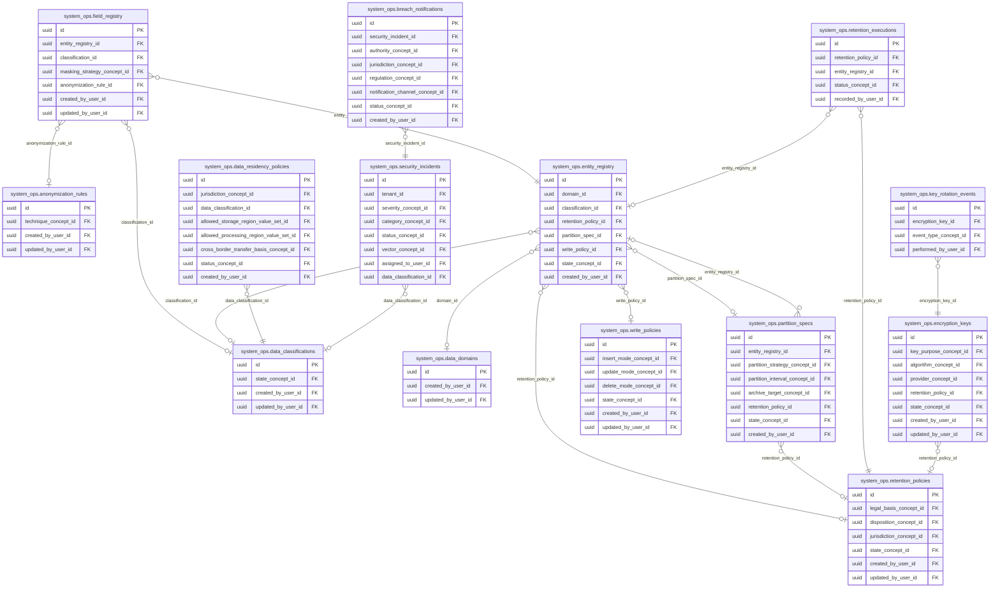
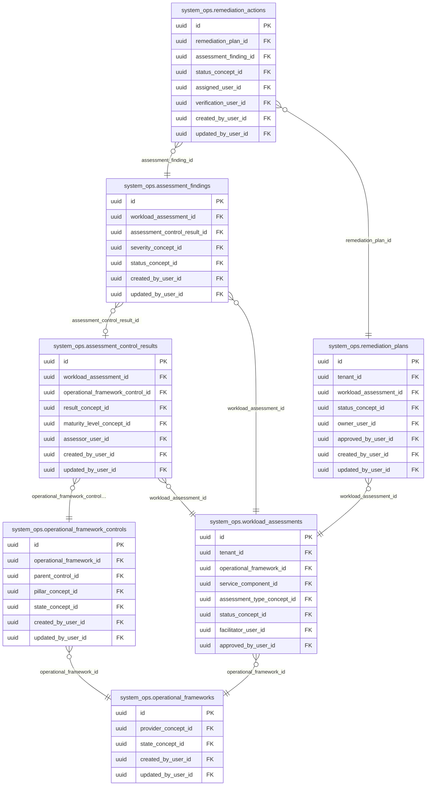
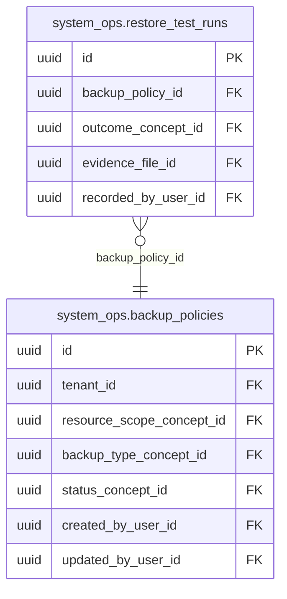

<!-- AUTOGENERADO por tools/inventario/catalogo.mjs. No editar manualmente. -->

# Catálogo del schema `system_ops`

- **Tablas:** 29 · **Columnas:** 430 (100 con descripción: 23.3 %) · **Índices:** 178
- **Dominio:** Operaciones de Plataforma
- Método y límites del catálogo: [README del inventario](../README.md)

## Tablas

| Tabla | Propósito | Columnas | Índices | Operaciones | ORM |
|---|---|---|---|---|---|
| [anonymization_rules](#anonymization_rules) | Define reglas de anonimización para preparar información para usos que no requieren identificar personas. | 10 | 4 | 5 | COINCIDE |
| [assessment_control_results](#assessment_control_results) | Conserva resultados por control de una evaluación para localizar cumplimiento y brechas específicas. | 16 | 9 | 3 | COINCIDE |
| [assessment_findings](#assessment_findings) | Registra hallazgos de evaluaciones para priorizar riesgos y acciones correctivas. | 17 | 7 | 7 | COINCIDE |
| [backup_policies](#backup_policies) | Define políticas de respaldo para proteger disponibilidad y recuperabilidad de información del sistema médico. | 16 | 7 | 4 | COINCIDE |
| [breach_notifications](#breach_notifications) | Conserva notificaciones de brechas para documentar comunicaciones y obligaciones posteriores a un incidente. | 17 | 4 | 0 | COINCIDE |
| [cross_border_transfer_events](#cross_border_transfer_events) | Registra transferencias internacionales de datos para mantener trazabilidad de movimientos entre jurisdicciones. | 10 | 9 | 2 | COINCIDE |
| [data_classifications](#data_classifications) | Define niveles de clasificación de datos para gobernar su protección y uso en la plataforma médica. | 13 | 4 | 2 | COINCIDE |
| [data_domains](#data_domains) | Cataloga dominios de datos para asignar ownership y organizar gobierno por área del sistema. | 10 | 3 | 2 | COINCIDE |
| [data_residency_policies](#data_residency_policies) | Define requisitos de residencia geográfica de datos para controlar dónde pueden almacenarse datos de salud. | 17 | 9 | 2 | COINCIDE |
| [draft_records](#draft_records) | Almacena registros en estado de borrador para separar preparación de datos de su publicación o uso operativo. | 17 | 6 | 3 | COINCIDE |
| [encryption_keys](#encryption_keys) | Cataloga claves de cifrado gobernadas que protegen datos y secretos almacenados por la plataforma. | 18 | 4 | 0 | COINCIDE |
| [entity_registry](#entity_registry) | Registra entidades del modelo para aplicar políticas de gobierno, retención y control operativo. | 21 | 7 | 9 | COINCIDE |
| [field_registry](#field_registry) | Cataloga campos de entidades para mantener metadata de sensibilidad, clasificación y uso. | 14 | 6 | 6 | COINCIDE |
| [governance_change_log](#governance_change_log) | Preserva cambios de gobierno de datos para reconstruir decisiones sobre clasificación, acceso y ciclo de vida. | 10 | 4 | 10 | COINCIDE |
| [key_rotation_events](#key_rotation_events) | Preserva eventos de rotación de claves para demostrar y operar el ciclo de vida criptográfico. | 9 | 2 | 0 | COINCIDE |
| [legal_holds](#legal_holds) | Registra retenciones legales que suspenden disposición de información requerida para procesos o investigaciones. | 14 | 7 | 7 | COINCIDE |
| [operational_framework_controls](#operational_framework_controls) | Define controles que componen marcos operativos para evaluar cumplimiento y preparación organizacional. | 15 | 7 | 1 | COINCIDE |
| [operational_frameworks](#operational_frameworks) | Cataloga marcos operativos usados para evaluar controles y prácticas institucionales. | 13 | 5 | 3 | COINCIDE |
| [partition_specs](#partition_specs) | Registra especificaciones de particionado para organizar almacenamiento y retención de tablas de gran volumen. | 22 | 5 | 0 | COINCIDE |
| [record_revisions](#record_revisions) | Conserva revisiones de registros para proporcionar historial y control de cambios de datos de negocio. | 11 | 5 | 7 | COINCIDE |
| [remediation_actions](#remediation_actions) | Detalla acciones de remediación y su estado para seguir la resolución de hallazgos. | 18 | 8 | 3 | COINCIDE |
| [remediation_plans](#remediation_plans) | Agrupa acciones planificadas para corregir hallazgos de gobierno, privacidad o seguridad. | 16 | 9 | 4 | COINCIDE |
| [restore_test_runs](#restore_test_runs) | Documenta pruebas de restauración para verificar que copias de respaldo permiten recuperar datos. | 12 | 5 | 3 | COINCIDE |
| [retention_executions](#retention_executions) | Registra ejecuciones de políticas de retención para documentar qué datos fueron evaluados o procesados. | 13 | 5 | 2 | COINCIDE |
| [retention_policies](#retention_policies) | Establece políticas de conservación y disposición de datos según necesidad operativa y normativa aplicable. | 13 | 7 | 6 | COINCIDE |
| [security_incidents](#security_incidents) | Registra incidentes de seguridad para coordinar investigación, contención y recuperación. | 20 | 4 | 0 | COINCIDE |
| [tenant_residency_bindings](#tenant_residency_bindings) | Asocia tenants con políticas o regiones de residencia para aplicar requisitos territoriales a cada organización. | 13 | 8 | 1 | COINCIDE |
| [workload_assessments](#workload_assessments) | Registra evaluaciones de cargas de trabajo para analizar capacidad y condiciones operativas de los servicios. | 19 | 11 | 4 | COINCIDE |
| [write_policies](#write_policies) | Define reglas sobre escrituras permitidas en entidades para proteger consistencia y gobierno de datos. | 16 | 7 | 3 | COINCIDE |

## Diagrama entidad-relación

Las tablas se agrupan en familias por sus claves foráneas dentro del schema (máximo 40 por diagrama). Las FK hacia otros schemas se listan en la ficha de cada tabla.

### Familia 1 de 3 — 14 tablas

### Familia 2 de 3 — 7 tablas

### Familia 3 de 3 — 2 tablas

### Tablas sin relaciones dentro del schema

`system_ops.cross_border_transfer_events` · `system_ops.draft_records` · `system_ops.governance_change_log` · `system_ops.legal_holds` · `system_ops.record_revisions` · `system_ops.tenant_residency_bindings`

## Fichas

### anonymization_rules

#### Vista general

Define reglas de anonimización para preparar información para usos que no requieren identificar personas.

- **Estado del propósito:** DOMAIN_CURATED_DRAFT · fuente: `Mantra Core Health Context/modules/diagram_11_system_ops.puml: anonymization_rules`
- **Dominio:** Operaciones de Plataforma · **Diagrama:** `Mantra Core Health Context/modules/diagram_11_system_ops.puml` · **DDL:** `SQL/11_system_ops/02_tables.sql`
- **Entidad del ORM:** `AnonymizationRules` — `src/modules/system_ops/entities/anonymization_rules.entity.ts`
- **Resumen:** 10 columnas · 4 índices · 3 FK salientes · 1 entrantes · 5 operaciones

#### Columnas

| # | Columna | Tipo | Rol estructural | Descripción | ORM |
|---|---|---|---|---|---|
| 1 | `id` | `uuid` | Clave primaria; Obligatoria | Identificador único de la instancia. _(JSDOC_ESTANDAR, `src/modules/system_ops/entities/anonymization_rules.entity.ts:12`)_ | coincide |
| 2 | `code` | `varchar` | Obligatoria | _sin dato_ | coincide |
| 3 | `technique_concept_id` | `uuid` | Clave foránea → terminology.catalog_concepts.id; Obligatoria | _sin dato_ | coincide |
| 4 | `parameters_json` | `jsonb` | Opcional | _sin dato_ | coincide |
| 5 | `description` | `text` | Opcional | _sin dato_ | coincide |
| 6 | `created_at` | `timestamptz` | Obligatoria | Fecha y hora en que se creó el registro. _(JSDOC_ESTANDAR, `src/modules/system_ops/entities/anonymization_rules.entity.ts:47`)_ | coincide |
| 7 | `updated_at` | `timestamptz` | Obligatoria | Fecha y hora de la última actualización. _(JSDOC_ESTANDAR, `src/modules/system_ops/entities/anonymization_rules.entity.ts:53`)_ | coincide |
| 8 | `created_by_user_id` | `uuid` | Clave foránea → iam.users.id; Opcional | _sin dato_ | coincide |
| 9 | `updated_by_user_id` | `uuid` | Clave foránea → iam.users.id; Opcional | _sin dato_ | coincide |
| 10 | `row_version` | `integer = 1` | Obligatoria | Versión usada para controlar actualizaciones concurrentes. _(JSDOC_ENTIDAD, `src/modules/system_ops/entities/anonymization_rules.entity.ts:71`)_ | coincide |

#### Relaciones

| Sentido | Columnas | Tabla | Restricción |
|---|---|---|---|
| hacia | technique_concept_id | terminology.catalog_concepts (id) | fk_anonymization_rules_technique_concept_id |
| hacia | created_by_user_id | iam.users (id) | fk_anonymization_rules_created_by_user_id |
| hacia | updated_by_user_id | iam.users (id) | fk_anonymization_rules_updated_by_user_id |
| desde | id | system_ops.field_registry (anonymization_rule_id) | fk_field_registry_anonymization_rule_id |

#### Índices

| Índice | Único | Columnas | Para qué |
|---|---|---|---|
| `uq_anonymization_rules_code` | sí | code | Garantiza que no se repita la combinación (code) _(DOCUMENTO)_; 1 consulta(s) de repositorio filtran u ordenan por «code», la primera columna del índice _(CONSULTA)_ |
| `ix_anonymization_rules_technique_concept_id` | no | technique_concept_id | Soporta la clave foránea fk_anonymization_rules_technique_concept_id: PostgreSQL no indexa las FK por sí mismo _(DOCUMENTO)_ |
| `ix_anonymization_rules_created_by_user_id` | no | created_by_user_id | Soporta la clave foránea fk_anonymization_rules_created_by_user_id: PostgreSQL no indexa las FK por sí mismo _(DOCUMENTO)_ |
| `ix_anonymization_rules_updated_by_user_id` | no | updated_by_user_id | Soporta la clave foránea fk_anonymization_rules_updated_by_user_id: PostgreSQL no indexa las FK por sí mismo _(DOCUMENTO)_ |

#### Restricciones

| Restricción | Tipo | Definición |
|---|---|---|
| `uq_anonymization_rules_code` | UNIQUE INDEX | UNIQUE INDEX ("code") |

#### Operaciones que la tocan

| Operación | Efecto | Confianza |
|---|---|---|
| POST /internal/identity/evidence/lifecycle-scan | LEE | DIRECTA |
| POST /internal/identity/evidence/storage-purge-review | LEE | DIRECTA |
| POST /admin/governance/anonymization-rules | CREA | DIRECTA |
| POST /admin/governance/anonymization-rules | LEE | DIRECTA |
| POST /internal/governance/retention-executions/run | LEE | DIRECTA |

#### Gobierno

| Atributo | Valor | Fuente |
|---|---|---|
| Append-only | no declarado | — |
| Datos personales | sin fuente | — |
| Financiera | sin fuente | — |
| Crítica para auditoría | sin fuente | — |
| Retención | sin fuente | — |
| Responsable | sin fuente | — |
| Revisión | AUTO_DETECTADA | — |

---

### assessment_control_results

#### Vista general

Conserva resultados por control de una evaluación para localizar cumplimiento y brechas específicas.

- **Estado del propósito:** DOMAIN_CURATED_DRAFT · fuente: `Mantra Core Health Context/modules/diagram_11_system_ops.puml: assessment_control_results`
- **Dominio:** Operaciones de Plataforma · **Diagrama:** `Mantra Core Health Context/modules/diagram_11_system_ops.puml` · **DDL:** `SQL/11_system_ops/02_tables.sql`
- **Entidad del ORM:** `AssessmentControlResults` — `src/modules/system_ops/entities/assessment_control_results.entity.ts`
- **Resumen:** 16 columnas · 9 índices · 7 FK salientes · 1 entrantes · 3 operaciones

#### Columnas

| # | Columna | Tipo | Rol estructural | Descripción | ORM |
|---|---|---|---|---|---|
| 1 | `id` | `uuid` | Clave primaria; Obligatoria | Identificador único de la instancia. _(JSDOC_ESTANDAR, `src/modules/system_ops/entities/assessment_control_results.entity.ts:12`)_ | coincide |
| 2 | `workload_assessment_id` | `uuid` | Clave foránea → system_ops.workload_assessments.id; Obligatoria | _sin dato_ | coincide |
| 3 | `operational_framework_control_id` | `uuid` | Clave foránea → system_ops.operational_framework_controls.id; Obligatoria | _sin dato_ | coincide |
| 4 | `result_concept_id` | `uuid` | Clave foránea → terminology.catalog_concepts.id; Obligatoria | _sin dato_ | coincide |
| 5 | `maturity_level_concept_id` | `uuid` | Clave foránea → terminology.catalog_concepts.id; Opcional | _sin dato_ | coincide |
| 6 | `evidence_summary` | `text` | Opcional | _sin dato_ | coincide |
| 7 | `evidence_links_json` | `jsonb` | Opcional | _sin dato_ | coincide |
| 8 | `assessor_user_id` | `uuid` | Clave foránea → iam.users.id; Opcional | _sin dato_ | coincide |
| 9 | `assessed_at` | `timestamptz` | Obligatoria | _sin dato_ | coincide |
| 10 | `risk_score` | `numeric(8,4)` | Opcional | _sin dato_ | coincide |
| 11 | `accepted_risk_id` | `uuid` | Opcional | _sin dato_ | coincide |
| 12 | `created_at` | `timestamptz` | Obligatoria | Fecha y hora en que se creó el registro. _(JSDOC_ESTANDAR, `src/modules/system_ops/entities/assessment_control_results.entity.ts:95`)_ | coincide |
| 13 | `updated_at` | `timestamptz` | Obligatoria | Fecha y hora de la última actualización. _(JSDOC_ESTANDAR, `src/modules/system_ops/entities/assessment_control_results.entity.ts:101`)_ | coincide |
| 14 | `created_by_user_id` | `uuid` | Clave foránea → iam.users.id; Opcional | _sin dato_ | coincide |
| 15 | `updated_by_user_id` | `uuid` | Clave foránea → iam.users.id; Opcional | _sin dato_ | coincide |
| 16 | `row_version` | `integer = 1` | Obligatoria | Versión usada para controlar actualizaciones concurrentes. _(JSDOC_ENTIDAD, `src/modules/system_ops/entities/assessment_control_results.entity.ts:119`)_ | coincide |

#### Relaciones

| Sentido | Columnas | Tabla | Restricción |
|---|---|---|---|
| hacia | workload_assessment_id | system_ops.workload_assessments (id) | fk_assessment_control_results_workload_assessment_id |
| hacia | operational_framework_control_id | system_ops.operational_framework_controls (id) | fk_assessment_control_results_operational_framework_control_id |
| hacia | result_concept_id | terminology.catalog_concepts (id) | fk_assessment_control_results_result_concept_id |
| hacia | maturity_level_concept_id | terminology.catalog_concepts (id) | fk_assessment_control_results_maturity_level_concept_id |
| hacia | assessor_user_id | iam.users (id) | fk_assessment_control_results_assessor_user_id |
| hacia | created_by_user_id | iam.users (id) | fk_assessment_control_results_created_by_user_id |
| hacia | updated_by_user_id | iam.users (id) | fk_assessment_control_results_updated_by_user_id |
| desde | id | system_ops.assessment_findings (assessment_control_result_id) | fk_assessment_findings_assessment_control_result_id |

#### Índices

| Índice | Único | Columnas | Para qué |
|---|---|---|---|
| `ix_assessment_control_results_workload_assessment_id` | no | workload_assessment_id | Soporta la clave foránea fk_assessment_control_results_workload_assessment_id: PostgreSQL no indexa las FK por sí mismo _(DOCUMENTO)_; 1 consulta(s) de repositorio filtran u ordenan por «workload_assessment_id», la primera columna del índice _(CONSULTA)_ |
| `ix_assessment_control_results_operational_framework_control_id` | no | operational_framework_control_id | Soporta la clave foránea fk_assessment_control_results_operational_framework_control_id: PostgreSQL no indexa las FK por sí mismo _(DOCUMENTO)_; 1 consulta(s) de repositorio filtran u ordenan por «operational_framework_control_id», la primera columna del índice _(CONSULTA)_ |
| `ix_assessment_control_results_result_concept_id` | no | result_concept_id | Soporta la clave foránea fk_assessment_control_results_result_concept_id: PostgreSQL no indexa las FK por sí mismo _(DOCUMENTO)_ |
| `ix_assessment_control_results_maturity_level_concept_id` | no | maturity_level_concept_id | Soporta la clave foránea fk_assessment_control_results_maturity_level_concept_id: PostgreSQL no indexa las FK por sí mismo _(DOCUMENTO)_ |
| `ix_assessment_control_results_assessor_user_id` | no | assessor_user_id | Soporta la clave foránea fk_assessment_control_results_assessor_user_id: PostgreSQL no indexa las FK por sí mismo _(DOCUMENTO)_ |
| `ix_assessment_control_results_accepted_risk_id` | no | accepted_risk_id | _sin uso detectado estáticamente_ |
| `ix_assessment_control_results_created_by_user_id` | no | created_by_user_id | Soporta la clave foránea fk_assessment_control_results_created_by_user_id: PostgreSQL no indexa las FK por sí mismo _(DOCUMENTO)_ |
| `ix_assessment_control_results_updated_by_user_id` | no | updated_by_user_id | Soporta la clave foránea fk_assessment_control_results_updated_by_user_id: PostgreSQL no indexa las FK por sí mismo _(DOCUMENTO)_ |
| `uk_assessment_control_results_assessment_control` | sí | workload_assessment_id, operational_framework_control_id | Garantiza que no se repita la combinación (workload_assessment_id, operational_framework_control_id) _(DOCUMENTO)_; Soporta la clave foránea fk_assessment_control_results_workload_assessment_id: PostgreSQL no indexa las FK por sí mismo _(DOCUMENTO)_; 1 consulta(s) de repositorio filtran u ordenan por «workload_assessment_id», la primera columna del índice _(CONSULTA)_ |

#### Restricciones

| Restricción | Tipo | Definición |
|---|---|---|
| `uk_assessment_control_results_assessment_control` | UNIQUE INDEX | UNIQUE INDEX ("workload_assessment_id", "operational_framework_control_id") |

#### Operaciones que la tocan

| Operación | Efecto | Confianza |
|---|---|---|
| PUT /admin/governance/workload-assessments/{id}/control-results | ACTUALIZA | POR_TIPO |
| PUT /admin/governance/workload-assessments/{id}/control-results | CREA | DIRECTA |
| PUT /admin/governance/workload-assessments/{id}/control-results | LEE | DIRECTA |

#### Gobierno

| Atributo | Valor | Fuente |
|---|---|---|
| Append-only | no declarado | — |
| Datos personales | sin fuente | — |
| Financiera | sin fuente | — |
| Crítica para auditoría | sin fuente | — |
| Retención | sin fuente | — |
| Responsable | sin fuente | — |
| Revisión | AUTO_DETECTADA | — |

---

### assessment_findings

#### Vista general

Registra hallazgos de evaluaciones para priorizar riesgos y acciones correctivas.

- **Estado del propósito:** DOMAIN_CURATED_DRAFT · fuente: `Mantra Core Health Context/modules/diagram_11_system_ops.puml: assessment_findings`
- **Dominio:** Operaciones de Plataforma · **Diagrama:** `Mantra Core Health Context/modules/diagram_11_system_ops.puml` · **DDL:** `SQL/11_system_ops/02_tables.sql`
- **Entidad del ORM:** `AssessmentFindings` — `src/modules/system_ops/entities/assessment_findings.entity.ts`
- **Resumen:** 17 columnas · 7 índices · 6 FK salientes · 1 entrantes · 7 operaciones

#### Columnas

| # | Columna | Tipo | Rol estructural | Descripción | ORM |
|---|---|---|---|---|---|
| 1 | `id` | `uuid` | Clave primaria; Obligatoria | Identificador único de la instancia. _(JSDOC_ESTANDAR, `src/modules/system_ops/entities/assessment_findings.entity.ts:12`)_ | coincide |
| 2 | `workload_assessment_id` | `uuid` | Clave foránea → system_ops.workload_assessments.id; Obligatoria | _sin dato_ | coincide |
| 3 | `assessment_control_result_id` | `uuid` | Clave foránea → system_ops.assessment_control_results.id; Opcional | _sin dato_ | coincide |
| 4 | `finding_code` | `varchar` | Obligatoria | _sin dato_ | coincide |
| 5 | `title` | `varchar` | Obligatoria | _sin dato_ | coincide |
| 6 | `description` | `text` | Opcional | _sin dato_ | coincide |
| 7 | `severity_concept_id` | `uuid` | Clave foránea → terminology.catalog_concepts.id; Obligatoria | _sin dato_ | coincide |
| 8 | `status_concept_id` | `uuid` | Clave foránea → terminology.catalog_concepts.id; Obligatoria | _sin dato_ | coincide |
| 9 | `owner_team` | `varchar` | Opcional | _sin dato_ | coincide |
| 10 | `due_at` | `timestamptz` | Opcional | _sin dato_ | coincide |
| 11 | `risk_acceptance_expires_at` | `timestamptz` | Opcional | _sin dato_ | coincide |
| 12 | `closed_at` | `timestamptz` | Opcional | _sin dato_ | coincide |
| 13 | `created_at` | `timestamptz` | Obligatoria | Fecha y hora en que se creó el registro. _(JSDOC_ESTANDAR, `src/modules/system_ops/entities/assessment_findings.entity.ts:96`)_ | coincide |
| 14 | `updated_at` | `timestamptz` | Obligatoria | Fecha y hora de la última actualización. _(JSDOC_ESTANDAR, `src/modules/system_ops/entities/assessment_findings.entity.ts:102`)_ | coincide |
| 15 | `created_by_user_id` | `uuid` | Clave foránea → iam.users.id; Opcional | _sin dato_ | coincide |
| 16 | `updated_by_user_id` | `uuid` | Clave foránea → iam.users.id; Opcional | _sin dato_ | coincide |
| 17 | `row_version` | `integer = 1` | Obligatoria | Versión usada para controlar actualizaciones concurrentes. _(JSDOC_ENTIDAD, `src/modules/system_ops/entities/assessment_findings.entity.ts:120`)_ | coincide |

#### Relaciones

| Sentido | Columnas | Tabla | Restricción |
|---|---|---|---|
| hacia | workload_assessment_id | system_ops.workload_assessments (id) | fk_assessment_findings_workload_assessment_id |
| hacia | assessment_control_result_id | system_ops.assessment_control_results (id) | fk_assessment_findings_assessment_control_result_id |
| hacia | severity_concept_id | terminology.catalog_concepts (id) | fk_assessment_findings_severity_concept_id |
| hacia | status_concept_id | terminology.catalog_concepts (id) | fk_assessment_findings_status_concept_id |
| hacia | created_by_user_id | iam.users (id) | fk_assessment_findings_created_by_user_id |
| hacia | updated_by_user_id | iam.users (id) | fk_assessment_findings_updated_by_user_id |
| desde | id | system_ops.remediation_actions (assessment_finding_id) | fk_remediation_actions_assessment_finding_id |

#### Índices

| Índice | Único | Columnas | Para qué |
|---|---|---|---|
| `ix_assessment_findings_workload_assessment_id` | no | workload_assessment_id | Soporta la clave foránea fk_assessment_findings_workload_assessment_id: PostgreSQL no indexa las FK por sí mismo _(DOCUMENTO)_; 1 consulta(s) de repositorio filtran u ordenan por «workload_assessment_id», la primera columna del índice _(CONSULTA)_ |
| `ix_assessment_findings_assessment_control_result_id` | no | assessment_control_result_id | Soporta la clave foránea fk_assessment_findings_assessment_control_result_id: PostgreSQL no indexa las FK por sí mismo _(DOCUMENTO)_ |
| `ix_assessment_findings_severity_concept_id` | no | severity_concept_id | Soporta la clave foránea fk_assessment_findings_severity_concept_id: PostgreSQL no indexa las FK por sí mismo _(DOCUMENTO)_ |
| `ix_assessment_findings_status_concept_id` | no | status_concept_id | Soporta la clave foránea fk_assessment_findings_status_concept_id: PostgreSQL no indexa las FK por sí mismo _(DOCUMENTO)_ |
| `ix_assessment_findings_created_by_user_id` | no | created_by_user_id | Soporta la clave foránea fk_assessment_findings_created_by_user_id: PostgreSQL no indexa las FK por sí mismo _(DOCUMENTO)_ |
| `ix_assessment_findings_updated_by_user_id` | no | updated_by_user_id | Soporta la clave foránea fk_assessment_findings_updated_by_user_id: PostgreSQL no indexa las FK por sí mismo _(DOCUMENTO)_ |
| `uk_assessment_findings_assessment_code` | sí | workload_assessment_id, finding_code | Garantiza que no se repita la combinación (workload_assessment_id, finding_code) _(DOCUMENTO)_; Soporta la clave foránea fk_assessment_findings_workload_assessment_id: PostgreSQL no indexa las FK por sí mismo _(DOCUMENTO)_; 1 consulta(s) de repositorio filtran u ordenan por «workload_assessment_id», la primera columna del índice _(CONSULTA)_ |

#### Restricciones

| Restricción | Tipo | Definición |
|---|---|---|
| `uk_assessment_findings_assessment_code` | UNIQUE INDEX | UNIQUE INDEX ("workload_assessment_id", "finding_code") |

#### Operaciones que la tocan

| Operación | Efecto | Confianza |
|---|---|---|
| POST /admin/governance/assessments/{id}/findings | CREA | DIRECTA |
| POST /admin/governance/assessments/{id}/findings | LEE | DIRECTA |
| POST /admin/governance/assessments/{id}/remediation-plans | LEE | DIRECTA |
| PATCH /admin/governance/findings/{id} | ACTUALIZA | POR_TIPO |
| PATCH /admin/governance/findings/{id} | LEE | DIRECTA |
| POST /admin/governance/remediation-actions/{id}/verify | ACTUALIZA | POR_TIPO |
| POST /admin/governance/remediation-actions/{id}/verify | LEE | DIRECTA |

#### Gobierno

| Atributo | Valor | Fuente |
|---|---|---|
| Append-only | no declarado | — |
| Datos personales | sin fuente | — |
| Financiera | sin fuente | — |
| Crítica para auditoría | sin fuente | — |
| Retención | sin fuente | — |
| Responsable | sin fuente | — |
| Revisión | AUTO_DETECTADA | — |

---

### backup_policies

#### Vista general

Define políticas de respaldo para proteger disponibilidad y recuperabilidad de información del sistema médico.

- **Estado del propósito:** DOMAIN_CURATED_DRAFT · fuente: `Mantra Core Health Context/modules/diagram_11_system_ops.puml: backup_policies`
- **Dominio:** Operaciones de Plataforma · **Diagrama:** `Mantra Core Health Context/modules/diagram_11_system_ops.puml` · **DDL:** `SQL/11_system_ops/02_tables.sql`
- **Entidad del ORM:** `BackupPolicies` — `src/modules/system_ops/entities/backup_policies.entity.ts`
- **Resumen:** 16 columnas · 7 índices · 6 FK salientes · 1 entrantes · 4 operaciones

#### Columnas

| # | Columna | Tipo | Rol estructural | Descripción | ORM |
|---|---|---|---|---|---|
| 1 | `id` | `uuid` | Clave primaria; Obligatoria | Identificador único de la instancia. _(JSDOC_ESTANDAR, `src/modules/system_ops/entities/backup_policies.entity.ts:12`)_ | coincide |
| 2 | `tenant_id` | `uuid` | Clave foránea → directory.tenants.id; Obligatoria | _sin dato_ | coincide |
| 3 | `resource_scope_concept_id` | `uuid` | Clave foránea → terminology.catalog_concepts.id; Obligatoria | _sin dato_ | coincide |
| 4 | `backup_type_concept_id` | `uuid` | Clave foránea → terminology.catalog_concepts.id; Obligatoria | _sin dato_ | coincide |
| 5 | `rpo_seconds` | `integer` | Opcional | _sin dato_ | coincide |
| 6 | `rto_seconds` | `integer` | Opcional | _sin dato_ | coincide |
| 7 | `retention_days` | `integer` | Opcional | _sin dato_ | coincide |
| 8 | `immutable_copy_required` | `boolean` | Opcional | _sin dato_ | coincide |
| 9 | `encryption_required` | `boolean` | Opcional | _sin dato_ | coincide |
| 10 | `restore_test_frequency_days` | `integer` | Opcional | _sin dato_ | coincide |
| 11 | `status_concept_id` | `uuid` | Clave foránea → terminology.catalog_concepts.id; Obligatoria | _sin dato_ | coincide |
| 12 | `created_at` | `timestamptz` | Obligatoria | Fecha y hora en que se creó el registro. _(JSDOC_ESTANDAR, `src/modules/system_ops/entities/backup_policies.entity.ts:90`)_ | coincide |
| 13 | `updated_at` | `timestamptz` | Obligatoria | Fecha y hora de la última actualización. _(JSDOC_ESTANDAR, `src/modules/system_ops/entities/backup_policies.entity.ts:96`)_ | coincide |
| 14 | `created_by_user_id` | `uuid` | Clave foránea → iam.users.id; Opcional | _sin dato_ | coincide |
| 15 | `updated_by_user_id` | `uuid` | Clave foránea → iam.users.id; Opcional | _sin dato_ | coincide |
| 16 | `row_version` | `integer = 1` | Obligatoria | Versión usada para controlar actualizaciones concurrentes. _(JSDOC_ENTIDAD, `src/modules/system_ops/entities/backup_policies.entity.ts:114`)_ | coincide |

#### Relaciones

| Sentido | Columnas | Tabla | Restricción |
|---|---|---|---|
| hacia | tenant_id | directory.tenants (id) | fk_backup_policies_tenant_id |
| hacia | resource_scope_concept_id | terminology.catalog_concepts (id) | fk_backup_policies_resource_scope_concept_id |
| hacia | backup_type_concept_id | terminology.catalog_concepts (id) | fk_backup_policies_backup_type_concept_id |
| hacia | status_concept_id | terminology.catalog_concepts (id) | fk_backup_policies_status_concept_id |
| hacia | created_by_user_id | iam.users (id) | fk_backup_policies_created_by_user_id |
| hacia | updated_by_user_id | iam.users (id) | fk_backup_policies_updated_by_user_id |
| desde | id | system_ops.restore_test_runs (backup_policy_id) | fk_restore_test_runs_backup_policy_id |

#### Índices

| Índice | Único | Columnas | Para qué |
|---|---|---|---|
| `ix_backup_policies_tenant_id` | no | tenant_id | Soporta la clave foránea fk_backup_policies_tenant_id: PostgreSQL no indexa las FK por sí mismo _(DOCUMENTO)_; 1 consulta(s) de repositorio filtran u ordenan por «tenant_id», la primera columna del índice _(CONSULTA)_ |
| `ix_backup_policies_resource_scope_concept_id` | no | resource_scope_concept_id | Soporta la clave foránea fk_backup_policies_resource_scope_concept_id: PostgreSQL no indexa las FK por sí mismo _(DOCUMENTO)_; 1 consulta(s) de repositorio filtran u ordenan por «resource_scope_concept_id», la primera columna del índice _(CONSULTA)_ |
| `ix_backup_policies_backup_type_concept_id` | no | backup_type_concept_id | Soporta la clave foránea fk_backup_policies_backup_type_concept_id: PostgreSQL no indexa las FK por sí mismo _(DOCUMENTO)_ |
| `ix_backup_policies_status_concept_id` | no | status_concept_id | Soporta la clave foránea fk_backup_policies_status_concept_id: PostgreSQL no indexa las FK por sí mismo _(DOCUMENTO)_; 1 consulta(s) de repositorio filtran u ordenan por «status_concept_id», la primera columna del índice _(CONSULTA)_ |
| `ix_backup_policies_created_by_user_id` | no | created_by_user_id | Soporta la clave foránea fk_backup_policies_created_by_user_id: PostgreSQL no indexa las FK por sí mismo _(DOCUMENTO)_ |
| `ix_backup_policies_updated_by_user_id` | no | updated_by_user_id | Soporta la clave foránea fk_backup_policies_updated_by_user_id: PostgreSQL no indexa las FK por sí mismo _(DOCUMENTO)_ |
| `ix_backup_policies_tenant_id_status_concept_id` | no | tenant_id, status_concept_id, ("updated_at" DESC) | _sin uso detectado estáticamente_ |

#### Operaciones que la tocan

| Operación | Efecto | Confianza |
|---|---|---|
| GET /admin/ops/backups | LEE | POR_SQL |
| GET /admin/ops/readiness | LEE | POR_SQL |
| POST /admin/ops/backup-policies | CREA | DIRECTA |
| POST /internal/ops/restore-test-runs | LEE | DIRECTA |

#### Gobierno

| Atributo | Valor | Fuente |
|---|---|---|
| Append-only | no declarado | — |
| Datos personales | sin fuente | — |
| Financiera | sin fuente | — |
| Crítica para auditoría | sin fuente | — |
| Retención | sin fuente | — |
| Responsable | sin fuente | — |
| Revisión | AUTO_DETECTADA | — |

---

### breach_notifications

#### Vista general

Conserva notificaciones de brechas para documentar comunicaciones y obligaciones posteriores a un incidente.

- **Estado del propósito:** DOMAIN_CURATED_DRAFT · fuente: `Mantra Core Health Context/modules/diagram_11_system_ops.puml: breach_notifications`
- **Dominio:** Operaciones de Plataforma · **Diagrama:** `Mantra Core Health Context/modules/diagram_11_system_ops.puml` · **DDL:** `SQL/11_system_ops/02_tables.sql`
- **Entidad del ORM:** `BreachNotifications` — `src/modules/system_ops/entities/breach_notifications.entity.ts`
- **Resumen:** 17 columnas · 4 índices · 8 FK salientes · 0 entrantes · 0 operaciones

#### Columnas

| # | Columna | Tipo | Rol estructural | Descripción | ORM |
|---|---|---|---|---|---|
| 1 | `id` | `uuid` | Clave primaria; Obligatoria | Identificador único de la instancia. _(JSDOC_ESTANDAR, `src/modules/system_ops/entities/breach_notifications.entity.ts:12`)_ | coincide |
| 2 | `security_incident_id` | `uuid` | Clave foránea → system_ops.security_incidents.id; Obligatoria | _sin dato_ | coincide |
| 3 | `authority_concept_id` | `uuid` | Clave foránea → terminology.catalog_concepts.id; Obligatoria | _sin dato_ | coincide |
| 4 | `jurisdiction_concept_id` | `uuid` | Clave foránea → terminology.catalog_concepts.id; Opcional | _sin dato_ | coincide |
| 5 | `regulation_concept_id` | `uuid` | Clave foránea → terminology.catalog_concepts.id; Opcional | _sin dato_ | coincide |
| 6 | `deadline_at` | `timestamptz` | Opcional | _sin dato_ | coincide |
| 7 | `notified_at` | `timestamptz` | Opcional | _sin dato_ | coincide |
| 8 | `affected_subjects` | `integer` | Opcional | _sin dato_ | coincide |
| 9 | `notification_channel_concept_id` | `uuid` | Clave foránea → terminology.catalog_concepts.id; Opcional | _sin dato_ | coincide |
| 10 | `reference_number` | `varchar` | Opcional | _sin dato_ | coincide |
| 11 | `subjects_notified` | `boolean` | Opcional | _sin dato_ | coincide |
| 12 | `status_concept_id` | `uuid` | Clave foránea → terminology.catalog_concepts.id; Obligatoria | _sin dato_ | coincide |
| 13 | `created_at` | `timestamptz` | Obligatoria | Fecha y hora en que se creó el registro. _(JSDOC_ESTANDAR, `src/modules/system_ops/entities/breach_notifications.entity.ts:112`)_ | coincide |
| 14 | `updated_at` | `timestamptz` | Obligatoria | Fecha y hora de la última actualización. _(JSDOC_ESTANDAR, `src/modules/system_ops/entities/breach_notifications.entity.ts:118`)_ | coincide |
| 15 | `created_by_user_id` | `uuid` | Clave foránea → iam.users.id; Opcional | _sin dato_ | coincide |
| 16 | `updated_by_user_id` | `uuid` | Clave foránea → iam.users.id; Opcional | _sin dato_ | coincide |
| 17 | `row_version` | `integer = 1` | Obligatoria | Versión usada para controlar actualizaciones concurrentes. _(JSDOC_ENTIDAD, `src/modules/system_ops/entities/breach_notifications.entity.ts:136`)_ | coincide |

#### Relaciones

| Sentido | Columnas | Tabla | Restricción |
|---|---|---|---|
| hacia | security_incident_id | system_ops.security_incidents (id) | fk_breach_notifications_security_incident_id |
| hacia | authority_concept_id | terminology.catalog_concepts (id) | fk_breach_notifications_authority_concept_id |
| hacia | jurisdiction_concept_id | terminology.catalog_concepts (id) | fk_breach_notifications_jurisdiction_concept_id |
| hacia | regulation_concept_id | terminology.catalog_concepts (id) | fk_breach_notifications_regulation_concept_id |
| hacia | notification_channel_concept_id | terminology.catalog_concepts (id) | fk_breach_notifications_notification_channel_concept_id |
| hacia | status_concept_id | terminology.catalog_concepts (id) | fk_breach_notifications_status_concept_id |
| hacia | created_by_user_id | iam.users (id) | fk_breach_notifications_created_by_user_id |
| hacia | updated_by_user_id | iam.users (id) | fk_breach_notifications_updated_by_user_id |

#### Índices

| Índice | Único | Columnas | Para qué |
|---|---|---|---|
| `ix_breach_notifications_security_incident_id` | no | security_incident_id | Soporta la clave foránea fk_breach_notifications_security_incident_id: PostgreSQL no indexa las FK por sí mismo _(DOCUMENTO)_; 1 consulta(s) de repositorio filtran u ordenan por «security_incident_id», la primera columna del índice _(CONSULTA)_ |
| `ix_breach_notifications_authority_concept_id` | no | authority_concept_id | Soporta la clave foránea fk_breach_notifications_authority_concept_id: PostgreSQL no indexa las FK por sí mismo _(DOCUMENTO)_ |
| `ix_breach_notifications_deadline_at` | no | deadline_at | _sin uso detectado estáticamente_ |
| `ix_breach_notifications_status_concept_id` | no | status_concept_id | Soporta la clave foránea fk_breach_notifications_status_concept_id: PostgreSQL no indexa las FK por sí mismo _(DOCUMENTO)_ |

#### Operaciones que la tocan

_Ninguna operación HTTP la toca según el análisis estático (puede usarla un worker, un trigger o una migración)._

#### Gobierno

| Atributo | Valor | Fuente |
|---|---|---|
| Append-only | no declarado | — |
| Datos personales | sin fuente | — |
| Financiera | sin fuente | — |
| Crítica para auditoría | sin fuente | — |
| Retención | sin fuente | — |
| Responsable | sin fuente | — |
| Revisión | AUTO_DETECTADA | — |

---

### cross_border_transfer_events

#### Vista general

Registra transferencias internacionales de datos para mantener trazabilidad de movimientos entre jurisdicciones.

- **Estado del propósito:** DOMAIN_CURATED_DRAFT · fuente: `Mantra Core Health Context/modules/diagram_11_system_ops.puml: cross_border_transfer_events`
- **Dominio:** Operaciones de Plataforma · **Diagrama:** `Mantra Core Health Context/modules/diagram_11_system_ops.puml` · **DDL:** `SQL/11_system_ops/02_tables.sql`
- **Entidad del ORM:** `CrossBorderTransferEvents` — `src/modules/system_ops/entities/cross_border_transfer_events.entity.ts`
- **Resumen:** 10 columnas · 9 índices · 7 FK salientes · 0 entrantes · 2 operaciones

#### Columnas

| # | Columna | Tipo | Rol estructural | Descripción | ORM |
|---|---|---|---|---|---|
| 1 | `id` | `uuid` | Clave primaria; Obligatoria | Identificador único de la instancia. _(JSDOC_ESTANDAR, `src/modules/system_ops/entities/cross_border_transfer_events.entity.ts:12`)_ | coincide |
| 2 | `tenant_id` | `uuid` | Clave foránea → directory.tenants.id; Obligatoria | _sin dato_ | coincide |
| 3 | `data_category_concept_id` | `uuid` | Clave foránea → terminology.catalog_concepts.id; Obligatoria | _sin dato_ | coincide |
| 4 | `source_region_concept_id` | `uuid` | Clave foránea → terminology.catalog_concepts.id; Obligatoria | _sin dato_ | coincide |
| 5 | `destination_region_concept_id` | `uuid` | Clave foránea → terminology.catalog_concepts.id; Obligatoria | _sin dato_ | coincide |
| 6 | `transfer_basis_concept_id` | `uuid` | Clave foránea → terminology.catalog_concepts.id; Obligatoria | _sin dato_ | coincide |
| 7 | `recipient_tenant_id` | `uuid` | Clave foránea → directory.tenants.id; Opcional | _sin dato_ | coincide |
| 8 | `transfer_reference` | `varchar` | Opcional | _sin dato_ | coincide |
| 9 | `approved_by_user_id` | `uuid` | Clave foránea → iam.users.id; Opcional | _sin dato_ | coincide |
| 10 | `recorded_at` | `timestamptz` | Obligatoria | _sin dato_ | coincide |

#### Relaciones

| Sentido | Columnas | Tabla | Restricción |
|---|---|---|---|
| hacia | tenant_id | directory.tenants (id) | fk_cross_border_transfer_events_tenant_id |
| hacia | data_category_concept_id | terminology.catalog_concepts (id) | fk_cross_border_transfer_events_data_category_concept_id |
| hacia | source_region_concept_id | terminology.catalog_concepts (id) | fk_cross_border_transfer_events_source_region_concept_id |
| hacia | destination_region_concept_id | terminology.catalog_concepts (id) | fk_cross_border_transfer_events_destination_region_concept_id |
| hacia | transfer_basis_concept_id | terminology.catalog_concepts (id) | fk_cross_border_transfer_events_transfer_basis_concept_id |
| hacia | recipient_tenant_id | directory.tenants (id) | fk_cross_border_transfer_events_recipient_tenant_id |
| hacia | approved_by_user_id | iam.users (id) | fk_cross_border_transfer_events_approved_by_user_id |

#### Índices

| Índice | Único | Columnas | Para qué |
|---|---|---|---|
| `ix_cross_border_transfer_events_tenant_id` | no | tenant_id | Soporta la clave foránea fk_cross_border_transfer_events_tenant_id: PostgreSQL no indexa las FK por sí mismo _(DOCUMENTO)_ |
| `ix_cross_border_transfer_events_data_category_concept_id` | no | data_category_concept_id | Soporta la clave foránea fk_cross_border_transfer_events_data_category_concept_id: PostgreSQL no indexa las FK por sí mismo _(DOCUMENTO)_ |
| `ix_cross_border_transfer_events_source_region_concept_id` | no | source_region_concept_id | Soporta la clave foránea fk_cross_border_transfer_events_source_region_concept_id: PostgreSQL no indexa las FK por sí mismo _(DOCUMENTO)_ |
| `ix_cross_border_transfer_events_destination_region_concept_id` | no | destination_region_concept_id | Soporta la clave foránea fk_cross_border_transfer_events_destination_region_concept_id: PostgreSQL no indexa las FK por sí mismo _(DOCUMENTO)_ |
| `ix_cross_border_transfer_events_transfer_basis_concept_id` | no | transfer_basis_concept_id | Soporta la clave foránea fk_cross_border_transfer_events_transfer_basis_concept_id: PostgreSQL no indexa las FK por sí mismo _(DOCUMENTO)_ |
| `ix_cross_border_transfer_events_recipient_tenant_id` | no | recipient_tenant_id | Soporta la clave foránea fk_cross_border_transfer_events_recipient_tenant_id: PostgreSQL no indexa las FK por sí mismo _(DOCUMENTO)_ |
| `ix_cross_border_transfer_events_approved_by_user_id` | no | approved_by_user_id | Soporta la clave foránea fk_cross_border_transfer_events_approved_by_user_id: PostgreSQL no indexa las FK por sí mismo _(DOCUMENTO)_ |
| `ix_cross_border_transfer_events_tenant_id_recorded_at` | no | tenant_id, ("recorded_at" DESC) | _sin uso detectado estáticamente_ |
| `brin_cross_border_transfer_events_recorded_at` | no | recorded_at | BRIN para logs e historiales append-only de gran volumen _(DOCUMENTO)_ |

#### Operaciones que la tocan

| Operación | Efecto | Confianza |
|---|---|---|
| POST /admin/governance/cross-border-transfers | CREA | DIRECTA |
| POST /admin/governance/cross-border-transfers | LEE | DIRECTA |

#### Gobierno

| Atributo | Valor | Fuente |
|---|---|---|
| Append-only | no declarado | — |
| Datos personales | sin fuente | — |
| Financiera | sin fuente | — |
| Crítica para auditoría | sin fuente | — |
| Retención | sin fuente | — |
| Responsable | sin fuente | — |
| Revisión | AUTO_DETECTADA | — |

---

### data_classifications

#### Vista general

Define niveles de clasificación de datos para gobernar su protección y uso en la plataforma médica.

- **Estado del propósito:** DOMAIN_CURATED_DRAFT · fuente: `Mantra Core Health Context/modules/diagram_11_system_ops.puml: data_classifications`
- **Dominio:** Operaciones de Plataforma · **Diagrama:** `Mantra Core Health Context/modules/diagram_11_system_ops.puml` · **DDL:** `SQL/11_system_ops/02_tables.sql`
- **Entidad del ORM:** `SystemOpsDataClassifications` — `src/modules/system_ops/entities/data_classifications.entity.ts`
- **Resumen:** 13 columnas · 4 índices · 3 FK salientes · 4 entrantes · 2 operaciones

#### Columnas

| # | Columna | Tipo | Rol estructural | Descripción | ORM |
|---|---|---|---|---|---|
| 1 | `id` | `uuid` | Clave primaria; Obligatoria | Identificador único de la instancia. _(JSDOC_ESTANDAR, `src/modules/system_ops/entities/data_classifications.entity.ts:12`)_ | coincide |
| 2 | `code` | `varchar` | Obligatoria | _sin dato_ | coincide |
| 3 | `name` | `varchar` | Obligatoria | _sin dato_ | coincide |
| 4 | `rank` | `integer` | Opcional | _sin dato_ | coincide |
| 5 | `is_pii` | `boolean` | Opcional | _sin dato_ | coincide |
| 6 | `is_phi` | `boolean` | Opcional | _sin dato_ | coincide |
| 7 | `handling_rules_json` | `jsonb` | Obligatoria | _sin dato_ | coincide |
| 8 | `state_concept_id` | `uuid` | Clave foránea → terminology.catalog_concepts.id; Opcional | _sin dato_ | coincide |
| 9 | `created_at` | `timestamptz` | Obligatoria | Fecha y hora en que se creó el registro. _(JSDOC_ESTANDAR, `src/modules/system_ops/entities/data_classifications.entity.ts:64`)_ | coincide |
| 10 | `updated_at` | `timestamptz` | Obligatoria | Fecha y hora de la última actualización. _(JSDOC_ESTANDAR, `src/modules/system_ops/entities/data_classifications.entity.ts:70`)_ | coincide |
| 11 | `created_by_user_id` | `uuid` | Clave foránea → iam.users.id; Opcional | _sin dato_ | coincide |
| 12 | `updated_by_user_id` | `uuid` | Clave foránea → iam.users.id; Opcional | _sin dato_ | coincide |
| 13 | `row_version` | `integer = 1` | Obligatoria | Versión usada para controlar actualizaciones concurrentes. _(JSDOC_ENTIDAD, `src/modules/system_ops/entities/data_classifications.entity.ts:88`)_ | coincide |

#### Relaciones

| Sentido | Columnas | Tabla | Restricción |
|---|---|---|---|
| hacia | state_concept_id | terminology.catalog_concepts (id) | fk_data_classifications_state_concept_id |
| hacia | created_by_user_id | iam.users (id) | fk_data_classifications_created_by_user_id |
| hacia | updated_by_user_id | iam.users (id) | fk_data_classifications_updated_by_user_id |
| desde | id | system_ops.entity_registry (classification_id) | fk_entity_registry_classification_id |
| desde | id | system_ops.field_registry (classification_id) | fk_field_registry_classification_id |
| desde | id | system_ops.data_residency_policies (data_classification_id) | fk_data_residency_policies_data_classification_id |
| desde | id | system_ops.security_incidents (data_classification_id) | fk_security_incidents_data_classification_id |

#### Índices

| Índice | Único | Columnas | Para qué |
|---|---|---|---|
| `uq_data_classifications_code` | sí | code | Garantiza que no se repita la combinación (code) _(DOCUMENTO)_; 1 consulta(s) de repositorio filtran u ordenan por «code», la primera columna del índice _(CONSULTA)_ |
| `ix_data_classifications_state_concept_id` | no | state_concept_id | Soporta la clave foránea fk_data_classifications_state_concept_id: PostgreSQL no indexa las FK por sí mismo _(DOCUMENTO)_ |
| `ix_data_classifications_created_by_user_id` | no | created_by_user_id | Soporta la clave foránea fk_data_classifications_created_by_user_id: PostgreSQL no indexa las FK por sí mismo _(DOCUMENTO)_ |
| `ix_data_classifications_updated_by_user_id` | no | updated_by_user_id | Soporta la clave foránea fk_data_classifications_updated_by_user_id: PostgreSQL no indexa las FK por sí mismo _(DOCUMENTO)_ |

#### Restricciones

| Restricción | Tipo | Definición |
|---|---|---|
| `uq_data_classifications_code` | UNIQUE INDEX | UNIQUE INDEX ("code") |

#### Operaciones que la tocan

| Operación | Efecto | Confianza |
|---|---|---|
| POST /admin/governance/entity-registry | CREA | DIRECTA |
| POST /admin/governance/entity-registry | LEE | DIRECTA |

#### Gobierno

| Atributo | Valor | Fuente |
|---|---|---|
| Append-only | no declarado | — |
| Datos personales | sin fuente | — |
| Financiera | sin fuente | — |
| Crítica para auditoría | sin fuente | — |
| Retención | sin fuente | — |
| Responsable | sin fuente | — |
| Revisión | AUTO_DETECTADA | — |

---

### data_domains

#### Vista general

Cataloga dominios de datos para asignar ownership y organizar gobierno por área del sistema.

- **Estado del propósito:** DOMAIN_CURATED_DRAFT · fuente: `Mantra Core Health Context/modules/diagram_11_system_ops.puml: data_domains`
- **Dominio:** Operaciones de Plataforma · **Diagrama:** `Mantra Core Health Context/modules/diagram_11_system_ops.puml` · **DDL:** `SQL/11_system_ops/02_tables.sql`
- **Entidad del ORM:** `DataDomains` — `src/modules/system_ops/entities/data_domains.entity.ts`
- **Resumen:** 10 columnas · 3 índices · 2 FK salientes · 1 entrantes · 2 operaciones

#### Columnas

| # | Columna | Tipo | Rol estructural | Descripción | ORM |
|---|---|---|---|---|---|
| 1 | `id` | `uuid` | Clave primaria; Obligatoria | Identificador único de la instancia. _(JSDOC_ESTANDAR, `src/modules/system_ops/entities/data_domains.entity.ts:12`)_ | coincide |
| 2 | `code` | `varchar` | Obligatoria | _sin dato_ | coincide |
| 3 | `name` | `varchar` | Obligatoria | _sin dato_ | coincide |
| 4 | `description` | `text` | Opcional | _sin dato_ | coincide |
| 5 | `owner_team` | `varchar` | Opcional | _sin dato_ | coincide |
| 6 | `created_at` | `timestamptz` | Obligatoria | Fecha y hora en que se creó el registro. _(JSDOC_ESTANDAR, `src/modules/system_ops/entities/data_domains.entity.ts:42`)_ | coincide |
| 7 | `updated_at` | `timestamptz` | Obligatoria | Fecha y hora de la última actualización. _(JSDOC_ESTANDAR, `src/modules/system_ops/entities/data_domains.entity.ts:48`)_ | coincide |
| 8 | `created_by_user_id` | `uuid` | Clave foránea → iam.users.id; Opcional | _sin dato_ | coincide |
| 9 | `updated_by_user_id` | `uuid` | Clave foránea → iam.users.id; Opcional | _sin dato_ | coincide |
| 10 | `row_version` | `integer = 1` | Obligatoria | Versión usada para controlar actualizaciones concurrentes. _(JSDOC_ENTIDAD, `src/modules/system_ops/entities/data_domains.entity.ts:66`)_ | coincide |

#### Relaciones

| Sentido | Columnas | Tabla | Restricción |
|---|---|---|---|
| hacia | created_by_user_id | iam.users (id) | fk_data_domains_created_by_user_id |
| hacia | updated_by_user_id | iam.users (id) | fk_data_domains_updated_by_user_id |
| desde | id | system_ops.entity_registry (domain_id) | fk_entity_registry_domain_id |

#### Índices

| Índice | Único | Columnas | Para qué |
|---|---|---|---|
| `uq_data_domains_code` | sí | code | Garantiza que no se repita la combinación (code) _(DOCUMENTO)_; 1 consulta(s) de repositorio filtran u ordenan por «code», la primera columna del índice _(CONSULTA)_ |
| `ix_data_domains_created_by_user_id` | no | created_by_user_id | Soporta la clave foránea fk_data_domains_created_by_user_id: PostgreSQL no indexa las FK por sí mismo _(DOCUMENTO)_ |
| `ix_data_domains_updated_by_user_id` | no | updated_by_user_id | Soporta la clave foránea fk_data_domains_updated_by_user_id: PostgreSQL no indexa las FK por sí mismo _(DOCUMENTO)_ |

#### Restricciones

| Restricción | Tipo | Definición |
|---|---|---|
| `uq_data_domains_code` | UNIQUE INDEX | UNIQUE INDEX ("code") |

#### Operaciones que la tocan

| Operación | Efecto | Confianza |
|---|---|---|
| POST /admin/governance/entity-registry | CREA | DIRECTA |
| POST /admin/governance/entity-registry | LEE | DIRECTA |

#### Gobierno

| Atributo | Valor | Fuente |
|---|---|---|
| Append-only | no declarado | — |
| Datos personales | sin fuente | — |
| Financiera | sin fuente | — |
| Crítica para auditoría | sin fuente | — |
| Retención | sin fuente | — |
| Responsable | sin fuente | — |
| Revisión | AUTO_DETECTADA | — |

---

### data_residency_policies

#### Vista general

Define requisitos de residencia geográfica de datos para controlar dónde pueden almacenarse datos de salud.

- **Estado del propósito:** DOMAIN_CURATED_DRAFT · fuente: `Mantra Core Health Context/modules/diagram_11_system_ops.puml: data_residency_policies`
- **Dominio:** Operaciones de Plataforma · **Diagrama:** `Mantra Core Health Context/modules/diagram_11_system_ops.puml` · **DDL:** `SQL/11_system_ops/02_tables.sql`
- **Entidad del ORM:** `DataResidencyPolicies` — `src/modules/system_ops/entities/data_residency_policies.entity.ts`
- **Resumen:** 17 columnas · 9 índices · 8 FK salientes · 0 entrantes · 2 operaciones

#### Columnas

| # | Columna | Tipo | Rol estructural | Descripción | ORM |
|---|---|---|---|---|---|
| 1 | `id` | `uuid` | Clave primaria; Obligatoria | Identificador único de la instancia. _(JSDOC_ESTANDAR, `src/modules/system_ops/entities/data_residency_policies.entity.ts:12`)_ | coincide |
| 2 | `code` | `varchar` | Obligatoria | _sin dato_ | coincide |
| 3 | `jurisdiction_concept_id` | `uuid` | Clave foránea → terminology.catalog_concepts.id; Obligatoria | _sin dato_ | coincide |
| 4 | `data_classification_id` | `uuid` | Clave foránea → system_ops.data_classifications.id; Obligatoria | _sin dato_ | coincide |
| 5 | `allowed_storage_region_value_set_id` | `uuid` | Clave foránea → terminology.value_sets.id; Obligatoria | _sin dato_ | coincide |
| 6 | `allowed_processing_region_value_set_id` | `uuid` | Clave foránea → terminology.value_sets.id; Opcional | _sin dato_ | coincide |
| 7 | `cross_border_transfer_basis_concept_id` | `uuid` | Clave foránea → terminology.catalog_concepts.id; Opcional | _sin dato_ | coincide |
| 8 | `transfer_impact_assessment_required` | `boolean` | Opcional | _sin dato_ | coincide |
| 9 | `encryption_key_region_locked` | `boolean` | Opcional | _sin dato_ | coincide |
| 10 | `status_concept_id` | `uuid` | Clave foránea → terminology.catalog_concepts.id; Obligatoria | _sin dato_ | coincide |
| 11 | `valid_from` | `timestamptz` | Obligatoria | _sin dato_ | coincide |
| 12 | `valid_to` | `timestamptz` | Opcional | _sin dato_ | coincide |
| 13 | `created_at` | `timestamptz` | Obligatoria | Fecha y hora en que se creó el registro. _(JSDOC_ESTANDAR, `src/modules/system_ops/entities/data_residency_policies.entity.ts:104`)_ | coincide |
| 14 | `updated_at` | `timestamptz` | Obligatoria | Fecha y hora de la última actualización. _(JSDOC_ESTANDAR, `src/modules/system_ops/entities/data_residency_policies.entity.ts:110`)_ | coincide |
| 15 | `created_by_user_id` | `uuid` | Clave foránea → iam.users.id; Opcional | _sin dato_ | coincide |
| 16 | `updated_by_user_id` | `uuid` | Clave foránea → iam.users.id; Opcional | _sin dato_ | coincide |
| 17 | `row_version` | `integer = 1` | Obligatoria | Versión usada para controlar actualizaciones concurrentes. _(JSDOC_ENTIDAD, `src/modules/system_ops/entities/data_residency_policies.entity.ts:128`)_ | coincide |

#### Relaciones

| Sentido | Columnas | Tabla | Restricción |
|---|---|---|---|
| hacia | data_classification_id | system_ops.data_classifications (id) | fk_data_residency_policies_data_classification_id |
| hacia | jurisdiction_concept_id | terminology.catalog_concepts (id) | fk_data_residency_policies_jurisdiction_concept_id |
| hacia | allowed_storage_region_value_set_id | terminology.value_sets (id) | fk_data_residency_policies_allowed_storage_region_value_set_id |
| hacia | allowed_processing_region_value_set_id | terminology.value_sets (id) | fk_data_residency_policies_allowed_processing_region_v_a1fd58dd |
| hacia | cross_border_transfer_basis_concept_id | terminology.catalog_concepts (id) | fk_data_residency_policies_cross_border_transfer_basis_0c78b8b0 |
| hacia | status_concept_id | terminology.catalog_concepts (id) | fk_data_residency_policies_status_concept_id |
| hacia | created_by_user_id | iam.users (id) | fk_data_residency_policies_created_by_user_id |
| hacia | updated_by_user_id | iam.users (id) | fk_data_residency_policies_updated_by_user_id |

#### Índices

| Índice | Único | Columnas | Para qué |
|---|---|---|---|
| `uq_data_residency_policies_code` | sí | code | Garantiza que no se repita la combinación (code) _(DOCUMENTO)_; 1 consulta(s) de repositorio filtran u ordenan por «code», la primera columna del índice _(CONSULTA)_ |
| `ix_data_residency_policies_jurisdiction_concept_id` | no | jurisdiction_concept_id | Soporta la clave foránea fk_data_residency_policies_jurisdiction_concept_id: PostgreSQL no indexa las FK por sí mismo _(DOCUMENTO)_ |
| `ix_data_residency_policies_data_classification_id` | no | data_classification_id | Soporta la clave foránea fk_data_residency_policies_data_classification_id: PostgreSQL no indexa las FK por sí mismo _(DOCUMENTO)_ |
| `ix_data_residency_policies_allowed_storage_region_value_set_id` | no | allowed_storage_region_value_set_id | Soporta la clave foránea fk_data_residency_policies_allowed_storage_region_value_set_id: PostgreSQL no indexa las FK por sí mismo _(DOCUMENTO)_ |
| `ix_data_residency_policies_allowed_processing_region_v_e59a2240` | no | allowed_processing_region_value_set_id | Soporta la clave foránea fk_data_residency_policies_allowed_processing_region_v_a1fd58dd: PostgreSQL no indexa las FK por sí mismo _(DOCUMENTO)_ |
| `ix_data_residency_policies_cross_border_transfer_basis_1b4c4437` | no | cross_border_transfer_basis_concept_id | Soporta la clave foránea fk_data_residency_policies_cross_border_transfer_basis_0c78b8b0: PostgreSQL no indexa las FK por sí mismo _(DOCUMENTO)_ |
| `ix_data_residency_policies_status_concept_id` | no | status_concept_id | Soporta la clave foránea fk_data_residency_policies_status_concept_id: PostgreSQL no indexa las FK por sí mismo _(DOCUMENTO)_ |
| `ix_data_residency_policies_created_by_user_id` | no | created_by_user_id | Soporta la clave foránea fk_data_residency_policies_created_by_user_id: PostgreSQL no indexa las FK por sí mismo _(DOCUMENTO)_ |
| `ix_data_residency_policies_updated_by_user_id` | no | updated_by_user_id | Soporta la clave foránea fk_data_residency_policies_updated_by_user_id: PostgreSQL no indexa las FK por sí mismo _(DOCUMENTO)_ |

#### Restricciones

| Restricción | Tipo | Definición |
|---|---|---|
| `uq_data_residency_policies_code` | UNIQUE INDEX | UNIQUE INDEX ("code") |

#### Operaciones que la tocan

| Operación | Efecto | Confianza |
|---|---|---|
| POST /admin/governance/residency-policies | CREA | DIRECTA |
| POST /admin/governance/residency-policies | LEE | DIRECTA |

#### Gobierno

| Atributo | Valor | Fuente |
|---|---|---|
| Append-only | no declarado | — |
| Datos personales | sin fuente | — |
| Financiera | sin fuente | — |
| Crítica para auditoría | sin fuente | — |
| Retención | sin fuente | — |
| Responsable | sin fuente | — |
| Revisión | AUTO_DETECTADA | — |

---

### draft_records

#### Vista general

Almacena registros en estado de borrador para separar preparación de datos de su publicación o uso operativo.

- **Estado del propósito:** DOMAIN_CURATED_DRAFT · fuente: `Mantra Core Health Context/modules/diagram_11_system_ops.puml: draft_records`
- **Dominio:** Operaciones de Plataforma · **Diagrama:** `Mantra Core Health Context/modules/diagram_11_system_ops.puml` · **DDL:** `SQL/11_system_ops/02_tables.sql`
- **Entidad del ORM:** `DraftRecords` — `src/modules/system_ops/entities/draft_records.entity.ts`
- **Resumen:** 17 columnas · 6 índices · 5 FK salientes · 0 entrantes · 3 operaciones

#### Columnas

| # | Columna | Tipo | Rol estructural | Descripción | ORM |
|---|---|---|---|---|---|
| 1 | `id` | `uuid` | Clave primaria; Obligatoria | Identificador único de la instancia. _(JSDOC_ESTANDAR, `src/modules/system_ops/entities/draft_records.entity.ts:12`)_ | coincide |
| 2 | `schema_name` | `varchar` | Obligatoria | _sin dato_ | coincide |
| 3 | `table_name` | `varchar` | Obligatoria | _sin dato_ | coincide |
| 4 | `target_record_id` | `uuid` | Opcional | _sin dato_ | coincide |
| 5 | `owner_user_id` | `uuid` | Clave foránea → iam.users.id; Obligatoria | _sin dato_ | coincide |
| 6 | `tenant_id` | `uuid` | Clave foránea → directory.tenants.id; Opcional | _sin dato_ | coincide |
| 7 | `draft_label` | `varchar` | Opcional | _sin dato_ | coincide |
| 8 | `payload_json` | `jsonb` | Obligatoria | _sin dato_ | coincide |
| 9 | `status_concept_id` | `uuid` | Clave foránea → terminology.catalog_concepts.id; Obligatoria | _sin dato_ | coincide |
| 10 | `schema_version` | `integer` | Opcional | _sin dato_ | coincide |
| 11 | `published_record_id` | `uuid` | Opcional | _sin dato_ | coincide |
| 12 | `expires_at` | `timestamptz` | Opcional | _sin dato_ | coincide |
| 13 | `created_at` | `timestamptz` | Obligatoria | Fecha y hora en que se creó el registro. _(JSDOC_ESTANDAR, `src/modules/system_ops/entities/draft_records.entity.ts:88`)_ | coincide |
| 14 | `updated_at` | `timestamptz` | Obligatoria | Fecha y hora de la última actualización. _(JSDOC_ESTANDAR, `src/modules/system_ops/entities/draft_records.entity.ts:94`)_ | coincide |
| 15 | `created_by_user_id` | `uuid` | Clave foránea → iam.users.id; Opcional | _sin dato_ | coincide |
| 16 | `updated_by_user_id` | `uuid` | Clave foránea → iam.users.id; Opcional | _sin dato_ | coincide |
| 17 | `row_version` | `integer = 1` | Obligatoria | Versión usada para controlar actualizaciones concurrentes. _(JSDOC_ENTIDAD, `src/modules/system_ops/entities/draft_records.entity.ts:112`)_ | coincide |

#### Relaciones

| Sentido | Columnas | Tabla | Restricción |
|---|---|---|---|
| hacia | owner_user_id | iam.users (id) | fk_draft_records_owner_user_id |
| hacia | tenant_id | directory.tenants (id) | fk_draft_records_tenant_id |
| hacia | status_concept_id | terminology.catalog_concepts (id) | fk_draft_records_status_concept_id |
| hacia | created_by_user_id | iam.users (id) | fk_draft_records_created_by_user_id |
| hacia | updated_by_user_id | iam.users (id) | fk_draft_records_updated_by_user_id |

#### Índices

| Índice | Único | Columnas | Para qué |
|---|---|---|---|
| `ix_draft_records_owner_user_id` | no | owner_user_id | Soporta la clave foránea fk_draft_records_owner_user_id: PostgreSQL no indexa las FK por sí mismo _(DOCUMENTO)_ |
| `ix_draft_records_tenant_id` | no | tenant_id | Soporta la clave foránea fk_draft_records_tenant_id: PostgreSQL no indexa las FK por sí mismo _(DOCUMENTO)_ |
| `ix_draft_records_status_concept_id` | no | status_concept_id | Soporta la clave foránea fk_draft_records_status_concept_id: PostgreSQL no indexa las FK por sí mismo _(DOCUMENTO)_ |
| `ix_draft_records_created_by_user_id` | no | created_by_user_id | Soporta la clave foránea fk_draft_records_created_by_user_id: PostgreSQL no indexa las FK por sí mismo _(DOCUMENTO)_ |
| `ix_draft_records_updated_by_user_id` | no | updated_by_user_id | Soporta la clave foránea fk_draft_records_updated_by_user_id: PostgreSQL no indexa las FK por sí mismo _(DOCUMENTO)_ |
| `ix_draft_records_tenant_id_status_concept_id` | no | tenant_id, status_concept_id, ("updated_at" DESC) | _sin uso detectado estáticamente_ |

#### Operaciones que la tocan

| Operación | Efecto | Confianza |
|---|---|---|
| POST /admin/governance/drafts | CREA | DIRECTA |
| POST /admin/governance/drafts/{id}/publish | ACTUALIZA | POR_TIPO |
| POST /admin/governance/drafts/{id}/publish | LEE | DIRECTA |

#### Gobierno

| Atributo | Valor | Fuente |
|---|---|---|
| Append-only | no declarado | — |
| Datos personales | sin fuente | — |
| Financiera | sin fuente | — |
| Crítica para auditoría | sin fuente | — |
| Retención | sin fuente | — |
| Responsable | sin fuente | — |
| Revisión | AUTO_DETECTADA | — |

---

### encryption_keys

#### Vista general

Cataloga claves de cifrado gobernadas que protegen datos y secretos almacenados por la plataforma.

- **Estado del propósito:** DOMAIN_CURATED_DRAFT · fuente: `Mantra Core Health Context/modules/diagram_11_system_ops.puml: encryption_keys`
- **Dominio:** Operaciones de Plataforma · **Diagrama:** `Mantra Core Health Context/modules/diagram_11_system_ops.puml` · **DDL:** `SQL/11_system_ops/02_tables.sql`
- **Entidad del ORM:** `EncryptionKeys` — `src/modules/system_ops/entities/encryption_keys.entity.ts`
- **Resumen:** 18 columnas · 4 índices · 7 FK salientes · 5 entrantes · 0 operaciones

#### Columnas

| # | Columna | Tipo | Rol estructural | Descripción | ORM |
|---|---|---|---|---|---|
| 1 | `id` | `uuid` | Clave primaria; Obligatoria | Identificador único de la instancia. _(JSDOC_ESTANDAR, `src/modules/system_ops/entities/encryption_keys.entity.ts:12`)_ | coincide |
| 2 | `key_alias` | `varchar` | Obligatoria | _sin dato_ | coincide |
| 3 | `key_purpose_concept_id` | `uuid` | Clave foránea → terminology.catalog_concepts.id; Obligatoria | _sin dato_ | coincide |
| 4 | `algorithm_concept_id` | `uuid` | Clave foránea → terminology.catalog_concepts.id; Obligatoria | _sin dato_ | coincide |
| 5 | `provider_concept_id` | `uuid` | Clave foránea → terminology.catalog_concepts.id; Opcional | _sin dato_ | coincide |
| 6 | `external_key_ref` | `varchar` | Opcional | _sin dato_ | coincide |
| 7 | `key_version` | `integer` | Opcional | _sin dato_ | coincide |
| 8 | `is_primary` | `boolean` | Opcional | _sin dato_ | coincide |
| 9 | `rotation_period_days` | `integer` | Opcional | _sin dato_ | coincide |
| 10 | `last_rotated_at` | `timestamptz` | Opcional | _sin dato_ | coincide |
| 11 | `next_rotation_at` | `timestamptz` | Opcional | _sin dato_ | coincide |
| 12 | `retention_policy_id` | `uuid` | Clave foránea → system_ops.retention_policies.id; Opcional | _sin dato_ | coincide |
| 13 | `state_concept_id` | `uuid` | Clave foránea → terminology.catalog_concepts.id; Obligatoria | _sin dato_ | coincide |
| 14 | `created_at` | `timestamptz` | Obligatoria | Fecha y hora en que se creó el registro. _(JSDOC_ESTANDAR, `src/modules/system_ops/entities/encryption_keys.entity.ts:106`)_ | coincide |
| 15 | `updated_at` | `timestamptz` | Obligatoria | Fecha y hora de la última actualización. _(JSDOC_ESTANDAR, `src/modules/system_ops/entities/encryption_keys.entity.ts:112`)_ | coincide |
| 16 | `created_by_user_id` | `uuid` | Clave foránea → iam.users.id; Opcional | _sin dato_ | coincide |
| 17 | `updated_by_user_id` | `uuid` | Clave foránea → iam.users.id; Opcional | _sin dato_ | coincide |
| 18 | `row_version` | `integer = 1` | Obligatoria | Versión usada para controlar actualizaciones concurrentes. _(JSDOC_ENTIDAD, `src/modules/system_ops/entities/encryption_keys.entity.ts:130`)_ | coincide |

#### Relaciones

| Sentido | Columnas | Tabla | Restricción |
|---|---|---|---|
| hacia | retention_policy_id | system_ops.retention_policies (id) | fk_encryption_keys_retention_policy_id |
| hacia | key_purpose_concept_id | terminology.catalog_concepts (id) | fk_encryption_keys_key_purpose_concept_id |
| hacia | algorithm_concept_id | terminology.catalog_concepts (id) | fk_encryption_keys_algorithm_concept_id |
| hacia | provider_concept_id | terminology.catalog_concepts (id) | fk_encryption_keys_provider_concept_id |
| hacia | state_concept_id | terminology.catalog_concepts (id) | fk_encryption_keys_state_concept_id |
| hacia | created_by_user_id | iam.users (id) | fk_encryption_keys_created_by_user_id |
| hacia | updated_by_user_id | iam.users (id) | fk_encryption_keys_updated_by_user_id |
| desde | id | system_ops.key_rotation_events (encryption_key_id) | fk_key_rotation_events_encryption_key_id |
| desde | id | payments.provider_callback_endpoints (verification_secret_id) | fk_provider_callback_endpoints_verification_secret_id |
| desde | id | ads.ad_platform_connections (webhook_verification_secret_id) | fk_ad_platform_connections_webhook_verification_secret_id |
| desde | id | ads.dataset_connections (test_event_code_secret_id) | fk_dataset_connections_test_event_code_secret_id |
| desde | id | health_data.health_deidentification_profiles (reidentification_key_secret_id) | fk_health_deidentification_profiles_reidentification_k_76ae9fd3 |

#### Índices

| Índice | Único | Columnas | Para qué |
|---|---|---|---|
| `uk_encryption_keys_key_alias` | sí | key_alias | Garantiza que no se repita la combinación (key_alias) _(DOCUMENTO)_ |
| `ix_encryption_keys_purpose_concept_id` | no | key_purpose_concept_id | Soporta la clave foránea fk_encryption_keys_key_purpose_concept_id: PostgreSQL no indexa las FK por sí mismo _(DOCUMENTO)_ |
| `ix_encryption_keys_next_rotation_at` | no | next_rotation_at | _sin uso detectado estáticamente_ |
| `ix_encryption_keys_state_concept_id` | no | state_concept_id | Soporta la clave foránea fk_encryption_keys_state_concept_id: PostgreSQL no indexa las FK por sí mismo _(DOCUMENTO)_ |

#### Restricciones

| Restricción | Tipo | Definición |
|---|---|---|
| `uk_encryption_keys_key_alias` | UNIQUE INDEX | UNIQUE INDEX ("key_alias") |

#### Operaciones que la tocan

_Ninguna operación HTTP la toca según el análisis estático (puede usarla un worker, un trigger o una migración)._

#### Gobierno

| Atributo | Valor | Fuente |
|---|---|---|
| Append-only | no declarado | — |
| Datos personales | sin fuente | — |
| Financiera | sin fuente | — |
| Crítica para auditoría | sin fuente | — |
| Retención | sin fuente | — |
| Responsable | sin fuente | — |
| Revisión | AUTO_DETECTADA | — |

---

### entity_registry

#### Vista general

Registra entidades del modelo para aplicar políticas de gobierno, retención y control operativo.

- **Estado del propósito:** DOMAIN_CURATED_DRAFT · fuente: `Mantra Core Health Context/modules/diagram_11_system_ops.puml: entity_registry`
- **Dominio:** Operaciones de Plataforma · **Diagrama:** `Mantra Core Health Context/modules/diagram_11_system_ops.puml` · **DDL:** `SQL/11_system_ops/02_tables.sql`
- **Entidad del ORM:** `EntityRegistry` — `src/modules/system_ops/entities/entity_registry.entity.ts`
- **Resumen:** 21 columnas · 7 índices · 8 FK salientes · 3 entrantes · 9 operaciones

#### Columnas

| # | Columna | Tipo | Rol estructural | Descripción | ORM |
|---|---|---|---|---|---|
| 1 | `id` | `uuid` | Clave primaria; Obligatoria | Identificador único de la instancia. _(JSDOC_ESTANDAR, `src/modules/system_ops/entities/entity_registry.entity.ts:12`)_ | coincide |
| 2 | `schema_name` | `varchar` | Obligatoria | _sin dato_ | coincide |
| 3 | `table_name` | `varchar` | Obligatoria | _sin dato_ | coincide |
| 4 | `domain_id` | `uuid` | Clave foránea → system_ops.data_domains.id; Opcional | _sin dato_ | coincide |
| 5 | `classification_id` | `uuid` | Clave foránea → system_ops.data_classifications.id; Opcional | _sin dato_ | coincide |
| 6 | `is_append_only` | `boolean` | Obligatoria | _sin dato_ | coincide |
| 7 | `is_soft_delete` | `boolean` | Obligatoria | _sin dato_ | coincide |
| 8 | `has_history` | `boolean` | Obligatoria | _sin dato_ | coincide |
| 9 | `history_table` | `varchar` | Opcional | _sin dato_ | coincide |
| 10 | `retention_policy_id` | `uuid` | Clave foránea → system_ops.retention_policies.id; Opcional | _sin dato_ | coincide |
| 11 | `partition_spec_id` | `uuid` | Clave foránea → system_ops.partition_specs.id; Opcional | _sin dato_ | coincide |
| 12 | `write_policy_id` | `uuid` | Clave foránea → system_ops.write_policies.id; Opcional | _sin dato_ | coincide |
| 13 | `owner_team` | `varchar` | Opcional | _sin dato_ | coincide |
| 14 | `contains_pii` | `boolean` | Opcional | _sin dato_ | coincide |
| 15 | `contains_phi` | `boolean` | Opcional | _sin dato_ | coincide |
| 16 | `state_concept_id` | `uuid` | Clave foránea → terminology.catalog_concepts.id; Obligatoria | _sin dato_ | coincide |
| 17 | `created_at` | `timestamptz` | Obligatoria | Fecha y hora en que se creó el registro. _(JSDOC_ESTANDAR, `src/modules/system_ops/entities/entity_registry.entity.ts:112`)_ | coincide |
| 18 | `updated_at` | `timestamptz` | Obligatoria | Fecha y hora de la última actualización. _(JSDOC_ESTANDAR, `src/modules/system_ops/entities/entity_registry.entity.ts:118`)_ | coincide |
| 19 | `created_by_user_id` | `uuid` | Clave foránea → iam.users.id; Opcional | _sin dato_ | coincide |
| 20 | `updated_by_user_id` | `uuid` | Clave foránea → iam.users.id; Opcional | _sin dato_ | coincide |
| 21 | `row_version` | `integer = 1` | Obligatoria | Versión usada para controlar actualizaciones concurrentes. _(JSDOC_ENTIDAD, `src/modules/system_ops/entities/entity_registry.entity.ts:136`)_ | coincide |

#### Relaciones

| Sentido | Columnas | Tabla | Restricción |
|---|---|---|---|
| hacia | domain_id | system_ops.data_domains (id) | fk_entity_registry_domain_id |
| hacia | classification_id | system_ops.data_classifications (id) | fk_entity_registry_classification_id |
| hacia | retention_policy_id | system_ops.retention_policies (id) | fk_entity_registry_retention_policy_id |
| hacia | partition_spec_id | system_ops.partition_specs (id) | fk_entity_registry_partition_spec_id |
| hacia | write_policy_id | system_ops.write_policies (id) | fk_entity_registry_write_policy_id |
| hacia | state_concept_id | terminology.catalog_concepts (id) | fk_entity_registry_state_concept_id |
| hacia | created_by_user_id | iam.users (id) | fk_entity_registry_created_by_user_id |
| hacia | updated_by_user_id | iam.users (id) | fk_entity_registry_updated_by_user_id |
| desde | id | system_ops.field_registry (entity_registry_id) | fk_field_registry_entity_registry_id |
| desde | id | system_ops.retention_executions (entity_registry_id) | fk_retention_executions_entity_registry_id |
| desde | id | system_ops.partition_specs (entity_registry_id) | fk_partition_specs_entity_registry_id |

#### Índices

| Índice | Único | Columnas | Para qué |
|---|---|---|---|
| `ix_entity_registry_domain_id` | no | domain_id | Soporta la clave foránea fk_entity_registry_domain_id: PostgreSQL no indexa las FK por sí mismo _(DOCUMENTO)_ |
| `ix_entity_registry_classification_id` | no | classification_id | Soporta la clave foránea fk_entity_registry_classification_id: PostgreSQL no indexa las FK por sí mismo _(DOCUMENTO)_ |
| `ix_entity_registry_retention_policy_id` | no | retention_policy_id | Soporta la clave foránea fk_entity_registry_retention_policy_id: PostgreSQL no indexa las FK por sí mismo _(DOCUMENTO)_ |
| `ix_entity_registry_write_policy_id` | no | write_policy_id | Soporta la clave foránea fk_entity_registry_write_policy_id: PostgreSQL no indexa las FK por sí mismo _(DOCUMENTO)_ |
| `ix_entity_registry_state_concept_id` | no | state_concept_id | Soporta la clave foránea fk_entity_registry_state_concept_id: PostgreSQL no indexa las FK por sí mismo _(DOCUMENTO)_ |
| `ix_entity_registry_created_by_user_id` | no | created_by_user_id | Soporta la clave foránea fk_entity_registry_created_by_user_id: PostgreSQL no indexa las FK por sí mismo _(DOCUMENTO)_ |
| `ix_entity_registry_updated_by_user_id` | no | updated_by_user_id | Soporta la clave foránea fk_entity_registry_updated_by_user_id: PostgreSQL no indexa las FK por sí mismo _(DOCUMENTO)_ |

#### Operaciones que la tocan

| Operación | Efecto | Confianza |
|---|---|---|
| GET /admin/catalog/objects/{id} | LEE | POR_SQL |
| POST /internal/identity/evidence/lifecycle-scan | LEE | DIRECTA |
| POST /internal/identity/evidence/storage-purge-review | LEE | DIRECTA |
| POST /admin/governance/entity-registry | CREA | DIRECTA |
| PATCH /admin/governance/entity-registry/{id}/retention | ACTUALIZA | POR_TIPO |
| PATCH /admin/governance/entity-registry/{id}/retention | LEE | DIRECTA |
| PATCH /admin/governance/entity-registry/{id}/write-policy | ACTUALIZA | POR_TIPO |
| PATCH /admin/governance/entity-registry/{id}/write-policy | LEE | DIRECTA |
| POST /internal/governance/retention-executions/run | LEE | DIRECTA |

#### Gobierno

| Atributo | Valor | Fuente |
|---|---|---|
| Append-only | no declarado | — |
| Datos personales | sin fuente | — |
| Financiera | sin fuente | — |
| Crítica para auditoría | sin fuente | — |
| Retención | sin fuente | — |
| Responsable | sin fuente | — |
| Revisión | AUTO_DETECTADA | — |

---

### field_registry

#### Vista general

Cataloga campos de entidades para mantener metadata de sensibilidad, clasificación y uso.

- **Estado del propósito:** DOMAIN_CURATED_DRAFT · fuente: `Mantra Core Health Context/modules/diagram_11_system_ops.puml: field_registry`
- **Dominio:** Operaciones de Plataforma · **Diagrama:** `Mantra Core Health Context/modules/diagram_11_system_ops.puml` · **DDL:** `SQL/11_system_ops/02_tables.sql`
- **Entidad del ORM:** `FieldRegistry` — `src/modules/system_ops/entities/field_registry.entity.ts`
- **Resumen:** 14 columnas · 6 índices · 6 FK salientes · 0 entrantes · 6 operaciones

#### Columnas

| # | Columna | Tipo | Rol estructural | Descripción | ORM |
|---|---|---|---|---|---|
| 1 | `id` | `uuid` | Clave primaria; Obligatoria | Identificador único de la instancia. _(JSDOC_ESTANDAR, `src/modules/system_ops/entities/field_registry.entity.ts:12`)_ | coincide |
| 2 | `entity_registry_id` | `uuid` | Clave foránea → system_ops.entity_registry.id; Obligatoria | _sin dato_ | coincide |
| 3 | `column_name` | `varchar` | Obligatoria | _sin dato_ | coincide |
| 4 | `classification_id` | `uuid` | Clave foránea → system_ops.data_classifications.id; Opcional | _sin dato_ | coincide |
| 5 | `is_pii` | `boolean` | Opcional | _sin dato_ | coincide |
| 6 | `is_phi` | `boolean` | Opcional | _sin dato_ | coincide |
| 7 | `masking_strategy_concept_id` | `uuid` | Clave foránea → terminology.catalog_concepts.id; Opcional | _sin dato_ | coincide |
| 8 | `anonymization_rule_id` | `uuid` | Clave foránea → system_ops.anonymization_rules.id; Opcional | _sin dato_ | coincide |
| 9 | `notes` | `text` | Opcional | _sin dato_ | coincide |
| 10 | `created_at` | `timestamptz` | Obligatoria | Fecha y hora en que se creó el registro. _(JSDOC_ESTANDAR, `src/modules/system_ops/entities/field_registry.entity.ts:74`)_ | coincide |
| 11 | `updated_at` | `timestamptz` | Obligatoria | Fecha y hora de la última actualización. _(JSDOC_ESTANDAR, `src/modules/system_ops/entities/field_registry.entity.ts:80`)_ | coincide |
| 12 | `created_by_user_id` | `uuid` | Clave foránea → iam.users.id; Opcional | _sin dato_ | coincide |
| 13 | `updated_by_user_id` | `uuid` | Clave foránea → iam.users.id; Opcional | _sin dato_ | coincide |
| 14 | `row_version` | `integer = 1` | Obligatoria | Versión usada para controlar actualizaciones concurrentes. _(JSDOC_ENTIDAD, `src/modules/system_ops/entities/field_registry.entity.ts:98`)_ | coincide |

#### Relaciones

| Sentido | Columnas | Tabla | Restricción |
|---|---|---|---|
| hacia | entity_registry_id | system_ops.entity_registry (id) | fk_field_registry_entity_registry_id |
| hacia | classification_id | system_ops.data_classifications (id) | fk_field_registry_classification_id |
| hacia | anonymization_rule_id | system_ops.anonymization_rules (id) | fk_field_registry_anonymization_rule_id |
| hacia | masking_strategy_concept_id | terminology.catalog_concepts (id) | fk_field_registry_masking_strategy_concept_id |
| hacia | created_by_user_id | iam.users (id) | fk_field_registry_created_by_user_id |
| hacia | updated_by_user_id | iam.users (id) | fk_field_registry_updated_by_user_id |

#### Índices

| Índice | Único | Columnas | Para qué |
|---|---|---|---|
| `ix_field_registry_entity_registry_id` | no | entity_registry_id | Soporta la clave foránea fk_field_registry_entity_registry_id: PostgreSQL no indexa las FK por sí mismo _(DOCUMENTO)_ |
| `ix_field_registry_classification_id` | no | classification_id | Soporta la clave foránea fk_field_registry_classification_id: PostgreSQL no indexa las FK por sí mismo _(DOCUMENTO)_ |
| `ix_field_registry_masking_strategy_concept_id` | no | masking_strategy_concept_id | Soporta la clave foránea fk_field_registry_masking_strategy_concept_id: PostgreSQL no indexa las FK por sí mismo _(DOCUMENTO)_ |
| `ix_field_registry_anonymization_rule_id` | no | anonymization_rule_id | Soporta la clave foránea fk_field_registry_anonymization_rule_id: PostgreSQL no indexa las FK por sí mismo _(DOCUMENTO)_ |
| `ix_field_registry_created_by_user_id` | no | created_by_user_id | Soporta la clave foránea fk_field_registry_created_by_user_id: PostgreSQL no indexa las FK por sí mismo _(DOCUMENTO)_ |
| `ix_field_registry_updated_by_user_id` | no | updated_by_user_id | Soporta la clave foránea fk_field_registry_updated_by_user_id: PostgreSQL no indexa las FK por sí mismo _(DOCUMENTO)_ |

#### Operaciones que la tocan

| Operación | Efecto | Confianza |
|---|---|---|
| POST /internal/identity/evidence/lifecycle-scan | LEE | DIRECTA |
| POST /internal/identity/evidence/storage-purge-review | LEE | DIRECTA |
| POST /admin/governance/entity-registry | CREA | DIRECTA |
| PATCH /admin/governance/field-registry/{id} | ACTUALIZA | POR_TIPO |
| PATCH /admin/governance/field-registry/{id} | LEE | DIRECTA |
| POST /internal/governance/retention-executions/run | LEE | DIRECTA |

#### Gobierno

| Atributo | Valor | Fuente |
|---|---|---|
| Append-only | no declarado | — |
| Datos personales | sin fuente | — |
| Financiera | sin fuente | — |
| Crítica para auditoría | sin fuente | — |
| Retención | sin fuente | — |
| Responsable | sin fuente | — |
| Revisión | AUTO_DETECTADA | — |

---

### governance_change_log

#### Vista general

Preserva cambios de gobierno de datos para reconstruir decisiones sobre clasificación, acceso y ciclo de vida.

- **Estado del propósito:** DOMAIN_CURATED_DRAFT · fuente: `Mantra Core Health Context/modules/diagram_11_system_ops.puml: governance_change_log`
- **Dominio:** Operaciones de Plataforma · **Diagrama:** `Mantra Core Health Context/modules/diagram_11_system_ops.puml` · **DDL:** `SQL/11_system_ops/02_tables.sql`
- **Entidad del ORM:** `GovernanceChangeLog` — `src/modules/system_ops/entities/governance_change_log.entity.ts`
- **Resumen:** 10 columnas · 4 índices · 3 FK salientes · 0 entrantes · 10 operaciones

#### Columnas

| # | Columna | Tipo | Rol estructural | Descripción | ORM |
|---|---|---|---|---|---|
| 1 | `id` | `uuid` | Clave primaria; Obligatoria | Identificador único de la instancia. _(JSDOC_ESTANDAR, `src/modules/system_ops/entities/governance_change_log.entity.ts:12`)_ | coincide |
| 2 | `target_type` | `varchar` | Obligatoria | _sin dato_ | coincide |
| 3 | `target_id` | `uuid` | Obligatoria | _sin dato_ | coincide |
| 4 | `action_concept_id` | `uuid` | Clave foránea → terminology.catalog_concepts.id; Obligatoria | _sin dato_ | coincide |
| 5 | `changed_by_user_id` | `uuid` | Clave foránea → iam.users.id; Obligatoria | _sin dato_ | coincide |
| 6 | `previous_snapshot_json` | `jsonb` | Opcional | _sin dato_ | coincide |
| 7 | `new_snapshot_json` | `jsonb` | Opcional | _sin dato_ | coincide |
| 8 | `reason` | `text` | Opcional | _sin dato_ | coincide |
| 9 | `recorded_at` | `timestamptz` | Obligatoria | _sin dato_ | coincide |
| 10 | `recorded_by_user_id` | `uuid` | Clave foránea → iam.users.id; Opcional | _sin dato_ | coincide |

#### Relaciones

| Sentido | Columnas | Tabla | Restricción |
|---|---|---|---|
| hacia | action_concept_id | terminology.catalog_concepts (id) | fk_governance_change_log_action_concept_id |
| hacia | changed_by_user_id | iam.users (id) | fk_governance_change_log_changed_by_user_id |
| hacia | recorded_by_user_id | iam.users (id) | fk_governance_change_log_recorded_by_user_id |

#### Índices

| Índice | Único | Columnas | Para qué |
|---|---|---|---|
| `ix_governance_change_log_action_concept_id` | no | action_concept_id | Soporta la clave foránea fk_governance_change_log_action_concept_id: PostgreSQL no indexa las FK por sí mismo _(DOCUMENTO)_ |
| `ix_governance_change_log_changed_by_user_id` | no | changed_by_user_id | Soporta la clave foránea fk_governance_change_log_changed_by_user_id: PostgreSQL no indexa las FK por sí mismo _(DOCUMENTO)_ |
| `ix_governance_change_log_recorded_by_user_id` | no | recorded_by_user_id | Soporta la clave foránea fk_governance_change_log_recorded_by_user_id: PostgreSQL no indexa las FK por sí mismo _(DOCUMENTO)_ |
| `brin_governance_change_log_recorded_at` | no | recorded_at | BRIN para logs e historiales append-only de gran volumen _(DOCUMENTO)_ |

#### Operaciones que la tocan

| Operación | Efecto | Confianza |
|---|---|---|
| POST /admin/governance/anonymization-rules | CREA | DIRECTA |
| POST /admin/governance/entity-registry | CREA | DIRECTA |
| PATCH /admin/governance/entity-registry/{id}/retention | CREA | DIRECTA |
| PATCH /admin/governance/entity-registry/{id}/write-policy | CREA | DIRECTA |
| PATCH /admin/governance/field-registry/{id} | CREA | DIRECTA |
| POST /admin/governance/legal-holds | CREA | DIRECTA |
| POST /admin/governance/legal-holds/{id}/release | CREA | DIRECTA |
| POST /admin/governance/residency-policies | CREA | DIRECTA |
| POST /admin/governance/retention-policies | CREA | DIRECTA |
| POST /admin/governance/write-policies | CREA | DIRECTA |

#### Gobierno

| Atributo | Valor | Fuente |
|---|---|---|
| Append-only | no declarado | — |
| Datos personales | sin fuente | — |
| Financiera | sin fuente | — |
| Crítica para auditoría | sin fuente | — |
| Retención | sin fuente | — |
| Responsable | sin fuente | — |
| Revisión | AUTO_DETECTADA | — |

---

### key_rotation_events

#### Vista general

Preserva eventos de rotación de claves para demostrar y operar el ciclo de vida criptográfico.

- **Estado del propósito:** DOMAIN_CURATED_DRAFT · fuente: `Mantra Core Health Context/modules/diagram_11_system_ops.puml: key_rotation_events`
- **Dominio:** Operaciones de Plataforma · **Diagrama:** `Mantra Core Health Context/modules/diagram_11_system_ops.puml` · **DDL:** `SQL/11_system_ops/02_tables.sql`
- **Entidad del ORM:** `KeyRotationEvents` — `src/modules/system_ops/entities/key_rotation_events.entity.ts`
- **Resumen:** 9 columnas · 2 índices · 3 FK salientes · 0 entrantes · 0 operaciones

#### Columnas

| # | Columna | Tipo | Rol estructural | Descripción | ORM |
|---|---|---|---|---|---|
| 1 | `id` | `uuid` | Clave primaria; Obligatoria | Identificador único de la instancia. _(JSDOC_ESTANDAR, `src/modules/system_ops/entities/key_rotation_events.entity.ts:12`)_ | coincide |
| 2 | `encryption_key_id` | `uuid` | Clave foránea → system_ops.encryption_keys.id; Obligatoria | _sin dato_ | coincide |
| 3 | `event_type_concept_id` | `uuid` | Clave foránea → terminology.catalog_concepts.id; Obligatoria | _sin dato_ | coincide |
| 4 | `from_version` | `integer` | Opcional | _sin dato_ | coincide |
| 5 | `to_version` | `integer` | Opcional | _sin dato_ | coincide |
| 6 | `reason` | `varchar` | Opcional | _sin dato_ | coincide |
| 7 | `performed_by_user_id` | `uuid` | Clave foránea → iam.users.id; Opcional | _sin dato_ | coincide |
| 8 | `occurred_at` | `timestamptz` | Obligatoria | _sin dato_ | coincide |
| 9 | `recorded_at` | `timestamptz` | Obligatoria | _sin dato_ | coincide |

#### Relaciones

| Sentido | Columnas | Tabla | Restricción |
|---|---|---|---|
| hacia | encryption_key_id | system_ops.encryption_keys (id) | fk_key_rotation_events_encryption_key_id |
| hacia | event_type_concept_id | terminology.catalog_concepts (id) | fk_key_rotation_events_event_type_concept_id |
| hacia | performed_by_user_id | iam.users (id) | fk_key_rotation_events_performed_by_user_id |

#### Índices

| Índice | Único | Columnas | Para qué |
|---|---|---|---|
| `ix_key_rotation_events_encryption_key_id` | no | encryption_key_id | Soporta la clave foránea fk_key_rotation_events_encryption_key_id: PostgreSQL no indexa las FK por sí mismo _(DOCUMENTO)_; 1 consulta(s) de repositorio filtran u ordenan por «encryption_key_id», la primera columna del índice _(CONSULTA)_ |
| `ix_key_rotation_events_occurred_at` | no | occurred_at | 1 consulta(s) de repositorio filtran u ordenan por «occurred_at», la primera columna del índice _(CONSULTA)_ |

#### Operaciones que la tocan

_Ninguna operación HTTP la toca según el análisis estático (puede usarla un worker, un trigger o una migración)._

#### Gobierno

| Atributo | Valor | Fuente |
|---|---|---|
| Append-only | no declarado | — |
| Datos personales | sin fuente | — |
| Financiera | sin fuente | — |
| Crítica para auditoría | sin fuente | — |
| Retención | sin fuente | — |
| Responsable | sin fuente | — |
| Revisión | AUTO_DETECTADA | — |

---

### legal_holds

#### Vista general

Registra retenciones legales que suspenden disposición de información requerida para procesos o investigaciones.

- **Estado del propósito:** DOMAIN_CURATED_DRAFT · fuente: `Mantra Core Health Context/modules/diagram_11_system_ops.puml: legal_holds`
- **Dominio:** Operaciones de Plataforma · **Diagrama:** `Mantra Core Health Context/modules/diagram_11_system_ops.puml` · **DDL:** `SQL/11_system_ops/02_tables.sql`
- **Entidad del ORM:** `LegalHolds` — `src/modules/system_ops/entities/legal_holds.entity.ts`
- **Resumen:** 14 columnas · 7 índices · 6 FK salientes · 1 entrantes · 7 operaciones

#### Columnas

| # | Columna | Tipo | Rol estructural | Descripción | ORM |
|---|---|---|---|---|---|
| 1 | `id` | `uuid` | Clave primaria; Obligatoria | Identificador único de la instancia. _(JSDOC_ESTANDAR, `src/modules/system_ops/entities/legal_holds.entity.ts:12`)_ | coincide |
| 2 | `tenant_id` | `uuid` | Clave foránea → directory.tenants.id; Obligatoria | _sin dato_ | coincide |
| 3 | `target_type_concept_id` | `uuid` | Clave foránea → terminology.catalog_concepts.id; Obligatoria | _sin dato_ | coincide |
| 4 | `target_id` | `uuid` | Obligatoria | _sin dato_ | coincide |
| 5 | `reason_concept_id` | `uuid` | Clave foránea → terminology.catalog_concepts.id; Obligatoria | _sin dato_ | coincide |
| 6 | `authority_reference` | `varchar` | Opcional | _sin dato_ | coincide |
| 7 | `starts_at` | `timestamptz` | Opcional | _sin dato_ | coincide |
| 8 | `ends_at` | `timestamptz` | Opcional | _sin dato_ | coincide |
| 9 | `status_concept_id` | `uuid` | Clave foránea → terminology.catalog_concepts.id; Obligatoria | _sin dato_ | coincide |
| 10 | `created_at` | `timestamptz` | Obligatoria | Fecha y hora en que se creó el registro. _(JSDOC_ESTANDAR, `src/modules/system_ops/entities/legal_holds.entity.ts:74`)_ | coincide |
| 11 | `updated_at` | `timestamptz` | Obligatoria | Fecha y hora de la última actualización. _(JSDOC_ESTANDAR, `src/modules/system_ops/entities/legal_holds.entity.ts:80`)_ | coincide |
| 12 | `created_by_user_id` | `uuid` | Clave foránea → iam.users.id; Opcional | _sin dato_ | coincide |
| 13 | `updated_by_user_id` | `uuid` | Clave foránea → iam.users.id; Opcional | _sin dato_ | coincide |
| 14 | `row_version` | `integer = 1` | Obligatoria | Versión usada para controlar actualizaciones concurrentes. _(JSDOC_ENTIDAD, `src/modules/system_ops/entities/legal_holds.entity.ts:98`)_ | coincide |

#### Relaciones

| Sentido | Columnas | Tabla | Restricción |
|---|---|---|---|
| hacia | tenant_id | directory.tenants (id) | fk_legal_holds_tenant_id |
| hacia | target_type_concept_id | terminology.catalog_concepts (id) | fk_legal_holds_target_type_concept_id |
| hacia | reason_concept_id | terminology.catalog_concepts (id) | fk_legal_holds_reason_concept_id |
| hacia | status_concept_id | terminology.catalog_concepts (id) | fk_legal_holds_status_concept_id |
| hacia | created_by_user_id | iam.users (id) | fk_legal_holds_created_by_user_id |
| hacia | updated_by_user_id | iam.users (id) | fk_legal_holds_updated_by_user_id |
| desde | id | diagnostics.dicom_object_locations (legal_hold_id) | fk_dicom_object_locations_legal_hold_id |

#### Índices

| Índice | Único | Columnas | Para qué |
|---|---|---|---|
| `ix_legal_holds_tenant_id` | no | tenant_id | Soporta la clave foránea fk_legal_holds_tenant_id: PostgreSQL no indexa las FK por sí mismo _(DOCUMENTO)_; 1 consulta(s) de repositorio filtran u ordenan por «tenant_id», la primera columna del índice _(CONSULTA)_ |
| `ix_legal_holds_target_type_concept_id` | no | target_type_concept_id | Soporta la clave foránea fk_legal_holds_target_type_concept_id: PostgreSQL no indexa las FK por sí mismo _(DOCUMENTO)_; 1 consulta(s) de repositorio filtran u ordenan por «target_type_concept_id», la primera columna del índice _(CONSULTA)_ |
| `ix_legal_holds_reason_concept_id` | no | reason_concept_id | Soporta la clave foránea fk_legal_holds_reason_concept_id: PostgreSQL no indexa las FK por sí mismo _(DOCUMENTO)_ |
| `ix_legal_holds_status_concept_id` | no | status_concept_id | Soporta la clave foránea fk_legal_holds_status_concept_id: PostgreSQL no indexa las FK por sí mismo _(DOCUMENTO)_; 2 consulta(s) de repositorio filtran u ordenan por «status_concept_id», la primera columna del índice _(CONSULTA)_ |
| `ix_legal_holds_created_by_user_id` | no | created_by_user_id | Soporta la clave foránea fk_legal_holds_created_by_user_id: PostgreSQL no indexa las FK por sí mismo _(DOCUMENTO)_ |
| `ix_legal_holds_updated_by_user_id` | no | updated_by_user_id | Soporta la clave foránea fk_legal_holds_updated_by_user_id: PostgreSQL no indexa las FK por sí mismo _(DOCUMENTO)_ |
| `ix_legal_holds_tenant_id_status_concept_id` | no | tenant_id, status_concept_id, ("updated_at" DESC) | _sin uso detectado estáticamente_ |

#### Operaciones que la tocan

| Operación | Efecto | Confianza |
|---|---|---|
| POST /internal/identity/evidence/lifecycle-scan | LEE | DIRECTA |
| POST /internal/identity/evidence/storage-purge-review | LEE | DIRECTA |
| POST /admin/governance/legal-holds | CREA | DIRECTA |
| POST /admin/governance/legal-holds | LEE | DIRECTA |
| POST /admin/governance/legal-holds/{id}/release | ACTUALIZA | POR_TIPO |
| POST /admin/governance/legal-holds/{id}/release | LEE | DIRECTA |
| POST /internal/governance/retention-executions/run | LEE | DIRECTA |

#### Gobierno

| Atributo | Valor | Fuente |
|---|---|---|
| Append-only | no declarado | — |
| Datos personales | sin fuente | — |
| Financiera | sin fuente | — |
| Crítica para auditoría | sin fuente | — |
| Retención | sin fuente | — |
| Responsable | sin fuente | — |
| Revisión | AUTO_DETECTADA | — |

---

### operational_framework_controls

#### Vista general

Define controles que componen marcos operativos para evaluar cumplimiento y preparación organizacional.

- **Estado del propósito:** DOMAIN_CURATED_DRAFT · fuente: `Mantra Core Health Context/modules/diagram_11_system_ops.puml: operational_framework_controls`
- **Dominio:** Operaciones de Plataforma · **Diagrama:** `Mantra Core Health Context/modules/diagram_11_system_ops.puml` · **DDL:** `SQL/11_system_ops/02_tables.sql`
- **Entidad del ORM:** `OperationalFrameworkControls` — `src/modules/system_ops/entities/operational_framework_controls.entity.ts`
- **Resumen:** 15 columnas · 7 índices · 6 FK salientes · 2 entrantes · 1 operaciones

#### Columnas

| # | Columna | Tipo | Rol estructural | Descripción | ORM |
|---|---|---|---|---|---|
| 1 | `id` | `uuid` | Clave primaria; Obligatoria | Identificador único de la instancia. _(JSDOC_ESTANDAR, `src/modules/system_ops/entities/operational_framework_controls.entity.ts:12`)_ | coincide |
| 2 | `operational_framework_id` | `uuid` | Clave foránea → system_ops.operational_frameworks.id; Obligatoria | _sin dato_ | coincide |
| 3 | `parent_control_id` | `uuid` | Clave foránea → system_ops.operational_framework_controls.id; Opcional | _sin dato_ | coincide |
| 4 | `control_code` | `varchar` | Obligatoria | _sin dato_ | coincide |
| 5 | `title` | `varchar` | Obligatoria | _sin dato_ | coincide |
| 6 | `pillar_concept_id` | `uuid` | Clave foránea → terminology.catalog_concepts.id; Opcional | _sin dato_ | coincide |
| 7 | `objective_text` | `text` | Opcional | _sin dato_ | coincide |
| 8 | `evidence_requirements_json` | `jsonb` | Opcional | _sin dato_ | coincide |
| 9 | `assessment_guidance_json` | `jsonb` | Opcional | _sin dato_ | coincide |
| 10 | `state_concept_id` | `uuid` | Clave foránea → terminology.catalog_concepts.id; Obligatoria | _sin dato_ | coincide |
| 11 | `created_at` | `timestamptz` | Obligatoria | Fecha y hora en que se creó el registro. _(JSDOC_ESTANDAR, `src/modules/system_ops/entities/operational_framework_controls.entity.ts:82`)_ | coincide |
| 12 | `updated_at` | `timestamptz` | Obligatoria | Fecha y hora de la última actualización. _(JSDOC_ESTANDAR, `src/modules/system_ops/entities/operational_framework_controls.entity.ts:88`)_ | coincide |
| 13 | `created_by_user_id` | `uuid` | Clave foránea → iam.users.id; Opcional | _sin dato_ | coincide |
| 14 | `updated_by_user_id` | `uuid` | Clave foránea → iam.users.id; Opcional | _sin dato_ | coincide |
| 15 | `row_version` | `integer = 1` | Obligatoria | Versión usada para controlar actualizaciones concurrentes. _(JSDOC_ENTIDAD, `src/modules/system_ops/entities/operational_framework_controls.entity.ts:106`)_ | coincide |

#### Relaciones

| Sentido | Columnas | Tabla | Restricción |
|---|---|---|---|
| hacia | operational_framework_id | system_ops.operational_frameworks (id) | fk_operational_framework_controls_operational_framework_id |
| hacia | parent_control_id | system_ops.operational_framework_controls (id) | fk_operational_framework_controls_parent_control_id |
| hacia | pillar_concept_id | terminology.catalog_concepts (id) | fk_operational_framework_controls_pillar_concept_id |
| hacia | state_concept_id | terminology.catalog_concepts (id) | fk_operational_framework_controls_state_concept_id |
| hacia | created_by_user_id | iam.users (id) | fk_operational_framework_controls_created_by_user_id |
| hacia | updated_by_user_id | iam.users (id) | fk_operational_framework_controls_updated_by_user_id |
| desde | id | system_ops.operational_framework_controls (parent_control_id) | fk_operational_framework_controls_parent_control_id |
| desde | id | system_ops.assessment_control_results (operational_framework_control_id) | fk_assessment_control_results_operational_framework_control_id |

#### Índices

| Índice | Único | Columnas | Para qué |
|---|---|---|---|
| `ix_operational_framework_controls_operational_framework_id` | no | operational_framework_id | Soporta la clave foránea fk_operational_framework_controls_operational_framework_id: PostgreSQL no indexa las FK por sí mismo _(DOCUMENTO)_ |
| `ix_operational_framework_controls_parent_control_id` | no | parent_control_id | Soporta la clave foránea fk_operational_framework_controls_parent_control_id: PostgreSQL no indexa las FK por sí mismo _(DOCUMENTO)_ |
| `ix_operational_framework_controls_pillar_concept_id` | no | pillar_concept_id | Soporta la clave foránea fk_operational_framework_controls_pillar_concept_id: PostgreSQL no indexa las FK por sí mismo _(DOCUMENTO)_ |
| `ix_operational_framework_controls_state_concept_id` | no | state_concept_id | Soporta la clave foránea fk_operational_framework_controls_state_concept_id: PostgreSQL no indexa las FK por sí mismo _(DOCUMENTO)_ |
| `ix_operational_framework_controls_created_by_user_id` | no | created_by_user_id | Soporta la clave foránea fk_operational_framework_controls_created_by_user_id: PostgreSQL no indexa las FK por sí mismo _(DOCUMENTO)_ |
| `ix_operational_framework_controls_updated_by_user_id` | no | updated_by_user_id | Soporta la clave foránea fk_operational_framework_controls_updated_by_user_id: PostgreSQL no indexa las FK por sí mismo _(DOCUMENTO)_ |
| `uk_operational_framework_controls_framework_code` | sí | operational_framework_id, control_code | Garantiza que no se repita la combinación (operational_framework_id, control_code) _(DOCUMENTO)_; Soporta la clave foránea fk_operational_framework_controls_operational_framework_id: PostgreSQL no indexa las FK por sí mismo _(DOCUMENTO)_ |

#### Restricciones

| Restricción | Tipo | Definición |
|---|---|---|
| `uk_operational_framework_controls_framework_code` | UNIQUE INDEX | UNIQUE INDEX ("operational_framework_id", "control_code") |

#### Operaciones que la tocan

| Operación | Efecto | Confianza |
|---|---|---|
| POST /admin/governance/operational-frameworks | CREA | DIRECTA |

#### Gobierno

| Atributo | Valor | Fuente |
|---|---|---|
| Append-only | no declarado | — |
| Datos personales | sin fuente | — |
| Financiera | sin fuente | — |
| Crítica para auditoría | sin fuente | — |
| Retención | sin fuente | — |
| Responsable | sin fuente | — |
| Revisión | AUTO_DETECTADA | — |

---

### operational_frameworks

#### Vista general

Cataloga marcos operativos usados para evaluar controles y prácticas institucionales.

- **Estado del propósito:** DOMAIN_CURATED_DRAFT · fuente: `Mantra Core Health Context/modules/diagram_11_system_ops.puml: operational_frameworks`
- **Dominio:** Operaciones de Plataforma · **Diagrama:** `Mantra Core Health Context/modules/diagram_11_system_ops.puml` · **DDL:** `SQL/11_system_ops/02_tables.sql`
- **Entidad del ORM:** `OperationalFrameworks` — `src/modules/system_ops/entities/operational_frameworks.entity.ts`
- **Resumen:** 13 columnas · 5 índices · 4 FK salientes · 2 entrantes · 3 operaciones

#### Columnas

| # | Columna | Tipo | Rol estructural | Descripción | ORM |
|---|---|---|---|---|---|
| 1 | `id` | `uuid` | Clave primaria; Obligatoria | Identificador único de la instancia. _(JSDOC_ESTANDAR, `src/modules/system_ops/entities/operational_frameworks.entity.ts:12`)_ | coincide |
| 2 | `code` | `varchar` | Obligatoria | _sin dato_ | coincide |
| 3 | `name` | `varchar` | Obligatoria | _sin dato_ | coincide |
| 4 | `provider_concept_id` | `uuid` | Clave foránea → terminology.catalog_concepts.id; Obligatoria | _sin dato_ | coincide |
| 5 | `version` | `varchar` | Obligatoria | _sin dato_ | coincide |
| 6 | `source_url` | `varchar` | Opcional | _sin dato_ | coincide |
| 7 | `published_at` | `timestamptz` | Opcional | _sin dato_ | coincide |
| 8 | `state_concept_id` | `uuid` | Clave foránea → terminology.catalog_concepts.id; Obligatoria | _sin dato_ | coincide |
| 9 | `created_at` | `timestamptz` | Obligatoria | Fecha y hora en que se creó el registro. _(JSDOC_ESTANDAR, `src/modules/system_ops/entities/operational_frameworks.entity.ts:64`)_ | coincide |
| 10 | `updated_at` | `timestamptz` | Obligatoria | Fecha y hora de la última actualización. _(JSDOC_ESTANDAR, `src/modules/system_ops/entities/operational_frameworks.entity.ts:70`)_ | coincide |
| 11 | `created_by_user_id` | `uuid` | Clave foránea → iam.users.id; Opcional | _sin dato_ | coincide |
| 12 | `updated_by_user_id` | `uuid` | Clave foránea → iam.users.id; Opcional | _sin dato_ | coincide |
| 13 | `row_version` | `integer = 1` | Obligatoria | Versión usada para controlar actualizaciones concurrentes. _(JSDOC_ENTIDAD, `src/modules/system_ops/entities/operational_frameworks.entity.ts:88`)_ | coincide |

#### Relaciones

| Sentido | Columnas | Tabla | Restricción |
|---|---|---|---|
| hacia | provider_concept_id | terminology.catalog_concepts (id) | fk_operational_frameworks_provider_concept_id |
| hacia | state_concept_id | terminology.catalog_concepts (id) | fk_operational_frameworks_state_concept_id |
| hacia | created_by_user_id | iam.users (id) | fk_operational_frameworks_created_by_user_id |
| hacia | updated_by_user_id | iam.users (id) | fk_operational_frameworks_updated_by_user_id |
| desde | id | system_ops.operational_framework_controls (operational_framework_id) | fk_operational_framework_controls_operational_framework_id |
| desde | id | system_ops.workload_assessments (operational_framework_id) | fk_workload_assessments_operational_framework_id |

#### Índices

| Índice | Único | Columnas | Para qué |
|---|---|---|---|
| `ix_operational_frameworks_provider_concept_id` | no | provider_concept_id | Soporta la clave foránea fk_operational_frameworks_provider_concept_id: PostgreSQL no indexa las FK por sí mismo _(DOCUMENTO)_ |
| `ix_operational_frameworks_state_concept_id` | no | state_concept_id | Soporta la clave foránea fk_operational_frameworks_state_concept_id: PostgreSQL no indexa las FK por sí mismo _(DOCUMENTO)_ |
| `ix_operational_frameworks_created_by_user_id` | no | created_by_user_id | Soporta la clave foránea fk_operational_frameworks_created_by_user_id: PostgreSQL no indexa las FK por sí mismo _(DOCUMENTO)_ |
| `ix_operational_frameworks_updated_by_user_id` | no | updated_by_user_id | Soporta la clave foránea fk_operational_frameworks_updated_by_user_id: PostgreSQL no indexa las FK por sí mismo _(DOCUMENTO)_ |
| `uk_operational_frameworks_code_version` | sí | code, version | Garantiza que no se repita la combinación (code, version) _(DOCUMENTO)_; 1 consulta(s) de repositorio filtran u ordenan por «code», la primera columna del índice _(CONSULTA)_ |

#### Restricciones

| Restricción | Tipo | Definición |
|---|---|---|
| `uk_operational_frameworks_code_version` | UNIQUE INDEX | UNIQUE INDEX ("code", "version") |

#### Operaciones que la tocan

| Operación | Efecto | Confianza |
|---|---|---|
| POST /admin/governance/operational-frameworks | CREA | DIRECTA |
| POST /admin/governance/operational-frameworks | LEE | DIRECTA |
| POST /admin/governance/workload-assessments | LEE | DIRECTA |

#### Gobierno

| Atributo | Valor | Fuente |
|---|---|---|
| Append-only | no declarado | — |
| Datos personales | sin fuente | — |
| Financiera | sin fuente | — |
| Crítica para auditoría | sin fuente | — |
| Retención | sin fuente | — |
| Responsable | sin fuente | — |
| Revisión | AUTO_DETECTADA | — |

---

### partition_specs

#### Vista general

Registra especificaciones de particionado para organizar almacenamiento y retención de tablas de gran volumen.

- **Estado del propósito:** DOMAIN_CURATED_DRAFT · fuente: `Mantra Core Health Context/modules/diagram_11_system_ops.puml: partition_specs`
- **Dominio:** Operaciones de Plataforma · **Diagrama:** `Mantra Core Health Context/modules/diagram_11_system_ops.puml` · **DDL:** `SQL/11_system_ops/02_tables.sql`
- **Entidad del ORM:** `PartitionSpecs` — `src/modules/system_ops/entities/partition_specs.entity.ts`
- **Resumen:** 22 columnas · 5 índices · 8 FK salientes · 1 entrantes · 0 operaciones

#### Columnas

| # | Columna | Tipo | Rol estructural | Descripción | ORM |
|---|---|---|---|---|---|
| 1 | `id` | `uuid` | Clave primaria; Obligatoria | Identificador único de la instancia. _(JSDOC_ESTANDAR, `src/modules/system_ops/entities/partition_specs.entity.ts:12`)_ | coincide |
| 2 | `code` | `varchar` | Obligatoria | _sin dato_ | coincide |
| 3 | `schema_name` | `varchar` | Obligatoria | _sin dato_ | coincide |
| 4 | `table_name` | `varchar` | Obligatoria | _sin dato_ | coincide |
| 5 | `entity_registry_id` | `uuid` | Clave foránea → system_ops.entity_registry.id; Opcional | _sin dato_ | coincide |
| 6 | `partition_strategy_concept_id` | `uuid` | Clave foránea → terminology.catalog_concepts.id; Obligatoria | _sin dato_ | coincide |
| 7 | `partition_key` | `varchar` | Opcional | _sin dato_ | coincide |
| 8 | `partition_interval_concept_id` | `uuid` | Clave foránea → terminology.catalog_concepts.id; Opcional | _sin dato_ | coincide |
| 9 | `subpartition_key` | `varchar` | Opcional | _sin dato_ | coincide |
| 10 | `hot_tier_days` | `integer` | Opcional | _sin dato_ | coincide |
| 11 | `warm_tier_days` | `integer` | Opcional | _sin dato_ | coincide |
| 12 | `cold_tier_days` | `integer` | Opcional | _sin dato_ | coincide |
| 13 | `archive_target_concept_id` | `uuid` | Clave foránea → terminology.catalog_concepts.id; Opcional | _sin dato_ | coincide |
| 14 | `retention_policy_id` | `uuid` | Clave foránea → system_ops.retention_policies.id; Opcional | _sin dato_ | coincide |
| 15 | `is_time_series` | `boolean` | Opcional | _sin dato_ | coincide |
| 16 | `enforces_tenant_isolation` | `boolean` | Opcional | _sin dato_ | coincide |
| 17 | `state_concept_id` | `uuid` | Clave foránea → terminology.catalog_concepts.id; Obligatoria | _sin dato_ | coincide |
| 18 | `created_at` | `timestamptz` | Obligatoria | Fecha y hora en que se creó el registro. _(JSDOC_ESTANDAR, `src/modules/system_ops/entities/partition_specs.entity.ts:134`)_ | coincide |
| 19 | `updated_at` | `timestamptz` | Obligatoria | Fecha y hora de la última actualización. _(JSDOC_ESTANDAR, `src/modules/system_ops/entities/partition_specs.entity.ts:140`)_ | coincide |
| 20 | `created_by_user_id` | `uuid` | Clave foránea → iam.users.id; Opcional | _sin dato_ | coincide |
| 21 | `updated_by_user_id` | `uuid` | Clave foránea → iam.users.id; Opcional | _sin dato_ | coincide |
| 22 | `row_version` | `integer = 1` | Obligatoria | Versión usada para controlar actualizaciones concurrentes. _(JSDOC_ENTIDAD, `src/modules/system_ops/entities/partition_specs.entity.ts:158`)_ | coincide |

#### Relaciones

| Sentido | Columnas | Tabla | Restricción |
|---|---|---|---|
| hacia | entity_registry_id | system_ops.entity_registry (id) | fk_partition_specs_entity_registry_id |
| hacia | retention_policy_id | system_ops.retention_policies (id) | fk_partition_specs_retention_policy_id |
| hacia | partition_strategy_concept_id | terminology.catalog_concepts (id) | fk_partition_specs_partition_strategy_concept_id |
| hacia | partition_interval_concept_id | terminology.catalog_concepts (id) | fk_partition_specs_partition_interval_concept_id |
| hacia | archive_target_concept_id | terminology.catalog_concepts (id) | fk_partition_specs_archive_target_concept_id |
| hacia | state_concept_id | terminology.catalog_concepts (id) | fk_partition_specs_state_concept_id |
| hacia | created_by_user_id | iam.users (id) | fk_partition_specs_created_by_user_id |
| hacia | updated_by_user_id | iam.users (id) | fk_partition_specs_updated_by_user_id |
| desde | id | system_ops.entity_registry (partition_spec_id) | fk_entity_registry_partition_spec_id |

#### Índices

| Índice | Único | Columnas | Para qué |
|---|---|---|---|
| `uk_partition_specs_code` | sí | code | Garantiza que no se repita la combinación (code) _(DOCUMENTO)_; 1 consulta(s) de repositorio filtran u ordenan por «code», la primera columna del índice _(CONSULTA)_ |
| `uk_partition_specs_table` | sí | schema_name, table_name | Garantiza que no se repita la combinación (schema_name, table_name) _(DOCUMENTO)_; 1 consulta(s) de repositorio filtran u ordenan por «schema_name», la primera columna del índice _(CONSULTA)_ |
| `ix_partition_specs_entity_registry_id` | no | entity_registry_id | Soporta la clave foránea fk_partition_specs_entity_registry_id: PostgreSQL no indexa las FK por sí mismo _(DOCUMENTO)_ |
| `ix_partition_specs_strategy_concept_id` | no | partition_strategy_concept_id | Soporta la clave foránea fk_partition_specs_partition_strategy_concept_id: PostgreSQL no indexa las FK por sí mismo _(DOCUMENTO)_ |
| `ix_partition_specs_retention_policy_id` | no | retention_policy_id | Soporta la clave foránea fk_partition_specs_retention_policy_id: PostgreSQL no indexa las FK por sí mismo _(DOCUMENTO)_ |

#### Restricciones

| Restricción | Tipo | Definición |
|---|---|---|
| `uk_partition_specs_code` | UNIQUE INDEX | UNIQUE INDEX ("code") |
| `uk_partition_specs_table` | UNIQUE INDEX | UNIQUE INDEX ("schema_name", "table_name") |

#### Operaciones que la tocan

_Ninguna operación HTTP la toca según el análisis estático (puede usarla un worker, un trigger o una migración)._

#### Gobierno

| Atributo | Valor | Fuente |
|---|---|---|
| Append-only | no declarado | — |
| Datos personales | sin fuente | — |
| Financiera | sin fuente | — |
| Crítica para auditoría | sin fuente | — |
| Retención | sin fuente | — |
| Responsable | sin fuente | — |
| Revisión | AUTO_DETECTADA | — |

---

### record_revisions

#### Vista general

Conserva revisiones de registros para proporcionar historial y control de cambios de datos de negocio.

- **Estado del propósito:** DOMAIN_CURATED_DRAFT · fuente: `Mantra Core Health Context/modules/diagram_11_system_ops.puml: record_revisions`
- **Dominio:** Operaciones de Plataforma · **Diagrama:** `Mantra Core Health Context/modules/diagram_11_system_ops.puml` · **DDL:** `SQL/11_system_ops/02_tables.sql`
- **Entidad del ORM:** `RecordRevisions` — `src/modules/system_ops/entities/record_revisions.entity.ts`
- **Resumen:** 11 columnas · 5 índices · 4 FK salientes · 0 entrantes · 7 operaciones

#### Columnas

| # | Columna | Tipo | Rol estructural | Descripción | ORM |
|---|---|---|---|---|---|
| 1 | `id` | `uuid` | Clave primaria; Obligatoria | Identificador único de la instancia. _(JSDOC_ESTANDAR, `src/modules/system_ops/entities/record_revisions.entity.ts:12`)_ | coincide |
| 2 | `schema_name` | `varchar` | Obligatoria | _sin dato_ | coincide |
| 3 | `table_name` | `varchar` | Obligatoria | _sin dato_ | coincide |
| 4 | `record_id` | `uuid` | Obligatoria | _sin dato_ | coincide |
| 5 | `row_version` | `integer = 1` | Obligatoria | Versión usada para controlar actualizaciones concurrentes. _(JSDOC_ENTIDAD, `src/modules/system_ops/entities/record_revisions.entity.ts:36`)_ | coincide |
| 6 | `operation_concept_id` | `uuid` | Clave foránea → terminology.catalog_concepts.id; Obligatoria | _sin dato_ | coincide |
| 7 | `data_snapshot` | `jsonb` | Obligatoria | _sin dato_ | coincide |
| 8 | `changed_by_user_id` | `uuid` | Clave foránea → iam.users.id; Opcional | _sin dato_ | coincide |
| 9 | `change_reason_concept_id` | `uuid` | Clave foránea → terminology.catalog_concepts.id; Opcional | _sin dato_ | coincide |
| 10 | `recorded_at` | `timestamptz` | Obligatoria | _sin dato_ | coincide |
| 11 | `recorded_by_user_id` | `uuid` | Clave foránea → iam.users.id; Opcional | _sin dato_ | coincide |

#### Relaciones

| Sentido | Columnas | Tabla | Restricción |
|---|---|---|---|
| hacia | operation_concept_id | terminology.catalog_concepts (id) | fk_record_revisions_operation_concept_id |
| hacia | changed_by_user_id | iam.users (id) | fk_record_revisions_changed_by_user_id |
| hacia | change_reason_concept_id | terminology.catalog_concepts (id) | fk_record_revisions_change_reason_concept_id |
| hacia | recorded_by_user_id | iam.users (id) | fk_record_revisions_recorded_by_user_id |

#### Índices

| Índice | Único | Columnas | Para qué |
|---|---|---|---|
| `ix_record_revisions_operation_concept_id` | no | operation_concept_id | Soporta la clave foránea fk_record_revisions_operation_concept_id: PostgreSQL no indexa las FK por sí mismo _(DOCUMENTO)_; 2 consulta(s) de repositorio filtran u ordenan por «operation_concept_id», la primera columna del índice _(CONSULTA)_ |
| `ix_record_revisions_changed_by_user_id` | no | changed_by_user_id | Soporta la clave foránea fk_record_revisions_changed_by_user_id: PostgreSQL no indexa las FK por sí mismo _(DOCUMENTO)_ |
| `ix_record_revisions_change_reason_concept_id` | no | change_reason_concept_id | Soporta la clave foránea fk_record_revisions_change_reason_concept_id: PostgreSQL no indexa las FK por sí mismo _(DOCUMENTO)_ |
| `ix_record_revisions_recorded_by_user_id` | no | recorded_by_user_id | Soporta la clave foránea fk_record_revisions_recorded_by_user_id: PostgreSQL no indexa las FK por sí mismo _(DOCUMENTO)_ |
| `brin_record_revisions_recorded_at` | no | recorded_at | BRIN para logs e historiales append-only de gran volumen _(DOCUMENTO)_ |

#### Operaciones que la tocan

| Operación | Efecto | Confianza |
|---|---|---|
| POST /internal/identity/evidence/lifecycle-scan | CREA | DIRECTA |
| POST /internal/identity/evidence/lifecycle-scan | LEE | DIRECTA |
| POST /internal/identity/evidence/storage-purge-review | CREA | DIRECTA |
| POST /internal/identity/evidence/storage-purge-review | LEE | DIRECTA |
| POST /admin/governance/drafts/{id}/publish | CREA | DIRECTA |
| POST /internal/governance/retention-executions/run | CREA | DIRECTA |
| POST /internal/governance/retention-executions/run | LEE | DIRECTA |

#### Gobierno

| Atributo | Valor | Fuente |
|---|---|---|
| Append-only | sí (declarado) | `src/modules/system_ops/README.md:108` |
| Datos personales | sin fuente | — |
| Financiera | sin fuente | — |
| Crítica para auditoría | sin fuente | — |
| Retención | sin fuente | — |
| Responsable | sin fuente | — |
| Revisión | AUTO_DETECTADA | — |

---

### remediation_actions

#### Vista general

Detalla acciones de remediación y su estado para seguir la resolución de hallazgos.

- **Estado del propósito:** DOMAIN_CURATED_DRAFT · fuente: `Mantra Core Health Context/modules/diagram_11_system_ops.puml: remediation_actions`
- **Dominio:** Operaciones de Plataforma · **Diagrama:** `Mantra Core Health Context/modules/diagram_11_system_ops.puml` · **DDL:** `SQL/11_system_ops/02_tables.sql`
- **Entidad del ORM:** `RemediationActions` — `src/modules/system_ops/entities/remediation_actions.entity.ts`
- **Resumen:** 18 columnas · 8 índices · 7 FK salientes · 0 entrantes · 3 operaciones

#### Columnas

| # | Columna | Tipo | Rol estructural | Descripción | ORM |
|---|---|---|---|---|---|
| 1 | `id` | `uuid` | Clave primaria; Obligatoria | Identificador único de la instancia. _(JSDOC_ESTANDAR, `src/modules/system_ops/entities/remediation_actions.entity.ts:12`)_ | coincide |
| 2 | `remediation_plan_id` | `uuid` | Clave foránea → system_ops.remediation_plans.id; Obligatoria | _sin dato_ | coincide |
| 3 | `assessment_finding_id` | `uuid` | Clave foránea → system_ops.assessment_findings.id; Obligatoria | _sin dato_ | coincide |
| 4 | `action_code` | `varchar` | Obligatoria | _sin dato_ | coincide |
| 5 | `description` | `text` | Obligatoria | _sin dato_ | coincide |
| 6 | `status_concept_id` | `uuid` | Clave foránea → terminology.catalog_concepts.id; Obligatoria | _sin dato_ | coincide |
| 7 | `assigned_user_id` | `uuid` | Clave foránea → iam.users.id; Opcional | _sin dato_ | coincide |
| 8 | `assigned_team` | `varchar` | Opcional | _sin dato_ | coincide |
| 9 | `due_at` | `timestamptz` | Opcional | _sin dato_ | coincide |
| 10 | `completed_at` | `timestamptz` | Opcional | _sin dato_ | coincide |
| 11 | `verification_user_id` | `uuid` | Clave foránea → iam.users.id; Opcional | _sin dato_ | coincide |
| 12 | `verification_at` | `timestamptz` | Opcional | _sin dato_ | coincide |
| 13 | `verification_evidence_json` | `jsonb` | Opcional | _sin dato_ | coincide |
| 14 | `created_at` | `timestamptz` | Obligatoria | Fecha y hora en que se creó el registro. _(JSDOC_ESTANDAR, `src/modules/system_ops/entities/remediation_actions.entity.ts:107`)_ | coincide |
| 15 | `updated_at` | `timestamptz` | Obligatoria | Fecha y hora de la última actualización. _(JSDOC_ESTANDAR, `src/modules/system_ops/entities/remediation_actions.entity.ts:113`)_ | coincide |
| 16 | `created_by_user_id` | `uuid` | Clave foránea → iam.users.id; Opcional | _sin dato_ | coincide |
| 17 | `updated_by_user_id` | `uuid` | Clave foránea → iam.users.id; Opcional | _sin dato_ | coincide |
| 18 | `row_version` | `integer = 1` | Obligatoria | Versión usada para controlar actualizaciones concurrentes. _(JSDOC_ENTIDAD, `src/modules/system_ops/entities/remediation_actions.entity.ts:131`)_ | coincide |

#### Relaciones

| Sentido | Columnas | Tabla | Restricción |
|---|---|---|---|
| hacia | remediation_plan_id | system_ops.remediation_plans (id) | fk_remediation_actions_remediation_plan_id |
| hacia | assessment_finding_id | system_ops.assessment_findings (id) | fk_remediation_actions_assessment_finding_id |
| hacia | status_concept_id | terminology.catalog_concepts (id) | fk_remediation_actions_status_concept_id |
| hacia | assigned_user_id | iam.users (id) | fk_remediation_actions_assigned_user_id |
| hacia | verification_user_id | iam.users (id) | fk_remediation_actions_verification_user_id |
| hacia | created_by_user_id | iam.users (id) | fk_remediation_actions_created_by_user_id |
| hacia | updated_by_user_id | iam.users (id) | fk_remediation_actions_updated_by_user_id |

#### Índices

| Índice | Único | Columnas | Para qué |
|---|---|---|---|
| `ix_remediation_actions_remediation_plan_id` | no | remediation_plan_id | Soporta la clave foránea fk_remediation_actions_remediation_plan_id: PostgreSQL no indexa las FK por sí mismo _(DOCUMENTO)_; 1 consulta(s) de repositorio filtran u ordenan por «remediation_plan_id», la primera columna del índice _(CONSULTA)_ |
| `ix_remediation_actions_assessment_finding_id` | no | assessment_finding_id | Soporta la clave foránea fk_remediation_actions_assessment_finding_id: PostgreSQL no indexa las FK por sí mismo _(DOCUMENTO)_; 1 consulta(s) de repositorio filtran u ordenan por «assessment_finding_id», la primera columna del índice _(CONSULTA)_ |
| `ix_remediation_actions_status_concept_id` | no | status_concept_id | Soporta la clave foránea fk_remediation_actions_status_concept_id: PostgreSQL no indexa las FK por sí mismo _(DOCUMENTO)_; 2 consulta(s) de repositorio filtran u ordenan por «status_concept_id», la primera columna del índice _(CONSULTA)_ |
| `ix_remediation_actions_assigned_user_id` | no | assigned_user_id | Soporta la clave foránea fk_remediation_actions_assigned_user_id: PostgreSQL no indexa las FK por sí mismo _(DOCUMENTO)_ |
| `ix_remediation_actions_verification_user_id` | no | verification_user_id | Soporta la clave foránea fk_remediation_actions_verification_user_id: PostgreSQL no indexa las FK por sí mismo _(DOCUMENTO)_ |
| `ix_remediation_actions_created_by_user_id` | no | created_by_user_id | Soporta la clave foránea fk_remediation_actions_created_by_user_id: PostgreSQL no indexa las FK por sí mismo _(DOCUMENTO)_ |
| `ix_remediation_actions_updated_by_user_id` | no | updated_by_user_id | Soporta la clave foránea fk_remediation_actions_updated_by_user_id: PostgreSQL no indexa las FK por sí mismo _(DOCUMENTO)_ |
| `uk_remediation_actions_plan_code` | sí | remediation_plan_id, action_code | Garantiza que no se repita la combinación (remediation_plan_id, action_code) _(DOCUMENTO)_; Soporta la clave foránea fk_remediation_actions_remediation_plan_id: PostgreSQL no indexa las FK por sí mismo _(DOCUMENTO)_; 1 consulta(s) de repositorio filtran u ordenan por «remediation_plan_id», la primera columna del índice _(CONSULTA)_ |

#### Restricciones

| Restricción | Tipo | Definición |
|---|---|---|
| `uk_remediation_actions_plan_code` | UNIQUE INDEX | UNIQUE INDEX ("remediation_plan_id", "action_code") |

#### Operaciones que la tocan

| Operación | Efecto | Confianza |
|---|---|---|
| POST /admin/governance/assessments/{id}/remediation-plans | CREA | DIRECTA |
| POST /admin/governance/remediation-actions/{id}/verify | ACTUALIZA | POR_TIPO |
| POST /admin/governance/remediation-actions/{id}/verify | LEE | DIRECTA |

#### Gobierno

| Atributo | Valor | Fuente |
|---|---|---|
| Append-only | no declarado | — |
| Datos personales | sin fuente | — |
| Financiera | sin fuente | — |
| Crítica para auditoría | sin fuente | — |
| Retención | sin fuente | — |
| Responsable | sin fuente | — |
| Revisión | AUTO_DETECTADA | — |

---

### remediation_plans

#### Vista general

Agrupa acciones planificadas para corregir hallazgos de gobierno, privacidad o seguridad.

- **Estado del propósito:** DOMAIN_CURATED_DRAFT · fuente: `Mantra Core Health Context/modules/diagram_11_system_ops.puml: remediation_plans`
- **Dominio:** Operaciones de Plataforma · **Diagrama:** `Mantra Core Health Context/modules/diagram_11_system_ops.puml` · **DDL:** `SQL/11_system_ops/02_tables.sql`
- **Entidad del ORM:** `RemediationPlans` — `src/modules/system_ops/entities/remediation_plans.entity.ts`
- **Resumen:** 16 columnas · 9 índices · 7 FK salientes · 1 entrantes · 4 operaciones

#### Columnas

| # | Columna | Tipo | Rol estructural | Descripción | ORM |
|---|---|---|---|---|---|
| 1 | `id` | `uuid` | Clave primaria; Obligatoria | Identificador único de la instancia. _(JSDOC_ESTANDAR, `src/modules/system_ops/entities/remediation_plans.entity.ts:12`)_ | coincide |
| 2 | `tenant_id` | `uuid` | Clave foránea → directory.tenants.id; Obligatoria | _sin dato_ | coincide |
| 3 | `workload_assessment_id` | `uuid` | Clave foránea → system_ops.workload_assessments.id; Obligatoria | _sin dato_ | coincide |
| 4 | `code` | `varchar` | Obligatoria | _sin dato_ | coincide |
| 5 | `name` | `varchar` | Obligatoria | _sin dato_ | coincide |
| 6 | `status_concept_id` | `uuid` | Clave foránea → terminology.catalog_concepts.id; Obligatoria | _sin dato_ | coincide |
| 7 | `owner_user_id` | `uuid` | Clave foránea → iam.users.id; Opcional | _sin dato_ | coincide |
| 8 | `target_completion_at` | `timestamptz` | Opcional | _sin dato_ | coincide |
| 9 | `approved_by_user_id` | `uuid` | Clave foránea → iam.users.id; Opcional | _sin dato_ | coincide |
| 10 | `approved_at` | `timestamptz` | Opcional | _sin dato_ | coincide |
| 11 | `notes` | `text` | Opcional | _sin dato_ | coincide |
| 12 | `created_at` | `timestamptz` | Obligatoria | Fecha y hora en que se creó el registro. _(JSDOC_ESTANDAR, `src/modules/system_ops/entities/remediation_plans.entity.ts:86`)_ | coincide |
| 13 | `updated_at` | `timestamptz` | Obligatoria | Fecha y hora de la última actualización. _(JSDOC_ESTANDAR, `src/modules/system_ops/entities/remediation_plans.entity.ts:92`)_ | coincide |
| 14 | `created_by_user_id` | `uuid` | Clave foránea → iam.users.id; Opcional | _sin dato_ | coincide |
| 15 | `updated_by_user_id` | `uuid` | Clave foránea → iam.users.id; Opcional | _sin dato_ | coincide |
| 16 | `row_version` | `integer = 1` | Obligatoria | Versión usada para controlar actualizaciones concurrentes. _(JSDOC_ENTIDAD, `src/modules/system_ops/entities/remediation_plans.entity.ts:110`)_ | coincide |

#### Relaciones

| Sentido | Columnas | Tabla | Restricción |
|---|---|---|---|
| hacia | workload_assessment_id | system_ops.workload_assessments (id) | fk_remediation_plans_workload_assessment_id |
| hacia | tenant_id | directory.tenants (id) | fk_remediation_plans_tenant_id |
| hacia | status_concept_id | terminology.catalog_concepts (id) | fk_remediation_plans_status_concept_id |
| hacia | owner_user_id | iam.users (id) | fk_remediation_plans_owner_user_id |
| hacia | approved_by_user_id | iam.users (id) | fk_remediation_plans_approved_by_user_id |
| hacia | created_by_user_id | iam.users (id) | fk_remediation_plans_created_by_user_id |
| hacia | updated_by_user_id | iam.users (id) | fk_remediation_plans_updated_by_user_id |
| desde | id | system_ops.remediation_actions (remediation_plan_id) | fk_remediation_actions_remediation_plan_id |

#### Índices

| Índice | Único | Columnas | Para qué |
|---|---|---|---|
| `ix_remediation_plans_tenant_id` | no | tenant_id | Soporta la clave foránea fk_remediation_plans_tenant_id: PostgreSQL no indexa las FK por sí mismo _(DOCUMENTO)_; 1 consulta(s) de repositorio filtran u ordenan por «tenant_id», la primera columna del índice _(CONSULTA)_ |
| `ix_remediation_plans_workload_assessment_id` | no | workload_assessment_id | Soporta la clave foránea fk_remediation_plans_workload_assessment_id: PostgreSQL no indexa las FK por sí mismo _(DOCUMENTO)_ |
| `ix_remediation_plans_status_concept_id` | no | status_concept_id | Soporta la clave foránea fk_remediation_plans_status_concept_id: PostgreSQL no indexa las FK por sí mismo _(DOCUMENTO)_ |
| `ix_remediation_plans_owner_user_id` | no | owner_user_id | Soporta la clave foránea fk_remediation_plans_owner_user_id: PostgreSQL no indexa las FK por sí mismo _(DOCUMENTO)_ |
| `ix_remediation_plans_approved_by_user_id` | no | approved_by_user_id | Soporta la clave foránea fk_remediation_plans_approved_by_user_id: PostgreSQL no indexa las FK por sí mismo _(DOCUMENTO)_ |
| `ix_remediation_plans_created_by_user_id` | no | created_by_user_id | Soporta la clave foránea fk_remediation_plans_created_by_user_id: PostgreSQL no indexa las FK por sí mismo _(DOCUMENTO)_ |
| `ix_remediation_plans_updated_by_user_id` | no | updated_by_user_id | Soporta la clave foránea fk_remediation_plans_updated_by_user_id: PostgreSQL no indexa las FK por sí mismo _(DOCUMENTO)_ |
| `ix_remediation_plans_tenant_status` | no | tenant_id, status_concept_id, ("updated_at" DESC) | _sin uso detectado estáticamente_ |
| `uk_remediation_plans_tenant_code` | sí | tenant_id, code | Garantiza que no se repita la combinación (tenant_id, code) _(DOCUMENTO)_; Soporta la clave foránea fk_remediation_plans_tenant_id: PostgreSQL no indexa las FK por sí mismo _(DOCUMENTO)_; 1 consulta(s) de repositorio filtran u ordenan por «tenant_id», la primera columna del índice _(CONSULTA)_ |

#### Restricciones

| Restricción | Tipo | Definición |
|---|---|---|
| `uk_remediation_plans_tenant_code` | UNIQUE INDEX | UNIQUE INDEX ("tenant_id", "code") |

#### Operaciones que la tocan

| Operación | Efecto | Confianza |
|---|---|---|
| POST /admin/governance/assessments/{id}/remediation-plans | CREA | DIRECTA |
| POST /admin/governance/assessments/{id}/remediation-plans | LEE | DIRECTA |
| POST /admin/governance/remediation-actions/{id}/verify | ACTUALIZA | POR_TIPO |
| POST /admin/governance/remediation-actions/{id}/verify | LEE | DIRECTA |

#### Gobierno

| Atributo | Valor | Fuente |
|---|---|---|
| Append-only | no declarado | — |
| Datos personales | sin fuente | — |
| Financiera | sin fuente | — |
| Crítica para auditoría | sin fuente | — |
| Retención | sin fuente | — |
| Responsable | sin fuente | — |
| Revisión | AUTO_DETECTADA | — |

---

### restore_test_runs

#### Vista general

Documenta pruebas de restauración para verificar que copias de respaldo permiten recuperar datos.

- **Estado del propósito:** DOMAIN_CURATED_DRAFT · fuente: `Mantra Core Health Context/modules/diagram_11_system_ops.puml: restore_test_runs`
- **Dominio:** Operaciones de Plataforma · **Diagrama:** `Mantra Core Health Context/modules/diagram_11_system_ops.puml` · **DDL:** `SQL/11_system_ops/02_tables.sql`
- **Entidad del ORM:** `RestoreTestRuns` — `src/modules/system_ops/entities/restore_test_runs.entity.ts`
- **Resumen:** 12 columnas · 5 índices · 4 FK salientes · 0 entrantes · 3 operaciones

#### Columnas

| # | Columna | Tipo | Rol estructural | Descripción | ORM |
|---|---|---|---|---|---|
| 1 | `id` | `uuid` | Clave primaria; Obligatoria | Identificador único de la instancia. _(JSDOC_ESTANDAR, `src/modules/system_ops/entities/restore_test_runs.entity.ts:13`)_ | coincide |
| 2 | `backup_policy_id` | `uuid` | Clave foránea → system_ops.backup_policies.id; Obligatoria | _sin dato_ | coincide |
| 3 | `backup_reference` | `varchar` | Opcional | _sin dato_ | coincide |
| 4 | `outcome_concept_id` | `uuid` | Clave foránea → terminology.catalog_concepts.id; Obligatoria | _sin dato_ | coincide |
| 5 | `measured_rpo_seconds` | `integer` | Opcional | _sin dato_ | coincide |
| 6 | `measured_rto_seconds` | `integer` | Opcional | _sin dato_ | coincide |
| 7 | `integrity_check_passed` | `boolean` | Opcional | _sin dato_ | coincide |
| 8 | `evidence_file_id` | `uuid` | Clave foránea → common.files.id; Opcional | _sin dato_ | coincide |
| 9 | `started_at` | `timestamptz` | Obligatoria | _sin dato_ | coincide |
| 10 | `finished_at` | `timestamptz` | Opcional | _sin dato_ | coincide |
| 11 | `recorded_by_user_id` | `uuid` | Clave foránea → iam.users.id; Opcional | _sin dato_ | coincide |
| 12 | `objective_status` | `varchar` | Obligatoria | MCH-023 (v4.2.20 sobre bases vivas): trivalente PASSED¦FAILED¦NOT_MEASURED. Antes era un booleano `objectiveBreached` que confundía "no medido" con "cumple". Sin DEFAULT: el servicio siempre lo fija de forma explícita (`RestoreAssessmentPolicy`), y una base nueva no necesita backfill. El CHECK de los tres valores vive en el módulo 33 (ck_system_ops_restore_test_runs_objective_status). _(MODELO_PUML, `Mantra Core Health Context/modules/diagram_11_system_ops.puml:321`)_ | coincide |

#### Relaciones

| Sentido | Columnas | Tabla | Restricción |
|---|---|---|---|
| hacia | backup_policy_id | system_ops.backup_policies (id) | fk_restore_test_runs_backup_policy_id |
| hacia | outcome_concept_id | terminology.catalog_concepts (id) | fk_restore_test_runs_outcome_concept_id |
| hacia | evidence_file_id | common.files (id) | fk_restore_test_runs_evidence_file_id |
| hacia | recorded_by_user_id | iam.users (id) | fk_restore_test_runs_recorded_by_user_id |

#### Índices

| Índice | Único | Columnas | Para qué |
|---|---|---|---|
| `ix_restore_test_runs_backup_policy_id` | no | backup_policy_id | Soporta la clave foránea fk_restore_test_runs_backup_policy_id: PostgreSQL no indexa las FK por sí mismo _(DOCUMENTO)_ |
| `ix_restore_test_runs_outcome_concept_id` | no | outcome_concept_id | Soporta la clave foránea fk_restore_test_runs_outcome_concept_id: PostgreSQL no indexa las FK por sí mismo _(DOCUMENTO)_ |
| `ix_restore_test_runs_evidence_file_id` | no | evidence_file_id | Soporta la clave foránea fk_restore_test_runs_evidence_file_id: PostgreSQL no indexa las FK por sí mismo _(DOCUMENTO)_ |
| `ix_restore_test_runs_recorded_by_user_id` | no | recorded_by_user_id | Soporta la clave foránea fk_restore_test_runs_recorded_by_user_id: PostgreSQL no indexa las FK por sí mismo _(DOCUMENTO)_ |
| `brin_restore_test_runs_started_at` | no | started_at | BRIN para logs e historiales append-only de gran volumen _(DOCUMENTO)_ |

#### Restricciones

| Restricción | Tipo | Definición |
|---|---|---|
| `ck_system_ops_restore_test_runs_objective_status` | CHECK | CHECK ("objective_status" IN ('PASSED', 'FAILED', 'NOT_MEASURED')) |

#### Operaciones que la tocan

| Operación | Efecto | Confianza |
|---|---|---|
| GET /admin/ops/backups | LEE | POR_SQL |
| GET /admin/ops/readiness | LEE | POR_SQL |
| POST /internal/ops/restore-test-runs | CREA | DIRECTA |

#### Gobierno

| Atributo | Valor | Fuente |
|---|---|---|
| Append-only | no declarado | — |
| Datos personales | sin fuente | — |
| Financiera | sin fuente | — |
| Crítica para auditoría | sin fuente | — |
| Retención | sin fuente | — |
| Responsable | sin fuente | — |
| Revisión | AUTO_DETECTADA | — |

---

### retention_executions

#### Vista general

Registra ejecuciones de políticas de retención para documentar qué datos fueron evaluados o procesados.

- **Estado del propósito:** DOMAIN_CURATED_DRAFT · fuente: `Mantra Core Health Context/modules/diagram_11_system_ops.puml: retention_executions`
- **Dominio:** Operaciones de Plataforma · **Diagrama:** `Mantra Core Health Context/modules/diagram_11_system_ops.puml` · **DDL:** `SQL/11_system_ops/02_tables.sql`
- **Entidad del ORM:** `RetentionExecutions` — `src/modules/system_ops/entities/retention_executions.entity.ts`
- **Resumen:** 13 columnas · 5 índices · 4 FK salientes · 0 entrantes · 2 operaciones

#### Columnas

| # | Columna | Tipo | Rol estructural | Descripción | ORM |
|---|---|---|---|---|---|
| 1 | `id` | `uuid` | Clave primaria; Obligatoria | Identificador único de la instancia. _(JSDOC_ESTANDAR, `src/modules/system_ops/entities/retention_executions.entity.ts:12`)_ | coincide |
| 2 | `retention_policy_id` | `uuid` | Clave foránea → system_ops.retention_policies.id; Obligatoria | _sin dato_ | coincide |
| 3 | `entity_registry_id` | `uuid` | Clave foránea → system_ops.entity_registry.id; Opcional | _sin dato_ | coincide |
| 4 | `status_concept_id` | `uuid` | Clave foránea → terminology.catalog_concepts.id; Obligatoria | _sin dato_ | coincide |
| 5 | `started_at` | `timestamptz` | Opcional | _sin dato_ | coincide |
| 6 | `finished_at` | `timestamptz` | Opcional | _sin dato_ | coincide |
| 7 | `total_scanned` | `bigint` | Opcional | _sin dato_ | coincide |
| 8 | `total_deleted` | `bigint` | Opcional | _sin dato_ | coincide |
| 9 | `total_anonymized` | `bigint` | Opcional | _sin dato_ | coincide |
| 10 | `total_archived` | `bigint` | Opcional | _sin dato_ | coincide |
| 11 | `error_text` | `text` | Opcional | _sin dato_ | coincide |
| 12 | `recorded_at` | `timestamptz` | Obligatoria | _sin dato_ | coincide |
| 13 | `recorded_by_user_id` | `uuid` | Clave foránea → iam.users.id; Opcional | _sin dato_ | coincide |

#### Relaciones

| Sentido | Columnas | Tabla | Restricción |
|---|---|---|---|
| hacia | retention_policy_id | system_ops.retention_policies (id) | fk_retention_executions_retention_policy_id |
| hacia | entity_registry_id | system_ops.entity_registry (id) | fk_retention_executions_entity_registry_id |
| hacia | status_concept_id | terminology.catalog_concepts (id) | fk_retention_executions_status_concept_id |
| hacia | recorded_by_user_id | iam.users (id) | fk_retention_executions_recorded_by_user_id |

#### Índices

| Índice | Único | Columnas | Para qué |
|---|---|---|---|
| `ix_retention_executions_retention_policy_id` | no | retention_policy_id | Soporta la clave foránea fk_retention_executions_retention_policy_id: PostgreSQL no indexa las FK por sí mismo _(DOCUMENTO)_ |
| `ix_retention_executions_entity_registry_id` | no | entity_registry_id | Soporta la clave foránea fk_retention_executions_entity_registry_id: PostgreSQL no indexa las FK por sí mismo _(DOCUMENTO)_ |
| `ix_retention_executions_status_concept_id` | no | status_concept_id | Soporta la clave foránea fk_retention_executions_status_concept_id: PostgreSQL no indexa las FK por sí mismo _(DOCUMENTO)_ |
| `ix_retention_executions_recorded_by_user_id` | no | recorded_by_user_id | Soporta la clave foránea fk_retention_executions_recorded_by_user_id: PostgreSQL no indexa las FK por sí mismo _(DOCUMENTO)_ |
| `brin_retention_executions_recorded_at` | no | recorded_at | BRIN para logs e historiales append-only de gran volumen _(DOCUMENTO)_ |

#### Operaciones que la tocan

| Operación | Efecto | Confianza |
|---|---|---|
| POST /internal/governance/retention-executions/run | ACTUALIZA | POR_TIPO |
| POST /internal/governance/retention-executions/run | CREA | DIRECTA |

#### Gobierno

| Atributo | Valor | Fuente |
|---|---|---|
| Append-only | no declarado | — |
| Datos personales | sin fuente | — |
| Financiera | sin fuente | — |
| Crítica para auditoría | sin fuente | — |
| Retención | sin fuente | — |
| Responsable | sin fuente | — |
| Revisión | AUTO_DETECTADA | — |

---

### retention_policies

#### Vista general

Establece políticas de conservación y disposición de datos según necesidad operativa y normativa aplicable.

- **Estado del propósito:** DOMAIN_CURATED_DRAFT · fuente: `Mantra Core Health Context/modules/diagram_11_system_ops.puml: retention_policies`
- **Dominio:** Operaciones de Plataforma · **Diagrama:** `Mantra Core Health Context/modules/diagram_11_system_ops.puml` · **DDL:** `SQL/11_system_ops/02_tables.sql`
- **Entidad del ORM:** `SystemOpsRetentionPolicies` — `src/modules/system_ops/entities/retention_policies.entity.ts`
- **Resumen:** 13 columnas · 7 índices · 6 FK salientes · 7 entrantes · 6 operaciones

#### Columnas

| # | Columna | Tipo | Rol estructural | Descripción | ORM |
|---|---|---|---|---|---|
| 1 | `id` | `uuid` | Clave primaria; Obligatoria | Identificador único de la instancia. _(JSDOC_ESTANDAR, `src/modules/system_ops/entities/retention_policies.entity.ts:12`)_ | coincide |
| 2 | `code` | `varchar` | Obligatoria | _sin dato_ | coincide |
| 3 | `name` | `varchar` | Obligatoria | _sin dato_ | coincide |
| 4 | `retention_period_days` | `integer` | Opcional | _sin dato_ | coincide |
| 5 | `legal_basis_concept_id` | `uuid` | Clave foránea → terminology.catalog_concepts.id; Opcional | _sin dato_ | coincide |
| 6 | `disposition_concept_id` | `uuid` | Clave foránea → terminology.catalog_concepts.id; Opcional | _sin dato_ | coincide |
| 7 | `jurisdiction_concept_id` | `uuid` | Clave foránea → terminology.catalog_concepts.id; Opcional | _sin dato_ | coincide |
| 8 | `state_concept_id` | `uuid` | Clave foránea → terminology.catalog_concepts.id; Obligatoria | _sin dato_ | coincide |
| 9 | `created_at` | `timestamptz` | Obligatoria | Fecha y hora en que se creó el registro. _(JSDOC_ESTANDAR, `src/modules/system_ops/entities/retention_policies.entity.ts:76`)_ | coincide |
| 10 | `updated_at` | `timestamptz` | Obligatoria | Fecha y hora de la última actualización. _(JSDOC_ESTANDAR, `src/modules/system_ops/entities/retention_policies.entity.ts:82`)_ | coincide |
| 11 | `created_by_user_id` | `uuid` | Clave foránea → iam.users.id; Opcional | _sin dato_ | coincide |
| 12 | `updated_by_user_id` | `uuid` | Clave foránea → iam.users.id; Opcional | _sin dato_ | coincide |
| 13 | `row_version` | `integer = 1` | Obligatoria | Versión usada para controlar actualizaciones concurrentes. _(JSDOC_ENTIDAD, `src/modules/system_ops/entities/retention_policies.entity.ts:100`)_ | coincide |

#### Relaciones

| Sentido | Columnas | Tabla | Restricción |
|---|---|---|---|
| hacia | legal_basis_concept_id | terminology.catalog_concepts (id) | fk_retention_policies_legal_basis_concept_id |
| hacia | disposition_concept_id | terminology.catalog_concepts (id) | fk_retention_policies_disposition_concept_id |
| hacia | jurisdiction_concept_id | terminology.catalog_concepts (id) | fk_retention_policies_jurisdiction_concept_id |
| hacia | state_concept_id | terminology.catalog_concepts (id) | fk_retention_policies_state_concept_id |
| hacia | created_by_user_id | iam.users (id) | fk_retention_policies_created_by_user_id |
| hacia | updated_by_user_id | iam.users (id) | fk_retention_policies_updated_by_user_id |
| desde | id | system_ops.entity_registry (retention_policy_id) | fk_entity_registry_retention_policy_id |
| desde | id | system_ops.retention_executions (retention_policy_id) | fk_retention_executions_retention_policy_id |
| desde | id | system_ops.partition_specs (retention_policy_id) | fk_partition_specs_retention_policy_id |
| desde | id | system_ops.encryption_keys (retention_policy_id) | fk_encryption_keys_retention_policy_id |
| desde | id | diagnostics.dicom_object_locations (retention_policy_id) | fk_dicom_object_locations_retention_policy_id |
| desde | id | health_data.canonical_health_resources (retention_policy_id) | fk_canonical_health_resources_retention_policy_id |
| desde | id | health_data.health_export_manifests (retention_policy_id) | fk_health_export_manifests_retention_policy_id |

#### Índices

| Índice | Único | Columnas | Para qué |
|---|---|---|---|
| `uq_retention_policies_code` | sí | code | Garantiza que no se repita la combinación (code) _(DOCUMENTO)_; 1 consulta(s) de repositorio filtran u ordenan por «code», la primera columna del índice _(CONSULTA)_ |
| `ix_retention_policies_legal_basis_concept_id` | no | legal_basis_concept_id | Soporta la clave foránea fk_retention_policies_legal_basis_concept_id: PostgreSQL no indexa las FK por sí mismo _(DOCUMENTO)_ |
| `ix_retention_policies_disposition_concept_id` | no | disposition_concept_id | Soporta la clave foránea fk_retention_policies_disposition_concept_id: PostgreSQL no indexa las FK por sí mismo _(DOCUMENTO)_ |
| `ix_retention_policies_jurisdiction_concept_id` | no | jurisdiction_concept_id | Soporta la clave foránea fk_retention_policies_jurisdiction_concept_id: PostgreSQL no indexa las FK por sí mismo _(DOCUMENTO)_ |
| `ix_retention_policies_state_concept_id` | no | state_concept_id | Soporta la clave foránea fk_retention_policies_state_concept_id: PostgreSQL no indexa las FK por sí mismo _(DOCUMENTO)_ |
| `ix_retention_policies_created_by_user_id` | no | created_by_user_id | Soporta la clave foránea fk_retention_policies_created_by_user_id: PostgreSQL no indexa las FK por sí mismo _(DOCUMENTO)_ |
| `ix_retention_policies_updated_by_user_id` | no | updated_by_user_id | Soporta la clave foránea fk_retention_policies_updated_by_user_id: PostgreSQL no indexa las FK por sí mismo _(DOCUMENTO)_ |

#### Restricciones

| Restricción | Tipo | Definición |
|---|---|---|
| `uq_retention_policies_code` | UNIQUE INDEX | UNIQUE INDEX ("code") |

#### Operaciones que la tocan

| Operación | Efecto | Confianza |
|---|---|---|
| POST /internal/identity/evidence/lifecycle-scan | LEE | DIRECTA |
| POST /internal/identity/evidence/storage-purge-review | LEE | DIRECTA |
| PATCH /admin/governance/entity-registry/{id}/retention | LEE | DIRECTA |
| POST /admin/governance/retention-policies | CREA | DIRECTA |
| POST /admin/governance/retention-policies | LEE | DIRECTA |
| POST /internal/governance/retention-executions/run | LEE | DIRECTA |

#### Gobierno

| Atributo | Valor | Fuente |
|---|---|---|
| Append-only | no declarado | — |
| Datos personales | sin fuente | — |
| Financiera | sin fuente | — |
| Crítica para auditoría | sin fuente | — |
| Retención | sin fuente | — |
| Responsable | sin fuente | — |
| Revisión | AUTO_DETECTADA | — |

---

### security_incidents

#### Vista general

Registra incidentes de seguridad para coordinar investigación, contención y recuperación.

- **Estado del propósito:** DOMAIN_CURATED_DRAFT · fuente: `Mantra Core Health Context/modules/diagram_11_system_ops.puml: security_incidents`
- **Dominio:** Operaciones de Plataforma · **Diagrama:** `Mantra Core Health Context/modules/diagram_11_system_ops.puml` · **DDL:** `SQL/11_system_ops/02_tables.sql`
- **Entidad del ORM:** `SecurityIncidents` — `src/modules/system_ops/entities/security_incidents.entity.ts`
- **Resumen:** 20 columnas · 4 índices · 9 FK salientes · 1 entrantes · 0 operaciones

#### Columnas

| # | Columna | Tipo | Rol estructural | Descripción | ORM |
|---|---|---|---|---|---|
| 1 | `id` | `uuid` | Clave primaria; Obligatoria | Identificador único de la instancia. _(JSDOC_ESTANDAR, `src/modules/system_ops/entities/security_incidents.entity.ts:12`)_ | coincide |
| 2 | `code` | `varchar` | Obligatoria | _sin dato_ | coincide |
| 3 | `tenant_id` | `uuid` | Clave foránea → directory.tenants.id; Opcional | _sin dato_ | coincide |
| 4 | `severity_concept_id` | `uuid` | Clave foránea → terminology.catalog_concepts.id; Obligatoria | _sin dato_ | coincide |
| 5 | `category_concept_id` | `uuid` | Clave foránea → terminology.catalog_concepts.id; Obligatoria | _sin dato_ | coincide |
| 6 | `status_concept_id` | `uuid` | Clave foránea → terminology.catalog_concepts.id; Obligatoria | _sin dato_ | coincide |
| 7 | `vector_concept_id` | `uuid` | Clave foránea → terminology.catalog_concepts.id; Opcional | _sin dato_ | coincide |
| 8 | `detected_at` | `timestamptz` | Opcional | _sin dato_ | coincide |
| 9 | `contained_at` | `timestamptz` | Opcional | _sin dato_ | coincide |
| 10 | `resolved_at` | `timestamptz` | Opcional | _sin dato_ | coincide |
| 11 | `affected_records_estimate` | `bigint` | Opcional | _sin dato_ | coincide |
| 12 | `is_reportable` | `boolean` | Opcional | _sin dato_ | coincide |
| 13 | `assigned_to_user_id` | `uuid` | Clave foránea → iam.users.id; Opcional | _sin dato_ | coincide |
| 14 | `data_classification_id` | `uuid` | Clave foránea → system_ops.data_classifications.id; Opcional | _sin dato_ | coincide |
| 15 | `summary` | `varchar` | Opcional | _sin dato_ | coincide |
| 16 | `created_at` | `timestamptz` | Obligatoria | Fecha y hora en que se creó el registro. _(JSDOC_ESTANDAR, `src/modules/system_ops/entities/security_incidents.entity.ts:122`)_ | coincide |
| 17 | `updated_at` | `timestamptz` | Obligatoria | Fecha y hora de la última actualización. _(JSDOC_ESTANDAR, `src/modules/system_ops/entities/security_incidents.entity.ts:128`)_ | coincide |
| 18 | `created_by_user_id` | `uuid` | Clave foránea → iam.users.id; Opcional | _sin dato_ | coincide |
| 19 | `updated_by_user_id` | `uuid` | Clave foránea → iam.users.id; Opcional | _sin dato_ | coincide |
| 20 | `row_version` | `integer = 1` | Obligatoria | Versión usada para controlar actualizaciones concurrentes. _(JSDOC_ENTIDAD, `src/modules/system_ops/entities/security_incidents.entity.ts:146`)_ | coincide |

#### Relaciones

| Sentido | Columnas | Tabla | Restricción |
|---|---|---|---|
| hacia | data_classification_id | system_ops.data_classifications (id) | fk_security_incidents_data_classification_id |
| hacia | tenant_id | directory.tenants (id) | fk_security_incidents_tenant_id |
| hacia | severity_concept_id | terminology.catalog_concepts (id) | fk_security_incidents_severity_concept_id |
| hacia | category_concept_id | terminology.catalog_concepts (id) | fk_security_incidents_category_concept_id |
| hacia | status_concept_id | terminology.catalog_concepts (id) | fk_security_incidents_status_concept_id |
| hacia | vector_concept_id | terminology.catalog_concepts (id) | fk_security_incidents_vector_concept_id |
| hacia | assigned_to_user_id | iam.users (id) | fk_security_incidents_assigned_to_user_id |
| hacia | created_by_user_id | iam.users (id) | fk_security_incidents_created_by_user_id |
| hacia | updated_by_user_id | iam.users (id) | fk_security_incidents_updated_by_user_id |
| desde | id | system_ops.breach_notifications (security_incident_id) | fk_breach_notifications_security_incident_id |

#### Índices

| Índice | Único | Columnas | Para qué |
|---|---|---|---|
| `uk_security_incidents_code` | sí | code | Garantiza que no se repita la combinación (code) _(DOCUMENTO)_ |
| `ix_security_incidents_severity_concept_id` | no | severity_concept_id | Soporta la clave foránea fk_security_incidents_severity_concept_id: PostgreSQL no indexa las FK por sí mismo _(DOCUMENTO)_ |
| `ix_security_incidents_status_concept_id` | no | status_concept_id | Soporta la clave foránea fk_security_incidents_status_concept_id: PostgreSQL no indexa las FK por sí mismo _(DOCUMENTO)_ |
| `ix_security_incidents_detected_at` | no | detected_at | _sin uso detectado estáticamente_ |

#### Restricciones

| Restricción | Tipo | Definición |
|---|---|---|
| `uk_security_incidents_code` | UNIQUE INDEX | UNIQUE INDEX ("code") |

#### Operaciones que la tocan

_Ninguna operación HTTP la toca según el análisis estático (puede usarla un worker, un trigger o una migración)._

#### Gobierno

| Atributo | Valor | Fuente |
|---|---|---|
| Append-only | no declarado | — |
| Datos personales | sin fuente | — |
| Financiera | sin fuente | — |
| Crítica para auditoría | sin fuente | — |
| Retención | sin fuente | — |
| Responsable | sin fuente | — |
| Revisión | AUTO_DETECTADA | — |

---

### tenant_residency_bindings

#### Vista general

Asocia tenants con políticas o regiones de residencia para aplicar requisitos territoriales a cada organización.

- **Estado del propósito:** DOMAIN_CURATED_DRAFT · fuente: `Mantra Core Health Context/modules/diagram_11_system_ops.puml: tenant_residency_bindings`
- **Dominio:** Operaciones de Plataforma · **Diagrama:** `Mantra Core Health Context/modules/diagram_11_system_ops.puml` · **DDL:** `SQL/11_system_ops/02_tables.sql`
- **Entidad del ORM:** `TenantResidencyBindings` — `src/modules/system_ops/entities/tenant_residency_bindings.entity.ts`
- **Resumen:** 13 columnas · 8 índices · 7 FK salientes · 0 entrantes · 1 operaciones

#### Columnas

| # | Columna | Tipo | Rol estructural | Descripción | ORM |
|---|---|---|---|---|---|
| 1 | `id` | `uuid` | Clave primaria; Obligatoria | Identificador único de la instancia. _(JSDOC_ESTANDAR, `src/modules/system_ops/entities/tenant_residency_bindings.entity.ts:12`)_ | coincide |
| 2 | `tenant_id` | `uuid` | Clave foránea → directory.tenants.id; Obligatoria | _sin dato_ | coincide |
| 3 | `residency_policy_id` | `uuid` | Clave foránea → polyglot_storage.residency_policies.id; Obligatoria | _sin dato_ | coincide |
| 4 | `primary_region_concept_id` | `uuid` | Clave foránea → terminology.catalog_concepts.id; Obligatoria | _sin dato_ | coincide |
| 5 | `disaster_recovery_region_concept_id` | `uuid` | Clave foránea → terminology.catalog_concepts.id; Opcional | _sin dato_ | coincide |
| 6 | `effective_from` | `timestamptz` | Opcional | _sin dato_ | coincide |
| 7 | `effective_to` | `timestamptz` | Opcional | _sin dato_ | coincide |
| 8 | `status_concept_id` | `uuid` | Clave foránea → terminology.catalog_concepts.id; Obligatoria | _sin dato_ | coincide |
| 9 | `created_at` | `timestamptz` | Obligatoria | Fecha y hora en que se creó el registro. _(JSDOC_ESTANDAR, `src/modules/system_ops/entities/tenant_residency_bindings.entity.ts:72`)_ | coincide |
| 10 | `updated_at` | `timestamptz` | Obligatoria | Fecha y hora de la última actualización. _(JSDOC_ESTANDAR, `src/modules/system_ops/entities/tenant_residency_bindings.entity.ts:78`)_ | coincide |
| 11 | `created_by_user_id` | `uuid` | Clave foránea → iam.users.id; Opcional | _sin dato_ | coincide |
| 12 | `updated_by_user_id` | `uuid` | Clave foránea → iam.users.id; Opcional | _sin dato_ | coincide |
| 13 | `row_version` | `integer = 1` | Obligatoria | Versión usada para controlar actualizaciones concurrentes. _(JSDOC_ENTIDAD, `src/modules/system_ops/entities/tenant_residency_bindings.entity.ts:96`)_ | coincide |

#### Relaciones

| Sentido | Columnas | Tabla | Restricción |
|---|---|---|---|
| hacia | tenant_id | directory.tenants (id) | fk_tenant_residency_bindings_tenant_id |
| hacia | residency_policy_id | polyglot_storage.residency_policies (id) | fk_tenant_residency_bindings_residency_policy_id |
| hacia | primary_region_concept_id | terminology.catalog_concepts (id) | fk_tenant_residency_bindings_primary_region_concept_id |
| hacia | disaster_recovery_region_concept_id | terminology.catalog_concepts (id) | fk_tenant_residency_bindings_disaster_recovery_region__6263dcd1 |
| hacia | status_concept_id | terminology.catalog_concepts (id) | fk_tenant_residency_bindings_status_concept_id |
| hacia | created_by_user_id | iam.users (id) | fk_tenant_residency_bindings_created_by_user_id |
| hacia | updated_by_user_id | iam.users (id) | fk_tenant_residency_bindings_updated_by_user_id |

#### Índices

| Índice | Único | Columnas | Para qué |
|---|---|---|---|
| `ix_tenant_residency_bindings_tenant_id` | no | tenant_id | Soporta la clave foránea fk_tenant_residency_bindings_tenant_id: PostgreSQL no indexa las FK por sí mismo _(DOCUMENTO)_ |
| `ix_tenant_residency_bindings_residency_policy_id` | no | residency_policy_id | Soporta la clave foránea fk_tenant_residency_bindings_residency_policy_id: PostgreSQL no indexa las FK por sí mismo _(DOCUMENTO)_ |
| `ix_tenant_residency_bindings_primary_region_concept_id` | no | primary_region_concept_id | Soporta la clave foránea fk_tenant_residency_bindings_primary_region_concept_id: PostgreSQL no indexa las FK por sí mismo _(DOCUMENTO)_ |
| `ix_tenant_residency_bindings_disaster_recovery_region__5ff5dc29` | no | disaster_recovery_region_concept_id | Soporta la clave foránea fk_tenant_residency_bindings_disaster_recovery_region__6263dcd1: PostgreSQL no indexa las FK por sí mismo _(DOCUMENTO)_ |
| `ix_tenant_residency_bindings_status_concept_id` | no | status_concept_id | Soporta la clave foránea fk_tenant_residency_bindings_status_concept_id: PostgreSQL no indexa las FK por sí mismo _(DOCUMENTO)_ |
| `ix_tenant_residency_bindings_created_by_user_id` | no | created_by_user_id | Soporta la clave foránea fk_tenant_residency_bindings_created_by_user_id: PostgreSQL no indexa las FK por sí mismo _(DOCUMENTO)_ |
| `ix_tenant_residency_bindings_updated_by_user_id` | no | updated_by_user_id | Soporta la clave foránea fk_tenant_residency_bindings_updated_by_user_id: PostgreSQL no indexa las FK por sí mismo _(DOCUMENTO)_ |
| `ix_tenant_residency_bindings_tenant_id_status_concept_id` | no | tenant_id, status_concept_id, ("updated_at" DESC) | _sin uso detectado estáticamente_ |

#### Operaciones que la tocan

| Operación | Efecto | Confianza |
|---|---|---|
| POST /admin/governance/tenant-residency-bindings | CREA | DIRECTA |

#### Gobierno

| Atributo | Valor | Fuente |
|---|---|---|
| Append-only | no declarado | — |
| Datos personales | sin fuente | — |
| Financiera | sin fuente | — |
| Crítica para auditoría | sin fuente | — |
| Retención | sin fuente | — |
| Responsable | sin fuente | — |
| Revisión | AUTO_DETECTADA | — |

---

### workload_assessments

#### Vista general

Registra evaluaciones de cargas de trabajo para analizar capacidad y condiciones operativas de los servicios.

- **Estado del propósito:** DOMAIN_CURATED_DRAFT · fuente: `Mantra Core Health Context/modules/diagram_11_system_ops.puml: workload_assessments`
- **Dominio:** Operaciones de Plataforma · **Diagrama:** `Mantra Core Health Context/modules/diagram_11_system_ops.puml` · **DDL:** `SQL/11_system_ops/02_tables.sql`
- **Entidad del ORM:** `WorkloadAssessments` — `src/modules/system_ops/entities/workload_assessments.entity.ts`
- **Resumen:** 19 columnas · 11 índices · 9 FK salientes · 3 entrantes · 4 operaciones

#### Columnas

| # | Columna | Tipo | Rol estructural | Descripción | ORM |
|---|---|---|---|---|---|
| 1 | `id` | `uuid` | Clave primaria; Obligatoria | Identificador único de la instancia. _(JSDOC_ESTANDAR, `src/modules/system_ops/entities/workload_assessments.entity.ts:12`)_ | coincide |
| 2 | `tenant_id` | `uuid` | Clave foránea → directory.tenants.id; Obligatoria | _sin dato_ | coincide |
| 3 | `operational_framework_id` | `uuid` | Clave foránea → system_ops.operational_frameworks.id; Obligatoria | _sin dato_ | coincide |
| 4 | `workload_code` | `varchar` | Obligatoria | _sin dato_ | coincide |
| 5 | `workload_name` | `varchar` | Obligatoria | _sin dato_ | coincide |
| 6 | `service_component_id` | `uuid` | Clave foránea → platform_ops.service_components.id; Opcional | _sin dato_ | coincide |
| 7 | `assessment_type_concept_id` | `uuid` | Clave foránea → terminology.catalog_concepts.id; Obligatoria | _sin dato_ | coincide |
| 8 | `status_concept_id` | `uuid` | Clave foránea → terminology.catalog_concepts.id; Obligatoria | _sin dato_ | coincide |
| 9 | `assessment_period_start` | `date` | Opcional | _sin dato_ | coincide |
| 10 | `assessment_period_end` | `date` | Opcional | _sin dato_ | coincide |
| 11 | `facilitator_user_id` | `uuid` | Clave foránea → iam.users.id; Opcional | _sin dato_ | coincide |
| 12 | `approved_by_user_id` | `uuid` | Clave foránea → iam.users.id; Opcional | _sin dato_ | coincide |
| 13 | `approved_at` | `timestamptz` | Opcional | _sin dato_ | coincide |
| 14 | `summary_json` | `jsonb` | Opcional | _sin dato_ | coincide |
| 15 | `created_at` | `timestamptz` | Obligatoria | Fecha y hora en que se creó el registro. _(JSDOC_ESTANDAR, `src/modules/system_ops/entities/workload_assessments.entity.ts:113`)_ | coincide |
| 16 | `updated_at` | `timestamptz` | Obligatoria | Fecha y hora de la última actualización. _(JSDOC_ESTANDAR, `src/modules/system_ops/entities/workload_assessments.entity.ts:119`)_ | coincide |
| 17 | `created_by_user_id` | `uuid` | Clave foránea → iam.users.id; Opcional | _sin dato_ | coincide |
| 18 | `updated_by_user_id` | `uuid` | Clave foránea → iam.users.id; Opcional | _sin dato_ | coincide |
| 19 | `row_version` | `integer = 1` | Obligatoria | Versión usada para controlar actualizaciones concurrentes. _(JSDOC_ENTIDAD, `src/modules/system_ops/entities/workload_assessments.entity.ts:137`)_ | coincide |

#### Relaciones

| Sentido | Columnas | Tabla | Restricción |
|---|---|---|---|
| hacia | operational_framework_id | system_ops.operational_frameworks (id) | fk_workload_assessments_operational_framework_id |
| hacia | tenant_id | directory.tenants (id) | fk_workload_assessments_tenant_id |
| hacia | service_component_id | platform_ops.service_components (id) | fk_workload_assessments_service_component_id |
| hacia | assessment_type_concept_id | terminology.catalog_concepts (id) | fk_workload_assessments_assessment_type_concept_id |
| hacia | status_concept_id | terminology.catalog_concepts (id) | fk_workload_assessments_status_concept_id |
| hacia | facilitator_user_id | iam.users (id) | fk_workload_assessments_facilitator_user_id |
| hacia | approved_by_user_id | iam.users (id) | fk_workload_assessments_approved_by_user_id |
| hacia | created_by_user_id | iam.users (id) | fk_workload_assessments_created_by_user_id |
| hacia | updated_by_user_id | iam.users (id) | fk_workload_assessments_updated_by_user_id |
| desde | id | system_ops.assessment_control_results (workload_assessment_id) | fk_assessment_control_results_workload_assessment_id |
| desde | id | system_ops.assessment_findings (workload_assessment_id) | fk_assessment_findings_workload_assessment_id |
| desde | id | system_ops.remediation_plans (workload_assessment_id) | fk_remediation_plans_workload_assessment_id |

#### Índices

| Índice | Único | Columnas | Para qué |
|---|---|---|---|
| `ix_workload_assessments_tenant_id` | no | tenant_id | Soporta la clave foránea fk_workload_assessments_tenant_id: PostgreSQL no indexa las FK por sí mismo _(DOCUMENTO)_ |
| `ix_workload_assessments_operational_framework_id` | no | operational_framework_id | Soporta la clave foránea fk_workload_assessments_operational_framework_id: PostgreSQL no indexa las FK por sí mismo _(DOCUMENTO)_ |
| `ix_workload_assessments_service_component_id` | no | service_component_id | Soporta la clave foránea fk_workload_assessments_service_component_id: PostgreSQL no indexa las FK por sí mismo _(DOCUMENTO)_ |
| `ix_workload_assessments_assessment_type_concept_id` | no | assessment_type_concept_id | Soporta la clave foránea fk_workload_assessments_assessment_type_concept_id: PostgreSQL no indexa las FK por sí mismo _(DOCUMENTO)_ |
| `ix_workload_assessments_status_concept_id` | no | status_concept_id | Soporta la clave foránea fk_workload_assessments_status_concept_id: PostgreSQL no indexa las FK por sí mismo _(DOCUMENTO)_ |
| `ix_workload_assessments_facilitator_user_id` | no | facilitator_user_id | Soporta la clave foránea fk_workload_assessments_facilitator_user_id: PostgreSQL no indexa las FK por sí mismo _(DOCUMENTO)_ |
| `ix_workload_assessments_approved_by_user_id` | no | approved_by_user_id | Soporta la clave foránea fk_workload_assessments_approved_by_user_id: PostgreSQL no indexa las FK por sí mismo _(DOCUMENTO)_ |
| `ix_workload_assessments_created_by_user_id` | no | created_by_user_id | Soporta la clave foránea fk_workload_assessments_created_by_user_id: PostgreSQL no indexa las FK por sí mismo _(DOCUMENTO)_ |
| `ix_workload_assessments_updated_by_user_id` | no | updated_by_user_id | Soporta la clave foránea fk_workload_assessments_updated_by_user_id: PostgreSQL no indexa las FK por sí mismo _(DOCUMENTO)_ |
| `ix_workload_assessments_tenant_status` | no | tenant_id, status_concept_id, ("updated_at" DESC) | _sin uso detectado estáticamente_ |
| `ix_workload_assessments_tenant_workload` | no | tenant_id, workload_code, ("created_at" DESC) | _sin uso detectado estáticamente_ |

#### Operaciones que la tocan

| Operación | Efecto | Confianza |
|---|---|---|
| POST /admin/governance/assessments/{id}/findings | LEE | DIRECTA |
| POST /admin/governance/assessments/{id}/remediation-plans | LEE | DIRECTA |
| POST /admin/governance/workload-assessments | CREA | DIRECTA |
| PUT /admin/governance/workload-assessments/{id}/control-results | LEE | DIRECTA |

#### Gobierno

| Atributo | Valor | Fuente |
|---|---|---|
| Append-only | no declarado | — |
| Datos personales | sin fuente | — |
| Financiera | sin fuente | — |
| Crítica para auditoría | sin fuente | — |
| Retención | sin fuente | — |
| Responsable | sin fuente | — |
| Revisión | AUTO_DETECTADA | — |

---

### write_policies

#### Vista general

Define reglas sobre escrituras permitidas en entidades para proteger consistencia y gobierno de datos.

- **Estado del propósito:** DOMAIN_CURATED_DRAFT · fuente: `Mantra Core Health Context/modules/diagram_11_system_ops.puml: write_policies`
- **Dominio:** Operaciones de Plataforma · **Diagrama:** `Mantra Core Health Context/modules/diagram_11_system_ops.puml` · **DDL:** `SQL/11_system_ops/02_tables.sql`
- **Entidad del ORM:** `WritePolicies` — `src/modules/system_ops/entities/write_policies.entity.ts`
- **Resumen:** 16 columnas · 7 índices · 6 FK salientes · 1 entrantes · 3 operaciones

#### Columnas

| # | Columna | Tipo | Rol estructural | Descripción | ORM |
|---|---|---|---|---|---|
| 1 | `id` | `uuid` | Clave primaria; Obligatoria | Identificador único de la instancia. _(JSDOC_ESTANDAR, `src/modules/system_ops/entities/write_policies.entity.ts:12`)_ | coincide |
| 2 | `code` | `varchar` | Obligatoria | _sin dato_ | coincide |
| 3 | `name` | `varchar` | Obligatoria | _sin dato_ | coincide |
| 4 | `insert_mode_concept_id` | `uuid` | Clave foránea → terminology.catalog_concepts.id; Obligatoria | _sin dato_ | coincide |
| 5 | `update_mode_concept_id` | `uuid` | Clave foránea → terminology.catalog_concepts.id; Obligatoria | _sin dato_ | coincide |
| 6 | `delete_mode_concept_id` | `uuid` | Clave foránea → terminology.catalog_concepts.id; Obligatoria | _sin dato_ | coincide |
| 7 | `requires_reason` | `boolean` | Opcional | _sin dato_ | coincide |
| 8 | `requires_approval` | `boolean` | Opcional | _sin dato_ | coincide |
| 9 | `max_batch_size` | `integer` | Opcional | _sin dato_ | coincide |
| 10 | `dual_control` | `boolean` | Opcional | _sin dato_ | coincide |
| 11 | `state_concept_id` | `uuid` | Clave foránea → terminology.catalog_concepts.id; Obligatoria | _sin dato_ | coincide |
| 12 | `created_at` | `timestamptz` | Obligatoria | Fecha y hora en que se creó el registro. _(JSDOC_ESTANDAR, `src/modules/system_ops/entities/write_policies.entity.ts:78`)_ | coincide |
| 13 | `updated_at` | `timestamptz` | Obligatoria | Fecha y hora de la última actualización. _(JSDOC_ESTANDAR, `src/modules/system_ops/entities/write_policies.entity.ts:84`)_ | coincide |
| 14 | `created_by_user_id` | `uuid` | Clave foránea → iam.users.id; Opcional | _sin dato_ | coincide |
| 15 | `updated_by_user_id` | `uuid` | Clave foránea → iam.users.id; Opcional | _sin dato_ | coincide |
| 16 | `row_version` | `integer = 1` | Obligatoria | Versión usada para controlar actualizaciones concurrentes. _(JSDOC_ENTIDAD, `src/modules/system_ops/entities/write_policies.entity.ts:102`)_ | coincide |

#### Relaciones

| Sentido | Columnas | Tabla | Restricción |
|---|---|---|---|
| hacia | insert_mode_concept_id | terminology.catalog_concepts (id) | fk_write_policies_insert_mode_concept_id |
| hacia | update_mode_concept_id | terminology.catalog_concepts (id) | fk_write_policies_update_mode_concept_id |
| hacia | delete_mode_concept_id | terminology.catalog_concepts (id) | fk_write_policies_delete_mode_concept_id |
| hacia | state_concept_id | terminology.catalog_concepts (id) | fk_write_policies_state_concept_id |
| hacia | created_by_user_id | iam.users (id) | fk_write_policies_created_by_user_id |
| hacia | updated_by_user_id | iam.users (id) | fk_write_policies_updated_by_user_id |
| desde | id | system_ops.entity_registry (write_policy_id) | fk_entity_registry_write_policy_id |

#### Índices

| Índice | Único | Columnas | Para qué |
|---|---|---|---|
| `uq_write_policies_code` | sí | code | Garantiza que no se repita la combinación (code) _(DOCUMENTO)_; 1 consulta(s) de repositorio filtran u ordenan por «code», la primera columna del índice _(CONSULTA)_ |
| `ix_write_policies_insert_mode_concept_id` | no | insert_mode_concept_id | Soporta la clave foránea fk_write_policies_insert_mode_concept_id: PostgreSQL no indexa las FK por sí mismo _(DOCUMENTO)_ |
| `ix_write_policies_update_mode_concept_id` | no | update_mode_concept_id | Soporta la clave foránea fk_write_policies_update_mode_concept_id: PostgreSQL no indexa las FK por sí mismo _(DOCUMENTO)_ |
| `ix_write_policies_delete_mode_concept_id` | no | delete_mode_concept_id | Soporta la clave foránea fk_write_policies_delete_mode_concept_id: PostgreSQL no indexa las FK por sí mismo _(DOCUMENTO)_ |
| `ix_write_policies_state_concept_id` | no | state_concept_id | Soporta la clave foránea fk_write_policies_state_concept_id: PostgreSQL no indexa las FK por sí mismo _(DOCUMENTO)_ |
| `ix_write_policies_created_by_user_id` | no | created_by_user_id | Soporta la clave foránea fk_write_policies_created_by_user_id: PostgreSQL no indexa las FK por sí mismo _(DOCUMENTO)_ |
| `ix_write_policies_updated_by_user_id` | no | updated_by_user_id | Soporta la clave foránea fk_write_policies_updated_by_user_id: PostgreSQL no indexa las FK por sí mismo _(DOCUMENTO)_ |

#### Restricciones

| Restricción | Tipo | Definición |
|---|---|---|
| `uq_write_policies_code` | UNIQUE INDEX | UNIQUE INDEX ("code") |

#### Operaciones que la tocan

| Operación | Efecto | Confianza |
|---|---|---|
| PATCH /admin/governance/entity-registry/{id}/write-policy | LEE | DIRECTA |
| POST /admin/governance/write-policies | CREA | DIRECTA |
| POST /admin/governance/write-policies | LEE | DIRECTA |

#### Gobierno

| Atributo | Valor | Fuente |
|---|---|---|
| Append-only | no declarado | — |
| Datos personales | sin fuente | — |
| Financiera | sin fuente | — |
| Crítica para auditoría | sin fuente | — |
| Retención | sin fuente | — |
| Responsable | sin fuente | — |
| Revisión | AUTO_DETECTADA | — |

---

