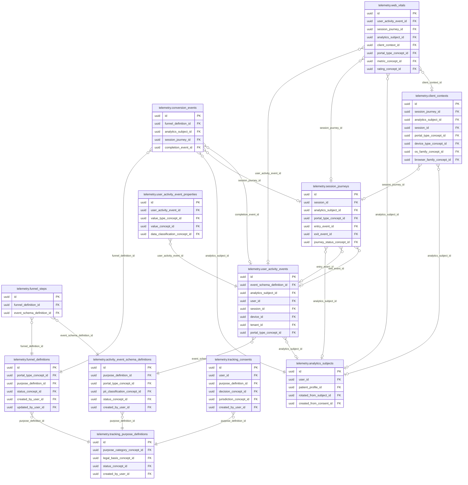
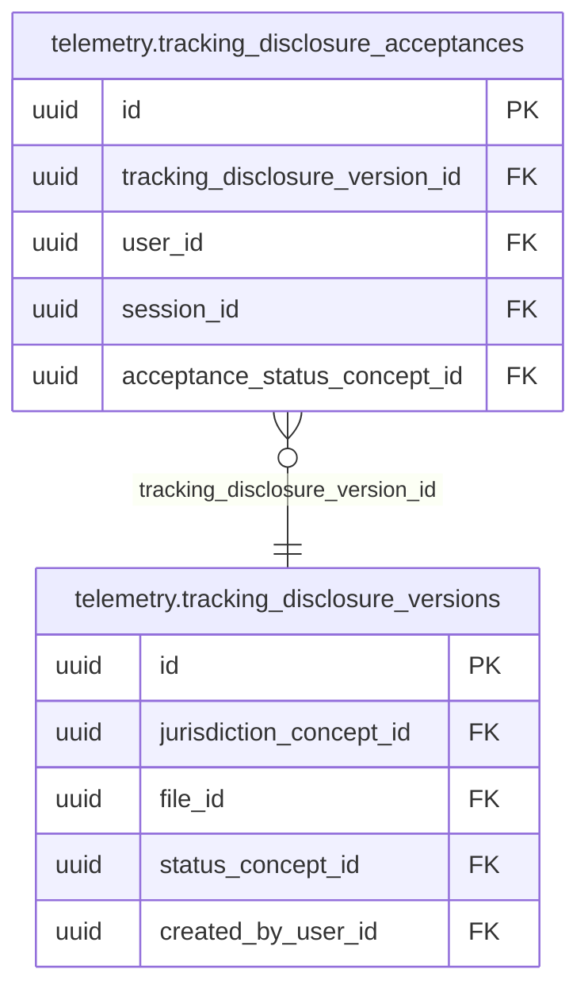

<!-- AUTOGENERADO por tools/inventario/catalogo.mjs. No editar manualmente. -->

# Catálogo del schema `telemetry`

- **Tablas:** 14 · **Columnas:** 172 (32 con descripción: 18.6 %) · **Índices:** 83
- **Dominio:** Operaciones de Plataforma
- Método y límites del catálogo: [README del inventario](../README.md)

## Tablas

| Tabla | Propósito | Columnas | Índices | Operaciones | ORM |
|---|---|---|---|---|---|
| [activity_event_schema_definitions](#activity_event_schema_definitions) | Especifica estructura y campos permitidos de eventos de actividad para controlar recolección y compatibilidad analítica. | 14 | 5 | 6 | COINCIDE |
| [analytics_subjects](#analytics_subjects) | Representa sujetos de analítica cuya actividad se mide bajo propósitos y controles aplicables. | 9 | 6 | 8 | COINCIDE |
| [client_contexts](#client_contexts) | Conserva contexto técnico del cliente —como plataforma y versión— para interpretar eventos de uso. | 20 | 9 | 3 | COINCIDE |
| [conversion_events](#conversion_events) | Registra conversiones de producto o negocio para analizar resultados de recorridos y campañas. | 8 | 4 | 3 | COINCIDE |
| [funnel_definitions](#funnel_definitions) | Define embudos de producto que miden progresión entre etapas de una experiencia digital. | 12 | 7 | 5 | COINCIDE |
| [funnel_steps](#funnel_steps) | Especifica etapas y eventos que integran cada embudo analítico. | 6 | 2 | 3 | COINCIDE |
| [session_journeys](#session_journeys) | Agrupa actividad de una sesión para reconstruir recorridos por aplicaciones y flujos del sistema. | 13 | 6 | 13 | COINCIDE |
| [tracking_consents](#tracking_consents) | Conserva estado de autorización de seguimiento para habilitar o bloquear analítica opcional según elecciones del usuario. | 11 | 5 | 5 | COINCIDE |
| [tracking_disclosure_acceptances](#tracking_disclosure_acceptances) | Registra aceptación de avisos de seguimiento como evidencia de divulgación, sin asumir que constituye por sí sola base legal universal. | 9 | 4 | 2 | COINCIDE |
| [tracking_disclosure_versions](#tracking_disclosure_versions) | Preserva versiones de avisos de seguimiento para documentar qué se informó a cada usuario. | 11 | 5 | 4 | COINCIDE |
| [tracking_purpose_definitions](#tracking_purpose_definitions) | Define propósitos de medición de actividad para distinguir analítica opcional de auditoría de seguridad obligatoria. | 15 | 5 | 5 | COINCIDE |
| [user_activity_event_properties](#user_activity_event_properties) | Detalla propiedades tipadas asociadas a eventos de actividad para preservar contexto analítico controlado. | 12 | 4 | 2 | COINCIDE |
| [user_activity_events](#user_activity_events) | Conserva eventos de uso para análisis de producto y comercial sujeto a propósito y consentimiento configurados. | 19 | 12 | 12 | COINCIDE |
| [web_vitals](#web_vitals) | Registra métricas de rendimiento percibido de páginas para detectar degradación de experiencia en interfaces médicas. | 13 | 9 | 2 | COINCIDE |

## Diagrama entidad-relación

Las tablas se agrupan en familias por sus claves foráneas dentro del schema (máximo 40 por diagrama). Las FK hacia otros schemas se listan en la ficha de cada tabla.

### Familia 1 de 2 — 12 tablas

### Familia 2 de 2 — 2 tablas

## Fichas

### activity_event_schema_definitions

#### Vista general

Especifica estructura y campos permitidos de eventos de actividad para controlar recolección y compatibilidad analítica.

- **Estado del propósito:** DOMAIN_CURATED_DRAFT · fuente: `Mantra Core Health Context/modules/diagram_28_telemetry.puml: activity_event_schema_definitions`
- **Dominio:** Operaciones de Plataforma · **Diagrama:** `Mantra Core Health Context/modules/diagram_28_telemetry.puml` · **DDL:** `SQL/28_telemetry/02_tables.sql`
- **Entidad del ORM:** `ActivityEventSchemaDefinitions` — `src/modules/telemetry/entities/activity_event_schema_definitions.entity.ts`
- **Resumen:** 14 columnas · 5 índices · 5 FK salientes · 2 entrantes · 6 operaciones

#### Columnas

| # | Columna | Tipo | Rol estructural | Descripción | ORM |
|---|---|---|---|---|---|
| 1 | `id` | `uuid` | Clave primaria; Obligatoria | Identificador único de la instancia. _(JSDOC_ESTANDAR, `src/modules/telemetry/entities/activity_event_schema_definitions.entity.ts:12`)_ | coincide |
| 2 | `event_name` | `varchar` | Obligatoria | _sin dato_ | coincide |
| 3 | `schema_version` | `integer` | Obligatoria | _sin dato_ | coincide |
| 4 | `purpose_definition_id` | `uuid` | Clave foránea → telemetry.tracking_purpose_definitions.id; Obligatoria | _sin dato_ | coincide |
| 5 | `portal_type_concept_id` | `uuid` | Clave foránea → terminology.catalog_concepts.id; Obligatoria | _sin dato_ | coincide |
| 6 | `property_schema_json` | `jsonb` | Opcional | _sin dato_ | coincide |
| 7 | `prohibited_property_patterns_json` | `jsonb` | Opcional | _sin dato_ | coincide |
| 8 | `pii_classification_concept_id` | `uuid` | Clave foránea → terminology.catalog_concepts.id; Opcional | _sin dato_ | coincide |
| 9 | `phi_allowed` | `boolean` | Opcional | _sin dato_ | coincide |
| 10 | `status_concept_id` | `uuid` | Clave foránea → terminology.catalog_concepts.id; Obligatoria | _sin dato_ | coincide |
| 11 | `effective_from` | `timestamptz` | Obligatoria | _sin dato_ | coincide |
| 12 | `effective_to` | `timestamptz` | Opcional | _sin dato_ | coincide |
| 13 | `created_at` | `timestamptz` | Obligatoria | Fecha y hora en que se creó el registro. _(JSDOC_ESTANDAR, `src/modules/telemetry/entities/activity_event_schema_definitions.entity.ts:102`)_ | coincide |
| 14 | `created_by_user_id` | `uuid` | Clave foránea → iam.users.id; Opcional | _sin dato_ | coincide |

#### Relaciones

| Sentido | Columnas | Tabla | Restricción |
|---|---|---|---|
| hacia | purpose_definition_id | telemetry.tracking_purpose_definitions (id) | fk_activity_event_schema_definitions_purpose_definition_id |
| hacia | portal_type_concept_id | terminology.catalog_concepts (id) | fk_activity_event_schema_definitions_portal_type_concept_id |
| hacia | pii_classification_concept_id | terminology.catalog_concepts (id) | fk_activity_event_schema_definitions_pii_classificatio_cf444a2d |
| hacia | status_concept_id | terminology.catalog_concepts (id) | fk_activity_event_schema_definitions_status_concept_id |
| hacia | created_by_user_id | iam.users (id) | fk_activity_event_schema_definitions_created_by_user_id |
| desde | id | telemetry.user_activity_events (event_schema_definition_id) | fk_user_activity_events_event_schema_definition_id |
| desde | id | telemetry.funnel_steps (event_schema_definition_id) | fk_funnel_steps_event_schema_definition_id |

#### Índices

| Índice | Único | Columnas | Para qué |
|---|---|---|---|
| `ix_activity_event_schema_definitions_purpose_definition_id` | no | purpose_definition_id | Soporta la clave foránea fk_activity_event_schema_definitions_purpose_definition_id: PostgreSQL no indexa las FK por sí mismo _(DOCUMENTO)_ |
| `ix_activity_event_schema_definitions_portal_type_concept_id` | no | portal_type_concept_id | Soporta la clave foránea fk_activity_event_schema_definitions_portal_type_concept_id: PostgreSQL no indexa las FK por sí mismo _(DOCUMENTO)_ |
| `ix_activity_event_schema_definitions_pii_classificatio_2357b2ab` | no | pii_classification_concept_id | Soporta la clave foránea fk_activity_event_schema_definitions_pii_classificatio_cf444a2d: PostgreSQL no indexa las FK por sí mismo _(DOCUMENTO)_ |
| `ix_activity_event_schema_definitions_status_concept_id` | no | status_concept_id | Soporta la clave foránea fk_activity_event_schema_definitions_status_concept_id: PostgreSQL no indexa las FK por sí mismo _(DOCUMENTO)_ |
| `ix_activity_event_schema_definitions_created_by_user_id` | no | created_by_user_id | Soporta la clave foránea fk_activity_event_schema_definitions_created_by_user_id: PostgreSQL no indexa las FK por sí mismo _(DOCUMENTO)_ |

#### Operaciones que la tocan

| Operación | Efecto | Confianza |
|---|---|---|
| GET /admin/analytics/funnels | LEE | POR_SQL |
| GET /admin/analytics/funnels/{funnelId}/report | LEE | POR_SQL |
| POST /telemetry/activity-events | LEE | DIRECTA |
| POST /telemetry/event-schemas | CREA | DIRECTA |
| POST /telemetry/event-schemas | LEE | DIRECTA |
| POST /telemetry/funnels | LEE | DIRECTA |

#### Gobierno

| Atributo | Valor | Fuente |
|---|---|---|
| Append-only | no declarado | — |
| Datos personales | sin fuente | — |
| Financiera | sin fuente | — |
| Crítica para auditoría | sin fuente | — |
| Retención | sin fuente | — |
| Responsable | sin fuente | — |
| Revisión | AUTO_DETECTADA | — |

---

### analytics_subjects

#### Vista general

Representa sujetos de analítica cuya actividad se mide bajo propósitos y controles aplicables.

- **Estado del propósito:** DOMAIN_CURATED_DRAFT · fuente: `Mantra Core Health Context/modules/diagram_28_telemetry.puml: analytics_subjects`
- **Dominio:** Operaciones de Plataforma · **Diagrama:** `Mantra Core Health Context/modules/diagram_28_telemetry.puml` · **DDL:** `SQL/28_telemetry/02_tables.sql`
- **Entidad del ORM:** `AnalyticsSubjects` — `src/modules/telemetry/entities/analytics_subjects.entity.ts`
- **Resumen:** 9 columnas · 6 índices · 4 FK salientes · 6 entrantes · 8 operaciones

#### Columnas

| # | Columna | Tipo | Rol estructural | Descripción | ORM |
|---|---|---|---|---|---|
| 1 | `id` | `uuid` | Clave primaria; Obligatoria | Identificador único de la instancia. _(JSDOC_ESTANDAR, `src/modules/telemetry/entities/analytics_subjects.entity.ts:12`)_ | coincide |
| 2 | `user_id` | `uuid` | Clave foránea → iam.users.id; Opcional | _sin dato_ | coincide |
| 3 | `patient_profile_id` | `uuid` | Clave foránea → profiles.patient_profiles.profile_id; Opcional | _sin dato_ | coincide |
| 4 | `pseudonymous_subject_key` | `varchar` | Obligatoria | _sin dato_ | coincide |
| 5 | `key_version` | `integer` | Opcional | _sin dato_ | coincide |
| 6 | `rotated_from_subject_id` | `uuid` | Clave foránea → telemetry.analytics_subjects.id; Opcional | _sin dato_ | coincide |
| 7 | `created_from_consent_id` | `uuid` | Clave foránea → consent.consents.id; Opcional | _sin dato_ | coincide |
| 8 | `deactivated_at` | `timestamptz` | Opcional | _sin dato_ | coincide |
| 9 | `created_at` | `timestamptz` | Obligatoria | Fecha y hora en que se creó el registro. _(JSDOC_ESTANDAR, `src/modules/telemetry/entities/analytics_subjects.entity.ts:72`)_ | coincide |

#### Relaciones

| Sentido | Columnas | Tabla | Restricción |
|---|---|---|---|
| hacia | rotated_from_subject_id | telemetry.analytics_subjects (id) | fk_analytics_subjects_rotated_from_subject_id |
| hacia | user_id | iam.users (id) | fk_analytics_subjects_user_id |
| hacia | patient_profile_id | profiles.patient_profiles (profile_id) | fk_analytics_subjects_patient_profile_id |
| hacia | created_from_consent_id | consent.consents (id) | fk_analytics_subjects_created_from_consent_id |
| desde | id | telemetry.analytics_subjects (rotated_from_subject_id) | fk_analytics_subjects_rotated_from_subject_id |
| desde | id | telemetry.user_activity_events (analytics_subject_id) | fk_user_activity_events_analytics_subject_id |
| desde | id | telemetry.session_journeys (analytics_subject_id) | fk_session_journeys_analytics_subject_id |
| desde | id | telemetry.conversion_events (analytics_subject_id) | fk_conversion_events_analytics_subject_id |
| desde | id | telemetry.client_contexts (analytics_subject_id) | fk_client_contexts_analytics_subject_id |
| desde | id | telemetry.web_vitals (analytics_subject_id) | fk_web_vitals_analytics_subject_id |

#### Índices

| Índice | Único | Columnas | Para qué |
|---|---|---|---|
| `uq_analytics_subjects_pseudonymous_subject_key` | sí | pseudonymous_subject_key | Garantiza que no se repita la combinación (pseudonymous_subject_key) _(DOCUMENTO)_; 1 consulta(s) de repositorio filtran u ordenan por «pseudonymous_subject_key», la primera columna del índice _(CONSULTA)_ |
| `ix_analytics_subjects_user_id` | no | user_id | Soporta la clave foránea fk_analytics_subjects_user_id: PostgreSQL no indexa las FK por sí mismo _(DOCUMENTO)_ |
| `ix_analytics_subjects_patient_profile_id` | no | patient_profile_id | Soporta la clave foránea fk_analytics_subjects_patient_profile_id: PostgreSQL no indexa las FK por sí mismo _(DOCUMENTO)_ |
| `ix_analytics_subjects_rotated_from_subject_id` | no | rotated_from_subject_id | Soporta la clave foránea fk_analytics_subjects_rotated_from_subject_id: PostgreSQL no indexa las FK por sí mismo _(DOCUMENTO)_ |
| `ix_analytics_subjects_created_from_consent_id` | no | created_from_consent_id | Soporta la clave foránea fk_analytics_subjects_created_from_consent_id: PostgreSQL no indexa las FK por sí mismo _(DOCUMENTO)_; 1 consulta(s) de repositorio filtran u ordenan por «created_from_consent_id», la primera columna del índice _(CONSULTA)_ |
| `ix_analytics_subjects_patient_profile_id_created_at` | no | patient_profile_id, ("created_at" DESC) | _sin uso detectado estáticamente_ |

#### Restricciones

| Restricción | Tipo | Definición |
|---|---|---|
| `uq_analytics_subjects_pseudonymous_subject_key` | UNIQUE INDEX | UNIQUE INDEX ("pseudonymous_subject_key") |

#### Operaciones que la tocan

| Operación | Efecto | Confianza |
|---|---|---|
| POST /telemetry/activity-events | LEE | DIRECTA |
| POST /telemetry/analytics-subjects | CREA | DIRECTA |
| POST /telemetry/analytics-subjects | LEE | DIRECTA |
| POST /telemetry/client-contexts | LEE | DIRECTA |
| POST /telemetry/conversion-events | LEE | DIRECTA |
| POST /telemetry/tracking-consents/{id}/withdraw | ACTUALIZA | POR_TIPO |
| POST /telemetry/tracking-consents/{id}/withdraw | LEE | DIRECTA |
| POST /telemetry/web-vitals | LEE | DIRECTA |

#### Gobierno

| Atributo | Valor | Fuente |
|---|---|---|
| Append-only | no declarado | — |
| Datos personales | sin fuente | — |
| Financiera | sin fuente | — |
| Crítica para auditoría | sin fuente | — |
| Retención | sin fuente | — |
| Responsable | sin fuente | — |
| Revisión | AUTO_DETECTADA | — |

---

### client_contexts

#### Vista general

Conserva contexto técnico del cliente —como plataforma y versión— para interpretar eventos de uso.

- **Estado del propósito:** DOMAIN_CURATED_DRAFT · fuente: `Mantra Core Health Context/modules/diagram_28_telemetry.puml: client_contexts`
- **Dominio:** Operaciones de Plataforma · **Diagrama:** `Mantra Core Health Context/modules/diagram_28_telemetry.puml` · **DDL:** `SQL/28_telemetry/02_tables.sql`
- **Entidad del ORM:** `ClientContexts` — `src/modules/telemetry/entities/client_contexts.entity.ts`
- **Resumen:** 20 columnas · 9 índices · 9 FK salientes · 1 entrantes · 3 operaciones

#### Columnas

| # | Columna | Tipo | Rol estructural | Descripción | ORM |
|---|---|---|---|---|---|
| 1 | `id` | `uuid` | Clave primaria; Obligatoria | Identificador único de la instancia. _(JSDOC_ESTANDAR, `src/modules/telemetry/entities/client_contexts.entity.ts:12`)_ | coincide |
| 2 | `session_journey_id` | `uuid` | Clave foránea → telemetry.session_journeys.id; Opcional | _sin dato_ | coincide |
| 3 | `analytics_subject_id` | `uuid` | Clave foránea → telemetry.analytics_subjects.id; Opcional | _sin dato_ | coincide |
| 4 | `session_id` | `uuid` | Clave foránea → iam.sessions.id; Opcional | _sin dato_ | coincide |
| 5 | `portal_type_concept_id` | `uuid` | Clave foránea → terminology.catalog_concepts.id; Obligatoria | _sin dato_ | coincide |
| 6 | `device_type_concept_id` | `uuid` | Clave foránea → terminology.catalog_concepts.id; Opcional | _sin dato_ | coincide |
| 7 | `os_family_concept_id` | `uuid` | Clave foránea → terminology.catalog_concepts.id; Opcional | _sin dato_ | coincide |
| 8 | `browser_family_concept_id` | `uuid` | Clave foránea → terminology.catalog_concepts.id; Opcional | _sin dato_ | coincide |
| 9 | `app_version` | `varchar` | Opcional | _sin dato_ | coincide |
| 10 | `screen_class` | `varchar` | Opcional | _sin dato_ | coincide |
| 11 | `viewport_bucket` | `varchar` | Opcional | _sin dato_ | coincide |
| 12 | `locale` | `varchar` | Opcional | _sin dato_ | coincide |
| 13 | `timezone_offset_minutes` | `integer` | Opcional | _sin dato_ | coincide |
| 14 | `country_concept_id` | `uuid` | Clave foránea → terminology.catalog_concepts.id; Opcional | _sin dato_ | coincide |
| 15 | `region_coarse` | `varchar` | Opcional | _sin dato_ | coincide |
| 16 | `ip_prefix_hash` | `varchar` | Opcional | _sin dato_ | coincide |
| 17 | `user_agent_hash` | `varchar` | Opcional | _sin dato_ | coincide |
| 18 | `is_bot` | `boolean` | Opcional | _sin dato_ | coincide |
| 19 | `data_classification_concept_id` | `uuid` | Clave foránea → terminology.catalog_concepts.id; Obligatoria | _sin dato_ | coincide |
| 20 | `created_at` | `timestamptz` | Obligatoria | Fecha y hora en que se creó el registro. _(JSDOC_ESTANDAR, `src/modules/telemetry/entities/client_contexts.entity.ts:158`)_ | coincide |

#### Relaciones

| Sentido | Columnas | Tabla | Restricción |
|---|---|---|---|
| hacia | session_journey_id | telemetry.session_journeys (id) | fk_client_contexts_session_journey_id |
| hacia | analytics_subject_id | telemetry.analytics_subjects (id) | fk_client_contexts_analytics_subject_id |
| hacia | session_id | iam.sessions (id) | fk_client_contexts_session_id |
| hacia | portal_type_concept_id | terminology.catalog_concepts (id) | fk_client_contexts_portal_type_concept_id |
| hacia | device_type_concept_id | terminology.catalog_concepts (id) | fk_client_contexts_device_type_concept_id |
| hacia | os_family_concept_id | terminology.catalog_concepts (id) | fk_client_contexts_os_family_concept_id |
| hacia | browser_family_concept_id | terminology.catalog_concepts (id) | fk_client_contexts_browser_family_concept_id |
| hacia | country_concept_id | terminology.catalog_concepts (id) | fk_client_contexts_country_concept_id |
| hacia | data_classification_concept_id | terminology.catalog_concepts (id) | fk_client_contexts_data_classification_concept_id |
| desde | id | telemetry.web_vitals (client_context_id) | fk_web_vitals_client_context_id |

#### Índices

| Índice | Único | Columnas | Para qué |
|---|---|---|---|
| `ix_client_contexts_session_journey_id` | no | session_journey_id | Soporta la clave foránea fk_client_contexts_session_journey_id: PostgreSQL no indexa las FK por sí mismo _(DOCUMENTO)_ |
| `ix_client_contexts_analytics_subject_id` | no | analytics_subject_id | Soporta la clave foránea fk_client_contexts_analytics_subject_id: PostgreSQL no indexa las FK por sí mismo _(DOCUMENTO)_ |
| `ix_client_contexts_session_id` | no | session_id | Soporta la clave foránea fk_client_contexts_session_id: PostgreSQL no indexa las FK por sí mismo _(DOCUMENTO)_ |
| `ix_client_contexts_portal_type_concept_id` | no | portal_type_concept_id | Soporta la clave foránea fk_client_contexts_portal_type_concept_id: PostgreSQL no indexa las FK por sí mismo _(DOCUMENTO)_ |
| `ix_client_contexts_device_type_concept_id` | no | device_type_concept_id | Soporta la clave foránea fk_client_contexts_device_type_concept_id: PostgreSQL no indexa las FK por sí mismo _(DOCUMENTO)_ |
| `ix_client_contexts_os_family_concept_id` | no | os_family_concept_id | Soporta la clave foránea fk_client_contexts_os_family_concept_id: PostgreSQL no indexa las FK por sí mismo _(DOCUMENTO)_ |
| `ix_client_contexts_browser_family_concept_id` | no | browser_family_concept_id | Soporta la clave foránea fk_client_contexts_browser_family_concept_id: PostgreSQL no indexa las FK por sí mismo _(DOCUMENTO)_ |
| `ix_client_contexts_country_concept_id` | no | country_concept_id | Soporta la clave foránea fk_client_contexts_country_concept_id: PostgreSQL no indexa las FK por sí mismo _(DOCUMENTO)_ |
| `ix_client_contexts_data_classification_concept_id` | no | data_classification_concept_id | Soporta la clave foránea fk_client_contexts_data_classification_concept_id: PostgreSQL no indexa las FK por sí mismo _(DOCUMENTO)_ |

#### Operaciones que la tocan

| Operación | Efecto | Confianza |
|---|---|---|
| GET /admin/analytics/pipeline-health | LEE | POR_SQL |
| POST /telemetry/client-contexts | CREA | DIRECTA |
| POST /telemetry/web-vitals | LEE | DIRECTA |

#### Gobierno

| Atributo | Valor | Fuente |
|---|---|---|
| Append-only | no declarado | — |
| Datos personales | sin fuente | — |
| Financiera | sin fuente | — |
| Crítica para auditoría | sin fuente | — |
| Retención | sin fuente | — |
| Responsable | sin fuente | — |
| Revisión | AUTO_DETECTADA | — |

---

### conversion_events

#### Vista general

Registra conversiones de producto o negocio para analizar resultados de recorridos y campañas.

- **Estado del propósito:** DOMAIN_CURATED_DRAFT · fuente: `Mantra Core Health Context/modules/diagram_28_telemetry.puml: conversion_events`
- **Dominio:** Operaciones de Plataforma · **Diagrama:** `Mantra Core Health Context/modules/diagram_28_telemetry.puml` · **DDL:** `SQL/28_telemetry/02_tables.sql`
- **Entidad del ORM:** `ConversionEvents` — `src/modules/telemetry/entities/conversion_events.entity.ts`
- **Resumen:** 8 columnas · 4 índices · 4 FK salientes · 0 entrantes · 3 operaciones

#### Columnas

| # | Columna | Tipo | Rol estructural | Descripción | ORM |
|---|---|---|---|---|---|
| 1 | `id` | `uuid` | Clave primaria; Obligatoria | Identificador único de la instancia. _(JSDOC_ESTANDAR, `src/modules/telemetry/entities/conversion_events.entity.ts:12`)_ | coincide |
| 2 | `funnel_definition_id` | `uuid` | Clave foránea → telemetry.funnel_definitions.id; Obligatoria | _sin dato_ | coincide |
| 3 | `analytics_subject_id` | `uuid` | Clave foránea → telemetry.analytics_subjects.id; Obligatoria | _sin dato_ | coincide |
| 4 | `session_journey_id` | `uuid` | Clave foránea → telemetry.session_journeys.id; Opcional | _sin dato_ | coincide |
| 5 | `completion_event_id` | `uuid` | Clave foránea → telemetry.user_activity_events.id; Opcional | _sin dato_ | coincide |
| 6 | `converted_at` | `timestamptz` | Opcional | _sin dato_ | coincide |
| 7 | `attribution_json` | `jsonb` | Opcional | _sin dato_ | coincide |
| 8 | `created_at` | `timestamptz` | Obligatoria | Fecha y hora en que se creó el registro. _(JSDOC_ESTANDAR, `src/modules/telemetry/entities/conversion_events.entity.ts:63`)_ | coincide |

#### Relaciones

| Sentido | Columnas | Tabla | Restricción |
|---|---|---|---|
| hacia | funnel_definition_id | telemetry.funnel_definitions (id) | fk_conversion_events_funnel_definition_id |
| hacia | analytics_subject_id | telemetry.analytics_subjects (id) | fk_conversion_events_analytics_subject_id |
| hacia | session_journey_id | telemetry.session_journeys (id) | fk_conversion_events_session_journey_id |
| hacia | completion_event_id | telemetry.user_activity_events (id) | fk_conversion_events_completion_event_id |

#### Índices

| Índice | Único | Columnas | Para qué |
|---|---|---|---|
| `ix_conversion_events_funnel_definition_id` | no | funnel_definition_id | Soporta la clave foránea fk_conversion_events_funnel_definition_id: PostgreSQL no indexa las FK por sí mismo _(DOCUMENTO)_; 1 consulta(s) de repositorio filtran u ordenan por «funnel_definition_id», la primera columna del índice _(CONSULTA)_ |
| `ix_conversion_events_analytics_subject_id` | no | analytics_subject_id | Soporta la clave foránea fk_conversion_events_analytics_subject_id: PostgreSQL no indexa las FK por sí mismo _(DOCUMENTO)_; 1 consulta(s) de repositorio filtran u ordenan por «analytics_subject_id», la primera columna del índice _(CONSULTA)_ |
| `ix_conversion_events_session_journey_id` | no | session_journey_id | Soporta la clave foránea fk_conversion_events_session_journey_id: PostgreSQL no indexa las FK por sí mismo _(DOCUMENTO)_; 1 consulta(s) de repositorio filtran u ordenan por «session_journey_id», la primera columna del índice _(CONSULTA)_ |
| `ix_conversion_events_completion_event_id` | no | completion_event_id | Soporta la clave foránea fk_conversion_events_completion_event_id: PostgreSQL no indexa las FK por sí mismo _(DOCUMENTO)_ |

#### Operaciones que la tocan

| Operación | Efecto | Confianza |
|---|---|---|
| GET /admin/analytics/funnels/{funnelId}/report | LEE | POR_SQL |
| POST /telemetry/conversion-events | CREA | DIRECTA |
| POST /telemetry/conversion-events | LEE | DIRECTA |

#### Gobierno

| Atributo | Valor | Fuente |
|---|---|---|
| Append-only | no declarado | — |
| Datos personales | sin fuente | — |
| Financiera | sin fuente | — |
| Crítica para auditoría | sin fuente | — |
| Retención | sin fuente | — |
| Responsable | sin fuente | — |
| Revisión | AUTO_DETECTADA | — |

---

### funnel_definitions

#### Vista general

Define embudos de producto que miden progresión entre etapas de una experiencia digital.

- **Estado del propósito:** DOMAIN_CURATED_DRAFT · fuente: `Mantra Core Health Context/modules/diagram_28_telemetry.puml: funnel_definitions`
- **Dominio:** Operaciones de Plataforma · **Diagrama:** `Mantra Core Health Context/modules/diagram_28_telemetry.puml` · **DDL:** `SQL/28_telemetry/02_tables.sql`
- **Entidad del ORM:** `FunnelDefinitions` — `src/modules/telemetry/entities/funnel_definitions.entity.ts`
- **Resumen:** 12 columnas · 7 índices · 5 FK salientes · 2 entrantes · 5 operaciones

#### Columnas

| # | Columna | Tipo | Rol estructural | Descripción | ORM |
|---|---|---|---|---|---|
| 1 | `id` | `uuid` | Clave primaria; Obligatoria | Identificador único de la instancia. _(JSDOC_ESTANDAR, `src/modules/telemetry/entities/funnel_definitions.entity.ts:12`)_ | coincide |
| 2 | `funnel_code` | `varchar` | Obligatoria | _sin dato_ | coincide |
| 3 | `name` | `varchar` | Obligatoria | _sin dato_ | coincide |
| 4 | `portal_type_concept_id` | `uuid` | Clave foránea → terminology.catalog_concepts.id; Obligatoria | _sin dato_ | coincide |
| 5 | `purpose_definition_id` | `uuid` | Clave foránea → telemetry.tracking_purpose_definitions.id; Obligatoria | _sin dato_ | coincide |
| 6 | `version_number` | `integer` | Obligatoria | _sin dato_ | coincide |
| 7 | `status_concept_id` | `uuid` | Clave foránea → terminology.catalog_concepts.id; Obligatoria | _sin dato_ | coincide |
| 8 | `created_at` | `timestamptz` | Obligatoria | Fecha y hora en que se creó el registro. _(JSDOC_ESTANDAR, `src/modules/telemetry/entities/funnel_definitions.entity.ts:54`)_ | coincide |
| 9 | `updated_at` | `timestamptz` | Obligatoria | Fecha y hora de la última actualización. _(JSDOC_ESTANDAR, `src/modules/telemetry/entities/funnel_definitions.entity.ts:60`)_ | coincide |
| 10 | `created_by_user_id` | `uuid` | Clave foránea → iam.users.id; Opcional | _sin dato_ | coincide |
| 11 | `updated_by_user_id` | `uuid` | Clave foránea → iam.users.id; Opcional | _sin dato_ | coincide |
| 12 | `row_version` | `integer = 1` | Obligatoria | Versión usada para controlar actualizaciones concurrentes. _(JSDOC_ENTIDAD, `src/modules/telemetry/entities/funnel_definitions.entity.ts:78`)_ | coincide |

#### Relaciones

| Sentido | Columnas | Tabla | Restricción |
|---|---|---|---|
| hacia | purpose_definition_id | telemetry.tracking_purpose_definitions (id) | fk_funnel_definitions_purpose_definition_id |
| hacia | portal_type_concept_id | terminology.catalog_concepts (id) | fk_funnel_definitions_portal_type_concept_id |
| hacia | status_concept_id | terminology.catalog_concepts (id) | fk_funnel_definitions_status_concept_id |
| hacia | created_by_user_id | iam.users (id) | fk_funnel_definitions_created_by_user_id |
| hacia | updated_by_user_id | iam.users (id) | fk_funnel_definitions_updated_by_user_id |
| desde | id | telemetry.funnel_steps (funnel_definition_id) | fk_funnel_steps_funnel_definition_id |
| desde | id | telemetry.conversion_events (funnel_definition_id) | fk_conversion_events_funnel_definition_id |

#### Índices

| Índice | Único | Columnas | Para qué |
|---|---|---|---|
| `uq_funnel_definitions_funnel_code` | sí | funnel_code | Garantiza que no se repita la combinación (funnel_code) _(DOCUMENTO)_; 1 consulta(s) de repositorio filtran u ordenan por «funnel_code», la primera columna del índice _(CONSULTA)_ |
| `ix_funnel_definitions_portal_type_concept_id` | no | portal_type_concept_id | Soporta la clave foránea fk_funnel_definitions_portal_type_concept_id: PostgreSQL no indexa las FK por sí mismo _(DOCUMENTO)_ |
| `ix_funnel_definitions_purpose_definition_id` | no | purpose_definition_id | Soporta la clave foránea fk_funnel_definitions_purpose_definition_id: PostgreSQL no indexa las FK por sí mismo _(DOCUMENTO)_ |
| `ix_funnel_definitions_status_concept_id` | no | status_concept_id | Soporta la clave foránea fk_funnel_definitions_status_concept_id: PostgreSQL no indexa las FK por sí mismo _(DOCUMENTO)_ |
| `ix_funnel_definitions_created_by_user_id` | no | created_by_user_id | Soporta la clave foránea fk_funnel_definitions_created_by_user_id: PostgreSQL no indexa las FK por sí mismo _(DOCUMENTO)_ |
| `ix_funnel_definitions_updated_by_user_id` | no | updated_by_user_id | Soporta la clave foránea fk_funnel_definitions_updated_by_user_id: PostgreSQL no indexa las FK por sí mismo _(DOCUMENTO)_ |
| `uq_funnel_definitions_purpose_definition_id_version_number` | sí | purpose_definition_id, version_number | Garantiza que no se repita la combinación (purpose_definition_id, version_number) _(DOCUMENTO)_; Soporta la clave foránea fk_funnel_definitions_purpose_definition_id: PostgreSQL no indexa las FK por sí mismo _(DOCUMENTO)_ |

#### Restricciones

| Restricción | Tipo | Definición |
|---|---|---|
| `uq_funnel_definitions_funnel_code` | UNIQUE INDEX | UNIQUE INDEX ("funnel_code") |
| `uq_funnel_definitions_purpose_definition_id_version_number` | UNIQUE INDEX | UNIQUE INDEX ("purpose_definition_id", "version_number") |

#### Operaciones que la tocan

| Operación | Efecto | Confianza |
|---|---|---|
| GET /admin/analytics/funnels | LEE | POR_SQL |
| GET /admin/analytics/funnels/{funnelId}/report | LEE | POR_SQL |
| POST /telemetry/conversion-events | LEE | DIRECTA |
| POST /telemetry/funnels | CREA | DIRECTA |
| POST /telemetry/funnels | LEE | DIRECTA |

#### Gobierno

| Atributo | Valor | Fuente |
|---|---|---|
| Append-only | no declarado | — |
| Datos personales | sin fuente | — |
| Financiera | sin fuente | — |
| Crítica para auditoría | sin fuente | — |
| Retención | sin fuente | — |
| Responsable | sin fuente | — |
| Revisión | AUTO_DETECTADA | — |

---

### funnel_steps

#### Vista general

Especifica etapas y eventos que integran cada embudo analítico.

- **Estado del propósito:** DOMAIN_CURATED_DRAFT · fuente: `Mantra Core Health Context/modules/diagram_28_telemetry.puml: funnel_steps`
- **Dominio:** Operaciones de Plataforma · **Diagrama:** `Mantra Core Health Context/modules/diagram_28_telemetry.puml` · **DDL:** `SQL/28_telemetry/02_tables.sql`
- **Entidad del ORM:** `FunnelSteps` — `src/modules/telemetry/entities/funnel_steps.entity.ts`
- **Resumen:** 6 columnas · 2 índices · 2 FK salientes · 0 entrantes · 3 operaciones

#### Columnas

| # | Columna | Tipo | Rol estructural | Descripción | ORM |
|---|---|---|---|---|---|
| 1 | `id` | `uuid` | Clave primaria; Obligatoria | Identificador único de la instancia. _(JSDOC_ESTANDAR, `src/modules/telemetry/entities/funnel_steps.entity.ts:12`)_ | coincide |
| 2 | `funnel_definition_id` | `uuid` | Clave foránea → telemetry.funnel_definitions.id; Obligatoria | _sin dato_ | coincide |
| 3 | `step_number` | `integer` | Obligatoria | _sin dato_ | coincide |
| 4 | `event_schema_definition_id` | `uuid` | Clave foránea → telemetry.activity_event_schema_definitions.id; Obligatoria | _sin dato_ | coincide |
| 5 | `qualification_rule_json` | `jsonb` | Opcional | _sin dato_ | coincide |
| 6 | `created_at` | `timestamptz` | Obligatoria | Fecha y hora en que se creó el registro. _(JSDOC_ESTANDAR, `src/modules/telemetry/entities/funnel_steps.entity.ts:47`)_ | coincide |

#### Relaciones

| Sentido | Columnas | Tabla | Restricción |
|---|---|---|---|
| hacia | funnel_definition_id | telemetry.funnel_definitions (id) | fk_funnel_steps_funnel_definition_id |
| hacia | event_schema_definition_id | telemetry.activity_event_schema_definitions (id) | fk_funnel_steps_event_schema_definition_id |

#### Índices

| Índice | Único | Columnas | Para qué |
|---|---|---|---|
| `ix_funnel_steps_funnel_definition_id` | no | funnel_definition_id | Soporta la clave foránea fk_funnel_steps_funnel_definition_id: PostgreSQL no indexa las FK por sí mismo _(DOCUMENTO)_ |
| `ix_funnel_steps_event_schema_definition_id` | no | event_schema_definition_id | Soporta la clave foránea fk_funnel_steps_event_schema_definition_id: PostgreSQL no indexa las FK por sí mismo _(DOCUMENTO)_ |

#### Operaciones que la tocan

| Operación | Efecto | Confianza |
|---|---|---|
| GET /admin/analytics/funnels | LEE | POR_SQL |
| GET /admin/analytics/funnels/{funnelId}/report | LEE | POR_SQL |
| POST /telemetry/funnels | CREA | DIRECTA |

#### Gobierno

| Atributo | Valor | Fuente |
|---|---|---|
| Append-only | no declarado | — |
| Datos personales | sin fuente | — |
| Financiera | sin fuente | — |
| Crítica para auditoría | sin fuente | — |
| Retención | sin fuente | — |
| Responsable | sin fuente | — |
| Revisión | AUTO_DETECTADA | — |

---

### session_journeys

#### Vista general

Agrupa actividad de una sesión para reconstruir recorridos por aplicaciones y flujos del sistema.

- **Estado del propósito:** DOMAIN_CURATED_DRAFT · fuente: `Mantra Core Health Context/modules/diagram_28_telemetry.puml: session_journeys`
- **Dominio:** Operaciones de Plataforma · **Diagrama:** `Mantra Core Health Context/modules/diagram_28_telemetry.puml` · **DDL:** `SQL/28_telemetry/02_tables.sql`
- **Entidad del ORM:** `SessionJourneys` — `src/modules/telemetry/entities/session_journeys.entity.ts`
- **Resumen:** 13 columnas · 6 índices · 6 FK salientes · 3 entrantes · 13 operaciones

#### Columnas

| # | Columna | Tipo | Rol estructural | Descripción | ORM |
|---|---|---|---|---|---|
| 1 | `id` | `uuid` | Clave primaria; Obligatoria | Identificador único de la instancia. _(JSDOC_ESTANDAR, `src/modules/telemetry/entities/session_journeys.entity.ts:12`)_ | coincide |
| 2 | `session_id` | `uuid` | Clave foránea → iam.sessions.id; Obligatoria | _sin dato_ | coincide |
| 3 | `analytics_subject_id` | `uuid` | Clave foránea → telemetry.analytics_subjects.id; Opcional | _sin dato_ | coincide |
| 4 | `portal_type_concept_id` | `uuid` | Clave foránea → terminology.catalog_concepts.id; Obligatoria | _sin dato_ | coincide |
| 5 | `started_at` | `timestamptz` | Opcional | _sin dato_ | coincide |
| 6 | `ended_at` | `timestamptz` | Opcional | _sin dato_ | coincide |
| 7 | `entry_event_id` | `uuid` | Clave foránea → telemetry.user_activity_events.id; Opcional | _sin dato_ | coincide |
| 8 | `exit_event_id` | `uuid` | Clave foránea → telemetry.user_activity_events.id; Opcional | _sin dato_ | coincide |
| 9 | `event_count` | `integer` | Opcional | _sin dato_ | coincide |
| 10 | `journey_status_concept_id` | `uuid` | Clave foránea → terminology.catalog_concepts.id; Obligatoria | _sin dato_ | coincide |
| 11 | `created_at` | `timestamptz` | Obligatoria | Fecha y hora en que se creó el registro. _(JSDOC_ESTANDAR, `src/modules/telemetry/entities/session_journeys.entity.ts:80`)_ | coincide |
| 12 | `updated_at` | `timestamptz` | Obligatoria | Fecha y hora de la última actualización. _(JSDOC_ESTANDAR, `src/modules/telemetry/entities/session_journeys.entity.ts:86`)_ | coincide |
| 13 | `row_version` | `integer = 1` | Obligatoria | Versión usada para controlar actualizaciones concurrentes. _(JSDOC_ENTIDAD, `src/modules/telemetry/entities/session_journeys.entity.ts:92`)_ | coincide |

#### Relaciones

| Sentido | Columnas | Tabla | Restricción |
|---|---|---|---|
| hacia | analytics_subject_id | telemetry.analytics_subjects (id) | fk_session_journeys_analytics_subject_id |
| hacia | entry_event_id | telemetry.user_activity_events (id) | fk_session_journeys_entry_event_id |
| hacia | exit_event_id | telemetry.user_activity_events (id) | fk_session_journeys_exit_event_id |
| hacia | session_id | iam.sessions (id) | fk_session_journeys_session_id |
| hacia | portal_type_concept_id | terminology.catalog_concepts (id) | fk_session_journeys_portal_type_concept_id |
| hacia | journey_status_concept_id | terminology.catalog_concepts (id) | fk_session_journeys_journey_status_concept_id |
| desde | id | telemetry.conversion_events (session_journey_id) | fk_conversion_events_session_journey_id |
| desde | id | telemetry.client_contexts (session_journey_id) | fk_client_contexts_session_journey_id |
| desde | id | telemetry.web_vitals (session_journey_id) | fk_web_vitals_session_journey_id |

#### Índices

| Índice | Único | Columnas | Para qué |
|---|---|---|---|
| `ix_session_journeys_session_id` | no | session_id | Soporta la clave foránea fk_session_journeys_session_id: PostgreSQL no indexa las FK por sí mismo _(DOCUMENTO)_; 1 consulta(s) de repositorio filtran u ordenan por «session_id», la primera columna del índice _(CONSULTA)_ |
| `ix_session_journeys_analytics_subject_id` | no | analytics_subject_id | Soporta la clave foránea fk_session_journeys_analytics_subject_id: PostgreSQL no indexa las FK por sí mismo _(DOCUMENTO)_ |
| `ix_session_journeys_portal_type_concept_id` | no | portal_type_concept_id | Soporta la clave foránea fk_session_journeys_portal_type_concept_id: PostgreSQL no indexa las FK por sí mismo _(DOCUMENTO)_ |
| `ix_session_journeys_entry_event_id` | no | entry_event_id | Soporta la clave foránea fk_session_journeys_entry_event_id: PostgreSQL no indexa las FK por sí mismo _(DOCUMENTO)_ |
| `ix_session_journeys_exit_event_id` | no | exit_event_id | Soporta la clave foránea fk_session_journeys_exit_event_id: PostgreSQL no indexa las FK por sí mismo _(DOCUMENTO)_ |
| `ix_session_journeys_journey_status_concept_id` | no | journey_status_concept_id | Soporta la clave foránea fk_session_journeys_journey_status_concept_id: PostgreSQL no indexa las FK por sí mismo _(DOCUMENTO)_ |

#### Operaciones que la tocan

| Operación | Efecto | Confianza |
|---|---|---|
| GET /admin/analytics/funnels/{funnelId}/report | LEE | POR_SQL |
| GET /admin/analytics/sessions | LEE | POR_SQL |
| GET /admin/analytics/sessions/{id} | LEE | POR_SQL |
| GET /admin/analytics/web-vitals | LEE | POR_SQL |
| POST /telemetry/activity-events | ACTUALIZA | POR_TIPO |
| POST /telemetry/activity-events | CREA | DIRECTA |
| POST /telemetry/activity-events | LEE | DIRECTA |
| POST /telemetry/client-contexts | CREA | DIRECTA |
| POST /telemetry/client-contexts | LEE | DIRECTA |
| POST /telemetry/conversion-events | LEE | DIRECTA |
| POST /telemetry/session-journeys/{id}/close | ACTUALIZA | POR_TIPO |
| POST /telemetry/session-journeys/{id}/close | LEE | DIRECTA |
| POST /telemetry/web-vitals | LEE | DIRECTA |

#### Gobierno

| Atributo | Valor | Fuente |
|---|---|---|
| Append-only | no declarado | — |
| Datos personales | sin fuente | — |
| Financiera | sin fuente | — |
| Crítica para auditoría | sin fuente | — |
| Retención | sin fuente | — |
| Responsable | sin fuente | — |
| Revisión | AUTO_DETECTADA | — |

---

### tracking_consents

#### Vista general

Conserva estado de autorización de seguimiento para habilitar o bloquear analítica opcional según elecciones del usuario.

- **Estado del propósito:** DOMAIN_CURATED_DRAFT · fuente: `Mantra Core Health Context/modules/diagram_28_telemetry.puml: tracking_consents`
- **Dominio:** Operaciones de Plataforma · **Diagrama:** `Mantra Core Health Context/modules/diagram_28_telemetry.puml` · **DDL:** `SQL/28_telemetry/02_tables.sql`
- **Entidad del ORM:** `TrackingConsents` — `src/modules/telemetry/entities/tracking_consents.entity.ts`
- **Resumen:** 11 columnas · 5 índices · 5 FK salientes · 0 entrantes · 5 operaciones

#### Columnas

| # | Columna | Tipo | Rol estructural | Descripción | ORM |
|---|---|---|---|---|---|
| 1 | `id` | `uuid` | Clave primaria; Obligatoria | Identificador único de la instancia. _(JSDOC_ESTANDAR, `src/modules/telemetry/entities/tracking_consents.entity.ts:12`)_ | coincide |
| 2 | `user_id` | `uuid` | Clave foránea → iam.users.id; Obligatoria | _sin dato_ | coincide |
| 3 | `purpose_definition_id` | `uuid` | Clave foránea → telemetry.tracking_purpose_definitions.id; Obligatoria | _sin dato_ | coincide |
| 4 | `decision_concept_id` | `uuid` | Clave foránea → terminology.catalog_concepts.id; Obligatoria | _sin dato_ | coincide |
| 5 | `jurisdiction_concept_id` | `uuid` | Clave foránea → terminology.catalog_concepts.id; Opcional | _sin dato_ | coincide |
| 6 | `consent_version` | `varchar` | Opcional | _sin dato_ | coincide |
| 7 | `granted_at` | `timestamptz` | Opcional | _sin dato_ | coincide |
| 8 | `withdrawn_at` | `timestamptz` | Opcional | _sin dato_ | coincide |
| 9 | `evidence_hash` | `varchar` | Opcional | _sin dato_ | coincide |
| 10 | `created_at` | `timestamptz` | Obligatoria | Fecha y hora en que se creó el registro. _(JSDOC_ESTANDAR, `src/modules/telemetry/entities/tracking_consents.entity.ts:86`)_ | coincide |
| 11 | `created_by_user_id` | `uuid` | Clave foránea → iam.users.id; Opcional | _sin dato_ | coincide |

#### Relaciones

| Sentido | Columnas | Tabla | Restricción |
|---|---|---|---|
| hacia | purpose_definition_id | telemetry.tracking_purpose_definitions (id) | fk_tracking_consents_purpose_definition_id |
| hacia | user_id | iam.users (id) | fk_tracking_consents_user_id |
| hacia | decision_concept_id | terminology.catalog_concepts (id) | fk_tracking_consents_decision_concept_id |
| hacia | jurisdiction_concept_id | terminology.catalog_concepts (id) | fk_tracking_consents_jurisdiction_concept_id |
| hacia | created_by_user_id | iam.users (id) | fk_tracking_consents_created_by_user_id |

#### Índices

| Índice | Único | Columnas | Para qué |
|---|---|---|---|
| `ix_tracking_consents_user_id` | no | user_id | Soporta la clave foránea fk_tracking_consents_user_id: PostgreSQL no indexa las FK por sí mismo _(DOCUMENTO)_; 1 consulta(s) de repositorio filtran u ordenan por «user_id», la primera columna del índice _(CONSULTA)_ |
| `ix_tracking_consents_purpose_definition_id` | no | purpose_definition_id | Soporta la clave foránea fk_tracking_consents_purpose_definition_id: PostgreSQL no indexa las FK por sí mismo _(DOCUMENTO)_; 1 consulta(s) de repositorio filtran u ordenan por «purpose_definition_id», la primera columna del índice _(CONSULTA)_ |
| `ix_tracking_consents_decision_concept_id` | no | decision_concept_id | Soporta la clave foránea fk_tracking_consents_decision_concept_id: PostgreSQL no indexa las FK por sí mismo _(DOCUMENTO)_ |
| `ix_tracking_consents_jurisdiction_concept_id` | no | jurisdiction_concept_id | Soporta la clave foránea fk_tracking_consents_jurisdiction_concept_id: PostgreSQL no indexa las FK por sí mismo _(DOCUMENTO)_ |
| `ix_tracking_consents_created_by_user_id` | no | created_by_user_id | Soporta la clave foránea fk_tracking_consents_created_by_user_id: PostgreSQL no indexa las FK por sí mismo _(DOCUMENTO)_ |

#### Operaciones que la tocan

| Operación | Efecto | Confianza |
|---|---|---|
| POST /telemetry/activity-events | LEE | DIRECTA |
| POST /telemetry/tracking-consents | CREA | DIRECTA |
| POST /telemetry/tracking-consents/{id}/withdraw | CREA | DIRECTA |
| POST /telemetry/tracking-consents/{id}/withdraw | LEE | DIRECTA |
| GET /telemetry/tracking-consents/me | LEE | DIRECTA |

#### Gobierno

| Atributo | Valor | Fuente |
|---|---|---|
| Append-only | no declarado | — |
| Datos personales | sin fuente | — |
| Financiera | sin fuente | — |
| Crítica para auditoría | sin fuente | — |
| Retención | sin fuente | — |
| Responsable | sin fuente | — |
| Revisión | AUTO_DETECTADA | — |

---

### tracking_disclosure_acceptances

#### Vista general

Registra aceptación de avisos de seguimiento como evidencia de divulgación, sin asumir que constituye por sí sola base legal universal.

- **Estado del propósito:** DOMAIN_CURATED_DRAFT · fuente: `Mantra Core Health Context/modules/diagram_28_telemetry.puml: tracking_disclosure_acceptances; BIZ note`
- **Dominio:** Operaciones de Plataforma · **Diagrama:** `Mantra Core Health Context/modules/diagram_28_telemetry.puml` · **DDL:** `SQL/28_telemetry/02_tables.sql`
- **Entidad del ORM:** `TrackingDisclosureAcceptances` — `src/modules/telemetry/entities/tracking_disclosure_acceptances.entity.ts`
- **Resumen:** 9 columnas · 4 índices · 4 FK salientes · 0 entrantes · 2 operaciones

#### Columnas

| # | Columna | Tipo | Rol estructural | Descripción | ORM |
|---|---|---|---|---|---|
| 1 | `id` | `uuid` | Clave primaria; Obligatoria | Identificador único de la instancia. _(JSDOC_ESTANDAR, `src/modules/telemetry/entities/tracking_disclosure_acceptances.entity.ts:12`)_ | coincide |
| 2 | `tracking_disclosure_version_id` | `uuid` | Clave foránea → telemetry.tracking_disclosure_versions.id; Obligatoria | _sin dato_ | coincide |
| 3 | `user_id` | `uuid` | Clave foránea → iam.users.id; Obligatoria | _sin dato_ | coincide |
| 4 | `session_id` | `uuid` | Clave foránea → iam.sessions.id; Opcional | _sin dato_ | coincide |
| 5 | `accepted_at` | `timestamptz` | Opcional | _sin dato_ | coincide |
| 6 | `ip_prefix_hash` | `varchar` | Opcional | _sin dato_ | coincide |
| 7 | `user_agent_hash` | `varchar` | Opcional | _sin dato_ | coincide |
| 8 | `acceptance_status_concept_id` | `uuid` | Clave foránea → terminology.catalog_concepts.id; Obligatoria | _sin dato_ | coincide |
| 9 | `created_at` | `timestamptz` | Obligatoria | Fecha y hora en que se creó el registro. _(JSDOC_ESTANDAR, `src/modules/telemetry/entities/tracking_disclosure_acceptances.entity.ts:72`)_ | coincide |

#### Relaciones

| Sentido | Columnas | Tabla | Restricción |
|---|---|---|---|
| hacia | tracking_disclosure_version_id | telemetry.tracking_disclosure_versions (id) | fk_tracking_disclosure_acceptances_tracking_disclosure_fc01b619 |
| hacia | user_id | iam.users (id) | fk_tracking_disclosure_acceptances_user_id |
| hacia | session_id | iam.sessions (id) | fk_tracking_disclosure_acceptances_session_id |
| hacia | acceptance_status_concept_id | terminology.catalog_concepts (id) | fk_tracking_disclosure_acceptances_acceptance_status_concept_id |

#### Índices

| Índice | Único | Columnas | Para qué |
|---|---|---|---|
| `ix_tracking_disclosure_acceptances_tracking_disclosure_ca448e76` | no | tracking_disclosure_version_id | Soporta la clave foránea fk_tracking_disclosure_acceptances_tracking_disclosure_fc01b619: PostgreSQL no indexa las FK por sí mismo _(DOCUMENTO)_; 1 consulta(s) de repositorio filtran u ordenan por «tracking_disclosure_version_id», la primera columna del índice _(CONSULTA)_ |
| `ix_tracking_disclosure_acceptances_user_id` | no | user_id | Soporta la clave foránea fk_tracking_disclosure_acceptances_user_id: PostgreSQL no indexa las FK por sí mismo _(DOCUMENTO)_; 1 consulta(s) de repositorio filtran u ordenan por «user_id», la primera columna del índice _(CONSULTA)_ |
| `ix_tracking_disclosure_acceptances_session_id` | no | session_id | Soporta la clave foránea fk_tracking_disclosure_acceptances_session_id: PostgreSQL no indexa las FK por sí mismo _(DOCUMENTO)_; 1 consulta(s) de repositorio filtran u ordenan por «session_id», la primera columna del índice _(CONSULTA)_ |
| `ix_tracking_disclosure_acceptances_acceptance_status_concept_id` | no | acceptance_status_concept_id | Soporta la clave foránea fk_tracking_disclosure_acceptances_acceptance_status_concept_id: PostgreSQL no indexa las FK por sí mismo _(DOCUMENTO)_ |

#### Operaciones que la tocan

| Operación | Efecto | Confianza |
|---|---|---|
| POST /telemetry/disclosure-acceptances | CREA | DIRECTA |
| POST /telemetry/disclosure-acceptances | LEE | DIRECTA |

#### Gobierno

| Atributo | Valor | Fuente |
|---|---|---|
| Append-only | no declarado | — |
| Datos personales | sin fuente | — |
| Financiera | sin fuente | — |
| Crítica para auditoría | sin fuente | — |
| Retención | sin fuente | — |
| Responsable | sin fuente | — |
| Revisión | AUTO_DETECTADA | — |

---

### tracking_disclosure_versions

#### Vista general

Preserva versiones de avisos de seguimiento para documentar qué se informó a cada usuario.

- **Estado del propósito:** DOMAIN_CURATED_DRAFT · fuente: `Mantra Core Health Context/modules/diagram_28_telemetry.puml: tracking_disclosure_versions`
- **Dominio:** Operaciones de Plataforma · **Diagrama:** `Mantra Core Health Context/modules/diagram_28_telemetry.puml` · **DDL:** `SQL/28_telemetry/02_tables.sql`
- **Entidad del ORM:** `TrackingDisclosureVersions` — `src/modules/telemetry/entities/tracking_disclosure_versions.entity.ts`
- **Resumen:** 11 columnas · 5 índices · 4 FK salientes · 1 entrantes · 4 operaciones

#### Columnas

| # | Columna | Tipo | Rol estructural | Descripción | ORM |
|---|---|---|---|---|---|
| 1 | `id` | `uuid` | Clave primaria; Obligatoria | Identificador único de la instancia. _(JSDOC_ESTANDAR, `src/modules/telemetry/entities/tracking_disclosure_versions.entity.ts:12`)_ | coincide |
| 2 | `document_code` | `varchar` | Obligatoria | _sin dato_ | coincide |
| 3 | `version_number` | `integer` | Obligatoria | _sin dato_ | coincide |
| 4 | `jurisdiction_concept_id` | `uuid` | Clave foránea → terminology.catalog_concepts.id; Obligatoria | _sin dato_ | coincide |
| 5 | `file_id` | `uuid` | Clave foránea → common.files.id; Opcional | _sin dato_ | coincide |
| 6 | `content_hash` | `varchar` | Opcional | _sin dato_ | coincide |
| 7 | `effective_from` | `timestamptz` | Opcional | _sin dato_ | coincide |
| 8 | `effective_to` | `timestamptz` | Opcional | _sin dato_ | coincide |
| 9 | `status_concept_id` | `uuid` | Clave foránea → terminology.catalog_concepts.id; Obligatoria | _sin dato_ | coincide |
| 10 | `created_at` | `timestamptz` | Obligatoria | Fecha y hora en que se creó el registro. _(JSDOC_ESTANDAR, `src/modules/telemetry/entities/tracking_disclosure_versions.entity.ts:78`)_ | coincide |
| 11 | `created_by_user_id` | `uuid` | Clave foránea → iam.users.id; Opcional | _sin dato_ | coincide |

#### Relaciones

| Sentido | Columnas | Tabla | Restricción |
|---|---|---|---|
| hacia | jurisdiction_concept_id | terminology.catalog_concepts (id) | fk_tracking_disclosure_versions_jurisdiction_concept_id |
| hacia | file_id | common.files (id) | fk_tracking_disclosure_versions_file_id |
| hacia | status_concept_id | terminology.catalog_concepts (id) | fk_tracking_disclosure_versions_status_concept_id |
| hacia | created_by_user_id | iam.users (id) | fk_tracking_disclosure_versions_created_by_user_id |
| desde | id | telemetry.tracking_disclosure_acceptances (tracking_disclosure_version_id) | fk_tracking_disclosure_acceptances_tracking_disclosure_fc01b619 |

#### Índices

| Índice | Único | Columnas | Para qué |
|---|---|---|---|
| `ix_tracking_disclosure_versions_jurisdiction_concept_id` | no | jurisdiction_concept_id | Soporta la clave foránea fk_tracking_disclosure_versions_jurisdiction_concept_id: PostgreSQL no indexa las FK por sí mismo _(DOCUMENTO)_ |
| `ix_tracking_disclosure_versions_file_id` | no | file_id | Soporta la clave foránea fk_tracking_disclosure_versions_file_id: PostgreSQL no indexa las FK por sí mismo _(DOCUMENTO)_ |
| `ix_tracking_disclosure_versions_status_concept_id` | no | status_concept_id | Soporta la clave foránea fk_tracking_disclosure_versions_status_concept_id: PostgreSQL no indexa las FK por sí mismo _(DOCUMENTO)_ |
| `ix_tracking_disclosure_versions_created_by_user_id` | no | created_by_user_id | Soporta la clave foránea fk_tracking_disclosure_versions_created_by_user_id: PostgreSQL no indexa las FK por sí mismo _(DOCUMENTO)_ |
| `uq_tracking_disclosure_versions_file_id_version_number` | sí | file_id, version_number | Garantiza que no se repita la combinación (file_id, version_number) _(DOCUMENTO)_; Soporta la clave foránea fk_tracking_disclosure_versions_file_id: PostgreSQL no indexa las FK por sí mismo _(DOCUMENTO)_ |

#### Restricciones

| Restricción | Tipo | Definición |
|---|---|---|
| `uq_tracking_disclosure_versions_file_id_version_number` | UNIQUE INDEX | UNIQUE INDEX ("file_id", "version_number") |

#### Operaciones que la tocan

| Operación | Efecto | Confianza |
|---|---|---|
| POST /telemetry/disclosure-acceptances | LEE | DIRECTA |
| POST /telemetry/disclosure-versions | ACTUALIZA | POR_TIPO |
| POST /telemetry/disclosure-versions | CREA | DIRECTA |
| POST /telemetry/disclosure-versions | LEE | DIRECTA |

#### Gobierno

| Atributo | Valor | Fuente |
|---|---|---|
| Append-only | no declarado | — |
| Datos personales | sin fuente | — |
| Financiera | sin fuente | — |
| Crítica para auditoría | sin fuente | — |
| Retención | sin fuente | — |
| Responsable | sin fuente | — |
| Revisión | AUTO_DETECTADA | — |

---

### tracking_purpose_definitions

#### Vista general

Define propósitos de medición de actividad para distinguir analítica opcional de auditoría de seguridad obligatoria.

- **Estado del propósito:** DOMAIN_CURATED_DRAFT · fuente: `Mantra Core Health Context/modules/diagram_28_telemetry.puml: tracking_purpose_definitions; BIZ note`
- **Dominio:** Operaciones de Plataforma · **Diagrama:** `Mantra Core Health Context/modules/diagram_28_telemetry.puml` · **DDL:** `SQL/28_telemetry/02_tables.sql`
- **Entidad del ORM:** `TrackingPurposeDefinitions` — `src/modules/telemetry/entities/tracking_purpose_definitions.entity.ts`
- **Resumen:** 15 columnas · 5 índices · 4 FK salientes · 4 entrantes · 5 operaciones

#### Columnas

| # | Columna | Tipo | Rol estructural | Descripción | ORM |
|---|---|---|---|---|---|
| 1 | `id` | `uuid` | Clave primaria; Obligatoria | Identificador único de la instancia. _(JSDOC_ESTANDAR, `src/modules/telemetry/entities/tracking_purpose_definitions.entity.ts:12`)_ | coincide |
| 2 | `purpose_code` | `varchar` | Obligatoria | _sin dato_ | coincide |
| 3 | `name` | `varchar` | Obligatoria | _sin dato_ | coincide |
| 4 | `purpose_category_concept_id` | `uuid` | Clave foránea → terminology.catalog_concepts.id; Obligatoria | _sin dato_ | coincide |
| 5 | `legal_basis_concept_id` | `uuid` | Clave foránea → terminology.catalog_concepts.id; Opcional | _sin dato_ | coincide |
| 6 | `requires_consent` | `boolean` | Opcional | _sin dato_ | coincide |
| 7 | `permits_marketing_use` | `boolean` | Opcional | _sin dato_ | coincide |
| 8 | `permits_cross_tenant_aggregation` | `boolean` | Opcional | _sin dato_ | coincide |
| 9 | `default_retention_days` | `integer` | Opcional | _sin dato_ | coincide |
| 10 | `version_number` | `integer` | Obligatoria | _sin dato_ | coincide |
| 11 | `effective_from` | `timestamptz` | Obligatoria | _sin dato_ | coincide |
| 12 | `effective_to` | `timestamptz` | Opcional | _sin dato_ | coincide |
| 13 | `status_concept_id` | `uuid` | Clave foránea → terminology.catalog_concepts.id; Obligatoria | _sin dato_ | coincide |
| 14 | `created_at` | `timestamptz` | Obligatoria | Fecha y hora en que se creó el registro. _(JSDOC_ESTANDAR, `src/modules/telemetry/entities/tracking_purpose_definitions.entity.ts:110`)_ | coincide |
| 15 | `created_by_user_id` | `uuid` | Clave foránea → iam.users.id; Opcional | _sin dato_ | coincide |

#### Relaciones

| Sentido | Columnas | Tabla | Restricción |
|---|---|---|---|
| hacia | purpose_category_concept_id | terminology.catalog_concepts (id) | fk_tracking_purpose_definitions_purpose_category_concept_id |
| hacia | legal_basis_concept_id | terminology.catalog_concepts (id) | fk_tracking_purpose_definitions_legal_basis_concept_id |
| hacia | status_concept_id | terminology.catalog_concepts (id) | fk_tracking_purpose_definitions_status_concept_id |
| hacia | created_by_user_id | iam.users (id) | fk_tracking_purpose_definitions_created_by_user_id |
| desde | id | telemetry.activity_event_schema_definitions (purpose_definition_id) | fk_activity_event_schema_definitions_purpose_definition_id |
| desde | id | telemetry.tracking_consents (purpose_definition_id) | fk_tracking_consents_purpose_definition_id |
| desde | id | telemetry.funnel_definitions (purpose_definition_id) | fk_funnel_definitions_purpose_definition_id |
| desde | id | audit.analytics_governance_log (purpose_definition_id) | fk_analytics_governance_log_purpose_definition_id |

#### Índices

| Índice | Único | Columnas | Para qué |
|---|---|---|---|
| `uq_tracking_purpose_definitions_purpose_code` | sí | purpose_code | Garantiza que no se repita la combinación (purpose_code) _(DOCUMENTO)_; 2 consulta(s) de repositorio filtran u ordenan por «purpose_code», la primera columna del índice _(CONSULTA)_ |
| `ix_tracking_purpose_definitions_purpose_category_concept_id` | no | purpose_category_concept_id | Soporta la clave foránea fk_tracking_purpose_definitions_purpose_category_concept_id: PostgreSQL no indexa las FK por sí mismo _(DOCUMENTO)_ |
| `ix_tracking_purpose_definitions_legal_basis_concept_id` | no | legal_basis_concept_id | Soporta la clave foránea fk_tracking_purpose_definitions_legal_basis_concept_id: PostgreSQL no indexa las FK por sí mismo _(DOCUMENTO)_ |
| `ix_tracking_purpose_definitions_status_concept_id` | no | status_concept_id | Soporta la clave foránea fk_tracking_purpose_definitions_status_concept_id: PostgreSQL no indexa las FK por sí mismo _(DOCUMENTO)_ |
| `ix_tracking_purpose_definitions_created_by_user_id` | no | created_by_user_id | Soporta la clave foránea fk_tracking_purpose_definitions_created_by_user_id: PostgreSQL no indexa las FK por sí mismo _(DOCUMENTO)_ |

#### Restricciones

| Restricción | Tipo | Definición |
|---|---|---|
| `uq_tracking_purpose_definitions_purpose_code` | UNIQUE INDEX | UNIQUE INDEX ("purpose_code") |

#### Operaciones que la tocan

| Operación | Efecto | Confianza |
|---|---|---|
| POST /telemetry/event-schemas | LEE | DIRECTA |
| POST /telemetry/funnels | LEE | DIRECTA |
| POST /telemetry/tracking-consents | LEE | DIRECTA |
| POST /telemetry/tracking-purposes | CREA | DIRECTA |
| POST /telemetry/tracking-purposes | LEE | DIRECTA |

#### Gobierno

| Atributo | Valor | Fuente |
|---|---|---|
| Append-only | no declarado | — |
| Datos personales | sin fuente | — |
| Financiera | sin fuente | — |
| Crítica para auditoría | sin fuente | — |
| Retención | sin fuente | — |
| Responsable | sin fuente | — |
| Revisión | AUTO_DETECTADA | — |

---

### user_activity_event_properties

#### Vista general

Detalla propiedades tipadas asociadas a eventos de actividad para preservar contexto analítico controlado.

- **Estado del propósito:** DOMAIN_CURATED_DRAFT · fuente: `Mantra Core Health Context/modules/diagram_28_telemetry.puml: user_activity_event_properties`
- **Dominio:** Operaciones de Plataforma · **Diagrama:** `Mantra Core Health Context/modules/diagram_28_telemetry.puml` · **DDL:** `SQL/28_telemetry/02_tables.sql`
- **Entidad del ORM:** `UserActivityEventProperties` — `src/modules/telemetry/entities/user_activity_event_properties.entity.ts`
- **Resumen:** 12 columnas · 4 índices · 4 FK salientes · 0 entrantes · 2 operaciones

#### Columnas

| # | Columna | Tipo | Rol estructural | Descripción | ORM |
|---|---|---|---|---|---|
| 1 | `id` | `uuid` | Clave primaria; Obligatoria | Identificador único de la instancia. _(JSDOC_ESTANDAR, `src/modules/telemetry/entities/user_activity_event_properties.entity.ts:12`)_ | coincide |
| 2 | `user_activity_event_id` | `uuid` | Clave foránea → telemetry.user_activity_events.id; Obligatoria | _sin dato_ | coincide |
| 3 | `property_name` | `varchar` | Obligatoria | _sin dato_ | coincide |
| 4 | `value_type_concept_id` | `uuid` | Clave foránea → terminology.catalog_concepts.id; Obligatoria | _sin dato_ | coincide |
| 5 | `value_string` | `text` | Opcional | _sin dato_ | coincide |
| 6 | `value_number` | `numeric` | Opcional | _sin dato_ | coincide |
| 7 | `value_boolean` | `boolean` | Opcional | _sin dato_ | coincide |
| 8 | `value_timestamp` | `timestamptz` | Opcional | _sin dato_ | coincide |
| 9 | `value_concept_id` | `uuid` | Clave foránea → terminology.catalog_concepts.id; Opcional | _sin dato_ | coincide |
| 10 | `value_hash` | `varchar` | Opcional | _sin dato_ | coincide |
| 11 | `data_classification_concept_id` | `uuid` | Clave foránea → terminology.catalog_concepts.id; Obligatoria | _sin dato_ | coincide |
| 12 | `created_at` | `timestamptz` | Obligatoria | Fecha y hora en que se creó el registro. _(JSDOC_ESTANDAR, `src/modules/telemetry/entities/user_activity_event_properties.entity.ts:86`)_ | coincide |

#### Relaciones

| Sentido | Columnas | Tabla | Restricción |
|---|---|---|---|
| hacia | user_activity_event_id | telemetry.user_activity_events (id) | fk_user_activity_event_properties_user_activity_event_id |
| hacia | value_type_concept_id | terminology.catalog_concepts (id) | fk_user_activity_event_properties_value_type_concept_id |
| hacia | value_concept_id | terminology.catalog_concepts (id) | fk_user_activity_event_properties_value_concept_id |
| hacia | data_classification_concept_id | terminology.catalog_concepts (id) | fk_user_activity_event_properties_data_classification__e558232d |

#### Índices

| Índice | Único | Columnas | Para qué |
|---|---|---|---|
| `ix_user_activity_event_properties_user_activity_event_id` | no | user_activity_event_id | Soporta la clave foránea fk_user_activity_event_properties_user_activity_event_id: PostgreSQL no indexa las FK por sí mismo _(DOCUMENTO)_ |
| `ix_user_activity_event_properties_value_type_concept_id` | no | value_type_concept_id | Soporta la clave foránea fk_user_activity_event_properties_value_type_concept_id: PostgreSQL no indexa las FK por sí mismo _(DOCUMENTO)_ |
| `ix_user_activity_event_properties_value_concept_id` | no | value_concept_id | Soporta la clave foránea fk_user_activity_event_properties_value_concept_id: PostgreSQL no indexa las FK por sí mismo _(DOCUMENTO)_ |
| `ix_user_activity_event_properties_data_classification__18c7c7cf` | no | data_classification_concept_id | Soporta la clave foránea fk_user_activity_event_properties_data_classification__e558232d: PostgreSQL no indexa las FK por sí mismo _(DOCUMENTO)_ |

#### Operaciones que la tocan

| Operación | Efecto | Confianza |
|---|---|---|
| GET /admin/analytics/sessions/{id} | LEE | POR_SQL |
| POST /telemetry/activity-events | CREA | DIRECTA |

#### Gobierno

| Atributo | Valor | Fuente |
|---|---|---|
| Append-only | no declarado | — |
| Datos personales | sin fuente | — |
| Financiera | sin fuente | — |
| Crítica para auditoría | sin fuente | — |
| Retención | sin fuente | — |
| Responsable | sin fuente | — |
| Revisión | AUTO_DETECTADA | — |

---

### user_activity_events

#### Vista general

Conserva eventos de uso para análisis de producto y comercial sujeto a propósito y consentimiento configurados.

- **Estado del propósito:** DOMAIN_CURATED_DRAFT · fuente: `Mantra Core Health Context/modules/diagram_28_telemetry.puml: user_activity_events; BIZ note`
- **Dominio:** Operaciones de Plataforma · **Diagrama:** `Mantra Core Health Context/modules/diagram_28_telemetry.puml` · **DDL:** `SQL/28_telemetry/02_tables.sql`
- **Entidad del ORM:** `UserActivityEvents` — `src/modules/telemetry/entities/user_activity_events.entity.ts`
- **Resumen:** 19 columnas · 12 índices · 9 FK salientes · 5 entrantes · 12 operaciones

#### Columnas

| # | Columna | Tipo | Rol estructural | Descripción | ORM |
|---|---|---|---|---|---|
| 1 | `id` | `uuid` | Clave primaria; Obligatoria | Identificador único de la instancia. _(JSDOC_ESTANDAR, `src/modules/telemetry/entities/user_activity_events.entity.ts:12`)_ | coincide |
| 2 | `event_schema_definition_id` | `uuid` | Clave foránea → telemetry.activity_event_schema_definitions.id; Obligatoria | _sin dato_ | coincide |
| 3 | `analytics_subject_id` | `uuid` | Clave foránea → telemetry.analytics_subjects.id; Opcional | _sin dato_ | coincide |
| 4 | `user_id` | `uuid` | Clave foránea → iam.users.id; Opcional | _sin dato_ | coincide |
| 5 | `session_id` | `uuid` | Clave foránea → iam.sessions.id; Opcional | _sin dato_ | coincide |
| 6 | `device_id` | `uuid` | Clave foránea → iam.devices.id; Opcional | _sin dato_ | coincide |
| 7 | `tenant_id` | `uuid` | Clave foránea → directory.tenants.id; Opcional | _sin dato_ | coincide |
| 8 | `portal_type_concept_id` | `uuid` | Clave foránea → terminology.catalog_concepts.id; Obligatoria | _sin dato_ | coincide |
| 9 | `event_name` | `varchar` | Obligatoria | _sin dato_ | coincide |
| 10 | `event_idempotency_key` | `varchar` | Obligatoria | _sin dato_ | coincide |
| 11 | `route_template` | `varchar` | Opcional | _sin dato_ | coincide |
| 12 | `target_type_concept_id` | `uuid` | Clave foránea → terminology.catalog_concepts.id; Opcional | _sin dato_ | coincide |
| 13 | `target_entity_id` | `uuid` | Opcional | _sin dato_ | coincide |
| 14 | `occurred_at` | `timestamptz` | Opcional | _sin dato_ | coincide |
| 15 | `received_at` | `timestamptz` | Opcional | _sin dato_ | coincide |
| 16 | `correlation_id` | `uuid` | Opcional | _sin dato_ | coincide |
| 17 | `consent_snapshot_id` | `uuid` | Opcional | _sin dato_ | coincide |
| 18 | `security_audit_event_id` | `uuid` | Clave foránea → iam.security_events.id; Opcional | _sin dato_ | coincide |
| 19 | `created_at` | `timestamptz` | Obligatoria | Fecha y hora en que se creó el registro. _(JSDOC_ESTANDAR, `src/modules/telemetry/entities/user_activity_events.entity.ts:140`)_ | coincide |

#### Relaciones

| Sentido | Columnas | Tabla | Restricción |
|---|---|---|---|
| hacia | event_schema_definition_id | telemetry.activity_event_schema_definitions (id) | fk_user_activity_events_event_schema_definition_id |
| hacia | analytics_subject_id | telemetry.analytics_subjects (id) | fk_user_activity_events_analytics_subject_id |
| hacia | user_id | iam.users (id) | fk_user_activity_events_user_id |
| hacia | session_id | iam.sessions (id) | fk_user_activity_events_session_id |
| hacia | device_id | iam.devices (id) | fk_user_activity_events_device_id |
| hacia | tenant_id | directory.tenants (id) | fk_user_activity_events_tenant_id |
| hacia | portal_type_concept_id | terminology.catalog_concepts (id) | fk_user_activity_events_portal_type_concept_id |
| hacia | target_type_concept_id | terminology.catalog_concepts (id) | fk_user_activity_events_target_type_concept_id |
| hacia | security_audit_event_id | iam.security_events (id) | fk_user_activity_events_security_audit_event_id |
| desde | id | telemetry.user_activity_event_properties (user_activity_event_id) | fk_user_activity_event_properties_user_activity_event_id |
| desde | id | telemetry.session_journeys (entry_event_id) | fk_session_journeys_entry_event_id |
| desde | id | telemetry.session_journeys (exit_event_id) | fk_session_journeys_exit_event_id |
| desde | id | telemetry.conversion_events (completion_event_id) | fk_conversion_events_completion_event_id |
| desde | id | telemetry.web_vitals (user_activity_event_id) | fk_web_vitals_user_activity_event_id |

#### Índices

| Índice | Único | Columnas | Para qué |
|---|---|---|---|
| `ix_user_activity_events_event_schema_definition_id` | no | event_schema_definition_id | Soporta la clave foránea fk_user_activity_events_event_schema_definition_id: PostgreSQL no indexa las FK por sí mismo _(DOCUMENTO)_ |
| `ix_user_activity_events_analytics_subject_id` | no | analytics_subject_id | Soporta la clave foránea fk_user_activity_events_analytics_subject_id: PostgreSQL no indexa las FK por sí mismo _(DOCUMENTO)_ |
| `ix_user_activity_events_user_id` | no | user_id | Soporta la clave foránea fk_user_activity_events_user_id: PostgreSQL no indexa las FK por sí mismo _(DOCUMENTO)_; 1 consulta(s) de repositorio filtran u ordenan por «user_id», la primera columna del índice _(CONSULTA)_ |
| `ix_user_activity_events_session_id` | no | session_id | Soporta la clave foránea fk_user_activity_events_session_id: PostgreSQL no indexa las FK por sí mismo _(DOCUMENTO)_ |
| `ix_user_activity_events_device_id` | no | device_id | Soporta la clave foránea fk_user_activity_events_device_id: PostgreSQL no indexa las FK por sí mismo _(DOCUMENTO)_ |
| `ix_user_activity_events_tenant_id` | no | tenant_id | Soporta la clave foránea fk_user_activity_events_tenant_id: PostgreSQL no indexa las FK por sí mismo _(DOCUMENTO)_ |
| `ix_user_activity_events_portal_type_concept_id` | no | portal_type_concept_id | Soporta la clave foránea fk_user_activity_events_portal_type_concept_id: PostgreSQL no indexa las FK por sí mismo _(DOCUMENTO)_ |
| `ix_user_activity_events_target_type_concept_id` | no | target_type_concept_id | Soporta la clave foránea fk_user_activity_events_target_type_concept_id: PostgreSQL no indexa las FK por sí mismo _(DOCUMENTO)_ |
| `ix_user_activity_events_consent_snapshot_id` | no | consent_snapshot_id | _sin uso detectado estáticamente_ |
| `ix_user_activity_events_security_audit_event_id` | no | security_audit_event_id | Soporta la clave foránea fk_user_activity_events_security_audit_event_id: PostgreSQL no indexa las FK por sí mismo _(DOCUMENTO)_ |
| `ix_user_activity_events_tenant_id_created_at` | no | tenant_id, ("created_at" DESC) | _sin uso detectado estáticamente_ |
| `brin_user_activity_events_created_at` | no | created_at | BRIN para logs e historiales append-only de gran volumen _(DOCUMENTO)_ |

#### Operaciones que la tocan

| Operación | Efecto | Confianza |
|---|---|---|
| GET /admin/analytics/funnels/{funnelId}/report | LEE | POR_SQL |
| GET /admin/analytics/overview | LEE | POR_SQL |
| GET /admin/analytics/pipeline-health | LEE | POR_SQL |
| GET /admin/analytics/sessions | LEE | POR_SQL |
| GET /admin/analytics/sessions/{id} | LEE | POR_SQL |
| GET /admin/analytics/timeseries | LEE | POR_SQL |
| GET /admin/analytics/web-vitals | LEE | POR_SQL |
| POST /telemetry/activity-events | CREA | DIRECTA |
| POST /telemetry/activity-events | LEE | DIRECTA |
| POST /telemetry/conversion-events | LEE | DIRECTA |
| POST /telemetry/session-journeys/{id}/close | LEE | DIRECTA |
| POST /telemetry/web-vitals | LEE | DIRECTA |

#### Gobierno

| Atributo | Valor | Fuente |
|---|---|---|
| Append-only | no declarado | — |
| Datos personales | sin fuente | — |
| Financiera | sin fuente | — |
| Crítica para auditoría | sin fuente | — |
| Retención | sin fuente | — |
| Responsable | sin fuente | — |
| Revisión | AUTO_DETECTADA | — |

---

### web_vitals

#### Vista general

Registra métricas de rendimiento percibido de páginas para detectar degradación de experiencia en interfaces médicas.

- **Estado del propósito:** DOMAIN_CURATED_DRAFT · fuente: `Mantra Core Health Context/modules/diagram_28_telemetry.puml: web_vitals`
- **Dominio:** Operaciones de Plataforma · **Diagrama:** `Mantra Core Health Context/modules/diagram_28_telemetry.puml` · **DDL:** `SQL/28_telemetry/02_tables.sql`
- **Entidad del ORM:** `WebVitals` — `src/modules/telemetry/entities/web_vitals.entity.ts`
- **Resumen:** 13 columnas · 9 índices · 8 FK salientes · 0 entrantes · 2 operaciones

#### Columnas

| # | Columna | Tipo | Rol estructural | Descripción | ORM |
|---|---|---|---|---|---|
| 1 | `id` | `uuid` | Clave primaria; Obligatoria | Identificador único de la instancia. _(JSDOC_ESTANDAR, `src/modules/telemetry/entities/web_vitals.entity.ts:12`)_ | coincide |
| 2 | `user_activity_event_id` | `uuid` | Clave foránea → telemetry.user_activity_events.id; Opcional | _sin dato_ | coincide |
| 3 | `session_journey_id` | `uuid` | Clave foránea → telemetry.session_journeys.id; Opcional | _sin dato_ | coincide |
| 4 | `analytics_subject_id` | `uuid` | Clave foránea → telemetry.analytics_subjects.id; Opcional | _sin dato_ | coincide |
| 5 | `client_context_id` | `uuid` | Clave foránea → telemetry.client_contexts.id; Opcional | _sin dato_ | coincide |
| 6 | `portal_type_concept_id` | `uuid` | Clave foránea → terminology.catalog_concepts.id; Obligatoria | _sin dato_ | coincide |
| 7 | `route_template` | `varchar` | Opcional | _sin dato_ | coincide |
| 8 | `metric_concept_id` | `uuid` | Clave foránea → terminology.catalog_concepts.id; Obligatoria | _sin dato_ | coincide |
| 9 | `metric_value` | `numeric` | Opcional | _sin dato_ | coincide |
| 10 | `rating_concept_id` | `uuid` | Clave foránea → terminology.catalog_concepts.id; Opcional | _sin dato_ | coincide |
| 11 | `navigation_type_concept_id` | `uuid` | Clave foránea → terminology.catalog_concepts.id; Opcional | _sin dato_ | coincide |
| 12 | `measured_at` | `timestamptz` | Opcional | _sin dato_ | coincide |
| 13 | `created_at` | `timestamptz` | Obligatoria | Fecha y hora en que se creó el registro. _(JSDOC_ESTANDAR, `src/modules/telemetry/entities/web_vitals.entity.ts:104`)_ | coincide |

#### Relaciones

| Sentido | Columnas | Tabla | Restricción |
|---|---|---|---|
| hacia | user_activity_event_id | telemetry.user_activity_events (id) | fk_web_vitals_user_activity_event_id |
| hacia | session_journey_id | telemetry.session_journeys (id) | fk_web_vitals_session_journey_id |
| hacia | analytics_subject_id | telemetry.analytics_subjects (id) | fk_web_vitals_analytics_subject_id |
| hacia | client_context_id | telemetry.client_contexts (id) | fk_web_vitals_client_context_id |
| hacia | portal_type_concept_id | terminology.catalog_concepts (id) | fk_web_vitals_portal_type_concept_id |
| hacia | metric_concept_id | terminology.catalog_concepts (id) | fk_web_vitals_metric_concept_id |
| hacia | rating_concept_id | terminology.catalog_concepts (id) | fk_web_vitals_rating_concept_id |
| hacia | navigation_type_concept_id | terminology.catalog_concepts (id) | fk_web_vitals_navigation_type_concept_id |

#### Índices

| Índice | Único | Columnas | Para qué |
|---|---|---|---|
| `ix_web_vitals_user_activity_event_id` | no | user_activity_event_id | Soporta la clave foránea fk_web_vitals_user_activity_event_id: PostgreSQL no indexa las FK por sí mismo _(DOCUMENTO)_ |
| `ix_web_vitals_session_journey_id` | no | session_journey_id | Soporta la clave foránea fk_web_vitals_session_journey_id: PostgreSQL no indexa las FK por sí mismo _(DOCUMENTO)_ |
| `ix_web_vitals_analytics_subject_id` | no | analytics_subject_id | Soporta la clave foránea fk_web_vitals_analytics_subject_id: PostgreSQL no indexa las FK por sí mismo _(DOCUMENTO)_ |
| `ix_web_vitals_client_context_id` | no | client_context_id | Soporta la clave foránea fk_web_vitals_client_context_id: PostgreSQL no indexa las FK por sí mismo _(DOCUMENTO)_ |
| `ix_web_vitals_portal_type_concept_id` | no | portal_type_concept_id | Soporta la clave foránea fk_web_vitals_portal_type_concept_id: PostgreSQL no indexa las FK por sí mismo _(DOCUMENTO)_ |
| `ix_web_vitals_metric_concept_id` | no | metric_concept_id | Soporta la clave foránea fk_web_vitals_metric_concept_id: PostgreSQL no indexa las FK por sí mismo _(DOCUMENTO)_ |
| `ix_web_vitals_rating_concept_id` | no | rating_concept_id | Soporta la clave foránea fk_web_vitals_rating_concept_id: PostgreSQL no indexa las FK por sí mismo _(DOCUMENTO)_ |
| `ix_web_vitals_navigation_type_concept_id` | no | navigation_type_concept_id | Soporta la clave foránea fk_web_vitals_navigation_type_concept_id: PostgreSQL no indexa las FK por sí mismo _(DOCUMENTO)_ |
| `brin_web_vitals_created_at` | no | created_at | BRIN para logs e historiales append-only de gran volumen _(DOCUMENTO)_ |

#### Operaciones que la tocan

| Operación | Efecto | Confianza |
|---|---|---|
| GET /admin/analytics/web-vitals | LEE | POR_SQL |
| POST /telemetry/web-vitals | CREA | DIRECTA |

#### Gobierno

| Atributo | Valor | Fuente |
|---|---|---|
| Append-only | no declarado | — |
| Datos personales | sin fuente | — |
| Financiera | sin fuente | — |
| Crítica para auditoría | sin fuente | — |
| Retención | sin fuente | — |
| Responsable | sin fuente | — |
| Revisión | AUTO_DETECTADA | — |

---

