<!-- AUTOGENERADO por tools/inventario/catalogo.mjs. No editar manualmente. -->

# Catálogo del schema `terminology`

- **Tablas:** 15 · **Columnas:** 187 (57 con descripción: 30.5 %) · **Índices:** 88
- **Dominio:** Núcleo y Terminología
- Método y límites del catálogo: [README del inventario](../README.md)

## Tablas

| Tabla | Propósito | Columnas | Índices | Operaciones | ORM |
|---|---|---|---|---|---|
| [catalog_concepts](#catalog_concepts) | Almacena conceptos normalizados de catálogos sanitarios que se referencian desde los registros clínicos y administrativos. | 16 | 8 | 176 | COINCIDE |
| [catalog_import_batches](#catalog_import_batches) | Agrupa importaciones de terminología para trazar la carga de fuentes externas y sus resultados. | 13 | 6 | 3 | COINCIDE |
| [code_system_versions](#code_system_versions) | Registra versiones de sistemas de códigos para preservar el contexto temporal de conceptos clínicos. | 14 | 6 | 19 | COINCIDE |
| [code_systems](#code_systems) | Define sistemas de codificación sanitaria que permiten interpretar identificadores clínicos de forma interoperable. | 15 | 8 | 16 | COINCIDE |
| [concept_designations](#concept_designations) | Conserva nombres, términos y designaciones lingüísticas asociadas a conceptos para su búsqueda y presentación. | 11 | 5 | 20 | COINCIDE |
| [concept_maps](#concept_maps) | Mantiene correspondencias entre conceptos o sistemas de códigos para facilitar intercambio y normalización semántica. | 12 | 6 | 3 | COINCIDE |
| [concept_properties](#concept_properties) | Registra propiedades descriptivas de conceptos para ampliar su significado sin duplicar el concepto principal. | 10 | 3 | 27 | COINCIDE |
| [concept_relationships](#concept_relationships) | Expresa relaciones semánticas entre conceptos para navegación, mapeo y razonamiento sobre terminología clínica. | 10 | 5 | 10 | DIVERGE |
| [tenant_catalog_policies](#tenant_catalog_policies) | Define políticas de catálogo por tenant para gobernar qué terminologías se habilitan en cada organización sanitaria. | 14 | 6 | 3 | COINCIDE |
| [tenant_concept_config](#tenant_concept_config) | Guarda configuraciones de conceptos por tenant para permitir ajustes locales sin alterar el concepto canónico compartido. | 12 | 5 | 3 | COINCIDE |
| [terminology_sources](#terminology_sources) | Identifica fuentes de terminología sanitaria para registrar procedencia y gobierno de los catálogos clínicos. | 14 | 7 | 4 | COINCIDE |
| [value_set_members](#value_set_members) | Asocia conceptos concretos a versiones de un conjunto de valores para delimitar sus opciones válidas. | 10 | 5 | 48 | COINCIDE |
| [value_set_rules](#value_set_rules) | Describe reglas de inclusión o selección de miembros de conjuntos de valores usadas por catálogos clínicos. | 12 | 5 | 2 | COINCIDE |
| [value_set_versions](#value_set_versions) | Preserva versiones de conjuntos de valores para reproducir qué opciones estaban vigentes al capturar información. | 12 | 6 | 45 | COINCIDE |
| [value_sets](#value_sets) | Define conjuntos de conceptos permitidos que pueden utilizar formularios y procesos clínicos como vocabularios controlados. | 12 | 7 | 44 | COINCIDE |

## Diagrama entidad-relación

Las tablas se agrupan en familias por sus claves foráneas dentro del schema (máximo 40 por diagrama). Las FK hacia otros schemas se listan en la ficha de cada tabla.

### Familia 1 de 1 — 15 tablas

```mermaid
erDiagram
  terminology_catalog_concepts["terminology.catalog_concepts"] {
    uuid id PK
    uuid code_system_version_id FK
    uuid replaced_by_concept_id FK
    uuid state_concept_id FK
    uuid created_by_user_id FK
    uuid updated_by_user_id FK
  }
  terminology_catalog_import_batches["terminology.catalog_import_batches"] {
    uuid id PK
    uuid source_id FK
    uuid code_system_version_id FK
    uuid file_id FK
    uuid state_concept_id FK
    uuid recorded_by_user_id FK
  }
  terminology_code_system_versions["terminology.code_system_versions"] {
    uuid id PK
    uuid code_system_id FK
    uuid state_concept_id FK
    uuid created_by_user_id FK
    uuid updated_by_user_id FK
  }
  terminology_code_systems["terminology.code_systems"] {
    uuid id PK
    uuid source_id FK
    uuid content_type_concept_id FK
    uuid state_concept_id FK
    uuid created_by_user_id FK
    uuid updated_by_user_id FK
  }
  terminology_concept_designations["terminology.concept_designations"] {
    uuid id PK
    uuid concept_id FK
    uuid language_concept_id FK
    uuid designation_type_concept_id FK
    uuid created_by_user_id FK
    uuid updated_by_user_id FK
  }
  terminology_concept_maps["terminology.concept_maps"] {
    uuid id PK
    uuid source_concept_id FK
    uuid target_concept_id FK
    uuid equivalence_concept_id FK
    uuid state_concept_id FK
    uuid created_by_user_id FK
    uuid updated_by_user_id FK
  }
  terminology_concept_properties["terminology.concept_properties"] {
    uuid id PK
    uuid concept_id FK
    uuid created_by_user_id FK
    uuid updated_by_user_id FK
  }
  terminology_concept_relationships["terminology.concept_relationships"] {
    uuid id PK
    uuid source_concept_id FK
    uuid target_concept_id FK
    uuid relationship_type_concept_id FK
    uuid created_by_user_id FK
    uuid updated_by_user_id FK
  }
  terminology_tenant_catalog_policies["terminology.tenant_catalog_policies"] {
    uuid id PK
    uuid tenant_id FK
    uuid value_set_id FK
    uuid mode_concept_id FK
    uuid created_by_user_id FK
    uuid updated_by_user_id FK
  }
  terminology_tenant_concept_config["terminology.tenant_concept_config"] {
    uuid id PK
    uuid tenant_id FK
    uuid concept_id FK
    uuid created_by_user_id FK
    uuid updated_by_user_id FK
  }
  terminology_terminology_sources["terminology.terminology_sources"] {
    uuid id PK
    uuid source_type_concept_id FK
    uuid jurisdiction_concept_id FK
    uuid state_concept_id FK
    uuid created_by_user_id FK
    uuid updated_by_user_id FK
  }
  terminology_value_set_members["terminology.value_set_members"] {
    uuid id PK
    uuid value_set_version_id FK
    uuid concept_id FK
    uuid created_by_user_id FK
    uuid updated_by_user_id FK
  }
  terminology_value_set_rules["terminology.value_set_rules"] {
    uuid id PK
    uuid value_set_version_id FK
    uuid code_system_id FK
    uuid operator_concept_id FK
    uuid created_by_user_id FK
    uuid updated_by_user_id FK
  }
  terminology_value_set_versions["terminology.value_set_versions"] {
    uuid id PK
    uuid value_set_id FK
    uuid state_concept_id FK
    uuid created_by_user_id FK
    uuid updated_by_user_id FK
  }
  terminology_value_sets["terminology.value_sets"] {
    uuid id PK
    uuid jurisdiction_concept_id FK
    uuid state_concept_id FK
    uuid created_by_user_id FK
    uuid updated_by_user_id FK
  }
  terminology_catalog_concepts }o--|| terminology_code_system_versions : "code_system_version_id"
  terminology_catalog_import_batches }o--|| terminology_terminology_sources : "source_id"
  terminology_catalog_import_batches }o--o| terminology_code_system_versions : "code_system_version_id"
  terminology_catalog_import_batches }o--o| terminology_catalog_concepts : "state_concept_id"
  terminology_code_system_versions }o--|| terminology_code_systems : "code_system_id"
  terminology_code_system_versions }o--o| terminology_catalog_concepts : "state_concept_id"
  terminology_code_systems }o--|| terminology_terminology_sources : "source_id"
  terminology_code_systems }o--o| terminology_catalog_concepts : "content_type_concept_id"
  terminology_code_systems }o--o| terminology_catalog_concepts : "state_concept_id"
  terminology_concept_designations }o--|| terminology_catalog_concepts : "concept_id"
  terminology_concept_designations }o--o| terminology_catalog_concepts : "language_concept_id"
  terminology_concept_designations }o--o| terminology_catalog_concepts : "designation_type_concept_id"
  terminology_concept_maps }o--|| terminology_catalog_concepts : "source_concept_id"
  terminology_concept_maps }o--|| terminology_catalog_concepts : "target_concept_id"
  terminology_concept_maps }o--o| terminology_catalog_concepts : "equivalence_concept_id"
  terminology_concept_maps }o--o| terminology_catalog_concepts : "state_concept_id"
  terminology_concept_properties }o--|| terminology_catalog_concepts : "concept_id"
  terminology_concept_relationships }o--|| terminology_catalog_concepts : "source_concept_id"
  terminology_concept_relationships }o--|| terminology_catalog_concepts : "target_concept_id"
  terminology_concept_relationships }o--|| terminology_catalog_concepts : "relationship_type_concept_id"
  terminology_tenant_catalog_policies }o--|| terminology_value_sets : "value_set_id"
  terminology_tenant_catalog_policies }o--o| terminology_catalog_concepts : "mode_concept_id"
  terminology_tenant_concept_config }o--|| terminology_catalog_concepts : "concept_id"
  terminology_terminology_sources }o--o| terminology_catalog_concepts : "source_type_concept_id"
  terminology_terminology_sources }o--o| terminology_catalog_concepts : "jurisdiction_concept_id"
  terminology_terminology_sources }o--o| terminology_catalog_concepts : "state_concept_id"
  terminology_value_set_members }o--|| terminology_value_set_versions : "value_set_version_id"
  terminology_value_set_members }o--|| terminology_catalog_concepts : "concept_id"
  terminology_value_set_rules }o--|| terminology_value_set_versions : "value_set_version_id"
  terminology_value_set_rules }o--|| terminology_code_systems : "code_system_id"
  terminology_value_set_rules }o--o| terminology_catalog_concepts : "operator_concept_id"
  terminology_value_set_versions }o--|| terminology_value_sets : "value_set_id"
  terminology_value_set_versions }o--o| terminology_catalog_concepts : "state_concept_id"
  terminology_value_sets }o--o| terminology_catalog_concepts : "jurisdiction_concept_id"
  terminology_value_sets }o--o| terminology_catalog_concepts : "state_concept_id"
```

## Fichas

### catalog_concepts

#### Vista general

Almacena conceptos normalizados de catálogos sanitarios que se referencian desde los registros clínicos y administrativos.

- **Estado del propósito:** DOMAIN_CURATED_DRAFT · fuente: `Mantra Core Health Context/modules/diagram_03_terminology.puml: catalog_concepts`
- **Dominio:** Núcleo y Terminología · **Diagrama:** `Mantra Core Health Context/modules/diagram_03_terminology.puml` · **DDL:** `SQL/03_terminology/02_tables.sql`
- **Entidad del ORM:** `CatalogConcepts` — `src/modules/terminology/entities/catalog_concepts.entity.ts`
- **Resumen:** 16 columnas · 8 índices · 5 FK salientes · 2522 entrantes · 176 operaciones

#### Columnas

| # | Columna | Tipo | Rol estructural | Descripción | ORM |
|---|---|---|---|---|---|
| 1 | `id` | `uuid` | Clave primaria; Obligatoria | Identificador único de la instancia. _(JSDOC_ESTANDAR, `src/modules/terminology/entities/catalog_concepts.entity.ts:12`)_ | coincide |
| 2 | `code_system_version_id` | `uuid` | Clave foránea → terminology.code_system_versions.id; Obligatoria | _sin dato_ | coincide |
| 3 | `code` | `varchar` | Obligatoria | _sin dato_ | coincide |
| 4 | `display` | `varchar` | Obligatoria | _sin dato_ | coincide |
| 5 | `definition` | `text` | Opcional | _sin dato_ | coincide |
| 6 | `abstract` | `boolean` | Opcional | _sin dato_ | coincide |
| 7 | `selectable` | `boolean` | Opcional | _sin dato_ | coincide |
| 8 | `valid_from` | `timestamptz` | Opcional | _sin dato_ | coincide |
| 9 | `valid_to` | `timestamptz` | Opcional | _sin dato_ | coincide |
| 10 | `replaced_by_concept_id` | `uuid` | Clave foránea → terminology.catalog_concepts.id; Opcional | _sin dato_ | coincide |
| 11 | `state_concept_id` | `uuid` | Clave foránea → terminology.catalog_concepts.id; Opcional | _sin dato_ | coincide |
| 12 | `created_at` | `timestamptz` | Obligatoria | Fecha y hora en que se creó el registro. _(JSDOC_ESTANDAR, `src/modules/terminology/entities/catalog_concepts.entity.ts:90`)_ | coincide |
| 13 | `updated_at` | `timestamptz` | Obligatoria | Fecha y hora de la última actualización. _(JSDOC_ESTANDAR, `src/modules/terminology/entities/catalog_concepts.entity.ts:96`)_ | coincide |
| 14 | `created_by_user_id` | `uuid` | Clave foránea → iam.users.id; Opcional | _sin dato_ | coincide |
| 15 | `updated_by_user_id` | `uuid` | Clave foránea → iam.users.id; Opcional | _sin dato_ | coincide |
| 16 | `row_version` | `integer = 1` | Obligatoria | Versión usada para controlar actualizaciones concurrentes. _(JSDOC_ENTIDAD, `src/modules/terminology/entities/catalog_concepts.entity.ts:114`)_ | coincide |

#### Relaciones

| Sentido | Columnas | Tabla | Restricción |
|---|---|---|---|
| hacia | code_system_version_id | terminology.code_system_versions (id) | fk_catalog_concepts_code_system_version_id |
| hacia | replaced_by_concept_id | terminology.catalog_concepts (id) | fk_catalog_concepts_replaced_by_concept_id |
| hacia | state_concept_id | terminology.catalog_concepts (id) | fk_catalog_concepts_state_concept_id |
| hacia | created_by_user_id | iam.users (id) | fk_catalog_concepts_created_by_user_id |
| hacia | updated_by_user_id | iam.users (id) | fk_catalog_concepts_updated_by_user_id |
| desde | id | terminology.terminology_sources (source_type_concept_id) | fk_terminology_sources_source_type_concept_id |
| desde | id | terminology.terminology_sources (jurisdiction_concept_id) | fk_terminology_sources_jurisdiction_concept_id |
| desde | id | terminology.terminology_sources (state_concept_id) | fk_terminology_sources_state_concept_id |
| desde | id | terminology.code_systems (content_type_concept_id) | fk_code_systems_content_type_concept_id |
| desde | id | terminology.code_systems (state_concept_id) | fk_code_systems_state_concept_id |
| desde | id | terminology.code_system_versions (state_concept_id) | fk_code_system_versions_state_concept_id |
| desde | id | terminology.catalog_concepts (replaced_by_concept_id) | fk_catalog_concepts_replaced_by_concept_id |
| desde | id | terminology.catalog_concepts (state_concept_id) | fk_catalog_concepts_state_concept_id |
| desde | id | terminology.concept_designations (concept_id) | fk_concept_designations_concept_id |
| desde | id | terminology.concept_designations (language_concept_id) | fk_concept_designations_language_concept_id |
| desde | id | terminology.concept_designations (designation_type_concept_id) | fk_concept_designations_designation_type_concept_id |
| desde | id | terminology.concept_properties (concept_id) | fk_concept_properties_concept_id |
| desde | id | terminology.concept_relationships (source_concept_id) | fk_concept_relationships_source_concept_id |
| desde | id | terminology.concept_relationships (target_concept_id) | fk_concept_relationships_target_concept_id |
| desde | id | terminology.concept_relationships (relationship_type_concept_id) | fk_concept_relationships_relationship_type_concept_id |
| desde | id | terminology.value_sets (jurisdiction_concept_id) | fk_value_sets_jurisdiction_concept_id |
| desde | id | terminology.value_sets (state_concept_id) | fk_value_sets_state_concept_id |
| desde | id | terminology.value_set_versions (state_concept_id) | fk_value_set_versions_state_concept_id |
| desde | id | terminology.value_set_members (concept_id) | fk_value_set_members_concept_id |
| desde | id | terminology.value_set_rules (operator_concept_id) | fk_value_set_rules_operator_concept_id |
| desde | id | terminology.concept_maps (source_concept_id) | fk_concept_maps_source_concept_id |
| desde | id | terminology.concept_maps (target_concept_id) | fk_concept_maps_target_concept_id |
| desde | id | terminology.concept_maps (equivalence_concept_id) | fk_concept_maps_equivalence_concept_id |
| desde | id | terminology.concept_maps (state_concept_id) | fk_concept_maps_state_concept_id |
| desde | id | terminology.catalog_import_batches (state_concept_id) | fk_catalog_import_batches_state_concept_id |
| desde | id | terminology.tenant_catalog_policies (mode_concept_id) | fk_tenant_catalog_policies_mode_concept_id |
| desde | id | terminology.tenant_concept_config (concept_id) | fk_tenant_concept_config_concept_id |
| desde | id | iam.users (status_concept_id) | fk_users_status_concept_id |
| desde | id | iam.users (preferred_language_concept_id) | fk_users_preferred_language_concept_id |
| desde | id | iam.users (residence_country_concept_id) | fk_users_residence_country_concept_id |
| desde | id | iam.users (data_residency_region_concept_id) | fk_users_data_residency_region_concept_id |
| desde | id | iam.users (mfa_status_concept_id) | fk_users_mfa_status_concept_id |
| desde | id | iam.users (legal_basis_concept_id) | fk_users_legal_basis_concept_id |
| desde | id | iam.account_activations (state_concept_id) | fk_account_activations_state_concept_id |
| desde | id | iam.email_verifications (state_concept_id) | fk_email_verifications_state_concept_id |
| desde | id | iam.password_resets (state_concept_id) | fk_password_resets_state_concept_id |
| desde | id | iam.authentication_credentials (method_concept_id) | fk_authentication_credentials_method_concept_id |
| desde | id | iam.authentication_credentials (hash_algorithm_concept_id) | fk_authentication_credentials_hash_algorithm_concept_id |
| desde | id | iam.authentication_credentials (state_concept_id) | fk_authentication_credentials_state_concept_id |
| desde | id | iam.mfa_factors (factor_type_concept_id) | fk_mfa_factors_factor_type_concept_id |
| desde | id | iam.mfa_factors (state_concept_id) | fk_mfa_factors_state_concept_id |
| desde | id | iam.devices (platform_concept_id) | fk_devices_platform_concept_id |
| desde | id | iam.sessions (state_concept_id) | fk_sessions_state_concept_id |
| desde | id | iam.refresh_tokens (state_concept_id) | fk_refresh_tokens_state_concept_id |
| desde | id | iam.user_global_roles (role_concept_id) | fk_user_global_roles_role_concept_id |
| desde | id | iam.user_global_roles (state_concept_id) | fk_user_global_roles_state_concept_id |
| desde | id | iam.security_events (event_type_concept_id) | fk_security_events_event_type_concept_id |
| desde | id | iam.security_events (outcome_concept_id) | fk_security_events_outcome_concept_id |
| desde | id | iam.api_keys (hash_algorithm_concept_id) | fk_api_keys_hash_algorithm_concept_id |
| desde | id | iam.api_keys (status_concept_id) | fk_api_keys_status_concept_id |
| desde | id | iam.api_key_scopes (scope_concept_id) | fk_api_key_scopes_scope_concept_id |
| desde | id | iam.account_lockouts (reason_concept_id) | fk_account_lockouts_reason_concept_id |
| desde | id | iam.account_lockouts (status_concept_id) | fk_account_lockouts_status_concept_id |
| desde | id | common.identifiers (owner_type_concept_id) | fk_identifiers_owner_type_concept_id |
| desde | id | common.identifiers (use_concept_id) | fk_identifiers_use_concept_id |
| desde | id | common.identifiers (type_concept_id) | fk_identifiers_type_concept_id |
| desde | id | common.identifiers (issuer_country_concept_id) | fk_identifiers_issuer_country_concept_id |
| desde | id | common.identifiers (issuer_administrative_area_concept_id) | fk_identifiers_issuer_administrative_area_concept_id |
| desde | id | common.identifiers (state_concept_id) | fk_identifiers_state_concept_id |
| desde | id | common.contact_points (owner_type_concept_id) | fk_contact_points_owner_type_concept_id |
| desde | id | common.contact_points (system_concept_id) | fk_contact_points_system_concept_id |
| desde | id | common.contact_points (use_concept_id) | fk_contact_points_use_concept_id |
| desde | id | common.addresses (owner_type_concept_id) | fk_addresses_owner_type_concept_id |
| desde | id | common.addresses (use_concept_id) | fk_addresses_use_concept_id |
| desde | id | common.addresses (type_concept_id) | fk_addresses_type_concept_id |
| desde | id | common.addresses (administrative_area_concept_id) | fk_addresses_administrative_area_concept_id |
| desde | id | common.addresses (municipality_concept_id) | fk_addresses_municipality_concept_id |
| desde | id | common.addresses (country_concept_id) | fk_addresses_country_concept_id |
| desde | id | common.files (category_concept_id) | fk_files_category_concept_id |
| desde | id | common.files (sensitivity_concept_id) | fk_files_sensitivity_concept_id |
| desde | id | common.files (lifecycle_status_concept_id) | fk_files_lifecycle_status_concept_id |
| desde | id | common.files (retention_class_concept_id) | fk_files_retention_class_concept_id |
| desde | id | common.file_versions (storage_provider_concept_id) | fk_file_versions_storage_provider_concept_id |
| desde | id | common.file_versions (storage_region_concept_id) | fk_file_versions_storage_region_concept_id |
| desde | id | common.file_versions (checksum_algorithm_concept_id) | fk_file_versions_checksum_algorithm_concept_id |
| desde | id | common.file_versions (encryption_status_concept_id) | fk_file_versions_encryption_status_concept_id |
| desde | id | common.file_versions (malware_scan_status_concept_id) | fk_file_versions_malware_scan_status_concept_id |
| desde | id | common.file_versions (integrity_status_concept_id) | fk_file_versions_integrity_status_concept_id |
| desde | id | common.file_links (owner_type_concept_id) | fk_file_links_owner_type_concept_id |
| desde | id | common.file_links (link_role_concept_id) | fk_file_links_link_role_concept_id |
| desde | id | common.file_links (visibility_concept_id) | fk_file_links_visibility_concept_id |
| desde | id | common.file_derivatives (derivative_type_concept_id) | fk_file_derivatives_derivative_type_concept_id |
| desde | id | directory.tenants (tenant_type_concept_id) | fk_tenants_tenant_type_concept_id |
| desde | id | directory.tenants (legal_entity_type_concept_id) | fk_tenants_legal_entity_type_concept_id |
| desde | id | directory.tenants (status_concept_id) | fk_tenants_status_concept_id |
| desde | id | directory.tenants (verification_status_concept_id) | fk_tenants_verification_status_concept_id |
| desde | id | directory.tenants (country_concept_id) | fk_tenants_country_concept_id |
| desde | id | directory.tenants (jurisdiction_concept_id) | fk_tenants_jurisdiction_concept_id |
| desde | id | directory.tenants (data_residency_region_concept_id) | fk_tenants_data_residency_region_concept_id |
| desde | id | directory.tenants (currency_concept_id) | fk_tenants_currency_concept_id |
| desde | id | directory.branches (branch_type_concept_id) | fk_branches_branch_type_concept_id |
| desde | id | directory.branches (status_concept_id) | fk_branches_status_concept_id |
| desde | id | directory.tenant_memberships (tenant_role_concept_id) | fk_tenant_memberships_tenant_role_concept_id |
| desde | id | directory.tenant_memberships (status_concept_id) | fk_tenant_memberships_status_concept_id |
| desde | id | directory.tenant_memberships (access_scope_concept_id) | fk_tenant_memberships_access_scope_concept_id |
| desde | id | directory.branch_memberships (local_role_concept_id) | fk_branch_memberships_local_role_concept_id |
| desde | id | directory.branch_memberships (status_concept_id) | fk_branch_memberships_status_concept_id |
| desde | id | directory.tenant_affiliation_documents (document_type_concept_id) | fk_tenant_affiliation_documents_document_type_concept_id |
| desde | id | directory.tenant_affiliation_documents (issuing_authority_concept_id) | fk_tenant_affiliation_documents_issuing_authority_concept_id |
| desde | id | directory.tenant_affiliation_documents (verification_status_concept_id) | fk_tenant_affiliation_documents_verification_status_concept_id |
| desde | id | directory.tenant_affiliation_documents (status_concept_id) | fk_tenant_affiliation_documents_status_concept_id |
| desde | id | directory.tenant_legal_representatives (representative_role_concept_id) | fk_tenant_legal_representatives_representative_role_concept_id |
| desde | id | directory.tenant_legal_representatives (status_concept_id) | fk_tenant_legal_representatives_status_concept_id |
| desde | id | directory.tenant_web_configs (primary_language_concept_id) | fk_tenant_web_configs_primary_language_concept_id |
| desde | id | directory.tenant_web_configs (status_concept_id) | fk_tenant_web_configs_status_concept_id |
| desde | id | profiles.persons (person_status_concept_id) | fk_persons_person_status_concept_id |
| desde | id | profiles.persons (administrative_gender_concept_id) | fk_persons_administrative_gender_concept_id |
| desde | id | profiles.persons (sex_at_birth_concept_id) | fk_persons_sex_at_birth_concept_id |
| desde | id | profiles.persons (gender_identity_concept_id) | fk_persons_gender_identity_concept_id |
| desde | id | profiles.persons (vital_status_concept_id) | fk_persons_vital_status_concept_id |
| desde | id | profiles.persons (nationality_concept_id) | fk_persons_nationality_concept_id |
| desde | id | profiles.persons (preferred_language_concept_id) | fk_persons_preferred_language_concept_id |
| desde | id | profiles.persons (occupation_concept_id) | fk_persons_occupation_concept_id |
| desde | id | profiles.persons (work_employer_concept_id) | fk_persons_work_employer_concept_id |
| desde | id | profiles.person_account_links (link_type_concept_id) | fk_person_account_links_link_type_concept_id |
| desde | id | profiles.person_account_links (verification_status_concept_id) | fk_person_account_links_verification_status_concept_id |
| desde | id | profiles.person_account_links (status_concept_id) | fk_person_account_links_status_concept_id |
| desde | id | profiles.person_profiles (profile_type_concept_id) | fk_person_profiles_profile_type_concept_id |
| desde | id | profiles.person_profiles (status_concept_id) | fk_person_profiles_status_concept_id |
| desde | id | profiles.patient_profiles (abo_group_concept_id) | fk_patient_profiles_abo_group_concept_id |
| desde | id | profiles.patient_profiles (rh_factor_concept_id) | fk_patient_profiles_rh_factor_concept_id |
| desde | id | profiles.patient_profiles (insurance_status_concept_id) | fk_patient_profiles_insurance_status_concept_id |
| desde | id | profiles.patient_profiles (clinical_language_concept_id) | fk_patient_profiles_clinical_language_concept_id |
| desde | id | profiles.patient_profiles (record_linkage_status_concept_id) | fk_patient_profiles_record_linkage_status_concept_id |
| desde | id | profiles.patient_identity_links (link_type_concept_id) | fk_patient_identity_links_link_type_concept_id |
| desde | id | profiles.patient_identity_links (verification_status_concept_id) | fk_patient_identity_links_verification_status_concept_id |
| desde | id | profiles.patient_merge_events (reason_concept_id) | fk_patient_merge_events_reason_concept_id |
| desde | id | profiles.patient_merge_events (decision_status_concept_id) | fk_patient_merge_events_decision_status_concept_id |
| desde | id | profiles.health_practitioner_profiles (practitioner_category_concept_id) | fk_health_practitioner_profiles_practitioner_category__93fc9ab7 |
| desde | id | profiles.health_practitioner_profiles (verification_status_concept_id) | fk_health_practitioner_profiles_verification_status_concept_id |
| desde | id | profiles.health_practitioner_profiles (practice_status_concept_id) | fk_health_practitioner_profiles_practice_status_concept_id |
| desde | id | profiles.professional_credentials (credential_type_concept_id) | fk_professional_credentials_credential_type_concept_id |
| desde | id | profiles.professional_credentials (issuing_country_concept_id) | fk_professional_credentials_issuing_country_concept_id |
| desde | id | profiles.professional_credentials (profession_concept_id) | fk_professional_credentials_profession_concept_id |
| desde | id | profiles.professional_credentials (state_concept_id) | fk_professional_credentials_state_concept_id |
| desde | id | profiles.practitioner_specialties (specialty_concept_id) | fk_practitioner_specialties_specialty_concept_id |
| desde | id | profiles.practitioner_specialties (specialty_role_concept_id) | fk_practitioner_specialties_specialty_role_concept_id |
| desde | id | profiles.practitioner_specialties (verification_status_concept_id) | fk_practitioner_specialties_verification_status_concept_id |
| desde | id | profiles.practitioner_languages (language_concept_id) | fk_practitioner_languages_language_concept_id |
| desde | id | profiles.practitioner_languages (proficiency_concept_id) | fk_practitioner_languages_proficiency_concept_id |
| desde | id | profiles.jurisdiction_authorizations (jurisdiction_concept_id) | fk_jurisdiction_authorizations_jurisdiction_concept_id |
| desde | id | profiles.jurisdiction_authorizations (practice_scope_concept_id) | fk_jurisdiction_authorizations_practice_scope_concept_id |
| desde | id | profiles.jurisdiction_authorizations (state_concept_id) | fk_jurisdiction_authorizations_state_concept_id |
| desde | id | profiles.practitioner_affiliations (health_facility_concept_id) | fk_practitioner_affiliations_health_facility_concept_id |
| desde | id | profiles.practitioner_affiliations (affiliation_type_concept_id) | fk_practitioner_affiliations_affiliation_type_concept_id |
| desde | id | profiles.practitioner_affiliations (status_concept_id) | fk_practitioner_affiliations_status_concept_id |
| desde | id | profiles.related_persons (relationship_concept_id) | fk_related_persons_relationship_concept_id |
| desde | id | profiles.related_persons (status_concept_id) | fk_related_persons_status_concept_id |
| desde | id | profiles.patient_portal_proxies (status_concept_id) | fk_patient_portal_proxies_status_concept_id |
| desde | id | profiles.insurance_representative_profiles (representative_type_concept_id) | fk_insurance_representative_profiles_representative_ty_fcc1b52f |
| desde | id | profiles.insurance_representative_profiles (role_concept_id) | fk_insurance_representative_profiles_role_concept_id |
| desde | id | profiles.provider_operator_profiles (operator_type_concept_id) | fk_provider_operator_profiles_operator_type_concept_id |
| desde | id | profiles.provider_operator_profiles (role_concept_id) | fk_provider_operator_profiles_role_concept_id |
| desde | id | profiles.emergency_staff_profiles (staff_type_concept_id) | fk_emergency_staff_profiles_staff_type_concept_id |
| desde | id | profiles.emergency_staff_profiles (availability_status_concept_id) | fk_emergency_staff_profiles_availability_status_concept_id |
| desde | id | profiles.administrator_profiles (administrator_type_concept_id) | fk_administrator_profiles_administrator_type_concept_id |
| desde | id | profiles.administrator_profiles (administrative_level_concept_id) | fk_administrator_profiles_administrative_level_concept_id |
| desde | id | profiles.secretary_profiles (role_concept_id) | fk_secretary_profiles_role_concept_id |
| desde | id | authz.permissions (action_concept_id) | fk_permissions_action_concept_id |
| desde | id | authz.permissions (default_scope_concept_id) | fk_permissions_default_scope_concept_id |
| desde | id | authz.permissions (state_concept_id) | fk_permissions_state_concept_id |
| desde | id | authz.roles (base_role_concept_id) | fk_roles_base_role_concept_id |
| desde | id | authz.roles (scope_concept_id) | fk_roles_scope_concept_id |
| desde | id | authz.roles (state_concept_id) | fk_roles_state_concept_id |
| desde | id | authz.role_permissions (effect_concept_id) | fk_role_permissions_effect_concept_id |
| desde | id | authz.role_permissions (scope_concept_id) | fk_role_permissions_scope_concept_id |
| desde | id | authz.role_permissions (state_concept_id) | fk_role_permissions_state_concept_id |
| desde | id | authz.user_role_assignments (status_concept_id) | fk_user_role_assignments_status_concept_id |
| desde | id | authz.user_permission_grants (effect_concept_id) | fk_user_permission_grants_effect_concept_id |
| desde | id | authz.user_permission_grants (scope_concept_id) | fk_user_permission_grants_scope_concept_id |
| desde | id | authz.user_permission_grants (state_concept_id) | fk_user_permission_grants_state_concept_id |
| desde | id | authz.field_permissions (mask_strategy_concept_id) | fk_field_permissions_mask_strategy_concept_id |
| desde | id | authz.resource_scope_grants (subject_type_concept_id) | fk_resource_scope_grants_subject_type_concept_id |
| desde | id | authz.resource_scope_grants (resource_type_concept_id) | fk_resource_scope_grants_resource_type_concept_id |
| desde | id | authz.resource_scope_grants (effect_concept_id) | fk_resource_scope_grants_effect_concept_id |
| desde | id | authz.access_policies (effect_concept_id) | fk_access_policies_effect_concept_id |
| desde | id | authz.access_policies (state_concept_id) | fk_access_policies_state_concept_id |
| desde | id | authz.clinical_access_grants (reason_concept_id) | fk_clinical_access_grants_reason_concept_id |
| desde | id | authz.clinical_access_grants (access_level_concept_id) | fk_clinical_access_grants_access_level_concept_id |
| desde | id | authz.clinical_access_grants (state_concept_id) | fk_clinical_access_grants_state_concept_id |
| desde | id | authz.break_glass_sessions (patient_ref_type_concept_id) | fk_break_glass_sessions_patient_ref_type_concept_id |
| desde | id | authz.break_glass_sessions (reason_concept_id) | fk_break_glass_sessions_reason_concept_id |
| desde | id | authz.break_glass_sessions (review_outcome_concept_id) | fk_break_glass_sessions_review_outcome_concept_id |
| desde | id | authz.break_glass_sessions (status_concept_id) | fk_break_glass_sessions_status_concept_id |
| desde | id | authz.ip_access_rules (scope_concept_id) | fk_ip_access_rules_scope_concept_id |
| desde | id | authz.ip_access_rules (subject_ref_type_concept_id) | fk_ip_access_rules_subject_ref_type_concept_id |
| desde | id | authz.ip_access_rules (rule_type_concept_id) | fk_ip_access_rules_rule_type_concept_id |
| desde | id | authz.ip_access_rules (status_concept_id) | fk_ip_access_rules_status_concept_id |
| desde | id | authz.care_relationships (relationship_type_concept_id) | fk_care_relationships_relationship_type_concept_id |
| desde | id | authz.care_relationships (status_concept_id) | fk_care_relationships_status_concept_id |
| desde | id | authz.care_relationships (purpose_concept_id) | fk_care_relationships_purpose_concept_id |
| desde | id | authz.patient_legal_representations (representation_type_concept_id) | fk_patient_legal_representations_representation_type_concept_id |
| desde | id | authz.patient_legal_representations (status_concept_id) | fk_patient_legal_representations_status_concept_id |
| desde | id | consent.processing_purposes (purpose_category_concept_id) | fk_processing_purposes_purpose_category_concept_id |
| desde | id | consent.processing_purposes (purpose_of_use_concept_id) | fk_processing_purposes_purpose_of_use_concept_id |
| desde | id | consent.processing_purposes (default_retention_class_concept_id) | fk_processing_purposes_default_retention_class_concept_id |
| desde | id | consent.processing_purposes (status_concept_id) | fk_processing_purposes_status_concept_id |
| desde | id | consent.processing_legal_bases (jurisdiction_concept_id) | fk_processing_legal_bases_jurisdiction_concept_id |
| desde | id | consent.processing_legal_bases (general_legal_basis_concept_id) | fk_processing_legal_bases_general_legal_basis_concept_id |
| desde | id | consent.processing_legal_bases (special_category_condition_concept_id) | fk_processing_legal_bases_special_category_condition_concept_id |
| desde | id | consent.processing_legal_bases (status_concept_id) | fk_processing_legal_bases_status_concept_id |
| desde | id | consent.consents (category_concept_id) | fk_consents_category_concept_id |
| desde | id | consent.consents (status_concept_id) | fk_consents_status_concept_id |
| desde | id | consent.consents (withdrawal_reason_concept_id) | fk_consents_withdrawal_reason_concept_id |
| desde | id | consent.consent_provisions (provision_type_concept_id) | fk_consent_provisions_provision_type_concept_id |
| desde | id | consent.consent_provisions (action_concept_id) | fk_consent_provisions_action_concept_id |
| desde | id | consent.consent_provisions (data_class_concept_id) | fk_consent_provisions_data_class_concept_id |
| desde | id | consent.consent_provisions (actor_role_concept_id) | fk_consent_provisions_actor_role_concept_id |
| desde | id | consent.consent_provisions (purpose_of_use_concept_id) | fk_consent_provisions_purpose_of_use_concept_id |
| desde | id | consent.consent_provisions (security_label_concept_id) | fk_consent_provisions_security_label_concept_id |
| desde | id | consent.hipaa_authorizations (expiration_type_concept_id) | fk_hipaa_authorizations_expiration_type_concept_id |
| desde | id | consent.hipaa_authorizations (status_concept_id) | fk_hipaa_authorizations_status_concept_id |
| desde | id | consent.treatment_informed_consents (procedure_code_concept_id) | fk_treatment_informed_consents_procedure_code_concept_id |
| desde | id | consent.treatment_informed_consents (decision_concept_id) | fk_treatment_informed_consents_decision_concept_id |
| desde | id | consent.treatment_informed_consents (status_concept_id) | fk_treatment_informed_consents_status_concept_id |
| desde | id | consent.privacy_restrictions (restriction_type_concept_id) | fk_privacy_restrictions_restriction_type_concept_id |
| desde | id | consent.privacy_restrictions (data_class_concept_id) | fk_privacy_restrictions_data_class_concept_id |
| desde | id | consent.privacy_restrictions (target_actor_type_concept_id) | fk_privacy_restrictions_target_actor_type_concept_id |
| desde | id | consent.privacy_restrictions (status_concept_id) | fk_privacy_restrictions_status_concept_id |
| desde | id | consent.patient_objections (objection_type_concept_id) | fk_patient_objections_objection_type_concept_id |
| desde | id | consent.patient_objections (status_concept_id) | fk_patient_objections_status_concept_id |
| desde | id | consent.patient_objections (resolution_concept_id) | fk_patient_objections_resolution_concept_id |
| desde | id | consent.consent_evidence (subject_type_concept_id) | fk_consent_evidence_subject_type_concept_id |
| desde | id | consent.consent_evidence (evidence_type_concept_id) | fk_consent_evidence_evidence_type_concept_id |
| desde | id | consent.consent_evidence (captured_channel_concept_id) | fk_consent_evidence_captured_channel_concept_id |
| desde | id | consent.consent_events (subject_type_concept_id) | fk_consent_events_subject_type_concept_id |
| desde | id | consent.consent_events (event_type_concept_id) | fk_consent_events_event_type_concept_id |
| desde | id | consent.consent_events (previous_status_concept_id) | fk_consent_events_previous_status_concept_id |
| desde | id | consent.consent_events (new_status_concept_id) | fk_consent_events_new_status_concept_id |
| desde | id | consent.consent_events (reason_concept_id) | fk_consent_events_reason_concept_id |
| desde | id | clinical.family_member_history (relationship_concept_id) | fk_family_member_history_relationship_concept_id |
| desde | id | clinical.family_member_history (condition_concept_id) | fk_family_member_history_condition_concept_id |
| desde | id | clinical.social_history (category_concept_id) | fk_social_history_category_concept_id |
| desde | id | clinical.social_history (status_concept_id) | fk_social_history_status_concept_id |
| desde | id | clinical.social_history (value_concept_id) | fk_social_history_value_concept_id |
| desde | id | clinical.social_history (unit_concept_id) | fk_social_history_unit_concept_id |
| desde | id | clinical.care_episodes (type_concept_id) | fk_care_episodes_type_concept_id |
| desde | id | clinical.care_episodes (status_concept_id) | fk_care_episodes_status_concept_id |
| desde | id | clinical.encounters (class_concept_id) | fk_encounters_class_concept_id |
| desde | id | clinical.encounters (type_concept_id) | fk_encounters_type_concept_id |
| desde | id | clinical.encounters (status_concept_id) | fk_encounters_status_concept_id |
| desde | id | clinical.observations (category_concept_id) | fk_observations_category_concept_id |
| desde | id | clinical.observations (code_concept_id) | fk_observations_code_concept_id |
| desde | id | clinical.observations (status_concept_id) | fk_observations_status_concept_id |
| desde | id | clinical.observations (value_type_concept_id) | fk_observations_value_type_concept_id |
| desde | id | clinical.observations (value_concept_id) | fk_observations_value_concept_id |
| desde | id | clinical.observations (quantity_unit_concept_id) | fk_observations_quantity_unit_concept_id |
| desde | id | clinical.observations (range_unit_concept_id) | fk_observations_range_unit_concept_id |
| desde | id | clinical.observations (ratio_numerator_unit_concept_id) | fk_observations_ratio_numerator_unit_concept_id |
| desde | id | clinical.observations (ratio_denominator_unit_concept_id) | fk_observations_ratio_denominator_unit_concept_id |
| desde | id | clinical.observations (value_reference_type_concept_id) | fk_observations_value_reference_type_concept_id |
| desde | id | clinical.observations (data_absent_reason_concept_id) | fk_observations_data_absent_reason_concept_id |
| desde | id | clinical.observations (interpretation_concept_id) | fk_observations_interpretation_concept_id |
| desde | id | clinical.observations (method_concept_id) | fk_observations_method_concept_id |
| desde | id | clinical.observations (body_site_concept_id) | fk_observations_body_site_concept_id |
| desde | id | clinical.observation_components (code_concept_id) | fk_observation_components_code_concept_id |
| desde | id | clinical.observation_components (value_type_concept_id) | fk_observation_components_value_type_concept_id |
| desde | id | clinical.observation_components (value_concept_id) | fk_observation_components_value_concept_id |
| desde | id | clinical.observation_components (quantity_unit_concept_id) | fk_observation_components_quantity_unit_concept_id |
| desde | id | clinical.observation_components (range_unit_concept_id) | fk_observation_components_range_unit_concept_id |
| desde | id | clinical.observation_components (data_absent_reason_concept_id) | fk_observation_components_data_absent_reason_concept_id |
| desde | id | clinical.observation_components (interpretation_concept_id) | fk_observation_components_interpretation_concept_id |
| desde | id | clinical.conditions (code_concept_id) | fk_conditions_code_concept_id |
| desde | id | clinical.conditions (category_concept_id) | fk_conditions_category_concept_id |
| desde | id | clinical.conditions (clinical_status_concept_id) | fk_conditions_clinical_status_concept_id |
| desde | id | clinical.conditions (verification_status_concept_id) | fk_conditions_verification_status_concept_id |
| desde | id | clinical.conditions (severity_concept_id) | fk_conditions_severity_concept_id |
| desde | id | clinical.conditions (laterality_concept_id) | fk_conditions_laterality_concept_id |
| desde | id | clinical.conditions (clinical_course_concept_id) | fk_conditions_clinical_course_concept_id |
| desde | id | clinical.allergy_intolerances (substance_concept_id) | fk_allergy_intolerances_substance_concept_id |
| desde | id | clinical.allergy_intolerances (type_concept_id) | fk_allergy_intolerances_type_concept_id |
| desde | id | clinical.allergy_intolerances (category_concept_id) | fk_allergy_intolerances_category_concept_id |
| desde | id | clinical.allergy_intolerances (criticality_concept_id) | fk_allergy_intolerances_criticality_concept_id |
| desde | id | clinical.allergy_intolerances (clinical_status_concept_id) | fk_allergy_intolerances_clinical_status_concept_id |
| desde | id | clinical.allergy_intolerances (verification_status_concept_id) | fk_allergy_intolerances_verification_status_concept_id |
| desde | id | clinical.allergy_reactions (manifestation_concept_id) | fk_allergy_reactions_manifestation_concept_id |
| desde | id | clinical.allergy_reactions (severity_concept_id) | fk_allergy_reactions_severity_concept_id |
| desde | id | clinical.service_requests (code_concept_id) | fk_service_requests_code_concept_id |
| desde | id | clinical.service_requests (category_concept_id) | fk_service_requests_category_concept_id |
| desde | id | clinical.service_requests (intent_concept_id) | fk_service_requests_intent_concept_id |
| desde | id | clinical.service_requests (priority_concept_id) | fk_service_requests_priority_concept_id |
| desde | id | clinical.service_requests (status_concept_id) | fk_service_requests_status_concept_id |
| desde | id | clinical.diagnostic_reports (code_concept_id) | fk_diagnostic_reports_code_concept_id |
| desde | id | clinical.diagnostic_reports (category_concept_id) | fk_diagnostic_reports_category_concept_id |
| desde | id | clinical.diagnostic_reports (lifecycle_status_concept_id) | fk_diagnostic_reports_lifecycle_status_concept_id |
| desde | id | clinical.diagnostic_reports (result_release_status_concept_id) | fk_diagnostic_reports_result_release_status_concept_id |
| desde | id | clinical.medication_requests (medication_concept_id) | fk_medication_requests_medication_concept_id |
| desde | id | clinical.medication_requests (substance_atc_concept_id) | fk_medication_requests_substance_atc_concept_id |
| desde | id | clinical.medication_requests (intent_concept_id) | fk_medication_requests_intent_concept_id |
| desde | id | clinical.medication_requests (status_concept_id) | fk_medication_requests_status_concept_id |
| desde | id | clinical.medication_requests (route_concept_id) | fk_medication_requests_route_concept_id |
| desde | id | clinical.medication_requests (unit_concept_id) | fk_medication_requests_unit_concept_id |
| desde | id | clinical.prescription_signature_policies (medication_type_concept_id) | fk_prescription_signature_policies_medication_type_concept_id |
| desde | id | clinical.prescription_signature_policies (channel_concept_id) | fk_prescription_signature_policies_channel_concept_id |
| desde | id | clinical.medication_records (medication_concept_id) | fk_medication_records_medication_concept_id |
| desde | id | clinical.medication_records (status_concept_id) | fk_medication_records_status_concept_id |
| desde | id | clinical.medication_records (record_type_concept_id) | fk_medication_records_record_type_concept_id |
| desde | id | clinical.medication_records (unit_concept_id) | fk_medication_records_unit_concept_id |
| desde | id | clinical.procedures (code_concept_id) | fk_procedures_code_concept_id |
| desde | id | clinical.procedures (status_concept_id) | fk_procedures_status_concept_id |
| desde | id | clinical.procedures (category_concept_id) | fk_procedures_category_concept_id |
| desde | id | clinical.procedures (status_reason_concept_id) | fk_procedures_status_reason_concept_id |
| desde | id | clinical.procedures (outcome_concept_id) | fk_procedures_outcome_concept_id |
| desde | id | clinical.procedures (reported_source_concept_id) | fk_procedures_reported_source_concept_id |
| desde | id | clinical.immunizations (vaccine_concept_id) | fk_immunizations_vaccine_concept_id |
| desde | id | clinical.immunizations (status_concept_id) | fk_immunizations_status_concept_id |
| desde | id | clinical.immunizations (route_concept_id) | fk_immunizations_route_concept_id |
| desde | id | clinical.appointments (type_concept_id) | fk_appointments_type_concept_id |
| desde | id | clinical.appointments (status_concept_id) | fk_appointments_status_concept_id |
| desde | id | clinical.appointments (channel_concept_id) | fk_appointments_channel_concept_id |
| desde | id | clinical.encounter_participants (participant_role_concept_id) | fk_encounter_participants_participant_role_concept_id |
| desde | id | clinical.encounter_participants (status_concept_id) | fk_encounter_participants_status_concept_id |
| desde | id | clinical.encounter_locations (location_status_concept_id) | fk_encounter_locations_location_status_concept_id |
| desde | id | clinical.observation_performers (performer_type_concept_id) | fk_observation_performers_performer_type_concept_id |
| desde | id | clinical.observation_performers (performer_role_concept_id) | fk_observation_performers_performer_role_concept_id |
| desde | id | clinical.observation_reference_ranges (unit_concept_id) | fk_observation_reference_ranges_unit_concept_id |
| desde | id | clinical.observation_reference_ranges (type_concept_id) | fk_observation_reference_ranges_type_concept_id |
| desde | id | clinical.observation_reference_ranges (applies_to_concept_id) | fk_observation_reference_ranges_applies_to_concept_id |
| desde | id | forms.dynamic_field_sections (state_concept_id) | fk_dynamic_field_sections_state_concept_id |
| desde | id | forms.dynamic_field_definitions (data_use_concept_id) | fk_dynamic_field_definitions_data_use_concept_id |
| desde | id | forms.dynamic_field_definitions (sensitivity_concept_id) | fk_dynamic_field_definitions_sensitivity_concept_id |
| desde | id | forms.dynamic_field_definitions (semantic_concept_id) | fk_dynamic_field_definitions_semantic_concept_id |
| desde | id | forms.dynamic_field_definitions (state_concept_id) | fk_dynamic_field_definitions_state_concept_id |
| desde | id | forms.field_assignments (target_resource_concept_id) | fk_field_assignments_target_resource_concept_id |
| desde | id | forms.field_assignments (profile_type_concept_id) | fk_field_assignments_profile_type_concept_id |
| desde | id | forms.field_assignments (state_concept_id) | fk_field_assignments_state_concept_id |
| desde | id | forms.field_validation_rules (rule_type_concept_id) | fk_field_validation_rules_rule_type_concept_id |
| desde | id | forms.field_validation_rules (operator_concept_id) | fk_field_validation_rules_operator_concept_id |
| desde | id | forms.field_validation_rules (severity_concept_id) | fk_field_validation_rules_severity_concept_id |
| desde | id | forms.field_dependencies (operator_concept_id) | fk_field_dependencies_operator_concept_id |
| desde | id | forms.field_dependencies (behavior_concept_id) | fk_field_dependencies_behavior_concept_id |
| desde | id | forms.form_instances (resource_type_concept_id) | fk_form_instances_resource_type_concept_id |
| desde | id | forms.form_instances (state_concept_id) | fk_form_instances_state_concept_id |
| desde | id | forms.field_values (resource_type_concept_id) | fk_field_values_resource_type_concept_id |
| desde | id | forms.field_values (value_concept_id) | fk_field_values_value_concept_id |
| desde | id | forms.field_values (unit_concept_id) | fk_field_values_unit_concept_id |
| desde | id | forms.field_values (data_source_concept_id) | fk_field_values_data_source_concept_id |
| desde | id | forms.field_values (value_status_concept_id) | fk_field_values_value_status_concept_id |
| desde | id | forms.field_value_audit (action_concept_id) | fk_field_value_audit_action_concept_id |
| desde | id | forms.field_value_audit (reason_concept_id) | fk_field_value_audit_reason_concept_id |
| desde | id | forms.field_definition_sets (target_domain_concept_id) | fk_field_definition_sets_target_domain_concept_id |
| desde | id | forms.field_definition_sets (status_concept_id) | fk_field_definition_sets_status_concept_id |
| desde | id | forms.field_definition_set_versions (publication_status_concept_id) | fk_field_definition_set_versions_publication_status_concept_id |
| desde | id | forms.field_definition_set_versions (compatibility_concept_id) | fk_field_definition_set_versions_compatibility_concept_id |
| desde | id | forms.field_definition_localizations (language_concept_id) | fk_field_definition_localizations_language_concept_id |
| desde | id | forms.field_value_provenance (verification_status_concept_id) | fk_field_value_provenance_verification_status_concept_id |
| desde | id | forms.field_value_access_rules (consent_category_concept_id) | fk_field_value_access_rules_consent_category_concept_id |
| desde | id | forms.field_value_access_rules (mask_strategy_concept_id) | fk_field_value_access_rules_mask_strategy_concept_id |
| desde | id | forms.field_value_access_rules (status_concept_id) | fk_field_value_access_rules_status_concept_id |
| desde | id | forms.field_schema_migrations (migration_type_concept_id) | fk_field_schema_migrations_migration_type_concept_id |
| desde | id | forms.field_schema_migrations (status_concept_id) | fk_field_schema_migrations_status_concept_id |
| desde | id | forms.extension_target_policies (target_resource_concept_id) | fk_extension_target_policies_target_resource_concept_id |
| desde | id | forms.extension_target_policies (jurisdiction_concept_id) | fk_extension_target_policies_jurisdiction_concept_id |
| desde | id | forms.extension_target_policies (status_concept_id) | fk_extension_target_policies_status_concept_id |
| desde | id | audit.audit_log (outcome_concept_id) | fk_audit_log_outcome_concept_id |
| desde | id | audit.data_access_log (legal_basis_concept_id) | fk_data_access_log_legal_basis_concept_id |
| desde | id | audit.data_access_log (action_concept_id) | fk_data_access_log_action_concept_id |
| desde | id | audit.dsar_requests (type_concept_id) | fk_dsar_requests_type_concept_id |
| desde | id | audit.dsar_requests (status_concept_id) | fk_dsar_requests_status_concept_id |
| desde | id | audit.dsar_requests (jurisdiction_concept_id) | fk_dsar_requests_jurisdiction_concept_id |
| desde | id | audit.users_history (operation_concept_id) | fk_users_history_operation_concept_id |
| desde | id | audit.users_history (change_reason_concept_id) | fk_users_history_change_reason_concept_id |
| desde | id | audit.tenants_history (operation_concept_id) | fk_tenants_history_operation_concept_id |
| desde | id | audit.tenants_history (change_reason_concept_id) | fk_tenants_history_change_reason_concept_id |
| desde | id | audit.patient_profiles_history (operation_concept_id) | fk_patient_profiles_history_operation_concept_id |
| desde | id | audit.patient_profiles_history (change_reason_concept_id) | fk_patient_profiles_history_change_reason_concept_id |
| desde | id | audit.health_practitioner_profiles_history (operation_concept_id) | fk_health_practitioner_profiles_history_operation_concept_id |
| desde | id | audit.health_practitioner_profiles_history (change_reason_concept_id) | fk_health_practitioner_profiles_history_change_reason__8785974d |
| desde | id | audit.professional_credentials_history (operation_concept_id) | fk_professional_credentials_history_operation_concept_id |
| desde | id | audit.professional_credentials_history (change_reason_concept_id) | fk_professional_credentials_history_change_reason_concept_id |
| desde | id | audit.jurisdiction_authorizations_history (operation_concept_id) | fk_jurisdiction_authorizations_history_operation_concept_id |
| desde | id | audit.jurisdiction_authorizations_history (change_reason_concept_id) | fk_jurisdiction_authorizations_history_change_reason_concept_id |
| desde | id | audit.consents_history (operation_concept_id) | fk_consents_history_operation_concept_id |
| desde | id | audit.consents_history (change_reason_concept_id) | fk_consents_history_change_reason_concept_id |
| desde | id | audit.patient_identity_links_history (operation_concept_id) | fk_patient_identity_links_history_operation_concept_id |
| desde | id | audit.patient_identity_links_history (change_reason_concept_id) | fk_patient_identity_links_history_change_reason_concept_id |
| desde | id | audit.practitioner_role_assignments_history (operation_concept_id) | fk_practitioner_role_assignments_history_operation_concept_id |
| desde | id | audit.practitioner_role_assignments_history (change_reason_concept_id) | fk_practitioner_role_assignments_history_change_reason_a26f251f |
| desde | id | audit.practice_sites_history (operation_concept_id) | fk_practice_sites_history_operation_concept_id |
| desde | id | audit.practice_sites_history (change_reason_concept_id) | fk_practice_sites_history_change_reason_concept_id |
| desde | id | audit.clinical_units_history (operation_concept_id) | fk_clinical_units_history_operation_concept_id |
| desde | id | audit.clinical_units_history (change_reason_concept_id) | fk_clinical_units_history_change_reason_concept_id |
| desde | id | audit.care_spaces_history (operation_concept_id) | fk_care_spaces_history_operation_concept_id |
| desde | id | audit.care_spaces_history (change_reason_concept_id) | fk_care_spaces_history_change_reason_concept_id |
| desde | id | audit.diagnostic_reports_history (operation_concept_id) | fk_diagnostic_reports_history_operation_concept_id |
| desde | id | audit.diagnostic_reports_history (change_reason_concept_id) | fk_diagnostic_reports_history_change_reason_concept_id |
| desde | id | audit.imaging_studies_history (operation_concept_id) | fk_imaging_studies_history_operation_concept_id |
| desde | id | audit.imaging_studies_history (change_reason_concept_id) | fk_imaging_studies_history_change_reason_concept_id |
| desde | id | audit.public_profiles_history (operation_concept_id) | fk_public_profiles_history_operation_concept_id |
| desde | id | audit.public_profiles_history (change_reason_concept_id) | fk_public_profiles_history_change_reason_concept_id |
| desde | id | audit.social_posts_history (operation_concept_id) | fk_social_posts_history_operation_concept_id |
| desde | id | audit.social_posts_history (change_reason_concept_id) | fk_social_posts_history_change_reason_concept_id |
| desde | id | audit.service_reviews_history (operation_concept_id) | fk_service_reviews_history_operation_concept_id |
| desde | id | audit.service_reviews_history (change_reason_concept_id) | fk_service_reviews_history_change_reason_concept_id |
| desde | id | audit.moderation_events (target_type_concept_id) | fk_moderation_events_target_type_concept_id |
| desde | id | audit.moderation_events (action_concept_id) | fk_moderation_events_action_concept_id |
| desde | id | audit.moderation_events (reason_concept_id) | fk_moderation_events_reason_concept_id |
| desde | id | audit.patient_content_access_log (resource_type_concept_id) | fk_patient_content_access_log_resource_type_concept_id |
| desde | id | audit.patient_content_access_log (action_concept_id) | fk_patient_content_access_log_action_concept_id |
| desde | id | audit.patient_content_access_log (purpose_of_use_concept_id) | fk_patient_content_access_log_purpose_of_use_concept_id |
| desde | id | audit.patient_content_access_log (decision_concept_id) | fk_patient_content_access_log_decision_concept_id |
| desde | id | audit.organization_affiliations_history (operation_concept_id) | fk_organization_affiliations_history_operation_concept_id |
| desde | id | audit.organization_affiliations_history (change_reason_concept_id) | fk_organization_affiliations_history_change_reason_concept_id |
| desde | id | audit.diagnostic_study_prices_history (operation_concept_id) | fk_diagnostic_study_prices_history_operation_concept_id |
| desde | id | audit.diagnostic_study_prices_history (change_reason_concept_id) | fk_diagnostic_study_prices_history_change_reason_concept_id |
| desde | id | audit.pharmacy_product_prices_history (operation_concept_id) | fk_pharmacy_product_prices_history_operation_concept_id |
| desde | id | audit.pharmacy_product_prices_history (change_reason_concept_id) | fk_pharmacy_product_prices_history_change_reason_concept_id |
| desde | id | audit.pharmacy_inventory_access_log (action_concept_id) | fk_pharmacy_inventory_access_log_action_concept_id |
| desde | id | audit.pharmacy_inventory_access_log (target_type_concept_id) | fk_pharmacy_inventory_access_log_target_type_concept_id |
| desde | id | audit.pharmacy_inventory_access_log (purpose_of_use_concept_id) | fk_pharmacy_inventory_access_log_purpose_of_use_concept_id |
| desde | id | audit.pharmacy_inventory_access_log (outcome_concept_id) | fk_pharmacy_inventory_access_log_outcome_concept_id |
| desde | id | audit.insurance_decision_access_log (action_concept_id) | fk_insurance_decision_access_log_action_concept_id |
| desde | id | audit.insurance_decision_access_log (purpose_of_use_concept_id) | fk_insurance_decision_access_log_purpose_of_use_concept_id |
| desde | id | audit.insurance_decision_access_log (outcome_concept_id) | fk_insurance_decision_access_log_outcome_concept_id |
| desde | id | audit.identity_verification_access_log (action_concept_id) | fk_identity_verification_access_log_action_concept_id |
| desde | id | audit.identity_verification_access_log (evidence_type_concept_id) | fk_identity_verification_access_log_evidence_type_concept_id |
| desde | id | audit.identity_verification_access_log (purpose_of_use_concept_id) | fk_identity_verification_access_log_purpose_of_use_concept_id |
| desde | id | audit.identity_verification_access_log (outcome_concept_id) | fk_identity_verification_access_log_outcome_concept_id |
| desde | id | audit.delegated_access_audit_log (resource_type_concept_id) | fk_delegated_access_audit_log_resource_type_concept_id |
| desde | id | audit.delegated_access_audit_log (action_concept_id) | fk_delegated_access_audit_log_action_concept_id |
| desde | id | audit.delegated_access_audit_log (outcome_concept_id) | fk_delegated_access_audit_log_outcome_concept_id |
| desde | id | audit.analytics_governance_log (action_concept_id) | fk_analytics_governance_log_action_concept_id |
| desde | id | audit.analytics_governance_log (approval_status_concept_id) | fk_analytics_governance_log_approval_status_concept_id |
| desde | id | audit.conditions_history (operation_concept_id) | fk_conditions_history_operation_concept_id |
| desde | id | audit.conditions_history (change_reason_concept_id) | fk_conditions_history_change_reason_concept_id |
| desde | id | audit.allergy_intolerances_history (operation_concept_id) | fk_allergy_intolerances_history_operation_concept_id |
| desde | id | audit.allergy_intolerances_history (change_reason_concept_id) | fk_allergy_intolerances_history_change_reason_concept_id |
| desde | id | audit.medication_requests_history (operation_concept_id) | fk_medication_requests_history_operation_concept_id |
| desde | id | audit.medication_requests_history (change_reason_concept_id) | fk_medication_requests_history_change_reason_concept_id |
| desde | id | audit.practices_history (operation_concept_id) | fk_practices_history_operation_concept_id |
| desde | id | audit.practices_history (change_reason_concept_id) | fk_practices_history_change_reason_concept_id |
| desde | id | audit.clinical_note_headers_history (operation_concept_id) | fk_clinical_note_headers_history_operation_concept_id |
| desde | id | audit.clinical_note_headers_history (change_reason_concept_id) | fk_clinical_note_headers_history_change_reason_concept_id |
| desde | id | audit.care_plans_history (operation_concept_id) | fk_care_plans_history_operation_concept_id |
| desde | id | audit.care_plans_history (change_reason_concept_id) | fk_care_plans_history_change_reason_concept_id |
| desde | id | audit.document_records_history (operation_concept_id) | fk_document_records_history_operation_concept_id |
| desde | id | audit.document_records_history (change_reason_concept_id) | fk_document_records_history_change_reason_concept_id |
| desde | id | audit.care_teams_history (operation_concept_id) | fk_care_teams_history_operation_concept_id |
| desde | id | audit.care_teams_history (change_reason_concept_id) | fk_care_teams_history_change_reason_concept_id |
| desde | id | audit.referrals_history (operation_concept_id) | fk_referrals_history_operation_concept_id |
| desde | id | audit.referrals_history (change_reason_concept_id) | fk_referrals_history_change_reason_concept_id |
| desde | id | audit.clinical_alerts_history (operation_concept_id) | fk_clinical_alerts_history_operation_concept_id |
| desde | id | audit.clinical_alerts_history (change_reason_concept_id) | fk_clinical_alerts_history_change_reason_concept_id |
| desde | id | audit.cds_rules_history (operation_concept_id) | fk_cds_rules_history_operation_concept_id |
| desde | id | audit.cds_rules_history (change_reason_concept_id) | fk_cds_rules_history_change_reason_concept_id |
| desde | id | audit.order_sets_history (operation_concept_id) | fk_order_sets_history_operation_concept_id |
| desde | id | audit.order_sets_history (change_reason_concept_id) | fk_order_sets_history_change_reason_concept_id |
| desde | id | audit.provider_connections_history (operation_concept_id) | fk_provider_connections_history_operation_concept_id |
| desde | id | audit.provider_connections_history (change_reason_concept_id) | fk_provider_connections_history_change_reason_concept_id |
| desde | id | audit.integration_endpoints_history (operation_concept_id) | fk_integration_endpoints_history_operation_concept_id |
| desde | id | audit.integration_endpoints_history (change_reason_concept_id) | fk_integration_endpoints_history_change_reason_concept_id |
| desde | id | audit.outbound_messages_history (operation_concept_id) | fk_outbound_messages_history_operation_concept_id |
| desde | id | audit.outbound_messages_history (change_reason_concept_id) | fk_outbound_messages_history_change_reason_concept_id |
| desde | id | audit.inbound_messages_history (operation_concept_id) | fk_inbound_messages_history_operation_concept_id |
| desde | id | audit.inbound_messages_history (change_reason_concept_id) | fk_inbound_messages_history_change_reason_concept_id |
| desde | id | audit.message_retries_history (operation_concept_id) | fk_message_retries_history_operation_concept_id |
| desde | id | audit.message_retries_history (change_reason_concept_id) | fk_message_retries_history_change_reason_concept_id |
| desde | id | audit.accounts_history (operation_concept_id) | fk_accounts_history_operation_concept_id |
| desde | id | audit.accounts_history (change_reason_concept_id) | fk_accounts_history_change_reason_concept_id |
| desde | id | audit.journal_transactions_history (operation_concept_id) | fk_journal_transactions_history_operation_concept_id |
| desde | id | audit.journal_transactions_history (change_reason_concept_id) | fk_journal_transactions_history_change_reason_concept_id |
| desde | id | audit.assets_history (operation_concept_id) | fk_assets_history_operation_concept_id |
| desde | id | audit.assets_history (change_reason_concept_id) | fk_assets_history_change_reason_concept_id |
| desde | id | audit.liabilities_history (operation_concept_id) | fk_liabilities_history_operation_concept_id |
| desde | id | audit.liabilities_history (change_reason_concept_id) | fk_liabilities_history_change_reason_concept_id |
| desde | id | audit.invoices_history (operation_concept_id) | fk_invoices_history_operation_concept_id |
| desde | id | audit.invoices_history (change_reason_concept_id) | fk_invoices_history_change_reason_concept_id |
| desde | id | audit.bills_history (operation_concept_id) | fk_bills_history_operation_concept_id |
| desde | id | audit.bills_history (change_reason_concept_id) | fk_bills_history_change_reason_concept_id |
| desde | id | audit.insurance_claims_history (operation_concept_id) | fk_insurance_claims_history_operation_concept_id |
| desde | id | audit.insurance_claims_history (change_reason_concept_id) | fk_insurance_claims_history_change_reason_concept_id |
| desde | id | audit.message_templates_history (operation_concept_id) | fk_message_templates_history_operation_concept_id |
| desde | id | audit.message_templates_history (change_reason_concept_id) | fk_message_templates_history_change_reason_concept_id |
| desde | id | audit.provider_channel_configs_history (operation_concept_id) | fk_provider_channel_configs_history_operation_concept_id |
| desde | id | audit.provider_channel_configs_history (change_reason_concept_id) | fk_provider_channel_configs_history_change_reason_concept_id |
| desde | id | audit.event_subscriptions_history (operation_concept_id) | fk_event_subscriptions_history_operation_concept_id |
| desde | id | audit.event_subscriptions_history (change_reason_concept_id) | fk_event_subscriptions_history_change_reason_concept_id |
| desde | id | audit.test_suites_history (operation_concept_id) | fk_test_suites_history_operation_concept_id |
| desde | id | audit.test_suites_history (change_reason_concept_id) | fk_test_suites_history_change_reason_concept_id |
| desde | id | audit.test_cases_history (operation_concept_id) | fk_test_cases_history_operation_concept_id |
| desde | id | audit.test_cases_history (change_reason_concept_id) | fk_test_cases_history_change_reason_concept_id |
| desde | id | audit.trackable_subjects_history (operation_concept_id) | fk_trackable_subjects_history_operation_concept_id |
| desde | id | audit.trackable_subjects_history (change_reason_concept_id) | fk_trackable_subjects_history_change_reason_concept_id |
| desde | id | audit.shipments_history (operation_concept_id) | fk_shipments_history_operation_concept_id |
| desde | id | audit.shipments_history (change_reason_concept_id) | fk_shipments_history_change_reason_concept_id |
| desde | id | audit.contracts_history (operation_concept_id) | fk_contracts_history_operation_concept_id |
| desde | id | audit.contracts_history (change_reason_concept_id) | fk_contracts_history_change_reason_concept_id |
| desde | id | audit.employment_records_history (operation_concept_id) | fk_employment_records_history_operation_concept_id |
| desde | id | audit.employment_records_history (change_reason_concept_id) | fk_employment_records_history_change_reason_concept_id |
| desde | id | audit.departments_history (operation_concept_id) | fk_departments_history_operation_concept_id |
| desde | id | audit.departments_history (change_reason_concept_id) | fk_departments_history_change_reason_concept_id |
| desde | id | audit.positions_history (operation_concept_id) | fk_positions_history_operation_concept_id |
| desde | id | audit.positions_history (change_reason_concept_id) | fk_positions_history_change_reason_concept_id |
| desde | id | audit.report_definitions_history (operation_concept_id) | fk_report_definitions_history_operation_concept_id |
| desde | id | audit.report_definitions_history (change_reason_concept_id) | fk_report_definitions_history_change_reason_concept_id |
| desde | id | audit.report_schedules_history (operation_concept_id) | fk_report_schedules_history_operation_concept_id |
| desde | id | audit.report_schedules_history (change_reason_concept_id) | fk_report_schedules_history_change_reason_concept_id |
| desde | id | audit.identity_providers_history (operation_concept_id) | fk_identity_providers_history_operation_concept_id |
| desde | id | audit.identity_providers_history (change_reason_concept_id) | fk_identity_providers_history_change_reason_concept_id |
| desde | id | audit.provider_protocol_configs_history (operation_concept_id) | fk_provider_protocol_configs_history_operation_concept_id |
| desde | id | audit.provider_protocol_configs_history (change_reason_concept_id) | fk_provider_protocol_configs_history_change_reason_concept_id |
| desde | id | audit.provider_tenant_bindings_history (operation_concept_id) | fk_provider_tenant_bindings_history_operation_concept_id |
| desde | id | audit.provider_tenant_bindings_history (change_reason_concept_id) | fk_provider_tenant_bindings_history_change_reason_concept_id |
| desde | id | audit.federated_identities_history (operation_concept_id) | fk_federated_identities_history_operation_concept_id |
| desde | id | audit.federated_identities_history (change_reason_concept_id) | fk_federated_identities_history_change_reason_concept_id |
| desde | id | audit.schedule_templates_history (operation_concept_id) | fk_schedule_templates_history_operation_concept_id |
| desde | id | audit.schedule_templates_history (change_reason_concept_id) | fk_schedule_templates_history_change_reason_concept_id |
| desde | id | audit.booking_policies_history (operation_concept_id) | fk_booking_policies_history_operation_concept_id |
| desde | id | audit.booking_policies_history (change_reason_concept_id) | fk_booking_policies_history_change_reason_concept_id |
| desde | id | audit.appointment_bookings_history (operation_concept_id) | fk_appointment_bookings_history_operation_concept_id |
| desde | id | audit.appointment_bookings_history (change_reason_concept_id) | fk_appointment_bookings_history_change_reason_concept_id |
| desde | id | audit.payment_methods_history (operation_concept_id) | fk_payment_methods_history_operation_concept_id |
| desde | id | audit.payment_methods_history (change_reason_concept_id) | fk_payment_methods_history_change_reason_concept_id |
| desde | id | audit.payment_intents_history (operation_concept_id) | fk_payment_intents_history_operation_concept_id |
| desde | id | audit.payment_intents_history (change_reason_concept_id) | fk_payment_intents_history_change_reason_concept_id |
| desde | id | audit.payment_transactions_history (operation_concept_id) | fk_payment_transactions_history_operation_concept_id |
| desde | id | audit.payment_transactions_history (change_reason_concept_id) | fk_payment_transactions_history_change_reason_concept_id |
| desde | id | audit.payouts_history (operation_concept_id) | fk_payouts_history_operation_concept_id |
| desde | id | audit.payouts_history (change_reason_concept_id) | fk_payouts_history_change_reason_concept_id |
| desde | id | audit.ad_accounts_history (operation_concept_id) | fk_ad_accounts_history_operation_concept_id |
| desde | id | audit.ad_accounts_history (change_reason_concept_id) | fk_ad_accounts_history_change_reason_concept_id |
| desde | id | audit.campaigns_history (operation_concept_id) | fk_campaigns_history_operation_concept_id |
| desde | id | audit.campaigns_history (change_reason_concept_id) | fk_campaigns_history_change_reason_concept_id |
| desde | id | audit.ad_sets_history (operation_concept_id) | fk_ad_sets_history_operation_concept_id |
| desde | id | audit.ad_sets_history (change_reason_concept_id) | fk_ad_sets_history_change_reason_concept_id |
| desde | id | audit.ads_history (operation_concept_id) | fk_ads_history_operation_concept_id |
| desde | id | audit.ads_history (change_reason_concept_id) | fk_ads_history_change_reason_concept_id |
| desde | id | audit.ad_creatives_history (operation_concept_id) | fk_ad_creatives_history_operation_concept_id |
| desde | id | audit.ad_creatives_history (change_reason_concept_id) | fk_ad_creatives_history_change_reason_concept_id |
| desde | id | audit.custom_audiences_history (operation_concept_id) | fk_custom_audiences_history_operation_concept_id |
| desde | id | audit.custom_audiences_history (change_reason_concept_id) | fk_custom_audiences_history_change_reason_concept_id |
| desde | id | audit.wallets_history (operation_concept_id) | fk_wallets_history_operation_concept_id |
| desde | id | audit.wallets_history (change_reason_concept_id) | fk_wallets_history_change_reason_concept_id |
| desde | id | audit.subscription_plans_history (operation_concept_id) | fk_subscription_plans_history_operation_concept_id |
| desde | id | audit.subscription_plans_history (change_reason_concept_id) | fk_subscription_plans_history_change_reason_concept_id |
| desde | id | audit.subscriptions_history (operation_concept_id) | fk_subscriptions_history_operation_concept_id |
| desde | id | audit.subscriptions_history (change_reason_concept_id) | fk_subscriptions_history_change_reason_concept_id |
| desde | id | audit.connected_accounts_history (operation_concept_id) | fk_connected_accounts_history_operation_concept_id |
| desde | id | audit.connected_accounts_history (change_reason_concept_id) | fk_connected_accounts_history_change_reason_concept_id |
| desde | id | audit.payment_mandates_history (operation_concept_id) | fk_payment_mandates_history_operation_concept_id |
| desde | id | audit.payment_mandates_history (change_reason_concept_id) | fk_payment_mandates_history_change_reason_concept_id |
| desde | id | audit.product_catalogs_history (operation_concept_id) | fk_product_catalogs_history_operation_concept_id |
| desde | id | audit.product_catalogs_history (change_reason_concept_id) | fk_product_catalogs_history_change_reason_concept_id |
| desde | id | audit.catalog_products_history (operation_concept_id) | fk_catalog_products_history_operation_concept_id |
| desde | id | audit.catalog_products_history (change_reason_concept_id) | fk_catalog_products_history_change_reason_concept_id |
| desde | id | audit.product_sets_history (operation_concept_id) | fk_product_sets_history_operation_concept_id |
| desde | id | audit.product_sets_history (change_reason_concept_id) | fk_product_sets_history_change_reason_concept_id |
| desde | id | audit.automated_rules_history (operation_concept_id) | fk_automated_rules_history_operation_concept_id |
| desde | id | audit.automated_rules_history (change_reason_concept_id) | fk_automated_rules_history_change_reason_concept_id |
| desde | id | audit.custom_conversions_history (operation_concept_id) | fk_custom_conversions_history_operation_concept_id |
| desde | id | audit.custom_conversions_history (change_reason_concept_id) | fk_custom_conversions_history_change_reason_concept_id |
| desde | id | audit.ad_experiments_history (operation_concept_id) | fk_ad_experiments_history_operation_concept_id |
| desde | id | audit.ad_experiments_history (change_reason_concept_id) | fk_ad_experiments_history_change_reason_concept_id |
| desde | id | audit.comments_history (operation_concept_id) | fk_comments_history_operation_concept_id |
| desde | id | audit.comments_history (change_reason_concept_id) | fk_comments_history_change_reason_concept_id |
| desde | id | audit.groups_history (operation_concept_id) | fk_groups_history_operation_concept_id |
| desde | id | audit.groups_history (change_reason_concept_id) | fk_groups_history_change_reason_concept_id |
| desde | id | audit.topics_history (operation_concept_id) | fk_topics_history_operation_concept_id |
| desde | id | audit.topics_history (change_reason_concept_id) | fk_topics_history_change_reason_concept_id |
| desde | id | audit.conversations_history (operation_concept_id) | fk_conversations_history_operation_concept_id |
| desde | id | audit.conversations_history (change_reason_concept_id) | fk_conversations_history_change_reason_concept_id |
| desde | id | audit.verified_badges_history (operation_concept_id) | fk_verified_badges_history_operation_concept_id |
| desde | id | audit.verified_badges_history (change_reason_concept_id) | fk_verified_badges_history_change_reason_concept_id |
| desde | id | audit.moderation_decisions_history (operation_concept_id) | fk_moderation_decisions_history_operation_concept_id |
| desde | id | audit.moderation_decisions_history (change_reason_concept_id) | fk_moderation_decisions_history_change_reason_concept_id |
| desde | id | audit.courses_history (operation_concept_id) | fk_courses_history_operation_concept_id |
| desde | id | audit.courses_history (change_reason_concept_id) | fk_courses_history_change_reason_concept_id |
| desde | id | audit.course_versions_history (operation_concept_id) | fk_course_versions_history_operation_concept_id |
| desde | id | audit.course_versions_history (change_reason_concept_id) | fk_course_versions_history_change_reason_concept_id |
| desde | id | audit.enrollments_history (operation_concept_id) | fk_enrollments_history_operation_concept_id |
| desde | id | audit.enrollments_history (change_reason_concept_id) | fk_enrollments_history_change_reason_concept_id |
| desde | id | audit.certificates_history (operation_concept_id) | fk_certificates_history_operation_concept_id |
| desde | id | audit.certificates_history (change_reason_concept_id) | fk_certificates_history_change_reason_concept_id |
| desde | id | audit.agents_history (operation_concept_id) | fk_agents_history_operation_concept_id |
| desde | id | audit.agents_history (change_reason_concept_id) | fk_agents_history_change_reason_concept_id |
| desde | id | audit.agent_versions_history (operation_concept_id) | fk_agent_versions_history_operation_concept_id |
| desde | id | audit.agent_versions_history (change_reason_concept_id) | fk_agent_versions_history_change_reason_concept_id |
| desde | id | audit.workflows_history (operation_concept_id) | fk_workflows_history_operation_concept_id |
| desde | id | audit.workflows_history (change_reason_concept_id) | fk_workflows_history_change_reason_concept_id |
| desde | id | audit.guardrail_policies_history (operation_concept_id) | fk_guardrail_policies_history_operation_concept_id |
| desde | id | audit.guardrail_policies_history (change_reason_concept_id) | fk_guardrail_policies_history_change_reason_concept_id |
| desde | id | audit.record_automations_history (operation_concept_id) | fk_record_automations_history_operation_concept_id |
| desde | id | audit.record_automations_history (change_reason_concept_id) | fk_record_automations_history_change_reason_concept_id |
| desde | id | audit.crm_accounts_history (operation_concept_id) | fk_crm_accounts_history_operation_concept_id |
| desde | id | audit.crm_accounts_history (change_reason_concept_id) | fk_crm_accounts_history_change_reason_concept_id |
| desde | id | audit.contacts_history (operation_concept_id) | fk_contacts_history_operation_concept_id |
| desde | id | audit.contacts_history (change_reason_concept_id) | fk_contacts_history_change_reason_concept_id |
| desde | id | audit.opportunities_history (operation_concept_id) | fk_opportunities_history_operation_concept_id |
| desde | id | audit.opportunities_history (change_reason_concept_id) | fk_opportunities_history_change_reason_concept_id |
| desde | id | audit.partnerships_history (operation_concept_id) | fk_partnerships_history_operation_concept_id |
| desde | id | audit.partnerships_history (change_reason_concept_id) | fk_partnerships_history_change_reason_concept_id |
| desde | id | audit.partnership_agreements_history (operation_concept_id) | fk_partnership_agreements_history_operation_concept_id |
| desde | id | audit.partnership_agreements_history (change_reason_concept_id) | fk_partnership_agreements_history_change_reason_concept_id |
| desde | id | audit.segments_history (operation_concept_id) | fk_segments_history_operation_concept_id |
| desde | id | audit.segments_history (change_reason_concept_id) | fk_segments_history_change_reason_concept_id |
| desde | id | audit.marketing_campaigns_history (operation_concept_id) | fk_marketing_campaigns_history_operation_concept_id |
| desde | id | audit.marketing_campaigns_history (change_reason_concept_id) | fk_marketing_campaigns_history_change_reason_concept_id |
| desde | id | audit.journeys_history (operation_concept_id) | fk_journeys_history_operation_concept_id |
| desde | id | audit.journeys_history (change_reason_concept_id) | fk_journeys_history_change_reason_concept_id |
| desde | id | audit.loyalty_programs_history (operation_concept_id) | fk_loyalty_programs_history_operation_concept_id |
| desde | id | audit.loyalty_programs_history (change_reason_concept_id) | fk_loyalty_programs_history_change_reason_concept_id |
| desde | id | audit.loyalty_memberships_history (operation_concept_id) | fk_loyalty_memberships_history_operation_concept_id |
| desde | id | audit.loyalty_memberships_history (change_reason_concept_id) | fk_loyalty_memberships_history_change_reason_concept_id |
| desde | id | audit.promotions_history (operation_concept_id) | fk_promotions_history_operation_concept_id |
| desde | id | audit.promotions_history (change_reason_concept_id) | fk_promotions_history_change_reason_concept_id |
| desde | id | audit.coupons_history (operation_concept_id) | fk_coupons_history_operation_concept_id |
| desde | id | audit.coupons_history (change_reason_concept_id) | fk_coupons_history_change_reason_concept_id |
| desde | id | audit.referral_programs_history (operation_concept_id) | fk_referral_programs_history_operation_concept_id |
| desde | id | audit.referral_programs_history (change_reason_concept_id) | fk_referral_programs_history_change_reason_concept_id |
| desde | id | audit.informational_materials_history (operation_concept_id) | fk_informational_materials_history_operation_concept_id |
| desde | id | audit.informational_materials_history (change_reason_concept_id) | fk_informational_materials_history_change_reason_concept_id |
| desde | id | audit.medical_visitors_history (operation_concept_id) | fk_medical_visitors_history_operation_concept_id |
| desde | id | audit.medical_visitors_history (change_reason_concept_id) | fk_medical_visitors_history_change_reason_concept_id |
| desde | id | audit.pharmacovigilance_reports_history (operation_concept_id) | fk_pharmacovigilance_reports_history_operation_concept_id |
| desde | id | audit.pharmacovigilance_reports_history (change_reason_concept_id) | fk_pharmacovigilance_reports_history_change_reason_concept_id |
| desde | id | audit.pharma_labs_history (operation_concept_id) | fk_pharma_labs_history_operation_concept_id |
| desde | id | audit.pharma_labs_history (change_reason_concept_id) | fk_pharma_labs_history_change_reason_concept_id |
| desde | id | audit.pharma_lab_staff_history (operation_concept_id) | fk_pharma_lab_staff_history_operation_concept_id |
| desde | id | audit.pharma_lab_staff_history (change_reason_concept_id) | fk_pharma_lab_staff_history_change_reason_concept_id |
| desde | id | audit.pharma_products_history (operation_concept_id) | fk_pharma_products_history_operation_concept_id |
| desde | id | audit.pharma_products_history (change_reason_concept_id) | fk_pharma_products_history_change_reason_concept_id |
| desde | id | audit.regulatory_documents_history (operation_concept_id) | fk_regulatory_documents_history_operation_concept_id |
| desde | id | audit.regulatory_documents_history (change_reason_concept_id) | fk_regulatory_documents_history_change_reason_concept_id |
| desde | id | audit.visit_requests_history (operation_concept_id) | fk_visit_requests_history_operation_concept_id |
| desde | id | audit.visit_requests_history (change_reason_concept_id) | fk_visit_requests_history_change_reason_concept_id |
| desde | id | system_ops.data_classifications (state_concept_id) | fk_data_classifications_state_concept_id |
| desde | id | system_ops.entity_registry (state_concept_id) | fk_entity_registry_state_concept_id |
| desde | id | system_ops.field_registry (masking_strategy_concept_id) | fk_field_registry_masking_strategy_concept_id |
| desde | id | system_ops.write_policies (insert_mode_concept_id) | fk_write_policies_insert_mode_concept_id |
| desde | id | system_ops.write_policies (update_mode_concept_id) | fk_write_policies_update_mode_concept_id |
| desde | id | system_ops.write_policies (delete_mode_concept_id) | fk_write_policies_delete_mode_concept_id |
| desde | id | system_ops.write_policies (state_concept_id) | fk_write_policies_state_concept_id |
| desde | id | system_ops.retention_policies (legal_basis_concept_id) | fk_retention_policies_legal_basis_concept_id |
| desde | id | system_ops.retention_policies (disposition_concept_id) | fk_retention_policies_disposition_concept_id |
| desde | id | system_ops.retention_policies (jurisdiction_concept_id) | fk_retention_policies_jurisdiction_concept_id |
| desde | id | system_ops.retention_policies (state_concept_id) | fk_retention_policies_state_concept_id |
| desde | id | system_ops.anonymization_rules (technique_concept_id) | fk_anonymization_rules_technique_concept_id |
| desde | id | system_ops.retention_executions (status_concept_id) | fk_retention_executions_status_concept_id |
| desde | id | system_ops.governance_change_log (action_concept_id) | fk_governance_change_log_action_concept_id |
| desde | id | system_ops.record_revisions (operation_concept_id) | fk_record_revisions_operation_concept_id |
| desde | id | system_ops.record_revisions (change_reason_concept_id) | fk_record_revisions_change_reason_concept_id |
| desde | id | system_ops.draft_records (status_concept_id) | fk_draft_records_status_concept_id |
| desde | id | system_ops.data_residency_policies (jurisdiction_concept_id) | fk_data_residency_policies_jurisdiction_concept_id |
| desde | id | system_ops.data_residency_policies (cross_border_transfer_basis_concept_id) | fk_data_residency_policies_cross_border_transfer_basis_0c78b8b0 |
| desde | id | system_ops.data_residency_policies (status_concept_id) | fk_data_residency_policies_status_concept_id |
| desde | id | system_ops.tenant_residency_bindings (primary_region_concept_id) | fk_tenant_residency_bindings_primary_region_concept_id |
| desde | id | system_ops.tenant_residency_bindings (disaster_recovery_region_concept_id) | fk_tenant_residency_bindings_disaster_recovery_region__6263dcd1 |
| desde | id | system_ops.tenant_residency_bindings (status_concept_id) | fk_tenant_residency_bindings_status_concept_id |
| desde | id | system_ops.legal_holds (target_type_concept_id) | fk_legal_holds_target_type_concept_id |
| desde | id | system_ops.legal_holds (reason_concept_id) | fk_legal_holds_reason_concept_id |
| desde | id | system_ops.legal_holds (status_concept_id) | fk_legal_holds_status_concept_id |
| desde | id | system_ops.backup_policies (resource_scope_concept_id) | fk_backup_policies_resource_scope_concept_id |
| desde | id | system_ops.backup_policies (backup_type_concept_id) | fk_backup_policies_backup_type_concept_id |
| desde | id | system_ops.backup_policies (status_concept_id) | fk_backup_policies_status_concept_id |
| desde | id | system_ops.restore_test_runs (outcome_concept_id) | fk_restore_test_runs_outcome_concept_id |
| desde | id | system_ops.cross_border_transfer_events (data_category_concept_id) | fk_cross_border_transfer_events_data_category_concept_id |
| desde | id | system_ops.cross_border_transfer_events (source_region_concept_id) | fk_cross_border_transfer_events_source_region_concept_id |
| desde | id | system_ops.cross_border_transfer_events (destination_region_concept_id) | fk_cross_border_transfer_events_destination_region_concept_id |
| desde | id | system_ops.cross_border_transfer_events (transfer_basis_concept_id) | fk_cross_border_transfer_events_transfer_basis_concept_id |
| desde | id | system_ops.operational_frameworks (provider_concept_id) | fk_operational_frameworks_provider_concept_id |
| desde | id | system_ops.operational_frameworks (state_concept_id) | fk_operational_frameworks_state_concept_id |
| desde | id | system_ops.operational_framework_controls (pillar_concept_id) | fk_operational_framework_controls_pillar_concept_id |
| desde | id | system_ops.operational_framework_controls (state_concept_id) | fk_operational_framework_controls_state_concept_id |
| desde | id | system_ops.workload_assessments (assessment_type_concept_id) | fk_workload_assessments_assessment_type_concept_id |
| desde | id | system_ops.workload_assessments (status_concept_id) | fk_workload_assessments_status_concept_id |
| desde | id | system_ops.assessment_control_results (result_concept_id) | fk_assessment_control_results_result_concept_id |
| desde | id | system_ops.assessment_control_results (maturity_level_concept_id) | fk_assessment_control_results_maturity_level_concept_id |
| desde | id | system_ops.assessment_findings (severity_concept_id) | fk_assessment_findings_severity_concept_id |
| desde | id | system_ops.assessment_findings (status_concept_id) | fk_assessment_findings_status_concept_id |
| desde | id | system_ops.remediation_plans (status_concept_id) | fk_remediation_plans_status_concept_id |
| desde | id | system_ops.remediation_actions (status_concept_id) | fk_remediation_actions_status_concept_id |
| desde | id | system_ops.partition_specs (partition_strategy_concept_id) | fk_partition_specs_partition_strategy_concept_id |
| desde | id | system_ops.partition_specs (partition_interval_concept_id) | fk_partition_specs_partition_interval_concept_id |
| desde | id | system_ops.partition_specs (archive_target_concept_id) | fk_partition_specs_archive_target_concept_id |
| desde | id | system_ops.partition_specs (state_concept_id) | fk_partition_specs_state_concept_id |
| desde | id | system_ops.encryption_keys (key_purpose_concept_id) | fk_encryption_keys_key_purpose_concept_id |
| desde | id | system_ops.encryption_keys (algorithm_concept_id) | fk_encryption_keys_algorithm_concept_id |
| desde | id | system_ops.encryption_keys (provider_concept_id) | fk_encryption_keys_provider_concept_id |
| desde | id | system_ops.encryption_keys (state_concept_id) | fk_encryption_keys_state_concept_id |
| desde | id | system_ops.key_rotation_events (event_type_concept_id) | fk_key_rotation_events_event_type_concept_id |
| desde | id | system_ops.security_incidents (severity_concept_id) | fk_security_incidents_severity_concept_id |
| desde | id | system_ops.security_incidents (category_concept_id) | fk_security_incidents_category_concept_id |
| desde | id | system_ops.security_incidents (status_concept_id) | fk_security_incidents_status_concept_id |
| desde | id | system_ops.security_incidents (vector_concept_id) | fk_security_incidents_vector_concept_id |
| desde | id | system_ops.breach_notifications (authority_concept_id) | fk_breach_notifications_authority_concept_id |
| desde | id | system_ops.breach_notifications (jurisdiction_concept_id) | fk_breach_notifications_jurisdiction_concept_id |
| desde | id | system_ops.breach_notifications (regulation_concept_id) | fk_breach_notifications_regulation_concept_id |
| desde | id | system_ops.breach_notifications (notification_channel_concept_id) | fk_breach_notifications_notification_channel_concept_id |
| desde | id | system_ops.breach_notifications (status_concept_id) | fk_breach_notifications_status_concept_id |
| desde | id | integrations.external_providers (provider_type_concept_id) | fk_external_providers_provider_type_concept_id |
| desde | id | integrations.external_providers (auth_type_concept_id) | fk_external_providers_auth_type_concept_id |
| desde | id | integrations.external_providers (state_concept_id) | fk_external_providers_state_concept_id |
| desde | id | integrations.provider_connections (environment_concept_id) | fk_provider_connections_environment_concept_id |
| desde | id | integrations.provider_connections (state_concept_id) | fk_provider_connections_state_concept_id |
| desde | id | integrations.provider_credentials (secret_type_concept_id) | fk_provider_credentials_secret_type_concept_id |
| desde | id | integrations.provider_credentials (state_concept_id) | fk_provider_credentials_state_concept_id |
| desde | id | integrations.integration_endpoints (http_method_concept_id) | fk_integration_endpoints_http_method_concept_id |
| desde | id | integrations.integration_endpoints (state_concept_id) | fk_integration_endpoints_state_concept_id |
| desde | id | integrations.outbound_messages (status_concept_id) | fk_outbound_messages_status_concept_id |
| desde | id | integrations.inbound_messages (status_concept_id) | fk_inbound_messages_status_concept_id |
| desde | id | integrations.message_retries (status_concept_id) | fk_message_retries_status_concept_id |
| desde | id | integrations.webhook_subscriptions (state_concept_id) | fk_webhook_subscriptions_state_concept_id |
| desde | id | integrations.integration_field_mappings (direction_concept_id) | fk_integration_field_mappings_direction_concept_id |
| desde | id | geo.tracked_subjects (subject_type_concept_id) | fk_tracked_subjects_subject_type_concept_id |
| desde | id | geo.tracked_subjects (state_concept_id) | fk_tracked_subjects_state_concept_id |
| desde | id | geo.location_pings (network_concept_id) | fk_location_pings_network_concept_id |
| desde | id | geo.tracking_sessions (purpose_concept_id) | fk_tracking_sessions_purpose_concept_id |
| desde | id | geo.tracking_sessions (status_concept_id) | fk_tracking_sessions_status_concept_id |
| desde | id | geo.geofences (shape_type_concept_id) | fk_geofences_shape_type_concept_id |
| desde | id | geo.geofences (state_concept_id) | fk_geofences_state_concept_id |
| desde | id | geo.geofence_events (event_type_concept_id) | fk_geofence_events_event_type_concept_id |
| desde | id | geo.trips (status_concept_id) | fk_trips_status_concept_id |
| desde | id | practice.inventory_items (product_concept_id) | fk_inventory_items_product_concept_id |
| desde | id | practice.inventory_items (unit_concept_id) | fk_inventory_items_unit_concept_id |
| desde | id | practice.inventory_items (status_concept_id) | fk_inventory_items_status_concept_id |
| desde | id | practice.inventory_movements (movement_type_concept_id) | fk_inventory_movements_movement_type_concept_id |
| desde | id | practice.practices (type_concept_id) | fk_practices_type_concept_id |
| desde | id | practice.practices (currency_concept_id) | fk_practices_currency_concept_id |
| desde | id | practice.practices (status_concept_id) | fk_practices_status_concept_id |
| desde | id | practice.practice_sites (site_type_concept_id) | fk_practice_sites_site_type_concept_id |
| desde | id | practice.practice_sites (physical_type_concept_id) | fk_practice_sites_physical_type_concept_id |
| desde | id | practice.practice_sites (operational_status_concept_id) | fk_practice_sites_operational_status_concept_id |
| desde | id | practice.practice_sites (status_concept_id) | fk_practice_sites_status_concept_id |
| desde | id | practice.clinical_units (unit_type_concept_id) | fk_clinical_units_unit_type_concept_id |
| desde | id | practice.clinical_units (specialty_concept_id) | fk_clinical_units_specialty_concept_id |
| desde | id | practice.clinical_units (service_mode_concept_id) | fk_clinical_units_service_mode_concept_id |
| desde | id | practice.clinical_units (status_concept_id) | fk_clinical_units_status_concept_id |
| desde | id | practice.care_spaces (space_type_concept_id) | fk_care_spaces_space_type_concept_id |
| desde | id | practice.care_spaces (operational_status_concept_id) | fk_care_spaces_operational_status_concept_id |
| desde | id | practice.care_spaces (status_concept_id) | fk_care_spaces_status_concept_id |
| desde | id | practice.healthcare_services (service_concept_id) | fk_healthcare_services_service_concept_id |
| desde | id | practice.healthcare_services (specialty_concept_id) | fk_healthcare_services_specialty_concept_id |
| desde | id | practice.healthcare_services (status_concept_id) | fk_healthcare_services_status_concept_id |
| desde | id | practice.practitioner_role_assignments (role_concept_id) | fk_practitioner_role_assignments_role_concept_id |
| desde | id | practice.practitioner_role_assignments (specialty_concept_id) | fk_practitioner_role_assignments_specialty_concept_id |
| desde | id | practice.practitioner_role_assignments (status_concept_id) | fk_practitioner_role_assignments_status_concept_id |
| desde | id | practice.practitioner_support_assignments (support_role_concept_id) | fk_practitioner_support_assignments_support_role_concept_id |
| desde | id | practice.practitioner_support_assignments (scope_concept_id) | fk_practitioner_support_assignments_scope_concept_id |
| desde | id | practice.practitioner_support_assignments (status_concept_id) | fk_practitioner_support_assignments_status_concept_id |
| desde | id | practice.practice_accreditations (accreditation_type_concept_id) | fk_practice_accreditations_accreditation_type_concept_id |
| desde | id | practice.practice_accreditations (verification_status_concept_id) | fk_practice_accreditations_verification_status_concept_id |
| desde | id | practice.practice_settings (category_concept_id) | fk_practice_settings_category_concept_id |
| desde | id | chart.clinical_note_headers (note_type_concept_id) | fk_clinical_note_headers_note_type_concept_id |
| desde | id | chart.clinical_note_headers (lifecycle_status_concept_id) | fk_clinical_note_headers_lifecycle_status_concept_id |
| desde | id | chart.clinical_note_headers (patient_release_status_concept_id) | fk_clinical_note_headers_patient_release_status_concept_id |
| desde | id | chart.clinical_note_headers (confidentiality_concept_id) | fk_clinical_note_headers_confidentiality_concept_id |
| desde | id | chart.clinical_note_versions (status_concept_id) | fk_clinical_note_versions_status_concept_id |
| desde | id | chart.clinical_note_versions (amendment_reason_concept_id) | fk_clinical_note_versions_amendment_reason_concept_id |
| desde | id | chart.clinical_note_versions (release_eligibility_concept_id) | fk_clinical_note_versions_release_eligibility_concept_id |
| desde | id | chart.clinical_note_signatures (signature_type_concept_id) | fk_clinical_note_signatures_signature_type_concept_id |
| desde | id | chart.note_release_events (action_concept_id) | fk_note_release_events_action_concept_id |
| desde | id | chart.note_release_events (resulting_visibility_concept_id) | fk_note_release_events_resulting_visibility_concept_id |
| desde | id | chart.note_release_events (reason_concept_id) | fk_note_release_events_reason_concept_id |
| desde | id | chart.physical_exam_findings (body_system_concept_id) | fk_physical_exam_findings_body_system_concept_id |
| desde | id | chart.physical_exam_findings (finding_concept_id) | fk_physical_exam_findings_finding_concept_id |
| desde | id | chart.care_plans (status_concept_id) | fk_care_plans_status_concept_id |
| desde | id | chart.care_plans (intent_concept_id) | fk_care_plans_intent_concept_id |
| desde | id | chart.care_plan_activities (activity_concept_id) | fk_care_plan_activities_activity_concept_id |
| desde | id | chart.care_plan_activities (status_concept_id) | fk_care_plan_activities_status_concept_id |
| desde | id | chart.document_records (category_concept_id) | fk_document_records_category_concept_id |
| desde | id | chart.document_records (source_concept_id) | fk_document_records_source_concept_id |
| desde | id | chart.document_records (status_concept_id) | fk_document_records_status_concept_id |
| desde | id | chart.document_records (confidentiality_concept_id) | fk_document_records_confidentiality_concept_id |
| desde | id | chart.document_records (patient_visibility_concept_id) | fk_document_records_patient_visibility_concept_id |
| desde | id | chart.document_record_files (content_role_concept_id) | fk_document_record_files_content_role_concept_id |
| desde | id | chart.specialty_chart_templates (specialty_concept_id) | fk_specialty_chart_templates_specialty_concept_id |
| desde | id | chart.specialty_chart_templates (status_concept_id) | fk_specialty_chart_templates_status_concept_id |
| desde | id | chart.chart_template_assignments (status_concept_id) | fk_chart_template_assignments_status_concept_id |
| desde | id | accounting.exchange_rates (from_currency_concept_id) | fk_exchange_rates_from_currency_concept_id |
| desde | id | accounting.exchange_rates (to_currency_concept_id) | fk_exchange_rates_to_currency_concept_id |
| desde | id | accounting.fiscal_years (status_concept_id) | fk_fiscal_years_status_concept_id |
| desde | id | accounting.fiscal_periods (status_concept_id) | fk_fiscal_periods_status_concept_id |
| desde | id | accounting.account_groups (account_type_concept_id) | fk_account_groups_account_type_concept_id |
| desde | id | accounting.accounts (account_type_concept_id) | fk_accounts_account_type_concept_id |
| desde | id | accounting.accounts (normal_balance_concept_id) | fk_accounts_normal_balance_concept_id |
| desde | id | accounting.accounts (currency_concept_id) | fk_accounts_currency_concept_id |
| desde | id | accounting.accounts (status_concept_id) | fk_accounts_status_concept_id |
| desde | id | accounting.cost_centers (status_concept_id) | fk_cost_centers_status_concept_id |
| desde | id | accounting.cost_center_maps (source_type_concept_id) | fk_cost_center_maps_source_type_concept_id |
| desde | id | accounting.journal_transactions (transaction_type_concept_id) | fk_journal_transactions_transaction_type_concept_id |
| desde | id | accounting.journal_transactions (currency_concept_id) | fk_journal_transactions_currency_concept_id |
| desde | id | accounting.journal_transactions (status_concept_id) | fk_journal_transactions_status_concept_id |
| desde | id | accounting.ledger_entries (direction_concept_id) | fk_ledger_entries_direction_concept_id |
| desde | id | accounting.ledger_entries (currency_concept_id) | fk_ledger_entries_currency_concept_id |
| desde | id | accounting.transaction_files (category_concept_id) | fk_transaction_files_category_concept_id |
| desde | id | accounting.sales (customer_type_concept_id) | fk_sales_customer_type_concept_id |
| desde | id | accounting.sales (status_concept_id) | fk_sales_status_concept_id |
| desde | id | accounting.purchases (status_concept_id) | fk_purchases_status_concept_id |
| desde | id | accounting.assets (asset_type_concept_id) | fk_assets_asset_type_concept_id |
| desde | id | accounting.assets (depreciation_method_concept_id) | fk_assets_depreciation_method_concept_id |
| desde | id | accounting.assets (status_concept_id) | fk_assets_status_concept_id |
| desde | id | accounting.liabilities (liability_type_concept_id) | fk_liabilities_liability_type_concept_id |
| desde | id | accounting.liabilities (status_concept_id) | fk_liabilities_status_concept_id |
| desde | id | accounting.infrastructure_items (category_concept_id) | fk_infrastructure_items_category_concept_id |
| desde | id | accounting.infrastructure_items (status_concept_id) | fk_infrastructure_items_status_concept_id |
| desde | id | accounting.employee_payments (status_concept_id) | fk_employee_payments_status_concept_id |
| desde | id | accounting.controlling_areas (operating_currency_concept_id) | fk_controlling_areas_operating_currency_concept_id |
| desde | id | accounting.controlling_areas (status_concept_id) | fk_controlling_areas_status_concept_id |
| desde | id | accounting.segments (status_concept_id) | fk_segments_status_concept_id |
| desde | id | accounting.functional_areas (status_concept_id) | fk_functional_areas_status_concept_id |
| desde | id | accounting.profit_centers (status_concept_id) | fk_profit_centers_status_concept_id |
| desde | id | accounting.internal_orders (order_type_concept_id) | fk_internal_orders_order_type_concept_id |
| desde | id | accounting.internal_orders (currency_concept_id) | fk_internal_orders_currency_concept_id |
| desde | id | accounting.internal_orders (status_concept_id) | fk_internal_orders_status_concept_id |
| desde | id | accounting.company_bank_accounts (currency_concept_id) | fk_company_bank_accounts_currency_concept_id |
| desde | id | accounting.company_bank_accounts (status_concept_id) | fk_company_bank_accounts_status_concept_id |
| desde | id | accounting.subledger_accounts (subledger_role_concept_id) | fk_subledger_accounts_subledger_role_concept_id |
| desde | id | accounting.subledger_accounts (currency_concept_id) | fk_subledger_accounts_currency_concept_id |
| desde | id | accounting.subledger_accounts (payment_terms_concept_id) | fk_subledger_accounts_payment_terms_concept_id |
| desde | id | accounting.subledger_accounts (dunning_procedure_concept_id) | fk_subledger_accounts_dunning_procedure_concept_id |
| desde | id | accounting.subledger_accounts (status_concept_id) | fk_subledger_accounts_status_concept_id |
| desde | id | accounting.journal_entry_assignments (assignment_source_concept_id) | fk_journal_entry_assignments_assignment_source_concept_id |
| desde | id | accounting.account_determination_rules (posting_scenario_concept_id) | fk_account_determination_rules_posting_scenario_concept_id |
| desde | id | accounting.account_determination_rules (account_role_concept_id) | fk_account_determination_rules_account_role_concept_id |
| desde | id | accounting.account_determination_rules (source_type_concept_id) | fk_account_determination_rules_source_type_concept_id |
| desde | id | accounting.account_determination_rules (liability_type_concept_id) | fk_account_determination_rules_liability_type_concept_id |
| desde | id | accounting.account_determination_rules (contract_type_concept_id) | fk_account_determination_rules_contract_type_concept_id |
| desde | id | accounting.account_determination_rules (service_concept_id) | fk_account_determination_rules_service_concept_id |
| desde | id | accounting.account_determination_rules (status_concept_id) | fk_account_determination_rules_status_concept_id |
| desde | id | accounting.accounting_document_links (relation_type_concept_id) | fk_accounting_document_links_relation_type_concept_id |
| desde | id | accounting.open_items (document_type_concept_id) | fk_open_items_document_type_concept_id |
| desde | id | accounting.open_items (currency_concept_id) | fk_open_items_currency_concept_id |
| desde | id | accounting.open_items (status_concept_id) | fk_open_items_status_concept_id |
| desde | id | accounting.clearing_documents (status_concept_id) | fk_clearing_documents_status_concept_id |
| desde | id | accounting.clearing_items (currency_concept_id) | fk_clearing_items_currency_concept_id |
| desde | id | accounting.asset_classes (asset_type_concept_id) | fk_asset_classes_asset_type_concept_id |
| desde | id | accounting.asset_classes (status_concept_id) | fk_asset_classes_status_concept_id |
| desde | id | accounting.asset_components (status_concept_id) | fk_asset_components_status_concept_id |
| desde | id | accounting.depreciation_areas (accounting_principle_concept_id) | fk_depreciation_areas_accounting_principle_concept_id |
| desde | id | accounting.depreciation_areas (currency_concept_id) | fk_depreciation_areas_currency_concept_id |
| desde | id | accounting.depreciation_areas (status_concept_id) | fk_depreciation_areas_status_concept_id |
| desde | id | accounting.asset_valuations (depreciation_method_concept_id) | fk_asset_valuations_depreciation_method_concept_id |
| desde | id | accounting.asset_postings (transaction_type_concept_id) | fk_asset_postings_transaction_type_concept_id |
| desde | id | accounting.asset_postings (currency_concept_id) | fk_asset_postings_currency_concept_id |
| desde | id | accounting.liability_schedules (currency_concept_id) | fk_liability_schedules_currency_concept_id |
| desde | id | accounting.liability_schedules (status_concept_id) | fk_liability_schedules_status_concept_id |
| desde | id | accounting.liability_postings (component_concept_id) | fk_liability_postings_component_concept_id |
| desde | id | accounting.liability_postings (currency_concept_id) | fk_liability_postings_currency_concept_id |
| desde | id | accounting.accrual_objects (accrual_type_concept_id) | fk_accrual_objects_accrual_type_concept_id |
| desde | id | accounting.accrual_objects (currency_concept_id) | fk_accrual_objects_currency_concept_id |
| desde | id | accounting.accrual_objects (status_concept_id) | fk_accrual_objects_status_concept_id |
| desde | id | accounting.accrual_schedule_lines (currency_concept_id) | fk_accrual_schedule_lines_currency_concept_id |
| desde | id | accounting.accrual_schedule_lines (status_concept_id) | fk_accrual_schedule_lines_status_concept_id |
| desde | id | accounting.accrual_postings (currency_concept_id) | fk_accrual_postings_currency_concept_id |
| desde | id | billing.service_catalog (service_concept_id) | fk_service_catalog_service_concept_id |
| desde | id | billing.service_catalog (currency_concept_id) | fk_service_catalog_currency_concept_id |
| desde | id | billing.invoices (status_concept_id) | fk_invoices_status_concept_id |
| desde | id | billing.invoices (currency_concept_id) | fk_invoices_currency_concept_id |
| desde | id | billing.payments_received (method_concept_id) | fk_payments_received_method_concept_id |
| desde | id | billing.payments_received (status_concept_id) | fk_payments_received_status_concept_id |
| desde | id | billing.vendors (status_concept_id) | fk_vendors_status_concept_id |
| desde | id | billing.bills (status_concept_id) | fk_bills_status_concept_id |
| desde | id | billing.bills (currency_concept_id) | fk_bills_currency_concept_id |
| desde | id | billing.payments_made (method_concept_id) | fk_payments_made_method_concept_id |
| desde | id | billing.payments_made (status_concept_id) | fk_payments_made_status_concept_id |
| desde | id | billing.reimbursements (status_concept_id) | fk_reimbursements_status_concept_id |
| desde | id | billing.tax_codes (tax_type_concept_id) | fk_tax_codes_tax_type_concept_id |
| desde | id | billing.tax_codes (jurisdiction_concept_id) | fk_tax_codes_jurisdiction_concept_id |
| desde | id | billing.tax_periods (status_concept_id) | fk_tax_periods_status_concept_id |
| desde | id | billing.budgets (status_concept_id) | fk_budgets_status_concept_id |
| desde | id | billing.receivable_payment_allocations (currency_concept_id) | fk_receivable_payment_allocations_currency_concept_id |
| desde | id | billing.payable_payment_allocations (currency_concept_id) | fk_payable_payment_allocations_currency_concept_id |
| desde | id | billing.billing_document_links (relation_type_concept_id) | fk_billing_document_links_relation_type_concept_id |
| desde | id | billing.dunning_runs (dunning_level_concept_id) | fk_dunning_runs_dunning_level_concept_id |
| desde | id | billing.dunning_runs (status_concept_id) | fk_dunning_runs_status_concept_id |
| desde | id | billing.dunning_items (currency_concept_id) | fk_dunning_items_currency_concept_id |
| desde | id | billing.dunning_items (status_concept_id) | fk_dunning_items_status_concept_id |
| desde | id | billing.quotations (currency_concept_id) | fk_quotations_currency_concept_id |
| desde | id | billing.quotations (status_concept_id) | fk_quotations_status_concept_id |
| desde | id | clinical_ext.care_teams (category_concept_id) | fk_care_teams_category_concept_id |
| desde | id | clinical_ext.care_teams (status_concept_id) | fk_care_teams_status_concept_id |
| desde | id | clinical_ext.care_team_members (member_role_concept_id) | fk_care_team_members_member_role_concept_id |
| desde | id | clinical_ext.care_team_members (status_concept_id) | fk_care_team_members_status_concept_id |
| desde | id | clinical_ext.referrals (specialty_concept_id) | fk_referrals_specialty_concept_id |
| desde | id | clinical_ext.referrals (reason_concept_id) | fk_referrals_reason_concept_id |
| desde | id | clinical_ext.referrals (priority_concept_id) | fk_referrals_priority_concept_id |
| desde | id | clinical_ext.referrals (status_concept_id) | fk_referrals_status_concept_id |
| desde | id | clinical_ext.clinical_alerts (alert_type_concept_id) | fk_clinical_alerts_alert_type_concept_id |
| desde | id | clinical_ext.clinical_alerts (severity_concept_id) | fk_clinical_alerts_severity_concept_id |
| desde | id | clinical_ext.clinical_alerts (trigger_concept_id) | fk_clinical_alerts_trigger_concept_id |
| desde | id | clinical_ext.clinical_alerts (status_concept_id) | fk_clinical_alerts_status_concept_id |
| desde | id | clinical_ext.virtual_encounters (platform_concept_id) | fk_virtual_encounters_platform_concept_id |
| desde | id | clinical_ext.virtual_encounters (status_concept_id) | fk_virtual_encounters_status_concept_id |
| desde | id | clinical_ext.cds_rules (rule_type_concept_id) | fk_cds_rules_rule_type_concept_id |
| desde | id | clinical_ext.cds_rules (severity_concept_id) | fk_cds_rules_severity_concept_id |
| desde | id | clinical_ext.cds_rules (status_concept_id) | fk_cds_rules_status_concept_id |
| desde | id | clinical_ext.drug_interactions (substance_a_concept_id) | fk_drug_interactions_substance_a_concept_id |
| desde | id | clinical_ext.drug_interactions (substance_b_concept_id) | fk_drug_interactions_substance_b_concept_id |
| desde | id | clinical_ext.drug_interactions (severity_concept_id) | fk_drug_interactions_severity_concept_id |
| desde | id | clinical_ext.drug_interactions (evidence_level_concept_id) | fk_drug_interactions_evidence_level_concept_id |
| desde | id | clinical_ext.reference_ranges (code_concept_id) | fk_reference_ranges_code_concept_id |
| desde | id | clinical_ext.reference_ranges (unit_concept_id) | fk_reference_ranges_unit_concept_id |
| desde | id | clinical_ext.reference_ranges (sex_concept_id) | fk_reference_ranges_sex_concept_id |
| desde | id | clinical_ext.reference_ranges (condition_concept_id) | fk_reference_ranges_condition_concept_id |
| desde | id | clinical_ext.order_sets (specialty_concept_id) | fk_order_sets_specialty_concept_id |
| desde | id | clinical_ext.order_sets (condition_concept_id) | fk_order_sets_condition_concept_id |
| desde | id | clinical_ext.order_sets (status_concept_id) | fk_order_sets_status_concept_id |
| desde | id | clinical_ext.order_set_items (item_type_concept_id) | fk_order_set_items_item_type_concept_id |
| desde | id | clinical_ext.order_set_items (code_concept_id) | fk_order_set_items_code_concept_id |
| desde | id | clinical_ext.order_set_items (default_route_concept_id) | fk_order_set_items_default_route_concept_id |
| desde | id | clinical_ext.prescription_favorites (medication_concept_id) | fk_prescription_favorites_medication_concept_id |
| desde | id | clinical_ext.prescription_favorites (substance_atc_concept_id) | fk_prescription_favorites_substance_atc_concept_id |
| desde | id | clinical_ext.prescription_favorites (route_concept_id) | fk_prescription_favorites_route_concept_id |
| desde | id | clinical_ext.prescription_favorites (unit_concept_id) | fk_prescription_favorites_unit_concept_id |
| desde | id | clinical_ext.immunization_schedules (vaccine_concept_id) | fk_immunization_schedules_vaccine_concept_id |
| desde | id | clinical_ext.immunization_schedules (jurisdiction_concept_id) | fk_immunization_schedules_jurisdiction_concept_id |
| desde | id | clinical_ext.immunization_schedules (status_concept_id) | fk_immunization_schedules_status_concept_id |
| desde | id | clinical_ext.care_gaps (gap_type_concept_id) | fk_care_gaps_gap_type_concept_id |
| desde | id | clinical_ext.care_gaps (measure_concept_id) | fk_care_gaps_measure_concept_id |
| desde | id | clinical_ext.care_gaps (status_concept_id) | fk_care_gaps_status_concept_id |
| desde | id | community.public_profiles (target_type_concept_id) | fk_public_profiles_target_type_concept_id |
| desde | id | community.public_profiles (verification_status_concept_id) | fk_public_profiles_verification_status_concept_id |
| desde | id | community.public_profiles (visibility_concept_id) | fk_public_profiles_visibility_concept_id |
| desde | id | community.public_profiles (status_concept_id) | fk_public_profiles_status_concept_id |
| desde | id | community.social_posts (post_type_concept_id) | fk_social_posts_post_type_concept_id |
| desde | id | community.social_posts (visibility_concept_id) | fk_social_posts_visibility_concept_id |
| desde | id | community.social_posts (health_data_screening_status_concept_id) | fk_social_posts_health_data_screening_status_concept_id |
| desde | id | community.social_posts (moderation_status_concept_id) | fk_social_posts_moderation_status_concept_id |
| desde | id | community.social_posts (publication_status_concept_id) | fk_social_posts_publication_status_concept_id |
| desde | id | community.post_media (media_role_concept_id) | fk_post_media_media_role_concept_id |
| desde | id | community.service_reviews (reviewer_display_mode_concept_id) | fk_service_reviews_reviewer_display_mode_concept_id |
| desde | id | community.service_reviews (verification_status_concept_id) | fk_service_reviews_verification_status_concept_id |
| desde | id | community.service_reviews (moderation_status_concept_id) | fk_service_reviews_moderation_status_concept_id |
| desde | id | community.service_reviews (publication_status_concept_id) | fk_service_reviews_publication_status_concept_id |
| desde | id | community.review_dimension_scores (dimension_concept_id) | fk_review_dimension_scores_dimension_concept_id |
| desde | id | community.review_responses (moderation_status_concept_id) | fk_review_responses_moderation_status_concept_id |
| desde | id | community.party_ratings (moderation_status_concept_id) | fk_party_ratings_moderation_status_concept_id |
| desde | id | community.content_reports (target_type_concept_id) | fk_content_reports_target_type_concept_id |
| desde | id | community.content_reports (reason_concept_id) | fk_content_reports_reason_concept_id |
| desde | id | community.content_reports (status_concept_id) | fk_content_reports_status_concept_id |
| desde | id | community.comments (commentable_type_concept_id) | fk_comments_commentable_type_concept_id |
| desde | id | community.comments (status_concept_id) | fk_comments_status_concept_id |
| desde | id | community.reactions (reactable_type_concept_id) | fk_reactions_reactable_type_concept_id |
| desde | id | community.reactions (reaction_type_concept_id) | fk_reactions_reaction_type_concept_id |
| desde | id | community.mentions (source_type_concept_id) | fk_mentions_source_type_concept_id |
| desde | id | community.mentions (status_concept_id) | fk_mentions_status_concept_id |
| desde | id | community.hashtags (status_concept_id) | fk_hashtags_status_concept_id |
| desde | id | community.topics (specialty_concept_id) | fk_topics_specialty_concept_id |
| desde | id | community.topics (status_concept_id) | fk_topics_status_concept_id |
| desde | id | community.content_hashtags (content_type_concept_id) | fk_content_hashtags_content_type_concept_id |
| desde | id | community.groups (visibility_concept_id) | fk_groups_visibility_concept_id |
| desde | id | community.groups (group_type_concept_id) | fk_groups_group_type_concept_id |
| desde | id | community.groups (status_concept_id) | fk_groups_status_concept_id |
| desde | id | community.group_members (member_role_concept_id) | fk_group_members_member_role_concept_id |
| desde | id | community.group_members (join_status_concept_id) | fk_group_members_join_status_concept_id |
| desde | id | community.post_shares (share_type_concept_id) | fk_post_shares_share_type_concept_id |
| desde | id | community.bookmarks (bookmarkable_type_concept_id) | fk_bookmarks_bookmarkable_type_concept_id |
| desde | id | community.feed_items (item_type_concept_id) | fk_feed_items_item_type_concept_id |
| desde | id | community.feed_items (source_type_concept_id) | fk_feed_items_source_type_concept_id |
| desde | id | community.feed_items (origin_concept_id) | fk_feed_items_origin_concept_id |
| desde | id | community.polls (status_concept_id) | fk_polls_status_concept_id |
| desde | id | community.conversations (conversation_type_concept_id) | fk_conversations_conversation_type_concept_id |
| desde | id | community.conversations (status_concept_id) | fk_conversations_status_concept_id |
| desde | id | community.conversation_participants (role_concept_id) | fk_conversation_participants_role_concept_id |
| desde | id | community.conversation_participants (status_concept_id) | fk_conversation_participants_status_concept_id |
| desde | id | community.chat_auto_replies (status_concept_id) | fk_chat_auto_replies_status_concept_id |
| desde | id | community.direct_messages (content_type_concept_id) | fk_direct_messages_content_type_concept_id |
| desde | id | community.direct_messages (status_concept_id) | fk_direct_messages_status_concept_id |
| desde | id | community.message_receipts (receipt_type_concept_id) | fk_message_receipts_receipt_type_concept_id |
| desde | id | community.social_notifications (notification_type_concept_id) | fk_social_notifications_notification_type_concept_id |
| desde | id | community.social_notifications (source_type_concept_id) | fk_social_notifications_source_type_concept_id |
| desde | id | community.social_notifications (status_concept_id) | fk_social_notifications_status_concept_id |
| desde | id | community.verified_badges (subject_type_concept_id) | fk_verified_badges_subject_type_concept_id |
| desde | id | community.verified_badges (badge_type_concept_id) | fk_verified_badges_badge_type_concept_id |
| desde | id | community.verified_badges (verification_method_concept_id) | fk_verified_badges_verification_method_concept_id |
| desde | id | community.verified_badges (status_concept_id) | fk_verified_badges_status_concept_id |
| desde | id | community.user_blocks (reason_concept_id) | fk_user_blocks_reason_concept_id |
| desde | id | community.user_blocks (status_concept_id) | fk_user_blocks_status_concept_id |
| desde | id | community.moderation_queue (content_type_concept_id) | fk_moderation_queue_content_type_concept_id |
| desde | id | community.moderation_queue (source_concept_id) | fk_moderation_queue_source_concept_id |
| desde | id | community.moderation_queue (priority_concept_id) | fk_moderation_queue_priority_concept_id |
| desde | id | community.moderation_queue (status_concept_id) | fk_moderation_queue_status_concept_id |
| desde | id | community.moderation_decisions (decision_concept_id) | fk_moderation_decisions_decision_concept_id |
| desde | id | community.moderation_decisions (policy_concept_id) | fk_moderation_decisions_policy_concept_id |
| desde | id | community.moderation_decisions (action_taken_concept_id) | fk_moderation_decisions_action_taken_concept_id |
| desde | id | community.moderation_strikes (severity_concept_id) | fk_moderation_strikes_severity_concept_id |
| desde | id | community.moderation_strikes (status_concept_id) | fk_moderation_strikes_status_concept_id |
| desde | id | community.moderation_appeals (status_concept_id) | fk_moderation_appeals_status_concept_id |
| desde | id | community.moderation_appeals (resolution_concept_id) | fk_moderation_appeals_resolution_concept_id |
| desde | id | community.social_follows (followable_type_concept_id) | fk_social_follows_followable_type_concept_id |
| desde | id | community.social_follows (status_concept_id) | fk_social_follows_status_concept_id |
| desde | id | community.social_follows (notification_level_concept_id) | fk_social_follows_notification_level_concept_id |
| desde | id | community.prestige_scores (subject_type_concept_id) | fk_prestige_scores_subject_type_concept_id |
| desde | id | community.prestige_scores (level_concept_id) | fk_prestige_scores_level_concept_id |
| desde | id | community.prestige_scores (status_concept_id) | fk_prestige_scores_status_concept_id |
| desde | id | community.prestige_awards (subject_type_concept_id) | fk_prestige_awards_subject_type_concept_id |
| desde | id | community.prestige_awards (direction_concept_id) | fk_prestige_awards_direction_concept_id |
| desde | id | community.prestige_awards (reason_concept_id) | fk_prestige_awards_reason_concept_id |
| desde | id | community.feedback_tickets (reporter_type_concept_id) | fk_feedback_tickets_reporter_type_concept_id |
| desde | id | community.feedback_tickets (category_concept_id) | fk_feedback_tickets_category_concept_id |
| desde | id | community.feedback_tickets (severity_concept_id) | fk_feedback_tickets_severity_concept_id |
| desde | id | community.feedback_tickets (channel_concept_id) | fk_feedback_tickets_channel_concept_id |
| desde | id | community.feedback_tickets (status_concept_id) | fk_feedback_tickets_status_concept_id |
| desde | id | community.feedback_ticket_comments (visibility_concept_id) | fk_feedback_ticket_comments_visibility_concept_id |
| desde | id | community.feedback_ticket_events (from_status_concept_id) | fk_feedback_ticket_events_from_status_concept_id |
| desde | id | community.feedback_ticket_events (to_status_concept_id) | fk_feedback_ticket_events_to_status_concept_id |
| desde | id | community.feedback_ticket_events (event_type_concept_id) | fk_feedback_ticket_events_event_type_concept_id |
| desde | id | community.comment_media (media_role_concept_id) | fk_comment_media_media_role_concept_id |
| desde | id | diagnostics.specimens (specimen_type_concept_id) | fk_specimens_specimen_type_concept_id |
| desde | id | diagnostics.specimens (body_site_concept_id) | fk_specimens_body_site_concept_id |
| desde | id | diagnostics.specimens (collection_method_concept_id) | fk_specimens_collection_method_concept_id |
| desde | id | diagnostics.specimens (status_concept_id) | fk_specimens_status_concept_id |
| desde | id | diagnostics.specimens (container_type_concept_id) | fk_specimens_container_type_concept_id |
| desde | id | diagnostics.specimens (quantity_unit_concept_id) | fk_specimens_quantity_unit_concept_id |
| desde | id | diagnostics.specimen_processing_steps (procedure_concept_id) | fk_specimen_processing_steps_procedure_concept_id |
| desde | id | diagnostics.specimen_processing_steps (additive_concept_id) | fk_specimen_processing_steps_additive_concept_id |
| desde | id | diagnostics.observation_specimens (relationship_concept_id) | fk_observation_specimens_relationship_concept_id |
| desde | id | diagnostics.diagnostic_report_versions (clinical_status_concept_id) | fk_diagnostic_report_versions_clinical_status_concept_id |
| desde | id | diagnostics.diagnostic_report_versions (amendment_reason_concept_id) | fk_diagnostic_report_versions_amendment_reason_concept_id |
| desde | id | diagnostics.diagnostic_report_versions (release_eligibility_concept_id) | fk_diagnostic_report_versions_release_eligibility_concept_id |
| desde | id | diagnostics.diagnostic_report_results (result_role_concept_id) | fk_diagnostic_report_results_result_role_concept_id |
| desde | id | diagnostics.diagnostic_report_files (content_role_concept_id) | fk_diagnostic_report_files_content_role_concept_id |
| desde | id | diagnostics.diagnostic_report_files (presentation_format_concept_id) | fk_diagnostic_report_files_presentation_format_concept_id |
| desde | id | diagnostics.imaging_endpoints (endpoint_type_concept_id) | fk_imaging_endpoints_endpoint_type_concept_id |
| desde | id | diagnostics.imaging_endpoints (storage_region_concept_id) | fk_imaging_endpoints_storage_region_concept_id |
| desde | id | diagnostics.imaging_endpoints (status_concept_id) | fk_imaging_endpoints_status_concept_id |
| desde | id | diagnostics.imaging_studies (body_site_concept_id) | fk_imaging_studies_body_site_concept_id |
| desde | id | diagnostics.imaging_studies (reason_concept_id) | fk_imaging_studies_reason_concept_id |
| desde | id | diagnostics.imaging_studies (status_concept_id) | fk_imaging_studies_status_concept_id |
| desde | id | diagnostics.imaging_series (modality_concept_id) | fk_imaging_series_modality_concept_id |
| desde | id | diagnostics.imaging_series (body_site_concept_id) | fk_imaging_series_body_site_concept_id |
| desde | id | diagnostics.imaging_series (laterality_concept_id) | fk_imaging_series_laterality_concept_id |
| desde | id | diagnostics.imaging_instances (sop_class_concept_id) | fk_imaging_instances_sop_class_concept_id |
| desde | id | diagnostics.clinical_media (media_type_concept_id) | fk_clinical_media_media_type_concept_id |
| desde | id | diagnostics.clinical_media (body_site_concept_id) | fk_clinical_media_body_site_concept_id |
| desde | id | diagnostics.clinical_media (view_concept_id) | fk_clinical_media_view_concept_id |
| desde | id | diagnostics.clinical_media (status_concept_id) | fk_clinical_media_status_concept_id |
| desde | id | diagnostics.clinical_media (patient_visibility_concept_id) | fk_clinical_media_patient_visibility_concept_id |
| desde | id | diagnostics.media_annotations (annotation_type_concept_id) | fk_media_annotations_annotation_type_concept_id |
| desde | id | diagnostics.media_annotations (label_concept_id) | fk_media_annotations_label_concept_id |
| desde | id | diagnostics.media_annotations (status_concept_id) | fk_media_annotations_status_concept_id |
| desde | id | diagnostics.diagnostic_release_events (action_concept_id) | fk_diagnostic_release_events_action_concept_id |
| desde | id | diagnostics.diagnostic_release_events (patient_visibility_concept_id) | fk_diagnostic_release_events_patient_visibility_concept_id |
| desde | id | diagnostics.diagnostic_release_events (reason_concept_id) | fk_diagnostic_release_events_reason_concept_id |
| desde | id | diagnostics.specimen_identifiers (identifier_type_concept_id) | fk_specimen_identifiers_identifier_type_concept_id |
| desde | id | diagnostics.specimen_parent_links (relationship_type_concept_id) | fk_specimen_parent_links_relationship_type_concept_id |
| desde | id | diagnostics.specimen_parent_links (quantity_unit_concept_id) | fk_specimen_parent_links_quantity_unit_concept_id |
| desde | id | diagnostics.specimen_collection_events (event_type_concept_id) | fk_specimen_collection_events_event_type_concept_id |
| desde | id | diagnostics.specimen_collection_events (body_site_concept_id) | fk_specimen_collection_events_body_site_concept_id |
| desde | id | diagnostics.specimen_collection_events (method_concept_id) | fk_specimen_collection_events_method_concept_id |
| desde | id | diagnostics.specimen_collection_events (fasting_status_concept_id) | fk_specimen_collection_events_fasting_status_concept_id |
| desde | id | diagnostics.specimen_containers (container_type_concept_id) | fk_specimen_containers_container_type_concept_id |
| desde | id | diagnostics.specimen_containers (additive_concept_id) | fk_specimen_containers_additive_concept_id |
| desde | id | diagnostics.specimen_containers (capacity_unit_concept_id) | fk_specimen_containers_capacity_unit_concept_id |
| desde | id | diagnostics.specimen_containers (specimen_quantity_unit_concept_id) | fk_specimen_containers_specimen_quantity_unit_concept_id |
| desde | id | diagnostics.specimen_containers (status_concept_id) | fk_specimen_containers_status_concept_id |
| desde | id | diagnostics.specimen_container_events (event_type_concept_id) | fk_specimen_container_events_event_type_concept_id |
| desde | id | diagnostics.specimen_chain_of_custody_events (custody_event_type_concept_id) | fk_specimen_chain_of_custody_events_custody_event_type_464b802a |
| desde | id | diagnostics.specimen_chain_of_custody_events (from_party_type_concept_id) | fk_specimen_chain_of_custody_events_from_party_type_concept_id |
| desde | id | diagnostics.specimen_chain_of_custody_events (to_party_type_concept_id) | fk_specimen_chain_of_custody_events_to_party_type_concept_id |
| desde | id | diagnostics.specimen_rejection_events (rejection_reason_concept_id) | fk_specimen_rejection_events_rejection_reason_concept_id |
| desde | id | diagnostics.laboratory_accessions (priority_concept_id) | fk_laboratory_accessions_priority_concept_id |
| desde | id | diagnostics.laboratory_accessions (status_concept_id) | fk_laboratory_accessions_status_concept_id |
| desde | id | diagnostics.accession_specimens (status_concept_id) | fk_accession_specimens_status_concept_id |
| desde | id | diagnostics.laboratory_work_orders (priority_concept_id) | fk_laboratory_work_orders_priority_concept_id |
| desde | id | diagnostics.laboratory_work_orders (status_concept_id) | fk_laboratory_work_orders_status_concept_id |
| desde | id | diagnostics.laboratory_work_order_tests (test_code_concept_id) | fk_laboratory_work_order_tests_test_code_concept_id |
| desde | id | diagnostics.laboratory_work_order_tests (method_concept_id) | fk_laboratory_work_order_tests_method_concept_id |
| desde | id | diagnostics.laboratory_work_order_tests (status_concept_id) | fk_laboratory_work_order_tests_status_concept_id |
| desde | id | diagnostics.analyzer_runs (status_concept_id) | fk_analyzer_runs_status_concept_id |
| desde | id | diagnostics.analyzer_result_messages (message_format_concept_id) | fk_analyzer_result_messages_message_format_concept_id |
| desde | id | diagnostics.analyzer_result_messages (validation_status_concept_id) | fk_analyzer_result_messages_validation_status_concept_id |
| desde | id | diagnostics.result_verifications (verifiable_type_concept_id) | fk_result_verifications_verifiable_type_concept_id |
| desde | id | diagnostics.result_verifications (verification_level_concept_id) | fk_result_verifications_verification_level_concept_id |
| desde | id | diagnostics.result_verifications (result_concept_id) | fk_result_verifications_result_concept_id |
| desde | id | diagnostics.critical_result_notifications (criticality_concept_id) | fk_critical_result_notifications_criticality_concept_id |
| desde | id | diagnostics.critical_result_notifications (notification_status_concept_id) | fk_critical_result_notifications_notification_status_concept_id |
| desde | id | diagnostics.imaging_procedure_steps (code_concept_id) | fk_imaging_procedure_steps_code_concept_id |
| desde | id | diagnostics.imaging_procedure_steps (modality_concept_id) | fk_imaging_procedure_steps_modality_concept_id |
| desde | id | diagnostics.imaging_procedure_steps (body_site_concept_id) | fk_imaging_procedure_steps_body_site_concept_id |
| desde | id | diagnostics.imaging_procedure_steps (status_concept_id) | fk_imaging_procedure_steps_status_concept_id |
| desde | id | diagnostics.imaging_selections (status_concept_id) | fk_imaging_selections_status_concept_id |
| desde | id | diagnostics.dicom_object_locations (status_concept_id) | fk_dicom_object_locations_status_concept_id |
| desde | id | diagnostics.dicom_structured_reports (document_title_concept_id) | fk_dicom_structured_reports_document_title_concept_id |
| desde | id | diagnostics.dicom_structured_reports (status_concept_id) | fk_dicom_structured_reports_status_concept_id |
| desde | id | diagnostics.radiation_dose_events (unit_concept_id) | fk_radiation_dose_events_unit_concept_id |
| desde | id | diagnostics.diagnostic_data_quality_events (target_type_concept_id) | fk_diagnostic_data_quality_events_target_type_concept_id |
| desde | id | diagnostics.diagnostic_data_quality_events (severity_concept_id) | fk_diagnostic_data_quality_events_severity_concept_id |
| desde | id | diagnostics.diagnostic_data_quality_events (status_concept_id) | fk_diagnostic_data_quality_events_status_concept_id |
| desde | id | diagnostics.diagnostic_provenance_links (target_type_concept_id) | fk_diagnostic_provenance_links_target_type_concept_id |
| desde | id | diagnostics.diagnostic_provenance_links (source_type_concept_id) | fk_diagnostic_provenance_links_source_type_concept_id |
| desde | id | diagnostics.diagnostic_provenance_links (activity_concept_id) | fk_diagnostic_provenance_links_activity_concept_id |
| desde | id | organization_extensions.hospitals (hospital_type_concept_id) | fk_hospitals_hospital_type_concept_id |
| desde | id | organization_extensions.hospitals (care_level_concept_id) | fk_hospitals_care_level_concept_id |
| desde | id | organization_extensions.hospitals (ownership_type_concept_id) | fk_hospitals_ownership_type_concept_id |
| desde | id | organization_extensions.hospitals (teaching_status_concept_id) | fk_hospitals_teaching_status_concept_id |
| desde | id | organization_extensions.hospitals (emergency_capability_concept_id) | fk_hospitals_emergency_capability_concept_id |
| desde | id | organization_extensions.hospitals (status_concept_id) | fk_hospitals_status_concept_id |
| desde | id | organization_extensions.hospital_service_lines (service_line_concept_id) | fk_hospital_service_lines_service_line_concept_id |
| desde | id | organization_extensions.hospital_service_lines (specialty_concept_id) | fk_hospital_service_lines_specialty_concept_id |
| desde | id | organization_extensions.hospital_service_lines (acuity_level_concept_id) | fk_hospital_service_lines_acuity_level_concept_id |
| desde | id | organization_extensions.hospital_service_lines (status_concept_id) | fk_hospital_service_lines_status_concept_id |
| desde | id | organization_extensions.facility_licenses (facility_type_concept_id) | fk_facility_licenses_facility_type_concept_id |
| desde | id | organization_extensions.facility_licenses (license_type_concept_id) | fk_facility_licenses_license_type_concept_id |
| desde | id | organization_extensions.facility_licenses (jurisdiction_concept_id) | fk_facility_licenses_jurisdiction_concept_id |
| desde | id | organization_extensions.facility_licenses (verification_status_concept_id) | fk_facility_licenses_verification_status_concept_id |
| desde | id | organization_extensions.organization_affiliations (affiliation_type_concept_id) | fk_organization_affiliations_affiliation_type_concept_id |
| desde | id | organization_extensions.organization_affiliations (status_concept_id) | fk_organization_affiliations_status_concept_id |
| desde | id | organization_extensions.organization_data_boundaries (boundary_type_concept_id) | fk_organization_data_boundaries_boundary_type_concept_id |
| desde | id | organization_extensions.organization_data_boundaries (jurisdiction_concept_id) | fk_organization_data_boundaries_jurisdiction_concept_id |
| desde | id | organization_extensions.organization_data_boundaries (residency_region_concept_id) | fk_organization_data_boundaries_residency_region_concept_id |
| desde | id | organization_extensions.organization_data_boundaries (status_concept_id) | fk_organization_data_boundaries_status_concept_id |
| desde | id | diagnostic_units.diagnostic_units (diagnostic_unit_type_concept_id) | fk_diagnostic_units_diagnostic_unit_type_concept_id |
| desde | id | diagnostic_units.diagnostic_units (ownership_type_concept_id) | fk_diagnostic_units_ownership_type_concept_id |
| desde | id | diagnostic_units.diagnostic_units (verification_status_concept_id) | fk_diagnostic_units_verification_status_concept_id |
| desde | id | diagnostic_units.diagnostic_units (status_concept_id) | fk_diagnostic_units_status_concept_id |
| desde | id | diagnostic_units.diagnostic_unit_sites (site_role_concept_id) | fk_diagnostic_unit_sites_site_role_concept_id |
| desde | id | diagnostic_units.diagnostic_unit_sites (status_concept_id) | fk_diagnostic_unit_sites_status_concept_id |
| desde | id | diagnostic_units.diagnostic_unit_specialties (specialty_concept_id) | fk_diagnostic_unit_specialties_specialty_concept_id |
| desde | id | diagnostic_units.diagnostic_unit_specialties (verification_status_concept_id) | fk_diagnostic_unit_specialties_verification_status_concept_id |
| desde | id | diagnostic_units.diagnostic_unit_practitioner_assignments (specialty_concept_id) | fk_diagnostic_unit_practitioner_assignments_specialty__f8946881 |
| desde | id | diagnostic_units.diagnostic_unit_practitioner_assignments (assignment_role_concept_id) | fk_diagnostic_unit_practitioner_assignments_assignment_e7e914be |
| desde | id | diagnostic_units.diagnostic_unit_practitioner_assignments (status_concept_id) | fk_diagnostic_unit_practitioner_assignments_status_concept_id |
| desde | id | diagnostic_units.diagnostic_study_offerings (study_concept_id) | fk_diagnostic_study_offerings_study_concept_id |
| desde | id | diagnostic_units.diagnostic_study_offerings (modality_concept_id) | fk_diagnostic_study_offerings_modality_concept_id |
| desde | id | diagnostic_units.diagnostic_study_offerings (body_site_concept_id) | fk_diagnostic_study_offerings_body_site_concept_id |
| desde | id | diagnostic_units.diagnostic_study_offerings (specimen_type_concept_id) | fk_diagnostic_study_offerings_specimen_type_concept_id |
| desde | id | diagnostic_units.diagnostic_study_offerings (status_concept_id) | fk_diagnostic_study_offerings_status_concept_id |
| desde | id | diagnostic_units.diagnostic_study_components (component_role_concept_id) | fk_diagnostic_study_components_component_role_concept_id |
| desde | id | diagnostic_units.diagnostic_price_schedules (price_schedule_type_concept_id) | fk_diagnostic_price_schedules_price_schedule_type_concept_id |
| desde | id | diagnostic_units.diagnostic_price_schedules (currency_concept_id) | fk_diagnostic_price_schedules_currency_concept_id |
| desde | id | diagnostic_units.diagnostic_price_schedules (status_concept_id) | fk_diagnostic_price_schedules_status_concept_id |
| desde | id | diagnostic_units.diagnostic_study_prices (status_concept_id) | fk_diagnostic_study_prices_status_concept_id |
| desde | id | diagnostic_units.diagnostic_equipment (equipment_type_concept_id) | fk_diagnostic_equipment_equipment_type_concept_id |
| desde | id | diagnostic_units.diagnostic_equipment (modality_concept_id) | fk_diagnostic_equipment_modality_concept_id |
| desde | id | diagnostic_units.diagnostic_equipment (operational_status_concept_id) | fk_diagnostic_equipment_operational_status_concept_id |
| desde | id | diagnostic_units.diagnostic_unit_accreditations (accreditation_concept_id) | fk_diagnostic_unit_accreditations_accreditation_concept_id |
| desde | id | diagnostic_units.diagnostic_unit_accreditations (verification_status_concept_id) | fk_diagnostic_unit_accreditations_verification_status__ca2f963c |
| desde | id | pharmacy.pharmacies (pharmacy_type_concept_id) | fk_pharmacies_pharmacy_type_concept_id |
| desde | id | pharmacy.pharmacies (ownership_type_concept_id) | fk_pharmacies_ownership_type_concept_id |
| desde | id | pharmacy.pharmacies (default_currency_concept_id) | fk_pharmacies_default_currency_concept_id |
| desde | id | pharmacy.pharmacies (verification_status_concept_id) | fk_pharmacies_verification_status_concept_id |
| desde | id | pharmacy.pharmacies (status_concept_id) | fk_pharmacies_status_concept_id |
| desde | id | pharmacy.pharmacy_sites (pharmacy_site_type_concept_id) | fk_pharmacy_sites_pharmacy_site_type_concept_id |
| desde | id | pharmacy.pharmacy_sites (dispensing_mode_concept_id) | fk_pharmacy_sites_dispensing_mode_concept_id |
| desde | id | pharmacy.pharmacy_sites (controlled_substance_capability_concept_id) | fk_pharmacy_sites_controlled_substance_capability_concept_id |
| desde | id | pharmacy.pharmacy_sites (status_concept_id) | fk_pharmacy_sites_status_concept_id |
| desde | id | pharmacy.pharmacy_licenses (license_type_concept_id) | fk_pharmacy_licenses_license_type_concept_id |
| desde | id | pharmacy.pharmacy_licenses (jurisdiction_concept_id) | fk_pharmacy_licenses_jurisdiction_concept_id |
| desde | id | pharmacy.pharmacy_licenses (verification_status_concept_id) | fk_pharmacy_licenses_verification_status_concept_id |
| desde | id | pharmacy.pharmacy_products (medication_concept_id) | fk_pharmacy_products_medication_concept_id |
| desde | id | pharmacy.pharmacy_products (inventory_item_concept_id) | fk_pharmacy_products_inventory_item_concept_id |
| desde | id | pharmacy.pharmacy_products (dosage_form_concept_id) | fk_pharmacy_products_dosage_form_concept_id |
| desde | id | pharmacy.pharmacy_products (catalog_product_concept_id) | fk_pharmacy_products_catalog_product_concept_id |
| desde | id | pharmacy.pharmacy_products (status_concept_id) | fk_pharmacy_products_status_concept_id |
| desde | id | pharmacy.pharmacy_product_identifiers (identifier_type_concept_id) | fk_pharmacy_product_identifiers_identifier_type_concept_id |
| desde | id | pharmacy.pharmacy_product_identifiers (jurisdiction_concept_id) | fk_pharmacy_product_identifiers_jurisdiction_concept_id |
| desde | id | pharmacy.pharmacy_price_lists (price_list_type_concept_id) | fk_pharmacy_price_lists_price_list_type_concept_id |
| desde | id | pharmacy.pharmacy_price_lists (currency_concept_id) | fk_pharmacy_price_lists_currency_concept_id |
| desde | id | pharmacy.pharmacy_price_lists (status_concept_id) | fk_pharmacy_price_lists_status_concept_id |
| desde | id | pharmacy.pharmacy_product_prices (status_concept_id) | fk_pharmacy_product_prices_status_concept_id |
| desde | id | pharmacy.pharmacy_integration_connections (integration_mode_concept_id) | fk_pharmacy_integration_connections_integration_mode_concept_id |
| desde | id | pharmacy.pharmacy_integration_connections (inventory_authority_concept_id) | fk_pharmacy_integration_connections_inventory_authorit_3c66cc96 |
| desde | id | pharmacy.pharmacy_integration_connections (status_concept_id) | fk_pharmacy_integration_connections_status_concept_id |
| desde | id | pharmacy.pharmacy_external_product_mappings (verification_status_concept_id) | fk_pharmacy_external_product_mappings_verification_sta_0e29f411 |
| desde | id | pharmacy_inventory.inventory_locations (location_type_concept_id) | fk_inventory_locations_location_type_concept_id |
| desde | id | pharmacy_inventory.inventory_locations (temperature_zone_concept_id) | fk_inventory_locations_temperature_zone_concept_id |
| desde | id | pharmacy_inventory.inventory_locations (status_concept_id) | fk_inventory_locations_status_concept_id |
| desde | id | pharmacy_inventory.inventory_lots (quarantine_status_concept_id) | fk_inventory_lots_quarantine_status_concept_id |
| desde | id | pharmacy_inventory.inventory_lots (recall_status_concept_id) | fk_inventory_lots_recall_status_concept_id |
| desde | id | pharmacy_inventory.inventory_lots (status_concept_id) | fk_inventory_lots_status_concept_id |
| desde | id | pharmacy_inventory.inventory_serials (status_concept_id) | fk_inventory_serials_status_concept_id |
| desde | id | pharmacy_inventory.inventory_ledger_entries (movement_type_concept_id) | fk_inventory_ledger_entries_movement_type_concept_id |
| desde | id | pharmacy_inventory.inventory_ledger_entries (currency_concept_id) | fk_inventory_ledger_entries_currency_concept_id |
| desde | id | pharmacy_inventory.inventory_ledger_entries (source_type_concept_id) | fk_inventory_ledger_entries_source_type_concept_id |
| desde | id | pharmacy_inventory.inventory_reservations (reservation_status_concept_id) | fk_inventory_reservations_reservation_status_concept_id |
| desde | id | pharmacy_inventory.inventory_reservations (delivery_mode_concept_id) | fk_inventory_reservations_delivery_mode_concept_id |
| desde | id | pharmacy_inventory.inventory_reservations (currency_concept_id) | fk_inventory_reservations_currency_concept_id |
| desde | id | pharmacy_inventory.inventory_reservation_lines (status_concept_id) | fk_inventory_reservation_lines_status_concept_id |
| desde | id | pharmacy_inventory.inventory_reservation_lines (currency_concept_id) | fk_inventory_reservation_lines_currency_concept_id |
| desde | id | pharmacy_inventory.pharmacy_order_substitutions (currency_concept_id) | fk_pharmacy_order_substitutions_currency_concept_id |
| desde | id | pharmacy_inventory.pharmacy_order_substitutions (status_concept_id) | fk_pharmacy_order_substitutions_status_concept_id |
| desde | id | pharmacy_inventory.inventory_count_sessions (count_type_concept_id) | fk_inventory_count_sessions_count_type_concept_id |
| desde | id | pharmacy_inventory.inventory_count_sessions (freeze_mode_concept_id) | fk_inventory_count_sessions_freeze_mode_concept_id |
| desde | id | pharmacy_inventory.inventory_count_sessions (status_concept_id) | fk_inventory_count_sessions_status_concept_id |
| desde | id | pharmacy_inventory.inventory_count_lines (variance_reason_concept_id) | fk_inventory_count_lines_variance_reason_concept_id |
| desde | id | pharmacy_inventory.inventory_recall_holds (recall_class_concept_id) | fk_inventory_recall_holds_recall_class_concept_id |
| desde | id | pharmacy_inventory.inventory_recall_holds (hold_status_concept_id) | fk_inventory_recall_holds_hold_status_concept_id |
| desde | id | pharmacy_inventory.pharmacy_suppliers (payment_terms_concept_id) | fk_pharmacy_suppliers_payment_terms_concept_id |
| desde | id | pharmacy_inventory.pharmacy_suppliers (status_concept_id) | fk_pharmacy_suppliers_status_concept_id |
| desde | id | pharmacy_inventory.pharmacy_purchase_orders (status_concept_id) | fk_pharmacy_purchase_orders_status_concept_id |
| desde | id | pharmacy_inventory.pharmacy_purchase_orders (currency_concept_id) | fk_pharmacy_purchase_orders_currency_concept_id |
| desde | id | pharmacy_inventory.pharmacy_purchase_order_lines (status_concept_id) | fk_pharmacy_purchase_order_lines_status_concept_id |
| desde | id | pharmacy_inventory.pharmacy_goods_receipts (status_concept_id) | fk_pharmacy_goods_receipts_status_concept_id |
| desde | id | pharmacy_inventory.medication_dispensations (dispensation_status_concept_id) | fk_medication_dispensations_dispensation_status_concept_id |
| desde | id | pharmacy_inventory.medication_dispensations (substitution_reason_concept_id) | fk_medication_dispensations_substitution_reason_concept_id |
| desde | id | pharmacy_inventory.pharmacy_inventory_sync_batches (direction_concept_id) | fk_pharmacy_inventory_sync_batches_direction_concept_id |
| desde | id | pharmacy_inventory.pharmacy_inventory_sync_batches (status_concept_id) | fk_pharmacy_inventory_sync_batches_status_concept_id |
| desde | id | pharmacy_inventory.pharmacy_inventory_sync_items (reconciliation_status_concept_id) | fk_pharmacy_inventory_sync_items_reconciliation_status_d2a662cb |
| desde | id | insurance.insurance_carriers (jurisdiction_concept_id) | fk_insurance_carriers_jurisdiction_concept_id |
| desde | id | insurance.insurance_carriers (verification_status_concept_id) | fk_insurance_carriers_verification_status_concept_id |
| desde | id | insurance.insurance_carriers (status_concept_id) | fk_insurance_carriers_status_concept_id |
| desde | id | insurance.insurance_brokers (jurisdiction_concept_id) | fk_insurance_brokers_jurisdiction_concept_id |
| desde | id | insurance.insurance_brokers (verification_status_concept_id) | fk_insurance_brokers_verification_status_concept_id |
| desde | id | insurance.insurance_brokers (status_concept_id) | fk_insurance_brokers_status_concept_id |
| desde | id | insurance.broker_carrier_agreements (commission_model_concept_id) | fk_broker_carrier_agreements_commission_model_concept_id |
| desde | id | insurance.broker_carrier_agreements (status_concept_id) | fk_broker_carrier_agreements_status_concept_id |
| desde | id | insurance.employer_groups (status_concept_id) | fk_employer_groups_status_concept_id |
| desde | id | insurance.insurance_products (product_type_concept_id) | fk_insurance_products_product_type_concept_id |
| desde | id | insurance.insurance_products (market_segment_concept_id) | fk_insurance_products_market_segment_concept_id |
| desde | id | insurance.insurance_products (jurisdiction_concept_id) | fk_insurance_products_jurisdiction_concept_id |
| desde | id | insurance.insurance_products (status_concept_id) | fk_insurance_products_status_concept_id |
| desde | id | insurance.insurance_plans (plan_type_concept_id) | fk_insurance_plans_plan_type_concept_id |
| desde | id | insurance.insurance_plans (currency_concept_id) | fk_insurance_plans_currency_concept_id |
| desde | id | insurance.insurance_plans (status_concept_id) | fk_insurance_plans_status_concept_id |
| desde | id | insurance.insurance_plan_benefits (benefit_category_concept_id) | fk_insurance_plan_benefits_benefit_category_concept_id |
| desde | id | insurance.insurance_plan_benefits (service_concept_id) | fk_insurance_plan_benefits_service_concept_id |
| desde | id | insurance.insurance_plan_benefits (status_concept_id) | fk_insurance_plan_benefits_status_concept_id |
| desde | id | insurance.provider_networks (network_type_concept_id) | fk_provider_networks_network_type_concept_id |
| desde | id | insurance.provider_networks (status_concept_id) | fk_provider_networks_status_concept_id |
| desde | id | insurance.network_provider_memberships (provider_type_concept_id) | fk_network_provider_memberships_provider_type_concept_id |
| desde | id | insurance.network_provider_memberships (participation_level_concept_id) | fk_network_provider_memberships_participation_level_concept_id |
| desde | id | insurance.network_provider_memberships (verification_status_concept_id) | fk_network_provider_memberships_verification_status_concept_id |
| desde | id | insurance.network_provider_memberships (status_concept_id) | fk_network_provider_memberships_status_concept_id |
| desde | id | insurance.insurance_campaigns (campaign_type_concept_id) | fk_insurance_campaigns_campaign_type_concept_id |
| desde | id | insurance.insurance_campaigns (target_condition_concept_id) | fk_insurance_campaigns_target_condition_concept_id |
| desde | id | insurance.insurance_campaigns (status_concept_id) | fk_insurance_campaigns_status_concept_id |
| desde | id | insurance.insurance_campaign_partners (partner_role_concept_id) | fk_insurance_campaign_partners_partner_role_concept_id |
| desde | id | insurance.insurance_campaign_partners (partner_type_concept_id) | fk_insurance_campaign_partners_partner_type_concept_id |
| desde | id | insurance.patient_coverages (relationship_to_subscriber_concept_id) | fk_patient_coverages_relationship_to_subscriber_concept_id |
| desde | id | insurance.patient_coverages (verification_status_concept_id) | fk_patient_coverages_verification_status_concept_id |
| desde | id | insurance.patient_coverages (status_concept_id) | fk_patient_coverages_status_concept_id |
| desde | id | insurance.coverage_dependents (relationship_concept_id) | fk_coverage_dependents_relationship_concept_id |
| desde | id | insurance.coverage_dependents (status_concept_id) | fk_coverage_dependents_status_concept_id |
| desde | id | insurance.broker_clients (client_type_concept_id) | fk_broker_clients_client_type_concept_id |
| desde | id | insurance.broker_clients (status_concept_id) | fk_broker_clients_status_concept_id |
| desde | id | insurance.coverage_eligibility_requests (requesting_provider_type_concept_id) | fk_coverage_eligibility_requests_requesting_provider_t_48adc63f |
| desde | id | insurance.coverage_eligibility_requests (status_concept_id) | fk_coverage_eligibility_requests_status_concept_id |
| desde | id | insurance.coverage_eligibility_responses (outcome_concept_id) | fk_coverage_eligibility_responses_outcome_concept_id |
| desde | id | insurance.prior_authorization_requests (requesting_provider_type_concept_id) | fk_prior_authorization_requests_requesting_provider_ty_cccf5fb5 |
| desde | id | insurance.prior_authorization_requests (status_concept_id) | fk_prior_authorization_requests_status_concept_id |
| desde | id | insurance.prior_authorization_requests (priority_concept_id) | fk_prior_authorization_requests_priority_concept_id |
| desde | id | insurance.prior_authorization_items (service_concept_id) | fk_prior_authorization_items_service_concept_id |
| desde | id | insurance.prior_authorization_items (currency_concept_id) | fk_prior_authorization_items_currency_concept_id |
| desde | id | insurance.prior_authorization_determinations (decision_concept_id) | fk_prior_authorization_determinations_decision_concept_id |
| desde | id | insurance.prior_authorization_determinations (denial_reason_concept_id) | fk_prior_authorization_determinations_denial_reason_concept_id |
| desde | id | insurance.insurance_claims (billing_provider_type_concept_id) | fk_insurance_claims_billing_provider_type_concept_id |
| desde | id | insurance.insurance_claims (status_concept_id) | fk_insurance_claims_status_concept_id |
| desde | id | insurance.insurance_claims (currency_concept_id) | fk_insurance_claims_currency_concept_id |
| desde | id | insurance.insurance_claim_lines (service_concept_id) | fk_insurance_claim_lines_service_concept_id |
| desde | id | insurance.claim_adjudication_versions (outcome_concept_id) | fk_claim_adjudication_versions_outcome_concept_id |
| desde | id | insurance.claim_line_adjudications (decision_concept_id) | fk_claim_line_adjudications_decision_concept_id |
| desde | id | insurance.claim_line_adjudications (reason_concept_id) | fk_claim_line_adjudications_reason_concept_id |
| desde | id | insurance.patient_explanations_of_benefit (status_concept_id) | fk_patient_explanations_of_benefit_status_concept_id |
| desde | id | insurance.insurance_reconciliation_batches (provider_type_concept_id) | fk_insurance_reconciliation_batches_provider_type_concept_id |
| desde | id | insurance.insurance_reconciliation_batches (currency_concept_id) | fk_insurance_reconciliation_batches_currency_concept_id |
| desde | id | insurance.insurance_reconciliation_batches (status_concept_id) | fk_insurance_reconciliation_batches_status_concept_id |
| desde | id | insurance.insurance_reconciliation_items (variance_reason_concept_id) | fk_insurance_reconciliation_items_variance_reason_concept_id |
| desde | id | insurance.insurance_reconciliation_items (status_concept_id) | fk_insurance_reconciliation_items_status_concept_id |
| desde | id | insurance.broker_commission_statements (currency_concept_id) | fk_broker_commission_statements_currency_concept_id |
| desde | id | insurance.broker_commission_statements (status_concept_id) | fk_broker_commission_statements_status_concept_id |
| desde | id | insurance.coordination_of_benefits (cob_rule_concept_id) | fk_coordination_of_benefits_cob_rule_concept_id |
| desde | id | insurance.coordination_of_benefits (determined_by_authority_concept_id) | fk_coordination_of_benefits_determined_by_authority_concept_id |
| desde | id | insurance.coordination_of_benefits (status_concept_id) | fk_coordination_of_benefits_status_concept_id |
| desde | id | insurance.claim_disputes (dispute_type_concept_id) | fk_claim_disputes_dispute_type_concept_id |
| desde | id | insurance.claim_disputes (dispute_reason_concept_id) | fk_claim_disputes_dispute_reason_concept_id |
| desde | id | insurance.claim_disputes (initiated_by_party_type_concept_id) | fk_claim_disputes_initiated_by_party_type_concept_id |
| desde | id | insurance.claim_disputes (status_concept_id) | fk_claim_disputes_status_concept_id |
| desde | id | insurance.claim_appeal_decisions (appeal_level_concept_id) | fk_claim_appeal_decisions_appeal_level_concept_id |
| desde | id | insurance.claim_appeal_decisions (decision_concept_id) | fk_claim_appeal_decisions_decision_concept_id |
| desde | id | insurance.claim_appeal_decisions (currency_concept_id) | fk_claim_appeal_decisions_currency_concept_id |
| desde | id | insurance.claim_reversals (reversal_reason_concept_id) | fk_claim_reversals_reversal_reason_concept_id |
| desde | id | insurance.claim_reversals (currency_concept_id) | fk_claim_reversals_currency_concept_id |
| desde | id | identity_assurance.identity_authorities (authority_type_concept_id) | fk_identity_authorities_authority_type_concept_id |
| desde | id | identity_assurance.identity_authorities (jurisdiction_concept_id) | fk_identity_authorities_jurisdiction_concept_id |
| desde | id | identity_assurance.identity_authorities (assurance_framework_concept_id) | fk_identity_authorities_assurance_framework_concept_id |
| desde | id | identity_assurance.identity_authorities (verification_status_concept_id) | fk_identity_authorities_verification_status_concept_id |
| desde | id | identity_assurance.identity_authorities (status_concept_id) | fk_identity_authorities_status_concept_id |
| desde | id | identity_assurance.identity_authority_endpoints (capability_concept_id) | fk_identity_authority_endpoints_capability_concept_id |
| desde | id | identity_assurance.identity_authority_endpoints (assurance_level_concept_id) | fk_identity_authority_endpoints_assurance_level_concept_id |
| desde | id | identity_assurance.identity_authority_endpoints (status_concept_id) | fk_identity_authority_endpoints_status_concept_id |
| desde | id | identity_assurance.identity_verification_policies (subject_type_concept_id) | fk_identity_verification_policies_subject_type_concept_id |
| desde | id | identity_assurance.identity_verification_policies (transaction_risk_concept_id) | fk_identity_verification_policies_transaction_risk_concept_id |
| desde | id | identity_assurance.identity_verification_policies (required_identity_assurance_level_concept_id) | fk_identity_verification_policies_required_identity_as_75460293 |
| desde | id | identity_assurance.identity_verification_policies (required_authenticator_assurance_level_concept_id) | fk_identity_verification_policies_required_authenticat_3b11417d |
| desde | id | identity_assurance.identity_verification_policies (required_federation_assurance_level_concept_id) | fk_identity_verification_policies_required_federation__a77e7044 |
| desde | id | identity_assurance.identity_verification_policies (status_concept_id) | fk_identity_verification_policies_status_concept_id |
| desde | id | identity_assurance.identity_verification_cases (subject_type_concept_id) | fk_identity_verification_cases_subject_type_concept_id |
| desde | id | identity_assurance.identity_verification_cases (requested_assurance_level_concept_id) | fk_identity_verification_cases_requested_assurance_lev_ee8e6b18 |
| desde | id | identity_assurance.identity_verification_cases (status_concept_id) | fk_identity_verification_cases_status_concept_id |
| desde | id | identity_assurance.identity_evidence_records (evidence_type_concept_id) | fk_identity_evidence_records_evidence_type_concept_id |
| desde | id | identity_assurance.identity_evidence_records (evidence_quality_concept_id) | fk_identity_evidence_records_evidence_quality_concept_id |
| desde | id | identity_assurance.identity_evidence_records (verification_status_concept_id) | fk_identity_evidence_records_verification_status_concept_id |
| desde | id | identity_assurance.identity_verification_attempts (outcome_concept_id) | fk_identity_verification_attempts_outcome_concept_id |
| desde | id | identity_assurance.identity_checks (check_type_concept_id) | fk_identity_checks_check_type_concept_id |
| desde | id | identity_assurance.identity_checks (status_concept_id) | fk_identity_checks_status_concept_id |
| desde | id | identity_assurance.identity_check_results (result_concept_id) | fk_identity_check_results_result_concept_id |
| desde | id | identity_assurance.identity_check_results (checked_by_actor_type_concept_id) | fk_identity_check_results_checked_by_actor_type_concept_id |
| desde | id | identity_assurance.identity_assertions (subject_type_concept_id) | fk_identity_assertions_subject_type_concept_id |
| desde | id | identity_assurance.identity_assertions (assertion_type_concept_id) | fk_identity_assertions_assertion_type_concept_id |
| desde | id | identity_assurance.identity_assertions (assurance_level_concept_id) | fk_identity_assertions_assurance_level_concept_id |
| desde | id | identity_assurance.identity_assertions (revocation_reason_concept_id) | fk_identity_assertions_revocation_reason_concept_id |
| desde | id | identity_assurance.identity_fraud_signals (signal_type_concept_id) | fk_identity_fraud_signals_signal_type_concept_id |
| desde | id | identity_assurance.identity_fraud_signals (severity_concept_id) | fk_identity_fraud_signals_severity_concept_id |
| desde | id | identity_assurance.identity_fraud_signals (source_concept_id) | fk_identity_fraud_signals_source_concept_id |
| desde | id | identity_assurance.identity_fraud_signals (resolution_concept_id) | fk_identity_fraud_signals_resolution_concept_id |
| desde | id | identity_assurance.identity_manual_review_cases (review_reason_concept_id) | fk_identity_manual_review_cases_review_reason_concept_id |
| desde | id | identity_assurance.identity_manual_review_cases (status_concept_id) | fk_identity_manual_review_cases_status_concept_id |
| desde | id | identity_assurance.identity_manual_review_cases (decision_concept_id) | fk_identity_manual_review_cases_decision_concept_id |
| desde | id | telemetry.tracking_purpose_definitions (purpose_category_concept_id) | fk_tracking_purpose_definitions_purpose_category_concept_id |
| desde | id | telemetry.tracking_purpose_definitions (legal_basis_concept_id) | fk_tracking_purpose_definitions_legal_basis_concept_id |
| desde | id | telemetry.tracking_purpose_definitions (status_concept_id) | fk_tracking_purpose_definitions_status_concept_id |
| desde | id | telemetry.activity_event_schema_definitions (portal_type_concept_id) | fk_activity_event_schema_definitions_portal_type_concept_id |
| desde | id | telemetry.activity_event_schema_definitions (pii_classification_concept_id) | fk_activity_event_schema_definitions_pii_classificatio_cf444a2d |
| desde | id | telemetry.activity_event_schema_definitions (status_concept_id) | fk_activity_event_schema_definitions_status_concept_id |
| desde | id | telemetry.tracking_consents (decision_concept_id) | fk_tracking_consents_decision_concept_id |
| desde | id | telemetry.tracking_consents (jurisdiction_concept_id) | fk_tracking_consents_jurisdiction_concept_id |
| desde | id | telemetry.tracking_disclosure_versions (jurisdiction_concept_id) | fk_tracking_disclosure_versions_jurisdiction_concept_id |
| desde | id | telemetry.tracking_disclosure_versions (status_concept_id) | fk_tracking_disclosure_versions_status_concept_id |
| desde | id | telemetry.tracking_disclosure_acceptances (acceptance_status_concept_id) | fk_tracking_disclosure_acceptances_acceptance_status_concept_id |
| desde | id | telemetry.user_activity_events (portal_type_concept_id) | fk_user_activity_events_portal_type_concept_id |
| desde | id | telemetry.user_activity_events (target_type_concept_id) | fk_user_activity_events_target_type_concept_id |
| desde | id | telemetry.user_activity_event_properties (value_type_concept_id) | fk_user_activity_event_properties_value_type_concept_id |
| desde | id | telemetry.user_activity_event_properties (value_concept_id) | fk_user_activity_event_properties_value_concept_id |
| desde | id | telemetry.user_activity_event_properties (data_classification_concept_id) | fk_user_activity_event_properties_data_classification__e558232d |
| desde | id | telemetry.session_journeys (portal_type_concept_id) | fk_session_journeys_portal_type_concept_id |
| desde | id | telemetry.session_journeys (journey_status_concept_id) | fk_session_journeys_journey_status_concept_id |
| desde | id | telemetry.funnel_definitions (portal_type_concept_id) | fk_funnel_definitions_portal_type_concept_id |
| desde | id | telemetry.funnel_definitions (status_concept_id) | fk_funnel_definitions_status_concept_id |
| desde | id | telemetry.client_contexts (portal_type_concept_id) | fk_client_contexts_portal_type_concept_id |
| desde | id | telemetry.client_contexts (device_type_concept_id) | fk_client_contexts_device_type_concept_id |
| desde | id | telemetry.client_contexts (os_family_concept_id) | fk_client_contexts_os_family_concept_id |
| desde | id | telemetry.client_contexts (browser_family_concept_id) | fk_client_contexts_browser_family_concept_id |
| desde | id | telemetry.client_contexts (country_concept_id) | fk_client_contexts_country_concept_id |
| desde | id | telemetry.client_contexts (data_classification_concept_id) | fk_client_contexts_data_classification_concept_id |
| desde | id | telemetry.web_vitals (portal_type_concept_id) | fk_web_vitals_portal_type_concept_id |
| desde | id | telemetry.web_vitals (metric_concept_id) | fk_web_vitals_metric_concept_id |
| desde | id | telemetry.web_vitals (rating_concept_id) | fk_web_vitals_rating_concept_id |
| desde | id | telemetry.web_vitals (navigation_type_concept_id) | fk_web_vitals_navigation_type_concept_id |
| desde | id | delegated_access.organization_user_assignments (assignment_role_concept_id) | fk_organization_user_assignments_assignment_role_concept_id |
| desde | id | delegated_access.organization_user_assignments (access_scope_concept_id) | fk_organization_user_assignments_access_scope_concept_id |
| desde | id | delegated_access.organization_user_assignments (status_concept_id) | fk_organization_user_assignments_status_concept_id |
| desde | id | delegated_access.delegated_permission_sets (delegate_type_concept_id) | fk_delegated_permission_sets_delegate_type_concept_id |
| desde | id | delegated_access.delegated_permission_sets (status_concept_id) | fk_delegated_permission_sets_status_concept_id |
| desde | id | delegated_access.practitioner_delegate_assignments (delegate_role_concept_id) | fk_practitioner_delegate_assignments_delegate_role_concept_id |
| desde | id | delegated_access.practitioner_delegate_assignments (patient_scope_concept_id) | fk_practitioner_delegate_assignments_patient_scope_concept_id |
| desde | id | delegated_access.practitioner_delegate_assignments (appointment_scope_concept_id) | fk_practitioner_delegate_assignments_appointment_scope_5c233325 |
| desde | id | delegated_access.practitioner_delegate_assignments (status_concept_id) | fk_practitioner_delegate_assignments_status_concept_id |
| desde | id | delegated_access.delegated_access_grants (grant_type_concept_id) | fk_delegated_access_grants_grant_type_concept_id |
| desde | id | delegated_access.delegated_access_grants (purpose_of_use_concept_id) | fk_delegated_access_grants_purpose_of_use_concept_id |
| desde | id | delegated_access.delegated_access_grants (resource_type_concept_id) | fk_delegated_access_grants_resource_type_concept_id |
| desde | id | delegated_access.delegated_access_grants (status_concept_id) | fk_delegated_access_grants_status_concept_id |
| desde | id | delegated_access.delegated_access_approval_requests (decision_concept_id) | fk_delegated_access_approval_requests_decision_concept_id |
| desde | id | delegated_access.delegated_access_approval_requests (status_concept_id) | fk_delegated_access_approval_requests_status_concept_id |
| desde | id | delegated_access.delegation_events (event_type_concept_id) | fk_delegation_events_event_type_concept_id |
| desde | id | delegated_access.delegation_events (reason_concept_id) | fk_delegation_events_reason_concept_id |
| desde | id | read_models.portal_surfaces (portal_type_concept_id) | fk_portal_surfaces_portal_type_concept_id |
| desde | id | read_models.portal_surfaces (status_concept_id) | fk_portal_surfaces_status_concept_id |
| desde | id | read_models.frontend_routes (purpose_of_use_concept_id) | fk_frontend_routes_purpose_of_use_concept_id |
| desde | id | read_models.frontend_routes (cache_policy_concept_id) | fk_frontend_routes_cache_policy_concept_id |
| desde | id | read_models.frontend_routes (status_concept_id) | fk_frontend_routes_status_concept_id |
| desde | id | read_models.read_model_definitions (object_type_concept_id) | fk_read_model_definitions_object_type_concept_id |
| desde | id | read_models.read_model_definitions (refresh_mode_concept_id) | fk_read_model_definitions_refresh_mode_concept_id |
| desde | id | read_models.read_model_definitions (status_concept_id) | fk_read_model_definitions_status_concept_id |
| desde | id | read_models.read_model_dependencies (dependency_type_concept_id) | fk_read_model_dependencies_dependency_type_concept_id |
| desde | id | read_models.frontend_page_views (view_type_concept_id) | fk_frontend_page_views_view_type_concept_id |
| desde | id | read_models.frontend_page_views (status_concept_id) | fk_frontend_page_views_status_concept_id |
| desde | id | read_models.frontend_view_fields (display_component_concept_id) | fk_frontend_view_fields_display_component_concept_id |
| desde | id | read_models.frontend_view_fields (status_concept_id) | fk_frontend_view_fields_status_concept_id |
| desde | id | read_models.frontend_view_filters (input_type_concept_id) | fk_frontend_view_filters_input_type_concept_id |
| desde | id | read_models.frontend_view_filters (status_concept_id) | fk_frontend_view_filters_status_concept_id |
| desde | id | read_models.frontend_view_sort_options (direction_concept_id) | fk_frontend_view_sort_options_direction_concept_id |
| desde | id | read_models.frontend_view_sort_options (nulls_position_concept_id) | fk_frontend_view_sort_options_nulls_position_concept_id |
| desde | id | read_models.frontend_view_sort_options (status_concept_id) | fk_frontend_view_sort_options_status_concept_id |
| desde | id | read_models.frontend_view_actions (action_type_concept_id) | fk_frontend_view_actions_action_type_concept_id |
| desde | id | read_models.frontend_view_actions (confirmation_policy_concept_id) | fk_frontend_view_actions_confirmation_policy_concept_id |
| desde | id | read_models.frontend_view_actions (prominence_concept_id) | fk_frontend_view_actions_prominence_concept_id |
| desde | id | read_models.frontend_view_actions (status_concept_id) | fk_frontend_view_actions_status_concept_id |
| desde | id | read_models.frontend_view_kpis (unit_concept_id) | fk_frontend_view_kpis_unit_concept_id |
| desde | id | read_models.frontend_view_kpis (status_concept_id) | fk_frontend_view_kpis_status_concept_id |
| desde | id | read_models.frontend_view_states (state_type_concept_id) | fk_frontend_view_states_state_type_concept_id |
| desde | id | read_models.frontend_view_states (status_concept_id) | fk_frontend_view_states_status_concept_id |
| desde | id | read_models.user_view_preferences (density_concept_id) | fk_user_view_preferences_density_concept_id |
| desde | id | read_models.user_view_preferences (status_concept_id) | fk_user_view_preferences_status_concept_id |
| desde | id | read_models.read_model_refresh_runs (refresh_type_concept_id) | fk_read_model_refresh_runs_refresh_type_concept_id |
| desde | id | read_models.read_model_refresh_runs (result_concept_id) | fk_read_model_refresh_runs_result_concept_id |
| desde | id | integration_contracts.integration_contracts (capability_concept_id) | fk_integration_contracts_capability_concept_id |
| desde | id | integration_contracts.integration_contracts (data_classification_concept_id) | fk_integration_contracts_data_classification_concept_id |
| desde | id | integration_contracts.integration_contracts (legal_basis_concept_id) | fk_integration_contracts_legal_basis_concept_id |
| desde | id | integration_contracts.integration_contracts (status_concept_id) | fk_integration_contracts_status_concept_id |
| desde | id | integration_contracts.integration_contract_versions (status_concept_id) | fk_integration_contract_versions_status_concept_id |
| desde | id | integration_contracts.integration_auth_profiles (auth_profile_concept_id) | fk_integration_auth_profiles_auth_profile_concept_id |
| desde | id | integration_contracts.integration_auth_profiles (token_binding_concept_id) | fk_integration_auth_profiles_token_binding_concept_id |
| desde | id | integration_contracts.integration_auth_profiles (status_concept_id) | fk_integration_auth_profiles_status_concept_id |
| desde | id | integration_contracts.integration_exchange_records (direction_concept_id) | fk_integration_exchange_records_direction_concept_id |
| desde | id | integration_contracts.integration_exchange_records (message_type_concept_id) | fk_integration_exchange_records_message_type_concept_id |
| desde | id | integration_contracts.integration_exchange_records (subject_type_concept_id) | fk_integration_exchange_records_subject_type_concept_id |
| desde | id | integration_contracts.integration_exchange_records (outcome_concept_id) | fk_integration_exchange_records_outcome_concept_id |
| desde | id | integration_contracts.integration_exchange_attempts (retry_decision_concept_id) | fk_integration_exchange_attempts_retry_decision_concept_id |
| desde | id | integration_contracts.integration_exchange_attempts (outcome_concept_id) | fk_integration_exchange_attempts_outcome_concept_id |
| desde | id | integration_contracts.integration_idempotency_records (operation_concept_id) | fk_integration_idempotency_records_operation_concept_id |
| desde | id | integration_contracts.integration_idempotency_records (status_concept_id) | fk_integration_idempotency_records_status_concept_id |
| desde | id | integration_contracts.integration_sync_cursors (status_concept_id) | fk_integration_sync_cursors_status_concept_id |
| desde | id | integration_contracts.contract_webhook_subscriptions (event_type_concept_id) | fk_contract_webhook_subscriptions_event_type_concept_id |
| desde | id | integration_contracts.contract_webhook_subscriptions (status_concept_id) | fk_contract_webhook_subscriptions_status_concept_id |
| desde | id | integration_contracts.webhook_delivery_evidence (signature_verification_concept_id) | fk_webhook_delivery_evidence_signature_verification_concept_id |
| desde | id | integration_contracts.webhook_delivery_evidence (outcome_concept_id) | fk_webhook_delivery_evidence_outcome_concept_id |
| desde | id | workflow.state_machine_definitions (status_concept_id) | fk_state_machine_definitions_status_concept_id |
| desde | id | workflow.state_definitions (state_concept_id) | fk_state_definitions_state_concept_id |
| desde | id | workflow.state_definitions (status_concept_id) | fk_state_definitions_status_concept_id |
| desde | id | workflow.state_transition_definitions (from_state_concept_id) | fk_state_transition_definitions_from_state_concept_id |
| desde | id | workflow.state_transition_definitions (to_state_concept_id) | fk_state_transition_definitions_to_state_concept_id |
| desde | id | workflow.state_transition_definitions (purpose_of_use_concept_id) | fk_state_transition_definitions_purpose_of_use_concept_id |
| desde | id | workflow.state_transition_definitions (status_concept_id) | fk_state_transition_definitions_status_concept_id |
| desde | id | workflow.transition_guards (guard_type_concept_id) | fk_transition_guards_guard_type_concept_id |
| desde | id | workflow.transition_guards (status_concept_id) | fk_transition_guards_status_concept_id |
| desde | id | workflow.transition_side_effects (side_effect_type_concept_id) | fk_transition_side_effects_side_effect_type_concept_id |
| desde | id | workflow.transition_side_effects (execution_mode_concept_id) | fk_transition_side_effects_execution_mode_concept_id |
| desde | id | workflow.transition_side_effects (status_concept_id) | fk_transition_side_effects_status_concept_id |
| desde | id | workflow.state_transition_events (from_state_concept_id) | fk_state_transition_events_from_state_concept_id |
| desde | id | workflow.state_transition_events (to_state_concept_id) | fk_state_transition_events_to_state_concept_id |
| desde | id | workflow.state_transition_events (reason_concept_id) | fk_state_transition_events_reason_concept_id |
| desde | id | workflow.workflow_instances (subject_type_concept_id) | fk_workflow_instances_subject_type_concept_id |
| desde | id | workflow.workflow_instances (current_state_concept_id) | fk_workflow_instances_current_state_concept_id |
| desde | id | workflow.workflow_instances (status_concept_id) | fk_workflow_instances_status_concept_id |
| desde | id | workflow.workflow_tasks (task_type_concept_id) | fk_workflow_tasks_task_type_concept_id |
| desde | id | workflow.workflow_tasks (assigned_role_concept_id) | fk_workflow_tasks_assigned_role_concept_id |
| desde | id | workflow.workflow_tasks (status_concept_id) | fk_workflow_tasks_status_concept_id |
| desde | id | messaging.outbox_messages (status_concept_id) | fk_outbox_messages_status_concept_id |
| desde | id | messaging.event_subscriptions (delivery_mode_concept_id) | fk_event_subscriptions_delivery_mode_concept_id |
| desde | id | messaging.event_subscriptions (state_concept_id) | fk_event_subscriptions_state_concept_id |
| desde | id | messaging.event_deliveries (status_concept_id) | fk_event_deliveries_status_concept_id |
| desde | id | messaging.message_queues (state_concept_id) | fk_message_queues_state_concept_id |
| desde | id | messaging.queued_jobs (status_concept_id) | fk_queued_jobs_status_concept_id |
| desde | id | messaging.in_app_notifications (channel_concept_id) | fk_in_app_notifications_channel_concept_id |
| desde | id | messaging.in_app_notifications (category_concept_id) | fk_in_app_notifications_category_concept_id |
| desde | id | messaging.in_app_notifications (status_concept_id) | fk_in_app_notifications_status_concept_id |
| desde | id | messaging.message_channels (channel_type_concept_id) | fk_message_channels_channel_type_concept_id |
| desde | id | messaging.message_channels (state_concept_id) | fk_message_channels_state_concept_id |
| desde | id | messaging.messaging_providers (provider_type_concept_id) | fk_messaging_providers_provider_type_concept_id |
| desde | id | messaging.messaging_providers (state_concept_id) | fk_messaging_providers_state_concept_id |
| desde | id | messaging.messaging_providers (provider_time_semantics_concept_id) | fk_messaging_providers_provider_time_semantics_concept_id |
| desde | id | messaging.provider_channel_configs (state_concept_id) | fk_provider_channel_configs_state_concept_id |
| desde | id | messaging.provider_channel_configs (webhook_signature_scheme_concept_id) | fk_provider_channel_configs_webhook_signature_scheme_concept_id |
| desde | id | messaging.provider_channel_configs (tracking_mode_concept_id) | fk_provider_channel_configs_tracking_mode_concept_id |
| desde | id | messaging.message_templates (language_concept_id) | fk_message_templates_language_concept_id |
| desde | id | messaging.message_templates (status_concept_id) | fk_message_templates_status_concept_id |
| desde | id | messaging.notification_requests (category_concept_id) | fk_notification_requests_category_concept_id |
| desde | id | messaging.notification_requests (status_concept_id) | fk_notification_requests_status_concept_id |
| desde | id | messaging.notification_requests (recipient_type_concept_id) | fk_notification_requests_recipient_type_concept_id |
| desde | id | messaging.notification_requests (source_concept_id) | fk_notification_requests_source_concept_id |
| desde | id | messaging.notification_deliveries (status_concept_id) | fk_notification_deliveries_status_concept_id |
| desde | id | messaging.notification_deliveries (currency_concept_id) | fk_notification_deliveries_currency_concept_id |
| desde | id | messaging.delivery_receipts (receipt_type_concept_id) | fk_delivery_receipts_receipt_type_concept_id |
| desde | id | messaging.recipient_preferences (category_concept_id) | fk_recipient_preferences_category_concept_id |
| desde | id | messaging.recipient_preferences (language_concept_id) | fk_recipient_preferences_language_concept_id |
| desde | id | messaging.adapter_event_mappings (canonical_event_type_concept_id) | fk_adapter_event_mappings_canonical_event_type_concept_id |
| desde | id | messaging.adapter_event_mappings (canonical_delivery_status_concept_id) | fk_adapter_event_mappings_canonical_delivery_status_concept_id |
| desde | id | messaging.adapter_event_mappings (state_concept_id) | fk_adapter_event_mappings_state_concept_id |
| desde | id | messaging.adapter_inbound_events (ingestion_type_concept_id) | fk_adapter_inbound_events_ingestion_type_concept_id |
| desde | id | messaging.adapter_inbound_events (signature_status_concept_id) | fk_adapter_inbound_events_signature_status_concept_id |
| desde | id | messaging.adapter_inbound_events (replay_status_concept_id) | fk_adapter_inbound_events_replay_status_concept_id |
| desde | id | messaging.adapter_inbound_events (processing_status_concept_id) | fk_adapter_inbound_events_processing_status_concept_id |
| desde | id | messaging.adapter_tracking_capabilities (canonical_event_type_concept_id) | fk_adapter_tracking_capabilities_canonical_event_type__d17e0ee5 |
| desde | id | messaging.adapter_tracking_capabilities (support_level_concept_id) | fk_adapter_tracking_capabilities_support_level_concept_id |
| desde | id | messaging.adapter_tracking_capabilities (evidence_source_concept_id) | fk_adapter_tracking_capabilities_evidence_source_concept_id |
| desde | id | messaging.adapter_tracking_capabilities (state_concept_id) | fk_adapter_tracking_capabilities_state_concept_id |
| desde | id | messaging.delivery_reconciliation_runs (status_concept_id) | fk_delivery_reconciliation_runs_status_concept_id |
| desde | id | messaging.delivery_status_transitions (from_status_concept_id) | fk_delivery_status_transitions_from_status_concept_id |
| desde | id | messaging.delivery_status_transitions (event_type_concept_id) | fk_delivery_status_transitions_event_type_concept_id |
| desde | id | messaging.delivery_status_transitions (to_status_concept_id) | fk_delivery_status_transitions_to_status_concept_id |
| desde | id | messaging.delivery_status_transitions (channel_type_concept_id) | fk_delivery_status_transitions_channel_type_concept_id |
| desde | id | messaging.delivery_status_transitions (state_concept_id) | fk_delivery_status_transitions_state_concept_id |
| desde | id | messaging.delivery_tracking_events (canonical_event_type_concept_id) | fk_delivery_tracking_events_canonical_event_type_concept_id |
| desde | id | messaging.delivery_tracking_events (resulting_status_concept_id) | fk_delivery_tracking_events_resulting_status_concept_id |
| desde | id | messaging.delivery_tracking_events (source_concept_id) | fk_delivery_tracking_events_source_concept_id |
| desde | id | qa_lab.test_environments (environment_concept_id) | fk_test_environments_environment_concept_id |
| desde | id | qa_lab.test_environments (state_concept_id) | fk_test_environments_state_concept_id |
| desde | id | qa_lab.test_suites (target_system_concept_id) | fk_test_suites_target_system_concept_id |
| desde | id | qa_lab.test_suites (suite_type_concept_id) | fk_test_suites_suite_type_concept_id |
| desde | id | qa_lab.test_suites (state_concept_id) | fk_test_suites_state_concept_id |
| desde | id | qa_lab.test_cases (case_type_concept_id) | fk_test_cases_case_type_concept_id |
| desde | id | qa_lab.test_cases (http_method_concept_id) | fk_test_cases_http_method_concept_id |
| desde | id | qa_lab.test_cases (state_concept_id) | fk_test_cases_state_concept_id |
| desde | id | qa_lab.test_assertions (assertion_type_concept_id) | fk_test_assertions_assertion_type_concept_id |
| desde | id | qa_lab.test_assertions (operator_concept_id) | fk_test_assertions_operator_concept_id |
| desde | id | qa_lab.test_fixtures (fixture_type_concept_id) | fk_test_fixtures_fixture_type_concept_id |
| desde | id | qa_lab.test_runs (trigger_concept_id) | fk_test_runs_trigger_concept_id |
| desde | id | qa_lab.test_runs (status_concept_id) | fk_test_runs_status_concept_id |
| desde | id | qa_lab.test_case_results (status_concept_id) | fk_test_case_results_status_concept_id |
| desde | id | qa_lab.test_case_results (error_type_concept_id) | fk_test_case_results_error_type_concept_id |
| desde | id | qa_lab.request_payloads (direction_concept_id) | fk_request_payloads_direction_concept_id |
| desde | id | qa_lab.request_payloads (http_method_concept_id) | fk_request_payloads_http_method_concept_id |
| desde | id | qa_lab.run_artifacts (artifact_type_concept_id) | fk_run_artifacts_artifact_type_concept_id |
| desde | id | qa_lab.test_schedules (trigger_concept_id) | fk_test_schedules_trigger_concept_id |
| desde | id | qa_lab.test_schedules (concurrency_policy_concept_id) | fk_test_schedules_concurrency_policy_concept_id |
| desde | id | qa_lab.test_schedules (notify_channel_concept_id) | fk_test_schedules_notify_channel_concept_id |
| desde | id | qa_lab.test_schedules (state_concept_id) | fk_test_schedules_state_concept_id |
| desde | id | qa_lab.test_defects (defect_type_concept_id) | fk_test_defects_defect_type_concept_id |
| desde | id | qa_lab.test_defects (severity_concept_id) | fk_test_defects_severity_concept_id |
| desde | id | qa_lab.test_defects (status_concept_id) | fk_test_defects_status_concept_id |
| desde | id | qa_lab.test_defects (state_concept_id) | fk_test_defects_state_concept_id |
| desde | id | tracking.trackable_subjects (subject_type_concept_id) | fk_trackable_subjects_subject_type_concept_id |
| desde | id | tracking.trackable_subjects (current_status_concept_id) | fk_trackable_subjects_current_status_concept_id |
| desde | id | tracking.trackable_subjects (priority_concept_id) | fk_trackable_subjects_priority_concept_id |
| desde | id | tracking.trackable_subjects (state_concept_id) | fk_trackable_subjects_state_concept_id |
| desde | id | tracking.milestone_definitions (subject_type_concept_id) | fk_milestone_definitions_subject_type_concept_id |
| desde | id | tracking.milestone_definitions (milestone_status_concept_id) | fk_milestone_definitions_milestone_status_concept_id |
| desde | id | tracking.milestone_definitions (state_concept_id) | fk_milestone_definitions_state_concept_id |
| desde | id | tracking.tracking_events (status_concept_id) | fk_tracking_events_status_concept_id |
| desde | id | tracking.tracking_events (source_concept_id) | fk_tracking_events_source_concept_id |
| desde | id | tracking.tracking_carriers (carrier_type_concept_id) | fk_tracking_carriers_carrier_type_concept_id |
| desde | id | tracking.tracking_carriers (state_concept_id) | fk_tracking_carriers_state_concept_id |
| desde | id | tracking.shipments (status_concept_id) | fk_shipments_status_concept_id |
| desde | id | tracking.shipment_handoffs (handoff_type_concept_id) | fk_shipment_handoffs_handoff_type_concept_id |
| desde | id | tracking.eta_estimates (method_concept_id) | fk_eta_estimates_method_concept_id |
| desde | id | tracking.delivery_proofs (proof_type_concept_id) | fk_delivery_proofs_proof_type_concept_id |
| desde | id | tracking.delivery_proofs (status_concept_id) | fk_delivery_proofs_status_concept_id |
| desde | id | erp.employees (role_concept_id) | fk_employees_role_concept_id |
| desde | id | erp.employees (currency_concept_id) | fk_employees_currency_concept_id |
| desde | id | erp.employees (payment_method_concept_id) | fk_employees_payment_method_concept_id |
| desde | id | erp.employees (status_concept_id) | fk_employees_status_concept_id |
| desde | id | erp.departments (status_concept_id) | fk_departments_status_concept_id |
| desde | id | erp.positions (job_family_concept_id) | fk_positions_job_family_concept_id |
| desde | id | erp.positions (grade_concept_id) | fk_positions_grade_concept_id |
| desde | id | erp.positions (status_concept_id) | fk_positions_status_concept_id |
| desde | id | erp.employment_records (employment_type_concept_id) | fk_employment_records_employment_type_concept_id |
| desde | id | erp.employment_records (currency_concept_id) | fk_employment_records_currency_concept_id |
| desde | id | erp.employment_records (status_concept_id) | fk_employment_records_status_concept_id |
| desde | id | erp.employee_assignments (assignment_type_concept_id) | fk_employee_assignments_assignment_type_concept_id |
| desde | id | erp.employee_assignments (status_concept_id) | fk_employee_assignments_status_concept_id |
| desde | id | erp.time_off_requests (leave_type_concept_id) | fk_time_off_requests_leave_type_concept_id |
| desde | id | erp.time_off_requests (status_concept_id) | fk_time_off_requests_status_concept_id |
| desde | id | erp.performance_reviews (rating_concept_id) | fk_performance_reviews_rating_concept_id |
| desde | id | erp.performance_reviews (status_concept_id) | fk_performance_reviews_status_concept_id |
| desde | id | erp.contracts (contract_type_concept_id) | fk_contracts_contract_type_concept_id |
| desde | id | erp.contracts (counterparty_type_concept_id) | fk_contracts_counterparty_type_concept_id |
| desde | id | erp.contracts (renewal_type_concept_id) | fk_contracts_renewal_type_concept_id |
| desde | id | erp.contracts (currency_concept_id) | fk_contracts_currency_concept_id |
| desde | id | erp.contracts (governing_jurisdiction_concept_id) | fk_contracts_governing_jurisdiction_concept_id |
| desde | id | erp.contracts (approval_status_concept_id) | fk_contracts_approval_status_concept_id |
| desde | id | erp.contracts (signature_status_concept_id) | fk_contracts_signature_status_concept_id |
| desde | id | erp.contracts (status_concept_id) | fk_contracts_status_concept_id |
| desde | id | erp.contract_parties (party_role_concept_id) | fk_contract_parties_party_role_concept_id |
| desde | id | erp.contract_parties (party_type_concept_id) | fk_contract_parties_party_type_concept_id |
| desde | id | erp.contract_line_items (service_concept_id) | fk_contract_line_items_service_concept_id |
| desde | id | erp.contract_line_items (currency_concept_id) | fk_contract_line_items_currency_concept_id |
| desde | id | erp.contract_line_items (recurrence_concept_id) | fk_contract_line_items_recurrence_concept_id |
| desde | id | erp.contract_milestones (currency_concept_id) | fk_contract_milestones_currency_concept_id |
| desde | id | erp.contract_milestones (status_concept_id) | fk_contract_milestones_status_concept_id |
| desde | id | erp.contract_documents (document_type_concept_id) | fk_contract_documents_document_type_concept_id |
| desde | id | erp.business_partners (partner_category_concept_id) | fk_business_partners_partner_category_concept_id |
| desde | id | erp.business_partners (country_concept_id) | fk_business_partners_country_concept_id |
| desde | id | erp.business_partners (status_concept_id) | fk_business_partners_status_concept_id |
| desde | id | erp.business_partner_roles (role_concept_id) | fk_business_partner_roles_role_concept_id |
| desde | id | erp.business_partner_roles (status_concept_id) | fk_business_partner_roles_status_concept_id |
| desde | id | erp.business_partner_relationships (relationship_type_concept_id) | fk_business_partner_relationships_relationship_type_concept_id |
| desde | id | erp.business_partner_relationships (status_concept_id) | fk_business_partner_relationships_status_concept_id |
| desde | id | erp.business_partner_tax_registrations (tax_type_concept_id) | fk_business_partner_tax_registrations_tax_type_concept_id |
| desde | id | erp.business_partner_tax_registrations (country_concept_id) | fk_business_partner_tax_registrations_country_concept_id |
| desde | id | erp.business_partner_bank_accounts (currency_concept_id) | fk_business_partner_bank_accounts_currency_concept_id |
| desde | id | erp.business_partner_bank_accounts (verification_status_concept_id) | fk_business_partner_bank_accounts_verification_status__769cb0dc |
| desde | id | erp.business_partner_bank_accounts (status_concept_id) | fk_business_partner_bank_accounts_status_concept_id |
| desde | id | erp.projects (project_type_concept_id) | fk_projects_project_type_concept_id |
| desde | id | erp.projects (currency_concept_id) | fk_projects_currency_concept_id |
| desde | id | erp.projects (status_concept_id) | fk_projects_status_concept_id |
| desde | id | erp.wbs_elements (status_concept_id) | fk_wbs_elements_status_concept_id |
| desde | id | erp.purchase_requisitions (approval_status_concept_id) | fk_purchase_requisitions_approval_status_concept_id |
| desde | id | erp.purchase_requisitions (status_concept_id) | fk_purchase_requisitions_status_concept_id |
| desde | id | erp.purchase_requisition_items (item_type_concept_id) | fk_purchase_requisition_items_item_type_concept_id |
| desde | id | erp.purchase_requisition_items (unit_concept_id) | fk_purchase_requisition_items_unit_concept_id |
| desde | id | erp.purchase_requisition_items (currency_concept_id) | fk_purchase_requisition_items_currency_concept_id |
| desde | id | erp.purchase_requisition_items (status_concept_id) | fk_purchase_requisition_items_status_concept_id |
| desde | id | erp.purchase_orders (currency_concept_id) | fk_purchase_orders_currency_concept_id |
| desde | id | erp.purchase_orders (payment_terms_concept_id) | fk_purchase_orders_payment_terms_concept_id |
| desde | id | erp.purchase_orders (incoterm_concept_id) | fk_purchase_orders_incoterm_concept_id |
| desde | id | erp.purchase_orders (approval_status_concept_id) | fk_purchase_orders_approval_status_concept_id |
| desde | id | erp.purchase_orders (status_concept_id) | fk_purchase_orders_status_concept_id |
| desde | id | erp.purchase_order_items (item_type_concept_id) | fk_purchase_order_items_item_type_concept_id |
| desde | id | erp.purchase_order_items (unit_concept_id) | fk_purchase_order_items_unit_concept_id |
| desde | id | erp.purchase_order_items (status_concept_id) | fk_purchase_order_items_status_concept_id |
| desde | id | erp.goods_receipts (status_concept_id) | fk_goods_receipts_status_concept_id |
| desde | id | erp.goods_receipt_items (quality_status_concept_id) | fk_goods_receipt_items_quality_status_concept_id |
| desde | id | erp.service_entry_sheets (approval_status_concept_id) | fk_service_entry_sheets_approval_status_concept_id |
| desde | id | erp.service_entry_sheets (status_concept_id) | fk_service_entry_sheets_status_concept_id |
| desde | id | erp.service_entry_items (currency_concept_id) | fk_service_entry_items_currency_concept_id |
| desde | id | erp.invoice_match_runs (match_type_concept_id) | fk_invoice_match_runs_match_type_concept_id |
| desde | id | erp.invoice_match_runs (currency_concept_id) | fk_invoice_match_runs_currency_concept_id |
| desde | id | erp.invoice_match_runs (result_concept_id) | fk_invoice_match_runs_result_concept_id |
| desde | id | erp.invoice_match_runs (status_concept_id) | fk_invoice_match_runs_status_concept_id |
| desde | id | erp.invoice_match_items (tolerance_rule_concept_id) | fk_invoice_match_items_tolerance_rule_concept_id |
| desde | id | erp.invoice_match_items (result_concept_id) | fk_invoice_match_items_result_concept_id |
| desde | id | erp.sales_orders (currency_concept_id) | fk_sales_orders_currency_concept_id |
| desde | id | erp.sales_orders (payment_terms_concept_id) | fk_sales_orders_payment_terms_concept_id |
| desde | id | erp.sales_orders (status_concept_id) | fk_sales_orders_status_concept_id |
| desde | id | erp.sales_order_items (status_concept_id) | fk_sales_order_items_status_concept_id |
| desde | id | erp.enterprise_document_flow (predecessor_type_concept_id) | fk_enterprise_document_flow_predecessor_type_concept_id |
| desde | id | erp.enterprise_document_flow (successor_type_concept_id) | fk_enterprise_document_flow_successor_type_concept_id |
| desde | id | erp.enterprise_document_flow (relation_type_concept_id) | fk_enterprise_document_flow_relation_type_concept_id |
| desde | id | erp.enterprise_document_flow (currency_concept_id) | fk_enterprise_document_flow_currency_concept_id |
| desde | id | erp.contract_versions (version_type_concept_id) | fk_contract_versions_version_type_concept_id |
| desde | id | erp.contract_versions (status_concept_id) | fk_contract_versions_status_concept_id |
| desde | id | erp.contract_amendments (amendment_type_concept_id) | fk_contract_amendments_amendment_type_concept_id |
| desde | id | erp.contract_amendments (status_concept_id) | fk_contract_amendments_status_concept_id |
| desde | id | erp.contract_clauses (clause_type_concept_id) | fk_contract_clauses_clause_type_concept_id |
| desde | id | erp.contract_clauses (risk_level_concept_id) | fk_contract_clauses_risk_level_concept_id |
| desde | id | erp.contract_clauses (status_concept_id) | fk_contract_clauses_status_concept_id |
| desde | id | erp.contract_clause_instances (deviation_type_concept_id) | fk_contract_clause_instances_deviation_type_concept_id |
| desde | id | erp.contract_clause_instances (status_concept_id) | fk_contract_clause_instances_status_concept_id |
| desde | id | erp.contract_obligations (obligation_type_concept_id) | fk_contract_obligations_obligation_type_concept_id |
| desde | id | erp.contract_obligations (currency_concept_id) | fk_contract_obligations_currency_concept_id |
| desde | id | erp.contract_obligations (status_concept_id) | fk_contract_obligations_status_concept_id |
| desde | id | erp.contract_obligation_events (event_type_concept_id) | fk_contract_obligation_events_event_type_concept_id |
| desde | id | erp.contract_obligation_events (outcome_concept_id) | fk_contract_obligation_events_outcome_concept_id |
| desde | id | erp.contract_renewals (renewal_type_concept_id) | fk_contract_renewals_renewal_type_concept_id |
| desde | id | erp.contract_renewals (currency_concept_id) | fk_contract_renewals_currency_concept_id |
| desde | id | erp.contract_renewals (status_concept_id) | fk_contract_renewals_status_concept_id |
| desde | id | erp.contract_terminations (termination_type_concept_id) | fk_contract_terminations_termination_type_concept_id |
| desde | id | erp.contract_terminations (currency_concept_id) | fk_contract_terminations_currency_concept_id |
| desde | id | erp.contract_terminations (status_concept_id) | fk_contract_terminations_status_concept_id |
| desde | id | erp.contract_team_members (team_role_concept_id) | fk_contract_team_members_team_role_concept_id |
| desde | id | erp.contract_team_members (responsibility_scope_concept_id) | fk_contract_team_members_responsibility_scope_concept_id |
| desde | id | erp.contract_team_members (status_concept_id) | fk_contract_team_members_status_concept_id |
| desde | id | erp.contract_approval_requests (approval_type_concept_id) | fk_contract_approval_requests_approval_type_concept_id |
| desde | id | erp.contract_approval_requests (status_concept_id) | fk_contract_approval_requests_status_concept_id |
| desde | id | erp.contract_approval_steps (approver_team_role_concept_id) | fk_contract_approval_steps_approver_team_role_concept_id |
| desde | id | erp.contract_approval_steps (decision_concept_id) | fk_contract_approval_steps_decision_concept_id |
| desde | id | erp.contract_approval_steps (status_concept_id) | fk_contract_approval_steps_status_concept_id |
| desde | id | erp.contract_object_assignments (assignment_role_concept_id) | fk_contract_object_assignments_assignment_role_concept_id |
| desde | id | erp.contract_object_assignments (status_concept_id) | fk_contract_object_assignments_status_concept_id |
| desde | id | erp.contract_accounting_terms (accounting_treatment_concept_id) | fk_contract_accounting_terms_accounting_treatment_concept_id |
| desde | id | erp.contract_accounting_terms (status_concept_id) | fk_contract_accounting_terms_status_concept_id |
| desde | id | erp.contract_payment_schedules (currency_concept_id) | fk_contract_payment_schedules_currency_concept_id |
| desde | id | erp.contract_payment_schedules (payment_direction_concept_id) | fk_contract_payment_schedules_payment_direction_concept_id |
| desde | id | erp.contract_payment_schedules (status_concept_id) | fk_contract_payment_schedules_status_concept_id |
| desde | id | erp.lease_contracts (lease_role_concept_id) | fk_lease_contracts_lease_role_concept_id |
| desde | id | erp.lease_contracts (accounting_principle_concept_id) | fk_lease_contracts_accounting_principle_concept_id |
| desde | id | erp.lease_contracts (currency_concept_id) | fk_lease_contracts_currency_concept_id |
| desde | id | erp.lease_contracts (status_concept_id) | fk_lease_contracts_status_concept_id |
| desde | id | erp.lease_objects (object_type_concept_id) | fk_lease_objects_object_type_concept_id |
| desde | id | erp.lease_objects (unit_concept_id) | fk_lease_objects_unit_concept_id |
| desde | id | erp.lease_objects (status_concept_id) | fk_lease_objects_status_concept_id |
| desde | id | erp.lease_cash_flows (flow_type_concept_id) | fk_lease_cash_flows_flow_type_concept_id |
| desde | id | erp.lease_cash_flows (currency_concept_id) | fk_lease_cash_flows_currency_concept_id |
| desde | id | erp.lease_cash_flows (index_reference_concept_id) | fk_lease_cash_flows_index_reference_concept_id |
| desde | id | erp.lease_cash_flows (status_concept_id) | fk_lease_cash_flows_status_concept_id |
| desde | id | erp.lease_valuations (accounting_principle_concept_id) | fk_lease_valuations_accounting_principle_concept_id |
| desde | id | erp.lease_valuations (currency_concept_id) | fk_lease_valuations_currency_concept_id |
| desde | id | erp.lease_valuations (status_concept_id) | fk_lease_valuations_status_concept_id |
| desde | id | reporting.report_data_sources (source_type_concept_id) | fk_report_data_sources_source_type_concept_id |
| desde | id | reporting.report_data_sources (state_concept_id) | fk_report_data_sources_state_concept_id |
| desde | id | reporting.report_definitions (category_concept_id) | fk_report_definitions_category_concept_id |
| desde | id | reporting.report_definitions (default_output_format_concept_id) | fk_report_definitions_default_output_format_concept_id |
| desde | id | reporting.report_definitions (state_concept_id) | fk_report_definitions_state_concept_id |
| desde | id | reporting.report_versions (status_concept_id) | fk_report_versions_status_concept_id |
| desde | id | reporting.report_columns (aggregation_concept_id) | fk_report_columns_aggregation_concept_id |
| desde | id | reporting.report_schedules (output_format_concept_id) | fk_report_schedules_output_format_concept_id |
| desde | id | reporting.report_schedules (state_concept_id) | fk_report_schedules_state_concept_id |
| desde | id | reporting.report_executions (trigger_concept_id) | fk_report_executions_trigger_concept_id |
| desde | id | reporting.report_executions (status_concept_id) | fk_report_executions_status_concept_id |
| desde | id | reporting.report_executions (output_format_concept_id) | fk_report_executions_output_format_concept_id |
| desde | id | reporting.report_distributions (recipient_type_concept_id) | fk_report_distributions_recipient_type_concept_id |
| desde | id | reporting.report_distributions (status_concept_id) | fk_report_distributions_status_concept_id |
| desde | id | reporting.dashboards (state_concept_id) | fk_dashboards_state_concept_id |
| desde | id | reporting.dashboard_widgets (widget_type_concept_id) | fk_dashboard_widgets_widget_type_concept_id |
| desde | id | reporting.dashboard_widgets (visualization_concept_id) | fk_dashboard_widgets_visualization_concept_id |
| desde | id | auth_providers.identity_providers (protocol_concept_id) | fk_identity_providers_protocol_concept_id |
| desde | id | auth_providers.identity_providers (provider_category_concept_id) | fk_identity_providers_provider_category_concept_id |
| desde | id | auth_providers.identity_providers (state_concept_id) | fk_identity_providers_state_concept_id |
| desde | id | auth_providers.provider_protocol_configs (environment_concept_id) | fk_provider_protocol_configs_environment_concept_id |
| desde | id | auth_providers.provider_protocol_configs (token_endpoint_auth_concept_id) | fk_provider_protocol_configs_token_endpoint_auth_concept_id |
| desde | id | auth_providers.provider_protocol_configs (state_concept_id) | fk_provider_protocol_configs_state_concept_id |
| desde | id | auth_providers.provider_signing_keys (key_use_concept_id) | fk_provider_signing_keys_key_use_concept_id |
| desde | id | auth_providers.provider_signing_keys (state_concept_id) | fk_provider_signing_keys_state_concept_id |
| desde | id | auth_providers.provider_tenant_bindings (default_role_concept_id) | fk_provider_tenant_bindings_default_role_concept_id |
| desde | id | auth_providers.provider_tenant_bindings (state_concept_id) | fk_provider_tenant_bindings_state_concept_id |
| desde | id | auth_providers.provisioning_rules (assign_role_concept_id) | fk_provisioning_rules_assign_role_concept_id |
| desde | id | auth_providers.provisioning_rules (effect_concept_id) | fk_provisioning_rules_effect_concept_id |
| desde | id | auth_providers.federated_identities (state_concept_id) | fk_federated_identities_state_concept_id |
| desde | id | auth_providers.account_link_requests (status_concept_id) | fk_account_link_requests_status_concept_id |
| desde | id | auth_providers.federated_login_attempts (outcome_concept_id) | fk_federated_login_attempts_outcome_concept_id |
| desde | id | auth_providers.federated_login_attempts (failure_reason_concept_id) | fk_federated_login_attempts_failure_reason_concept_id |
| desde | id | scheduling.practitioner_schedules (status_concept_id) | fk_practitioner_schedules_status_concept_id |
| desde | id | scheduling.availability_slots (status_concept_id) | fk_availability_slots_status_concept_id |
| desde | id | scheduling.schedulable_resources (resource_type_concept_id) | fk_schedulable_resources_resource_type_concept_id |
| desde | id | scheduling.schedulable_resources (state_concept_id) | fk_schedulable_resources_state_concept_id |
| desde | id | scheduling.schedule_templates (service_concept_id) | fk_schedule_templates_service_concept_id |
| desde | id | scheduling.schedule_templates (status_concept_id) | fk_schedule_templates_status_concept_id |
| desde | id | scheduling.schedule_rules (booking_mode_concept_id) | fk_schedule_rules_booking_mode_concept_id |
| desde | id | scheduling.availability_exceptions (exception_type_concept_id) | fk_availability_exceptions_exception_type_concept_id |
| desde | id | scheduling.bookable_slots (service_concept_id) | fk_bookable_slots_service_concept_id |
| desde | id | scheduling.bookable_slots (status_concept_id) | fk_bookable_slots_status_concept_id |
| desde | id | scheduling.slot_holds (status_concept_id) | fk_slot_holds_status_concept_id |
| desde | id | scheduling.booking_policies (currency_concept_id) | fk_booking_policies_currency_concept_id |
| desde | id | scheduling.booking_policies (state_concept_id) | fk_booking_policies_state_concept_id |
| desde | id | scheduling.appointment_bookings (service_concept_id) | fk_appointment_bookings_service_concept_id |
| desde | id | scheduling.appointment_bookings (booking_channel_concept_id) | fk_appointment_bookings_booking_channel_concept_id |
| desde | id | scheduling.appointment_bookings (status_concept_id) | fk_appointment_bookings_status_concept_id |
| desde | id | scheduling.practitioner_service_offerings (channel_concept_id) | fk_practitioner_service_offerings_channel_concept_id |
| desde | id | scheduling.practitioner_service_offerings (status_concept_id) | fk_practitioner_service_offerings_status_concept_id |
| desde | id | scheduling.booking_confirmation_rules (scope_type_concept_id) | fk_booking_confirmation_rules_scope_type_concept_id |
| desde | id | scheduling.booking_confirmation_rules (decision_concept_id) | fk_booking_confirmation_rules_decision_concept_id |
| desde | id | scheduling.booking_reschedules (reason_concept_id) | fk_booking_reschedules_reason_concept_id |
| desde | id | scheduling.booking_cancellations (reason_concept_id) | fk_booking_cancellations_reason_concept_id |
| desde | id | scheduling.booking_cancellations (currency_concept_id) | fk_booking_cancellations_currency_concept_id |
| desde | id | scheduling.booking_cancellations (status_concept_id) | fk_booking_cancellations_status_concept_id |
| desde | id | scheduling.waitlist_entries (service_concept_id) | fk_waitlist_entries_service_concept_id |
| desde | id | scheduling.waitlist_entries (status_concept_id) | fk_waitlist_entries_status_concept_id |
| desde | id | scheduling.appointment_reminders (channel_concept_id) | fk_appointment_reminders_channel_concept_id |
| desde | id | scheduling.appointment_reminders (status_concept_id) | fk_appointment_reminders_status_concept_id |
| desde | id | scheduling.calendar_absences (subject_type_concept_id) | fk_calendar_absences_subject_type_concept_id |
| desde | id | scheduling.calendar_absences (absence_type_concept_id) | fk_calendar_absences_absence_type_concept_id |
| desde | id | scheduling.calendar_absences (approval_status_concept_id) | fk_calendar_absences_approval_status_concept_id |
| desde | id | scheduling.calendar_absences (status_concept_id) | fk_calendar_absences_status_concept_id |
| desde | id | scheduling.appointment_payment_states (status_concept_id) | fk_appointment_payment_states_status_concept_id |
| desde | id | payments.payment_gateways (gateway_type_concept_id) | fk_payment_gateways_gateway_type_concept_id |
| desde | id | payments.payment_gateways (state_concept_id) | fk_payment_gateways_state_concept_id |
| desde | id | payments.gateway_connections (environment_concept_id) | fk_gateway_connections_environment_concept_id |
| desde | id | payments.gateway_connections (state_concept_id) | fk_gateway_connections_state_concept_id |
| desde | id | payments.payment_methods (owner_type_concept_id) | fk_payment_methods_owner_type_concept_id |
| desde | id | payments.payment_methods (method_type_concept_id) | fk_payment_methods_method_type_concept_id |
| desde | id | payments.payment_methods (status_concept_id) | fk_payment_methods_status_concept_id |
| desde | id | payments.payment_intents (purpose_concept_id) | fk_payment_intents_purpose_concept_id |
| desde | id | payments.payment_intents (currency_concept_id) | fk_payment_intents_currency_concept_id |
| desde | id | payments.payment_intents (status_concept_id) | fk_payment_intents_status_concept_id |
| desde | id | payments.payment_transactions (transaction_type_concept_id) | fk_payment_transactions_transaction_type_concept_id |
| desde | id | payments.payment_transactions (currency_concept_id) | fk_payment_transactions_currency_concept_id |
| desde | id | payments.payment_transactions (status_concept_id) | fk_payment_transactions_status_concept_id |
| desde | id | payments.payment_transactions (failure_reason_concept_id) | fk_payment_transactions_failure_reason_concept_id |
| desde | id | payments.refunds (currency_concept_id) | fk_refunds_currency_concept_id |
| desde | id | payments.refunds (reason_concept_id) | fk_refunds_reason_concept_id |
| desde | id | payments.refunds (status_concept_id) | fk_refunds_status_concept_id |
| desde | id | payments.payment_disputes (dispute_type_concept_id) | fk_payment_disputes_dispute_type_concept_id |
| desde | id | payments.payment_disputes (reason_concept_id) | fk_payment_disputes_reason_concept_id |
| desde | id | payments.payment_disputes (currency_concept_id) | fk_payment_disputes_currency_concept_id |
| desde | id | payments.payment_disputes (status_concept_id) | fk_payment_disputes_status_concept_id |
| desde | id | payments.payouts (payee_type_concept_id) | fk_payouts_payee_type_concept_id |
| desde | id | payments.payouts (currency_concept_id) | fk_payouts_currency_concept_id |
| desde | id | payments.payouts (status_concept_id) | fk_payouts_status_concept_id |
| desde | id | payments.payout_items (source_type_concept_id) | fk_payout_items_source_type_concept_id |
| desde | id | payments.gateway_settlements (currency_concept_id) | fk_gateway_settlements_currency_concept_id |
| desde | id | payments.gateway_settlements (status_concept_id) | fk_gateway_settlements_status_concept_id |
| desde | id | payments.wallets (owner_type_concept_id) | fk_wallets_owner_type_concept_id |
| desde | id | payments.wallets (wallet_type_concept_id) | fk_wallets_wallet_type_concept_id |
| desde | id | payments.wallets (currency_concept_id) | fk_wallets_currency_concept_id |
| desde | id | payments.wallets (status_concept_id) | fk_wallets_status_concept_id |
| desde | id | payments.wallet_ledger_entries (direction_concept_id) | fk_wallet_ledger_entries_direction_concept_id |
| desde | id | payments.wallet_ledger_entries (currency_concept_id) | fk_wallet_ledger_entries_currency_concept_id |
| desde | id | payments.wallet_ledger_entries (entry_type_concept_id) | fk_wallet_ledger_entries_entry_type_concept_id |
| desde | id | payments.connected_accounts (payee_type_concept_id) | fk_connected_accounts_payee_type_concept_id |
| desde | id | payments.connected_accounts (onboarding_status_concept_id) | fk_connected_accounts_onboarding_status_concept_id |
| desde | id | payments.connected_accounts (payout_schedule_concept_id) | fk_connected_accounts_payout_schedule_concept_id |
| desde | id | payments.connected_accounts (status_concept_id) | fk_connected_accounts_status_concept_id |
| desde | id | payments.kyc_verifications (kyc_level_concept_id) | fk_kyc_verifications_kyc_level_concept_id |
| desde | id | payments.kyc_verifications (status_concept_id) | fk_kyc_verifications_status_concept_id |
| desde | id | payments.kyc_verifications (risk_rating_concept_id) | fk_kyc_verifications_risk_rating_concept_id |
| desde | id | payments.payment_splits (split_type_concept_id) | fk_payment_splits_split_type_concept_id |
| desde | id | payments.payment_splits (currency_concept_id) | fk_payment_splits_currency_concept_id |
| desde | id | payments.payment_splits (status_concept_id) | fk_payment_splits_status_concept_id |
| desde | id | payments.fee_schedules (fee_type_concept_id) | fk_fee_schedules_fee_type_concept_id |
| desde | id | payments.fee_schedules (calculation_method_concept_id) | fk_fee_schedules_calculation_method_concept_id |
| desde | id | payments.fee_schedules (currency_concept_id) | fk_fee_schedules_currency_concept_id |
| desde | id | payments.fee_schedules (applies_to_concept_id) | fk_fee_schedules_applies_to_concept_id |
| desde | id | payments.fee_schedules (state_concept_id) | fk_fee_schedules_state_concept_id |
| desde | id | payments.transaction_fees (fee_type_concept_id) | fk_transaction_fees_fee_type_concept_id |
| desde | id | payments.transaction_fees (currency_concept_id) | fk_transaction_fees_currency_concept_id |
| desde | id | payments.transaction_fees (bearer_type_concept_id) | fk_transaction_fees_bearer_type_concept_id |
| desde | id | payments.tips (beneficiary_type_concept_id) | fk_tips_beneficiary_type_concept_id |
| desde | id | payments.tips (currency_concept_id) | fk_tips_currency_concept_id |
| desde | id | payments.tips (status_concept_id) | fk_tips_status_concept_id |
| desde | id | payments.subscription_plans (tier_concept_id) | fk_subscription_plans_tier_concept_id |
| desde | id | payments.subscription_plans (billing_interval_concept_id) | fk_subscription_plans_billing_interval_concept_id |
| desde | id | payments.subscription_plans (currency_concept_id) | fk_subscription_plans_currency_concept_id |
| desde | id | payments.subscription_plans (usage_type_concept_id) | fk_subscription_plans_usage_type_concept_id |
| desde | id | payments.subscription_plans (state_concept_id) | fk_subscription_plans_state_concept_id |
| desde | id | payments.subscriptions (subscriber_type_concept_id) | fk_subscriptions_subscriber_type_concept_id |
| desde | id | payments.subscriptions (status_concept_id) | fk_subscriptions_status_concept_id |
| desde | id | payments.installment_plans (currency_concept_id) | fk_installment_plans_currency_concept_id |
| desde | id | payments.installment_plans (status_concept_id) | fk_installment_plans_status_concept_id |
| desde | id | payments.installment_schedules (status_concept_id) | fk_installment_schedules_status_concept_id |
| desde | id | payments.payment_mandates (payer_type_concept_id) | fk_payment_mandates_payer_type_concept_id |
| desde | id | payments.payment_mandates (mandate_type_concept_id) | fk_payment_mandates_mandate_type_concept_id |
| desde | id | payments.payment_mandates (scheme_concept_id) | fk_payment_mandates_scheme_concept_id |
| desde | id | payments.payment_mandates (status_concept_id) | fk_payment_mandates_status_concept_id |
| desde | id | payments.fx_rate_locks (from_currency_concept_id) | fk_fx_rate_locks_from_currency_concept_id |
| desde | id | payments.fx_rate_locks (to_currency_concept_id) | fk_fx_rate_locks_to_currency_concept_id |
| desde | id | payments.fx_rate_locks (status_concept_id) | fk_fx_rate_locks_status_concept_id |
| desde | id | payments.risk_assessments (risk_level_concept_id) | fk_risk_assessments_risk_level_concept_id |
| desde | id | payments.risk_assessments (decision_concept_id) | fk_risk_assessments_decision_concept_id |
| desde | id | payments.risk_assessments (three_ds_status_concept_id) | fk_risk_assessments_three_ds_status_concept_id |
| desde | id | payments.reconciliation_runs (status_concept_id) | fk_reconciliation_runs_status_concept_id |
| desde | id | payments.reconciliation_exceptions (exception_type_concept_id) | fk_reconciliation_exceptions_exception_type_concept_id |
| desde | id | payments.reconciliation_exceptions (status_concept_id) | fk_reconciliation_exceptions_status_concept_id |
| desde | id | payments.payment_channel_catalog (channel_type_concept_id) | fk_payment_channel_catalog_channel_type_concept_id |
| desde | id | payments.payment_channel_catalog (state_concept_id) | fk_payment_channel_catalog_state_concept_id |
| desde | id | payments.gateway_payment_channel_mappings (state_concept_id) | fk_gateway_payment_channel_mappings_state_concept_id |
| desde | id | payments.payment_debts (status_concept_id) | fk_payment_debts_status_concept_id |
| desde | id | payments.payment_debt_lines (billable_item_type_concept_id) | fk_payment_debt_lines_billable_item_type_concept_id |
| desde | id | payments.payment_debt_invoice_requests (status_concept_id) | fk_payment_debt_invoice_requests_status_concept_id |
| desde | id | payments.payment_checkout_sessions (status_concept_id) | fk_payment_checkout_sessions_status_concept_id |
| desde | id | payments.provider_api_operations (state_concept_id) | fk_provider_api_operations_state_concept_id |
| desde | id | payments.provider_api_attempts (result_concept_id) | fk_provider_api_attempts_result_concept_id |
| desde | id | payments.provider_callback_endpoints (verification_method_concept_id) | fk_provider_callback_endpoints_verification_method_concept_id |
| desde | id | payments.provider_callback_endpoints (state_concept_id) | fk_provider_callback_endpoints_state_concept_id |
| desde | id | payments.provider_callback_events (verification_status_concept_id) | fk_provider_callback_events_verification_status_concept_id |
| desde | id | payments.provider_callback_events (processing_status_concept_id) | fk_provider_callback_events_processing_status_concept_id |
| desde | id | payments.callback_verification_runs (verification_method_concept_id) | fk_callback_verification_runs_verification_method_concept_id |
| desde | id | payments.callback_verification_runs (result_concept_id) | fk_callback_verification_runs_result_concept_id |
| desde | id | payments.payment_status_inquiries (inquiry_reason_concept_id) | fk_payment_status_inquiries_inquiry_reason_concept_id |
| desde | id | payments.payment_status_inquiries (result_status_concept_id) | fk_payment_status_inquiries_result_status_concept_id |
| desde | id | payments.payment_cancellation_requests (reason_concept_id) | fk_payment_cancellation_requests_reason_concept_id |
| desde | id | payments.payment_cancellation_requests (status_concept_id) | fk_payment_cancellation_requests_status_concept_id |
| desde | id | payments.invoice_regeneration_requests (status_concept_id) | fk_invoice_regeneration_requests_status_concept_id |
| desde | id | payments.provider_invoice_artifacts (artifact_type_concept_id) | fk_provider_invoice_artifacts_artifact_type_concept_id |
| desde | id | payments.provider_invoice_artifacts (status_concept_id) | fk_provider_invoice_artifacts_status_concept_id |
| desde | id | payments.provider_reconciliation_records (match_status_concept_id) | fk_provider_reconciliation_records_match_status_concept_id |
| desde | id | payments.provider_reconciliation_records (mismatch_reason_concept_id) | fk_provider_reconciliation_records_mismatch_reason_concept_id |
| desde | id | payments.plan_prices (currency_concept_id) | fk_plan_prices_currency_concept_id |
| desde | id | payments.plan_prices (billing_interval_concept_id) | fk_plan_prices_billing_interval_concept_id |
| desde | id | payments.plan_prices (region_concept_id) | fk_plan_prices_region_concept_id |
| desde | id | payments.plan_prices (state_concept_id) | fk_plan_prices_state_concept_id |
| desde | id | payments.plan_features (feature_concept_id) | fk_plan_features_feature_concept_id |
| desde | id | payments.plan_features (state_concept_id) | fk_plan_features_state_concept_id |
| desde | id | payments.plan_quotas (metric_concept_id) | fk_plan_quotas_metric_concept_id |
| desde | id | payments.plan_quotas (quota_period_concept_id) | fk_plan_quotas_quota_period_concept_id |
| desde | id | payments.plan_quotas (overage_policy_concept_id) | fk_plan_quotas_overage_policy_concept_id |
| desde | id | payments.plan_quotas (state_concept_id) | fk_plan_quotas_state_concept_id |
| desde | id | payments.plan_eligibility_rules (eligible_practice_type_concept_id) | fk_plan_eligibility_rules_eligible_practice_type_concept_id |
| desde | id | payments.plan_eligibility_rules (state_concept_id) | fk_plan_eligibility_rules_state_concept_id |
| desde | id | payments.subscription_usage_counters (metric_concept_id) | fk_subscription_usage_counters_metric_concept_id |
| desde | id | payments.subscription_usage_counters (status_concept_id) | fk_subscription_usage_counters_status_concept_id |
| desde | id | ads.business_managers (vertical_concept_id) | fk_business_managers_vertical_concept_id |
| desde | id | ads.business_managers (primary_country_concept_id) | fk_business_managers_primary_country_concept_id |
| desde | id | ads.business_managers (state_concept_id) | fk_business_managers_state_concept_id |
| desde | id | ads.ad_partners (partner_type_concept_id) | fk_ad_partners_partner_type_concept_id |
| desde | id | ads.ad_partners (state_concept_id) | fk_ad_partners_state_concept_id |
| desde | id | ads.partner_relationships (relationship_type_concept_id) | fk_partner_relationships_relationship_type_concept_id |
| desde | id | ads.partner_relationships (status_concept_id) | fk_partner_relationships_status_concept_id |
| desde | id | ads.ad_accounts (currency_concept_id) | fk_ad_accounts_currency_concept_id |
| desde | id | ads.ad_accounts (account_status_concept_id) | fk_ad_accounts_account_status_concept_id |
| desde | id | ads.ad_accounts (disable_reason_concept_id) | fk_ad_accounts_disable_reason_concept_id |
| desde | id | ads.ad_account_users (role_concept_id) | fk_ad_account_users_role_concept_id |
| desde | id | ads.ad_account_users (status_concept_id) | fk_ad_account_users_status_concept_id |
| desde | id | ads.campaigns (objective_concept_id) | fk_campaigns_objective_concept_id |
| desde | id | ads.campaigns (buying_type_concept_id) | fk_campaigns_buying_type_concept_id |
| desde | id | ads.campaigns (bid_strategy_concept_id) | fk_campaigns_bid_strategy_concept_id |
| desde | id | ads.campaigns (status_concept_id) | fk_campaigns_status_concept_id |
| desde | id | ads.campaigns (effective_status_concept_id) | fk_campaigns_effective_status_concept_id |
| desde | id | ads.ad_sets (optimization_goal_concept_id) | fk_ad_sets_optimization_goal_concept_id |
| desde | id | ads.ad_sets (billing_event_concept_id) | fk_ad_sets_billing_event_concept_id |
| desde | id | ads.ad_sets (bid_strategy_concept_id) | fk_ad_sets_bid_strategy_concept_id |
| desde | id | ads.ad_sets (pacing_type_concept_id) | fk_ad_sets_pacing_type_concept_id |
| desde | id | ads.ad_sets (status_concept_id) | fk_ad_sets_status_concept_id |
| desde | id | ads.ad_sets (effective_status_concept_id) | fk_ad_sets_effective_status_concept_id |
| desde | id | ads.ads (status_concept_id) | fk_ads_status_concept_id |
| desde | id | ads.ads (effective_status_concept_id) | fk_ads_effective_status_concept_id |
| desde | id | ads.ad_creatives (format_concept_id) | fk_ad_creatives_format_concept_id |
| desde | id | ads.ad_creatives (call_to_action_concept_id) | fk_ad_creatives_call_to_action_concept_id |
| desde | id | ads.ad_creatives (status_concept_id) | fk_ad_creatives_status_concept_id |
| desde | id | ads.creative_assets (asset_type_concept_id) | fk_creative_assets_asset_type_concept_id |
| desde | id | ads.custom_audiences (audience_type_concept_id) | fk_custom_audiences_audience_type_concept_id |
| desde | id | ads.custom_audiences (subtype_concept_id) | fk_custom_audiences_subtype_concept_id |
| desde | id | ads.custom_audiences (source_concept_id) | fk_custom_audiences_source_concept_id |
| desde | id | ads.custom_audiences (status_concept_id) | fk_custom_audiences_status_concept_id |
| desde | id | ads.ad_placements (platform_concept_id) | fk_ad_placements_platform_concept_id |
| desde | id | ads.ad_placements (position_concept_id) | fk_ad_placements_position_concept_id |
| desde | id | ads.ad_placements (device_concept_id) | fk_ad_placements_device_concept_id |
| desde | id | ads.tracking_pixels (state_concept_id) | fk_tracking_pixels_state_concept_id |
| desde | id | ads.delivery_status_snapshots (entity_type_concept_id) | fk_delivery_status_snapshots_entity_type_concept_id |
| desde | id | ads.delivery_status_snapshots (effective_status_concept_id) | fk_delivery_status_snapshots_effective_status_concept_id |
| desde | id | ads.delivery_status_snapshots (review_status_concept_id) | fk_delivery_status_snapshots_review_status_concept_id |
| desde | id | ads.insights_daily (entity_type_concept_id) | fk_insights_daily_entity_type_concept_id |
| desde | id | ads.insights_daily (currency_concept_id) | fk_insights_daily_currency_concept_id |
| desde | id | ads.insights_daily (source_concept_id) | fk_insights_daily_source_concept_id |
| desde | id | ads.attribution_settings (attribution_model_concept_id) | fk_attribution_settings_attribution_model_concept_id |
| desde | id | ads.pixel_events (event_source_concept_id) | fk_pixel_events_event_source_concept_id |
| desde | id | ads.pixel_events (action_source_concept_id) | fk_pixel_events_action_source_concept_id |
| desde | id | ads.pixel_events (currency_concept_id) | fk_pixel_events_currency_concept_id |
| desde | id | ads.conversion_attributions (attribution_type_concept_id) | fk_conversion_attributions_attribution_type_concept_id |
| desde | id | ads.conversion_attributions (currency_concept_id) | fk_conversion_attributions_currency_concept_id |
| desde | id | ads.budget_schedules (entity_type_concept_id) | fk_budget_schedules_entity_type_concept_id |
| desde | id | ads.budget_schedules (budget_type_concept_id) | fk_budget_schedules_budget_type_concept_id |
| desde | id | ads.budget_schedules (currency_concept_id) | fk_budget_schedules_currency_concept_id |
| desde | id | ads.budget_schedules (status_concept_id) | fk_budget_schedules_status_concept_id |
| desde | id | ads.ad_billing_events (billing_event_type_concept_id) | fk_ad_billing_events_billing_event_type_concept_id |
| desde | id | ads.ad_billing_events (currency_concept_id) | fk_ad_billing_events_currency_concept_id |
| desde | id | ads.ad_invoices (currency_concept_id) | fk_ad_invoices_currency_concept_id |
| desde | id | ads.ad_invoices (status_concept_id) | fk_ad_invoices_status_concept_id |
| desde | id | ads.product_catalogs (vertical_concept_id) | fk_product_catalogs_vertical_concept_id |
| desde | id | ads.product_catalogs (default_currency_concept_id) | fk_product_catalogs_default_currency_concept_id |
| desde | id | ads.product_catalogs (state_concept_id) | fk_product_catalogs_state_concept_id |
| desde | id | ads.catalog_feeds (feed_source_concept_id) | fk_catalog_feeds_feed_source_concept_id |
| desde | id | ads.catalog_feeds (last_status_concept_id) | fk_catalog_feeds_last_status_concept_id |
| desde | id | ads.catalog_feeds (state_concept_id) | fk_catalog_feeds_state_concept_id |
| desde | id | ads.catalog_products (availability_concept_id) | fk_catalog_products_availability_concept_id |
| desde | id | ads.catalog_products (condition_concept_id) | fk_catalog_products_condition_concept_id |
| desde | id | ads.catalog_products (currency_concept_id) | fk_catalog_products_currency_concept_id |
| desde | id | ads.catalog_products (category_concept_id) | fk_catalog_products_category_concept_id |
| desde | id | ads.catalog_products (status_concept_id) | fk_catalog_products_status_concept_id |
| desde | id | ads.product_localizations (language_concept_id) | fk_product_localizations_language_concept_id |
| desde | id | ads.product_localizations (country_concept_id) | fk_product_localizations_country_concept_id |
| desde | id | ads.product_localizations (currency_concept_id) | fk_product_localizations_currency_concept_id |
| desde | id | ads.product_sets (state_concept_id) | fk_product_sets_state_concept_id |
| desde | id | ads.dynamic_ad_templates (format_concept_id) | fk_dynamic_ad_templates_format_concept_id |
| desde | id | ads.dynamic_ad_templates (call_to_action_concept_id) | fk_dynamic_ad_templates_call_to_action_concept_id |
| desde | id | ads.dynamic_ad_templates (status_concept_id) | fk_dynamic_ad_templates_status_concept_id |
| desde | id | ads.collection_ads (layout_concept_id) | fk_collection_ads_layout_concept_id |
| desde | id | ads.collection_ads (status_concept_id) | fk_collection_ads_status_concept_id |
| desde | id | ads.feed_run_logs (status_concept_id) | fk_feed_run_logs_status_concept_id |
| desde | id | ads.saved_audiences (status_concept_id) | fk_saved_audiences_status_concept_id |
| desde | id | ads.lookalike_specs (country_concept_id) | fk_lookalike_specs_country_concept_id |
| desde | id | ads.lookalike_specs (similarity_concept_id) | fk_lookalike_specs_similarity_concept_id |
| desde | id | ads.lookalike_specs (status_concept_id) | fk_lookalike_specs_status_concept_id |
| desde | id | ads.automated_rules (scope_concept_id) | fk_automated_rules_scope_concept_id |
| desde | id | ads.automated_rules (action_concept_id) | fk_automated_rules_action_concept_id |
| desde | id | ads.automated_rules (evaluation_schedule_concept_id) | fk_automated_rules_evaluation_schedule_concept_id |
| desde | id | ads.automated_rules (state_concept_id) | fk_automated_rules_state_concept_id |
| desde | id | ads.rule_executions (status_concept_id) | fk_rule_executions_status_concept_id |
| desde | id | ads.ad_experiments (experiment_type_concept_id) | fk_ad_experiments_experiment_type_concept_id |
| desde | id | ads.ad_experiments (objective_metric_concept_id) | fk_ad_experiments_objective_metric_concept_id |
| desde | id | ads.ad_experiments (status_concept_id) | fk_ad_experiments_status_concept_id |
| desde | id | ads.custom_conversions (conversion_category_concept_id) | fk_custom_conversions_conversion_category_concept_id |
| desde | id | ads.custom_conversions (currency_concept_id) | fk_custom_conversions_currency_concept_id |
| desde | id | ads.custom_conversions (status_concept_id) | fk_custom_conversions_status_concept_id |
| desde | id | ads.offline_conversion_sets (upload_source_concept_id) | fk_offline_conversion_sets_upload_source_concept_id |
| desde | id | ads.offline_conversion_sets (status_concept_id) | fk_offline_conversion_sets_status_concept_id |
| desde | id | ads.offline_conversion_events (currency_concept_id) | fk_offline_conversion_events_currency_concept_id |
| desde | id | ads.frequency_caps (scope_concept_id) | fk_frequency_caps_scope_concept_id |
| desde | id | ads.frequency_caps (time_window_concept_id) | fk_frequency_caps_time_window_concept_id |
| desde | id | ads.brand_lift_studies (metric_concept_id) | fk_brand_lift_studies_metric_concept_id |
| desde | id | ads.brand_lift_studies (status_concept_id) | fk_brand_lift_studies_status_concept_id |
| desde | id | ads.ad_platform_connections (platform_concept_id) | fk_ad_platform_connections_platform_concept_id |
| desde | id | ads.ad_platform_connections (status_concept_id) | fk_ad_platform_connections_status_concept_id |
| desde | id | ads.ad_identity_assets (identity_type_concept_id) | fk_ad_identity_assets_identity_type_concept_id |
| desde | id | ads.ad_identity_assets (status_concept_id) | fk_ad_identity_assets_status_concept_id |
| desde | id | ads.ad_identity_asset_assignments (assignable_type_concept_id) | fk_ad_identity_asset_assignments_assignable_type_concept_id |
| desde | id | ads.ad_identity_asset_assignments (assignment_role_concept_id) | fk_ad_identity_asset_assignments_assignment_role_concept_id |
| desde | id | ads.conversion_datasets (dataset_type_concept_id) | fk_conversion_datasets_dataset_type_concept_id |
| desde | id | ads.conversion_datasets (data_use_case_concept_id) | fk_conversion_datasets_data_use_case_concept_id |
| desde | id | ads.conversion_datasets (status_concept_id) | fk_conversion_datasets_status_concept_id |
| desde | id | ads.dataset_connections (connection_type_concept_id) | fk_dataset_connections_connection_type_concept_id |
| desde | id | ads.dataset_connections (status_concept_id) | fk_dataset_connections_status_concept_id |
| desde | id | ads.server_conversion_events (action_source_concept_id) | fk_server_conversion_events_action_source_concept_id |
| desde | id | ads.server_conversion_events (processing_status_concept_id) | fk_server_conversion_events_processing_status_concept_id |
| desde | id | ads.server_conversion_events (blocked_reason_concept_id) | fk_server_conversion_events_blocked_reason_concept_id |
| desde | id | ads.conversion_event_delivery_attempts (result_concept_id) | fk_conversion_event_delivery_attempts_result_concept_id |
| desde | id | ads.conversion_event_deduplication (resolution_concept_id) | fk_conversion_event_deduplication_resolution_concept_id |
| desde | id | ads.dataset_quality_snapshots (status_concept_id) | fk_dataset_quality_snapshots_status_concept_id |
| desde | id | ads.lead_forms (form_type_concept_id) | fk_lead_forms_form_type_concept_id |
| desde | id | ads.lead_forms (status_concept_id) | fk_lead_forms_status_concept_id |
| desde | id | ads.lead_form_questions (question_type_concept_id) | fk_lead_form_questions_question_type_concept_id |
| desde | id | ads.lead_form_questions (status_concept_id) | fk_lead_form_questions_status_concept_id |
| desde | id | ads.lead_submissions (processing_status_concept_id) | fk_lead_submissions_processing_status_concept_id |
| desde | id | ads.lead_delivery_events (destination_type_concept_id) | fk_lead_delivery_events_destination_type_concept_id |
| desde | id | ads.lead_delivery_events (result_concept_id) | fk_lead_delivery_events_result_concept_id |
| desde | id | ads.insight_metric_definitions (platform_concept_id) | fk_insight_metric_definitions_platform_concept_id |
| desde | id | ads.insight_metric_definitions (data_type_concept_id) | fk_insight_metric_definitions_data_type_concept_id |
| desde | id | ads.insight_metric_definitions (aggregation_concept_id) | fk_insight_metric_definitions_aggregation_concept_id |
| desde | id | ads.insight_metric_definitions (state_concept_id) | fk_insight_metric_definitions_state_concept_id |
| desde | id | ads.insight_breakdown_definitions (platform_concept_id) | fk_insight_breakdown_definitions_platform_concept_id |
| desde | id | ads.insight_breakdown_definitions (state_concept_id) | fk_insight_breakdown_definitions_state_concept_id |
| desde | id | ads.insight_query_runs (object_level_concept_id) | fk_insight_query_runs_object_level_concept_id |
| desde | id | ads.insight_query_runs (status_concept_id) | fk_insight_query_runs_status_concept_id |
| desde | id | ads.insight_fact_rows (object_type_concept_id) | fk_insight_fact_rows_object_type_concept_id |
| desde | id | ads.ad_review_events (review_event_type_concept_id) | fk_ad_review_events_review_event_type_concept_id |
| desde | id | ads.ad_review_events (review_status_concept_id) | fk_ad_review_events_review_status_concept_id |
| desde | id | ads.ad_policy_violations (policy_category_concept_id) | fk_ad_policy_violations_policy_category_concept_id |
| desde | id | ads.ad_policy_violations (severity_concept_id) | fk_ad_policy_violations_severity_concept_id |
| desde | id | ads.ad_policy_violations (status_concept_id) | fk_ad_policy_violations_status_concept_id |
| desde | id | ads.ad_policy_appeals (status_concept_id) | fk_ad_policy_appeals_status_concept_id |
| desde | id | ads.adset_learning_snapshots (learning_status_concept_id) | fk_adset_learning_snapshots_learning_status_concept_id |
| desde | id | ads.adset_learning_snapshots (limited_reason_concept_id) | fk_adset_learning_snapshots_limited_reason_concept_id |
| desde | id | ads.ad_event_data_policies (jurisdiction_concept_id) | fk_ad_event_data_policies_jurisdiction_concept_id |
| desde | id | ads.ad_event_data_policies (purpose_of_use_concept_id) | fk_ad_event_data_policies_purpose_of_use_concept_id |
| desde | id | ads.ad_event_data_policies (consent_scope_concept_id) | fk_ad_event_data_policies_consent_scope_concept_id |
| desde | id | ads.ad_event_data_policies (default_action_concept_id) | fk_ad_event_data_policies_default_action_concept_id |
| desde | id | ads.ad_event_data_policies (state_concept_id) | fk_ad_event_data_policies_state_concept_id |
| desde | id | ads.ad_event_field_rules (action_concept_id) | fk_ad_event_field_rules_action_concept_id |
| desde | id | ads.ad_event_field_rules (transformation_concept_id) | fk_ad_event_field_rules_transformation_concept_id |
| desde | id | ads.ad_event_field_rules (state_concept_id) | fk_ad_event_field_rules_state_concept_id |
| desde | id | ads.blocked_ad_events (reason_concept_id) | fk_blocked_ad_events_reason_concept_id |
| desde | id | ads.blocked_ad_events (review_status_concept_id) | fk_blocked_ad_events_review_status_concept_id |
| desde | id | ads.external_ad_object_snapshots (object_type_concept_id) | fk_external_ad_object_snapshots_object_type_concept_id |
| desde | id | ads.ad_sync_runs (sync_direction_concept_id) | fk_ad_sync_runs_sync_direction_concept_id |
| desde | id | ads.ad_sync_runs (object_type_concept_id) | fk_ad_sync_runs_object_type_concept_id |
| desde | id | ads.ad_sync_runs (status_concept_id) | fk_ad_sync_runs_status_concept_id |
| desde | id | ads.ad_sync_checkpoints (object_type_concept_id) | fk_ad_sync_checkpoints_object_type_concept_id |
| desde | id | health_context.context_agents (agent_type_concept_id) | fk_context_agents_agent_type_concept_id |
| desde | id | health_context.context_agents (status_concept_id) | fk_context_agents_status_concept_id |
| desde | id | health_context.country_context_schedules (country_concept_id) | fk_country_context_schedules_country_concept_id |
| desde | id | health_context.country_context_schedules (timezone_concept_id) | fk_country_context_schedules_timezone_concept_id |
| desde | id | health_context.country_context_schedules (status_concept_id) | fk_country_context_schedules_status_concept_id |
| desde | id | health_context.health_context_sources (source_type_concept_id) | fk_health_context_sources_source_type_concept_id |
| desde | id | health_context.health_context_sources (country_concept_id) | fk_health_context_sources_country_concept_id |
| desde | id | health_context.health_context_sources (trust_tier_concept_id) | fk_health_context_sources_trust_tier_concept_id |
| desde | id | health_context.health_context_sources (status_concept_id) | fk_health_context_sources_status_concept_id |
| desde | id | health_context.context_collection_runs (country_concept_id) | fk_context_collection_runs_country_concept_id |
| desde | id | health_context.context_collection_runs (trigger_concept_id) | fk_context_collection_runs_trigger_concept_id |
| desde | id | health_context.context_collection_runs (status_concept_id) | fk_context_collection_runs_status_concept_id |
| desde | id | health_context.context_source_observations (country_concept_id) | fk_context_source_observations_country_concept_id |
| desde | id | health_context.context_source_observations (status_concept_id) | fk_context_source_observations_status_concept_id |
| desde | id | health_context.country_health_contexts (country_concept_id) | fk_country_health_contexts_country_concept_id |
| desde | id | health_context.country_health_contexts (context_domain_concept_id) | fk_country_health_contexts_context_domain_concept_id |
| desde | id | health_context.country_health_contexts (status_concept_id) | fk_country_health_contexts_status_concept_id |
| desde | id | health_context.country_health_context_versions (status_concept_id) | fk_country_health_context_versions_status_concept_id |
| desde | id | health_context.health_context_facts (metric_concept_id) | fk_health_context_facts_metric_concept_id |
| desde | id | health_context.health_context_facts (unit_concept_id) | fk_health_context_facts_unit_concept_id |
| desde | id | health_context.health_context_facts (status_concept_id) | fk_health_context_facts_status_concept_id |
| desde | id | health_context.context_quality_reviews (review_type_concept_id) | fk_context_quality_reviews_review_type_concept_id |
| desde | id | health_context.context_quality_reviews (outcome_concept_id) | fk_context_quality_reviews_outcome_concept_id |
| desde | id | system_context.system_contexts (context_type_concept_id) | fk_system_contexts_context_type_concept_id |
| desde | id | system_context.system_contexts (scope_type_concept_id) | fk_system_contexts_scope_type_concept_id |
| desde | id | system_context.system_contexts (country_concept_id) | fk_system_contexts_country_concept_id |
| desde | id | system_context.system_contexts (locale_concept_id) | fk_system_contexts_locale_concept_id |
| desde | id | system_context.system_contexts (refresh_policy_concept_id) | fk_system_contexts_refresh_policy_concept_id |
| desde | id | system_context.system_contexts (status_concept_id) | fk_system_contexts_status_concept_id |
| desde | id | system_context.system_context_refresh_runs (trigger_concept_id) | fk_system_context_refresh_runs_trigger_concept_id |
| desde | id | system_context.system_context_refresh_runs (status_concept_id) | fk_system_context_refresh_runs_status_concept_id |
| desde | id | system_context.system_context_versions (status_concept_id) | fk_system_context_versions_status_concept_id |
| desde | id | system_context.system_context_inputs (source_type_concept_id) | fk_system_context_inputs_source_type_concept_id |
| desde | id | system_context.system_context_bindings (consumer_type_concept_id) | fk_system_context_bindings_consumer_type_concept_id |
| desde | id | system_context.system_context_bindings (country_concept_id) | fk_system_context_bindings_country_concept_id |
| desde | id | system_context.system_context_bindings (status_concept_id) | fk_system_context_bindings_status_concept_id |
| desde | id | system_context.dynamic_enum_definitions (scope_type_concept_id) | fk_dynamic_enum_definitions_scope_type_concept_id |
| desde | id | system_context.dynamic_enum_definitions (country_concept_id) | fk_dynamic_enum_definitions_country_concept_id |
| desde | id | system_context.dynamic_enum_definitions (selection_mode_concept_id) | fk_dynamic_enum_definitions_selection_mode_concept_id |
| desde | id | system_context.dynamic_enum_definitions (status_concept_id) | fk_dynamic_enum_definitions_status_concept_id |
| desde | id | system_context.dynamic_enum_versions (status_concept_id) | fk_dynamic_enum_versions_status_concept_id |
| desde | id | system_context.dynamic_enum_options (concept_id) | fk_dynamic_enum_options_concept_id |
| desde | id | system_context.dynamic_enum_bindings (fallback_concept_id) | fk_dynamic_enum_bindings_fallback_concept_id |
| desde | id | system_context.dynamic_enum_bindings (validation_mode_concept_id) | fk_dynamic_enum_bindings_validation_mode_concept_id |
| desde | id | system_context.dynamic_enum_bindings (status_concept_id) | fk_dynamic_enum_bindings_status_concept_id |
| desde | id | platform_ops.service_components (component_type_concept_id) | fk_service_components_component_type_concept_id |
| desde | id | platform_ops.service_components (criticality_concept_id) | fk_service_components_criticality_concept_id |
| desde | id | platform_ops.service_components (state_concept_id) | fk_service_components_state_concept_id |
| desde | id | platform_ops.tool_registry (tool_type_concept_id) | fk_tool_registry_tool_type_concept_id |
| desde | id | platform_ops.tool_registry (state_concept_id) | fk_tool_registry_state_concept_id |
| desde | id | platform_ops.component_tools (usage_concept_id) | fk_component_tools_usage_concept_id |
| desde | id | platform_ops.artifacts (artifact_type_concept_id) | fk_artifacts_artifact_type_concept_id |
| desde | id | platform_ops.artifacts (state_concept_id) | fk_artifacts_state_concept_id |
| desde | id | platform_ops.deployments (environment_concept_id) | fk_deployments_environment_concept_id |
| desde | id | platform_ops.deployments (strategy_concept_id) | fk_deployments_strategy_concept_id |
| desde | id | platform_ops.deployments (status_concept_id) | fk_deployments_status_concept_id |
| desde | id | platform_ops.health_checks (check_type_concept_id) | fk_health_checks_check_type_concept_id |
| desde | id | platform_ops.health_checks (target_kind_concept_id) | fk_health_checks_target_kind_concept_id |
| desde | id | platform_ops.health_checks (severity_concept_id) | fk_health_checks_severity_concept_id |
| desde | id | platform_ops.health_checks (state_concept_id) | fk_health_checks_state_concept_id |
| desde | id | platform_ops.health_check_runs (status_concept_id) | fk_health_check_runs_status_concept_id |
| desde | id | platform_ops.health_check_runs (run_source_concept_id) | fk_health_check_runs_run_source_concept_id |
| desde | id | platform_ops.health_incidents (severity_concept_id) | fk_health_incidents_severity_concept_id |
| desde | id | platform_ops.health_incidents (status_concept_id) | fk_health_incidents_status_concept_id |
| desde | id | platform_ops.operational_teams (team_type_concept_id) | fk_operational_teams_team_type_concept_id |
| desde | id | platform_ops.operational_teams (state_concept_id) | fk_operational_teams_state_concept_id |
| desde | id | platform_ops.service_ownerships (ownership_role_concept_id) | fk_service_ownerships_ownership_role_concept_id |
| desde | id | platform_ops.service_ownerships (state_concept_id) | fk_service_ownerships_state_concept_id |
| desde | id | platform_ops.service_dependencies (dependency_type_concept_id) | fk_service_dependencies_dependency_type_concept_id |
| desde | id | platform_ops.service_dependencies (criticality_concept_id) | fk_service_dependencies_criticality_concept_id |
| desde | id | platform_ops.service_dependencies (state_concept_id) | fk_service_dependencies_state_concept_id |
| desde | id | platform_ops.on_call_schedules (state_concept_id) | fk_on_call_schedules_state_concept_id |
| desde | id | platform_ops.on_call_shifts (state_concept_id) | fk_on_call_shifts_state_concept_id |
| desde | id | platform_ops.escalation_policies (state_concept_id) | fk_escalation_policies_state_concept_id |
| desde | id | platform_ops.escalation_policy_steps (target_type_concept_id) | fk_escalation_policy_steps_target_type_concept_id |
| desde | id | platform_ops.operational_readiness_reviews (review_type_concept_id) | fk_operational_readiness_reviews_review_type_concept_id |
| desde | id | platform_ops.operational_readiness_reviews (status_concept_id) | fk_operational_readiness_reviews_status_concept_id |
| desde | id | platform_ops.operational_readiness_reviews (decision_concept_id) | fk_operational_readiness_reviews_decision_concept_id |
| desde | id | platform_ops.readiness_review_findings (severity_concept_id) | fk_readiness_review_findings_severity_concept_id |
| desde | id | platform_ops.readiness_review_findings (status_concept_id) | fk_readiness_review_findings_status_concept_id |
| desde | id | platform_ops.service_level_indicators (indicator_type_concept_id) | fk_service_level_indicators_indicator_type_concept_id |
| desde | id | platform_ops.service_level_indicators (unit_concept_id) | fk_service_level_indicators_unit_concept_id |
| desde | id | platform_ops.service_level_indicators (state_concept_id) | fk_service_level_indicators_state_concept_id |
| desde | id | platform_ops.service_level_objectives (state_concept_id) | fk_service_level_objectives_state_concept_id |
| desde | id | platform_ops.slo_measurements (status_concept_id) | fk_slo_measurements_status_concept_id |
| desde | id | platform_ops.error_budget_policies (required_approval_role_concept_id) | fk_error_budget_policies_required_approval_role_concept_id |
| desde | id | platform_ops.error_budget_policies (state_concept_id) | fk_error_budget_policies_state_concept_id |
| desde | id | platform_ops.error_budget_burn_events (severity_concept_id) | fk_error_budget_burn_events_severity_concept_id |
| desde | id | platform_ops.runbooks (runbook_type_concept_id) | fk_runbooks_runbook_type_concept_id |
| desde | id | platform_ops.runbooks (state_concept_id) | fk_runbooks_state_concept_id |
| desde | id | platform_ops.runbook_executions (execution_mode_concept_id) | fk_runbook_executions_execution_mode_concept_id |
| desde | id | platform_ops.runbook_executions (result_concept_id) | fk_runbook_executions_result_concept_id |
| desde | id | platform_ops.change_requests (change_type_concept_id) | fk_change_requests_change_type_concept_id |
| desde | id | platform_ops.change_requests (risk_level_concept_id) | fk_change_requests_risk_level_concept_id |
| desde | id | platform_ops.change_requests (status_concept_id) | fk_change_requests_status_concept_id |
| desde | id | platform_ops.change_approvals (decision_concept_id) | fk_change_approvals_decision_concept_id |
| desde | id | platform_ops.maintenance_windows (status_concept_id) | fk_maintenance_windows_status_concept_id |
| desde | id | platform_ops.incident_responders (responder_role_concept_id) | fk_incident_responders_responder_role_concept_id |
| desde | id | platform_ops.incident_timeline_events (event_type_concept_id) | fk_incident_timeline_events_event_type_concept_id |
| desde | id | platform_ops.incident_communications (communication_type_concept_id) | fk_incident_communications_communication_type_concept_id |
| desde | id | platform_ops.incident_communications (audience_concept_id) | fk_incident_communications_audience_concept_id |
| desde | id | platform_ops.postmortems (status_concept_id) | fk_postmortems_status_concept_id |
| desde | id | platform_ops.postmortem_action_items (action_type_concept_id) | fk_postmortem_action_items_action_type_concept_id |
| desde | id | platform_ops.postmortem_action_items (status_concept_id) | fk_postmortem_action_items_status_concept_id |
| desde | id | platform_ops.recovery_objectives (objective_type_concept_id) | fk_recovery_objectives_objective_type_concept_id |
| desde | id | platform_ops.recovery_objectives (recovery_tier_concept_id) | fk_recovery_objectives_recovery_tier_concept_id |
| desde | id | platform_ops.recovery_objectives (state_concept_id) | fk_recovery_objectives_state_concept_id |
| desde | id | platform_ops.resilience_exercises (exercise_type_concept_id) | fk_resilience_exercises_exercise_type_concept_id |
| desde | id | platform_ops.resilience_exercises (result_concept_id) | fk_resilience_exercises_result_concept_id |
| desde | id | platform_ops.capacity_plans (status_concept_id) | fk_capacity_plans_status_concept_id |
| desde | id | platform_ops.capacity_measurements (metric_concept_id) | fk_capacity_measurements_metric_concept_id |
| desde | id | platform_ops.operational_improvement_items (source_type_concept_id) | fk_operational_improvement_items_source_type_concept_id |
| desde | id | platform_ops.operational_improvement_items (priority_concept_id) | fk_operational_improvement_items_priority_concept_id |
| desde | id | platform_ops.operational_improvement_items (status_concept_id) | fk_operational_improvement_items_status_concept_id |
| desde | id | education.courses (course_type_concept_id) | fk_courses_course_type_concept_id |
| desde | id | education.courses (specialty_concept_id) | fk_courses_specialty_concept_id |
| desde | id | education.courses (level_concept_id) | fk_courses_level_concept_id |
| desde | id | education.courses (language_concept_id) | fk_courses_language_concept_id |
| desde | id | education.courses (accrediting_body_concept_id) | fk_courses_accrediting_body_concept_id |
| desde | id | education.courses (currency_concept_id) | fk_courses_currency_concept_id |
| desde | id | education.courses (status_concept_id) | fk_courses_status_concept_id |
| desde | id | education.course_versions (status_concept_id) | fk_course_versions_status_concept_id |
| desde | id | education.course_modules (status_concept_id) | fk_course_modules_status_concept_id |
| desde | id | education.lessons (content_type_concept_id) | fk_lessons_content_type_concept_id |
| desde | id | education.lessons (status_concept_id) | fk_lessons_status_concept_id |
| desde | id | education.instructors (status_concept_id) | fk_instructors_status_concept_id |
| desde | id | education.course_instructors (role_concept_id) | fk_course_instructors_role_concept_id |
| desde | id | education.course_cohorts (delivery_mode_concept_id) | fk_course_cohorts_delivery_mode_concept_id |
| desde | id | education.course_cohorts (status_concept_id) | fk_course_cohorts_status_concept_id |
| desde | id | education.enrollments (learner_type_concept_id) | fk_enrollments_learner_type_concept_id |
| desde | id | education.enrollments (enrollment_source_concept_id) | fk_enrollments_enrollment_source_concept_id |
| desde | id | education.enrollments (status_concept_id) | fk_enrollments_status_concept_id |
| desde | id | education.lesson_progress (status_concept_id) | fk_lesson_progress_status_concept_id |
| desde | id | education.assessments (assessment_type_concept_id) | fk_assessments_assessment_type_concept_id |
| desde | id | education.assessments (status_concept_id) | fk_assessments_status_concept_id |
| desde | id | education.assessment_questions (question_type_concept_id) | fk_assessment_questions_question_type_concept_id |
| desde | id | education.assessment_attempts (status_concept_id) | fk_assessment_attempts_status_concept_id |
| desde | id | education.certificates (status_concept_id) | fk_certificates_status_concept_id |
| desde | id | education.cme_credit_records (accrediting_body_concept_id) | fk_cme_credit_records_accrediting_body_concept_id |
| desde | id | education.cme_credit_records (specialty_concept_id) | fk_cme_credit_records_specialty_concept_id |
| desde | id | education.cme_credit_records (jurisdiction_concept_id) | fk_cme_credit_records_jurisdiction_concept_id |
| desde | id | education.cme_credit_records (status_concept_id) | fk_cme_credit_records_status_concept_id |
| desde | id | education.course_reviews (status_concept_id) | fk_course_reviews_status_concept_id |
| desde | id | automation.agents (agent_type_concept_id) | fk_agents_agent_type_concept_id |
| desde | id | automation.agents (default_model_concept_id) | fk_agents_default_model_concept_id |
| desde | id | automation.agents (autonomy_level_concept_id) | fk_agents_autonomy_level_concept_id |
| desde | id | automation.agents (state_concept_id) | fk_agents_state_concept_id |
| desde | id | automation.agent_versions (model_concept_id) | fk_agent_versions_model_concept_id |
| desde | id | automation.agent_versions (status_concept_id) | fk_agent_versions_status_concept_id |
| desde | id | automation.agent_tools (tool_type_concept_id) | fk_agent_tools_tool_type_concept_id |
| desde | id | automation.agent_tools (state_concept_id) | fk_agent_tools_state_concept_id |
| desde | id | automation.agent_tool_bindings (permission_effect_concept_id) | fk_agent_tool_bindings_permission_effect_concept_id |
| desde | id | automation.guardrail_policies (policy_type_concept_id) | fk_guardrail_policies_policy_type_concept_id |
| desde | id | automation.guardrail_policies (pii_phi_handling_concept_id) | fk_guardrail_policies_pii_phi_handling_concept_id |
| desde | id | automation.guardrail_policies (enforcement_concept_id) | fk_guardrail_policies_enforcement_concept_id |
| desde | id | automation.workflows (orchestration_type_concept_id) | fk_workflows_orchestration_type_concept_id |
| desde | id | automation.workflows (state_concept_id) | fk_workflows_state_concept_id |
| desde | id | automation.workflow_steps (step_type_concept_id) | fk_workflow_steps_step_type_concept_id |
| desde | id | automation.automation_triggers (trigger_type_concept_id) | fk_automation_triggers_trigger_type_concept_id |
| desde | id | automation.automation_triggers (state_concept_id) | fk_automation_triggers_state_concept_id |
| desde | id | automation.automation_triggers (schedule_source_concept_id) | fk_automation_triggers_schedule_source_concept_id |
| desde | id | automation.record_automations (automation_action_concept_id) | fk_record_automations_automation_action_concept_id |
| desde | id | automation.record_automations (write_mode_concept_id) | fk_record_automations_write_mode_concept_id |
| desde | id | automation.workflow_runs (trigger_source_concept_id) | fk_workflow_runs_trigger_source_concept_id |
| desde | id | automation.workflow_runs (status_concept_id) | fk_workflow_runs_status_concept_id |
| desde | id | automation.agent_runs (task_type_concept_id) | fk_agent_runs_task_type_concept_id |
| desde | id | automation.agent_runs (status_concept_id) | fk_agent_runs_status_concept_id |
| desde | id | automation.agent_run_steps (step_kind_concept_id) | fk_agent_run_steps_step_kind_concept_id |
| desde | id | automation.agent_run_steps (status_concept_id) | fk_agent_run_steps_status_concept_id |
| desde | id | automation.automation_approvals (approval_type_concept_id) | fk_automation_approvals_approval_type_concept_id |
| desde | id | automation.automation_approvals (status_concept_id) | fk_automation_approvals_status_concept_id |
| desde | id | automation.agent_memory (scope_concept_id) | fk_agent_memory_scope_concept_id |
| desde | id | automation.agent_memory (memory_type_concept_id) | fk_agent_memory_memory_type_concept_id |
| desde | id | automation.agent_memory (status_concept_id) | fk_agent_memory_status_concept_id |
| desde | id | automation.knowledge_sources (source_type_concept_id) | fk_knowledge_sources_source_type_concept_id |
| desde | id | automation.knowledge_sources (state_concept_id) | fk_knowledge_sources_state_concept_id |
| desde | id | crm.crm_accounts (account_type_concept_id) | fk_crm_accounts_account_type_concept_id |
| desde | id | crm.crm_accounts (industry_concept_id) | fk_crm_accounts_industry_concept_id |
| desde | id | crm.crm_accounts (currency_concept_id) | fk_crm_accounts_currency_concept_id |
| desde | id | crm.crm_accounts (status_concept_id) | fk_crm_accounts_status_concept_id |
| desde | id | crm.contacts (contact_type_concept_id) | fk_contacts_contact_type_concept_id |
| desde | id | crm.contacts (lifecycle_stage_concept_id) | fk_contacts_lifecycle_stage_concept_id |
| desde | id | crm.contacts (source_concept_id) | fk_contacts_source_concept_id |
| desde | id | crm.contacts (status_concept_id) | fk_contacts_status_concept_id |
| desde | id | crm.contact_channels (channel_type_concept_id) | fk_contact_channels_channel_type_concept_id |
| desde | id | crm.contact_channels (opt_in_status_concept_id) | fk_contact_channels_opt_in_status_concept_id |
| desde | id | crm.leads (lead_source_concept_id) | fk_leads_lead_source_concept_id |
| desde | id | crm.leads (lead_status_concept_id) | fk_leads_lead_status_concept_id |
| desde | id | crm.leads (status_concept_id) | fk_leads_status_concept_id |
| desde | id | crm.pipelines (pipeline_type_concept_id) | fk_pipelines_pipeline_type_concept_id |
| desde | id | crm.pipelines (state_concept_id) | fk_pipelines_state_concept_id |
| desde | id | crm.opportunities (currency_concept_id) | fk_opportunities_currency_concept_id |
| desde | id | crm.opportunities (lost_reason_concept_id) | fk_opportunities_lost_reason_concept_id |
| desde | id | crm.opportunities (status_concept_id) | fk_opportunities_status_concept_id |
| desde | id | crm.crm_activities (activity_type_concept_id) | fk_crm_activities_activity_type_concept_id |
| desde | id | crm.crm_activities (subject_type_concept_id) | fk_crm_activities_subject_type_concept_id |
| desde | id | crm.crm_activities (direction_concept_id) | fk_crm_activities_direction_concept_id |
| desde | id | crm.crm_activities (outcome_concept_id) | fk_crm_activities_outcome_concept_id |
| desde | id | crm.crm_activities (status_concept_id) | fk_crm_activities_status_concept_id |
| desde | id | crm.partnerships (partnership_type_concept_id) | fk_partnerships_partnership_type_concept_id |
| desde | id | crm.partnerships (tier_concept_id) | fk_partnerships_tier_concept_id |
| desde | id | crm.partnerships (status_concept_id) | fk_partnerships_status_concept_id |
| desde | id | crm.partnership_agreements (agreement_type_concept_id) | fk_partnership_agreements_agreement_type_concept_id |
| desde | id | crm.partnership_agreements (currency_concept_id) | fk_partnership_agreements_currency_concept_id |
| desde | id | crm.partnership_agreements (status_concept_id) | fk_partnership_agreements_status_concept_id |
| desde | id | crm.account_contact_relations (relation_role_concept_id) | fk_account_contact_relations_relation_role_concept_id |
| desde | id | crm.account_contact_relations (status_concept_id) | fk_account_contact_relations_status_concept_id |
| desde | id | crm.account_team_members (team_role_concept_id) | fk_account_team_members_team_role_concept_id |
| desde | id | crm.account_team_members (access_level_concept_id) | fk_account_team_members_access_level_concept_id |
| desde | id | crm.account_team_members (status_concept_id) | fk_account_team_members_status_concept_id |
| desde | id | crm.opportunity_contact_roles (role_concept_id) | fk_opportunity_contact_roles_role_concept_id |
| desde | id | crm.opportunity_line_items (product_or_service_type_concept_id) | fk_opportunity_line_items_product_or_service_type_concept_id |
| desde | id | crm.opportunity_line_items (currency_concept_id) | fk_opportunity_line_items_currency_concept_id |
| desde | id | crm.opportunity_line_items (status_concept_id) | fk_opportunity_line_items_status_concept_id |
| desde | id | crm.opportunity_stage_history (reason_concept_id) | fk_opportunity_stage_history_reason_concept_id |
| desde | id | crm.crm_activity_relations (relation_kind_concept_id) | fk_crm_activity_relations_relation_kind_concept_id |
| desde | id | crm.crm_activity_relations (related_entity_type_concept_id) | fk_crm_activity_relations_related_entity_type_concept_id |
| desde | id | crm.crm_activity_relations (participant_role_concept_id) | fk_crm_activity_relations_participant_role_concept_id |
| desde | id | crm.crm_activity_relations (response_status_concept_id) | fk_crm_activity_relations_response_status_concept_id |
| desde | id | crm.crm_activity_assignments (assignment_role_concept_id) | fk_crm_activity_assignments_assignment_role_concept_id |
| desde | id | crm.crm_activity_assignments (status_concept_id) | fk_crm_activity_assignments_status_concept_id |
| desde | id | crm.crm_tasks (task_subtype_concept_id) | fk_crm_tasks_task_subtype_concept_id |
| desde | id | crm.crm_tasks (priority_concept_id) | fk_crm_tasks_priority_concept_id |
| desde | id | crm.crm_tasks (status_concept_id) | fk_crm_tasks_status_concept_id |
| desde | id | crm.crm_events (event_subtype_concept_id) | fk_crm_events_event_subtype_concept_id |
| desde | id | crm.crm_events (status_concept_id) | fk_crm_events_status_concept_id |
| desde | id | crm.crm_recurrence_rules (recurrence_frequency_concept_id) | fk_crm_recurrence_rules_recurrence_frequency_concept_id |
| desde | id | crm.crm_activity_reminders (channel_concept_id) | fk_crm_activity_reminders_channel_concept_id |
| desde | id | crm.crm_activity_reminders (delivery_status_concept_id) | fk_crm_activity_reminders_delivery_status_concept_id |
| desde | id | crm.crm_email_messages (delivery_status_concept_id) | fk_crm_email_messages_delivery_status_concept_id |
| desde | id | crm.crm_email_recipients (recipient_type_concept_id) | fk_crm_email_recipients_recipient_type_concept_id |
| desde | id | crm.crm_email_recipients (delivery_status_concept_id) | fk_crm_email_recipients_delivery_status_concept_id |
| desde | id | crm.crm_call_logs (call_direction_concept_id) | fk_crm_call_logs_call_direction_concept_id |
| desde | id | crm.crm_call_logs (outcome_concept_id) | fk_crm_call_logs_outcome_concept_id |
| desde | id | crm.crm_cases (case_type_concept_id) | fk_crm_cases_case_type_concept_id |
| desde | id | crm.crm_cases (origin_concept_id) | fk_crm_cases_origin_concept_id |
| desde | id | crm.crm_cases (priority_concept_id) | fk_crm_cases_priority_concept_id |
| desde | id | crm.crm_cases (status_concept_id) | fk_crm_cases_status_concept_id |
| desde | id | crm.crm_case_contacts (role_concept_id) | fk_crm_case_contacts_role_concept_id |
| desde | id | crm.crm_case_status_history (from_status_concept_id) | fk_crm_case_status_history_from_status_concept_id |
| desde | id | crm.crm_case_status_history (to_status_concept_id) | fk_crm_case_status_history_to_status_concept_id |
| desde | id | crm.crm_entitlements (entitlement_type_concept_id) | fk_crm_entitlements_entitlement_type_concept_id |
| desde | id | crm.crm_entitlements (status_concept_id) | fk_crm_entitlements_status_concept_id |
| desde | id | crm.crm_case_milestones (milestone_type_concept_id) | fk_crm_case_milestones_milestone_type_concept_id |
| desde | id | crm.crm_case_milestones (status_concept_id) | fk_crm_case_milestones_status_concept_id |
| desde | id | crm.contact_channel_endpoints (endpoint_type_concept_id) | fk_contact_channel_endpoints_endpoint_type_concept_id |
| desde | id | crm.contact_channel_endpoints (verification_status_concept_id) | fk_contact_channel_endpoints_verification_status_concept_id |
| desde | id | crm.contact_channel_endpoints (deliverability_status_concept_id) | fk_contact_channel_endpoints_deliverability_status_concept_id |
| desde | id | crm.contact_channel_endpoints (state_concept_id) | fk_contact_channel_endpoints_state_concept_id |
| desde | id | marketing.segments (segment_type_concept_id) | fk_segments_segment_type_concept_id |
| desde | id | marketing.segments (state_concept_id) | fk_segments_state_concept_id |
| desde | id | marketing.segment_members (member_type_concept_id) | fk_segment_members_member_type_concept_id |
| desde | id | marketing.segment_members (status_concept_id) | fk_segment_members_status_concept_id |
| desde | id | marketing.marketing_campaigns (campaign_type_concept_id) | fk_marketing_campaigns_campaign_type_concept_id |
| desde | id | marketing.marketing_campaigns (objective_concept_id) | fk_marketing_campaigns_objective_concept_id |
| desde | id | marketing.marketing_campaigns (channel_concept_id) | fk_marketing_campaigns_channel_concept_id |
| desde | id | marketing.marketing_campaigns (currency_concept_id) | fk_marketing_campaigns_currency_concept_id |
| desde | id | marketing.marketing_campaigns (status_concept_id) | fk_marketing_campaigns_status_concept_id |
| desde | id | marketing.marketing_campaigns (governance_scope_concept_id) | fk_marketing_campaigns_governance_scope_concept_id |
| desde | id | marketing.campaign_members (member_type_concept_id) | fk_campaign_members_member_type_concept_id |
| desde | id | marketing.campaign_members (member_status_concept_id) | fk_campaign_members_member_status_concept_id |
| desde | id | marketing.content_templates (channel_concept_id) | fk_content_templates_channel_concept_id |
| desde | id | marketing.content_templates (language_concept_id) | fk_content_templates_language_concept_id |
| desde | id | marketing.content_templates (status_concept_id) | fk_content_templates_status_concept_id |
| desde | id | marketing.journeys (entry_trigger_concept_id) | fk_journeys_entry_trigger_concept_id |
| desde | id | marketing.journeys (goal_metric_concept_id) | fk_journeys_goal_metric_concept_id |
| desde | id | marketing.journeys (state_concept_id) | fk_journeys_state_concept_id |
| desde | id | marketing.journey_steps (step_type_concept_id) | fk_journey_steps_step_type_concept_id |
| desde | id | marketing.journey_steps (channel_concept_id) | fk_journey_steps_channel_concept_id |
| desde | id | marketing.journey_enrollments (member_type_concept_id) | fk_journey_enrollments_member_type_concept_id |
| desde | id | marketing.journey_enrollments (status_concept_id) | fk_journey_enrollments_status_concept_id |
| desde | id | marketing.journey_enrollments (exit_reason_concept_id) | fk_journey_enrollments_exit_reason_concept_id |
| desde | id | marketing.tracked_links (state_concept_id) | fk_tracked_links_state_concept_id |
| desde | id | marketing.marketing_touchpoints (member_type_concept_id) | fk_marketing_touchpoints_member_type_concept_id |
| desde | id | marketing.marketing_touchpoints (touch_type_concept_id) | fk_marketing_touchpoints_touch_type_concept_id |
| desde | id | marketing.marketing_touchpoints (channel_concept_id) | fk_marketing_touchpoints_channel_concept_id |
| desde | id | marketing.attribution_touches (attribution_model_concept_id) | fk_attribution_touches_attribution_model_concept_id |
| desde | id | marketing.attribution_touches (currency_concept_id) | fk_attribution_touches_currency_concept_id |
| desde | id | marketing.attribution_touches (position_concept_id) | fk_attribution_touches_position_concept_id |
| desde | id | marketing.campaign_dispatches (status_concept_id) | fk_campaign_dispatches_status_concept_id |
| desde | id | marketing.campaign_dispatches (source_concept_id) | fk_campaign_dispatches_source_concept_id |
| desde | id | marketing.campaign_dispatch_recipients (member_type_concept_id) | fk_campaign_dispatch_recipients_member_type_concept_id |
| desde | id | marketing.campaign_dispatch_recipients (language_concept_id) | fk_campaign_dispatch_recipients_language_concept_id |
| desde | id | marketing.campaign_dispatch_recipients (consent_status_concept_id) | fk_campaign_dispatch_recipients_consent_status_concept_id |
| desde | id | marketing.campaign_dispatch_recipients (eligibility_status_concept_id) | fk_campaign_dispatch_recipients_eligibility_status_concept_id |
| desde | id | marketing.campaign_dispatch_recipients (suppression_reason_concept_id) | fk_campaign_dispatch_recipients_suppression_reason_concept_id |
| desde | id | marketing.campaign_dispatch_recipients (current_status_concept_id) | fk_campaign_dispatch_recipients_current_status_concept_id |
| desde | id | marketing.campaign_schedules (schedule_type_concept_id) | fk_campaign_schedules_schedule_type_concept_id |
| desde | id | marketing.campaign_schedules (missed_run_policy_concept_id) | fk_campaign_schedules_missed_run_policy_concept_id |
| desde | id | marketing.campaign_schedules (overlap_policy_concept_id) | fk_campaign_schedules_overlap_policy_concept_id |
| desde | id | marketing.campaign_schedules (status_concept_id) | fk_campaign_schedules_status_concept_id |
| desde | id | promotions.loyalty_programs (program_type_concept_id) | fk_loyalty_programs_program_type_concept_id |
| desde | id | promotions.loyalty_programs (currency_concept_id) | fk_loyalty_programs_currency_concept_id |
| desde | id | promotions.loyalty_programs (expiry_policy_concept_id) | fk_loyalty_programs_expiry_policy_concept_id |
| desde | id | promotions.loyalty_programs (state_concept_id) | fk_loyalty_programs_state_concept_id |
| desde | id | promotions.loyalty_memberships (member_type_concept_id) | fk_loyalty_memberships_member_type_concept_id |
| desde | id | promotions.loyalty_memberships (status_concept_id) | fk_loyalty_memberships_status_concept_id |
| desde | id | promotions.points_ledger_entries (direction_concept_id) | fk_points_ledger_entries_direction_concept_id |
| desde | id | promotions.points_ledger_entries (reason_concept_id) | fk_points_ledger_entries_reason_concept_id |
| desde | id | promotions.earning_rules (event_type_concept_id) | fk_earning_rules_event_type_concept_id |
| desde | id | promotions.earning_rules (award_type_concept_id) | fk_earning_rules_award_type_concept_id |
| desde | id | promotions.earning_rules (currency_concept_id) | fk_earning_rules_currency_concept_id |
| desde | id | promotions.earning_rules (period_concept_id) | fk_earning_rules_period_concept_id |
| desde | id | promotions.promotions (promotion_type_concept_id) | fk_promotions_promotion_type_concept_id |
| desde | id | promotions.promotions (currency_concept_id) | fk_promotions_currency_concept_id |
| desde | id | promotions.promotions (status_concept_id) | fk_promotions_status_concept_id |
| desde | id | promotions.discount_rules (discount_type_concept_id) | fk_discount_rules_discount_type_concept_id |
| desde | id | promotions.discount_rules (currency_concept_id) | fk_discount_rules_currency_concept_id |
| desde | id | promotions.discount_rules (applies_to_concept_id) | fk_discount_rules_applies_to_concept_id |
| desde | id | promotions.coupons (coupon_type_concept_id) | fk_coupons_coupon_type_concept_id |
| desde | id | promotions.coupons (assigned_member_type_concept_id) | fk_coupons_assigned_member_type_concept_id |
| desde | id | promotions.coupons (status_concept_id) | fk_coupons_status_concept_id |
| desde | id | promotions.redemptions (redeemer_type_concept_id) | fk_redemptions_redeemer_type_concept_id |
| desde | id | promotions.redemptions (currency_concept_id) | fk_redemptions_currency_concept_id |
| desde | id | promotions.redemptions (status_concept_id) | fk_redemptions_status_concept_id |
| desde | id | promotions.referral_programs (referrer_award_type_concept_id) | fk_referral_programs_referrer_award_type_concept_id |
| desde | id | promotions.referral_programs (referee_award_type_concept_id) | fk_referral_programs_referee_award_type_concept_id |
| desde | id | promotions.referral_programs (currency_concept_id) | fk_referral_programs_currency_concept_id |
| desde | id | promotions.referral_programs (qualifying_event_concept_id) | fk_referral_programs_qualifying_event_concept_id |
| desde | id | promotions.referral_programs (state_concept_id) | fk_referral_programs_state_concept_id |
| desde | id | promotions.member_referrals (status_concept_id) | fk_member_referrals_status_concept_id |
| desde | id | health_data.health_source_systems (source_type_concept_id) | fk_health_source_systems_source_type_concept_id |
| desde | id | health_data.health_source_systems (trust_level_concept_id) | fk_health_source_systems_trust_level_concept_id |
| desde | id | health_data.health_source_systems (state_concept_id) | fk_health_source_systems_state_concept_id |
| desde | id | health_data.health_source_connections (connection_type_concept_id) | fk_health_source_connections_connection_type_concept_id |
| desde | id | health_data.health_source_connections (format_concept_id) | fk_health_source_connections_format_concept_id |
| desde | id | health_data.health_source_connections (cursor_strategy_concept_id) | fk_health_source_connections_cursor_strategy_concept_id |
| desde | id | health_data.health_source_connections (status_concept_id) | fk_health_source_connections_status_concept_id |
| desde | id | health_data.health_ingestion_batches (ingestion_mode_concept_id) | fk_health_ingestion_batches_ingestion_mode_concept_id |
| desde | id | health_data.health_ingestion_batches (status_concept_id) | fk_health_ingestion_batches_status_concept_id |
| desde | id | health_data.health_ingestion_records (resource_type_concept_id) | fk_health_ingestion_records_resource_type_concept_id |
| desde | id | health_data.health_ingestion_records (validation_status_concept_id) | fk_health_ingestion_records_validation_status_concept_id |
| desde | id | health_data.health_ingestion_records (processing_status_concept_id) | fk_health_ingestion_records_processing_status_concept_id |
| desde | id | health_data.canonical_health_resources (resource_type_concept_id) | fk_canonical_health_resources_resource_type_concept_id |
| desde | id | health_data.canonical_health_resources (lifecycle_status_concept_id) | fk_canonical_health_resources_lifecycle_status_concept_id |
| desde | id | health_data.canonical_health_resource_versions (change_type_concept_id) | fk_canonical_health_resource_versions_change_type_concept_id |
| desde | id | health_data.canonical_health_resource_versions (payload_format_concept_id) | fk_canonical_health_resource_versions_payload_format_concept_id |
| desde | id | health_data.canonical_resource_identifiers (identifier_type_concept_id) | fk_canonical_resource_identifiers_identifier_type_concept_id |
| desde | id | health_data.canonical_resource_relationships (relationship_type_concept_id) | fk_canonical_resource_relationships_relationship_type__919725f6 |
| desde | id | health_data.canonical_resource_relationships (relationship_role_concept_id) | fk_canonical_resource_relationships_relationship_role__a1ad800f |
| desde | id | health_data.canonical_resource_bindings (domain_entity_type_concept_id) | fk_canonical_resource_bindings_domain_entity_type_concept_id |
| desde | id | health_data.canonical_resource_bindings (binding_role_concept_id) | fk_canonical_resource_bindings_binding_role_concept_id |
| desde | id | health_data.canonical_resource_bindings (binding_status_concept_id) | fk_canonical_resource_bindings_binding_status_concept_id |
| desde | id | health_data.patient_timeline_entries (event_type_concept_id) | fk_patient_timeline_entries_event_type_concept_id |
| desde | id | health_data.patient_timeline_entries (source_entity_type_concept_id) | fk_patient_timeline_entries_source_entity_type_concept_id |
| desde | id | health_data.patient_timeline_entries (clinical_priority_concept_id) | fk_patient_timeline_entries_clinical_priority_concept_id |
| desde | id | health_data.patient_timeline_entries (patient_visibility_concept_id) | fk_patient_timeline_entries_patient_visibility_concept_id |
| desde | id | health_data.fhir_profile_definitions (resource_type_concept_id) | fk_fhir_profile_definitions_resource_type_concept_id |
| desde | id | health_data.fhir_profile_definitions (jurisdiction_concept_id) | fk_fhir_profile_definitions_jurisdiction_concept_id |
| desde | id | health_data.fhir_profile_definitions (state_concept_id) | fk_fhir_profile_definitions_state_concept_id |
| desde | id | health_data.fhir_profile_versions (fhir_release_concept_id) | fk_fhir_profile_versions_fhir_release_concept_id |
| desde | id | health_data.fhir_profile_versions (state_concept_id) | fk_fhir_profile_versions_state_concept_id |
| desde | id | health_data.fhir_validation_runs (result_concept_id) | fk_fhir_validation_runs_result_concept_id |
| desde | id | health_data.fhir_validation_issues (severity_concept_id) | fk_fhir_validation_issues_severity_concept_id |
| desde | id | health_data.patient_identity_clusters (status_concept_id) | fk_patient_identity_clusters_status_concept_id |
| desde | id | health_data.patient_identity_members (member_role_concept_id) | fk_patient_identity_members_member_role_concept_id |
| desde | id | health_data.patient_identity_members (match_status_concept_id) | fk_patient_identity_members_match_status_concept_id |
| desde | id | health_data.patient_match_candidates (status_concept_id) | fk_patient_match_candidates_status_concept_id |
| desde | id | health_data.patient_match_decisions (decision_concept_id) | fk_patient_match_decisions_decision_concept_id |
| desde | id | health_data.health_data_quality_rule_sets (scope_concept_id) | fk_health_data_quality_rule_sets_scope_concept_id |
| desde | id | health_data.health_data_quality_rule_sets (resource_type_concept_id) | fk_health_data_quality_rule_sets_resource_type_concept_id |
| desde | id | health_data.health_data_quality_rule_sets (state_concept_id) | fk_health_data_quality_rule_sets_state_concept_id |
| desde | id | health_data.health_data_quality_rules (dimension_concept_id) | fk_health_data_quality_rules_dimension_concept_id |
| desde | id | health_data.health_data_quality_rules (severity_concept_id) | fk_health_data_quality_rules_severity_concept_id |
| desde | id | health_data.health_data_quality_rules (expression_language_concept_id) | fk_health_data_quality_rules_expression_language_concept_id |
| desde | id | health_data.health_data_quality_rules (state_concept_id) | fk_health_data_quality_rules_state_concept_id |
| desde | id | health_data.health_data_quality_runs (result_concept_id) | fk_health_data_quality_runs_result_concept_id |
| desde | id | health_data.health_data_quality_issues (status_concept_id) | fk_health_data_quality_issues_status_concept_id |
| desde | id | health_data.health_provenance_records (activity_concept_id) | fk_health_provenance_records_activity_concept_id |
| desde | id | health_data.health_provenance_records (responsible_agent_type_concept_id) | fk_health_provenance_records_responsible_agent_type_concept_id |
| desde | id | health_data.health_provenance_targets (target_type_concept_id) | fk_health_provenance_targets_target_type_concept_id |
| desde | id | health_data.health_provenance_targets (role_concept_id) | fk_health_provenance_targets_role_concept_id |
| desde | id | health_data.health_lineage_edges (source_type_concept_id) | fk_health_lineage_edges_source_type_concept_id |
| desde | id | health_data.health_lineage_edges (target_type_concept_id) | fk_health_lineage_edges_target_type_concept_id |
| desde | id | health_data.health_lineage_edges (transformation_type_concept_id) | fk_health_lineage_edges_transformation_type_concept_id |
| desde | id | health_data.health_terminology_mapping_sets (state_concept_id) | fk_health_terminology_mapping_sets_state_concept_id |
| desde | id | health_data.health_terminology_mapping_rules (target_concept_id) | fk_health_terminology_mapping_rules_target_concept_id |
| desde | id | health_data.health_terminology_mapping_rules (equivalence_concept_id) | fk_health_terminology_mapping_rules_equivalence_concept_id |
| desde | id | health_data.health_terminology_mapping_rules (state_concept_id) | fk_health_terminology_mapping_rules_state_concept_id |
| desde | id | health_data.health_deidentification_profiles (methodology_concept_id) | fk_health_deidentification_profiles_methodology_concept_id |
| desde | id | health_data.health_deidentification_profiles (state_concept_id) | fk_health_deidentification_profiles_state_concept_id |
| desde | id | health_data.health_deidentification_runs (purpose_concept_id) | fk_health_deidentification_runs_purpose_concept_id |
| desde | id | health_data.health_deidentification_runs (status_concept_id) | fk_health_deidentification_runs_status_concept_id |
| desde | id | health_data.health_export_jobs (export_type_concept_id) | fk_health_export_jobs_export_type_concept_id |
| desde | id | health_data.health_export_jobs (purpose_of_use_concept_id) | fk_health_export_jobs_purpose_of_use_concept_id |
| desde | id | health_data.health_export_jobs (status_concept_id) | fk_health_export_jobs_status_concept_id |
| desde | id | health_data.omop_mapping_sets (state_concept_id) | fk_omop_mapping_sets_state_concept_id |
| desde | id | health_data.omop_mapping_rules (source_resource_type_concept_id) | fk_omop_mapping_rules_source_resource_type_concept_id |
| desde | id | health_data.omop_mapping_rules (state_concept_id) | fk_omop_mapping_rules_state_concept_id |
| desde | id | health_data.omop_transformation_runs (status_concept_id) | fk_omop_transformation_runs_status_concept_id |
| desde | id | procedures_perioperative.procedure_cases (case_type_concept_id) | fk_procedure_cases_case_type_concept_id |
| desde | id | procedures_perioperative.procedure_cases (priority_concept_id) | fk_procedure_cases_priority_concept_id |
| desde | id | procedures_perioperative.procedure_cases (status_concept_id) | fk_procedure_cases_status_concept_id |
| desde | id | procedures_perioperative.procedure_cases (surgical_specialty_concept_id) | fk_procedure_cases_surgical_specialty_concept_id |
| desde | id | procedures_perioperative.procedure_cases (cancellation_reason_concept_id) | fk_procedure_cases_cancellation_reason_concept_id |
| desde | id | procedures_perioperative.procedure_case_diagnoses (diagnosis_role_concept_id) | fk_procedure_case_diagnoses_diagnosis_role_concept_id |
| desde | id | procedures_perioperative.procedure_case_team_members (team_role_concept_id) | fk_procedure_case_team_members_team_role_concept_id |
| desde | id | procedures_perioperative.procedure_case_team_members (status_concept_id) | fk_procedure_case_team_members_status_concept_id |
| desde | id | procedures_perioperative.procedure_case_locations (location_role_concept_id) | fk_procedure_case_locations_location_role_concept_id |
| desde | id | procedures_perioperative.procedure_case_locations (transfer_reason_concept_id) | fk_procedure_case_locations_transfer_reason_concept_id |
| desde | id | procedures_perioperative.procedure_case_status_history (from_status_concept_id) | fk_procedure_case_status_history_from_status_concept_id |
| desde | id | procedures_perioperative.procedure_case_status_history (to_status_concept_id) | fk_procedure_case_status_history_to_status_concept_id |
| desde | id | procedures_perioperative.procedure_case_status_history (reason_concept_id) | fk_procedure_case_status_history_reason_concept_id |
| desde | id | procedures_perioperative.procedure_case_milestones (milestone_type_concept_id) | fk_procedure_case_milestones_milestone_type_concept_id |
| desde | id | procedures_perioperative.procedure_case_milestones (status_concept_id) | fk_procedure_case_milestones_status_concept_id |
| desde | id | procedures_perioperative.preoperative_assessments (assessment_type_concept_id) | fk_preoperative_assessments_assessment_type_concept_id |
| desde | id | procedures_perioperative.preoperative_assessments (fitness_status_concept_id) | fk_preoperative_assessments_fitness_status_concept_id |
| desde | id | procedures_perioperative.preoperative_assessments (asa_class_concept_id) | fk_preoperative_assessments_asa_class_concept_id |
| desde | id | procedures_perioperative.preoperative_assessments (airway_class_concept_id) | fk_preoperative_assessments_airway_class_concept_id |
| desde | id | procedures_perioperative.preoperative_assessments (bleeding_risk_concept_id) | fk_preoperative_assessments_bleeding_risk_concept_id |
| desde | id | procedures_perioperative.preoperative_assessments (infection_risk_concept_id) | fk_preoperative_assessments_infection_risk_concept_id |
| desde | id | procedures_perioperative.preoperative_assessments (nutrition_risk_concept_id) | fk_preoperative_assessments_nutrition_risk_concept_id |
| desde | id | procedures_perioperative.preoperative_assessments (pregnancy_status_concept_id) | fk_preoperative_assessments_pregnancy_status_concept_id |
| desde | id | procedures_perioperative.preoperative_assessments (status_concept_id) | fk_preoperative_assessments_status_concept_id |
| desde | id | procedures_perioperative.preoperative_risk_scores (risk_model_concept_id) | fk_preoperative_risk_scores_risk_model_concept_id |
| desde | id | procedures_perioperative.preoperative_risk_scores (risk_category_concept_id) | fk_preoperative_risk_scores_risk_category_concept_id |
| desde | id | procedures_perioperative.preoperative_orders (order_role_concept_id) | fk_preoperative_orders_order_role_concept_id |
| desde | id | procedures_perioperative.preoperative_orders (required_before_milestone_concept_id) | fk_preoperative_orders_required_before_milestone_concept_id |
| desde | id | procedures_perioperative.preoperative_orders (status_concept_id) | fk_preoperative_orders_status_concept_id |
| desde | id | procedures_perioperative.surgical_safety_checklists (checklist_type_concept_id) | fk_surgical_safety_checklists_checklist_type_concept_id |
| desde | id | procedures_perioperative.surgical_safety_checklists (status_concept_id) | fk_surgical_safety_checklists_status_concept_id |
| desde | id | procedures_perioperative.surgical_safety_items (checklist_type_concept_id) | fk_surgical_safety_items_checklist_type_concept_id |
| desde | id | procedures_perioperative.surgical_safety_items (phase_concept_id) | fk_surgical_safety_items_phase_concept_id |
| desde | id | procedures_perioperative.surgical_safety_items (response_type_concept_id) | fk_surgical_safety_items_response_type_concept_id |
| desde | id | procedures_perioperative.surgical_safety_items (state_concept_id) | fk_surgical_safety_items_state_concept_id |
| desde | id | procedures_perioperative.surgical_safety_responses (response_status_concept_id) | fk_surgical_safety_responses_response_status_concept_id |
| desde | id | procedures_perioperative.surgical_safety_responses (response_concept_id) | fk_surgical_safety_responses_response_concept_id |
| desde | id | procedures_perioperative.anesthesia_plans (anesthesia_type_concept_id) | fk_anesthesia_plans_anesthesia_type_concept_id |
| desde | id | procedures_perioperative.anesthesia_plans (technique_concept_id) | fk_anesthesia_plans_technique_concept_id |
| desde | id | procedures_perioperative.anesthesia_plans (airway_plan_concept_id) | fk_anesthesia_plans_airway_plan_concept_id |
| desde | id | procedures_perioperative.anesthesia_plans (status_concept_id) | fk_anesthesia_plans_status_concept_id |
| desde | id | procedures_perioperative.anesthesia_airway_assessments (mallampati_concept_id) | fk_anesthesia_airway_assessments_mallampati_concept_id |
| desde | id | procedures_perioperative.anesthesia_airway_assessments (neck_mobility_concept_id) | fk_anesthesia_airway_assessments_neck_mobility_concept_id |
| desde | id | procedures_perioperative.anesthesia_airway_assessments (dentition_status_concept_id) | fk_anesthesia_airway_assessments_dentition_status_concept_id |
| desde | id | procedures_perioperative.anesthesia_events (event_type_concept_id) | fk_anesthesia_events_event_type_concept_id |
| desde | id | procedures_perioperative.anesthesia_events (severity_concept_id) | fk_anesthesia_events_severity_concept_id |
| desde | id | procedures_perioperative.operative_steps (step_code_concept_id) | fk_operative_steps_step_code_concept_id |
| desde | id | procedures_perioperative.operative_steps (body_site_concept_id) | fk_operative_steps_body_site_concept_id |
| desde | id | procedures_perioperative.operative_steps (laterality_concept_id) | fk_operative_steps_laterality_concept_id |
| desde | id | procedures_perioperative.operative_steps (technique_concept_id) | fk_operative_steps_technique_concept_id |
| desde | id | procedures_perioperative.operative_steps (status_concept_id) | fk_operative_steps_status_concept_id |
| desde | id | procedures_perioperative.operative_findings (finding_code_concept_id) | fk_operative_findings_finding_code_concept_id |
| desde | id | procedures_perioperative.operative_findings (body_site_concept_id) | fk_operative_findings_body_site_concept_id |
| desde | id | procedures_perioperative.operative_findings (laterality_concept_id) | fk_operative_findings_laterality_concept_id |
| desde | id | procedures_perioperative.operative_findings (severity_concept_id) | fk_operative_findings_severity_concept_id |
| desde | id | procedures_perioperative.procedure_body_sites (body_site_concept_id) | fk_procedure_body_sites_body_site_concept_id |
| desde | id | procedures_perioperative.procedure_body_sites (laterality_concept_id) | fk_procedure_body_sites_laterality_concept_id |
| desde | id | procedures_perioperative.procedure_body_sites (role_concept_id) | fk_procedure_body_sites_role_concept_id |
| desde | id | procedures_perioperative.procedure_performers (performer_role_concept_id) | fk_procedure_performers_performer_role_concept_id |
| desde | id | procedures_perioperative.procedure_devices (use_role_concept_id) | fk_procedure_devices_use_role_concept_id |
| desde | id | procedures_perioperative.procedure_devices (status_concept_id) | fk_procedure_devices_status_concept_id |
| desde | id | procedures_perioperative.procedure_implants (implant_role_concept_id) | fk_procedure_implants_implant_role_concept_id |
| desde | id | procedures_perioperative.procedure_implants (body_site_concept_id) | fk_procedure_implants_body_site_concept_id |
| desde | id | procedures_perioperative.procedure_implants (laterality_concept_id) | fk_procedure_implants_laterality_concept_id |
| desde | id | procedures_perioperative.procedure_implants (explant_reason_concept_id) | fk_procedure_implants_explant_reason_concept_id |
| desde | id | procedures_perioperative.procedure_implants (status_concept_id) | fk_procedure_implants_status_concept_id |
| desde | id | procedures_perioperative.implant_identifiers (identifier_type_concept_id) | fk_implant_identifiers_identifier_type_concept_id |
| desde | id | procedures_perioperative.procedure_medication_uses (use_role_concept_id) | fk_procedure_medication_uses_use_role_concept_id |
| desde | id | procedures_perioperative.procedure_specimens (specimen_role_concept_id) | fk_procedure_specimens_specimen_role_concept_id |
| desde | id | procedures_perioperative.procedure_specimens (body_site_concept_id) | fk_procedure_specimens_body_site_concept_id |
| desde | id | procedures_perioperative.procedure_complications (complication_code_concept_id) | fk_procedure_complications_complication_code_concept_id |
| desde | id | procedures_perioperative.procedure_complications (severity_concept_id) | fk_procedure_complications_severity_concept_id |
| desde | id | procedures_perioperative.procedure_complications (relatedness_concept_id) | fk_procedure_complications_relatedness_concept_id |
| desde | id | procedures_perioperative.procedure_complications (outcome_concept_id) | fk_procedure_complications_outcome_concept_id |
| desde | id | procedures_perioperative.operative_reports (disposition_concept_id) | fk_operative_reports_disposition_concept_id |
| desde | id | procedures_perioperative.operative_reports (status_concept_id) | fk_operative_reports_status_concept_id |
| desde | id | procedures_perioperative.pacu_stays (status_concept_id) | fk_pacu_stays_status_concept_id |
| desde | id | procedures_perioperative.pacu_stays (discharge_destination_concept_id) | fk_pacu_stays_discharge_destination_concept_id |
| desde | id | procedures_perioperative.pacu_assessments (sedation_score_concept_id) | fk_pacu_assessments_sedation_score_concept_id |
| desde | id | procedures_perioperative.pacu_assessments (airway_status_concept_id) | fk_pacu_assessments_airway_status_concept_id |
| desde | id | procedures_perioperative.postoperative_orders (order_role_concept_id) | fk_postoperative_orders_order_role_concept_id |
| desde | id | procedures_perioperative.postoperative_orders (status_concept_id) | fk_postoperative_orders_status_concept_id |
| desde | id | procedures_perioperative.postoperative_followups (followup_type_concept_id) | fk_postoperative_followups_followup_type_concept_id |
| desde | id | procedures_perioperative.postoperative_followups (status_concept_id) | fk_postoperative_followups_status_concept_id |
| desde | id | procedures_perioperative.postoperative_followups (wound_status_concept_id) | fk_postoperative_followups_wound_status_concept_id |
| desde | id | procedures_perioperative.procedure_outcomes (outcome_type_concept_id) | fk_procedure_outcomes_outcome_type_concept_id |
| desde | id | procedures_perioperative.procedure_outcomes (outcome_concept_id) | fk_procedure_outcomes_outcome_concept_id |
| desde | id | procedures_perioperative.procedure_outcomes (unit_concept_id) | fk_procedure_outcomes_unit_concept_id |
| desde | id | procedures_perioperative.procedure_cancellations (cancellation_reason_concept_id) | fk_procedure_cancellations_cancellation_reason_concept_id |
| desde | id | procedures_perioperative.procedure_cancellations (cancellation_category_concept_id) | fk_procedure_cancellations_cancellation_category_concept_id |
| desde | id | procedures_perioperative.procedure_cancellations (preventable_concept_id) | fk_procedure_cancellations_preventable_concept_id |
| desde | id | procedures_perioperative.procedure_charge_items (charge_item_type_concept_id) | fk_procedure_charge_items_charge_item_type_concept_id |
| desde | id | procedures_perioperative.procedure_charge_items (status_concept_id) | fk_procedure_charge_items_status_concept_id |
| desde | id | procedures_perioperative.operating_room_utilization_events (event_type_concept_id) | fk_operating_room_utilization_events_event_type_concept_id |
| desde | id | procedures_perioperative.operating_room_utilization_events (delay_reason_concept_id) | fk_operating_room_utilization_events_delay_reason_concept_id |
| desde | id | procedures_perioperative.operating_room_utilization_events (turnover_category_concept_id) | fk_operating_room_utilization_events_turnover_category_c499a812 |
| desde | id | procedures_perioperative.sterility_verification_checks (check_type_concept_id) | fk_sterility_verification_checks_check_type_concept_id |
| desde | id | procedures_perioperative.sterility_verification_checks (result_concept_id) | fk_sterility_verification_checks_result_concept_id |
| desde | id | surveys.survey_templates (status_concept_id) | fk_survey_templates_status_concept_id |
| desde | id | surveys.survey_versions (publication_status_concept_id) | fk_survey_versions_publication_status_concept_id |
| desde | id | surveys.survey_questions (answer_type_concept_id) | fk_survey_questions_answer_type_concept_id |
| desde | id | surveys.survey_assignments (target_type_concept_id) | fk_survey_assignments_target_type_concept_id |
| desde | id | surveys.survey_invitations (status_concept_id) | fk_survey_invitations_status_concept_id |
| desde | id | medical_groups.group_members (agreed_payment_currency_concept_id) | fk_group_members_agreed_payment_currency_concept_id |
| desde | id | pharma_lab.doctor_visit_blocks (status_concept_id) | fk_doctor_visit_blocks_status_concept_id |
| desde | id | pharma_lab.doctor_visit_policies (status_concept_id) | fk_doctor_visit_policies_status_concept_id |
| desde | id | pharma_lab.doctor_visit_windows (modality_concept_id) | fk_doctor_visit_windows_modality_concept_id |
| desde | id | pharma_lab.informational_materials (specialty_concept_id) | fk_informational_materials_specialty_concept_id |
| desde | id | pharma_lab.informational_materials (kind_concept_id) | fk_informational_materials_kind_concept_id |
| desde | id | pharma_lab.informational_materials (status_concept_id) | fk_informational_materials_status_concept_id |
| desde | id | pharma_lab.informational_materials (disclosure_level_concept_id) | fk_informational_materials_disclosure_level_concept_id |
| desde | id | pharma_lab.material_approvals (decision_concept_id) | fk_material_approvals_decision_concept_id |
| desde | id | pharma_lab.material_assets (kind_concept_id) | fk_material_assets_kind_concept_id |
| desde | id | pharma_lab.medical_visitor_specialties (specialty_concept_id) | fk_medical_visitor_specialties_specialty_concept_id |
| desde | id | pharma_lab.medical_visitors (identity_verification_concept_id) | fk_medical_visitors_identity_verification_concept_id |
| desde | id | pharma_lab.medical_visitors (contract_verification_concept_id) | fk_medical_visitors_contract_verification_concept_id |
| desde | id | pharma_lab.medical_visitors (credential_verification_concept_id) | fk_medical_visitors_credential_verification_concept_id |
| desde | id | pharma_lab.medical_visitors (status_concept_id) | fk_medical_visitors_status_concept_id |
| desde | id | pharma_lab.pharma_cost_allocations (cost_type_concept_id) | fk_pharma_cost_allocations_cost_type_concept_id |
| desde | id | pharma_lab.pharma_cost_allocations (currency_concept_id) | fk_pharma_cost_allocations_currency_concept_id |
| desde | id | pharma_lab.pharma_lab_link_events (event_type_concept_id) | fk_pharma_lab_link_events_event_type_concept_id |
| desde | id | pharma_lab.pharma_lab_staff (staff_type_concept_id) | fk_pharma_lab_staff_staff_type_concept_id |
| desde | id | pharma_lab.pharma_lab_staff (credential_verification_concept_id) | fk_pharma_lab_staff_credential_verification_concept_id |
| desde | id | pharma_lab.pharma_lab_staff (status_concept_id) | fk_pharma_lab_staff_status_concept_id |
| desde | id | pharma_lab.pharma_labs (lab_type_concept_id) | fk_pharma_labs_lab_type_concept_id |
| desde | id | pharma_lab.pharma_labs (status_concept_id) | fk_pharma_labs_status_concept_id |
| desde | id | pharma_lab.pharma_products (regulatory_status_concept_id) | fk_pharma_products_regulatory_status_concept_id |
| desde | id | pharma_lab.pharma_products (disclosure_level_concept_id) | fk_pharma_products_disclosure_level_concept_id |
| desde | id | pharma_lab.pharmacovigilance_actions (action_concept_id) | fk_pharmacovigilance_actions_action_concept_id |
| desde | id | pharma_lab.pharmacovigilance_actions (previous_status_concept_id) | fk_pharmacovigilance_actions_previous_status_concept_id |
| desde | id | pharma_lab.pharmacovigilance_actions (new_status_concept_id) | fk_pharmacovigilance_actions_new_status_concept_id |
| desde | id | pharma_lab.pharmacovigilance_reports (event_type_concept_id) | fk_pharmacovigilance_reports_event_type_concept_id |
| desde | id | pharma_lab.pharmacovigilance_reports (severity_concept_id) | fk_pharmacovigilance_reports_severity_concept_id |
| desde | id | pharma_lab.pharmacovigilance_reports (status_concept_id) | fk_pharmacovigilance_reports_status_concept_id |
| desde | id | pharma_lab.pharmacovigilance_reports (reporter_type_concept_id) | fk_pharmacovigilance_reports_reporter_type_concept_id |
| desde | id | pharma_lab.pharmacovigilance_reports (subject_sex_concept_id) | fk_pharmacovigilance_reports_subject_sex_concept_id |
| desde | id | pharma_lab.regulatory_document_versions (status_concept_id) | fk_regulatory_document_versions_status_concept_id |
| desde | id | pharma_lab.regulatory_documents (document_type_concept_id) | fk_regulatory_documents_document_type_concept_id |
| desde | id | pharma_lab.regulatory_documents (status_concept_id) | fk_regulatory_documents_status_concept_id |
| desde | id | pharma_lab.regulatory_documents (disclosure_level_concept_id) | fk_regulatory_documents_disclosure_level_concept_id |
| desde | id | pharma_lab.visit_ratings (kind_concept_id) | fk_visit_ratings_kind_concept_id |
| desde | id | pharma_lab.visit_records (modality_concept_id) | fk_visit_records_modality_concept_id |
| desde | id | pharma_lab.visit_records (visitor_attendance_concept_id) | fk_visit_records_visitor_attendance_concept_id |
| desde | id | pharma_lab.visit_records (doctor_attendance_concept_id) | fk_visit_records_doctor_attendance_concept_id |
| desde | id | pharma_lab.visit_records (confirmation_concept_id) | fk_visit_records_confirmation_concept_id |
| desde | id | pharma_lab.visit_request_events (action_concept_id) | fk_visit_request_events_action_concept_id |
| desde | id | pharma_lab.visit_request_events (previous_status_concept_id) | fk_visit_request_events_previous_status_concept_id |
| desde | id | pharma_lab.visit_request_events (new_status_concept_id) | fk_visit_request_events_new_status_concept_id |
| desde | id | pharma_lab.visit_requests (modality_concept_id) | fk_visit_requests_modality_concept_id |
| desde | id | pharma_lab.visit_requests (status_concept_id) | fk_visit_requests_status_concept_id |
| desde | id | pharma_lab.visit_survey_questions (answer_type_concept_id) | fk_visit_survey_questions_answer_type_concept_id |
| desde | id | pharma_lab.visit_survey_responses (status_concept_id) | fk_visit_survey_responses_status_concept_id |
| desde | id | pharma_lab.visit_surveys (specialty_concept_id) | fk_visit_surveys_specialty_concept_id |
| desde | id | pharma_lab.visit_surveys (status_concept_id) | fk_visit_surveys_status_concept_id |
| desde | id | pharma_lab.visitor_post_submissions (status_concept_id) | fk_visitor_post_submissions_status_concept_id |

#### Índices

| Índice | Único | Columnas | Para qué |
|---|---|---|---|
| `ix_catalog_concepts_code_system_version_id` | no | code_system_version_id | Soporta la clave foránea fk_catalog_concepts_code_system_version_id: PostgreSQL no indexa las FK por sí mismo _(DOCUMENTO)_; 6 consulta(s) de repositorio filtran u ordenan por «code_system_version_id», la primera columna del índice _(CONSULTA)_ |
| `ix_catalog_concepts_replaced_by_concept_id` | no | replaced_by_concept_id | Soporta la clave foránea fk_catalog_concepts_replaced_by_concept_id: PostgreSQL no indexa las FK por sí mismo _(DOCUMENTO)_ |
| `ix_catalog_concepts_state_concept_id` | no | state_concept_id | Soporta la clave foránea fk_catalog_concepts_state_concept_id: PostgreSQL no indexa las FK por sí mismo _(DOCUMENTO)_; 1 consulta(s) de repositorio filtran u ordenan por «state_concept_id», la primera columna del índice _(CONSULTA)_ |
| `ix_catalog_concepts_created_by_user_id` | no | created_by_user_id | Soporta la clave foránea fk_catalog_concepts_created_by_user_id: PostgreSQL no indexa las FK por sí mismo _(DOCUMENTO)_ |
| `ix_catalog_concepts_updated_by_user_id` | no | updated_by_user_id | Soporta la clave foránea fk_catalog_concepts_updated_by_user_id: PostgreSQL no indexa las FK por sí mismo _(DOCUMENTO)_ |
| `uq_catalog_concepts_version_code` | sí | code_system_version_id, code | Garantiza que no se repita la combinación (code_system_version_id, code) _(DOCUMENTO)_; Soporta la clave foránea fk_catalog_concepts_code_system_version_id: PostgreSQL no indexa las FK por sí mismo _(DOCUMENTO)_; 6 consulta(s) de repositorio filtran u ordenan por «code_system_version_id», la primera columna del índice _(CONSULTA)_ |
| `ix_catalog_concepts_display` | no | display | _sin uso detectado estáticamente_ |
| `gin_catalog_concepts_search` | no | (to_tsvector('simple', (coalesce(code, '')))) | GIN para búsqueda textual gobernada _(DOCUMENTO)_ |

#### Restricciones

| Restricción | Tipo | Definición |
|---|---|---|
| `uq_catalog_concepts_version_code` | UNIQUE INDEX | UNIQUE INDEX ("code_system_version_id", "code") |

#### Operaciones que la tocan

| Operación | Efecto | Confianza |
|---|---|---|
| GET /readiness | LEE | POR_SQL |
| POST /billing/service-catalog/import-procedures | LEE | POR_SQL |
| GET /billing/service-catalog/procedure-specialties/mine | LEE | POR_SQL |
| GET /billing/service-catalog/procedures | LEE | POR_SQL |
| GET /patient-spending/me | LEE | POR_SQL |
| GET /charts/encounters/{id}/pdf | LEE | DIRECTA |
| GET /charts/me/encounters/{id}/pdf | LEE | DIRECTA |
| GET /clinical/prescriptions/{id}/pdf | LEE | DIRECTA |
| POST /clinical/service-requests | LEE | DIRECTA |
| POST /clinical/service-requests/duplicate-check | LEE | DIRECTA |
| GET /referrals/target-services | LEE | DIRECTA |
| GET /f/{slug} | LEE | POR_SQL |
| POST /internal/community/search/reindex | LEE | POR_SQL |
| GET /l/{slug} | LEE | POR_SQL |
| GET /o/{slug} | LEE | POR_SQL |
| GET /p/{slug} | LEE | POR_SQL |
| GET /public/profiles/{prefijo}/{slug} | LEE | POR_SQL |
| GET /public/search | LEE | DIRECTA |
| GET /public/search/diagnostic-units | LEE | DIRECTA |
| GET /public/search/insurers | LEE | DIRECTA |
| GET /public/search/medications | LEE | DIRECTA |
| GET /public/search/organizations | LEE | DIRECTA |
| GET /public/search/pharmacies | LEE | DIRECTA |
| GET /public/search/practitioners | LEE | DIRECTA |
| GET /s/{slug} | LEE | POR_SQL |
| POST /admin/content-packs/{code}/apply | CREA | DIRECTA |
| POST /admin/content-packs/{code}/apply | ACTUALIZA | DIRECTA |
| POST /admin/content-packs/{code}/apply | LEE | DIRECTA |
| GET /diagnostic-units | LEE | DIRECTA |
| GET /diagnostic-units/{id} | LEE | DIRECTA |
| GET /diagnostic-units/{id}/administration | LEE | DIRECTA |
| GET /diagnostic-units/administration | LEE | DIRECTA |
| GET /diagnostic-units/search | LEE | DIRECTA |
| GET /diagnostic-results/me/orders | LEE | DIRECTA |
| POST /diagnostics/service-requests/inbox | LEE | DIRECTA |
| POST /admin/tenants | LEE | DIRECTA |
| POST /admin/tenants/{tenantId}/verification | LEE | DIRECTA |
| POST /tenants/{tenantId}/affiliation-documents | LEE | DIRECTA |
| POST /tenants/{tenantId}/child-tenants | LEE | DIRECTA |
| GET /tenants/{tenantId}/laboratory-readiness | LEE | DIRECTA |
| GET /tenants/{tenantId}/pharmacy-readiness | LEE | DIRECTA |
| GET /tenants/me | LEE | DIRECTA |
| POST /iam/auth/register-organization | LEE | DIRECTA |
| POST /iam/auth/register-practitioner | LEE | DIRECTA |
| POST /iam/users/assisted-practitioner-registration | LEE | DIRECTA |
| POST /identity/checks/{id}/results | LEE | DIRECTA |
| POST /identity/manual-review/{id}/decision | LEE | DIRECTA |
| POST /internal/identity/checks/{id}/results | LEE | DIRECTA |
| POST /internal/identity/evidence/lifecycle-scan | LEE | DIRECTA |
| POST /internal/identity/evidence/storage-purge-review | LEE | DIRECTA |
| GET /insurance-brokers | LEE | DIRECTA |
| GET /insurance-brokers/{id} | LEE | DIRECTA |
| GET /insurance-brokers/{id}/clients | LEE | DIRECTA |
| GET /insurance-campaigns | LEE | POR_SQL |
| POST /insurance-campaigns | LEE | POR_SQL |
| GET /insurance-campaigns/{id} | LEE | POR_SQL |
| PATCH /insurance-campaigns/{id} | LEE | POR_SQL |
| PATCH /insurance-campaigns/{id}/status | LEE | POR_SQL |
| GET /insurance-campaigns/active | LEE | POR_SQL |
| GET /insurance-campaigns/my-benefits | LEE | POR_SQL |
| GET /insurance-campaigns/patient/{patientProfileId} | LEE | POR_SQL |
| GET /insurance-carriers | LEE | DIRECTA |
| GET /insurance-carriers/{id} | LEE | DIRECTA |
| GET /insurance-claims | LEE | DIRECTA |
| GET /insurance-claims/{id} | LEE | DIRECTA |
| GET /insurance/analytics/loss-ratio | LEE | POR_SQL |
| GET /insurance/campaigns | LEE | POR_SQL |
| POST /insurance/campaigns | LEE | POR_SQL |
| GET /insurance/campaigns/{id} | LEE | POR_SQL |
| PATCH /insurance/campaigns/{id} | LEE | POR_SQL |
| PATCH /insurance/campaigns/{id}/status | LEE | POR_SQL |
| GET /insurance/campaigns/active | LEE | POR_SQL |
| GET /insurance/campaigns/my-benefits | LEE | POR_SQL |
| GET /insurance/campaigns/patient/{patientProfileId} | LEE | POR_SQL |
| GET /insurance/my-claims | LEE | DIRECTA |
| POST /insurance/patients/conversation | LEE | POR_SQL |
| POST /insurance/patients/search | LEE | POR_SQL |
| POST /insurance/portability/export | LEE | DIRECTA |
| GET /insurance/received-claims | LEE | DIRECTA |
| POST /insurance/received-claims/{id}/decision | LEE | DIRECTA |
| GET /patient-coverages/by-patient/{patientProfileId} | LEE | POR_SQL |
| GET /practitioner-settlement-batches | LEE | DIRECTA |
| POST /practitioner-settlement-batches | LEE | DIRECTA |
| GET /practitioner-settlement-batches/{id} | LEE | DIRECTA |
| GET /prior-authorization-requests/{id} | LEE | DIRECTA |
| GET /prior-authorization-requests/inbox | LEE | DIRECTA |
| GET /medical-centers/search | LEE | DIRECTA |
| GET /medical-centers/search/for-my-orders | LEE | DIRECTA |
| GET /medical-groups/patients/{patientProfileId}/conditions | LEE | DIRECTA |
| POST /pharmacies/{pharmacyId}/products | LEE | DIRECTA |
| PATCH /pharmacies/{pharmacyId}/products/{productId} | LEE | DIRECTA |
| GET /pharmacy/catalog-products | LEE | DIRECTA |
| GET /pharmacy/pharmacies | LEE | DIRECTA |
| GET /pharmacy/pharmacies/{id} | LEE | DIRECTA |
| GET /pharmacy/pharmacies/{id}/contacts | LEE | DIRECTA |
| GET /pharmacy/pharmacies/{id}/licenses | LEE | DIRECTA |
| GET /pharmacy/pharmacies/{id}/summary | LEE | POR_SQL |
| GET /pharmacy/products | LEE | DIRECTA |
| GET /pharmacy/sites | LEE | DIRECTA |
| GET /pharmacy/sites/{siteId}/prices | LEE | DIRECTA |
| GET /public/medications | LEE | POR_SQL |
| GET /public/medications/{conceptId}/availability | LEE | POR_SQL |
| GET /pharmacy-inventory/availability | LEE | DIRECTA |
| GET /pharmacy-inventory/sites/{siteId}/stock | LEE | DIRECTA |
| GET /pharmacy/orders | LEE | DIRECTA |
| POST /pharmacy/orders | LEE | DIRECTA |
| GET /pharmacy/orders/{id} | LEE | DIRECTA |
| POST /pharmacy/orders/{id}/accept-substitutions | LEE | DIRECTA |
| POST /pharmacy/orders/{id}/cancel | LEE | DIRECTA |
| POST /pharmacy/orders/{id}/confirm | LEE | DIRECTA |
| POST /pharmacy/orders/{id}/dispense | LEE | DIRECTA |
| POST /pharmacy/orders/{id}/prefer-original | LEE | DIRECTA |
| POST /pharmacy/orders/{id}/ready | LEE | DIRECTA |
| POST /pharmacy/orders/{id}/reject | LEE | DIRECTA |
| POST /pharmacy/orders/{id}/review | LEE | DIRECTA |
| GET /pharmacy/orders/me | LEE | DIRECTA |
| GET /pharmacy/prescription-shares/{token} | LEE | DIRECTA |
| GET /practices/{practiceId}/healthcare-services | LEE | DIRECTA |
| PATCH /practices/{practiceId}/healthcare-services/{id} | LEE | DIRECTA |
| GET /practices/{practiceId}/organization | LEE | DIRECTA |
| POST /procedure-cases/{id}/preoperative-orders | LEE | DIRECTA |
| GET /admissions | LEE | DIRECTA |
| GET /admissions/{id} | LEE | DIRECTA |
| POST /admissions/{id}/claim | LEE | DIRECTA |
| POST /admissions/{id}/decision | LEE | DIRECTA |
| GET /admissions/{id}/documents/{fileId}/content | LEE | DIRECTA |
| POST /admissions/{id}/documents/{fileId}/download-url | LEE | DIRECTA |
| POST /admissions/{id}/items/{itemId}/review | LEE | DIRECTA |
| POST /admissions/{id}/reassign | LEE | DIRECTA |
| POST /admissions/{id}/reinstate | LEE | DIRECTA |
| POST /admissions/{id}/release | LEE | DIRECTA |
| POST /admissions/{id}/request-info | LEE | DIRECTA |
| POST /admissions/{id}/suspend | LEE | DIRECTA |
| POST /admissions/search | LEE | DIRECTA |
| POST /profiles/credentials/{credentialId}/verify | LEE | DIRECTA |
| GET /profiles/patients/me | LEE | POR_SQL |
| PATCH /profiles/patients/me | LEE | POR_SQL |
| DELETE /profiles/patients/me/photo | LEE | POR_SQL |
| PUT /profiles/patients/me/photo | LEE | POR_SQL |
| POST /profiles/practitioners | LEE | DIRECTA |
| POST /profiles/practitioners/{profileId}/affiliations | LEE | POR_SQL |
| GET /profiles/practitioners/me/admission | LEE | DIRECTA |
| POST /profiles/practitioners/me/admission/resubmit | LEE | DIRECTA |
| POST /profiles/practitioners/me/admission/withdraw | LEE | DIRECTA |
| POST /profiles/practitioners/me/affiliations | LEE | POR_SQL |
| GET /profiles/practitioners/me/linkable-organizations | LEE | DIRECTA |
| GET /promotions/me | LEE | DIRECTA |
| POST /public/profiles/f/{slug}/branch-availability | LEE | POR_SQL |
| GET /public/profiles/f/{slug}/products | LEE | POR_SQL |
| GET /public/profiles/o/{slug}/services | LEE | POR_SQL |
| GET /portals/{portalCode}/routes/{routeCode}/views/{viewCode}/actions | LEE | DIRECTA |
| GET /portals/{portalCode}/routes/{routeCode}/views/{viewCode}/data | LEE | DIRECTA |
| GET /scheduling/bookings | LEE | DIRECTA |
| POST /admin/governance/tenant-residency-bindings | LEE | DIRECTA |
| POST /internal/governance/retention-executions/run | LEE | DIRECTA |
| GET /terminology/CodeSystem/$lookup | LEE | DIRECTA |
| POST /terminology/ConceptMap/$translate | LEE | DIRECTA |
| GET /terminology/concepts | LEE | DIRECTA |
| GET /terminology/concepts/{conceptId} | LEE | DIRECTA |
| POST /terminology/concepts/{conceptId}/$deprecate | ACTUALIZA | POR_TIPO |
| POST /terminology/concepts/{conceptId}/$deprecate | LEE | DIRECTA |
| POST /terminology/concepts/{conceptId}/designations | LEE | DIRECTA |
| GET /terminology/concepts/{conceptId}/glossary-neighborhood | LEE | DIRECTA |
| POST /terminology/concepts/{conceptId}/properties | LEE | DIRECTA |
| POST /terminology/concepts/{conceptId}/relationships | LEE | DIRECTA |
| GET /terminology/concepts/glossary-graph | LEE | DIRECTA |
| PUT /terminology/tenants/{tenantId}/catalog-policies | LEE | DIRECTA |
| GET /terminology/value-sets/{id}/$expand | LEE | DIRECTA |
| GET /terminology/value-sets/$glossary-facets | LEE | POR_SQL |
| POST /terminology/ValueSet/{id}/$expand | LEE | DIRECTA |
| POST /terminology/versions/{versionId}/import | CREA | DIRECTA |
| POST /terminology/versions/{versionId}/import | LEE | DIRECTA |
| POST /terminology/versions/{versionId}/import-file | CREA | DIRECTA |
| POST /terminology/versions/{versionId}/import-file | LEE | DIRECTA |
| POST /terminology/versions/{versionId}/publish | ACTUALIZA | POR_TIPO |
| POST /terminology/versions/{versionId}/publish | LEE | DIRECTA |

#### Gobierno

| Atributo | Valor | Fuente |
|---|---|---|
| Append-only | no declarado | — |
| Datos personales | sin fuente | — |
| Financiera | sin fuente | — |
| Crítica para auditoría | sin fuente | — |
| Retención | sin fuente | — |
| Responsable | sin fuente | — |
| Revisión | AUTO_DETECTADA | — |

---

### catalog_import_batches

#### Vista general

Agrupa importaciones de terminología para trazar la carga de fuentes externas y sus resultados.

- **Estado del propósito:** DOMAIN_CURATED_DRAFT · fuente: `Mantra Core Health Context/modules/diagram_03_terminology.puml: catalog_import_batches`
- **Dominio:** Núcleo y Terminología · **Diagrama:** `Mantra Core Health Context/modules/diagram_03_terminology.puml` · **DDL:** `SQL/03_terminology/02_tables.sql`
- **Entidad del ORM:** `CatalogImportBatches` — `src/modules/terminology/entities/catalog_import_batches.entity.ts`
- **Resumen:** 13 columnas · 6 índices · 5 FK salientes · 0 entrantes · 3 operaciones

#### Columnas

| # | Columna | Tipo | Rol estructural | Descripción | ORM |
|---|---|---|---|---|---|
| 1 | `id` | `uuid` | Clave primaria; Obligatoria | Identificador único de la instancia. _(JSDOC_ESTANDAR, `src/modules/terminology/entities/catalog_import_batches.entity.ts:12`)_ | coincide |
| 2 | `source_id` | `uuid` | Clave foránea → terminology.terminology_sources.id; Obligatoria | _sin dato_ | coincide |
| 3 | `code_system_version_id` | `uuid` | Clave foránea → terminology.code_system_versions.id; Opcional | _sin dato_ | coincide |
| 4 | `file_id` | `uuid` | Clave foránea → common.files.id; Opcional | _sin dato_ | coincide |
| 5 | `state_concept_id` | `uuid` | Clave foránea → terminology.catalog_concepts.id; Opcional | _sin dato_ | coincide |
| 6 | `started_at` | `timestamptz` | Opcional | _sin dato_ | coincide |
| 7 | `finished_at` | `timestamptz` | Opcional | _sin dato_ | coincide |
| 8 | `total_read` | `bigint` | Opcional | _sin dato_ | coincide |
| 9 | `total_inserted` | `bigint` | Opcional | _sin dato_ | coincide |
| 10 | `total_errors` | `bigint` | Opcional | _sin dato_ | coincide |
| 11 | `checksum` | `varchar` | Opcional | _sin dato_ | coincide |
| 12 | `recorded_at` | `timestamptz` | Obligatoria | _sin dato_ | coincide |
| 13 | `recorded_by_user_id` | `uuid` | Clave foránea → iam.users.id; Opcional | _sin dato_ | coincide |

#### Relaciones

| Sentido | Columnas | Tabla | Restricción |
|---|---|---|---|
| hacia | source_id | terminology.terminology_sources (id) | fk_catalog_import_batches_source_id |
| hacia | code_system_version_id | terminology.code_system_versions (id) | fk_catalog_import_batches_code_system_version_id |
| hacia | state_concept_id | terminology.catalog_concepts (id) | fk_catalog_import_batches_state_concept_id |
| hacia | file_id | common.files (id) | fk_catalog_import_batches_file_id |
| hacia | recorded_by_user_id | iam.users (id) | fk_catalog_import_batches_recorded_by_user_id |

#### Índices

| Índice | Único | Columnas | Para qué |
|---|---|---|---|
| `ix_catalog_import_batches_source_id` | no | source_id | Soporta la clave foránea fk_catalog_import_batches_source_id: PostgreSQL no indexa las FK por sí mismo _(DOCUMENTO)_ |
| `ix_catalog_import_batches_code_system_version_id` | no | code_system_version_id | Soporta la clave foránea fk_catalog_import_batches_code_system_version_id: PostgreSQL no indexa las FK por sí mismo _(DOCUMENTO)_ |
| `ix_catalog_import_batches_file_id` | no | file_id | Soporta la clave foránea fk_catalog_import_batches_file_id: PostgreSQL no indexa las FK por sí mismo _(DOCUMENTO)_ |
| `ix_catalog_import_batches_state_concept_id` | no | state_concept_id | Soporta la clave foránea fk_catalog_import_batches_state_concept_id: PostgreSQL no indexa las FK por sí mismo _(DOCUMENTO)_ |
| `ix_catalog_import_batches_recorded_by_user_id` | no | recorded_by_user_id | Soporta la clave foránea fk_catalog_import_batches_recorded_by_user_id: PostgreSQL no indexa las FK por sí mismo _(DOCUMENTO)_ |
| `brin_catalog_import_batches_recorded_at` | no | recorded_at | BRIN para logs e historiales append-only de gran volumen _(DOCUMENTO)_ |

#### Operaciones que la tocan

| Operación | Efecto | Confianza |
|---|---|---|
| POST /terminology/versions/{versionId}/import-file | CREA | DIRECTA |
| POST /terminology/versions/{versionId}/import-file | ACTUALIZA | POR_TIPO |
| POST /terminology/versions/{versionId}/import-file | LEE | DIRECTA |

#### Gobierno

| Atributo | Valor | Fuente |
|---|---|---|
| Append-only | no declarado | — |
| Datos personales | sin fuente | — |
| Financiera | sin fuente | — |
| Crítica para auditoría | sin fuente | — |
| Retención | sin fuente | — |
| Responsable | sin fuente | — |
| Revisión | AUTO_DETECTADA | — |

---

### code_system_versions

#### Vista general

Registra versiones de sistemas de códigos para preservar el contexto temporal de conceptos clínicos.

- **Estado del propósito:** DOMAIN_CURATED_DRAFT · fuente: `Mantra Core Health Context/modules/diagram_03_terminology.puml: code_system_versions`
- **Dominio:** Núcleo y Terminología · **Diagrama:** `Mantra Core Health Context/modules/diagram_03_terminology.puml` · **DDL:** `SQL/03_terminology/02_tables.sql`
- **Entidad del ORM:** `CodeSystemVersions` — `src/modules/terminology/entities/code_system_versions.entity.ts`
- **Resumen:** 14 columnas · 6 índices · 4 FK salientes · 2 entrantes · 19 operaciones

#### Columnas

| # | Columna | Tipo | Rol estructural | Descripción | ORM |
|---|---|---|---|---|---|
| 1 | `id` | `uuid` | Clave primaria; Obligatoria | Identificador único de la instancia. _(JSDOC_ESTANDAR, `src/modules/terminology/entities/code_system_versions.entity.ts:12`)_ | coincide |
| 2 | `code_system_id` | `uuid` | Clave foránea → terminology.code_systems.id; Obligatoria | _sin dato_ | coincide |
| 3 | `version` | `varchar` | Obligatoria | _sin dato_ | coincide |
| 4 | `published_at` | `timestamptz` | Opcional | _sin dato_ | coincide |
| 5 | `valid_from` | `timestamptz` | Opcional | _sin dato_ | coincide |
| 6 | `valid_to` | `timestamptz` | Opcional | _sin dato_ | coincide |
| 7 | `checksum` | `varchar` | Opcional | _sin dato_ | coincide |
| 8 | `is_default` | `boolean` | Opcional | _sin dato_ | coincide |
| 9 | `state_concept_id` | `uuid` | Clave foránea → terminology.catalog_concepts.id; Opcional | _sin dato_ | coincide |
| 10 | `created_at` | `timestamptz` | Obligatoria | Fecha y hora en que se creó el registro. _(JSDOC_ESTANDAR, `src/modules/terminology/entities/code_system_versions.entity.ts:78`)_ | coincide |
| 11 | `updated_at` | `timestamptz` | Obligatoria | Fecha y hora de la última actualización. _(JSDOC_ESTANDAR, `src/modules/terminology/entities/code_system_versions.entity.ts:84`)_ | coincide |
| 12 | `created_by_user_id` | `uuid` | Clave foránea → iam.users.id; Opcional | _sin dato_ | coincide |
| 13 | `updated_by_user_id` | `uuid` | Clave foránea → iam.users.id; Opcional | _sin dato_ | coincide |
| 14 | `row_version` | `integer = 1` | Obligatoria | Versión usada para controlar actualizaciones concurrentes. _(JSDOC_ENTIDAD, `src/modules/terminology/entities/code_system_versions.entity.ts:102`)_ | coincide |

#### Relaciones

| Sentido | Columnas | Tabla | Restricción |
|---|---|---|---|
| hacia | code_system_id | terminology.code_systems (id) | fk_code_system_versions_code_system_id |
| hacia | state_concept_id | terminology.catalog_concepts (id) | fk_code_system_versions_state_concept_id |
| hacia | created_by_user_id | iam.users (id) | fk_code_system_versions_created_by_user_id |
| hacia | updated_by_user_id | iam.users (id) | fk_code_system_versions_updated_by_user_id |
| desde | id | terminology.catalog_concepts (code_system_version_id) | fk_catalog_concepts_code_system_version_id |
| desde | id | terminology.catalog_import_batches (code_system_version_id) | fk_catalog_import_batches_code_system_version_id |

#### Índices

| Índice | Único | Columnas | Para qué |
|---|---|---|---|
| `ix_code_system_versions_code_system_id` | no | code_system_id | Soporta la clave foránea fk_code_system_versions_code_system_id: PostgreSQL no indexa las FK por sí mismo _(DOCUMENTO)_; 4 consulta(s) de repositorio filtran u ordenan por «code_system_id», la primera columna del índice _(CONSULTA)_ |
| `ix_code_system_versions_state_concept_id` | no | state_concept_id | Soporta la clave foránea fk_code_system_versions_state_concept_id: PostgreSQL no indexa las FK por sí mismo _(DOCUMENTO)_; 1 consulta(s) de repositorio filtran u ordenan por «state_concept_id», la primera columna del índice _(CONSULTA)_ |
| `ix_code_system_versions_created_by_user_id` | no | created_by_user_id | Soporta la clave foránea fk_code_system_versions_created_by_user_id: PostgreSQL no indexa las FK por sí mismo _(DOCUMENTO)_ |
| `ix_code_system_versions_updated_by_user_id` | no | updated_by_user_id | Soporta la clave foránea fk_code_system_versions_updated_by_user_id: PostgreSQL no indexa las FK por sí mismo _(DOCUMENTO)_ |
| `uq_code_system_versions_code_system_id_version` | sí | code_system_id, version | Garantiza que no se repita la combinación (code_system_id, version) _(DOCUMENTO)_; Soporta la clave foránea fk_code_system_versions_code_system_id: PostgreSQL no indexa las FK por sí mismo _(DOCUMENTO)_; 4 consulta(s) de repositorio filtran u ordenan por «code_system_id», la primera columna del índice _(CONSULTA)_ |
| `uq_code_system_versions_system_version` | sí | code_system_id, version | Garantiza que no se repita la combinación (code_system_id, version) _(DOCUMENTO)_; Soporta la clave foránea fk_code_system_versions_code_system_id: PostgreSQL no indexa las FK por sí mismo _(DOCUMENTO)_; 4 consulta(s) de repositorio filtran u ordenan por «code_system_id», la primera columna del índice _(CONSULTA)_ |

#### Restricciones

| Restricción | Tipo | Definición |
|---|---|---|
| `uq_code_system_versions_code_system_id_version` | UNIQUE INDEX | UNIQUE INDEX ("code_system_id", "version") |
| `uq_code_system_versions_system_version` | UNIQUE INDEX | UNIQUE INDEX ("code_system_id", "version") |

#### Operaciones que la tocan

| Operación | Efecto | Confianza |
|---|---|---|
| POST /admin/content-packs/{code}/apply | CREA | DIRECTA |
| POST /admin/content-packs/{code}/apply | LEE | DIRECTA |
| POST /insurance-campaigns | LEE | POR_SQL |
| PATCH /insurance-campaigns/{id} | LEE | POR_SQL |
| GET /insurance/analytics/loss-ratio | LEE | POR_SQL |
| POST /insurance/campaigns | LEE | POR_SQL |
| PATCH /insurance/campaigns/{id} | LEE | POR_SQL |
| POST /insurance/portability/export | LEE | POR_SQL |
| POST /pharmacies/{pharmacyId}/products | LEE | POR_SQL |
| GET /pharmacy/catalog-products | LEE | POR_SQL |
| GET /terminology/code-systems/{id}/versions | LEE | DIRECTA |
| POST /terminology/code-systems/{id}/versions | CREA | DIRECTA |
| POST /terminology/code-systems/{id}/versions | LEE | DIRECTA |
| GET /terminology/CodeSystem/$lookup | LEE | DIRECTA |
| POST /terminology/ValueSet/{id}/$expand | LEE | DIRECTA |
| POST /terminology/versions/{versionId}/import | LEE | DIRECTA |
| POST /terminology/versions/{versionId}/import-file | LEE | DIRECTA |
| POST /terminology/versions/{versionId}/publish | ACTUALIZA | POR_TIPO |
| POST /terminology/versions/{versionId}/publish | LEE | DIRECTA |

#### Gobierno

| Atributo | Valor | Fuente |
|---|---|---|
| Append-only | no declarado | — |
| Datos personales | sin fuente | — |
| Financiera | sin fuente | — |
| Crítica para auditoría | sin fuente | — |
| Retención | sin fuente | — |
| Responsable | sin fuente | — |
| Revisión | AUTO_DETECTADA | — |

---

### code_systems

#### Vista general

Define sistemas de codificación sanitaria que permiten interpretar identificadores clínicos de forma interoperable.

- **Estado del propósito:** DOMAIN_CURATED_DRAFT · fuente: `Mantra Core Health Context/modules/diagram_03_terminology.puml: code_systems`
- **Dominio:** Núcleo y Terminología · **Diagrama:** `Mantra Core Health Context/modules/diagram_03_terminology.puml` · **DDL:** `SQL/03_terminology/02_tables.sql`
- **Entidad del ORM:** `CodeSystems` — `src/modules/terminology/entities/code_systems.entity.ts`
- **Resumen:** 15 columnas · 8 índices · 5 FK salientes · 4 entrantes · 16 operaciones

#### Columnas

| # | Columna | Tipo | Rol estructural | Descripción | ORM |
|---|---|---|---|---|---|
| 1 | `id` | `uuid` | Clave primaria; Obligatoria | Identificador único de la instancia. _(JSDOC_ESTANDAR, `src/modules/terminology/entities/code_systems.entity.ts:12`)_ | coincide |
| 2 | `source_id` | `uuid` | Clave foránea → terminology.terminology_sources.id; Obligatoria | _sin dato_ | coincide |
| 3 | `internal_code` | `varchar` | Obligatoria | _sin dato_ | coincide |
| 4 | `name` | `varchar` | Obligatoria | _sin dato_ | coincide |
| 5 | `canonical_url` | `text` | Obligatoria | _sin dato_ | coincide |
| 6 | `oid` | `varchar` | Opcional | _sin dato_ | coincide |
| 7 | `content_type_concept_id` | `uuid` | Clave foránea → terminology.catalog_concepts.id; Opcional | _sin dato_ | coincide |
| 8 | `case_sensitive` | `boolean` | Opcional | _sin dato_ | coincide |
| 9 | `supports_composition` | `boolean` | Opcional | _sin dato_ | coincide |
| 10 | `state_concept_id` | `uuid` | Clave foránea → terminology.catalog_concepts.id; Opcional | _sin dato_ | coincide |
| 11 | `created_at` | `timestamptz` | Obligatoria | Fecha y hora en que se creó el registro. _(JSDOC_ESTANDAR, `src/modules/terminology/entities/code_systems.entity.ts:80`)_ | coincide |
| 12 | `updated_at` | `timestamptz` | Obligatoria | Fecha y hora de la última actualización. _(JSDOC_ESTANDAR, `src/modules/terminology/entities/code_systems.entity.ts:86`)_ | coincide |
| 13 | `created_by_user_id` | `uuid` | Clave foránea → iam.users.id; Opcional | _sin dato_ | coincide |
| 14 | `updated_by_user_id` | `uuid` | Clave foránea → iam.users.id; Opcional | _sin dato_ | coincide |
| 15 | `row_version` | `integer = 1` | Obligatoria | Versión usada para controlar actualizaciones concurrentes. _(JSDOC_ENTIDAD, `src/modules/terminology/entities/code_systems.entity.ts:104`)_ | coincide |

#### Relaciones

| Sentido | Columnas | Tabla | Restricción |
|---|---|---|---|
| hacia | source_id | terminology.terminology_sources (id) | fk_code_systems_source_id |
| hacia | content_type_concept_id | terminology.catalog_concepts (id) | fk_code_systems_content_type_concept_id |
| hacia | state_concept_id | terminology.catalog_concepts (id) | fk_code_systems_state_concept_id |
| hacia | created_by_user_id | iam.users (id) | fk_code_systems_created_by_user_id |
| hacia | updated_by_user_id | iam.users (id) | fk_code_systems_updated_by_user_id |
| desde | id | terminology.code_system_versions (code_system_id) | fk_code_system_versions_code_system_id |
| desde | id | terminology.value_set_rules (code_system_id) | fk_value_set_rules_code_system_id |
| desde | id | health_data.health_terminology_mapping_sets (source_code_system_id) | fk_health_terminology_mapping_sets_source_code_system_id |
| desde | id | health_data.health_terminology_mapping_sets (target_code_system_id) | fk_health_terminology_mapping_sets_target_code_system_id |

#### Índices

| Índice | Único | Columnas | Para qué |
|---|---|---|---|
| `uq_code_systems_internal_code` | sí | internal_code | Garantiza que no se repita la combinación (internal_code) _(DOCUMENTO)_; 3 consulta(s) de repositorio filtran u ordenan por «internal_code», la primera columna del índice _(CONSULTA)_ |
| `uq_code_systems_canonical_url` | sí | canonical_url | Garantiza que no se repita la combinación (canonical_url) _(DOCUMENTO)_; 1 consulta(s) de repositorio filtran u ordenan por «canonical_url», la primera columna del índice _(CONSULTA)_ |
| `ix_code_systems_source_id` | no | source_id | Soporta la clave foránea fk_code_systems_source_id: PostgreSQL no indexa las FK por sí mismo _(DOCUMENTO)_ |
| `ix_code_systems_content_type_concept_id` | no | content_type_concept_id | Soporta la clave foránea fk_code_systems_content_type_concept_id: PostgreSQL no indexa las FK por sí mismo _(DOCUMENTO)_ |
| `ix_code_systems_state_concept_id` | no | state_concept_id | Soporta la clave foránea fk_code_systems_state_concept_id: PostgreSQL no indexa las FK por sí mismo _(DOCUMENTO)_ |
| `ix_code_systems_created_by_user_id` | no | created_by_user_id | Soporta la clave foránea fk_code_systems_created_by_user_id: PostgreSQL no indexa las FK por sí mismo _(DOCUMENTO)_ |
| `ix_code_systems_updated_by_user_id` | no | updated_by_user_id | Soporta la clave foránea fk_code_systems_updated_by_user_id: PostgreSQL no indexa las FK por sí mismo _(DOCUMENTO)_ |
| `gin_code_systems_search` | no | (to_tsvector('simple', (coalesce(name, '')))) | GIN para búsqueda textual gobernada _(DOCUMENTO)_ |

#### Restricciones

| Restricción | Tipo | Definición |
|---|---|---|
| `uq_code_systems_internal_code` | UNIQUE INDEX | UNIQUE INDEX ("internal_code") |
| `uq_code_systems_canonical_url` | UNIQUE INDEX | UNIQUE INDEX ("canonical_url") |

#### Operaciones que la tocan

| Operación | Efecto | Confianza |
|---|---|---|
| POST /admin/content-packs/{code}/apply | CREA | DIRECTA |
| POST /admin/content-packs/{code}/apply | LEE | DIRECTA |
| POST /insurance-campaigns | LEE | POR_SQL |
| PATCH /insurance-campaigns/{id} | LEE | POR_SQL |
| GET /insurance/analytics/loss-ratio | LEE | POR_SQL |
| POST /insurance/campaigns | LEE | POR_SQL |
| PATCH /insurance/campaigns/{id} | LEE | POR_SQL |
| POST /insurance/portability/export | LEE | POR_SQL |
| POST /pharmacies/{pharmacyId}/products | LEE | POR_SQL |
| GET /pharmacy/catalog-products | LEE | POR_SQL |
| GET /terminology/code-systems | LEE | DIRECTA |
| POST /terminology/code-systems | CREA | DIRECTA |
| POST /terminology/code-systems | LEE | DIRECTA |
| POST /terminology/code-systems/{id}/versions | LEE | DIRECTA |
| GET /terminology/CodeSystem/$lookup | LEE | DIRECTA |
| POST /terminology/versions/{versionId}/import-file | LEE | DIRECTA |

#### Gobierno

| Atributo | Valor | Fuente |
|---|---|---|
| Append-only | no declarado | — |
| Datos personales | sin fuente | — |
| Financiera | sin fuente | — |
| Crítica para auditoría | sin fuente | — |
| Retención | sin fuente | — |
| Responsable | sin fuente | — |
| Revisión | AUTO_DETECTADA | — |

---

### concept_designations

#### Vista general

Conserva nombres, términos y designaciones lingüísticas asociadas a conceptos para su búsqueda y presentación.

- **Estado del propósito:** DOMAIN_CURATED_DRAFT · fuente: `Mantra Core Health Context/modules/diagram_03_terminology.puml: concept_designations`
- **Dominio:** Núcleo y Terminología · **Diagrama:** `Mantra Core Health Context/modules/diagram_03_terminology.puml` · **DDL:** `SQL/03_terminology/02_tables.sql`
- **Entidad del ORM:** `ConceptDesignations` — `src/modules/terminology/entities/concept_designations.entity.ts`
- **Resumen:** 11 columnas · 5 índices · 5 FK salientes · 0 entrantes · 20 operaciones

#### Columnas

| # | Columna | Tipo | Rol estructural | Descripción | ORM |
|---|---|---|---|---|---|
| 1 | `id` | `uuid` | Clave primaria; Obligatoria | Identificador único de la instancia. _(JSDOC_ESTANDAR, `src/modules/terminology/entities/concept_designations.entity.ts:12`)_ | coincide |
| 2 | `concept_id` | `uuid` | Clave foránea → terminology.catalog_concepts.id; Obligatoria | _sin dato_ | coincide |
| 3 | `language_concept_id` | `uuid` | Clave foránea → terminology.catalog_concepts.id; Opcional | _sin dato_ | coincide |
| 4 | `designation_type_concept_id` | `uuid` | Clave foránea → terminology.catalog_concepts.id; Opcional | _sin dato_ | coincide |
| 5 | `value` | `varchar` | Obligatoria | _sin dato_ | coincide |
| 6 | `preferred` | `boolean` | Opcional | _sin dato_ | coincide |
| 7 | `created_at` | `timestamptz` | Obligatoria | Fecha y hora en que se creó el registro. _(JSDOC_ESTANDAR, `src/modules/terminology/entities/concept_designations.entity.ts:52`)_ | coincide |
| 8 | `updated_at` | `timestamptz` | Obligatoria | Fecha y hora de la última actualización. _(JSDOC_ESTANDAR, `src/modules/terminology/entities/concept_designations.entity.ts:58`)_ | coincide |
| 9 | `created_by_user_id` | `uuid` | Clave foránea → iam.users.id; Opcional | _sin dato_ | coincide |
| 10 | `updated_by_user_id` | `uuid` | Clave foránea → iam.users.id; Opcional | _sin dato_ | coincide |
| 11 | `row_version` | `integer = 1` | Obligatoria | Versión usada para controlar actualizaciones concurrentes. _(JSDOC_ENTIDAD, `src/modules/terminology/entities/concept_designations.entity.ts:76`)_ | coincide |

#### Relaciones

| Sentido | Columnas | Tabla | Restricción |
|---|---|---|---|
| hacia | concept_id | terminology.catalog_concepts (id) | fk_concept_designations_concept_id |
| hacia | language_concept_id | terminology.catalog_concepts (id) | fk_concept_designations_language_concept_id |
| hacia | designation_type_concept_id | terminology.catalog_concepts (id) | fk_concept_designations_designation_type_concept_id |
| hacia | created_by_user_id | iam.users (id) | fk_concept_designations_created_by_user_id |
| hacia | updated_by_user_id | iam.users (id) | fk_concept_designations_updated_by_user_id |

#### Índices

| Índice | Único | Columnas | Para qué |
|---|---|---|---|
| `ix_concept_designations_concept_id` | no | concept_id | Soporta la clave foránea fk_concept_designations_concept_id: PostgreSQL no indexa las FK por sí mismo _(DOCUMENTO)_; 5 consulta(s) de repositorio filtran u ordenan por «concept_id», la primera columna del índice _(CONSULTA)_ |
| `ix_concept_designations_language_concept_id` | no | language_concept_id | Soporta la clave foránea fk_concept_designations_language_concept_id: PostgreSQL no indexa las FK por sí mismo _(DOCUMENTO)_; 3 consulta(s) de repositorio filtran u ordenan por «language_concept_id», la primera columna del índice _(CONSULTA)_ |
| `ix_concept_designations_designation_type_concept_id` | no | designation_type_concept_id | Soporta la clave foránea fk_concept_designations_designation_type_concept_id: PostgreSQL no indexa las FK por sí mismo _(DOCUMENTO)_ |
| `ix_concept_designations_created_by_user_id` | no | created_by_user_id | Soporta la clave foránea fk_concept_designations_created_by_user_id: PostgreSQL no indexa las FK por sí mismo _(DOCUMENTO)_ |
| `ix_concept_designations_updated_by_user_id` | no | updated_by_user_id | Soporta la clave foránea fk_concept_designations_updated_by_user_id: PostgreSQL no indexa las FK por sí mismo _(DOCUMENTO)_ |

#### Operaciones que la tocan

| Operación | Efecto | Confianza |
|---|---|---|
| POST /clinical/service-requests | LEE | DIRECTA |
| POST /clinical/service-requests/duplicate-check | LEE | DIRECTA |
| POST /admin/content-packs/{code}/apply | BORRA | POR_TIPO |
| POST /admin/content-packs/{code}/apply | CREA | DIRECTA |
| POST /admin/content-packs/{code}/apply | ACTUALIZA | POR_TIPO |
| POST /admin/content-packs/{code}/apply | LEE | DIRECTA |
| GET /insurance-claims/{id} | LEE | DIRECTA |
| GET /public/medications | LEE | POR_SQL |
| GET /public/medications/{conceptId}/availability | LEE | POR_SQL |
| POST /procedure-cases/{id}/preoperative-orders | LEE | DIRECTA |
| GET /system-context/dynamic-enums | LEE | DIRECTA |
| GET /terminology/CodeSystem/$lookup | LEE | DIRECTA |
| GET /terminology/concepts | LEE | DIRECTA |
| GET /terminology/concepts/{conceptId} | LEE | DIRECTA |
| POST /terminology/concepts/{conceptId}/designations | ACTUALIZA | POR_TIPO |
| POST /terminology/concepts/{conceptId}/designations | CREA | DIRECTA |
| POST /terminology/concepts/{conceptId}/designations | LEE | DIRECTA |
| GET /terminology/concepts/{conceptId}/glossary-neighborhood | LEE | DIRECTA |
| GET /terminology/concepts/glossary-graph | LEE | DIRECTA |
| GET /terminology/value-sets/$glossary-facets | LEE | POR_SQL |

#### Gobierno

| Atributo | Valor | Fuente |
|---|---|---|
| Append-only | no declarado | — |
| Datos personales | sin fuente | — |
| Financiera | sin fuente | — |
| Crítica para auditoría | sin fuente | — |
| Retención | sin fuente | — |
| Responsable | sin fuente | — |
| Revisión | AUTO_DETECTADA | — |

---

### concept_maps

#### Vista general

Mantiene correspondencias entre conceptos o sistemas de códigos para facilitar intercambio y normalización semántica.

- **Estado del propósito:** DOMAIN_CURATED_DRAFT · fuente: `Mantra Core Health Context/modules/diagram_03_terminology.puml: concept_maps`
- **Dominio:** Núcleo y Terminología · **Diagrama:** `Mantra Core Health Context/modules/diagram_03_terminology.puml` · **DDL:** `SQL/03_terminology/02_tables.sql`
- **Entidad del ORM:** `ConceptMaps` — `src/modules/terminology/entities/concept_maps.entity.ts`
- **Resumen:** 12 columnas · 6 índices · 6 FK salientes · 1 entrantes · 3 operaciones

#### Columnas

| # | Columna | Tipo | Rol estructural | Descripción | ORM |
|---|---|---|---|---|---|
| 1 | `id` | `uuid` | Clave primaria; Obligatoria | Identificador único de la instancia. _(JSDOC_ESTANDAR, `src/modules/terminology/entities/concept_maps.entity.ts:12`)_ | coincide |
| 2 | `source_concept_id` | `uuid` | Clave foránea → terminology.catalog_concepts.id; Obligatoria | _sin dato_ | coincide |
| 3 | `target_concept_id` | `uuid` | Clave foránea → terminology.catalog_concepts.id; Obligatoria | _sin dato_ | coincide |
| 4 | `equivalence_concept_id` | `uuid` | Clave foránea → terminology.catalog_concepts.id; Opcional | _sin dato_ | coincide |
| 5 | `context` | `varchar` | Opcional | _sin dato_ | coincide |
| 6 | `version` | `varchar` | Opcional | _sin dato_ | coincide |
| 7 | `state_concept_id` | `uuid` | Clave foránea → terminology.catalog_concepts.id; Opcional | _sin dato_ | coincide |
| 8 | `created_at` | `timestamptz` | Obligatoria | Fecha y hora en que se creó el registro. _(JSDOC_ESTANDAR, `src/modules/terminology/entities/concept_maps.entity.ts:58`)_ | coincide |
| 9 | `updated_at` | `timestamptz` | Obligatoria | Fecha y hora de la última actualización. _(JSDOC_ESTANDAR, `src/modules/terminology/entities/concept_maps.entity.ts:64`)_ | coincide |
| 10 | `created_by_user_id` | `uuid` | Clave foránea → iam.users.id; Opcional | _sin dato_ | coincide |
| 11 | `updated_by_user_id` | `uuid` | Clave foránea → iam.users.id; Opcional | _sin dato_ | coincide |
| 12 | `row_version` | `integer = 1` | Obligatoria | Versión usada para controlar actualizaciones concurrentes. _(JSDOC_ENTIDAD, `src/modules/terminology/entities/concept_maps.entity.ts:82`)_ | coincide |

#### Relaciones

| Sentido | Columnas | Tabla | Restricción |
|---|---|---|---|
| hacia | source_concept_id | terminology.catalog_concepts (id) | fk_concept_maps_source_concept_id |
| hacia | target_concept_id | terminology.catalog_concepts (id) | fk_concept_maps_target_concept_id |
| hacia | equivalence_concept_id | terminology.catalog_concepts (id) | fk_concept_maps_equivalence_concept_id |
| hacia | state_concept_id | terminology.catalog_concepts (id) | fk_concept_maps_state_concept_id |
| hacia | created_by_user_id | iam.users (id) | fk_concept_maps_created_by_user_id |
| hacia | updated_by_user_id | iam.users (id) | fk_concept_maps_updated_by_user_id |
| desde | id | integrations.integration_field_mappings (concept_map_id) | fk_integration_field_mappings_concept_map_id |

#### Índices

| Índice | Único | Columnas | Para qué |
|---|---|---|---|
| `ix_concept_maps_source_concept_id` | no | source_concept_id | Soporta la clave foránea fk_concept_maps_source_concept_id: PostgreSQL no indexa las FK por sí mismo _(DOCUMENTO)_; 1 consulta(s) de repositorio filtran u ordenan por «source_concept_id», la primera columna del índice _(CONSULTA)_ |
| `ix_concept_maps_target_concept_id` | no | target_concept_id | Soporta la clave foránea fk_concept_maps_target_concept_id: PostgreSQL no indexa las FK por sí mismo _(DOCUMENTO)_; 1 consulta(s) de repositorio filtran u ordenan por «target_concept_id», la primera columna del índice _(CONSULTA)_ |
| `ix_concept_maps_equivalence_concept_id` | no | equivalence_concept_id | Soporta la clave foránea fk_concept_maps_equivalence_concept_id: PostgreSQL no indexa las FK por sí mismo _(DOCUMENTO)_ |
| `ix_concept_maps_state_concept_id` | no | state_concept_id | Soporta la clave foránea fk_concept_maps_state_concept_id: PostgreSQL no indexa las FK por sí mismo _(DOCUMENTO)_ |
| `ix_concept_maps_created_by_user_id` | no | created_by_user_id | Soporta la clave foránea fk_concept_maps_created_by_user_id: PostgreSQL no indexa las FK por sí mismo _(DOCUMENTO)_ |
| `ix_concept_maps_updated_by_user_id` | no | updated_by_user_id | Soporta la clave foránea fk_concept_maps_updated_by_user_id: PostgreSQL no indexa las FK por sí mismo _(DOCUMENTO)_ |

#### Operaciones que la tocan

| Operación | Efecto | Confianza |
|---|---|---|
| POST /terminology/ConceptMap/$translate | ACTUALIZA | POR_TIPO |
| POST /terminology/ConceptMap/$translate | CREA | DIRECTA |
| POST /terminology/ConceptMap/$translate | LEE | DIRECTA |

#### Gobierno

| Atributo | Valor | Fuente |
|---|---|---|
| Append-only | no declarado | — |
| Datos personales | sin fuente | — |
| Financiera | sin fuente | — |
| Crítica para auditoría | sin fuente | — |
| Retención | sin fuente | — |
| Responsable | sin fuente | — |
| Revisión | AUTO_DETECTADA | — |

---

### concept_properties

#### Vista general

Registra propiedades descriptivas de conceptos para ampliar su significado sin duplicar el concepto principal.

- **Estado del propósito:** DOMAIN_CURATED_DRAFT · fuente: `Mantra Core Health Context/modules/diagram_03_terminology.puml: concept_properties`
- **Dominio:** Núcleo y Terminología · **Diagrama:** `Mantra Core Health Context/modules/diagram_03_terminology.puml` · **DDL:** `SQL/03_terminology/02_tables.sql`
- **Entidad del ORM:** `ConceptProperties` — `src/modules/terminology/entities/concept_properties.entity.ts`
- **Resumen:** 10 columnas · 3 índices · 3 FK salientes · 0 entrantes · 27 operaciones

#### Columnas

| # | Columna | Tipo | Rol estructural | Descripción | ORM |
|---|---|---|---|---|---|
| 1 | `id` | `uuid` | Clave primaria; Obligatoria | Identificador único de la instancia. _(JSDOC_ESTANDAR, `src/modules/terminology/entities/concept_properties.entity.ts:12`)_ | coincide |
| 2 | `concept_id` | `uuid` | Clave foránea → terminology.catalog_concepts.id; Obligatoria | _sin dato_ | coincide |
| 3 | `property_code` | `varchar` | Obligatoria | _sin dato_ | coincide |
| 4 | `data_type` | `"terminology"."technical_data_type"` | Obligatoria | _sin dato_ | coincide |
| 5 | `value_json` | `jsonb` | Obligatoria | _sin dato_ | coincide |
| 6 | `created_at` | `timestamptz` | Obligatoria | Fecha y hora en que se creó el registro. _(JSDOC_ESTANDAR, `src/modules/terminology/entities/concept_properties.entity.ts:45`)_ | coincide |
| 7 | `updated_at` | `timestamptz` | Obligatoria | Fecha y hora de la última actualización. _(JSDOC_ESTANDAR, `src/modules/terminology/entities/concept_properties.entity.ts:51`)_ | coincide |
| 8 | `created_by_user_id` | `uuid` | Clave foránea → iam.users.id; Opcional | _sin dato_ | coincide |
| 9 | `updated_by_user_id` | `uuid` | Clave foránea → iam.users.id; Opcional | _sin dato_ | coincide |
| 10 | `row_version` | `integer = 1` | Obligatoria | Versión usada para controlar actualizaciones concurrentes. _(JSDOC_ENTIDAD, `src/modules/terminology/entities/concept_properties.entity.ts:69`)_ | coincide |

#### Relaciones

| Sentido | Columnas | Tabla | Restricción |
|---|---|---|---|
| hacia | concept_id | terminology.catalog_concepts (id) | fk_concept_properties_concept_id |
| hacia | created_by_user_id | iam.users (id) | fk_concept_properties_created_by_user_id |
| hacia | updated_by_user_id | iam.users (id) | fk_concept_properties_updated_by_user_id |

#### Índices

| Índice | Único | Columnas | Para qué |
|---|---|---|---|
| `ix_concept_properties_concept_id` | no | concept_id | Soporta la clave foránea fk_concept_properties_concept_id: PostgreSQL no indexa las FK por sí mismo _(DOCUMENTO)_; 8 consulta(s) de repositorio filtran u ordenan por «concept_id», la primera columna del índice _(CONSULTA)_ |
| `ix_concept_properties_created_by_user_id` | no | created_by_user_id | Soporta la clave foránea fk_concept_properties_created_by_user_id: PostgreSQL no indexa las FK por sí mismo _(DOCUMENTO)_ |
| `ix_concept_properties_updated_by_user_id` | no | updated_by_user_id | Soporta la clave foránea fk_concept_properties_updated_by_user_id: PostgreSQL no indexa las FK por sí mismo _(DOCUMENTO)_ |

#### Operaciones que la tocan

| Operación | Efecto | Confianza |
|---|---|---|
| POST /billing/service-catalog/import-procedures | LEE | POR_SQL |
| GET /billing/service-catalog/procedure-specialties | LEE | POR_SQL |
| GET /billing/service-catalog/procedure-specialties/mine | LEE | POR_SQL |
| GET /billing/service-catalog/procedures | LEE | POR_SQL |
| POST /admin/content-packs/{code}/apply | BORRA | POR_TIPO |
| POST /admin/content-packs/{code}/apply | CREA | DIRECTA |
| POST /admin/content-packs/{code}/apply | ACTUALIZA | POR_TIPO |
| POST /admin/content-packs/{code}/apply | LEE | DIRECTA |
| GET /medical-centers/search | LEE | POR_SQL |
| GET /medical-centers/search/for-my-orders | LEE | POR_SQL |
| POST /pharmacies/{pharmacyId}/products | LEE | DIRECTA |
| GET /pharmacy/catalog-products | LEE | DIRECTA |
| GET /practices/{practiceId}/healthcare-services | LEE | POR_SQL |
| PATCH /practices/{practiceId}/healthcare-services/{id} | LEE | POR_SQL |
| GET /profiles/practitioners/me/linkable-organizations | LEE | DIRECTA |
| GET /terminology/CodeSystem/$lookup | LEE | DIRECTA |
| GET /terminology/concepts | LEE | DIRECTA |
| GET /terminology/concepts/{conceptId} | LEE | DIRECTA |
| POST /terminology/concepts/{conceptId}/designations | CREA | DIRECTA |
| GET /terminology/concepts/{conceptId}/glossary-article | LEE | DIRECTA |
| GET /terminology/concepts/{conceptId}/glossary-neighborhood | LEE | DIRECTA |
| POST /terminology/concepts/{conceptId}/properties | ACTUALIZA | POR_TIPO |
| POST /terminology/concepts/{conceptId}/properties | CREA | DIRECTA |
| POST /terminology/concepts/{conceptId}/properties | LEE | DIRECTA |
| GET /terminology/concepts/glossary-graph | LEE | DIRECTA |
| GET /terminology/value-sets/{id}/$expand | LEE | DIRECTA |
| POST /terminology/ValueSet/{id}/$expand | LEE | DIRECTA |

#### Gobierno

| Atributo | Valor | Fuente |
|---|---|---|
| Append-only | no declarado | — |
| Datos personales | sin fuente | — |
| Financiera | sin fuente | — |
| Crítica para auditoría | sin fuente | — |
| Retención | sin fuente | — |
| Responsable | sin fuente | — |
| Revisión | AUTO_DETECTADA | — |

---

### concept_relationships

#### Vista general

Expresa relaciones semánticas entre conceptos para navegación, mapeo y razonamiento sobre terminología clínica.

- **Estado del propósito:** DOMAIN_CURATED_DRAFT · fuente: `Mantra Core Health Context/modules/diagram_03_terminology.puml: concept_relationships`
- **Dominio:** Núcleo y Terminología · **Diagrama:** `Mantra Core Health Context/modules/diagram_03_terminology.puml` · **DDL:** `SQL/03_terminology/02_tables.sql`
- **Entidad del ORM:** `ConceptRelationships` — `src/modules/terminology/entities/concept_relationships.entity.ts`
- **Resumen:** 10 columnas · 5 índices · 5 FK salientes · 0 entrantes · 10 operaciones

#### Columnas

| # | Columna | Tipo | Rol estructural | Descripción | ORM |
|---|---|---|---|---|---|
| 1 | `id` | `uuid` | Clave primaria; Obligatoria | Identificador único de la instancia. _(JSDOC_ESTANDAR, `src/modules/terminology/entities/concept_relationships.entity.ts:12`)_ | coincide |
| 2 | `source_concept_id` | `uuid` | Clave foránea → terminology.catalog_concepts.id; Obligatoria | _sin dato_ | coincide |
| 3 | `target_concept_id` | `uuid` | Clave foránea → terminology.catalog_concepts.id; Obligatoria | _sin dato_ | coincide |
| 4 | `relationship_type_concept_id` | `uuid` | Clave foránea → terminology.catalog_concepts.id; Obligatoria | _sin dato_ | coincide |
| 5 | `ordinal` | `integer` | Opcional | _sin dato_ | coincide |
| 6 | `created_at` | `timestamptz` | Obligatoria | Fecha y hora en que se creó el registro. _(JSDOC_ESTANDAR, `src/modules/terminology/entities/concept_relationships.entity.ts:62`)_ | coincide |
| 7 | `updated_at` | `timestamptz` | Obligatoria | Fecha y hora de la última actualización. _(JSDOC_ESTANDAR, `src/modules/terminology/entities/concept_relationships.entity.ts:68`)_ | coincide |
| 8 | `created_by_user_id` | `uuid` | Clave foránea → iam.users.id; Opcional | _sin dato_ | coincide |
| 9 | `updated_by_user_id` | `uuid` | Clave foránea → iam.users.id; Opcional | _sin dato_ | coincide |
| 10 | `row_version` | `integer = 1` | Obligatoria | Versión usada para controlar actualizaciones concurrentes. _(JSDOC_ENTIDAD, `src/modules/terminology/entities/concept_relationships.entity.ts:86`)_ | coincide |

#### Relaciones

| Sentido | Columnas | Tabla | Restricción |
|---|---|---|---|
| hacia | source_concept_id | terminology.catalog_concepts (id) | fk_concept_relationships_source_concept_id |
| hacia | target_concept_id | terminology.catalog_concepts (id) | fk_concept_relationships_target_concept_id |
| hacia | relationship_type_concept_id | terminology.catalog_concepts (id) | fk_concept_relationships_relationship_type_concept_id |
| hacia | created_by_user_id | iam.users (id) | fk_concept_relationships_created_by_user_id |
| hacia | updated_by_user_id | iam.users (id) | fk_concept_relationships_updated_by_user_id |

#### Índices

| Índice | Único | Columnas | Para qué |
|---|---|---|---|
| `ix_concept_relationships_source_concept_id` | no | source_concept_id | Soporta la clave foránea fk_concept_relationships_source_concept_id: PostgreSQL no indexa las FK por sí mismo _(DOCUMENTO)_; 4 consulta(s) de repositorio filtran u ordenan por «source_concept_id», la primera columna del índice _(CONSULTA)_ |
| `ix_concept_relationships_target_concept_id` | no | target_concept_id | Soporta la clave foránea fk_concept_relationships_target_concept_id: PostgreSQL no indexa las FK por sí mismo _(DOCUMENTO)_; 2 consulta(s) de repositorio filtran u ordenan por «target_concept_id», la primera columna del índice _(CONSULTA)_ |
| `ix_concept_relationships_relationship_type_concept_id` | no | relationship_type_concept_id | Soporta la clave foránea fk_concept_relationships_relationship_type_concept_id: PostgreSQL no indexa las FK por sí mismo _(DOCUMENTO)_; 4 consulta(s) de repositorio filtran u ordenan por «relationship_type_concept_id», la primera columna del índice _(CONSULTA)_ |
| `ix_concept_relationships_created_by_user_id` | no | created_by_user_id | Soporta la clave foránea fk_concept_relationships_created_by_user_id: PostgreSQL no indexa las FK por sí mismo _(DOCUMENTO)_ |
| `ix_concept_relationships_updated_by_user_id` | no | updated_by_user_id | Soporta la clave foránea fk_concept_relationships_updated_by_user_id: PostgreSQL no indexa las FK por sí mismo _(DOCUMENTO)_ |

#### Operaciones que la tocan

| Operación | Efecto | Confianza |
|---|---|---|
| POST /admin/content-packs/{code}/apply | BORRA | POR_TIPO |
| POST /admin/content-packs/{code}/apply | CREA | DIRECTA |
| POST /admin/content-packs/{code}/apply | LEE | DIRECTA |
| GET /terminology/concepts | LEE | DIRECTA |
| GET /terminology/concepts/{conceptId} | LEE | DIRECTA |
| GET /terminology/concepts/{conceptId}/glossary-neighborhood | LEE | DIRECTA |
| POST /terminology/concepts/{conceptId}/relationships | CREA | DIRECTA |
| POST /terminology/concepts/{conceptId}/relationships | LEE | DIRECTA |
| GET /terminology/concepts/glossary-graph | LEE | DIRECTA |
| POST /terminology/ValueSet/{id}/$expand | LEE | DIRECTA |

#### Gobierno

| Atributo | Valor | Fuente |
|---|---|---|
| Append-only | no declarado | — |
| Datos personales | sin fuente | — |
| Financiera | sin fuente | — |
| Crítica para auditoría | sin fuente | — |
| Retención | sin fuente | — |
| Responsable | sin fuente | — |
| Revisión | AUTO_DETECTADA | — |

---

### tenant_catalog_policies

#### Vista general

Define políticas de catálogo por tenant para gobernar qué terminologías se habilitan en cada organización sanitaria.

- **Estado del propósito:** DOMAIN_CURATED_DRAFT · fuente: `Mantra Core Health Context/modules/diagram_03_terminology.puml: tenant_catalog_policies`
- **Dominio:** Núcleo y Terminología · **Diagrama:** `Mantra Core Health Context/modules/diagram_03_terminology.puml` · **DDL:** `SQL/03_terminology/02_tables.sql`
- **Entidad del ORM:** `TenantCatalogPolicies` — `src/modules/terminology/entities/tenant_catalog_policies.entity.ts`
- **Resumen:** 14 columnas · 6 índices · 5 FK salientes · 0 entrantes · 3 operaciones

#### Columnas

| # | Columna | Tipo | Rol estructural | Descripción | ORM |
|---|---|---|---|---|---|
| 1 | `id` | `uuid` | Clave primaria; Obligatoria | Identificador único de la instancia. _(JSDOC_ESTANDAR, `src/modules/terminology/entities/tenant_catalog_policies.entity.ts:12`)_ | coincide |
| 2 | `tenant_id` | `uuid` | Clave foránea → directory.tenants.id; Obligatoria | _sin dato_ | coincide |
| 3 | `value_set_id` | `uuid` | Clave foránea → terminology.value_sets.id; Obligatoria | _sin dato_ | coincide |
| 4 | `mode_concept_id` | `uuid` | Clave foránea → terminology.catalog_concepts.id; Opcional | _sin dato_ | coincide |
| 5 | `allow_subset` | `boolean` | Opcional | _sin dato_ | coincide |
| 6 | `allow_alias` | `boolean` | Opcional | _sin dato_ | coincide |
| 7 | `allow_local_concepts` | `boolean` | Opcional | _sin dato_ | coincide |
| 8 | `valid_from` | `timestamptz` | Opcional | _sin dato_ | coincide |
| 9 | `valid_to` | `timestamptz` | Opcional | _sin dato_ | coincide |
| 10 | `created_at` | `timestamptz` | Obligatoria | Fecha y hora en que se creó el registro. _(JSDOC_ESTANDAR, `src/modules/terminology/entities/tenant_catalog_policies.entity.ts:78`)_ | coincide |
| 11 | `updated_at` | `timestamptz` | Obligatoria | Fecha y hora de la última actualización. _(JSDOC_ESTANDAR, `src/modules/terminology/entities/tenant_catalog_policies.entity.ts:84`)_ | coincide |
| 12 | `created_by_user_id` | `uuid` | Clave foránea → iam.users.id; Opcional | _sin dato_ | coincide |
| 13 | `updated_by_user_id` | `uuid` | Clave foránea → iam.users.id; Opcional | _sin dato_ | coincide |
| 14 | `row_version` | `integer = 1` | Obligatoria | Versión usada para controlar actualizaciones concurrentes. _(JSDOC_ENTIDAD, `src/modules/terminology/entities/tenant_catalog_policies.entity.ts:102`)_ | coincide |

#### Relaciones

| Sentido | Columnas | Tabla | Restricción |
|---|---|---|---|
| hacia | value_set_id | terminology.value_sets (id) | fk_tenant_catalog_policies_value_set_id |
| hacia | mode_concept_id | terminology.catalog_concepts (id) | fk_tenant_catalog_policies_mode_concept_id |
| hacia | tenant_id | directory.tenants (id) | fk_tenant_catalog_policies_tenant_id |
| hacia | created_by_user_id | iam.users (id) | fk_tenant_catalog_policies_created_by_user_id |
| hacia | updated_by_user_id | iam.users (id) | fk_tenant_catalog_policies_updated_by_user_id |

#### Índices

| Índice | Único | Columnas | Para qué |
|---|---|---|---|
| `ix_tenant_catalog_policies_tenant_id` | no | tenant_id | Soporta la clave foránea fk_tenant_catalog_policies_tenant_id: PostgreSQL no indexa las FK por sí mismo _(DOCUMENTO)_; 1 consulta(s) de repositorio filtran u ordenan por «tenant_id», la primera columna del índice _(CONSULTA)_ |
| `ix_tenant_catalog_policies_value_set_id` | no | value_set_id | Soporta la clave foránea fk_tenant_catalog_policies_value_set_id: PostgreSQL no indexa las FK por sí mismo _(DOCUMENTO)_; 1 consulta(s) de repositorio filtran u ordenan por «value_set_id», la primera columna del índice _(CONSULTA)_ |
| `ix_tenant_catalog_policies_mode_concept_id` | no | mode_concept_id | Soporta la clave foránea fk_tenant_catalog_policies_mode_concept_id: PostgreSQL no indexa las FK por sí mismo _(DOCUMENTO)_ |
| `ix_tenant_catalog_policies_created_by_user_id` | no | created_by_user_id | Soporta la clave foránea fk_tenant_catalog_policies_created_by_user_id: PostgreSQL no indexa las FK por sí mismo _(DOCUMENTO)_ |
| `ix_tenant_catalog_policies_updated_by_user_id` | no | updated_by_user_id | Soporta la clave foránea fk_tenant_catalog_policies_updated_by_user_id: PostgreSQL no indexa las FK por sí mismo _(DOCUMENTO)_ |
| `ix_tenant_catalog_policies_tenant_id_updated_at` | no | tenant_id, ("updated_at" DESC) | _sin uso detectado estáticamente_ |

#### Operaciones que la tocan

| Operación | Efecto | Confianza |
|---|---|---|
| PUT /terminology/tenants/{tenantId}/catalog-policies | ACTUALIZA | POR_TIPO |
| PUT /terminology/tenants/{tenantId}/catalog-policies | CREA | DIRECTA |
| PUT /terminology/tenants/{tenantId}/catalog-policies | LEE | DIRECTA |

#### Gobierno

| Atributo | Valor | Fuente |
|---|---|---|
| Append-only | no declarado | — |
| Datos personales | sin fuente | — |
| Financiera | sin fuente | — |
| Crítica para auditoría | sin fuente | — |
| Retención | sin fuente | — |
| Responsable | sin fuente | — |
| Revisión | AUTO_DETECTADA | — |

---

### tenant_concept_config

#### Vista general

Guarda configuraciones de conceptos por tenant para permitir ajustes locales sin alterar el concepto canónico compartido.

- **Estado del propósito:** DOMAIN_CURATED_DRAFT · fuente: `Mantra Core Health Context/modules/diagram_03_terminology.puml: tenant_concept_config`
- **Dominio:** Núcleo y Terminología · **Diagrama:** `Mantra Core Health Context/modules/diagram_03_terminology.puml` · **DDL:** `SQL/03_terminology/02_tables.sql`
- **Entidad del ORM:** `TenantConceptConfig` — `src/modules/terminology/entities/tenant_concept_config.entity.ts`
- **Resumen:** 12 columnas · 5 índices · 4 FK salientes · 0 entrantes · 3 operaciones

#### Columnas

| # | Columna | Tipo | Rol estructural | Descripción | ORM |
|---|---|---|---|---|---|
| 1 | `id` | `uuid` | Clave primaria; Obligatoria | Identificador único de la instancia. _(JSDOC_ESTANDAR, `src/modules/terminology/entities/tenant_concept_config.entity.ts:12`)_ | coincide |
| 2 | `tenant_id` | `uuid` | Clave foránea → directory.tenants.id; Obligatoria | _sin dato_ | coincide |
| 3 | `concept_id` | `uuid` | Clave foránea → terminology.catalog_concepts.id; Obligatoria | _sin dato_ | coincide |
| 4 | `enabled` | `boolean` | Obligatoria | _sin dato_ | coincide |
| 5 | `alias_display` | `varchar` | Opcional | _sin dato_ | coincide |
| 6 | `ordinal` | `integer` | Opcional | _sin dato_ | coincide |
| 7 | `is_default` | `boolean` | Opcional | _sin dato_ | coincide |
| 8 | `created_at` | `timestamptz` | Obligatoria | Fecha y hora en que se creó el registro. _(JSDOC_ESTANDAR, `src/modules/terminology/entities/tenant_concept_config.entity.ts:58`)_ | coincide |
| 9 | `updated_at` | `timestamptz` | Obligatoria | Fecha y hora de la última actualización. _(JSDOC_ESTANDAR, `src/modules/terminology/entities/tenant_concept_config.entity.ts:64`)_ | coincide |
| 10 | `created_by_user_id` | `uuid` | Clave foránea → iam.users.id; Opcional | _sin dato_ | coincide |
| 11 | `updated_by_user_id` | `uuid` | Clave foránea → iam.users.id; Opcional | _sin dato_ | coincide |
| 12 | `row_version` | `integer = 1` | Obligatoria | Versión usada para controlar actualizaciones concurrentes. _(JSDOC_ENTIDAD, `src/modules/terminology/entities/tenant_concept_config.entity.ts:82`)_ | coincide |

#### Relaciones

| Sentido | Columnas | Tabla | Restricción |
|---|---|---|---|
| hacia | concept_id | terminology.catalog_concepts (id) | fk_tenant_concept_config_concept_id |
| hacia | tenant_id | directory.tenants (id) | fk_tenant_concept_config_tenant_id |
| hacia | created_by_user_id | iam.users (id) | fk_tenant_concept_config_created_by_user_id |
| hacia | updated_by_user_id | iam.users (id) | fk_tenant_concept_config_updated_by_user_id |

#### Índices

| Índice | Único | Columnas | Para qué |
|---|---|---|---|
| `ix_tenant_concept_config_tenant_id` | no | tenant_id | Soporta la clave foránea fk_tenant_concept_config_tenant_id: PostgreSQL no indexa las FK por sí mismo _(DOCUMENTO)_; 2 consulta(s) de repositorio filtran u ordenan por «tenant_id», la primera columna del índice _(CONSULTA)_ |
| `ix_tenant_concept_config_concept_id` | no | concept_id | Soporta la clave foránea fk_tenant_concept_config_concept_id: PostgreSQL no indexa las FK por sí mismo _(DOCUMENTO)_; 1 consulta(s) de repositorio filtran u ordenan por «concept_id», la primera columna del índice _(CONSULTA)_ |
| `ix_tenant_concept_config_created_by_user_id` | no | created_by_user_id | Soporta la clave foránea fk_tenant_concept_config_created_by_user_id: PostgreSQL no indexa las FK por sí mismo _(DOCUMENTO)_ |
| `ix_tenant_concept_config_updated_by_user_id` | no | updated_by_user_id | Soporta la clave foránea fk_tenant_concept_config_updated_by_user_id: PostgreSQL no indexa las FK por sí mismo _(DOCUMENTO)_ |
| `ix_tenant_concept_config_tenant_id_updated_at` | no | tenant_id, ("updated_at" DESC) | _sin uso detectado estáticamente_ |

#### Operaciones que la tocan

| Operación | Efecto | Confianza |
|---|---|---|
| PUT /terminology/tenants/{tenantId}/catalog-policies | ACTUALIZA | POR_TIPO |
| PUT /terminology/tenants/{tenantId}/catalog-policies | CREA | DIRECTA |
| PUT /terminology/tenants/{tenantId}/catalog-policies | LEE | DIRECTA |

#### Gobierno

| Atributo | Valor | Fuente |
|---|---|---|
| Append-only | no declarado | — |
| Datos personales | sin fuente | — |
| Financiera | sin fuente | — |
| Crítica para auditoría | sin fuente | — |
| Retención | sin fuente | — |
| Responsable | sin fuente | — |
| Revisión | AUTO_DETECTADA | — |

---

### terminology_sources

#### Vista general

Identifica fuentes de terminología sanitaria para registrar procedencia y gobierno de los catálogos clínicos.

- **Estado del propósito:** DOMAIN_CURATED_DRAFT · fuente: `Mantra Core Health Context/modules/diagram_03_terminology.puml: terminology_sources`
- **Dominio:** Núcleo y Terminología · **Diagrama:** `Mantra Core Health Context/modules/diagram_03_terminology.puml` · **DDL:** `SQL/03_terminology/02_tables.sql`
- **Entidad del ORM:** `TerminologySources` — `src/modules/terminology/entities/terminology_sources.entity.ts`
- **Resumen:** 14 columnas · 7 índices · 5 FK salientes · 2 entrantes · 4 operaciones

#### Columnas

| # | Columna | Tipo | Rol estructural | Descripción | ORM |
|---|---|---|---|---|---|
| 1 | `id` | `uuid` | Clave primaria; Obligatoria | Identificador único de la instancia. _(JSDOC_ESTANDAR, `src/modules/terminology/entities/terminology_sources.entity.ts:12`)_ | coincide |
| 2 | `code` | `varchar` | Obligatoria | _sin dato_ | coincide |
| 3 | `name` | `varchar` | Obligatoria | _sin dato_ | coincide |
| 4 | `source_type_concept_id` | `uuid` | Clave foránea → terminology.catalog_concepts.id; Opcional | _sin dato_ | coincide |
| 5 | `owner` | `varchar` | Opcional | _sin dato_ | coincide |
| 6 | `official_url` | `text` | Opcional | _sin dato_ | coincide |
| 7 | `license` | `text` | Opcional | _sin dato_ | coincide |
| 8 | `jurisdiction_concept_id` | `uuid` | Clave foránea → terminology.catalog_concepts.id; Opcional | _sin dato_ | coincide |
| 9 | `state_concept_id` | `uuid` | Clave foránea → terminology.catalog_concepts.id; Opcional | _sin dato_ | coincide |
| 10 | `created_at` | `timestamptz` | Obligatoria | Fecha y hora en que se creó el registro. _(JSDOC_ESTANDAR, `src/modules/terminology/entities/terminology_sources.entity.ts:74`)_ | coincide |
| 11 | `updated_at` | `timestamptz` | Obligatoria | Fecha y hora de la última actualización. _(JSDOC_ESTANDAR, `src/modules/terminology/entities/terminology_sources.entity.ts:80`)_ | coincide |
| 12 | `created_by_user_id` | `uuid` | Clave foránea → iam.users.id; Opcional | _sin dato_ | coincide |
| 13 | `updated_by_user_id` | `uuid` | Clave foránea → iam.users.id; Opcional | _sin dato_ | coincide |
| 14 | `row_version` | `integer = 1` | Obligatoria | Versión usada para controlar actualizaciones concurrentes. _(JSDOC_ENTIDAD, `src/modules/terminology/entities/terminology_sources.entity.ts:98`)_ | coincide |

#### Relaciones

| Sentido | Columnas | Tabla | Restricción |
|---|---|---|---|
| hacia | source_type_concept_id | terminology.catalog_concepts (id) | fk_terminology_sources_source_type_concept_id |
| hacia | jurisdiction_concept_id | terminology.catalog_concepts (id) | fk_terminology_sources_jurisdiction_concept_id |
| hacia | state_concept_id | terminology.catalog_concepts (id) | fk_terminology_sources_state_concept_id |
| hacia | created_by_user_id | iam.users (id) | fk_terminology_sources_created_by_user_id |
| hacia | updated_by_user_id | iam.users (id) | fk_terminology_sources_updated_by_user_id |
| desde | id | terminology.code_systems (source_id) | fk_code_systems_source_id |
| desde | id | terminology.catalog_import_batches (source_id) | fk_catalog_import_batches_source_id |

#### Índices

| Índice | Único | Columnas | Para qué |
|---|---|---|---|
| `uq_terminology_sources_code` | sí | code | Garantiza que no se repita la combinación (code) _(DOCUMENTO)_; 2 consulta(s) de repositorio filtran u ordenan por «code», la primera columna del índice _(CONSULTA)_ |
| `ix_terminology_sources_source_type_concept_id` | no | source_type_concept_id | Soporta la clave foránea fk_terminology_sources_source_type_concept_id: PostgreSQL no indexa las FK por sí mismo _(DOCUMENTO)_ |
| `ix_terminology_sources_jurisdiction_concept_id` | no | jurisdiction_concept_id | Soporta la clave foránea fk_terminology_sources_jurisdiction_concept_id: PostgreSQL no indexa las FK por sí mismo _(DOCUMENTO)_ |
| `ix_terminology_sources_state_concept_id` | no | state_concept_id | Soporta la clave foránea fk_terminology_sources_state_concept_id: PostgreSQL no indexa las FK por sí mismo _(DOCUMENTO)_ |
| `ix_terminology_sources_created_by_user_id` | no | created_by_user_id | Soporta la clave foránea fk_terminology_sources_created_by_user_id: PostgreSQL no indexa las FK por sí mismo _(DOCUMENTO)_ |
| `ix_terminology_sources_updated_by_user_id` | no | updated_by_user_id | Soporta la clave foránea fk_terminology_sources_updated_by_user_id: PostgreSQL no indexa las FK por sí mismo _(DOCUMENTO)_ |
| `gin_terminology_sources_search` | no | (to_tsvector('simple', (coalesce(name, '') ¦¦ ' ' ¦¦ coalesce(code, '')))) | GIN para búsqueda textual gobernada _(DOCUMENTO)_ |

#### Restricciones

| Restricción | Tipo | Definición |
|---|---|---|
| `uq_terminology_sources_code` | UNIQUE INDEX | UNIQUE INDEX ("code") |

#### Operaciones que la tocan

| Operación | Efecto | Confianza |
|---|---|---|
| POST /admin/content-packs/{code}/apply | CREA | DIRECTA |
| POST /admin/content-packs/{code}/apply | LEE | DIRECTA |
| POST /terminology/code-systems | CREA | DIRECTA |
| POST /terminology/code-systems | LEE | DIRECTA |

#### Gobierno

| Atributo | Valor | Fuente |
|---|---|---|
| Append-only | no declarado | — |
| Datos personales | sin fuente | — |
| Financiera | sin fuente | — |
| Crítica para auditoría | sin fuente | — |
| Retención | sin fuente | — |
| Responsable | sin fuente | — |
| Revisión | AUTO_DETECTADA | — |

---

### value_set_members

#### Vista general

Asocia conceptos concretos a versiones de un conjunto de valores para delimitar sus opciones válidas.

- **Estado del propósito:** DOMAIN_CURATED_DRAFT · fuente: `Mantra Core Health Context/modules/diagram_03_terminology.puml: value_set_members`
- **Dominio:** Núcleo y Terminología · **Diagrama:** `Mantra Core Health Context/modules/diagram_03_terminology.puml` · **DDL:** `SQL/03_terminology/02_tables.sql`
- **Entidad del ORM:** `ValueSetMembers` — `src/modules/terminology/entities/value_set_members.entity.ts`
- **Resumen:** 10 columnas · 5 índices · 4 FK salientes · 0 entrantes · 48 operaciones

#### Columnas

| # | Columna | Tipo | Rol estructural | Descripción | ORM |
|---|---|---|---|---|---|
| 1 | `id` | `uuid` | Clave primaria; Obligatoria | Identificador único de la instancia. _(JSDOC_ESTANDAR, `src/modules/terminology/entities/value_set_members.entity.ts:12`)_ | coincide |
| 2 | `value_set_version_id` | `uuid` | Clave foránea → terminology.value_set_versions.id; Obligatoria | _sin dato_ | coincide |
| 3 | `concept_id` | `uuid` | Clave foránea → terminology.catalog_concepts.id; Obligatoria | _sin dato_ | coincide |
| 4 | `included` | `boolean` | Obligatoria | _sin dato_ | coincide |
| 5 | `ordinal` | `integer` | Opcional | _sin dato_ | coincide |
| 6 | `created_at` | `timestamptz` | Obligatoria | Fecha y hora en que se creó el registro. _(JSDOC_ESTANDAR, `src/modules/terminology/entities/value_set_members.entity.ts:42`)_ | coincide |
| 7 | `updated_at` | `timestamptz` | Obligatoria | Fecha y hora de la última actualización. _(JSDOC_ESTANDAR, `src/modules/terminology/entities/value_set_members.entity.ts:48`)_ | coincide |
| 8 | `created_by_user_id` | `uuid` | Clave foránea → iam.users.id; Opcional | _sin dato_ | coincide |
| 9 | `updated_by_user_id` | `uuid` | Clave foránea → iam.users.id; Opcional | _sin dato_ | coincide |
| 10 | `row_version` | `integer = 1` | Obligatoria | Versión usada para controlar actualizaciones concurrentes. _(JSDOC_ENTIDAD, `src/modules/terminology/entities/value_set_members.entity.ts:66`)_ | coincide |

#### Relaciones

| Sentido | Columnas | Tabla | Restricción |
|---|---|---|---|
| hacia | value_set_version_id | terminology.value_set_versions (id) | fk_value_set_members_value_set_version_id |
| hacia | concept_id | terminology.catalog_concepts (id) | fk_value_set_members_concept_id |
| hacia | created_by_user_id | iam.users (id) | fk_value_set_members_created_by_user_id |
| hacia | updated_by_user_id | iam.users (id) | fk_value_set_members_updated_by_user_id |

#### Índices

| Índice | Único | Columnas | Para qué |
|---|---|---|---|
| `ix_value_set_members_value_set_version_id` | no | value_set_version_id | Soporta la clave foránea fk_value_set_members_value_set_version_id: PostgreSQL no indexa las FK por sí mismo _(DOCUMENTO)_; 6 consulta(s) de repositorio filtran u ordenan por «value_set_version_id», la primera columna del índice _(CONSULTA)_ |
| `ix_value_set_members_concept_id` | no | concept_id | Soporta la clave foránea fk_value_set_members_concept_id: PostgreSQL no indexa las FK por sí mismo _(DOCUMENTO)_; 5 consulta(s) de repositorio filtran u ordenan por «concept_id», la primera columna del índice _(CONSULTA)_ |
| `ix_value_set_members_created_by_user_id` | no | created_by_user_id | Soporta la clave foránea fk_value_set_members_created_by_user_id: PostgreSQL no indexa las FK por sí mismo _(DOCUMENTO)_ |
| `ix_value_set_members_updated_by_user_id` | no | updated_by_user_id | Soporta la clave foránea fk_value_set_members_updated_by_user_id: PostgreSQL no indexa las FK por sí mismo _(DOCUMENTO)_ |
| `uq_value_set_members_version_concept` | sí | value_set_version_id, concept_id | Garantiza que no se repita la combinación (value_set_version_id, concept_id) _(DOCUMENTO)_; Soporta la clave foránea fk_value_set_members_value_set_version_id: PostgreSQL no indexa las FK por sí mismo _(DOCUMENTO)_; 6 consulta(s) de repositorio filtran u ordenan por «value_set_version_id», la primera columna del índice _(CONSULTA)_ |

#### Restricciones

| Restricción | Tipo | Definición |
|---|---|---|
| `uq_value_set_members_version_concept` | UNIQUE INDEX | UNIQUE INDEX ("value_set_version_id", "concept_id") |

#### Operaciones que la tocan

| Operación | Efecto | Confianza |
|---|---|---|
| GET /public/search | LEE | DIRECTA |
| GET /public/search/diagnostic-units | LEE | DIRECTA |
| GET /public/search/insurers | LEE | DIRECTA |
| GET /public/search/medications | LEE | DIRECTA |
| GET /public/search/organizations | LEE | DIRECTA |
| GET /public/search/pharmacies | LEE | DIRECTA |
| GET /public/search/practitioners | LEE | DIRECTA |
| POST /admin/content-packs/{code}/apply | BORRA | POR_TIPO |
| POST /admin/content-packs/{code}/apply | CREA | DIRECTA |
| POST /admin/content-packs/{code}/apply | LEE | DIRECTA |
| POST /admin/tenants/{tenantId}/verification | LEE | DIRECTA |
| POST /tenants/{tenantId}/affiliation-documents | LEE | DIRECTA |
| GET /tenants/{tenantId}/laboratory-readiness | LEE | DIRECTA |
| GET /tenants/{tenantId}/pharmacy-readiness | LEE | DIRECTA |
| GET /tenants/me | LEE | DIRECTA |
| POST /iam/auth/register-organization | LEE | DIRECTA |
| POST /iam/auth/register-patient | LEE | DIRECTA |
| POST /iam/auth/register-practitioner | LEE | DIRECTA |
| POST /iam/users/assisted-practitioner-registration | LEE | DIRECTA |
| POST /identity/checks/{id}/results | LEE | DIRECTA |
| POST /identity/manual-review/{id}/decision | LEE | DIRECTA |
| POST /internal/identity/checks/{id}/results | LEE | DIRECTA |
| GET /pharmacy/pharmacies/{id}/contacts | LEE | DIRECTA |
| POST /practices/{practiceId}/healthcare-services | LEE | DIRECTA |
| GET /profiles/patients | LEE | DIRECTA |
| POST /profiles/patients/me/dependents | LEE | DIRECTA |
| POST /profiles/patients/search | LEE | DIRECTA |
| POST /profiles/practitioners | LEE | DIRECTA |
| PATCH /profiles/practitioners/{profileId} | LEE | DIRECTA |
| POST /profiles/practitioners/{profileId}/affiliations | LEE | DIRECTA |
| POST /profiles/practitioners/{profileId}/specialties | LEE | DIRECTA |
| PATCH /profiles/practitioners/me | LEE | DIRECTA |
| POST /profiles/practitioners/me/affiliations | LEE | DIRECTA |
| GET /profiles/practitioners/me/linkable-organizations | LEE | DIRECTA |
| PATCH /profiles/practitioners/me/specialties/{specialtyId} | LEE | DIRECTA |
| GET /portals/{portalCode}/routes/{routeCode}/views/{viewCode}/actions | LEE | DIRECTA |
| GET /portals/{portalCode}/routes/{routeCode}/views/{viewCode}/data | LEE | DIRECTA |
| GET /terminology/concepts | LEE | DIRECTA |
| GET /terminology/concepts/{conceptId} | LEE | DIRECTA |
| POST /terminology/concepts/{conceptId}/$deprecate | ACTUALIZA | POR_TIPO |
| POST /terminology/concepts/{conceptId}/$deprecate | LEE | DIRECTA |
| GET /terminology/concepts/{conceptId}/glossary-neighborhood | LEE | DIRECTA |
| GET /terminology/concepts/glossary-graph | LEE | DIRECTA |
| GET /terminology/value-sets | LEE | POR_SQL |
| GET /terminology/value-sets/{id}/$expand | LEE | DIRECTA |
| GET /terminology/value-sets/$glossary-facets | LEE | POR_SQL |
| POST /terminology/ValueSet/{id}/$expand | BORRA | DIRECTA |
| POST /terminology/ValueSet/{id}/$expand | CREA | DIRECTA |

#### Gobierno

| Atributo | Valor | Fuente |
|---|---|---|
| Append-only | no declarado | — |
| Datos personales | sin fuente | — |
| Financiera | sin fuente | — |
| Crítica para auditoría | sin fuente | — |
| Retención | sin fuente | — |
| Responsable | sin fuente | — |
| Revisión | AUTO_DETECTADA | — |

---

### value_set_rules

#### Vista general

Describe reglas de inclusión o selección de miembros de conjuntos de valores usadas por catálogos clínicos.

- **Estado del propósito:** DOMAIN_CURATED_DRAFT · fuente: `Mantra Core Health Context/modules/diagram_03_terminology.puml: value_set_rules`
- **Dominio:** Núcleo y Terminología · **Diagrama:** `Mantra Core Health Context/modules/diagram_03_terminology.puml` · **DDL:** `SQL/03_terminology/02_tables.sql`
- **Entidad del ORM:** `ValueSetRules` — `src/modules/terminology/entities/value_set_rules.entity.ts`
- **Resumen:** 12 columnas · 5 índices · 5 FK salientes · 0 entrantes · 2 operaciones

#### Columnas

| # | Columna | Tipo | Rol estructural | Descripción | ORM |
|---|---|---|---|---|---|
| 1 | `id` | `uuid` | Clave primaria; Obligatoria | Identificador único de la instancia. _(JSDOC_ESTANDAR, `src/modules/terminology/entities/value_set_rules.entity.ts:12`)_ | coincide |
| 2 | `value_set_version_id` | `uuid` | Clave foránea → terminology.value_set_versions.id; Obligatoria | _sin dato_ | coincide |
| 3 | `code_system_id` | `uuid` | Clave foránea → terminology.code_systems.id; Obligatoria | _sin dato_ | coincide |
| 4 | `operator_concept_id` | `uuid` | Clave foránea → terminology.catalog_concepts.id; Opcional | _sin dato_ | coincide |
| 5 | `property` | `varchar` | Opcional | _sin dato_ | coincide |
| 6 | `value` | `varchar` | Opcional | _sin dato_ | coincide |
| 7 | `included` | `boolean` | Obligatoria | _sin dato_ | coincide |
| 8 | `created_at` | `timestamptz` | Obligatoria | Fecha y hora en que se creó el registro. _(JSDOC_ESTANDAR, `src/modules/terminology/entities/value_set_rules.entity.ts:54`)_ | coincide |
| 9 | `updated_at` | `timestamptz` | Obligatoria | Fecha y hora de la última actualización. _(JSDOC_ESTANDAR, `src/modules/terminology/entities/value_set_rules.entity.ts:60`)_ | coincide |
| 10 | `created_by_user_id` | `uuid` | Clave foránea → iam.users.id; Opcional | _sin dato_ | coincide |
| 11 | `updated_by_user_id` | `uuid` | Clave foránea → iam.users.id; Opcional | _sin dato_ | coincide |
| 12 | `row_version` | `integer = 1` | Obligatoria | Versión usada para controlar actualizaciones concurrentes. _(JSDOC_ENTIDAD, `src/modules/terminology/entities/value_set_rules.entity.ts:78`)_ | coincide |

#### Relaciones

| Sentido | Columnas | Tabla | Restricción |
|---|---|---|---|
| hacia | value_set_version_id | terminology.value_set_versions (id) | fk_value_set_rules_value_set_version_id |
| hacia | code_system_id | terminology.code_systems (id) | fk_value_set_rules_code_system_id |
| hacia | operator_concept_id | terminology.catalog_concepts (id) | fk_value_set_rules_operator_concept_id |
| hacia | created_by_user_id | iam.users (id) | fk_value_set_rules_created_by_user_id |
| hacia | updated_by_user_id | iam.users (id) | fk_value_set_rules_updated_by_user_id |

#### Índices

| Índice | Único | Columnas | Para qué |
|---|---|---|---|
| `ix_value_set_rules_value_set_version_id` | no | value_set_version_id | Soporta la clave foránea fk_value_set_rules_value_set_version_id: PostgreSQL no indexa las FK por sí mismo _(DOCUMENTO)_; 1 consulta(s) de repositorio filtran u ordenan por «value_set_version_id», la primera columna del índice _(CONSULTA)_ |
| `ix_value_set_rules_code_system_id` | no | code_system_id | Soporta la clave foránea fk_value_set_rules_code_system_id: PostgreSQL no indexa las FK por sí mismo _(DOCUMENTO)_ |
| `ix_value_set_rules_operator_concept_id` | no | operator_concept_id | Soporta la clave foránea fk_value_set_rules_operator_concept_id: PostgreSQL no indexa las FK por sí mismo _(DOCUMENTO)_ |
| `ix_value_set_rules_created_by_user_id` | no | created_by_user_id | Soporta la clave foránea fk_value_set_rules_created_by_user_id: PostgreSQL no indexa las FK por sí mismo _(DOCUMENTO)_ |
| `ix_value_set_rules_updated_by_user_id` | no | updated_by_user_id | Soporta la clave foránea fk_value_set_rules_updated_by_user_id: PostgreSQL no indexa las FK por sí mismo _(DOCUMENTO)_ |

#### Operaciones que la tocan

| Operación | Efecto | Confianza |
|---|---|---|
| POST /terminology/value-sets | CREA | DIRECTA |
| POST /terminology/ValueSet/{id}/$expand | LEE | DIRECTA |

#### Gobierno

| Atributo | Valor | Fuente |
|---|---|---|
| Append-only | no declarado | — |
| Datos personales | sin fuente | — |
| Financiera | sin fuente | — |
| Crítica para auditoría | sin fuente | — |
| Retención | sin fuente | — |
| Responsable | sin fuente | — |
| Revisión | AUTO_DETECTADA | — |

---

### value_set_versions

#### Vista general

Preserva versiones de conjuntos de valores para reproducir qué opciones estaban vigentes al capturar información.

- **Estado del propósito:** DOMAIN_CURATED_DRAFT · fuente: `Mantra Core Health Context/modules/diagram_03_terminology.puml: value_set_versions`
- **Dominio:** Núcleo y Terminología · **Diagrama:** `Mantra Core Health Context/modules/diagram_03_terminology.puml` · **DDL:** `SQL/03_terminology/02_tables.sql`
- **Entidad del ORM:** `ValueSetVersions` — `src/modules/terminology/entities/value_set_versions.entity.ts`
- **Resumen:** 12 columnas · 6 índices · 4 FK salientes · 3 entrantes · 45 operaciones

#### Columnas

| # | Columna | Tipo | Rol estructural | Descripción | ORM |
|---|---|---|---|---|---|
| 1 | `id` | `uuid` | Clave primaria; Obligatoria | Identificador único de la instancia. _(JSDOC_ESTANDAR, `src/modules/terminology/entities/value_set_versions.entity.ts:12`)_ | coincide |
| 2 | `value_set_id` | `uuid` | Clave foránea → terminology.value_sets.id; Obligatoria | _sin dato_ | coincide |
| 3 | `version` | `varchar` | Obligatoria | _sin dato_ | coincide |
| 4 | `valid_from` | `timestamptz` | Opcional | _sin dato_ | coincide |
| 5 | `valid_to` | `timestamptz` | Opcional | _sin dato_ | coincide |
| 6 | `is_default` | `boolean` | Opcional | _sin dato_ | coincide |
| 7 | `state_concept_id` | `uuid` | Clave foránea → terminology.catalog_concepts.id; Opcional | _sin dato_ | coincide |
| 8 | `created_at` | `timestamptz` | Obligatoria | Fecha y hora en que se creó el registro. _(JSDOC_ESTANDAR, `src/modules/terminology/entities/value_set_versions.entity.ts:62`)_ | coincide |
| 9 | `updated_at` | `timestamptz` | Obligatoria | Fecha y hora de la última actualización. _(JSDOC_ESTANDAR, `src/modules/terminology/entities/value_set_versions.entity.ts:68`)_ | coincide |
| 10 | `created_by_user_id` | `uuid` | Clave foránea → iam.users.id; Opcional | _sin dato_ | coincide |
| 11 | `updated_by_user_id` | `uuid` | Clave foránea → iam.users.id; Opcional | _sin dato_ | coincide |
| 12 | `row_version` | `integer = 1` | Obligatoria | Versión usada para controlar actualizaciones concurrentes. _(JSDOC_ENTIDAD, `src/modules/terminology/entities/value_set_versions.entity.ts:86`)_ | coincide |

#### Relaciones

| Sentido | Columnas | Tabla | Restricción |
|---|---|---|---|
| hacia | value_set_id | terminology.value_sets (id) | fk_value_set_versions_value_set_id |
| hacia | state_concept_id | terminology.catalog_concepts (id) | fk_value_set_versions_state_concept_id |
| hacia | created_by_user_id | iam.users (id) | fk_value_set_versions_created_by_user_id |
| hacia | updated_by_user_id | iam.users (id) | fk_value_set_versions_updated_by_user_id |
| desde | id | terminology.value_set_members (value_set_version_id) | fk_value_set_members_value_set_version_id |
| desde | id | terminology.value_set_rules (value_set_version_id) | fk_value_set_rules_value_set_version_id |
| desde | id | system_context.dynamic_enum_versions (value_set_version_id) | fk_dynamic_enum_versions_value_set_version_id |

#### Índices

| Índice | Único | Columnas | Para qué |
|---|---|---|---|
| `ix_value_set_versions_value_set_id` | no | value_set_id | Soporta la clave foránea fk_value_set_versions_value_set_id: PostgreSQL no indexa las FK por sí mismo _(DOCUMENTO)_; 7 consulta(s) de repositorio filtran u ordenan por «value_set_id», la primera columna del índice _(CONSULTA)_ |
| `ix_value_set_versions_state_concept_id` | no | state_concept_id | Soporta la clave foránea fk_value_set_versions_state_concept_id: PostgreSQL no indexa las FK por sí mismo _(DOCUMENTO)_ |
| `ix_value_set_versions_created_by_user_id` | no | created_by_user_id | Soporta la clave foránea fk_value_set_versions_created_by_user_id: PostgreSQL no indexa las FK por sí mismo _(DOCUMENTO)_ |
| `ix_value_set_versions_updated_by_user_id` | no | updated_by_user_id | Soporta la clave foránea fk_value_set_versions_updated_by_user_id: PostgreSQL no indexa las FK por sí mismo _(DOCUMENTO)_ |
| `uq_value_set_versions_value_set_id_version` | sí | value_set_id, version | Garantiza que no se repita la combinación (value_set_id, version) _(DOCUMENTO)_; Soporta la clave foránea fk_value_set_versions_value_set_id: PostgreSQL no indexa las FK por sí mismo _(DOCUMENTO)_; 7 consulta(s) de repositorio filtran u ordenan por «value_set_id», la primera columna del índice _(CONSULTA)_ |
| `uq_value_set_versions_set_version` | sí | value_set_id, version | Garantiza que no se repita la combinación (value_set_id, version) _(DOCUMENTO)_; Soporta la clave foránea fk_value_set_versions_value_set_id: PostgreSQL no indexa las FK por sí mismo _(DOCUMENTO)_; 7 consulta(s) de repositorio filtran u ordenan por «value_set_id», la primera columna del índice _(CONSULTA)_ |

#### Restricciones

| Restricción | Tipo | Definición |
|---|---|---|
| `uq_value_set_versions_value_set_id_version` | UNIQUE INDEX | UNIQUE INDEX ("value_set_id", "version") |
| `uq_value_set_versions_set_version` | UNIQUE INDEX | UNIQUE INDEX ("value_set_id", "version") |

#### Operaciones que la tocan

| Operación | Efecto | Confianza |
|---|---|---|
| GET /public/search | LEE | DIRECTA |
| GET /public/search/diagnostic-units | LEE | DIRECTA |
| GET /public/search/insurers | LEE | DIRECTA |
| GET /public/search/medications | LEE | DIRECTA |
| GET /public/search/organizations | LEE | DIRECTA |
| GET /public/search/pharmacies | LEE | DIRECTA |
| GET /public/search/practitioners | LEE | DIRECTA |
| POST /admin/content-packs/{code}/apply | CREA | DIRECTA |
| POST /admin/content-packs/{code}/apply | LEE | DIRECTA |
| POST /admin/tenants/{tenantId}/verification | LEE | DIRECTA |
| POST /tenants/{tenantId}/affiliation-documents | LEE | DIRECTA |
| GET /tenants/{tenantId}/laboratory-readiness | LEE | DIRECTA |
| GET /tenants/{tenantId}/pharmacy-readiness | LEE | DIRECTA |
| GET /tenants/me | LEE | DIRECTA |
| POST /iam/auth/register-organization | LEE | DIRECTA |
| POST /iam/auth/register-patient | LEE | DIRECTA |
| POST /iam/auth/register-practitioner | LEE | DIRECTA |
| POST /iam/users/assisted-practitioner-registration | LEE | DIRECTA |
| POST /identity/checks/{id}/results | LEE | DIRECTA |
| POST /identity/manual-review/{id}/decision | LEE | DIRECTA |
| POST /internal/identity/checks/{id}/results | LEE | DIRECTA |
| GET /pharmacy/pharmacies/{id}/contacts | LEE | DIRECTA |
| GET /profiles/patients | LEE | DIRECTA |
| POST /profiles/patients/me/dependents | LEE | DIRECTA |
| POST /profiles/patients/search | LEE | DIRECTA |
| POST /profiles/practitioners | LEE | DIRECTA |
| PATCH /profiles/practitioners/{profileId} | LEE | DIRECTA |
| POST /profiles/practitioners/{profileId}/affiliations | LEE | DIRECTA |
| POST /profiles/practitioners/{profileId}/specialties | LEE | DIRECTA |
| PATCH /profiles/practitioners/me | LEE | DIRECTA |
| POST /profiles/practitioners/me/affiliations | LEE | DIRECTA |
| GET /profiles/practitioners/me/linkable-organizations | LEE | DIRECTA |
| PATCH /profiles/practitioners/me/specialties/{specialtyId} | LEE | DIRECTA |
| GET /portals/{portalCode}/routes/{routeCode}/views/{viewCode}/actions | LEE | DIRECTA |
| GET /portals/{portalCode}/routes/{routeCode}/views/{viewCode}/data | LEE | DIRECTA |
| GET /terminology/concepts | LEE | DIRECTA |
| GET /terminology/concepts/{conceptId} | LEE | DIRECTA |
| GET /terminology/concepts/{conceptId}/glossary-neighborhood | LEE | DIRECTA |
| GET /terminology/concepts/glossary-graph | LEE | DIRECTA |
| GET /terminology/value-sets | LEE | DIRECTA |
| POST /terminology/value-sets | CREA | DIRECTA |
| GET /terminology/value-sets/{id}/$expand | LEE | DIRECTA |
| GET /terminology/value-sets/$glossary-facets | LEE | POR_SQL |
| POST /terminology/ValueSet/{id}/$expand | ACTUALIZA | POR_TIPO |
| POST /terminology/ValueSet/{id}/$expand | LEE | DIRECTA |

#### Gobierno

| Atributo | Valor | Fuente |
|---|---|---|
| Append-only | no declarado | — |
| Datos personales | sin fuente | — |
| Financiera | sin fuente | — |
| Crítica para auditoría | sin fuente | — |
| Retención | sin fuente | — |
| Responsable | sin fuente | — |
| Revisión | AUTO_DETECTADA | — |

---

### value_sets

#### Vista general

Define conjuntos de conceptos permitidos que pueden utilizar formularios y procesos clínicos como vocabularios controlados.

- **Estado del propósito:** DOMAIN_CURATED_DRAFT · fuente: `Mantra Core Health Context/modules/diagram_03_terminology.puml: value_sets`
- **Dominio:** Núcleo y Terminología · **Diagrama:** `Mantra Core Health Context/modules/diagram_03_terminology.puml` · **DDL:** `SQL/03_terminology/02_tables.sql`
- **Entidad del ORM:** `ValueSets` — `src/modules/terminology/entities/value_sets.entity.ts`
- **Resumen:** 12 columnas · 7 índices · 4 FK salientes · 25 entrantes · 44 operaciones

#### Columnas

| # | Columna | Tipo | Rol estructural | Descripción | ORM |
|---|---|---|---|---|---|
| 1 | `id` | `uuid` | Clave primaria; Obligatoria | Identificador único de la instancia. _(JSDOC_ESTANDAR, `src/modules/terminology/entities/value_sets.entity.ts:12`)_ | coincide |
| 2 | `internal_code` | `varchar` | Obligatoria | _sin dato_ | coincide |
| 3 | `name` | `varchar` | Obligatoria | _sin dato_ | coincide |
| 4 | `canonical_url` | `text` | Obligatoria | _sin dato_ | coincide |
| 5 | `description` | `text` | Opcional | _sin dato_ | coincide |
| 6 | `jurisdiction_concept_id` | `uuid` | Clave foránea → terminology.catalog_concepts.id; Opcional | _sin dato_ | coincide |
| 7 | `state_concept_id` | `uuid` | Clave foránea → terminology.catalog_concepts.id; Opcional | _sin dato_ | coincide |
| 8 | `created_at` | `timestamptz` | Obligatoria | Fecha y hora en que se creó el registro. _(JSDOC_ESTANDAR, `src/modules/terminology/entities/value_sets.entity.ts:58`)_ | coincide |
| 9 | `updated_at` | `timestamptz` | Obligatoria | Fecha y hora de la última actualización. _(JSDOC_ESTANDAR, `src/modules/terminology/entities/value_sets.entity.ts:64`)_ | coincide |
| 10 | `created_by_user_id` | `uuid` | Clave foránea → iam.users.id; Opcional | _sin dato_ | coincide |
| 11 | `updated_by_user_id` | `uuid` | Clave foránea → iam.users.id; Opcional | _sin dato_ | coincide |
| 12 | `row_version` | `integer = 1` | Obligatoria | Versión usada para controlar actualizaciones concurrentes. _(JSDOC_ENTIDAD, `src/modules/terminology/entities/value_sets.entity.ts:82`)_ | coincide |

#### Relaciones

| Sentido | Columnas | Tabla | Restricción |
|---|---|---|---|
| hacia | jurisdiction_concept_id | terminology.catalog_concepts (id) | fk_value_sets_jurisdiction_concept_id |
| hacia | state_concept_id | terminology.catalog_concepts (id) | fk_value_sets_state_concept_id |
| hacia | created_by_user_id | iam.users (id) | fk_value_sets_created_by_user_id |
| hacia | updated_by_user_id | iam.users (id) | fk_value_sets_updated_by_user_id |
| desde | id | terminology.value_set_versions (value_set_id) | fk_value_set_versions_value_set_id |
| desde | id | terminology.tenant_catalog_policies (value_set_id) | fk_tenant_catalog_policies_value_set_id |
| desde | id | profiles.patient_portal_proxies (scope_value_set_id) | fk_patient_portal_proxies_scope_value_set_id |
| desde | id | authz.role_permissions (field_value_set_id) | fk_role_permissions_field_value_set_id |
| desde | id | forms.dynamic_field_definitions (value_set_id) | fk_dynamic_field_definitions_value_set_id |
| desde | id | forms.dynamic_field_definitions (unit_value_set_id) | fk_dynamic_field_definitions_unit_value_set_id |
| desde | id | forms.field_assignments (read_role_value_set_id) | fk_field_assignments_read_role_value_set_id |
| desde | id | forms.field_assignments (write_role_value_set_id) | fk_field_assignments_write_role_value_set_id |
| desde | id | forms.field_value_access_rules (purpose_of_use_value_set_id) | fk_field_value_access_rules_purpose_of_use_value_set_id |
| desde | id | forms.field_value_access_rules (read_role_value_set_id) | fk_field_value_access_rules_read_role_value_set_id |
| desde | id | forms.field_value_access_rules (write_role_value_set_id) | fk_field_value_access_rules_write_role_value_set_id |
| desde | id | audit.identity_verification_access_log (data_disclosed_value_set_id) | fk_identity_verification_access_log_data_disclosed_value_set_id |
| desde | id | system_ops.data_residency_policies (allowed_storage_region_value_set_id) | fk_data_residency_policies_allowed_storage_region_value_set_id |
| desde | id | system_ops.data_residency_policies (allowed_processing_region_value_set_id) | fk_data_residency_policies_allowed_processing_region_v_a1fd58dd |
| desde | id | diagnostics.imaging_studies (modality_value_set_id) | fk_imaging_studies_modality_value_set_id |
| desde | id | organization_extensions.organization_data_boundaries (allowed_purpose_value_set_id) | fk_organization_data_boundaries_allowed_purpose_value_set_id |
| desde | id | insurance.coverage_eligibility_requests (purpose_value_set_id) | fk_coverage_eligibility_requests_purpose_value_set_id |
| desde | id | read_models.portal_surfaces (audience_role_value_set_id) | fk_portal_surfaces_audience_role_value_set_id |
| desde | id | read_models.frontend_view_filters (operator_value_set_id) | fk_frontend_view_filters_operator_value_set_id |
| desde | id | read_models.frontend_view_filters (value_set_id) | fk_frontend_view_filters_value_set_id |
| desde | id | read_models.frontend_view_actions (allowed_state_value_set_id) | fk_frontend_view_actions_allowed_state_value_set_id |
| desde | id | integration_contracts.integration_contracts (allowed_purpose_value_set_id) | fk_integration_contracts_allowed_purpose_value_set_id |
| desde | id | workflow.state_machine_definitions (state_value_set_id) | fk_state_machine_definitions_state_value_set_id |
| desde | id | reporting.report_parameters (value_set_id) | fk_report_parameters_value_set_id |
| desde | id | system_context.dynamic_enum_definitions (value_set_id) | fk_dynamic_enum_definitions_value_set_id |

#### Índices

| Índice | Único | Columnas | Para qué |
|---|---|---|---|
| `uq_value_sets_internal_code` | sí | internal_code | Garantiza que no se repita la combinación (internal_code) _(DOCUMENTO)_; 7 consulta(s) de repositorio filtran u ordenan por «internal_code», la primera columna del índice _(CONSULTA)_ |
| `uq_value_sets_canonical_url` | sí | canonical_url | Garantiza que no se repita la combinación (canonical_url) _(DOCUMENTO)_ |
| `ix_value_sets_jurisdiction_concept_id` | no | jurisdiction_concept_id | Soporta la clave foránea fk_value_sets_jurisdiction_concept_id: PostgreSQL no indexa las FK por sí mismo _(DOCUMENTO)_ |
| `ix_value_sets_state_concept_id` | no | state_concept_id | Soporta la clave foránea fk_value_sets_state_concept_id: PostgreSQL no indexa las FK por sí mismo _(DOCUMENTO)_ |
| `ix_value_sets_created_by_user_id` | no | created_by_user_id | Soporta la clave foránea fk_value_sets_created_by_user_id: PostgreSQL no indexa las FK por sí mismo _(DOCUMENTO)_ |
| `ix_value_sets_updated_by_user_id` | no | updated_by_user_id | Soporta la clave foránea fk_value_sets_updated_by_user_id: PostgreSQL no indexa las FK por sí mismo _(DOCUMENTO)_ |
| `gin_value_sets_search` | no | (to_tsvector('simple', (coalesce(name, '') ¦¦ ' ' ¦¦ coalesce(description, '')))) | GIN para búsqueda textual gobernada _(DOCUMENTO)_ |

#### Restricciones

| Restricción | Tipo | Definición |
|---|---|---|
| `uq_value_sets_internal_code` | UNIQUE INDEX | UNIQUE INDEX ("internal_code") |
| `uq_value_sets_canonical_url` | UNIQUE INDEX | UNIQUE INDEX ("canonical_url") |

#### Operaciones que la tocan

| Operación | Efecto | Confianza |
|---|---|---|
| GET /public/search | LEE | DIRECTA |
| GET /public/search/diagnostic-units | LEE | DIRECTA |
| GET /public/search/insurers | LEE | DIRECTA |
| GET /public/search/medications | LEE | DIRECTA |
| GET /public/search/organizations | LEE | DIRECTA |
| GET /public/search/pharmacies | LEE | DIRECTA |
| GET /public/search/practitioners | LEE | DIRECTA |
| POST /admin/content-packs/{code}/apply | CREA | DIRECTA |
| POST /admin/content-packs/{code}/apply | LEE | DIRECTA |
| POST /admin/tenants/{tenantId}/verification | LEE | DIRECTA |
| POST /tenants/{tenantId}/affiliation-documents | LEE | DIRECTA |
| GET /tenants/{tenantId}/laboratory-readiness | LEE | DIRECTA |
| GET /tenants/{tenantId}/pharmacy-readiness | LEE | DIRECTA |
| GET /tenants/me | LEE | DIRECTA |
| POST /iam/auth/register-organization | LEE | DIRECTA |
| POST /iam/auth/register-patient | LEE | DIRECTA |
| POST /iam/auth/register-practitioner | LEE | DIRECTA |
| POST /iam/users/assisted-practitioner-registration | LEE | DIRECTA |
| POST /identity/checks/{id}/results | LEE | DIRECTA |
| POST /identity/manual-review/{id}/decision | LEE | DIRECTA |
| POST /internal/identity/checks/{id}/results | LEE | DIRECTA |
| GET /pharmacy/pharmacies/{id}/contacts | LEE | DIRECTA |
| GET /profiles/patients | LEE | DIRECTA |
| POST /profiles/patients/me/dependents | LEE | DIRECTA |
| POST /profiles/patients/search | LEE | DIRECTA |
| POST /profiles/practitioners | LEE | DIRECTA |
| PATCH /profiles/practitioners/{profileId} | LEE | DIRECTA |
| POST /profiles/practitioners/{profileId}/affiliations | LEE | DIRECTA |
| POST /profiles/practitioners/{profileId}/specialties | LEE | DIRECTA |
| PATCH /profiles/practitioners/me | LEE | DIRECTA |
| POST /profiles/practitioners/me/affiliations | LEE | DIRECTA |
| GET /profiles/practitioners/me/linkable-organizations | LEE | DIRECTA |
| PATCH /profiles/practitioners/me/specialties/{specialtyId} | LEE | DIRECTA |
| GET /terminology/concepts | LEE | DIRECTA |
| GET /terminology/concepts/{conceptId} | LEE | DIRECTA |
| GET /terminology/concepts/{conceptId}/glossary-neighborhood | LEE | DIRECTA |
| GET /terminology/concepts/glossary-graph | LEE | DIRECTA |
| PUT /terminology/tenants/{tenantId}/catalog-policies | LEE | DIRECTA |
| GET /terminology/value-sets | LEE | DIRECTA |
| POST /terminology/value-sets | CREA | DIRECTA |
| POST /terminology/value-sets | LEE | DIRECTA |
| GET /terminology/value-sets/{id}/$expand | LEE | DIRECTA |
| GET /terminology/value-sets/$glossary-facets | LEE | DIRECTA |
| POST /terminology/ValueSet/{id}/$expand | LEE | DIRECTA |

#### Gobierno

| Atributo | Valor | Fuente |
|---|---|---|
| Append-only | no declarado | — |
| Datos personales | sin fuente | — |
| Financiera | sin fuente | — |
| Crítica para auditoría | sin fuente | — |
| Retención | sin fuente | — |
| Responsable | sin fuente | — |
| Revisión | AUTO_DETECTADA | — |

---

