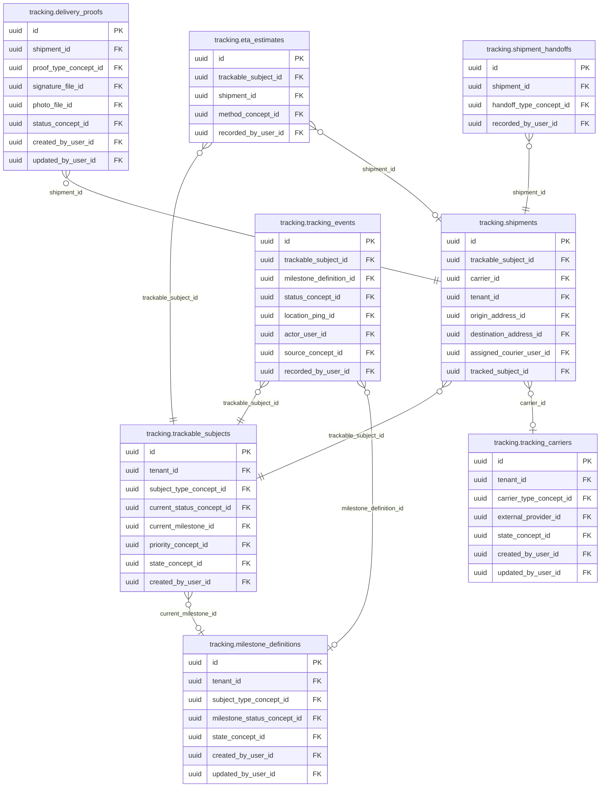

<!-- AUTOGENERADO por tools/inventario/catalogo.mjs. No editar manualmente. -->

# Catálogo del schema `tracking`

- **Tablas:** 8 · **Columnas:** 114 (23 con descripción: 20.2 %) · **Índices:** 61
- **Dominio:** Integraciones y Contratos
- Método y límites del catálogo: [README del inventario](../README.md)

## Tablas

| Tabla | Propósito | Columnas | Índices | Operaciones | ORM |
|---|---|---|---|---|---|
| [delivery_proofs](#delivery_proofs) | Almacena evidencia de entrega para confirmar recepción de objetos enviados. | 15 | 7 | 3 | COINCIDE |
| [eta_estimates](#eta_estimates) | Conserva estimaciones de llegada de envíos para coordinar recepción y procesos dependientes. | 9 | 5 | 2 | COINCIDE |
| [milestone_definitions](#milestone_definitions) | Define hitos que describen etapas esperadas en el seguimiento de envíos o procesos. | 15 | 7 | 5 | COINCIDE |
| [shipment_handoffs](#shipment_handoffs) | Documenta traspasos de custodia entre transportistas o puntos logísticos durante un envío. | 11 | 4 | 1 | COINCIDE |
| [shipments](#shipments) | Representa envíos físicos —por ejemplo, insumos o muestras— y su ciclo de transporte. | 20 | 12 | 16 | COINCIDE |
| [trackable_subjects](#trackable_subjects) | Registra sujetos y objetos a los que se les puede seguir hitos o entregas dentro de procesos médicos y logísticos. | 17 | 10 | 17 | COINCIDE |
| [tracking_carriers](#tracking_carriers) | Cataloga transportistas que reportan movimiento de envíos del sistema médico. | 13 | 8 | 3 | COINCIDE |
| [tracking_events](#tracking_events) | Conserva eventos de seguimiento para reconstruir ubicación y estado de entregas o sujetos rastreables. | 14 | 8 | 9 | COINCIDE |

## Diagrama entidad-relación

Las tablas se agrupan en familias por sus claves foráneas dentro del schema (máximo 40 por diagrama). Las FK hacia otros schemas se listan en la ficha de cada tabla.

### Familia 1 de 1 — 8 tablas

## Fichas

### delivery_proofs

#### Vista general

Almacena evidencia de entrega para confirmar recepción de objetos enviados.

- **Estado del propósito:** DOMAIN_CURATED_DRAFT · fuente: `Mantra Core Health Context/modules/diagram_37_tracking.puml: delivery_proofs`
- **Dominio:** Integraciones y Contratos · **Diagrama:** `Mantra Core Health Context/modules/diagram_37_tracking.puml` · **DDL:** `SQL/37_tracking/02_tables.sql`
- **Entidad del ORM:** `DeliveryProofs` — `src/modules/tracking/entities/delivery_proofs.entity.ts`
- **Resumen:** 15 columnas · 7 índices · 7 FK salientes · 0 entrantes · 3 operaciones

#### Columnas

| # | Columna | Tipo | Rol estructural | Descripción | ORM |
|---|---|---|---|---|---|
| 1 | `id` | `uuid` | Clave primaria; Obligatoria | Identificador único de la instancia. _(JSDOC_ESTANDAR, `src/modules/tracking/entities/delivery_proofs.entity.ts:12`)_ | coincide |
| 2 | `shipment_id` | `uuid` | Clave foránea → tracking.shipments.id; Obligatoria | _sin dato_ | coincide |
| 3 | `proof_type_concept_id` | `uuid` | Clave foránea → terminology.catalog_concepts.id; Obligatoria | _sin dato_ | coincide |
| 4 | `recipient_name` | `varchar` | Opcional | _sin dato_ | coincide |
| 5 | `signature_file_id` | `uuid` | Clave foránea → common.files.id; Opcional | _sin dato_ | coincide |
| 6 | `photo_file_id` | `uuid` | Clave foránea → common.files.id; Opcional | _sin dato_ | coincide |
| 7 | `latitude` | `numeric` | Opcional | _sin dato_ | coincide |
| 8 | `longitude` | `numeric` | Opcional | _sin dato_ | coincide |
| 9 | `captured_at` | `timestamptz` | Opcional | _sin dato_ | coincide |
| 10 | `status_concept_id` | `uuid` | Clave foránea → terminology.catalog_concepts.id; Obligatoria | _sin dato_ | coincide |
| 11 | `created_at` | `timestamptz` | Obligatoria | Fecha y hora en que se creó el registro. _(JSDOC_ESTANDAR, `src/modules/tracking/entities/delivery_proofs.entity.ts:80`)_ | coincide |
| 12 | `updated_at` | `timestamptz` | Obligatoria | Fecha y hora de la última actualización. _(JSDOC_ESTANDAR, `src/modules/tracking/entities/delivery_proofs.entity.ts:86`)_ | coincide |
| 13 | `created_by_user_id` | `uuid` | Clave foránea → iam.users.id; Opcional | _sin dato_ | coincide |
| 14 | `updated_by_user_id` | `uuid` | Clave foránea → iam.users.id; Opcional | _sin dato_ | coincide |
| 15 | `row_version` | `integer = 1` | Obligatoria | Versión usada para controlar actualizaciones concurrentes. _(JSDOC_ENTIDAD, `src/modules/tracking/entities/delivery_proofs.entity.ts:104`)_ | coincide |

#### Relaciones

| Sentido | Columnas | Tabla | Restricción |
|---|---|---|---|
| hacia | shipment_id | tracking.shipments (id) | fk_delivery_proofs_shipment_id |
| hacia | proof_type_concept_id | terminology.catalog_concepts (id) | fk_delivery_proofs_proof_type_concept_id |
| hacia | signature_file_id | common.files (id) | fk_delivery_proofs_signature_file_id |
| hacia | photo_file_id | common.files (id) | fk_delivery_proofs_photo_file_id |
| hacia | status_concept_id | terminology.catalog_concepts (id) | fk_delivery_proofs_status_concept_id |
| hacia | created_by_user_id | iam.users (id) | fk_delivery_proofs_created_by_user_id |
| hacia | updated_by_user_id | iam.users (id) | fk_delivery_proofs_updated_by_user_id |

#### Índices

| Índice | Único | Columnas | Para qué |
|---|---|---|---|
| `ix_delivery_proofs_shipment_id` | no | shipment_id | Soporta la clave foránea fk_delivery_proofs_shipment_id: PostgreSQL no indexa las FK por sí mismo _(DOCUMENTO)_; 1 consulta(s) de repositorio filtran u ordenan por «shipment_id», la primera columna del índice _(CONSULTA)_ |
| `ix_delivery_proofs_proof_type_concept_id` | no | proof_type_concept_id | Soporta la clave foránea fk_delivery_proofs_proof_type_concept_id: PostgreSQL no indexa las FK por sí mismo _(DOCUMENTO)_ |
| `ix_delivery_proofs_signature_file_id` | no | signature_file_id | Soporta la clave foránea fk_delivery_proofs_signature_file_id: PostgreSQL no indexa las FK por sí mismo _(DOCUMENTO)_ |
| `ix_delivery_proofs_photo_file_id` | no | photo_file_id | Soporta la clave foránea fk_delivery_proofs_photo_file_id: PostgreSQL no indexa las FK por sí mismo _(DOCUMENTO)_ |
| `ix_delivery_proofs_status_concept_id` | no | status_concept_id | Soporta la clave foránea fk_delivery_proofs_status_concept_id: PostgreSQL no indexa las FK por sí mismo _(DOCUMENTO)_; 1 consulta(s) de repositorio filtran u ordenan por «status_concept_id», la primera columna del índice _(CONSULTA)_ |
| `ix_delivery_proofs_created_by_user_id` | no | created_by_user_id | Soporta la clave foránea fk_delivery_proofs_created_by_user_id: PostgreSQL no indexa las FK por sí mismo _(DOCUMENTO)_ |
| `ix_delivery_proofs_updated_by_user_id` | no | updated_by_user_id | Soporta la clave foránea fk_delivery_proofs_updated_by_user_id: PostgreSQL no indexa las FK por sí mismo _(DOCUMENTO)_ |

#### Operaciones que la tocan

| Operación | Efecto | Confianza |
|---|---|---|
| POST /tracking/shipments/{id}/delivery-proof | CREA | DIRECTA |
| POST /tracking/shipments/{id}/delivery-proof | LEE | DIRECTA |
| POST /tracking/shipments/{id}/exception | CREA | DIRECTA |

#### Gobierno

| Atributo | Valor | Fuente |
|---|---|---|
| Append-only | no declarado | — |
| Datos personales | sin fuente | — |
| Financiera | sin fuente | — |
| Crítica para auditoría | sin fuente | — |
| Retención | sin fuente | — |
| Responsable | sin fuente | — |
| Revisión | AUTO_DETECTADA | — |

---

### eta_estimates

#### Vista general

Conserva estimaciones de llegada de envíos para coordinar recepción y procesos dependientes.

- **Estado del propósito:** DOMAIN_CURATED_DRAFT · fuente: `Mantra Core Health Context/modules/diagram_37_tracking.puml: eta_estimates`
- **Dominio:** Integraciones y Contratos · **Diagrama:** `Mantra Core Health Context/modules/diagram_37_tracking.puml` · **DDL:** `SQL/37_tracking/02_tables.sql`
- **Entidad del ORM:** `EtaEstimates` — `src/modules/tracking/entities/eta_estimates.entity.ts`
- **Resumen:** 9 columnas · 5 índices · 4 FK salientes · 0 entrantes · 2 operaciones

#### Columnas

| # | Columna | Tipo | Rol estructural | Descripción | ORM |
|---|---|---|---|---|---|
| 1 | `id` | `uuid` | Clave primaria; Obligatoria | Identificador único de la instancia. _(JSDOC_ESTANDAR, `src/modules/tracking/entities/eta_estimates.entity.ts:12`)_ | coincide |
| 2 | `trackable_subject_id` | `uuid` | Clave foránea → tracking.trackable_subjects.id; Obligatoria | _sin dato_ | coincide |
| 3 | `shipment_id` | `uuid` | Clave foránea → tracking.shipments.id; Opcional | _sin dato_ | coincide |
| 4 | `estimated_arrival_at` | `timestamptz` | Obligatoria | _sin dato_ | coincide |
| 5 | `confidence_pct` | `integer` | Opcional | _sin dato_ | coincide |
| 6 | `method_concept_id` | `uuid` | Clave foránea → terminology.catalog_concepts.id; Opcional | _sin dato_ | coincide |
| 7 | `computed_at` | `timestamptz` | Opcional | _sin dato_ | coincide |
| 8 | `recorded_at` | `timestamptz` | Obligatoria | _sin dato_ | coincide |
| 9 | `recorded_by_user_id` | `uuid` | Clave foránea → iam.users.id; Opcional | _sin dato_ | coincide |

#### Relaciones

| Sentido | Columnas | Tabla | Restricción |
|---|---|---|---|
| hacia | trackable_subject_id | tracking.trackable_subjects (id) | fk_eta_estimates_trackable_subject_id |
| hacia | shipment_id | tracking.shipments (id) | fk_eta_estimates_shipment_id |
| hacia | method_concept_id | terminology.catalog_concepts (id) | fk_eta_estimates_method_concept_id |
| hacia | recorded_by_user_id | iam.users (id) | fk_eta_estimates_recorded_by_user_id |

#### Índices

| Índice | Único | Columnas | Para qué |
|---|---|---|---|
| `ix_eta_estimates_trackable_subject_id` | no | trackable_subject_id | Soporta la clave foránea fk_eta_estimates_trackable_subject_id: PostgreSQL no indexa las FK por sí mismo _(DOCUMENTO)_ |
| `ix_eta_estimates_shipment_id` | no | shipment_id | Soporta la clave foránea fk_eta_estimates_shipment_id: PostgreSQL no indexa las FK por sí mismo _(DOCUMENTO)_; 1 consulta(s) de repositorio filtran u ordenan por «shipment_id», la primera columna del índice _(CONSULTA)_ |
| `ix_eta_estimates_method_concept_id` | no | method_concept_id | Soporta la clave foránea fk_eta_estimates_method_concept_id: PostgreSQL no indexa las FK por sí mismo _(DOCUMENTO)_ |
| `ix_eta_estimates_recorded_by_user_id` | no | recorded_by_user_id | Soporta la clave foránea fk_eta_estimates_recorded_by_user_id: PostgreSQL no indexa las FK por sí mismo _(DOCUMENTO)_ |
| `brin_eta_estimates_recorded_at` | no | recorded_at | BRIN para logs e historiales append-only de gran volumen _(DOCUMENTO)_; 1 consulta(s) de repositorio filtran u ordenan por «recorded_at», la primera columna del índice _(CONSULTA)_ |

#### Operaciones que la tocan

| Operación | Efecto | Confianza |
|---|---|---|
| POST /tracking/shipments/{id}/eta/recompute | CREA | DIRECTA |
| POST /tracking/shipments/{id}/eta/recompute | LEE | DIRECTA |

#### Gobierno

| Atributo | Valor | Fuente |
|---|---|---|
| Append-only | no declarado | — |
| Datos personales | sin fuente | — |
| Financiera | sin fuente | — |
| Crítica para auditoría | sin fuente | — |
| Retención | sin fuente | — |
| Responsable | sin fuente | — |
| Revisión | AUTO_DETECTADA | — |

---

### milestone_definitions

#### Vista general

Define hitos que describen etapas esperadas en el seguimiento de envíos o procesos.

- **Estado del propósito:** DOMAIN_CURATED_DRAFT · fuente: `Mantra Core Health Context/modules/diagram_37_tracking.puml: milestone_definitions`
- **Dominio:** Integraciones y Contratos · **Diagrama:** `Mantra Core Health Context/modules/diagram_37_tracking.puml` · **DDL:** `SQL/37_tracking/02_tables.sql`
- **Entidad del ORM:** `MilestoneDefinitions` — `src/modules/tracking/entities/milestone_definitions.entity.ts`
- **Resumen:** 15 columnas · 7 índices · 6 FK salientes · 2 entrantes · 5 operaciones

#### Columnas

| # | Columna | Tipo | Rol estructural | Descripción | ORM |
|---|---|---|---|---|---|
| 1 | `id` | `uuid` | Clave primaria; Obligatoria | Identificador único de la instancia. _(JSDOC_ESTANDAR, `src/modules/tracking/entities/milestone_definitions.entity.ts:12`)_ | coincide |
| 2 | `tenant_id` | `uuid` | Clave foránea → directory.tenants.id; Opcional | _sin dato_ | coincide |
| 3 | `subject_type_concept_id` | `uuid` | Clave foránea → terminology.catalog_concepts.id; Obligatoria | _sin dato_ | coincide |
| 4 | `code` | `varchar` | Obligatoria | _sin dato_ | coincide |
| 5 | `name` | `varchar` | Obligatoria | _sin dato_ | coincide |
| 6 | `milestone_status_concept_id` | `uuid` | Clave foránea → terminology.catalog_concepts.id; Obligatoria | _sin dato_ | coincide |
| 7 | `ordinal` | `integer` | Opcional | _sin dato_ | coincide |
| 8 | `is_terminal` | `boolean` | Opcional | _sin dato_ | coincide |
| 9 | `sla_minutes` | `integer` | Opcional | _sin dato_ | coincide |
| 10 | `state_concept_id` | `uuid` | Clave foránea → terminology.catalog_concepts.id; Obligatoria | _sin dato_ | coincide |
| 11 | `created_at` | `timestamptz` | Obligatoria | Fecha y hora en que se creó el registro. _(JSDOC_ESTANDAR, `src/modules/tracking/entities/milestone_definitions.entity.ts:72`)_ | coincide |
| 12 | `updated_at` | `timestamptz` | Obligatoria | Fecha y hora de la última actualización. _(JSDOC_ESTANDAR, `src/modules/tracking/entities/milestone_definitions.entity.ts:78`)_ | coincide |
| 13 | `created_by_user_id` | `uuid` | Clave foránea → iam.users.id; Opcional | _sin dato_ | coincide |
| 14 | `updated_by_user_id` | `uuid` | Clave foránea → iam.users.id; Opcional | _sin dato_ | coincide |
| 15 | `row_version` | `integer = 1` | Obligatoria | Versión usada para controlar actualizaciones concurrentes. _(JSDOC_ENTIDAD, `src/modules/tracking/entities/milestone_definitions.entity.ts:96`)_ | coincide |

#### Relaciones

| Sentido | Columnas | Tabla | Restricción |
|---|---|---|---|
| hacia | tenant_id | directory.tenants (id) | fk_milestone_definitions_tenant_id |
| hacia | subject_type_concept_id | terminology.catalog_concepts (id) | fk_milestone_definitions_subject_type_concept_id |
| hacia | milestone_status_concept_id | terminology.catalog_concepts (id) | fk_milestone_definitions_milestone_status_concept_id |
| hacia | state_concept_id | terminology.catalog_concepts (id) | fk_milestone_definitions_state_concept_id |
| hacia | created_by_user_id | iam.users (id) | fk_milestone_definitions_created_by_user_id |
| hacia | updated_by_user_id | iam.users (id) | fk_milestone_definitions_updated_by_user_id |
| desde | id | tracking.trackable_subjects (current_milestone_id) | fk_trackable_subjects_current_milestone_id |
| desde | id | tracking.tracking_events (milestone_definition_id) | fk_tracking_events_milestone_definition_id |

#### Índices

| Índice | Único | Columnas | Para qué |
|---|---|---|---|
| `ix_milestone_definitions_tenant_id` | no | tenant_id | Soporta la clave foránea fk_milestone_definitions_tenant_id: PostgreSQL no indexa las FK por sí mismo _(DOCUMENTO)_ |
| `ix_milestone_definitions_subject_type_concept_id` | no | subject_type_concept_id | Soporta la clave foránea fk_milestone_definitions_subject_type_concept_id: PostgreSQL no indexa las FK por sí mismo _(DOCUMENTO)_; 2 consulta(s) de repositorio filtran u ordenan por «subject_type_concept_id», la primera columna del índice _(CONSULTA)_ |
| `ix_milestone_definitions_milestone_status_concept_id` | no | milestone_status_concept_id | Soporta la clave foránea fk_milestone_definitions_milestone_status_concept_id: PostgreSQL no indexa las FK por sí mismo _(DOCUMENTO)_ |
| `ix_milestone_definitions_state_concept_id` | no | state_concept_id | Soporta la clave foránea fk_milestone_definitions_state_concept_id: PostgreSQL no indexa las FK por sí mismo _(DOCUMENTO)_; 1 consulta(s) de repositorio filtran u ordenan por «state_concept_id», la primera columna del índice _(CONSULTA)_ |
| `ix_milestone_definitions_created_by_user_id` | no | created_by_user_id | Soporta la clave foránea fk_milestone_definitions_created_by_user_id: PostgreSQL no indexa las FK por sí mismo _(DOCUMENTO)_ |
| `ix_milestone_definitions_updated_by_user_id` | no | updated_by_user_id | Soporta la clave foránea fk_milestone_definitions_updated_by_user_id: PostgreSQL no indexa las FK por sí mismo _(DOCUMENTO)_ |
| `ix_milestone_definitions_tenant_id_state_concept_id` | no | tenant_id, state_concept_id, ("updated_at" DESC) | _sin uso detectado estáticamente_ |

#### Operaciones que la tocan

| Operación | Efecto | Confianza |
|---|---|---|
| POST /tracking/milestone-definitions | CREA | DIRECTA |
| POST /tracking/milestone-definitions | LEE | DIRECTA |
| POST /tracking/shipments/{id}/delivery-proof | LEE | DIRECTA |
| POST /tracking/sla/scan | LEE | DIRECTA |
| POST /tracking/trackable-subjects/{id}/events | LEE | DIRECTA |

#### Gobierno

| Atributo | Valor | Fuente |
|---|---|---|
| Append-only | no declarado | — |
| Datos personales | sin fuente | — |
| Financiera | sin fuente | — |
| Crítica para auditoría | sin fuente | — |
| Retención | sin fuente | — |
| Responsable | sin fuente | — |
| Revisión | AUTO_DETECTADA | — |

---

### shipment_handoffs

#### Vista general

Documenta traspasos de custodia entre transportistas o puntos logísticos durante un envío.

- **Estado del propósito:** DOMAIN_CURATED_DRAFT · fuente: `Mantra Core Health Context/modules/diagram_37_tracking.puml: shipment_handoffs`
- **Dominio:** Integraciones y Contratos · **Diagrama:** `Mantra Core Health Context/modules/diagram_37_tracking.puml` · **DDL:** `SQL/37_tracking/02_tables.sql`
- **Entidad del ORM:** `ShipmentHandoffs` — `src/modules/tracking/entities/shipment_handoffs.entity.ts`
- **Resumen:** 11 columnas · 4 índices · 3 FK salientes · 0 entrantes · 1 operaciones

#### Columnas

| # | Columna | Tipo | Rol estructural | Descripción | ORM |
|---|---|---|---|---|---|
| 1 | `id` | `uuid` | Clave primaria; Obligatoria | Identificador único de la instancia. _(JSDOC_ESTANDAR, `src/modules/tracking/entities/shipment_handoffs.entity.ts:12`)_ | coincide |
| 2 | `shipment_id` | `uuid` | Clave foránea → tracking.shipments.id; Obligatoria | _sin dato_ | coincide |
| 3 | `handoff_type_concept_id` | `uuid` | Clave foránea → terminology.catalog_concepts.id; Obligatoria | _sin dato_ | coincide |
| 4 | `from_party_type` | `varchar` | Opcional | _sin dato_ | coincide |
| 5 | `from_party_id` | `uuid` | Opcional | _sin dato_ | coincide |
| 6 | `to_party_type` | `varchar` | Opcional | _sin dato_ | coincide |
| 7 | `to_party_id` | `uuid` | Opcional | _sin dato_ | coincide |
| 8 | `location_text` | `varchar` | Opcional | _sin dato_ | coincide |
| 9 | `occurred_at` | `timestamptz` | Opcional | _sin dato_ | coincide |
| 10 | `recorded_at` | `timestamptz` | Obligatoria | _sin dato_ | coincide |
| 11 | `recorded_by_user_id` | `uuid` | Clave foránea → iam.users.id; Opcional | _sin dato_ | coincide |

#### Relaciones

| Sentido | Columnas | Tabla | Restricción |
|---|---|---|---|
| hacia | shipment_id | tracking.shipments (id) | fk_shipment_handoffs_shipment_id |
| hacia | handoff_type_concept_id | terminology.catalog_concepts (id) | fk_shipment_handoffs_handoff_type_concept_id |
| hacia | recorded_by_user_id | iam.users (id) | fk_shipment_handoffs_recorded_by_user_id |

#### Índices

| Índice | Único | Columnas | Para qué |
|---|---|---|---|
| `ix_shipment_handoffs_shipment_id` | no | shipment_id | Soporta la clave foránea fk_shipment_handoffs_shipment_id: PostgreSQL no indexa las FK por sí mismo _(DOCUMENTO)_ |
| `ix_shipment_handoffs_handoff_type_concept_id` | no | handoff_type_concept_id | Soporta la clave foránea fk_shipment_handoffs_handoff_type_concept_id: PostgreSQL no indexa las FK por sí mismo _(DOCUMENTO)_ |
| `ix_shipment_handoffs_recorded_by_user_id` | no | recorded_by_user_id | Soporta la clave foránea fk_shipment_handoffs_recorded_by_user_id: PostgreSQL no indexa las FK por sí mismo _(DOCUMENTO)_ |
| `brin_shipment_handoffs_recorded_at` | no | recorded_at | BRIN para logs e historiales append-only de gran volumen _(DOCUMENTO)_ |

#### Operaciones que la tocan

| Operación | Efecto | Confianza |
|---|---|---|
| POST /tracking/shipments/{id}/handoffs | CREA | DIRECTA |

#### Gobierno

| Atributo | Valor | Fuente |
|---|---|---|
| Append-only | no declarado | — |
| Datos personales | sin fuente | — |
| Financiera | sin fuente | — |
| Crítica para auditoría | sin fuente | — |
| Retención | sin fuente | — |
| Responsable | sin fuente | — |
| Revisión | AUTO_DETECTADA | — |

---

### shipments

#### Vista general

Representa envíos físicos —por ejemplo, insumos o muestras— y su ciclo de transporte.

- **Estado del propósito:** DOMAIN_CURATED_DRAFT · fuente: `Mantra Core Health Context/modules/diagram_37_tracking.puml: shipments`
- **Dominio:** Integraciones y Contratos · **Diagrama:** `Mantra Core Health Context/modules/diagram_37_tracking.puml` · **DDL:** `SQL/37_tracking/02_tables.sql`
- **Entidad del ORM:** `Shipments` — `src/modules/tracking/entities/shipments.entity.ts`
- **Resumen:** 20 columnas · 12 índices · 10 FK salientes · 4 entrantes · 16 operaciones

#### Columnas

| # | Columna | Tipo | Rol estructural | Descripción | ORM |
|---|---|---|---|---|---|
| 1 | `id` | `uuid` | Clave primaria; Obligatoria | Identificador único de la instancia. _(JSDOC_ESTANDAR, `src/modules/tracking/entities/shipments.entity.ts:12`)_ | coincide |
| 2 | `trackable_subject_id` | `uuid` | Clave foránea → tracking.trackable_subjects.id; Obligatoria | _sin dato_ | coincide |
| 3 | `carrier_id` | `uuid` | Clave foránea → tracking.tracking_carriers.id; Opcional | _sin dato_ | coincide |
| 4 | `tenant_id` | `uuid` | Clave foránea → directory.tenants.id; Opcional | _sin dato_ | coincide |
| 5 | `shipment_number` | `varchar` | Obligatoria | _sin dato_ | coincide |
| 6 | `origin_address_id` | `uuid` | Clave foránea → common.addresses.id; Opcional | _sin dato_ | coincide |
| 7 | `destination_address_id` | `uuid` | Clave foránea → common.addresses.id; Opcional | _sin dato_ | coincide |
| 8 | `assigned_courier_user_id` | `uuid` | Clave foránea → iam.users.id; Opcional | _sin dato_ | coincide |
| 9 | `tracked_subject_id` | `uuid` | Clave foránea → geo.tracked_subjects.id; Opcional | _sin dato_ | coincide |
| 10 | `status_concept_id` | `uuid` | Clave foránea → terminology.catalog_concepts.id; Obligatoria | _sin dato_ | coincide |
| 11 | `dispatched_at` | `timestamptz` | Opcional | _sin dato_ | coincide |
| 12 | `estimated_arrival_at` | `timestamptz` | Opcional | _sin dato_ | coincide |
| 13 | `delivered_at` | `timestamptz` | Opcional | _sin dato_ | coincide |
| 14 | `distance_m` | `numeric` | Opcional | _sin dato_ | coincide |
| 15 | `temperature_controlled` | `boolean` | Opcional | _sin dato_ | coincide |
| 16 | `created_at` | `timestamptz` | Obligatoria | Fecha y hora en que se creó el registro. _(JSDOC_ESTANDAR, `src/modules/tracking/entities/shipments.entity.ts:126`)_ | coincide |
| 17 | `updated_at` | `timestamptz` | Obligatoria | Fecha y hora de la última actualización. _(JSDOC_ESTANDAR, `src/modules/tracking/entities/shipments.entity.ts:132`)_ | coincide |
| 18 | `created_by_user_id` | `uuid` | Clave foránea → iam.users.id; Opcional | _sin dato_ | coincide |
| 19 | `updated_by_user_id` | `uuid` | Clave foránea → iam.users.id; Opcional | _sin dato_ | coincide |
| 20 | `row_version` | `integer = 1` | Obligatoria | Versión usada para controlar actualizaciones concurrentes. _(JSDOC_ENTIDAD, `src/modules/tracking/entities/shipments.entity.ts:150`)_ | coincide |

#### Relaciones

| Sentido | Columnas | Tabla | Restricción |
|---|---|---|---|
| hacia | trackable_subject_id | tracking.trackable_subjects (id) | fk_shipments_trackable_subject_id |
| hacia | carrier_id | tracking.tracking_carriers (id) | fk_shipments_carrier_id |
| hacia | tenant_id | directory.tenants (id) | fk_shipments_tenant_id |
| hacia | origin_address_id | common.addresses (id) | fk_shipments_origin_address_id |
| hacia | destination_address_id | common.addresses (id) | fk_shipments_destination_address_id |
| hacia | assigned_courier_user_id | iam.users (id) | fk_shipments_assigned_courier_user_id |
| hacia | tracked_subject_id | geo.tracked_subjects (id) | fk_shipments_tracked_subject_id |
| hacia | status_concept_id | terminology.catalog_concepts (id) | fk_shipments_status_concept_id |
| hacia | created_by_user_id | iam.users (id) | fk_shipments_created_by_user_id |
| hacia | updated_by_user_id | iam.users (id) | fk_shipments_updated_by_user_id |
| desde | id | tracking.shipment_handoffs (shipment_id) | fk_shipment_handoffs_shipment_id |
| desde | id | tracking.eta_estimates (shipment_id) | fk_eta_estimates_shipment_id |
| desde | id | tracking.delivery_proofs (shipment_id) | fk_delivery_proofs_shipment_id |
| desde | id | audit.shipments_history (shipment_id) | fk_shipments_history_shipment_id |

#### Índices

| Índice | Único | Columnas | Para qué |
|---|---|---|---|
| `uq_shipments_shipment_number` | sí | shipment_number | Garantiza que no se repita la combinación (shipment_number) _(DOCUMENTO)_; 1 consulta(s) de repositorio filtran u ordenan por «shipment_number», la primera columna del índice _(CONSULTA)_ |
| `ix_shipments_trackable_subject_id` | no | trackable_subject_id | Soporta la clave foránea fk_shipments_trackable_subject_id: PostgreSQL no indexa las FK por sí mismo _(DOCUMENTO)_; 1 consulta(s) de repositorio filtran u ordenan por «trackable_subject_id», la primera columna del índice _(CONSULTA)_ |
| `ix_shipments_carrier_id` | no | carrier_id | Soporta la clave foránea fk_shipments_carrier_id: PostgreSQL no indexa las FK por sí mismo _(DOCUMENTO)_ |
| `ix_shipments_tenant_id` | no | tenant_id | Soporta la clave foránea fk_shipments_tenant_id: PostgreSQL no indexa las FK por sí mismo _(DOCUMENTO)_ |
| `ix_shipments_origin_address_id` | no | origin_address_id | Soporta la clave foránea fk_shipments_origin_address_id: PostgreSQL no indexa las FK por sí mismo _(DOCUMENTO)_ |
| `ix_shipments_destination_address_id` | no | destination_address_id | Soporta la clave foránea fk_shipments_destination_address_id: PostgreSQL no indexa las FK por sí mismo _(DOCUMENTO)_ |
| `ix_shipments_assigned_courier_user_id` | no | assigned_courier_user_id | Soporta la clave foránea fk_shipments_assigned_courier_user_id: PostgreSQL no indexa las FK por sí mismo _(DOCUMENTO)_ |
| `ix_shipments_tracked_subject_id` | no | tracked_subject_id | Soporta la clave foránea fk_shipments_tracked_subject_id: PostgreSQL no indexa las FK por sí mismo _(DOCUMENTO)_ |
| `ix_shipments_status_concept_id` | no | status_concept_id | Soporta la clave foránea fk_shipments_status_concept_id: PostgreSQL no indexa las FK por sí mismo _(DOCUMENTO)_ |
| `ix_shipments_created_by_user_id` | no | created_by_user_id | Soporta la clave foránea fk_shipments_created_by_user_id: PostgreSQL no indexa las FK por sí mismo _(DOCUMENTO)_ |
| `ix_shipments_updated_by_user_id` | no | updated_by_user_id | Soporta la clave foránea fk_shipments_updated_by_user_id: PostgreSQL no indexa las FK por sí mismo _(DOCUMENTO)_ |
| `ix_shipments_tenant_id_status_concept_id` | no | tenant_id, status_concept_id, ("updated_at" DESC) | _sin uso detectado estáticamente_ |

#### Restricciones

| Restricción | Tipo | Definición |
|---|---|---|
| `uq_shipments_shipment_number` | UNIQUE INDEX | UNIQUE INDEX ("shipment_number") |

#### Operaciones que la tocan

| Operación | Efecto | Confianza |
|---|---|---|
| POST /tracking/shipments/{id}/cancel | ACTUALIZA | POR_TIPO |
| POST /tracking/shipments/{id}/cancel | LEE | DIRECTA |
| POST /tracking/shipments/{id}/delivery-proof | ACTUALIZA | POR_TIPO |
| POST /tracking/shipments/{id}/delivery-proof | LEE | DIRECTA |
| POST /tracking/shipments/{id}/dispatch | ACTUALIZA | POR_TIPO |
| POST /tracking/shipments/{id}/dispatch | LEE | DIRECTA |
| POST /tracking/shipments/{id}/eta/recompute | ACTUALIZA | POR_TIPO |
| POST /tracking/shipments/{id}/eta/recompute | LEE | DIRECTA |
| POST /tracking/shipments/{id}/exception | ACTUALIZA | POR_TIPO |
| POST /tracking/shipments/{id}/exception | LEE | DIRECTA |
| POST /tracking/shipments/{id}/handoffs | ACTUALIZA | POR_TIPO |
| POST /tracking/shipments/{id}/handoffs | LEE | DIRECTA |
| POST /tracking/trackable-subjects | CREA | DIRECTA |
| POST /tracking/trackable-subjects | LEE | DIRECTA |
| POST /tracking/webhooks/carriers/{carrierCode} | ACTUALIZA | POR_TIPO |
| POST /tracking/webhooks/carriers/{carrierCode} | LEE | DIRECTA |

#### Gobierno

| Atributo | Valor | Fuente |
|---|---|---|
| Append-only | no declarado | — |
| Datos personales | sin fuente | — |
| Financiera | sin fuente | — |
| Crítica para auditoría | sin fuente | — |
| Retención | sin fuente | — |
| Responsable | sin fuente | — |
| Revisión | AUTO_DETECTADA | — |

---

### trackable_subjects

#### Vista general

Registra sujetos y objetos a los que se les puede seguir hitos o entregas dentro de procesos médicos y logísticos.

- **Estado del propósito:** DOMAIN_CURATED_DRAFT · fuente: `Mantra Core Health Context/modules/diagram_37_tracking.puml: trackable_subjects`
- **Dominio:** Integraciones y Contratos · **Diagrama:** `Mantra Core Health Context/modules/diagram_37_tracking.puml` · **DDL:** `SQL/37_tracking/02_tables.sql`
- **Entidad del ORM:** `TrackableSubjects` — `src/modules/tracking/entities/trackable_subjects.entity.ts`
- **Resumen:** 17 columnas · 10 índices · 8 FK salientes · 4 entrantes · 17 operaciones

#### Columnas

| # | Columna | Tipo | Rol estructural | Descripción | ORM |
|---|---|---|---|---|---|
| 1 | `id` | `uuid` | Clave primaria; Obligatoria | Identificador único de la instancia. _(JSDOC_ESTANDAR, `src/modules/tracking/entities/trackable_subjects.entity.ts:12`)_ | coincide |
| 2 | `tenant_id` | `uuid` | Clave foránea → directory.tenants.id; Opcional | _sin dato_ | coincide |
| 3 | `subject_type_concept_id` | `uuid` | Clave foránea → terminology.catalog_concepts.id; Obligatoria | _sin dato_ | coincide |
| 4 | `subject_ref_type` | `varchar` | Obligatoria | _sin dato_ | coincide |
| 5 | `subject_ref_id` | `uuid` | Obligatoria | _sin dato_ | coincide |
| 6 | `tracking_number` | `varchar` | Obligatoria | _sin dato_ | coincide |
| 7 | `current_status_concept_id` | `uuid` | Clave foránea → terminology.catalog_concepts.id; Opcional | _sin dato_ | coincide |
| 8 | `current_milestone_id` | `uuid` | Clave foránea → tracking.milestone_definitions.id; Opcional | _sin dato_ | coincide |
| 9 | `priority_concept_id` | `uuid` | Clave foránea → terminology.catalog_concepts.id; Opcional | _sin dato_ | coincide |
| 10 | `opened_at` | `timestamptz` | Opcional | _sin dato_ | coincide |
| 11 | `closed_at` | `timestamptz` | Opcional | _sin dato_ | coincide |
| 12 | `state_concept_id` | `uuid` | Clave foránea → terminology.catalog_concepts.id; Obligatoria | _sin dato_ | coincide |
| 13 | `created_at` | `timestamptz` | Obligatoria | Fecha y hora en que se creó el registro. _(JSDOC_ESTANDAR, `src/modules/tracking/entities/trackable_subjects.entity.ts:96`)_ | coincide |
| 14 | `updated_at` | `timestamptz` | Obligatoria | Fecha y hora de la última actualización. _(JSDOC_ESTANDAR, `src/modules/tracking/entities/trackable_subjects.entity.ts:102`)_ | coincide |
| 15 | `created_by_user_id` | `uuid` | Clave foránea → iam.users.id; Opcional | _sin dato_ | coincide |
| 16 | `updated_by_user_id` | `uuid` | Clave foránea → iam.users.id; Opcional | _sin dato_ | coincide |
| 17 | `row_version` | `integer = 1` | Obligatoria | Versión usada para controlar actualizaciones concurrentes. _(JSDOC_ENTIDAD, `src/modules/tracking/entities/trackable_subjects.entity.ts:120`)_ | coincide |

#### Relaciones

| Sentido | Columnas | Tabla | Restricción |
|---|---|---|---|
| hacia | current_milestone_id | tracking.milestone_definitions (id) | fk_trackable_subjects_current_milestone_id |
| hacia | tenant_id | directory.tenants (id) | fk_trackable_subjects_tenant_id |
| hacia | subject_type_concept_id | terminology.catalog_concepts (id) | fk_trackable_subjects_subject_type_concept_id |
| hacia | current_status_concept_id | terminology.catalog_concepts (id) | fk_trackable_subjects_current_status_concept_id |
| hacia | priority_concept_id | terminology.catalog_concepts (id) | fk_trackable_subjects_priority_concept_id |
| hacia | state_concept_id | terminology.catalog_concepts (id) | fk_trackable_subjects_state_concept_id |
| hacia | created_by_user_id | iam.users (id) | fk_trackable_subjects_created_by_user_id |
| hacia | updated_by_user_id | iam.users (id) | fk_trackable_subjects_updated_by_user_id |
| desde | id | tracking.tracking_events (trackable_subject_id) | fk_tracking_events_trackable_subject_id |
| desde | id | tracking.shipments (trackable_subject_id) | fk_shipments_trackable_subject_id |
| desde | id | tracking.eta_estimates (trackable_subject_id) | fk_eta_estimates_trackable_subject_id |
| desde | id | audit.trackable_subjects_history (trackable_subject_id) | fk_trackable_subjects_history_trackable_subject_id |

#### Índices

| Índice | Único | Columnas | Para qué |
|---|---|---|---|
| `uq_trackable_subjects_tracking_number` | sí | tracking_number | Garantiza que no se repita la combinación (tracking_number) _(DOCUMENTO)_; 1 consulta(s) de repositorio filtran u ordenan por «tracking_number», la primera columna del índice _(CONSULTA)_ |
| `ix_trackable_subjects_tenant_id` | no | tenant_id | Soporta la clave foránea fk_trackable_subjects_tenant_id: PostgreSQL no indexa las FK por sí mismo _(DOCUMENTO)_ |
| `ix_trackable_subjects_subject_type_concept_id` | no | subject_type_concept_id | Soporta la clave foránea fk_trackable_subjects_subject_type_concept_id: PostgreSQL no indexa las FK por sí mismo _(DOCUMENTO)_ |
| `ix_trackable_subjects_current_status_concept_id` | no | current_status_concept_id | Soporta la clave foránea fk_trackable_subjects_current_status_concept_id: PostgreSQL no indexa las FK por sí mismo _(DOCUMENTO)_ |
| `ix_trackable_subjects_current_milestone_id` | no | current_milestone_id | Soporta la clave foránea fk_trackable_subjects_current_milestone_id: PostgreSQL no indexa las FK por sí mismo _(DOCUMENTO)_ |
| `ix_trackable_subjects_priority_concept_id` | no | priority_concept_id | Soporta la clave foránea fk_trackable_subjects_priority_concept_id: PostgreSQL no indexa las FK por sí mismo _(DOCUMENTO)_ |
| `ix_trackable_subjects_state_concept_id` | no | state_concept_id | Soporta la clave foránea fk_trackable_subjects_state_concept_id: PostgreSQL no indexa las FK por sí mismo _(DOCUMENTO)_; 2 consulta(s) de repositorio filtran u ordenan por «state_concept_id», la primera columna del índice _(CONSULTA)_ |
| `ix_trackable_subjects_created_by_user_id` | no | created_by_user_id | Soporta la clave foránea fk_trackable_subjects_created_by_user_id: PostgreSQL no indexa las FK por sí mismo _(DOCUMENTO)_ |
| `ix_trackable_subjects_updated_by_user_id` | no | updated_by_user_id | Soporta la clave foránea fk_trackable_subjects_updated_by_user_id: PostgreSQL no indexa las FK por sí mismo _(DOCUMENTO)_ |
| `ix_trackable_subjects_tenant_id_state_concept_id` | no | tenant_id, state_concept_id, ("updated_at" DESC) | _sin uso detectado estáticamente_ |

#### Restricciones

| Restricción | Tipo | Definición |
|---|---|---|
| `uq_trackable_subjects_tracking_number` | UNIQUE INDEX | UNIQUE INDEX ("tracking_number") |

#### Operaciones que la tocan

| Operación | Efecto | Confianza |
|---|---|---|
| POST /tracking/shipments/{id}/cancel | ACTUALIZA | POR_TIPO |
| POST /tracking/shipments/{id}/cancel | LEE | DIRECTA |
| POST /tracking/shipments/{id}/delivery-proof | ACTUALIZA | POR_TIPO |
| POST /tracking/shipments/{id}/delivery-proof | LEE | DIRECTA |
| POST /tracking/shipments/{id}/dispatch | ACTUALIZA | POR_TIPO |
| POST /tracking/shipments/{id}/dispatch | LEE | DIRECTA |
| POST /tracking/shipments/{id}/eta/recompute | LEE | DIRECTA |
| POST /tracking/shipments/{id}/exception | ACTUALIZA | POR_TIPO |
| POST /tracking/shipments/{id}/exception | LEE | DIRECTA |
| POST /tracking/sla/scan | ACTUALIZA | POR_TIPO |
| POST /tracking/sla/scan | LEE | DIRECTA |
| POST /tracking/trackable-subjects | CREA | DIRECTA |
| POST /tracking/trackable-subjects | LEE | DIRECTA |
| POST /tracking/trackable-subjects/{id}/events | ACTUALIZA | POR_TIPO |
| POST /tracking/trackable-subjects/{id}/events | LEE | DIRECTA |
| POST /tracking/webhooks/carriers/{carrierCode} | ACTUALIZA | POR_TIPO |
| POST /tracking/webhooks/carriers/{carrierCode} | LEE | DIRECTA |

#### Gobierno

| Atributo | Valor | Fuente |
|---|---|---|
| Append-only | no declarado | — |
| Datos personales | sin fuente | — |
| Financiera | sin fuente | — |
| Crítica para auditoría | sin fuente | — |
| Retención | sin fuente | — |
| Responsable | sin fuente | — |
| Revisión | AUTO_DETECTADA | — |

---

### tracking_carriers

#### Vista general

Cataloga transportistas que reportan movimiento de envíos del sistema médico.

- **Estado del propósito:** DOMAIN_CURATED_DRAFT · fuente: `Mantra Core Health Context/modules/diagram_37_tracking.puml: tracking_carriers`
- **Dominio:** Integraciones y Contratos · **Diagrama:** `Mantra Core Health Context/modules/diagram_37_tracking.puml` · **DDL:** `SQL/37_tracking/02_tables.sql`
- **Entidad del ORM:** `TrackingCarriers` — `src/modules/tracking/entities/tracking_carriers.entity.ts`
- **Resumen:** 13 columnas · 8 índices · 6 FK salientes · 1 entrantes · 3 operaciones

#### Columnas

| # | Columna | Tipo | Rol estructural | Descripción | ORM |
|---|---|---|---|---|---|
| 1 | `id` | `uuid` | Clave primaria; Obligatoria | Identificador único de la instancia. _(JSDOC_ESTANDAR, `src/modules/tracking/entities/tracking_carriers.entity.ts:12`)_ | coincide |
| 2 | `tenant_id` | `uuid` | Clave foránea → directory.tenants.id; Opcional | _sin dato_ | coincide |
| 3 | `code` | `varchar` | Obligatoria | _sin dato_ | coincide |
| 4 | `name` | `varchar` | Obligatoria | _sin dato_ | coincide |
| 5 | `carrier_type_concept_id` | `uuid` | Clave foránea → terminology.catalog_concepts.id; Obligatoria | _sin dato_ | coincide |
| 6 | `contact_json` | `jsonb` | Opcional | _sin dato_ | coincide |
| 7 | `external_provider_id` | `uuid` | Clave foránea → integrations.external_providers.id; Opcional | _sin dato_ | coincide |
| 8 | `state_concept_id` | `uuid` | Clave foránea → terminology.catalog_concepts.id; Obligatoria | _sin dato_ | coincide |
| 9 | `created_at` | `timestamptz` | Obligatoria | Fecha y hora en que se creó el registro. _(JSDOC_ESTANDAR, `src/modules/tracking/entities/tracking_carriers.entity.ts:65`)_ | coincide |
| 10 | `updated_at` | `timestamptz` | Obligatoria | Fecha y hora de la última actualización. _(JSDOC_ESTANDAR, `src/modules/tracking/entities/tracking_carriers.entity.ts:71`)_ | coincide |
| 11 | `created_by_user_id` | `uuid` | Clave foránea → iam.users.id; Opcional | _sin dato_ | coincide |
| 12 | `updated_by_user_id` | `uuid` | Clave foránea → iam.users.id; Opcional | _sin dato_ | coincide |
| 13 | `row_version` | `integer = 1` | Obligatoria | Versión usada para controlar actualizaciones concurrentes. _(JSDOC_ENTIDAD, `src/modules/tracking/entities/tracking_carriers.entity.ts:89`)_ | coincide |

#### Relaciones

| Sentido | Columnas | Tabla | Restricción |
|---|---|---|---|
| hacia | tenant_id | directory.tenants (id) | fk_tracking_carriers_tenant_id |
| hacia | carrier_type_concept_id | terminology.catalog_concepts (id) | fk_tracking_carriers_carrier_type_concept_id |
| hacia | external_provider_id | integrations.external_providers (id) | fk_tracking_carriers_external_provider_id |
| hacia | state_concept_id | terminology.catalog_concepts (id) | fk_tracking_carriers_state_concept_id |
| hacia | created_by_user_id | iam.users (id) | fk_tracking_carriers_created_by_user_id |
| hacia | updated_by_user_id | iam.users (id) | fk_tracking_carriers_updated_by_user_id |
| desde | id | tracking.shipments (carrier_id) | fk_shipments_carrier_id |

#### Índices

| Índice | Único | Columnas | Para qué |
|---|---|---|---|
| `uq_tracking_carriers_code` | sí | code | Garantiza que no se repita la combinación (code) _(DOCUMENTO)_; 1 consulta(s) de repositorio filtran u ordenan por «code», la primera columna del índice _(CONSULTA)_ |
| `ix_tracking_carriers_tenant_id` | no | tenant_id | Soporta la clave foránea fk_tracking_carriers_tenant_id: PostgreSQL no indexa las FK por sí mismo _(DOCUMENTO)_ |
| `ix_tracking_carriers_carrier_type_concept_id` | no | carrier_type_concept_id | Soporta la clave foránea fk_tracking_carriers_carrier_type_concept_id: PostgreSQL no indexa las FK por sí mismo _(DOCUMENTO)_ |
| `ix_tracking_carriers_external_provider_id` | no | external_provider_id | Soporta la clave foránea fk_tracking_carriers_external_provider_id: PostgreSQL no indexa las FK por sí mismo _(DOCUMENTO)_ |
| `ix_tracking_carriers_state_concept_id` | no | state_concept_id | Soporta la clave foránea fk_tracking_carriers_state_concept_id: PostgreSQL no indexa las FK por sí mismo _(DOCUMENTO)_ |
| `ix_tracking_carriers_created_by_user_id` | no | created_by_user_id | Soporta la clave foránea fk_tracking_carriers_created_by_user_id: PostgreSQL no indexa las FK por sí mismo _(DOCUMENTO)_ |
| `ix_tracking_carriers_updated_by_user_id` | no | updated_by_user_id | Soporta la clave foránea fk_tracking_carriers_updated_by_user_id: PostgreSQL no indexa las FK por sí mismo _(DOCUMENTO)_ |
| `ix_tracking_carriers_tenant_id_state_concept_id` | no | tenant_id, state_concept_id, ("updated_at" DESC) | _sin uso detectado estáticamente_ |

#### Restricciones

| Restricción | Tipo | Definición |
|---|---|---|
| `uq_tracking_carriers_code` | UNIQUE INDEX | UNIQUE INDEX ("code") |

#### Operaciones que la tocan

| Operación | Efecto | Confianza |
|---|---|---|
| POST /tracking/shipments/{id}/handoffs | LEE | DIRECTA |
| POST /tracking/trackable-subjects | LEE | DIRECTA |
| POST /tracking/webhooks/carriers/{carrierCode} | LEE | DIRECTA |

#### Gobierno

| Atributo | Valor | Fuente |
|---|---|---|
| Append-only | no declarado | — |
| Datos personales | sin fuente | — |
| Financiera | sin fuente | — |
| Crítica para auditoría | sin fuente | — |
| Retención | sin fuente | — |
| Responsable | sin fuente | — |
| Revisión | AUTO_DETECTADA | — |

---

### tracking_events

#### Vista general

Conserva eventos de seguimiento para reconstruir ubicación y estado de entregas o sujetos rastreables.

- **Estado del propósito:** DOMAIN_CURATED_DRAFT · fuente: `Mantra Core Health Context/modules/diagram_37_tracking.puml: tracking_events`
- **Dominio:** Integraciones y Contratos · **Diagrama:** `Mantra Core Health Context/modules/diagram_37_tracking.puml` · **DDL:** `SQL/37_tracking/02_tables.sql`
- **Entidad del ORM:** `TrackingEvents` — `src/modules/tracking/entities/tracking_events.entity.ts`
- **Resumen:** 14 columnas · 8 índices · 7 FK salientes · 1 entrantes · 9 operaciones

#### Columnas

| # | Columna | Tipo | Rol estructural | Descripción | ORM |
|---|---|---|---|---|---|
| 1 | `id` | `uuid` | Clave primaria; Obligatoria | Identificador único de la instancia. _(JSDOC_ESTANDAR, `src/modules/tracking/entities/tracking_events.entity.ts:12`)_ | coincide |
| 2 | `trackable_subject_id` | `uuid` | Clave foránea → tracking.trackable_subjects.id; Obligatoria | _sin dato_ | coincide |
| 3 | `milestone_definition_id` | `uuid` | Clave foránea → tracking.milestone_definitions.id; Opcional | _sin dato_ | coincide |
| 4 | `status_concept_id` | `uuid` | Clave foránea → terminology.catalog_concepts.id; Obligatoria | _sin dato_ | coincide |
| 5 | `description` | `text` | Opcional | _sin dato_ | coincide |
| 6 | `location_text` | `varchar` | Opcional | _sin dato_ | coincide |
| 7 | `latitude` | `numeric` | Opcional | _sin dato_ | coincide |
| 8 | `longitude` | `numeric` | Opcional | _sin dato_ | coincide |
| 9 | `location_ping_id` | `uuid` | Clave foránea → geo.location_pings.id; Opcional | _sin dato_ | coincide |
| 10 | `actor_user_id` | `uuid` | Clave foránea → iam.users.id; Opcional | _sin dato_ | coincide |
| 11 | `source_concept_id` | `uuid` | Clave foránea → terminology.catalog_concepts.id; Opcional | _sin dato_ | coincide |
| 12 | `occurred_at` | `timestamptz` | Opcional | _sin dato_ | coincide |
| 13 | `recorded_at` | `timestamptz` | Obligatoria | _sin dato_ | coincide |
| 14 | `recorded_by_user_id` | `uuid` | Clave foránea → iam.users.id; Opcional | _sin dato_ | coincide |

#### Relaciones

| Sentido | Columnas | Tabla | Restricción |
|---|---|---|---|
| hacia | trackable_subject_id | tracking.trackable_subjects (id) | fk_tracking_events_trackable_subject_id |
| hacia | milestone_definition_id | tracking.milestone_definitions (id) | fk_tracking_events_milestone_definition_id |
| hacia | status_concept_id | terminology.catalog_concepts (id) | fk_tracking_events_status_concept_id |
| hacia | location_ping_id | geo.location_pings (id) | fk_tracking_events_location_ping_id |
| hacia | actor_user_id | iam.users (id) | fk_tracking_events_actor_user_id |
| hacia | source_concept_id | terminology.catalog_concepts (id) | fk_tracking_events_source_concept_id |
| hacia | recorded_by_user_id | iam.users (id) | fk_tracking_events_recorded_by_user_id |
| desde | id | marketing.marketing_touchpoints (tracking_event_id) | fk_marketing_touchpoints_tracking_event_id |

#### Índices

| Índice | Único | Columnas | Para qué |
|---|---|---|---|
| `ix_tracking_events_trackable_subject_id` | no | trackable_subject_id | Soporta la clave foránea fk_tracking_events_trackable_subject_id: PostgreSQL no indexa las FK por sí mismo _(DOCUMENTO)_; 2 consulta(s) de repositorio filtran u ordenan por «trackable_subject_id», la primera columna del índice _(CONSULTA)_ |
| `ix_tracking_events_milestone_definition_id` | no | milestone_definition_id | Soporta la clave foránea fk_tracking_events_milestone_definition_id: PostgreSQL no indexa las FK por sí mismo _(DOCUMENTO)_ |
| `ix_tracking_events_status_concept_id` | no | status_concept_id | Soporta la clave foránea fk_tracking_events_status_concept_id: PostgreSQL no indexa las FK por sí mismo _(DOCUMENTO)_ |
| `ix_tracking_events_location_ping_id` | no | location_ping_id | Soporta la clave foránea fk_tracking_events_location_ping_id: PostgreSQL no indexa las FK por sí mismo _(DOCUMENTO)_ |
| `ix_tracking_events_actor_user_id` | no | actor_user_id | Soporta la clave foránea fk_tracking_events_actor_user_id: PostgreSQL no indexa las FK por sí mismo _(DOCUMENTO)_ |
| `ix_tracking_events_source_concept_id` | no | source_concept_id | Soporta la clave foránea fk_tracking_events_source_concept_id: PostgreSQL no indexa las FK por sí mismo _(DOCUMENTO)_ |
| `ix_tracking_events_recorded_by_user_id` | no | recorded_by_user_id | Soporta la clave foránea fk_tracking_events_recorded_by_user_id: PostgreSQL no indexa las FK por sí mismo _(DOCUMENTO)_ |
| `brin_tracking_events_recorded_at` | no | recorded_at | BRIN para logs e historiales append-only de gran volumen _(DOCUMENTO)_; 1 consulta(s) de repositorio filtran u ordenan por «recorded_at», la primera columna del índice _(CONSULTA)_ |

#### Operaciones que la tocan

| Operación | Efecto | Confianza |
|---|---|---|
| POST /tracking/shipments/{id}/cancel | CREA | DIRECTA |
| POST /tracking/shipments/{id}/delivery-proof | CREA | DIRECTA |
| POST /tracking/shipments/{id}/dispatch | CREA | DIRECTA |
| POST /tracking/shipments/{id}/exception | CREA | DIRECTA |
| POST /tracking/shipments/{id}/handoffs | CREA | DIRECTA |
| POST /tracking/sla/scan | CREA | DIRECTA |
| POST /tracking/trackable-subjects/{id}/events | CREA | DIRECTA |
| POST /tracking/webhooks/carriers/{carrierCode} | CREA | DIRECTA |
| POST /tracking/webhooks/carriers/{carrierCode} | LEE | DIRECTA |

#### Gobierno

| Atributo | Valor | Fuente |
|---|---|---|
| Append-only | no declarado | — |
| Datos personales | sin fuente | — |
| Financiera | sin fuente | — |
| Crítica para auditoría | sin fuente | — |
| Retención | sin fuente | — |
| Responsable | sin fuente | — |
| Revisión | AUTO_DETECTADA | — |

---

