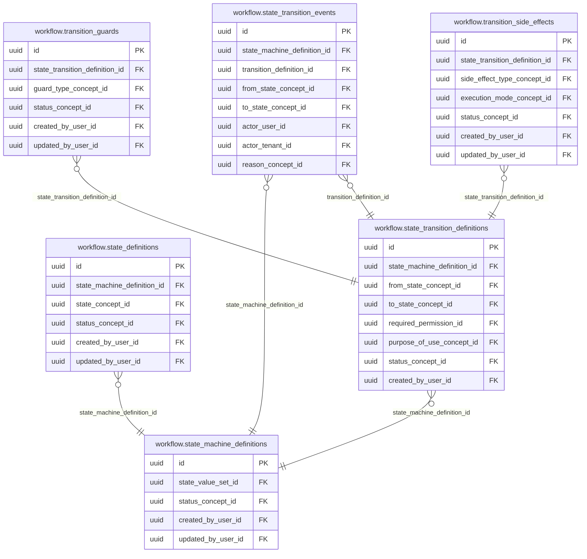
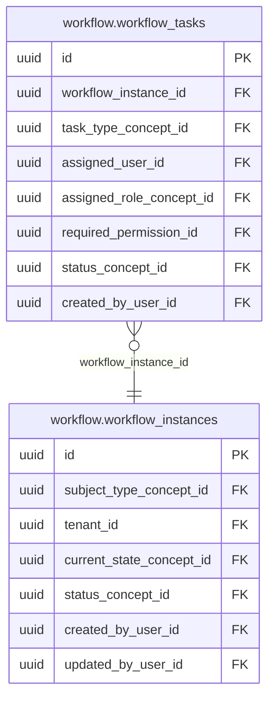

<!-- AUTOGENERADO por tools/inventario/catalogo.mjs. No editar manualmente. -->

# Catálogo del schema `workflow`

- **Tablas:** 8 · **Columnas:** 121 (29 con descripción: 24.0 %) · **Índices:** 55
- **Dominio:** Operaciones de Plataforma
- Método y límites del catálogo: [README del inventario](../README.md)

## Tablas

| Tabla | Propósito | Columnas | Índices | Operaciones | ORM |
|---|---|---|---|---|---|
| [state_definitions](#state_definitions) | Cataloga estados posibles de procesos para representar su avance de forma controlada. | 14 | 5 | 5 | COINCIDE |
| [state_machine_definitions](#state_machine_definitions) | Define máquinas de estado reutilizables para formalizar ciclos de vida de procesos del sistema médico. | 15 | 6 | 11 | COINCIDE |
| [state_transition_definitions](#state_transition_definitions) | Define transiciones permitidas entre estados para controlar cómo avanzan procesos asistenciales y administrativos. | 18 | 8 | 6 | COINCIDE |
| [state_transition_events](#state_transition_events) | Conserva eventos de transiciones realizadas para reconstruir la secuencia y actores de un proceso. | 16 | 10 | 8 | COINCIDE |
| [transition_guards](#transition_guards) | Registra condiciones que deben cumplirse antes de ejecutar una transición de estado. | 14 | 5 | 2 | COINCIDE |
| [transition_side_effects](#transition_side_effects) | Define efectos que deben ejecutarse al cambiar de estado para coordinar acciones relacionadas del flujo. | 15 | 6 | 4 | COINCIDE |
| [workflow_instances](#workflow_instances) | Representa ejecuciones concretas de flujos vinculadas a casos de negocio o atención. | 15 | 7 | 9 | COINCIDE |
| [workflow_tasks](#workflow_tasks) | Registra tareas pendientes o completadas dentro de instancias de flujo para coordinar responsables y pasos operativos. | 14 | 8 | 5 | COINCIDE |

## Diagrama entidad-relación

Las tablas se agrupan en familias por sus claves foráneas dentro del schema (máximo 40 por diagrama). Las FK hacia otros schemas se listan en la ficha de cada tabla.

### Familia 1 de 2 — 6 tablas

### Familia 2 de 2 — 2 tablas

## Fichas

### state_definitions

#### Vista general

Cataloga estados posibles de procesos para representar su avance de forma controlada.

- **Estado del propósito:** DOMAIN_CURATED_DRAFT · fuente: `Mantra Core Health Context/modules/diagram_32_workflow.puml: state_definitions`
- **Dominio:** Operaciones de Plataforma · **Diagrama:** `Mantra Core Health Context/modules/diagram_32_workflow.puml` · **DDL:** `SQL/32_workflow/02_tables.sql`
- **Entidad del ORM:** `StateDefinitions` — `src/modules/workflow/entities/state_definitions.entity.ts`
- **Resumen:** 14 columnas · 5 índices · 5 FK salientes · 0 entrantes · 5 operaciones

#### Columnas

| # | Columna | Tipo | Rol estructural | Descripción | ORM |
|---|---|---|---|---|---|
| 1 | `id` | `uuid` | Clave primaria; Obligatoria | Identificador único de la instancia. _(JSDOC_ESTANDAR, `src/modules/workflow/entities/state_definitions.entity.ts:12`)_ | coincide |
| 2 | `state_machine_definition_id` | `uuid` | Clave foránea → workflow.state_machine_definitions.id; Obligatoria | _sin dato_ | coincide |
| 3 | `state_concept_id` | `uuid` | Clave foránea → terminology.catalog_concepts.id; Obligatoria | _sin dato_ | coincide |
| 4 | `state_code_snapshot` | `varchar` | Obligatoria | _sin dato_ | coincide |
| 5 | `is_initial` | `boolean` | Obligatoria | _sin dato_ | coincide |
| 6 | `is_terminal` | `boolean` | Obligatoria | _sin dato_ | coincide |
| 7 | `allows_edit` | `boolean` | Obligatoria | _sin dato_ | coincide |
| 8 | `ordinal` | `integer` | Obligatoria | _sin dato_ | coincide |
| 9 | `status_concept_id` | `uuid` | Clave foránea → terminology.catalog_concepts.id; Obligatoria | _sin dato_ | coincide |
| 10 | `created_at` | `timestamptz` | Obligatoria | Fecha y hora en que se creó el registro. _(JSDOC_ESTANDAR, `src/modules/workflow/entities/state_definitions.entity.ts:66`)_ | coincide |
| 11 | `updated_at` | `timestamptz` | Obligatoria | Fecha y hora de la última actualización. _(JSDOC_ESTANDAR, `src/modules/workflow/entities/state_definitions.entity.ts:72`)_ | coincide |
| 12 | `created_by_user_id` | `uuid` | Clave foránea → iam.users.id; Opcional | _sin dato_ | coincide |
| 13 | `updated_by_user_id` | `uuid` | Clave foránea → iam.users.id; Opcional | _sin dato_ | coincide |
| 14 | `row_version` | `integer = 1` | Obligatoria | Versión usada para controlar actualizaciones concurrentes. _(JSDOC_ENTIDAD, `src/modules/workflow/entities/state_definitions.entity.ts:90`)_ | coincide |

#### Relaciones

| Sentido | Columnas | Tabla | Restricción |
|---|---|---|---|
| hacia | state_machine_definition_id | workflow.state_machine_definitions (id) | fk_state_definitions_state_machine_definition_id |
| hacia | state_concept_id | terminology.catalog_concepts (id) | fk_state_definitions_state_concept_id |
| hacia | status_concept_id | terminology.catalog_concepts (id) | fk_state_definitions_status_concept_id |
| hacia | created_by_user_id | iam.users (id) | fk_state_definitions_created_by_user_id |
| hacia | updated_by_user_id | iam.users (id) | fk_state_definitions_updated_by_user_id |

#### Índices

| Índice | Único | Columnas | Para qué |
|---|---|---|---|
| `ix_state_definitions_state_machine_definition_id` | no | state_machine_definition_id | Soporta la clave foránea fk_state_definitions_state_machine_definition_id: PostgreSQL no indexa las FK por sí mismo _(DOCUMENTO)_; 3 consulta(s) de repositorio filtran u ordenan por «state_machine_definition_id», la primera columna del índice _(CONSULTA)_ |
| `ix_state_definitions_state_concept_id` | no | state_concept_id | Soporta la clave foránea fk_state_definitions_state_concept_id: PostgreSQL no indexa las FK por sí mismo _(DOCUMENTO)_; 1 consulta(s) de repositorio filtran u ordenan por «state_concept_id», la primera columna del índice _(CONSULTA)_ |
| `ix_state_definitions_status_concept_id` | no | status_concept_id | Soporta la clave foránea fk_state_definitions_status_concept_id: PostgreSQL no indexa las FK por sí mismo _(DOCUMENTO)_ |
| `ix_state_definitions_created_by_user_id` | no | created_by_user_id | Soporta la clave foránea fk_state_definitions_created_by_user_id: PostgreSQL no indexa las FK por sí mismo _(DOCUMENTO)_ |
| `ix_state_definitions_updated_by_user_id` | no | updated_by_user_id | Soporta la clave foránea fk_state_definitions_updated_by_user_id: PostgreSQL no indexa las FK por sí mismo _(DOCUMENTO)_ |

#### Operaciones que la tocan

| Operación | Efecto | Confianza |
|---|---|---|
| POST /workflow/instances | LEE | DIRECTA |
| POST /workflow/state-machines/{id}/publish | LEE | DIRECTA |
| POST /workflow/state-machines/{id}/states | CREA | DIRECTA |
| POST /workflow/state-machines/{id}/states | LEE | DIRECTA |
| POST /workflow/state-machines/{id}/transitions | LEE | DIRECTA |

#### Gobierno

| Atributo | Valor | Fuente |
|---|---|---|
| Append-only | no declarado | — |
| Datos personales | sin fuente | — |
| Financiera | sin fuente | — |
| Crítica para auditoría | sin fuente | — |
| Retención | sin fuente | — |
| Responsable | sin fuente | — |
| Revisión | AUTO_DETECTADA | — |

---

### state_machine_definitions

#### Vista general

Define máquinas de estado reutilizables para formalizar ciclos de vida de procesos del sistema médico.

- **Estado del propósito:** DOMAIN_CURATED_DRAFT · fuente: `Mantra Core Health Context/modules/diagram_32_workflow.puml: state_machine_definitions`
- **Dominio:** Operaciones de Plataforma · **Diagrama:** `Mantra Core Health Context/modules/diagram_32_workflow.puml` · **DDL:** `SQL/32_workflow/02_tables.sql`
- **Entidad del ORM:** `StateMachineDefinitions` — `src/modules/workflow/entities/state_machine_definitions.entity.ts`
- **Resumen:** 15 columnas · 6 índices · 4 FK salientes · 3 entrantes · 11 operaciones

#### Columnas

| # | Columna | Tipo | Rol estructural | Descripción | ORM |
|---|---|---|---|---|---|
| 1 | `id` | `uuid` | Clave primaria; Obligatoria | Identificador único de la instancia. _(JSDOC_ESTANDAR, `src/modules/workflow/entities/state_machine_definitions.entity.ts:12`)_ | coincide |
| 2 | `machine_code` | `varchar` | Obligatoria | _sin dato_ | coincide |
| 3 | `aggregate_schema_name` | `varchar` | Obligatoria | _sin dato_ | coincide |
| 4 | `aggregate_entity_name` | `varchar` | Obligatoria | _sin dato_ | coincide |
| 5 | `status_field_name` | `varchar` | Obligatoria | _sin dato_ | coincide |
| 6 | `state_value_set_id` | `uuid` | Clave foránea → terminology.value_sets.id; Obligatoria | _sin dato_ | coincide |
| 7 | `version_number` | `integer` | Obligatoria | _sin dato_ | coincide |
| 8 | `status_concept_id` | `uuid` | Clave foránea → terminology.catalog_concepts.id; Obligatoria | _sin dato_ | coincide |
| 9 | `effective_from` | `timestamptz` | Opcional | _sin dato_ | coincide |
| 10 | `effective_to` | `timestamptz` | Opcional | _sin dato_ | coincide |
| 11 | `created_at` | `timestamptz` | Obligatoria | Fecha y hora en que se creó el registro. _(JSDOC_ESTANDAR, `src/modules/workflow/entities/state_machine_definitions.entity.ts:80`)_ | coincide |
| 12 | `updated_at` | `timestamptz` | Obligatoria | Fecha y hora de la última actualización. _(JSDOC_ESTANDAR, `src/modules/workflow/entities/state_machine_definitions.entity.ts:86`)_ | coincide |
| 13 | `created_by_user_id` | `uuid` | Clave foránea → iam.users.id; Opcional | _sin dato_ | coincide |
| 14 | `updated_by_user_id` | `uuid` | Clave foránea → iam.users.id; Opcional | _sin dato_ | coincide |
| 15 | `row_version` | `integer = 1` | Obligatoria | Versión usada para controlar actualizaciones concurrentes. _(JSDOC_ENTIDAD, `src/modules/workflow/entities/state_machine_definitions.entity.ts:104`)_ | coincide |

#### Relaciones

| Sentido | Columnas | Tabla | Restricción |
|---|---|---|---|
| hacia | state_value_set_id | terminology.value_sets (id) | fk_state_machine_definitions_state_value_set_id |
| hacia | status_concept_id | terminology.catalog_concepts (id) | fk_state_machine_definitions_status_concept_id |
| hacia | created_by_user_id | iam.users (id) | fk_state_machine_definitions_created_by_user_id |
| hacia | updated_by_user_id | iam.users (id) | fk_state_machine_definitions_updated_by_user_id |
| desde | id | workflow.state_definitions (state_machine_definition_id) | fk_state_definitions_state_machine_definition_id |
| desde | id | workflow.state_transition_definitions (state_machine_definition_id) | fk_state_transition_definitions_state_machine_definition_id |
| desde | id | workflow.state_transition_events (state_machine_definition_id) | fk_state_transition_events_state_machine_definition_id |

#### Índices

| Índice | Único | Columnas | Para qué |
|---|---|---|---|
| `uq_state_machine_definitions_machine_code` | sí | machine_code | Garantiza que no se repita la combinación (machine_code) _(DOCUMENTO)_; 2 consulta(s) de repositorio filtran u ordenan por «machine_code», la primera columna del índice _(CONSULTA)_ |
| `ix_state_machine_definitions_state_value_set_id` | no | state_value_set_id | Soporta la clave foránea fk_state_machine_definitions_state_value_set_id: PostgreSQL no indexa las FK por sí mismo _(DOCUMENTO)_; 2 consulta(s) de repositorio filtran u ordenan por «state_value_set_id», la primera columna del índice _(CONSULTA)_ |
| `ix_state_machine_definitions_status_concept_id` | no | status_concept_id | Soporta la clave foránea fk_state_machine_definitions_status_concept_id: PostgreSQL no indexa las FK por sí mismo _(DOCUMENTO)_; 2 consulta(s) de repositorio filtran u ordenan por «status_concept_id», la primera columna del índice _(CONSULTA)_ |
| `ix_state_machine_definitions_created_by_user_id` | no | created_by_user_id | Soporta la clave foránea fk_state_machine_definitions_created_by_user_id: PostgreSQL no indexa las FK por sí mismo _(DOCUMENTO)_ |
| `ix_state_machine_definitions_updated_by_user_id` | no | updated_by_user_id | Soporta la clave foránea fk_state_machine_definitions_updated_by_user_id: PostgreSQL no indexa las FK por sí mismo _(DOCUMENTO)_ |
| `uq_state_machine_definitions_state_value_set_id_version_number` | sí | state_value_set_id, version_number | Garantiza que no se repita la combinación (state_value_set_id, version_number) _(DOCUMENTO)_; Soporta la clave foránea fk_state_machine_definitions_state_value_set_id: PostgreSQL no indexa las FK por sí mismo _(DOCUMENTO)_; 2 consulta(s) de repositorio filtran u ordenan por «state_value_set_id», la primera columna del índice _(CONSULTA)_ |

#### Restricciones

| Restricción | Tipo | Definición |
|---|---|---|
| `uq_state_machine_definitions_machine_code` | UNIQUE INDEX | UNIQUE INDEX ("machine_code") |
| `uq_state_machine_definitions_state_value_set_id_version_number` | UNIQUE INDEX | UNIQUE INDEX ("state_value_set_id", "version_number") |

#### Operaciones que la tocan

| Operación | Efecto | Confianza |
|---|---|---|
| GET /workflow/aggregates/{aggregateId}/transitions | LEE | DIRECTA |
| POST /workflow/aggregates/{aggregateId}/transitions/{commandCode} | LEE | DIRECTA |
| POST /workflow/aggregates/{aggregateId}/transitions/{eventId}/compensate | LEE | DIRECTA |
| POST /workflow/instances | LEE | DIRECTA |
| POST /workflow/state-machines | CREA | DIRECTA |
| POST /workflow/state-machines | LEE | DIRECTA |
| POST /workflow/state-machines/{id}/publish | ACTUALIZA | POR_TIPO |
| POST /workflow/state-machines/{id}/publish | LEE | DIRECTA |
| POST /workflow/state-machines/{id}/states | LEE | DIRECTA |
| POST /workflow/state-machines/{id}/transitions | LEE | DIRECTA |
| POST /workflow/tasks/{id}/complete | LEE | DIRECTA |

#### Gobierno

| Atributo | Valor | Fuente |
|---|---|---|
| Append-only | no declarado | — |
| Datos personales | sin fuente | — |
| Financiera | sin fuente | — |
| Crítica para auditoría | sin fuente | — |
| Retención | sin fuente | — |
| Responsable | sin fuente | — |
| Revisión | AUTO_DETECTADA | — |

---

### state_transition_definitions

#### Vista general

Define transiciones permitidas entre estados para controlar cómo avanzan procesos asistenciales y administrativos.

- **Estado del propósito:** DOMAIN_CURATED_DRAFT · fuente: `Mantra Core Health Context/modules/diagram_32_workflow.puml: state_transition_definitions`
- **Dominio:** Operaciones de Plataforma · **Diagrama:** `Mantra Core Health Context/modules/diagram_32_workflow.puml` · **DDL:** `SQL/32_workflow/02_tables.sql`
- **Entidad del ORM:** `StateTransitionDefinitions` — `src/modules/workflow/entities/state_transition_definitions.entity.ts`
- **Resumen:** 18 columnas · 8 índices · 8 FK salientes · 3 entrantes · 6 operaciones

#### Columnas

| # | Columna | Tipo | Rol estructural | Descripción | ORM |
|---|---|---|---|---|---|
| 1 | `id` | `uuid` | Clave primaria; Obligatoria | Identificador único de la instancia. _(JSDOC_ESTANDAR, `src/modules/workflow/entities/state_transition_definitions.entity.ts:12`)_ | coincide |
| 2 | `state_machine_definition_id` | `uuid` | Clave foránea → workflow.state_machine_definitions.id; Obligatoria | _sin dato_ | coincide |
| 3 | `transition_code` | `varchar` | Obligatoria | _sin dato_ | coincide |
| 4 | `from_state_concept_id` | `uuid` | Clave foránea → terminology.catalog_concepts.id; Obligatoria | _sin dato_ | coincide |
| 5 | `to_state_concept_id` | `uuid` | Clave foránea → terminology.catalog_concepts.id; Obligatoria | _sin dato_ | coincide |
| 6 | `command_code` | `varchar` | Obligatoria | _sin dato_ | coincide |
| 7 | `required_permission_id` | `uuid` | Clave foránea → authz.permissions.id; Obligatoria | _sin dato_ | coincide |
| 8 | `purpose_of_use_concept_id` | `uuid` | Clave foránea → terminology.catalog_concepts.id; Obligatoria | _sin dato_ | coincide |
| 9 | `idempotency_required` | `boolean` | Opcional | _sin dato_ | coincide |
| 10 | `optimistic_lock_required` | `boolean` | Opcional | _sin dato_ | coincide |
| 11 | `reason_required` | `boolean` | Opcional | _sin dato_ | coincide |
| 12 | `transition_timeout_seconds` | `integer` | Opcional | _sin dato_ | coincide |
| 13 | `status_concept_id` | `uuid` | Clave foránea → terminology.catalog_concepts.id; Obligatoria | _sin dato_ | coincide |
| 14 | `created_at` | `timestamptz` | Obligatoria | Fecha y hora en que se creó el registro. _(JSDOC_ESTANDAR, `src/modules/workflow/entities/state_transition_definitions.entity.ts:102`)_ | coincide |
| 15 | `updated_at` | `timestamptz` | Obligatoria | Fecha y hora de la última actualización. _(JSDOC_ESTANDAR, `src/modules/workflow/entities/state_transition_definitions.entity.ts:108`)_ | coincide |
| 16 | `created_by_user_id` | `uuid` | Clave foránea → iam.users.id; Opcional | _sin dato_ | coincide |
| 17 | `updated_by_user_id` | `uuid` | Clave foránea → iam.users.id; Opcional | _sin dato_ | coincide |
| 18 | `row_version` | `integer = 1` | Obligatoria | Versión usada para controlar actualizaciones concurrentes. _(JSDOC_ENTIDAD, `src/modules/workflow/entities/state_transition_definitions.entity.ts:126`)_ | coincide |

#### Relaciones

| Sentido | Columnas | Tabla | Restricción |
|---|---|---|---|
| hacia | state_machine_definition_id | workflow.state_machine_definitions (id) | fk_state_transition_definitions_state_machine_definition_id |
| hacia | from_state_concept_id | terminology.catalog_concepts (id) | fk_state_transition_definitions_from_state_concept_id |
| hacia | to_state_concept_id | terminology.catalog_concepts (id) | fk_state_transition_definitions_to_state_concept_id |
| hacia | required_permission_id | authz.permissions (id) | fk_state_transition_definitions_required_permission_id |
| hacia | purpose_of_use_concept_id | terminology.catalog_concepts (id) | fk_state_transition_definitions_purpose_of_use_concept_id |
| hacia | status_concept_id | terminology.catalog_concepts (id) | fk_state_transition_definitions_status_concept_id |
| hacia | created_by_user_id | iam.users (id) | fk_state_transition_definitions_created_by_user_id |
| hacia | updated_by_user_id | iam.users (id) | fk_state_transition_definitions_updated_by_user_id |
| desde | id | workflow.transition_guards (state_transition_definition_id) | fk_transition_guards_state_transition_definition_id |
| desde | id | workflow.transition_side_effects (state_transition_definition_id) | fk_transition_side_effects_state_transition_definition_id |
| desde | id | workflow.state_transition_events (transition_definition_id) | fk_state_transition_events_transition_definition_id |

#### Índices

| Índice | Único | Columnas | Para qué |
|---|---|---|---|
| `ix_state_transition_definitions_state_machine_definition_id` | no | state_machine_definition_id | Soporta la clave foránea fk_state_transition_definitions_state_machine_definition_id: PostgreSQL no indexa las FK por sí mismo _(DOCUMENTO)_; 3 consulta(s) de repositorio filtran u ordenan por «state_machine_definition_id», la primera columna del índice _(CONSULTA)_ |
| `ix_state_transition_definitions_from_state_concept_id` | no | from_state_concept_id | Soporta la clave foránea fk_state_transition_definitions_from_state_concept_id: PostgreSQL no indexa las FK por sí mismo _(DOCUMENTO)_; 1 consulta(s) de repositorio filtran u ordenan por «from_state_concept_id», la primera columna del índice _(CONSULTA)_ |
| `ix_state_transition_definitions_to_state_concept_id` | no | to_state_concept_id | Soporta la clave foránea fk_state_transition_definitions_to_state_concept_id: PostgreSQL no indexa las FK por sí mismo _(DOCUMENTO)_ |
| `ix_state_transition_definitions_required_permission_id` | no | required_permission_id | Soporta la clave foránea fk_state_transition_definitions_required_permission_id: PostgreSQL no indexa las FK por sí mismo _(DOCUMENTO)_ |
| `ix_state_transition_definitions_purpose_of_use_concept_id` | no | purpose_of_use_concept_id | Soporta la clave foránea fk_state_transition_definitions_purpose_of_use_concept_id: PostgreSQL no indexa las FK por sí mismo _(DOCUMENTO)_ |
| `ix_state_transition_definitions_status_concept_id` | no | status_concept_id | Soporta la clave foránea fk_state_transition_definitions_status_concept_id: PostgreSQL no indexa las FK por sí mismo _(DOCUMENTO)_ |
| `ix_state_transition_definitions_created_by_user_id` | no | created_by_user_id | Soporta la clave foránea fk_state_transition_definitions_created_by_user_id: PostgreSQL no indexa las FK por sí mismo _(DOCUMENTO)_ |
| `ix_state_transition_definitions_updated_by_user_id` | no | updated_by_user_id | Soporta la clave foránea fk_state_transition_definitions_updated_by_user_id: PostgreSQL no indexa las FK por sí mismo _(DOCUMENTO)_ |

#### Operaciones que la tocan

| Operación | Efecto | Confianza |
|---|---|---|
| GET /workflow/aggregates/{aggregateId}/transitions | LEE | DIRECTA |
| POST /workflow/aggregates/{aggregateId}/transitions/{commandCode} | LEE | DIRECTA |
| POST /workflow/state-machines/{id}/publish | LEE | DIRECTA |
| POST /workflow/state-machines/{id}/transitions | CREA | DIRECTA |
| POST /workflow/state-machines/{id}/transitions | LEE | DIRECTA |
| POST /workflow/tasks/{id}/complete | LEE | DIRECTA |

#### Gobierno

| Atributo | Valor | Fuente |
|---|---|---|
| Append-only | no declarado | — |
| Datos personales | sin fuente | — |
| Financiera | sin fuente | — |
| Crítica para auditoría | sin fuente | — |
| Retención | sin fuente | — |
| Responsable | sin fuente | — |
| Revisión | AUTO_DETECTADA | — |

---

### state_transition_events

#### Vista general

Conserva eventos de transiciones realizadas para reconstruir la secuencia y actores de un proceso.

- **Estado del propósito:** DOMAIN_CURATED_DRAFT · fuente: `Mantra Core Health Context/modules/diagram_32_workflow.puml: state_transition_events`
- **Dominio:** Operaciones de Plataforma · **Diagrama:** `Mantra Core Health Context/modules/diagram_32_workflow.puml` · **DDL:** `SQL/32_workflow/02_tables.sql`
- **Entidad del ORM:** `StateTransitionEvents` — `src/modules/workflow/entities/state_transition_events.entity.ts`
- **Resumen:** 16 columnas · 10 índices · 7 FK salientes · 1 entrantes · 8 operaciones

#### Columnas

| # | Columna | Tipo | Rol estructural | Descripción | ORM |
|---|---|---|---|---|---|
| 1 | `id` | `uuid` | Clave primaria; Obligatoria | Identificador único de la instancia. _(JSDOC_ESTANDAR, `src/modules/workflow/entities/state_transition_events.entity.ts:12`)_ | coincide |
| 2 | `state_machine_definition_id` | `uuid` | Clave foránea → workflow.state_machine_definitions.id; Obligatoria | _sin dato_ | coincide |
| 3 | `transition_definition_id` | `uuid` | Clave foránea → workflow.state_transition_definitions.id; Obligatoria | _sin dato_ | coincide |
| 4 | `aggregate_id` | `uuid` | Obligatoria | _sin dato_ | coincide |
| 5 | `from_state_concept_id` | `uuid` | Clave foránea → terminology.catalog_concepts.id; Obligatoria | _sin dato_ | coincide |
| 6 | `to_state_concept_id` | `uuid` | Clave foránea → terminology.catalog_concepts.id; Obligatoria | _sin dato_ | coincide |
| 7 | `actor_user_id` | `uuid` | Clave foránea → iam.users.id; Obligatoria | _sin dato_ | coincide |
| 8 | `actor_tenant_id` | `uuid` | Clave foránea → directory.tenants.id; Opcional | _sin dato_ | coincide |
| 9 | `reason_concept_id` | `uuid` | Clave foránea → terminology.catalog_concepts.id; Opcional | _sin dato_ | coincide |
| 10 | `reason_text` | `text` | Opcional | _sin dato_ | coincide |
| 11 | `idempotency_key` | `varchar` | Opcional | _sin dato_ | coincide |
| 12 | `correlation_id` | `uuid` | Opcional | _sin dato_ | coincide |
| 13 | `causation_id` | `uuid` | Opcional | _sin dato_ | coincide |
| 14 | `aggregate_row_version_before` | `integer` | Opcional | _sin dato_ | coincide |
| 15 | `aggregate_row_version_after` | `integer` | Opcional | _sin dato_ | coincide |
| 16 | `occurred_at` | `timestamptz` | Obligatoria | _sin dato_ | coincide |

#### Relaciones

| Sentido | Columnas | Tabla | Restricción |
|---|---|---|---|
| hacia | state_machine_definition_id | workflow.state_machine_definitions (id) | fk_state_transition_events_state_machine_definition_id |
| hacia | transition_definition_id | workflow.state_transition_definitions (id) | fk_state_transition_events_transition_definition_id |
| hacia | from_state_concept_id | terminology.catalog_concepts (id) | fk_state_transition_events_from_state_concept_id |
| hacia | to_state_concept_id | terminology.catalog_concepts (id) | fk_state_transition_events_to_state_concept_id |
| hacia | actor_user_id | iam.users (id) | fk_state_transition_events_actor_user_id |
| hacia | actor_tenant_id | directory.tenants (id) | fk_state_transition_events_actor_tenant_id |
| hacia | reason_concept_id | terminology.catalog_concepts (id) | fk_state_transition_events_reason_concept_id |
| desde | id | procedures_perioperative.procedure_case_status_history (workflow_transition_id) | fk_procedure_case_status_history_workflow_transition_id |

#### Índices

| Índice | Único | Columnas | Para qué |
|---|---|---|---|
| `ix_state_transition_events_state_machine_definition_id` | no | state_machine_definition_id | Soporta la clave foránea fk_state_transition_events_state_machine_definition_id: PostgreSQL no indexa las FK por sí mismo _(DOCUMENTO)_; 2 consulta(s) de repositorio filtran u ordenan por «state_machine_definition_id», la primera columna del índice _(CONSULTA)_ |
| `ix_state_transition_events_transition_definition_id` | no | transition_definition_id | Soporta la clave foránea fk_state_transition_events_transition_definition_id: PostgreSQL no indexa las FK por sí mismo _(DOCUMENTO)_ |
| `ix_state_transition_events_from_state_concept_id` | no | from_state_concept_id | Soporta la clave foránea fk_state_transition_events_from_state_concept_id: PostgreSQL no indexa las FK por sí mismo _(DOCUMENTO)_ |
| `ix_state_transition_events_to_state_concept_id` | no | to_state_concept_id | Soporta la clave foránea fk_state_transition_events_to_state_concept_id: PostgreSQL no indexa las FK por sí mismo _(DOCUMENTO)_ |
| `ix_state_transition_events_actor_user_id` | no | actor_user_id | Soporta la clave foránea fk_state_transition_events_actor_user_id: PostgreSQL no indexa las FK por sí mismo _(DOCUMENTO)_ |
| `ix_state_transition_events_actor_tenant_id` | no | actor_tenant_id | Soporta la clave foránea fk_state_transition_events_actor_tenant_id: PostgreSQL no indexa las FK por sí mismo _(DOCUMENTO)_ |
| `ix_state_transition_events_reason_concept_id` | no | reason_concept_id | Soporta la clave foránea fk_state_transition_events_reason_concept_id: PostgreSQL no indexa las FK por sí mismo _(DOCUMENTO)_ |
| `uq_state_transition_events_idempotency` | sí | idempotency_key | Garantiza que no se repita la combinación (idempotency_key) _(DOCUMENTO)_; 1 consulta(s) de repositorio filtran u ordenan por «idempotency_key», la primera columna del índice _(CONSULTA)_ |
| `uq_state_transition_idempotency` | sí | state_machine_definition_id, aggregate_id, idempotency_key donde WHERE idempotency_key IS NOT NULL | Garantiza que no se repita la combinación (state_machine_definition_id, aggregate_id, idempotency_key) _(DOCUMENTO)_; Soporta la clave foránea fk_state_transition_events_state_machine_definition_id: PostgreSQL no indexa las FK por sí mismo _(DOCUMENTO)_; Índice parcial: sólo indexa las filas donde WHERE idempotency_key IS NOT NULL _(ESTRUCTURAL)_; 2 consulta(s) de repositorio filtran u ordenan por «state_machine_definition_id», la primera columna del índice _(CONSULTA)_ |
| `brin_state_transition_events_occurred_at` | no | occurred_at | BRIN para logs e historiales append-only de gran volumen _(DOCUMENTO)_; 2 consulta(s) de repositorio filtran u ordenan por «occurred_at», la primera columna del índice _(CONSULTA)_ |

#### Restricciones

| Restricción | Tipo | Definición |
|---|---|---|
| `uq_state_transition_events_idempotency` | UNIQUE INDEX | UNIQUE INDEX ("idempotency_key") |
| `uq_state_transition_idempotency` | UNIQUE INDEX | UNIQUE INDEX ("state_machine_definition_id", "aggregate_id", "idempotency_key") WHERE idempotency_key IS NOT NULL |

#### Operaciones que la tocan

| Operación | Efecto | Confianza |
|---|---|---|
| GET /workflow/aggregates/{aggregateId}/transitions | LEE | DIRECTA |
| POST /workflow/aggregates/{aggregateId}/transitions/{commandCode} | CREA | DIRECTA |
| POST /workflow/aggregates/{aggregateId}/transitions/{commandCode} | LEE | DIRECTA |
| POST /workflow/aggregates/{aggregateId}/transitions/{eventId}/compensate | CREA | DIRECTA |
| POST /workflow/aggregates/{aggregateId}/transitions/{eventId}/compensate | LEE | DIRECTA |
| POST /workflow/aggregates/{aggregateId}/transitions/{eventId}/retry | CREA | DIRECTA |
| POST /workflow/aggregates/{aggregateId}/transitions/{eventId}/retry | LEE | DIRECTA |
| POST /workflow/tasks/{id}/complete | CREA | DIRECTA |

#### Gobierno

| Atributo | Valor | Fuente |
|---|---|---|
| Append-only | no declarado | — |
| Datos personales | sin fuente | — |
| Financiera | sin fuente | — |
| Crítica para auditoría | sin fuente | — |
| Retención | sin fuente | — |
| Responsable | sin fuente | — |
| Revisión | AUTO_DETECTADA | — |

---

### transition_guards

#### Vista general

Registra condiciones que deben cumplirse antes de ejecutar una transición de estado.

- **Estado del propósito:** DOMAIN_CURATED_DRAFT · fuente: `Mantra Core Health Context/modules/diagram_32_workflow.puml: transition_guards`
- **Dominio:** Operaciones de Plataforma · **Diagrama:** `Mantra Core Health Context/modules/diagram_32_workflow.puml` · **DDL:** `SQL/32_workflow/02_tables.sql`
- **Entidad del ORM:** `TransitionGuards` — `src/modules/workflow/entities/transition_guards.entity.ts`
- **Resumen:** 14 columnas · 5 índices · 5 FK salientes · 0 entrantes · 2 operaciones

#### Columnas

| # | Columna | Tipo | Rol estructural | Descripción | ORM |
|---|---|---|---|---|---|
| 1 | `id` | `uuid` | Clave primaria; Obligatoria | Identificador único de la instancia. _(JSDOC_ESTANDAR, `src/modules/workflow/entities/transition_guards.entity.ts:12`)_ | coincide |
| 2 | `state_transition_definition_id` | `uuid` | Clave foránea → workflow.state_transition_definitions.id; Obligatoria | _sin dato_ | coincide |
| 3 | `guard_code` | `varchar` | Obligatoria | _sin dato_ | coincide |
| 4 | `guard_type_concept_id` | `uuid` | Clave foránea → terminology.catalog_concepts.id; Obligatoria | _sin dato_ | coincide |
| 5 | `evaluation_order` | `integer` | Obligatoria | _sin dato_ | coincide |
| 6 | `expression_json` | `jsonb` | Opcional | _sin dato_ | coincide |
| 7 | `failure_code` | `varchar` | Opcional | _sin dato_ | coincide |
| 8 | `failure_message_key` | `varchar` | Opcional | _sin dato_ | coincide |
| 9 | `status_concept_id` | `uuid` | Clave foránea → terminology.catalog_concepts.id; Obligatoria | _sin dato_ | coincide |
| 10 | `created_at` | `timestamptz` | Obligatoria | Fecha y hora en que se creó el registro. _(JSDOC_ESTANDAR, `src/modules/workflow/entities/transition_guards.entity.ts:79`)_ | coincide |
| 11 | `updated_at` | `timestamptz` | Obligatoria | Fecha y hora de la última actualización. _(JSDOC_ESTANDAR, `src/modules/workflow/entities/transition_guards.entity.ts:85`)_ | coincide |
| 12 | `created_by_user_id` | `uuid` | Clave foránea → iam.users.id; Opcional | _sin dato_ | coincide |
| 13 | `updated_by_user_id` | `uuid` | Clave foránea → iam.users.id; Opcional | _sin dato_ | coincide |
| 14 | `row_version` | `integer = 1` | Obligatoria | Versión usada para controlar actualizaciones concurrentes. _(JSDOC_ENTIDAD, `src/modules/workflow/entities/transition_guards.entity.ts:103`)_ | coincide |

#### Relaciones

| Sentido | Columnas | Tabla | Restricción |
|---|---|---|---|
| hacia | state_transition_definition_id | workflow.state_transition_definitions (id) | fk_transition_guards_state_transition_definition_id |
| hacia | guard_type_concept_id | terminology.catalog_concepts (id) | fk_transition_guards_guard_type_concept_id |
| hacia | status_concept_id | terminology.catalog_concepts (id) | fk_transition_guards_status_concept_id |
| hacia | created_by_user_id | iam.users (id) | fk_transition_guards_created_by_user_id |
| hacia | updated_by_user_id | iam.users (id) | fk_transition_guards_updated_by_user_id |

#### Índices

| Índice | Único | Columnas | Para qué |
|---|---|---|---|
| `ix_transition_guards_state_transition_definition_id` | no | state_transition_definition_id | Soporta la clave foránea fk_transition_guards_state_transition_definition_id: PostgreSQL no indexa las FK por sí mismo _(DOCUMENTO)_; 1 consulta(s) de repositorio filtran u ordenan por «state_transition_definition_id», la primera columna del índice _(CONSULTA)_ |
| `ix_transition_guards_guard_type_concept_id` | no | guard_type_concept_id | Soporta la clave foránea fk_transition_guards_guard_type_concept_id: PostgreSQL no indexa las FK por sí mismo _(DOCUMENTO)_ |
| `ix_transition_guards_status_concept_id` | no | status_concept_id | Soporta la clave foránea fk_transition_guards_status_concept_id: PostgreSQL no indexa las FK por sí mismo _(DOCUMENTO)_ |
| `ix_transition_guards_created_by_user_id` | no | created_by_user_id | Soporta la clave foránea fk_transition_guards_created_by_user_id: PostgreSQL no indexa las FK por sí mismo _(DOCUMENTO)_ |
| `ix_transition_guards_updated_by_user_id` | no | updated_by_user_id | Soporta la clave foránea fk_transition_guards_updated_by_user_id: PostgreSQL no indexa las FK por sí mismo _(DOCUMENTO)_ |

#### Operaciones que la tocan

| Operación | Efecto | Confianza |
|---|---|---|
| POST /workflow/aggregates/{aggregateId}/transitions/{commandCode} | LEE | DIRECTA |
| POST /workflow/state-machines/{id}/transitions | CREA | DIRECTA |

#### Gobierno

| Atributo | Valor | Fuente |
|---|---|---|
| Append-only | no declarado | — |
| Datos personales | sin fuente | — |
| Financiera | sin fuente | — |
| Crítica para auditoría | sin fuente | — |
| Retención | sin fuente | — |
| Responsable | sin fuente | — |
| Revisión | AUTO_DETECTADA | — |

---

### transition_side_effects

#### Vista general

Define efectos que deben ejecutarse al cambiar de estado para coordinar acciones relacionadas del flujo.

- **Estado del propósito:** DOMAIN_CURATED_DRAFT · fuente: `Mantra Core Health Context/modules/diagram_32_workflow.puml: transition_side_effects`
- **Dominio:** Operaciones de Plataforma · **Diagrama:** `Mantra Core Health Context/modules/diagram_32_workflow.puml` · **DDL:** `SQL/32_workflow/02_tables.sql`
- **Entidad del ORM:** `TransitionSideEffects` — `src/modules/workflow/entities/transition_side_effects.entity.ts`
- **Resumen:** 15 columnas · 6 índices · 6 FK salientes · 0 entrantes · 4 operaciones

#### Columnas

| # | Columna | Tipo | Rol estructural | Descripción | ORM |
|---|---|---|---|---|---|
| 1 | `id` | `uuid` | Clave primaria; Obligatoria | Identificador único de la instancia. _(JSDOC_ESTANDAR, `src/modules/workflow/entities/transition_side_effects.entity.ts:12`)_ | coincide |
| 2 | `state_transition_definition_id` | `uuid` | Clave foránea → workflow.state_transition_definitions.id; Obligatoria | _sin dato_ | coincide |
| 3 | `side_effect_code` | `varchar` | Obligatoria | _sin dato_ | coincide |
| 4 | `side_effect_type_concept_id` | `uuid` | Clave foránea → terminology.catalog_concepts.id; Obligatoria | _sin dato_ | coincide |
| 5 | `execution_mode_concept_id` | `uuid` | Clave foránea → terminology.catalog_concepts.id; Obligatoria | _sin dato_ | coincide |
| 6 | `execution_order` | `integer` | Obligatoria | _sin dato_ | coincide |
| 7 | `outbox_event_type` | `varchar` | Opcional | _sin dato_ | coincide |
| 8 | `action_spec_json` | `jsonb` | Opcional | _sin dato_ | coincide |
| 9 | `compensation_spec_json` | `jsonb` | Opcional | _sin dato_ | coincide |
| 10 | `status_concept_id` | `uuid` | Clave foránea → terminology.catalog_concepts.id; Obligatoria | _sin dato_ | coincide |
| 11 | `created_at` | `timestamptz` | Obligatoria | Fecha y hora en que se creó el registro. _(JSDOC_ESTANDAR, `src/modules/workflow/entities/transition_side_effects.entity.ts:86`)_ | coincide |
| 12 | `updated_at` | `timestamptz` | Obligatoria | Fecha y hora de la última actualización. _(JSDOC_ESTANDAR, `src/modules/workflow/entities/transition_side_effects.entity.ts:92`)_ | coincide |
| 13 | `created_by_user_id` | `uuid` | Clave foránea → iam.users.id; Opcional | _sin dato_ | coincide |
| 14 | `updated_by_user_id` | `uuid` | Clave foránea → iam.users.id; Opcional | _sin dato_ | coincide |
| 15 | `row_version` | `integer = 1` | Obligatoria | Versión usada para controlar actualizaciones concurrentes. _(JSDOC_ENTIDAD, `src/modules/workflow/entities/transition_side_effects.entity.ts:110`)_ | coincide |

#### Relaciones

| Sentido | Columnas | Tabla | Restricción |
|---|---|---|---|
| hacia | state_transition_definition_id | workflow.state_transition_definitions (id) | fk_transition_side_effects_state_transition_definition_id |
| hacia | side_effect_type_concept_id | terminology.catalog_concepts (id) | fk_transition_side_effects_side_effect_type_concept_id |
| hacia | execution_mode_concept_id | terminology.catalog_concepts (id) | fk_transition_side_effects_execution_mode_concept_id |
| hacia | status_concept_id | terminology.catalog_concepts (id) | fk_transition_side_effects_status_concept_id |
| hacia | created_by_user_id | iam.users (id) | fk_transition_side_effects_created_by_user_id |
| hacia | updated_by_user_id | iam.users (id) | fk_transition_side_effects_updated_by_user_id |

#### Índices

| Índice | Único | Columnas | Para qué |
|---|---|---|---|
| `ix_transition_side_effects_state_transition_definition_id` | no | state_transition_definition_id | Soporta la clave foránea fk_transition_side_effects_state_transition_definition_id: PostgreSQL no indexa las FK por sí mismo _(DOCUMENTO)_; 1 consulta(s) de repositorio filtran u ordenan por «state_transition_definition_id», la primera columna del índice _(CONSULTA)_ |
| `ix_transition_side_effects_side_effect_type_concept_id` | no | side_effect_type_concept_id | Soporta la clave foránea fk_transition_side_effects_side_effect_type_concept_id: PostgreSQL no indexa las FK por sí mismo _(DOCUMENTO)_ |
| `ix_transition_side_effects_execution_mode_concept_id` | no | execution_mode_concept_id | Soporta la clave foránea fk_transition_side_effects_execution_mode_concept_id: PostgreSQL no indexa las FK por sí mismo _(DOCUMENTO)_ |
| `ix_transition_side_effects_status_concept_id` | no | status_concept_id | Soporta la clave foránea fk_transition_side_effects_status_concept_id: PostgreSQL no indexa las FK por sí mismo _(DOCUMENTO)_ |
| `ix_transition_side_effects_created_by_user_id` | no | created_by_user_id | Soporta la clave foránea fk_transition_side_effects_created_by_user_id: PostgreSQL no indexa las FK por sí mismo _(DOCUMENTO)_ |
| `ix_transition_side_effects_updated_by_user_id` | no | updated_by_user_id | Soporta la clave foránea fk_transition_side_effects_updated_by_user_id: PostgreSQL no indexa las FK por sí mismo _(DOCUMENTO)_ |

#### Operaciones que la tocan

| Operación | Efecto | Confianza |
|---|---|---|
| POST /workflow/aggregates/{aggregateId}/transitions/{commandCode} | LEE | DIRECTA |
| POST /workflow/aggregates/{aggregateId}/transitions/{eventId}/compensate | LEE | DIRECTA |
| POST /workflow/aggregates/{aggregateId}/transitions/{eventId}/retry | LEE | DIRECTA |
| POST /workflow/state-machines/{id}/transitions | CREA | DIRECTA |

#### Gobierno

| Atributo | Valor | Fuente |
|---|---|---|
| Append-only | no declarado | — |
| Datos personales | sin fuente | — |
| Financiera | sin fuente | — |
| Crítica para auditoría | sin fuente | — |
| Retención | sin fuente | — |
| Responsable | sin fuente | — |
| Revisión | AUTO_DETECTADA | — |

---

### workflow_instances

#### Vista general

Representa ejecuciones concretas de flujos vinculadas a casos de negocio o atención.

- **Estado del propósito:** DOMAIN_CURATED_DRAFT · fuente: `Mantra Core Health Context/modules/diagram_32_workflow.puml: workflow_instances`
- **Dominio:** Operaciones de Plataforma · **Diagrama:** `Mantra Core Health Context/modules/diagram_32_workflow.puml` · **DDL:** `SQL/32_workflow/02_tables.sql`
- **Entidad del ORM:** `WorkflowInstances` — `src/modules/workflow/entities/workflow_instances.entity.ts`
- **Resumen:** 15 columnas · 7 índices · 6 FK salientes · 2 entrantes · 9 operaciones

#### Columnas

| # | Columna | Tipo | Rol estructural | Descripción | ORM |
|---|---|---|---|---|---|
| 1 | `id` | `uuid` | Clave primaria; Obligatoria | Identificador único de la instancia. _(JSDOC_ESTANDAR, `src/modules/workflow/entities/workflow_instances.entity.ts:12`)_ | coincide |
| 2 | `workflow_code` | `varchar` | Obligatoria | _sin dato_ | coincide |
| 3 | `subject_type_concept_id` | `uuid` | Clave foránea → terminology.catalog_concepts.id; Obligatoria | _sin dato_ | coincide |
| 4 | `subject_id` | `uuid` | Obligatoria | _sin dato_ | coincide |
| 5 | `tenant_id` | `uuid` | Clave foránea → directory.tenants.id; Obligatoria | _sin dato_ | coincide |
| 6 | `current_state_concept_id` | `uuid` | Clave foránea → terminology.catalog_concepts.id; Obligatoria | _sin dato_ | coincide |
| 7 | `current_step_code` | `varchar` | Opcional | _sin dato_ | coincide |
| 8 | `context_json` | `jsonb` | Opcional | _sin dato_ | coincide |
| 9 | `due_at` | `timestamptz` | Opcional | _sin dato_ | coincide |
| 10 | `status_concept_id` | `uuid` | Clave foránea → terminology.catalog_concepts.id; Obligatoria | _sin dato_ | coincide |
| 11 | `created_at` | `timestamptz` | Obligatoria | Fecha y hora en que se creó el registro. _(JSDOC_ESTANDAR, `src/modules/workflow/entities/workflow_instances.entity.ts:81`)_ | coincide |
| 12 | `updated_at` | `timestamptz` | Obligatoria | Fecha y hora de la última actualización. _(JSDOC_ESTANDAR, `src/modules/workflow/entities/workflow_instances.entity.ts:87`)_ | coincide |
| 13 | `created_by_user_id` | `uuid` | Clave foránea → iam.users.id; Opcional | _sin dato_ | coincide |
| 14 | `updated_by_user_id` | `uuid` | Clave foránea → iam.users.id; Opcional | _sin dato_ | coincide |
| 15 | `row_version` | `integer = 1` | Obligatoria | Versión usada para controlar actualizaciones concurrentes. _(JSDOC_ENTIDAD, `src/modules/workflow/entities/workflow_instances.entity.ts:105`)_ | coincide |

#### Relaciones

| Sentido | Columnas | Tabla | Restricción |
|---|---|---|---|
| hacia | subject_type_concept_id | terminology.catalog_concepts (id) | fk_workflow_instances_subject_type_concept_id |
| hacia | tenant_id | directory.tenants (id) | fk_workflow_instances_tenant_id |
| hacia | current_state_concept_id | terminology.catalog_concepts (id) | fk_workflow_instances_current_state_concept_id |
| hacia | status_concept_id | terminology.catalog_concepts (id) | fk_workflow_instances_status_concept_id |
| hacia | created_by_user_id | iam.users (id) | fk_workflow_instances_created_by_user_id |
| hacia | updated_by_user_id | iam.users (id) | fk_workflow_instances_updated_by_user_id |
| desde | id | workflow.workflow_tasks (workflow_instance_id) | fk_workflow_tasks_workflow_instance_id |
| desde | id | erp.contract_approval_requests (workflow_instance_id) | fk_contract_approval_requests_workflow_instance_id |

#### Índices

| Índice | Único | Columnas | Para qué |
|---|---|---|---|
| `ix_workflow_instances_subject_type_concept_id` | no | subject_type_concept_id | Soporta la clave foránea fk_workflow_instances_subject_type_concept_id: PostgreSQL no indexa las FK por sí mismo _(DOCUMENTO)_ |
| `ix_workflow_instances_tenant_id` | no | tenant_id | Soporta la clave foránea fk_workflow_instances_tenant_id: PostgreSQL no indexa las FK por sí mismo _(DOCUMENTO)_ |
| `ix_workflow_instances_current_state_concept_id` | no | current_state_concept_id | Soporta la clave foránea fk_workflow_instances_current_state_concept_id: PostgreSQL no indexa las FK por sí mismo _(DOCUMENTO)_ |
| `ix_workflow_instances_status_concept_id` | no | status_concept_id | Soporta la clave foránea fk_workflow_instances_status_concept_id: PostgreSQL no indexa las FK por sí mismo _(DOCUMENTO)_; 2 consulta(s) de repositorio filtran u ordenan por «status_concept_id», la primera columna del índice _(CONSULTA)_ |
| `ix_workflow_instances_created_by_user_id` | no | created_by_user_id | Soporta la clave foránea fk_workflow_instances_created_by_user_id: PostgreSQL no indexa las FK por sí mismo _(DOCUMENTO)_ |
| `ix_workflow_instances_updated_by_user_id` | no | updated_by_user_id | Soporta la clave foránea fk_workflow_instances_updated_by_user_id: PostgreSQL no indexa las FK por sí mismo _(DOCUMENTO)_ |
| `ix_workflow_instances_tenant_id_status_concept_id` | no | tenant_id, status_concept_id, ("updated_at" DESC) | _sin uso detectado estáticamente_ |

#### Operaciones que la tocan

| Operación | Efecto | Confianza |
|---|---|---|
| GET /workflow/aggregates/{aggregateId}/transitions | LEE | DIRECTA |
| POST /workflow/aggregates/{aggregateId}/transitions/{eventId}/retry | ACTUALIZA | POR_TIPO |
| POST /workflow/aggregates/{aggregateId}/transitions/{eventId}/retry | LEE | DIRECTA |
| POST /workflow/instances | CREA | DIRECTA |
| POST /workflow/instances | LEE | DIRECTA |
| POST /workflow/instances/sweep-timeouts | ACTUALIZA | POR_TIPO |
| POST /workflow/instances/sweep-timeouts | LEE | DIRECTA |
| POST /workflow/tasks/{id}/complete | ACTUALIZA | POR_TIPO |
| POST /workflow/tasks/{id}/complete | LEE | DIRECTA |

#### Gobierno

| Atributo | Valor | Fuente |
|---|---|---|
| Append-only | no declarado | — |
| Datos personales | sin fuente | — |
| Financiera | sin fuente | — |
| Crítica para auditoría | sin fuente | — |
| Retención | sin fuente | — |
| Responsable | sin fuente | — |
| Revisión | AUTO_DETECTADA | — |

---

### workflow_tasks

#### Vista general

Registra tareas pendientes o completadas dentro de instancias de flujo para coordinar responsables y pasos operativos.

- **Estado del propósito:** DOMAIN_CURATED_DRAFT · fuente: `Mantra Core Health Context/modules/diagram_32_workflow.puml: workflow_tasks`
- **Dominio:** Operaciones de Plataforma · **Diagrama:** `Mantra Core Health Context/modules/diagram_32_workflow.puml` · **DDL:** `SQL/32_workflow/02_tables.sql`
- **Entidad del ORM:** `WorkflowTasks` — `src/modules/workflow/entities/workflow_tasks.entity.ts`
- **Resumen:** 14 columnas · 8 índices · 8 FK salientes · 0 entrantes · 5 operaciones

#### Columnas

| # | Columna | Tipo | Rol estructural | Descripción | ORM |
|---|---|---|---|---|---|
| 1 | `id` | `uuid` | Clave primaria; Obligatoria | Identificador único de la instancia. _(JSDOC_ESTANDAR, `src/modules/workflow/entities/workflow_tasks.entity.ts:12`)_ | coincide |
| 2 | `workflow_instance_id` | `uuid` | Clave foránea → workflow.workflow_instances.id; Obligatoria | _sin dato_ | coincide |
| 3 | `task_code` | `varchar` | Obligatoria | _sin dato_ | coincide |
| 4 | `task_type_concept_id` | `uuid` | Clave foránea → terminology.catalog_concepts.id; Obligatoria | _sin dato_ | coincide |
| 5 | `assigned_user_id` | `uuid` | Clave foránea → iam.users.id; Opcional | _sin dato_ | coincide |
| 6 | `assigned_role_concept_id` | `uuid` | Clave foránea → terminology.catalog_concepts.id; Opcional | _sin dato_ | coincide |
| 7 | `required_permission_id` | `uuid` | Clave foránea → authz.permissions.id; Opcional | _sin dato_ | coincide |
| 8 | `due_at` | `timestamptz` | Opcional | _sin dato_ | coincide |
| 9 | `status_concept_id` | `uuid` | Clave foránea → terminology.catalog_concepts.id; Obligatoria | _sin dato_ | coincide |
| 10 | `created_at` | `timestamptz` | Obligatoria | Fecha y hora en que se creó el registro. _(JSDOC_ESTANDAR, `src/modules/workflow/entities/workflow_tasks.entity.ts:74`)_ | coincide |
| 11 | `updated_at` | `timestamptz` | Obligatoria | Fecha y hora de la última actualización. _(JSDOC_ESTANDAR, `src/modules/workflow/entities/workflow_tasks.entity.ts:80`)_ | coincide |
| 12 | `created_by_user_id` | `uuid` | Clave foránea → iam.users.id; Opcional | _sin dato_ | coincide |
| 13 | `updated_by_user_id` | `uuid` | Clave foránea → iam.users.id; Opcional | _sin dato_ | coincide |
| 14 | `row_version` | `integer = 1` | Obligatoria | Versión usada para controlar actualizaciones concurrentes. _(JSDOC_ENTIDAD, `src/modules/workflow/entities/workflow_tasks.entity.ts:98`)_ | coincide |

#### Relaciones

| Sentido | Columnas | Tabla | Restricción |
|---|---|---|---|
| hacia | workflow_instance_id | workflow.workflow_instances (id) | fk_workflow_tasks_workflow_instance_id |
| hacia | task_type_concept_id | terminology.catalog_concepts (id) | fk_workflow_tasks_task_type_concept_id |
| hacia | assigned_user_id | iam.users (id) | fk_workflow_tasks_assigned_user_id |
| hacia | assigned_role_concept_id | terminology.catalog_concepts (id) | fk_workflow_tasks_assigned_role_concept_id |
| hacia | required_permission_id | authz.permissions (id) | fk_workflow_tasks_required_permission_id |
| hacia | status_concept_id | terminology.catalog_concepts (id) | fk_workflow_tasks_status_concept_id |
| hacia | created_by_user_id | iam.users (id) | fk_workflow_tasks_created_by_user_id |
| hacia | updated_by_user_id | iam.users (id) | fk_workflow_tasks_updated_by_user_id |

#### Índices

| Índice | Único | Columnas | Para qué |
|---|---|---|---|
| `ix_workflow_tasks_workflow_instance_id` | no | workflow_instance_id | Soporta la clave foránea fk_workflow_tasks_workflow_instance_id: PostgreSQL no indexa las FK por sí mismo _(DOCUMENTO)_; 2 consulta(s) de repositorio filtran u ordenan por «workflow_instance_id», la primera columna del índice _(CONSULTA)_ |
| `ix_workflow_tasks_task_type_concept_id` | no | task_type_concept_id | Soporta la clave foránea fk_workflow_tasks_task_type_concept_id: PostgreSQL no indexa las FK por sí mismo _(DOCUMENTO)_ |
| `ix_workflow_tasks_assigned_user_id` | no | assigned_user_id | Soporta la clave foránea fk_workflow_tasks_assigned_user_id: PostgreSQL no indexa las FK por sí mismo _(DOCUMENTO)_ |
| `ix_workflow_tasks_assigned_role_concept_id` | no | assigned_role_concept_id | Soporta la clave foránea fk_workflow_tasks_assigned_role_concept_id: PostgreSQL no indexa las FK por sí mismo _(DOCUMENTO)_ |
| `ix_workflow_tasks_required_permission_id` | no | required_permission_id | Soporta la clave foránea fk_workflow_tasks_required_permission_id: PostgreSQL no indexa las FK por sí mismo _(DOCUMENTO)_ |
| `ix_workflow_tasks_status_concept_id` | no | status_concept_id | Soporta la clave foránea fk_workflow_tasks_status_concept_id: PostgreSQL no indexa las FK por sí mismo _(DOCUMENTO)_; 2 consulta(s) de repositorio filtran u ordenan por «status_concept_id», la primera columna del índice _(CONSULTA)_ |
| `ix_workflow_tasks_created_by_user_id` | no | created_by_user_id | Soporta la clave foránea fk_workflow_tasks_created_by_user_id: PostgreSQL no indexa las FK por sí mismo _(DOCUMENTO)_ |
| `ix_workflow_tasks_updated_by_user_id` | no | updated_by_user_id | Soporta la clave foránea fk_workflow_tasks_updated_by_user_id: PostgreSQL no indexa las FK por sí mismo _(DOCUMENTO)_ |

#### Operaciones que la tocan

| Operación | Efecto | Confianza |
|---|---|---|
| POST /workflow/instances | CREA | DIRECTA |
| POST /workflow/instances/sweep-timeouts | ACTUALIZA | POR_TIPO |
| POST /workflow/instances/sweep-timeouts | LEE | DIRECTA |
| POST /workflow/tasks/{id}/complete | ACTUALIZA | POR_TIPO |
| POST /workflow/tasks/{id}/complete | LEE | DIRECTA |

#### Gobierno

| Atributo | Valor | Fuente |
|---|---|---|
| Append-only | no declarado | — |
| Datos personales | sin fuente | — |
| Financiera | sin fuente | — |
| Crítica para auditoría | sin fuente | — |
| Retención | sin fuente | — |
| Responsable | sin fuente | — |
| Revisión | AUTO_DETECTADA | — |

---

