<!-- AUTOGENERADO por tools/inventario/flujos.mjs. No editar manualmente. -->

# Flujos del módulo `accounting`

- **Procesos:** 1 · **Máquinas de estado:** 1
- **Operaciones:** 59 (58 con decisiones propias, 1 sin ellas)
- Inventario de endpoints del módulo: [accounting](../endpoints/accounting.md)

## Proceso: Módulo 16 — Accounting (Libro Mayor y Subledgers)

- **Código:** `accounting` · **Agrupación:** AGRUPACION_POR_CONTROLADOR · **Operaciones:** 59
- **Actores:** ACCOUNTING_APPROVER · PRACTITIONER · SECURITY_ADMIN · SYSTEM
- **Revisión:** AUTO_DETECTADA
- **Fuentes:** `src/modules/accounting/README.md`

### Para qué sirve

Contabilidad general: asientos por partida doble, reversas, calendario fiscal, devengos, subledgers AR/AP, activos fijos, pasivos y tipos de cambio. Sigue el patrón de capas de `iam` (controllers finos → services con `em.transactional` → repositorios stateless con `em` como primer parámetro).

_Fuente: `src/modules/accounting/README.md:3`_

### Etapas y operaciones

| Etapa | Descripción | Operación | Quién actúa | Riesgo | Tablas |
|---|---|---|---|---|---|
| `ctrl:AccountingAccrualController` | Operaciones de AccountingAccrualController que el README no asigna a un caso de uso | POST /accounting/accrual-objects | SECURITY_ADMIN | MEDIO | 9 |
|  |  | POST /accounting/accruals/run | SECURITY_ADMIN | MEDIO | 14 |
| `ctrl:AccountingAssetController` | Operaciones de AccountingAssetController que el README no asigna a un caso de uso | POST /accounting/assets/capitalize | SECURITY_ADMIN | MEDIO | 15 |
|  |  | POST /accounting/depreciation/run | SECURITY_ADMIN | MEDIO | 14 |
| `ctrl:AccountingCockpitController` | Operaciones de AccountingCockpitController que el README no asigna a un caso de uso | GET /accounting/accrual-objects | SECURITY_ADMIN · ACCOUNTING_APPROVER · PRACTITIONER | BAJO | 6 |
|  |  | GET /accounting/assets | SECURITY_ADMIN · ACCOUNTING_APPROVER · PRACTITIONER | BAJO | 3 |
|  |  | GET /accounting/dimensions | SECURITY_ADMIN · ACCOUNTING_APPROVER · PRACTITIONER | BAJO | 8 |
|  |  | GET /accounting/fiscal-years | SECURITY_ADMIN · ACCOUNTING_APPROVER · PRACTITIONER | BAJO | 4 |
|  |  | GET /accounting/journal-transactions/{id}/document-flow | SECURITY_ADMIN · ACCOUNTING_APPROVER · PRACTITIONER | BAJO | 3 |
|  |  | GET /accounting/open-items | SECURITY_ADMIN · ACCOUNTING_APPROVER · PRACTITIONER | BAJO | 6 |
| `ctrl:AccountingExchangeRateController` | Operaciones de AccountingExchangeRateController que el README no asigna a un caso de uso | POST /accounting/exchange-rates | SYSTEM | MEDIO | 3 |
| `ctrl:AccountingFiscalController` | Operaciones de AccountingFiscalController que el README no asigna a un caso de uso | POST /accounting/fiscal-periods/{id}/lock | SECURITY_ADMIN | MEDIO | 4 |
|  |  | POST /accounting/fiscal-years | SECURITY_ADMIN | MEDIO | 4 |
| `ctrl:AccountingLedgerController` | Operaciones de AccountingLedgerController que el README no asigna a un caso de uso | GET /accounting/accounts | SECURITY_ADMIN · ACCOUNTING_APPROVER · PRACTITIONER | BAJO | 3 |
|  |  | POST /accounting/accounts | SECURITY_ADMIN | MEDIO | 3 |
|  |  | GET /accounting/balance-sheet | SECURITY_ADMIN · ACCOUNTING_APPROVER · PRACTITIONER | BAJO | 5 |
|  |  | GET /accounting/general-ledger | SECURITY_ADMIN · ACCOUNTING_APPROVER · PRACTITIONER | BAJO | 5 |
|  |  | GET /accounting/income-statement | SECURITY_ADMIN · ACCOUNTING_APPROVER · PRACTITIONER | BAJO | 5 |
|  |  | GET /accounting/journal-transactions | SECURITY_ADMIN · ACCOUNTING_APPROVER · PRACTITIONER | BAJO | 3 |
|  |  | POST /accounting/journal-transactions | SECURITY_ADMIN | MEDIO | 14 |
|  |  | GET /accounting/journal-transactions/{id} | SECURITY_ADMIN · ACCOUNTING_APPROVER · PRACTITIONER | BAJO | 5 |
|  |  | POST /accounting/journal-transactions/{id}/approve | SECURITY_ADMIN · ACCOUNTING_APPROVER | MEDIO | 4 |
|  |  | POST /accounting/journal-transactions/{id}/classify | SECURITY_ADMIN · PRACTITIONER | MEDIO | 7 |
|  |  | POST /accounting/journal-transactions/{id}/files | SECURITY_ADMIN · PRACTITIONER | MEDIO | 4 |
|  |  | POST /accounting/journal-transactions/{id}/post | SECURITY_ADMIN | MEDIO | 9 |
|  |  | POST /accounting/journal-transactions/{id}/reverse | SECURITY_ADMIN | MEDIO | 15 |
|  |  | POST /accounting/journal-transactions/{id}/submit-review | SECURITY_ADMIN · PRACTITIONER | MEDIO | 4 |
|  |  | POST /accounting/journal-transactions/drafts | SECURITY_ADMIN · PRACTITIONER | MEDIO | 12 |
|  |  | POST /accounting/postings/determine-accounts | SECURITY_ADMIN | BAJO | 1 |
|  |  | GET /accounting/trial-balance | SECURITY_ADMIN · ACCOUNTING_APPROVER · PRACTITIONER | BAJO | 5 |
| `ctrl:AccountingLiabilityController` | Operaciones de AccountingLiabilityController que el README no asigna a un caso de uso | POST /accounting/liabilities/{id}/payments | SECURITY_ADMIN | MEDIO | 15 |
| `ctrl:AccountingPractitionerController` | Operaciones de AccountingPractitionerController que el README no asigna a un caso de uso | GET /accounting/practitioner/assets | PRACTITIONER | BAJO | 3 |
|  |  | POST /accounting/practitioner/assets | PRACTITIONER | MEDIO | 16 |
|  |  | PATCH /accounting/practitioner/assets/{id}/automation | PRACTITIONER | MEDIO | 7 |
|  |  | GET /accounting/practitioner/assets/{id}/depreciations | PRACTITIONER | BAJO | 5 |
|  |  | POST /accounting/practitioner/assets/{id}/progress | PRACTITIONER | MEDIO | 15 |
|  |  | POST /accounting/practitioner/consultation-income | PRACTITIONER | MEDIO | 24 |
|  |  | POST /accounting/practitioner/entries | PRACTITIONER | MEDIO | 18 |
|  |  | GET /accounting/practitioner/liabilities | PRACTITIONER | BAJO | 3 |
|  |  | POST /accounting/practitioner/liabilities | PRACTITIONER | MEDIO | 6 |
|  |  | PATCH /accounting/practitioner/liabilities/{id}/automation | PRACTITIONER | MEDIO | 7 |
|  |  | POST /accounting/practitioner/liabilities/{id}/progress | PRACTITIONER | MEDIO | 16 |
|  |  | GET /accounting/practitioner/liabilities/{id}/schedule | PRACTITIONER | BAJO | 5 |
|  |  | GET /accounting/practitioner/paid-consultations | PRACTITIONER | BAJO | 4 |
| `ctrl:AccountingPractitionerSimpleController` | Operaciones de AccountingPractitionerSimpleController que el README no asigna a un caso de uso | GET /accounting/practitioner/simple/accounts | PRACTITIONER | MEDIO | 4 |
|  |  | POST /accounting/practitioner/simple/accounts | PRACTITIONER | MEDIO | 4 |
|  |  | DELETE /accounting/practitioner/simple/accounts/{id} | PRACTITIONER | ALTO | 6 |
|  |  | PUT /accounting/practitioner/simple/accounts/{id} | PRACTITIONER | MEDIO | 6 |
|  |  | GET /accounting/practitioner/simple/records | PRACTITIONER | BAJO | 3 |
|  |  | POST /accounting/practitioner/simple/records | PRACTITIONER | MEDIO | 4 |
|  |  | DELETE /accounting/practitioner/simple/records/{id} | PRACTITIONER | ALTO | 4 |
|  |  | PUT /accounting/practitioner/simple/records/{id} | PRACTITIONER | MEDIO | 5 |
|  |  | GET /accounting/practitioner/simple/summary | PRACTITIONER | BAJO | 7 |
|  |  | GET /accounting/practitioner/simple/transactions | PRACTITIONER | BAJO | 3 |
|  |  | POST /accounting/practitioner/simple/transactions | PRACTITIONER | MEDIO | 4 |
|  |  | DELETE /accounting/practitioner/simple/transactions/{id} | PRACTITIONER | ALTO | 4 |
|  |  | PUT /accounting/practitioner/simple/transactions/{id} | PRACTITIONER | MEDIO | 5 |
| `ctrl:AccountingSubledgerController` | Operaciones de AccountingSubledgerController que el README no asigna a un caso de uso | POST /accounting/clearing-documents | SECURITY_ADMIN | MEDIO | 16 |
|  |  | POST /accounting/open-items | SECURITY_ADMIN | MEDIO | 5 |

### Diagrama 1 de 3 — etapas `ctrl:AccountingAccrualController`, `ctrl:AccountingAssetController`, `ctrl:AccountingCockpitController`…

```mermaid
flowchart LR
  a2(["SECURITY_ADMIN"]):::actor
  a22(["SECURITY_ADMIN · ACCOUNTING_APPROVER · PRACTITIONER"]):::actor
  a42(["SYSTEM"]):::actor
  t3[("accounting.accounts")]:::tabla
  t4[("accounting.accrual_objects")]:::tabla
  t5[("accounting.accrual_schedule_lines")]:::tabla
  t6[("accounting.cost_centers")]:::tabla
  t7[("accounting.fiscal_periods")]:::tabla
  t10[("accounting.accrual_postings")]:::tabla
  t11[("accounting.assets")]:::tabla
  t14[("accounting.asset_assignments")]:::tabla
  t15[("accounting.asset_postings")]:::tabla
  t16[("accounting.asset_valuations")]:::tabla
  t19[("accounting.asset_depreciations")]:::tabla
  t23[("practice.practices")]:::tabla
  t24[("practice.practitioner_role_assignments")]:::tabla
  t27[("accounting.journal_entry_assignments")]:::tabla
  t28[("accounting.journal_transactions")]:::tabla
  t29[("accounting.ledger_entries")]:::tabla
  t30[("accounting.profit_centers")]:::tabla
  t31[("accounting.segments")]:::tabla
  t34[("accounting.fiscal_years")]:::tabla
  t36[("accounting.accounting_document_links")]:::tabla
  t38[("accounting.open_items")]:::tabla
  t39[("accounting.subledger_accounts")]:::tabla
  t40[("erp.business_partners")]:::tabla
  t43[("accounting.exchange_rates")]:::tabla
  t8[("+3 tablas más")]
  t12[("+8 tablas más")]
  subgraph s0["ctrl:AccountingAccrualController · Operaciones de AccountingAccrualController q…"]
    o1["POST /accounting/accrual-objects"]:::op
    o9["POST /accounting/accruals/run"]:::op
  end
  t17[("+9 tablas más")]
  t20[("+8 tablas más")]
  subgraph s1["ctrl:AccountingAssetController · Operaciones de AccountingAssetController que e…"]
    o13["POST /accounting/assets/capitalize"]:::op
    o18["POST /accounting/depreciation/run"]:::op
  end
  t32[("+2 tablas más")]
  subgraph s2["ctrl:AccountingCockpitController · Operaciones de AccountingCockpitController q…"]
    o21["GET /accounting/accrual-objects"]:::op
    o25["GET /accounting/assets"]:::op
    o26["GET /accounting/dimensions"]:::op
    o33["GET /accounting/fiscal-years"]:::op
    o35["GET /accounting/journal-transactions/{id}/document-flow"]:::op
    o37["GET /accounting/open-items"]:::op
  end
  subgraph s3["ctrl:AccountingExchangeRateController · Operaciones de AccountingExchangeRateCo…"]
    o41["POST /accounting/exchange-rates"]:::op
  end
  subgraph s4["ctrl:AccountingFiscalController · Operaciones de AccountingFiscalController que…"]
    o44["POST /accounting/fiscal-periods/{id}/lock"]:::op
    o45["POST /accounting/fiscal-years"]:::op
  end
  a2 --> o1
  o1 -->|"LEE"| t3
  o1 -->|"CREA"| t4
  o1 -->|"LEE"| t4
  o1 -->|"CREA"| t5
  o1 -->|"LEE"| t6
  o1 -->|"LEE"| t7
  o1 -.-> t8
  a2 --> o9
  o9 -->|"LEE"| t3
  o9 -->|"LEE"| t4
  o9 -->|"CREA"| t10
  o9 -->|"ACTUALIZA"| t5
  o9 -->|"LEE"| t5
  o9 -->|"LEE"| t11
  o9 -.-> t12
  a2 --> o13
  o13 -->|"LEE"| t3
  o13 -->|"CREA"| t14
  o13 -->|"CREA"| t15
  o13 -->|"CREA"| t16
  o13 -->|"CREA"| t11
  o13 -->|"LEE"| t11
  o13 -.-> t17
  a2 --> o18
  o18 -->|"LEE"| t3
  o18 -->|"CREA"| t19
  o18 -->|"LEE"| t19
  o18 -->|"CREA"| t15
  o18 -->|"ACTUALIZA"| t11
  o18 -->|"LEE"| t11
  o18 -.-> t20
  a22 --> o21
  o21 -->|"LEE"| t3
  o21 -->|"LEE"| t4
  o21 -->|"LEE"| t5
  o21 -->|"LEE"| t7
  o21 -->|"LEE"| t23
  o21 -->|"LEE"| t24
  a22 --> o25
  o25 -->|"LEE"| t11
  o25 -->|"LEE"| t23
  o25 -->|"LEE"| t24
  a22 --> o26
  o26 -->|"LEE"| t6
  o26 -->|"LEE"| t27
  o26 -->|"LEE"| t28
  o26 -->|"LEE"| t29
  o26 -->|"LEE"| t30
  o26 -->|"LEE"| t31
  o26 -.-> t32
  a22 --> o33
  o33 -->|"LEE"| t7
  o33 -->|"LEE"| t34
  o33 -->|"LEE"| t23
  o33 -->|"LEE"| t24
  a22 --> o35
  o35 -->|"LEE"| t36
  o35 -->|"LEE"| t28
  o35 -->|"LEE"| t23
  a22 --> o37
  o37 -->|"LEE"| t3
  o37 -->|"LEE"| t38
  o37 -->|"LEE"| t39
  o37 -->|"LEE"| t40
  o37 -->|"LEE"| t23
  o37 -->|"LEE"| t24
  a42 --> o41
  o41 -->|"ACTUALIZA"| t43
  o41 -->|"CREA"| t43
  o41 -->|"LEE"| t43
  a2 --> o44
  o44 -->|"ACTUALIZA"| t7
  o44 -->|"LEE"| t7
  o44 -->|"LEE"| t34
  o44 -->|"LEE"| t23
  a2 --> o45
  o45 -->|"CREA"| t7
  o45 -->|"CREA"| t34
  o45 -->|"LEE"| t34
  o45 -->|"LEE"| t23
  classDef op fill:#fff,stroke:#446
  classDef actor fill:#eef,stroke:#66a
  classDef tabla fill:#ffd,stroke:#aa3
  classDef evento fill:#efe,stroke:#3a3
```

### Diagrama 2 de 3 — etapas `ctrl:AccountingLedgerController`, `ctrl:AccountingLiabilityController`

```mermaid
flowchart LR
  a2(["SECURITY_ADMIN · ACCOUNTING_APPROVER · PRACTITIONER"]):::actor
  a7(["SECURITY_ADMIN"]):::actor
  a23(["SECURITY_ADMIN · ACCOUNTING_APPROVER"]):::actor
  a25(["SECURITY_ADMIN · PRACTITIONER"]):::actor
  t3[("accounting.accounts")]:::tabla
  t4[("practice.practices")]:::tabla
  t5[("practice.practitioner_role_assignments")]:::tabla
  t9[("accounting.journal_transactions")]:::tabla
  t10[("accounting.ledger_entries")]:::tabla
  t15[("accounting.assets")]:::tabla
  t16[("accounting.cost_centers")]:::tabla
  t17[("accounting.fiscal_periods")]:::tabla
  t18[("accounting.fiscal_years")]:::tabla
  t19[("accounting.journal_entry_assignments")]:::tabla
  t26[("audit.audit_log")]:::tabla
  t27[("iam.sessions")]:::tabla
  t30[("accounting.transaction_files")]:::tabla
  t34[("accounting.accounting_document_links")]:::tabla
  t40[("accounting.account_determination_rules")]:::tabla
  t20[("+8 tablas más")]
  t28[("+1 tablas más")]
  t32[("+3 tablas más")]
  t35[("+9 tablas más")]
  t38[("+6 tablas más")]
  subgraph s0["ctrl:AccountingLedgerController · Operaciones de AccountingLedgerController que…"]
    o1["GET /accounting/accounts"]:::op
    o6["POST /accounting/accounts"]:::op
    o8["GET /accounting/balance-sheet"]:::op
    o11["GET /accounting/general-ledger"]:::op
    o12["GET /accounting/income-statement"]:::op
    o13["GET /accounting/journal-transactions"]:::op
    o14["POST /accounting/journal-transactions"]:::op
    o21["GET /accounting/journal-transactions/{id}"]:::op
    o22["POST /accounting/journal-transactions/{id}/approve"]:::op
    o24["POST /accounting/journal-transactions/{id}/classify"]:::op
    o29["POST /accounting/journal-transactions/{id}/files"]:::op
    o31["POST /accounting/journal-transactions/{id}/post"]:::op
    o33["POST /accounting/journal-transactions/{id}/reverse"]:::op
    o36["POST /accounting/journal-transactions/{id}/submit-review"]:::op
    o37["POST /accounting/journal-transactions/drafts"]:::op
    o39["POST /accounting/postings/determine-accounts"]:::op
    o41["GET /accounting/trial-balance"]:::op
  end
  t43[("+9 tablas más")]
  subgraph s1["ctrl:AccountingLiabilityController · Operaciones de AccountingLiabilityControll…"]
    o42["POST /accounting/liabilities/{id}/payments"]:::op
  end
  a2 --> o1
  o1 -->|"LEE"| t3
  o1 -->|"LEE"| t4
  o1 -->|"LEE"| t5
  a7 --> o6
  o6 -->|"CREA"| t3
  o6 -->|"LEE"| t3
  o6 -->|"LEE"| t4
  a2 --> o8
  o8 -->|"LEE"| t3
  o8 -->|"LEE"| t9
  o8 -->|"LEE"| t10
  o8 -->|"LEE"| t4
  o8 -->|"LEE"| t5
  a2 --> o11
  o11 -->|"LEE"| t3
  o11 -->|"LEE"| t9
  o11 -->|"LEE"| t10
  o11 -->|"LEE"| t4
  o11 -->|"LEE"| t5
  a2 --> o12
  o12 -->|"LEE"| t3
  o12 -->|"LEE"| t9
  o12 -->|"LEE"| t10
  o12 -->|"LEE"| t4
  o12 -->|"LEE"| t5
  a2 --> o13
  o13 -->|"LEE"| t9
  o13 -->|"LEE"| t4
  o13 -->|"LEE"| t5
  a7 --> o14
  o14 -->|"LEE"| t3
  o14 -->|"LEE"| t15
  o14 -->|"LEE"| t16
  o14 -->|"LEE"| t17
  o14 -->|"LEE"| t18
  o14 -->|"CREA"| t19
  o14 -.-> t20
  a2 --> o21
  o21 -->|"LEE"| t19
  o21 -->|"LEE"| t9
  o21 -->|"LEE"| t10
  o21 -->|"LEE"| t4
  o21 -->|"LEE"| t5
  a23 --> o22
  o22 -->|"ACTUALIZA"| t9
  o22 -->|"LEE"| t9
  o22 -->|"LEE"| t4
  o22 -->|"LEE"| t5
  a25 --> o24
  o24 -->|"ACTUALIZA"| t9
  o24 -->|"LEE"| t9
  o24 -->|"CREA"| t26
  o24 -->|"LEE"| t26
  o24 -->|"LEE"| t27
  o24 -->|"LEE"| t4
  o24 -.-> t28
  a25 --> o29
  o29 -->|"LEE"| t9
  o29 -->|"CREA"| t30
  o29 -->|"LEE"| t4
  o29 -->|"LEE"| t5
  a7 --> o31
  o31 -->|"LEE"| t17
  o31 -->|"LEE"| t18
  o31 -->|"ACTUALIZA"| t9
  o31 -->|"LEE"| t9
  o31 -->|"LEE"| t10
  o31 -->|"CREA"| t26
  o31 -.-> t32
  a7 --> o33
  o33 -->|"CREA"| t34
  o33 -->|"LEE"| t34
  o33 -->|"LEE"| t17
  o33 -->|"LEE"| t18
  o33 -->|"CREA"| t19
  o33 -->|"LEE"| t19
  o33 -.-> t35
  a25 --> o36
  o36 -->|"ACTUALIZA"| t9
  o36 -->|"LEE"| t9
  o36 -->|"LEE"| t4
  o36 -->|"LEE"| t5
  a25 --> o37
  o37 -->|"LEE"| t3
  o37 -->|"LEE"| t15
  o37 -->|"LEE"| t16
  o37 -->|"LEE"| t17
  o37 -->|"LEE"| t18
  o37 -->|"CREA"| t19
  o37 -.-> t38
  a7 --> o39
  o39 -->|"LEE"| t40
  a2 --> o41
  o41 -->|"LEE"| t3
  o41 -->|"LEE"| t9
  o41 -->|"LEE"| t10
  o41 -->|"LEE"| t4
  o41 -->|"LEE"| t5
  a7 --> o42
  o42 -->|"LEE"| t3
  o42 -->|"LEE"| t15
  o42 -->|"LEE"| t16
  o42 -->|"LEE"| t17
  o42 -->|"LEE"| t18
  o42 -->|"CREA"| t19
  o42 -.-> t43
  classDef op fill:#fff,stroke:#446
  classDef actor fill:#eef,stroke:#66a
  classDef tabla fill:#ffd,stroke:#aa3
  classDef evento fill:#efe,stroke:#3a3
```

### Diagrama 3 de 3 — etapas `ctrl:AccountingPractitionerController`, `ctrl:AccountingPractitionerSimpleController`, `ctrl:AccountingSubledgerController`

```mermaid
flowchart LR
  a2(["PRACTITIONER"]):::actor
  a61(["SECURITY_ADMIN"]):::actor
  t3[("accounting.accounts")]:::tabla
  t4[("accounting.assets")]:::tabla
  t5[("practice.practitioner_role_assignments")]:::tabla
  t7[("accounting.asset_assignments")]:::tabla
  t8[("accounting.asset_postings")]:::tabla
  t9[("accounting.asset_valuations")]:::tabla
  t12[("audit.audit_log")]:::tabla
  t13[("iam.sessions")]:::tabla
  t14[("practice.practices")]:::tabla
  t17[("accounting.asset_depreciations")]:::tabla
  t18[("accounting.fiscal_periods")]:::tabla
  t22[("accounting.cost_centers")]:::tabla
  t23[("accounting.fiscal_years")]:::tabla
  t24[("accounting.journal_entry_assignments")]:::tabla
  t29[("accounting.liabilities")]:::tabla
  t31[("accounting.liability_schedules")]:::tabla
  t38[("billing.invoices")]:::tabla
  t39[("clinical.appointments")]:::tabla
  t40[("clinical.encounters")]:::tabla
  t42[("accounting.practitioner_simple_accounts")]:::tabla
  t45[("accounting.practitioner_simple_records")]:::tabla
  t46[("accounting.practitioner_simple_transactions")]:::tabla
  t53[("insurance.claim_adjudication_versions")]:::tabla
  t54[("insurance.insurance_claims")]:::tabla
  t62[("accounting.clearing_documents")]:::tabla
  t63[("accounting.clearing_items")]:::tabla
  t64[("accounting.company_bank_accounts")]:::tabla
  t67[("accounting.journal_transactions")]:::tabla
  t68[("accounting.ledger_entries")]:::tabla
  t69[("accounting.open_items")]:::tabla
  t70[("accounting.subledger_accounts")]:::tabla
  t10[("+10 tablas más")]
  t15[("+1 tablas más")]
  t20[("+9 tablas más")]
  t25[("+18 tablas más")]
  t27[("+12 tablas más")]
  t33[("+1 tablas más")]
  t35[("+10 tablas más")]
  subgraph s0["ctrl:AccountingPractitionerController · Operaciones de AccountingPractitionerCo…"]
    o1["GET /accounting/practitioner/assets"]:::op
    o6["POST /accounting/practitioner/assets"]:::op
    o11["PATCH /accounting/practitioner/assets/{id}/automation"]:::op
    o16["GET /accounting/practitioner/assets/{id}/depreciations"]:::op
    o19["POST /accounting/practitioner/assets/{id}/progress"]:::op
    o21["POST /accounting/practitioner/consultation-income"]:::op
    o26["POST /accounting/practitioner/entries"]:::op
    o28["GET /accounting/practitioner/liabilities"]:::op
    o30["POST /accounting/practitioner/liabilities"]:::op
    o32["PATCH /accounting/practitioner/liabilities/{id}/automation"]:::op
    o34["POST /accounting/practitioner/liabilities/{id}/progress"]:::op
    o36["GET /accounting/practitioner/liabilities/{id}/schedule"]:::op
    o37["GET /accounting/practitioner/paid-consultations"]:::op
  end
  t55[("+1 tablas más")]
  subgraph s1["ctrl:AccountingPractitionerSimpleController · Operaciones de AccountingPractiti…"]
    o41["GET /accounting/practitioner/simple/accounts"]:::op
    o43["POST /accounting/practitioner/simple/accounts"]:::op
    o44["DELETE /accounting/practitioner/simple/accounts/{id}"]:::op
    o47["PUT /accounting/practitioner/simple/accounts/{id}"]:::op
    o48["GET /accounting/practitioner/simple/records"]:::op
    o49["POST /accounting/practitioner/simple/records"]:::op
    o50["DELETE /accounting/practitioner/simple/records/{id}"]:::op
    o51["PUT /accounting/practitioner/simple/records/{id}"]:::op
    o52["GET /accounting/practitioner/simple/summary"]:::op
    o56["GET /accounting/practitioner/simple/transactions"]:::op
    o57["POST /accounting/practitioner/simple/transactions"]:::op
    o58["DELETE /accounting/practitioner/simple/transactions/{id}"]:::op
    o59["PUT /accounting/practitioner/simple/transactions/{id}"]:::op
  end
  t65[("+10 tablas más")]
  subgraph s2["ctrl:AccountingSubledgerController · Operaciones de AccountingSubledgerControll…"]
    o60["POST /accounting/clearing-documents"]:::op
    o66["POST /accounting/open-items"]:::op
  end
  a2 --> o1
  o1 -->|"LEE"| t3
  o1 -->|"LEE"| t4
  o1 -->|"LEE"| t5
  a2 --> o6
  o6 -->|"LEE"| t3
  o6 -->|"CREA"| t7
  o6 -->|"CREA"| t8
  o6 -->|"CREA"| t9
  o6 -->|"CREA"| t4
  o6 -->|"LEE"| t4
  o6 -.-> t10
  a2 --> o11
  o11 -->|"ACTUALIZA"| t4
  o11 -->|"LEE"| t4
  o11 -->|"CREA"| t12
  o11 -->|"LEE"| t12
  o11 -->|"LEE"| t13
  o11 -->|"LEE"| t14
  o11 -.-> t15
  a2 --> o16
  o16 -->|"LEE"| t17
  o16 -->|"LEE"| t4
  o16 -->|"LEE"| t18
  o16 -->|"LEE"| t14
  o16 -->|"LEE"| t5
  a2 --> o19
  o19 -->|"LEE"| t3
  o19 -->|"CREA"| t17
  o19 -->|"LEE"| t17
  o19 -->|"CREA"| t8
  o19 -->|"ACTUALIZA"| t4
  o19 -->|"LEE"| t4
  o19 -.-> t20
  a2 --> o21
  o21 -->|"LEE"| t3
  o21 -->|"LEE"| t4
  o21 -->|"LEE"| t22
  o21 -->|"LEE"| t18
  o21 -->|"LEE"| t23
  o21 -->|"CREA"| t24
  o21 -.-> t25
  a2 --> o26
  o26 -->|"LEE"| t3
  o26 -->|"LEE"| t4
  o26 -->|"LEE"| t22
  o26 -->|"LEE"| t18
  o26 -->|"LEE"| t23
  o26 -->|"CREA"| t24
  o26 -.-> t27
  a2 --> o28
  o28 -->|"LEE"| t3
  o28 -->|"LEE"| t29
  o28 -->|"LEE"| t5
  a2 --> o30
  o30 -->|"LEE"| t3
  o30 -->|"CREA"| t29
  o30 -->|"LEE"| t29
  o30 -->|"CREA"| t31
  o30 -->|"LEE"| t14
  o30 -->|"LEE"| t5
  a2 --> o32
  o32 -->|"ACTUALIZA"| t29
  o32 -->|"LEE"| t29
  o32 -->|"CREA"| t12
  o32 -->|"LEE"| t12
  o32 -->|"LEE"| t13
  o32 -->|"LEE"| t14
  o32 -.-> t33
  a2 --> o34
  o34 -->|"LEE"| t3
  o34 -->|"LEE"| t4
  o34 -->|"LEE"| t22
  o34 -->|"LEE"| t18
  o34 -->|"LEE"| t23
  o34 -->|"CREA"| t24
  o34 -.-> t35
  a2 --> o36
  o36 -->|"LEE"| t3
  o36 -->|"LEE"| t29
  o36 -->|"LEE"| t31
  o36 -->|"LEE"| t14
  o36 -->|"LEE"| t5
  a2 --> o37
  o37 -->|"LEE"| t38
  o37 -->|"LEE"| t39
  o37 -->|"LEE"| t40
  o37 -->|"LEE"| t5
  a2 --> o41
  o41 -->|"CREA"| t42
  o41 -->|"LEE"| t42
  o41 -->|"LEE"| t14
  o41 -->|"LEE"| t5
  a2 --> o43
  o43 -->|"CREA"| t42
  o43 -->|"LEE"| t42
  o43 -->|"LEE"| t14
  o43 -->|"LEE"| t5
  a2 --> o44
  o44 -->|"BORRA"| t42
  o44 -->|"LEE"| t42
  o44 -->|"LEE"| t45
  o44 -->|"LEE"| t46
  o44 -->|"LEE"| t14
  o44 -->|"LEE"| t5
  a2 --> o47
  o47 -->|"ACTUALIZA"| t42
  o47 -->|"LEE"| t42
  o47 -->|"LEE"| t45
  o47 -->|"LEE"| t46
  o47 -->|"LEE"| t14
  o47 -->|"LEE"| t5
  a2 --> o48
  o48 -->|"LEE"| t45
  o48 -->|"LEE"| t14
  o48 -->|"LEE"| t5
  a2 --> o49
  o49 -->|"LEE"| t42
  o49 -->|"CREA"| t45
  o49 -->|"LEE"| t14
  o49 -->|"LEE"| t5
  a2 --> o50
  o50 -->|"BORRA"| t45
  o50 -->|"LEE"| t45
  o50 -->|"LEE"| t14
  o50 -->|"LEE"| t5
  a2 --> o51
  o51 -->|"LEE"| t42
  o51 -->|"ACTUALIZA"| t45
  o51 -->|"LEE"| t45
  o51 -->|"LEE"| t14
  o51 -->|"LEE"| t5
  a2 --> o52
  o52 -->|"LEE"| t38
  o52 -->|"LEE"| t39
  o52 -->|"LEE"| t40
  o52 -->|"LEE"| t53
  o52 -->|"LEE"| t54
  o52 -->|"LEE"| t14
  o52 -.-> t55
  a2 --> o56
  o56 -->|"LEE"| t46
  o56 -->|"LEE"| t14
  o56 -->|"LEE"| t5
  a2 --> o57
  o57 -->|"LEE"| t42
  o57 -->|"CREA"| t46
  o57 -->|"LEE"| t14
  o57 -->|"LEE"| t5
  a2 --> o58
  o58 -->|"BORRA"| t46
  o58 -->|"LEE"| t46
  o58 -->|"LEE"| t14
  o58 -->|"LEE"| t5
  a2 --> o59
  o59 -->|"LEE"| t42
  o59 -->|"ACTUALIZA"| t46
  o59 -->|"LEE"| t46
  o59 -->|"LEE"| t14
  o59 -->|"LEE"| t5
  a61 --> o60
  o60 -->|"LEE"| t3
  o60 -->|"LEE"| t4
  o60 -->|"CREA"| t62
  o60 -->|"LEE"| t62
  o60 -->|"CREA"| t63
  o60 -->|"LEE"| t64
  o60 -.-> t65
  a61 --> o66
  o66 -->|"LEE"| t67
  o66 -->|"LEE"| t68
  o66 -->|"CREA"| t69
  o66 -->|"LEE"| t70
  o66 -->|"LEE"| t14
  classDef op fill:#fff,stroke:#446
  classDef actor fill:#eef,stroke:#66a
  classDef tabla fill:#ffd,stroke:#aa3
  classDef evento fill:#efe,stroke:#3a3
```

## Máquinas de estado

### Máquina de estados `ALLOWED_TRANSITIONS`

Declarada en `src/modules/accounting/services/ledger.service.ts:63`. Los estados llevan el nombre del identificador del código; no se resuelven al catálogo de conceptos.

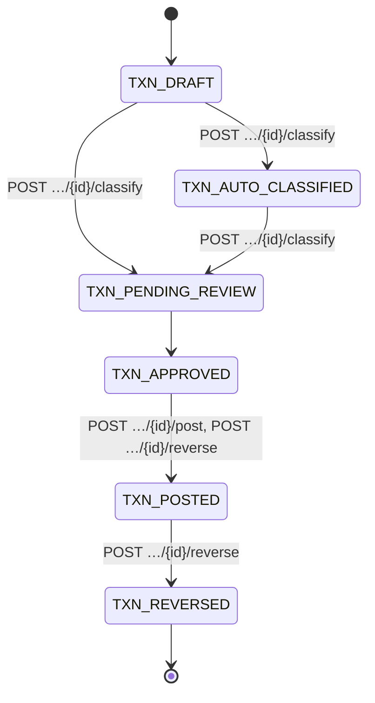

**Operaciones que ejercen esta máquina** _(POR_REFERENCIA: el handler alcanza un método que valida contra la tabla; «sin destino nombrado» significa que el estado de destino llega por el cuerpo de la petición)_:

| Operación | Estados de destino que nombra | A través de |
|---|---|---|
| POST /accounting/journal-transactions/{id}/approve | sin destino nombrado | LedgerService.transition → LedgerService.assertTransition |
| POST /accounting/journal-transactions/{id}/classify | TXN_AUTO_CLASSIFIED, TXN_PENDING_REVIEW | LedgerService.classify → LedgerService.assertTransition |
| POST /accounting/journal-transactions/{id}/post | TXN_POSTED | LedgerService.post → LedgerService.assertTransition |
| POST /accounting/journal-transactions/{id}/reverse | TXN_POSTED, TXN_REVERSED | LedgerService.reverseJournal → LedgerService.assertTransition |
| POST /accounting/journal-transactions/{id}/submit-review | sin destino nombrado | LedgerService.transition → LedgerService.assertTransition |
| POST /visit-requests/{visitRequestId}/accept | sin destino nombrado | VisitRequestsService.transitionByDoctor → VisitRequestsService.assertOpen → VisitRequestsService.assertTransition |
| POST /visit-requests/{visitRequestId}/cancel | sin destino nombrado | VisitRequestsService.cancel → VisitRequestsService.assertOpen → VisitRequestsService.assertTransition |
| POST /visit-requests/{visitRequestId}/propose-time | sin destino nombrado | VisitRequestsService.proposeTime → VisitRequestsService.assertOpen → VisitRequestsService.assertTransition |
| POST /visit-requests/{visitRequestId}/reject | sin destino nombrado | VisitRequestsService.transitionByDoctor → VisitRequestsService.assertOpen → VisitRequestsService.assertTransition |
| POST /visit-requests/{visitRequestId}/request-info | sin destino nombrado | VisitRequestsService.requestInfo → VisitRequestsService.assertOpen |
| POST /visit-requests/{visitRequestId}/reschedule | sin destino nombrado | VisitRequestsService.reschedule → VisitRequestsService.assertOpen → VisitRequestsService.assertTransition |

## Árbol de decisión por operación

Cada árbol se deriva del código del handler y de los métodos que invoca (hasta 4 niveles). Una rama que no decide, no escribe y no falla se poda. Los accesos y los efectos consecutivos se agrupan en un solo nodo.

### Operaciones con decisiones propias

#### 1. GET /accounting/accounts

Plan de cuentas de una práctica

| HTTP | Código | Cuándo |
|---|---|---|
| 200 | — | Éxito |
| 400 | `VALIDATION_FAILED` | Están los parámetros de consulta obligatorios |
| 401 | `UNAUTHENTICATED` | Hay una sesión válida (JWT) |
| 403 | `FORBIDDEN` | El rol está permitido; El tenant se resuelve y pertenece al actor; ForbiddenException: La práctica consultada pertenece a otra organización |
| 404 | `NOT_FOUND` | ResourceNotFoundException: Práctica no encontrada |
| 422 | `PRECONDITION_FAILED` | PreconditionFailedException: La cuenta no tiene un perfil profesional asociado; PreconditionFailedException: No se pudo verificar la vinculación del profesional con la práctica; PreconditionFailedException: El profesional no tiene una vinculación activa con esa práctica |
| 429 | `RATE_LIMITED` | No se supera el límite de solicitudes |

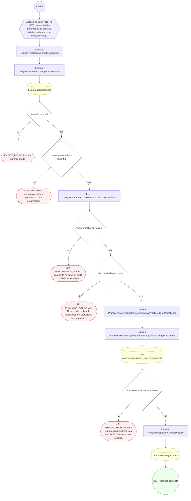

#### 2. POST /accounting/accounts

Crear una cuenta del plan contable

| HTTP | Código | Cuándo |
|---|---|---|
| 201 | — | Éxito |
| 400 | `VALIDATION_FAILED` | El cuerpo cumple el DTO (sin propiedades extra) |
| 401 | `UNAUTHENTICATED` | Hay una sesión válida (JWT) |
| 403 | `FORBIDDEN` | El rol está permitido; El tenant se resuelve y pertenece al actor |
| 409 | `CONFLICT` | ConflictException: Ya existe una cuenta con ese código en la práctica |
| 429 | `RATE_LIMITED` | No se supera el límite de solicitudes |

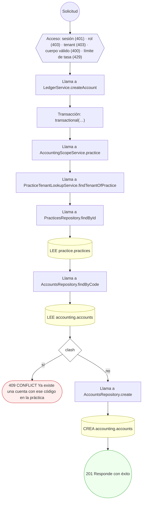

#### 3. GET /accounting/accrual-objects

Registro de devengos de una práctica

| HTTP | Código | Cuándo |
|---|---|---|
| 200 | — | Éxito |
| 400 | `VALIDATION_FAILED` | Están los parámetros de consulta obligatorios |
| 401 | `UNAUTHENTICATED` | Hay una sesión válida (JWT) |
| 403 | `FORBIDDEN` | El rol está permitido; El tenant se resuelve y pertenece al actor; ForbiddenException: La práctica consultada pertenece a otra organización |
| 404 | `NOT_FOUND` | ResourceNotFoundException: Práctica no encontrada |
| 422 | `PRECONDITION_FAILED` | PreconditionFailedException: La cuenta no tiene un perfil profesional asociado; PreconditionFailedException: No se pudo verificar la vinculación del profesional con la práctica; PreconditionFailedException: El profesional no tiene una vinculación activa con esa práctica |
| 429 | `RATE_LIMITED` | No se supera el límite de solicitudes |


#### 4. POST /accounting/accrual-objects

Crear objeto de devengo y su cronograma

| HTTP | Código | Cuándo |
|---|---|---|
| 201 | — | Éxito |
| 400 | `VALIDATION_FAILED` | El cuerpo cumple el DTO (sin propiedades extra) |
| 401 | `UNAUTHENTICATED` | Hay una sesión válida (JWT) |
| 403 | `FORBIDDEN` | El rol está permitido; El tenant se resuelve y pertenece al actor |
| 409 | `CONFLICT` | ConflictException: El número de objeto ya existe en el tenant |
| 422 | `PRECONDITION_FAILED` | PreconditionFailedException: La suma del cronograma no iguala el total |
| 429 | `RATE_LIMITED` | No se supera el límite de solicitudes |

```mermaid
flowchart TD
  n1(("Solicitud")):::inicio
  n2{{"Acceso: sesión (401) · rol (403) · tenant (403) · cuerpo válido (400) · límite de tasa (429)"}}:::acceso
  n1 --> n2
  n3["Llama a AccrualService.createAccrualObject"]:::llamada
  n2 --> n3
  n4{"plannedTotal !== toCents(dto.totalAmount)"}:::decision
  n3 --> n4
  n5(["422 PRECONDITION_FAILED La suma del cronograma no iguala el total"]):::error
  n4 -->|"sí"| n5
  n6["Transacción: transactional(…)"]:::transaccion
  n4 -->|"no"| n6
  n7["Llama a AccountingScopeService.accountsInTenant"]:::llamada
  n6 --> n7
  n8["Llama a AccountsRepository.findByIds"]:::llamada
  n7 --> n8
  n9[("LEE accounting.accounts")]:::efecto
  n8 --> n9
  n10["Llama a AccountingScopeService.costCentersInTenant"]:::llamada
  n9 --> n10
  n11["Llama a AccountingControllingRepository.findCostCentersByIds"]:::llamada
  n10 --> n11
  n12[("LEE accounting.cost_centers")]:::efecto
  n11 --> n12
  n13["Llama a AccountingScopeService.profitCentersInTenant"]:::llamada
  n12 --> n13
  n14["Llama a AccountingControllingRepository.findProfitCentersByIds"]:::llamada
  n13 --> n14
  n15[("LEE accounting.profit_centers")]:::efecto
  n14 --> n15
  n16["Repite: por cada const periodId de new Set( dto.schedule.map((s) =› s.fiscalPeriodId…"]:::bucle
  n15 --> n16
  n17["Llama a AccountingScopeService.periodInTenant"]:::llamada
  n16 -->|"cada elemento"| n17
  n18["Llama a AccountingScopeService.periodAndYear"]:::llamada
  n17 --> n18
  n19["Llama a FiscalRepository.findPeriodById"]:::llamada
  n18 --> n19
  n20[("LEE accounting.fiscal_periods")]:::efecto
  n19 --> n20
  n21["Llama a FiscalRepository.findYearById"]:::llamada
  n20 --> n21
  n22[("LEE accounting.fiscal_years")]:::efecto
  n21 --> n22
  n23["Llama a AccrualRepository.findObjectByNumber"]:::llamada
  n22 --> n23
  n16 -->|"al terminar"| n23
  n24[("LEE accounting.accrual_objects")]:::efecto
  n23 --> n24
  n25{"clash"}:::decision
  n24 --> n25
  n26(["409 CONFLICT El número de objeto ya existe en el tenant"]):::error
  n25 -->|"sí"| n26
  n27["Llama a AccrualRepository.createObject"]:::llamada
  n25 -->|"no"| n27
  n28[("CREA accounting.accrual_objects")]:::efecto
  n27 --> n28
  n29["Repite: por cada const s de dto.schedule"]:::bucle
  n28 --> n29
  n30["Llama a AccrualRepository.createScheduleLine"]:::llamada
  n29 -->|"cada elemento"| n30
  n31[("CREA accounting.accrual_schedule_lines")]:::efecto
  n30 --> n31
  n32(("201 Responde con éxito")):::ok
  n31 --> n32
  n29 -->|"al terminar"| n32
  classDef acceso fill:#eef,stroke:#66a
  classDef error fill:#fee,stroke:#c33
  classDef ok fill:#efe,stroke:#3a3
  classDef efecto fill:#ffd,stroke:#aa3
  classDef decision fill:#fff,stroke:#555
  classDef corte fill:#eee,stroke:#999,stroke-dasharray: 4
```

#### 5. POST /accounting/accruals/run

Postear devengo periódico (accrual run)

| HTTP | Código | Cuándo |
|---|---|---|
| 201 | — | Éxito |
| 400 | `VALIDATION_FAILED` | El cuerpo cumple el DTO (sin propiedades extra) |
| 401 | `UNAUTHENTICATED` | Hay una sesión válida (JWT) |
| 403 | `FORBIDDEN` | El rol está permitido; El tenant se resuelve y pertenece al actor |
| 422 | `PRECONDITION_FAILED` | PreconditionFailedException: El objeto de devengo no define cuentas; PreconditionFailedException: No hay líneas de devengo pendientes en el periodo; PreconditionFailedException: El asiento generado no balancea (debe != haber) |
| 429 | `RATE_LIMITED` | No se supera el límite de solicitudes |

```mermaid
flowchart TD
  n1(("Solicitud")):::inicio
  n2{{"Acceso: sesión (401) · rol (403) · tenant (403) · cuerpo válido (400) · límite de tasa (429)"}}:::acceso
  n1 --> n2
  n3["Llama a AccrualService.runAccruals"]:::llamada
  n2 --> n3
  n4["Transacción: transactional(…)"]:::transaccion
  n3 --> n4
  n5["Llama a AccountingScopeService.practice"]:::llamada
  n4 --> n5
  n6["Llama a PracticeTenantLookupService.findTenantOfPractice"]:::llamada
  n5 --> n6
  n7["Llama a PracticesRepository.findById"]:::llamada
  n6 --> n7
  n8[("LEE practice.practices")]:::efecto
  n7 --> n8
  n9["Llama a AccountingScopeService.accrualObject"]:::llamada
  n8 --> n9
  n10["Llama a AccrualRepository.findObjectById"]:::llamada
  n9 --> n10
  n11[("LEE accounting.accrual_objects")]:::efecto
  n10 --> n11
  n12["Llama a AccountingScopeService.periodInPractice"]:::llamada
  n11 --> n12
  n13["Llama a AccountingScopeService.periodAndYear"]:::llamada
  n12 --> n13
  n14["Llama a FiscalRepository.findPeriodById"]:::llamada
  n13 --> n14
  n15[("LEE accounting.fiscal_periods")]:::efecto
  n14 --> n15
  n16["Llama a FiscalRepository.findYearById"]:::llamada
  n15 --> n16
  n17[("LEE accounting.fiscal_years")]:::efecto
  n16 --> n17
  n18{"!object.expenseAccountId || !object.accrualAccountId"}:::decision
  n17 --> n18
  n19(["422 PRECONDITION_FAILED El objeto de devengo no define cuentas"]):::error
  n18 -->|"sí"| n19
  n20["Llama a AccrualRepository.pendingLinesForPeriod"]:::llamada
  n18 -->|"no"| n20
  n21[("LEE accounting.accrual_schedule_lines")]:::efecto
  n20 --> n21
  n22{"pending.length === 0"}:::decision
  n21 --> n22
  n23(["422 PRECONDITION_FAILED No hay líneas de devengo pendientes en el periodo"]):::error
  n22 -->|"sí"| n23
  n24["Repite: por cada const line de pending"]:::bucle
  n22 -->|"no"| n24
  n25["Llama a PostingHelper.post"]:::llamada
  n24 -->|"cada elemento"| n25
  n26{"debit ‹= 0 || debit !== credit"}:::decision
  n25 --> n26
  n27(["422 PRECONDITION_FAILED El asiento generado no balancea (debe != haber)"]):::error
  n26 -->|"sí"| n27
  n28["Llama a JournalRepository.createTransaction"]:::llamada
  n26 -->|"no"| n28
  n29[("CREA accounting.journal_transactions")]:::efecto
  n28 --> n29
  n30["Repite: por cada const line de req.lines"]:::bucle
  n29 --> n30
  n31["Llama a JournalRepository.createLedgerEntry"]:::llamada
  n30 -->|"cada elemento"| n31
  n32[("CREA accounting.ledger_entries")]:::efecto
  n31 --> n32
  n33["Llama a JournalRepository.createAssignment"]:::llamada
  n32 --> n33
  n34[("CREA accounting.journal_entry_assignments")]:::efecto
  n33 --> n34
  n35["Llama a AccrualRepository.createPosting"]:::llamada
  n34 --> n35
  n30 -->|"al terminar"| n35
  n36[("CREA accounting.accrual_postings")]:::efecto
  n35 --> n36
  n37[("ACTUALIZA accounting.accrual_schedule_lines · ACTUALIZA accounting.accrual_schedule_lines")]:::efecto
  n36 --> n37
  n38(("201 Responde con éxito")):::ok
  n37 --> n38
  n24 -->|"al terminar"| n38
  classDef acceso fill:#eef,stroke:#66a
  classDef error fill:#fee,stroke:#c33
  classDef ok fill:#efe,stroke:#3a3
  classDef efecto fill:#ffd,stroke:#aa3
  classDef decision fill:#fff,stroke:#555
  classDef corte fill:#eee,stroke:#999,stroke-dasharray: 4
```

#### 6. GET /accounting/assets

Registro de activos fijos de una práctica

| HTTP | Código | Cuándo |
|---|---|---|
| 200 | — | Éxito |
| 400 | `VALIDATION_FAILED` | Están los parámetros de consulta obligatorios |
| 401 | `UNAUTHENTICATED` | Hay una sesión válida (JWT) |
| 403 | `FORBIDDEN` | El rol está permitido; El tenant se resuelve y pertenece al actor; ForbiddenException: La práctica consultada pertenece a otra organización |
| 404 | `NOT_FOUND` | ResourceNotFoundException: Práctica no encontrada |
| 422 | `PRECONDITION_FAILED` | PreconditionFailedException: La cuenta no tiene un perfil profesional asociado; PreconditionFailedException: No se pudo verificar la vinculación del profesional con la práctica; PreconditionFailedException: El profesional no tiene una vinculación activa con esa práctica |
| 429 | `RATE_LIMITED` | No se supera el límite de solicitudes |


#### 7. POST /accounting/assets/capitalize

Capitalizar activo (alta y asignación)

| HTTP | Código | Cuándo |
|---|---|---|
| 201 | — | Éxito |
| 400 | `VALIDATION_FAILED` | El cuerpo cumple el DTO (sin propiedades extra) |
| 401 | `UNAUTHENTICATED` | Hay una sesión válida (JWT) |
| 403 | `FORBIDDEN` | El rol está permitido; El tenant se resuelve y pertenece al actor |
| 409 | `CONFLICT` | ConflictException: Ya existe un activo con ese código en la práctica |
| 422 | `PRECONDITION_FAILED` | PreconditionFailedException: El asiento generado no balancea (debe != haber) |
| 429 | `RATE_LIMITED` | No se supera el límite de solicitudes |

```mermaid
flowchart TD
  n1(("Solicitud")):::inicio
  n2{{"Acceso: sesión (401) · rol (403) · tenant (403) · cuerpo válido (400) · límite de tasa (429)"}}:::acceso
  n1 --> n2
  n3["Llama a AssetService.capitalize"]:::llamada
  n2 --> n3
  n4["Transacción: transactional(…)"]:::transaccion
  n3 --> n4
  n5["Llama a AccountingScopeService.practice"]:::llamada
  n4 --> n5
  n6["Llama a PracticeTenantLookupService.findTenantOfPractice"]:::llamada
  n5 --> n6
  n7["Llama a PracticesRepository.findById"]:::llamada
  n6 --> n7
  n8[("LEE practice.practices")]:::efecto
  n7 --> n8
  n9{"dto.fiscalPeriodId"}:::decision
  n8 --> n9
  n10["Llama a AccountingScopeService.periodInPractice"]:::llamada
  n9 -->|"sí"| n10
  n11["Llama a AccountingScopeService.periodAndYear"]:::llamada
  n10 --> n11
  n12["Llama a FiscalRepository.findPeriodById"]:::llamada
  n11 --> n12
  n13[("LEE accounting.fiscal_periods")]:::efecto
  n12 --> n13
  n14["Llama a FiscalRepository.findYearById"]:::llamada
  n13 --> n14
  n15[("LEE accounting.fiscal_years")]:::efecto
  n14 --> n15
  n16["Llama a AccountingScopeService.accountsInPractice"]:::llamada
  n15 --> n16
  n9 -->|"no"| n16
  n17["Llama a AccountsRepository.findByIds"]:::llamada
  n16 --> n17
  n18[("LEE accounting.accounts")]:::efecto
  n17 --> n18
  n19["Llama a AccountingScopeService.costCentersInPractice"]:::llamada
  n18 --> n19
  n20["Llama a AccountingControllingRepository.findCostCentersByIds"]:::llamada
  n19 --> n20
  n21[("LEE accounting.cost_centers")]:::efecto
  n20 --> n21
  n22{"dto.depreciationAreaId"}:::decision
  n21 --> n22
  n23["Llama a AccountingScopeService.depreciationArea"]:::llamada
  n22 -->|"sí"| n23
  n24["Llama a AssetRepository.findDepreciationAreaById"]:::llamada
  n23 --> n24
  n25[("LEE accounting.depreciation_areas")]:::efecto
  n24 --> n25
  n26["Llama a AssetRepository.findByCode"]:::llamada
  n25 --> n26
  n22 -->|"no"| n26
  n27[("LEE accounting.assets")]:::efecto
  n26 --> n27
  n28{"clash"}:::decision
  n27 --> n28
  n29(["409 CONFLICT Ya existe un activo con ese código en la práctica"]):::error
  n28 -->|"sí"| n29
  n30["Llama a AssetRepository.createAsset"]:::llamada
  n28 -->|"no"| n30
  n31[("CREA accounting.assets")]:::efecto
  n30 --> n31
  n32{"dto.depreciationAreaId"}:::decision
  n31 --> n32
  n33["Llama a AssetRepository.createValuation"]:::llamada
  n32 -->|"sí"| n33
  n34[("CREA accounting.asset_valuations")]:::efecto
  n33 --> n34
  n35{"dto.costCenterId || dto.responsibleEmployeeId"}:::decision
  n34 --> n35
  n32 -->|"no"| n35
  n36["Llama a AssetRepository.createAssignment"]:::llamada
  n35 -->|"sí"| n36
  n37[("CREA accounting.asset_assignments")]:::efecto
  n36 --> n37
  n38["Llama a PostingHelper.post"]:::llamada
  n37 --> n38
  n35 -->|"no"| n38
  n39{"debit ‹= 0 || debit !== credit"}:::decision
  n38 --> n39
  n40(["422 PRECONDITION_FAILED El asiento generado no balancea (debe != haber)"]):::error
  n39 -->|"sí"| n40
  n41["Llama a JournalRepository.createTransaction"]:::llamada
  n39 -->|"no"| n41
  n42[("CREA accounting.journal_transactions")]:::efecto
  n41 --> n42
  n43["Repite: por cada const line de req.lines"]:::bucle
  n42 --> n43
  n44["Llama a JournalRepository.createLedgerEntry"]:::llamada
  n43 -->|"cada elemento"| n44
  n45[("CREA accounting.ledger_entries")]:::efecto
  n44 --> n45
  n46["Llama a JournalRepository.createAssignment"]:::llamada
  n45 --> n46
  n47[("CREA accounting.journal_entry_assignments")]:::efecto
  n46 --> n47
  n48["Llama a AssetRepository.createPosting"]:::llamada
  n47 --> n48
  n43 -->|"al terminar"| n48
  n49[("CREA accounting.asset_postings")]:::efecto
  n48 --> n49
  n50(("201 Responde con éxito")):::ok
  n49 --> n50
  classDef acceso fill:#eef,stroke:#66a
  classDef error fill:#fee,stroke:#c33
  classDef ok fill:#efe,stroke:#3a3
  classDef efecto fill:#ffd,stroke:#aa3
  classDef decision fill:#fff,stroke:#555
  classDef corte fill:#eee,stroke:#999,stroke-dasharray: 4
```

#### 8. GET /accounting/balance-sheet

Balance general de una práctica a una fecha de corte

| HTTP | Código | Cuándo |
|---|---|---|
| 200 | — | Éxito |
| 400 | `VALIDATION_FAILED` | Están los parámetros de consulta obligatorios |
| 401 | `UNAUTHENTICATED` | Hay una sesión válida (JWT) |
| 403 | `FORBIDDEN` | El rol está permitido; El tenant se resuelve y pertenece al actor; ForbiddenException: La práctica consultada pertenece a otra organización |
| 404 | `NOT_FOUND` | ResourceNotFoundException: Práctica no encontrada |
| 422 | `PRECONDITION_FAILED` | PreconditionFailedException: La cuenta no tiene un perfil profesional asociado; PreconditionFailedException: No se pudo verificar la vinculación del profesional con la práctica; PreconditionFailedException: El profesional no tiene una vinculación activa con esa práctica |
| 429 | `RATE_LIMITED` | No se supera el límite de solicitudes |


#### 9. POST /accounting/clearing-documents

Compensar/clearing de partidas abiertas

| HTTP | Código | Cuándo |
|---|---|---|
| 201 | — | Éxito |
| 400 | `VALIDATION_FAILED` | El cuerpo cumple el DTO (sin propiedades extra) |
| 401 | `UNAUTHENTICATED` | Hay una sesión válida (JWT) |
| 403 | `FORBIDDEN` | El rol está permitido; El tenant se resuelve y pertenece al actor |
| 409 | `CONFLICT` | ConflictException: La partida ya está compensada; ConflictException: El número de clearing ya existe en el tenant |
| 422 | `PRECONDITION_FAILED` | PreconditionFailedException: Importe compensado inválido; PreconditionFailedException: Las partidas no comparten subledger; PreconditionFailedException: El asiento generado no balancea (debe != haber) |
| 429 | `RATE_LIMITED` | No se supera el límite de solicitudes |

```mermaid
flowchart TD
  n1(("Solicitud")):::inicio
  n2{{"Acceso: sesión (401) · rol (403) · tenant (403) · cuerpo válido (400) · límite de tasa (429)"}}:::acceso
  n1 --> n2
  n3["Llama a SubledgerService.clearOpenItems"]:::llamada
  n2 --> n3
  n4["Transacción: transactional(…)"]:::transaccion
  n3 --> n4
  n5["Llama a AccountingScopeService.practice"]:::llamada
  n4 --> n5
  n6["Llama a PracticeTenantLookupService.findTenantOfPractice"]:::llamada
  n5 --> n6
  n7["Llama a PracticesRepository.findById"]:::llamada
  n6 --> n7
  n8[("LEE practice.practices")]:::efecto
  n7 --> n8
  n9{"dto.companyBankAccountId"}:::decision
  n8 --> n9
  n10["Llama a AccountingScopeService.companyBankAccount"]:::llamada
  n9 -->|"sí"| n10
  n11["Llama a SubledgerRepository.findCompanyBankAccountById"]:::llamada
  n10 --> n11
  n12[("LEE accounting.company_bank_accounts")]:::efecto
  n11 --> n12
  n13["Repite: por cada const it de dto.items"]:::bucle
  n12 --> n13
  n9 -->|"no"| n13
  n14["Llama a AccountingScopeService.openItem"]:::llamada
  n13 -->|"cada elemento"| n14
  n15["Llama a SubledgerRepository.findOpenItemById"]:::llamada
  n14 --> n15
  n16[("LEE accounting.open_items")]:::efecto
  n15 --> n16
  n17{"openItem.statusConceptId === ACCT.OPEN_ITEM_CLEARED"}:::decision
  n16 --> n17
  n18(["409 CONFLICT La partida ya está compensada"]):::error
  n17 -->|"sí"| n18
  n19{"cleared ‹= 0 || alreadyCleared + cleared › outstanding"}:::decision
  n17 -->|"no"| n19
  n20(["422 PRECONDITION_FAILED Importe compensado inválido"]):::error
  n19 -->|"sí"| n20
  n21{"openItem.subledgerAccountId !== subledgerAccountId"}:::decision
  n19 -->|"no"| n21
  n22(["422 PRECONDITION_FAILED Las partidas no comparten subledger"]):::error
  n21 -->|"sí"| n22
  n23["Llama a AccountingScopeService.subledger"]:::llamada
  n21 -->|"no"| n23
  n13 -->|"al terminar"| n23
  n24["Llama a SubledgerRepository.findSubledgerById"]:::llamada
  n23 --> n24
  n25[("LEE accounting.subledger_accounts")]:::efecto
  n24 --> n25
  n26["Llama a SubledgerRepository.findClearingByNumber"]:::llamada
  n25 --> n26
  n27[("LEE accounting.clearing_documents")]:::efecto
  n26 --> n27
  n28{"clash"}:::decision
  n27 --> n28
  n29(["409 CONFLICT El número de clearing ya existe en el tenant"]):::error
  n28 -->|"sí"| n29
  n30["Llama a PostingHelper.post"]:::llamada
  n28 -->|"no"| n30
  n31{"debit ‹= 0 || debit !== credit"}:::decision
  n30 --> n31
  n32(["422 PRECONDITION_FAILED El asiento generado no balancea (debe != haber)"]):::error
  n31 -->|"sí"| n32
  n33["Llama a JournalRepository.createTransaction"]:::llamada
  n31 -->|"no"| n33
  n34[("CREA accounting.journal_transactions")]:::efecto
  n33 --> n34
  n35["Repite: por cada const line de req.lines"]:::bucle
  n34 --> n35
  n36["Llama a JournalRepository.createLedgerEntry"]:::llamada
  n35 -->|"cada elemento"| n36
  n37[("CREA accounting.ledger_entries")]:::efecto
  n36 --> n37
  n38["Llama a JournalRepository.createAssignment"]:::llamada
  n37 --> n38
  n39[("CREA accounting.journal_entry_assignments")]:::efecto
  n38 --> n39
  n40["Llama a SubledgerRepository.createClearingDocument"]:::llamada
  n39 --> n40
  n35 -->|"al terminar"| n40
  n41[("CREA accounting.clearing_documents")]:::efecto
  n40 --> n41
  n42["Repite: por cada const l de loaded"]:::bucle
  n41 --> n42
  n43["Llama a SubledgerRepository.createClearingItem"]:::llamada
  n42 -->|"cada elemento"| n43
  n44[("CREA accounting.clearing_items")]:::efecto
  n43 --> n44
  n45(("201 Responde con éxito")):::ok
  n44 --> n45
  n42 -->|"al terminar"| n45
  classDef acceso fill:#eef,stroke:#66a
  classDef error fill:#fee,stroke:#c33
  classDef ok fill:#efe,stroke:#3a3
  classDef efecto fill:#ffd,stroke:#aa3
  classDef decision fill:#fff,stroke:#555
  classDef corte fill:#eee,stroke:#999,stroke-dasharray: 4
```

#### 10. POST /accounting/depreciation/run

Ejecutar depreciación de activos (batch)

| HTTP | Código | Cuándo |
|---|---|---|
| 201 | — | Éxito |
| 400 | `VALIDATION_FAILED` | El cuerpo cumple el DTO (sin propiedades extra) |
| 401 | `UNAUTHENTICATED` | Hay una sesión válida (JWT) |
| 403 | `FORBIDDEN` | El rol está permitido; El tenant se resuelve y pertenece al actor |
| 422 | `PRECONDITION_FAILED` | PreconditionFailedException: El asiento generado no balancea (debe != haber); PreconditionFailedException: No hay activos elegibles para depreciar en el periodo |
| 429 | `RATE_LIMITED` | No se supera el límite de solicitudes |

```mermaid
flowchart TD
  n1(("Solicitud")):::inicio
  n2{{"Acceso: sesión (401) · rol (403) · tenant (403) · cuerpo válido (400) · límite de tasa (429)"}}:::acceso
  n1 --> n2
  n3["Llama a AssetService.runDepreciation"]:::llamada
  n2 --> n3
  n4["Transacción: transactional(…)"]:::transaccion
  n3 --> n4
  n5["Llama a AccountingScopeService.practice"]:::llamada
  n4 --> n5
  n6["Llama a PracticeTenantLookupService.findTenantOfPractice"]:::llamada
  n5 --> n6
  n7["Llama a PracticesRepository.findById"]:::llamada
  n6 --> n7
  n8[("LEE practice.practices")]:::efecto
  n7 --> n8
  n9["Llama a AccountingScopeService.periodInPractice"]:::llamada
  n8 --> n9
  n10["Llama a AccountingScopeService.periodAndYear"]:::llamada
  n9 --> n10
  n11["Llama a FiscalRepository.findPeriodById"]:::llamada
  n10 --> n11
  n12[("LEE accounting.fiscal_periods")]:::efecto
  n11 --> n12
  n13["Llama a FiscalRepository.findYearById"]:::llamada
  n12 --> n13
  n14[("LEE accounting.fiscal_years")]:::efecto
  n13 --> n14
  n15["Llama a AssetRepository.activeAssets"]:::llamada
  n14 --> n15
  n16[("LEE accounting.assets")]:::efecto
  n15 --> n16
  n17["Repite: por cada const asset de assets"]:::bucle
  n16 --> n17
  n18["Llama a AssetRepository.findDepreciation"]:::llamada
  n17 -->|"cada elemento"| n18
  n19[("LEE accounting.asset_depreciations")]:::efecto
  n18 --> n19
  n20["Llama a PostingHelper.post"]:::llamada
  n19 --> n20
  n21{"debit ‹= 0 || debit !== credit"}:::decision
  n20 --> n21
  n22(["422 PRECONDITION_FAILED El asiento generado no balancea (debe != haber)"]):::error
  n21 -->|"sí"| n22
  n23["Llama a JournalRepository.createTransaction"]:::llamada
  n21 -->|"no"| n23
  n24[("CREA accounting.journal_transactions")]:::efecto
  n23 --> n24
  n25["Repite: por cada const line de req.lines"]:::bucle
  n24 --> n25
  n26["Llama a JournalRepository.createLedgerEntry"]:::llamada
  n25 -->|"cada elemento"| n26
  n27[("CREA accounting.ledger_entries")]:::efecto
  n26 --> n27
  n28["Llama a JournalRepository.createAssignment"]:::llamada
  n27 --> n28
  n29[("CREA accounting.journal_entry_assignments")]:::efecto
  n28 --> n29
  n30["Llama a AssetRepository.createDepreciation"]:::llamada
  n29 --> n30
  n25 -->|"al terminar"| n30
  n31[("CREA accounting.asset_depreciations")]:::efecto
  n30 --> n31
  n32["Llama a AssetRepository.createPosting"]:::llamada
  n31 --> n32
  n33[("CREA accounting.asset_postings")]:::efecto
  n32 --> n33
  n34[("ACTUALIZA accounting.assets · ACTUALIZA accounting.assets")]:::efecto
  n33 --> n34
  n35{"depreciated === 0"}:::decision
  n34 --> n35
  n17 -->|"al terminar"| n35
  n36(["422 PRECONDITION_FAILED No hay activos elegibles para depreciar en el periodo"]):::error
  n35 -->|"sí"| n36
  n37(("201 Responde con éxito")):::ok
  n35 -->|"no"| n37
  classDef acceso fill:#eef,stroke:#66a
  classDef error fill:#fee,stroke:#c33
  classDef ok fill:#efe,stroke:#3a3
  classDef efecto fill:#ffd,stroke:#aa3
  classDef decision fill:#fff,stroke:#555
  classDef corte fill:#eee,stroke:#999,stroke-dasharray: 4
```

#### 11. GET /accounting/dimensions

Dimensiones analíticas de una práctica

| HTTP | Código | Cuándo |
|---|---|---|
| 200 | — | Éxito |
| 400 | `VALIDATION_FAILED` | Están los parámetros de consulta obligatorios |
| 401 | `UNAUTHENTICATED` | Hay una sesión válida (JWT) |
| 403 | `FORBIDDEN` | El rol está permitido; El tenant se resuelve y pertenece al actor; ForbiddenException: La práctica consultada pertenece a otra organización |
| 404 | `NOT_FOUND` | ResourceNotFoundException: Práctica no encontrada |
| 422 | `PRECONDITION_FAILED` | PreconditionFailedException: La cuenta no tiene un perfil profesional asociado; PreconditionFailedException: No se pudo verificar la vinculación del profesional con la práctica; PreconditionFailedException: El profesional no tiene una vinculación activa con esa práctica |
| 429 | `RATE_LIMITED` | No se supera el límite de solicitudes |


#### 12. POST /accounting/exchange-rates

Registrar tipo de cambio para conversión

| HTTP | Código | Cuándo |
|---|---|---|
| 201 | — | Éxito |
| 400 | `VALIDATION_FAILED` | El cuerpo cumple el DTO (sin propiedades extra) |
| 401 | `UNAUTHENTICATED` | Hay una sesión válida (JWT) |
| 403 | `FORBIDDEN` | El rol está permitido; El tenant se resuelve y pertenece al actor; InsufficientRoleException: El tipo de cambio es un dato de plataforma |
| 429 | `RATE_LIMITED` | No se supera el límite de solicitudes |

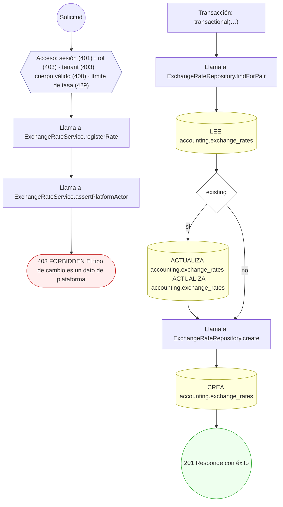

#### 13. POST /accounting/fiscal-periods/{id}/lock

Cerrar/bloquear un periodo fiscal

| HTTP | Código | Cuándo |
|---|---|---|
| 200 | — | Éxito |
| 400 | `VALIDATION_FAILED` | Los parámetros de ruta son UUID válidos; El cuerpo cumple el DTO (sin propiedades extra) |
| 401 | `UNAUTHENTICATED` | Hay una sesión válida (JWT) |
| 403 | `FORBIDDEN` | El rol está permitido; El tenant se resuelve y pertenece al actor |
| 422 | `PRECONDITION_FAILED` | PreconditionFailedException: El periodo no está ABIERTO |
| 429 | `RATE_LIMITED` | No se supera el límite de solicitudes |

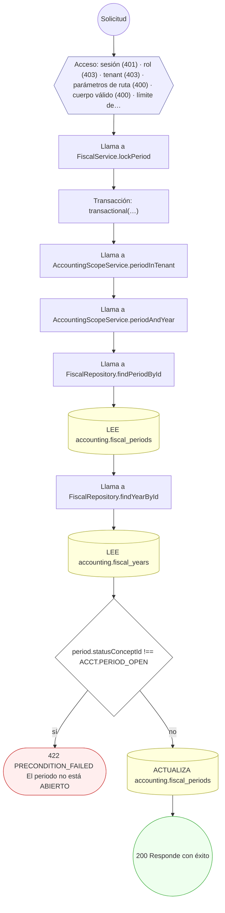

#### 14. GET /accounting/fiscal-years

Ejercicio fiscal vigente de una práctica

| HTTP | Código | Cuándo |
|---|---|---|
| 200 | — | Éxito |
| 400 | `VALIDATION_FAILED` | Están los parámetros de consulta obligatorios |
| 401 | `UNAUTHENTICATED` | Hay una sesión válida (JWT) |
| 403 | `FORBIDDEN` | El rol está permitido; El tenant se resuelve y pertenece al actor; ForbiddenException: La práctica consultada pertenece a otra organización |
| 404 | `NOT_FOUND` | ResourceNotFoundException: Práctica no encontrada; ResourceNotFoundException: La práctica no tiene ejercicios fiscales |
| 422 | `PRECONDITION_FAILED` | PreconditionFailedException: La cuenta no tiene un perfil profesional asociado; PreconditionFailedException: No se pudo verificar la vinculación del profesional con la práctica; PreconditionFailedException: El profesional no tiene una vinculación activa con esa práctica |
| 429 | `RATE_LIMITED` | No se supera el límite de solicitudes |


#### 15. POST /accounting/fiscal-years

Abrir un ejercicio fiscal y sus periodos

| HTTP | Código | Cuándo |
|---|---|---|
| 201 | — | Éxito |
| 400 | `VALIDATION_FAILED` | El cuerpo cumple el DTO (sin propiedades extra) |
| 401 | `UNAUTHENTICATED` | Hay una sesión válida (JWT) |
| 403 | `FORBIDDEN` | El rol está permitido; El tenant se resuelve y pertenece al actor |
| 409 | `CONFLICT` | ConflictException: El ejercicio ya existe en la práctica |
| 429 | `RATE_LIMITED` | No se supera el límite de solicitudes |

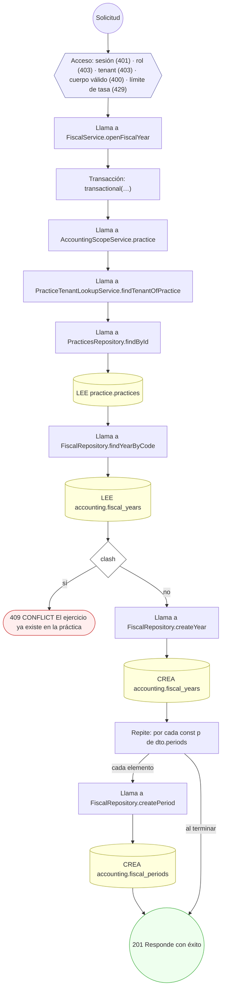

#### 16. GET /accounting/general-ledger

Libro mayor de una cuenta (movimientos posteados, con saldo corrido)

| HTTP | Código | Cuándo |
|---|---|---|
| 200 | — | Éxito |
| 400 | `VALIDATION_FAILED` | Están los parámetros de consulta obligatorios |
| 401 | `UNAUTHENTICATED` | Hay una sesión válida (JWT) |
| 403 | `FORBIDDEN` | El rol está permitido; El tenant se resuelve y pertenece al actor; ForbiddenException: La práctica consultada pertenece a otra organización |
| 404 | `NOT_FOUND` | ResourceNotFoundException: Práctica no encontrada; ResourceNotFoundException: Cuenta no encontrada en la práctica |
| 422 | `PRECONDITION_FAILED` | PreconditionFailedException: La cuenta no tiene un perfil profesional asociado; PreconditionFailedException: No se pudo verificar la vinculación del profesional con la práctica; PreconditionFailedException: El profesional no tiene una vinculación activa con esa práctica |
| 429 | `RATE_LIMITED` | No se supera el límite de solicitudes |

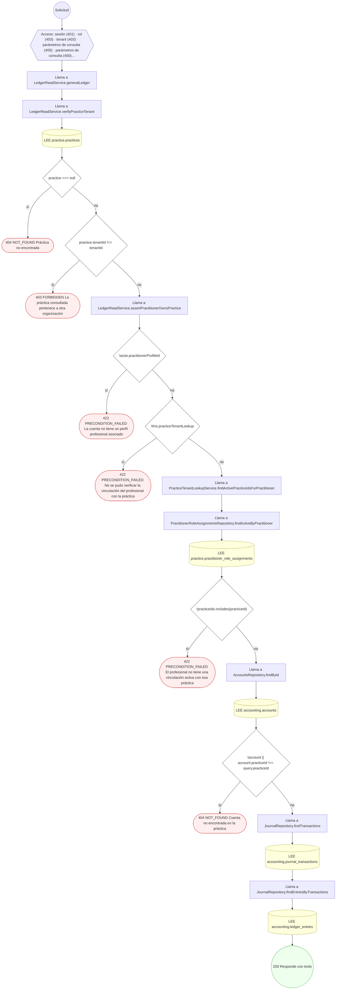

#### 17. GET /accounting/income-statement

Estado de resultados de una práctica

| HTTP | Código | Cuándo |
|---|---|---|
| 200 | — | Éxito |
| 400 | `VALIDATION_FAILED` | Están los parámetros de consulta obligatorios |
| 401 | `UNAUTHENTICATED` | Hay una sesión válida (JWT) |
| 403 | `FORBIDDEN` | El rol está permitido; El tenant se resuelve y pertenece al actor; ForbiddenException: La práctica consultada pertenece a otra organización |
| 404 | `NOT_FOUND` | ResourceNotFoundException: Práctica no encontrada |
| 422 | `PRECONDITION_FAILED` | PreconditionFailedException: La cuenta no tiene un perfil profesional asociado; PreconditionFailedException: No se pudo verificar la vinculación del profesional con la práctica; PreconditionFailedException: El profesional no tiene una vinculación activa con esa práctica |
| 429 | `RATE_LIMITED` | No se supera el límite de solicitudes |

```mermaid
flowchart TD
  n1(("Solicitud")):::inicio
  n2{{"Acceso: sesión (401) · rol (403) · tenant (403) · parámetros de consulta (400) · límite de tasa (429)"}}:::acceso
  n1 --> n2
  n3["Llama a LedgerReadService.incomeStatement"]:::llamada
  n2 --> n3
  n4["Llama a LedgerReadService.verifyPracticeTenant"]:::llamada
  n3 --> n4
  n5[("LEE practice.practices")]:::efecto
  n4 --> n5
  n6{"practice === null"}:::decision
  n5 --> n6
  n7(["404 NOT_FOUND Práctica no encontrada"]):::error
  n6 -->|"sí"| n7
  n8{"practice.tenantId !== tenantId"}:::decision
  n6 -->|"no"| n8
  n9(["403 FORBIDDEN La práctica consultada pertenece a otra organización"]):::error
  n8 -->|"sí"| n9
  n10["Llama a LedgerReadService.assertPractitionerOwnsPractice"]:::llamada
  n8 -->|"no"| n10
  n11{"!actor.practitionerProfileId"}:::decision
  n10 --> n11
  n12(["422 PRECONDITION_FAILED La cuenta no tiene un perfil profesional asociado"]):::error
  n11 -->|"sí"| n12
  n13{"!this.practiceTenantLookup"}:::decision
  n11 -->|"no"| n13
  n14(["422 PRECONDITION_FAILED No se pudo verificar la vinculación del profesional con la práctica"]):::error
  n13 -->|"sí"| n14
  n15["Llama a PracticeTenantLookupService.findActivePracticeIdsForPractitioner"]:::llamada
  n13 -->|"no"| n15
  n16["Llama a PractitionerRoleAssignmentsRepository.findActiveByPractitioner"]:::llamada
  n15 --> n16
  n17[("LEE practice.practitioner_role_assignments")]:::efecto
  n16 --> n17
  n18{"!practiceIds.includes(practiceId)"}:::decision
  n17 --> n18
  n19(["422 PRECONDITION_FAILED El profesional no tiene una vinculación activa con esa práctica"]):::error
  n18 -->|"sí"| n19
  n20["Llama a LedgerReadService.aggregatePostedByAccount"]:::llamada
  n18 -->|"no"| n20
  n21["Llama a JournalRepository.findTransactions"]:::llamada
  n20 --> n21
  n22[("LEE accounting.journal_transactions")]:::efecto
  n21 --> n22
  n23["Llama a JournalRepository.findEntriesByTransactions"]:::llamada
  n22 --> n23
  n24[("LEE accounting.ledger_entries")]:::efecto
  n23 --> n24
  n25["Llama a AccountsRepository.findByPractice"]:::llamada
  n24 --> n25
  n26[("LEE accounting.accounts")]:::efecto
  n25 --> n26
  n27(("200 Responde con éxito")):::ok
  n26 --> n27
  classDef acceso fill:#eef,stroke:#66a
  classDef error fill:#fee,stroke:#c33
  classDef ok fill:#efe,stroke:#3a3
  classDef efecto fill:#ffd,stroke:#aa3
  classDef decision fill:#fff,stroke:#555
  classDef corte fill:#eee,stroke:#999,stroke-dasharray: 4
```

#### 18. GET /accounting/journal-transactions

Libro diario de una práctica

| HTTP | Código | Cuándo |
|---|---|---|
| 200 | — | Éxito |
| 400 | `VALIDATION_FAILED` | Están los parámetros de consulta obligatorios |
| 401 | `UNAUTHENTICATED` | Hay una sesión válida (JWT) |
| 403 | `FORBIDDEN` | El rol está permitido; El tenant se resuelve y pertenece al actor; ForbiddenException: La práctica consultada pertenece a otra organización |
| 404 | `NOT_FOUND` | ResourceNotFoundException: Práctica no encontrada |
| 422 | `PRECONDITION_FAILED` | PreconditionFailedException: La cuenta no tiene un perfil profesional asociado; PreconditionFailedException: No se pudo verificar la vinculación del profesional con la práctica; PreconditionFailedException: El profesional no tiene una vinculación activa con esa práctica |
| 429 | `RATE_LIMITED` | No se supera el límite de solicitudes |

```mermaid
flowchart TD
  n1(("Solicitud")):::inicio
  n2{{"Acceso: sesión (401) · rol (403) · tenant (403) · parámetros de consulta (400) · límite de tasa (429)"}}:::acceso
  n1 --> n2
  n3["Llama a LedgerReadService.listJournal"]:::llamada
  n2 --> n3
  n4["Llama a LedgerReadService.verifyPracticeTenant"]:::llamada
  n3 --> n4
  n5[("LEE practice.practices")]:::efecto
  n4 --> n5
  n6{"practice === null"}:::decision
  n5 --> n6
  n7(["404 NOT_FOUND Práctica no encontrada"]):::error
  n6 -->|"sí"| n7
  n8{"practice.tenantId !== tenantId"}:::decision
  n6 -->|"no"| n8
  n9(["403 FORBIDDEN La práctica consultada pertenece a otra organización"]):::error
  n8 -->|"sí"| n9
  n10["Llama a LedgerReadService.assertPractitionerOwnsPractice"]:::llamada
  n8 -->|"no"| n10
  n11{"!actor.practitionerProfileId"}:::decision
  n10 --> n11
  n12(["422 PRECONDITION_FAILED La cuenta no tiene un perfil profesional asociado"]):::error
  n11 -->|"sí"| n12
  n13{"!this.practiceTenantLookup"}:::decision
  n11 -->|"no"| n13
  n14(["422 PRECONDITION_FAILED No se pudo verificar la vinculación del profesional con la práctica"]):::error
  n13 -->|"sí"| n14
  n15["Llama a PracticeTenantLookupService.findActivePracticeIdsForPractitioner"]:::llamada
  n13 -->|"no"| n15
  n16["Llama a PractitionerRoleAssignmentsRepository.findActiveByPractitioner"]:::llamada
  n15 --> n16
  n17[("LEE practice.practitioner_role_assignments")]:::efecto
  n16 --> n17
  n18{"!practiceIds.includes(practiceId)"}:::decision
  n17 --> n18
  n19(["422 PRECONDITION_FAILED El profesional no tiene una vinculación activa con esa práctica"]):::error
  n18 -->|"sí"| n19
  n20["Llama a JournalRepository.findTransactions"]:::llamada
  n18 -->|"no"| n20
  n21[("LEE accounting.journal_transactions")]:::efecto
  n20 --> n21
  n22(("200 Responde con éxito")):::ok
  n21 --> n22
  classDef acceso fill:#eef,stroke:#66a
  classDef error fill:#fee,stroke:#c33
  classDef ok fill:#efe,stroke:#3a3
  classDef efecto fill:#ffd,stroke:#aa3
  classDef decision fill:#fff,stroke:#555
  classDef corte fill:#eee,stroke:#999,stroke-dasharray: 4
```

#### 19. POST /accounting/journal-transactions

Registrar y postear un asiento balanceado (partida doble)

| HTTP | Código | Cuándo |
|---|---|---|
| 201 | — | Éxito |
| 400 | `VALIDATION_FAILED` | El cuerpo cumple el DTO (sin propiedades extra) |
| 401 | `UNAUTHENTICATED` | Hay una sesión válida (JWT) |
| 403 | `FORBIDDEN` | El rol está permitido; El tenant se resuelve y pertenece al actor |
| 409 | `CONFLICT` | ConflictException: El número de asiento ya existe en la práctica |
| 422 | `PRECONDITION_FAILED` | PreconditionFailedException: El asiento no tiene importe; PreconditionFailedException: El asiento no balancea (debe != haber); PreconditionFailedException: El periodo fiscal no está ABIERTO |
| 429 | `RATE_LIMITED` | No se supera el límite de solicitudes |

```mermaid
flowchart TD
  n1(("Solicitud")):::inicio
  n2{{"Acceso: sesión (401) · rol (403) · tenant (403) · cuerpo válido (400) · límite de tasa (429)"}}:::acceso
  n1 --> n2
  n3["Llama a LedgerService.postJournal"]:::llamada
  n2 --> n3
  n4["Llama a LedgerService.assertBalanced"]:::llamada
  n3 --> n4
  n5{"debitCents ‹= 0"}:::decision
  n4 --> n5
  n6(["422 PRECONDITION_FAILED El asiento no tiene importe"]):::error
  n5 -->|"sí"| n6
  n7{"debitCents !== creditCents"}:::decision
  n5 -->|"no"| n7
  n8(["422 PRECONDITION_FAILED El asiento no balancea (debe != haber)"]):::error
  n7 -->|"sí"| n8
  n9["Transacción: transactional(…)"]:::transaccion
  n7 -->|"no"| n9
  n10["Llama a AccountingScopeService.assertPostingScope"]:::llamada
  n9 --> n10
  n11["Llama a AccountingScopeService.accountsInPractice"]:::llamada
  n10 --> n11
  n12["Llama a AccountsRepository.findByIds"]:::llamada
  n11 --> n12
  n13[("LEE accounting.accounts")]:::efecto
  n12 --> n13
  n14["Llama a AccountingScopeService.costCentersInPractice"]:::llamada
  n13 --> n14
  n15["Llama a AccountingControllingRepository.findCostCentersByIds"]:::llamada
  n14 --> n15
  n16[("LEE accounting.cost_centers")]:::efecto
  n15 --> n16
  n17["Llama a AccountingScopeService.profitCentersInTenant"]:::llamada
  n16 --> n17
  n18["Llama a AccountingControllingRepository.findProfitCentersByIds"]:::llamada
  n17 --> n18
  n19[("LEE accounting.profit_centers")]:::efecto
  n18 --> n19
  n20["Llama a AccountingScopeService.assetsInPractice"]:::llamada
  n19 --> n20
  n21["Repite: por cada const id de unique(ids)"]:::bucle
  n20 --> n21
  n22["Llama a AssetRepository.findById"]:::llamada
  n21 -->|"cada elemento"| n22
  n23[("LEE accounting.assets")]:::efecto
  n22 --> n23
  n24{"period && period.statusConceptId !== ACCT.PERIOD_OPEN"}:::decision
  n23 --> n24
  n21 -->|"al terminar"| n24
  n25(["422 PRECONDITION_FAILED El periodo fiscal no está ABIERTO"]):::error
  n24 -->|"sí"| n25
  n26["Llama a JournalRepository.findByTransactionNumber"]:::llamada
  n24 -->|"no"| n26
  n27[("LEE accounting.journal_transactions")]:::efecto
  n26 --> n27
  n28{"clash"}:::decision
  n27 --> n28
  n29(["409 CONFLICT El número de asiento ya existe en la práctica"]):::error
  n28 -->|"sí"| n29
  n30["Llama a JournalRepository.createTransaction"]:::llamada
  n28 -->|"no"| n30
  n31[("CREA accounting.journal_transactions")]:::efecto
  n30 --> n31
  n32["Llama a LedgerService.writeLines"]:::llamada
  n31 --> n32
  n33["Repite: por cada const line de lines"]:::bucle
  n32 --> n33
  n34["Llama a JournalRepository.createLedgerEntry"]:::llamada
  n33 -->|"cada elemento"| n34
  n35[("CREA accounting.ledger_entries")]:::efecto
  n34 --> n35
  n36["Llama a JournalRepository.createAssignment"]:::llamada
  n35 --> n36
  n37[("CREA accounting.journal_entry_assignments")]:::efecto
  n36 --> n37
  n38["Llama a AuditTrailService.record"]:::llamada
  n37 --> n38
  n33 -->|"al terminar"| n38
  n39["Llama a AuditLogRepository.append"]:::llamada
  n38 --> n39
  n40["Llama a AuditLogRepository.findChainTip"]:::llamada
  n39 --> n40
  n41[("LEE audit.audit_log")]:::efecto
  n40 --> n41
  n42[("CREA audit.audit_log")]:::efecto
  n41 --> n42
  n43(("201 Responde con éxito")):::ok
  n42 --> n43
  classDef acceso fill:#eef,stroke:#66a
  classDef error fill:#fee,stroke:#c33
  classDef ok fill:#efe,stroke:#3a3
  classDef efecto fill:#ffd,stroke:#aa3
  classDef decision fill:#fff,stroke:#555
  classDef corte fill:#eee,stroke:#999,stroke-dasharray: 4
```

#### 20. GET /accounting/journal-transactions/{id}

Un asiento con sus líneas

| HTTP | Código | Cuándo |
|---|---|---|
| 200 | — | Éxito |
| 400 | `VALIDATION_FAILED` | Los parámetros de ruta son UUID válidos |
| 401 | `UNAUTHENTICATED` | Hay una sesión válida (JWT) |
| 403 | `FORBIDDEN` | El rol está permitido; El tenant se resuelve y pertenece al actor; ForbiddenException: La práctica consultada pertenece a otra organización |
| 404 | `NOT_FOUND` | ResourceNotFoundException: Asiento no encontrado; ResourceNotFoundException: Práctica no encontrada |
| 422 | `PRECONDITION_FAILED` | PreconditionFailedException: La cuenta no tiene un perfil profesional asociado; PreconditionFailedException: No se pudo verificar la vinculación del profesional con la práctica; PreconditionFailedException: El profesional no tiene una vinculación activa con esa práctica |
| 429 | `RATE_LIMITED` | No se supera el límite de solicitudes |

```mermaid
flowchart TD
  n1(("Solicitud")):::inicio
  n2{{"Acceso: sesión (401) · rol (403) · tenant (403) · parámetros de ruta (400) · límite de tasa (429)"}}:::acceso
  n1 --> n2
  n3["Llama a LedgerReadService.getJournalTransaction"]:::llamada
  n2 --> n3
  n4["Llama a JournalRepository.findTransactionById"]:::llamada
  n3 --> n4
  n5[("LEE accounting.journal_transactions")]:::efecto
  n4 --> n5
  n6{"!entry"}:::decision
  n5 --> n6
  n7(["404 NOT_FOUND Asiento no encontrado"]):::error
  n6 -->|"sí"| n7
  n8["Llama a LedgerReadService.verifyPracticeTenant"]:::llamada
  n6 -->|"no"| n8
  n9[("LEE practice.practices")]:::efecto
  n8 --> n9
  n10{"practice === null"}:::decision
  n9 --> n10
  n11(["404 NOT_FOUND Práctica no encontrada"]):::error
  n10 -->|"sí"| n11
  n12{"practice.tenantId !== tenantId"}:::decision
  n10 -->|"no"| n12
  n13(["403 FORBIDDEN La práctica consultada pertenece a otra organización"]):::error
  n12 -->|"sí"| n13
  n14["Llama a LedgerReadService.assertPractitionerOwnsPractice"]:::llamada
  n12 -->|"no"| n14
  n15{"!actor.practitionerProfileId"}:::decision
  n14 --> n15
  n16(["422 PRECONDITION_FAILED La cuenta no tiene un perfil profesional asociado"]):::error
  n15 -->|"sí"| n16
  n17{"!this.practiceTenantLookup"}:::decision
  n15 -->|"no"| n17
  n18(["422 PRECONDITION_FAILED No se pudo verificar la vinculación del profesional con la práctica"]):::error
  n17 -->|"sí"| n18
  n19["Llama a PracticeTenantLookupService.findActivePracticeIdsForPractitioner"]:::llamada
  n17 -->|"no"| n19
  n20["Llama a PractitionerRoleAssignmentsRepository.findActiveByPractitioner"]:::llamada
  n19 --> n20
  n21[("LEE practice.practitioner_role_assignments")]:::efecto
  n20 --> n21
  n22{"!practiceIds.includes(practiceId)"}:::decision
  n21 --> n22
  n23(["422 PRECONDITION_FAILED El profesional no tiene una vinculación activa con esa práctica"]):::error
  n22 -->|"sí"| n23
  n24["Llama a JournalRepository.findEntriesByTransaction"]:::llamada
  n22 -->|"no"| n24
  n25[("LEE accounting.ledger_entries")]:::efecto
  n24 --> n25
  n26["Llama a JournalRepository.assignmentsForEntries"]:::llamada
  n25 --> n26
  n27[("LEE accounting.journal_entry_assignments")]:::efecto
  n26 --> n27
  n28(("200 Responde con éxito")):::ok
  n27 --> n28
  classDef acceso fill:#eef,stroke:#66a
  classDef error fill:#fee,stroke:#c33
  classDef ok fill:#efe,stroke:#3a3
  classDef efecto fill:#ffd,stroke:#aa3
  classDef decision fill:#fff,stroke:#555
  classDef corte fill:#eee,stroke:#999,stroke-dasharray: 4
```

#### 21. POST /accounting/journal-transactions/{id}/approve

Aprobar el asiento (rol de aprobación)

| HTTP | Código | Cuándo |
|---|---|---|
| 200 | — | Éxito |
| 400 | `VALIDATION_FAILED` | Los parámetros de ruta son UUID válidos; El cuerpo cumple el DTO (sin propiedades extra) |
| 401 | `UNAUTHENTICATED` | Hay una sesión válida (JWT) |
| 403 | `FORBIDDEN` | El rol está permitido; El tenant se resuelve y pertenece al actor |
| 422 | `PRECONDITION_FAILED` | PreconditionFailedException: Se requiere un rol con autoridad de aprobación para aprobar el asiento |
| 429 | `RATE_LIMITED` | No se supera el límite de solicitudes |

```mermaid
flowchart TD
  n1(("Solicitud")):::inicio
  n2{{"Acceso: sesión (401) · rol (403) · tenant (403) · parámetros de ruta (400) · cuerpo válido (400) · límite de…"}}:::acceso
  n1 --> n2
  n3["Llama a LedgerService.approve"]:::llamada
  n2 --> n3
  n4["Llama a LedgerService.assertApprovalRole"]:::llamada
  n3 --> n4
  n5{"!roles.some((r) =› APPROVAL_ROLES.includes(r))"}:::decision
  n4 --> n5
  n6(["422 PRECONDITION_FAILED Se requiere un rol con autoridad de aprobación para aprobar el asiento"]):::error
  n5 -->|"sí"| n6
  n7(("200 Responde con éxito")):::ok
  n5 -->|"no"| n7
  classDef acceso fill:#eef,stroke:#66a
  classDef error fill:#fee,stroke:#c33
  classDef ok fill:#efe,stroke:#3a3
  classDef efecto fill:#ffd,stroke:#aa3
  classDef decision fill:#fff,stroke:#555
  classDef corte fill:#eee,stroke:#999,stroke-dasharray: 4
```

#### 22. POST /accounting/journal-transactions/{id}/classify

Clasificar automáticamente el asiento

| HTTP | Código | Cuándo |
|---|---|---|
| 200 | — | Éxito |
| 400 | `VALIDATION_FAILED` | Los parámetros de ruta son UUID válidos; El cuerpo cumple el DTO (sin propiedades extra) |
| 401 | `UNAUTHENTICATED` | Hay una sesión válida (JWT) |
| 403 | `FORBIDDEN` | El rol está permitido; El tenant se resuelve y pertenece al actor |
| 422 | `PRECONDITION_FAILED` | PreconditionFailedException: La cuenta no tiene un perfil profesional asociado; PreconditionFailedException: El profesional no tiene una vinculación activa con esa práctica; PreconditionFailedException: Transición de estado inválida |
| 429 | `RATE_LIMITED` | No se supera el límite de solicitudes |

```mermaid
flowchart TD
  n1(("Solicitud")):::inicio
  n2{{"Acceso: sesión (401) · rol (403) · tenant (403) · parámetros de ruta (400) · cuerpo válido (400) · límite de…"}}:::acceso
  n1 --> n2
  n3["Llama a LedgerService.classify"]:::llamada
  n2 --> n3
  n4["Llama a AccountingScopeService.transaction"]:::llamada
  n3 --> n4
  n5["Llama a JournalRepository.findTransactionById"]:::llamada
  n4 --> n5
  n6[("LEE accounting.journal_transactions")]:::efecto
  n5 --> n6
  n7["Llama a LedgerService.assertPractitionerOwnsPractice"]:::llamada
  n6 --> n7
  n8{"!actor.practitionerProfileId"}:::decision
  n7 --> n8
  n9(["422 PRECONDITION_FAILED La cuenta no tiene un perfil profesional asociado"]):::error
  n8 -->|"sí"| n9
  n10["Llama a PracticeTenantLookupService.findActivePracticeIdsForPractitioner"]:::llamada
  n8 -->|"no"| n10
  n11["Llama a PractitionerRoleAssignmentsRepository.findActiveByPractitioner"]:::llamada
  n10 --> n11
  n12[("LEE practice.practitioner_role_assignments")]:::efecto
  n11 --> n12
  n13{"!practiceIds.includes(practiceId)"}:::decision
  n12 --> n13
  n14(["422 PRECONDITION_FAILED El profesional no tiene una vinculación activa con esa práctica"]):::error
  n13 -->|"sí"| n14
  n15["Transacción: transactional(…)"]:::transaccion
  n13 -->|"no"| n15
  n16["Llama a AccountingScopeService.transaction"]:::llamada
  n15 --> n16
  n17["Llama a JournalRepository.findTransactionById"]:::llamada
  n16 --> n17
  n18[("LEE accounting.journal_transactions")]:::efecto
  n17 --> n18
  n19["Llama a LedgerService.assertTransition"]:::llamada
  n18 --> n19
  n20{"!allowed.includes(to)"}:::decision
  n19 --> n20
  n21(["422 PRECONDITION_FAILED Transición de estado inválida"]):::error
  n20 -->|"sí"| n21
  n22{"result.transactionTypeConceptId"}:::decision
  n20 -->|"no"| n22
  n23[("ACTUALIZA accounting.journal_transactions")]:::efecto
  n22 -->|"sí"| n23
  n24[("ACTUALIZA accounting.journal_transactions")]:::efecto
  n23 --> n24
  n22 -->|"no"| n24
  n25["Llama a AuditTrailService.record"]:::llamada
  n24 --> n25
  n26["Llama a AuditLogRepository.append"]:::llamada
  n25 --> n26
  n27["Llama a AuditLogRepository.findChainTip"]:::llamada
  n26 --> n27
  n28[("LEE audit.audit_log")]:::efecto
  n27 --> n28
  n29[("CREA audit.audit_log")]:::efecto
  n28 --> n29
  n30(("200 Responde con éxito")):::ok
  n29 --> n30
  classDef acceso fill:#eef,stroke:#66a
  classDef error fill:#fee,stroke:#c33
  classDef ok fill:#efe,stroke:#3a3
  classDef efecto fill:#ffd,stroke:#aa3
  classDef decision fill:#fff,stroke:#555
  classDef corte fill:#eee,stroke:#999,stroke-dasharray: 4
```

#### 23. GET /accounting/journal-transactions/{id}/document-flow

Flujo del documento de un asiento

| HTTP | Código | Cuándo |
|---|---|---|
| 200 | — | Éxito |
| 400 | `VALIDATION_FAILED` | Los parámetros de ruta son UUID válidos |
| 401 | `UNAUTHENTICATED` | Hay una sesión válida (JWT) |
| 403 | `FORBIDDEN` | El rol está permitido; El tenant se resuelve y pertenece al actor; ForbiddenException: La práctica consultada pertenece a otra organización |
| 404 | `NOT_FOUND` | ResourceNotFoundException: Asiento no encontrado; ResourceNotFoundException: Práctica no encontrada |
| 429 | `RATE_LIMITED` | No se supera el límite de solicitudes |

```mermaid
flowchart TD
  n1(("Solicitud")):::inicio
  n2{{"Acceso: sesión (401) · rol (403) · tenant (403) · parámetros de ruta (400) · límite de tasa (429)"}}:::acceso
  n1 --> n2
  n3["Llama a AccountingReadService.documentFlow"]:::llamada
  n2 --> n3
  n4["Llama a JournalRepository.findTransactionById"]:::llamada
  n3 --> n4
  n5[("LEE accounting.journal_transactions")]:::efecto
  n4 --> n5
  n6{"!entry"}:::decision
  n5 --> n6
  n7(["404 NOT_FOUND Asiento no encontrado"]):::error
  n6 -->|"sí"| n7
  n8["Llama a AccountingReadService.resolverPracticeTenant"]:::llamada
  n6 -->|"no"| n8
  n9[("LEE practice.practices")]:::efecto
  n8 --> n9
  n10{"practice === null"}:::decision
  n9 --> n10
  n11(["404 NOT_FOUND Práctica no encontrada"]):::error
  n10 -->|"sí"| n11
  n12{"tenantId !== undefined && practice.tenantId !== tenantId"}:::decision
  n10 -->|"no"| n12
  n13(["403 FORBIDDEN La práctica consultada pertenece a otra organización"]):::error
  n12 -->|"sí"| n13
  n14["Llama a JournalRepository.findReversalLinksForTransaction"]:::llamada
  n12 -->|"no"| n14
  n15[("LEE accounting.accounting_document_links")]:::efecto
  n14 --> n15
  n16["Llama a JournalRepository.findTransactionsByIds"]:::llamada
  n15 --> n16
  n17[("LEE accounting.journal_transactions")]:::efecto
  n16 --> n17
  n18(("200 Responde con éxito")):::ok
  n17 --> n18
  classDef acceso fill:#eef,stroke:#66a
  classDef error fill:#fee,stroke:#c33
  classDef ok fill:#efe,stroke:#3a3
  classDef efecto fill:#ffd,stroke:#aa3
  classDef decision fill:#fff,stroke:#555
  classDef corte fill:#eee,stroke:#999,stroke-dasharray: 4
```

#### 24. POST /accounting/journal-transactions/{id}/files

Adjuntar un documento soporte al asiento

| HTTP | Código | Cuándo |
|---|---|---|
| 201 | — | Éxito |
| 400 | `VALIDATION_FAILED` | Los parámetros de ruta son UUID válidos; El cuerpo cumple el DTO (sin propiedades extra) |
| 401 | `UNAUTHENTICATED` | Hay una sesión válida (JWT) |
| 403 | `FORBIDDEN` | El rol está permitido; El tenant se resuelve y pertenece al actor |
| 422 | `PRECONDITION_FAILED` | PreconditionFailedException: La cuenta no tiene un perfil profesional asociado; PreconditionFailedException: El profesional no tiene una vinculación activa con esa práctica |
| 429 | `RATE_LIMITED` | No se supera el límite de solicitudes |

```mermaid
flowchart TD
  n1(("Solicitud")):::inicio
  n2{{"Acceso: sesión (401) · rol (403) · tenant (403) · parámetros de ruta (400) · cuerpo válido (400) · límite de…"}}:::acceso
  n1 --> n2
  n3["Llama a LedgerService.attachFile"]:::llamada
  n2 --> n3
  n4["Llama a AccountingScopeService.transaction"]:::llamada
  n3 --> n4
  n5["Llama a JournalRepository.findTransactionById"]:::llamada
  n4 --> n5
  n6[("LEE accounting.journal_transactions")]:::efecto
  n5 --> n6
  n7["Llama a LedgerService.assertPractitionerOwnsPractice"]:::llamada
  n6 --> n7
  n8{"!actor.practitionerProfileId"}:::decision
  n7 --> n8
  n9(["422 PRECONDITION_FAILED La cuenta no tiene un perfil profesional asociado"]):::error
  n8 -->|"sí"| n9
  n10["Llama a PracticeTenantLookupService.findActivePracticeIdsForPractitioner"]:::llamada
  n8 -->|"no"| n10
  n11["Llama a PractitionerRoleAssignmentsRepository.findActiveByPractitioner"]:::llamada
  n10 --> n11
  n12[("LEE practice.practitioner_role_assignments")]:::efecto
  n11 --> n12
  n13{"!practiceIds.includes(practiceId)"}:::decision
  n12 --> n13
  n14(["422 PRECONDITION_FAILED El profesional no tiene una vinculación activa con esa práctica"]):::error
  n13 -->|"sí"| n14
  n15["Transacción: transactional(…)"]:::transaccion
  n13 -->|"no"| n15
  n16["Llama a AccountingScopeService.transaction"]:::llamada
  n15 --> n16
  n17["Llama a JournalRepository.findTransactionById"]:::llamada
  n16 --> n17
  n18[("LEE accounting.journal_transactions")]:::efecto
  n17 --> n18
  n19["Llama a JournalRepository.createFile"]:::llamada
  n18 --> n19
  n20[("CREA accounting.transaction_files")]:::efecto
  n19 --> n20
  n21(("201 Responde con éxito")):::ok
  n20 --> n21
  classDef acceso fill:#eef,stroke:#66a
  classDef error fill:#fee,stroke:#c33
  classDef ok fill:#efe,stroke:#3a3
  classDef efecto fill:#ffd,stroke:#aa3
  classDef decision fill:#fff,stroke:#555
  classDef corte fill:#eee,stroke:#999,stroke-dasharray: 4
```

#### 25. POST /accounting/journal-transactions/{id}/post

Postear el asiento aprobado (efecto en el mayor)

| HTTP | Código | Cuándo |
|---|---|---|
| 200 | — | Éxito |
| 400 | `VALIDATION_FAILED` | Los parámetros de ruta son UUID válidos; El cuerpo cumple el DTO (sin propiedades extra) |
| 401 | `UNAUTHENTICATED` | Hay una sesión válida (JWT) |
| 403 | `FORBIDDEN` | El rol está permitido; El tenant se resuelve y pertenece al actor |
| 422 | `PRECONDITION_FAILED` | PreconditionFailedException: Transición de estado inválida; PreconditionFailedException: El periodo fiscal no está ABIERTO; PreconditionFailedException: El asiento no balancea (debe != haber) |
| 429 | `RATE_LIMITED` | No se supera el límite de solicitudes |

```mermaid
flowchart TD
  n1(("Solicitud")):::inicio
  n2{{"Acceso: sesión (401) · rol (403) · tenant (403) · parámetros de ruta (400) · cuerpo válido (400) · límite de…"}}:::acceso
  n1 --> n2
  n3["Llama a LedgerService.post"]:::llamada
  n2 --> n3
  n4["Transacción: transactional(…)"]:::transaccion
  n3 --> n4
  n5["Llama a AccountingScopeService.transaction"]:::llamada
  n4 --> n5
  n6["Llama a JournalRepository.findTransactionById"]:::llamada
  n5 --> n6
  n7[("LEE accounting.journal_transactions")]:::efecto
  n6 --> n7
  n8["Llama a LedgerService.assertTransition"]:::llamada
  n7 --> n8
  n9{"!allowed.includes(to)"}:::decision
  n8 --> n9
  n10(["422 PRECONDITION_FAILED Transición de estado inválida"]):::error
  n9 -->|"sí"| n10
  n11{"periodId"}:::decision
  n9 -->|"no"| n11
  n12["Llama a AccountingScopeService.periodInPractice"]:::llamada
  n11 -->|"sí"| n12
  n13["Llama a AccountingScopeService.periodAndYear"]:::llamada
  n12 --> n13
  n14["Llama a FiscalRepository.findPeriodById"]:::llamada
  n13 --> n14
  n15[("LEE accounting.fiscal_periods")]:::efecto
  n14 --> n15
  n16["Llama a FiscalRepository.findYearById"]:::llamada
  n15 --> n16
  n17[("LEE accounting.fiscal_years")]:::efecto
  n16 --> n17
  n18{"period.statusConceptId !== ACCT.PERIOD_OPEN"}:::decision
  n17 --> n18
  n19(["422 PRECONDITION_FAILED El periodo fiscal no está ABIERTO"]):::error
  n18 -->|"sí"| n19
  n20[("ACTUALIZA accounting.journal_transactions")]:::efecto
  n18 -->|"no"| n20
  n21["Llama a JournalRepository.ledgerEntriesForTransaction"]:::llamada
  n20 --> n21
  n11 -->|"no"| n21
  n22[("LEE accounting.ledger_entries")]:::efecto
  n21 --> n22
  n23["Llama a LedgerService.assertBalancedEntries"]:::llamada
  n22 --> n23
  n24{"debitCents ‹= 0 || debitCents !== creditCents"}:::decision
  n23 --> n24
  n25(["422 PRECONDITION_FAILED El asiento no balancea (debe != haber)"]):::error
  n24 -->|"sí"| n25
  n26[("ACTUALIZA accounting.journal_transactions · ACTUALIZA accounting.journal_transactions · ACTUALIZA accounting.…")]:::efecto
  n24 -->|"no"| n26
  n27["Llama a AuditTrailService.record"]:::llamada
  n26 --> n27
  n28["Llama a AuditLogRepository.append"]:::llamada
  n27 --> n28
  n29["Llama a AuditLogRepository.findChainTip"]:::llamada
  n28 --> n29
  n30[("LEE audit.audit_log")]:::efecto
  n29 --> n30
  n31[("CREA audit.audit_log")]:::efecto
  n30 --> n31
  n32(("200 Responde con éxito")):::ok
  n31 --> n32
  classDef acceso fill:#eef,stroke:#66a
  classDef error fill:#fee,stroke:#c33
  classDef ok fill:#efe,stroke:#3a3
  classDef efecto fill:#ffd,stroke:#aa3
  classDef decision fill:#fff,stroke:#555
  classDef corte fill:#eee,stroke:#999,stroke-dasharray: 4
```

#### 26. POST /accounting/journal-transactions/{id}/reverse

Reversar un asiento posteado (líneas espejo)

| HTTP | Código | Cuándo |
|---|---|---|
| 201 | — | Éxito |
| 400 | `VALIDATION_FAILED` | Los parámetros de ruta son UUID válidos; El cuerpo cumple el DTO (sin propiedades extra) |
| 401 | `UNAUTHENTICATED` | Hay una sesión válida (JWT) |
| 403 | `FORBIDDEN` | El rol está permitido; El tenant se resuelve y pertenece al actor |
| 409 | `CONFLICT` | ConflictException: El asiento ya fue reversado |
| 422 | `PRECONDITION_FAILED` | PreconditionFailedException: Transición de estado inválida |
| 429 | `RATE_LIMITED` | No se supera el límite de solicitudes |

```mermaid
flowchart TD
  n1(("Solicitud")):::inicio
  n2{{"Acceso: sesión (401) · rol (403) · tenant (403) · parámetros de ruta (400) · cuerpo válido (400) · límite de…"}}:::acceso
  n1 --> n2
  n3["Llama a LedgerService.reverseJournal"]:::llamada
  n2 --> n3
  n4["Transacción: transactional(…)"]:::transaccion
  n3 --> n4
  n5["Llama a AccountingScopeService.transaction"]:::llamada
  n4 --> n5
  n6["Llama a JournalRepository.findTransactionById"]:::llamada
  n5 --> n6
  n7[("LEE accounting.journal_transactions")]:::efecto
  n6 --> n7
  n8{"dto.fiscalPeriodId"}:::decision
  n7 --> n8
  n9["Llama a AccountingScopeService.periodInPractice"]:::llamada
  n8 -->|"sí"| n9
  n10["Llama a AccountingScopeService.periodAndYear"]:::llamada
  n9 --> n10
  n11["Llama a FiscalRepository.findPeriodById"]:::llamada
  n10 --> n11
  n12[("LEE accounting.fiscal_periods")]:::efecto
  n11 --> n12
  n13["Llama a FiscalRepository.findYearById"]:::llamada
  n12 --> n13
  n14[("LEE accounting.fiscal_years")]:::efecto
  n13 --> n14
  n15["Llama a LedgerService.assertTransition"]:::llamada
  n14 --> n15
  n8 -->|"no"| n15
  n16{"!allowed.includes(to)"}:::decision
  n15 --> n16
  n17(["422 PRECONDITION_FAILED Transición de estado inválida"]):::error
  n16 -->|"sí"| n17
  n18["Llama a JournalRepository.findLink"]:::llamada
  n16 -->|"no"| n18
  n19[("LEE accounting.accounting_document_links")]:::efecto
  n18 --> n19
  n20{"existingLink"}:::decision
  n19 --> n20
  n21(["409 CONFLICT El asiento ya fue reversado"]):::error
  n20 -->|"sí"| n21
  n22["Llama a JournalRepository.ledgerEntriesForTransaction"]:::llamada
  n20 -->|"no"| n22
  n23[("LEE accounting.ledger_entries")]:::efecto
  n22 --> n23
  n24["Llama a JournalRepository.createTransaction"]:::llamada
  n23 --> n24
  n25[("CREA accounting.journal_transactions")]:::efecto
  n24 --> n25
  n26["Repite: por cada const line de originalLines"]:::bucle
  n25 --> n26
  n27["Llama a JournalRepository.createLedgerEntry"]:::llamada
  n26 -->|"cada elemento"| n27
  n28[("CREA accounting.ledger_entries")]:::efecto
  n27 --> n28
  n29["Llama a JournalRepository.assignmentForEntry"]:::llamada
  n28 --> n29
  n30[("LEE accounting.journal_entry_assignments")]:::efecto
  n29 --> n30
  n31["Llama a JournalRepository.createAssignment"]:::llamada
  n30 --> n31
  n32[("CREA accounting.journal_entry_assignments")]:::efecto
  n31 --> n32
  n33["Llama a JournalRepository.createLink"]:::llamada
  n32 --> n33
  n26 -->|"al terminar"| n33
  n34[("CREA accounting.accounting_document_links")]:::efecto
  n33 --> n34
  n35[("ACTUALIZA accounting.journal_transactions")]:::efecto
  n34 --> n35
  n36["Llama a AuditTrailService.record"]:::llamada
  n35 --> n36
  n37["Llama a AuditLogRepository.append"]:::llamada
  n36 --> n37
  n38["Llama a AuditLogRepository.findChainTip"]:::llamada
  n37 --> n38
  n39[("LEE audit.audit_log")]:::efecto
  n38 --> n39
  n40[("CREA audit.audit_log")]:::efecto
  n39 --> n40
  n41(("201 Responde con éxito")):::ok
  n40 --> n41
  classDef acceso fill:#eef,stroke:#66a
  classDef error fill:#fee,stroke:#c33
  classDef ok fill:#efe,stroke:#3a3
  classDef efecto fill:#ffd,stroke:#aa3
  classDef decision fill:#fff,stroke:#555
  classDef corte fill:#eee,stroke:#999,stroke-dasharray: 4
```

#### 27. POST /accounting/journal-transactions/{id}/submit-review

Enviar el asiento a revisión

| HTTP | Código | Cuándo |
|---|---|---|
| 200 | — | Éxito |
| 400 | `VALIDATION_FAILED` | Los parámetros de ruta son UUID válidos; El cuerpo cumple el DTO (sin propiedades extra) |
| 401 | `UNAUTHENTICATED` | Hay una sesión válida (JWT) |
| 403 | `FORBIDDEN` | El rol está permitido; El tenant se resuelve y pertenece al actor |
| 422 | `PRECONDITION_FAILED` | PreconditionFailedException: La cuenta no tiene un perfil profesional asociado; PreconditionFailedException: El profesional no tiene una vinculación activa con esa práctica; PreconditionFailedException: Transición de estado inválida; PreconditionFailedException: El asiento debe clasificarse antes de enviarse a revisión |
| 429 | `RATE_LIMITED` | No se supera el límite de solicitudes |

```mermaid
flowchart TD
  n1(("Solicitud")):::inicio
  n2{{"Acceso: sesión (401) · rol (403) · tenant (403) · parámetros de ruta (400) · cuerpo válido (400) · límite de…"}}:::acceso
  n1 --> n2
  n3["Llama a LedgerService.submitForReview"]:::llamada
  n2 --> n3
  n4["Llama a LedgerService.transition"]:::llamada
  n3 --> n4
  n5["Llama a AccountingScopeService.transaction"]:::llamada
  n4 --> n5
  n6["Llama a JournalRepository.findTransactionById"]:::llamada
  n5 --> n6
  n7[("LEE accounting.journal_transactions")]:::efecto
  n6 --> n7
  n8["Llama a LedgerService.assertPractitionerOwnsPractice"]:::llamada
  n7 --> n8
  n9{"!actor.practitionerProfileId"}:::decision
  n8 --> n9
  n10(["422 PRECONDITION_FAILED La cuenta no tiene un perfil profesional asociado"]):::error
  n9 -->|"sí"| n10
  n11{"!practiceIds.includes(practiceId)"}:::decision
  n9 -->|"no"| n11
  n12(["422 PRECONDITION_FAILED El profesional no tiene una vinculación activa con esa práctica"]):::error
  n11 -->|"sí"| n12
  n13["Transacción: transactional(…)"]:::transaccion
  n11 -->|"no"| n13
  n14["Llama a AccountingScopeService.transaction"]:::llamada
  n13 --> n14
  n15["Llama a JournalRepository.findTransactionById"]:::llamada
  n14 --> n15
  n16[("LEE accounting.journal_transactions")]:::efecto
  n15 --> n16
  n17["Llama a LedgerService.assertTransition"]:::llamada
  n16 --> n17
  n18{"!allowed.includes(to)"}:::decision
  n17 --> n18
  n19(["422 PRECONDITION_FAILED Transición de estado inválida"]):::error
  n18 -->|"sí"| n19
  n20[("ACTUALIZA accounting.journal_transactions")]:::efecto
  n18 -->|"no"| n20
  n21["Transacción: transition(…)"]:::transaccion
  n20 --> n21
  n22{"txn.statusConceptId === ACCT.TXN_DRAFT"}:::decision
  n21 --> n22
  n23(["422 PRECONDITION_FAILED El asiento debe clasificarse antes de enviarse a revisión"]):::error
  n22 -->|"sí"| n23
  n24(("200 Responde con éxito")):::ok
  n22 -->|"no"| n24
  classDef acceso fill:#eef,stroke:#66a
  classDef error fill:#fee,stroke:#c33
  classDef ok fill:#efe,stroke:#3a3
  classDef efecto fill:#ffd,stroke:#aa3
  classDef decision fill:#fff,stroke:#555
  classDef corte fill:#eee,stroke:#999,stroke-dasharray: 4
```

#### 28. POST /accounting/journal-transactions/drafts

Crear un asiento en borrador (DRAFT, sin postear)

| HTTP | Código | Cuándo |
|---|---|---|
| 201 | — | Éxito |
| 400 | `VALIDATION_FAILED` | El cuerpo cumple el DTO (sin propiedades extra) |
| 401 | `UNAUTHENTICATED` | Hay una sesión válida (JWT) |
| 403 | `FORBIDDEN` | El rol está permitido; El tenant se resuelve y pertenece al actor |
| 409 | `CONFLICT` | ConflictException: El número de asiento ya existe en la práctica |
| 422 | `PRECONDITION_FAILED` | PreconditionFailedException: El asiento no tiene importe; PreconditionFailedException: El asiento no balancea (debe != haber); PreconditionFailedException: La cuenta no tiene un perfil profesional asociado; PreconditionFailedException: El profesional no tiene una vinculación activa con esa práctica |
| 429 | `RATE_LIMITED` | No se supera el límite de solicitudes |

```mermaid
flowchart TD
  n1(("Solicitud")):::inicio
  n2{{"Acceso: sesión (401) · rol (403) · tenant (403) · cuerpo válido (400) · límite de tasa (429)"}}:::acceso
  n1 --> n2
  n3["Llama a LedgerService.createDraft"]:::llamada
  n2 --> n3
  n4["Llama a LedgerService.assertBalanced"]:::llamada
  n3 --> n4
  n5{"debitCents ‹= 0"}:::decision
  n4 --> n5
  n6(["422 PRECONDITION_FAILED El asiento no tiene importe"]):::error
  n5 -->|"sí"| n6
  n7{"debitCents !== creditCents"}:::decision
  n5 -->|"no"| n7
  n8(["422 PRECONDITION_FAILED El asiento no balancea (debe != haber)"]):::error
  n7 -->|"sí"| n8
  n9["Llama a LedgerService.assertPractitionerOwnsPractice"]:::llamada
  n7 -->|"no"| n9
  n10{"!actor.practitionerProfileId"}:::decision
  n9 --> n10
  n11(["422 PRECONDITION_FAILED La cuenta no tiene un perfil profesional asociado"]):::error
  n10 -->|"sí"| n11
  n12["Llama a PracticeTenantLookupService.findActivePracticeIdsForPractitioner"]:::llamada
  n10 -->|"no"| n12
  n13["Llama a PractitionerRoleAssignmentsRepository.findActiveByPractitioner"]:::llamada
  n12 --> n13
  n14[("LEE practice.practitioner_role_assignments")]:::efecto
  n13 --> n14
  n15{"!practiceIds.includes(practiceId)"}:::decision
  n14 --> n15
  n16(["422 PRECONDITION_FAILED El profesional no tiene una vinculación activa con esa práctica"]):::error
  n15 -->|"sí"| n16
  n17["Transacción: transactional(…)"]:::transaccion
  n15 -->|"no"| n17
  n18["Llama a AccountingScopeService.assertPostingScope"]:::llamada
  n17 --> n18
  n19["Llama a AccountingScopeService.accountsInPractice"]:::llamada
  n18 --> n19
  n20["Llama a AccountsRepository.findByIds"]:::llamada
  n19 --> n20
  n21[("LEE accounting.accounts")]:::efecto
  n20 --> n21
  n22["Llama a AccountingScopeService.costCentersInPractice"]:::llamada
  n21 --> n22
  n23["Llama a AccountingControllingRepository.findCostCentersByIds"]:::llamada
  n22 --> n23
  n24[("LEE accounting.cost_centers")]:::efecto
  n23 --> n24
  n25["Llama a AccountingScopeService.profitCentersInTenant"]:::llamada
  n24 --> n25
  n26["Llama a AccountingControllingRepository.findProfitCentersByIds"]:::llamada
  n25 --> n26
  n27[("LEE accounting.profit_centers")]:::efecto
  n26 --> n27
  n28["Llama a AccountingScopeService.assetsInPractice"]:::llamada
  n27 --> n28
  n29["Repite: por cada const id de unique(ids)"]:::bucle
  n28 --> n29
  n30["Llama a AssetRepository.findById"]:::llamada
  n29 -->|"cada elemento"| n30
  n31[("LEE accounting.assets")]:::efecto
  n30 --> n31
  n32["Llama a JournalRepository.findByTransactionNumber"]:::llamada
  n31 --> n32
  n29 -->|"al terminar"| n32
  n33[("LEE accounting.journal_transactions")]:::efecto
  n32 --> n33
  n34{"clash"}:::decision
  n33 --> n34
  n35(["409 CONFLICT El número de asiento ya existe en la práctica"]):::error
  n34 -->|"sí"| n35
  n36["Llama a JournalRepository.createTransaction"]:::llamada
  n34 -->|"no"| n36
  n37[("CREA accounting.journal_transactions")]:::efecto
  n36 --> n37
  n38["Llama a LedgerService.writeLines"]:::llamada
  n37 --> n38
  n39["Repite: por cada const line de lines"]:::bucle
  n38 --> n39
  n40["Llama a JournalRepository.createLedgerEntry"]:::llamada
  n39 -->|"cada elemento"| n40
  n41[("CREA accounting.ledger_entries")]:::efecto
  n40 --> n41
  n42["Llama a JournalRepository.createAssignment"]:::llamada
  n41 --> n42
  n43[("CREA accounting.journal_entry_assignments")]:::efecto
  n42 --> n43
  n44(("201 Responde con éxito")):::ok
  n43 --> n44
  n39 -->|"al terminar"| n44
  classDef acceso fill:#eef,stroke:#66a
  classDef error fill:#fee,stroke:#c33
  classDef ok fill:#efe,stroke:#3a3
  classDef efecto fill:#ffd,stroke:#aa3
  classDef decision fill:#fff,stroke:#555
  classDef corte fill:#eee,stroke:#999,stroke-dasharray: 4
```

#### 29. POST /accounting/liabilities/{id}/payments

Liquidar cuota de pasivo (principal + interés)

| HTTP | Código | Cuándo |
|---|---|---|
| 201 | — | Éxito |
| 400 | `VALIDATION_FAILED` | Los parámetros de ruta son UUID válidos; El cuerpo cumple el DTO (sin propiedades extra) |
| 401 | `UNAUTHENTICATED` | Hay una sesión válida (JWT) |
| 403 | `FORBIDDEN` | El rol está permitido; El tenant se resuelve y pertenece al actor |
| 404 | `NOT_FOUND` | ResourceNotFoundException: Cuota no encontrada para el pasivo |
| 422 | `PRECONDITION_FAILED` | PreconditionFailedException: principal + interés no iguala el importe; PreconditionFailedException: El pago debe ser positivo; PreconditionFailedException: El pasivo no está ACTIVO; PreconditionFailedException: El pasivo no tiene cuenta contable; PreconditionFailedException: La cuota ya está pagada; PreconditionFailedException: El asiento generado no balancea (debe != haber) |
| 429 | `RATE_LIMITED` | No se supera el límite de solicitudes |

```mermaid
flowchart TD
  n1(("Solicitud")):::inicio
  n2{{"Acceso: sesión (401) · rol (403) · tenant (403) · parámetros de ruta (400) · cuerpo válido (400) · límite de…"}}:::acceso
  n1 --> n2
  n3["Llama a LiabilityService.payLiability"]:::llamada
  n2 --> n3
  n4{"principalCents + interestCents !== amountCents"}:::decision
  n3 --> n4
  n5(["422 PRECONDITION_FAILED principal + interés no iguala el importe"]):::error
  n4 -->|"sí"| n5
  n6{"amountCents ‹= 0"}:::decision
  n4 -->|"no"| n6
  n7(["422 PRECONDITION_FAILED El pago debe ser positivo"]):::error
  n6 -->|"sí"| n7
  n8["Transacción: transactional(…)"]:::transaccion
  n6 -->|"no"| n8
  n9["Llama a AccountingScopeService.practice"]:::llamada
  n8 --> n9
  n10["Llama a PracticeTenantLookupService.findTenantOfPractice"]:::llamada
  n9 --> n10
  n11["Llama a PracticesRepository.findById"]:::llamada
  n10 --> n11
  n12[("LEE practice.practices")]:::efecto
  n11 --> n12
  n13["Llama a AccountingScopeService.liabilityInPractice"]:::llamada
  n12 --> n13
  n14["Llama a LiabilityRepository.findById"]:::llamada
  n13 --> n14
  n15[("LEE accounting.liabilities")]:::efecto
  n14 --> n15
  n16{"liability.statusConceptId !== ACCT.LIABILITY_ACTIVE"}:::decision
  n15 --> n16
  n17(["422 PRECONDITION_FAILED El pasivo no está ACTIVO"]):::error
  n16 -->|"sí"| n17
  n18{"!liability.accountId"}:::decision
  n16 -->|"no"| n18
  n19(["422 PRECONDITION_FAILED El pasivo no tiene cuenta contable"]):::error
  n18 -->|"sí"| n19
  n20{"dto.liabilityScheduleId"}:::decision
  n18 -->|"no"| n20
  n21["Llama a LiabilityRepository.findScheduleById"]:::llamada
  n20 -->|"sí"| n21
  n22[("LEE accounting.liability_schedules")]:::efecto
  n21 --> n22
  n23{"!schedule || schedule.liabilityId !== liabilityId"}:::decision
  n22 --> n23
  n24(["404 NOT_FOUND Cuota no encontrada para el pasivo"]):::error
  n23 -->|"sí"| n24
  n25{"schedule.statusConceptId === ACCT.LIAB_SCHEDULE_PAID"}:::decision
  n23 -->|"no"| n25
  n26(["422 PRECONDITION_FAILED La cuota ya está pagada"]):::error
  n25 -->|"sí"| n26
  n27["Llama a PostingHelper.post"]:::llamada
  n25 -->|"no"| n27
  n20 -->|"no"| n27
  n28{"debit ‹= 0 || debit !== credit"}:::decision
  n27 --> n28
  n29(["422 PRECONDITION_FAILED El asiento generado no balancea (debe != haber)"]):::error
  n28 -->|"sí"| n29
  n30["Llama a JournalRepository.createTransaction"]:::llamada
  n28 -->|"no"| n30
  n31[("CREA accounting.journal_transactions")]:::efecto
  n30 --> n31
  n32["Repite: por cada const line de req.lines"]:::bucle
  n31 --> n32
  n33["Llama a JournalRepository.createLedgerEntry"]:::llamada
  n32 -->|"cada elemento"| n33
  n34[("CREA accounting.ledger_entries")]:::efecto
  n33 --> n34
  n35["Llama a JournalRepository.createAssignment"]:::llamada
  n34 --> n35
  n36[("CREA accounting.journal_entry_assignments")]:::efecto
  n35 --> n36
  n37["Llama a LiabilityRepository.createPayment"]:::llamada
  n36 --> n37
  n32 -->|"al terminar"| n37
  n38[("CREA accounting.liability_payments")]:::efecto
  n37 --> n38
  n39{"principalIdx ›= 0"}:::decision
  n38 --> n39
  n40["Llama a LiabilityRepository.createPosting"]:::llamada
  n39 -->|"sí"| n40
  n41[("CREA accounting.liability_postings")]:::efecto
  n40 --> n41
  n42{"interestIdx ›= 0"}:::decision
  n41 --> n42
  n39 -->|"no"| n42
  n43["Llama a LiabilityRepository.createPosting"]:::llamada
  n42 -->|"sí"| n43
  n44[("CREA accounting.liability_postings")]:::efecto
  n43 --> n44
  n45[("ACTUALIZA accounting.liabilities")]:::efecto
  n44 --> n45
  n42 -->|"no"| n45
  n46{"remaining === 0"}:::decision
  n45 --> n46
  n47[("ACTUALIZA accounting.liabilities")]:::efecto
  n46 -->|"sí"| n47
  n48(("201 Responde con éxito")):::ok
  n47 --> n48
  n46 -->|"no"| n48
  classDef acceso fill:#eef,stroke:#66a
  classDef error fill:#fee,stroke:#c33
  classDef ok fill:#efe,stroke:#3a3
  classDef efecto fill:#ffd,stroke:#aa3
  classDef decision fill:#fff,stroke:#555
  classDef corte fill:#eee,stroke:#999,stroke-dasharray: 4
```

#### 30. GET /accounting/open-items

Cartera abierta de una práctica

| HTTP | Código | Cuándo |
|---|---|---|
| 200 | — | Éxito |
| 400 | `VALIDATION_FAILED` | Están los parámetros de consulta obligatorios |
| 401 | `UNAUTHENTICATED` | Hay una sesión válida (JWT) |
| 403 | `FORBIDDEN` | El rol está permitido; El tenant se resuelve y pertenece al actor; ForbiddenException: La práctica consultada pertenece a otra organización |
| 404 | `NOT_FOUND` | ResourceNotFoundException: Práctica no encontrada |
| 422 | `PRECONDITION_FAILED` | PreconditionFailedException: La cuenta no tiene un perfil profesional asociado; PreconditionFailedException: No se pudo verificar la vinculación del profesional con la práctica; PreconditionFailedException: El profesional no tiene una vinculación activa con esa práctica |
| 429 | `RATE_LIMITED` | No se supera el límite de solicitudes |

```mermaid
flowchart TD
  n1(("Solicitud")):::inicio
  n2{{"Acceso: sesión (401) · rol (403) · tenant (403) · parámetros de consulta (400) · límite de tasa (429)"}}:::acceso
  n1 --> n2
  n3["Llama a AccountingReadService.openItems"]:::llamada
  n2 --> n3
  n4["Llama a AccountingReadService.resolverPracticeTenant"]:::llamada
  n3 --> n4
  n5[("LEE practice.practices")]:::efecto
  n4 --> n5
  n6{"practice === null"}:::decision
  n5 --> n6
  n7(["404 NOT_FOUND Práctica no encontrada"]):::error
  n6 -->|"sí"| n7
  n8{"tenantId !== undefined && practice.tenantId !== tenantId"}:::decision
  n6 -->|"no"| n8
  n9(["403 FORBIDDEN La práctica consultada pertenece a otra organización"]):::error
  n8 -->|"sí"| n9
  n10["Llama a AccountingReadService.assertPractitionerOwnsPractice"]:::llamada
  n8 -->|"no"| n10
  n11{"!actor.practitionerProfileId"}:::decision
  n10 --> n11
  n12(["422 PRECONDITION_FAILED La cuenta no tiene un perfil profesional asociado"]):::error
  n11 -->|"sí"| n12
  n13{"!this.practiceTenantLookup"}:::decision
  n11 -->|"no"| n13
  n14(["422 PRECONDITION_FAILED No se pudo verificar la vinculación del profesional con la práctica"]):::error
  n13 -->|"sí"| n14
  n15["Llama a PracticeTenantLookupService.findActivePracticeIdsForPractitioner"]:::llamada
  n13 -->|"no"| n15
  n16["Llama a PractitionerRoleAssignmentsRepository.findActiveByPractitioner"]:::llamada
  n15 --> n16
  n17[("LEE practice.practitioner_role_assignments")]:::efecto
  n16 --> n17
  n18{"!practiceIds.includes(practiceId)"}:::decision
  n17 --> n18
  n19(["422 PRECONDITION_FAILED El profesional no tiene una vinculación activa con esa práctica"]):::error
  n18 -->|"sí"| n19
  n20["Llama a AccountsRepository.findByPractice"]:::llamada
  n18 -->|"no"| n20
  n21[("LEE accounting.accounts")]:::efecto
  n20 --> n21
  n22["Llama a SubledgerRepository.findOpenItemsByReconciliationAccounts"]:::llamada
  n21 --> n22
  n23[("LEE accounting.subledger_accounts · LEE accounting.open_items")]:::efecto
  n22 --> n23
  n24[("LEE erp.business_partners")]:::efecto
  n23 --> n24
  n25(("200 Responde con éxito")):::ok
  n24 --> n25
  classDef acceso fill:#eef,stroke:#66a
  classDef error fill:#fee,stroke:#c33
  classDef ok fill:#efe,stroke:#3a3
  classDef efecto fill:#ffd,stroke:#aa3
  classDef decision fill:#fff,stroke:#555
  classDef corte fill:#eee,stroke:#999,stroke-dasharray: 4
```

#### 31. POST /accounting/postings/determine-accounts

Determinar la cuenta objetivo por reglas vigentes

| HTTP | Código | Cuándo |
|---|---|---|
| 200 | — | Éxito |
| 400 | `VALIDATION_FAILED` | El cuerpo cumple el DTO (sin propiedades extra) |
| 401 | `UNAUTHENTICATED` | Hay una sesión válida (JWT) |
| 403 | `FORBIDDEN` | El rol está permitido; El tenant se resuelve y pertenece al actor |
| 404 | `NOT_FOUND` | ResourceNotFoundException: No hay regla de determinación vigente para el escenario |
| 429 | `RATE_LIMITED` | No se supera el límite de solicitudes |

```mermaid
flowchart TD
  n1(("Solicitud")):::inicio
  n2{{"Acceso: sesión (401) · rol (403) · tenant (403) · cuerpo válido (400) · límite de tasa (429)"}}:::acceso
  n1 --> n2
  n3["Llama a LedgerService.determineAccounts"]:::llamada
  n2 --> n3
  n4["Llama a AccountsRepository.findActiveRule"]:::llamada
  n3 --> n4
  n5[("LEE accounting.account_determination_rules")]:::efecto
  n4 --> n5
  n6{"!rule"}:::decision
  n5 --> n6
  n7(["404 NOT_FOUND No hay regla de determinación vigente para el escenario"]):::error
  n6 -->|"sí"| n7
  n8(("200 Responde con éxito")):::ok
  n6 -->|"no"| n8
  classDef acceso fill:#eef,stroke:#66a
  classDef error fill:#fee,stroke:#c33
  classDef ok fill:#efe,stroke:#3a3
  classDef efecto fill:#ffd,stroke:#aa3
  classDef decision fill:#fff,stroke:#555
  classDef corte fill:#eee,stroke:#999,stroke-dasharray: 4
```

#### 32. GET /accounting/practitioner/assets

Listar los activos propios de una práctica

| HTTP | Código | Cuándo |
|---|---|---|
| 200 | — | Éxito |
| 400 | `VALIDATION_FAILED` | Están los parámetros de consulta obligatorios |
| 401 | `UNAUTHENTICATED` | Hay una sesión válida (JWT) |
| 403 | `FORBIDDEN` | El rol está permitido; El tenant se resuelve y pertenece al actor |
| 422 | `PRECONDITION_FAILED` | PreconditionFailedException: La cuenta no tiene un perfil profesional asociado; PreconditionFailedException: El profesional no tiene una vinculación activa con esa práctica |
| 429 | `RATE_LIMITED` | No se supera el límite de solicitudes |

```mermaid
flowchart TD
  n1(("Solicitud")):::inicio
  n2{{"Acceso: sesión (401) · rol (403) · tenant (403) · parámetros de consulta (400) · límite de tasa (429)"}}:::acceso
  n1 --> n2
  n3["Llama a PractitionerAccountingService.listAssets"]:::llamada
  n2 --> n3
  n4["Llama a PractitionerAccountingService.assertOwnsPractice"]:::llamada
  n3 --> n4
  n5{"!actor.practitionerProfileId"}:::decision
  n4 --> n5
  n6(["422 PRECONDITION_FAILED La cuenta no tiene un perfil profesional asociado"]):::error
  n5 -->|"sí"| n6
  n7["Llama a PracticeTenantLookupService.findActivePracticeIdsForPractitioner"]:::llamada
  n5 -->|"no"| n7
  n8["Llama a PractitionerRoleAssignmentsRepository.findActiveByPractitioner"]:::llamada
  n7 --> n8
  n9[("LEE practice.practitioner_role_assignments")]:::efecto
  n8 --> n9
  n10{"!practiceIds.includes(practiceId)"}:::decision
  n9 --> n10
  n11(["422 PRECONDITION_FAILED El profesional no tiene una vinculación activa con esa práctica"]):::error
  n10 -->|"sí"| n11
  n12["Llama a AssetRepository.listByPractice"]:::llamada
  n10 -->|"no"| n12
  n13[("LEE accounting.assets")]:::efecto
  n12 --> n13
  n14["Llama a PractitionerAccountingService.currencyByAccount"]:::llamada
  n13 --> n14
  n15["Llama a AccountsRepository.findByIds"]:::llamada
  n14 --> n15
  n16[("LEE accounting.accounts")]:::efecto
  n15 --> n16
  n17(("200 Responde con éxito")):::ok
  n16 --> n17
  classDef acceso fill:#eef,stroke:#66a
  classDef error fill:#fee,stroke:#c33
  classDef ok fill:#efe,stroke:#3a3
  classDef efecto fill:#ffd,stroke:#aa3
  classDef decision fill:#fff,stroke:#555
  classDef corte fill:#eee,stroke:#999,stroke-dasharray: 4
```

#### 33. POST /accounting/practitioner/assets

Dar de alta un activo propio

| HTTP | Código | Cuándo |
|---|---|---|
| 201 | — | Éxito |
| 400 | `VALIDATION_FAILED` | El cuerpo cumple el DTO (sin propiedades extra) |
| 401 | `UNAUTHENTICATED` | Hay una sesión válida (JWT) |
| 403 | `FORBIDDEN` | El rol está permitido; El tenant se resuelve y pertenece al actor |
| 409 | `CONFLICT` | ConflictException: Ya existe un activo con ese código en la práctica |
| 422 | `PRECONDITION_FAILED` | PreconditionFailedException: La cuenta no tiene un perfil profesional asociado; PreconditionFailedException: El profesional no tiene una vinculación activa con esa práctica; PreconditionFailedException: El asiento generado no balancea (debe != haber) |
| 429 | `RATE_LIMITED` | No se supera el límite de solicitudes |

```mermaid
flowchart TD
  n1(("Solicitud")):::inicio
  n2{{"Acceso: sesión (401) · rol (403) · tenant (403) · cuerpo válido (400) · límite de tasa (429)"}}:::acceso
  n1 --> n2
  n3["Llama a PractitionerAccountingService.capitalizeOwnAsset"]:::llamada
  n2 --> n3
  n4["Llama a PractitionerAccountingService.assertOwnsPractice"]:::llamada
  n3 --> n4
  n5{"!actor.practitionerProfileId"}:::decision
  n4 --> n5
  n6(["422 PRECONDITION_FAILED La cuenta no tiene un perfil profesional asociado"]):::error
  n5 -->|"sí"| n6
  n7["Llama a PracticeTenantLookupService.findActivePracticeIdsForPractitioner"]:::llamada
  n5 -->|"no"| n7
  n8["Llama a PractitionerRoleAssignmentsRepository.findActiveByPractitioner"]:::llamada
  n7 --> n8
  n9[("LEE practice.practitioner_role_assignments")]:::efecto
  n8 --> n9
  n10{"!practiceIds.includes(practiceId)"}:::decision
  n9 --> n10
  n11(["422 PRECONDITION_FAILED El profesional no tiene una vinculación activa con esa práctica"]):::error
  n10 -->|"sí"| n11
  n12["Llama a AssetService.capitalize"]:::llamada
  n10 -->|"no"| n12
  n13["Transacción: transactional(…)"]:::transaccion
  n12 --> n13
  n14["Llama a AccountingScopeService.accountsInPractice"]:::llamada
  n13 --> n14
  n15["Llama a AccountsRepository.findByIds"]:::llamada
  n14 --> n15
  n16[("LEE accounting.accounts")]:::efecto
  n15 --> n16
  n17["Llama a AccountingScopeService.costCentersInPractice"]:::llamada
  n16 --> n17
  n18["Llama a AccountingControllingRepository.findCostCentersByIds"]:::llamada
  n17 --> n18
  n19[("LEE accounting.cost_centers")]:::efecto
  n18 --> n19
  n20{"dto.depreciationAreaId"}:::decision
  n19 --> n20
  n21["Llama a AccountingScopeService.depreciationArea"]:::llamada
  n20 -->|"sí"| n21
  n22["Llama a AssetRepository.findDepreciationAreaById"]:::llamada
  n21 --> n22
  n23[("LEE accounting.depreciation_areas")]:::efecto
  n22 --> n23
  n24["Llama a AssetRepository.findByCode"]:::llamada
  n23 --> n24
  n20 -->|"no"| n24
  n25[("LEE accounting.assets")]:::efecto
  n24 --> n25
  n26{"clash"}:::decision
  n25 --> n26
  n27(["409 CONFLICT Ya existe un activo con ese código en la práctica"]):::error
  n26 -->|"sí"| n27
  n28["Llama a AssetRepository.createAsset"]:::llamada
  n26 -->|"no"| n28
  n29[("CREA accounting.assets")]:::efecto
  n28 --> n29
  n30{"dto.depreciationAreaId"}:::decision
  n29 --> n30
  n31["Llama a AssetRepository.createValuation"]:::llamada
  n30 -->|"sí"| n31
  n32[("CREA accounting.asset_valuations")]:::efecto
  n31 --> n32
  n33{"dto.costCenterId || dto.responsibleEmployeeId"}:::decision
  n32 --> n33
  n30 -->|"no"| n33
  n34["Llama a AssetRepository.createAssignment"]:::llamada
  n33 -->|"sí"| n34
  n35[("CREA accounting.asset_assignments")]:::efecto
  n34 --> n35
  n36["Llama a PostingHelper.post"]:::llamada
  n35 --> n36
  n33 -->|"no"| n36
  n37{"debit ‹= 0 || debit !== credit"}:::decision
  n36 --> n37
  n38(["422 PRECONDITION_FAILED El asiento generado no balancea (debe != haber)"]):::error
  n37 -->|"sí"| n38
  n39["Llama a JournalRepository.createTransaction"]:::llamada
  n37 -->|"no"| n39
  n40[("CREA accounting.journal_transactions")]:::efecto
  n39 --> n40
  n41["Repite: por cada const line de req.lines"]:::bucle
  n40 --> n41
  n42["Llama a JournalRepository.createLedgerEntry"]:::llamada
  n41 -->|"cada elemento"| n42
  n43[("CREA accounting.ledger_entries")]:::efecto
  n42 --> n43
  n44["Llama a JournalRepository.createAssignment"]:::llamada
  n43 --> n44
  n45[("CREA accounting.journal_entry_assignments")]:::efecto
  n44 --> n45
  n46["Llama a AssetRepository.createPosting"]:::llamada
  n45 --> n46
  n41 -->|"al terminar"| n46
  n47[("CREA accounting.asset_postings")]:::efecto
  n46 --> n47
  n48(("201 Responde con éxito")):::ok
  n47 --> n48
  classDef acceso fill:#eef,stroke:#66a
  classDef error fill:#fee,stroke:#c33
  classDef ok fill:#efe,stroke:#3a3
  classDef efecto fill:#ffd,stroke:#aa3
  classDef decision fill:#fff,stroke:#555
  classDef corte fill:#eee,stroke:#999,stroke-dasharray: 4
```

#### 34. PATCH /accounting/practitioner/assets/{id}/automation

Prender o apagar la automatización de un activo

| HTTP | Código | Cuándo |
|---|---|---|
| 200 | — | Éxito |
| 400 | `VALIDATION_FAILED` | Los parámetros de ruta son UUID válidos; El cuerpo cumple el DTO (sin propiedades extra) |
| 401 | `UNAUTHENTICATED` | Hay una sesión válida (JWT) |
| 403 | `FORBIDDEN` | El rol está permitido; El tenant se resuelve y pertenece al actor |
| 404 | `NOT_FOUND` | ResourceNotFoundException: Activo no encontrado |
| 422 | `PRECONDITION_FAILED` | PreconditionFailedException: La cuenta no tiene un perfil profesional asociado; PreconditionFailedException: El profesional no tiene una vinculación activa con esa práctica |
| 429 | `RATE_LIMITED` | No se supera el límite de solicitudes |

```mermaid
flowchart TD
  n1(("Solicitud")):::inicio
  n2{{"Acceso: sesión (401) · rol (403) · tenant (403) · parámetros de ruta (400) · cuerpo válido (400) · límite de…"}}:::acceso
  n1 --> n2
  n3["Llama a PractitionerAccountingService.setAssetAutomation"]:::llamada
  n2 --> n3
  n4["Llama a PractitionerAccountingService.assertOwnsAsset"]:::llamada
  n3 --> n4
  n5["Llama a AssetRepository.findById"]:::llamada
  n4 --> n5
  n6[("LEE accounting.assets")]:::efecto
  n5 --> n6
  n7["Llama a PractitionerAccountingService.assertOwnsPractice"]:::llamada
  n6 --> n7
  n8{"!actor.practitionerProfileId"}:::decision
  n7 --> n8
  n9(["422 PRECONDITION_FAILED La cuenta no tiene un perfil profesional asociado"]):::error
  n8 -->|"sí"| n9
  n10{"!practiceIds.includes(practiceId)"}:::decision
  n8 -->|"no"| n10
  n11(["422 PRECONDITION_FAILED El profesional no tiene una vinculación activa con esa práctica"]):::error
  n10 -->|"sí"| n11
  n12["Transacción: transactional(…)"]:::transaccion
  n10 -->|"no"| n12
  n13["Llama a AssetRepository.setAutomated"]:::llamada
  n12 --> n13
  n14[("LEE accounting.assets · ACTUALIZA accounting.assets")]:::efecto
  n13 --> n14
  n15{"!asset"}:::decision
  n14 --> n15
  n16(["404 NOT_FOUND Activo no encontrado"]):::error
  n15 -->|"sí"| n16
  n17["Llama a AuditTrailService.record"]:::llamada
  n15 -->|"no"| n17
  n18["Llama a AuditLogRepository.append"]:::llamada
  n17 --> n18
  n19["Llama a AuditLogRepository.findChainTip"]:::llamada
  n18 --> n19
  n20[("LEE audit.audit_log")]:::efecto
  n19 --> n20
  n21[("CREA audit.audit_log")]:::efecto
  n20 --> n21
  n22(("200 Responde con éxito")):::ok
  n21 --> n22
  classDef acceso fill:#eef,stroke:#66a
  classDef error fill:#fee,stroke:#c33
  classDef ok fill:#efe,stroke:#3a3
  classDef efecto fill:#ffd,stroke:#aa3
  classDef decision fill:#fff,stroke:#555
  classDef corte fill:#eee,stroke:#999,stroke-dasharray: 4
```

#### 35. GET /accounting/practitioner/assets/{id}/depreciations

Histórico de depreciación de un activo propio

| HTTP | Código | Cuándo |
|---|---|---|
| 200 | — | Éxito |
| 400 | `VALIDATION_FAILED` | Los parámetros de ruta son UUID válidos |
| 401 | `UNAUTHENTICATED` | Hay una sesión válida (JWT) |
| 403 | `FORBIDDEN` | El rol está permitido; El tenant se resuelve y pertenece al actor |
| 404 | `NOT_FOUND` | ResourceNotFoundException: Activo no encontrado |
| 422 | `PRECONDITION_FAILED` | PreconditionFailedException: La cuenta no tiene un perfil profesional asociado; PreconditionFailedException: El profesional no tiene una vinculación activa con esa práctica |
| 429 | `RATE_LIMITED` | No se supera el límite de solicitudes |

```mermaid
flowchart TD
  n1(("Solicitud")):::inicio
  n2{{"Acceso: sesión (401) · rol (403) · tenant (403) · parámetros de ruta (400) · límite de tasa (429)"}}:::acceso
  n1 --> n2
  n3["Llama a PractitionerAccountingService.readAssetDepreciations"]:::llamada
  n2 --> n3
  n4["Llama a PractitionerAccountingService.assertOwnsAsset"]:::llamada
  n3 --> n4
  n5["Llama a AssetRepository.findById"]:::llamada
  n4 --> n5
  n6[("LEE accounting.assets")]:::efecto
  n5 --> n6
  n7["Llama a PractitionerAccountingService.assertOwnsPractice"]:::llamada
  n6 --> n7
  n8{"!actor.practitionerProfileId"}:::decision
  n7 --> n8
  n9(["422 PRECONDITION_FAILED La cuenta no tiene un perfil profesional asociado"]):::error
  n8 -->|"sí"| n9
  n10{"!practiceIds.includes(practiceId)"}:::decision
  n8 -->|"no"| n10
  n11(["422 PRECONDITION_FAILED El profesional no tiene una vinculación activa con esa práctica"]):::error
  n10 -->|"sí"| n11
  n12["Llama a AssetRepository.findById"]:::llamada
  n10 -->|"no"| n12
  n13[("LEE accounting.assets")]:::efecto
  n12 --> n13
  n14{"!asset"}:::decision
  n13 --> n14
  n15(["404 NOT_FOUND Activo no encontrado"]):::error
  n14 -->|"sí"| n15
  n16["Llama a AssetRepository.listDepreciations"]:::llamada
  n14 -->|"no"| n16
  n17[("LEE accounting.asset_depreciations")]:::efecto
  n16 --> n17
  n18["Llama a FiscalRepository.findPeriodsByIds"]:::llamada
  n17 --> n18
  n19[("LEE accounting.fiscal_periods")]:::efecto
  n18 --> n19
  n20(("200 Responde con éxito")):::ok
  n19 --> n20
  classDef acceso fill:#eef,stroke:#66a
  classDef error fill:#fee,stroke:#c33
  classDef ok fill:#efe,stroke:#3a3
  classDef efecto fill:#ffd,stroke:#aa3
  classDef decision fill:#fff,stroke:#555
  classDef corte fill:#eee,stroke:#999,stroke-dasharray: 4
```

#### 36. POST /accounting/practitioner/assets/{id}/progress

Registrar el avance (depreciación) de un activo

| HTTP | Código | Cuándo |
|---|---|---|
| 201 | — | Éxito |
| 400 | `VALIDATION_FAILED` | Los parámetros de ruta son UUID válidos; El cuerpo cumple el DTO (sin propiedades extra) |
| 401 | `UNAUTHENTICATED` | Hay una sesión válida (JWT) |
| 403 | `FORBIDDEN` | El rol está permitido; El tenant se resuelve y pertenece al actor |
| 422 | `PRECONDITION_FAILED` | PreconditionFailedException: La cuenta no tiene un perfil profesional asociado; PreconditionFailedException: El profesional no tiene una vinculación activa con esa práctica; PreconditionFailedException: No hay un período fiscal abierto para esa fecha; PreconditionFailedException: El asiento generado no balancea (debe != haber); PreconditionFailedException: No hay activos elegibles para depreciar en el periodo; PreconditionFailedException: Este activo no tiene depreciación pendiente para el período abierto |
| 429 | `RATE_LIMITED` | No se supera el límite de solicitudes |

```mermaid
flowchart TD
  n1(("Solicitud")):::inicio
  n2{{"Acceso: sesión (401) · rol (403) · tenant (403) · parámetros de ruta (400) · cuerpo válido (400) · límite de…"}}:::acceso
  n1 --> n2
  n3["Llama a PractitionerAccountingService.registerAssetProgress"]:::llamada
  n2 --> n3
  n4["Llama a PractitionerAccountingService.assertOwnsAsset"]:::llamada
  n3 --> n4
  n5["Llama a AssetRepository.findById"]:::llamada
  n4 --> n5
  n6[("LEE accounting.assets")]:::efecto
  n5 --> n6
  n7["Llama a PractitionerAccountingService.assertOwnsPractice"]:::llamada
  n6 --> n7
  n8{"!actor.practitionerProfileId"}:::decision
  n7 --> n8
  n9(["422 PRECONDITION_FAILED La cuenta no tiene un perfil profesional asociado"]):::error
  n8 -->|"sí"| n9
  n10{"!practiceIds.includes(practiceId)"}:::decision
  n8 -->|"no"| n10
  n11(["422 PRECONDITION_FAILED El profesional no tiene una vinculación activa con esa práctica"]):::error
  n10 -->|"sí"| n11
  n12["Llama a FiscalRepository.findOpenPeriodForPractice"]:::llamada
  n10 -->|"no"| n12
  n13[("LEE accounting.fiscal_years · LEE accounting.fiscal_periods")]:::efecto
  n12 --> n13
  n14{"!period"}:::decision
  n13 --> n14
  n15(["422 PRECONDITION_FAILED No hay un período fiscal abierto para esa fecha"]):::error
  n14 -->|"sí"| n15
  n16["Llama a AssetService.runDepreciation"]:::llamada
  n14 -->|"no"| n16
  n17["Transacción: transactional(…)"]:::transaccion
  n16 --> n17
  n18["Llama a AssetRepository.activeAssets"]:::llamada
  n17 --> n18
  n19[("LEE accounting.assets")]:::efecto
  n18 --> n19
  n20["Repite: por cada const asset de assets"]:::bucle
  n19 --> n20
  n21["Llama a AssetRepository.findDepreciation"]:::llamada
  n20 -->|"cada elemento"| n21
  n22[("LEE accounting.asset_depreciations")]:::efecto
  n21 --> n22
  n23["Llama a PostingHelper.post"]:::llamada
  n22 --> n23
  n24{"debit ‹= 0 || debit !== credit"}:::decision
  n23 --> n24
  n25(["422 PRECONDITION_FAILED El asiento generado no balancea (debe != haber)"]):::error
  n24 -->|"sí"| n25
  n26["Llama a JournalRepository.createTransaction"]:::llamada
  n24 -->|"no"| n26
  n27[("CREA accounting.journal_transactions")]:::efecto
  n26 --> n27
  n28["Repite: por cada const line de req.lines"]:::bucle
  n27 --> n28
  n29["Llama a JournalRepository.createLedgerEntry"]:::llamada
  n28 -->|"cada elemento"| n29
  n30[("CREA accounting.ledger_entries")]:::efecto
  n29 --> n30
  n31["Llama a JournalRepository.createAssignment"]:::llamada
  n30 --> n31
  n32[("CREA accounting.journal_entry_assignments")]:::efecto
  n31 --> n32
  n33["Llama a AssetRepository.createDepreciation"]:::llamada
  n32 --> n33
  n28 -->|"al terminar"| n33
  n34[("CREA accounting.asset_depreciations")]:::efecto
  n33 --> n34
  n35["Llama a AssetRepository.createPosting"]:::llamada
  n34 --> n35
  n36[("CREA accounting.asset_postings")]:::efecto
  n35 --> n36
  n37[("ACTUALIZA accounting.assets · ACTUALIZA accounting.assets")]:::efecto
  n36 --> n37
  n38{"depreciated === 0"}:::decision
  n37 --> n38
  n20 -->|"al terminar"| n38
  n39(["422 PRECONDITION_FAILED No hay activos elegibles para depreciar en el periodo"]):::error
  n38 -->|"sí"| n39
  n40{"result.transactionIds.length === 0"}:::decision
  n38 -->|"no"| n40
  n41(["422 PRECONDITION_FAILED Este activo no tiene depreciación pendiente para el período abierto"]):::error
  n40 -->|"sí"| n41
  n42["Llama a AssetRepository.findDepreciation"]:::llamada
  n40 -->|"no"| n42
  n43[("LEE accounting.asset_depreciations")]:::efecto
  n42 --> n43
  n44(("201 Responde con éxito")):::ok
  n43 --> n44
  classDef acceso fill:#eef,stroke:#66a
  classDef error fill:#fee,stroke:#c33
  classDef ok fill:#efe,stroke:#3a3
  classDef efecto fill:#ffd,stroke:#aa3
  classDef decision fill:#fff,stroke:#555
  classDef corte fill:#eee,stroke:#999,stroke-dasharray: 4
```

#### 37. POST /accounting/practitioner/consultation-income

Registrar ingreso por consulta pagada

| HTTP | Código | Cuándo |
|---|---|---|
| 201 | — | Éxito |
| 400 | `VALIDATION_FAILED` | El cuerpo cumple el DTO (sin propiedades extra) |
| 401 | `UNAUTHENTICATED` | Hay una sesión válida (JWT) |
| 403 | `FORBIDDEN` | El rol está permitido; El tenant se resuelve y pertenece al actor |
| 404 | `NOT_FOUND` | ResourceNotFoundException: Canal no encontrado; ResourceNotFoundException: Plantilla no encontrada |
| 409 | `CONFLICT` | ConflictException: La factura ya tiene un asiento contable asociado; ConflictException: El número de asiento ya existe en la práctica; ConflictException: El documento ya fue contabilizado |
| 422 | `PRECONDITION_FAILED` | PreconditionFailedException: La cuenta no tiene un perfil profesional asociado; PreconditionFailedException: El profesional no tiene una vinculación activa con esa práctica; PreconditionFailedException: La factura no pertenece a esa práctica; PreconditionFailedException: La factura todavía no está pagada; PreconditionFailedException: La factura no está ligada a un encuentro clínico: no se puede confirmar que sea de este profesional; PreconditionFailedException: La consulta de esa factura no es de este profesional; PreconditionFailedException: La factura no registra un importe pagado; PreconditionFailedException: El asiento no tiene importe; PreconditionFailedException: El asiento no balancea (debe != haber); PreconditionFailedException: La notificación a una dirección externa también necesita el usuario destinatario / La notificación necesita el usuario destinatario; PreconditionFailedException: El canal no está activo; PreconditionFailedException: La plantilla no está publicada; PreconditionFailedException: La plantilla es de otro canal |
| 429 | `RATE_LIMITED` | No se supera el límite de solicitudes |

```mermaid
flowchart TD
  n1(("Solicitud")):::inicio
  n2{{"Acceso: sesión (401) · rol (403) · tenant (403) · cuerpo válido (400) · límite de tasa (429)"}}:::acceso
  n1 --> n2
  n3["Llama a PractitionerAccountingService.registerConsultationIncome"]:::llamada
  n2 --> n3
  n4["Llama a PractitionerAccountingService.assertOwnsPractice"]:::llamada
  n3 --> n4
  n5{"!actor.practitionerProfileId"}:::decision
  n4 --> n5
  n6(["422 PRECONDITION_FAILED La cuenta no tiene un perfil profesional asociado"]):::error
  n5 -->|"sí"| n6
  n7["Llama a PracticeTenantLookupService.findActivePracticeIdsForPractitioner"]:::llamada
  n5 -->|"no"| n7
  n8["Llama a PractitionerRoleAssignmentsRepository.findActiveByPractitioner"]:::llamada
  n7 --> n8
  n9[("LEE practice.practitioner_role_assignments")]:::efecto
  n8 --> n9
  n10{"!practiceIds.includes(practiceId)"}:::decision
  n9 --> n10
  n11(["422 PRECONDITION_FAILED El profesional no tiene una vinculación activa con esa práctica"]):::error
  n10 -->|"sí"| n11
  n12[("LEE billing.invoices")]:::efecto
  n10 -->|"no"| n12
  n13{"invoice.practiceId !== dto.practiceId"}:::decision
  n12 --> n13
  n14(["422 PRECONDITION_FAILED La factura no pertenece a esa práctica"]):::error
  n13 -->|"sí"| n14
  n15{"invoice.statusConceptId !== BILL.INVOICE_PAID"}:::decision
  n13 -->|"no"| n15
  n16(["422 PRECONDITION_FAILED La factura todavía no está pagada"]):::error
  n15 -->|"sí"| n16
  n17{"invoice.transactionId"}:::decision
  n15 -->|"no"| n17
  n18(["409 CONFLICT La factura ya tiene un asiento contable asociado"]):::error
  n17 -->|"sí"| n18
  n19{"!invoice.encounterId"}:::decision
  n17 -->|"no"| n19
  n20(["422 PRECONDITION_FAILED La factura no está ligada a un encuentro clínico: no se puede confirmar que sea de es…"]):::error
  n19 -->|"sí"| n20
  n21[("LEE clinical.encounters · LEE clinical.appointments")]:::efecto
  n19 -->|"no"| n21
  n22{"!ownsConsultation"}:::decision
  n21 --> n22
  n23(["422 PRECONDITION_FAILED La consulta de esa factura no es de este profesional"]):::error
  n22 -->|"sí"| n23
  n24{"!amount || Number(amount) ‹= 0"}:::decision
  n22 -->|"no"| n24
  n25(["422 PRECONDITION_FAILED La factura no registra un importe pagado"]):::error
  n24 -->|"sí"| n25
  n26["Llama a LedgerService.createDraft"]:::llamada
  n24 -->|"no"| n26
  n27["Llama a LedgerService.assertBalanced"]:::llamada
  n26 --> n27
  n28{"debitCents ‹= 0"}:::decision
  n27 --> n28
  n29(["422 PRECONDITION_FAILED El asiento no tiene importe"]):::error
  n28 -->|"sí"| n29
  n30{"debitCents !== creditCents"}:::decision
  n28 -->|"no"| n30
  n31(["422 PRECONDITION_FAILED El asiento no balancea (debe != haber)"]):::error
  n30 -->|"sí"| n31
  n32["Llama a LedgerService.assertPractitionerOwnsPractice"]:::llamada
  n30 -->|"no"| n32
  n33{"!actor.practitionerProfileId"}:::decision
  n32 --> n33
  n34(["422 PRECONDITION_FAILED La cuenta no tiene un perfil profesional asociado"]):::error
  n33 -->|"sí"| n34
  n35{"!practiceIds.includes(practiceId)"}:::decision
  n33 -->|"no"| n35
  n36(["422 PRECONDITION_FAILED El profesional no tiene una vinculación activa con esa práctica"]):::error
  n35 -->|"sí"| n36
  n37["Transacción: transactional(…)"]:::transaccion
  n35 -->|"no"| n37
  n38["Llama a JournalRepository.findByTransactionNumber"]:::llamada
  n37 --> n38
  n39[("LEE accounting.journal_transactions")]:::efecto
  n38 --> n39
  n40{"clash"}:::decision
  n39 --> n40
  n41(["409 CONFLICT El número de asiento ya existe en la práctica"]):::error
  n40 -->|"sí"| n41
  n42["Llama a JournalRepository.createTransaction"]:::llamada
  n40 -->|"no"| n42
  n43[("CREA accounting.journal_transactions")]:::efecto
  n42 --> n43
  n44["Llama a LedgerService.writeLines"]:::llamada
  n43 --> n44
  n45["Repite: por cada const line de lines"]:::bucle
  n44 --> n45
  n46["Llama a JournalRepository.createLedgerEntry"]:::llamada
  n45 -->|"cada elemento"| n46
  n47[("CREA accounting.ledger_entries")]:::efecto
  n46 --> n47
  n48["Llama a JournalRepository.createAssignment"]:::llamada
  n47 --> n48
  n49[("CREA accounting.journal_entry_assignments")]:::efecto
  n48 --> n49
  n50["Llama a LedgerService.postToLedger"]:::llamada
  n49 --> n50
  n45 -->|"al terminar"| n50
  n51["Transacción: transactional(…)"]:::transaccion
  n50 --> n51
  n52["Llama a LedgerService.loadDocument"]:::llamada
  n51 --> n52
  n53{"según type"}:::decision
  n52 --> n53
  n54["Llama a InvoicesRepository.findById"]:::llamada
  n53 -->|"'INVOICE'"| n54
  n55[("LEE billing.invoices")]:::efecto
  n54 --> n55
  n56["Llama a BillsRepository.findById"]:::llamada
  n53 -->|"'BILL'"| n56
  n57[("LEE billing.bills")]:::efecto
  n56 --> n57
  n58["Llama a PaymentsReceivedRepository.findById"]:::llamada
  n53 -->|"'PAYMENT_RECEIVED'"| n58
  n59[("LEE billing.payments_received")]:::efecto
  n58 --> n59
  n60["Llama a PaymentsMadeRepository.findById"]:::llamada
  n53 -->|"'PAYMENT_MADE'"| n60
  n61[("LEE billing.payments_made")]:::efecto
  n60 --> n61
  n62{"doc.transactionId"}:::decision
  n55 --> n62
  n57 --> n62
  n59 --> n62
  n61 --> n62
  n53 -->|"otro"| n62
  n63(["409 CONFLICT El documento ya fue contabilizado"]):::error
  n62 -->|"sí"| n63
  n64{"dto.fileId"}:::decision
  n62 -->|"no"| n64
  n65["Llama a LedgerService.attachFile"]:::llamada
  n64 -->|"sí"| n65
  n66["Llama a AccountingScopeService.transaction"]:::llamada
  n65 --> n66
  n67["Llama a JournalRepository.findTransactionById"]:::llamada
  n66 --> n67
  n68[("LEE accounting.journal_transactions")]:::efecto
  n67 --> n68
  n69["Llama a LedgerService.assertPractitionerOwnsPractice"]:::llamada
  n68 --> n69
  n70{"!actor.practitionerProfileId"}:::decision
  n69 --> n70
  n71["… el resto del árbol (1 nodos) está en el JSON del inventario"]:::corte
  n70 -->|"sí"| n71
  classDef acceso fill:#eef,stroke:#66a
  classDef error fill:#fee,stroke:#c33
  classDef ok fill:#efe,stroke:#3a3
  classDef efecto fill:#ffd,stroke:#aa3
  classDef decision fill:#fff,stroke:#555
  classDef corte fill:#eee,stroke:#999,stroke-dasharray: 4
```

#### 38. POST /accounting/practitioner/entries

Registrar un gasto u otro ingreso

| HTTP | Código | Cuándo |
|---|---|---|
| 201 | — | Éxito |
| 400 | `VALIDATION_FAILED` | El cuerpo cumple el DTO (sin propiedades extra) |
| 401 | `UNAUTHENTICATED` | Hay una sesión válida (JWT) |
| 403 | `FORBIDDEN` | El rol está permitido; El tenant se resuelve y pertenece al actor |
| 404 | `NOT_FOUND` | ResourceNotFoundException: Canal no encontrado; ResourceNotFoundException: Plantilla no encontrada |
| 409 | `CONFLICT` | ConflictException: El número de asiento ya existe en la práctica |
| 422 | `PRECONDITION_FAILED` | PreconditionFailedException: La cuenta no tiene un perfil profesional asociado; PreconditionFailedException: El profesional no tiene una vinculación activa con esa práctica; PreconditionFailedException: El asiento no tiene importe; PreconditionFailedException: El asiento no balancea (debe != haber); PreconditionFailedException: La notificación a una dirección externa también necesita el usuario destinatario / La notificación necesita el usuario destinatario; PreconditionFailedException: El canal no está activo; PreconditionFailedException: La plantilla no está publicada; PreconditionFailedException: La plantilla es de otro canal |
| 429 | `RATE_LIMITED` | No se supera el límite de solicitudes |

```mermaid
flowchart TD
  n1(("Solicitud")):::inicio
  n2{{"Acceso: sesión (401) · rol (403) · tenant (403) · cuerpo válido (400) · límite de tasa (429)"}}:::acceso
  n1 --> n2
  n3["Llama a PractitionerAccountingService.registerSimpleEntry"]:::llamada
  n2 --> n3
  n4["Llama a PractitionerAccountingService.assertOwnsPractice"]:::llamada
  n3 --> n4
  n5{"!actor.practitionerProfileId"}:::decision
  n4 --> n5
  n6(["422 PRECONDITION_FAILED La cuenta no tiene un perfil profesional asociado"]):::error
  n5 -->|"sí"| n6
  n7["Llama a PracticeTenantLookupService.findActivePracticeIdsForPractitioner"]:::llamada
  n5 -->|"no"| n7
  n8["Llama a PractitionerRoleAssignmentsRepository.findActiveByPractitioner"]:::llamada
  n7 --> n8
  n9[("LEE practice.practitioner_role_assignments")]:::efecto
  n8 --> n9
  n10{"!practiceIds.includes(practiceId)"}:::decision
  n9 --> n10
  n11(["422 PRECONDITION_FAILED El profesional no tiene una vinculación activa con esa práctica"]):::error
  n10 -->|"sí"| n11
  n12["Llama a LedgerService.createDraft"]:::llamada
  n10 -->|"no"| n12
  n13["Llama a LedgerService.assertBalanced"]:::llamada
  n12 --> n13
  n14{"debitCents ‹= 0"}:::decision
  n13 --> n14
  n15(["422 PRECONDITION_FAILED El asiento no tiene importe"]):::error
  n14 -->|"sí"| n15
  n16{"debitCents !== creditCents"}:::decision
  n14 -->|"no"| n16
  n17(["422 PRECONDITION_FAILED El asiento no balancea (debe != haber)"]):::error
  n16 -->|"sí"| n17
  n18["Llama a LedgerService.assertPractitionerOwnsPractice"]:::llamada
  n16 -->|"no"| n18
  n19{"!actor.practitionerProfileId"}:::decision
  n18 --> n19
  n20(["422 PRECONDITION_FAILED La cuenta no tiene un perfil profesional asociado"]):::error
  n19 -->|"sí"| n20
  n21{"!practiceIds.includes(practiceId)"}:::decision
  n19 -->|"no"| n21
  n22(["422 PRECONDITION_FAILED El profesional no tiene una vinculación activa con esa práctica"]):::error
  n21 -->|"sí"| n22
  n23["Transacción: transactional(…)"]:::transaccion
  n21 -->|"no"| n23
  n24["Llama a JournalRepository.findByTransactionNumber"]:::llamada
  n23 --> n24
  n25[("LEE accounting.journal_transactions")]:::efecto
  n24 --> n25
  n26{"clash"}:::decision
  n25 --> n26
  n27(["409 CONFLICT El número de asiento ya existe en la práctica"]):::error
  n26 -->|"sí"| n27
  n28["Llama a JournalRepository.createTransaction"]:::llamada
  n26 -->|"no"| n28
  n29[("CREA accounting.journal_transactions")]:::efecto
  n28 --> n29
  n30["Llama a LedgerService.writeLines"]:::llamada
  n29 --> n30
  n31["Repite: por cada const line de lines"]:::bucle
  n30 --> n31
  n32["Llama a JournalRepository.createLedgerEntry"]:::llamada
  n31 -->|"cada elemento"| n32
  n33[("CREA accounting.ledger_entries")]:::efecto
  n32 --> n33
  n34["Llama a JournalRepository.createAssignment"]:::llamada
  n33 --> n34
  n35[("CREA accounting.journal_entry_assignments")]:::efecto
  n34 --> n35
  n36{"dto.fileId"}:::decision
  n35 --> n36
  n31 -->|"al terminar"| n36
  n37["Llama a LedgerService.attachFile"]:::llamada
  n36 -->|"sí"| n37
  n38["Llama a AccountingScopeService.transaction"]:::llamada
  n37 --> n38
  n39["Llama a JournalRepository.findTransactionById"]:::llamada
  n38 --> n39
  n40[("LEE accounting.journal_transactions")]:::efecto
  n39 --> n40
  n41["Llama a LedgerService.assertPractitionerOwnsPractice"]:::llamada
  n40 --> n41
  n42{"!actor.practitionerProfileId"}:::decision
  n41 --> n42
  n43(["422 PRECONDITION_FAILED La cuenta no tiene un perfil profesional asociado"]):::error
  n42 -->|"sí"| n43
  n44{"!practiceIds.includes(practiceId)"}:::decision
  n42 -->|"no"| n44
  n45(["422 PRECONDITION_FAILED El profesional no tiene una vinculación activa con esa práctica"]):::error
  n44 -->|"sí"| n45
  n46["Transacción: transactional(…)"]:::transaccion
  n44 -->|"no"| n46
  n47["Llama a AccountingScopeService.transaction"]:::llamada
  n46 --> n47
  n48["Llama a JournalRepository.findTransactionById"]:::llamada
  n47 --> n48
  n49[("LEE accounting.journal_transactions")]:::efecto
  n48 --> n49
  n50["Llama a JournalRepository.createFile"]:::llamada
  n49 --> n50
  n51[("CREA accounting.transaction_files")]:::efecto
  n50 --> n51
  n52["Llama a PractitionerAccountingService.notifyAccounting"]:::llamada
  n51 --> n52
  n36 -->|"no"| n52
  n53["Llama a NotificationsService.createRequest"]:::llamada
  n52 --> n53
  n54{"!recipientUserId"}:::decision
  n53 --> n54
  n55(["422 PRECONDITION_FAILED La notificación a una dirección externa también necesita el usuario destinatario / La…"]):::error
  n54 -->|"sí"| n55
  n56["Transacción: transactional(…)"]:::transaccion
  n54 -->|"no"| n56
  n57["Llama a NotificationsRepository.findChannelById"]:::llamada
  n56 --> n57
  n58[("LEE messaging.message_channels")]:::efecto
  n57 --> n58
  n59{"!channel"}:::decision
  n58 --> n59
  n60(["404 NOT_FOUND Canal no encontrado"]):::error
  n59 -->|"sí"| n60
  n61{"channel.stateConceptId !== CONCEPTS.STATE_ACTIVE"}:::decision
  n59 -->|"no"| n61
  n62(["422 PRECONDITION_FAILED El canal no está activo"]):::error
  n61 -->|"sí"| n62
  n63{"dto.templateId"}:::decision
  n61 -->|"no"| n63
  n64["Llama a NotificationsRepository.findTemplateById"]:::llamada
  n63 -->|"sí"| n64
  n65[("LEE messaging.message_templates")]:::efecto
  n64 --> n65
  n66{"!template"}:::decision
  n65 --> n66
  n67(["404 NOT_FOUND Plantilla no encontrada"]):::error
  n66 -->|"sí"| n67
  n68{"template.statusConceptId !== CONCEPTS.STATE_ACTIVE"}:::decision
  n66 -->|"no"| n68
  n69(["422 PRECONDITION_FAILED La plantilla no está publicada"]):::error
  n68 -->|"sí"| n69
  n70{"template.channelId !== dto.channelId"}:::decision
  n68 -->|"no"| n70
  n71["… el resto del árbol (1 nodos) está en el JSON del inventario"]:::corte
  n70 -->|"sí"| n71
  classDef acceso fill:#eef,stroke:#66a
  classDef error fill:#fee,stroke:#c33
  classDef ok fill:#efe,stroke:#3a3
  classDef efecto fill:#ffd,stroke:#aa3
  classDef decision fill:#fff,stroke:#555
  classDef corte fill:#eee,stroke:#999,stroke-dasharray: 4
```

#### 39. GET /accounting/practitioner/liabilities

Listar los pasivos propios de una práctica

| HTTP | Código | Cuándo |
|---|---|---|
| 200 | — | Éxito |
| 400 | `VALIDATION_FAILED` | Están los parámetros de consulta obligatorios |
| 401 | `UNAUTHENTICATED` | Hay una sesión válida (JWT) |
| 403 | `FORBIDDEN` | El rol está permitido; El tenant se resuelve y pertenece al actor |
| 422 | `PRECONDITION_FAILED` | PreconditionFailedException: La cuenta no tiene un perfil profesional asociado; PreconditionFailedException: El profesional no tiene una vinculación activa con esa práctica |
| 429 | `RATE_LIMITED` | No se supera el límite de solicitudes |

```mermaid
flowchart TD
  n1(("Solicitud")):::inicio
  n2{{"Acceso: sesión (401) · rol (403) · tenant (403) · parámetros de consulta (400) · límite de tasa (429)"}}:::acceso
  n1 --> n2
  n3["Llama a PractitionerAccountingService.listLiabilities"]:::llamada
  n2 --> n3
  n4["Llama a PractitionerAccountingService.assertOwnsPractice"]:::llamada
  n3 --> n4
  n5{"!actor.practitionerProfileId"}:::decision
  n4 --> n5
  n6(["422 PRECONDITION_FAILED La cuenta no tiene un perfil profesional asociado"]):::error
  n5 -->|"sí"| n6
  n7["Llama a PracticeTenantLookupService.findActivePracticeIdsForPractitioner"]:::llamada
  n5 -->|"no"| n7
  n8["Llama a PractitionerRoleAssignmentsRepository.findActiveByPractitioner"]:::llamada
  n7 --> n8
  n9[("LEE practice.practitioner_role_assignments")]:::efecto
  n8 --> n9
  n10{"!practiceIds.includes(practiceId)"}:::decision
  n9 --> n10
  n11(["422 PRECONDITION_FAILED El profesional no tiene una vinculación activa con esa práctica"]):::error
  n10 -->|"sí"| n11
  n12["Llama a LiabilityRepository.listByPractice"]:::llamada
  n10 -->|"no"| n12
  n13[("LEE accounting.liabilities")]:::efecto
  n12 --> n13
  n14["Llama a PractitionerAccountingService.currencyByAccount"]:::llamada
  n13 --> n14
  n15["Llama a AccountsRepository.findByIds"]:::llamada
  n14 --> n15
  n16[("LEE accounting.accounts")]:::efecto
  n15 --> n16
  n17(("200 Responde con éxito")):::ok
  n16 --> n17
  classDef acceso fill:#eef,stroke:#66a
  classDef error fill:#fee,stroke:#c33
  classDef ok fill:#efe,stroke:#3a3
  classDef efecto fill:#ffd,stroke:#aa3
  classDef decision fill:#fff,stroke:#555
  classDef corte fill:#eee,stroke:#999,stroke-dasharray: 4
```

#### 40. POST /accounting/practitioner/liabilities

Dar de alta un pasivo propio (préstamo)

| HTTP | Código | Cuándo |
|---|---|---|
| 201 | — | Éxito |
| 400 | `VALIDATION_FAILED` | El cuerpo cumple el DTO (sin propiedades extra) |
| 401 | `UNAUTHENTICATED` | Hay una sesión válida (JWT) |
| 403 | `FORBIDDEN` | El rol está permitido; El tenant se resuelve y pertenece al actor |
| 409 | `CONFLICT` | ConflictException: Ya existe un pasivo con ese código en la práctica |
| 422 | `PRECONDITION_FAILED` | PreconditionFailedException: La cuenta no tiene un perfil profesional asociado; PreconditionFailedException: El profesional no tiene una vinculación activa con esa práctica |
| 429 | `RATE_LIMITED` | No se supera el límite de solicitudes |

```mermaid
flowchart TD
  n1(("Solicitud")):::inicio
  n2{{"Acceso: sesión (401) · rol (403) · tenant (403) · cuerpo válido (400) · límite de tasa (429)"}}:::acceso
  n1 --> n2
  n3["Llama a PractitionerAccountingService.createOwnLiability"]:::llamada
  n2 --> n3
  n4["Llama a PractitionerAccountingService.assertOwnsPractice"]:::llamada
  n3 --> n4
  n5{"!actor.practitionerProfileId"}:::decision
  n4 --> n5
  n6(["422 PRECONDITION_FAILED La cuenta no tiene un perfil profesional asociado"]):::error
  n5 -->|"sí"| n6
  n7["Llama a PracticeTenantLookupService.findActivePracticeIdsForPractitioner"]:::llamada
  n5 -->|"no"| n7
  n8["Llama a PractitionerRoleAssignmentsRepository.findActiveByPractitioner"]:::llamada
  n7 --> n8
  n9[("LEE practice.practitioner_role_assignments")]:::efecto
  n8 --> n9
  n10{"!practiceIds.includes(practiceId)"}:::decision
  n9 --> n10
  n11(["422 PRECONDITION_FAILED El profesional no tiene una vinculación activa con esa práctica"]):::error
  n10 -->|"sí"| n11
  n12["Transacción: transactional(…)"]:::transaccion
  n10 -->|"no"| n12
  n13["Llama a AccountingScopeService.practice"]:::llamada
  n12 --> n13
  n14["Llama a PracticeTenantLookupService.findTenantOfPractice"]:::llamada
  n13 --> n14
  n15["Llama a PracticesRepository.findById"]:::llamada
  n14 --> n15
  n16[("LEE practice.practices")]:::efecto
  n15 --> n16
  n17["Llama a AccountingScopeService.accountsInPractice"]:::llamada
  n16 --> n17
  n18["Llama a AccountsRepository.findByIds"]:::llamada
  n17 --> n18
  n19[("LEE accounting.accounts")]:::efecto
  n18 --> n19
  n20[("LEE accounting.liabilities")]:::efecto
  n19 --> n20
  n21{"clash"}:::decision
  n20 --> n21
  n22(["409 CONFLICT Ya existe un pasivo con ese código en la práctica"]):::error
  n21 -->|"sí"| n22
  n23["Llama a LiabilityRepository.createLiability"]:::llamada
  n21 -->|"no"| n23
  n24[("CREA accounting.liabilities")]:::efecto
  n23 --> n24
  n25["Llama a LiabilityRepository.createSchedule"]:::llamada
  n24 --> n25
  n26[("CREA accounting.liability_schedules")]:::efecto
  n25 --> n26
  n27(("201 Responde con éxito")):::ok
  n26 --> n27
  classDef acceso fill:#eef,stroke:#66a
  classDef error fill:#fee,stroke:#c33
  classDef ok fill:#efe,stroke:#3a3
  classDef efecto fill:#ffd,stroke:#aa3
  classDef decision fill:#fff,stroke:#555
  classDef corte fill:#eee,stroke:#999,stroke-dasharray: 4
```

#### 41. PATCH /accounting/practitioner/liabilities/{id}/automation

Prender o apagar la automatización de un pasivo

| HTTP | Código | Cuándo |
|---|---|---|
| 200 | — | Éxito |
| 400 | `VALIDATION_FAILED` | Los parámetros de ruta son UUID válidos; El cuerpo cumple el DTO (sin propiedades extra) |
| 401 | `UNAUTHENTICATED` | Hay una sesión válida (JWT) |
| 403 | `FORBIDDEN` | El rol está permitido; El tenant se resuelve y pertenece al actor |
| 404 | `NOT_FOUND` | ResourceNotFoundException: Pasivo no encontrado |
| 422 | `PRECONDITION_FAILED` | PreconditionFailedException: La cuenta no tiene un perfil profesional asociado; PreconditionFailedException: El profesional no tiene una vinculación activa con esa práctica |
| 429 | `RATE_LIMITED` | No se supera el límite de solicitudes |

```mermaid
flowchart TD
  n1(("Solicitud")):::inicio
  n2{{"Acceso: sesión (401) · rol (403) · tenant (403) · parámetros de ruta (400) · cuerpo válido (400) · límite de…"}}:::acceso
  n1 --> n2
  n3["Llama a PractitionerAccountingService.setLiabilityAutomation"]:::llamada
  n2 --> n3
  n4["Llama a PractitionerAccountingService.assertOwnsLiability"]:::llamada
  n3 --> n4
  n5["Llama a LiabilityRepository.findById"]:::llamada
  n4 --> n5
  n6[("LEE accounting.liabilities")]:::efecto
  n5 --> n6
  n7["Llama a PractitionerAccountingService.assertOwnsPractice"]:::llamada
  n6 --> n7
  n8{"!actor.practitionerProfileId"}:::decision
  n7 --> n8
  n9(["422 PRECONDITION_FAILED La cuenta no tiene un perfil profesional asociado"]):::error
  n8 -->|"sí"| n9
  n10{"!practiceIds.includes(practiceId)"}:::decision
  n8 -->|"no"| n10
  n11(["422 PRECONDITION_FAILED El profesional no tiene una vinculación activa con esa práctica"]):::error
  n10 -->|"sí"| n11
  n12["Transacción: transactional(…)"]:::transaccion
  n10 -->|"no"| n12
  n13["Llama a LiabilityRepository.setAutomated"]:::llamada
  n12 --> n13
  n14[("LEE accounting.liabilities · ACTUALIZA accounting.liabilities")]:::efecto
  n13 --> n14
  n15{"!liability"}:::decision
  n14 --> n15
  n16(["404 NOT_FOUND Pasivo no encontrado"]):::error
  n15 -->|"sí"| n16
  n17["Llama a AuditTrailService.record"]:::llamada
  n15 -->|"no"| n17
  n18["Llama a AuditLogRepository.append"]:::llamada
  n17 --> n18
  n19["Llama a AuditLogRepository.findChainTip"]:::llamada
  n18 --> n19
  n20[("LEE audit.audit_log")]:::efecto
  n19 --> n20
  n21[("CREA audit.audit_log")]:::efecto
  n20 --> n21
  n22(("200 Responde con éxito")):::ok
  n21 --> n22
  classDef acceso fill:#eef,stroke:#66a
  classDef error fill:#fee,stroke:#c33
  classDef ok fill:#efe,stroke:#3a3
  classDef efecto fill:#ffd,stroke:#aa3
  classDef decision fill:#fff,stroke:#555
  classDef corte fill:#eee,stroke:#999,stroke-dasharray: 4
```

#### 42. POST /accounting/practitioner/liabilities/{id}/progress

Registrar el avance (pago de cuota) de un pasivo

| HTTP | Código | Cuándo |
|---|---|---|
| 201 | — | Éxito |
| 400 | `VALIDATION_FAILED` | Los parámetros de ruta son UUID válidos; El cuerpo cumple el DTO (sin propiedades extra) |
| 401 | `UNAUTHENTICATED` | Hay una sesión válida (JWT) |
| 403 | `FORBIDDEN` | El rol está permitido; El tenant se resuelve y pertenece al actor |
| 404 | `NOT_FOUND` | ResourceNotFoundException: Cuota no encontrada para el pasivo |
| 422 | `PRECONDITION_FAILED` | PreconditionFailedException: La cuenta no tiene un perfil profesional asociado; PreconditionFailedException: El profesional no tiene una vinculación activa con esa práctica; PreconditionFailedException: Este pasivo no tiene cuotas pendientes; PreconditionFailedException: principal + interés no iguala el importe; PreconditionFailedException: El pago debe ser positivo; PreconditionFailedException: El pasivo no está ACTIVO; PreconditionFailedException: El pasivo no tiene cuenta contable; PreconditionFailedException: La cuota ya está pagada; PreconditionFailedException: El asiento generado no balancea (debe != haber) |
| 429 | `RATE_LIMITED` | No se supera el límite de solicitudes |

```mermaid
flowchart TD
  n1(("Solicitud")):::inicio
  n2{{"Acceso: sesión (401) · rol (403) · tenant (403) · parámetros de ruta (400) · cuerpo válido (400) · límite de…"}}:::acceso
  n1 --> n2
  n3["Llama a PractitionerAccountingService.registerLiabilityProgress"]:::llamada
  n2 --> n3
  n4["Llama a PractitionerAccountingService.assertOwnsLiability"]:::llamada
  n3 --> n4
  n5["Llama a LiabilityRepository.findById"]:::llamada
  n4 --> n5
  n6[("LEE accounting.liabilities")]:::efecto
  n5 --> n6
  n7["Llama a PractitionerAccountingService.assertOwnsPractice"]:::llamada
  n6 --> n7
  n8{"!actor.practitionerProfileId"}:::decision
  n7 --> n8
  n9(["422 PRECONDITION_FAILED La cuenta no tiene un perfil profesional asociado"]):::error
  n8 -->|"sí"| n9
  n10{"!practiceIds.includes(practiceId)"}:::decision
  n8 -->|"no"| n10
  n11(["422 PRECONDITION_FAILED El profesional no tiene una vinculación activa con esa práctica"]):::error
  n10 -->|"sí"| n11
  n12["Llama a LiabilityRepository.findNextDueSchedule"]:::llamada
  n10 -->|"no"| n12
  n13[("LEE accounting.liability_schedules")]:::efecto
  n12 --> n13
  n14{"!schedule"}:::decision
  n13 --> n14
  n15(["422 PRECONDITION_FAILED Este pasivo no tiene cuotas pendientes"]):::error
  n14 -->|"sí"| n15
  n16["Llama a LiabilityService.payLiability"]:::llamada
  n14 -->|"no"| n16
  n17{"principalCents + interestCents !== amountCents"}:::decision
  n16 --> n17
  n18(["422 PRECONDITION_FAILED principal + interés no iguala el importe"]):::error
  n17 -->|"sí"| n18
  n19{"amountCents ‹= 0"}:::decision
  n17 -->|"no"| n19
  n20(["422 PRECONDITION_FAILED El pago debe ser positivo"]):::error
  n19 -->|"sí"| n20
  n21["Transacción: transactional(…)"]:::transaccion
  n19 -->|"no"| n21
  n22["Llama a AccountingScopeService.liabilityInPractice"]:::llamada
  n21 --> n22
  n23["Llama a LiabilityRepository.findById"]:::llamada
  n22 --> n23
  n24[("LEE accounting.liabilities")]:::efecto
  n23 --> n24
  n25{"liability.statusConceptId !== ACCT.LIABILITY_ACTIVE"}:::decision
  n24 --> n25
  n26(["422 PRECONDITION_FAILED El pasivo no está ACTIVO"]):::error
  n25 -->|"sí"| n26
  n27{"!liability.accountId"}:::decision
  n25 -->|"no"| n27
  n28(["422 PRECONDITION_FAILED El pasivo no tiene cuenta contable"]):::error
  n27 -->|"sí"| n28
  n29{"dto.liabilityScheduleId"}:::decision
  n27 -->|"no"| n29
  n30["Llama a LiabilityRepository.findScheduleById"]:::llamada
  n29 -->|"sí"| n30
  n31[("LEE accounting.liability_schedules")]:::efecto
  n30 --> n31
  n32{"!schedule || schedule.liabilityId !== liabilityId"}:::decision
  n31 --> n32
  n33(["404 NOT_FOUND Cuota no encontrada para el pasivo"]):::error
  n32 -->|"sí"| n33
  n34{"schedule.statusConceptId === ACCT.LIAB_SCHEDULE_PAID"}:::decision
  n32 -->|"no"| n34
  n35(["422 PRECONDITION_FAILED La cuota ya está pagada"]):::error
  n34 -->|"sí"| n35
  n36["Llama a PostingHelper.post"]:::llamada
  n34 -->|"no"| n36
  n29 -->|"no"| n36
  n37{"debit ‹= 0 || debit !== credit"}:::decision
  n36 --> n37
  n38(["422 PRECONDITION_FAILED El asiento generado no balancea (debe != haber)"]):::error
  n37 -->|"sí"| n38
  n39["Llama a JournalRepository.createTransaction"]:::llamada
  n37 -->|"no"| n39
  n40[("CREA accounting.journal_transactions")]:::efecto
  n39 --> n40
  n41["Repite: por cada const line de req.lines"]:::bucle
  n40 --> n41
  n42["Llama a JournalRepository.createLedgerEntry"]:::llamada
  n41 -->|"cada elemento"| n42
  n43[("CREA accounting.ledger_entries")]:::efecto
  n42 --> n43
  n44["Llama a JournalRepository.createAssignment"]:::llamada
  n43 --> n44
  n45[("CREA accounting.journal_entry_assignments")]:::efecto
  n44 --> n45
  n46["Llama a LiabilityRepository.createPayment"]:::llamada
  n45 --> n46
  n41 -->|"al terminar"| n46
  n47[("CREA accounting.liability_payments")]:::efecto
  n46 --> n47
  n48{"principalIdx ›= 0"}:::decision
  n47 --> n48
  n49["Llama a LiabilityRepository.createPosting"]:::llamada
  n48 -->|"sí"| n49
  n50[("CREA accounting.liability_postings")]:::efecto
  n49 --> n50
  n51{"interestIdx ›= 0"}:::decision
  n50 --> n51
  n48 -->|"no"| n51
  n52["Llama a LiabilityRepository.createPosting"]:::llamada
  n51 -->|"sí"| n52
  n53[("CREA accounting.liability_postings")]:::efecto
  n52 --> n53
  n54[("ACTUALIZA accounting.liabilities")]:::efecto
  n53 --> n54
  n51 -->|"no"| n54
  n55{"remaining === 0"}:::decision
  n54 --> n55
  n56[("ACTUALIZA accounting.liabilities")]:::efecto
  n55 -->|"sí"| n56
  n57(("201 Responde con éxito")):::ok
  n56 --> n57
  n55 -->|"no"| n57
  classDef acceso fill:#eef,stroke:#66a
  classDef error fill:#fee,stroke:#c33
  classDef ok fill:#efe,stroke:#3a3
  classDef efecto fill:#ffd,stroke:#aa3
  classDef decision fill:#fff,stroke:#555
  classDef corte fill:#eee,stroke:#999,stroke-dasharray: 4
```

#### 43. GET /accounting/practitioner/liabilities/{id}/schedule

Cronograma de cuotas de un pasivo propio

| HTTP | Código | Cuándo |
|---|---|---|
| 200 | — | Éxito |
| 400 | `VALIDATION_FAILED` | Los parámetros de ruta son UUID válidos |
| 401 | `UNAUTHENTICATED` | Hay una sesión válida (JWT) |
| 403 | `FORBIDDEN` | El rol está permitido; El tenant se resuelve y pertenece al actor |
| 404 | `NOT_FOUND` | ResourceNotFoundException: Pasivo no encontrado |
| 422 | `PRECONDITION_FAILED` | PreconditionFailedException: La cuenta no tiene un perfil profesional asociado; PreconditionFailedException: El profesional no tiene una vinculación activa con esa práctica |
| 429 | `RATE_LIMITED` | No se supera el límite de solicitudes |

```mermaid
flowchart TD
  n1(("Solicitud")):::inicio
  n2{{"Acceso: sesión (401) · rol (403) · tenant (403) · parámetros de ruta (400) · límite de tasa (429)"}}:::acceso
  n1 --> n2
  n3["Llama a PractitionerAccountingService.readLiabilitySchedule"]:::llamada
  n2 --> n3
  n4["Llama a PractitionerAccountingService.assertOwnsLiability"]:::llamada
  n3 --> n4
  n5["Llama a LiabilityRepository.findById"]:::llamada
  n4 --> n5
  n6[("LEE accounting.liabilities")]:::efecto
  n5 --> n6
  n7["Llama a PractitionerAccountingService.assertOwnsPractice"]:::llamada
  n6 --> n7
  n8{"!actor.practitionerProfileId"}:::decision
  n7 --> n8
  n9(["422 PRECONDITION_FAILED La cuenta no tiene un perfil profesional asociado"]):::error
  n8 -->|"sí"| n9
  n10{"!practiceIds.includes(practiceId)"}:::decision
  n8 -->|"no"| n10
  n11(["422 PRECONDITION_FAILED El profesional no tiene una vinculación activa con esa práctica"]):::error
  n10 -->|"sí"| n11
  n12["Llama a LiabilityRepository.findById"]:::llamada
  n10 -->|"no"| n12
  n13[("LEE accounting.liabilities")]:::efecto
  n12 --> n13
  n14{"!liability"}:::decision
  n13 --> n14
  n15(["404 NOT_FOUND Pasivo no encontrado"]):::error
  n14 -->|"sí"| n15
  n16["Llama a PractitionerAccountingService.currencyByAccount"]:::llamada
  n14 -->|"no"| n16
  n17["Llama a AccountsRepository.findByIds"]:::llamada
  n16 --> n17
  n18[("LEE accounting.accounts")]:::efecto
  n17 --> n18
  n19["Llama a LiabilityRepository.listSchedules"]:::llamada
  n18 --> n19
  n20[("LEE accounting.liability_schedules")]:::efecto
  n19 --> n20
  n21(("200 Responde con éxito")):::ok
  n20 --> n21
  classDef acceso fill:#eef,stroke:#66a
  classDef error fill:#fee,stroke:#c33
  classDef ok fill:#efe,stroke:#3a3
  classDef efecto fill:#ffd,stroke:#aa3
  classDef decision fill:#fff,stroke:#555
  classDef corte fill:#eee,stroke:#999,stroke-dasharray: 4
```

#### 44. GET /accounting/practitioner/paid-consultations

Consultas pagadas sin registrar contablemente

| HTTP | Código | Cuándo |
|---|---|---|
| 200 | — | Éxito |
| 400 | `VALIDATION_FAILED` | Están los parámetros de consulta obligatorios |
| 401 | `UNAUTHENTICATED` | Hay una sesión válida (JWT) |
| 403 | `FORBIDDEN` | El rol está permitido; El tenant se resuelve y pertenece al actor |
| 422 | `PRECONDITION_FAILED` | PreconditionFailedException: La cuenta no tiene un perfil profesional asociado; PreconditionFailedException: El profesional no tiene una vinculación activa con esa práctica |
| 429 | `RATE_LIMITED` | No se supera el límite de solicitudes |

```mermaid
flowchart TD
  n1(("Solicitud")):::inicio
  n2{{"Acceso: sesión (401) · rol (403) · tenant (403) · parámetros de consulta (400) · límite de tasa (429)"}}:::acceso
  n1 --> n2
  n3["Llama a PractitionerAccountingService.listPaidConsultations"]:::llamada
  n2 --> n3
  n4["Llama a PractitionerAccountingService.assertOwnsPractice"]:::llamada
  n3 --> n4
  n5{"!actor.practitionerProfileId"}:::decision
  n4 --> n5
  n6(["422 PRECONDITION_FAILED La cuenta no tiene un perfil profesional asociado"]):::error
  n5 -->|"sí"| n6
  n7["Llama a PracticeTenantLookupService.findActivePracticeIdsForPractitioner"]:::llamada
  n5 -->|"no"| n7
  n8["Llama a PractitionerRoleAssignmentsRepository.findActiveByPractitioner"]:::llamada
  n7 --> n8
  n9[("LEE practice.practitioner_role_assignments")]:::efecto
  n8 --> n9
  n10{"!practiceIds.includes(practiceId)"}:::decision
  n9 --> n10
  n11(["422 PRECONDITION_FAILED El profesional no tiene una vinculación activa con esa práctica"]):::error
  n10 -->|"sí"| n11
  n12[("LEE clinical.appointments · LEE clinical.encounters · LEE billing.invoices")]:::efecto
  n10 -->|"no"| n12
  n13(("200 Responde con éxito")):::ok
  n12 --> n13
  classDef acceso fill:#eef,stroke:#66a
  classDef error fill:#fee,stroke:#c33
  classDef ok fill:#efe,stroke:#3a3
  classDef efecto fill:#ffd,stroke:#aa3
  classDef decision fill:#fff,stroke:#555
  classDef corte fill:#eee,stroke:#999,stroke-dasharray: 4
```

#### 45. GET /accounting/practitioner/simple/accounts

Cuentas de la contabilidad simple de una práctica

| HTTP | Código | Cuándo |
|---|---|---|
| 200 | — | Éxito |
| 400 | `VALIDATION_FAILED` | Están los parámetros de consulta obligatorios |
| 401 | `UNAUTHENTICATED` | Hay una sesión válida (JWT) |
| 403 | `FORBIDDEN` | El rol está permitido; El tenant se resuelve y pertenece al actor |
| 422 | `PRECONDITION_FAILED` | PreconditionFailedException: La cuenta no tiene un perfil profesional asociado; PreconditionFailedException: El profesional no tiene una vinculación activa con esa práctica |
| 429 | `RATE_LIMITED` | No se supera el límite de solicitudes |

```mermaid
flowchart TD
  n1(("Solicitud")):::inicio
  n2{{"Acceso: sesión (401) · rol (403) · tenant (403) · parámetros de consulta (400) · límite de tasa (429)"}}:::acceso
  n1 --> n2
  n3["Llama a PractitionerSimpleAccountingService.listAccounts"]:::llamada
  n2 --> n3
  n4["Llama a PractitionerSimpleAccountingService.ownPractice"]:::llamada
  n3 --> n4
  n5["Llama a PractitionerAccountingService.assertOwnsPractice"]:::llamada
  n4 --> n5
  n6{"!actor.practitionerProfileId"}:::decision
  n5 --> n6
  n7(["422 PRECONDITION_FAILED La cuenta no tiene un perfil profesional asociado"]):::error
  n6 -->|"sí"| n7
  n8{"!practiceIds.includes(practiceId)"}:::decision
  n6 -->|"no"| n8
  n9(["422 PRECONDITION_FAILED El profesional no tiene una vinculación activa con esa práctica"]):::error
  n8 -->|"sí"| n9
  n10["Llama a PractitionerSimpleAccountingService.ensureGeneralAccounts"]:::llamada
  n8 -->|"no"| n10
  n11["Llama a PractitionerSimpleAccountingRepository.countSeededAccounts"]:::llamada
  n10 --> n11
  n12[("LEE accounting.practitioner_simple_accounts")]:::efecto
  n11 --> n12
  n13{"(await this.repo.countSeededAccounts(em, practiceId)) › 0"}:::decision
  n12 --> n13
  n14["Llama a PractitionerSimpleAccountingRepository.countSeededAccounts"]:::llamada
  n13 -->|"sí"| n14
  n15[("LEE accounting.practitioner_simple_accounts")]:::efecto
  n14 --> n15
  n16["Llama a PractitionerSimpleAccountingRepository.seedAccounts"]:::llamada
  n15 --> n16
  n13 -->|"no"| n16
  n17[("CREA accounting.practitioner_simple_accounts")]:::efecto
  n16 --> n17
  n18["Llama a PractitionerSimpleAccountingRepository.listAccounts"]:::llamada
  n17 --> n18
  n19[("LEE accounting.practitioner_simple_accounts")]:::efecto
  n18 --> n19
  n20(("200 Responde con éxito")):::ok
  n19 --> n20
  classDef acceso fill:#eef,stroke:#66a
  classDef error fill:#fee,stroke:#c33
  classDef ok fill:#efe,stroke:#3a3
  classDef efecto fill:#ffd,stroke:#aa3
  classDef decision fill:#fff,stroke:#555
  classDef corte fill:#eee,stroke:#999,stroke-dasharray: 4
```

#### 46. POST /accounting/practitioner/simple/accounts

Crear una cuenta (o un tipo de gasto, activo o deuda)

| HTTP | Código | Cuándo |
|---|---|---|
| 201 | — | Éxito |
| 400 | `VALIDATION_FAILED` | El cuerpo cumple el DTO (sin propiedades extra) |
| 401 | `UNAUTHENTICATED` | Hay una sesión válida (JWT) |
| 403 | `FORBIDDEN` | El rol está permitido; El tenant se resuelve y pertenece al actor |
| 409 | `CONFLICT` | ConflictException: Ya tiene una cuenta con ese nombre en esa clase. |
| 422 | `PRECONDITION_FAILED` | PreconditionFailedException: La cuenta no tiene un perfil profesional asociado; PreconditionFailedException: El profesional no tiene una vinculación activa con esa práctica; PreconditionFailedException: {message} |
| 429 | `RATE_LIMITED` | No se supera el límite de solicitudes |

```mermaid
flowchart TD
  n1(("Solicitud")):::inicio
  n2{{"Acceso: sesión (401) · rol (403) · tenant (403) · cuerpo válido (400) · límite de tasa (429)"}}:::acceso
  n1 --> n2
  n3["Llama a PractitionerSimpleAccountingService.createAccount"]:::llamada
  n2 --> n3
  n4["Llama a PractitionerSimpleAccountingService.ownPractice"]:::llamada
  n3 --> n4
  n5["Llama a PractitionerAccountingService.assertOwnsPractice"]:::llamada
  n4 --> n5
  n6{"!actor.practitionerProfileId"}:::decision
  n5 --> n6
  n7(["422 PRECONDITION_FAILED La cuenta no tiene un perfil profesional asociado"]):::error
  n6 -->|"sí"| n7
  n8{"!practiceIds.includes(practiceId)"}:::decision
  n6 -->|"no"| n8
  n9(["422 PRECONDITION_FAILED El profesional no tiene una vinculación activa con esa práctica"]):::error
  n8 -->|"sí"| n9
  n10["Llama a PractitionerSimpleAccountingService.validName"]:::llamada
  n8 -->|"no"| n10
  n11["Llama a PractitionerSimpleAccountingService.invalid"]:::llamada
  n10 --> n11
  n12(["422 PRECONDITION_FAILED {message}"]):::error
  n11 --> n12
  n13{"problem"}:::decision
  n14["Llama a PractitionerSimpleAccountingService.invalid"]:::llamada
  n13 -->|"sí"| n14
  n15(["422 PRECONDITION_FAILED {message}"]):::error
  n14 --> n15
  n16["Llama a PractitionerSimpleAccountingService.validClass"]:::llamada
  n13 -->|"no"| n16
  n17["Llama a PractitionerSimpleAccountingService.invalid"]:::llamada
  n16 --> n17
  n18(["422 PRECONDITION_FAILED {message}"]):::error
  n17 --> n18
  n19{"!isAccountClass(value)"}:::decision
  n20["Llama a PractitionerSimpleAccountingService.invalid"]:::llamada
  n19 -->|"sí"| n20
  n21(["422 PRECONDITION_FAILED {message}"]):::error
  n20 --> n21
  n22["Transacción: transactional(…)"]:::transaccion
  n19 -->|"no"| n22
  n23["Llama a PractitionerSimpleAccountingService.ensureGeneralAccounts"]:::llamada
  n22 --> n23
  n24["Llama a PractitionerSimpleAccountingRepository.countSeededAccounts"]:::llamada
  n23 --> n24
  n25[("LEE accounting.practitioner_simple_accounts")]:::efecto
  n24 --> n25
  n26{"(await this.repo.countSeededAccounts(em, practiceId)) › 0"}:::decision
  n25 --> n26
  n27["Llama a PractitionerSimpleAccountingRepository.countSeededAccounts"]:::llamada
  n26 -->|"sí"| n27
  n28[("LEE accounting.practitioner_simple_accounts")]:::efecto
  n27 --> n28
  n29["Llama a PractitionerSimpleAccountingRepository.seedAccounts"]:::llamada
  n28 --> n29
  n26 -->|"no"| n29
  n30[("CREA accounting.practitioner_simple_accounts")]:::efecto
  n29 --> n30
  n31["Llama a PractitionerSimpleAccountingRepository.listAccounts"]:::llamada
  n30 --> n31
  n32[("LEE accounting.practitioner_simple_accounts")]:::efecto
  n31 --> n32
  n33["Llama a PractitionerSimpleAccountingService.assertNameFree"]:::llamada
  n32 --> n33
  n34{"taken"}:::decision
  n33 --> n34
  n35(["409 CONFLICT Ya tiene una cuenta con ese nombre en esa clase."]):::error
  n34 -->|"sí"| n35
  n36["Llama a PractitionerSimpleAccountingRepository.createAccount"]:::llamada
  n34 -->|"no"| n36
  n37[("CREA accounting.practitioner_simple_accounts")]:::efecto
  n36 --> n37
  n38(("201 Responde con éxito")):::ok
  n37 --> n38
  classDef acceso fill:#eef,stroke:#66a
  classDef error fill:#fee,stroke:#c33
  classDef ok fill:#efe,stroke:#3a3
  classDef efecto fill:#ffd,stroke:#aa3
  classDef decision fill:#fff,stroke:#555
  classDef corte fill:#eee,stroke:#999,stroke-dasharray: 4
```

#### 47. DELETE /accounting/practitioner/simple/accounts/{id}

Borrar una cuenta propia

| HTTP | Código | Cuándo |
|---|---|---|
| 204 | — | Éxito |
| 400 | `VALIDATION_FAILED` | Los parámetros de ruta son UUID válidos |
| 401 | `UNAUTHENTICATED` | Hay una sesión válida (JWT) |
| 403 | `FORBIDDEN` | El rol está permitido; El tenant se resuelve y pertenece al actor |
| 409 | `CONFLICT` | ConflictException: Es una cuenta general: se puede renombrar, no borrar.; ConflictException: La usa{uses === 1 ? '' : 'n'} {uses} registro{uses === 1 ? '' : 's'}: cambiales la cuenta antes de borrarla. |
| 422 | `PRECONDITION_FAILED` | PreconditionFailedException: La cuenta no tiene un perfil profesional asociado; PreconditionFailedException: El profesional no tiene una vinculación activa con esa práctica |
| 429 | `RATE_LIMITED` | No se supera el límite de solicitudes |

```mermaid
flowchart TD
  n1(("Solicitud")):::inicio
  n2{{"Acceso: sesión (401) · rol (403) · tenant (403) · parámetros de ruta (400) · límite de tasa (429)"}}:::acceso
  n1 --> n2
  n3["Llama a PractitionerSimpleAccountingService.deleteAccount"]:::llamada
  n2 --> n3
  n4["Llama a PractitionerSimpleAccountingService.requireAccount"]:::llamada
  n3 --> n4
  n5["Llama a PractitionerSimpleAccountingRepository.findAccount"]:::llamada
  n4 --> n5
  n6[("LEE accounting.practitioner_simple_accounts")]:::efecto
  n5 --> n6
  n7["Llama a PractitionerSimpleAccountingService.ownRow"]:::llamada
  n6 --> n7
  n8["Llama a PractitionerAccountingService.assertOwnsPractice"]:::llamada
  n7 --> n8
  n9{"!actor.practitionerProfileId"}:::decision
  n8 --> n9
  n10(["422 PRECONDITION_FAILED La cuenta no tiene un perfil profesional asociado"]):::error
  n9 -->|"sí"| n10
  n11{"!practiceIds.includes(practiceId)"}:::decision
  n9 -->|"no"| n11
  n12(["422 PRECONDITION_FAILED El profesional no tiene una vinculación activa con esa práctica"]):::error
  n11 -->|"sí"| n12
  n13{"account.seeded"}:::decision
  n11 -->|"no"| n13
  n14(["409 CONFLICT Es una cuenta general: se puede renombrar, no borrar."]):::error
  n13 -->|"sí"| n14
  n15["Llama a PractitionerSimpleAccountingRepository.countAccountUsage"]:::llamada
  n13 -->|"no"| n15
  n16[("LEE accounting.practitioner_simple_records · LEE accounting.practitioner_simple_transactions")]:::efecto
  n15 --> n16
  n17{"uses › 0"}:::decision
  n16 --> n17
  n18(["409 CONFLICT La usa{uses === 1 ? '' : 'n'} {uses} registro{uses === 1 ? '' : 's'}: cambiales la cuenta antes…"]):::error
  n17 -->|"sí"| n18
  n19[("BORRA accounting.practitioner_simple_accounts")]:::efecto
  n17 -->|"no"| n19
  n20(("204 Responde con éxito")):::ok
  n19 --> n20
  classDef acceso fill:#eef,stroke:#66a
  classDef error fill:#fee,stroke:#c33
  classDef ok fill:#efe,stroke:#3a3
  classDef efecto fill:#ffd,stroke:#aa3
  classDef decision fill:#fff,stroke:#555
  classDef corte fill:#eee,stroke:#999,stroke-dasharray: 4
```

#### 48. PUT /accounting/practitioner/simple/accounts/{id}

Renombrar una cuenta

| HTTP | Código | Cuándo |
|---|---|---|
| 200 | — | Éxito |
| 400 | `VALIDATION_FAILED` | Los parámetros de ruta son UUID válidos; El cuerpo cumple el DTO (sin propiedades extra) |
| 401 | `UNAUTHENTICATED` | Hay una sesión válida (JWT) |
| 403 | `FORBIDDEN` | El rol está permitido; El tenant se resuelve y pertenece al actor |
| 409 | `CONFLICT` | ConflictException: No se puede cambiar la clase de una cuenta general o que ya se usa.; ConflictException: Ya tiene una cuenta con ese nombre en esa clase. |
| 422 | `PRECONDITION_FAILED` | PreconditionFailedException: La cuenta no tiene un perfil profesional asociado; PreconditionFailedException: El profesional no tiene una vinculación activa con esa práctica; PreconditionFailedException: {message} |
| 429 | `RATE_LIMITED` | No se supera el límite de solicitudes |

```mermaid
flowchart TD
  n1(("Solicitud")):::inicio
  n2{{"Acceso: sesión (401) · rol (403) · tenant (403) · parámetros de ruta (400) · cuerpo válido (400) · límite de…"}}:::acceso
  n1 --> n2
  n3["Llama a PractitionerSimpleAccountingService.updateAccount"]:::llamada
  n2 --> n3
  n4["Transacción: transactional(…)"]:::transaccion
  n3 --> n4
  n5["Llama a PractitionerSimpleAccountingService.requireAccount"]:::llamada
  n4 --> n5
  n6["Llama a PractitionerSimpleAccountingRepository.findAccount"]:::llamada
  n5 --> n6
  n7[("LEE accounting.practitioner_simple_accounts")]:::efecto
  n6 --> n7
  n8["Llama a PractitionerSimpleAccountingService.ownRow"]:::llamada
  n7 --> n8
  n9["Llama a PractitionerAccountingService.assertOwnsPractice"]:::llamada
  n8 --> n9
  n10{"!actor.practitionerProfileId"}:::decision
  n9 --> n10
  n11(["422 PRECONDITION_FAILED La cuenta no tiene un perfil profesional asociado"]):::error
  n10 -->|"sí"| n11
  n12{"!practiceIds.includes(practiceId)"}:::decision
  n10 -->|"no"| n12
  n13(["422 PRECONDITION_FAILED El profesional no tiene una vinculación activa con esa práctica"]):::error
  n12 -->|"sí"| n13
  n14["Llama a PractitionerSimpleAccountingService.validName"]:::llamada
  n12 -->|"no"| n14
  n15["Llama a PractitionerSimpleAccountingService.invalid"]:::llamada
  n14 --> n15
  n16(["422 PRECONDITION_FAILED {message}"]):::error
  n15 --> n16
  n17{"problem"}:::decision
  n18["Llama a PractitionerSimpleAccountingService.invalid"]:::llamada
  n17 -->|"sí"| n18
  n19(["422 PRECONDITION_FAILED {message}"]):::error
  n18 --> n19
  n20["Llama a PractitionerSimpleAccountingService.validClass"]:::llamada
  n17 -->|"no"| n20
  n21["Llama a PractitionerSimpleAccountingService.invalid"]:::llamada
  n20 --> n21
  n22(["422 PRECONDITION_FAILED {message}"]):::error
  n21 --> n22
  n23{"!isAccountClass(value)"}:::decision
  n24["Llama a PractitionerSimpleAccountingService.invalid"]:::llamada
  n23 -->|"sí"| n24
  n25(["422 PRECONDITION_FAILED {message}"]):::error
  n24 --> n25
  n26{"accountClass !== account.accountClass"}:::decision
  n23 -->|"no"| n26
  n27["Llama a PractitionerSimpleAccountingRepository.countAccountUsage"]:::llamada
  n26 -->|"sí"| n27
  n28[("LEE accounting.practitioner_simple_records · LEE accounting.practitioner_simple_transactions")]:::efecto
  n27 --> n28
  n29{"account.seeded || (await this.repo.countAccountUsage(tx, account.id)) › 0"}:::decision
  n28 --> n29
  n30(["409 CONFLICT No se puede cambiar la clase de una cuenta general o que ya se usa."]):::error
  n29 -->|"sí"| n30
  n31["Llama a PractitionerSimpleAccountingRepository.listAccounts"]:::llamada
  n29 -->|"no"| n31
  n26 -->|"no"| n31
  n32[("LEE accounting.practitioner_simple_accounts")]:::efecto
  n31 --> n32
  n33["Llama a PractitionerSimpleAccountingService.assertNameFree"]:::llamada
  n32 --> n33
  n34{"taken"}:::decision
  n33 --> n34
  n35(["409 CONFLICT Ya tiene una cuenta con ese nombre en esa clase."]):::error
  n34 -->|"sí"| n35
  n36[("ACTUALIZA accounting.practitioner_simple_accounts · ACTUALIZA accounting.practitioner_simple_accounts")]:::efecto
  n34 -->|"no"| n36
  n37(("200 Responde con éxito")):::ok
  n36 --> n37
  classDef acceso fill:#eef,stroke:#66a
  classDef error fill:#fee,stroke:#c33
  classDef ok fill:#efe,stroke:#3a3
  classDef efecto fill:#ffd,stroke:#aa3
  classDef decision fill:#fff,stroke:#555
  classDef corte fill:#eee,stroke:#999,stroke-dasharray: 4
```

#### 49. GET /accounting/practitioner/simple/records

Gastos, activos y deudas de una práctica

| HTTP | Código | Cuándo |
|---|---|---|
| 200 | — | Éxito |
| 400 | `VALIDATION_FAILED` | Están los parámetros de consulta obligatorios |
| 401 | `UNAUTHENTICATED` | Hay una sesión válida (JWT) |
| 403 | `FORBIDDEN` | El rol está permitido; El tenant se resuelve y pertenece al actor |
| 422 | `PRECONDITION_FAILED` | PreconditionFailedException: La cuenta no tiene un perfil profesional asociado; PreconditionFailedException: El profesional no tiene una vinculación activa con esa práctica |
| 429 | `RATE_LIMITED` | No se supera el límite de solicitudes |

```mermaid
flowchart TD
  n1(("Solicitud")):::inicio
  n2{{"Acceso: sesión (401) · rol (403) · tenant (403) · parámetros de consulta (400) · límite de tasa (429)"}}:::acceso
  n1 --> n2
  n3["Llama a PractitionerSimpleAccountingService.listRecords"]:::llamada
  n2 --> n3
  n4["Llama a PractitionerSimpleAccountingService.ownPractice"]:::llamada
  n3 --> n4
  n5["Llama a PractitionerAccountingService.assertOwnsPractice"]:::llamada
  n4 --> n5
  n6{"!actor.practitionerProfileId"}:::decision
  n5 --> n6
  n7(["422 PRECONDITION_FAILED La cuenta no tiene un perfil profesional asociado"]):::error
  n6 -->|"sí"| n7
  n8{"!practiceIds.includes(practiceId)"}:::decision
  n6 -->|"no"| n8
  n9(["422 PRECONDITION_FAILED El profesional no tiene una vinculación activa con esa práctica"]):::error
  n8 -->|"sí"| n9
  n10["Llama a PractitionerSimpleAccountingRepository.listRecords"]:::llamada
  n8 -->|"no"| n10
  n11[("LEE accounting.practitioner_simple_records")]:::efecto
  n10 --> n11
  n12(("200 Responde con éxito")):::ok
  n11 --> n12
  classDef acceso fill:#eef,stroke:#66a
  classDef error fill:#fee,stroke:#c33
  classDef ok fill:#efe,stroke:#3a3
  classDef efecto fill:#ffd,stroke:#aa3
  classDef decision fill:#fff,stroke:#555
  classDef corte fill:#eee,stroke:#999,stroke-dasharray: 4
```

#### 50. POST /accounting/practitioner/simple/records

Registrar un gasto, un activo o una deuda

| HTTP | Código | Cuándo |
|---|---|---|
| 201 | — | Éxito |
| 400 | `VALIDATION_FAILED` | El cuerpo cumple el DTO (sin propiedades extra) |
| 401 | `UNAUTHENTICATED` | Hay una sesión válida (JWT) |
| 403 | `FORBIDDEN` | El rol está permitido; El tenant se resuelve y pertenece al actor |
| 422 | `PRECONDITION_FAILED` | PreconditionFailedException: La cuenta no tiene un perfil profesional asociado; PreconditionFailedException: El profesional no tiene una vinculación activa con esa práctica; PreconditionFailedException: {message} |
| 429 | `RATE_LIMITED` | No se supera el límite de solicitudes |

```mermaid
flowchart TD
  n1(("Solicitud")):::inicio
  n2{{"Acceso: sesión (401) · rol (403) · tenant (403) · cuerpo válido (400) · límite de tasa (429)"}}:::acceso
  n1 --> n2
  n3["Llama a PractitionerSimpleAccountingService.createRecord"]:::llamada
  n2 --> n3
  n4["Llama a PractitionerSimpleAccountingService.ownPractice"]:::llamada
  n3 --> n4
  n5["Llama a PractitionerAccountingService.assertOwnsPractice"]:::llamada
  n4 --> n5
  n6{"!actor.practitionerProfileId"}:::decision
  n5 --> n6
  n7(["422 PRECONDITION_FAILED La cuenta no tiene un perfil profesional asociado"]):::error
  n6 -->|"sí"| n7
  n8{"!practiceIds.includes(practiceId)"}:::decision
  n6 -->|"no"| n8
  n9(["422 PRECONDITION_FAILED El profesional no tiene una vinculación activa con esa práctica"]):::error
  n8 -->|"sí"| n9
  n10{"!isRecordKind(dto.kind)"}:::decision
  n8 -->|"no"| n10
  n11["Llama a PractitionerSimpleAccountingService.invalid"]:::llamada
  n10 -->|"sí"| n11
  n12(["422 PRECONDITION_FAILED {message}"]):::error
  n11 --> n12
  n13["Llama a PractitionerSimpleAccountingService.assertRecordContent"]:::llamada
  n10 -->|"no"| n13
  n14["Llama a PractitionerSimpleAccountingRepository.findAccount"]:::llamada
  n13 --> n14
  n15[("LEE accounting.practitioner_simple_accounts")]:::efecto
  n14 --> n15
  n16{"!account || account.practiceId !== practiceId"}:::decision
  n15 --> n16
  n17["Llama a PractitionerSimpleAccountingService.invalid"]:::llamada
  n16 -->|"sí"| n17
  n18(["422 PRECONDITION_FAILED {message}"]):::error
  n17 --> n18
  n19{"account.accountClass !== CLASS_OF_KIND[kind]"}:::decision
  n16 -->|"no"| n19
  n20["Llama a PractitionerSimpleAccountingService.invalid"]:::llamada
  n19 -->|"sí"| n20
  n21(["422 PRECONDITION_FAILED {message}"]):::error
  n20 --> n21
  n22["Llama a PractitionerSimpleAccountingService.invalid"]:::llamada
  n19 -->|"no"| n22
  n23(["422 PRECONDITION_FAILED {message}"]):::error
  n22 --> n23
  n24{"problem"}:::decision
  n25["Llama a PractitionerSimpleAccountingService.invalid"]:::llamada
  n24 -->|"sí"| n25
  n26(["422 PRECONDITION_FAILED {message}"]):::error
  n25 --> n26
  n27["Llama a PractitionerSimpleAccountingRepository.createRecord"]:::llamada
  n24 -->|"no"| n27
  n28[("CREA accounting.practitioner_simple_records")]:::efecto
  n27 --> n28
  n29(("201 Responde con éxito")):::ok
  n28 --> n29
  classDef acceso fill:#eef,stroke:#66a
  classDef error fill:#fee,stroke:#c33
  classDef ok fill:#efe,stroke:#3a3
  classDef efecto fill:#ffd,stroke:#aa3
  classDef decision fill:#fff,stroke:#555
  classDef corte fill:#eee,stroke:#999,stroke-dasharray: 4
```

#### 51. DELETE /accounting/practitioner/simple/records/{id}

Borrar un gasto, un activo o una deuda

| HTTP | Código | Cuándo |
|---|---|---|
| 204 | — | Éxito |
| 400 | `VALIDATION_FAILED` | Los parámetros de ruta son UUID válidos |
| 401 | `UNAUTHENTICATED` | Hay una sesión válida (JWT) |
| 403 | `FORBIDDEN` | El rol está permitido; El tenant se resuelve y pertenece al actor |
| 422 | `PRECONDITION_FAILED` | PreconditionFailedException: La cuenta no tiene un perfil profesional asociado; PreconditionFailedException: El profesional no tiene una vinculación activa con esa práctica |
| 429 | `RATE_LIMITED` | No se supera el límite de solicitudes |

```mermaid
flowchart TD
  n1(("Solicitud")):::inicio
  n2{{"Acceso: sesión (401) · rol (403) · tenant (403) · parámetros de ruta (400) · límite de tasa (429)"}}:::acceso
  n1 --> n2
  n3["Llama a PractitionerSimpleAccountingService.deleteRecord"]:::llamada
  n2 --> n3
  n4["Llama a PractitionerSimpleAccountingService.requireRecord"]:::llamada
  n3 --> n4
  n5["Llama a PractitionerSimpleAccountingRepository.findRecord"]:::llamada
  n4 --> n5
  n6[("LEE accounting.practitioner_simple_records")]:::efecto
  n5 --> n6
  n7["Llama a PractitionerSimpleAccountingService.ownRow"]:::llamada
  n6 --> n7
  n8["Llama a PractitionerAccountingService.assertOwnsPractice"]:::llamada
  n7 --> n8
  n9{"!actor.practitionerProfileId"}:::decision
  n8 --> n9
  n10(["422 PRECONDITION_FAILED La cuenta no tiene un perfil profesional asociado"]):::error
  n9 -->|"sí"| n10
  n11{"!practiceIds.includes(practiceId)"}:::decision
  n9 -->|"no"| n11
  n12(["422 PRECONDITION_FAILED El profesional no tiene una vinculación activa con esa práctica"]):::error
  n11 -->|"sí"| n12
  n13[("BORRA accounting.practitioner_simple_records")]:::efecto
  n11 -->|"no"| n13
  n14(("204 Responde con éxito")):::ok
  n13 --> n14
  classDef acceso fill:#eef,stroke:#66a
  classDef error fill:#fee,stroke:#c33
  classDef ok fill:#efe,stroke:#3a3
  classDef efecto fill:#ffd,stroke:#aa3
  classDef decision fill:#fff,stroke:#555
  classDef corte fill:#eee,stroke:#999,stroke-dasharray: 4
```

#### 52. PUT /accounting/practitioner/simple/records/{id}

Editar un gasto, un activo o una deuda

| HTTP | Código | Cuándo |
|---|---|---|
| 200 | — | Éxito |
| 400 | `VALIDATION_FAILED` | Los parámetros de ruta son UUID válidos; El cuerpo cumple el DTO (sin propiedades extra) |
| 401 | `UNAUTHENTICATED` | Hay una sesión válida (JWT) |
| 403 | `FORBIDDEN` | El rol está permitido; El tenant se resuelve y pertenece al actor |
| 422 | `PRECONDITION_FAILED` | PreconditionFailedException: La cuenta no tiene un perfil profesional asociado; PreconditionFailedException: El profesional no tiene una vinculación activa con esa práctica; PreconditionFailedException: {message} |
| 429 | `RATE_LIMITED` | No se supera el límite de solicitudes |

```mermaid
flowchart TD
  n1(("Solicitud")):::inicio
  n2{{"Acceso: sesión (401) · rol (403) · tenant (403) · parámetros de ruta (400) · cuerpo válido (400) · límite de…"}}:::acceso
  n1 --> n2
  n3["Llama a PractitionerSimpleAccountingService.updateRecord"]:::llamada
  n2 --> n3
  n4["Llama a PractitionerSimpleAccountingService.requireRecord"]:::llamada
  n3 --> n4
  n5["Llama a PractitionerSimpleAccountingRepository.findRecord"]:::llamada
  n4 --> n5
  n6[("LEE accounting.practitioner_simple_records")]:::efecto
  n5 --> n6
  n7["Llama a PractitionerSimpleAccountingService.ownRow"]:::llamada
  n6 --> n7
  n8["Llama a PractitionerAccountingService.assertOwnsPractice"]:::llamada
  n7 --> n8
  n9{"!actor.practitionerProfileId"}:::decision
  n8 --> n9
  n10(["422 PRECONDITION_FAILED La cuenta no tiene un perfil profesional asociado"]):::error
  n9 -->|"sí"| n10
  n11{"!practiceIds.includes(practiceId)"}:::decision
  n9 -->|"no"| n11
  n12(["422 PRECONDITION_FAILED El profesional no tiene una vinculación activa con esa práctica"]):::error
  n11 -->|"sí"| n12
  n13["Llama a PractitionerSimpleAccountingService.assertRecordContent"]:::llamada
  n11 -->|"no"| n13
  n14["Llama a PractitionerSimpleAccountingRepository.findAccount"]:::llamada
  n13 --> n14
  n15[("LEE accounting.practitioner_simple_accounts")]:::efecto
  n14 --> n15
  n16{"!account || account.practiceId !== practiceId"}:::decision
  n15 --> n16
  n17["Llama a PractitionerSimpleAccountingService.invalid"]:::llamada
  n16 -->|"sí"| n17
  n18(["422 PRECONDITION_FAILED {message}"]):::error
  n17 --> n18
  n19{"account.accountClass !== CLASS_OF_KIND[kind]"}:::decision
  n16 -->|"no"| n19
  n20["Llama a PractitionerSimpleAccountingService.invalid"]:::llamada
  n19 -->|"sí"| n20
  n21(["422 PRECONDITION_FAILED {message}"]):::error
  n20 --> n21
  n22["Llama a PractitionerSimpleAccountingService.invalid"]:::llamada
  n19 -->|"no"| n22
  n23(["422 PRECONDITION_FAILED {message}"]):::error
  n22 --> n23
  n24{"problem"}:::decision
  n25["Llama a PractitionerSimpleAccountingService.invalid"]:::llamada
  n24 -->|"sí"| n25
  n26(["422 PRECONDITION_FAILED {message}"]):::error
  n25 --> n26
  n27[("ACTUALIZA accounting.practitioner_simple_records · ACTUALIZA accounting.practitioner_simple_records · ACTUALI…")]:::efecto
  n24 -->|"no"| n27
  n28(("200 Responde con éxito")):::ok
  n27 --> n28
  classDef acceso fill:#eef,stroke:#66a
  classDef error fill:#fee,stroke:#c33
  classDef ok fill:#efe,stroke:#3a3
  classDef efecto fill:#ffd,stroke:#aa3
  classDef decision fill:#fff,stroke:#555
  classDef corte fill:#eee,stroke:#999,stroke-dasharray: 4
```

#### 53. GET /accounting/practitioner/simple/summary

Pacientes atendidos, cobrado y esperado de las aseguradoras

| HTTP | Código | Cuándo |
|---|---|---|
| 200 | — | Éxito |
| 400 | `VALIDATION_FAILED` | Están los parámetros de consulta obligatorios |
| 401 | `UNAUTHENTICATED` | Hay una sesión válida (JWT) |
| 403 | `FORBIDDEN` | El rol está permitido; El tenant se resuelve y pertenece al actor |
| 422 | `PRECONDITION_FAILED` | PreconditionFailedException: La cuenta no tiene un perfil profesional asociado; PreconditionFailedException: El profesional no tiene una vinculación activa con esa práctica |
| 429 | `RATE_LIMITED` | No se supera el límite de solicitudes |

```mermaid
flowchart TD
  n1(("Solicitud")):::inicio
  n2{{"Acceso: sesión (401) · rol (403) · tenant (403) · parámetros de consulta (400) · límite de tasa (429)"}}:::acceso
  n1 --> n2
  n3["Llama a PractitionerSimpleAccountingService.summary"]:::llamada
  n2 --> n3
  n4["Llama a PractitionerSimpleAccountingService.ownPractice"]:::llamada
  n3 --> n4
  n5["Llama a PractitionerAccountingService.assertOwnsPractice"]:::llamada
  n4 --> n5
  n6{"!actor.practitionerProfileId"}:::decision
  n5 --> n6
  n7(["422 PRECONDITION_FAILED La cuenta no tiene un perfil profesional asociado"]):::error
  n6 -->|"sí"| n7
  n8{"!practiceIds.includes(practiceId)"}:::decision
  n6 -->|"no"| n8
  n9(["422 PRECONDITION_FAILED El profesional no tiene una vinculación activa con esa práctica"]):::error
  n8 -->|"sí"| n9
  n10["Llama a PracticeTenantLookupService.findTenantOfPractice"]:::llamada
  n8 -->|"no"| n10
  n11["Llama a PracticesRepository.findById"]:::llamada
  n10 --> n11
  n12[("LEE practice.practices")]:::efecto
  n11 --> n12
  n13[("LEE clinical.appointments")]:::efecto
  n12 --> n13
  n14["Llama a PractitionerSimpleAccountingService.ownEncounterIds"]:::llamada
  n13 --> n14
  n15[("LEE clinical.encounters")]:::efecto
  n14 --> n15
  n16["Llama a PractitionerSimpleAccountingService.collectedCents"]:::llamada
  n15 --> n16
  n17[("LEE billing.invoices")]:::efecto
  n16 --> n17
  n18["Llama a PractitionerSimpleAccountingService.pendingFromInsurers"]:::llamada
  n17 --> n18
  n19[("LEE insurance.insurance_claims · LEE insurance.claim_adjudication_versions")]:::efecto
  n18 --> n19
  n20(("200 Responde con éxito")):::ok
  n19 --> n20
  classDef acceso fill:#eef,stroke:#66a
  classDef error fill:#fee,stroke:#c33
  classDef ok fill:#efe,stroke:#3a3
  classDef efecto fill:#ffd,stroke:#aa3
  classDef decision fill:#fff,stroke:#555
  classDef corte fill:#eee,stroke:#999,stroke-dasharray: 4
```

#### 54. GET /accounting/practitioner/simple/transactions

Transacciones debe/haber de una práctica

| HTTP | Código | Cuándo |
|---|---|---|
| 200 | — | Éxito |
| 400 | `VALIDATION_FAILED` | Están los parámetros de consulta obligatorios |
| 401 | `UNAUTHENTICATED` | Hay una sesión válida (JWT) |
| 403 | `FORBIDDEN` | El rol está permitido; El tenant se resuelve y pertenece al actor |
| 422 | `PRECONDITION_FAILED` | PreconditionFailedException: La cuenta no tiene un perfil profesional asociado; PreconditionFailedException: El profesional no tiene una vinculación activa con esa práctica |
| 429 | `RATE_LIMITED` | No se supera el límite de solicitudes |

```mermaid
flowchart TD
  n1(("Solicitud")):::inicio
  n2{{"Acceso: sesión (401) · rol (403) · tenant (403) · parámetros de consulta (400) · límite de tasa (429)"}}:::acceso
  n1 --> n2
  n3["Llama a PractitionerSimpleAccountingService.listTransactions"]:::llamada
  n2 --> n3
  n4["Llama a PractitionerSimpleAccountingService.ownPractice"]:::llamada
  n3 --> n4
  n5["Llama a PractitionerAccountingService.assertOwnsPractice"]:::llamada
  n4 --> n5
  n6{"!actor.practitionerProfileId"}:::decision
  n5 --> n6
  n7(["422 PRECONDITION_FAILED La cuenta no tiene un perfil profesional asociado"]):::error
  n6 -->|"sí"| n7
  n8{"!practiceIds.includes(practiceId)"}:::decision
  n6 -->|"no"| n8
  n9(["422 PRECONDITION_FAILED El profesional no tiene una vinculación activa con esa práctica"]):::error
  n8 -->|"sí"| n9
  n10["Llama a PractitionerSimpleAccountingRepository.listTransactions"]:::llamada
  n8 -->|"no"| n10
  n11[("LEE accounting.practitioner_simple_transactions")]:::efecto
  n10 --> n11
  n12(("200 Responde con éxito")):::ok
  n11 --> n12
  classDef acceso fill:#eef,stroke:#66a
  classDef error fill:#fee,stroke:#c33
  classDef ok fill:#efe,stroke:#3a3
  classDef efecto fill:#ffd,stroke:#aa3
  classDef decision fill:#fff,stroke:#555
  classDef corte fill:#eee,stroke:#999,stroke-dasharray: 4
```

#### 55. POST /accounting/practitioner/simple/transactions

Registrar una transacción debe/haber

| HTTP | Código | Cuándo |
|---|---|---|
| 201 | — | Éxito |
| 400 | `VALIDATION_FAILED` | El cuerpo cumple el DTO (sin propiedades extra) |
| 401 | `UNAUTHENTICATED` | Hay una sesión válida (JWT) |
| 403 | `FORBIDDEN` | El rol está permitido; El tenant se resuelve y pertenece al actor |
| 422 | `PRECONDITION_FAILED` | PreconditionFailedException: La cuenta no tiene un perfil profesional asociado; PreconditionFailedException: El profesional no tiene una vinculación activa con esa práctica; PreconditionFailedException: {message} |
| 429 | `RATE_LIMITED` | No se supera el límite de solicitudes |

```mermaid
flowchart TD
  n1(("Solicitud")):::inicio
  n2{{"Acceso: sesión (401) · rol (403) · tenant (403) · cuerpo válido (400) · límite de tasa (429)"}}:::acceso
  n1 --> n2
  n3["Llama a PractitionerSimpleAccountingService.createTransaction"]:::llamada
  n2 --> n3
  n4["Llama a PractitionerSimpleAccountingService.ownPractice"]:::llamada
  n3 --> n4
  n5["Llama a PractitionerAccountingService.assertOwnsPractice"]:::llamada
  n4 --> n5
  n6{"!actor.practitionerProfileId"}:::decision
  n5 --> n6
  n7(["422 PRECONDITION_FAILED La cuenta no tiene un perfil profesional asociado"]):::error
  n6 -->|"sí"| n7
  n8{"!practiceIds.includes(practiceId)"}:::decision
  n6 -->|"no"| n8
  n9(["422 PRECONDITION_FAILED El profesional no tiene una vinculación activa con esa práctica"]):::error
  n8 -->|"sí"| n9
  n10["Llama a PractitionerSimpleAccountingService.assertTransactionContent"]:::llamada
  n8 -->|"no"| n10
  n11["Llama a PractitionerSimpleAccountingService.invalid"]:::llamada
  n10 --> n11
  n12(["422 PRECONDITION_FAILED {message}"]):::error
  n11 --> n12
  n13{"descriptionIssue"}:::decision
  n14["Llama a PractitionerSimpleAccountingService.invalid"]:::llamada
  n13 -->|"sí"| n14
  n15(["422 PRECONDITION_FAILED {message}"]):::error
  n14 --> n15
  n16["Llama a PractitionerSimpleAccountingService.assertOwnAccount"]:::llamada
  n13 -->|"no"| n16
  n17["Llama a PractitionerSimpleAccountingRepository.findAccount"]:::llamada
  n16 --> n17
  n18[("LEE accounting.practitioner_simple_accounts")]:::efecto
  n17 --> n18
  n19["Llama a PractitionerSimpleAccountingService.invalid"]:::llamada
  n18 --> n19
  n20(["422 PRECONDITION_FAILED {message}"]):::error
  n19 --> n20
  n21{"!account || account.practiceId !== practiceId"}:::decision
  n22["Llama a PractitionerSimpleAccountingService.invalid"]:::llamada
  n21 -->|"sí"| n22
  n23(["422 PRECONDITION_FAILED {message}"]):::error
  n22 --> n23
  n24["Llama a PractitionerSimpleAccountingService.assertOwnAccount"]:::llamada
  n21 -->|"no"| n24
  n25["Llama a PractitionerSimpleAccountingRepository.findAccount"]:::llamada
  n24 --> n25
  n26[("LEE accounting.practitioner_simple_accounts")]:::efecto
  n25 --> n26
  n27["Llama a PractitionerSimpleAccountingService.invalid"]:::llamada
  n26 --> n27
  n28(["422 PRECONDITION_FAILED {message}"]):::error
  n27 --> n28
  n29{"!account || account.practiceId !== practiceId"}:::decision
  n30["Llama a PractitionerSimpleAccountingService.invalid"]:::llamada
  n29 -->|"sí"| n30
  n31(["422 PRECONDITION_FAILED {message}"]):::error
  n30 --> n31
  n32{"dto.debitAccountId === dto.creditAccountId"}:::decision
  n29 -->|"no"| n32
  n33["Llama a PractitionerSimpleAccountingService.invalid"]:::llamada
  n32 -->|"sí"| n33
  n34(["422 PRECONDITION_FAILED {message}"]):::error
  n33 --> n34
  n35["Llama a PractitionerSimpleAccountingService.invalid"]:::llamada
  n32 -->|"no"| n35
  n36(["422 PRECONDITION_FAILED {message}"]):::error
  n35 --> n36
  n37{"problem"}:::decision
  n38["Llama a PractitionerSimpleAccountingService.invalid"]:::llamada
  n37 -->|"sí"| n38
  n39(["422 PRECONDITION_FAILED {message}"]):::error
  n38 --> n39
  n40["Llama a PractitionerSimpleAccountingRepository.createTransaction"]:::llamada
  n37 -->|"no"| n40
  n41[("CREA accounting.practitioner_simple_transactions")]:::efecto
  n40 --> n41
  n42(("201 Responde con éxito")):::ok
  n41 --> n42
  classDef acceso fill:#eef,stroke:#66a
  classDef error fill:#fee,stroke:#c33
  classDef ok fill:#efe,stroke:#3a3
  classDef efecto fill:#ffd,stroke:#aa3
  classDef decision fill:#fff,stroke:#555
  classDef corte fill:#eee,stroke:#999,stroke-dasharray: 4
```

#### 56. DELETE /accounting/practitioner/simple/transactions/{id}

Borrar una transacción debe/haber

| HTTP | Código | Cuándo |
|---|---|---|
| 204 | — | Éxito |
| 400 | `VALIDATION_FAILED` | Los parámetros de ruta son UUID válidos |
| 401 | `UNAUTHENTICATED` | Hay una sesión válida (JWT) |
| 403 | `FORBIDDEN` | El rol está permitido; El tenant se resuelve y pertenece al actor |
| 422 | `PRECONDITION_FAILED` | PreconditionFailedException: La cuenta no tiene un perfil profesional asociado; PreconditionFailedException: El profesional no tiene una vinculación activa con esa práctica |
| 429 | `RATE_LIMITED` | No se supera el límite de solicitudes |

```mermaid
flowchart TD
  n1(("Solicitud")):::inicio
  n2{{"Acceso: sesión (401) · rol (403) · tenant (403) · parámetros de ruta (400) · límite de tasa (429)"}}:::acceso
  n1 --> n2
  n3["Llama a PractitionerSimpleAccountingService.deleteTransaction"]:::llamada
  n2 --> n3
  n4["Llama a PractitionerSimpleAccountingService.requireTransaction"]:::llamada
  n3 --> n4
  n5["Llama a PractitionerSimpleAccountingRepository.findTransaction"]:::llamada
  n4 --> n5
  n6[("LEE accounting.practitioner_simple_transactions")]:::efecto
  n5 --> n6
  n7["Llama a PractitionerSimpleAccountingService.ownRow"]:::llamada
  n6 --> n7
  n8["Llama a PractitionerAccountingService.assertOwnsPractice"]:::llamada
  n7 --> n8
  n9{"!actor.practitionerProfileId"}:::decision
  n8 --> n9
  n10(["422 PRECONDITION_FAILED La cuenta no tiene un perfil profesional asociado"]):::error
  n9 -->|"sí"| n10
  n11{"!practiceIds.includes(practiceId)"}:::decision
  n9 -->|"no"| n11
  n12(["422 PRECONDITION_FAILED El profesional no tiene una vinculación activa con esa práctica"]):::error
  n11 -->|"sí"| n12
  n13[("BORRA accounting.practitioner_simple_transactions")]:::efecto
  n11 -->|"no"| n13
  n14(("204 Responde con éxito")):::ok
  n13 --> n14
  classDef acceso fill:#eef,stroke:#66a
  classDef error fill:#fee,stroke:#c33
  classDef ok fill:#efe,stroke:#3a3
  classDef efecto fill:#ffd,stroke:#aa3
  classDef decision fill:#fff,stroke:#555
  classDef corte fill:#eee,stroke:#999,stroke-dasharray: 4
```

#### 57. PUT /accounting/practitioner/simple/transactions/{id}

Editar una transacción debe/haber

| HTTP | Código | Cuándo |
|---|---|---|
| 200 | — | Éxito |
| 400 | `VALIDATION_FAILED` | Los parámetros de ruta son UUID válidos; El cuerpo cumple el DTO (sin propiedades extra) |
| 401 | `UNAUTHENTICATED` | Hay una sesión válida (JWT) |
| 403 | `FORBIDDEN` | El rol está permitido; El tenant se resuelve y pertenece al actor |
| 422 | `PRECONDITION_FAILED` | PreconditionFailedException: La cuenta no tiene un perfil profesional asociado; PreconditionFailedException: El profesional no tiene una vinculación activa con esa práctica; PreconditionFailedException: {message} |
| 429 | `RATE_LIMITED` | No se supera el límite de solicitudes |

```mermaid
flowchart TD
  n1(("Solicitud")):::inicio
  n2{{"Acceso: sesión (401) · rol (403) · tenant (403) · parámetros de ruta (400) · cuerpo válido (400) · límite de…"}}:::acceso
  n1 --> n2
  n3["Llama a PractitionerSimpleAccountingService.updateTransaction"]:::llamada
  n2 --> n3
  n4["Llama a PractitionerSimpleAccountingService.requireTransaction"]:::llamada
  n3 --> n4
  n5["Llama a PractitionerSimpleAccountingRepository.findTransaction"]:::llamada
  n4 --> n5
  n6[("LEE accounting.practitioner_simple_transactions")]:::efecto
  n5 --> n6
  n7["Llama a PractitionerSimpleAccountingService.ownRow"]:::llamada
  n6 --> n7
  n8["Llama a PractitionerAccountingService.assertOwnsPractice"]:::llamada
  n7 --> n8
  n9{"!actor.practitionerProfileId"}:::decision
  n8 --> n9
  n10(["422 PRECONDITION_FAILED La cuenta no tiene un perfil profesional asociado"]):::error
  n9 -->|"sí"| n10
  n11{"!practiceIds.includes(practiceId)"}:::decision
  n9 -->|"no"| n11
  n12(["422 PRECONDITION_FAILED El profesional no tiene una vinculación activa con esa práctica"]):::error
  n11 -->|"sí"| n12
  n13["Llama a PractitionerSimpleAccountingService.assertTransactionContent"]:::llamada
  n11 -->|"no"| n13
  n14["Llama a PractitionerSimpleAccountingService.invalid"]:::llamada
  n13 --> n14
  n15(["422 PRECONDITION_FAILED {message}"]):::error
  n14 --> n15
  n16{"descriptionIssue"}:::decision
  n17["Llama a PractitionerSimpleAccountingService.invalid"]:::llamada
  n16 -->|"sí"| n17
  n18(["422 PRECONDITION_FAILED {message}"]):::error
  n17 --> n18
  n19["Llama a PractitionerSimpleAccountingService.assertOwnAccount"]:::llamada
  n16 -->|"no"| n19
  n20["Llama a PractitionerSimpleAccountingRepository.findAccount"]:::llamada
  n19 --> n20
  n21[("LEE accounting.practitioner_simple_accounts")]:::efecto
  n20 --> n21
  n22["Llama a PractitionerSimpleAccountingService.invalid"]:::llamada
  n21 --> n22
  n23(["422 PRECONDITION_FAILED {message}"]):::error
  n22 --> n23
  n24{"!account || account.practiceId !== practiceId"}:::decision
  n25["Llama a PractitionerSimpleAccountingService.invalid"]:::llamada
  n24 -->|"sí"| n25
  n26(["422 PRECONDITION_FAILED {message}"]):::error
  n25 --> n26
  n27["Llama a PractitionerSimpleAccountingService.assertOwnAccount"]:::llamada
  n24 -->|"no"| n27
  n28["Llama a PractitionerSimpleAccountingRepository.findAccount"]:::llamada
  n27 --> n28
  n29[("LEE accounting.practitioner_simple_accounts")]:::efecto
  n28 --> n29
  n30["Llama a PractitionerSimpleAccountingService.invalid"]:::llamada
  n29 --> n30
  n31(["422 PRECONDITION_FAILED {message}"]):::error
  n30 --> n31
  n32{"!account || account.practiceId !== practiceId"}:::decision
  n33["Llama a PractitionerSimpleAccountingService.invalid"]:::llamada
  n32 -->|"sí"| n33
  n34(["422 PRECONDITION_FAILED {message}"]):::error
  n33 --> n34
  n35{"dto.debitAccountId === dto.creditAccountId"}:::decision
  n32 -->|"no"| n35
  n36["Llama a PractitionerSimpleAccountingService.invalid"]:::llamada
  n35 -->|"sí"| n36
  n37(["422 PRECONDITION_FAILED {message}"]):::error
  n36 --> n37
  n38["Llama a PractitionerSimpleAccountingService.invalid"]:::llamada
  n35 -->|"no"| n38
  n39(["422 PRECONDITION_FAILED {message}"]):::error
  n38 --> n39
  n40{"problem"}:::decision
  n41["Llama a PractitionerSimpleAccountingService.invalid"]:::llamada
  n40 -->|"sí"| n41
  n42(["422 PRECONDITION_FAILED {message}"]):::error
  n41 --> n42
  n43[("ACTUALIZA accounting.practitioner_simple_transactions · ACTUALIZA accounting.practitioner_simple_transactions…")]:::efecto
  n40 -->|"no"| n43
  n44(("200 Responde con éxito")):::ok
  n43 --> n44
  classDef acceso fill:#eef,stroke:#66a
  classDef error fill:#fee,stroke:#c33
  classDef ok fill:#efe,stroke:#3a3
  classDef efecto fill:#ffd,stroke:#aa3
  classDef decision fill:#fff,stroke:#555
  classDef corte fill:#eee,stroke:#999,stroke-dasharray: 4
```

#### 58. GET /accounting/trial-balance

Balance de sumas y saldos

| HTTP | Código | Cuándo |
|---|---|---|
| 200 | — | Éxito |
| 400 | `VALIDATION_FAILED` | Están los parámetros de consulta obligatorios |
| 401 | `UNAUTHENTICATED` | Hay una sesión válida (JWT) |
| 403 | `FORBIDDEN` | El rol está permitido; El tenant se resuelve y pertenece al actor; ForbiddenException: La práctica consultada pertenece a otra organización |
| 404 | `NOT_FOUND` | ResourceNotFoundException: Práctica no encontrada |
| 422 | `PRECONDITION_FAILED` | PreconditionFailedException: La cuenta no tiene un perfil profesional asociado; PreconditionFailedException: No se pudo verificar la vinculación del profesional con la práctica; PreconditionFailedException: El profesional no tiene una vinculación activa con esa práctica |
| 429 | `RATE_LIMITED` | No se supera el límite de solicitudes |

```mermaid
flowchart TD
  n1(("Solicitud")):::inicio
  n2{{"Acceso: sesión (401) · rol (403) · tenant (403) · parámetros de consulta (400) · límite de tasa (429)"}}:::acceso
  n1 --> n2
  n3["Llama a LedgerReadService.trialBalance"]:::llamada
  n2 --> n3
  n4["Llama a LedgerReadService.verifyPracticeTenant"]:::llamada
  n3 --> n4
  n5[("LEE practice.practices")]:::efecto
  n4 --> n5
  n6{"practice === null"}:::decision
  n5 --> n6
  n7(["404 NOT_FOUND Práctica no encontrada"]):::error
  n6 -->|"sí"| n7
  n8{"practice.tenantId !== tenantId"}:::decision
  n6 -->|"no"| n8
  n9(["403 FORBIDDEN La práctica consultada pertenece a otra organización"]):::error
  n8 -->|"sí"| n9
  n10["Llama a LedgerReadService.assertPractitionerOwnsPractice"]:::llamada
  n8 -->|"no"| n10
  n11{"!actor.practitionerProfileId"}:::decision
  n10 --> n11
  n12(["422 PRECONDITION_FAILED La cuenta no tiene un perfil profesional asociado"]):::error
  n11 -->|"sí"| n12
  n13{"!this.practiceTenantLookup"}:::decision
  n11 -->|"no"| n13
  n14(["422 PRECONDITION_FAILED No se pudo verificar la vinculación del profesional con la práctica"]):::error
  n13 -->|"sí"| n14
  n15["Llama a PracticeTenantLookupService.findActivePracticeIdsForPractitioner"]:::llamada
  n13 -->|"no"| n15
  n16["Llama a PractitionerRoleAssignmentsRepository.findActiveByPractitioner"]:::llamada
  n15 --> n16
  n17[("LEE practice.practitioner_role_assignments")]:::efecto
  n16 --> n17
  n18{"!practiceIds.includes(practiceId)"}:::decision
  n17 --> n18
  n19(["422 PRECONDITION_FAILED El profesional no tiene una vinculación activa con esa práctica"]):::error
  n18 -->|"sí"| n19
  n20["Llama a JournalRepository.findTransactions"]:::llamada
  n18 -->|"no"| n20
  n21[("LEE accounting.journal_transactions")]:::efecto
  n20 --> n21
  n22["Llama a JournalRepository.findEntriesByTransactions"]:::llamada
  n21 --> n22
  n23[("LEE accounting.ledger_entries")]:::efecto
  n22 --> n23
  n24["Llama a AccountsRepository.findByPractice"]:::llamada
  n23 --> n24
  n25[("LEE accounting.accounts")]:::efecto
  n24 --> n25
  n26(("200 Responde con éxito")):::ok
  n25 --> n26
  classDef acceso fill:#eef,stroke:#66a
  classDef error fill:#fee,stroke:#c33
  classDef ok fill:#efe,stroke:#3a3
  classDef efecto fill:#ffd,stroke:#aa3
  classDef decision fill:#fff,stroke:#555
  classDef corte fill:#eee,stroke:#999,stroke-dasharray: 4
```

### Operaciones sin decisiones propias

Sólo comprueban el acceso y leen o escriben: no tienen ramas que dibujar. Su detalle está en la ficha de endpoints.

| Operación | Respuestas posibles | Tablas |
|---|---|---|
| POST /accounting/open-items | 201, 400, 401, 403, 429 | 5 |
