<!-- AUTOGENERADO por tools/inventario/flujos.mjs. No editar manualmente. -->

# Flujos del módulo `accounting`

- **Procesos:** 1 · **Máquinas de estado:** 1
- **Operaciones:** 45 (45 con decisiones propias, 0 sin ellas)
- Inventario de endpoints del módulo: [accounting](../endpoints/accounting.md)

## Proceso: Módulo 16 — Accounting (Libro Mayor y Subledgers)

- **Código:** `accounting` · **Agrupación:** AGRUPACION_POR_CONTROLADOR · **Operaciones:** 45
- **Actores:** ACCOUNTING_APPROVER · PRACTITIONER · SECURITY_ADMIN
- **Revisión:** AUTO_DETECTADA
- **Fuentes:** `src/modules/accounting/README.md`

### Para qué sirve

Contabilidad general: asientos por partida doble, reversas, calendario fiscal, devengos, subledgers AR/AP, activos fijos, pasivos y tipos de cambio. Sigue el patrón de capas de `iam` (controllers finos → services con `em.transactional` → repositorios stateless con `em` como primer parámetro).

_Fuente: `src/modules/accounting/README.md:3`_

### Etapas y operaciones

| Etapa | Descripción | Operación | Quién actúa | Riesgo | Tablas |
|---|---|---|---|---|---|
| `ctrl:AccountingAccrualController` | Operaciones de AccountingAccrualController que el README no asigna a un caso de uso | POST /accounting/accrual-objects | SECURITY_ADMIN | MEDIO | 3 |
|  |  | POST /accounting/accruals/run | SECURITY_ADMIN | MEDIO | 7 |
| `ctrl:AccountingAssetController` | Operaciones de AccountingAssetController que el README no asigna a un caso de uso | POST /accounting/assets/capitalize | SECURITY_ADMIN | MEDIO | 8 |
|  |  | POST /accounting/depreciation/run | SECURITY_ADMIN | MEDIO | 8 |
| `ctrl:AccountingCockpitController` | Operaciones de AccountingCockpitController que el README no asigna a un caso de uso | GET /accounting/accrual-objects | SECURITY_ADMIN · ACCOUNTING_APPROVER · PRACTITIONER | BAJO | 6 |
|  |  | GET /accounting/assets | SECURITY_ADMIN · ACCOUNTING_APPROVER · PRACTITIONER | BAJO | 3 |
|  |  | GET /accounting/dimensions | SECURITY_ADMIN · ACCOUNTING_APPROVER · PRACTITIONER | BAJO | 8 |
|  |  | GET /accounting/fiscal-years | SECURITY_ADMIN · ACCOUNTING_APPROVER · PRACTITIONER | BAJO | 4 |
|  |  | GET /accounting/journal-transactions/{id}/document-flow | SECURITY_ADMIN · ACCOUNTING_APPROVER · PRACTITIONER | BAJO | 3 |
|  |  | GET /accounting/open-items | SECURITY_ADMIN · ACCOUNTING_APPROVER · PRACTITIONER | BAJO | 6 |
| `ctrl:AccountingExchangeRateController` | Operaciones de AccountingExchangeRateController que el README no asigna a un caso de uso | POST /accounting/exchange-rates | SECURITY_ADMIN | MEDIO | 3 |
| `ctrl:AccountingFiscalController` | Operaciones de AccountingFiscalController que el README no asigna a un caso de uso | POST /accounting/fiscal-periods/{id}/lock | SECURITY_ADMIN | MEDIO | 2 |
|  |  | POST /accounting/fiscal-years | SECURITY_ADMIN | MEDIO | 3 |
| `ctrl:AccountingLedgerController` | Operaciones de AccountingLedgerController que el README no asigna a un caso de uso | GET /accounting/accounts | SECURITY_ADMIN · ACCOUNTING_APPROVER · PRACTITIONER | BAJO | 2 |
|  |  | POST /accounting/accounts | SECURITY_ADMIN | MEDIO | 2 |
|  |  | GET /accounting/balance-sheet | SECURITY_ADMIN · ACCOUNTING_APPROVER · PRACTITIONER | BAJO | 5 |
|  |  | GET /accounting/general-ledger | SECURITY_ADMIN · ACCOUNTING_APPROVER · PRACTITIONER | BAJO | 5 |
|  |  | GET /accounting/income-statement | SECURITY_ADMIN · ACCOUNTING_APPROVER · PRACTITIONER | BAJO | 5 |
|  |  | GET /accounting/journal-transactions | SECURITY_ADMIN · ACCOUNTING_APPROVER · PRACTITIONER | BAJO | 2 |
|  |  | POST /accounting/journal-transactions | SECURITY_ADMIN | MEDIO | 8 |
|  |  | GET /accounting/journal-transactions/{id} | SECURITY_ADMIN · ACCOUNTING_APPROVER · PRACTITIONER | BAJO | 3 |
|  |  | POST /accounting/journal-transactions/{id}/approve | SECURITY_ADMIN · ACCOUNTING_APPROVER | MEDIO | 3 |
|  |  | POST /accounting/journal-transactions/{id}/classify | SECURITY_ADMIN · PRACTITIONER | MEDIO | 6 |
|  |  | POST /accounting/journal-transactions/{id}/files | SECURITY_ADMIN · PRACTITIONER | MEDIO | 3 |
|  |  | POST /accounting/journal-transactions/{id}/post | SECURITY_ADMIN | MEDIO | 7 |
|  |  | POST /accounting/journal-transactions/{id}/reverse | SECURITY_ADMIN | MEDIO | 12 |
|  |  | POST /accounting/journal-transactions/{id}/submit-review | SECURITY_ADMIN · PRACTITIONER | MEDIO | 3 |
|  |  | POST /accounting/journal-transactions/drafts | SECURITY_ADMIN · PRACTITIONER | MEDIO | 5 |
|  |  | POST /accounting/postings/determine-accounts | SECURITY_ADMIN | BAJO | 1 |
|  |  | GET /accounting/trial-balance | SECURITY_ADMIN · ACCOUNTING_APPROVER · PRACTITIONER | BAJO | 4 |
| `ctrl:AccountingLiabilityController` | Operaciones de AccountingLiabilityController que el README no asigna a un caso de uso | POST /accounting/liabilities/{id}/payments | SECURITY_ADMIN | MEDIO | 8 |
| `ctrl:AccountingPractitionerController` | Operaciones de AccountingPractitionerController que el README no asigna a un caso de uso | GET /accounting/practitioner/assets | PRACTITIONER | BAJO | 3 |
|  |  | POST /accounting/practitioner/assets | PRACTITIONER | MEDIO | 9 |
|  |  | PATCH /accounting/practitioner/assets/{id}/automation | PRACTITIONER | MEDIO | 6 |
|  |  | POST /accounting/practitioner/assets/{id}/progress | PRACTITIONER | MEDIO | 11 |
|  |  | POST /accounting/practitioner/consultation-income | PRACTITIONER | MEDIO | 17 |
|  |  | POST /accounting/practitioner/entries | PRACTITIONER | MEDIO | 11 |
|  |  | GET /accounting/practitioner/liabilities | PRACTITIONER | BAJO | 3 |
|  |  | POST /accounting/practitioner/liabilities | PRACTITIONER | MEDIO | 4 |
|  |  | PATCH /accounting/practitioner/liabilities/{id}/automation | PRACTITIONER | MEDIO | 6 |
|  |  | POST /accounting/practitioner/liabilities/{id}/progress | PRACTITIONER | MEDIO | 9 |
|  |  | GET /accounting/practitioner/liabilities/{id}/schedule | PRACTITIONER | BAJO | 4 |
|  |  | GET /accounting/practitioner/paid-consultations | PRACTITIONER | BAJO | 4 |
| `ctrl:AccountingSubledgerController` | Operaciones de AccountingSubledgerController que el README no asigna a un caso de uso | POST /accounting/clearing-documents | SECURITY_ADMIN | MEDIO | 9 |
|  |  | POST /accounting/open-items | SECURITY_ADMIN | MEDIO | 2 |

### Diagrama 1 de 3 — etapas `ctrl:AccountingAccrualController`, `ctrl:AccountingAssetController`, `ctrl:AccountingCockpitController`…

```mermaid
flowchart LR
  a2(["SECURITY_ADMIN"]):::actor
  a20(["SECURITY_ADMIN · ACCOUNTING_APPROVER · PRACTITIONER"]):::actor
  t3[("accounting.accrual_objects")]:::tabla
  t4[("accounting.accrual_schedule_lines")]:::tabla
  t6[("accounting.accrual_postings")]:::tabla
  t7[("accounting.journal_entry_assignments")]:::tabla
  t8[("accounting.journal_transactions")]:::tabla
  t11[("accounting.asset_assignments")]:::tabla
  t12[("accounting.asset_postings")]:::tabla
  t13[("accounting.asset_valuations")]:::tabla
  t14[("accounting.assets")]:::tabla
  t17[("accounting.asset_depreciations")]:::tabla
  t21[("accounting.accounts")]:::tabla
  t22[("accounting.fiscal_periods")]:::tabla
  t23[("practice.practices")]:::tabla
  t24[("practice.practitioner_role_assignments")]:::tabla
  t27[("accounting.cost_centers")]:::tabla
  t28[("accounting.ledger_entries")]:::tabla
  t29[("accounting.profit_centers")]:::tabla
  t30[("accounting.segments")]:::tabla
  t33[("accounting.fiscal_years")]:::tabla
  t35[("accounting.accounting_document_links")]:::tabla
  t37[("accounting.open_items")]:::tabla
  t38[("accounting.subledger_accounts")]:::tabla
  t39[("erp.business_partners")]:::tabla
  t41[("accounting.exchange_rates")]:::tabla
  t9[("+1 tablas más")]
  subgraph s0["ctrl:AccountingAccrualController · Operaciones de AccountingAccrualController q…"]
    o1["POST /accounting/accrual-objects"]:::op
    o5["POST /accounting/accruals/run"]:::op
  end
  t15[("+2 tablas más")]
  t18[("+2 tablas más")]
  subgraph s1["ctrl:AccountingAssetController · Operaciones de AccountingAssetController que e…"]
    o10["POST /accounting/assets/capitalize"]:::op
    o16["POST /accounting/depreciation/run"]:::op
  end
  t31[("+2 tablas más")]
  subgraph s2["ctrl:AccountingCockpitController · Operaciones de AccountingCockpitController q…"]
    o19["GET /accounting/accrual-objects"]:::op
    o25["GET /accounting/assets"]:::op
    o26["GET /accounting/dimensions"]:::op
    o32["GET /accounting/fiscal-years"]:::op
    o34["GET /accounting/journal-transactions/{id}/document-flow"]:::op
    o36["GET /accounting/open-items"]:::op
  end
  subgraph s3["ctrl:AccountingExchangeRateController · Operaciones de AccountingExchangeRateCo…"]
    o40["POST /accounting/exchange-rates"]:::op
  end
  subgraph s4["ctrl:AccountingFiscalController · Operaciones de AccountingFiscalController que…"]
    o42["POST /accounting/fiscal-periods/{id}/lock"]:::op
    o43["POST /accounting/fiscal-years"]:::op
  end
  a2 --> o1
  o1 -->|"CREA"| t3
  o1 -->|"LEE"| t3
  o1 -->|"CREA"| t4
  a2 --> o5
  o5 -->|"LEE"| t3
  o5 -->|"CREA"| t6
  o5 -->|"ACTUALIZA"| t4
  o5 -->|"LEE"| t4
  o5 -->|"CREA"| t7
  o5 -->|"CREA"| t8
  o5 -.-> t9
  a2 --> o10
  o10 -->|"CREA"| t11
  o10 -->|"CREA"| t12
  o10 -->|"CREA"| t13
  o10 -->|"CREA"| t14
  o10 -->|"LEE"| t14
  o10 -->|"CREA"| t7
  o10 -.-> t15
  a2 --> o16
  o16 -->|"CREA"| t17
  o16 -->|"LEE"| t17
  o16 -->|"CREA"| t12
  o16 -->|"ACTUALIZA"| t14
  o16 -->|"LEE"| t14
  o16 -->|"CREA"| t7
  o16 -.-> t18
  a20 --> o19
  o19 -->|"LEE"| t21
  o19 -->|"LEE"| t3
  o19 -->|"LEE"| t4
  o19 -->|"LEE"| t22
  o19 -->|"LEE"| t23
  o19 -->|"LEE"| t24
  a20 --> o25
  o25 -->|"LEE"| t14
  o25 -->|"LEE"| t23
  o25 -->|"LEE"| t24
  a20 --> o26
  o26 -->|"LEE"| t27
  o26 -->|"LEE"| t7
  o26 -->|"LEE"| t8
  o26 -->|"LEE"| t28
  o26 -->|"LEE"| t29
  o26 -->|"LEE"| t30
  o26 -.-> t31
  a20 --> o32
  o32 -->|"LEE"| t22
  o32 -->|"LEE"| t33
  o32 -->|"LEE"| t23
  o32 -->|"LEE"| t24
  a20 --> o34
  o34 -->|"LEE"| t35
  o34 -->|"LEE"| t8
  o34 -->|"LEE"| t23
  a20 --> o36
  o36 -->|"LEE"| t21
  o36 -->|"LEE"| t37
  o36 -->|"LEE"| t38
  o36 -->|"LEE"| t39
  o36 -->|"LEE"| t23
  o36 -->|"LEE"| t24
  a2 --> o40
  o40 -->|"ACTUALIZA"| t41
  o40 -->|"CREA"| t41
  o40 -->|"LEE"| t41
  a2 --> o42
  o42 -->|"ACTUALIZA"| t22
  o42 -->|"LEE"| t22
  a2 --> o43
  o43 -->|"CREA"| t22
  o43 -->|"CREA"| t33
  o43 -->|"LEE"| t33
  classDef op fill:#fff,stroke:#446
  classDef actor fill:#eef,stroke:#66a
  classDef tabla fill:#ffd,stroke:#aa3
  classDef evento fill:#efe,stroke:#3a3
```

### Diagrama 2 de 3 — etapas `ctrl:AccountingLedgerController`, `ctrl:AccountingLiabilityController`

```mermaid
flowchart LR
  a2(["SECURITY_ADMIN · ACCOUNTING_APPROVER · PRACTITIONER"]):::actor
  a6(["SECURITY_ADMIN"]):::actor
  a21(["SECURITY_ADMIN · ACCOUNTING_APPROVER"]):::actor
  a23(["SECURITY_ADMIN · PRACTITIONER"]):::actor
  t3[("accounting.accounts")]:::tabla
  t4[("practice.practices")]:::tabla
  t8[("accounting.journal_transactions")]:::tabla
  t9[("accounting.ledger_entries")]:::tabla
  t10[("practice.practitioner_role_assignments")]:::tabla
  t15[("accounting.fiscal_periods")]:::tabla
  t16[("accounting.journal_entry_assignments")]:::tabla
  t17[("audit.audit_log")]:::tabla
  t24[("iam.sessions")]:::tabla
  t26[("accounting.transaction_files")]:::tabla
  t30[("accounting.accounting_document_links")]:::tabla
  t35[("accounting.account_determination_rules")]:::tabla
  t38[("accounting.liabilities")]:::tabla
  t39[("accounting.liability_payments")]:::tabla
  t18[("+2 tablas más")]
  t28[("+1 tablas más")]
  t31[("+6 tablas más")]
  subgraph s0["ctrl:AccountingLedgerController · Operaciones de AccountingLedgerController que…"]
    o1["GET /accounting/accounts"]:::op
    o5["POST /accounting/accounts"]:::op
    o7["GET /accounting/balance-sheet"]:::op
    o11["GET /accounting/general-ledger"]:::op
    o12["GET /accounting/income-statement"]:::op
    o13["GET /accounting/journal-transactions"]:::op
    o14["POST /accounting/journal-transactions"]:::op
    o19["GET /accounting/journal-transactions/{id}"]:::op
    o20["POST /accounting/journal-transactions/{id}/approve"]:::op
    o22["POST /accounting/journal-transactions/{id}/classify"]:::op
    o25["POST /accounting/journal-transactions/{id}/files"]:::op
    o27["POST /accounting/journal-transactions/{id}/post"]:::op
    o29["POST /accounting/journal-transactions/{id}/reverse"]:::op
    o32["POST /accounting/journal-transactions/{id}/submit-review"]:::op
    o33["POST /accounting/journal-transactions/drafts"]:::op
    o34["POST /accounting/postings/determine-accounts"]:::op
    o36["GET /accounting/trial-balance"]:::op
  end
  t40[("+2 tablas más")]
  subgraph s1["ctrl:AccountingLiabilityController · Operaciones de AccountingLiabilityControll…"]
    o37["POST /accounting/liabilities/{id}/payments"]:::op
  end
  a2 --> o1
  o1 -->|"LEE"| t3
  o1 -->|"LEE"| t4
  a6 --> o5
  o5 -->|"CREA"| t3
  o5 -->|"LEE"| t3
  a2 --> o7
  o7 -->|"LEE"| t3
  o7 -->|"LEE"| t8
  o7 -->|"LEE"| t9
  o7 -->|"LEE"| t4
  o7 -->|"LEE"| t10
  a2 --> o11
  o11 -->|"LEE"| t3
  o11 -->|"LEE"| t8
  o11 -->|"LEE"| t9
  o11 -->|"LEE"| t4
  o11 -->|"LEE"| t10
  a2 --> o12
  o12 -->|"LEE"| t3
  o12 -->|"LEE"| t8
  o12 -->|"LEE"| t9
  o12 -->|"LEE"| t4
  o12 -->|"LEE"| t10
  a2 --> o13
  o13 -->|"LEE"| t8
  o13 -->|"LEE"| t4
  a6 --> o14
  o14 -->|"LEE"| t15
  o14 -->|"CREA"| t16
  o14 -->|"CREA"| t8
  o14 -->|"LEE"| t8
  o14 -->|"CREA"| t9
  o14 -->|"CREA"| t17
  o14 -.-> t18
  a2 --> o19
  o19 -->|"LEE"| t8
  o19 -->|"LEE"| t9
  o19 -->|"LEE"| t4
  a21 --> o20
  o20 -->|"ACTUALIZA"| t8
  o20 -->|"LEE"| t8
  o20 -->|"LEE"| t10
  a23 --> o22
  o22 -->|"ACTUALIZA"| t8
  o22 -->|"LEE"| t8
  o22 -->|"CREA"| t17
  o22 -->|"LEE"| t17
  o22 -->|"LEE"| t24
  o22 -->|"LEE"| t10
  a23 --> o25
  o25 -->|"LEE"| t8
  o25 -->|"CREA"| t26
  o25 -->|"LEE"| t10
  a6 --> o27
  o27 -->|"LEE"| t15
  o27 -->|"ACTUALIZA"| t8
  o27 -->|"LEE"| t8
  o27 -->|"LEE"| t9
  o27 -->|"CREA"| t17
  o27 -->|"LEE"| t17
  o27 -.-> t28
  a6 --> o29
  o29 -->|"CREA"| t30
  o29 -->|"LEE"| t30
  o29 -->|"CREA"| t16
  o29 -->|"LEE"| t16
  o29 -->|"ACTUALIZA"| t8
  o29 -->|"CREA"| t8
  o29 -.-> t31
  a23 --> o32
  o32 -->|"ACTUALIZA"| t8
  o32 -->|"LEE"| t8
  o32 -->|"LEE"| t10
  a23 --> o33
  o33 -->|"CREA"| t16
  o33 -->|"CREA"| t8
  o33 -->|"LEE"| t8
  o33 -->|"CREA"| t9
  o33 -->|"LEE"| t10
  a6 --> o34
  o34 -->|"LEE"| t35
  a2 --> o36
  o36 -->|"LEE"| t3
  o36 -->|"LEE"| t8
  o36 -->|"LEE"| t9
  o36 -->|"LEE"| t4
  a6 --> o37
  o37 -->|"CREA"| t16
  o37 -->|"CREA"| t8
  o37 -->|"CREA"| t9
  o37 -->|"ACTUALIZA"| t38
  o37 -->|"LEE"| t38
  o37 -->|"CREA"| t39
  o37 -.-> t40
  classDef op fill:#fff,stroke:#446
  classDef actor fill:#eef,stroke:#66a
  classDef tabla fill:#ffd,stroke:#aa3
  classDef evento fill:#efe,stroke:#3a3
```

### Diagrama 3 de 3 — etapas `ctrl:AccountingPractitionerController`, `ctrl:AccountingSubledgerController`

```mermaid
flowchart LR
  a2(["PRACTITIONER"]):::actor
  a42(["SECURITY_ADMIN"]):::actor
  t3[("accounting.accounts")]:::tabla
  t4[("accounting.assets")]:::tabla
  t5[("practice.practitioner_role_assignments")]:::tabla
  t7[("accounting.asset_assignments")]:::tabla
  t8[("accounting.asset_postings")]:::tabla
  t9[("accounting.asset_valuations")]:::tabla
  t10[("accounting.journal_entry_assignments")]:::tabla
  t13[("audit.audit_log")]:::tabla
  t14[("iam.sessions")]:::tabla
  t16[("accounting.asset_depreciations")]:::tabla
  t17[("accounting.fiscal_periods")]:::tabla
  t20[("accounting.journal_transactions")]:::tabla
  t21[("accounting.ledger_entries")]:::tabla
  t22[("accounting.transaction_files")]:::tabla
  t23[("billing.bills")]:::tabla
  t26[("messaging.message_channels")]:::tabla
  t29[("accounting.liabilities")]:::tabla
  t31[("accounting.liability_schedules")]:::tabla
  t34[("accounting.liability_payments")]:::tabla
  t38[("billing.invoices")]:::tabla
  t39[("clinical.appointments")]:::tabla
  t40[("clinical.encounters")]:::tabla
  t43[("accounting.clearing_documents")]:::tabla
  t44[("accounting.clearing_items")]:::tabla
  t47[("accounting.open_items")]:::tabla
  t48[("accounting.subledger_accounts")]:::tabla
  t11[("+3 tablas más")]
  t18[("+5 tablas más")]
  t24[("+11 tablas más")]
  t27[("+5 tablas más")]
  t35[("+3 tablas más")]
  subgraph s0["ctrl:AccountingPractitionerController · Operaciones de AccountingPractitionerCo…"]
    o1["GET /accounting/practitioner/assets"]:::op
    o6["POST /accounting/practitioner/assets"]:::op
    o12["PATCH /accounting/practitioner/assets/{id}/automation"]:::op
    o15["POST /accounting/practitioner/assets/{id}/progress"]:::op
    o19["POST /accounting/practitioner/consultation-income"]:::op
    o25["POST /accounting/practitioner/entries"]:::op
    o28["GET /accounting/practitioner/liabilities"]:::op
    o30["POST /accounting/practitioner/liabilities"]:::op
    o32["PATCH /accounting/practitioner/liabilities/{id}/automation"]:::op
    o33["POST /accounting/practitioner/liabilities/{id}/progress"]:::op
    o36["GET /accounting/practitioner/liabilities/{id}/schedule"]:::op
    o37["GET /accounting/practitioner/paid-consultations"]:::op
  end
  t45[("+3 tablas más")]
  subgraph s1["ctrl:AccountingSubledgerController · Operaciones de AccountingSubledgerControll…"]
    o41["POST /accounting/clearing-documents"]:::op
    o46["POST /accounting/open-items"]:::op
  end
  a2 --> o1
  o1 -->|"LEE"| t3
  o1 -->|"LEE"| t4
  o1 -->|"LEE"| t5
  a2 --> o6
  o6 -->|"CREA"| t7
  o6 -->|"CREA"| t8
  o6 -->|"CREA"| t9
  o6 -->|"CREA"| t4
  o6 -->|"LEE"| t4
  o6 -->|"CREA"| t10
  o6 -.-> t11
  a2 --> o12
  o12 -->|"ACTUALIZA"| t4
  o12 -->|"LEE"| t4
  o12 -->|"CREA"| t13
  o12 -->|"LEE"| t13
  o12 -->|"LEE"| t14
  o12 -->|"LEE"| t5
  a2 --> o15
  o15 -->|"CREA"| t16
  o15 -->|"LEE"| t16
  o15 -->|"CREA"| t8
  o15 -->|"ACTUALIZA"| t4
  o15 -->|"LEE"| t4
  o15 -->|"LEE"| t17
  o15 -.-> t18
  a2 --> o19
  o19 -->|"CREA"| t10
  o19 -->|"CREA"| t20
  o19 -->|"LEE"| t20
  o19 -->|"CREA"| t21
  o19 -->|"CREA"| t22
  o19 -->|"LEE"| t23
  o19 -.-> t24
  a2 --> o25
  o25 -->|"CREA"| t10
  o25 -->|"CREA"| t20
  o25 -->|"LEE"| t20
  o25 -->|"CREA"| t21
  o25 -->|"CREA"| t22
  o25 -->|"LEE"| t26
  o25 -.-> t27
  a2 --> o28
  o28 -->|"LEE"| t3
  o28 -->|"LEE"| t29
  o28 -->|"LEE"| t5
  a2 --> o30
  o30 -->|"CREA"| t29
  o30 -->|"LEE"| t29
  o30 -->|"CREA"| t31
  o30 -->|"LEE"| t5
  a2 --> o32
  o32 -->|"ACTUALIZA"| t29
  o32 -->|"LEE"| t29
  o32 -->|"CREA"| t13
  o32 -->|"LEE"| t13
  o32 -->|"LEE"| t14
  o32 -->|"LEE"| t5
  a2 --> o33
  o33 -->|"CREA"| t10
  o33 -->|"CREA"| t20
  o33 -->|"CREA"| t21
  o33 -->|"ACTUALIZA"| t29
  o33 -->|"LEE"| t29
  o33 -->|"CREA"| t34
  o33 -.-> t35
  a2 --> o36
  o36 -->|"LEE"| t3
  o36 -->|"LEE"| t29
  o36 -->|"LEE"| t31
  o36 -->|"LEE"| t5
  a2 --> o37
  o37 -->|"LEE"| t38
  o37 -->|"LEE"| t39
  o37 -->|"LEE"| t40
  o37 -->|"LEE"| t5
  a42 --> o41
  o41 -->|"CREA"| t43
  o41 -->|"LEE"| t43
  o41 -->|"CREA"| t44
  o41 -->|"CREA"| t10
  o41 -->|"CREA"| t20
  o41 -->|"CREA"| t21
  o41 -.-> t45
  a42 --> o46
  o46 -->|"CREA"| t47
  o46 -->|"LEE"| t48
  classDef op fill:#fff,stroke:#446
  classDef actor fill:#eef,stroke:#66a
  classDef tabla fill:#ffd,stroke:#aa3
  classDef evento fill:#efe,stroke:#3a3
```

## Máquinas de estado

### Máquina de estados `ALLOWED_TRANSITIONS`

Declarada en `src/modules/accounting/services/ledger.service.ts:60`. Los estados llevan el nombre del identificador del código; no se resuelven al catálogo de conceptos.

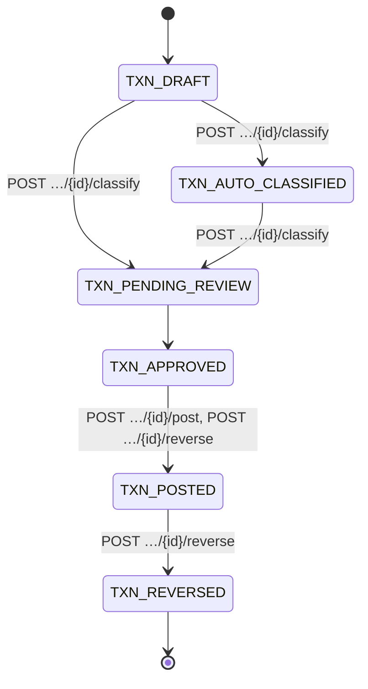

**Operaciones que ejercen esta máquina** _(POR_REFERENCIA: el handler alcanza un método que valida contra la tabla; «sin destino nombrado» significa que el estado de destino llega por el cuerpo de la petición)_:

| Operación | Estados de destino que nombra | A través de |
|---|---|---|
| POST /accounting/journal-transactions/{id}/approve | sin destino nombrado | LedgerService.transition → LedgerService.assertTransition |
| POST /accounting/journal-transactions/{id}/classify | TXN_AUTO_CLASSIFIED, TXN_PENDING_REVIEW | LedgerService.classify → LedgerService.assertTransition |
| POST /accounting/journal-transactions/{id}/post | TXN_POSTED | LedgerService.post → LedgerService.assertTransition |
| POST /accounting/journal-transactions/{id}/reverse | TXN_POSTED, TXN_REVERSED | LedgerService.reverseJournal → LedgerService.assertTransition |
| POST /accounting/journal-transactions/{id}/submit-review | sin destino nombrado | LedgerService.transition → LedgerService.assertTransition |
| POST /visit-requests/{visitRequestId}/accept | sin destino nombrado | VisitRequestsService.transitionByDoctor → VisitRequestsService.assertOpen → VisitRequestsService.assertTransition |
| POST /visit-requests/{visitRequestId}/cancel | sin destino nombrado | VisitRequestsService.cancel → VisitRequestsService.assertOpen → VisitRequestsService.assertTransition |
| POST /visit-requests/{visitRequestId}/propose-time | sin destino nombrado | VisitRequestsService.proposeTime → VisitRequestsService.assertOpen → VisitRequestsService.assertTransition |
| POST /visit-requests/{visitRequestId}/reject | sin destino nombrado | VisitRequestsService.transitionByDoctor → VisitRequestsService.assertOpen → VisitRequestsService.assertTransition |
| POST /visit-requests/{visitRequestId}/request-info | sin destino nombrado | VisitRequestsService.requestInfo → VisitRequestsService.assertOpen |
| POST /visit-requests/{visitRequestId}/reschedule | sin destino nombrado | VisitRequestsService.reschedule → VisitRequestsService.assertOpen → VisitRequestsService.assertTransition |

## Árbol de decisión por operación

Cada árbol se deriva del código del handler y de los métodos que invoca (hasta 4 niveles). Una rama que no decide, no escribe y no falla se poda. Los accesos y los efectos consecutivos se agrupan en un solo nodo.

### Operaciones con decisiones propias

#### 1. GET /accounting/accounts

Plan de cuentas de una práctica

| HTTP | Código | Cuándo |
|---|---|---|
| 200 | — | Éxito |
| 400 | `VALIDATION_FAILED` | Están los parámetros de consulta obligatorios |
| 401 | `UNAUTHENTICATED` | Hay una sesión válida (JWT) |
| 403 | `FORBIDDEN` | El rol está permitido; El tenant se resuelve y pertenece al actor; ForbiddenException: La práctica consultada pertenece a otra organización |
| 404 | `NOT_FOUND` | ResourceNotFoundException: Práctica no encontrada |
| 429 | `RATE_LIMITED` | No se supera el límite de solicitudes |

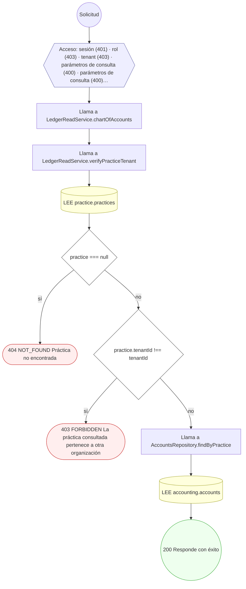

#### 2. POST /accounting/accounts

Crear una cuenta del plan contable

| HTTP | Código | Cuándo |
|---|---|---|
| 201 | — | Éxito |
| 400 | `VALIDATION_FAILED` | El cuerpo cumple el DTO (sin propiedades extra) |
| 401 | `UNAUTHENTICATED` | Hay una sesión válida (JWT) |
| 403 | `FORBIDDEN` | El rol está permitido; El tenant se resuelve y pertenece al actor |
| 409 | `CONFLICT` | ConflictException: Ya existe una cuenta con ese código en la práctica |
| 429 | `RATE_LIMITED` | No se supera el límite de solicitudes |

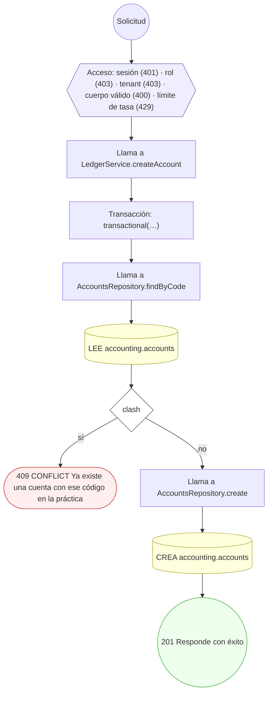

#### 3. GET /accounting/accrual-objects

Registro de devengos de una práctica

| HTTP | Código | Cuándo |
|---|---|---|
| 200 | — | Éxito |
| 400 | `VALIDATION_FAILED` | Están los parámetros de consulta obligatorios |
| 401 | `UNAUTHENTICATED` | Hay una sesión válida (JWT) |
| 403 | `FORBIDDEN` | El rol está permitido; El tenant se resuelve y pertenece al actor; ForbiddenException: La práctica consultada pertenece a otra organización |
| 404 | `NOT_FOUND` | ResourceNotFoundException: Práctica no encontrada |
| 422 | `PRECONDITION_FAILED` | PreconditionFailedException: La cuenta no tiene un perfil profesional asociado; PreconditionFailedException: No se pudo verificar la vinculación del profesional con la práctica; PreconditionFailedException: El profesional no tiene una vinculación activa con esa práctica |
| 429 | `RATE_LIMITED` | No se supera el límite de solicitudes |

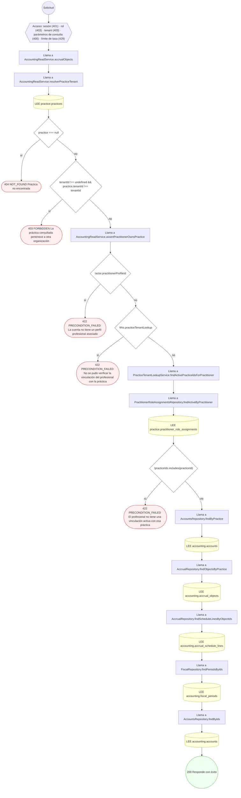

#### 4. POST /accounting/accrual-objects

Crear objeto de devengo y su cronograma

| HTTP | Código | Cuándo |
|---|---|---|
| 201 | — | Éxito |
| 400 | `VALIDATION_FAILED` | El cuerpo cumple el DTO (sin propiedades extra) |
| 401 | `UNAUTHENTICATED` | Hay una sesión válida (JWT) |
| 403 | `FORBIDDEN` | El rol está permitido; El tenant se resuelve y pertenece al actor |
| 409 | `CONFLICT` | ConflictException: El número de objeto ya existe en el tenant |
| 422 | `PRECONDITION_FAILED` | PreconditionFailedException: La suma del cronograma no iguala el total |
| 429 | `RATE_LIMITED` | No se supera el límite de solicitudes |

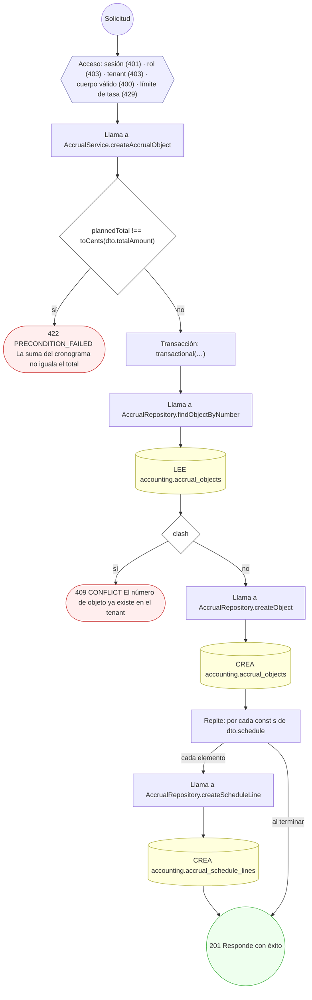

#### 5. POST /accounting/accruals/run

Postear devengo periódico (accrual run)

| HTTP | Código | Cuándo |
|---|---|---|
| 201 | — | Éxito |
| 400 | `VALIDATION_FAILED` | El cuerpo cumple el DTO (sin propiedades extra) |
| 401 | `UNAUTHENTICATED` | Hay una sesión válida (JWT) |
| 403 | `FORBIDDEN` | El rol está permitido; El tenant se resuelve y pertenece al actor |
| 404 | `NOT_FOUND` | ResourceNotFoundException: Objeto de devengo no encontrado |
| 422 | `PRECONDITION_FAILED` | PreconditionFailedException: El objeto de devengo no define cuentas; PreconditionFailedException: No hay líneas de devengo pendientes en el periodo; PreconditionFailedException: El asiento generado no balancea (debe != haber) |
| 429 | `RATE_LIMITED` | No se supera el límite de solicitudes |

```mermaid
flowchart TD
  n1(("Solicitud")):::inicio
  n2{{"Acceso: sesión (401) · rol (403) · tenant (403) · cuerpo válido (400) · límite de tasa (429)"}}:::acceso
  n1 --> n2
  n3["Llama a AccrualService.runAccruals"]:::llamada
  n2 --> n3
  n4["Transacción: transactional(…)"]:::transaccion
  n3 --> n4
  n5["Llama a AccrualRepository.findObjectById"]:::llamada
  n4 --> n5
  n6[("LEE accounting.accrual_objects")]:::efecto
  n5 --> n6
  n7{"!object"}:::decision
  n6 --> n7
  n8(["404 NOT_FOUND Objeto de devengo no encontrado"]):::error
  n7 -->|"sí"| n8
  n9{"!object.expenseAccountId || !object.accrualAccountId"}:::decision
  n7 -->|"no"| n9
  n10(["422 PRECONDITION_FAILED El objeto de devengo no define cuentas"]):::error
  n9 -->|"sí"| n10
  n11["Llama a AccrualRepository.pendingLinesForPeriod"]:::llamada
  n9 -->|"no"| n11
  n12[("LEE accounting.accrual_schedule_lines")]:::efecto
  n11 --> n12
  n13{"pending.length === 0"}:::decision
  n12 --> n13
  n14(["422 PRECONDITION_FAILED No hay líneas de devengo pendientes en el periodo"]):::error
  n13 -->|"sí"| n14
  n15["Repite: por cada const line de pending"]:::bucle
  n13 -->|"no"| n15
  n16["Llama a PostingHelper.post"]:::llamada
  n15 -->|"cada elemento"| n16
  n17{"debit ‹= 0 || debit !== credit"}:::decision
  n16 --> n17
  n18(["422 PRECONDITION_FAILED El asiento generado no balancea (debe != haber)"]):::error
  n17 -->|"sí"| n18
  n19["Llama a JournalRepository.createTransaction"]:::llamada
  n17 -->|"no"| n19
  n20[("CREA accounting.journal_transactions")]:::efecto
  n19 --> n20
  n21["Repite: por cada const line de req.lines"]:::bucle
  n20 --> n21
  n22["Llama a JournalRepository.createLedgerEntry"]:::llamada
  n21 -->|"cada elemento"| n22
  n23[("CREA accounting.ledger_entries")]:::efecto
  n22 --> n23
  n24["Llama a JournalRepository.createAssignment"]:::llamada
  n23 --> n24
  n25[("CREA accounting.journal_entry_assignments")]:::efecto
  n24 --> n25
  n26["Llama a AccrualRepository.createPosting"]:::llamada
  n25 --> n26
  n21 -->|"al terminar"| n26
  n27[("CREA accounting.accrual_postings")]:::efecto
  n26 --> n27
  n28[("ACTUALIZA accounting.accrual_schedule_lines · ACTUALIZA accounting.accrual_schedule_lines")]:::efecto
  n27 --> n28
  n29(("201 Responde con éxito")):::ok
  n28 --> n29
  n15 -->|"al terminar"| n29
  classDef acceso fill:#eef,stroke:#66a
  classDef error fill:#fee,stroke:#c33
  classDef ok fill:#efe,stroke:#3a3
  classDef efecto fill:#ffd,stroke:#aa3
  classDef decision fill:#fff,stroke:#555
  classDef corte fill:#eee,stroke:#999,stroke-dasharray: 4
```

#### 6. GET /accounting/assets

Registro de activos fijos de una práctica

| HTTP | Código | Cuándo |
|---|---|---|
| 200 | — | Éxito |
| 400 | `VALIDATION_FAILED` | Están los parámetros de consulta obligatorios |
| 401 | `UNAUTHENTICATED` | Hay una sesión válida (JWT) |
| 403 | `FORBIDDEN` | El rol está permitido; El tenant se resuelve y pertenece al actor; ForbiddenException: La práctica consultada pertenece a otra organización |
| 404 | `NOT_FOUND` | ResourceNotFoundException: Práctica no encontrada |
| 422 | `PRECONDITION_FAILED` | PreconditionFailedException: La cuenta no tiene un perfil profesional asociado; PreconditionFailedException: No se pudo verificar la vinculación del profesional con la práctica; PreconditionFailedException: El profesional no tiene una vinculación activa con esa práctica |
| 429 | `RATE_LIMITED` | No se supera el límite de solicitudes |

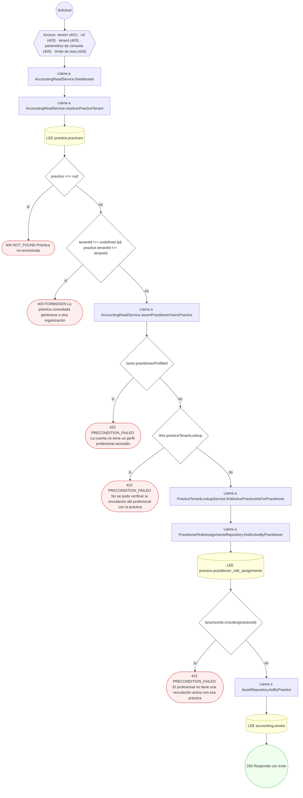

#### 7. POST /accounting/assets/capitalize

Capitalizar activo (alta y asignación)

| HTTP | Código | Cuándo |
|---|---|---|
| 201 | — | Éxito |
| 400 | `VALIDATION_FAILED` | El cuerpo cumple el DTO (sin propiedades extra) |
| 401 | `UNAUTHENTICATED` | Hay una sesión válida (JWT) |
| 403 | `FORBIDDEN` | El rol está permitido; El tenant se resuelve y pertenece al actor |
| 409 | `CONFLICT` | ConflictException: Ya existe un activo con ese código en la práctica |
| 422 | `PRECONDITION_FAILED` | PreconditionFailedException: El asiento generado no balancea (debe != haber) |
| 429 | `RATE_LIMITED` | No se supera el límite de solicitudes |

```mermaid
flowchart TD
  n1(("Solicitud")):::inicio
  n2{{"Acceso: sesión (401) · rol (403) · tenant (403) · cuerpo válido (400) · límite de tasa (429)"}}:::acceso
  n1 --> n2
  n3["Llama a AssetService.capitalize"]:::llamada
  n2 --> n3
  n4["Transacción: transactional(…)"]:::transaccion
  n3 --> n4
  n5["Llama a AssetRepository.findByCode"]:::llamada
  n4 --> n5
  n6[("LEE accounting.assets")]:::efecto
  n5 --> n6
  n7{"clash"}:::decision
  n6 --> n7
  n8(["409 CONFLICT Ya existe un activo con ese código en la práctica"]):::error
  n7 -->|"sí"| n8
  n9["Llama a AssetRepository.createAsset"]:::llamada
  n7 -->|"no"| n9
  n10[("CREA accounting.assets")]:::efecto
  n9 --> n10
  n11{"dto.depreciationAreaId"}:::decision
  n10 --> n11
  n12["Llama a AssetRepository.createValuation"]:::llamada
  n11 -->|"sí"| n12
  n13[("CREA accounting.asset_valuations")]:::efecto
  n12 --> n13
  n14{"dto.costCenterId || dto.responsibleEmployeeId"}:::decision
  n13 --> n14
  n11 -->|"no"| n14
  n15["Llama a AssetRepository.createAssignment"]:::llamada
  n14 -->|"sí"| n15
  n16[("CREA accounting.asset_assignments")]:::efecto
  n15 --> n16
  n17["Llama a PostingHelper.post"]:::llamada
  n16 --> n17
  n14 -->|"no"| n17
  n18{"debit ‹= 0 || debit !== credit"}:::decision
  n17 --> n18
  n19(["422 PRECONDITION_FAILED El asiento generado no balancea (debe != haber)"]):::error
  n18 -->|"sí"| n19
  n20["Llama a JournalRepository.createTransaction"]:::llamada
  n18 -->|"no"| n20
  n21[("CREA accounting.journal_transactions")]:::efecto
  n20 --> n21
  n22["Repite: por cada const line de req.lines"]:::bucle
  n21 --> n22
  n23["Llama a JournalRepository.createLedgerEntry"]:::llamada
  n22 -->|"cada elemento"| n23
  n24[("CREA accounting.ledger_entries")]:::efecto
  n23 --> n24
  n25["Llama a JournalRepository.createAssignment"]:::llamada
  n24 --> n25
  n26[("CREA accounting.journal_entry_assignments")]:::efecto
  n25 --> n26
  n27["Llama a AssetRepository.createPosting"]:::llamada
  n26 --> n27
  n22 -->|"al terminar"| n27
  n28[("CREA accounting.asset_postings")]:::efecto
  n27 --> n28
  n29(("201 Responde con éxito")):::ok
  n28 --> n29
  classDef acceso fill:#eef,stroke:#66a
  classDef error fill:#fee,stroke:#c33
  classDef ok fill:#efe,stroke:#3a3
  classDef efecto fill:#ffd,stroke:#aa3
  classDef decision fill:#fff,stroke:#555
  classDef corte fill:#eee,stroke:#999,stroke-dasharray: 4
```

#### 8. GET /accounting/balance-sheet

Balance general de una práctica a una fecha de corte

| HTTP | Código | Cuándo |
|---|---|---|
| 200 | — | Éxito |
| 400 | `VALIDATION_FAILED` | Están los parámetros de consulta obligatorios |
| 401 | `UNAUTHENTICATED` | Hay una sesión válida (JWT) |
| 403 | `FORBIDDEN` | El rol está permitido; El tenant se resuelve y pertenece al actor; ForbiddenException: La práctica consultada pertenece a otra organización |
| 404 | `NOT_FOUND` | ResourceNotFoundException: Práctica no encontrada |
| 422 | `PRECONDITION_FAILED` | PreconditionFailedException: La cuenta no tiene un perfil profesional asociado; PreconditionFailedException: No se pudo verificar la vinculación del profesional con la práctica; PreconditionFailedException: El profesional no tiene una vinculación activa con esa práctica |
| 429 | `RATE_LIMITED` | No se supera el límite de solicitudes |

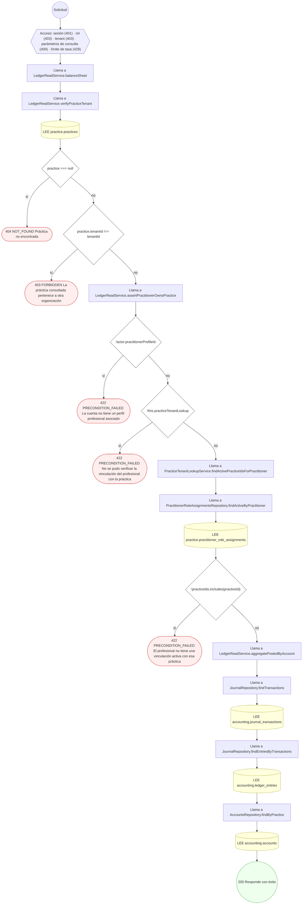

#### 9. POST /accounting/clearing-documents

Compensar/clearing de partidas abiertas

| HTTP | Código | Cuándo |
|---|---|---|
| 201 | — | Éxito |
| 400 | `VALIDATION_FAILED` | El cuerpo cumple el DTO (sin propiedades extra) |
| 401 | `UNAUTHENTICATED` | Hay una sesión válida (JWT) |
| 403 | `FORBIDDEN` | El rol está permitido; El tenant se resuelve y pertenece al actor; ForbiddenException: La práctica de la compensación pertenece a otra organización |
| 404 | `NOT_FOUND` | ResourceNotFoundException: Práctica no encontrada; ResourceNotFoundException: Partida abierta no encontrada; ResourceNotFoundException: Subledger no encontrado |
| 409 | `CONFLICT` | ConflictException: La partida ya está compensada; ConflictException: El número de clearing ya existe en el tenant |
| 422 | `PRECONDITION_FAILED` | PreconditionFailedException: Importe compensado inválido; PreconditionFailedException: Las partidas no comparten subledger; PreconditionFailedException: El asiento generado no balancea (debe != haber) |
| 429 | `RATE_LIMITED` | No se supera el límite de solicitudes |

```mermaid
flowchart TD
  n1(("Solicitud")):::inicio
  n2{{"Acceso: sesión (401) · rol (403) · tenant (403) · cuerpo válido (400) · límite de tasa (429)"}}:::acceso
  n1 --> n2
  n3["Llama a SubledgerService.clearOpenItems"]:::llamada
  n2 --> n3
  n4["Transacción: transactional(…)"]:::transaccion
  n3 --> n4
  n5["Llama a SubledgerService.resolveClearingTenant"]:::llamada
  n4 --> n5
  n6[("LEE practice.practices")]:::efecto
  n5 --> n6
  n7{"practice === null"}:::decision
  n6 --> n7
  n8(["404 NOT_FOUND Práctica no encontrada"]):::error
  n7 -->|"sí"| n8
  n9{"otherSessionTenant || otherDeclaredTenant"}:::decision
  n7 -->|"no"| n9
  n10(["403 FORBIDDEN La práctica de la compensación pertenece a otra organización"]):::error
  n9 -->|"sí"| n10
  n11["Repite: por cada const it de dto.items"]:::bucle
  n9 -->|"no"| n11
  n12["Llama a SubledgerRepository.findOpenItemById"]:::llamada
  n11 -->|"cada elemento"| n12
  n13[("LEE accounting.open_items")]:::efecto
  n12 --> n13
  n14{"!openItem"}:::decision
  n13 --> n14
  n15(["404 NOT_FOUND Partida abierta no encontrada"]):::error
  n14 -->|"sí"| n15
  n16{"openItem.statusConceptId === ACCT.OPEN_ITEM_CLEARED"}:::decision
  n14 -->|"no"| n16
  n17(["409 CONFLICT La partida ya está compensada"]):::error
  n16 -->|"sí"| n17
  n18{"cleared ‹= 0 || cleared › outstanding"}:::decision
  n16 -->|"no"| n18
  n19(["422 PRECONDITION_FAILED Importe compensado inválido"]):::error
  n18 -->|"sí"| n19
  n20{"openItem.subledgerAccountId !== subledgerAccountId"}:::decision
  n18 -->|"no"| n20
  n21(["422 PRECONDITION_FAILED Las partidas no comparten subledger"]):::error
  n20 -->|"sí"| n21
  n22["Llama a SubledgerRepository.findSubledgerById"]:::llamada
  n20 -->|"no"| n22
  n11 -->|"al terminar"| n22
  n23[("LEE accounting.subledger_accounts")]:::efecto
  n22 --> n23
  n24{"!subledger"}:::decision
  n23 --> n24
  n25(["404 NOT_FOUND Subledger no encontrado"]):::error
  n24 -->|"sí"| n25
  n26["Llama a SubledgerRepository.findClearingByNumber"]:::llamada
  n24 -->|"no"| n26
  n27[("LEE accounting.clearing_documents")]:::efecto
  n26 --> n27
  n28{"clash"}:::decision
  n27 --> n28
  n29(["409 CONFLICT El número de clearing ya existe en el tenant"]):::error
  n28 -->|"sí"| n29
  n30["Llama a PostingHelper.post"]:::llamada
  n28 -->|"no"| n30
  n31{"debit ‹= 0 || debit !== credit"}:::decision
  n30 --> n31
  n32(["422 PRECONDITION_FAILED El asiento generado no balancea (debe != haber)"]):::error
  n31 -->|"sí"| n32
  n33["Llama a JournalRepository.createTransaction"]:::llamada
  n31 -->|"no"| n33
  n34[("CREA accounting.journal_transactions")]:::efecto
  n33 --> n34
  n35["Repite: por cada const line de req.lines"]:::bucle
  n34 --> n35
  n36["Llama a JournalRepository.createLedgerEntry"]:::llamada
  n35 -->|"cada elemento"| n36
  n37[("CREA accounting.ledger_entries")]:::efecto
  n36 --> n37
  n38["Llama a JournalRepository.createAssignment"]:::llamada
  n37 --> n38
  n39[("CREA accounting.journal_entry_assignments")]:::efecto
  n38 --> n39
  n40["Llama a SubledgerRepository.createClearingDocument"]:::llamada
  n39 --> n40
  n35 -->|"al terminar"| n40
  n41[("CREA accounting.clearing_documents")]:::efecto
  n40 --> n41
  n42["Repite: por cada const l de loaded"]:::bucle
  n41 --> n42
  n43["Llama a SubledgerRepository.createClearingItem"]:::llamada
  n42 -->|"cada elemento"| n43
  n44[("CREA accounting.clearing_items")]:::efecto
  n43 --> n44
  n45(("201 Responde con éxito")):::ok
  n44 --> n45
  n42 -->|"al terminar"| n45
  classDef acceso fill:#eef,stroke:#66a
  classDef error fill:#fee,stroke:#c33
  classDef ok fill:#efe,stroke:#3a3
  classDef efecto fill:#ffd,stroke:#aa3
  classDef decision fill:#fff,stroke:#555
  classDef corte fill:#eee,stroke:#999,stroke-dasharray: 4
```

#### 10. POST /accounting/depreciation/run

Ejecutar depreciación de activos (batch)

| HTTP | Código | Cuándo |
|---|---|---|
| 201 | — | Éxito |
| 400 | `VALIDATION_FAILED` | El cuerpo cumple el DTO (sin propiedades extra) |
| 401 | `UNAUTHENTICATED` | Hay una sesión válida (JWT) |
| 403 | `FORBIDDEN` | El rol está permitido; El tenant se resuelve y pertenece al actor |
| 422 | `PRECONDITION_FAILED` | PreconditionFailedException: El asiento generado no balancea (debe != haber); PreconditionFailedException: No hay activos elegibles para depreciar en el periodo |
| 429 | `RATE_LIMITED` | No se supera el límite de solicitudes |

```mermaid
flowchart TD
  n1(("Solicitud")):::inicio
  n2{{"Acceso: sesión (401) · rol (403) · tenant (403) · cuerpo válido (400) · límite de tasa (429)"}}:::acceso
  n1 --> n2
  n3["Llama a AssetService.runDepreciation"]:::llamada
  n2 --> n3
  n4["Transacción: transactional(…)"]:::transaccion
  n3 --> n4
  n5["Llama a AssetRepository.activeAssets"]:::llamada
  n4 --> n5
  n6[("LEE accounting.assets")]:::efecto
  n5 --> n6
  n7["Repite: por cada const asset de assets"]:::bucle
  n6 --> n7
  n8["Llama a AssetRepository.findDepreciation"]:::llamada
  n7 -->|"cada elemento"| n8
  n9[("LEE accounting.asset_depreciations")]:::efecto
  n8 --> n9
  n10["Llama a PostingHelper.post"]:::llamada
  n9 --> n10
  n11{"debit ‹= 0 || debit !== credit"}:::decision
  n10 --> n11
  n12(["422 PRECONDITION_FAILED El asiento generado no balancea (debe != haber)"]):::error
  n11 -->|"sí"| n12
  n13["Llama a JournalRepository.createTransaction"]:::llamada
  n11 -->|"no"| n13
  n14[("CREA accounting.journal_transactions")]:::efecto
  n13 --> n14
  n15["Repite: por cada const line de req.lines"]:::bucle
  n14 --> n15
  n16["Llama a JournalRepository.createLedgerEntry"]:::llamada
  n15 -->|"cada elemento"| n16
  n17[("CREA accounting.ledger_entries")]:::efecto
  n16 --> n17
  n18["Llama a JournalRepository.createAssignment"]:::llamada
  n17 --> n18
  n19[("CREA accounting.journal_entry_assignments")]:::efecto
  n18 --> n19
  n20["Llama a AssetRepository.createDepreciation"]:::llamada
  n19 --> n20
  n15 -->|"al terminar"| n20
  n21[("CREA accounting.asset_depreciations")]:::efecto
  n20 --> n21
  n22["Llama a AssetRepository.createPosting"]:::llamada
  n21 --> n22
  n23[("CREA accounting.asset_postings")]:::efecto
  n22 --> n23
  n24[("ACTUALIZA accounting.assets · ACTUALIZA accounting.assets")]:::efecto
  n23 --> n24
  n25{"depreciated === 0"}:::decision
  n24 --> n25
  n7 -->|"al terminar"| n25
  n26(["422 PRECONDITION_FAILED No hay activos elegibles para depreciar en el periodo"]):::error
  n25 -->|"sí"| n26
  n27(("201 Responde con éxito")):::ok
  n25 -->|"no"| n27
  classDef acceso fill:#eef,stroke:#66a
  classDef error fill:#fee,stroke:#c33
  classDef ok fill:#efe,stroke:#3a3
  classDef efecto fill:#ffd,stroke:#aa3
  classDef decision fill:#fff,stroke:#555
  classDef corte fill:#eee,stroke:#999,stroke-dasharray: 4
```

#### 11. GET /accounting/dimensions

Dimensiones analíticas de una práctica

| HTTP | Código | Cuándo |
|---|---|---|
| 200 | — | Éxito |
| 400 | `VALIDATION_FAILED` | Están los parámetros de consulta obligatorios |
| 401 | `UNAUTHENTICATED` | Hay una sesión válida (JWT) |
| 403 | `FORBIDDEN` | El rol está permitido; El tenant se resuelve y pertenece al actor; ForbiddenException: La práctica consultada pertenece a otra organización |
| 404 | `NOT_FOUND` | ResourceNotFoundException: Práctica no encontrada |
| 422 | `PRECONDITION_FAILED` | PreconditionFailedException: La cuenta no tiene un perfil profesional asociado; PreconditionFailedException: No se pudo verificar la vinculación del profesional con la práctica; PreconditionFailedException: El profesional no tiene una vinculación activa con esa práctica |
| 429 | `RATE_LIMITED` | No se supera el límite de solicitudes |

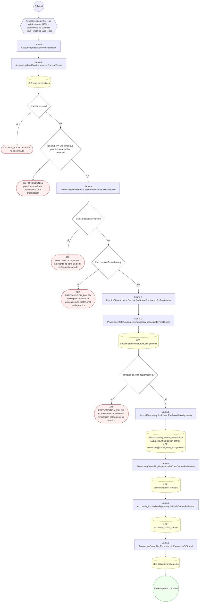

#### 12. POST /accounting/exchange-rates

Registrar tipo de cambio para conversión

| HTTP | Código | Cuándo |
|---|---|---|
| 201 | — | Éxito |
| 400 | `VALIDATION_FAILED` | El cuerpo cumple el DTO (sin propiedades extra) |
| 401 | `UNAUTHENTICATED` | Hay una sesión válida (JWT) |
| 403 | `FORBIDDEN` | El rol está permitido; El tenant se resuelve y pertenece al actor |
| 429 | `RATE_LIMITED` | No se supera el límite de solicitudes |

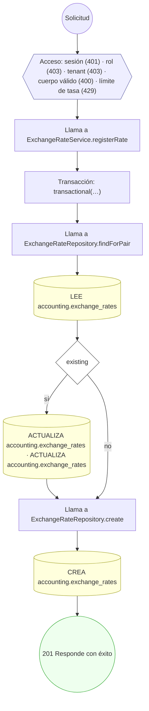

#### 13. POST /accounting/fiscal-periods/{id}/lock

Cerrar/bloquear un periodo fiscal

| HTTP | Código | Cuándo |
|---|---|---|
| 200 | — | Éxito |
| 400 | `VALIDATION_FAILED` | Los parámetros de ruta son UUID válidos; El cuerpo cumple el DTO (sin propiedades extra) |
| 401 | `UNAUTHENTICATED` | Hay una sesión válida (JWT) |
| 403 | `FORBIDDEN` | El rol está permitido; El tenant se resuelve y pertenece al actor |
| 404 | `NOT_FOUND` | ResourceNotFoundException: Periodo fiscal no encontrado |
| 422 | `PRECONDITION_FAILED` | PreconditionFailedException: El periodo no está ABIERTO |
| 429 | `RATE_LIMITED` | No se supera el límite de solicitudes |

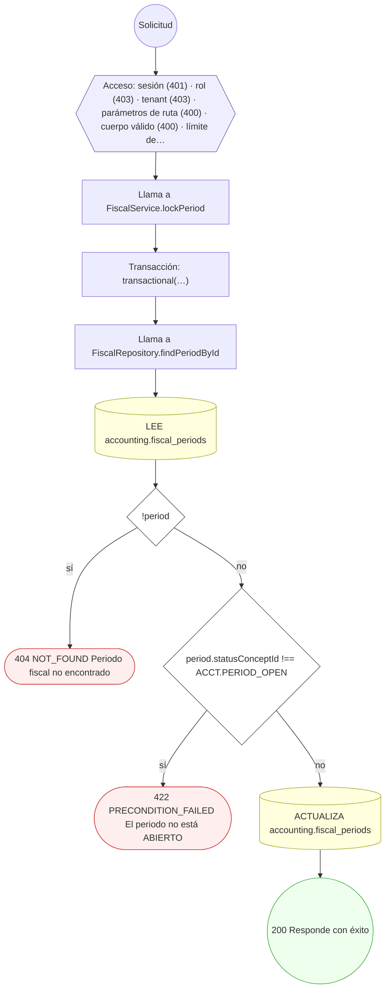

#### 14. GET /accounting/fiscal-years

Ejercicio fiscal vigente de una práctica

| HTTP | Código | Cuándo |
|---|---|---|
| 200 | — | Éxito |
| 400 | `VALIDATION_FAILED` | Están los parámetros de consulta obligatorios |
| 401 | `UNAUTHENTICATED` | Hay una sesión válida (JWT) |
| 403 | `FORBIDDEN` | El rol está permitido; El tenant se resuelve y pertenece al actor; ForbiddenException: La práctica consultada pertenece a otra organización |
| 404 | `NOT_FOUND` | ResourceNotFoundException: Práctica no encontrada; ResourceNotFoundException: La práctica no tiene ejercicios fiscales |
| 422 | `PRECONDITION_FAILED` | PreconditionFailedException: La cuenta no tiene un perfil profesional asociado; PreconditionFailedException: No se pudo verificar la vinculación del profesional con la práctica; PreconditionFailedException: El profesional no tiene una vinculación activa con esa práctica |
| 429 | `RATE_LIMITED` | No se supera el límite de solicitudes |

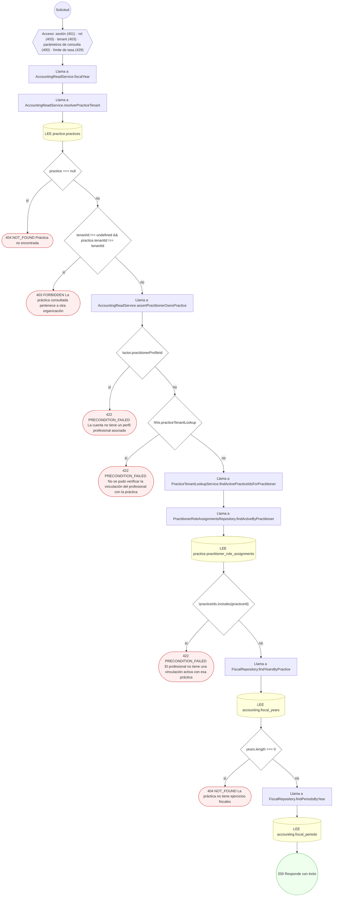

#### 15. POST /accounting/fiscal-years

Abrir un ejercicio fiscal y sus periodos

| HTTP | Código | Cuándo |
|---|---|---|
| 201 | — | Éxito |
| 400 | `VALIDATION_FAILED` | El cuerpo cumple el DTO (sin propiedades extra) |
| 401 | `UNAUTHENTICATED` | Hay una sesión válida (JWT) |
| 403 | `FORBIDDEN` | El rol está permitido; El tenant se resuelve y pertenece al actor |
| 409 | `CONFLICT` | ConflictException: El ejercicio ya existe en la práctica |
| 429 | `RATE_LIMITED` | No se supera el límite de solicitudes |

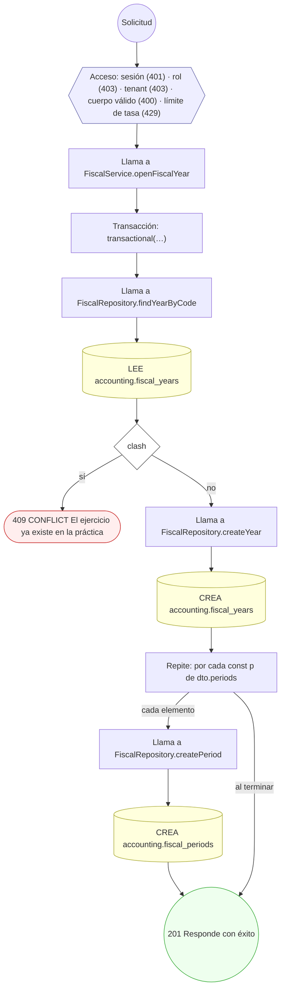

#### 16. GET /accounting/general-ledger

Libro mayor de una cuenta (movimientos posteados, con saldo corrido)

| HTTP | Código | Cuándo |
|---|---|---|
| 200 | — | Éxito |
| 400 | `VALIDATION_FAILED` | Están los parámetros de consulta obligatorios |
| 401 | `UNAUTHENTICATED` | Hay una sesión válida (JWT) |
| 403 | `FORBIDDEN` | El rol está permitido; El tenant se resuelve y pertenece al actor; ForbiddenException: La práctica consultada pertenece a otra organización |
| 404 | `NOT_FOUND` | ResourceNotFoundException: Práctica no encontrada; ResourceNotFoundException: Cuenta no encontrada en la práctica |
| 422 | `PRECONDITION_FAILED` | PreconditionFailedException: La cuenta no tiene un perfil profesional asociado; PreconditionFailedException: No se pudo verificar la vinculación del profesional con la práctica; PreconditionFailedException: El profesional no tiene una vinculación activa con esa práctica |
| 429 | `RATE_LIMITED` | No se supera el límite de solicitudes |

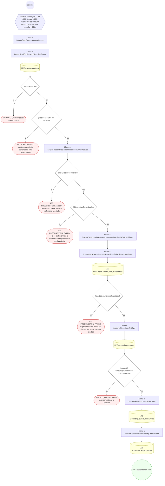

#### 17. GET /accounting/income-statement

Estado de resultados de una práctica

| HTTP | Código | Cuándo |
|---|---|---|
| 200 | — | Éxito |
| 400 | `VALIDATION_FAILED` | Están los parámetros de consulta obligatorios |
| 401 | `UNAUTHENTICATED` | Hay una sesión válida (JWT) |
| 403 | `FORBIDDEN` | El rol está permitido; El tenant se resuelve y pertenece al actor; ForbiddenException: La práctica consultada pertenece a otra organización |
| 404 | `NOT_FOUND` | ResourceNotFoundException: Práctica no encontrada |
| 422 | `PRECONDITION_FAILED` | PreconditionFailedException: La cuenta no tiene un perfil profesional asociado; PreconditionFailedException: No se pudo verificar la vinculación del profesional con la práctica; PreconditionFailedException: El profesional no tiene una vinculación activa con esa práctica |
| 429 | `RATE_LIMITED` | No se supera el límite de solicitudes |

```mermaid
flowchart TD
  n1(("Solicitud")):::inicio
  n2{{"Acceso: sesión (401) · rol (403) · tenant (403) · parámetros de consulta (400) · límite de tasa (429)"}}:::acceso
  n1 --> n2
  n3["Llama a LedgerReadService.incomeStatement"]:::llamada
  n2 --> n3
  n4["Llama a LedgerReadService.verifyPracticeTenant"]:::llamada
  n3 --> n4
  n5[("LEE practice.practices")]:::efecto
  n4 --> n5
  n6{"practice === null"}:::decision
  n5 --> n6
  n7(["404 NOT_FOUND Práctica no encontrada"]):::error
  n6 -->|"sí"| n7
  n8{"practice.tenantId !== tenantId"}:::decision
  n6 -->|"no"| n8
  n9(["403 FORBIDDEN La práctica consultada pertenece a otra organización"]):::error
  n8 -->|"sí"| n9
  n10["Llama a LedgerReadService.assertPractitionerOwnsPractice"]:::llamada
  n8 -->|"no"| n10
  n11{"!actor.practitionerProfileId"}:::decision
  n10 --> n11
  n12(["422 PRECONDITION_FAILED La cuenta no tiene un perfil profesional asociado"]):::error
  n11 -->|"sí"| n12
  n13{"!this.practiceTenantLookup"}:::decision
  n11 -->|"no"| n13
  n14(["422 PRECONDITION_FAILED No se pudo verificar la vinculación del profesional con la práctica"]):::error
  n13 -->|"sí"| n14
  n15["Llama a PracticeTenantLookupService.findActivePracticeIdsForPractitioner"]:::llamada
  n13 -->|"no"| n15
  n16["Llama a PractitionerRoleAssignmentsRepository.findActiveByPractitioner"]:::llamada
  n15 --> n16
  n17[("LEE practice.practitioner_role_assignments")]:::efecto
  n16 --> n17
  n18{"!practiceIds.includes(practiceId)"}:::decision
  n17 --> n18
  n19(["422 PRECONDITION_FAILED El profesional no tiene una vinculación activa con esa práctica"]):::error
  n18 -->|"sí"| n19
  n20["Llama a LedgerReadService.aggregatePostedByAccount"]:::llamada
  n18 -->|"no"| n20
  n21["Llama a JournalRepository.findTransactions"]:::llamada
  n20 --> n21
  n22[("LEE accounting.journal_transactions")]:::efecto
  n21 --> n22
  n23["Llama a JournalRepository.findEntriesByTransactions"]:::llamada
  n22 --> n23
  n24[("LEE accounting.ledger_entries")]:::efecto
  n23 --> n24
  n25["Llama a AccountsRepository.findByPractice"]:::llamada
  n24 --> n25
  n26[("LEE accounting.accounts")]:::efecto
  n25 --> n26
  n27(("200 Responde con éxito")):::ok
  n26 --> n27
  classDef acceso fill:#eef,stroke:#66a
  classDef error fill:#fee,stroke:#c33
  classDef ok fill:#efe,stroke:#3a3
  classDef efecto fill:#ffd,stroke:#aa3
  classDef decision fill:#fff,stroke:#555
  classDef corte fill:#eee,stroke:#999,stroke-dasharray: 4
```

#### 18. GET /accounting/journal-transactions

Libro diario de una práctica

| HTTP | Código | Cuándo |
|---|---|---|
| 200 | — | Éxito |
| 400 | `VALIDATION_FAILED` | Están los parámetros de consulta obligatorios |
| 401 | `UNAUTHENTICATED` | Hay una sesión válida (JWT) |
| 403 | `FORBIDDEN` | El rol está permitido; El tenant se resuelve y pertenece al actor; ForbiddenException: La práctica consultada pertenece a otra organización |
| 404 | `NOT_FOUND` | ResourceNotFoundException: Práctica no encontrada |
| 429 | `RATE_LIMITED` | No se supera el límite de solicitudes |

```mermaid
flowchart TD
  n1(("Solicitud")):::inicio
  n2{{"Acceso: sesión (401) · rol (403) · tenant (403) · parámetros de consulta (400) · límite de tasa (429)"}}:::acceso
  n1 --> n2
  n3["Llama a LedgerReadService.listJournal"]:::llamada
  n2 --> n3
  n4["Llama a LedgerReadService.verifyPracticeTenant"]:::llamada
  n3 --> n4
  n5[("LEE practice.practices")]:::efecto
  n4 --> n5
  n6{"practice === null"}:::decision
  n5 --> n6
  n7(["404 NOT_FOUND Práctica no encontrada"]):::error
  n6 -->|"sí"| n7
  n8{"practice.tenantId !== tenantId"}:::decision
  n6 -->|"no"| n8
  n9(["403 FORBIDDEN La práctica consultada pertenece a otra organización"]):::error
  n8 -->|"sí"| n9
  n10["Llama a JournalRepository.findTransactions"]:::llamada
  n8 -->|"no"| n10
  n11[("LEE accounting.journal_transactions")]:::efecto
  n10 --> n11
  n12(("200 Responde con éxito")):::ok
  n11 --> n12
  classDef acceso fill:#eef,stroke:#66a
  classDef error fill:#fee,stroke:#c33
  classDef ok fill:#efe,stroke:#3a3
  classDef efecto fill:#ffd,stroke:#aa3
  classDef decision fill:#fff,stroke:#555
  classDef corte fill:#eee,stroke:#999,stroke-dasharray: 4
```

#### 19. POST /accounting/journal-transactions

Registrar y postear un asiento balanceado (partida doble)

| HTTP | Código | Cuándo |
|---|---|---|
| 201 | — | Éxito |
| 400 | `VALIDATION_FAILED` | El cuerpo cumple el DTO (sin propiedades extra) |
| 401 | `UNAUTHENTICATED` | Hay una sesión válida (JWT) |
| 403 | `FORBIDDEN` | El rol está permitido; El tenant se resuelve y pertenece al actor |
| 404 | `NOT_FOUND` | ResourceNotFoundException: Periodo fiscal no encontrado |
| 409 | `CONFLICT` | ConflictException: El número de asiento ya existe en la práctica |
| 422 | `PRECONDITION_FAILED` | PreconditionFailedException: El asiento no tiene importe; PreconditionFailedException: El asiento no balancea (debe != haber); PreconditionFailedException: El periodo fiscal no está ABIERTO |
| 429 | `RATE_LIMITED` | No se supera el límite de solicitudes |

```mermaid
flowchart TD
  n1(("Solicitud")):::inicio
  n2{{"Acceso: sesión (401) · rol (403) · tenant (403) · cuerpo válido (400) · límite de tasa (429)"}}:::acceso
  n1 --> n2
  n3["Llama a LedgerService.postJournal"]:::llamada
  n2 --> n3
  n4["Llama a LedgerService.assertBalanced"]:::llamada
  n3 --> n4
  n5{"debitCents ‹= 0"}:::decision
  n4 --> n5
  n6(["422 PRECONDITION_FAILED El asiento no tiene importe"]):::error
  n5 -->|"sí"| n6
  n7{"debitCents !== creditCents"}:::decision
  n5 -->|"no"| n7
  n8(["422 PRECONDITION_FAILED El asiento no balancea (debe != haber)"]):::error
  n7 -->|"sí"| n8
  n9["Transacción: transactional(…)"]:::transaccion
  n7 -->|"no"| n9
  n10{"dto.fiscalPeriodId"}:::decision
  n9 --> n10
  n11["Llama a FiscalRepository.findPeriodById"]:::llamada
  n10 -->|"sí"| n11
  n12[("LEE accounting.fiscal_periods")]:::efecto
  n11 --> n12
  n13{"!period"}:::decision
  n12 --> n13
  n14(["404 NOT_FOUND Periodo fiscal no encontrado"]):::error
  n13 -->|"sí"| n14
  n15{"period.statusConceptId !== ACCT.PERIOD_OPEN"}:::decision
  n13 -->|"no"| n15
  n16(["422 PRECONDITION_FAILED El periodo fiscal no está ABIERTO"]):::error
  n15 -->|"sí"| n16
  n17["Llama a JournalRepository.findByTransactionNumber"]:::llamada
  n15 -->|"no"| n17
  n10 -->|"no"| n17
  n18[("LEE accounting.journal_transactions")]:::efecto
  n17 --> n18
  n19{"clash"}:::decision
  n18 --> n19
  n20(["409 CONFLICT El número de asiento ya existe en la práctica"]):::error
  n19 -->|"sí"| n20
  n21["Llama a JournalRepository.createTransaction"]:::llamada
  n19 -->|"no"| n21
  n22[("CREA accounting.journal_transactions")]:::efecto
  n21 --> n22
  n23["Llama a LedgerService.writeLines"]:::llamada
  n22 --> n23
  n24["Repite: por cada const line de lines"]:::bucle
  n23 --> n24
  n25["Llama a JournalRepository.createLedgerEntry"]:::llamada
  n24 -->|"cada elemento"| n25
  n26[("CREA accounting.ledger_entries")]:::efecto
  n25 --> n26
  n27["Llama a JournalRepository.createAssignment"]:::llamada
  n26 --> n27
  n28[("CREA accounting.journal_entry_assignments")]:::efecto
  n27 --> n28
  n29["Llama a AuditTrailService.record"]:::llamada
  n28 --> n29
  n24 -->|"al terminar"| n29
  n30["Llama a AuditLogRepository.append"]:::llamada
  n29 --> n30
  n31["Llama a AuditLogRepository.findChainTip"]:::llamada
  n30 --> n31
  n32[("LEE audit.audit_log")]:::efecto
  n31 --> n32
  n33[("CREA audit.audit_log")]:::efecto
  n32 --> n33
  n34(("201 Responde con éxito")):::ok
  n33 --> n34
  classDef acceso fill:#eef,stroke:#66a
  classDef error fill:#fee,stroke:#c33
  classDef ok fill:#efe,stroke:#3a3
  classDef efecto fill:#ffd,stroke:#aa3
  classDef decision fill:#fff,stroke:#555
  classDef corte fill:#eee,stroke:#999,stroke-dasharray: 4
```

#### 20. GET /accounting/journal-transactions/{id}

Un asiento con sus líneas

| HTTP | Código | Cuándo |
|---|---|---|
| 200 | — | Éxito |
| 400 | `VALIDATION_FAILED` | Los parámetros de ruta son UUID válidos |
| 401 | `UNAUTHENTICATED` | Hay una sesión válida (JWT) |
| 403 | `FORBIDDEN` | El rol está permitido; El tenant se resuelve y pertenece al actor; ForbiddenException: La práctica consultada pertenece a otra organización |
| 404 | `NOT_FOUND` | ResourceNotFoundException: Asiento no encontrado; ResourceNotFoundException: Práctica no encontrada |
| 429 | `RATE_LIMITED` | No se supera el límite de solicitudes |

```mermaid
flowchart TD
  n1(("Solicitud")):::inicio
  n2{{"Acceso: sesión (401) · rol (403) · tenant (403) · parámetros de ruta (400) · límite de tasa (429)"}}:::acceso
  n1 --> n2
  n3["Llama a LedgerReadService.getJournalTransaction"]:::llamada
  n2 --> n3
  n4["Llama a JournalRepository.findTransactionById"]:::llamada
  n3 --> n4
  n5[("LEE accounting.journal_transactions")]:::efecto
  n4 --> n5
  n6{"!entry"}:::decision
  n5 --> n6
  n7(["404 NOT_FOUND Asiento no encontrado"]):::error
  n6 -->|"sí"| n7
  n8["Llama a LedgerReadService.verifyPracticeTenant"]:::llamada
  n6 -->|"no"| n8
  n9[("LEE practice.practices")]:::efecto
  n8 --> n9
  n10{"practice === null"}:::decision
  n9 --> n10
  n11(["404 NOT_FOUND Práctica no encontrada"]):::error
  n10 -->|"sí"| n11
  n12{"practice.tenantId !== tenantId"}:::decision
  n10 -->|"no"| n12
  n13(["403 FORBIDDEN La práctica consultada pertenece a otra organización"]):::error
  n12 -->|"sí"| n13
  n14["Llama a JournalRepository.findEntriesByTransaction"]:::llamada
  n12 -->|"no"| n14
  n15[("LEE accounting.ledger_entries")]:::efecto
  n14 --> n15
  n16(("200 Responde con éxito")):::ok
  n15 --> n16
  classDef acceso fill:#eef,stroke:#66a
  classDef error fill:#fee,stroke:#c33
  classDef ok fill:#efe,stroke:#3a3
  classDef efecto fill:#ffd,stroke:#aa3
  classDef decision fill:#fff,stroke:#555
  classDef corte fill:#eee,stroke:#999,stroke-dasharray: 4
```

#### 21. POST /accounting/journal-transactions/{id}/approve

Aprobar el asiento (rol de aprobación)

| HTTP | Código | Cuándo |
|---|---|---|
| 200 | — | Éxito |
| 400 | `VALIDATION_FAILED` | Los parámetros de ruta son UUID válidos; El cuerpo cumple el DTO (sin propiedades extra) |
| 401 | `UNAUTHENTICATED` | Hay una sesión válida (JWT) |
| 403 | `FORBIDDEN` | El rol está permitido; El tenant se resuelve y pertenece al actor |
| 422 | `PRECONDITION_FAILED` | PreconditionFailedException: Se requiere un rol con autoridad de aprobación para aprobar el asiento |
| 429 | `RATE_LIMITED` | No se supera el límite de solicitudes |

```mermaid
flowchart TD
  n1(("Solicitud")):::inicio
  n2{{"Acceso: sesión (401) · rol (403) · tenant (403) · parámetros de ruta (400) · cuerpo válido (400) · límite de…"}}:::acceso
  n1 --> n2
  n3["Llama a LedgerService.approve"]:::llamada
  n2 --> n3
  n4["Llama a LedgerService.assertApprovalRole"]:::llamada
  n3 --> n4
  n5{"!roles.some((r) =› APPROVAL_ROLES.includes(r))"}:::decision
  n4 --> n5
  n6(["422 PRECONDITION_FAILED Se requiere un rol con autoridad de aprobación para aprobar el asiento"]):::error
  n5 -->|"sí"| n6
  n7(("200 Responde con éxito")):::ok
  n5 -->|"no"| n7
  classDef acceso fill:#eef,stroke:#66a
  classDef error fill:#fee,stroke:#c33
  classDef ok fill:#efe,stroke:#3a3
  classDef efecto fill:#ffd,stroke:#aa3
  classDef decision fill:#fff,stroke:#555
  classDef corte fill:#eee,stroke:#999,stroke-dasharray: 4
```

#### 22. POST /accounting/journal-transactions/{id}/classify

Clasificar automáticamente el asiento

| HTTP | Código | Cuándo |
|---|---|---|
| 200 | — | Éxito |
| 400 | `VALIDATION_FAILED` | Los parámetros de ruta son UUID válidos; El cuerpo cumple el DTO (sin propiedades extra) |
| 401 | `UNAUTHENTICATED` | Hay una sesión válida (JWT) |
| 403 | `FORBIDDEN` | El rol está permitido; El tenant se resuelve y pertenece al actor |
| 404 | `NOT_FOUND` | ResourceNotFoundException: Asiento no encontrado |
| 422 | `PRECONDITION_FAILED` | PreconditionFailedException: La cuenta no tiene un perfil profesional asociado; PreconditionFailedException: El profesional no tiene una vinculación activa con esa práctica; PreconditionFailedException: Transición de estado inválida |
| 429 | `RATE_LIMITED` | No se supera el límite de solicitudes |

```mermaid
flowchart TD
  n1(("Solicitud")):::inicio
  n2{{"Acceso: sesión (401) · rol (403) · tenant (403) · parámetros de ruta (400) · cuerpo válido (400) · límite de…"}}:::acceso
  n1 --> n2
  n3["Llama a LedgerService.classify"]:::llamada
  n2 --> n3
  n4["Llama a JournalRepository.findTransactionById"]:::llamada
  n3 --> n4
  n5[("LEE accounting.journal_transactions")]:::efecto
  n4 --> n5
  n6{"owner"}:::decision
  n5 --> n6
  n7["Llama a LedgerService.assertPractitionerOwnsPractice"]:::llamada
  n6 -->|"sí"| n7
  n8{"!actor.practitionerProfileId"}:::decision
  n7 --> n8
  n9(["422 PRECONDITION_FAILED La cuenta no tiene un perfil profesional asociado"]):::error
  n8 -->|"sí"| n9
  n10["Llama a PracticeTenantLookupService.findActivePracticeIdsForPractitioner"]:::llamada
  n8 -->|"no"| n10
  n11["Llama a PractitionerRoleAssignmentsRepository.findActiveByPractitioner"]:::llamada
  n10 --> n11
  n12[("LEE practice.practitioner_role_assignments")]:::efecto
  n11 --> n12
  n13{"!practiceIds.includes(practiceId)"}:::decision
  n12 --> n13
  n14(["422 PRECONDITION_FAILED El profesional no tiene una vinculación activa con esa práctica"]):::error
  n13 -->|"sí"| n14
  n15["Transacción: transactional(…)"]:::transaccion
  n13 -->|"no"| n15
  n6 -->|"no"| n15
  n16["Llama a JournalRepository.findTransactionById"]:::llamada
  n15 --> n16
  n17[("LEE accounting.journal_transactions")]:::efecto
  n16 --> n17
  n18{"!txn"}:::decision
  n17 --> n18
  n19(["404 NOT_FOUND Asiento no encontrado"]):::error
  n18 -->|"sí"| n19
  n20["Llama a LedgerService.assertTransition"]:::llamada
  n18 -->|"no"| n20
  n21{"!allowed.includes(to)"}:::decision
  n20 --> n21
  n22(["422 PRECONDITION_FAILED Transición de estado inválida"]):::error
  n21 -->|"sí"| n22
  n23{"result.transactionTypeConceptId"}:::decision
  n21 -->|"no"| n23
  n24[("ACTUALIZA accounting.journal_transactions")]:::efecto
  n23 -->|"sí"| n24
  n25[("ACTUALIZA accounting.journal_transactions")]:::efecto
  n24 --> n25
  n23 -->|"no"| n25
  n26["Llama a AuditTrailService.record"]:::llamada
  n25 --> n26
  n27["Llama a AuditLogRepository.append"]:::llamada
  n26 --> n27
  n28["Llama a AuditLogRepository.findChainTip"]:::llamada
  n27 --> n28
  n29[("LEE audit.audit_log")]:::efecto
  n28 --> n29
  n30[("CREA audit.audit_log")]:::efecto
  n29 --> n30
  n31(("200 Responde con éxito")):::ok
  n30 --> n31
  classDef acceso fill:#eef,stroke:#66a
  classDef error fill:#fee,stroke:#c33
  classDef ok fill:#efe,stroke:#3a3
  classDef efecto fill:#ffd,stroke:#aa3
  classDef decision fill:#fff,stroke:#555
  classDef corte fill:#eee,stroke:#999,stroke-dasharray: 4
```

#### 23. GET /accounting/journal-transactions/{id}/document-flow

Flujo del documento de un asiento

| HTTP | Código | Cuándo |
|---|---|---|
| 200 | — | Éxito |
| 400 | `VALIDATION_FAILED` | Los parámetros de ruta son UUID válidos |
| 401 | `UNAUTHENTICATED` | Hay una sesión válida (JWT) |
| 403 | `FORBIDDEN` | El rol está permitido; El tenant se resuelve y pertenece al actor; ForbiddenException: La práctica consultada pertenece a otra organización |
| 404 | `NOT_FOUND` | ResourceNotFoundException: Asiento no encontrado; ResourceNotFoundException: Práctica no encontrada |
| 429 | `RATE_LIMITED` | No se supera el límite de solicitudes |

```mermaid
flowchart TD
  n1(("Solicitud")):::inicio
  n2{{"Acceso: sesión (401) · rol (403) · tenant (403) · parámetros de ruta (400) · límite de tasa (429)"}}:::acceso
  n1 --> n2
  n3["Llama a AccountingReadService.documentFlow"]:::llamada
  n2 --> n3
  n4["Llama a JournalRepository.findTransactionById"]:::llamada
  n3 --> n4
  n5[("LEE accounting.journal_transactions")]:::efecto
  n4 --> n5
  n6{"!entry"}:::decision
  n5 --> n6
  n7(["404 NOT_FOUND Asiento no encontrado"]):::error
  n6 -->|"sí"| n7
  n8["Llama a AccountingReadService.resolverPracticeTenant"]:::llamada
  n6 -->|"no"| n8
  n9[("LEE practice.practices")]:::efecto
  n8 --> n9
  n10{"practice === null"}:::decision
  n9 --> n10
  n11(["404 NOT_FOUND Práctica no encontrada"]):::error
  n10 -->|"sí"| n11
  n12{"tenantId !== undefined && practice.tenantId !== tenantId"}:::decision
  n10 -->|"no"| n12
  n13(["403 FORBIDDEN La práctica consultada pertenece a otra organización"]):::error
  n12 -->|"sí"| n13
  n14["Llama a JournalRepository.findReversalLinksForTransaction"]:::llamada
  n12 -->|"no"| n14
  n15[("LEE accounting.accounting_document_links")]:::efecto
  n14 --> n15
  n16["Llama a JournalRepository.findTransactionsByIds"]:::llamada
  n15 --> n16
  n17[("LEE accounting.journal_transactions")]:::efecto
  n16 --> n17
  n18(("200 Responde con éxito")):::ok
  n17 --> n18
  classDef acceso fill:#eef,stroke:#66a
  classDef error fill:#fee,stroke:#c33
  classDef ok fill:#efe,stroke:#3a3
  classDef efecto fill:#ffd,stroke:#aa3
  classDef decision fill:#fff,stroke:#555
  classDef corte fill:#eee,stroke:#999,stroke-dasharray: 4
```

#### 24. POST /accounting/journal-transactions/{id}/files

Adjuntar un documento soporte al asiento

| HTTP | Código | Cuándo |
|---|---|---|
| 201 | — | Éxito |
| 400 | `VALIDATION_FAILED` | Los parámetros de ruta son UUID válidos; El cuerpo cumple el DTO (sin propiedades extra) |
| 401 | `UNAUTHENTICATED` | Hay una sesión válida (JWT) |
| 403 | `FORBIDDEN` | El rol está permitido; El tenant se resuelve y pertenece al actor |
| 404 | `NOT_FOUND` | ResourceNotFoundException: Asiento no encontrado |
| 422 | `PRECONDITION_FAILED` | PreconditionFailedException: La cuenta no tiene un perfil profesional asociado; PreconditionFailedException: El profesional no tiene una vinculación activa con esa práctica |
| 429 | `RATE_LIMITED` | No se supera el límite de solicitudes |

```mermaid
flowchart TD
  n1(("Solicitud")):::inicio
  n2{{"Acceso: sesión (401) · rol (403) · tenant (403) · parámetros de ruta (400) · cuerpo válido (400) · límite de…"}}:::acceso
  n1 --> n2
  n3["Llama a LedgerService.attachFile"]:::llamada
  n2 --> n3
  n4["Llama a JournalRepository.findTransactionById"]:::llamada
  n3 --> n4
  n5[("LEE accounting.journal_transactions")]:::efecto
  n4 --> n5
  n6{"owner"}:::decision
  n5 --> n6
  n7["Llama a LedgerService.assertPractitionerOwnsPractice"]:::llamada
  n6 -->|"sí"| n7
  n8{"!actor.practitionerProfileId"}:::decision
  n7 --> n8
  n9(["422 PRECONDITION_FAILED La cuenta no tiene un perfil profesional asociado"]):::error
  n8 -->|"sí"| n9
  n10["Llama a PracticeTenantLookupService.findActivePracticeIdsForPractitioner"]:::llamada
  n8 -->|"no"| n10
  n11["Llama a PractitionerRoleAssignmentsRepository.findActiveByPractitioner"]:::llamada
  n10 --> n11
  n12[("LEE practice.practitioner_role_assignments")]:::efecto
  n11 --> n12
  n13{"!practiceIds.includes(practiceId)"}:::decision
  n12 --> n13
  n14(["422 PRECONDITION_FAILED El profesional no tiene una vinculación activa con esa práctica"]):::error
  n13 -->|"sí"| n14
  n15["Transacción: transactional(…)"]:::transaccion
  n13 -->|"no"| n15
  n6 -->|"no"| n15
  n16["Llama a JournalRepository.findTransactionById"]:::llamada
  n15 --> n16
  n17[("LEE accounting.journal_transactions")]:::efecto
  n16 --> n17
  n18{"!transaction"}:::decision
  n17 --> n18
  n19(["404 NOT_FOUND Asiento no encontrado"]):::error
  n18 -->|"sí"| n19
  n20["Llama a JournalRepository.createFile"]:::llamada
  n18 -->|"no"| n20
  n21[("CREA accounting.transaction_files")]:::efecto
  n20 --> n21
  n22(("201 Responde con éxito")):::ok
  n21 --> n22
  classDef acceso fill:#eef,stroke:#66a
  classDef error fill:#fee,stroke:#c33
  classDef ok fill:#efe,stroke:#3a3
  classDef efecto fill:#ffd,stroke:#aa3
  classDef decision fill:#fff,stroke:#555
  classDef corte fill:#eee,stroke:#999,stroke-dasharray: 4
```

#### 25. POST /accounting/journal-transactions/{id}/post

Postear el asiento aprobado (efecto en el mayor)

| HTTP | Código | Cuándo |
|---|---|---|
| 200 | — | Éxito |
| 400 | `VALIDATION_FAILED` | Los parámetros de ruta son UUID válidos; El cuerpo cumple el DTO (sin propiedades extra) |
| 401 | `UNAUTHENTICATED` | Hay una sesión válida (JWT) |
| 403 | `FORBIDDEN` | El rol está permitido; El tenant se resuelve y pertenece al actor |
| 404 | `NOT_FOUND` | ResourceNotFoundException: Asiento no encontrado; ResourceNotFoundException: Periodo fiscal no encontrado |
| 422 | `PRECONDITION_FAILED` | PreconditionFailedException: Transición de estado inválida; PreconditionFailedException: El periodo fiscal no está ABIERTO; PreconditionFailedException: El asiento no balancea (debe != haber) |
| 429 | `RATE_LIMITED` | No se supera el límite de solicitudes |

```mermaid
flowchart TD
  n1(("Solicitud")):::inicio
  n2{{"Acceso: sesión (401) · rol (403) · tenant (403) · parámetros de ruta (400) · cuerpo válido (400) · límite de…"}}:::acceso
  n1 --> n2
  n3["Llama a LedgerService.post"]:::llamada
  n2 --> n3
  n4["Transacción: transactional(…)"]:::transaccion
  n3 --> n4
  n5["Llama a JournalRepository.findTransactionById"]:::llamada
  n4 --> n5
  n6[("LEE accounting.journal_transactions")]:::efecto
  n5 --> n6
  n7{"!txn"}:::decision
  n6 --> n7
  n8(["404 NOT_FOUND Asiento no encontrado"]):::error
  n7 -->|"sí"| n8
  n9["Llama a LedgerService.assertTransition"]:::llamada
  n7 -->|"no"| n9
  n10{"!allowed.includes(to)"}:::decision
  n9 --> n10
  n11(["422 PRECONDITION_FAILED Transición de estado inválida"]):::error
  n10 -->|"sí"| n11
  n12{"dto.fiscalPeriodId && !txn.fiscalPeriodId"}:::decision
  n10 -->|"no"| n12
  n13[("ACTUALIZA accounting.journal_transactions")]:::efecto
  n12 -->|"sí"| n13
  n14{"txn.fiscalPeriodId"}:::decision
  n13 --> n14
  n12 -->|"no"| n14
  n15["Llama a FiscalRepository.findPeriodById"]:::llamada
  n14 -->|"sí"| n15
  n16[("LEE accounting.fiscal_periods")]:::efecto
  n15 --> n16
  n17{"!period"}:::decision
  n16 --> n17
  n18(["404 NOT_FOUND Periodo fiscal no encontrado"]):::error
  n17 -->|"sí"| n18
  n19{"period.statusConceptId !== ACCT.PERIOD_OPEN"}:::decision
  n17 -->|"no"| n19
  n20(["422 PRECONDITION_FAILED El periodo fiscal no está ABIERTO"]):::error
  n19 -->|"sí"| n20
  n21["Llama a JournalRepository.ledgerEntriesForTransaction"]:::llamada
  n19 -->|"no"| n21
  n14 -->|"no"| n21
  n22[("LEE accounting.ledger_entries")]:::efecto
  n21 --> n22
  n23["Llama a LedgerService.assertBalancedEntries"]:::llamada
  n22 --> n23
  n24{"debitCents ‹= 0 || debitCents !== creditCents"}:::decision
  n23 --> n24
  n25(["422 PRECONDITION_FAILED El asiento no balancea (debe != haber)"]):::error
  n24 -->|"sí"| n25
  n26[("ACTUALIZA accounting.journal_transactions · ACTUALIZA accounting.journal_transactions · ACTUALIZA accounting.…")]:::efecto
  n24 -->|"no"| n26
  n27["Llama a AuditTrailService.record"]:::llamada
  n26 --> n27
  n28["Llama a AuditLogRepository.append"]:::llamada
  n27 --> n28
  n29["Llama a AuditLogRepository.findChainTip"]:::llamada
  n28 --> n29
  n30[("LEE audit.audit_log")]:::efecto
  n29 --> n30
  n31[("CREA audit.audit_log")]:::efecto
  n30 --> n31
  n32(("200 Responde con éxito")):::ok
  n31 --> n32
  classDef acceso fill:#eef,stroke:#66a
  classDef error fill:#fee,stroke:#c33
  classDef ok fill:#efe,stroke:#3a3
  classDef efecto fill:#ffd,stroke:#aa3
  classDef decision fill:#fff,stroke:#555
  classDef corte fill:#eee,stroke:#999,stroke-dasharray: 4
```

#### 26. POST /accounting/journal-transactions/{id}/reverse

Reversar un asiento posteado (líneas espejo)

| HTTP | Código | Cuándo |
|---|---|---|
| 201 | — | Éxito |
| 400 | `VALIDATION_FAILED` | Los parámetros de ruta son UUID válidos; El cuerpo cumple el DTO (sin propiedades extra) |
| 401 | `UNAUTHENTICATED` | Hay una sesión válida (JWT) |
| 403 | `FORBIDDEN` | El rol está permitido; El tenant se resuelve y pertenece al actor |
| 404 | `NOT_FOUND` | ResourceNotFoundException: Asiento no encontrado |
| 409 | `CONFLICT` | ConflictException: El asiento ya fue reversado |
| 422 | `PRECONDITION_FAILED` | PreconditionFailedException: Transición de estado inválida |
| 429 | `RATE_LIMITED` | No se supera el límite de solicitudes |

```mermaid
flowchart TD
  n1(("Solicitud")):::inicio
  n2{{"Acceso: sesión (401) · rol (403) · tenant (403) · parámetros de ruta (400) · cuerpo válido (400) · límite de…"}}:::acceso
  n1 --> n2
  n3["Llama a LedgerService.reverseJournal"]:::llamada
  n2 --> n3
  n4["Transacción: transactional(…)"]:::transaccion
  n3 --> n4
  n5["Llama a JournalRepository.findTransactionById"]:::llamada
  n4 --> n5
  n6[("LEE accounting.journal_transactions")]:::efecto
  n5 --> n6
  n7{"!original"}:::decision
  n6 --> n7
  n8(["404 NOT_FOUND Asiento no encontrado"]):::error
  n7 -->|"sí"| n8
  n9["Llama a LedgerService.assertTransition"]:::llamada
  n7 -->|"no"| n9
  n10{"!allowed.includes(to)"}:::decision
  n9 --> n10
  n11(["422 PRECONDITION_FAILED Transición de estado inválida"]):::error
  n10 -->|"sí"| n11
  n12["Llama a JournalRepository.findLink"]:::llamada
  n10 -->|"no"| n12
  n13[("LEE accounting.accounting_document_links")]:::efecto
  n12 --> n13
  n14{"existingLink"}:::decision
  n13 --> n14
  n15(["409 CONFLICT El asiento ya fue reversado"]):::error
  n14 -->|"sí"| n15
  n16["Llama a JournalRepository.ledgerEntriesForTransaction"]:::llamada
  n14 -->|"no"| n16
  n17[("LEE accounting.ledger_entries")]:::efecto
  n16 --> n17
  n18["Llama a JournalRepository.createTransaction"]:::llamada
  n17 --> n18
  n19[("CREA accounting.journal_transactions")]:::efecto
  n18 --> n19
  n20["Repite: por cada const line de originalLines"]:::bucle
  n19 --> n20
  n21["Llama a JournalRepository.createLedgerEntry"]:::llamada
  n20 -->|"cada elemento"| n21
  n22[("CREA accounting.ledger_entries")]:::efecto
  n21 --> n22
  n23["Llama a JournalRepository.assignmentForEntry"]:::llamada
  n22 --> n23
  n24[("LEE accounting.journal_entry_assignments")]:::efecto
  n23 --> n24
  n25["Llama a JournalRepository.createAssignment"]:::llamada
  n24 --> n25
  n26[("CREA accounting.journal_entry_assignments")]:::efecto
  n25 --> n26
  n27["Llama a JournalRepository.createLink"]:::llamada
  n26 --> n27
  n20 -->|"al terminar"| n27
  n28[("CREA accounting.accounting_document_links")]:::efecto
  n27 --> n28
  n29[("ACTUALIZA accounting.journal_transactions")]:::efecto
  n28 --> n29
  n30["Llama a AuditTrailService.record"]:::llamada
  n29 --> n30
  n31["Llama a AuditLogRepository.append"]:::llamada
  n30 --> n31
  n32["Llama a AuditLogRepository.findChainTip"]:::llamada
  n31 --> n32
  n33[("LEE audit.audit_log")]:::efecto
  n32 --> n33
  n34[("CREA audit.audit_log")]:::efecto
  n33 --> n34
  n35(("201 Responde con éxito")):::ok
  n34 --> n35
  classDef acceso fill:#eef,stroke:#66a
  classDef error fill:#fee,stroke:#c33
  classDef ok fill:#efe,stroke:#3a3
  classDef efecto fill:#ffd,stroke:#aa3
  classDef decision fill:#fff,stroke:#555
  classDef corte fill:#eee,stroke:#999,stroke-dasharray: 4
```

#### 27. POST /accounting/journal-transactions/{id}/submit-review

Enviar el asiento a revisión

| HTTP | Código | Cuándo |
|---|---|---|
| 200 | — | Éxito |
| 400 | `VALIDATION_FAILED` | Los parámetros de ruta son UUID válidos; El cuerpo cumple el DTO (sin propiedades extra) |
| 401 | `UNAUTHENTICATED` | Hay una sesión válida (JWT) |
| 403 | `FORBIDDEN` | El rol está permitido; El tenant se resuelve y pertenece al actor |
| 404 | `NOT_FOUND` | ResourceNotFoundException: Asiento no encontrado |
| 422 | `PRECONDITION_FAILED` | PreconditionFailedException: La cuenta no tiene un perfil profesional asociado; PreconditionFailedException: El profesional no tiene una vinculación activa con esa práctica; PreconditionFailedException: Transición de estado inválida; PreconditionFailedException: El asiento debe clasificarse antes de enviarse a revisión |
| 429 | `RATE_LIMITED` | No se supera el límite de solicitudes |

```mermaid
flowchart TD
  n1(("Solicitud")):::inicio
  n2{{"Acceso: sesión (401) · rol (403) · tenant (403) · parámetros de ruta (400) · cuerpo válido (400) · límite de…"}}:::acceso
  n1 --> n2
  n3["Llama a LedgerService.submitForReview"]:::llamada
  n2 --> n3
  n4["Llama a LedgerService.transition"]:::llamada
  n3 --> n4
  n5["Llama a JournalRepository.findTransactionById"]:::llamada
  n4 --> n5
  n6[("LEE accounting.journal_transactions")]:::efecto
  n5 --> n6
  n7{"owner"}:::decision
  n6 --> n7
  n8["Llama a LedgerService.assertPractitionerOwnsPractice"]:::llamada
  n7 -->|"sí"| n8
  n9{"!actor.practitionerProfileId"}:::decision
  n8 --> n9
  n10(["422 PRECONDITION_FAILED La cuenta no tiene un perfil profesional asociado"]):::error
  n9 -->|"sí"| n10
  n11{"!practiceIds.includes(practiceId)"}:::decision
  n9 -->|"no"| n11
  n12(["422 PRECONDITION_FAILED El profesional no tiene una vinculación activa con esa práctica"]):::error
  n11 -->|"sí"| n12
  n13["Transacción: transactional(…)"]:::transaccion
  n11 -->|"no"| n13
  n7 -->|"no"| n13
  n14["Llama a JournalRepository.findTransactionById"]:::llamada
  n13 --> n14
  n15[("LEE accounting.journal_transactions")]:::efecto
  n14 --> n15
  n16{"!txn"}:::decision
  n15 --> n16
  n17(["404 NOT_FOUND Asiento no encontrado"]):::error
  n16 -->|"sí"| n17
  n18["Llama a LedgerService.assertTransition"]:::llamada
  n16 -->|"no"| n18
  n19{"!allowed.includes(to)"}:::decision
  n18 --> n19
  n20(["422 PRECONDITION_FAILED Transición de estado inválida"]):::error
  n19 -->|"sí"| n20
  n21[("ACTUALIZA accounting.journal_transactions")]:::efecto
  n19 -->|"no"| n21
  n22["Transacción: transition(…)"]:::transaccion
  n21 --> n22
  n23{"txn.statusConceptId === ACCT.TXN_DRAFT"}:::decision
  n22 --> n23
  n24(["422 PRECONDITION_FAILED El asiento debe clasificarse antes de enviarse a revisión"]):::error
  n23 -->|"sí"| n24
  n25(("200 Responde con éxito")):::ok
  n23 -->|"no"| n25
  classDef acceso fill:#eef,stroke:#66a
  classDef error fill:#fee,stroke:#c33
  classDef ok fill:#efe,stroke:#3a3
  classDef efecto fill:#ffd,stroke:#aa3
  classDef decision fill:#fff,stroke:#555
  classDef corte fill:#eee,stroke:#999,stroke-dasharray: 4
```

#### 28. POST /accounting/journal-transactions/drafts

Crear un asiento en borrador (DRAFT, sin postear)

| HTTP | Código | Cuándo |
|---|---|---|
| 201 | — | Éxito |
| 400 | `VALIDATION_FAILED` | El cuerpo cumple el DTO (sin propiedades extra) |
| 401 | `UNAUTHENTICATED` | Hay una sesión válida (JWT) |
| 403 | `FORBIDDEN` | El rol está permitido; El tenant se resuelve y pertenece al actor |
| 409 | `CONFLICT` | ConflictException: El número de asiento ya existe en la práctica |
| 422 | `PRECONDITION_FAILED` | PreconditionFailedException: El asiento no tiene importe; PreconditionFailedException: El asiento no balancea (debe != haber); PreconditionFailedException: La cuenta no tiene un perfil profesional asociado; PreconditionFailedException: El profesional no tiene una vinculación activa con esa práctica |
| 429 | `RATE_LIMITED` | No se supera el límite de solicitudes |

```mermaid
flowchart TD
  n1(("Solicitud")):::inicio
  n2{{"Acceso: sesión (401) · rol (403) · tenant (403) · cuerpo válido (400) · límite de tasa (429)"}}:::acceso
  n1 --> n2
  n3["Llama a LedgerService.createDraft"]:::llamada
  n2 --> n3
  n4["Llama a LedgerService.assertBalanced"]:::llamada
  n3 --> n4
  n5{"debitCents ‹= 0"}:::decision
  n4 --> n5
  n6(["422 PRECONDITION_FAILED El asiento no tiene importe"]):::error
  n5 -->|"sí"| n6
  n7{"debitCents !== creditCents"}:::decision
  n5 -->|"no"| n7
  n8(["422 PRECONDITION_FAILED El asiento no balancea (debe != haber)"]):::error
  n7 -->|"sí"| n8
  n9["Llama a LedgerService.assertPractitionerOwnsPractice"]:::llamada
  n7 -->|"no"| n9
  n10{"!actor.practitionerProfileId"}:::decision
  n9 --> n10
  n11(["422 PRECONDITION_FAILED La cuenta no tiene un perfil profesional asociado"]):::error
  n10 -->|"sí"| n11
  n12["Llama a PracticeTenantLookupService.findActivePracticeIdsForPractitioner"]:::llamada
  n10 -->|"no"| n12
  n13["Llama a PractitionerRoleAssignmentsRepository.findActiveByPractitioner"]:::llamada
  n12 --> n13
  n14[("LEE practice.practitioner_role_assignments")]:::efecto
  n13 --> n14
  n15{"!practiceIds.includes(practiceId)"}:::decision
  n14 --> n15
  n16(["422 PRECONDITION_FAILED El profesional no tiene una vinculación activa con esa práctica"]):::error
  n15 -->|"sí"| n16
  n17["Transacción: transactional(…)"]:::transaccion
  n15 -->|"no"| n17
  n18["Llama a JournalRepository.findByTransactionNumber"]:::llamada
  n17 --> n18
  n19[("LEE accounting.journal_transactions")]:::efecto
  n18 --> n19
  n20{"clash"}:::decision
  n19 --> n20
  n21(["409 CONFLICT El número de asiento ya existe en la práctica"]):::error
  n20 -->|"sí"| n21
  n22["Llama a JournalRepository.createTransaction"]:::llamada
  n20 -->|"no"| n22
  n23[("CREA accounting.journal_transactions")]:::efecto
  n22 --> n23
  n24["Llama a LedgerService.writeLines"]:::llamada
  n23 --> n24
  n25["Repite: por cada const line de lines"]:::bucle
  n24 --> n25
  n26["Llama a JournalRepository.createLedgerEntry"]:::llamada
  n25 -->|"cada elemento"| n26
  n27[("CREA accounting.ledger_entries")]:::efecto
  n26 --> n27
  n28["Llama a JournalRepository.createAssignment"]:::llamada
  n27 --> n28
  n29[("CREA accounting.journal_entry_assignments")]:::efecto
  n28 --> n29
  n30(("201 Responde con éxito")):::ok
  n29 --> n30
  n25 -->|"al terminar"| n30
  classDef acceso fill:#eef,stroke:#66a
  classDef error fill:#fee,stroke:#c33
  classDef ok fill:#efe,stroke:#3a3
  classDef efecto fill:#ffd,stroke:#aa3
  classDef decision fill:#fff,stroke:#555
  classDef corte fill:#eee,stroke:#999,stroke-dasharray: 4
```

#### 29. POST /accounting/liabilities/{id}/payments

Liquidar cuota de pasivo (principal + interés)

| HTTP | Código | Cuándo |
|---|---|---|
| 201 | — | Éxito |
| 400 | `VALIDATION_FAILED` | Los parámetros de ruta son UUID válidos; El cuerpo cumple el DTO (sin propiedades extra) |
| 401 | `UNAUTHENTICATED` | Hay una sesión válida (JWT) |
| 403 | `FORBIDDEN` | El rol está permitido; El tenant se resuelve y pertenece al actor |
| 404 | `NOT_FOUND` | ResourceNotFoundException: Pasivo no encontrado; ResourceNotFoundException: Cuota no encontrada para el pasivo |
| 422 | `PRECONDITION_FAILED` | PreconditionFailedException: principal + interés no iguala el importe; PreconditionFailedException: El pago debe ser positivo; PreconditionFailedException: El pasivo no está ACTIVO; PreconditionFailedException: El pasivo no tiene cuenta contable; PreconditionFailedException: La cuota ya está pagada; PreconditionFailedException: El asiento generado no balancea (debe != haber) |
| 429 | `RATE_LIMITED` | No se supera el límite de solicitudes |

```mermaid
flowchart TD
  n1(("Solicitud")):::inicio
  n2{{"Acceso: sesión (401) · rol (403) · tenant (403) · parámetros de ruta (400) · cuerpo válido (400) · límite de…"}}:::acceso
  n1 --> n2
  n3["Llama a LiabilityService.payLiability"]:::llamada
  n2 --> n3
  n4{"principalCents + interestCents !== amountCents"}:::decision
  n3 --> n4
  n5(["422 PRECONDITION_FAILED principal + interés no iguala el importe"]):::error
  n4 -->|"sí"| n5
  n6{"amountCents ‹= 0"}:::decision
  n4 -->|"no"| n6
  n7(["422 PRECONDITION_FAILED El pago debe ser positivo"]):::error
  n6 -->|"sí"| n7
  n8["Transacción: transactional(…)"]:::transaccion
  n6 -->|"no"| n8
  n9["Llama a LiabilityRepository.findById"]:::llamada
  n8 --> n9
  n10[("LEE accounting.liabilities")]:::efecto
  n9 --> n10
  n11{"!liability"}:::decision
  n10 --> n11
  n12(["404 NOT_FOUND Pasivo no encontrado"]):::error
  n11 -->|"sí"| n12
  n13{"liability.statusConceptId !== ACCT.LIABILITY_ACTIVE"}:::decision
  n11 -->|"no"| n13
  n14(["422 PRECONDITION_FAILED El pasivo no está ACTIVO"]):::error
  n13 -->|"sí"| n14
  n15{"!liability.accountId"}:::decision
  n13 -->|"no"| n15
  n16(["422 PRECONDITION_FAILED El pasivo no tiene cuenta contable"]):::error
  n15 -->|"sí"| n16
  n17{"dto.liabilityScheduleId"}:::decision
  n15 -->|"no"| n17
  n18["Llama a LiabilityRepository.findScheduleById"]:::llamada
  n17 -->|"sí"| n18
  n19[("LEE accounting.liability_schedules")]:::efecto
  n18 --> n19
  n20{"!schedule || schedule.liabilityId !== liabilityId"}:::decision
  n19 --> n20
  n21(["404 NOT_FOUND Cuota no encontrada para el pasivo"]):::error
  n20 -->|"sí"| n21
  n22{"schedule.statusConceptId === ACCT.LIAB_SCHEDULE_PAID"}:::decision
  n20 -->|"no"| n22
  n23(["422 PRECONDITION_FAILED La cuota ya está pagada"]):::error
  n22 -->|"sí"| n23
  n24["Llama a PostingHelper.post"]:::llamada
  n22 -->|"no"| n24
  n17 -->|"no"| n24
  n25{"debit ‹= 0 || debit !== credit"}:::decision
  n24 --> n25
  n26(["422 PRECONDITION_FAILED El asiento generado no balancea (debe != haber)"]):::error
  n25 -->|"sí"| n26
  n27["Llama a JournalRepository.createTransaction"]:::llamada
  n25 -->|"no"| n27
  n28[("CREA accounting.journal_transactions")]:::efecto
  n27 --> n28
  n29["Repite: por cada const line de req.lines"]:::bucle
  n28 --> n29
  n30["Llama a JournalRepository.createLedgerEntry"]:::llamada
  n29 -->|"cada elemento"| n30
  n31[("CREA accounting.ledger_entries")]:::efecto
  n30 --> n31
  n32["Llama a JournalRepository.createAssignment"]:::llamada
  n31 --> n32
  n33[("CREA accounting.journal_entry_assignments")]:::efecto
  n32 --> n33
  n34["Llama a LiabilityRepository.createPayment"]:::llamada
  n33 --> n34
  n29 -->|"al terminar"| n34
  n35[("CREA accounting.liability_payments")]:::efecto
  n34 --> n35
  n36{"principalIdx ›= 0"}:::decision
  n35 --> n36
  n37["Llama a LiabilityRepository.createPosting"]:::llamada
  n36 -->|"sí"| n37
  n38[("CREA accounting.liability_postings")]:::efecto
  n37 --> n38
  n39{"interestIdx ›= 0"}:::decision
  n38 --> n39
  n36 -->|"no"| n39
  n40["Llama a LiabilityRepository.createPosting"]:::llamada
  n39 -->|"sí"| n40
  n41[("CREA accounting.liability_postings")]:::efecto
  n40 --> n41
  n42[("ACTUALIZA accounting.liabilities")]:::efecto
  n41 --> n42
  n39 -->|"no"| n42
  n43{"remaining === 0"}:::decision
  n42 --> n43
  n44[("ACTUALIZA accounting.liabilities")]:::efecto
  n43 -->|"sí"| n44
  n45(("201 Responde con éxito")):::ok
  n44 --> n45
  n43 -->|"no"| n45
  classDef acceso fill:#eef,stroke:#66a
  classDef error fill:#fee,stroke:#c33
  classDef ok fill:#efe,stroke:#3a3
  classDef efecto fill:#ffd,stroke:#aa3
  classDef decision fill:#fff,stroke:#555
  classDef corte fill:#eee,stroke:#999,stroke-dasharray: 4
```

#### 30. GET /accounting/open-items

Cartera abierta de una práctica

| HTTP | Código | Cuándo |
|---|---|---|
| 200 | — | Éxito |
| 400 | `VALIDATION_FAILED` | Están los parámetros de consulta obligatorios |
| 401 | `UNAUTHENTICATED` | Hay una sesión válida (JWT) |
| 403 | `FORBIDDEN` | El rol está permitido; El tenant se resuelve y pertenece al actor; ForbiddenException: La práctica consultada pertenece a otra organización |
| 404 | `NOT_FOUND` | ResourceNotFoundException: Práctica no encontrada |
| 422 | `PRECONDITION_FAILED` | PreconditionFailedException: La cuenta no tiene un perfil profesional asociado; PreconditionFailedException: No se pudo verificar la vinculación del profesional con la práctica; PreconditionFailedException: El profesional no tiene una vinculación activa con esa práctica |
| 429 | `RATE_LIMITED` | No se supera el límite de solicitudes |

```mermaid
flowchart TD
  n1(("Solicitud")):::inicio
  n2{{"Acceso: sesión (401) · rol (403) · tenant (403) · parámetros de consulta (400) · límite de tasa (429)"}}:::acceso
  n1 --> n2
  n3["Llama a AccountingReadService.openItems"]:::llamada
  n2 --> n3
  n4["Llama a AccountingReadService.resolverPracticeTenant"]:::llamada
  n3 --> n4
  n5[("LEE practice.practices")]:::efecto
  n4 --> n5
  n6{"practice === null"}:::decision
  n5 --> n6
  n7(["404 NOT_FOUND Práctica no encontrada"]):::error
  n6 -->|"sí"| n7
  n8{"tenantId !== undefined && practice.tenantId !== tenantId"}:::decision
  n6 -->|"no"| n8
  n9(["403 FORBIDDEN La práctica consultada pertenece a otra organización"]):::error
  n8 -->|"sí"| n9
  n10["Llama a AccountingReadService.assertPractitionerOwnsPractice"]:::llamada
  n8 -->|"no"| n10
  n11{"!actor.practitionerProfileId"}:::decision
  n10 --> n11
  n12(["422 PRECONDITION_FAILED La cuenta no tiene un perfil profesional asociado"]):::error
  n11 -->|"sí"| n12
  n13{"!this.practiceTenantLookup"}:::decision
  n11 -->|"no"| n13
  n14(["422 PRECONDITION_FAILED No se pudo verificar la vinculación del profesional con la práctica"]):::error
  n13 -->|"sí"| n14
  n15["Llama a PracticeTenantLookupService.findActivePracticeIdsForPractitioner"]:::llamada
  n13 -->|"no"| n15
  n16["Llama a PractitionerRoleAssignmentsRepository.findActiveByPractitioner"]:::llamada
  n15 --> n16
  n17[("LEE practice.practitioner_role_assignments")]:::efecto
  n16 --> n17
  n18{"!practiceIds.includes(practiceId)"}:::decision
  n17 --> n18
  n19(["422 PRECONDITION_FAILED El profesional no tiene una vinculación activa con esa práctica"]):::error
  n18 -->|"sí"| n19
  n20["Llama a AccountsRepository.findByPractice"]:::llamada
  n18 -->|"no"| n20
  n21[("LEE accounting.accounts")]:::efecto
  n20 --> n21
  n22["Llama a SubledgerRepository.findOpenItemsByReconciliationAccounts"]:::llamada
  n21 --> n22
  n23[("LEE accounting.subledger_accounts · LEE accounting.open_items")]:::efecto
  n22 --> n23
  n24[("LEE erp.business_partners")]:::efecto
  n23 --> n24
  n25(("200 Responde con éxito")):::ok
  n24 --> n25
  classDef acceso fill:#eef,stroke:#66a
  classDef error fill:#fee,stroke:#c33
  classDef ok fill:#efe,stroke:#3a3
  classDef efecto fill:#ffd,stroke:#aa3
  classDef decision fill:#fff,stroke:#555
  classDef corte fill:#eee,stroke:#999,stroke-dasharray: 4
```

#### 31. POST /accounting/open-items

Generar partida abierta en subledger

| HTTP | Código | Cuándo |
|---|---|---|
| 201 | — | Éxito |
| 400 | `VALIDATION_FAILED` | El cuerpo cumple el DTO (sin propiedades extra) |
| 401 | `UNAUTHENTICATED` | Hay una sesión válida (JWT) |
| 403 | `FORBIDDEN` | El rol está permitido; El tenant se resuelve y pertenece al actor |
| 404 | `NOT_FOUND` | ResourceNotFoundException: Subledger no encontrado |
| 429 | `RATE_LIMITED` | No se supera el límite de solicitudes |

```mermaid
flowchart TD
  n1(("Solicitud")):::inicio
  n2{{"Acceso: sesión (401) · rol (403) · tenant (403) · cuerpo válido (400) · límite de tasa (429)"}}:::acceso
  n1 --> n2
  n3["Llama a SubledgerService.createOpenItem"]:::llamada
  n2 --> n3
  n4["Transacción: transactional(…)"]:::transaccion
  n3 --> n4
  n5["Llama a SubledgerRepository.findSubledgerById"]:::llamada
  n4 --> n5
  n6[("LEE accounting.subledger_accounts")]:::efecto
  n5 --> n6
  n7{"!subledger"}:::decision
  n6 --> n7
  n8(["404 NOT_FOUND Subledger no encontrado"]):::error
  n7 -->|"sí"| n8
  n9["Llama a SubledgerRepository.createOpenItem"]:::llamada
  n7 -->|"no"| n9
  n10[("CREA accounting.open_items")]:::efecto
  n9 --> n10
  n11(("201 Responde con éxito")):::ok
  n10 --> n11
  classDef acceso fill:#eef,stroke:#66a
  classDef error fill:#fee,stroke:#c33
  classDef ok fill:#efe,stroke:#3a3
  classDef efecto fill:#ffd,stroke:#aa3
  classDef decision fill:#fff,stroke:#555
  classDef corte fill:#eee,stroke:#999,stroke-dasharray: 4
```

#### 32. POST /accounting/postings/determine-accounts

Determinar la cuenta objetivo por reglas vigentes

| HTTP | Código | Cuándo |
|---|---|---|
| 200 | — | Éxito |
| 400 | `VALIDATION_FAILED` | El cuerpo cumple el DTO (sin propiedades extra) |
| 401 | `UNAUTHENTICATED` | Hay una sesión válida (JWT) |
| 403 | `FORBIDDEN` | El rol está permitido; El tenant se resuelve y pertenece al actor |
| 404 | `NOT_FOUND` | ResourceNotFoundException: No hay regla de determinación vigente para el escenario |
| 429 | `RATE_LIMITED` | No se supera el límite de solicitudes |

```mermaid
flowchart TD
  n1(("Solicitud")):::inicio
  n2{{"Acceso: sesión (401) · rol (403) · tenant (403) · cuerpo válido (400) · límite de tasa (429)"}}:::acceso
  n1 --> n2
  n3["Llama a LedgerService.determineAccounts"]:::llamada
  n2 --> n3
  n4["Llama a AccountsRepository.findActiveRule"]:::llamada
  n3 --> n4
  n5[("LEE accounting.account_determination_rules")]:::efecto
  n4 --> n5
  n6{"!rule"}:::decision
  n5 --> n6
  n7(["404 NOT_FOUND No hay regla de determinación vigente para el escenario"]):::error
  n6 -->|"sí"| n7
  n8(("200 Responde con éxito")):::ok
  n6 -->|"no"| n8
  classDef acceso fill:#eef,stroke:#66a
  classDef error fill:#fee,stroke:#c33
  classDef ok fill:#efe,stroke:#3a3
  classDef efecto fill:#ffd,stroke:#aa3
  classDef decision fill:#fff,stroke:#555
  classDef corte fill:#eee,stroke:#999,stroke-dasharray: 4
```

#### 33. GET /accounting/practitioner/assets

Listar los activos propios de una práctica

| HTTP | Código | Cuándo |
|---|---|---|
| 200 | — | Éxito |
| 400 | `VALIDATION_FAILED` | Están los parámetros de consulta obligatorios |
| 401 | `UNAUTHENTICATED` | Hay una sesión válida (JWT) |
| 403 | `FORBIDDEN` | El rol está permitido; El tenant se resuelve y pertenece al actor |
| 422 | `PRECONDITION_FAILED` | PreconditionFailedException: La cuenta no tiene un perfil profesional asociado; PreconditionFailedException: El profesional no tiene una vinculación activa con esa práctica |
| 429 | `RATE_LIMITED` | No se supera el límite de solicitudes |

```mermaid
flowchart TD
  n1(("Solicitud")):::inicio
  n2{{"Acceso: sesión (401) · rol (403) · tenant (403) · parámetros de consulta (400) · límite de tasa (429)"}}:::acceso
  n1 --> n2
  n3["Llama a PractitionerAccountingService.listAssets"]:::llamada
  n2 --> n3
  n4["Llama a PractitionerAccountingService.assertOwnsPractice"]:::llamada
  n3 --> n4
  n5{"!actor.practitionerProfileId"}:::decision
  n4 --> n5
  n6(["422 PRECONDITION_FAILED La cuenta no tiene un perfil profesional asociado"]):::error
  n5 -->|"sí"| n6
  n7["Llama a PracticeTenantLookupService.findActivePracticeIdsForPractitioner"]:::llamada
  n5 -->|"no"| n7
  n8["Llama a PractitionerRoleAssignmentsRepository.findActiveByPractitioner"]:::llamada
  n7 --> n8
  n9[("LEE practice.practitioner_role_assignments")]:::efecto
  n8 --> n9
  n10{"!practiceIds.includes(practiceId)"}:::decision
  n9 --> n10
  n11(["422 PRECONDITION_FAILED El profesional no tiene una vinculación activa con esa práctica"]):::error
  n10 -->|"sí"| n11
  n12["Llama a AssetRepository.listByPractice"]:::llamada
  n10 -->|"no"| n12
  n13[("LEE accounting.assets")]:::efecto
  n12 --> n13
  n14["Llama a PractitionerAccountingService.currencyByAccount"]:::llamada
  n13 --> n14
  n15["Llama a AccountsRepository.findByIds"]:::llamada
  n14 --> n15
  n16[("LEE accounting.accounts")]:::efecto
  n15 --> n16
  n17(("200 Responde con éxito")):::ok
  n16 --> n17
  classDef acceso fill:#eef,stroke:#66a
  classDef error fill:#fee,stroke:#c33
  classDef ok fill:#efe,stroke:#3a3
  classDef efecto fill:#ffd,stroke:#aa3
  classDef decision fill:#fff,stroke:#555
  classDef corte fill:#eee,stroke:#999,stroke-dasharray: 4
```

#### 34. POST /accounting/practitioner/assets

Dar de alta un activo propio

| HTTP | Código | Cuándo |
|---|---|---|
| 201 | — | Éxito |
| 400 | `VALIDATION_FAILED` | El cuerpo cumple el DTO (sin propiedades extra) |
| 401 | `UNAUTHENTICATED` | Hay una sesión válida (JWT) |
| 403 | `FORBIDDEN` | El rol está permitido; El tenant se resuelve y pertenece al actor |
| 409 | `CONFLICT` | ConflictException: Ya existe un activo con ese código en la práctica |
| 422 | `PRECONDITION_FAILED` | PreconditionFailedException: La cuenta no tiene un perfil profesional asociado; PreconditionFailedException: El profesional no tiene una vinculación activa con esa práctica; PreconditionFailedException: El asiento generado no balancea (debe != haber) |
| 429 | `RATE_LIMITED` | No se supera el límite de solicitudes |

```mermaid
flowchart TD
  n1(("Solicitud")):::inicio
  n2{{"Acceso: sesión (401) · rol (403) · tenant (403) · cuerpo válido (400) · límite de tasa (429)"}}:::acceso
  n1 --> n2
  n3["Llama a PractitionerAccountingService.capitalizeOwnAsset"]:::llamada
  n2 --> n3
  n4["Llama a PractitionerAccountingService.assertOwnsPractice"]:::llamada
  n3 --> n4
  n5{"!actor.practitionerProfileId"}:::decision
  n4 --> n5
  n6(["422 PRECONDITION_FAILED La cuenta no tiene un perfil profesional asociado"]):::error
  n5 -->|"sí"| n6
  n7["Llama a PracticeTenantLookupService.findActivePracticeIdsForPractitioner"]:::llamada
  n5 -->|"no"| n7
  n8["Llama a PractitionerRoleAssignmentsRepository.findActiveByPractitioner"]:::llamada
  n7 --> n8
  n9[("LEE practice.practitioner_role_assignments")]:::efecto
  n8 --> n9
  n10{"!practiceIds.includes(practiceId)"}:::decision
  n9 --> n10
  n11(["422 PRECONDITION_FAILED El profesional no tiene una vinculación activa con esa práctica"]):::error
  n10 -->|"sí"| n11
  n12["Llama a AssetService.capitalize"]:::llamada
  n10 -->|"no"| n12
  n13["Transacción: transactional(…)"]:::transaccion
  n12 --> n13
  n14["Llama a AssetRepository.findByCode"]:::llamada
  n13 --> n14
  n15[("LEE accounting.assets")]:::efecto
  n14 --> n15
  n16{"clash"}:::decision
  n15 --> n16
  n17(["409 CONFLICT Ya existe un activo con ese código en la práctica"]):::error
  n16 -->|"sí"| n17
  n18["Llama a AssetRepository.createAsset"]:::llamada
  n16 -->|"no"| n18
  n19[("CREA accounting.assets")]:::efecto
  n18 --> n19
  n20{"dto.depreciationAreaId"}:::decision
  n19 --> n20
  n21["Llama a AssetRepository.createValuation"]:::llamada
  n20 -->|"sí"| n21
  n22[("CREA accounting.asset_valuations")]:::efecto
  n21 --> n22
  n23{"dto.costCenterId || dto.responsibleEmployeeId"}:::decision
  n22 --> n23
  n20 -->|"no"| n23
  n24["Llama a AssetRepository.createAssignment"]:::llamada
  n23 -->|"sí"| n24
  n25[("CREA accounting.asset_assignments")]:::efecto
  n24 --> n25
  n26["Llama a PostingHelper.post"]:::llamada
  n25 --> n26
  n23 -->|"no"| n26
  n27{"debit ‹= 0 || debit !== credit"}:::decision
  n26 --> n27
  n28(["422 PRECONDITION_FAILED El asiento generado no balancea (debe != haber)"]):::error
  n27 -->|"sí"| n28
  n29["Llama a JournalRepository.createTransaction"]:::llamada
  n27 -->|"no"| n29
  n30[("CREA accounting.journal_transactions")]:::efecto
  n29 --> n30
  n31["Repite: por cada const line de req.lines"]:::bucle
  n30 --> n31
  n32["Llama a JournalRepository.createLedgerEntry"]:::llamada
  n31 -->|"cada elemento"| n32
  n33[("CREA accounting.ledger_entries")]:::efecto
  n32 --> n33
  n34["Llama a JournalRepository.createAssignment"]:::llamada
  n33 --> n34
  n35[("CREA accounting.journal_entry_assignments")]:::efecto
  n34 --> n35
  n36["Llama a AssetRepository.createPosting"]:::llamada
  n35 --> n36
  n31 -->|"al terminar"| n36
  n37[("CREA accounting.asset_postings")]:::efecto
  n36 --> n37
  n38(("201 Responde con éxito")):::ok
  n37 --> n38
  classDef acceso fill:#eef,stroke:#66a
  classDef error fill:#fee,stroke:#c33
  classDef ok fill:#efe,stroke:#3a3
  classDef efecto fill:#ffd,stroke:#aa3
  classDef decision fill:#fff,stroke:#555
  classDef corte fill:#eee,stroke:#999,stroke-dasharray: 4
```

#### 35. PATCH /accounting/practitioner/assets/{id}/automation

Prender o apagar la automatización de un activo

| HTTP | Código | Cuándo |
|---|---|---|
| 200 | — | Éxito |
| 400 | `VALIDATION_FAILED` | Los parámetros de ruta son UUID válidos; El cuerpo cumple el DTO (sin propiedades extra) |
| 401 | `UNAUTHENTICATED` | Hay una sesión válida (JWT) |
| 403 | `FORBIDDEN` | El rol está permitido; El tenant se resuelve y pertenece al actor |
| 404 | `NOT_FOUND` | ResourceNotFoundException: Activo no encontrado |
| 422 | `PRECONDITION_FAILED` | PreconditionFailedException: La cuenta no tiene un perfil profesional asociado; PreconditionFailedException: El profesional no tiene una vinculación activa con esa práctica |
| 429 | `RATE_LIMITED` | No se supera el límite de solicitudes |

```mermaid
flowchart TD
  n1(("Solicitud")):::inicio
  n2{{"Acceso: sesión (401) · rol (403) · tenant (403) · parámetros de ruta (400) · cuerpo válido (400) · límite de…"}}:::acceso
  n1 --> n2
  n3["Llama a PractitionerAccountingService.setAssetAutomation"]:::llamada
  n2 --> n3
  n4["Llama a PractitionerAccountingService.assertOwnsAsset"]:::llamada
  n3 --> n4
  n5["Llama a AssetRepository.findById"]:::llamada
  n4 --> n5
  n6[("LEE accounting.assets")]:::efecto
  n5 --> n6
  n7{"!asset"}:::decision
  n6 --> n7
  n8(["404 NOT_FOUND Activo no encontrado"]):::error
  n7 -->|"sí"| n8
  n9["Llama a PractitionerAccountingService.assertOwnsPractice"]:::llamada
  n7 -->|"no"| n9
  n10{"!actor.practitionerProfileId"}:::decision
  n9 --> n10
  n11(["422 PRECONDITION_FAILED La cuenta no tiene un perfil profesional asociado"]):::error
  n10 -->|"sí"| n11
  n12{"!practiceIds.includes(practiceId)"}:::decision
  n10 -->|"no"| n12
  n13(["422 PRECONDITION_FAILED El profesional no tiene una vinculación activa con esa práctica"]):::error
  n12 -->|"sí"| n13
  n14["Transacción: transactional(…)"]:::transaccion
  n12 -->|"no"| n14
  n15["Llama a AssetRepository.setAutomated"]:::llamada
  n14 --> n15
  n16[("LEE accounting.assets · ACTUALIZA accounting.assets")]:::efecto
  n15 --> n16
  n17{"!asset"}:::decision
  n16 --> n17
  n18(["404 NOT_FOUND Activo no encontrado"]):::error
  n17 -->|"sí"| n18
  n19["Llama a AuditTrailService.record"]:::llamada
  n17 -->|"no"| n19
  n20["Llama a AuditLogRepository.append"]:::llamada
  n19 --> n20
  n21["Llama a AuditLogRepository.findChainTip"]:::llamada
  n20 --> n21
  n22[("LEE audit.audit_log")]:::efecto
  n21 --> n22
  n23[("CREA audit.audit_log")]:::efecto
  n22 --> n23
  n24(("200 Responde con éxito")):::ok
  n23 --> n24
  classDef acceso fill:#eef,stroke:#66a
  classDef error fill:#fee,stroke:#c33
  classDef ok fill:#efe,stroke:#3a3
  classDef efecto fill:#ffd,stroke:#aa3
  classDef decision fill:#fff,stroke:#555
  classDef corte fill:#eee,stroke:#999,stroke-dasharray: 4
```

#### 36. POST /accounting/practitioner/assets/{id}/progress

Registrar el avance (depreciación) de un activo

| HTTP | Código | Cuándo |
|---|---|---|
| 201 | — | Éxito |
| 400 | `VALIDATION_FAILED` | Los parámetros de ruta son UUID válidos; El cuerpo cumple el DTO (sin propiedades extra) |
| 401 | `UNAUTHENTICATED` | Hay una sesión válida (JWT) |
| 403 | `FORBIDDEN` | El rol está permitido; El tenant se resuelve y pertenece al actor |
| 404 | `NOT_FOUND` | ResourceNotFoundException: Activo no encontrado |
| 422 | `PRECONDITION_FAILED` | PreconditionFailedException: La cuenta no tiene un perfil profesional asociado; PreconditionFailedException: El profesional no tiene una vinculación activa con esa práctica; PreconditionFailedException: No hay un período fiscal abierto para esa fecha; PreconditionFailedException: El asiento generado no balancea (debe != haber); PreconditionFailedException: No hay activos elegibles para depreciar en el periodo; PreconditionFailedException: Este activo no tiene depreciación pendiente para el período abierto |
| 429 | `RATE_LIMITED` | No se supera el límite de solicitudes |

```mermaid
flowchart TD
  n1(("Solicitud")):::inicio
  n2{{"Acceso: sesión (401) · rol (403) · tenant (403) · parámetros de ruta (400) · cuerpo válido (400) · límite de…"}}:::acceso
  n1 --> n2
  n3["Llama a PractitionerAccountingService.registerAssetProgress"]:::llamada
  n2 --> n3
  n4["Llama a PractitionerAccountingService.assertOwnsAsset"]:::llamada
  n3 --> n4
  n5["Llama a AssetRepository.findById"]:::llamada
  n4 --> n5
  n6[("LEE accounting.assets")]:::efecto
  n5 --> n6
  n7{"!asset"}:::decision
  n6 --> n7
  n8(["404 NOT_FOUND Activo no encontrado"]):::error
  n7 -->|"sí"| n8
  n9["Llama a PractitionerAccountingService.assertOwnsPractice"]:::llamada
  n7 -->|"no"| n9
  n10{"!actor.practitionerProfileId"}:::decision
  n9 --> n10
  n11(["422 PRECONDITION_FAILED La cuenta no tiene un perfil profesional asociado"]):::error
  n10 -->|"sí"| n11
  n12{"!practiceIds.includes(practiceId)"}:::decision
  n10 -->|"no"| n12
  n13(["422 PRECONDITION_FAILED El profesional no tiene una vinculación activa con esa práctica"]):::error
  n12 -->|"sí"| n13
  n14["Llama a FiscalRepository.findOpenPeriodForPractice"]:::llamada
  n12 -->|"no"| n14
  n15[("LEE accounting.fiscal_years · LEE accounting.fiscal_periods")]:::efecto
  n14 --> n15
  n16{"!period"}:::decision
  n15 --> n16
  n17(["422 PRECONDITION_FAILED No hay un período fiscal abierto para esa fecha"]):::error
  n16 -->|"sí"| n17
  n18["Llama a AssetService.runDepreciation"]:::llamada
  n16 -->|"no"| n18
  n19["Transacción: transactional(…)"]:::transaccion
  n18 --> n19
  n20["Llama a AssetRepository.activeAssets"]:::llamada
  n19 --> n20
  n21[("LEE accounting.assets")]:::efecto
  n20 --> n21
  n22["Repite: por cada const asset de assets"]:::bucle
  n21 --> n22
  n23["Llama a AssetRepository.findDepreciation"]:::llamada
  n22 -->|"cada elemento"| n23
  n24[("LEE accounting.asset_depreciations")]:::efecto
  n23 --> n24
  n25["Llama a PostingHelper.post"]:::llamada
  n24 --> n25
  n26{"debit ‹= 0 || debit !== credit"}:::decision
  n25 --> n26
  n27(["422 PRECONDITION_FAILED El asiento generado no balancea (debe != haber)"]):::error
  n26 -->|"sí"| n27
  n28["Llama a JournalRepository.createTransaction"]:::llamada
  n26 -->|"no"| n28
  n29[("CREA accounting.journal_transactions")]:::efecto
  n28 --> n29
  n30["Repite: por cada const line de req.lines"]:::bucle
  n29 --> n30
  n31["Llama a JournalRepository.createLedgerEntry"]:::llamada
  n30 -->|"cada elemento"| n31
  n32[("CREA accounting.ledger_entries")]:::efecto
  n31 --> n32
  n33["Llama a JournalRepository.createAssignment"]:::llamada
  n32 --> n33
  n34[("CREA accounting.journal_entry_assignments")]:::efecto
  n33 --> n34
  n35["Llama a AssetRepository.createDepreciation"]:::llamada
  n34 --> n35
  n30 -->|"al terminar"| n35
  n36[("CREA accounting.asset_depreciations")]:::efecto
  n35 --> n36
  n37["Llama a AssetRepository.createPosting"]:::llamada
  n36 --> n37
  n38[("CREA accounting.asset_postings")]:::efecto
  n37 --> n38
  n39[("ACTUALIZA accounting.assets · ACTUALIZA accounting.assets")]:::efecto
  n38 --> n39
  n40{"depreciated === 0"}:::decision
  n39 --> n40
  n22 -->|"al terminar"| n40
  n41(["422 PRECONDITION_FAILED No hay activos elegibles para depreciar en el periodo"]):::error
  n40 -->|"sí"| n41
  n42{"result.transactionIds.length === 0"}:::decision
  n40 -->|"no"| n42
  n43(["422 PRECONDITION_FAILED Este activo no tiene depreciación pendiente para el período abierto"]):::error
  n42 -->|"sí"| n43
  n44["Llama a AssetRepository.findDepreciation"]:::llamada
  n42 -->|"no"| n44
  n45[("LEE accounting.asset_depreciations")]:::efecto
  n44 --> n45
  n46(("201 Responde con éxito")):::ok
  n45 --> n46
  classDef acceso fill:#eef,stroke:#66a
  classDef error fill:#fee,stroke:#c33
  classDef ok fill:#efe,stroke:#3a3
  classDef efecto fill:#ffd,stroke:#aa3
  classDef decision fill:#fff,stroke:#555
  classDef corte fill:#eee,stroke:#999,stroke-dasharray: 4
```

#### 37. POST /accounting/practitioner/consultation-income

Registrar ingreso por consulta pagada

| HTTP | Código | Cuándo |
|---|---|---|
| 201 | — | Éxito |
| 400 | `VALIDATION_FAILED` | El cuerpo cumple el DTO (sin propiedades extra) |
| 401 | `UNAUTHENTICATED` | Hay una sesión válida (JWT) |
| 403 | `FORBIDDEN` | El rol está permitido; El tenant se resuelve y pertenece al actor |
| 404 | `NOT_FOUND` | ResourceNotFoundException: Factura no encontrada; ResourceNotFoundException: Documento no encontrado; ResourceNotFoundException: Asiento no encontrado; ResourceNotFoundException: Canal no encontrado; ResourceNotFoundException: Plantilla no encontrada |
| 409 | `CONFLICT` | ConflictException: La factura ya tiene un asiento contable asociado; ConflictException: El número de asiento ya existe en la práctica; ConflictException: El documento ya fue contabilizado |
| 422 | `PRECONDITION_FAILED` | PreconditionFailedException: La cuenta no tiene un perfil profesional asociado; PreconditionFailedException: El profesional no tiene una vinculación activa con esa práctica; PreconditionFailedException: La factura no pertenece a esa práctica; PreconditionFailedException: La factura todavía no está pagada; PreconditionFailedException: La factura no está ligada a un encuentro clínico: no se puede confirmar que sea de este profesional; PreconditionFailedException: La consulta de esa factura no es de este profesional; PreconditionFailedException: La factura no registra un importe pagado; PreconditionFailedException: El asiento no tiene importe; PreconditionFailedException: El asiento no balancea (debe != haber); PreconditionFailedException: La notificación necesita destinatario interno o dirección de destino; PreconditionFailedException: El canal no está activo; PreconditionFailedException: La plantilla no está publicada; PreconditionFailedException: La plantilla es de otro canal |
| 429 | `RATE_LIMITED` | No se supera el límite de solicitudes |

```mermaid
flowchart TD
  n1(("Solicitud")):::inicio
  n2{{"Acceso: sesión (401) · rol (403) · tenant (403) · cuerpo válido (400) · límite de tasa (429)"}}:::acceso
  n1 --> n2
  n3["Llama a PractitionerAccountingService.registerConsultationIncome"]:::llamada
  n2 --> n3
  n4["Llama a PractitionerAccountingService.assertOwnsPractice"]:::llamada
  n3 --> n4
  n5{"!actor.practitionerProfileId"}:::decision
  n4 --> n5
  n6(["422 PRECONDITION_FAILED La cuenta no tiene un perfil profesional asociado"]):::error
  n5 -->|"sí"| n6
  n7["Llama a PracticeTenantLookupService.findActivePracticeIdsForPractitioner"]:::llamada
  n5 -->|"no"| n7
  n8["Llama a PractitionerRoleAssignmentsRepository.findActiveByPractitioner"]:::llamada
  n7 --> n8
  n9[("LEE practice.practitioner_role_assignments")]:::efecto
  n8 --> n9
  n10{"!practiceIds.includes(practiceId)"}:::decision
  n9 --> n10
  n11(["422 PRECONDITION_FAILED El profesional no tiene una vinculación activa con esa práctica"]):::error
  n10 -->|"sí"| n11
  n12[("LEE billing.invoices")]:::efecto
  n10 -->|"no"| n12
  n13{"!invoice"}:::decision
  n12 --> n13
  n14(["404 NOT_FOUND Factura no encontrada"]):::error
  n13 -->|"sí"| n14
  n15{"invoice.practiceId !== dto.practiceId"}:::decision
  n13 -->|"no"| n15
  n16(["422 PRECONDITION_FAILED La factura no pertenece a esa práctica"]):::error
  n15 -->|"sí"| n16
  n17{"invoice.statusConceptId !== BILL.INVOICE_PAID"}:::decision
  n15 -->|"no"| n17
  n18(["422 PRECONDITION_FAILED La factura todavía no está pagada"]):::error
  n17 -->|"sí"| n18
  n19{"invoice.transactionId"}:::decision
  n17 -->|"no"| n19
  n20(["409 CONFLICT La factura ya tiene un asiento contable asociado"]):::error
  n19 -->|"sí"| n20
  n21{"!invoice.encounterId"}:::decision
  n19 -->|"no"| n21
  n22(["422 PRECONDITION_FAILED La factura no está ligada a un encuentro clínico: no se puede confirmar que sea de es…"]):::error
  n21 -->|"sí"| n22
  n23[("LEE clinical.encounters · LEE clinical.appointments")]:::efecto
  n21 -->|"no"| n23
  n24{"!ownsConsultation"}:::decision
  n23 --> n24
  n25(["422 PRECONDITION_FAILED La consulta de esa factura no es de este profesional"]):::error
  n24 -->|"sí"| n25
  n26{"!amount || Number(amount) ‹= 0"}:::decision
  n24 -->|"no"| n26
  n27(["422 PRECONDITION_FAILED La factura no registra un importe pagado"]):::error
  n26 -->|"sí"| n27
  n28["Llama a LedgerService.createDraft"]:::llamada
  n26 -->|"no"| n28
  n29["Llama a LedgerService.assertBalanced"]:::llamada
  n28 --> n29
  n30{"debitCents ‹= 0"}:::decision
  n29 --> n30
  n31(["422 PRECONDITION_FAILED El asiento no tiene importe"]):::error
  n30 -->|"sí"| n31
  n32{"debitCents !== creditCents"}:::decision
  n30 -->|"no"| n32
  n33(["422 PRECONDITION_FAILED El asiento no balancea (debe != haber)"]):::error
  n32 -->|"sí"| n33
  n34["Llama a LedgerService.assertPractitionerOwnsPractice"]:::llamada
  n32 -->|"no"| n34
  n35{"!actor.practitionerProfileId"}:::decision
  n34 --> n35
  n36(["422 PRECONDITION_FAILED La cuenta no tiene un perfil profesional asociado"]):::error
  n35 -->|"sí"| n36
  n37{"!practiceIds.includes(practiceId)"}:::decision
  n35 -->|"no"| n37
  n38(["422 PRECONDITION_FAILED El profesional no tiene una vinculación activa con esa práctica"]):::error
  n37 -->|"sí"| n38
  n39["Transacción: transactional(…)"]:::transaccion
  n37 -->|"no"| n39
  n40["Llama a JournalRepository.findByTransactionNumber"]:::llamada
  n39 --> n40
  n41[("LEE accounting.journal_transactions")]:::efecto
  n40 --> n41
  n42{"clash"}:::decision
  n41 --> n42
  n43(["409 CONFLICT El número de asiento ya existe en la práctica"]):::error
  n42 -->|"sí"| n43
  n44["Llama a JournalRepository.createTransaction"]:::llamada
  n42 -->|"no"| n44
  n45[("CREA accounting.journal_transactions")]:::efecto
  n44 --> n45
  n46["Llama a LedgerService.writeLines"]:::llamada
  n45 --> n46
  n47["Repite: por cada const line de lines"]:::bucle
  n46 --> n47
  n48["Llama a JournalRepository.createLedgerEntry"]:::llamada
  n47 -->|"cada elemento"| n48
  n49[("CREA accounting.ledger_entries")]:::efecto
  n48 --> n49
  n50["Llama a JournalRepository.createAssignment"]:::llamada
  n49 --> n50
  n51[("CREA accounting.journal_entry_assignments")]:::efecto
  n50 --> n51
  n52["Llama a LedgerService.postToLedger"]:::llamada
  n51 --> n52
  n47 -->|"al terminar"| n52
  n53["Transacción: transactional(…)"]:::transaccion
  n52 --> n53
  n54["Llama a LedgerService.loadDocument"]:::llamada
  n53 --> n54
  n55{"según type"}:::decision
  n54 --> n55
  n56["Llama a InvoicesRepository.findById"]:::llamada
  n55 -->|"'INVOICE'"| n56
  n57[("LEE billing.invoices")]:::efecto
  n56 --> n57
  n58["Llama a BillsRepository.findById"]:::llamada
  n55 -->|"'BILL'"| n58
  n59[("LEE billing.bills")]:::efecto
  n58 --> n59
  n60["Llama a PaymentsReceivedRepository.findById"]:::llamada
  n55 -->|"'PAYMENT_RECEIVED'"| n60
  n61[("LEE billing.payments_received")]:::efecto
  n60 --> n61
  n62["Llama a PaymentsMadeRepository.findById"]:::llamada
  n55 -->|"'PAYMENT_MADE'"| n62
  n63[("LEE billing.payments_made")]:::efecto
  n62 --> n63
  n64{"!doc"}:::decision
  n57 --> n64
  n59 --> n64
  n61 --> n64
  n63 --> n64
  n55 -->|"otro"| n64
  n65(["404 NOT_FOUND Documento no encontrado"]):::error
  n64 -->|"sí"| n65
  n66{"doc.transactionId"}:::decision
  n64 -->|"no"| n66
  n67(["409 CONFLICT El documento ya fue contabilizado"]):::error
  n66 -->|"sí"| n67
  n68{"dto.fileId"}:::decision
  n66 -->|"no"| n68
  n69["Llama a LedgerService.attachFile"]:::llamada
  n68 -->|"sí"| n69
  n70["Llama a JournalRepository.findTransactionById"]:::llamada
  n69 --> n70
  n71["… el resto del árbol (1 nodos) está en el JSON del inventario"]:::corte
  n70 --> n71
  classDef acceso fill:#eef,stroke:#66a
  classDef error fill:#fee,stroke:#c33
  classDef ok fill:#efe,stroke:#3a3
  classDef efecto fill:#ffd,stroke:#aa3
  classDef decision fill:#fff,stroke:#555
  classDef corte fill:#eee,stroke:#999,stroke-dasharray: 4
```

#### 38. POST /accounting/practitioner/entries

Registrar un gasto u otro ingreso

| HTTP | Código | Cuándo |
|---|---|---|
| 201 | — | Éxito |
| 400 | `VALIDATION_FAILED` | El cuerpo cumple el DTO (sin propiedades extra) |
| 401 | `UNAUTHENTICATED` | Hay una sesión válida (JWT) |
| 403 | `FORBIDDEN` | El rol está permitido; El tenant se resuelve y pertenece al actor |
| 404 | `NOT_FOUND` | ResourceNotFoundException: Asiento no encontrado; ResourceNotFoundException: Canal no encontrado; ResourceNotFoundException: Plantilla no encontrada |
| 409 | `CONFLICT` | ConflictException: El número de asiento ya existe en la práctica |
| 422 | `PRECONDITION_FAILED` | PreconditionFailedException: La cuenta no tiene un perfil profesional asociado; PreconditionFailedException: El profesional no tiene una vinculación activa con esa práctica; PreconditionFailedException: El asiento no tiene importe; PreconditionFailedException: El asiento no balancea (debe != haber); PreconditionFailedException: La notificación necesita destinatario interno o dirección de destino; PreconditionFailedException: El canal no está activo; PreconditionFailedException: La plantilla no está publicada; PreconditionFailedException: La plantilla es de otro canal |
| 429 | `RATE_LIMITED` | No se supera el límite de solicitudes |

```mermaid
flowchart TD
  n1(("Solicitud")):::inicio
  n2{{"Acceso: sesión (401) · rol (403) · tenant (403) · cuerpo válido (400) · límite de tasa (429)"}}:::acceso
  n1 --> n2
  n3["Llama a PractitionerAccountingService.registerSimpleEntry"]:::llamada
  n2 --> n3
  n4["Llama a PractitionerAccountingService.assertOwnsPractice"]:::llamada
  n3 --> n4
  n5{"!actor.practitionerProfileId"}:::decision
  n4 --> n5
  n6(["422 PRECONDITION_FAILED La cuenta no tiene un perfil profesional asociado"]):::error
  n5 -->|"sí"| n6
  n7["Llama a PracticeTenantLookupService.findActivePracticeIdsForPractitioner"]:::llamada
  n5 -->|"no"| n7
  n8["Llama a PractitionerRoleAssignmentsRepository.findActiveByPractitioner"]:::llamada
  n7 --> n8
  n9[("LEE practice.practitioner_role_assignments")]:::efecto
  n8 --> n9
  n10{"!practiceIds.includes(practiceId)"}:::decision
  n9 --> n10
  n11(["422 PRECONDITION_FAILED El profesional no tiene una vinculación activa con esa práctica"]):::error
  n10 -->|"sí"| n11
  n12["Llama a LedgerService.createDraft"]:::llamada
  n10 -->|"no"| n12
  n13["Llama a LedgerService.assertBalanced"]:::llamada
  n12 --> n13
  n14{"debitCents ‹= 0"}:::decision
  n13 --> n14
  n15(["422 PRECONDITION_FAILED El asiento no tiene importe"]):::error
  n14 -->|"sí"| n15
  n16{"debitCents !== creditCents"}:::decision
  n14 -->|"no"| n16
  n17(["422 PRECONDITION_FAILED El asiento no balancea (debe != haber)"]):::error
  n16 -->|"sí"| n17
  n18["Llama a LedgerService.assertPractitionerOwnsPractice"]:::llamada
  n16 -->|"no"| n18
  n19{"!actor.practitionerProfileId"}:::decision
  n18 --> n19
  n20(["422 PRECONDITION_FAILED La cuenta no tiene un perfil profesional asociado"]):::error
  n19 -->|"sí"| n20
  n21{"!practiceIds.includes(practiceId)"}:::decision
  n19 -->|"no"| n21
  n22(["422 PRECONDITION_FAILED El profesional no tiene una vinculación activa con esa práctica"]):::error
  n21 -->|"sí"| n22
  n23["Transacción: transactional(…)"]:::transaccion
  n21 -->|"no"| n23
  n24["Llama a JournalRepository.findByTransactionNumber"]:::llamada
  n23 --> n24
  n25[("LEE accounting.journal_transactions")]:::efecto
  n24 --> n25
  n26{"clash"}:::decision
  n25 --> n26
  n27(["409 CONFLICT El número de asiento ya existe en la práctica"]):::error
  n26 -->|"sí"| n27
  n28["Llama a JournalRepository.createTransaction"]:::llamada
  n26 -->|"no"| n28
  n29[("CREA accounting.journal_transactions")]:::efecto
  n28 --> n29
  n30["Llama a LedgerService.writeLines"]:::llamada
  n29 --> n30
  n31["Repite: por cada const line de lines"]:::bucle
  n30 --> n31
  n32["Llama a JournalRepository.createLedgerEntry"]:::llamada
  n31 -->|"cada elemento"| n32
  n33[("CREA accounting.ledger_entries")]:::efecto
  n32 --> n33
  n34["Llama a JournalRepository.createAssignment"]:::llamada
  n33 --> n34
  n35[("CREA accounting.journal_entry_assignments")]:::efecto
  n34 --> n35
  n36{"dto.fileId"}:::decision
  n35 --> n36
  n31 -->|"al terminar"| n36
  n37["Llama a LedgerService.attachFile"]:::llamada
  n36 -->|"sí"| n37
  n38["Llama a JournalRepository.findTransactionById"]:::llamada
  n37 --> n38
  n39[("LEE accounting.journal_transactions")]:::efecto
  n38 --> n39
  n40{"owner"}:::decision
  n39 --> n40
  n41["Llama a LedgerService.assertPractitionerOwnsPractice"]:::llamada
  n40 -->|"sí"| n41
  n42{"!actor.practitionerProfileId"}:::decision
  n41 --> n42
  n43(["422 PRECONDITION_FAILED La cuenta no tiene un perfil profesional asociado"]):::error
  n42 -->|"sí"| n43
  n44{"!practiceIds.includes(practiceId)"}:::decision
  n42 -->|"no"| n44
  n45(["422 PRECONDITION_FAILED El profesional no tiene una vinculación activa con esa práctica"]):::error
  n44 -->|"sí"| n45
  n46["Transacción: transactional(…)"]:::transaccion
  n44 -->|"no"| n46
  n40 -->|"no"| n46
  n47["Llama a JournalRepository.findTransactionById"]:::llamada
  n46 --> n47
  n48[("LEE accounting.journal_transactions")]:::efecto
  n47 --> n48
  n49{"!transaction"}:::decision
  n48 --> n49
  n50(["404 NOT_FOUND Asiento no encontrado"]):::error
  n49 -->|"sí"| n50
  n51["Llama a JournalRepository.createFile"]:::llamada
  n49 -->|"no"| n51
  n52[("CREA accounting.transaction_files")]:::efecto
  n51 --> n52
  n53["Llama a PractitionerAccountingService.notifyAccounting"]:::llamada
  n52 --> n53
  n36 -->|"no"| n53
  n54["Llama a NotificationsService.createRequest"]:::llamada
  n53 --> n54
  n55{"!dto.recipientUserId && !dto.recipientAddress"}:::decision
  n54 --> n55
  n56(["422 PRECONDITION_FAILED La notificación necesita destinatario interno o dirección de destino"]):::error
  n55 -->|"sí"| n56
  n57["Transacción: transactional(…)"]:::transaccion
  n55 -->|"no"| n57
  n58["Llama a NotificationsRepository.findChannelById"]:::llamada
  n57 --> n58
  n59[("LEE messaging.message_channels")]:::efecto
  n58 --> n59
  n60{"!channel"}:::decision
  n59 --> n60
  n61(["404 NOT_FOUND Canal no encontrado"]):::error
  n60 -->|"sí"| n61
  n62{"channel.stateConceptId !== CONCEPTS.STATE_ACTIVE"}:::decision
  n60 -->|"no"| n62
  n63(["422 PRECONDITION_FAILED El canal no está activo"]):::error
  n62 -->|"sí"| n63
  n64{"dto.templateId"}:::decision
  n62 -->|"no"| n64
  n65["Llama a NotificationsRepository.findTemplateById"]:::llamada
  n64 -->|"sí"| n65
  n66[("LEE messaging.message_templates")]:::efecto
  n65 --> n66
  n67{"!template"}:::decision
  n66 --> n67
  n68(["404 NOT_FOUND Plantilla no encontrada"]):::error
  n67 -->|"sí"| n68
  n69{"template.statusConceptId !== CONCEPTS.STATE_ACTIVE"}:::decision
  n67 -->|"no"| n69
  n70(["422 PRECONDITION_FAILED La plantilla no está publicada"]):::error
  n69 -->|"sí"| n70
  n71["… el resto del árbol (2 nodos) está en el JSON del inventario"]:::corte
  n69 -->|"no"| n71
  classDef acceso fill:#eef,stroke:#66a
  classDef error fill:#fee,stroke:#c33
  classDef ok fill:#efe,stroke:#3a3
  classDef efecto fill:#ffd,stroke:#aa3
  classDef decision fill:#fff,stroke:#555
  classDef corte fill:#eee,stroke:#999,stroke-dasharray: 4
```

#### 39. GET /accounting/practitioner/liabilities

Listar los pasivos propios de una práctica

| HTTP | Código | Cuándo |
|---|---|---|
| 200 | — | Éxito |
| 400 | `VALIDATION_FAILED` | Están los parámetros de consulta obligatorios |
| 401 | `UNAUTHENTICATED` | Hay una sesión válida (JWT) |
| 403 | `FORBIDDEN` | El rol está permitido; El tenant se resuelve y pertenece al actor |
| 422 | `PRECONDITION_FAILED` | PreconditionFailedException: La cuenta no tiene un perfil profesional asociado; PreconditionFailedException: El profesional no tiene una vinculación activa con esa práctica |
| 429 | `RATE_LIMITED` | No se supera el límite de solicitudes |

```mermaid
flowchart TD
  n1(("Solicitud")):::inicio
  n2{{"Acceso: sesión (401) · rol (403) · tenant (403) · parámetros de consulta (400) · límite de tasa (429)"}}:::acceso
  n1 --> n2
  n3["Llama a PractitionerAccountingService.listLiabilities"]:::llamada
  n2 --> n3
  n4["Llama a PractitionerAccountingService.assertOwnsPractice"]:::llamada
  n3 --> n4
  n5{"!actor.practitionerProfileId"}:::decision
  n4 --> n5
  n6(["422 PRECONDITION_FAILED La cuenta no tiene un perfil profesional asociado"]):::error
  n5 -->|"sí"| n6
  n7["Llama a PracticeTenantLookupService.findActivePracticeIdsForPractitioner"]:::llamada
  n5 -->|"no"| n7
  n8["Llama a PractitionerRoleAssignmentsRepository.findActiveByPractitioner"]:::llamada
  n7 --> n8
  n9[("LEE practice.practitioner_role_assignments")]:::efecto
  n8 --> n9
  n10{"!practiceIds.includes(practiceId)"}:::decision
  n9 --> n10
  n11(["422 PRECONDITION_FAILED El profesional no tiene una vinculación activa con esa práctica"]):::error
  n10 -->|"sí"| n11
  n12["Llama a LiabilityRepository.listByPractice"]:::llamada
  n10 -->|"no"| n12
  n13[("LEE accounting.liabilities")]:::efecto
  n12 --> n13
  n14["Llama a PractitionerAccountingService.currencyByAccount"]:::llamada
  n13 --> n14
  n15["Llama a AccountsRepository.findByIds"]:::llamada
  n14 --> n15
  n16[("LEE accounting.accounts")]:::efecto
  n15 --> n16
  n17(("200 Responde con éxito")):::ok
  n16 --> n17
  classDef acceso fill:#eef,stroke:#66a
  classDef error fill:#fee,stroke:#c33
  classDef ok fill:#efe,stroke:#3a3
  classDef efecto fill:#ffd,stroke:#aa3
  classDef decision fill:#fff,stroke:#555
  classDef corte fill:#eee,stroke:#999,stroke-dasharray: 4
```

#### 40. POST /accounting/practitioner/liabilities

Dar de alta un pasivo propio (préstamo)

| HTTP | Código | Cuándo |
|---|---|---|
| 201 | — | Éxito |
| 400 | `VALIDATION_FAILED` | El cuerpo cumple el DTO (sin propiedades extra) |
| 401 | `UNAUTHENTICATED` | Hay una sesión válida (JWT) |
| 403 | `FORBIDDEN` | El rol está permitido; El tenant se resuelve y pertenece al actor |
| 409 | `CONFLICT` | ConflictException: Ya existe un pasivo con ese código en la práctica |
| 422 | `PRECONDITION_FAILED` | PreconditionFailedException: La cuenta no tiene un perfil profesional asociado; PreconditionFailedException: El profesional no tiene una vinculación activa con esa práctica |
| 429 | `RATE_LIMITED` | No se supera el límite de solicitudes |

```mermaid
flowchart TD
  n1(("Solicitud")):::inicio
  n2{{"Acceso: sesión (401) · rol (403) · tenant (403) · cuerpo válido (400) · límite de tasa (429)"}}:::acceso
  n1 --> n2
  n3["Llama a PractitionerAccountingService.createOwnLiability"]:::llamada
  n2 --> n3
  n4["Llama a PractitionerAccountingService.assertOwnsPractice"]:::llamada
  n3 --> n4
  n5{"!actor.practitionerProfileId"}:::decision
  n4 --> n5
  n6(["422 PRECONDITION_FAILED La cuenta no tiene un perfil profesional asociado"]):::error
  n5 -->|"sí"| n6
  n7["Llama a PracticeTenantLookupService.findActivePracticeIdsForPractitioner"]:::llamada
  n5 -->|"no"| n7
  n8["Llama a PractitionerRoleAssignmentsRepository.findActiveByPractitioner"]:::llamada
  n7 --> n8
  n9[("LEE practice.practitioner_role_assignments")]:::efecto
  n8 --> n9
  n10{"!practiceIds.includes(practiceId)"}:::decision
  n9 --> n10
  n11(["422 PRECONDITION_FAILED El profesional no tiene una vinculación activa con esa práctica"]):::error
  n10 -->|"sí"| n11
  n12["Transacción: transactional(…)"]:::transaccion
  n10 -->|"no"| n12
  n13[("LEE accounting.liabilities")]:::efecto
  n12 --> n13
  n14{"clash"}:::decision
  n13 --> n14
  n15(["409 CONFLICT Ya existe un pasivo con ese código en la práctica"]):::error
  n14 -->|"sí"| n15
  n16["Llama a LiabilityRepository.createLiability"]:::llamada
  n14 -->|"no"| n16
  n17[("CREA accounting.liabilities")]:::efecto
  n16 --> n17
  n18["Llama a LiabilityRepository.createSchedule"]:::llamada
  n17 --> n18
  n19[("CREA accounting.liability_schedules")]:::efecto
  n18 --> n19
  n20(("201 Responde con éxito")):::ok
  n19 --> n20
  classDef acceso fill:#eef,stroke:#66a
  classDef error fill:#fee,stroke:#c33
  classDef ok fill:#efe,stroke:#3a3
  classDef efecto fill:#ffd,stroke:#aa3
  classDef decision fill:#fff,stroke:#555
  classDef corte fill:#eee,stroke:#999,stroke-dasharray: 4
```

#### 41. PATCH /accounting/practitioner/liabilities/{id}/automation

Prender o apagar la automatización de un pasivo

| HTTP | Código | Cuándo |
|---|---|---|
| 200 | — | Éxito |
| 400 | `VALIDATION_FAILED` | Los parámetros de ruta son UUID válidos; El cuerpo cumple el DTO (sin propiedades extra) |
| 401 | `UNAUTHENTICATED` | Hay una sesión válida (JWT) |
| 403 | `FORBIDDEN` | El rol está permitido; El tenant se resuelve y pertenece al actor |
| 404 | `NOT_FOUND` | ResourceNotFoundException: Pasivo no encontrado |
| 422 | `PRECONDITION_FAILED` | PreconditionFailedException: La cuenta no tiene un perfil profesional asociado; PreconditionFailedException: El profesional no tiene una vinculación activa con esa práctica |
| 429 | `RATE_LIMITED` | No se supera el límite de solicitudes |

```mermaid
flowchart TD
  n1(("Solicitud")):::inicio
  n2{{"Acceso: sesión (401) · rol (403) · tenant (403) · parámetros de ruta (400) · cuerpo válido (400) · límite de…"}}:::acceso
  n1 --> n2
  n3["Llama a PractitionerAccountingService.setLiabilityAutomation"]:::llamada
  n2 --> n3
  n4["Llama a PractitionerAccountingService.assertOwnsLiability"]:::llamada
  n3 --> n4
  n5["Llama a LiabilityRepository.findById"]:::llamada
  n4 --> n5
  n6[("LEE accounting.liabilities")]:::efecto
  n5 --> n6
  n7{"!liability"}:::decision
  n6 --> n7
  n8(["404 NOT_FOUND Pasivo no encontrado"]):::error
  n7 -->|"sí"| n8
  n9["Llama a PractitionerAccountingService.assertOwnsPractice"]:::llamada
  n7 -->|"no"| n9
  n10{"!actor.practitionerProfileId"}:::decision
  n9 --> n10
  n11(["422 PRECONDITION_FAILED La cuenta no tiene un perfil profesional asociado"]):::error
  n10 -->|"sí"| n11
  n12{"!practiceIds.includes(practiceId)"}:::decision
  n10 -->|"no"| n12
  n13(["422 PRECONDITION_FAILED El profesional no tiene una vinculación activa con esa práctica"]):::error
  n12 -->|"sí"| n13
  n14["Transacción: transactional(…)"]:::transaccion
  n12 -->|"no"| n14
  n15["Llama a LiabilityRepository.setAutomated"]:::llamada
  n14 --> n15
  n16[("LEE accounting.liabilities · ACTUALIZA accounting.liabilities")]:::efecto
  n15 --> n16
  n17{"!liability"}:::decision
  n16 --> n17
  n18(["404 NOT_FOUND Pasivo no encontrado"]):::error
  n17 -->|"sí"| n18
  n19["Llama a AuditTrailService.record"]:::llamada
  n17 -->|"no"| n19
  n20["Llama a AuditLogRepository.append"]:::llamada
  n19 --> n20
  n21["Llama a AuditLogRepository.findChainTip"]:::llamada
  n20 --> n21
  n22[("LEE audit.audit_log")]:::efecto
  n21 --> n22
  n23[("CREA audit.audit_log")]:::efecto
  n22 --> n23
  n24(("200 Responde con éxito")):::ok
  n23 --> n24
  classDef acceso fill:#eef,stroke:#66a
  classDef error fill:#fee,stroke:#c33
  classDef ok fill:#efe,stroke:#3a3
  classDef efecto fill:#ffd,stroke:#aa3
  classDef decision fill:#fff,stroke:#555
  classDef corte fill:#eee,stroke:#999,stroke-dasharray: 4
```

#### 42. POST /accounting/practitioner/liabilities/{id}/progress

Registrar el avance (pago de cuota) de un pasivo

| HTTP | Código | Cuándo |
|---|---|---|
| 201 | — | Éxito |
| 400 | `VALIDATION_FAILED` | Los parámetros de ruta son UUID válidos; El cuerpo cumple el DTO (sin propiedades extra) |
| 401 | `UNAUTHENTICATED` | Hay una sesión válida (JWT) |
| 403 | `FORBIDDEN` | El rol está permitido; El tenant se resuelve y pertenece al actor |
| 404 | `NOT_FOUND` | ResourceNotFoundException: Pasivo no encontrado; ResourceNotFoundException: Cuota no encontrada para el pasivo |
| 422 | `PRECONDITION_FAILED` | PreconditionFailedException: La cuenta no tiene un perfil profesional asociado; PreconditionFailedException: El profesional no tiene una vinculación activa con esa práctica; PreconditionFailedException: Este pasivo no tiene cuotas pendientes; PreconditionFailedException: principal + interés no iguala el importe; PreconditionFailedException: El pago debe ser positivo; PreconditionFailedException: El pasivo no está ACTIVO; PreconditionFailedException: El pasivo no tiene cuenta contable; PreconditionFailedException: La cuota ya está pagada; PreconditionFailedException: El asiento generado no balancea (debe != haber) |
| 429 | `RATE_LIMITED` | No se supera el límite de solicitudes |

```mermaid
flowchart TD
  n1(("Solicitud")):::inicio
  n2{{"Acceso: sesión (401) · rol (403) · tenant (403) · parámetros de ruta (400) · cuerpo válido (400) · límite de…"}}:::acceso
  n1 --> n2
  n3["Llama a PractitionerAccountingService.registerLiabilityProgress"]:::llamada
  n2 --> n3
  n4["Llama a PractitionerAccountingService.assertOwnsLiability"]:::llamada
  n3 --> n4
  n5["Llama a LiabilityRepository.findById"]:::llamada
  n4 --> n5
  n6[("LEE accounting.liabilities")]:::efecto
  n5 --> n6
  n7{"!liability"}:::decision
  n6 --> n7
  n8(["404 NOT_FOUND Pasivo no encontrado"]):::error
  n7 -->|"sí"| n8
  n9["Llama a PractitionerAccountingService.assertOwnsPractice"]:::llamada
  n7 -->|"no"| n9
  n10{"!actor.practitionerProfileId"}:::decision
  n9 --> n10
  n11(["422 PRECONDITION_FAILED La cuenta no tiene un perfil profesional asociado"]):::error
  n10 -->|"sí"| n11
  n12{"!practiceIds.includes(practiceId)"}:::decision
  n10 -->|"no"| n12
  n13(["422 PRECONDITION_FAILED El profesional no tiene una vinculación activa con esa práctica"]):::error
  n12 -->|"sí"| n13
  n14["Llama a LiabilityRepository.findNextDueSchedule"]:::llamada
  n12 -->|"no"| n14
  n15[("LEE accounting.liability_schedules")]:::efecto
  n14 --> n15
  n16{"!schedule"}:::decision
  n15 --> n16
  n17(["422 PRECONDITION_FAILED Este pasivo no tiene cuotas pendientes"]):::error
  n16 -->|"sí"| n17
  n18["Llama a LiabilityService.payLiability"]:::llamada
  n16 -->|"no"| n18
  n19{"principalCents + interestCents !== amountCents"}:::decision
  n18 --> n19
  n20(["422 PRECONDITION_FAILED principal + interés no iguala el importe"]):::error
  n19 -->|"sí"| n20
  n21{"amountCents ‹= 0"}:::decision
  n19 -->|"no"| n21
  n22(["422 PRECONDITION_FAILED El pago debe ser positivo"]):::error
  n21 -->|"sí"| n22
  n23["Transacción: transactional(…)"]:::transaccion
  n21 -->|"no"| n23
  n24["Llama a LiabilityRepository.findById"]:::llamada
  n23 --> n24
  n25[("LEE accounting.liabilities")]:::efecto
  n24 --> n25
  n26{"!liability"}:::decision
  n25 --> n26
  n27(["404 NOT_FOUND Pasivo no encontrado"]):::error
  n26 -->|"sí"| n27
  n28{"liability.statusConceptId !== ACCT.LIABILITY_ACTIVE"}:::decision
  n26 -->|"no"| n28
  n29(["422 PRECONDITION_FAILED El pasivo no está ACTIVO"]):::error
  n28 -->|"sí"| n29
  n30{"!liability.accountId"}:::decision
  n28 -->|"no"| n30
  n31(["422 PRECONDITION_FAILED El pasivo no tiene cuenta contable"]):::error
  n30 -->|"sí"| n31
  n32{"dto.liabilityScheduleId"}:::decision
  n30 -->|"no"| n32
  n33["Llama a LiabilityRepository.findScheduleById"]:::llamada
  n32 -->|"sí"| n33
  n34[("LEE accounting.liability_schedules")]:::efecto
  n33 --> n34
  n35{"!schedule || schedule.liabilityId !== liabilityId"}:::decision
  n34 --> n35
  n36(["404 NOT_FOUND Cuota no encontrada para el pasivo"]):::error
  n35 -->|"sí"| n36
  n37{"schedule.statusConceptId === ACCT.LIAB_SCHEDULE_PAID"}:::decision
  n35 -->|"no"| n37
  n38(["422 PRECONDITION_FAILED La cuota ya está pagada"]):::error
  n37 -->|"sí"| n38
  n39["Llama a PostingHelper.post"]:::llamada
  n37 -->|"no"| n39
  n32 -->|"no"| n39
  n40{"debit ‹= 0 || debit !== credit"}:::decision
  n39 --> n40
  n41(["422 PRECONDITION_FAILED El asiento generado no balancea (debe != haber)"]):::error
  n40 -->|"sí"| n41
  n42["Llama a JournalRepository.createTransaction"]:::llamada
  n40 -->|"no"| n42
  n43[("CREA accounting.journal_transactions")]:::efecto
  n42 --> n43
  n44["Repite: por cada const line de req.lines"]:::bucle
  n43 --> n44
  n45["Llama a JournalRepository.createLedgerEntry"]:::llamada
  n44 -->|"cada elemento"| n45
  n46[("CREA accounting.ledger_entries")]:::efecto
  n45 --> n46
  n47["Llama a JournalRepository.createAssignment"]:::llamada
  n46 --> n47
  n48[("CREA accounting.journal_entry_assignments")]:::efecto
  n47 --> n48
  n49["Llama a LiabilityRepository.createPayment"]:::llamada
  n48 --> n49
  n44 -->|"al terminar"| n49
  n50[("CREA accounting.liability_payments")]:::efecto
  n49 --> n50
  n51{"principalIdx ›= 0"}:::decision
  n50 --> n51
  n52["Llama a LiabilityRepository.createPosting"]:::llamada
  n51 -->|"sí"| n52
  n53[("CREA accounting.liability_postings")]:::efecto
  n52 --> n53
  n54{"interestIdx ›= 0"}:::decision
  n53 --> n54
  n51 -->|"no"| n54
  n55["Llama a LiabilityRepository.createPosting"]:::llamada
  n54 -->|"sí"| n55
  n56[("CREA accounting.liability_postings")]:::efecto
  n55 --> n56
  n57[("ACTUALIZA accounting.liabilities")]:::efecto
  n56 --> n57
  n54 -->|"no"| n57
  n58{"remaining === 0"}:::decision
  n57 --> n58
  n59[("ACTUALIZA accounting.liabilities")]:::efecto
  n58 -->|"sí"| n59
  n60(("201 Responde con éxito")):::ok
  n59 --> n60
  n58 -->|"no"| n60
  classDef acceso fill:#eef,stroke:#66a
  classDef error fill:#fee,stroke:#c33
  classDef ok fill:#efe,stroke:#3a3
  classDef efecto fill:#ffd,stroke:#aa3
  classDef decision fill:#fff,stroke:#555
  classDef corte fill:#eee,stroke:#999,stroke-dasharray: 4
```

#### 43. GET /accounting/practitioner/liabilities/{id}/schedule

Cronograma de cuotas de un pasivo propio

| HTTP | Código | Cuándo |
|---|---|---|
| 200 | — | Éxito |
| 400 | `VALIDATION_FAILED` | Los parámetros de ruta son UUID válidos |
| 401 | `UNAUTHENTICATED` | Hay una sesión válida (JWT) |
| 403 | `FORBIDDEN` | El rol está permitido; El tenant se resuelve y pertenece al actor |
| 404 | `NOT_FOUND` | ResourceNotFoundException: Pasivo no encontrado |
| 422 | `PRECONDITION_FAILED` | PreconditionFailedException: La cuenta no tiene un perfil profesional asociado; PreconditionFailedException: El profesional no tiene una vinculación activa con esa práctica |
| 429 | `RATE_LIMITED` | No se supera el límite de solicitudes |

```mermaid
flowchart TD
  n1(("Solicitud")):::inicio
  n2{{"Acceso: sesión (401) · rol (403) · tenant (403) · parámetros de ruta (400) · límite de tasa (429)"}}:::acceso
  n1 --> n2
  n3["Llama a PractitionerAccountingService.readLiabilitySchedule"]:::llamada
  n2 --> n3
  n4["Llama a PractitionerAccountingService.assertOwnsLiability"]:::llamada
  n3 --> n4
  n5["Llama a LiabilityRepository.findById"]:::llamada
  n4 --> n5
  n6[("LEE accounting.liabilities")]:::efecto
  n5 --> n6
  n7{"!liability"}:::decision
  n6 --> n7
  n8(["404 NOT_FOUND Pasivo no encontrado"]):::error
  n7 -->|"sí"| n8
  n9["Llama a PractitionerAccountingService.assertOwnsPractice"]:::llamada
  n7 -->|"no"| n9
  n10{"!actor.practitionerProfileId"}:::decision
  n9 --> n10
  n11(["422 PRECONDITION_FAILED La cuenta no tiene un perfil profesional asociado"]):::error
  n10 -->|"sí"| n11
  n12{"!practiceIds.includes(practiceId)"}:::decision
  n10 -->|"no"| n12
  n13(["422 PRECONDITION_FAILED El profesional no tiene una vinculación activa con esa práctica"]):::error
  n12 -->|"sí"| n13
  n14["Llama a LiabilityRepository.findById"]:::llamada
  n12 -->|"no"| n14
  n15[("LEE accounting.liabilities")]:::efecto
  n14 --> n15
  n16{"!liability"}:::decision
  n15 --> n16
  n17(["404 NOT_FOUND Pasivo no encontrado"]):::error
  n16 -->|"sí"| n17
  n18["Llama a PractitionerAccountingService.currencyByAccount"]:::llamada
  n16 -->|"no"| n18
  n19["Llama a AccountsRepository.findByIds"]:::llamada
  n18 --> n19
  n20[("LEE accounting.accounts")]:::efecto
  n19 --> n20
  n21["Llama a LiabilityRepository.listSchedules"]:::llamada
  n20 --> n21
  n22[("LEE accounting.liability_schedules")]:::efecto
  n21 --> n22
  n23(("200 Responde con éxito")):::ok
  n22 --> n23
  classDef acceso fill:#eef,stroke:#66a
  classDef error fill:#fee,stroke:#c33
  classDef ok fill:#efe,stroke:#3a3
  classDef efecto fill:#ffd,stroke:#aa3
  classDef decision fill:#fff,stroke:#555
  classDef corte fill:#eee,stroke:#999,stroke-dasharray: 4
```

#### 44. GET /accounting/practitioner/paid-consultations

Consultas pagadas sin registrar contablemente

| HTTP | Código | Cuándo |
|---|---|---|
| 200 | — | Éxito |
| 400 | `VALIDATION_FAILED` | Están los parámetros de consulta obligatorios |
| 401 | `UNAUTHENTICATED` | Hay una sesión válida (JWT) |
| 403 | `FORBIDDEN` | El rol está permitido; El tenant se resuelve y pertenece al actor |
| 422 | `PRECONDITION_FAILED` | PreconditionFailedException: La cuenta no tiene un perfil profesional asociado; PreconditionFailedException: El profesional no tiene una vinculación activa con esa práctica |
| 429 | `RATE_LIMITED` | No se supera el límite de solicitudes |

```mermaid
flowchart TD
  n1(("Solicitud")):::inicio
  n2{{"Acceso: sesión (401) · rol (403) · tenant (403) · parámetros de consulta (400) · límite de tasa (429)"}}:::acceso
  n1 --> n2
  n3["Llama a PractitionerAccountingService.listPaidConsultations"]:::llamada
  n2 --> n3
  n4["Llama a PractitionerAccountingService.assertOwnsPractice"]:::llamada
  n3 --> n4
  n5{"!actor.practitionerProfileId"}:::decision
  n4 --> n5
  n6(["422 PRECONDITION_FAILED La cuenta no tiene un perfil profesional asociado"]):::error
  n5 -->|"sí"| n6
  n7["Llama a PracticeTenantLookupService.findActivePracticeIdsForPractitioner"]:::llamada
  n5 -->|"no"| n7
  n8["Llama a PractitionerRoleAssignmentsRepository.findActiveByPractitioner"]:::llamada
  n7 --> n8
  n9[("LEE practice.practitioner_role_assignments")]:::efecto
  n8 --> n9
  n10{"!practiceIds.includes(practiceId)"}:::decision
  n9 --> n10
  n11(["422 PRECONDITION_FAILED El profesional no tiene una vinculación activa con esa práctica"]):::error
  n10 -->|"sí"| n11
  n12[("LEE clinical.appointments · LEE clinical.encounters · LEE billing.invoices")]:::efecto
  n10 -->|"no"| n12
  n13(("200 Responde con éxito")):::ok
  n12 --> n13
  classDef acceso fill:#eef,stroke:#66a
  classDef error fill:#fee,stroke:#c33
  classDef ok fill:#efe,stroke:#3a3
  classDef efecto fill:#ffd,stroke:#aa3
  classDef decision fill:#fff,stroke:#555
  classDef corte fill:#eee,stroke:#999,stroke-dasharray: 4
```

#### 45. GET /accounting/trial-balance

Balance de sumas y saldos

| HTTP | Código | Cuándo |
|---|---|---|
| 200 | — | Éxito |
| 400 | `VALIDATION_FAILED` | Están los parámetros de consulta obligatorios |
| 401 | `UNAUTHENTICATED` | Hay una sesión válida (JWT) |
| 403 | `FORBIDDEN` | El rol está permitido; El tenant se resuelve y pertenece al actor; ForbiddenException: La práctica consultada pertenece a otra organización |
| 404 | `NOT_FOUND` | ResourceNotFoundException: Práctica no encontrada |
| 429 | `RATE_LIMITED` | No se supera el límite de solicitudes |

```mermaid
flowchart TD
  n1(("Solicitud")):::inicio
  n2{{"Acceso: sesión (401) · rol (403) · tenant (403) · parámetros de consulta (400) · límite de tasa (429)"}}:::acceso
  n1 --> n2
  n3["Llama a LedgerReadService.trialBalance"]:::llamada
  n2 --> n3
  n4["Llama a LedgerReadService.verifyPracticeTenant"]:::llamada
  n3 --> n4
  n5[("LEE practice.practices")]:::efecto
  n4 --> n5
  n6{"practice === null"}:::decision
  n5 --> n6
  n7(["404 NOT_FOUND Práctica no encontrada"]):::error
  n6 -->|"sí"| n7
  n8{"practice.tenantId !== tenantId"}:::decision
  n6 -->|"no"| n8
  n9(["403 FORBIDDEN La práctica consultada pertenece a otra organización"]):::error
  n8 -->|"sí"| n9
  n10["Llama a JournalRepository.findTransactions"]:::llamada
  n8 -->|"no"| n10
  n11[("LEE accounting.journal_transactions")]:::efecto
  n10 --> n11
  n12["Llama a JournalRepository.findEntriesByTransactions"]:::llamada
  n11 --> n12
  n13[("LEE accounting.ledger_entries")]:::efecto
  n12 --> n13
  n14["Llama a AccountsRepository.findByPractice"]:::llamada
  n13 --> n14
  n15[("LEE accounting.accounts")]:::efecto
  n14 --> n15
  n16(("200 Responde con éxito")):::ok
  n15 --> n16
  classDef acceso fill:#eef,stroke:#66a
  classDef error fill:#fee,stroke:#c33
  classDef ok fill:#efe,stroke:#3a3
  classDef efecto fill:#ffd,stroke:#aa3
  classDef decision fill:#fff,stroke:#555
  classDef corte fill:#eee,stroke:#999,stroke-dasharray: 4
```

