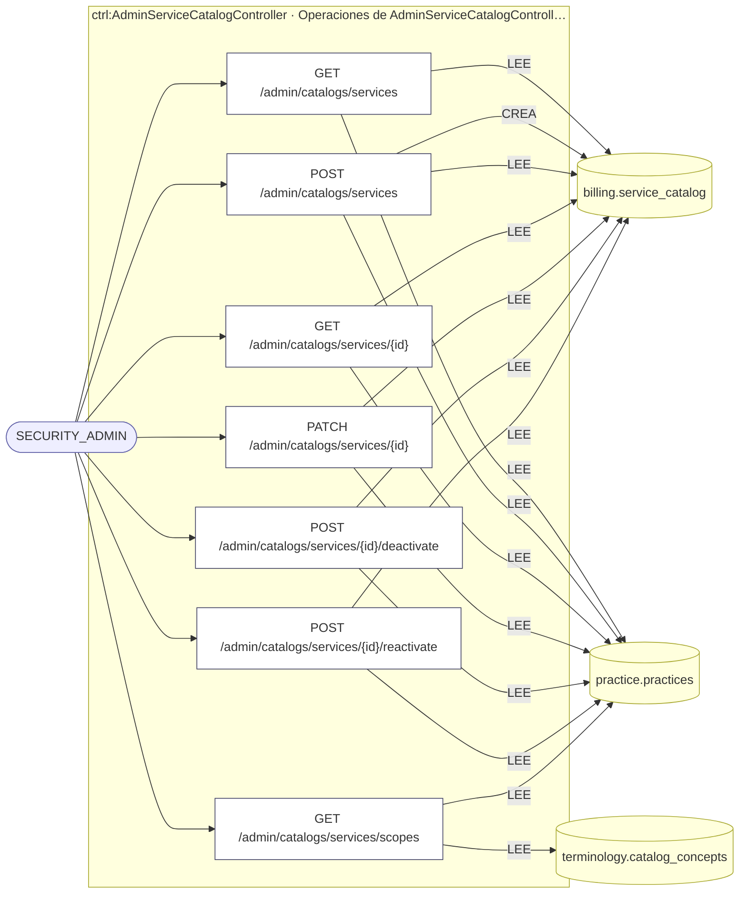
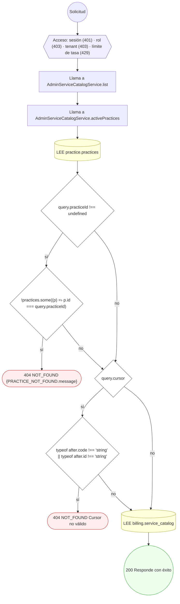
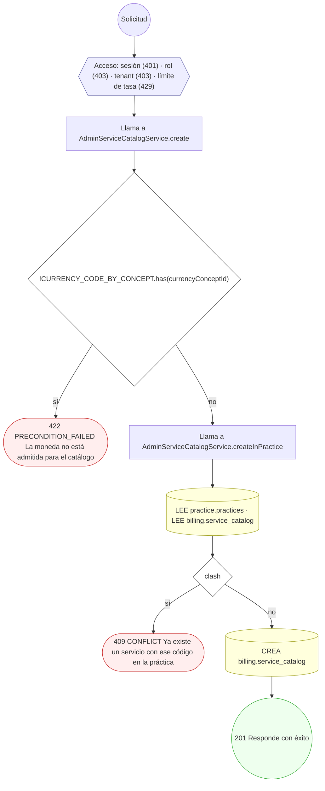
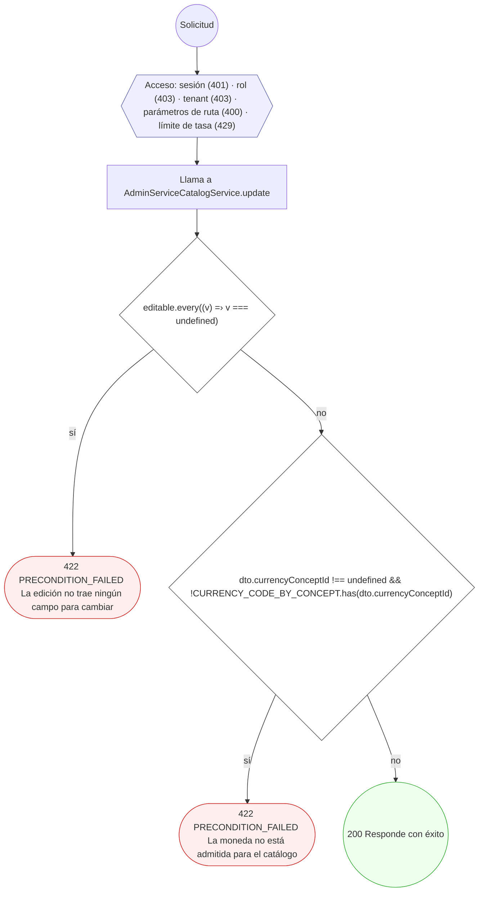
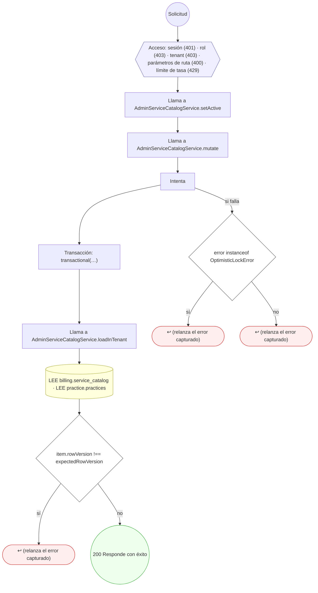

<!-- AUTOGENERADO por tools/inventario/flujos.mjs. No editar manualmente. -->

# Flujos del módulo `admin_catalogs`

- **Procesos:** 1 · **Máquinas de estado:** 0
- **Operaciones:** 7 (5 con decisiones propias, 2 sin ellas)
- Inventario de endpoints del módulo: [admin_catalogs](../endpoints/admin_catalogs.md)

## Proceso: Módulo `admin_catalogs` — Editor de catálogos globales

- **Código:** `admin_catalogs` · **Agrupación:** AGRUPACION_POR_CONTROLADOR · **Operaciones:** 7
- **Actores:** SECURITY_ADMIN
- **Revisión:** AUTO_DETECTADA
- **Fuentes:** `src/modules/admin_catalogs/README.md`

### Para qué sirve

Rutas de administración para editar catálogos por tipo de usuario, con versión optimista y auditoría. Parte del plan «Perfil admin: medición y gobierno» (H3); contrato completo en `mantra-core-health/docs/trabajo/2026-10-30-perfil-admin-medicion-gobierno/contratos/H3-catalogos.md`.

_Fuente: `src/modules/admin_catalogs/README.md:3`_

### Etapas y operaciones

| Etapa | Descripción | Operación | Quién actúa | Riesgo | Tablas |
|---|---|---|---|---|---|
| `ctrl:AdminServiceCatalogController` | Operaciones de AdminServiceCatalogController que el README no asigna a un caso de uso | GET /admin/catalogs/services | SECURITY_ADMIN | BAJO | 2 |
|  |  | POST /admin/catalogs/services | SECURITY_ADMIN | MEDIO | 3 |
|  |  | GET /admin/catalogs/services/{id} | SECURITY_ADMIN | BAJO | 2 |
|  |  | PATCH /admin/catalogs/services/{id} | SECURITY_ADMIN | BAJO | 2 |
|  |  | POST /admin/catalogs/services/{id}/deactivate | SECURITY_ADMIN | BAJO | 2 |
|  |  | POST /admin/catalogs/services/{id}/reactivate | SECURITY_ADMIN | BAJO | 2 |
|  |  | GET /admin/catalogs/services/scopes | SECURITY_ADMIN | BAJO | 2 |

### Diagrama — etapas `ctrl:AdminServiceCatalogController`

## Árbol de decisión por operación

Cada árbol se deriva del código del handler y de los métodos que invoca (hasta 4 niveles). Una rama que no decide, no escribe y no falla se poda. Los accesos y los efectos consecutivos se agrupan en un solo nodo.

### Operaciones con decisiones propias

#### 1. GET /admin/catalogs/services

| HTTP | Código | Cuándo |
|---|---|---|
| 200 | — | Éxito |
| 401 | `UNAUTHENTICATED` | Hay una sesión válida (JWT) |
| 403 | `FORBIDDEN` | El rol está permitido; El tenant se resuelve y pertenece al actor |
| 404 | `NOT_FOUND` | ResourceNotFoundException: {PRACTICE_NOT_FOUND.message}; ResourceNotFoundException: Cursor no válido |
| 429 | `RATE_LIMITED` | No se supera el límite de solicitudes |

#### 2. POST /admin/catalogs/services

| HTTP | Código | Cuándo |
|---|---|---|
| 201 | — | Éxito |
| 401 | `UNAUTHENTICATED` | Hay una sesión válida (JWT) |
| 403 | `FORBIDDEN` | El rol está permitido; El tenant se resuelve y pertenece al actor |
| 409 | `CONFLICT` | ConflictException: Ya existe un servicio con ese código en la práctica |
| 422 | `PRECONDITION_FAILED` | PreconditionFailedException: La moneda no está admitida para el catálogo |
| 429 | `RATE_LIMITED` | No se supera el límite de solicitudes |

#### 3. PATCH /admin/catalogs/services/{id}

| HTTP | Código | Cuándo |
|---|---|---|
| 200 | — | Éxito |
| 400 | `VALIDATION_FAILED` | Los parámetros de ruta son UUID válidos |
| 401 | `UNAUTHENTICATED` | Hay una sesión válida (JWT) |
| 403 | `FORBIDDEN` | El rol está permitido; El tenant se resuelve y pertenece al actor |
| 422 | `PRECONDITION_FAILED` | PreconditionFailedException: La edición no trae ningún campo para cambiar; PreconditionFailedException: La moneda no está admitida para el catálogo |
| 429 | `RATE_LIMITED` | No se supera el límite de solicitudes |

#### 4. POST /admin/catalogs/services/{id}/deactivate

| HTTP | Código | Cuándo |
|---|---|---|
| 200 | — | Éxito |
| 400 | `VALIDATION_FAILED` | Los parámetros de ruta son UUID válidos |
| 401 | `UNAUTHENTICATED` | Hay una sesión válida (JWT) |
| 403 | `FORBIDDEN` | El rol está permitido; El tenant se resuelve y pertenece al actor |
| 429 | `RATE_LIMITED` | No se supera el límite de solicitudes |

#### 5. POST /admin/catalogs/services/{id}/reactivate

| HTTP | Código | Cuándo |
|---|---|---|
| 200 | — | Éxito |
| 400 | `VALIDATION_FAILED` | Los parámetros de ruta son UUID válidos |
| 401 | `UNAUTHENTICATED` | Hay una sesión válida (JWT) |
| 403 | `FORBIDDEN` | El rol está permitido; El tenant se resuelve y pertenece al actor |
| 429 | `RATE_LIMITED` | No se supera el límite de solicitudes |

### Operaciones sin decisiones propias

Sólo comprueban el acceso y leen o escriben: no tienen ramas que dibujar. Su detalle está en la ficha de endpoints.

| Operación | Respuestas posibles | Tablas |
|---|---|---|
| GET /admin/catalogs/services/{id} | 200, 400, 401, 403, 429 | 2 |
| GET /admin/catalogs/services/scopes | 200, 401, 403, 429 | 2 |
