<!-- AUTOGENERADO por tools/inventario/flujos.mjs. No editar manualmente. -->

# Flujos del módulo `ads`

- **Procesos:** 1 · **Máquinas de estado:** 0
- **Operaciones:** 18 (18 con decisiones propias, 0 sin ellas)
- Inventario de endpoints del módulo: [ads](../endpoints/ads.md)

## Proceso: Módulo 43 — Publicidad, Assets, Entrega, Comercio y Optimización

- **Código:** `ads` · **Agrupación:** CASO_DE_USO_README · **Operaciones:** 18
- **Actores:** ADS_ADMIN · AD_OPS · BUSINESS_ADMIN · DATA_PRIVACY_OFFICER · FINANCE · POLICY_REVIEWER · SYSTEM
- **Revisión:** AUTO_DETECTADA
- **Fuentes:** `src/modules/ads/README.md`

### Para qué sirve

Estructura de cuentas publicitarias y socios, conexión con plataformas externas, jerarquía de campaña, cortafuegos de datos de evento, ingesta de entrega, conversiones, catálogo de productos, experimentos, reglas automatizadas, moderación, facturación y captura de leads.

_Fuente: `src/modules/ads/README.md:3`_

### Flujo general declarado en el README

```text
business manager ── ad account (active, amount_spent=0) ── owner con rol admin
        │                    │
        ├─ partner ──> relación vigente (la anterior se cierra)
        └─ platform-connection ──> identidades importadas + sync run

campaña (paused) ── ad set (paused) ── creativo ── anuncio (pending_review)
                          │
                          ├─ identity ──> una asignación vigente por rol
                          └─ budget-schedule ──> tramo sin solape + aprendizaje reiniciado

política de datos (active) ── reglas de campo (block | hash | drop)
                                    │
conversión ── dedup ──> ¿primera? ── política ──> accepted | blocked
                    └─> duplicate_count++

ingesta ── fact rows (append-only) ── rollup diario (se reescribe)
                                            └─> amount_spent += delta ──> aviso al tocar el tope
                                            └─> factura del periodo (líneas por campaña)

feed ── upsert por retailer_product_id ──> item_count e product_count recalculados

review event ── approved ──> efectivo activo + infracciones cerradas
             └─ disapproved ──> infracción abierta + efectivo disapproved ──> apelación

lead form ── submission (idempotente por lead externo) ── respuestas cifradas ──> entrega a CRM
```

_Fuente: `src/modules/ads/README.md:48`_

### Etapas y operaciones

| Etapa | Descripción | Operación | Quién actúa | Riesgo | Tablas |
|---|---|---|---|---|---|
| `UC-43-01` | Provisionar cuenta publicitaria | POST /ads/business-managers/{bmId}/ad-accounts | ADS_ADMIN · BUSINESS_ADMIN | MEDIO | 5 |
| `UC-43-02` | Vincular socio y compartir assets | POST /ads/business-managers/{bmId}/partners | ADS_ADMIN · BUSINESS_ADMIN | MEDIO | 8 |
| `UC-43-03` | Conectar plataforma e importar identidades | POST /ads/platform-connections | ADS_ADMIN · BUSINESS_ADMIN | MEDIO | 11 |
| `UC-43-04` | Lanzar campaña completa | POST /ads/ad-accounts/{id}/campaigns/launch | AD_OPS · ADS_ADMIN | MEDIO | 8 |
| `UC-43-05` | Segmentación e identidad | POST /ads/ad-accounts/{id}/targeting | AD_OPS · ADS_ADMIN | MEDIO | 4 |
|  |  | POST /ads/ad-sets/{id}/identity | AD_OPS · ADS_ADMIN | MEDIO | 5 |
| `UC-43-06` | Política de datos y reglas de campo | POST /ads/event-data-policies | DATA_PRIVACY_OFFICER · ADS_ADMIN | MEDIO | 3 |
| `UC-43-07` | Ingerir entrega y consolidar gasto | POST /ads/ingest/insights | SYSTEM | MEDIO | 11 |
| `UC-43-08` | Conversión server-side con dedup | POST /ads/datasets/{id}/events | SYSTEM · ADS_ADMIN | MEDIO | 11 |
| `UC-43-09` | Conversiones offline con match | POST /ads/offline-conversion-sets/upload | AD_OPS · ADS_ADMIN | MEDIO | 4 |
| `UC-43-10` | Experimento A/B | POST /ads/ad-accounts/{id}/experiments | AD_OPS · ADS_ADMIN | MEDIO | 8 |
| `UC-43-11` | Aplicar regla automatizada | POST /ads/automated-rules/{id}/evaluate | SYSTEM · ADS_ADMIN | MEDIO | 7 |
| `UC-43-12` | Moderación y apelación | POST /ads/ads/{id}/review-events | POLICY_REVIEWER · SYSTEM · ADS_ADMIN | MEDIO | 10 |
|  |  | POST /ads/policy-violations/{id}/appeals | POLICY_REVIEWER · AD_OPS · ADS_ADMIN | MEDIO | 3 |
| `UC-43-13` | Sincronizar catálogo | POST /ads/catalogs/{id}/feeds/{feedId}/run | SYSTEM · ADS_ADMIN | MEDIO | 12 |
| `UC-43-14` | Emitir factura de anuncios | POST /ads/ad-accounts/{id}/invoices/issue | FINANCE · ADS_ADMIN | MEDIO | 6 |
| `UC-43-15` | Recibir lead y entregar a CRM | POST /ads/lead-forms/{id}/submissions | SYSTEM · AD_OPS · ADS_ADMIN | MEDIO | 7 |
| `UC-43-16` | Programar presupuesto y puja | POST /ads/ad-sets/{id}/budget-schedules | AD_OPS · ADS_ADMIN | MEDIO | 10 |

### Diagrama — etapas `UC-43-01`, `UC-43-02`, `UC-43-03`…

```mermaid
flowchart LR
  a2(["ADS_ADMIN · BUSINESS_ADMIN"]):::actor
  a15(["AD_OPS · ADS_ADMIN"]):::actor
  a29(["DATA_PRIVACY_OFFICER · ADS_ADMIN"]):::actor
  a33(["SYSTEM"]):::actor
  a39(["SYSTEM · ADS_ADMIN"]):::actor
  a55(["POLICY_REVIEWER · SYSTEM · ADS_ADMIN"]):::actor
  a60(["POLICY_REVIEWER · AD_OPS · ADS_ADMIN"]):::actor
  a68(["FINANCE · ADS_ADMIN"]):::actor
  a73(["SYSTEM · AD_OPS · ADS_ADMIN"]):::actor
  t3[("ads.ad_account_users")]:::tabla
  t4[("ads.ad_accounts")]:::tabla
  t5[("ads.business_managers")]:::tabla
  t7[("ads.ad_partners")]:::tabla
  t8[("ads.partner_relationships")]:::tabla
  t11[("ads.ad_identity_assets")]:::tabla
  t12[("ads.ad_platform_connections")]:::tabla
  t16[("ads.ad_creatives")]:::tabla
  t17[("ads.ad_placements")]:::tabla
  t18[("ads.ad_sets")]:::tabla
  t19[("ads.ads")]:::tabla
  t20[("ads.campaigns")]:::tabla
  t23[("ads.custom_audiences")]:::tabla
  t24[("ads.lookalike_specs")]:::tabla
  t25[("ads.targeting_specs")]:::tabla
  t27[("ads.ad_identity_asset_assignments")]:::tabla
  t30[("ads.ad_event_data_policies")]:::tabla
  t31[("ads.ad_event_field_rules")]:::tabla
  t34[("ads.ad_billing_events")]:::tabla
  t35[("ads.delivery_status_snapshots")]:::tabla
  t36[("ads.insight_fact_rows")]:::tabla
  t40[("ads.blocked_ad_events")]:::tabla
  t41[("ads.conversion_datasets")]:::tabla
  t42[("ads.conversion_event_custom_data")]:::tabla
  t43[("ads.conversion_event_deduplication")]:::tabla
  t46[("ads.offline_conversion_events")]:::tabla
  t47[("ads.offline_conversion_sets")]:::tabla
  t49[("ads.ad_experiments")]:::tabla
  t52[("ads.automated_rules")]:::tabla
  t56[("ads.ad_policy_violations")]:::tabla
  t57[("ads.ad_review_events")]:::tabla
  t61[("ads.ad_policy_appeals")]:::tabla
  t63[("ads.catalog_feeds")]:::tabla
  t64[("ads.catalog_products")]:::tabla
  t65[("ads.feed_run_logs")]:::tabla
  t69[("ads.ad_invoice_lines")]:::tabla
  t70[("ads.ad_invoices")]:::tabla
  t71[("ads.insights_daily")]:::tabla
  t74[("ads.lead_answers")]:::tabla
  t75[("ads.lead_delivery_events")]:::tabla
  t76[("ads.lead_form_questions")]:::tabla
  t77[("ads.lead_forms")]:::tabla
  t78[("ads.lead_submissions")]:::tabla
  t81[("ads.adset_learning_snapshots")]:::tabla
  t82[("ads.attribution_settings")]:::tabla
  subgraph s0["UC-43-01 · Provisionar cuenta publicitaria"]
    o1["POST /ads/business-managers/{bmId}/ad-accounts"]:::op
  end
  t9[("+2 tablas más")]
  subgraph s1["UC-43-02 · Vincular socio y compartir assets"]
    o6["POST /ads/business-managers/{bmId}/partners"]:::op
  end
  t13[("+5 tablas más")]
  subgraph s2["UC-43-03 · Conectar plataforma e importar identidades"]
    o10["POST /ads/platform-connections"]:::op
  end
  t21[("+2 tablas más")]
  subgraph s3["UC-43-04 · Lanzar campaña completa"]
    o14["POST /ads/ad-accounts/{id}/campaigns/launch"]:::op
  end
  subgraph s4["UC-43-05 · Segmentación e identidad"]
    o22["POST /ads/ad-accounts/{id}/targeting"]:::op
    o26["POST /ads/ad-sets/{id}/identity"]:::op
  end
  subgraph s5["UC-43-06 · Política de datos y reglas de campo"]
    o28["POST /ads/event-data-policies"]:::op
  end
  t37[("+5 tablas más")]
  subgraph s6["UC-43-07 · Ingerir entrega y consolidar gasto"]
    o32["POST /ads/ingest/insights"]:::op
  end
  t44[("+5 tablas más")]
  subgraph s7["UC-43-08 · Conversión server-side con dedup"]
    o38["POST /ads/datasets/{id}/events"]:::op
  end
  subgraph s8["UC-43-09 · Conversiones offline con match"]
    o45["POST /ads/offline-conversion-sets/upload"]:::op
  end
  t50[("+2 tablas más")]
  subgraph s9["UC-43-10 · Experimento A/B"]
    o48["POST /ads/ad-accounts/{id}/experiments"]:::op
  end
  t53[("+1 tablas más")]
  subgraph s10["UC-43-11 · Aplicar regla automatizada"]
    o51["POST /ads/automated-rules/{id}/evaluate"]:::op
  end
  t58[("+4 tablas más")]
  subgraph s11["UC-43-12 · Moderación y apelación"]
    o54["POST /ads/ads/{id}/review-events"]:::op
    o59["POST /ads/policy-violations/{id}/appeals"]:::op
  end
  t66[("+6 tablas más")]
  subgraph s12["UC-43-13 · Sincronizar catálogo"]
    o62["POST /ads/catalogs/{id}/feeds/{feedId}/run"]:::op
  end
  subgraph s13["UC-43-14 · Emitir factura de anuncios"]
    o67["POST /ads/ad-accounts/{id}/invoices/issue"]:::op
  end
  t79[("+1 tablas más")]
  subgraph s14["UC-43-15 · Recibir lead y entregar a CRM"]
    o72["POST /ads/lead-forms/{id}/submissions"]:::op
  end
  t83[("+4 tablas más")]
  subgraph s15["UC-43-16 · Programar presupuesto y puja"]
    o80["POST /ads/ad-sets/{id}/budget-schedules"]:::op
  end
  a2 --> o1
  o1 -->|"CREA"| t3
  o1 -->|"CREA"| t4
  o1 -->|"LEE"| t4
  o1 -->|"CREA"| t5
  o1 -->|"LEE"| t5
  a2 --> o6
  o6 -->|"CREA"| t3
  o6 -->|"LEE"| t4
  o6 -->|"CREA"| t7
  o6 -->|"LEE"| t7
  o6 -->|"LEE"| t5
  o6 -->|"ACTUALIZA"| t8
  o6 -.-> t9
  a2 --> o10
  o10 -->|"ACTUALIZA"| t11
  o10 -->|"CREA"| t11
  o10 -->|"LEE"| t11
  o10 -->|"ACTUALIZA"| t12
  o10 -->|"CREA"| t12
  o10 -->|"LEE"| t12
  o10 -.-> t13
  a15 --> o14
  o14 -->|"LEE"| t4
  o14 -->|"CREA"| t16
  o14 -->|"CREA"| t17
  o14 -->|"CREA"| t18
  o14 -->|"CREA"| t19
  o14 -->|"CREA"| t20
  o14 -.-> t21
  a15 --> o22
  o22 -->|"LEE"| t4
  o22 -->|"CREA"| t23
  o22 -->|"CREA"| t24
  o22 -->|"CREA"| t25
  a15 --> o26
  o26 -->|"ACTUALIZA"| t27
  o26 -->|"CREA"| t27
  o26 -->|"LEE"| t27
  o26 -->|"LEE"| t11
  o26 -->|"LEE"| t18
  a29 --> o28
  o28 -->|"CREA"| t30
  o28 -->|"LEE"| t30
  o28 -->|"CREA"| t31
  a33 --> o32
  o32 -->|"ACTUALIZA"| t4
  o32 -->|"LEE"| t4
  o32 -->|"CREA"| t34
  o32 -->|"LEE"| t12
  o32 -->|"CREA"| t35
  o32 -->|"CREA"| t36
  o32 -.-> t37
  a39 --> o38
  o38 -->|"LEE"| t30
  o38 -->|"LEE"| t31
  o38 -->|"CREA"| t40
  o38 -->|"LEE"| t41
  o38 -->|"CREA"| t42
  o38 -->|"ACTUALIZA"| t43
  o38 -.-> t44
  a15 --> o45
  o45 -->|"LEE"| t4
  o45 -->|"CREA"| t46
  o45 -->|"ACTUALIZA"| t47
  o45 -->|"CREA"| t47
  a15 --> o48
  o48 -->|"LEE"| t4
  o48 -->|"ACTUALIZA"| t49
  o48 -->|"CREA"| t49
  o48 -->|"ACTUALIZA"| t18
  o48 -->|"LEE"| t18
  o48 -->|"ACTUALIZA"| t20
  o48 -.-> t50
  a39 --> o51
  o51 -->|"ACTUALIZA"| t18
  o51 -->|"LEE"| t18
  o51 -->|"ACTUALIZA"| t52
  o51 -->|"LEE"| t52
  o51 -->|"ACTUALIZA"| t20
  o51 -->|"LEE"| t20
  o51 -.-> t53
  a55 --> o54
  o54 -->|"ACTUALIZA"| t56
  o54 -->|"CREA"| t56
  o54 -->|"LEE"| t56
  o54 -->|"CREA"| t57
  o54 -->|"LEE"| t57
  o54 -->|"LEE"| t18
  o54 -.-> t58
  a60 --> o59
  o59 -->|"CREA"| t61
  o59 -->|"LEE"| t61
  o59 -->|"LEE"| t56
  a39 --> o62
  o62 -->|"ACTUALIZA"| t63
  o62 -->|"LEE"| t63
  o62 -->|"ACTUALIZA"| t64
  o62 -->|"CREA"| t64
  o62 -->|"LEE"| t64
  o62 -->|"CREA"| t65
  o62 -.-> t66
  a68 --> o67
  o67 -->|"LEE"| t4
  o67 -->|"CREA"| t34
  o67 -->|"CREA"| t69
  o67 -->|"CREA"| t70
  o67 -->|"LEE"| t70
  o67 -->|"LEE"| t71
  a73 --> o72
  o72 -->|"CREA"| t74
  o72 -->|"CREA"| t75
  o72 -->|"LEE"| t75
  o72 -->|"LEE"| t76
  o72 -->|"LEE"| t77
  o72 -->|"CREA"| t78
  o72 -.-> t79
  a15 --> o80
  o80 -->|"LEE"| t4
  o80 -->|"ACTUALIZA"| t18
  o80 -->|"LEE"| t18
  o80 -->|"CREA"| t81
  o80 -->|"ACTUALIZA"| t82
  o80 -->|"CREA"| t82
  o80 -.-> t83
  classDef op fill:#fff,stroke:#446
  classDef actor fill:#eef,stroke:#66a
  classDef tabla fill:#ffd,stroke:#aa3
  classDef evento fill:#efe,stroke:#3a3
```

## Árbol de decisión por operación

Cada árbol se deriva del código del handler y de los métodos que invoca (hasta 4 niveles). Una rama que no decide, no escribe y no falla se poda. Los accesos y los efectos consecutivos se agrupan en un solo nodo.

### Operaciones con decisiones propias

#### 1. POST /ads/ad-accounts/{id}/campaigns/launch

Lanzar una campaña con sus conjuntos, creativos y anuncios

| HTTP | Código | Cuándo |
|---|---|---|
| 201 | — | Éxito |
| 400 | `VALIDATION_FAILED` | Los parámetros de ruta son UUID válidos; El cuerpo cumple el DTO (sin propiedades extra) |
| 401 | `UNAUTHENTICATED` | Hay una sesión válida (JWT) |
| 403 | `FORBIDDEN` | El rol está permitido; El tenant se resuelve y pertenece al actor |
| 404 | `NOT_FOUND` | ResourceNotFoundException: Cuenta publicitaria no encontrada; ResourceNotFoundException: Segmentación no encontrada |
| 422 | `PRECONDITION_FAILED` | PreconditionFailedException: La campaña debe terminar después de empezar; PreconditionFailedException: La campaña o sus conjuntos necesitan presupuesto; PreconditionFailedException: La cuenta publicitaria no está activa; PreconditionFailedException: La cuenta agotó su tope de gasto |
| 429 | `RATE_LIMITED` | No se supera el límite de solicitudes |

```mermaid
flowchart TD
  n1(("Solicitud")):::inicio
  n2{{"Acceso: sesión (401) · rol (403) · tenant (403) · parámetros de ruta (400) · cuerpo válido (400) · límite de…"}}:::acceso
  n1 --> n2
  n3["Llama a AdsCampaignsService.launchCampaign"]:::llamada
  n2 --> n3
  n4{"startAt && stopAt && stopAt ‹= startAt"}:::decision
  n3 --> n4
  n5(["422 PRECONDITION_FAILED La campaña debe terminar después de empezar"]):::error
  n4 -->|"sí"| n5
  n6{"!dto.dailyBudget && !dto.lifetimeBudget && !dto.adSets.some((s) =› s.dailyBudget || s.lifetimeBudget)"}:::decision
  n4 -->|"no"| n6
  n7(["422 PRECONDITION_FAILED La campaña o sus conjuntos necesitan presupuesto"]):::error
  n6 -->|"sí"| n7
  n8["Transacción: transactional(…)"]:::transaccion
  n6 -->|"no"| n8
  n9["Llama a AdsAccountsRepository.findAdAccountById"]:::llamada
  n8 --> n9
  n10[("LEE ads.ad_accounts")]:::efecto
  n9 --> n10
  n11{"!account"}:::decision
  n10 --> n11
  n12(["404 NOT_FOUND Cuenta publicitaria no encontrada"]):::error
  n11 -->|"sí"| n12
  n13{"account.accountStatusConceptId !== CONCEPTS.AD_ACCOUNT_ACTIVE"}:::decision
  n11 -->|"no"| n13
  n14(["422 PRECONDITION_FAILED La cuenta publicitaria no está activa"]):::error
  n13 -->|"sí"| n14
  n15{"account.spendCapAmount && Number(account.amountSpent ?? '0') ›= Number(account.spendCapAmount)"}:::decision
  n13 -->|"no"| n15
  n16(["422 PRECONDITION_FAILED La cuenta agotó su tope de gasto"]):::error
  n15 -->|"sí"| n16
  n17["Llama a AdsCampaignsRepository.createCampaign"]:::llamada
  n15 -->|"no"| n17
  n18[("CREA ads.campaigns")]:::efecto
  n17 --> n18
  n19["Repite: por cada const spec de dto.adSets"]:::bucle
  n18 --> n19
  n20{"spec.targetingSpecId"}:::decision
  n19 -->|"cada elemento"| n20
  n21["Llama a AdsCampaignsRepository.findTargetingSpecById"]:::llamada
  n20 -->|"sí"| n21
  n22[("LEE ads.targeting_specs")]:::efecto
  n21 --> n22
  n23{"!targeting"}:::decision
  n22 --> n23
  n24(["404 NOT_FOUND Segmentación no encontrada"]):::error
  n23 -->|"sí"| n24
  n25["Llama a AdsCampaignsRepository.createAdSet"]:::llamada
  n23 -->|"no"| n25
  n20 -->|"no"| n25
  n26[("CREA ads.ad_sets")]:::efecto
  n25 --> n26
  n27["Repite: por cada const placement de spec.placements ?? []"]:::bucle
  n26 --> n27
  n28["Llama a AdsCampaignsRepository.createPlacement"]:::llamada
  n27 -->|"cada elemento"| n28
  n29[("CREA ads.ad_placements")]:::efecto
  n28 --> n29
  n30["Llama a AdsCampaignsRepository.createCreative"]:::llamada
  n29 --> n30
  n27 -->|"al terminar"| n30
  n31[("CREA ads.ad_creatives")]:::efecto
  n30 --> n31
  n32["Repite: forEach(…)"]:::bucle
  n31 --> n32
  n33["Llama a AdsCampaignsRepository.createCreativeAsset"]:::llamada
  n32 -->|"cada elemento"| n33
  n34[("CREA ads.creative_assets")]:::efecto
  n33 --> n34
  n35["Llama a AdsCampaignsRepository.createAd"]:::llamada
  n34 --> n35
  n32 -->|"al terminar"| n35
  n36[("CREA ads.ads")]:::efecto
  n35 --> n36
  n37(("201 Responde con éxito")):::ok
  n36 --> n37
  n19 -->|"al terminar"| n37
  classDef acceso fill:#eef,stroke:#66a
  classDef error fill:#fee,stroke:#c33
  classDef ok fill:#efe,stroke:#3a3
  classDef efecto fill:#ffd,stroke:#aa3
  classDef decision fill:#fff,stroke:#555
  classDef corte fill:#eee,stroke:#999,stroke-dasharray: 4
```

#### 2. POST /ads/ad-accounts/{id}/experiments

Crear un experimento A/B y arrancar sus variantes

| HTTP | Código | Cuándo |
|---|---|---|
| 201 | — | Éxito |
| 400 | `VALIDATION_FAILED` | Los parámetros de ruta son UUID válidos; El cuerpo cumple el DTO (sin propiedades extra) |
| 401 | `UNAUTHENTICATED` | Hay una sesión válida (JWT) |
| 403 | `FORBIDDEN` | El rol está permitido; El tenant se resuelve y pertenece al actor |
| 404 | `NOT_FOUND` | ResourceNotFoundException: Cuenta publicitaria no encontrada; ResourceNotFoundException: Campaña de la variante no encontrada; ResourceNotFoundException: Conjunto de la variante no encontrado |
| 422 | `PRECONDITION_FAILED` | PreconditionFailedException: El reparto de tráfico debe sumar 100; PreconditionFailedException: El experimento necesita exactamente un control |
| 429 | `RATE_LIMITED` | No se supera el límite de solicitudes |

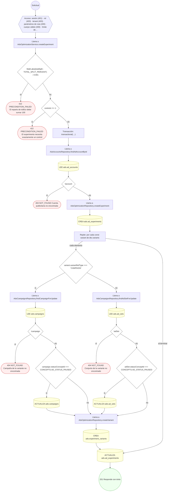

#### 3. POST /ads/ad-accounts/{id}/invoices/issue

Emitir la factura de anuncios del periodo

| HTTP | Código | Cuándo |
|---|---|---|
| 201 | — | Éxito |
| 400 | `VALIDATION_FAILED` | Los parámetros de ruta son UUID válidos; El cuerpo cumple el DTO (sin propiedades extra) |
| 401 | `UNAUTHENTICATED` | Hay una sesión válida (JWT) |
| 403 | `FORBIDDEN` | El rol está permitido; El tenant se resuelve y pertenece al actor |
| 404 | `NOT_FOUND` | ResourceNotFoundException: Cuenta publicitaria no encontrada |
| 409 | `CONFLICT` | ConflictException: Ya existe una factura con ese número; ConflictException: El periodo ya está facturado |
| 422 | `PRECONDITION_FAILED` | PreconditionFailedException: El periodo debe terminar después de empezar; PreconditionFailedException: No hay consumo registrado en el periodo |
| 429 | `RATE_LIMITED` | No se supera el límite de solicitudes |

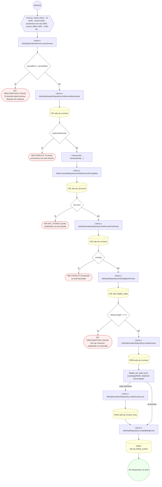

#### 4. POST /ads/ad-accounts/{id}/targeting

Guardar una segmentación y, si se pide, su audiencia

| HTTP | Código | Cuándo |
|---|---|---|
| 201 | — | Éxito |
| 400 | `VALIDATION_FAILED` | Los parámetros de ruta son UUID válidos; El cuerpo cumple el DTO (sin propiedades extra) |
| 401 | `UNAUTHENTICATED` | Hay una sesión válida (JWT) |
| 403 | `FORBIDDEN` | El rol está permitido; El tenant se resuelve y pertenece al actor |
| 404 | `NOT_FOUND` | ResourceNotFoundException: Cuenta publicitaria no encontrada |
| 422 | `PRECONDITION_FAILED` | PreconditionFailedException: El rango de edad está invertido; PreconditionFailedException: Una lookalike necesita país |
| 429 | `RATE_LIMITED` | No se supera el límite de solicitudes |

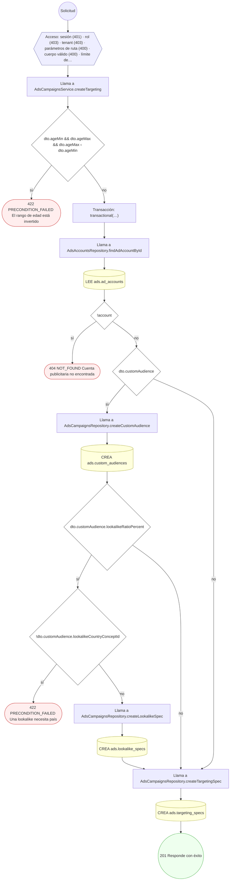

#### 5. POST /ads/ad-sets/{id}/budget-schedules

Programar un tramo de presupuesto o puja

| HTTP | Código | Cuándo |
|---|---|---|
| 201 | — | Éxito |
| 400 | `VALIDATION_FAILED` | Los parámetros de ruta son UUID válidos; El cuerpo cumple el DTO (sin propiedades extra) |
| 401 | `UNAUTHENTICATED` | Hay una sesión válida (JWT) |
| 403 | `FORBIDDEN` | El rol está permitido; El tenant se resuelve y pertenece al actor |
| 404 | `NOT_FOUND` | ResourceNotFoundException: Conjunto de anuncios no encontrado; ResourceNotFoundException: Campaña del conjunto no encontrada |
| 409 | `CONFLICT` | ConflictException: El tramo se solapa con otro vigente |
| 422 | `PRECONDITION_FAILED` | PreconditionFailedException: El tramo debe terminar después de empezar; PreconditionFailedException: El presupuesto del tramo excede el tope de gasto de la cuenta |
| 429 | `RATE_LIMITED` | No se supera el límite de solicitudes |

```mermaid
flowchart TD
  n1(("Solicitud")):::inicio
  n2{{"Acceso: sesión (401) · rol (403) · tenant (403) · parámetros de ruta (400) · cuerpo válido (400) · límite de…"}}:::acceso
  n1 --> n2
  n3["Llama a AdsCampaignsService.createBudgetSchedule"]:::llamada
  n2 --> n3
  n4{"validTo && validTo ‹= validFrom"}:::decision
  n3 --> n4
  n5(["422 PRECONDITION_FAILED El tramo debe terminar después de empezar"]):::error
  n4 -->|"sí"| n5
  n6["Transacción: transactional(…)"]:::transaccion
  n4 -->|"no"| n6
  n7["Llama a AdsCampaignsRepository.findAdSetForUpdate"]:::llamada
  n6 --> n7
  n8[("LEE ads.ad_sets")]:::efecto
  n7 --> n8
  n9{"!adSet"}:::decision
  n8 --> n9
  n10(["404 NOT_FOUND Conjunto de anuncios no encontrado"]):::error
  n9 -->|"sí"| n10
  n11["Llama a AdsCampaignsRepository.findCampaignById"]:::llamada
  n9 -->|"no"| n11
  n12[("LEE ads.campaigns")]:::efecto
  n11 --> n12
  n13{"!campaign"}:::decision
  n12 --> n13
  n14(["404 NOT_FOUND Campaña del conjunto no encontrada"]):::error
  n13 -->|"sí"| n14
  n15["Llama a AdsAccountsRepository.findAdAccountById"]:::llamada
  n13 -->|"no"| n15
  n16[("LEE ads.ad_accounts")]:::efecto
  n15 --> n16
  n17{"account?.spendCapAmount && Number(dto.amount) › Number(account.spendCapAmount)"}:::decision
  n16 --> n17
  n18(["422 PRECONDITION_FAILED El presupuesto del tramo excede el tope de gasto de la cuenta"]):::error
  n17 -->|"sí"| n18
  n19["Llama a AdsCampaignsRepository.findActiveSchedules"]:::llamada
  n17 -->|"no"| n19
  n20[("LEE ads.budget_schedules")]:::efecto
  n19 --> n20
  n21{"overlapping"}:::decision
  n20 --> n21
  n22(["409 CONFLICT El tramo se solapa con otro vigente"]):::error
  n21 -->|"sí"| n22
  n23["Llama a AdsCampaignsRepository.createBudgetSchedule"]:::llamada
  n21 -->|"no"| n23
  n24[("CREA ads.budget_schedules")]:::efecto
  n23 --> n24
  n25{"dto.budgetType === 'DAILY'"}:::decision
  n24 --> n25
  n26[("ACTUALIZA ads.ad_sets")]:::efecto
  n25 -->|"sí"| n26
  n27[("ACTUALIZA ads.ad_sets")]:::efecto
  n25 -->|"no"| n27
  n28[("ACTUALIZA ads.ad_sets")]:::efecto
  n26 --> n28
  n27 --> n28
  n29{"dto.bidAmount !== undefined"}:::decision
  n28 --> n29
  n30[("ACTUALIZA ads.ad_sets")]:::efecto
  n29 -->|"sí"| n30
  n31{"dto.clickWindowDays || dto.viewWindowDays"}:::decision
  n30 --> n31
  n29 -->|"no"| n31
  n32["Llama a AdsCampaignsRepository.findDefaultAttributionSettings"]:::llamada
  n31 -->|"sí"| n32
  n33[("LEE ads.attribution_settings")]:::efecto
  n32 --> n33
  n34["Llama a AdsCampaignsRepository.upsertAttributionSettings"]:::llamada
  n33 --> n34
  n35{"existing"}:::decision
  n34 --> n35
  n36[("ACTUALIZA ads.attribution_settings · ACTUALIZA ads.attribution_settings · ACTUALIZA ads.attribution_settings")]:::efecto
  n35 -->|"sí"| n36
  n37[("CREA ads.attribution_settings")]:::efecto
  n36 --> n37
  n35 -->|"no"| n37
  n38{"learningReset"}:::decision
  n37 --> n38
  n31 -->|"no"| n38
  n39["Llama a AdsCampaignsRepository.createLearningSnapshot"]:::llamada
  n38 -->|"sí"| n39
  n40[("CREA ads.adset_learning_snapshots")]:::efecto
  n39 --> n40
  n41(("201 Responde con éxito")):::ok
  n40 --> n41
  n38 -->|"no"| n41
  classDef acceso fill:#eef,stroke:#66a
  classDef error fill:#fee,stroke:#c33
  classDef ok fill:#efe,stroke:#3a3
  classDef efecto fill:#ffd,stroke:#aa3
  classDef decision fill:#fff,stroke:#555
  classDef corte fill:#eee,stroke:#999,stroke-dasharray: 4
```

#### 6. POST /ads/ad-sets/{id}/identity

Asignar la identidad con la que se publica el conjunto

| HTTP | Código | Cuándo |
|---|---|---|
| 200 | — | Éxito |
| 400 | `VALIDATION_FAILED` | Los parámetros de ruta son UUID válidos; El cuerpo cumple el DTO (sin propiedades extra) |
| 401 | `UNAUTHENTICATED` | Hay una sesión válida (JWT) |
| 403 | `FORBIDDEN` | El rol está permitido; El tenant se resuelve y pertenece al actor |
| 404 | `NOT_FOUND` | ResourceNotFoundException: Conjunto de anuncios no encontrado; ResourceNotFoundException: Identidad no encontrada |
| 422 | `PRECONDITION_FAILED` | PreconditionFailedException: La identidad no está activa |
| 429 | `RATE_LIMITED` | No se supera el límite de solicitudes |

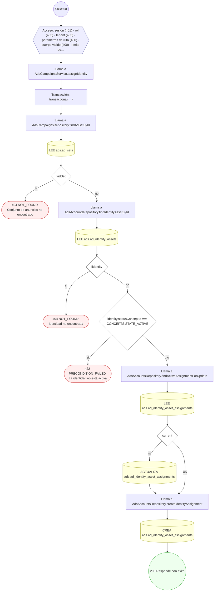

#### 7. POST /ads/ads/{id}/review-events

Registrar el resultado de la revisión del anuncio

| HTTP | Código | Cuándo |
|---|---|---|
| 201 | — | Éxito |
| 400 | `VALIDATION_FAILED` | Los parámetros de ruta son UUID válidos; El cuerpo cumple el DTO (sin propiedades extra) |
| 401 | `UNAUTHENTICATED` | Hay una sesión válida (JWT) |
| 403 | `FORBIDDEN` | El rol está permitido; El tenant se resuelve y pertenece al actor |
| 404 | `NOT_FOUND` | ResourceNotFoundException: Anuncio no encontrado |
| 422 | `PRECONDITION_FAILED` | PreconditionFailedException: Un rechazo necesita código, categoría y severidad de la política |
| 429 | `RATE_LIMITED` | No se supera el límite de solicitudes |

```mermaid
flowchart TD
  n1(("Solicitud")):::inicio
  n2{{"Acceso: sesión (401) · rol (403) · tenant (403) · parámetros de ruta (400) · cuerpo válido (400) · límite de…"}}:::acceso
  n1 --> n2
  n3["Llama a AdsOptimizationService.recordReviewEvent"]:::llamada
  n2 --> n3
  n4["Transacción: transactional(…)"]:::transaccion
  n3 --> n4
  n5{"dto.externalReviewId"}:::decision
  n4 --> n5
  n6["Llama a AdsOptimizationRepository.findReviewEventByExternalId"]:::llamada
  n5 -->|"sí"| n6
  n7[("LEE ads.ad_review_events")]:::efecto
  n6 --> n7
  n8{"previous"}:::decision
  n7 --> n8
  n9["Llama a AdsCampaignsRepository.findAdById"]:::llamada
  n8 -->|"sí"| n9
  n10[("LEE ads.ads")]:::efecto
  n9 --> n10
  n11["Llama a AdsCampaignsRepository.findAdForUpdate"]:::llamada
  n10 --> n11
  n8 -->|"no"| n11
  n5 -->|"no"| n11
  n12[("LEE ads.ads")]:::efecto
  n11 --> n12
  n13{"!ad"}:::decision
  n12 --> n13
  n14(["404 NOT_FOUND Anuncio no encontrado"]):::error
  n13 -->|"sí"| n14
  n15["Llama a AdsOptimizationRepository.createReviewEvent"]:::llamada
  n13 -->|"no"| n15
  n16[("CREA ads.ad_review_events")]:::efecto
  n15 --> n16
  n17{"dto.reviewStatus === 'DISAPPROVED'"}:::decision
  n16 --> n17
  n18{"!dto.policyCode || !dto.policyCategory || !dto.severity"}:::decision
  n17 -->|"sí"| n18
  n19(["422 PRECONDITION_FAILED Un rechazo necesita código, categoría y severidad de la política"]):::error
  n18 -->|"sí"| n19
  n20["Llama a AdsOptimizationRepository.createViolation"]:::llamada
  n18 -->|"no"| n20
  n21[("CREA ads.ad_policy_violations")]:::efecto
  n20 --> n21
  n22{"dto.reviewStatus === 'APPROVED'"}:::decision
  n21 --> n22
  n17 -->|"no"| n22
  n23["Llama a AdsOptimizationRepository.findOpenViolations"]:::llamada
  n22 -->|"sí"| n23
  n24[("LEE ads.ad_policy_violations")]:::efecto
  n23 --> n24
  n25["Repite: por cada const violation de open"]:::bucle
  n24 --> n25
  n26[("ACTUALIZA ads.ad_policy_violations · ACTUALIZA ads.ad_policy_violations")]:::efecto
  n25 -->|"cada elemento"| n26
  n27[("ACTUALIZA ads.ads · ACTUALIZA ads.ads")]:::efecto
  n26 --> n27
  n25 -->|"al terminar"| n27
  n22 -->|"no"| n27
  n28["Llama a AdsCampaignsRepository.findAdSetById"]:::llamada
  n27 --> n28
  n29[("LEE ads.ad_sets")]:::efecto
  n28 --> n29
  n30["Llama a AdsCampaignsRepository.findCampaignById"]:::llamada
  n29 --> n30
  n31[("LEE ads.campaigns")]:::efecto
  n30 --> n31
  n32{"campaign"}:::decision
  n31 --> n32
  n33["Llama a AdsDataRepository.createDeliverySnapshot"]:::llamada
  n32 -->|"sí"| n33
  n34[("CREA ads.delivery_status_snapshots")]:::efecto
  n33 --> n34
  n35(("201 Responde con éxito")):::ok
  n34 --> n35
  n32 -->|"no"| n35
  classDef acceso fill:#eef,stroke:#66a
  classDef error fill:#fee,stroke:#c33
  classDef ok fill:#efe,stroke:#3a3
  classDef efecto fill:#ffd,stroke:#aa3
  classDef decision fill:#fff,stroke:#555
  classDef corte fill:#eee,stroke:#999,stroke-dasharray: 4
```

#### 8. POST /ads/automated-rules/{id}/evaluate

Aplicar la acción de una regla automatizada

| HTTP | Código | Cuándo |
|---|---|---|
| 200 | — | Éxito |
| 400 | `VALIDATION_FAILED` | Los parámetros de ruta son UUID válidos; El cuerpo cumple el DTO (sin propiedades extra) |
| 401 | `UNAUTHENTICATED` | Hay una sesión válida (JWT) |
| 403 | `FORBIDDEN` | El rol está permitido; El tenant se resuelve y pertenece al actor |
| 404 | `NOT_FOUND` | ResourceNotFoundException: Regla automatizada no encontrada |
| 422 | `PRECONDITION_FAILED` | PreconditionFailedException: La regla no está habilitada |
| 429 | `RATE_LIMITED` | No se supera el límite de solicitudes |

```mermaid
flowchart TD
  n1(("Solicitud")):::inicio
  n2{{"Acceso: sesión (401) · rol (403) · tenant (403) · parámetros de ruta (400) · cuerpo válido (400) · límite de…"}}:::acceso
  n1 --> n2
  n3["Llama a AdsOptimizationService.evaluateRule"]:::llamada
  n2 --> n3
  n4["Transacción: transactional(…)"]:::transaccion
  n3 --> n4
  n5["Llama a AdsOptimizationRepository.findRuleForUpdate"]:::llamada
  n4 --> n5
  n6[("LEE ads.automated_rules")]:::efecto
  n5 --> n6
  n7{"!rule"}:::decision
  n6 --> n7
  n8(["404 NOT_FOUND Regla automatizada no encontrada"]):::error
  n7 -->|"sí"| n8
  n9{"!rule.isEnabled || rule.stateConceptId !== CONCEPTS.STATE_ACTIVE"}:::decision
  n7 -->|"no"| n9
  n10(["422 PRECONDITION_FAILED La regla no está habilitada"]):::error
  n9 -->|"sí"| n10
  n11["Repite: por cada const entityId de dto.matchedEntityIds"]:::bucle
  n9 -->|"no"| n11
  n12["Llama a AdsOptimizationService.applyRuleAction"]:::llamada
  n11 -->|"cada elemento"| n12
  n13{"scopeConceptId === CONCEPTS.RULE_SCOPE_CAMPAIGN"}:::decision
  n12 --> n13
  n14["Llama a AdsCampaignsRepository.findCampaignForUpdate"]:::llamada
  n13 -->|"sí"| n14
  n15[("LEE ads.campaigns")]:::efecto
  n14 --> n15
  n16{"actionConceptId === CONCEPTS.RULE_ACTION_PAUSE"}:::decision
  n15 --> n16
  n17[("ACTUALIZA ads.campaigns")]:::efecto
  n16 -->|"sí"| n17
  n18{"actionConceptId === CONCEPTS.RULE_ACTION_ACTIVATE"}:::decision
  n16 -->|"no"| n18
  n19[("ACTUALIZA ads.campaigns")]:::efecto
  n18 -->|"sí"| n19
  n20{"actionConceptId === CONCEPTS.RULE_ACTION_ADJUST_BUDGET"}:::decision
  n18 -->|"no"| n20
  n21[("ACTUALIZA ads.campaigns")]:::efecto
  n20 -->|"sí"| n21
  n22["Llama a AdsCampaignsRepository.findAdSetForUpdate"]:::llamada
  n17 --> n22
  n19 --> n22
  n21 --> n22
  n20 -->|"no"| n22
  n13 -->|"no"| n22
  n23[("LEE ads.ad_sets")]:::efecto
  n22 --> n23
  n24{"actionConceptId === CONCEPTS.RULE_ACTION_PAUSE"}:::decision
  n23 --> n24
  n25[("ACTUALIZA ads.ad_sets")]:::efecto
  n24 -->|"sí"| n25
  n26{"actionConceptId === CONCEPTS.RULE_ACTION_ACTIVATE"}:::decision
  n24 -->|"no"| n26
  n27[("ACTUALIZA ads.ad_sets")]:::efecto
  n26 -->|"sí"| n27
  n28{"actionConceptId === CONCEPTS.RULE_ACTION_ADJUST_BUDGET"}:::decision
  n26 -->|"no"| n28
  n29[("ACTUALIZA ads.ad_sets")]:::efecto
  n28 -->|"sí"| n29
  n30{"actionConceptId === CONCEPTS.RULE_ACTION_ADJUST_BID"}:::decision
  n28 -->|"no"| n30
  n31[("ACTUALIZA ads.ad_sets")]:::efecto
  n30 -->|"sí"| n31
  n32["Llama a AdsOptimizationRepository.createRuleExecution"]:::llamada
  n25 --> n32
  n27 --> n32
  n29 --> n32
  n31 --> n32
  n30 -->|"no"| n32
  n11 -->|"al terminar"| n32
  n33[("CREA ads.rule_executions")]:::efecto
  n32 --> n33
  n34[("ACTUALIZA ads.automated_rules")]:::efecto
  n33 --> n34
  n35(("200 Responde con éxito")):::ok
  n34 --> n35
  classDef acceso fill:#eef,stroke:#66a
  classDef error fill:#fee,stroke:#c33
  classDef ok fill:#efe,stroke:#3a3
  classDef efecto fill:#ffd,stroke:#aa3
  classDef decision fill:#fff,stroke:#555
  classDef corte fill:#eee,stroke:#999,stroke-dasharray: 4
```

#### 9. POST /ads/business-managers/{bmId}/ad-accounts

Provisionar una cuenta publicitaria

| HTTP | Código | Cuándo |
|---|---|---|
| 201 | — | Éxito |
| 400 | `VALIDATION_FAILED` | Los parámetros de ruta son UUID válidos; El cuerpo cumple el DTO (sin propiedades extra) |
| 401 | `UNAUTHENTICATED` | Hay una sesión válida (JWT) |
| 403 | `FORBIDDEN` | El rol está permitido; El tenant se resuelve y pertenece al actor |
| 404 | `NOT_FOUND` | ResourceNotFoundException: Business manager no encontrado |
| 409 | `CONFLICT` | ConflictException: Ya existe una cuenta con esa referencia externa; ConflictException: Ya existe un business manager con esa referencia |
| 422 | `PRECONDITION_FAILED` | PreconditionFailedException: Sin business manager hay que aportar nombre y referencia externa para crearlo |
| 429 | `RATE_LIMITED` | No se supera el límite de solicitudes |

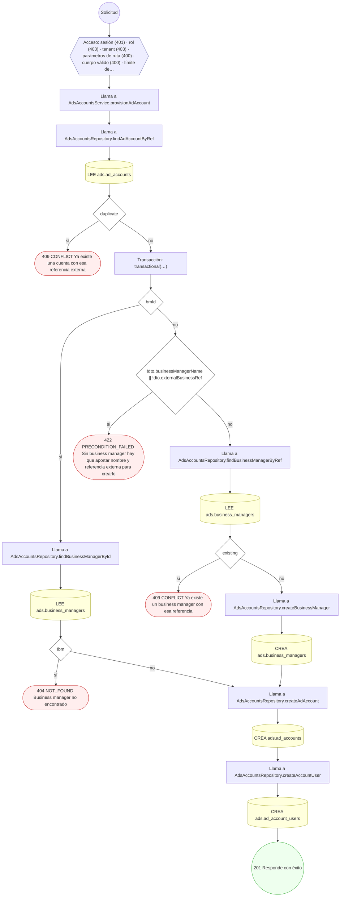

#### 10. POST /ads/business-managers/{bmId}/partners

Vincular un socio y compartir el alcance de assets

| HTTP | Código | Cuándo |
|---|---|---|
| 201 | — | Éxito |
| 400 | `VALIDATION_FAILED` | Los parámetros de ruta son UUID válidos; El cuerpo cumple el DTO (sin propiedades extra) |
| 401 | `UNAUTHENTICATED` | Hay una sesión válida (JWT) |
| 403 | `FORBIDDEN` | El rol está permitido; El tenant se resuelve y pertenece al actor |
| 404 | `NOT_FOUND` | ResourceNotFoundException: Business manager no encontrado; ResourceNotFoundException: Cuenta publicitaria no encontrada |
| 422 | `PRECONDITION_FAILED` | PreconditionFailedException: El socio no está activo; PreconditionFailedException: La cuenta no pertenece a este business manager |
| 429 | `RATE_LIMITED` | No se supera el límite de solicitudes |

```mermaid
flowchart TD
  n1(("Solicitud")):::inicio
  n2{{"Acceso: sesión (401) · rol (403) · tenant (403) · parámetros de ruta (400) · cuerpo válido (400) · límite de…"}}:::acceso
  n1 --> n2
  n3["Llama a AdsAccountsService.linkPartner"]:::llamada
  n2 --> n3
  n4["Transacción: transactional(…)"]:::transaccion
  n3 --> n4
  n5["Llama a AdsAccountsRepository.findBusinessManagerById"]:::llamada
  n4 --> n5
  n6[("LEE ads.business_managers")]:::efecto
  n5 --> n6
  n7{"!bm"}:::decision
  n6 --> n7
  n8(["404 NOT_FOUND Business manager no encontrado"]):::error
  n7 -->|"sí"| n8
  n9["Llama a AdsAccountsRepository.findPartnerByRef"]:::llamada
  n7 -->|"no"| n9
  n10[("LEE ads.ad_partners")]:::efecto
  n9 --> n10
  n11{"partner && partner.stateConceptId !== CONCEPTS.STATE_ACTIVE"}:::decision
  n10 --> n11
  n12(["422 PRECONDITION_FAILED El socio no está activo"]):::error
  n11 -->|"sí"| n12
  n13{"!partner"}:::decision
  n11 -->|"no"| n13
  n14["Llama a AdsAccountsRepository.createPartner"]:::llamada
  n13 -->|"sí"| n14
  n15[("CREA ads.ad_partners")]:::efecto
  n14 --> n15
  n16["Llama a AdsAccountsRepository.findActiveRelationshipForUpdate"]:::llamada
  n15 --> n16
  n13 -->|"no"| n16
  n17[("LEE ads.partner_relationships")]:::efecto
  n16 --> n17
  n18{"current"}:::decision
  n17 --> n18
  n19[("ACTUALIZA ads.partner_relationships")]:::efecto
  n18 -->|"sí"| n19
  n20["Llama a AdsAccountsRepository.createPartnerRelationship"]:::llamada
  n19 --> n20
  n18 -->|"no"| n20
  n21[("CREA ads.partner_relationships")]:::efecto
  n20 --> n21
  n22{"dto.delegatedAdAccountId"}:::decision
  n21 --> n22
  n23["Llama a AdsAccountsRepository.findAdAccountById"]:::llamada
  n22 -->|"sí"| n23
  n24[("LEE ads.ad_accounts")]:::efecto
  n23 --> n24
  n25{"!account"}:::decision
  n24 --> n25
  n26(["404 NOT_FOUND Cuenta publicitaria no encontrada"]):::error
  n25 -->|"sí"| n26
  n27{"account.businessManagerId !== businessManagerId"}:::decision
  n25 -->|"no"| n27
  n28(["422 PRECONDITION_FAILED La cuenta no pertenece a este business manager"]):::error
  n27 -->|"sí"| n28
  n29["Llama a AdsAccountsRepository.createAccountUser"]:::llamada
  n27 -->|"no"| n29
  n30[("CREA ads.ad_account_users")]:::efecto
  n29 --> n30
  n31(("201 Responde con éxito")):::ok
  n30 --> n31
  n22 -->|"no"| n31
  classDef acceso fill:#eef,stroke:#66a
  classDef error fill:#fee,stroke:#c33
  classDef ok fill:#efe,stroke:#3a3
  classDef efecto fill:#ffd,stroke:#aa3
  classDef decision fill:#fff,stroke:#555
  classDef corte fill:#eee,stroke:#999,stroke-dasharray: 4
```

#### 11. POST /ads/catalogs/{id}/feeds/{feedId}/run

Sincronizar el catálogo de productos con el feed

| HTTP | Código | Cuándo |
|---|---|---|
| 200 | — | Éxito |
| 400 | `VALIDATION_FAILED` | Los parámetros de ruta son UUID válidos; El cuerpo cumple el DTO (sin propiedades extra) |
| 401 | `UNAUTHENTICATED` | Hay una sesión válida (JWT) |
| 403 | `FORBIDDEN` | El rol está permitido; El tenant se resuelve y pertenece al actor |
| 404 | `NOT_FOUND` | ResourceNotFoundException: Catálogo no encontrado; ResourceNotFoundException: Feed no encontrado |
| 422 | `PRECONDITION_FAILED` | PreconditionFailedException: El feed pertenece a otro catálogo; PreconditionFailedException: El feed no está activo |
| 429 | `RATE_LIMITED` | No se supera el límite de solicitudes |

```mermaid
flowchart TD
  n1(("Solicitud")):::inicio
  n2{{"Acceso: sesión (401) · rol (403) · tenant (403) · parámetros de ruta (400) · cuerpo válido (400) · límite de…"}}:::acceso
  n1 --> n2
  n3["Llama a AdsDataService.runFeed"]:::llamada
  n2 --> n3
  n4["Transacción: transactional(…)"]:::transaccion
  n3 --> n4
  n5["Llama a AdsDataRepository.findCatalogForUpdate"]:::llamada
  n4 --> n5
  n6[("LEE ads.product_catalogs")]:::efecto
  n5 --> n6
  n7{"!catalog"}:::decision
  n6 --> n7
  n8(["404 NOT_FOUND Catálogo no encontrado"]):::error
  n7 -->|"sí"| n8
  n9["Llama a AdsDataRepository.findFeedForUpdate"]:::llamada
  n7 -->|"no"| n9
  n10[("LEE ads.catalog_feeds")]:::efecto
  n9 --> n10
  n11{"!feed"}:::decision
  n10 --> n11
  n12(["404 NOT_FOUND Feed no encontrado"]):::error
  n11 -->|"sí"| n12
  n13{"feed.productCatalogId !== catalogId"}:::decision
  n11 -->|"no"| n13
  n14(["422 PRECONDITION_FAILED El feed pertenece a otro catálogo"]):::error
  n13 -->|"sí"| n14
  n15{"feed.stateConceptId !== CONCEPTS.STATE_ACTIVE"}:::decision
  n13 -->|"no"| n15
  n16(["422 PRECONDITION_FAILED El feed no está activo"]):::error
  n15 -->|"sí"| n16
  n17["Llama a AdsDataRepository.findDynamicSets"]:::llamada
  n15 -->|"no"| n17
  n18[("LEE ads.product_sets")]:::efecto
  n17 --> n18
  n19["Repite: por cada const item de dto.items"]:::bucle
  n18 --> n19
  n20["Llama a AdsDataRepository.findProductByRetailerId"]:::llamada
  n19 -->|"cada elemento"| n20
  n21[("LEE ads.catalog_products")]:::efecto
  n20 --> n21
  n22{"product"}:::decision
  n21 --> n22
  n23[("ACTUALIZA ads.catalog_products · ACTUALIZA ads.catalog_products · ACTUALIZA ads.catalog_products · ACTUALIZA…")]:::efecto
  n22 -->|"sí"| n23
  n24["Llama a AdsDataRepository.createProduct"]:::llamada
  n22 -->|"no"| n24
  n25[("CREA ads.catalog_products")]:::efecto
  n24 --> n25
  n26["Repite: por cada const set de dynamicSets"]:::bucle
  n23 --> n26
  n25 --> n26
  n27["Llama a AdsDataRepository.findSetMember"]:::llamada
  n26 -->|"cada elemento"| n27
  n28[("LEE ads.product_set_members")]:::efecto
  n27 --> n28
  n29["Llama a AdsDataRepository.createSetMember"]:::llamada
  n28 --> n29
  n30[("CREA ads.product_set_members")]:::efecto
  n29 --> n30
  n31["Repite: por cada const set de dynamicSets"]:::bucle
  n30 --> n31
  n26 -->|"al terminar"| n31
  n19 -->|"al terminar"| n31
  n32["Llama a AdsDataRepository.countSetMembers"]:::llamada
  n31 -->|"cada elemento"| n32
  n33[("LEE ads.product_set_members")]:::efecto
  n32 --> n33
  n34[("ACTUALIZA ads.product_sets")]:::efecto
  n33 --> n34
  n35["Llama a AdsDataRepository.countProducts"]:::llamada
  n34 --> n35
  n31 -->|"al terminar"| n35
  n36[("LEE ads.catalog_products")]:::efecto
  n35 --> n36
  n37[("ACTUALIZA ads.product_catalogs · ACTUALIZA ads.catalog_feeds · ACTUALIZA ads.catalog_feeds · ACTUALIZA ads.ca…")]:::efecto
  n36 --> n37
  n38["Llama a AdsDataRepository.createFeedRunLog"]:::llamada
  n37 --> n38
  n39[("CREA ads.feed_run_logs")]:::efecto
  n38 --> n39
  n40(("200 Responde con éxito")):::ok
  n39 --> n40
  classDef acceso fill:#eef,stroke:#66a
  classDef error fill:#fee,stroke:#c33
  classDef ok fill:#efe,stroke:#3a3
  classDef efecto fill:#ffd,stroke:#aa3
  classDef decision fill:#fff,stroke:#555
  classDef corte fill:#eee,stroke:#999,stroke-dasharray: 4
```

#### 12. POST /ads/datasets/{id}/events

Enviar una conversión server-side

| HTTP | Código | Cuándo |
|---|---|---|
| 201 | — | Éxito |
| 400 | `VALIDATION_FAILED` | Los parámetros de ruta son UUID válidos; El cuerpo cumple el DTO (sin propiedades extra) |
| 401 | `UNAUTHENTICATED` | Hay una sesión válida (JWT) |
| 403 | `FORBIDDEN` | El rol está permitido; El tenant se resuelve y pertenece al actor |
| 404 | `NOT_FOUND` | ResourceNotFoundException: Dataset de conversión no encontrado |
| 422 | `PRECONDITION_FAILED` | PreconditionFailedException: El dataset de conversión no está activo; PreconditionFailedException: La política exige consentimiento y el evento no lo aporta |
| 429 | `RATE_LIMITED` | No se supera el límite de solicitudes |

```mermaid
flowchart TD
  n1(("Solicitud")):::inicio
  n2{{"Acceso: sesión (401) · rol (403) · tenant (403) · parámetros de ruta (400) · cuerpo válido (400) · límite de…"}}:::acceso
  n1 --> n2
  n3["Llama a AdsDataService.sendConversion"]:::llamada
  n2 --> n3
  n4["Transacción: transactional(…)"]:::transaccion
  n3 --> n4
  n5["Llama a AdsDataRepository.findDatasetById"]:::llamada
  n4 --> n5
  n6[("LEE ads.conversion_datasets")]:::efecto
  n5 --> n6
  n7{"!dataset"}:::decision
  n6 --> n7
  n8(["404 NOT_FOUND Dataset de conversión no encontrado"]):::error
  n7 -->|"sí"| n8
  n9{"dataset.statusConceptId !== CONCEPTS.DATASET_ACTIVE"}:::decision
  n7 -->|"no"| n9
  n10(["422 PRECONDITION_FAILED El dataset de conversión no está activo"]):::error
  n9 -->|"sí"| n10
  n11["Llama a AdsDataRepository.findDedupForUpdate"]:::llamada
  n9 -->|"no"| n11
  n12[("LEE ads.conversion_event_deduplication")]:::efecto
  n11 --> n12
  n13{"dedup"}:::decision
  n12 --> n13
  n14[("ACTUALIZA ads.conversion_event_deduplication · ACTUALIZA ads.conversion_event_deduplication · ACTUALIZA ads.c…")]:::efecto
  n13 -->|"sí"| n14
  n15["Llama a AdsDataRepository.findActiveEventPolicy"]:::llamada
  n14 --> n15
  n13 -->|"no"| n15
  n16[("LEE ads.ad_event_data_policies")]:::efecto
  n15 --> n16
  n17{"policy?.requiresConsent && !dto.consentDirectiveId"}:::decision
  n16 --> n17
  n18(["422 PRECONDITION_FAILED La política exige consentimiento y el evento no lo aporta"]):::error
  n17 -->|"sí"| n18
  n19["Llama a AdsDataRepository.findFieldRules"]:::llamada
  n17 -->|"no"| n19
  n20[("LEE ads.ad_event_field_rules")]:::efecto
  n19 --> n20
  n21{"verdict.blocked"}:::decision
  n20 --> n21
  n22["Llama a AdsDataRepository.createBlockedEvent"]:::llamada
  n21 -->|"sí"| n22
  n23[("CREA ads.blocked_ad_events")]:::efecto
  n22 --> n23
  n24["Llama a AdsDataRepository.createServerEvent"]:::llamada
  n23 --> n24
  n25[("CREA ads.server_conversion_events")]:::efecto
  n24 --> n25
  n26["Llama a AdsDataRepository.createDedup"]:::llamada
  n25 --> n26
  n27[("CREA ads.conversion_event_deduplication")]:::efecto
  n26 --> n27
  n28["Llama a AdsDataRepository.createServerEvent"]:::llamada
  n27 --> n28
  n21 -->|"no"| n28
  n29[("CREA ads.server_conversion_events")]:::efecto
  n28 --> n29
  n30{"dto.userData"}:::decision
  n29 --> n30
  n31["Llama a AdsDataRepository.createEventUserData"]:::llamada
  n30 -->|"sí"| n31
  n32[("CREA ads.conversion_event_user_data")]:::efecto
  n31 --> n32
  n33{"dto.customData"}:::decision
  n32 --> n33
  n30 -->|"no"| n33
  n34["Llama a AdsDataRepository.createEventCustomData"]:::llamada
  n33 -->|"sí"| n34
  n35[("CREA ads.conversion_event_custom_data")]:::efecto
  n34 --> n35
  n36["Llama a AdsDataRepository.createDedup"]:::llamada
  n35 --> n36
  n33 -->|"no"| n36
  n37[("CREA ads.conversion_event_deduplication")]:::efecto
  n36 --> n37
  n38{"dto.platformConnectionId"}:::decision
  n37 --> n38
  n39["Llama a AdsDataRepository.createDeliveryAttempt"]:::llamada
  n38 -->|"sí"| n39
  n40[("CREA ads.conversion_event_delivery_attempts")]:::efecto
  n39 --> n40
  n41(("201 Responde con éxito")):::ok
  n40 --> n41
  n38 -->|"no"| n41
  classDef acceso fill:#eef,stroke:#66a
  classDef error fill:#fee,stroke:#c33
  classDef ok fill:#efe,stroke:#3a3
  classDef efecto fill:#ffd,stroke:#aa3
  classDef decision fill:#fff,stroke:#555
  classDef corte fill:#eee,stroke:#999,stroke-dasharray: 4
```

#### 13. POST /ads/event-data-policies

Publicar la política de datos de evento con sus reglas de campo

| HTTP | Código | Cuándo |
|---|---|---|
| 201 | — | Éxito |
| 400 | `VALIDATION_FAILED` | El cuerpo cumple el DTO (sin propiedades extra) |
| 401 | `UNAUTHENTICATED` | Hay una sesión válida (JWT) |
| 403 | `FORBIDDEN` | El rol está permitido; El tenant se resuelve y pertenece al actor |
| 409 | `CONFLICT` | ConflictException: Ya existe una política con ese código |
| 422 | `PRECONDITION_FAILED` | PreconditionFailedException: Una regla HASH necesita transformación |
| 429 | `RATE_LIMITED` | No se supera el límite de solicitudes |

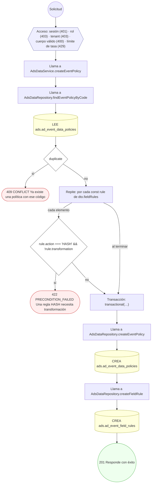

#### 14. POST /ads/ingest/insights

Ingerir entrega e insights y consolidar el gasto

| HTTP | Código | Cuándo |
|---|---|---|
| 200 | — | Éxito |
| 400 | `VALIDATION_FAILED` | El cuerpo cumple el DTO (sin propiedades extra) |
| 401 | `UNAUTHENTICATED` | Hay una sesión válida (JWT) |
| 403 | `FORBIDDEN` | El rol está permitido; El tenant se resuelve y pertenece al actor |
| 404 | `NOT_FOUND` | ResourceNotFoundException: Conexión de plataforma no encontrada; ResourceNotFoundException: Cuenta publicitaria no encontrada |
| 422 | `PRECONDITION_FAILED` | PreconditionFailedException: La conexión de plataforma no está activa |
| 429 | `RATE_LIMITED` | No se supera el límite de solicitudes |

```mermaid
flowchart TD
  n1(("Solicitud")):::inicio
  n2{{"Acceso: sesión (401) · rol (403) · tenant (403) · cuerpo válido (400) · límite de tasa (429)"}}:::acceso
  n1 --> n2
  n3["Llama a AdsDataService.ingestInsights"]:::llamada
  n2 --> n3
  n4["Transacción: transactional(…)"]:::transaccion
  n3 --> n4
  n5["Llama a AdsAccountsRepository.findConnectionById"]:::llamada
  n4 --> n5
  n6[("LEE ads.ad_platform_connections")]:::efecto
  n5 --> n6
  n7{"!connection"}:::decision
  n6 --> n7
  n8(["404 NOT_FOUND Conexión de plataforma no encontrada"]):::error
  n7 -->|"sí"| n8
  n9{"connection.statusConceptId !== CONCEPTS.CONNECTION_CONNECTED"}:::decision
  n7 -->|"no"| n9
  n10(["422 PRECONDITION_FAILED La conexión de plataforma no está activa"]):::error
  n9 -->|"sí"| n10
  n11["Llama a AdsAccountsRepository.findAdAccountForUpdate"]:::llamada
  n9 -->|"no"| n11
  n12[("LEE ads.ad_accounts")]:::efecto
  n11 --> n12
  n13{"!account"}:::decision
  n12 --> n13
  n14(["404 NOT_FOUND Cuenta publicitaria no encontrada"]):::error
  n13 -->|"sí"| n14
  n15["Llama a AdsDataRepository.createInsightRun"]:::llamada
  n13 -->|"no"| n15
  n16[("CREA ads.insight_query_runs")]:::efecto
  n15 --> n16
  n17["Repite: por cada const row de dto.rows"]:::bucle
  n16 --> n17
  n18["Llama a AdsDataRepository.createFactRow"]:::llamada
  n17 -->|"cada elemento"| n18
  n19[("CREA ads.insight_fact_rows")]:::efecto
  n18 --> n19
  n20["Llama a AdsDataRepository.findInsightsDaily"]:::llamada
  n19 --> n20
  n21[("LEE ads.insights_daily")]:::efecto
  n20 --> n21
  n22{"existing"}:::decision
  n21 --> n22
  n23[("ACTUALIZA ads.insights_daily · ACTUALIZA ads.insights_daily · ACTUALIZA ads.insights_daily · ACTUALIZA ads.in…")]:::efecto
  n22 -->|"sí"| n23
  n24["Llama a AdsDataRepository.createInsightsDaily"]:::llamada
  n22 -->|"no"| n24
  n25[("CREA ads.insights_daily")]:::efecto
  n24 --> n25
  n26["Llama a AdsDataRepository.createDeliverySnapshot"]:::llamada
  n23 --> n26
  n25 --> n26
  n27[("CREA ads.delivery_status_snapshots")]:::efecto
  n26 --> n27
  n28{"dto.recordBillingEvent && periodSpend › 0"}:::decision
  n27 --> n28
  n17 -->|"al terminar"| n28
  n29["Llama a AdsDataRepository.createBillingEvent"]:::llamada
  n28 -->|"sí"| n29
  n30[("CREA ads.ad_billing_events")]:::efecto
  n29 --> n30
  n31[("ACTUALIZA ads.ad_accounts · ACTUALIZA ads.insight_query_runs · ACTUALIZA ads.insight_query_runs · ACTUALIZA a…")]:::efecto
  n30 --> n31
  n28 -->|"no"| n31
  n32(("200 Responde con éxito")):::ok
  n31 --> n32
  classDef acceso fill:#eef,stroke:#66a
  classDef error fill:#fee,stroke:#c33
  classDef ok fill:#efe,stroke:#3a3
  classDef efecto fill:#ffd,stroke:#aa3
  classDef decision fill:#fff,stroke:#555
  classDef corte fill:#eee,stroke:#999,stroke-dasharray: 4
```

#### 15. POST /ads/lead-forms/{id}/submissions

Recibir un lead del formulario y encolar su entrega al CRM

| HTTP | Código | Cuándo |
|---|---|---|
| 201 | — | Éxito |
| 400 | `VALIDATION_FAILED` | Los parámetros de ruta son UUID válidos; El cuerpo cumple el DTO (sin propiedades extra) |
| 401 | `UNAUTHENTICATED` | Hay una sesión válida (JWT) |
| 403 | `FORBIDDEN` | El rol está permitido; El tenant se resuelve y pertenece al actor |
| 404 | `NOT_FOUND` | ResourceNotFoundException: Formulario de leads no encontrado |
| 422 | `PRECONDITION_FAILED` | PreconditionFailedException: El formulario no está activo; PreconditionFailedException: Faltan respuestas obligatorias del formulario |
| 429 | `RATE_LIMITED` | No se supera el límite de solicitudes |

```mermaid
flowchart TD
  n1(("Solicitud")):::inicio
  n2{{"Acceso: sesión (401) · rol (403) · tenant (403) · parámetros de ruta (400) · cuerpo válido (400) · límite de…"}}:::acceso
  n1 --> n2
  n3["Llama a AdsOptimizationService.submitLead"]:::llamada
  n2 --> n3
  n4["Transacción: transactional(…)"]:::transaccion
  n3 --> n4
  n5["Llama a AdsOptimizationRepository.findLeadFormById"]:::llamada
  n4 --> n5
  n6[("LEE ads.lead_forms")]:::efecto
  n5 --> n6
  n7{"!form"}:::decision
  n6 --> n7
  n8(["404 NOT_FOUND Formulario de leads no encontrado"]):::error
  n7 -->|"sí"| n8
  n9{"form.statusConceptId !== CONCEPTS.STATE_ACTIVE"}:::decision
  n7 -->|"no"| n9
  n10(["422 PRECONDITION_FAILED El formulario no está activo"]):::error
  n9 -->|"sí"| n10
  n11["Llama a AdsOptimizationRepository.findSubmissionByExternalId"]:::llamada
  n9 -->|"no"| n11
  n12[("LEE ads.lead_submissions")]:::efecto
  n11 --> n12
  n13["Llama a AdsOptimizationRepository.createSubmission"]:::llamada
  n12 --> n13
  n14[("CREA ads.lead_submissions")]:::efecto
  n13 --> n14
  n15["Llama a AdsOptimizationRepository.findQuestionsByForm"]:::llamada
  n14 --> n15
  n16[("LEE ads.lead_form_questions")]:::efecto
  n15 --> n16
  n17["Repite: por cada const answer de dto.answers"]:::bucle
  n16 --> n17
  n18["Llama a AdsOptimizationRepository.createAnswer"]:::llamada
  n17 -->|"cada elemento"| n18
  n19[("CREA ads.lead_answers")]:::efecto
  n18 --> n19
  n20{"missing.length › 0"}:::decision
  n19 --> n20
  n17 -->|"al terminar"| n20
  n21(["422 PRECONDITION_FAILED Faltan respuestas obligatorias del formulario"]):::error
  n20 -->|"sí"| n21
  n22{"form.destinationCrmPipelineId"}:::decision
  n20 -->|"no"| n22
  n23["Llama a AdsOptimizationRepository.countDeliveryAttempts"]:::llamada
  n22 -->|"sí"| n23
  n24[("LEE ads.lead_delivery_events")]:::efecto
  n23 --> n24
  n25["Llama a AdsOptimizationRepository.createDeliveryEvent"]:::llamada
  n24 --> n25
  n26[("CREA ads.lead_delivery_events")]:::efecto
  n25 --> n26
  n27(("201 Responde con éxito")):::ok
  n26 --> n27
  n22 -->|"no"| n27
  classDef acceso fill:#eef,stroke:#66a
  classDef error fill:#fee,stroke:#c33
  classDef ok fill:#efe,stroke:#3a3
  classDef efecto fill:#ffd,stroke:#aa3
  classDef decision fill:#fff,stroke:#555
  classDef corte fill:#eee,stroke:#999,stroke-dasharray: 4
```

#### 16. POST /ads/offline-conversion-sets/upload

Subir conversiones offline con reporte de coincidencia

| HTTP | Código | Cuándo |
|---|---|---|
| 201 | — | Éxito |
| 400 | `VALIDATION_FAILED` | El cuerpo cumple el DTO (sin propiedades extra) |
| 401 | `UNAUTHENTICATED` | Hay una sesión válida (JWT) |
| 403 | `FORBIDDEN` | El rol está permitido; El tenant se resuelve y pertenece al actor |
| 404 | `NOT_FOUND` | ResourceNotFoundException: Cuenta publicitaria no encontrada |
| 429 | `RATE_LIMITED` | No se supera el límite de solicitudes |

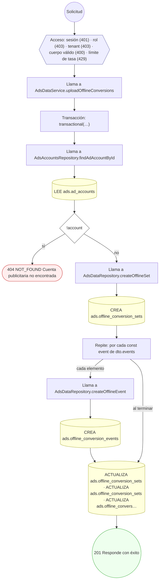

#### 17. POST /ads/platform-connections

Conectar la plataforma externa e importar identidades

| HTTP | Código | Cuándo |
|---|---|---|
| 201 | — | Éxito |
| 400 | `VALIDATION_FAILED` | El cuerpo cumple el DTO (sin propiedades extra) |
| 401 | `UNAUTHENTICATED` | Hay una sesión válida (JWT) |
| 403 | `FORBIDDEN` | El rol está permitido; El tenant se resuelve y pertenece al actor |
| 404 | `NOT_FOUND` | ResourceNotFoundException: Business manager no encontrado |
| 409 | `CONFLICT` | ConflictException: Esa cuenta de la plataforma ya está conectada |
| 429 | `RATE_LIMITED` | No se supera el límite de solicitudes |

```mermaid
flowchart TD
  n1(("Solicitud")):::inicio
  n2{{"Acceso: sesión (401) · rol (403) · tenant (403) · cuerpo válido (400) · límite de tasa (429)"}}:::acceso
  n1 --> n2
  n3["Llama a AdsAccountsService.connectPlatform"]:::llamada
  n2 --> n3
  n4["Transacción: transactional(…)"]:::transaccion
  n3 --> n4
  n5["Llama a AdsAccountsRepository.findBusinessManagerById"]:::llamada
  n4 --> n5
  n6[("LEE ads.business_managers")]:::efecto
  n5 --> n6
  n7{"!bm"}:::decision
  n6 --> n7
  n8(["404 NOT_FOUND Business manager no encontrado"]):::error
  n7 -->|"sí"| n8
  n9["Llama a AdsAccountsRepository.findConnectionByExternalAccount"]:::llamada
  n7 -->|"no"| n9
  n10[("LEE ads.ad_platform_connections")]:::efecto
  n9 --> n10
  n11{"duplicate"}:::decision
  n10 --> n11
  n12(["409 CONFLICT Esa cuenta de la plataforma ya está conectada"]):::error
  n11 -->|"sí"| n12
  n13["Llama a AdsAccountsRepository.createConnection"]:::llamada
  n11 -->|"no"| n13
  n14[("CREA ads.ad_platform_connections")]:::efecto
  n13 --> n14
  n15["Repite: por cada const identity de dto.identities ?? []"]:::bucle
  n14 --> n15
  n16["Llama a AdsAccountsRepository.findIdentityAsset"]:::llamada
  n15 -->|"cada elemento"| n16
  n17[("LEE ads.ad_identity_assets")]:::efecto
  n16 --> n17
  n18{"existing"}:::decision
  n17 --> n18
  n19[("ACTUALIZA ads.ad_identity_assets · ACTUALIZA ads.ad_identity_assets · ACTUALIZA ads.ad_identity_assets · ACTU…")]:::efecto
  n18 -->|"sí"| n19
  n20["Llama a AdsAccountsRepository.createIdentityAsset"]:::llamada
  n19 --> n20
  n18 -->|"no"| n20
  n21[("CREA ads.ad_identity_assets")]:::efecto
  n20 --> n21
  n22{"dto.checkpointValue"}:::decision
  n21 --> n22
  n15 -->|"al terminar"| n22
  n23["Llama a AdsAccountsRepository.findCheckpoint"]:::llamada
  n22 -->|"sí"| n23
  n24[("LEE ads.ad_sync_checkpoints")]:::efecto
  n23 --> n24
  n25["Llama a AdsAccountsRepository.upsertCheckpoint"]:::llamada
  n24 --> n25
  n26{"existing"}:::decision
  n25 --> n26
  n27[("ACTUALIZA ads.ad_sync_checkpoints · ACTUALIZA ads.ad_sync_checkpoints · ACTUALIZA ads.ad_sync_checkpoints")]:::efecto
  n26 -->|"sí"| n27
  n28[("CREA ads.ad_sync_checkpoints")]:::efecto
  n27 --> n28
  n26 -->|"no"| n28
  n29["Llama a AdsAccountsRepository.createSyncRun"]:::llamada
  n28 --> n29
  n22 -->|"no"| n29
  n30[("CREA ads.ad_sync_runs")]:::efecto
  n29 --> n30
  n31[("ACTUALIZA ads.ad_platform_connections")]:::efecto
  n30 --> n31
  n32(("201 Responde con éxito")):::ok
  n31 --> n32
  classDef acceso fill:#eef,stroke:#66a
  classDef error fill:#fee,stroke:#c33
  classDef ok fill:#efe,stroke:#3a3
  classDef efecto fill:#ffd,stroke:#aa3
  classDef decision fill:#fff,stroke:#555
  classDef corte fill:#eee,stroke:#999,stroke-dasharray: 4
```

#### 18. POST /ads/policy-violations/{id}/appeals

Apelar una infracción de política

| HTTP | Código | Cuándo |
|---|---|---|
| 201 | — | Éxito |
| 400 | `VALIDATION_FAILED` | Los parámetros de ruta son UUID válidos; El cuerpo cumple el DTO (sin propiedades extra) |
| 401 | `UNAUTHENTICATED` | Hay una sesión válida (JWT) |
| 403 | `FORBIDDEN` | El rol está permitido; El tenant se resuelve y pertenece al actor |
| 404 | `NOT_FOUND` | ResourceNotFoundException: Infracción no encontrada |
| 409 | `CONFLICT` | ConflictException: La infracción ya tiene una apelación |
| 422 | `PRECONDITION_FAILED` | PreconditionFailedException: La infracción ya no está abierta |
| 429 | `RATE_LIMITED` | No se supera el límite de solicitudes |

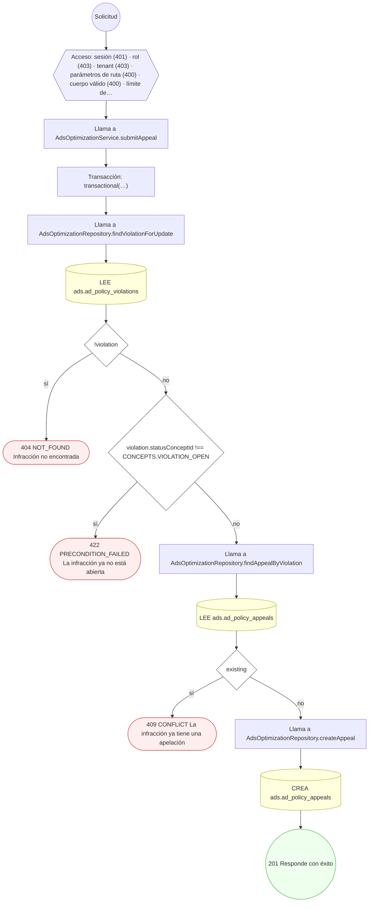

