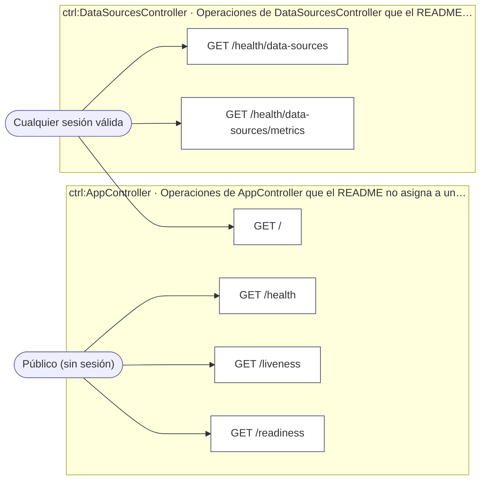
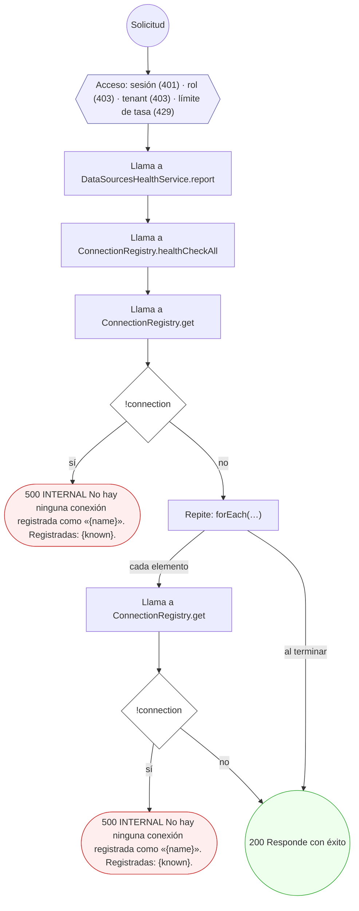
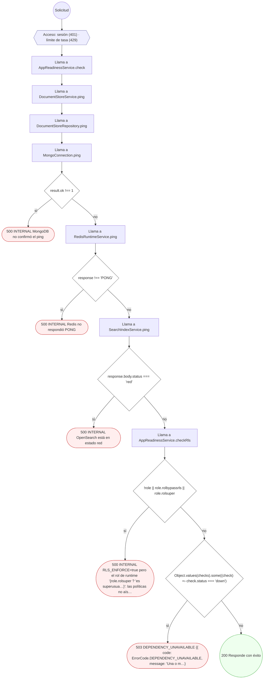

<!-- AUTOGENERADO por tools/inventario/flujos.mjs. No editar manualmente. -->

# Flujos del módulo `app`

- **Procesos:** 1 · **Máquinas de estado:** 0
- **Operaciones:** 6 (2 con decisiones propias, 4 sin ellas)
- Inventario de endpoints del módulo: [app](../endpoints/app.md)

## Proceso: app

- **Código:** `app` · **Agrupación:** AGRUPACION_POR_CONTROLADOR · **Operaciones:** 6
- **Actores:** Cualquier sesión válida · Público (sin sesión)
- **Revisión:** AUTO_DETECTADA
- **Fuentes:** —

### Para qué sirve

_Sin fuente: ni el README del módulo ni el modelo lo describen._

### Etapas y operaciones

| Etapa | Descripción | Operación | Quién actúa | Riesgo | Tablas |
|---|---|---|---|---|---|
| `ctrl:AppController` | Operaciones de AppController que el README no asigna a un caso de uso | GET / | Cualquier sesión válida | BAJO | 0 |
|  |  | GET /health | Público (sin sesión) | BAJO | 0 |
|  |  | GET /liveness | Público (sin sesión) | BAJO | 0 |
|  |  | GET /readiness | Público (sin sesión) | BAJO | 0 |
| `ctrl:DataSourcesController` | Operaciones de DataSourcesController que el README no asigna a un caso de uso | GET /health/data-sources | Cualquier sesión válida | BAJO | 0 |
|  |  | GET /health/data-sources/metrics | Cualquier sesión válida | BAJO | 0 |

### Diagrama — etapas `ctrl:AppController`, `ctrl:DataSourcesController`

## Árbol de decisión por operación

Cada árbol se deriva del código del handler y de los métodos que invoca (hasta 4 niveles). Una rama que no decide, no escribe y no falla se poda. Los accesos y los efectos consecutivos se agrupan en un solo nodo.

### Operaciones con decisiones propias

#### 1. GET /health/data-sources

Estado y enrutado de las fuentes de datos (requiere autenticación)

| HTTP | Código | Cuándo |
|---|---|---|
| 200 | — | Éxito |
| 401 | `UNAUTHENTICATED` | Hay una sesión válida (JWT) |
| 403 | `FORBIDDEN` | El rol está permitido; El tenant se resuelve y pertenece al actor |
| 429 | `RATE_LIMITED` | No se supera el límite de solicitudes |
| 500 | `INTERNAL` | DataSourceConfigurationError: No hay ninguna conexión registrada como «{name}». Registradas: {known}. |

#### 2. GET /readiness

Sonda de readiness de dependencias obligatorias

| HTTP | Código | Cuándo |
|---|---|---|
| 200 | — | Éxito |
| 401 | `UNAUTHENTICATED` | Hay una sesión válida (JWT) |
| 429 | `RATE_LIMITED` | No se supera el límite de solicitudes |
| 500 | `INTERNAL` | Error: MongoDB no confirmó el ping; Error: Redis no respondió PONG; Error: OpenSearch está en estado red; Error: RLS_ENFORCE=true pero el rol de runtime "{role.rolsuper ? 'es superusua…}": las políticas no aíslan nada / RLS_ENFORCE=true pero no se pudo resolver el rol de… |
| 503 | `DEPENDENCY_UNAVAILABLE` | ServiceUnavailableException: {{ code: ErrorCode.DEPENDENCY_UNAVAILABLE, message: 'Una o m…} |

### Operaciones sin decisiones propias

Sólo comprueban el acceso y leen o escriben: no tienen ramas que dibujar. Su detalle está en la ficha de endpoints.

| Operación | Respuestas posibles | Tablas |
|---|---|---|
| GET / | 200, 401, 403, 429 | 0 |
| GET /health | 200, 401, 429 | 0 |
| GET /health/data-sources/metrics | 200, 401, 403, 429 | 0 |
| GET /liveness | 200, 401, 429 | 0 |
