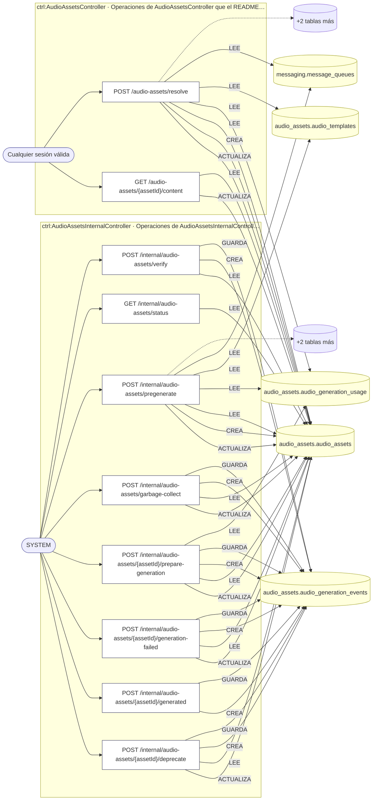
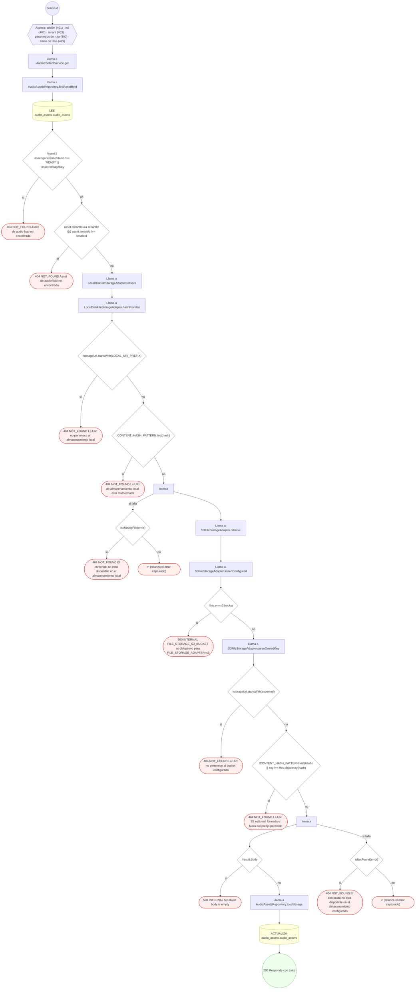
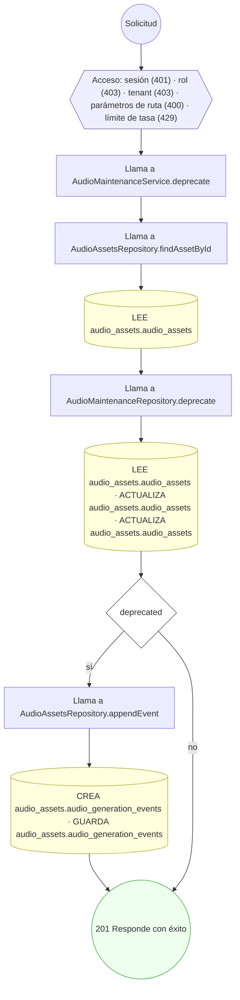
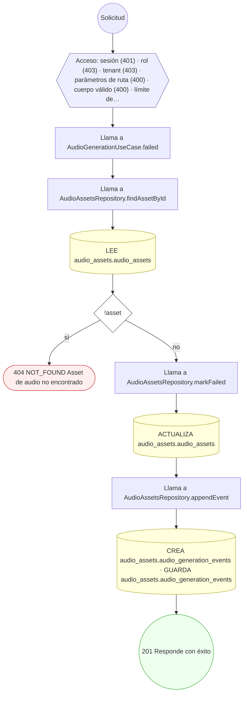
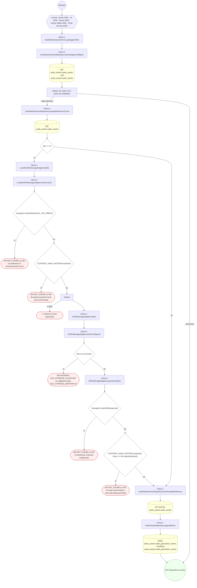

<!-- AUTOGENERADO por tools/inventario/flujos.mjs. No editar manualmente. -->

# Flujos del módulo `audio_assets`

- **Procesos:** 1 · **Máquinas de estado:** 0
- **Operaciones:** 10 (8 con decisiones propias, 2 sin ellas)
- Inventario de endpoints del módulo: [audio_assets](../endpoints/audio_assets.md)

## Proceso: Audio Assets

- **Código:** `audio_assets` · **Agrupación:** AGRUPACION_POR_CONTROLADOR · **Operaciones:** 10
- **Actores:** Cualquier sesión válida · SYSTEM
- **Revisión:** AUTO_DETECTADA
- **Fuentes:** `src/modules/audio_assets/README.md`

### Para qué sirve

Módulo de assets TTS **cache-first** para onboarding y otras experiencias acotadas. El dominio no conoce ElevenLabs, S3, HTTP ni la cola concreta. El proveedor se elige por entorno y los bytes finales siempre quedan en almacenamiento propio.

_Fuente: `src/modules/audio_assets/README.md:3`_

### Etapas y operaciones

| Etapa | Descripción | Operación | Quién actúa | Riesgo | Tablas |
|---|---|---|---|---|---|
| `ctrl:AudioAssetsController` | Operaciones de AudioAssetsController que el README no asigna a un caso de uso | GET /audio-assets/{assetId}/content | Cualquier sesión válida | ALTO | 2 |
|  |  | POST /audio-assets/resolve | Cualquier sesión válida | ALTO | 8 |
| `ctrl:AudioAssetsInternalController` | Operaciones de AudioAssetsInternalController que el README no asigna a un caso de uso | POST /internal/audio-assets/{assetId}/deprecate | SYSTEM | MEDIO | 4 |
|  |  | POST /internal/audio-assets/{assetId}/generated | SYSTEM | MEDIO | 2 |
|  |  | POST /internal/audio-assets/{assetId}/generation-failed | SYSTEM | MEDIO | 4 |
|  |  | POST /internal/audio-assets/{assetId}/prepare-generation | SYSTEM | MEDIO | 5 |
|  |  | POST /internal/audio-assets/garbage-collect | SYSTEM | MEDIO | 4 |
|  |  | POST /internal/audio-assets/pregenerate | SYSTEM | MEDIO | 8 |
|  |  | GET /internal/audio-assets/status | SYSTEM | BAJO | 1 |
|  |  | POST /internal/audio-assets/verify | SYSTEM | MEDIO | 3 |

### Diagrama — etapas `ctrl:AudioAssetsController`, `ctrl:AudioAssetsInternalController`

## Árbol de decisión por operación

Cada árbol se deriva del código del handler y de los métodos que invoca (hasta 4 niveles). Una rama que no decide, no escribe y no falla se poda. Los accesos y los efectos consecutivos se agrupan en un solo nodo.

### Operaciones con decisiones propias

#### 1. GET /audio-assets/{assetId}/content

Entrega bytes de un asset READY desde storage propio

| HTTP | Código | Cuándo |
|---|---|---|
| 200 | — | Éxito |
| 400 | `VALIDATION_FAILED` | Los parámetros de ruta son UUID válidos |
| 401 | `UNAUTHENTICATED` | Hay una sesión válida (JWT) |
| 403 | `FORBIDDEN` | El rol está permitido; El tenant se resuelve y pertenece al actor |
| 404 | `NOT_FOUND` | ResourceNotFoundException: Asset de audio listo no encontrado; ResourceNotFoundException: La URI no pertenece al almacenamiento local; ResourceNotFoundException: La URI de almacenamiento local está mal formada; ResourceNotFoundException: El contenido no está disponible en el almacenamiento local; ResourceNotFoundException: La URI no pertenece al bucket configurado; ResourceNotFoundException: La URI S3 está mal formada o fuera del prefijo permitido; ResourceNotFoundException: El contenido no está disponible en el almacenamiento configurado |
| 429 | `RATE_LIMITED` | No se supera el límite de solicitudes |
| 500 | `INTERNAL` | Error: FILE_STORAGE_S3_BUCKET es obligatorio para FILE_STORAGE_ADAPTER=s3; Error: S3 object body is empty |

#### 2. POST /audio-assets/resolve

Resuelve un asset TTS desde caché o agenda su generación

| HTTP | Código | Cuándo |
|---|---|---|
| 201 | — | Éxito |
| 400 | `VALIDATION_FAILED` | El cuerpo cumple el DTO (sin propiedades extra) |
| 401 | `UNAUTHENTICATED` | Hay una sesión válida (JWT) |
| 403 | `FORBIDDEN` | El rol está permitido; El tenant se resuelve y pertenece al actor |
| 404 | `NOT_FOUND` | ResourceNotFoundException: Plantilla de audio no encontrada |
| 429 | `RATE_LIMITED` | No se supera el límite de solicitudes |
| 500 | `INTERNAL` | Error: No se pudo materializar el asset de audio idempotente; Error: Asset reutilizado no encontrado |

```mermaid
flowchart TD
  n1(("Solicitud")):::inicio
  n2{{"Acceso: sesión (401) · rol (403) · tenant (403) · cuerpo válido (400) · límite de tasa (429)"}}:::acceso
  n1 --> n2
  n3["Llama a AudioAssetsFacade.resolve"]:::llamada
  n2 --> n3
  n4["Llama a ResolveAudioAssetUseCase.execute"]:::llamada
  n3 --> n4
  n5["Transacción: runInSpan(…)"]:::transaccion
  n4 --> n5
  n6["Llama a AudioAssetsRepository.findTemplate"]:::llamada
  n5 --> n6
  n7[("LEE audio_assets.audio_templates")]:::efecto
  n6 --> n7
  n8{"!template"}:::decision
  n7 --> n8
  n9(["404 NOT_FOUND Plantilla de audio no encontrada"]):::error
  n8 -->|"sí"| n9
  n10["Intenta"]:::intento
  n8 -->|"no"| n10
  n11["Llama a ResolveAudioAssetUseCase.resolveRendered"]:::llamada
  n10 --> n11
  n12["Llama a AudioAssetsRepository.findAssetByKey"]:::llamada
  n11 --> n12
  n13[("LEE audio_assets.audio_assets")]:::efecto
  n12 --> n13
  n14{"existing?.generationStatus === 'READY'"}:::decision
  n13 --> n14
  n15["Llama a AudioAssetsRepository.touchUsage"]:::llamada
  n14 -->|"sí"| n15
  n16[("ACTUALIZA audio_assets.audio_assets")]:::efecto
  n15 --> n16
  n17{"this.env.crossTemplateDedup"}:::decision
  n16 --> n17
  n14 -->|"no"| n17
  n18{"reusable && reusable.assetKey !== assetKey"}:::decision
  n17 -->|"sí"| n18
  n19["Llama a AudioAssetsRepository.createPendingOrGet"]:::llamada
  n18 -->|"sí"| n19
  n20[("CREA audio_assets.audio_assets")]:::efecto
  n19 --> n20
  n21{"!asset"}:::decision
  n20 --> n21
  n22(["500 INTERNAL No se pudo materializar el asset de audio idempotente"]):::error
  n21 -->|"sí"| n22
  n23["Llama a AudioAssetsRepository.markReusedReady"]:::llamada
  n21 -->|"no"| n23
  n24[("ACTUALIZA audio_assets.audio_assets")]:::efecto
  n23 --> n24
  n25{"!result"}:::decision
  n24 --> n25
  n26(["500 INTERNAL Asset reutilizado no encontrado"]):::error
  n25 -->|"sí"| n26
  n27{"existing && ['PENDING', 'GENERATING', 'FAILED_RETRYABLE'].includes( existing.generationStatus, )"}:::decision
  n25 -->|"no"| n27
  n18 -->|"no"| n27
  n17 -->|"no"| n27
  n28["Llama a AudioJobQueueAdapter.enqueue"]:::llamada
  n27 -->|"sí"| n28
  n29>"Encola audio-generation"]:::evento
  n28 --> n29
  n30["Llama a AudioAssetsRepository.createPendingOrGet"]:::llamada
  n29 --> n30
  n27 -->|"no"| n30
  n31[("CREA audio_assets.audio_assets")]:::efecto
  n30 --> n31
  n32{"!asset"}:::decision
  n31 --> n32
  n33(["500 INTERNAL No se pudo materializar el asset de audio idempotente"]):::error
  n32 -->|"sí"| n33
  n34["Llama a AudioJobQueueAdapter.enqueue"]:::llamada
  n32 -->|"no"| n34
  n35>"Encola audio-generation"]:::evento
  n34 --> n35
  n36{"!(error instanceof InvalidDynamicAudioValueError)"}:::decision
  n10 -->|"si falla"| n36
  n37(["↩ (relanza el error capturado)"]):::error
  n36 -->|"sí"| n37
  n38(("201 Responde con éxito")):::ok
  n35 --> n38
  n36 -->|"no"| n38
  classDef acceso fill:#eef,stroke:#66a
  classDef error fill:#fee,stroke:#c33
  classDef ok fill:#efe,stroke:#3a3
  classDef efecto fill:#ffd,stroke:#aa3
  classDef decision fill:#fff,stroke:#555
  classDef corte fill:#eee,stroke:#999,stroke-dasharray: 4
```

#### 3. POST /internal/audio-assets/{assetId}/deprecate

Depreca un asset no-fallback sin eliminarlo inmediatamente

| HTTP | Código | Cuándo |
|---|---|---|
| 201 | — | Éxito |
| 400 | `VALIDATION_FAILED` | Los parámetros de ruta son UUID válidos |
| 401 | `UNAUTHENTICATED` | Hay una sesión válida (JWT) |
| 403 | `FORBIDDEN` | El rol está permitido; El tenant se resuelve y pertenece al actor |
| 429 | `RATE_LIMITED` | No se supera el límite de solicitudes |

#### 4. POST /internal/audio-assets/{assetId}/generation-failed

Registra un fallo de generación de audio

| HTTP | Código | Cuándo |
|---|---|---|
| 201 | — | Éxito |
| 400 | `VALIDATION_FAILED` | Los parámetros de ruta son UUID válidos; El cuerpo cumple el DTO (sin propiedades extra) |
| 401 | `UNAUTHENTICATED` | Hay una sesión válida (JWT) |
| 403 | `FORBIDDEN` | El rol está permitido; El tenant se resuelve y pertenece al actor |
| 404 | `NOT_FOUND` | ResourceNotFoundException: Asset de audio no encontrado |
| 429 | `RATE_LIMITED` | No se supera el límite de solicitudes |

#### 5. POST /internal/audio-assets/{assetId}/prepare-generation

Prepara un asset de audio para generación

| HTTP | Código | Cuándo |
|---|---|---|
| 201 | — | Éxito |
| 400 | `VALIDATION_FAILED` | Los parámetros de ruta son UUID válidos |
| 401 | `UNAUTHENTICATED` | Hay una sesión válida (JWT) |
| 403 | `FORBIDDEN` | El rol está permitido; El tenant se resuelve y pertenece al actor |
| 404 | `NOT_FOUND` | ResourceNotFoundException: Asset de audio no encontrado |
| 429 | `RATE_LIMITED` | No se supera el límite de solicitudes |
| 500 | `INTERNAL` | Error: Payload cifrado de audio inválido |

```mermaid
flowchart TD
  n1(("Solicitud")):::inicio
  n2{{"Acceso: sesión (401) · rol (403) · tenant (403) · parámetros de ruta (400) · límite de tasa (429)"}}:::acceso
  n1 --> n2
  n3["Llama a AudioGenerationUseCase.prepare"]:::llamada
  n2 --> n3
  n4["Llama a AudioAssetsRepository.findAssetById"]:::llamada
  n3 --> n4
  n5[("LEE audio_assets.audio_assets")]:::efecto
  n4 --> n5
  n6{"!asset"}:::decision
  n5 --> n6
  n7(["404 NOT_FOUND Asset de audio no encontrado"]):::error
  n6 -->|"sí"| n7
  n8{"!environment.allowed"}:::decision
  n6 -->|"no"| n8
  n9["Llama a AudioAssetsRepository.markFallbackOnly"]:::llamada
  n8 -->|"sí"| n9
  n10[("ACTUALIZA audio_assets.audio_assets")]:::efecto
  n9 --> n10
  n11["Llama a AudioValueCipherService.decrypt"]:::llamada
  n10 --> n11
  n8 -->|"no"| n11
  n12{"version !== VERSION || !ivPart || !tagPart || !dataPart"}:::decision
  n11 --> n12
  n13(["500 INTERNAL Payload cifrado de audio inválido"]):::error
  n12 -->|"sí"| n13
  n14{"asset.budgetReservedUnits === undefined"}:::decision
  n12 -->|"no"| n14
  n15["Llama a AudioBudgetPolicy.canGenerate"]:::llamada
  n14 -->|"sí"| n15
  n16["Llama a AudioAssetsRepository.estimatedUsage"]:::llamada
  n15 --> n16
  n17[("LEE audio_assets.audio_generation_usage")]:::efecto
  n16 --> n17
  n18{"!precheck.allowed"}:::decision
  n17 --> n18
  n19["Llama a AudioAssetsRepository.markFallbackOnly"]:::llamada
  n18 -->|"sí"| n19
  n20[("ACTUALIZA audio_assets.audio_assets")]:::efecto
  n19 --> n20
  n21{"!reserved"}:::decision
  n20 --> n21
  n18 -->|"no"| n21
  n14 -->|"no"| n21
  n22["Llama a AudioAssetsRepository.markFallbackOnly"]:::llamada
  n21 -->|"sí"| n22
  n23[("ACTUALIZA audio_assets.audio_assets")]:::efecto
  n22 --> n23
  n24["Llama a AudioAssetsRepository.appendEvent"]:::llamada
  n23 --> n24
  n21 -->|"no"| n24
  n25[("CREA audio_assets.audio_generation_events · GUARDA audio_assets.audio_generation_events")]:::efecto
  n24 --> n25
  n26(("201 Responde con éxito")):::ok
  n25 --> n26
  classDef acceso fill:#eef,stroke:#66a
  classDef error fill:#fee,stroke:#c33
  classDef ok fill:#efe,stroke:#3a3
  classDef efecto fill:#ffd,stroke:#aa3
  classDef decision fill:#fff,stroke:#555
  classDef corte fill:#eee,stroke:#999,stroke-dasharray: 4
```

#### 6. POST /internal/audio-assets/garbage-collect

Elimina conservadoramente objetos de assets deprecados/permanentes

| HTTP | Código | Cuándo |
|---|---|---|
| 201 | — | Éxito |
| 400 | `VALIDATION_FAILED` | El cuerpo cumple el DTO (sin propiedades extra) |
| 401 | `UNAUTHENTICATED` | Hay una sesión válida (JWT) |
| 403 | `FORBIDDEN` | El rol está permitido; El tenant se resuelve y pertenece al actor |
| 404 | `NOT_FOUND` | ResourceNotFoundException: La URI no pertenece al almacenamiento local; ResourceNotFoundException: La URI de almacenamiento local está mal formada; ResourceNotFoundException: La URI no pertenece al bucket configurado; ResourceNotFoundException: La URI S3 está mal formada o fuera del prefijo permitido |
| 429 | `RATE_LIMITED` | No se supera el límite de solicitudes |
| 500 | `INTERNAL` | Error: FILE_STORAGE_S3_BUCKET es obligatorio para FILE_STORAGE_ADAPTER=s3 |

#### 7. POST /internal/audio-assets/pregenerate

Pre-genera STATIC, ENUMERATED y fallbacks de forma idempotente

| HTTP | Código | Cuándo |
|---|---|---|
| 201 | — | Éxito |
| 400 | `VALIDATION_FAILED` | El cuerpo cumple el DTO (sin propiedades extra) |
| 401 | `UNAUTHENTICATED` | Hay una sesión válida (JWT) |
| 403 | `FORBIDDEN` | El rol está permitido; El tenant se resuelve y pertenece al actor |
| 404 | `NOT_FOUND` | ResourceNotFoundException: Plantilla de audio no encontrada |
| 429 | `RATE_LIMITED` | No se supera el límite de solicitudes |
| 500 | `INTERNAL` | Error: La plantilla enumerada excede {MAX_ENUMERATED_COMBINATIONS} combinaciones; Error: No se pudo materializar el asset de audio idempotente; Error: Asset reutilizado no encontrado |

```mermaid
flowchart TD
  n1(("Solicitud")):::inicio
  n2{{"Acceso: sesión (401) · rol (403) · tenant (403) · cuerpo válido (400) · límite de tasa (429)"}}:::acceso
  n1 --> n2
  n3["Llama a PregenerateAudioAssetsUseCase.execute"]:::llamada
  n2 --> n3
  n4["Repite: por cada const template de latest"]:::bucle
  n3 --> n4
  n5["Llama a PregenerateAudioAssetsUseCase.enumeratedVariables"]:::llamada
  n4 -->|"cada elemento"| n5
  n6["Repite: por cada const field de fields"]:::bucle
  n5 --> n6
  n7{"combinations.length › MAX_ENUMERATED_COMBINATIONS"}:::decision
  n6 -->|"cada elemento"| n7
  n8(["500 INTERNAL La plantilla enumerada excede {MAX_ENUMERATED_COMBINATIONS} combinaciones"]):::error
  n7 -->|"sí"| n8
  n9["Repite: por cada const variables de variablesList"]:::bucle
  n7 -->|"no"| n9
  n6 -->|"al terminar"| n9
  n10["Llama a ResolveAudioAssetUseCase.execute"]:::llamada
  n9 -->|"cada elemento"| n10
  n11["Transacción: runInSpan(…)"]:::transaccion
  n10 --> n11
  n12["Llama a AudioAssetsRepository.findTemplate"]:::llamada
  n11 --> n12
  n13[("LEE audio_assets.audio_templates")]:::efecto
  n12 --> n13
  n14{"!template"}:::decision
  n13 --> n14
  n15(["404 NOT_FOUND Plantilla de audio no encontrada"]):::error
  n14 -->|"sí"| n15
  n16["Intenta"]:::intento
  n14 -->|"no"| n16
  n17["Llama a ResolveAudioAssetUseCase.resolveRendered"]:::llamada
  n16 --> n17
  n18["Llama a AudioAssetsRepository.findAssetByKey"]:::llamada
  n17 --> n18
  n19[("LEE audio_assets.audio_assets")]:::efecto
  n18 --> n19
  n20{"existing?.generationStatus === 'READY'"}:::decision
  n19 --> n20
  n21["Llama a AudioAssetsRepository.touchUsage"]:::llamada
  n20 -->|"sí"| n21
  n22[("ACTUALIZA audio_assets.audio_assets")]:::efecto
  n21 --> n22
  n23{"this.env.crossTemplateDedup"}:::decision
  n22 --> n23
  n20 -->|"no"| n23
  n24{"reusable && reusable.assetKey !== assetKey"}:::decision
  n23 -->|"sí"| n24
  n25["Llama a AudioAssetsRepository.createPendingOrGet"]:::llamada
  n24 -->|"sí"| n25
  n26[("CREA audio_assets.audio_assets")]:::efecto
  n25 --> n26
  n27{"!asset"}:::decision
  n26 --> n27
  n28(["500 INTERNAL No se pudo materializar el asset de audio idempotente"]):::error
  n27 -->|"sí"| n28
  n29["Llama a AudioAssetsRepository.markReusedReady"]:::llamada
  n27 -->|"no"| n29
  n30[("ACTUALIZA audio_assets.audio_assets")]:::efecto
  n29 --> n30
  n31{"!result"}:::decision
  n30 --> n31
  n32(["500 INTERNAL Asset reutilizado no encontrado"]):::error
  n31 -->|"sí"| n32
  n33{"existing && ['PENDING', 'GENERATING', 'FAILED_RETRYABLE'].includes( existing.generationStatus, )"}:::decision
  n31 -->|"no"| n33
  n24 -->|"no"| n33
  n23 -->|"no"| n33
  n34["Llama a AudioJobQueueAdapter.enqueue"]:::llamada
  n33 -->|"sí"| n34
  n35>"Encola audio-generation"]:::evento
  n34 --> n35
  n36["Llama a AudioAssetsRepository.createPendingOrGet"]:::llamada
  n35 --> n36
  n33 -->|"no"| n36
  n37[("CREA audio_assets.audio_assets")]:::efecto
  n36 --> n37
  n38{"!asset"}:::decision
  n37 --> n38
  n39(["500 INTERNAL No se pudo materializar el asset de audio idempotente"]):::error
  n38 -->|"sí"| n39
  n40["Llama a AudioJobQueueAdapter.enqueue"]:::llamada
  n38 -->|"no"| n40
  n41>"Encola audio-generation"]:::evento
  n40 --> n41
  n42{"!(error instanceof InvalidDynamicAudioValueError)"}:::decision
  n16 -->|"si falla"| n42
  n43(["↩ (relanza el error capturado)"]):::error
  n42 -->|"sí"| n43
  n44{"template.fallbackText"}:::decision
  n41 --> n44
  n42 -->|"no"| n44
  n9 -->|"al terminar"| n44
  n45["Llama a ResolveAudioAssetUseCase.resolveFallbackByTemplateKey"]:::llamada
  n44 -->|"sí"| n45
  n46["Llama a AudioAssetsRepository.findTemplate"]:::llamada
  n45 --> n46
  n47[("LEE audio_assets.audio_templates")]:::efecto
  n46 --> n47
  n48{"!template"}:::decision
  n47 --> n48
  n49(["404 NOT_FOUND Plantilla de audio no encontrada"]):::error
  n48 -->|"sí"| n49
  n50["Llama a ResolveAudioAssetUseCase.resolveRendered"]:::llamada
  n48 -->|"no"| n50
  n51["Llama a AudioAssetsRepository.findAssetByKey"]:::llamada
  n50 --> n51
  n52[("LEE audio_assets.audio_assets")]:::efecto
  n51 --> n52
  n53{"existing?.generationStatus === 'READY'"}:::decision
  n52 --> n53
  n54["Llama a AudioAssetsRepository.touchUsage"]:::llamada
  n53 -->|"sí"| n54
  n55[("ACTUALIZA audio_assets.audio_assets")]:::efecto
  n54 --> n55
  n56{"this.env.crossTemplateDedup"}:::decision
  n55 --> n56
  n53 -->|"no"| n56
  n57{"reusable && reusable.assetKey !== assetKey"}:::decision
  n56 -->|"sí"| n57
  n58["Llama a AudioAssetsRepository.createPendingOrGet"]:::llamada
  n57 -->|"sí"| n58
  n59[("CREA audio_assets.audio_assets")]:::efecto
  n58 --> n59
  n60{"!asset"}:::decision
  n59 --> n60
  n61(["500 INTERNAL No se pudo materializar el asset de audio idempotente"]):::error
  n60 -->|"sí"| n61
  n62["Llama a AudioAssetsRepository.markReusedReady"]:::llamada
  n60 -->|"no"| n62
  n63[("ACTUALIZA audio_assets.audio_assets")]:::efecto
  n62 --> n63
  n64{"!result"}:::decision
  n63 --> n64
  n65(["500 INTERNAL Asset reutilizado no encontrado"]):::error
  n64 -->|"sí"| n65
  n66{"existing && ['PENDING', 'GENERATING', 'FAILED_RETRYABLE'].includes( existing.generationStatus, )"}:::decision
  n64 -->|"no"| n66
  n57 -->|"no"| n66
  n56 -->|"no"| n66
  n67["Llama a AudioJobQueueAdapter.enqueue"]:::llamada
  n66 -->|"sí"| n67
  n68>"Encola audio-generation"]:::evento
  n67 --> n68
  n69["Llama a AudioAssetsRepository.createPendingOrGet"]:::llamada
  n68 --> n69
  n66 -->|"no"| n69
  n70[("CREA audio_assets.audio_assets")]:::efecto
  n69 --> n70
  n71["… el resto del árbol (2 nodos) está en el JSON del inventario"]:::corte
  n70 --> n71
  classDef acceso fill:#eef,stroke:#66a
  classDef error fill:#fee,stroke:#c33
  classDef ok fill:#efe,stroke:#3a3
  classDef efecto fill:#ffd,stroke:#aa3
  classDef decision fill:#fff,stroke:#555
  classDef corte fill:#eee,stroke:#999,stroke-dasharray: 4
```

#### 8. POST /internal/audio-assets/verify

Verifica existencia y checksum de assets READY

| HTTP | Código | Cuándo |
|---|---|---|
| 201 | — | Éxito |
| 400 | `VALIDATION_FAILED` | El cuerpo cumple el DTO (sin propiedades extra) |
| 401 | `UNAUTHENTICATED` | Hay una sesión válida (JWT) |
| 403 | `FORBIDDEN` | El rol está permitido; El tenant se resuelve y pertenece al actor |
| 404 | `NOT_FOUND` | ResourceNotFoundException: La URI no pertenece al almacenamiento local; ResourceNotFoundException: La URI de almacenamiento local está mal formada; ResourceNotFoundException: La URI no pertenece al bucket configurado; ResourceNotFoundException: La URI S3 está mal formada o fuera del prefijo permitido; ResourceNotFoundException: El contenido no está disponible en el almacenamiento local; ResourceNotFoundException: El contenido no está disponible en el almacenamiento configurado |
| 429 | `RATE_LIMITED` | No se supera el límite de solicitudes |
| 500 | `INTERNAL` | Error: FILE_STORAGE_S3_BUCKET es obligatorio para FILE_STORAGE_ADAPTER=s3; Error: S3 object body is empty |

```mermaid
flowchart TD
  n1(("Solicitud")):::inicio
  n2{{"Acceso: sesión (401) · rol (403) · tenant (403) · cuerpo válido (400) · límite de tasa (429)"}}:::acceso
  n1 --> n2
  n3["Llama a AudioMaintenanceService.verify"]:::llamada
  n2 --> n3
  n4["Llama a AudioMaintenanceRepository.listReady"]:::llamada
  n3 --> n4
  n5[("LEE audio_assets.audio_assets")]:::efecto
  n4 --> n5
  n6["Repite: por cada const asset de candidates"]:::bucle
  n5 --> n6
  n7["Llama a AudioMaintenanceService.verifyOne"]:::llamada
  n6 -->|"cada elemento"| n7
  n8["Llama a LocalDiskFileStorageAdapter.exists"]:::llamada
  n7 --> n8
  n9["Intenta"]:::intento
  n8 --> n9
  n10["Llama a LocalDiskFileStorageAdapter.hashFromUri"]:::llamada
  n9 --> n10
  n11{"!storageUri.startsWith(LOCAL_URI_PREFIX)"}:::decision
  n10 --> n11
  n12(["404 NOT_FOUND La URI no pertenece al almacenamiento local"]):::error
  n11 -->|"sí"| n12
  n13{"!CONTENT_HASH_PATTERN.test(hash)"}:::decision
  n11 -->|"no"| n13
  n14(["404 NOT_FOUND La URI de almacenamiento local está mal formada"]):::error
  n13 -->|"sí"| n14
  n15{"error instanceof ResourceNotFoundException"}:::decision
  n9 -->|"si falla"| n15
  n16(["↩ (relanza el error capturado)"]):::error
  n15 -->|"sí"| n16
  n17["Llama a S3FileStorageAdapter.exists"]:::llamada
  n13 -->|"no"| n17
  n15 -->|"no"| n17
  n18["Llama a S3FileStorageAdapter.assertConfigured"]:::llamada
  n17 --> n18
  n19{"!this.env.s3.bucket"}:::decision
  n18 --> n19
  n20(["500 INTERNAL FILE_STORAGE_S3_BUCKET es obligatorio para FILE_STORAGE_ADAPTER=s3"]):::error
  n19 -->|"sí"| n20
  n21["Llama a S3FileStorageAdapter.parseOwnedKey"]:::llamada
  n19 -->|"no"| n21
  n22{"!storageUri.startsWith(expected)"}:::decision
  n21 --> n22
  n23(["404 NOT_FOUND La URI no pertenece al bucket configurado"]):::error
  n22 -->|"sí"| n23
  n24{"!CONTENT_HASH_PATTERN.test(hash) || key !== this.objectKey(hash)"}:::decision
  n22 -->|"no"| n24
  n25(["404 NOT_FOUND La URI S3 está mal formada o fuera del prefijo permitido"]):::error
  n24 -->|"sí"| n25
  n26["Intenta"]:::intento
  n24 -->|"no"| n26
  n27(["↩ (relanza el error capturado)"]):::error
  n26 -->|"si falla"| n27
  n28["Llama a LocalDiskFileStorageAdapter.retrieve"]:::llamada
  n26 --> n28
  n29["Llama a LocalDiskFileStorageAdapter.hashFromUri"]:::llamada
  n28 --> n29
  n30{"!storageUri.startsWith(LOCAL_URI_PREFIX)"}:::decision
  n29 --> n30
  n31(["404 NOT_FOUND La URI no pertenece al almacenamiento local"]):::error
  n30 -->|"sí"| n31
  n32{"!CONTENT_HASH_PATTERN.test(hash)"}:::decision
  n30 -->|"no"| n32
  n33(["404 NOT_FOUND La URI de almacenamiento local está mal formada"]):::error
  n32 -->|"sí"| n33
  n34["Intenta"]:::intento
  n32 -->|"no"| n34
  n35{"isMissingFile(error)"}:::decision
  n34 -->|"si falla"| n35
  n36(["404 NOT_FOUND El contenido no está disponible en el almacenamiento local"]):::error
  n35 -->|"sí"| n36
  n37(["↩ (relanza el error capturado)"]):::error
  n35 -->|"no"| n37
  n38["Llama a S3FileStorageAdapter.retrieve"]:::llamada
  n34 --> n38
  n39["Llama a S3FileStorageAdapter.assertConfigured"]:::llamada
  n38 --> n39
  n40{"!this.env.s3.bucket"}:::decision
  n39 --> n40
  n41(["500 INTERNAL FILE_STORAGE_S3_BUCKET es obligatorio para FILE_STORAGE_ADAPTER=s3"]):::error
  n40 -->|"sí"| n41
  n42["Llama a S3FileStorageAdapter.parseOwnedKey"]:::llamada
  n40 -->|"no"| n42
  n43{"!storageUri.startsWith(expected)"}:::decision
  n42 --> n43
  n44(["404 NOT_FOUND La URI no pertenece al bucket configurado"]):::error
  n43 -->|"sí"| n44
  n45{"!CONTENT_HASH_PATTERN.test(hash) || key !== this.objectKey(hash)"}:::decision
  n43 -->|"no"| n45
  n46(["404 NOT_FOUND La URI S3 está mal formada o fuera del prefijo permitido"]):::error
  n45 -->|"sí"| n46
  n47["Intenta"]:::intento
  n45 -->|"no"| n47
  n48{"!result.Body"}:::decision
  n47 --> n48
  n49(["500 INTERNAL S3 object body is empty"]):::error
  n48 -->|"sí"| n49
  n50{"isNotFound(error)"}:::decision
  n47 -->|"si falla"| n50
  n51(["404 NOT_FOUND El contenido no está disponible en el almacenamiento configurado"]):::error
  n50 -->|"sí"| n51
  n52(["↩ (relanza el error capturado)"]):::error
  n50 -->|"no"| n52
  n53["Llama a AudioAssetsRepository.appendEvent"]:::llamada
  n48 -->|"no"| n53
  n54[("CREA audio_assets.audio_generation_events · GUARDA audio_assets.audio_generation_events")]:::efecto
  n53 --> n54
  n55(("201 Responde con éxito")):::ok
  n54 --> n55
  n6 -->|"al terminar"| n55
  classDef acceso fill:#eef,stroke:#66a
  classDef error fill:#fee,stroke:#c33
  classDef ok fill:#efe,stroke:#3a3
  classDef efecto fill:#ffd,stroke:#aa3
  classDef decision fill:#fff,stroke:#555
  classDef corte fill:#eee,stroke:#999,stroke-dasharray: 4
```

### Operaciones sin decisiones propias

Sólo comprueban el acceso y leen o escriben: no tienen ramas que dibujar. Su detalle está en la ficha de endpoints.

| Operación | Respuestas posibles | Tablas |
|---|---|---|
| POST /internal/audio-assets/{assetId}/generated | 201, 400, 401, 403, 429 | 2 |
| GET /internal/audio-assets/status | 200, 401, 403, 429 | 1 |
