<!-- AUTOGENERADO por tools/inventario/flujos.mjs. No editar manualmente. -->

# Flujos del módulo `audit`

- **Procesos:** 1 · **Máquinas de estado:** 0
- **Operaciones:** 11 (11 con decisiones propias, 0 sin ellas)
- Inventario de endpoints del módulo: [audit](../endpoints/audit.md)

## Proceso: Módulo 10 — Audit, Provenance and Version Histories

- **Código:** `audit` · **Agrupación:** CASO_DE_USO_README · **Operaciones:** 11
- **Actores:** SECURITY_ADMIN
- **Revisión:** AUTO_DETECTADA
- **Fuentes:** `src/modules/audit/README.md`

### Para qué sirve

Auditoría WORM (append-only), cadena hash tamper-evidence, provenance quién-qué-cuándo, historial de versiones point-in-time, DSAR, exportación de evidencia, retención/archivado, detección de anomalías, moderación/gobernanza y acceso de tercero gobernado.

_Fuente: `src/modules/audit/README.md:3`_

### Etapas y operaciones

| Etapa | Descripción | Operación | Quién actúa | Riesgo | Tablas |
|---|---|---|---|---|---|
| `UC-10-01` | Registrar acceso/lectura clínica (accounting WORM) + provenance | POST /audit/data-access | SECURITY_ADMIN | MEDIO | 5 |
| `UC-10-04` | Registrar provenance de un cambio y sellar la cadena hash (incluye UC-10-03) | POST /audit/events | SECURITY_ADMIN | MEDIO | 3 |
| `UC-10-05` | Consultar historial / línea de tiempo (audita la propia lectura) | GET /audit/history/{entity}/{id} | SECURITY_ADMIN | MEDIO | 4 |
| `UC-10-06` | Verificar integridad tamper-evidence y atestar | POST /audit/integrity/verify | SECURITY_ADMIN | MEDIO | 3 |
| `UC-10-07` | Exportar evidencia de auditoría (idempotente por query_hash) | POST /compliance/audit-export | SECURITY_ADMIN | MEDIO | 5 |
| `UC-10-08` | Tramitar DSAR (máquina de estados) | POST /privacy/dsar | SECURITY_ADMIN | MEDIO | 5 |
|  |  | PATCH /privacy/dsar/{id} | SECURITY_ADMIN | MEDIO | 5 |
| `UC-10-09` | Aplicar retención / archivado / litigation-hold | POST /audit/retention/apply | SECURITY_ADMIN | ALTO | 4 |
| `UC-10-10` | Detectar acceso anómalo | POST /audit/anomaly/scan | SECURITY_ADMIN | MEDIO | 4 |
| `UC-10-11` | Registrar decisión de moderación / gobernanza | POST /moderation/decisions | SECURITY_ADMIN | MEDIO | 6 |
| `UC-10-12` | Registrar acceso delegado / de tercero gobernado | POST /audit/third-party-access | SECURITY_ADMIN | MEDIO | 7 |

### Diagrama — etapas `UC-10-01`, `UC-10-04`, `UC-10-05`…

```mermaid
flowchart LR
  a2(["SECURITY_ADMIN"]):::actor
  t3[("audit.audit_log")]:::tabla
  t4[("audit.data_access_log")]:::tabla
  t5[("audit.patient_content_access_log")]:::tabla
  t6[("iam.sessions")]:::tabla
  t11[("audit.analytics_governance_log")]:::tabla
  t13[("audit.dsar_requests")]:::tabla
  t18[("audit.moderation_decisions_history")]:::tabla
  t19[("audit.moderation_events")]:::tabla
  t21[("audit.delegated_access_audit_log")]:::tabla
  t22[("audit.identity_verification_access_log")]:::tabla
  t23[("audit.insurance_decision_access_log")]:::tabla
  t24[("audit.pharmacy_inventory_access_log")]:::tabla
  subgraph s0["UC-10-01 · Registrar acceso/lectura clínica (accounting WORM) + provenance"]
    o1["POST /audit/data-access"]:::op
  end
  subgraph s1["UC-10-04 · Registrar provenance de un cambio y sellar la cadena hash (incluye U…"]
    o7["POST /audit/events"]:::op
  end
  subgraph s2["UC-10-05 · Consultar historial / línea de tiempo (audita la propia lectura)"]
    o8["GET /audit/history/{entity}/{id}"]:::op
  end
  subgraph s3["UC-10-06 · Verificar integridad tamper-evidence y atestar"]
    o9["POST /audit/integrity/verify"]:::op
  end
  subgraph s4["UC-10-07 · Exportar evidencia de auditoría (idempotente por query_hash)"]
    o10["POST /compliance/audit-export"]:::op
  end
  subgraph s5["UC-10-08 · Tramitar DSAR (máquina de estados)"]
    o12["POST /privacy/dsar"]:::op
    o14["PATCH /privacy/dsar/{id}"]:::op
  end
  subgraph s6["UC-10-09 · Aplicar retención / archivado / litigation-hold"]
    o15["POST /audit/retention/apply"]:::op
  end
  subgraph s7["UC-10-10 · Detectar acceso anómalo"]
    o16["POST /audit/anomaly/scan"]:::op
  end
  subgraph s8["UC-10-11 · Registrar decisión de moderación / gobernanza"]
    o17["POST /moderation/decisions"]:::op
  end
  t25[("+1 tablas más")]
  subgraph s9["UC-10-12 · Registrar acceso delegado / de tercero gobernado"]
    o20["POST /audit/third-party-access"]:::op
  end
  a2 --> o1
  o1 -->|"CREA"| t3
  o1 -->|"LEE"| t3
  o1 -->|"CREA"| t4
  o1 -->|"CREA"| t5
  o1 -->|"LEE"| t6
  a2 --> o7
  o7 -->|"CREA"| t3
  o7 -->|"LEE"| t3
  o7 -->|"LEE"| t6
  a2 --> o8
  o8 -->|"CREA"| t3
  o8 -->|"LEE"| t3
  o8 -->|"CREA"| t4
  o8 -->|"LEE"| t6
  a2 --> o9
  o9 -->|"CREA"| t3
  o9 -->|"LEE"| t3
  o9 -->|"LEE"| t6
  a2 --> o10
  o10 -->|"CREA"| t11
  o10 -->|"LEE"| t11
  o10 -->|"CREA"| t3
  o10 -->|"LEE"| t3
  o10 -->|"LEE"| t6
  a2 --> o12
  o12 -->|"CREA"| t11
  o12 -->|"CREA"| t3
  o12 -->|"LEE"| t3
  o12 -->|"CREA"| t13
  o12 -->|"LEE"| t6
  a2 --> o14
  o14 -->|"CREA"| t3
  o14 -->|"LEE"| t3
  o14 -->|"ACTUALIZA"| t13
  o14 -->|"LEE"| t13
  o14 -->|"LEE"| t6
  a2 --> o15
  o15 -->|"CREA"| t3
  o15 -->|"LEE"| t3
  o15 -->|"BORRA"| t4
  o15 -->|"LEE"| t6
  a2 --> o16
  o16 -->|"CREA"| t3
  o16 -->|"LEE"| t3
  o16 -->|"LEE"| t4
  o16 -->|"LEE"| t6
  a2 --> o17
  o17 -->|"CREA"| t11
  o17 -->|"CREA"| t3
  o17 -->|"LEE"| t3
  o17 -->|"CREA"| t18
  o17 -->|"CREA"| t19
  o17 -->|"LEE"| t6
  a2 --> o20
  o20 -->|"CREA"| t3
  o20 -->|"LEE"| t3
  o20 -->|"CREA"| t21
  o20 -->|"CREA"| t22
  o20 -->|"CREA"| t23
  o20 -->|"CREA"| t24
  o20 -.-> t25
  classDef op fill:#fff,stroke:#446
  classDef actor fill:#eef,stroke:#66a
  classDef tabla fill:#ffd,stroke:#aa3
  classDef evento fill:#efe,stroke:#3a3
```

## Árbol de decisión por operación

Cada árbol se deriva del código del handler y de los métodos que invoca (hasta 4 niveles). Una rama que no decide, no escribe y no falla se poda. Los accesos y los efectos consecutivos se agrupan en un solo nodo.

### Operaciones con decisiones propias

#### 1. POST /audit/anomaly/scan

Detectar acceso anómalo

| HTTP | Código | Cuándo |
|---|---|---|
| 200 | — | Éxito |
| 400 | `VALIDATION_FAILED` | El cuerpo cumple el DTO (sin propiedades extra) |
| 401 | `UNAUTHENTICATED` | Hay una sesión válida (JWT) |
| 403 | `FORBIDDEN` | El rol está permitido; El tenant se resuelve y pertenece al actor |
| 429 | `RATE_LIMITED` | No se supera el límite de solicitudes |

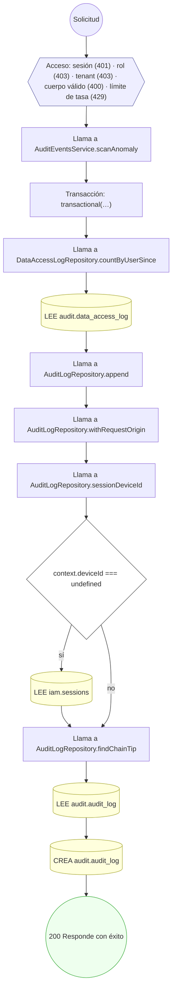

#### 2. POST /audit/data-access

Registrar acceso/lectura clínica (accounting WORM)

| HTTP | Código | Cuándo |
|---|---|---|
| 201 | — | Éxito |
| 400 | `VALIDATION_FAILED` | El cuerpo cumple el DTO (sin propiedades extra) |
| 401 | `UNAUTHENTICATED` | Hay una sesión válida (JWT) |
| 403 | `FORBIDDEN` | El rol está permitido; El tenant se resuelve y pertenece al actor |
| 429 | `RATE_LIMITED` | No se supera el límite de solicitudes |

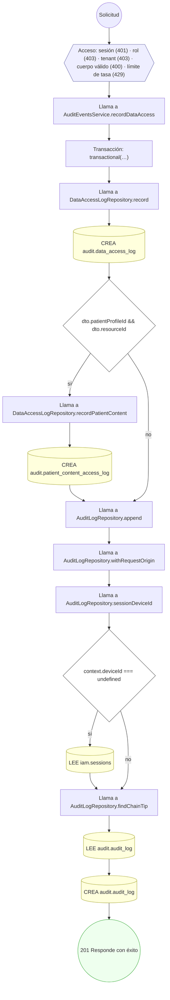

#### 3. POST /audit/events

Registrar provenance de un cambio y sellar la cadena hash

| HTTP | Código | Cuándo |
|---|---|---|
| 201 | — | Éxito |
| 400 | `VALIDATION_FAILED` | El cuerpo cumple el DTO (sin propiedades extra) |
| 401 | `UNAUTHENTICATED` | Hay una sesión válida (JWT) |
| 403 | `FORBIDDEN` | El rol está permitido; El tenant se resuelve y pertenece al actor |
| 429 | `RATE_LIMITED` | No se supera el límite de solicitudes |

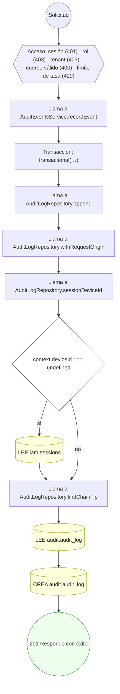

#### 4. GET /audit/history/{entity}/{id}

Consultar historial / línea de tiempo de un registro

| HTTP | Código | Cuándo |
|---|---|---|
| 200 | — | Éxito |
| 400 | `VALIDATION_FAILED` | Los parámetros de ruta son UUID válidos |
| 401 | `UNAUTHENTICATED` | Hay una sesión válida (JWT) |
| 403 | `FORBIDDEN` | El rol está permitido; El tenant se resuelve y pertenece al actor |
| 404 | `NOT_FOUND` | ResourceNotFoundException: Entidad de historial no soportada |
| 429 | `RATE_LIMITED` | No se supera el límite de solicitudes |

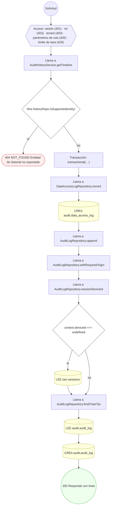

#### 5. POST /audit/integrity/verify

Verificar integridad tamper-evidence de la cadena

| HTTP | Código | Cuándo |
|---|---|---|
| 200 | — | Éxito |
| 400 | `VALIDATION_FAILED` | El cuerpo cumple el DTO (sin propiedades extra) |
| 401 | `UNAUTHENTICATED` | Hay una sesión válida (JWT) |
| 403 | `FORBIDDEN` | El rol está permitido; El tenant se resuelve y pertenece al actor |
| 429 | `RATE_LIMITED` | No se supera el límite de solicitudes |

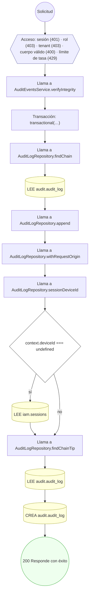

#### 6. POST /audit/retention/apply

Aplicar retención / archivado / litigation-hold

| HTTP | Código | Cuándo |
|---|---|---|
| 200 | — | Éxito |
| 400 | `VALIDATION_FAILED` | El cuerpo cumple el DTO (sin propiedades extra) |
| 401 | `UNAUTHENTICATED` | Hay una sesión válida (JWT) |
| 403 | `FORBIDDEN` | El rol está permitido; El tenant se resuelve y pertenece al actor |
| 429 | `RATE_LIMITED` | No se supera el límite de solicitudes |

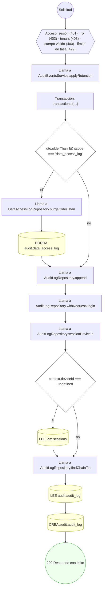

#### 7. POST /audit/third-party-access

Registrar acceso delegado / de tercero gobernado

| HTTP | Código | Cuándo |
|---|---|---|
| 201 | — | Éxito |
| 400 | `VALIDATION_FAILED` | El cuerpo cumple el DTO (sin propiedades extra) |
| 401 | `UNAUTHENTICATED` | Hay una sesión válida (JWT) |
| 403 | `FORBIDDEN` | El rol está permitido; El tenant se resuelve y pertenece al actor |
| 422 | `PRECONDITION_FAILED` | PreconditionFailedException: Falta el campo requerido para el canal: {field} |
| 429 | `RATE_LIMITED` | No se supera el límite de solicitudes |

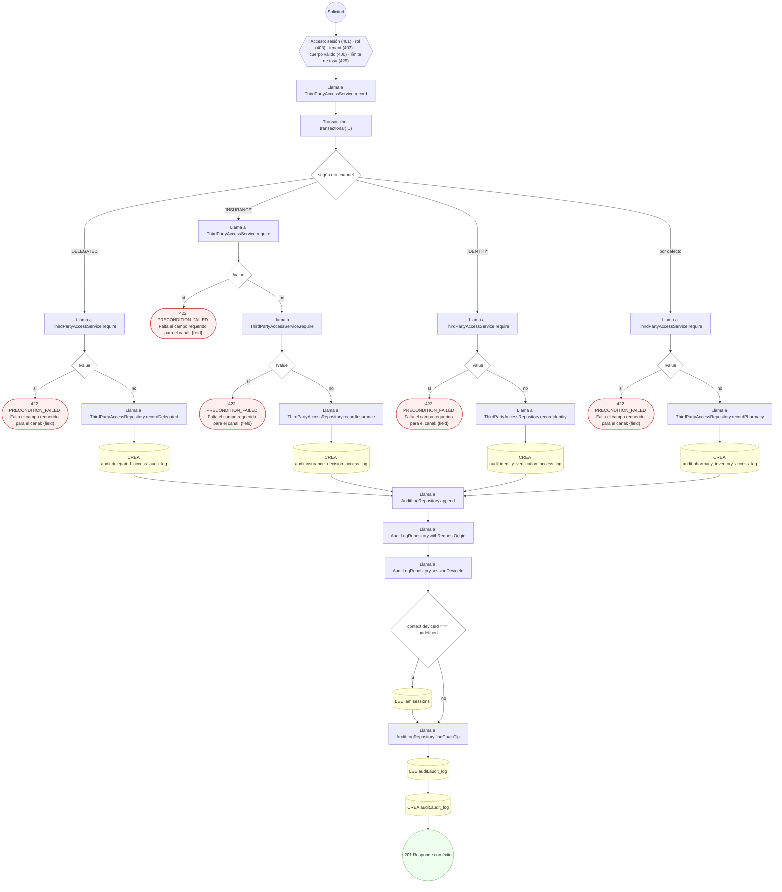

#### 8. POST /compliance/audit-export

Exportar evidencia de auditoría para cumplimiento

| HTTP | Código | Cuándo |
|---|---|---|
| 201 | — | Éxito |
| 400 | `VALIDATION_FAILED` | El cuerpo cumple el DTO (sin propiedades extra) |
| 401 | `UNAUTHENTICATED` | Hay una sesión válida (JWT) |
| 403 | `FORBIDDEN` | El rol está permitido; El tenant se resuelve y pertenece al actor |
| 409 | `CONFLICT` | ConflictException: Ya existe una exportación con ese query_hash |
| 429 | `RATE_LIMITED` | No se supera el límite de solicitudes |

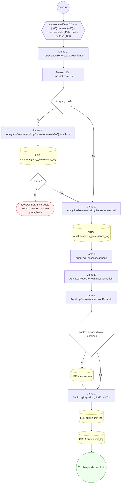

#### 9. POST /moderation/decisions

Registrar decisión de moderación / gobernanza analítica

| HTTP | Código | Cuándo |
|---|---|---|
| 201 | — | Éxito |
| 400 | `VALIDATION_FAILED` | El cuerpo cumple el DTO (sin propiedades extra) |
| 401 | `UNAUTHENTICATED` | Hay una sesión válida (JWT) |
| 403 | `FORBIDDEN` | El rol está permitido; El tenant se resuelve y pertenece al actor |
| 429 | `RATE_LIMITED` | No se supera el límite de solicitudes |

```mermaid
flowchart TD
  n1(("Solicitud")):::inicio
  n2{{"Acceso: sesión (401) · rol (403) · tenant (403) · cuerpo válido (400) · límite de tasa (429)"}}:::acceso
  n1 --> n2
  n3["Llama a ModerationService.recordDecision"]:::llamada
  n2 --> n3
  n4["Transacción: transactional(…)"]:::transaccion
  n3 --> n4
  n5["Llama a ModerationRepository.record"]:::llamada
  n4 --> n5
  n6[("CREA audit.moderation_events")]:::efecto
  n5 --> n6
  n7{"dto.governance"}:::decision
  n6 --> n7
  n8["Llama a AnalyticsGovernanceLogRepository.record"]:::llamada
  n7 -->|"sí"| n8
  n9[("CREA audit.analytics_governance_log")]:::efecto
  n8 --> n9
  n10{"dto.moderationDecisionId"}:::decision
  n9 --> n10
  n7 -->|"no"| n10
  n11["Llama a ModerationRepository.recordHistory"]:::llamada
  n10 -->|"sí"| n11
  n12[("CREA audit.moderation_decisions_history")]:::efecto
  n11 --> n12
  n13["Llama a AuditLogRepository.append"]:::llamada
  n12 --> n13
  n10 -->|"no"| n13
  n14["Llama a AuditLogRepository.withRequestOrigin"]:::llamada
  n13 --> n14
  n15["Llama a AuditLogRepository.sessionDeviceId"]:::llamada
  n14 --> n15
  n16{"context.deviceId === undefined"}:::decision
  n15 --> n16
  n17[("LEE iam.sessions")]:::efecto
  n16 -->|"sí"| n17
  n18["Llama a AuditLogRepository.findChainTip"]:::llamada
  n17 --> n18
  n16 -->|"no"| n18
  n19[("LEE audit.audit_log")]:::efecto
  n18 --> n19
  n20[("CREA audit.audit_log")]:::efecto
  n19 --> n20
  n21(("201 Responde con éxito")):::ok
  n20 --> n21
  classDef acceso fill:#eef,stroke:#66a
  classDef error fill:#fee,stroke:#c33
  classDef ok fill:#efe,stroke:#3a3
  classDef efecto fill:#ffd,stroke:#aa3
  classDef decision fill:#fff,stroke:#555
  classDef corte fill:#eee,stroke:#999,stroke-dasharray: 4
```

#### 10. POST /privacy/dsar

Tramitar DSAR (solicitud del titular)

| HTTP | Código | Cuándo |
|---|---|---|
| 201 | — | Éxito |
| 400 | `VALIDATION_FAILED` | El cuerpo cumple el DTO (sin propiedades extra) |
| 401 | `UNAUTHENTICATED` | Hay una sesión válida (JWT) |
| 403 | `FORBIDDEN` | El rol está permitido; El tenant se resuelve y pertenece al actor |
| 429 | `RATE_LIMITED` | No se supera el límite de solicitudes |

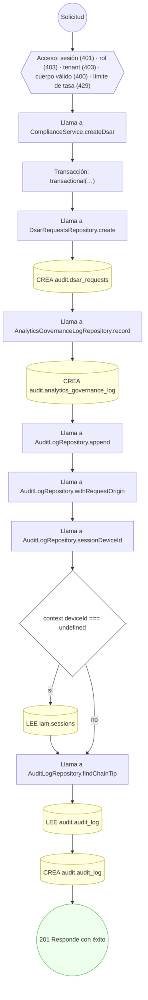

#### 11. PATCH /privacy/dsar/{id}

Avanzar la máquina de estados de una solicitud DSAR

| HTTP | Código | Cuándo |
|---|---|---|
| 200 | — | Éxito |
| 400 | `VALIDATION_FAILED` | Los parámetros de ruta son UUID válidos; El cuerpo cumple el DTO (sin propiedades extra) |
| 401 | `UNAUTHENTICATED` | Hay una sesión válida (JWT) |
| 403 | `FORBIDDEN` | El rol está permitido; El tenant se resuelve y pertenece al actor |
| 404 | `NOT_FOUND` | ResourceNotFoundException: Solicitud DSAR no encontrada |
| 422 | `PRECONDITION_FAILED` | PreconditionFailedException: La solicitud DSAR ya está en estado terminal |
| 429 | `RATE_LIMITED` | No se supera el límite de solicitudes |

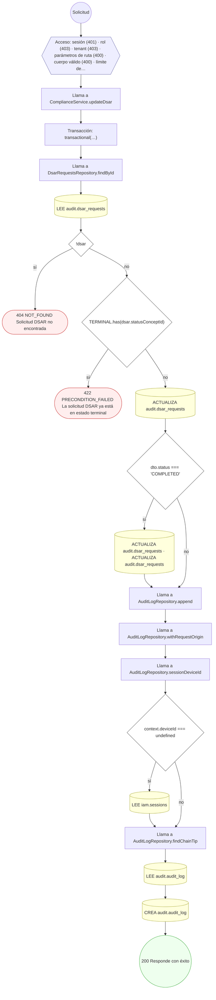

