<!-- AUTOGENERADO por tools/inventario/flujos.mjs. No editar manualmente. -->

# Flujos del módulo `auth_providers`

- **Procesos:** 1 · **Máquinas de estado:** 0
- **Operaciones:** 12 (12 con decisiones propias, 0 sin ellas)
- Inventario de endpoints del módulo: [auth_providers](../endpoints/auth_providers.md)

## Proceso: Módulo 40 — Proveedores de Identidad y Login Federado

- **Código:** `auth_providers` · **Agrupación:** CASO_DE_USO_README · **Operaciones:** 12
- **Actores:** AUTH_SERVICE · IDENTITY_ADMIN
- **Revisión:** AUTO_DETECTADA
- **Fuentes:** `src/modules/auth_providers/README.md`

### Para qué sirve

Alta de proveedores OIDC/SAML/OAuth2, configuración de protocolo por entorno, claves de firma con rotación, mapeo de claims a atributos, vínculo por tenant, reglas de aprovisionamiento, login federado con `state`/`nonce`, vinculación y desvinculación de identidades.

_Fuente: `src/modules/auth_providers/README.md:3`_

### Flujo general declarado en el README

```text
proveedor (draft)
   │
   ├─ protocol-configs ──> configuración activa del entorno + JWKS importado ⇒ proveedor active
   ├─ signing-keys ──────> clave activa
   ├─ attribute-mappings > mapeo completo, un claim identificador
   ├─ tenant-bindings ───> quién puede usarlo y con qué rol
   └─ provisioning-rules > condición sobre claims, por prioridad

authorize ──> intento `initiated` + state/nonce + authorizeUrl
   │
callback (state válido)
   ├─ identidad existente y activa ──────> success
   ├─ identidad revocada ────────────────> failure: identity revoked
   ├─ sin identidad + JIT + userId ──────> identidad creada, success (provisioned)
   └─ sin identidad ─────────────────────> failure: no provision + token de vinculación

account-link-requests ──> token (una sola vez) ──> complete ──> identidad activa
federated-identities/:id/unlink ──> identidad revocada + intento `unlinked`
```

_Fuente: `src/modules/auth_providers/README.md:34`_

### Etapas y operaciones

| Etapa | Descripción | Operación | Quién actúa | Riesgo | Tablas |
|---|---|---|---|---|---|
| `UC-40-01` | Registrar proveedor OIDC/SAML | POST /auth-providers/identity-providers | IDENTITY_ADMIN | MEDIO | 2 |
| `UC-40-02` | Configurar protocolo e importar JWKS | POST /auth-providers/identity-providers/{id}/protocol-configs | IDENTITY_ADMIN | MEDIO | 7 |
| `UC-40-03` | Publicar clave de firma | POST /auth-providers/identity-providers/{id}/signing-keys | IDENTITY_ADMIN | MEDIO | 3 |
| `UC-40-04` | Mapeo de claims a atributos | PUT /auth-providers/identity-providers/{id}/attribute-mappings | IDENTITY_ADMIN | ALTO | 4 |
| `UC-40-05` | Vincular proveedor a tenant | POST /auth-providers/tenant-bindings | IDENTITY_ADMIN | MEDIO | 4 |
| `UC-40-06` | Regla de aprovisionamiento | POST /auth-providers/identity-providers/{id}/provisioning-rules | IDENTITY_ADMIN | MEDIO | 3 |
| `UC-40-07` | Iniciar login federado | POST /auth-providers/identity-providers/by-code/{code}/authorize | IDENTITY_ADMIN · AUTH_SERVICE | MEDIO | 4 |
| `UC-40-08` | Procesar callback | POST /auth-providers/identity-providers/by-code/{code}/callback | IDENTITY_ADMIN · AUTH_SERVICE | MEDIO | 10 |
| `UC-40-09` | Solicitar vinculación de cuenta | POST /auth-providers/account-link-requests | IDENTITY_ADMIN · AUTH_SERVICE | MEDIO | 4 |
| `UC-40-10` | Completar vinculación | POST /auth-providers/account-link-requests/complete | IDENTITY_ADMIN · AUTH_SERVICE | MEDIO | 6 |
| `UC-40-11` | Rotar clave de firma | POST /auth-providers/identity-providers/{id}/signing-keys/rotate | IDENTITY_ADMIN | MEDIO | 4 |
| `UC-40-12` | Desvincular identidad | POST /auth-providers/federated-identities/{id}/unlink | IDENTITY_ADMIN | MEDIO | 3 |

### Diagrama — etapas `UC-40-01`, `UC-40-02`, `UC-40-03`…

```mermaid
flowchart LR
  a2(["IDENTITY_ADMIN"]):::actor
  a16(["IDENTITY_ADMIN · AUTH_SERVICE"]):::actor
  t3[("auth_providers.identity_providers")]:::tabla
  t5[("auth_providers.provider_protocol_configs")]:::tabla
  t6[("auth_providers.provider_signing_keys")]:::tabla
  t10[("auth_providers.provider_attribute_mappings")]:::tabla
  t12[("auth_providers.provider_tenant_bindings")]:::tabla
  t14[("auth_providers.provisioning_rules")]:::tabla
  t17[("auth_providers.federated_login_attempts")]:::tabla
  t19[("auth_providers.account_link_requests")]:::tabla
  t20[("auth_providers.federated_identities")]:::tabla
  subgraph s0["UC-40-01 · Registrar proveedor OIDC/SAML"]
    o1["POST /auth-providers/identity-providers"]:::op
  end
  t7[("+1 tablas más")]
  subgraph s1["UC-40-02 · Configurar protocolo e importar JWKS"]
    o4["POST /auth-providers/identity-providers/{id}/protocol-configs"]:::op
  end
  subgraph s2["UC-40-03 · Publicar clave de firma"]
    o8["POST /auth-providers/identity-providers/{id}/signing-keys"]:::op
  end
  subgraph s3["UC-40-04 · Mapeo de claims a atributos"]
    o9["PUT /auth-providers/identity-providers/{id}/attribute-mappings"]:::op
  end
  subgraph s4["UC-40-05 · Vincular proveedor a tenant"]
    o11["POST /auth-providers/tenant-bindings"]:::op
  end
  subgraph s5["UC-40-06 · Regla de aprovisionamiento"]
    o13["POST /auth-providers/identity-providers/{id}/provisioning-rules"]:::op
  end
  subgraph s6["UC-40-07 · Iniciar login federado"]
    o15["POST /auth-providers/identity-providers/by-code/{code}/authorize"]:::op
  end
  t21[("+4 tablas más")]
  subgraph s7["UC-40-08 · Procesar callback"]
    o18["POST /auth-providers/identity-providers/by-code/{code}/callback"]:::op
  end
  subgraph s8["UC-40-09 · Solicitar vinculación de cuenta"]
    o22["POST /auth-providers/account-link-requests"]:::op
  end
  subgraph s9["UC-40-10 · Completar vinculación"]
    o23["POST /auth-providers/account-link-requests/complete"]:::op
  end
  subgraph s10["UC-40-11 · Rotar clave de firma"]
    o24["POST /auth-providers/identity-providers/{id}/signing-keys/rotate"]:::op
  end
  subgraph s11["UC-40-12 · Desvincular identidad"]
    o25["POST /auth-providers/federated-identities/{id}/unlink"]:::op
  end
  a2 --> o1
  o1 -->|"CREA"| t3
  o1 -->|"LEE"| t3
  a2 --> o4
  o4 -->|"ACTUALIZA"| t3
  o4 -->|"LEE"| t3
  o4 -->|"ACTUALIZA"| t5
  o4 -->|"CREA"| t5
  o4 -->|"LEE"| t5
  o4 -->|"CREA"| t6
  o4 -.-> t7
  a2 --> o8
  o8 -->|"LEE"| t3
  o8 -->|"CREA"| t6
  o8 -->|"LEE"| t6
  a2 --> o9
  o9 -->|"LEE"| t3
  o9 -->|"BORRA"| t10
  o9 -->|"CREA"| t10
  o9 -->|"LEE"| t10
  a2 --> o11
  o11 -->|"LEE"| t3
  o11 -->|"ACTUALIZA"| t12
  o11 -->|"CREA"| t12
  o11 -->|"LEE"| t12
  a2 --> o13
  o13 -->|"LEE"| t3
  o13 -->|"CREA"| t14
  o13 -->|"LEE"| t14
  a16 --> o15
  o15 -->|"CREA"| t17
  o15 -->|"LEE"| t3
  o15 -->|"LEE"| t5
  o15 -->|"LEE"| t12
  a16 --> o18
  o18 -->|"CREA"| t19
  o18 -->|"ACTUALIZA"| t20
  o18 -->|"CREA"| t20
  o18 -->|"LEE"| t20
  o18 -->|"CREA"| t17
  o18 -->|"LEE"| t17
  o18 -.-> t21
  a16 --> o22
  o22 -->|"CREA"| t19
  o22 -->|"LEE"| t19
  o22 -->|"LEE"| t20
  o22 -->|"LEE"| t3
  a16 --> o23
  o23 -->|"ACTUALIZA"| t19
  o23 -->|"LEE"| t19
  o23 -->|"ACTUALIZA"| t20
  o23 -->|"CREA"| t20
  o23 -->|"LEE"| t20
  o23 -->|"CREA"| t17
  a2 --> o24
  o24 -->|"LEE"| t3
  o24 -->|"ACTUALIZA"| t6
  o24 -->|"CREA"| t6
  o24 -->|"LEE"| t6
  a2 --> o25
  o25 -->|"ACTUALIZA"| t20
  o25 -->|"LEE"| t20
  o25 -->|"CREA"| t17
  classDef op fill:#fff,stroke:#446
  classDef actor fill:#eef,stroke:#66a
  classDef tabla fill:#ffd,stroke:#aa3
  classDef evento fill:#efe,stroke:#3a3
```

## Árbol de decisión por operación

Cada árbol se deriva del código del handler y de los métodos que invoca (hasta 4 niveles). Una rama que no decide, no escribe y no falla se poda. Los accesos y los efectos consecutivos se agrupan en un solo nodo.

### Operaciones con decisiones propias

#### 1. POST /auth-providers/account-link-requests

Solicitar la vinculación de un sujeto externo

| HTTP | Código | Cuándo |
|---|---|---|
| 201 | — | Éxito |
| 400 | `VALIDATION_FAILED` | El cuerpo cumple el DTO (sin propiedades extra) |
| 401 | `UNAUTHENTICATED` | Hay una sesión válida (JWT) |
| 403 | `FORBIDDEN` | El rol está permitido; El tenant se resuelve y pertenece al actor |
| 404 | `NOT_FOUND` | ResourceNotFoundException: Proveedor no encontrado |
| 409 | `CONFLICT` | ConflictException: El sujeto externo ya está vinculado; ConflictException: Ya hay una solicitud de vinculación pendiente |
| 422 | `PRECONDITION_FAILED` | PreconditionFailedException: El proveedor está deshabilitado |
| 429 | `RATE_LIMITED` | No se supera el límite de solicitudes |

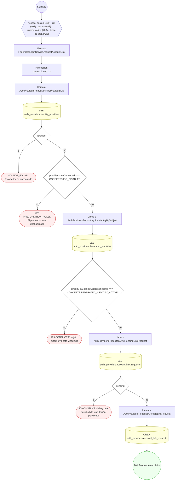

#### 2. POST /auth-providers/account-link-requests/complete

Completar la vinculación presentando el token

| HTTP | Código | Cuándo |
|---|---|---|
| 200 | — | Éxito |
| 400 | `VALIDATION_FAILED` | El cuerpo cumple el DTO (sin propiedades extra) |
| 401 | `UNAUTHENTICATED` | Hay una sesión válida (JWT) |
| 403 | `FORBIDDEN` | El rol está permitido; El tenant se resuelve y pertenece al actor |
| 404 | `NOT_FOUND` | ResourceNotFoundException: Solicitud de vinculación no encontrada |
| 409 | `CONFLICT` | ConflictException: El sujeto externo ya está vinculado |
| 422 | `PRECONDITION_FAILED` | PreconditionFailedException: La solicitud ya no está pendiente; PreconditionFailedException: La solicitud de vinculación caducó |
| 429 | `RATE_LIMITED` | No se supera el límite de solicitudes |

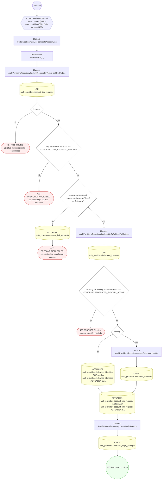

#### 3. POST /auth-providers/federated-identities/{id}/unlink

Desvincular una identidad federada

| HTTP | Código | Cuándo |
|---|---|---|
| 200 | — | Éxito |
| 400 | `VALIDATION_FAILED` | Los parámetros de ruta son UUID válidos; El cuerpo cumple el DTO (sin propiedades extra) |
| 401 | `UNAUTHENTICATED` | Hay una sesión válida (JWT) |
| 403 | `FORBIDDEN` | El rol está permitido; El tenant se resuelve y pertenece al actor |
| 404 | `NOT_FOUND` | ResourceNotFoundException: Identidad federada no encontrada |
| 422 | `PRECONDITION_FAILED` | PreconditionFailedException: La identidad ya está revocada |
| 429 | `RATE_LIMITED` | No se supera el límite de solicitudes |

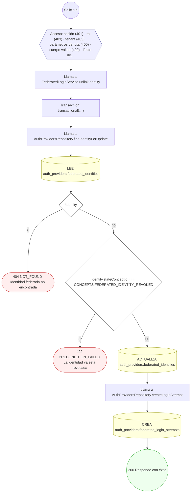

#### 4. POST /auth-providers/identity-providers

Registrar un proveedor de identidad

| HTTP | Código | Cuándo |
|---|---|---|
| 201 | — | Éxito |
| 400 | `VALIDATION_FAILED` | El cuerpo cumple el DTO (sin propiedades extra) |
| 401 | `UNAUTHENTICATED` | Hay una sesión válida (JWT) |
| 403 | `FORBIDDEN` | El rol está permitido; El tenant se resuelve y pertenece al actor |
| 409 | `CONFLICT` | ConflictException: Ya existe un proveedor con ese código |
| 422 | `PRECONDITION_FAILED` | PreconditionFailedException: Un proveedor no global necesita el tenant al que pertenece |
| 429 | `RATE_LIMITED` | No se supera el límite de solicitudes |

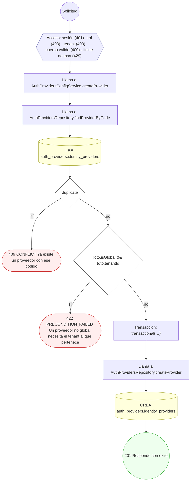

#### 5. PUT /auth-providers/identity-providers/{id}/attribute-mappings

Fijar el mapeo de atributos del proveedor

| HTTP | Código | Cuándo |
|---|---|---|
| 200 | — | Éxito |
| 400 | `VALIDATION_FAILED` | Los parámetros de ruta son UUID válidos; El cuerpo cumple el DTO (sin propiedades extra) |
| 401 | `UNAUTHENTICATED` | Hay una sesión válida (JWT) |
| 403 | `FORBIDDEN` | El rol está permitido; El tenant se resuelve y pertenece al actor |
| 404 | `NOT_FOUND` | ResourceNotFoundException: Proveedor no encontrado |
| 422 | `PRECONDITION_FAILED` | PreconditionFailedException: El mapeo necesita exactamente un claim identificador; PreconditionFailedException: El claim de origen está repetido en el mapeo |
| 429 | `RATE_LIMITED` | No se supera el límite de solicitudes |

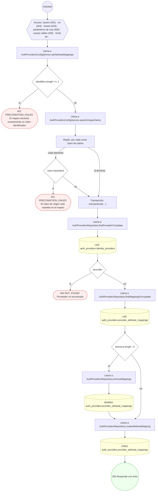

#### 6. POST /auth-providers/identity-providers/{id}/protocol-configs

Configurar el protocolo de un entorno e importar el JWKS

| HTTP | Código | Cuándo |
|---|---|---|
| 201 | — | Éxito |
| 400 | `VALIDATION_FAILED` | Los parámetros de ruta son UUID válidos; El cuerpo cumple el DTO (sin propiedades extra) |
| 401 | `UNAUTHENTICATED` | Hay una sesión válida (JWT) |
| 403 | `FORBIDDEN` | El rol está permitido; El tenant se resuelve y pertenece al actor |
| 404 | `NOT_FOUND` | ResourceNotFoundException: Proveedor no encontrado |
| 422 | `PRECONDITION_FAILED` | PreconditionFailedException: Una configuración SAML necesita entity ID y ACS URL; PreconditionFailedException: La configuración necesita el identificador de cliente; PreconditionFailedException: La configuración necesita los endpoints de autorización y token; PreconditionFailedException: Una configuración OIDC necesita JWKS o documento de descubrimiento |
| 429 | `RATE_LIMITED` | No se supera el límite de solicitudes |

```mermaid
flowchart TD
  n1(("Solicitud")):::inicio
  n2{{"Acceso: sesión (401) · rol (403) · tenant (403) · parámetros de ruta (400) · cuerpo válido (400) · límite de…"}}:::acceso
  n1 --> n2
  n3["Llama a AuthProvidersConfigService.configureProtocol"]:::llamada
  n2 --> n3
  n4["Transacción: transactional(…)"]:::transaccion
  n3 --> n4
  n5["Llama a AuthProvidersRepository.findProviderForUpdate"]:::llamada
  n4 --> n5
  n6[("LEE auth_providers.identity_providers")]:::efecto
  n5 --> n6
  n7{"!provider"}:::decision
  n6 --> n7
  n8(["404 NOT_FOUND Proveedor no encontrado"]):::error
  n7 -->|"sí"| n8
  n9["Llama a AuthProvidersConfigService.assertProtocolShape"]:::llamada
  n7 -->|"no"| n9
  n10{"protocolConceptId === CONCEPTS.IDP_PROTOCOL_SAML"}:::decision
  n9 --> n10
  n11{"!dto.samlEntityId || !dto.samlAcsUrl"}:::decision
  n10 -->|"sí"| n11
  n12(["422 PRECONDITION_FAILED Una configuración SAML necesita entity ID y ACS URL"]):::error
  n11 -->|"sí"| n12
  n13{"!dto.clientId"}:::decision
  n11 -->|"no"| n13
  n10 -->|"no"| n13
  n14(["422 PRECONDITION_FAILED La configuración necesita el identificador de cliente"]):::error
  n13 -->|"sí"| n14
  n15{"!dto.authorizeUrl || !dto.tokenUrl"}:::decision
  n13 -->|"no"| n15
  n16(["422 PRECONDITION_FAILED La configuración necesita los endpoints de autorización y token"]):::error
  n15 -->|"sí"| n16
  n17{"protocolConceptId === CONCEPTS.IDP_PROTOCOL_OIDC && !dto.jwksUri && !dto.metadataUrl"}:::decision
  n15 -->|"no"| n17
  n18(["422 PRECONDITION_FAILED Una configuración OIDC necesita JWKS o documento de descubrimiento"]):::error
  n17 -->|"sí"| n18
  n19["Llama a AuthProvidersRepository.findProtocolConfigForUpdate"]:::llamada
  n17 -->|"no"| n19
  n20[("LEE auth_providers.provider_protocol_configs")]:::efecto
  n19 --> n20
  n21{"previous"}:::decision
  n20 --> n21
  n22[("ACTUALIZA auth_providers.provider_protocol_configs")]:::efecto
  n21 -->|"sí"| n22
  n23["Llama a AuthProvidersRepository.createProtocolConfig"]:::llamada
  n22 --> n23
  n21 -->|"no"| n23
  n24[("CREA auth_providers.provider_protocol_configs")]:::efecto
  n23 --> n24
  n25["Repite: por cada const key de dto.discoveredKeys ?? []"]:::bucle
  n24 --> n25
  n26["Llama a AuthProvidersRepository.findSigningKey"]:::llamada
  n25 -->|"cada elemento"| n26
  n27[("LEE auth_providers.provider_signing_keys")]:::efecto
  n26 --> n27
  n28["Llama a AuthProvidersRepository.createSigningKey"]:::llamada
  n27 --> n28
  n29[("CREA auth_providers.provider_signing_keys")]:::efecto
  n28 --> n29
  n30{"provider.stateConceptId === CONCEPTS.IDP_DRAFT"}:::decision
  n29 --> n30
  n25 -->|"al terminar"| n30
  n31[("ACTUALIZA auth_providers.identity_providers")]:::efecto
  n30 -->|"sí"| n31
  n32(("201 Responde con éxito")):::ok
  n31 --> n32
  n30 -->|"no"| n32
  classDef acceso fill:#eef,stroke:#66a
  classDef error fill:#fee,stroke:#c33
  classDef ok fill:#efe,stroke:#3a3
  classDef efecto fill:#ffd,stroke:#aa3
  classDef decision fill:#fff,stroke:#555
  classDef corte fill:#eee,stroke:#999,stroke-dasharray: 4
```

#### 7. POST /auth-providers/identity-providers/{id}/provisioning-rules

Definir una regla de aprovisionamiento

| HTTP | Código | Cuándo |
|---|---|---|
| 201 | — | Éxito |
| 400 | `VALIDATION_FAILED` | Los parámetros de ruta son UUID válidos; El cuerpo cumple el DTO (sin propiedades extra) |
| 401 | `UNAUTHENTICATED` | Hay una sesión válida (JWT) |
| 403 | `FORBIDDEN` | El rol está permitido; El tenant se resuelve y pertenece al actor |
| 404 | `NOT_FOUND` | ResourceNotFoundException: Proveedor no encontrado |
| 409 | `CONFLICT` | ConflictException: Ya existe una regla con esa prioridad |
| 422 | `PRECONDITION_FAILED` | PreconditionFailedException: Una regla DENY no asigna rol ni tenant |
| 429 | `RATE_LIMITED` | No se supera el límite de solicitudes |

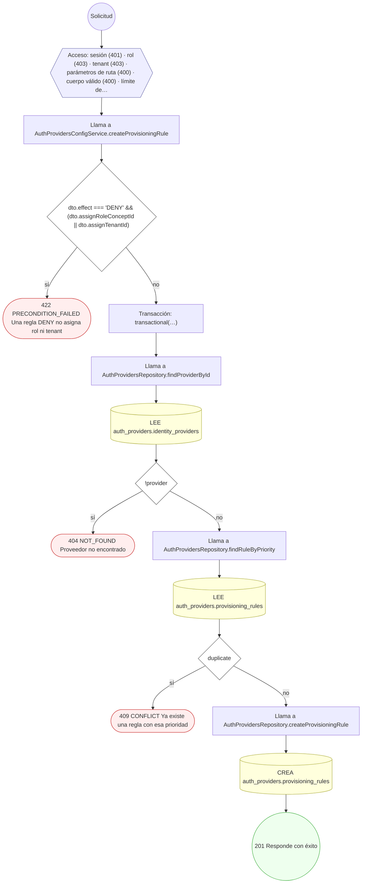

#### 8. POST /auth-providers/identity-providers/{id}/signing-keys

Publicar una clave de firma del proveedor

| HTTP | Código | Cuándo |
|---|---|---|
| 201 | — | Éxito |
| 400 | `VALIDATION_FAILED` | Los parámetros de ruta son UUID válidos; El cuerpo cumple el DTO (sin propiedades extra) |
| 401 | `UNAUTHENTICATED` | Hay una sesión válida (JWT) |
| 403 | `FORBIDDEN` | El rol está permitido; El tenant se resuelve y pertenece al actor |
| 404 | `NOT_FOUND` | ResourceNotFoundException: Proveedor no encontrado |
| 409 | `CONFLICT` | ConflictException: El proveedor ya tiene una clave con ese identificador |
| 422 | `PRECONDITION_FAILED` | PreconditionFailedException: La vigencia de la clave está invertida |
| 429 | `RATE_LIMITED` | No se supera el límite de solicitudes |

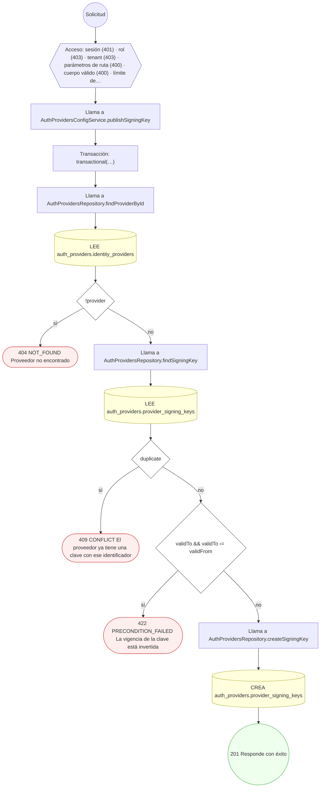

#### 9. POST /auth-providers/identity-providers/{id}/signing-keys/rotate

Rotar la clave de firma

| HTTP | Código | Cuándo |
|---|---|---|
| 200 | — | Éxito |
| 400 | `VALIDATION_FAILED` | Los parámetros de ruta son UUID válidos; El cuerpo cumple el DTO (sin propiedades extra) |
| 401 | `UNAUTHENTICATED` | Hay una sesión válida (JWT) |
| 403 | `FORBIDDEN` | El rol está permitido; El tenant se resuelve y pertenece al actor |
| 404 | `NOT_FOUND` | ResourceNotFoundException: Proveedor no encontrado |
| 409 | `CONFLICT` | ConflictException: El proveedor ya tiene una clave con ese identificador |
| 429 | `RATE_LIMITED` | No se supera el límite de solicitudes |

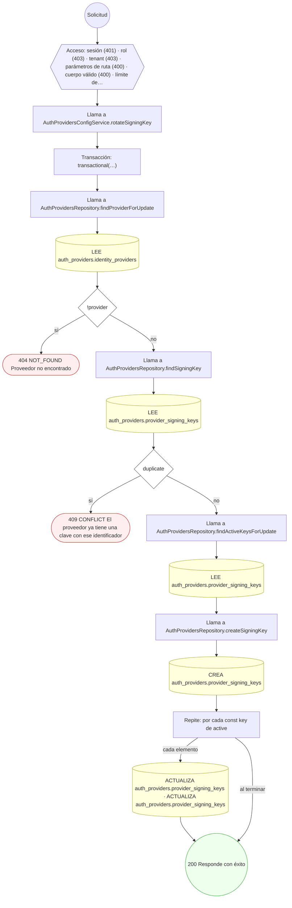

#### 10. POST /auth-providers/identity-providers/by-code/{code}/authorize

Iniciar el login federado

| HTTP | Código | Cuándo |
|---|---|---|
| 200 | — | Éxito |
| 400 | `VALIDATION_FAILED` | El cuerpo cumple el DTO (sin propiedades extra) |
| 401 | `UNAUTHENTICATED` | Hay una sesión válida (JWT) |
| 403 | `FORBIDDEN` | El rol está permitido; El tenant se resuelve y pertenece al actor |
| 404 | `NOT_FOUND` | ResourceNotFoundException: Proveedor no encontrado |
| 422 | `PRECONDITION_FAILED` | PreconditionFailedException: El proveedor no está activo; PreconditionFailedException: El proveedor no tiene configuración activa para ese entorno; PreconditionFailedException: La configuración no declara endpoint de autorización; PreconditionFailedException: El proveedor no está habilitado para ese tenant |
| 429 | `RATE_LIMITED` | No se supera el límite de solicitudes |

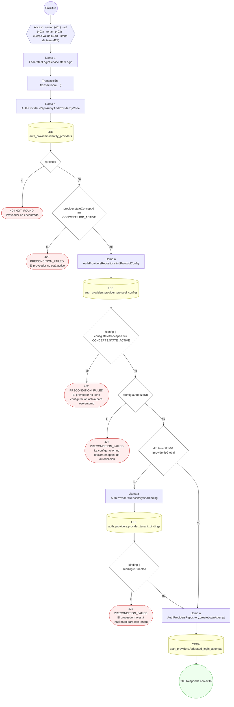

#### 11. POST /auth-providers/identity-providers/by-code/{code}/callback

Procesar el callback del proveedor

| HTTP | Código | Cuándo |
|---|---|---|
| 200 | — | Éxito |
| 400 | `VALIDATION_FAILED` | El cuerpo cumple el DTO (sin propiedades extra) |
| 401 | `UNAUTHENTICATED` | Hay una sesión válida (JWT) |
| 403 | `FORBIDDEN` | El rol está permitido; El tenant se resuelve y pertenece al actor |
| 404 | `NOT_FOUND` | ResourceNotFoundException: Proveedor no encontrado |
| 422 | `PRECONDITION_FAILED` | PreconditionFailedException: El `state` no corresponde a un login iniciado |
| 429 | `RATE_LIMITED` | No se supera el límite de solicitudes |

```mermaid
flowchart TD
  n1(("Solicitud")):::inicio
  n2{{"Acceso: sesión (401) · rol (403) · tenant (403) · cuerpo válido (400) · límite de tasa (429)"}}:::acceso
  n1 --> n2
  n3["Llama a FederatedLoginService.processCallback"]:::llamada
  n2 --> n3
  n4["Transacción: transactional(…)"]:::transaccion
  n3 --> n4
  n5["Llama a AuthProvidersRepository.findProviderByCode"]:::llamada
  n4 --> n5
  n6[("LEE auth_providers.identity_providers")]:::efecto
  n5 --> n6
  n7{"!provider"}:::decision
  n6 --> n7
  n8(["404 NOT_FOUND Proveedor no encontrado"]):::error
  n7 -->|"sí"| n8
  n9["Llama a AuthProvidersRepository.findAttemptByRequestId"]:::llamada
  n7 -->|"no"| n9
  n10[("LEE auth_providers.federated_login_attempts")]:::efecto
  n9 --> n10
  n11{"!initiated || initiated.outcomeConceptId !== CONCEPTS.LOGIN_INITIATED"}:::decision
  n10 --> n11
  n12(["422 PRECONDITION_FAILED El `state` no corresponde a un login iniciado"]):::error
  n11 -->|"sí"| n12
  n13["Llama a AuthProvidersRepository.createLoginAttempt"]:::llamada
  n11 -->|"no"| n13
  n14[("CREA auth_providers.federated_login_attempts")]:::efecto
  n13 --> n14
  n15["Llama a AuthProvidersRepository.findMappingsByProvider"]:::llamada
  n14 --> n15
  n16[("LEE auth_providers.provider_attribute_mappings")]:::efecto
  n15 --> n16
  n17["Llama a AuthProvidersRepository.findIdentityBySubjectForUpdate"]:::llamada
  n16 --> n17
  n18[("LEE auth_providers.federated_identities")]:::efecto
  n17 --> n18
  n19{"identity"}:::decision
  n18 --> n19
  n20[("ACTUALIZA auth_providers.federated_identities · ACTUALIZA auth_providers.federated_identities · ACTUALIZA aut…")]:::efecto
  n19 -->|"sí"| n20
  n21["Llama a AuthProvidersRepository.createLoginAttempt"]:::llamada
  n20 --> n21
  n22[("CREA auth_providers.federated_login_attempts")]:::efecto
  n21 --> n22
  n23["Llama a AuthProvidersRepository.findBinding"]:::llamada
  n22 --> n23
  n19 -->|"no"| n23
  n24[("LEE auth_providers.provider_tenant_bindings")]:::efecto
  n23 --> n24
  n25["Llama a AuthProvidersRepository.findActiveRules"]:::llamada
  n24 --> n25
  n26[("LEE auth_providers.provisioning_rules")]:::efecto
  n25 --> n26
  n27{"dto.userId && binding?.justInTimeProvisioning"}:::decision
  n26 --> n27
  n28["Llama a AuthProvidersRepository.createFederatedIdentity"]:::llamada
  n27 -->|"sí"| n28
  n29[("CREA auth_providers.federated_identities")]:::efecto
  n28 --> n29
  n30["Llama a AuthProvidersRepository.createLoginAttempt"]:::llamada
  n29 --> n30
  n31[("CREA auth_providers.federated_login_attempts")]:::efecto
  n30 --> n31
  n32["Llama a AuthProvidersRepository.createLinkRequest"]:::llamada
  n31 --> n32
  n27 -->|"no"| n32
  n33[("CREA auth_providers.account_link_requests")]:::efecto
  n32 --> n33
  n34(("200 Responde con éxito")):::ok
  n33 --> n34
  classDef acceso fill:#eef,stroke:#66a
  classDef error fill:#fee,stroke:#c33
  classDef ok fill:#efe,stroke:#3a3
  classDef efecto fill:#ffd,stroke:#aa3
  classDef decision fill:#fff,stroke:#555
  classDef corte fill:#eee,stroke:#999,stroke-dasharray: 4
```

#### 12. POST /auth-providers/tenant-bindings

Vincular el proveedor a un tenant

| HTTP | Código | Cuándo |
|---|---|---|
| 201 | — | Éxito |
| 400 | `VALIDATION_FAILED` | El cuerpo cumple el DTO (sin propiedades extra) |
| 401 | `UNAUTHENTICATED` | Hay una sesión válida (JWT) |
| 403 | `FORBIDDEN` | El rol está permitido; El tenant se resuelve y pertenece al actor |
| 404 | `NOT_FOUND` | ResourceNotFoundException: Proveedor no encontrado |
| 422 | `PRECONDITION_FAILED` | PreconditionFailedException: Aprovisionar automáticamente exige declarar el rol por defecto; PreconditionFailedException: El proveedor está deshabilitado |
| 429 | `RATE_LIMITED` | No se supera el límite de solicitudes |

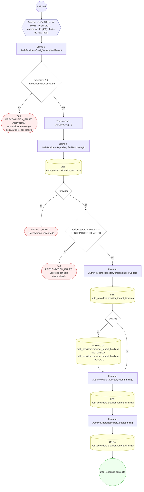

