<!-- AUTOGENERADO por tools/inventario/flujos.mjs. No editar manualmente. -->

# Flujos del módulo `authz`

- **Procesos:** 2 · **Máquinas de estado:** 0
- **Operaciones:** 21 (17 con decisiones propias, 4 sin ellas)
- Inventario de endpoints del módulo: [authz](../endpoints/authz.md)

## Proceso: Módulo 06 — authz (Authorization, Purpose of Use & Field Masking)

- **Código:** `authz` · **Agrupación:** AGRUPACION_POR_CONTROLADOR · **Operaciones:** 21
- **Actores:** CLINICAL_APPROVER · CLINICIAN · SECURITY_ADMIN
- **Revisión:** AUTO_DETECTADA
- **Fuentes:** `src/modules/authz/README.md`

### Para qué sirve

Autorización de la plataforma: catálogo de permisos, políticas ABAC, roles con herencia, asignaciones y excepciones por usuario, accesos clínicos con propósito de uso, break-the-glass, enmascaramiento de campos, grants polimórficos y el PDP (invalidación de cache + evaluación de decisiones efectivas).

_Fuente: `src/modules/authz/README.md:3`_

### Etapas y operaciones

| Etapa | Descripción | Operación | Quién actúa | Riesgo | Tablas |
|---|---|---|---|---|---|
| `ctrl:AuthzCareRelationshipsController` | Operaciones de AuthzCareRelationshipsController que el README no asigna a un caso de uso | GET /authz/care-relationships | CLINICIAN · SECURITY_ADMIN | BAJO | 1 |
|  |  | POST /authz/care-relationships | CLINICIAN · SECURITY_ADMIN | MEDIO | 2 |
|  |  | POST /authz/care-relationships/{id}/revoke | CLINICIAN · SECURITY_ADMIN | MEDIO | 2 |
|  |  | GET /authz/legal-representations | SECURITY_ADMIN | BAJO | 1 |
|  |  | POST /authz/legal-representations | SECURITY_ADMIN | MEDIO | 2 |
|  |  | POST /authz/legal-representations/{id}/revoke | SECURITY_ADMIN | MEDIO | 2 |
| `ctrl:AuthzCatalogController` | Operaciones de AuthzCatalogController que el README no asigna a un caso de uso | POST /authz/permission-categories | SECURITY_ADMIN | MEDIO | 2 |
|  |  | POST /authz/permissions | SECURITY_ADMIN | MEDIO | 3 |
| `ctrl:AuthzClinicalController` | Operaciones de AuthzClinicalController que el README no asigna a un caso de uso | DELETE /authz/clinical-access-grants/{grantId} | CLINICAL_APPROVER · SECURITY_ADMIN | MEDIO | 4 |
|  |  | POST /authz/patients/{patientProfileId}/break-the-glass | CLINICAL_APPROVER · SECURITY_ADMIN | MEDIO | 8 |
|  |  | POST /authz/patients/{patientProfileId}/clinical-access-grants | CLINICAL_APPROVER · SECURITY_ADMIN | MEDIO | 4 |
| `ctrl:AuthzGrantsController` | Operaciones de AuthzGrantsController que el README no asigna a un caso de uso | POST /authz/resource-scope-grants | SECURITY_ADMIN | MEDIO | 3 |
|  |  | POST /authz/users/{userId}/permission-grants | SECURITY_ADMIN | MEDIO | 3 |
|  |  | POST /authz/users/{userId}/role-assignments | SECURITY_ADMIN | MEDIO | 3 |
| `ctrl:AuthzPdpController` | Operaciones de AuthzPdpController que el README no asigna a un caso de uso | POST /authz/decisions/evaluate | SECURITY_ADMIN | BAJO | 11 |
|  |  | POST /authz/pdp/cache/invalidate | SECURITY_ADMIN | BAJO | 0 |
| `ctrl:AuthzPoliciesController` | Operaciones de AuthzPoliciesController que el README no asigna a un caso de uso | POST /authz/tenants/{tenantId}/access-policies | SECURITY_ADMIN | MEDIO | 2 |
| `ctrl:AuthzRolesController` | Operaciones de AuthzRolesController que el README no asigna a un caso de uso | GET /authz/roles | SECURITY_ADMIN | BAJO | 1 |
|  |  | POST /authz/roles | SECURITY_ADMIN | MEDIO | 2 |
|  |  | PUT /authz/roles/{roleId}/field-permissions | SECURITY_ADMIN | MEDIO | 4 |
|  |  | PUT /authz/roles/{roleId}/permissions | SECURITY_ADMIN | MEDIO | 4 |

### Diagrama — etapas `ctrl:AuthzCareRelationshipsController`, `ctrl:AuthzCatalogController`, `ctrl:AuthzClinicalController`…

```mermaid
flowchart LR
  a2(["CLINICIAN · SECURITY_ADMIN"]):::actor
  a7(["SECURITY_ADMIN"]):::actor
  a16(["CLINICAL_APPROVER · SECURITY_ADMIN"]):::actor
  t3[("authz.care_relationships")]:::tabla
  t8[("authz.patient_legal_representations")]:::tabla
  t12[("authz.permission_categories")]:::tabla
  t14[("authz.permissions")]:::tabla
  t17[("audit.audit_log")]:::tabla
  t18[("authz.clinical_access_grants")]:::tabla
  t20[("audit.data_access_log")]:::tabla
  t21[("authz.break_glass_sessions")]:::tabla
  t22[("messaging.domain_events")]:::tabla
  e24>"authz.break_glass.activated"]:::evento
  t27[("authz.resource_scope_grants")]:::tabla
  t29[("authz.user_permission_grants")]:::tabla
  t31[("authz.roles")]:::tabla
  t32[("authz.user_role_assignments")]:::tabla
  t34[("authz.access_policies")]:::tabla
  t35[("authz.field_permissions")]:::tabla
  t43[("authz.role_permissions")]:::tabla
  subgraph s0["ctrl:AuthzCareRelationshipsController · Operaciones de AuthzCareRelationshipsCo…"]
    o1["GET /authz/care-relationships"]:::op
    o4["POST /authz/care-relationships"]:::op
    o5["POST /authz/care-relationships/{id}/revoke"]:::op
    o6["GET /authz/legal-representations"]:::op
    o9["POST /authz/legal-representations"]:::op
    o10["POST /authz/legal-representations/{id}/revoke"]:::op
  end
  subgraph s1["ctrl:AuthzCatalogController · Operaciones de AuthzCatalogController que el READ…"]
    o11["POST /authz/permission-categories"]:::op
    o13["POST /authz/permissions"]:::op
  end
  t23[("+2 tablas más")]
  subgraph s2["ctrl:AuthzClinicalController · Operaciones de AuthzClinicalController que el RE…"]
    o15["DELETE /authz/clinical-access-grants/{grantId}"]:::op
    o19["POST /authz/patients/{patientProfileId}/break-the-glass"]:::op
    o25["POST /authz/patients/{patientProfileId}/clinical-access-grants"]:::op
  end
  subgraph s3["ctrl:AuthzGrantsController · Operaciones de AuthzGrantsController que el README…"]
    o26["POST /authz/resource-scope-grants"]:::op
    o28["POST /authz/users/{userId}/permission-grants"]:::op
    o30["POST /authz/users/{userId}/role-assignments"]:::op
  end
  t36[("+5 tablas más")]
  subgraph s4["ctrl:AuthzPdpController · Operaciones de AuthzPdpController que el README no as…"]
    o33["POST /authz/decisions/evaluate"]:::op
    o37["POST /authz/pdp/cache/invalidate"]:::op
  end
  subgraph s5["ctrl:AuthzPoliciesController · Operaciones de AuthzPoliciesController que el RE…"]
    o38["POST /authz/tenants/{tenantId}/access-policies"]:::op
  end
  subgraph s6["ctrl:AuthzRolesController · Operaciones de AuthzRolesController que el README n…"]
    o39["GET /authz/roles"]:::op
    o40["POST /authz/roles"]:::op
    o41["PUT /authz/roles/{roleId}/field-permissions"]:::op
    o42["PUT /authz/roles/{roleId}/permissions"]:::op
  end
  a2 --> o1
  o1 -->|"LEE"| t3
  a2 --> o4
  o4 -->|"CREA"| t3
  o4 -->|"LEE"| t3
  a2 --> o5
  o5 -->|"ACTUALIZA"| t3
  o5 -->|"LEE"| t3
  a7 --> o6
  o6 -->|"LEE"| t8
  a7 --> o9
  o9 -->|"CREA"| t8
  o9 -->|"LEE"| t8
  a7 --> o10
  o10 -->|"ACTUALIZA"| t8
  o10 -->|"LEE"| t8
  a7 --> o11
  o11 -->|"CREA"| t12
  o11 -->|"LEE"| t12
  a7 --> o13
  o13 -->|"LEE"| t12
  o13 -->|"CREA"| t14
  o13 -->|"LEE"| t14
  a16 --> o15
  o15 -->|"CREA"| t17
  o15 -->|"LEE"| t17
  o15 -->|"ACTUALIZA"| t18
  o15 -->|"LEE"| t18
  a16 --> o19
  o19 -->|"CREA"| t17
  o19 -->|"LEE"| t17
  o19 -->|"CREA"| t20
  o19 -->|"CREA"| t21
  o19 -->|"CREA"| t18
  o19 -->|"CREA"| t22
  o19 -.-> t23
  o19 -->|"evento"| e24
  a16 --> o25
  o25 -->|"CREA"| t17
  o25 -->|"LEE"| t17
  o25 -->|"CREA"| t18
  o25 -->|"LEE"| t18
  a7 --> o26
  o26 -->|"LEE"| t14
  o26 -->|"CREA"| t27
  o26 -->|"LEE"| t27
  a7 --> o28
  o28 -->|"LEE"| t14
  o28 -->|"CREA"| t29
  o28 -->|"LEE"| t29
  a7 --> o30
  o30 -->|"LEE"| t31
  o30 -->|"CREA"| t32
  o30 -->|"LEE"| t32
  a7 --> o33
  o33 -->|"LEE"| t34
  o33 -->|"LEE"| t3
  o33 -->|"LEE"| t18
  o33 -->|"LEE"| t35
  o33 -->|"LEE"| t8
  o33 -->|"LEE"| t14
  o33 -.-> t36
  a7 --> o37
  a7 --> o38
  o38 -->|"CREA"| t34
  o38 -->|"LEE"| t34
  a7 --> o39
  o39 -->|"LEE"| t31
  a7 --> o40
  o40 -->|"CREA"| t31
  o40 -->|"LEE"| t31
  a7 --> o41
  o41 -->|"ACTUALIZA"| t35
  o41 -->|"CREA"| t35
  o41 -->|"LEE"| t35
  o41 -->|"LEE"| t31
  a7 --> o42
  o42 -->|"LEE"| t14
  o42 -->|"ACTUALIZA"| t43
  o42 -->|"CREA"| t43
  o42 -->|"LEE"| t31
  classDef op fill:#fff,stroke:#446
  classDef actor fill:#eef,stroke:#66a
  classDef tabla fill:#ffd,stroke:#aa3
  classDef evento fill:#efe,stroke:#3a3
```

## Flujo crítico: Consentimiento y acceso clínico

- **Código:** `critico:consent` · **Agrupación:** CURADO_EN_DOCUMENTO · **Operaciones:** 7
- **Actores:** `PATIENT` (otorga/retira consentimiento), `CLINICIAN`/`PRACTITIONER` (solicita acceso), `COMPLIANCE_OFFICER`/`PRIVACY_OFFICER` (supervisión).
- **Revisión:** CURADO_EN_DOCUMENTO
- **Fuentes:** `docs/business/critical-workflows.md:84`

### Para qué sirve

el acceso a PHI no puede depender solo de un rol (`CLINICIAN`) — debe respetar el consentimiento y la relación asistencial vigentes del paciente concreto, y reaccionar de inmediato cuando ese consentimiento se retira.

_Fuente: `docs/business/critical-workflows.md:86`_

### Precondiciones

existe una relación asistencial (`CareRelationshipsRepository`) o una representación legal vigente entre el profesional y el paciente.

_Fuente: `docs/business/critical-workflows.md:93`_

### Reglas de negocio

las bases legales de procesamiento son versionadas — una nueva *supersede* a la anterior, nunca la reemplaza en el histórico. La evidencia de consentimiento es append-only e inmutable (`consent.consent_evidence`, IMMUTABLE) — un consentimiento otorgado no se edita ni borra, solo se revoca hacia adelante.

_Fuente: `docs/business/critical-workflows.md:120`_

### Estados y transiciones

consentimiento `granted → withdrawn`; objeción `raised → upheld \| rejected`; base legal `active → superseded`.

_Fuente: `docs/business/critical-workflows.md:125`_

### Etapas y operaciones

| Etapa | Descripción | Operación | Quién actúa | Riesgo | Tablas |
|---|---|---|---|---|---|
| `P1` | `POST /consent/consents` — captura consentimiento de directiva de privacidad (+ provisiones + evento `granted`). | POST /consent/consents | SECURITY_ADMIN | MEDIO | 4 |
| `P2` | El PDP clínico (`authz-pdp.service.ts`) evalúa cada acceso posterior a PHI de ese paciente contra: rol global (RBAC) **Y** `ClinicalAccessGrantsRepository` **Y** relación asistencial vigente **Y** rango de la acción (`READ`/`WRITE`/`DELETE`) vs. nivel del grant. | _sin operación HTTP (lo hace el sistema)_ | — | — | — |
| `P3` | El profesional accede a PHI solo si las cuatro condiciones se cumplen simultáneamente. | _sin operación HTTP (lo hace el sistema)_ | — | — | — |
| `A1` | **Retiro de consentimiento** (`POST /consent/consents/{id}/withdraw`): dispara re-evaluación de accesos activos — no es un flag pasivo, invalida el acceso hacia adelante. | POST /consent/consents/{id}/withdraw | SECURITY_ADMIN | MEDIO | 7 |
| `A2` | **Objeción del paciente** (`POST /consent/patient-objections`): puede materializar una restricción de privacidad de inmediato (UC-07-07) o quedar pendiente de resolución (`POST /consent/patient-objections/{id}/resolve`, `upheld`/`rejected`). | POST /consent/patient-objections | SECURITY_ADMIN | MEDIO | 4 |
|  |  | POST /consent/patient-objections/{id}/resolve | SECURITY_ADMIN | MEDIO | 5 |
| `A3` | **Autorización HIPAA específica** (`POST /consent/hipaa-authorizations`): divulgación puntual a un tercero, revocable independientemente (`.../revoke`) del consentimiento general. | POST /consent/hipaa-authorizations | SECURITY_ADMIN | MEDIO | 2 |
|  |  | POST /consent/hipaa-authorizations/{id}/revoke | SECURITY_ADMIN | MEDIO | 3 |
| `A4` | **Expiración**: `POST /consent/internal/expiration-sweep` (worker) barre consentimientos vencidos. | POST /consent/internal/expiration-sweep | SYSTEM · SECURITY_ADMIN | MEDIO | 7 |
| `A5` | **Break-the-glass** (módulo `authz`): acceso de emergencia excepcional fuera del flujo normal, auditado explícitamente — no documentado en detalle en esta fase, ver `docs/security/access-control.md` (Fase 13). | _sin operación HTTP (lo hace el sistema)_ | — | — | — |

### Diagrama — etapas `P1`, `P2`, `P3`…

## Árbol de decisión por operación

Cada árbol se deriva del código del handler y de los métodos que invoca (hasta 4 niveles). Una rama que no decide, no escribe y no falla se poda. Los accesos y los efectos consecutivos se agrupan en un solo nodo.

### Operaciones con decisiones propias

#### 1. POST /authz/care-relationships

Establecer una relación asistencial

| HTTP | Código | Cuándo |
|---|---|---|
| 201 | — | Éxito |
| 400 | `VALIDATION_FAILED` | El cuerpo cumple el DTO (sin propiedades extra) |
| 401 | `UNAUTHENTICATED` | Hay una sesión válida (JWT) |
| 403 | `FORBIDDEN` | El rol está permitido; El tenant se resuelve y pertenece al actor |
| 409 | `CONFLICT` | ConflictException: Ya existe una relación asistencial activa para ese practicante |
| 422 | `PRECONDITION_FAILED` | PreconditionFailedException: validTo debe ser posterior a validFrom |
| 429 | `RATE_LIMITED` | No se supera el límite de solicitudes |

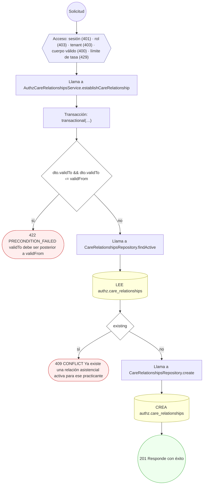

#### 2. POST /authz/care-relationships/{id}/revoke

Revocar o expirar una relación asistencial

| HTTP | Código | Cuándo |
|---|---|---|
| 200 | — | Éxito |
| 400 | `VALIDATION_FAILED` | Los parámetros de ruta son UUID válidos |
| 401 | `UNAUTHENTICATED` | Hay una sesión válida (JWT) |
| 403 | `FORBIDDEN` | El rol está permitido; El tenant se resuelve y pertenece al actor |
| 404 | `NOT_FOUND` | ResourceNotFoundException: Relación asistencial no encontrada |
| 422 | `PRECONDITION_FAILED` | PreconditionFailedException: La relación asistencial no está activa |
| 429 | `RATE_LIMITED` | No se supera el límite de solicitudes |

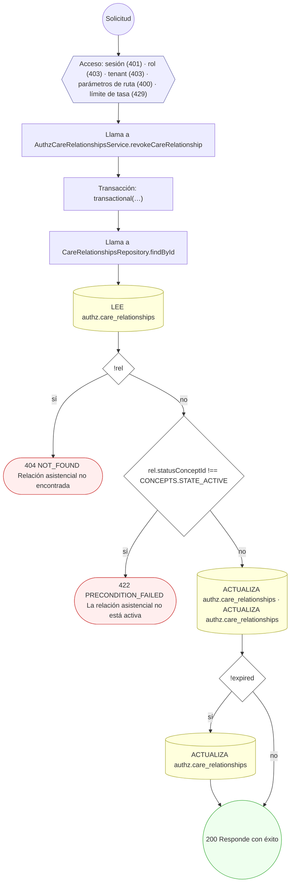

#### 3. DELETE /authz/clinical-access-grants/{grantId}

Revocar o expirar una concesión de acceso clínico

| HTTP | Código | Cuándo |
|---|---|---|
| 200 | — | Éxito |
| 400 | `VALIDATION_FAILED` | Los parámetros de ruta son UUID válidos |
| 401 | `UNAUTHENTICATED` | Hay una sesión válida (JWT) |
| 403 | `FORBIDDEN` | El rol está permitido; El tenant se resuelve y pertenece al actor |
| 404 | `NOT_FOUND` | ResourceNotFoundException: Acceso clínico no encontrado |
| 422 | `PRECONDITION_FAILED` | PreconditionFailedException: El acceso clínico no está activo |
| 429 | `RATE_LIMITED` | No se supera el límite de solicitudes |

#### 4. POST /authz/decisions/evaluate

Recalcular la decisión de autorización efectiva (PDP)

| HTTP | Código | Cuándo |
|---|---|---|
| 200 | — | Éxito |
| 400 | `VALIDATION_FAILED` | El cuerpo cumple el DTO (sin propiedades extra) |
| 401 | `UNAUTHENTICATED` | Hay una sesión válida (JWT) |
| 403 | `FORBIDDEN` | El rol está permitido; El tenant se resuelve y pertenece al actor |
| 429 | `RATE_LIMITED` | No se supera el límite de solicitudes |

```mermaid
flowchart TD
  n1(("Solicitud")):::inicio
  n2{{"Acceso: sesión (401) · rol (403) · tenant (403) · cuerpo válido (400) · límite de tasa (429)"}}:::acceso
  n1 --> n2
  n3["Llama a AuthzPdpService.evaluate"]:::llamada
  n2 --> n3
  n4["Llama a PermissionsRepository.findByResourceAction"]:::llamada
  n3 --> n4
  n5[("LEE authz.permissions")]:::efecto
  n4 --> n5
  n6["Llama a UserRoleAssignmentsRepository.findActiveForUser"]:::llamada
  n5 --> n6
  n7[("LEE authz.user_role_assignments")]:::efecto
  n6 --> n7
  n8["Llama a AuthzPdpService.resolveRoleInheritance"]:::llamada
  n7 --> n8
  n9["Repite: mientras queue.length › 0"]:::bucle
  n8 --> n9
  n10["Llama a RolesRepository.findById"]:::llamada
  n9 -->|"cada elemento"| n10
  n11[("LEE authz.roles")]:::efecto
  n10 --> n11
  n12{"!permission"}:::decision
  n11 --> n12
  n9 -->|"al terminar"| n12
  n13["Llama a RolePermissionsRepository.findActiveForRoles"]:::llamada
  n12 -->|"no"| n13
  n14[("LEE authz.role_permissions")]:::efecto
  n13 --> n14
  n15["Llama a UserPermissionGrantsRepository.findActiveForUser"]:::llamada
  n14 --> n15
  n16[("LEE authz.user_permission_grants")]:::efecto
  n15 --> n16
  n17{"dto.resourceId"}:::decision
  n16 --> n17
  n18["Llama a ResourceScopeGrantsRepository.findForSubjectResource"]:::llamada
  n17 -->|"sí"| n18
  n19[("LEE authz.resource_scope_grants")]:::efecto
  n18 --> n19
  n20["Llama a AccessPoliciesRepository.findActiveForTarget"]:::llamada
  n12 -->|"sí"| n20
  n19 --> n20
  n17 -->|"no"| n20
  n21[("LEE authz.access_policies")]:::efecto
  n20 --> n21
  n22{"dto.patientProfileId"}:::decision
  n21 --> n22
  n23["Llama a ClinicalAccessGrantsRepository.findActiveForUserPatient"]:::llamada
  n22 -->|"sí"| n23
  n24[("LEE authz.clinical_access_grants")]:::efecto
  n23 --> n24
  n25{"dto.practitionerProfileId"}:::decision
  n24 --> n25
  n26["Llama a CareRelationshipsRepository.findActiveForPractitionerPatient"]:::llamada
  n25 -->|"sí"| n26
  n27[("LEE authz.care_relationships")]:::efecto
  n26 --> n27
  n28["Llama a PatientLegalRepresentationsRepository.findActiveForRepresentativePatient"]:::llamada
  n27 --> n28
  n25 -->|"no"| n28
  n29[("LEE authz.patient_legal_representations")]:::efecto
  n28 --> n29
  n30["Llama a AuthzPdpService.computeMaskedFields"]:::llamada
  n29 --> n30
  n22 -->|"no"| n30
  n31["Llama a FieldPermissionsRepository.findForRoles"]:::llamada
  n30 --> n31
  n32[("LEE authz.field_permissions")]:::efecto
  n31 --> n32
  n33(("200 Responde con éxito")):::ok
  n32 --> n33
  classDef acceso fill:#eef,stroke:#66a
  classDef error fill:#fee,stroke:#c33
  classDef ok fill:#efe,stroke:#3a3
  classDef efecto fill:#ffd,stroke:#aa3
  classDef decision fill:#fff,stroke:#555
  classDef corte fill:#eee,stroke:#999,stroke-dasharray: 4
```

#### 5. POST /authz/legal-representations

Registrar una representación legal del paciente

| HTTP | Código | Cuándo |
|---|---|---|
| 201 | — | Éxito |
| 400 | `VALIDATION_FAILED` | El cuerpo cumple el DTO (sin propiedades extra) |
| 401 | `UNAUTHENTICATED` | Hay una sesión válida (JWT) |
| 403 | `FORBIDDEN` | El rol está permitido; El tenant se resuelve y pertenece al actor |
| 409 | `CONFLICT` | ConflictException: Ya existe una representación legal activa para ese usuario |
| 422 | `PRECONDITION_FAILED` | PreconditionFailedException: validTo debe ser posterior a validFrom |
| 429 | `RATE_LIMITED` | No se supera el límite de solicitudes |

#### 6. POST /authz/legal-representations/{id}/revoke

Revocar o expirar una representación legal

| HTTP | Código | Cuándo |
|---|---|---|
| 200 | — | Éxito |
| 400 | `VALIDATION_FAILED` | Los parámetros de ruta son UUID válidos |
| 401 | `UNAUTHENTICATED` | Hay una sesión válida (JWT) |
| 403 | `FORBIDDEN` | El rol está permitido; El tenant se resuelve y pertenece al actor |
| 404 | `NOT_FOUND` | ResourceNotFoundException: Representación legal no encontrada |
| 422 | `PRECONDITION_FAILED` | PreconditionFailedException: La representación legal no está activa |
| 429 | `RATE_LIMITED` | No se supera el límite de solicitudes |

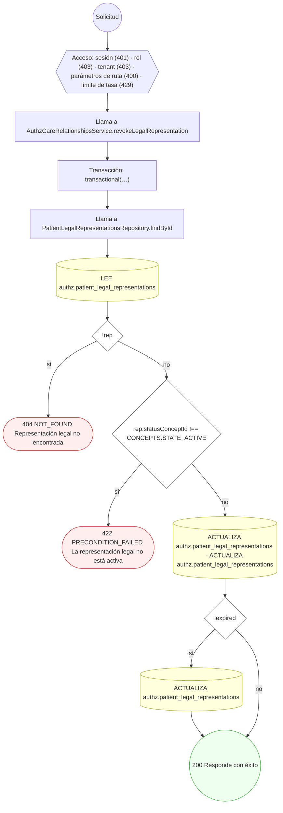

#### 7. POST /authz/patients/{patientProfileId}/break-the-glass

Break-the-glass / anulación de emergencia

| HTTP | Código | Cuándo |
|---|---|---|
| 201 | — | Éxito |
| 400 | `VALIDATION_FAILED` | Los parámetros de ruta son UUID válidos; El cuerpo cumple el DTO (sin propiedades extra) |
| 401 | `UNAUTHENTICATED` | Hay una sesión válida (JWT) |
| 403 | `FORBIDDEN` | El rol está permitido; El tenant se resuelve y pertenece al actor |
| 429 | `RATE_LIMITED` | No se supera el límite de solicitudes |

```mermaid
flowchart TD
  n1(("Solicitud")):::inicio
  n2{{"Acceso: sesión (401) · rol (403) · tenant (403) · parámetros de ruta (400) · cuerpo válido (400) · límite de…"}}:::acceso
  n1 --> n2
  n3["Llama a AuthzClinicalService.breakTheGlass"]:::llamada
  n2 --> n3
  n4["Transacción: transactional(…)"]:::transaccion
  n3 --> n4
  n5["Llama a ClinicalAccessGrantsRepository.create"]:::llamada
  n4 --> n5
  n6[("CREA authz.clinical_access_grants")]:::efecto
  n5 --> n6
  n7["Llama a BreakGlassSessionsRepository.create"]:::llamada
  n6 --> n7
  n8[("CREA authz.break_glass_sessions")]:::efecto
  n7 --> n8
  n9["Llama a DataAccessLogRepository.record"]:::llamada
  n8 --> n9
  n10[("CREA audit.data_access_log")]:::efecto
  n9 --> n10
  n11["Llama a OutboxService.publishDomainEvent"]:::llamada
  n10 --> n11
  n12["Llama a MessagingTraceService.runInProducerSpan"]:::llamada
  n11 --> n12
  n13["Transacción: startActiveSpan(…)"]:::transaccion
  n12 --> n13
  n14["Intenta"]:::intento
  n13 --> n14
  n15(["↩ (relanza el error capturado)"]):::error
  n14 -->|"si falla"| n15
  n16["Llama a OutboxService.persistDomainEvent"]:::llamada
  n14 --> n16
  n17["Llama a OutboxRepository.findOutboxByIdempotencyKey"]:::llamada
  n16 --> n17
  n18[("LEE messaging.outbox_messages")]:::efecto
  n17 --> n18
  n19["Llama a OutboxRepository.createDomainEvent"]:::llamada
  n18 --> n19
  n20[("CREA messaging.domain_events")]:::efecto
  n19 --> n20
  n21["Llama a OutboxRepository.createOutboxMessage"]:::llamada
  n20 --> n21
  n22[("CREA messaging.outbox_messages")]:::efecto
  n21 --> n22
  n23>"Evento authz.break_glass.activated"]:::evento
  n22 --> n23
  n24["Llama a AuditTrailService.record"]:::llamada
  n23 --> n24
  n25["Llama a AuditLogRepository.append"]:::llamada
  n24 --> n25
  n26["Llama a AuditLogRepository.findChainTip"]:::llamada
  n25 --> n26
  n27[("LEE audit.audit_log")]:::efecto
  n26 --> n27
  n28[("CREA audit.audit_log")]:::efecto
  n27 --> n28
  n29(("201 Responde con éxito")):::ok
  n28 --> n29
  classDef acceso fill:#eef,stroke:#66a
  classDef error fill:#fee,stroke:#c33
  classDef ok fill:#efe,stroke:#3a3
  classDef efecto fill:#ffd,stroke:#aa3
  classDef decision fill:#fff,stroke:#555
  classDef corte fill:#eee,stroke:#999,stroke-dasharray: 4
```

#### 8. POST /authz/patients/{patientProfileId}/clinical-access-grants

Otorgar acceso clínico con propósito de uso

| HTTP | Código | Cuándo |
|---|---|---|
| 201 | — | Éxito |
| 400 | `VALIDATION_FAILED` | Los parámetros de ruta son UUID válidos; El cuerpo cumple el DTO (sin propiedades extra) |
| 401 | `UNAUTHENTICATED` | Hay una sesión válida (JWT) |
| 403 | `FORBIDDEN` | El rol está permitido; El tenant se resuelve y pertenece al actor |
| 409 | `CONFLICT` | ConflictException: Ya existe un acceso clínico activo para ese usuario |
| 422 | `PRECONDITION_FAILED` | PreconditionFailedException: validTo debe ser posterior a validFrom; PreconditionFailedException: Se requiere consentimiento salvo para tratamiento directo |
| 429 | `RATE_LIMITED` | No se supera el límite de solicitudes |

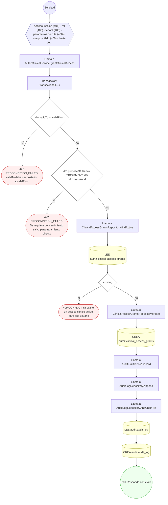

#### 9. POST /authz/permission-categories

Definir una categoría de permiso

| HTTP | Código | Cuándo |
|---|---|---|
| 201 | — | Éxito |
| 400 | `VALIDATION_FAILED` | El cuerpo cumple el DTO (sin propiedades extra) |
| 401 | `UNAUTHENTICATED` | Hay una sesión válida (JWT) |
| 403 | `FORBIDDEN` | El rol está permitido; El tenant se resuelve y pertenece al actor |
| 409 | `CONFLICT` | ConflictException: Ya existe una categoría con ese código |
| 429 | `RATE_LIMITED` | No se supera el límite de solicitudes |

#### 10. POST /authz/permissions

Definir un permiso del catálogo global

| HTTP | Código | Cuándo |
|---|---|---|
| 201 | — | Éxito |
| 400 | `VALIDATION_FAILED` | El cuerpo cumple el DTO (sin propiedades extra) |
| 401 | `UNAUTHENTICATED` | Hay una sesión válida (JWT) |
| 403 | `FORBIDDEN` | El rol está permitido; El tenant se resuelve y pertenece al actor |
| 409 | `CONFLICT` | ConflictException: Ya existe un permiso con ese código; ConflictException: La categoría referenciada no existe |
| 429 | `RATE_LIMITED` | No se supera el límite de solicitudes |

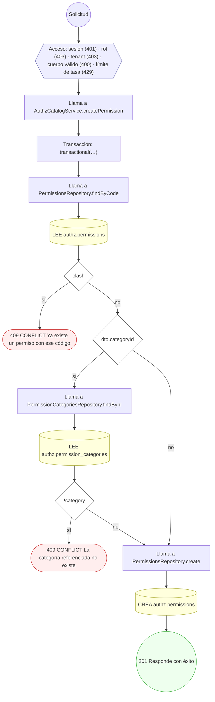

#### 11. POST /authz/resource-scope-grants

Otorgar acceso a un recurso específico (grant polimórfico)

| HTTP | Código | Cuándo |
|---|---|---|
| 201 | — | Éxito |
| 400 | `VALIDATION_FAILED` | El cuerpo cumple el DTO (sin propiedades extra) |
| 401 | `UNAUTHENTICATED` | Hay una sesión válida (JWT) |
| 403 | `FORBIDDEN` | El rol está permitido; El tenant se resuelve y pertenece al actor |
| 404 | `NOT_FOUND` | ResourceNotFoundException: Permiso no encontrado |
| 409 | `CONFLICT` | ConflictException: Ya existe un grant para ese (sujeto, permiso, recurso) |
| 429 | `RATE_LIMITED` | No se supera el límite de solicitudes |

#### 12. POST /authz/roles

Componer un rol (con herencia opcional)

| HTTP | Código | Cuándo |
|---|---|---|
| 201 | — | Éxito |
| 400 | `VALIDATION_FAILED` | El cuerpo cumple el DTO (sin propiedades extra) |
| 401 | `UNAUTHENTICATED` | Hay una sesión válida (JWT) |
| 403 | `FORBIDDEN` | El rol está permitido; El tenant se resuelve y pertenece al actor |
| 404 | `NOT_FOUND` | ResourceNotFoundException: El rol padre no existe |
| 409 | `CONFLICT` | ConflictException: Ya existe un rol con ese código |
| 429 | `RATE_LIMITED` | No se supera el límite de solicitudes |

#### 13. PUT /authz/roles/{roleId}/field-permissions

Configurar el enmascaramiento de campos del rol

| HTTP | Código | Cuándo |
|---|---|---|
| 200 | — | Éxito |
| 400 | `VALIDATION_FAILED` | Los parámetros de ruta son UUID válidos; El cuerpo cumple el DTO (sin propiedades extra) |
| 401 | `UNAUTHENTICATED` | Hay una sesión válida (JWT) |
| 403 | `FORBIDDEN` | El rol está permitido; El tenant se resuelve y pertenece al actor |
| 404 | `NOT_FOUND` | ResourceNotFoundException: Rol no encontrado |
| 422 | `PRECONDITION_FAILED` | PreconditionFailedException: canWrite=true requiere canRead=true |
| 429 | `RATE_LIMITED` | No se supera el límite de solicitudes |

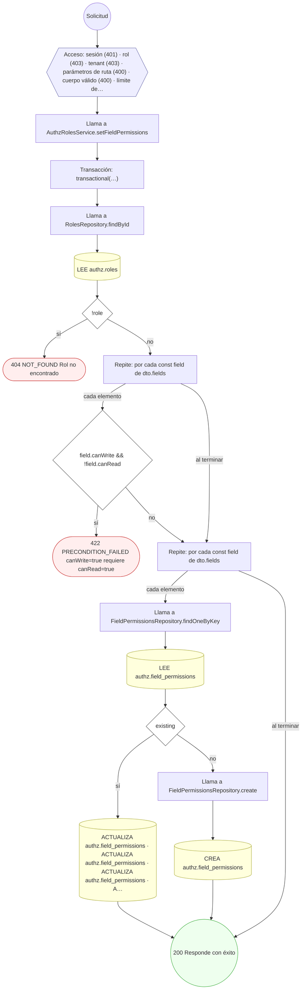

#### 14. PUT /authz/roles/{roleId}/permissions

Asignar permisos al rol (reemplaza los activos)

| HTTP | Código | Cuándo |
|---|---|---|
| 200 | — | Éxito |
| 400 | `VALIDATION_FAILED` | Los parámetros de ruta son UUID válidos; El cuerpo cumple el DTO (sin propiedades extra) |
| 401 | `UNAUTHENTICATED` | Hay una sesión válida (JWT) |
| 403 | `FORBIDDEN` | El rol está permitido; El tenant se resuelve y pertenece al actor |
| 404 | `NOT_FOUND` | ResourceNotFoundException: Rol no encontrado; ResourceNotFoundException: Permiso no encontrado |
| 429 | `RATE_LIMITED` | No se supera el límite de solicitudes |

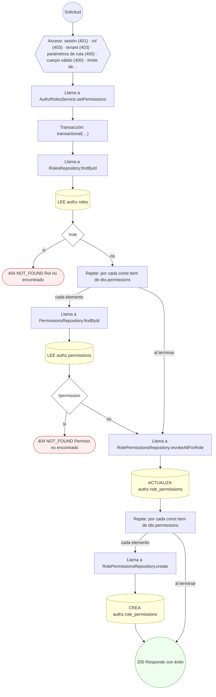

#### 15. POST /authz/tenants/{tenantId}/access-policies

Definir una política de acceso ABAC con enmascaramiento

| HTTP | Código | Cuándo |
|---|---|---|
| 201 | — | Éxito |
| 400 | `VALIDATION_FAILED` | Los parámetros de ruta son UUID válidos; El cuerpo cumple el DTO (sin propiedades extra) |
| 401 | `UNAUTHENTICATED` | Hay una sesión válida (JWT) |
| 403 | `FORBIDDEN` | El rol está permitido; El tenant se resuelve y pertenece al actor |
| 409 | `CONFLICT` | ConflictException: Ya existe una política activa con esa prioridad para el recurso |
| 429 | `RATE_LIMITED` | No se supera el límite de solicitudes |

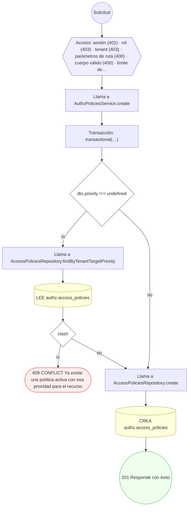

#### 16. POST /authz/users/{userId}/permission-grants

Otorgar una excepción de permiso por usuario

| HTTP | Código | Cuándo |
|---|---|---|
| 201 | — | Éxito |
| 400 | `VALIDATION_FAILED` | Los parámetros de ruta son UUID válidos; El cuerpo cumple el DTO (sin propiedades extra) |
| 401 | `UNAUTHENTICATED` | Hay una sesión válida (JWT) |
| 403 | `FORBIDDEN` | El rol está permitido; El tenant se resuelve y pertenece al actor |
| 404 | `NOT_FOUND` | ResourceNotFoundException: Permiso no encontrado |
| 409 | `CONFLICT` | ConflictException: El usuario ya tiene una excepción activa para ese permiso |
| 429 | `RATE_LIMITED` | No se supera el límite de solicitudes |

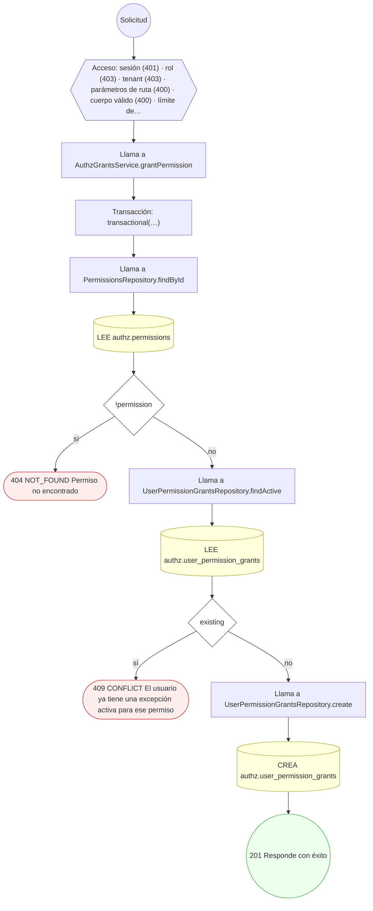

#### 17. POST /authz/users/{userId}/role-assignments

Asignar un rol a un usuario con vigencia y ámbito

| HTTP | Código | Cuándo |
|---|---|---|
| 201 | — | Éxito |
| 400 | `VALIDATION_FAILED` | Los parámetros de ruta son UUID válidos; El cuerpo cumple el DTO (sin propiedades extra) |
| 401 | `UNAUTHENTICATED` | Hay una sesión válida (JWT) |
| 403 | `FORBIDDEN` | El rol está permitido; El tenant se resuelve y pertenece al actor |
| 404 | `NOT_FOUND` | ResourceNotFoundException: Rol no encontrado |
| 409 | `CONFLICT` | ConflictException: El usuario ya tiene ese rol asignado y activo |
| 422 | `PRECONDITION_FAILED` | PreconditionFailedException: Indique el rol a asignar por `roleId` o por `roleCode`; PreconditionFailedException: El rol no es asignable; PreconditionFailedException: validFrom debe ser anterior a validTo |
| 429 | `RATE_LIMITED` | No se supera el límite de solicitudes |

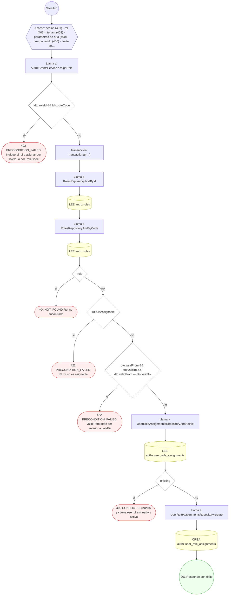

### Operaciones sin decisiones propias

Sólo comprueban el acceso y leen o escriben: no tienen ramas que dibujar. Su detalle está en la ficha de endpoints.

| Operación | Respuestas posibles | Tablas |
|---|---|---|
| GET /authz/care-relationships | 200, 400, 401, 403, 429 | 1 |
| GET /authz/legal-representations | 200, 400, 401, 403, 429 | 1 |
| POST /authz/pdp/cache/invalidate | 200, 400, 401, 403, 429 | 0 |
| GET /authz/roles | 200, 401, 403, 429 | 1 |
