<!-- AUTOGENERADO por tools/inventario/flujos.mjs. No editar manualmente. -->

# Flujos del módulo `automation`

- **Procesos:** 1 · **Máquinas de estado:** 0
- **Operaciones:** 17 (17 con decisiones propias, 0 sin ellas)
- Inventario de endpoints del módulo: [automation](../endpoints/automation.md)

## Proceso: Módulo 48 — Automatización y orquestación multiagente

- **Código:** `automation` · **Agrupación:** MIXTO · **Operaciones:** 17
- **Actores:** AGENT_RUNTIME · AI_GOVERNANCE_OFFICER · AUTOMATION_ENGINEER · CLINICAL_APPROVER · OPERATIONAL_APPROVER · PLATFORM_ADMIN · SYSTEM
- **Revisión:** AUTO_DETECTADA
- **Fuentes:** `src/modules/automation/README.md`

### Para qué sirve

Agentes con versiones publicables, herramientas con permiso, guardrails que detienen lo que no debe pasar, workflows con pasos enlazados, ejecuciones con traza paso a paso, aprobaciones humanas y escritura de registros con deduplicación.

_Fuente: `src/modules/automation/README.md:3`_

### Flujo general declarado en el README

```text
CATÁLOGO
  agents ─────────────> agente DRAFT + versión 1 DRAFT
    └─ versions/publish > versión PUBLISHED, agente ACTIVE, current_version derivada
  tools ──────────────> herramienta ACTIVE con is_write / requires_approval
    └─ tool-bindings ─> qué puede usar cada versión, con tope de llamadas
  guardrails ─────────> política ACTIVE
    └─ agents/:id/guardrails > adjunta y habilitada

ORQUESTACIÓN
  workflows ──────────> workflow DRAFT + pasos enlazados por código
  triggers ───────────> disparador ACTIVE (evento con tipo, calendario con cron)

EJECUCIÓN
  workflows/:id/runs ──> ¿ya hay run vivo en el mismo expediente? ──> devuelve ése
                         si no: run RUNNING, numerado
    └─ agent-runs ─────> sólo versión PUBLISHED; se atribuye a acts_as_user_id
        └─ steps ──────> append-only, secuencia derivada
             ├─ herramienta no enlazada / denegada / sin cupo ──> rechazo
             ├─ escribe + requiere aprobación ──┐
             ├─ guardrail BLOCK (coste/PHI) ────┤
             │                                  ↓
             │        paso AWAITING_APPROVAL, agent_run PAUSED, run WAITING
             │        approvals/:id/decide ──> approved: RUNNING · rejected: CANCELLED + run FAILED
             └─ todo bien ──> paso SUCCEEDED
        └─ record-automations/:id/execute ──> mapeo → columnas → INSERT … ON CONFLICT
  runs/:id/finalize ───> cierra agent_runs abiertos, suma coste, run COMPLETED|FAILED
```

_Fuente: `src/modules/automation/README.md:66`_

### Etapas y operaciones

| Etapa | Descripción | Operación | Quién actúa | Riesgo | Tablas |
|---|---|---|---|---|---|
| `UC-48-01` | Registrar agente con su versión 1 | POST /automation/agents | AUTOMATION_ENGINEER · PLATFORM_ADMIN | MEDIO | 6 |
| `UC-48-02` | Publicar versión | POST /automation/agents/{id}/versions/publish | AUTOMATION_ENGINEER · PLATFORM_ADMIN | MEDIO | 6 |
| `UC-48-03` | Registrar herramienta | POST /automation/tools | AUTOMATION_ENGINEER · PLATFORM_ADMIN | MEDIO | 5 |
| `UC-48-04` | Enlazar herramientas | POST /automation/agents/{id}/versions/{versionId}/tool-bindings | AUTOMATION_ENGINEER · PLATFORM_ADMIN | MEDIO | 8 |
| `UC-48-05` | Guardrail y adjunción | POST /automation/agents/{id}/guardrails | AI_GOVERNANCE_OFFICER · PLATFORM_ADMIN | MEDIO | 7 |
|  |  | POST /automation/guardrails | AI_GOVERNANCE_OFFICER · PLATFORM_ADMIN | MEDIO | 2 |
| `UC-48-06` | Workflow con pasos anidados | POST /automation/workflows | AUTOMATION_ENGINEER · PLATFORM_ADMIN | MEDIO | 9 |
| `UC-48-07` | Disparador | POST /automation/triggers | AUTOMATION_ENGINEER · PLATFORM_ADMIN | MEDIO | 6 |
| `UC-48-08` | Arrancar ejecución | POST /automation/workflows/{id}/runs | SYSTEM · AUTOMATION_ENGINEER · PLATFORM_ADMIN | MEDIO | 7 |
| `UC-48-09` | Ejecución con traza | POST /automation/agent-runs/{id}/steps | SYSTEM · AGENT_RUNTIME · PLATFORM_ADMIN | MEDIO | 13 |
|  |  | POST /automation/runs/{workflowRunId}/agent-runs | SYSTEM · AGENT_RUNTIME · PLATFORM_ADMIN | MEDIO | 4 |
| `UC-48-10` | Pausar por guardrail | POST /automation/agent-runs/{id}/approvals | SYSTEM · AGENT_RUNTIME · PLATFORM_ADMIN | MEDIO | 8 |
| `UC-48-11` | Decidir y reanudar | POST /automation/approvals/{id}/decide | CLINICAL_APPROVER · OPERATIONAL_APPROVER · PLATFORM_ADMIN | MEDIO | 9 |
| `UC-48-12` | Persistir memoria | POST /automation/agents/{id}/memory | SYSTEM · AGENT_RUNTIME · AUTOMATION_ENGINEER · PLATFORM_ADMIN | MEDIO | 7 |
| `UC-48-13` | Escribir con dedupe | POST /automation/agent-runs/{id}/record-automations/{recordAutomationId}/execute | SYSTEM · AGENT_RUNTIME · PLATFORM_ADMIN | MEDIO | 6 |
| `UC-48-14` | Cerrar con resumen de coste | POST /automation/runs/{workflowRunId}/finalize | SYSTEM · PLATFORM_ADMIN | MEDIO | 7 |
| `ctrl:AutomationOrchestrationController` | Operaciones de AutomationOrchestrationController que el README no asigna a un caso de uso | POST /automation/triggers/calendar/tick | SYSTEM | MEDIO | 7 |

### Diagrama — etapas `UC-48-01`, `UC-48-02`, `UC-48-03`…

```mermaid
flowchart LR
  a2(["AUTOMATION_ENGINEER · PLATFORM_ADMIN"]):::actor
  a18(["AI_GOVERNANCE_OFFICER · PLATFORM_ADMIN"]):::actor
  a33(["SYSTEM · AUTOMATION_ENGINEER · PLATFORM_ADMIN"]):::actor
  a38(["SYSTEM · AGENT_RUNTIME · PLATFORM_ADMIN"]):::actor
  a49(["CLINICAL_APPROVER · OPERATIONAL_APPROVER · PLATFORM_ADMIN"]):::actor
  a53(["SYSTEM · AGENT_RUNTIME · AUTOMATION_ENGINEER · PLATFORM_ADM…"]):::actor
  a61(["SYSTEM · PLATFORM_ADMIN"]):::actor
  a65(["SYSTEM"]):::actor
  t3[("automation.agent_versions")]:::tabla
  t4[("automation.agents")]:::tabla
  t5[("messaging.domain_events")]:::tabla
  t6[("messaging.outbox_messages")]:::tabla
  e7>"AgentRegistered"]:::evento
  e9>"AgentVersionPublished"]:::evento
  t11[("automation.agent_tools")]:::tabla
  e12>"AgentToolRegistered"]:::evento
  t14[("automation.agent_tool_bindings")]:::tabla
  e16>"AgentToolBound"]:::evento
  t19[("automation.agent_guardrails")]:::tabla
  t20[("automation.guardrail_policies")]:::tabla
  e22>"GuardrailAttached"]:::evento
  t25[("automation.workflow_steps")]:::tabla
  t26[("automation.workflows")]:::tabla
  e28>"WorkflowDefined"]:::evento
  t30[("automation.automation_triggers")]:::tabla
  e31>"TriggerRegistered"]:::evento
  t34[("automation.workflow_runs")]:::tabla
  e36>"WorkflowRunStarted"]:::evento
  t39[("automation.agent_run_steps")]:::tabla
  t40[("automation.agent_runs")]:::tabla
  e42>"AgentStepRecorded"]:::evento
  e43>"ApprovalRequested"]:::evento
  t46[("automation.automation_approvals")]:::tabla
  e51>"ApprovalDecided"]:::evento
  t54[("automation.agent_memory")]:::tabla
  e56>"AgentMemoryUpserted"]:::evento
  t58[("automation.record_automations")]:::tabla
  e59>"RecordAutomated"]:::evento
  e63>"WorkflowRunCompleted"]:::evento
  subgraph s0["UC-48-01 · Registrar agente con su versión 1"]
    o1["POST /automation/agents"]:::op
  end
  subgraph s1["UC-48-02 · Publicar versión"]
    o8["POST /automation/agents/{id}/versions/publish"]:::op
  end
  subgraph s2["UC-48-03 · Registrar herramienta"]
    o10["POST /automation/tools"]:::op
  end
  t15[("+2 tablas más")]
  subgraph s3["UC-48-04 · Enlazar herramientas"]
    o13["POST /automation/agents/{id}/versions/{versionId}/tool-bindings"]:::op
  end
  t21[("+1 tablas más")]
  subgraph s4["UC-48-05 · Guardrail y adjunción"]
    o17["POST /automation/agents/{id}/guardrails"]:::op
    o23["POST /automation/guardrails"]:::op
  end
  t27[("+3 tablas más")]
  subgraph s5["UC-48-06 · Workflow con pasos anidados"]
    o24["POST /automation/workflows"]:::op
  end
  subgraph s6["UC-48-07 · Disparador"]
    o29["POST /automation/triggers"]:::op
  end
  t35[("+1 tablas más")]
  subgraph s7["UC-48-08 · Arrancar ejecución"]
    o32["POST /automation/workflows/{id}/runs"]:::op
  end
  t41[("+7 tablas más")]
  subgraph s8["UC-48-09 · Ejecución con traza"]
    o37["POST /automation/agent-runs/{id}/steps"]:::op
    o44["POST /automation/runs/{workflowRunId}/agent-runs"]:::op
  end
  t47[("+2 tablas más")]
  subgraph s9["UC-48-10 · Pausar por guardrail"]
    o45["POST /automation/agent-runs/{id}/approvals"]:::op
  end
  t50[("+3 tablas más")]
  subgraph s10["UC-48-11 · Decidir y reanudar"]
    o48["POST /automation/approvals/{id}/decide"]:::op
  end
  t55[("+1 tablas más")]
  subgraph s11["UC-48-12 · Persistir memoria"]
    o52["POST /automation/agents/{id}/memory"]:::op
  end
  subgraph s12["UC-48-13 · Escribir con dedupe"]
    o57["POST /automation/agent-runs/{id}/record-automations/{recordAutomation…"]:::op
  end
  t62[("+1 tablas más")]
  subgraph s13["UC-48-14 · Cerrar con resumen de coste"]
    o60["POST /automation/runs/{workflowRunId}/finalize"]:::op
  end
  t66[("+1 tablas más")]
  subgraph s14["ctrl:AutomationOrchestrationController · Operaciones de AutomationOrchestration…"]
    o64["POST /automation/triggers/calendar/tick"]:::op
  end
  a2 --> o1
  o1 -->|"CREA"| t3
  o1 -->|"CREA"| t4
  o1 -->|"LEE"| t4
  o1 -->|"CREA"| t5
  o1 -->|"CREA"| t6
  o1 -->|"LEE"| t6
  o1 -->|"evento"| e7
  a2 --> o8
  o8 -->|"CREA"| t3
  o8 -->|"LEE"| t3
  o8 -->|"LEE"| t4
  o8 -->|"CREA"| t5
  o8 -->|"CREA"| t6
  o8 -->|"LEE"| t6
  o8 -->|"evento"| e9
  a2 --> o10
  o10 -->|"CREA"| t11
  o10 -->|"LEE"| t11
  o10 -->|"CREA"| t5
  o10 -->|"CREA"| t6
  o10 -->|"LEE"| t6
  o10 -->|"evento"| e12
  a2 --> o13
  o13 -->|"CREA"| t14
  o13 -->|"LEE"| t14
  o13 -->|"LEE"| t11
  o13 -->|"LEE"| t3
  o13 -->|"LEE"| t4
  o13 -->|"CREA"| t5
  o13 -.-> t15
  o13 -->|"evento"| e16
  a18 --> o17
  o17 -->|"CREA"| t19
  o17 -->|"LEE"| t19
  o17 -->|"LEE"| t4
  o17 -->|"LEE"| t20
  o17 -->|"CREA"| t5
  o17 -->|"CREA"| t6
  o17 -.-> t21
  o17 -->|"evento"| e22
  a18 --> o23
  o23 -->|"CREA"| t20
  o23 -->|"LEE"| t20
  a2 --> o24
  o24 -->|"LEE"| t11
  o24 -->|"LEE"| t4
  o24 -->|"ACTUALIZA"| t25
  o24 -->|"CREA"| t25
  o24 -->|"CREA"| t26
  o24 -->|"LEE"| t26
  o24 -.-> t27
  o24 -->|"evento"| e28
  a2 --> o29
  o29 -->|"CREA"| t30
  o29 -->|"LEE"| t30
  o29 -->|"LEE"| t26
  o29 -->|"CREA"| t5
  o29 -->|"CREA"| t6
  o29 -->|"LEE"| t6
  o29 -->|"evento"| e31
  a33 --> o32
  o32 -->|"LEE"| t30
  o32 -->|"CREA"| t34
  o32 -->|"LEE"| t34
  o32 -->|"LEE"| t26
  o32 -->|"CREA"| t5
  o32 -->|"CREA"| t6
  o32 -.-> t35
  o32 -->|"evento"| e36
  a38 --> o37
  o37 -->|"LEE"| t19
  o37 -->|"CREA"| t39
  o37 -->|"LEE"| t39
  o37 -->|"ACTUALIZA"| t40
  o37 -->|"LEE"| t14
  o37 -->|"LEE"| t11
  o37 -.-> t41
  o37 -->|"evento"| e42
  o37 -->|"evento"| e43
  a38 --> o44
  o44 -->|"CREA"| t40
  o44 -->|"LEE"| t3
  o44 -->|"LEE"| t4
  o44 -->|"LEE"| t34
  a38 --> o45
  o45 -->|"ACTUALIZA"| t40
  o45 -->|"CREA"| t46
  o45 -->|"LEE"| t46
  o45 -->|"ACTUALIZA"| t34
  o45 -->|"LEE"| t34
  o45 -->|"CREA"| t5
  o45 -.-> t47
  o45 -->|"evento"| e43
  a49 --> o48
  o48 -->|"CREA"| t39
  o48 -->|"LEE"| t39
  o48 -->|"ACTUALIZA"| t46
  o48 -->|"LEE"| t46
  o48 -->|"ACTUALIZA"| t34
  o48 -->|"LEE"| t34
  o48 -.-> t50
  o48 -->|"evento"| e51
  a53 --> o52
  o52 -->|"ACTUALIZA"| t54
  o52 -->|"CREA"| t54
  o52 -->|"LEE"| t54
  o52 -->|"LEE"| t4
  o52 -->|"CREA"| t5
  o52 -->|"CREA"| t6
  o52 -.-> t55
  o52 -->|"evento"| e56
  a38 --> o57
  o57 -->|"CREA"| t39
  o57 -->|"LEE"| t39
  o57 -->|"LEE"| t58
  o57 -->|"CREA"| t5
  o57 -->|"CREA"| t6
  o57 -->|"LEE"| t6
  o57 -->|"evento"| e59
  a61 --> o60
  o60 -->|"ACTUALIZA"| t40
  o60 -->|"LEE"| t40
  o60 -->|"LEE"| t46
  o60 -->|"LEE"| t34
  o60 -->|"CREA"| t5
  o60 -->|"CREA"| t6
  o60 -.-> t62
  o60 -->|"evento"| e63
  a65 --> o64
  o64 -->|"LEE"| t30
  o64 -->|"CREA"| t34
  o64 -->|"LEE"| t34
  o64 -->|"LEE"| t26
  o64 -->|"CREA"| t5
  o64 -->|"CREA"| t6
  o64 -.-> t66
  o64 -->|"evento"| e36
  classDef op fill:#fff,stroke:#446
  classDef actor fill:#eef,stroke:#66a
  classDef tabla fill:#ffd,stroke:#aa3
  classDef evento fill:#efe,stroke:#3a3
```

## Árbol de decisión por operación

Cada árbol se deriva del código del handler y de los métodos que invoca (hasta 4 niveles). Una rama que no decide, no escribe y no falla se poda. Los accesos y los efectos consecutivos se agrupan en un solo nodo.

### Operaciones con decisiones propias

#### 1. POST /automation/agent-runs/{id}/approvals

Solicitar aprobación y pausar la ejecución

| HTTP | Código | Cuándo |
|---|---|---|
| 201 | — | Éxito |
| 400 | `VALIDATION_FAILED` | Los parámetros de ruta son UUID válidos; El cuerpo cumple el DTO (sin propiedades extra) |
| 401 | `UNAUTHENTICATED` | Hay una sesión válida (JWT) |
| 403 | `FORBIDDEN` | El rol está permitido; El tenant se resuelve y pertenece al actor |
| 422 | `PRECONDITION_FAILED` | PreconditionFailedException: La ejecución del agente ya terminó; no admite aprobaciones. |
| 429 | `RATE_LIMITED` | No se supera el límite de solicitudes |

```mermaid
flowchart TD
  n1(("Solicitud")):::inicio
  n2{{"Acceso: sesión (401) · rol (403) · tenant (403) · parámetros de ruta (400) · cuerpo válido (400) · límite de…"}}:::acceso
  n1 --> n2
  n3["Llama a AutomationExecutionService.requestApproval"]:::llamada
  n2 --> n3
  n4["Transacción: transactional(…)"]:::transaccion
  n3 --> n4
  n5{"!OPEN_AGENT_RUN_STATUSES.includes(agentRun.statusConceptId)"}:::decision
  n4 --> n5
  n6(["422 PRECONDITION_FAILED La ejecución del agente ya terminó; no admite aprobaciones."]):::error
  n5 -->|"sí"| n6
  n7["Llama a AutomationRunsRepository.findPendingApprovalsByAgentRuns"]:::llamada
  n5 -->|"no"| n7
  n8[("LEE automation.automation_approvals")]:::efecto
  n7 --> n8
  n9["Llama a AutomationExecutionService.pauseForApproval"]:::llamada
  n8 --> n9
  n10["Llama a AutomationRunsRepository.createApproval"]:::llamada
  n9 --> n10
  n11[("CREA automation.automation_approvals")]:::efecto
  n10 --> n11
  n12[("ACTUALIZA automation.agent_runs")]:::efecto
  n11 --> n12
  n13{"agentRun.workflowRunId"}:::decision
  n12 --> n13
  n14["Llama a AutomationRunsRepository.findWorkflowRunForUpdate"]:::llamada
  n13 -->|"sí"| n14
  n15[("LEE automation.workflow_runs")]:::efecto
  n14 --> n15
  n16{"run && run.statusConceptId === CONCEPTS.AUTO_RUN_RUNNING"}:::decision
  n15 --> n16
  n17[("ACTUALIZA automation.workflow_runs")]:::efecto
  n16 -->|"sí"| n17
  n18["Llama a OutboxService.publishDomainEvent"]:::llamada
  n17 --> n18
  n16 -->|"no"| n18
  n13 -->|"no"| n18
  n19["Llama a MessagingTraceService.runInProducerSpan"]:::llamada
  n18 --> n19
  n20["Transacción: startActiveSpan(…)"]:::transaccion
  n19 --> n20
  n21["Intenta"]:::intento
  n20 --> n21
  n22(["↩ (relanza el error capturado)"]):::error
  n21 -->|"si falla"| n22
  n23>"Evento ApprovalRequested"]:::evento
  n21 --> n23
  n24(("201 Responde con éxito")):::ok
  n23 --> n24
  classDef acceso fill:#eef,stroke:#66a
  classDef error fill:#fee,stroke:#c33
  classDef ok fill:#efe,stroke:#3a3
  classDef efecto fill:#ffd,stroke:#aa3
  classDef decision fill:#fff,stroke:#555
  classDef corte fill:#eee,stroke:#999,stroke-dasharray: 4
```

#### 2. POST /automation/agent-runs/{id}/record-automations/{recordAutomationId}/execute

Ejecutar una automatización de registro con deduplicación

| HTTP | Código | Cuándo |
|---|---|---|
| 201 | — | Éxito |
| 400 | `VALIDATION_FAILED` | Los parámetros de ruta son UUID válidos; El cuerpo cumple el DTO (sin propiedades extra) |
| 401 | `UNAUTHENTICATED` | Hay una sesión válida (JWT) |
| 403 | `FORBIDDEN` | El rol está permitido; El tenant se resuelve y pertenece al actor |
| 422 | `PRECONDITION_FAILED` | PreconditionFailedException: La ejecución del agente no está en marcha; no puede escribir registros.; PreconditionFailedException: La automatización de registro no está activa.; PreconditionFailedException: La automatización de registro pertenece a otro agente.; PreconditionFailedException: El agente no tiene identidad de servicio; su escritura no sería atribuible.; PreconditionFailedException: La automatización de registro no declara mapeo de campos.; PreconditionFailedException: El mapeo de campos tiene una regla que no se entiende.; PreconditionFailedException: El origen de un campo mapeado tiene que ser una ruta.; PreconditionFailedException: Una regla de mapeo tiene que declarar `from` o `value`.; PreconditionFailedException: Falta un campo obligatorio del mapeo.; PreconditionFailedException: La validación de la automatización exige un campo que no llegó.; PreconditionFailedException: Un modo de escritura `upsert` necesita una clave de deduplicación. |
| 429 | `RATE_LIMITED` | No se supera el límite de solicitudes |
| 500 | `INTERNAL` | DomainException: {HttpStatus.BAD_REQUEST} |

```mermaid
flowchart TD
  n1(("Solicitud")):::inicio
  n2{{"Acceso: sesión (401) · rol (403) · tenant (403) · parámetros de ruta (400) · cuerpo válido (400) · límite de…"}}:::acceso
  n1 --> n2
  n3["Llama a RecordAutomationService.executeRecordAutomation"]:::llamada
  n2 --> n3
  n4["Transacción: transactional(…)"]:::transaccion
  n3 --> n4
  n5{"agentRun.statusConceptId !== CONCEPTS.AUTO_AGENT_RUN_RUNNING"}:::decision
  n4 --> n5
  n6(["422 PRECONDITION_FAILED La ejecución del agente no está en marcha; no puede escribir registros."]):::error
  n5 -->|"sí"| n6
  n7["Llama a AutomationGovernanceRepository.findRecordAutomationForUpdate"]:::llamada
  n5 -->|"no"| n7
  n8[("LEE automation.record_automations")]:::efecto
  n7 --> n8
  n9{"!automation.isActive"}:::decision
  n8 --> n9
  n10(["422 PRECONDITION_FAILED La automatización de registro no está activa."]):::error
  n9 -->|"sí"| n10
  n11{"automation.agentId && automation.agentId !== agentRun.agentId"}:::decision
  n9 -->|"no"| n11
  n12(["422 PRECONDITION_FAILED La automatización de registro pertenece a otro agente."]):::error
  n11 -->|"sí"| n12
  n13{"!writerUserId"}:::decision
  n11 -->|"no"| n13
  n14(["422 PRECONDITION_FAILED El agente no tiene identidad de servicio; su escritura no sería atribuible."]):::error
  n13 -->|"sí"| n14
  n15["Llama a RecordAutomationService.applyFieldMapping"]:::llamada
  n13 -->|"no"| n15
  n16{"!fieldMappingJson || typeof fieldMappingJson !== 'object'"}:::decision
  n15 --> n16
  n17(["422 PRECONDITION_FAILED La automatización de registro no declara mapeo de campos."]):::error
  n16 -->|"sí"| n17
  n18{"Object.keys(mapping).length === 0"}:::decision
  n16 -->|"no"| n18
  n19(["500 INTERNAL {HttpStatus.BAD_REQUEST}"]):::error
  n18 -->|"sí"| n19
  n20["Repite: por cada const [column, rule] de Object.entries(mapping)"]:::bucle
  n18 -->|"no"| n20
  n21{"!rule || typeof rule !== 'object'"}:::decision
  n20 -->|"cada elemento"| n21
  n22(["422 PRECONDITION_FAILED El mapeo de campos tiene una regla que no se entiende."]):::error
  n21 -->|"sí"| n22
  n23{"rule.from !== undefined"}:::decision
  n21 -->|"no"| n23
  n24{"typeof rule.from !== 'string'"}:::decision
  n23 -->|"sí"| n24
  n25(["422 PRECONDITION_FAILED El origen de un campo mapeado tiene que ser una ruta."]):::error
  n24 -->|"sí"| n25
  n26{"rule.value !== undefined"}:::decision
  n23 -->|"no"| n26
  n27(["422 PRECONDITION_FAILED Una regla de mapeo tiene que declarar `from` o `value`."]):::error
  n26 -->|"no"| n27
  n28{"(value === undefined || value === null) && rule.required === true"}:::decision
  n24 -->|"no"| n28
  n26 -->|"sí"| n28
  n29(["422 PRECONDITION_FAILED Falta un campo obligatorio del mapeo."]):::error
  n28 -->|"sí"| n29
  n30["Llama a RecordAutomationService.assertValidation"]:::llamada
  n28 -->|"no"| n30
  n20 -->|"al terminar"| n30
  n31["Repite: por cada const column de required"]:::bucle
  n30 --> n31
  n32{"value === undefined || value === null || value === ''"}:::decision
  n31 -->|"cada elemento"| n32
  n33(["422 PRECONDITION_FAILED La validación de la automatización exige un campo que no llegó."]):::error
  n32 -->|"sí"| n33
  n34{"upsert && dedupeColumns.length === 0"}:::decision
  n32 -->|"no"| n34
  n31 -->|"al terminar"| n34
  n35(["422 PRECONDITION_FAILED Un modo de escritura `upsert` necesita una clave de deduplicación."]):::error
  n34 -->|"sí"| n35
  n36{"!draft"}:::decision
  n34 -->|"no"| n36
  n37["Llama a TargetRecordRepository.writeRecord"]:::llamada
  n36 -->|"sí"| n37
  n38{"columnNames.length === 0"}:::decision
  n37 --> n38
  n39(["↩ (relanza el error capturado)"]):::error
  n38 -->|"sí"| n39
  n40["Intenta"]:::intento
  n38 -->|"no"| n40
  n41{"sqlState && INVALID_TARGET_SQLSTATES.has(sqlState)"}:::decision
  n40 -->|"si falla"| n41
  n42(["↩ (relanza el error capturado)"]):::error
  n41 -->|"sí"| n42
  n43(["↩ (relanza el error capturado)"]):::error
  n41 -->|"no"| n43
  n44["Llama a AutomationRunsRepository.createAgentRunStep"]:::llamada
  n40 --> n44
  n36 -->|"no"| n44
  n45[("CREA automation.agent_run_steps")]:::efecto
  n44 --> n45
  n46["Llama a AutomationRunsRepository.findMaxSequenceNo"]:::llamada
  n45 --> n46
  n47[("LEE automation.agent_run_steps")]:::efecto
  n46 --> n47
  n48["Llama a OutboxService.publishDomainEvent"]:::llamada
  n47 --> n48
  n49["Llama a MessagingTraceService.runInProducerSpan"]:::llamada
  n48 --> n49
  n50["Transacción: startActiveSpan(…)"]:::transaccion
  n49 --> n50
  n51["Intenta"]:::intento
  n50 --> n51
  n52(["↩ (relanza el error capturado)"]):::error
  n51 -->|"si falla"| n52
  n53["Llama a OutboxService.persistDomainEvent"]:::llamada
  n51 --> n53
  n54["Llama a OutboxRepository.findOutboxByIdempotencyKey"]:::llamada
  n53 --> n54
  n55[("LEE messaging.outbox_messages")]:::efecto
  n54 --> n55
  n56["Llama a OutboxRepository.createDomainEvent"]:::llamada
  n55 --> n56
  n57[("CREA messaging.domain_events")]:::efecto
  n56 --> n57
  n58["Llama a OutboxRepository.createOutboxMessage"]:::llamada
  n57 --> n58
  n59[("CREA messaging.outbox_messages")]:::efecto
  n58 --> n59
  n60>"Evento RecordAutomated"]:::evento
  n59 --> n60
  n61(("201 Responde con éxito")):::ok
  n60 --> n61
  classDef acceso fill:#eef,stroke:#66a
  classDef error fill:#fee,stroke:#c33
  classDef ok fill:#efe,stroke:#3a3
  classDef efecto fill:#ffd,stroke:#aa3
  classDef decision fill:#fff,stroke:#555
  classDef corte fill:#eee,stroke:#999,stroke-dasharray: 4
```

#### 3. POST /automation/agent-runs/{id}/steps

Registrar un paso de la traza del agente

| HTTP | Código | Cuándo |
|---|---|---|
| 201 | — | Éxito |
| 400 | `VALIDATION_FAILED` | Los parámetros de ruta son UUID válidos; El cuerpo cumple el DTO (sin propiedades extra) |
| 401 | `UNAUTHENTICATED` | Hay una sesión válida (JWT) |
| 403 | `FORBIDDEN` | El rol está permitido; El tenant se resuelve y pertenece al actor |
| 404 | `NOT_FOUND` | ResourceNotFoundException: Herramienta no encontrada. |
| 422 | `PRECONDITION_FAILED` | PreconditionFailedException: La ejecución del agente no está en marcha; no admite pasos nuevos.; PreconditionFailedException: La herramienta no está enlazada a la versión que se está ejecutando.; PreconditionFailedException: El enlace deniega el uso de esa herramienta para esta versión.; PreconditionFailedException: La herramienta agotó su tope de llamadas para esta ejecución. |
| 429 | `RATE_LIMITED` | No se supera el límite de solicitudes |

```mermaid
flowchart TD
  n1(("Solicitud")):::inicio
  n2{{"Acceso: sesión (401) · rol (403) · tenant (403) · parámetros de ruta (400) · cuerpo válido (400) · límite de…"}}:::acceso
  n1 --> n2
  n3["Llama a AutomationExecutionService.recordAgentStep"]:::llamada
  n2 --> n3
  n4["Transacción: transactional(…)"]:::transaccion
  n3 --> n4
  n5{"agentRun.statusConceptId !== CONCEPTS.AUTO_AGENT_RUN_RUNNING"}:::decision
  n4 --> n5
  n6(["422 PRECONDITION_FAILED La ejecución del agente no está en marcha; no admite pasos nuevos."]):::error
  n5 -->|"sí"| n6
  n7["Llama a AutomationExecutionService.findBlocker"]:::llamada
  n5 -->|"no"| n7
  n8{"dto.agentToolId"}:::decision
  n7 --> n8
  n9["Llama a AgentsRepository.findToolById"]:::llamada
  n8 -->|"sí"| n9
  n10[("LEE automation.agent_tools")]:::efecto
  n9 --> n10
  n11{"!tool"}:::decision
  n10 --> n11
  n12(["404 NOT_FOUND Herramienta no encontrada."]):::error
  n11 -->|"sí"| n12
  n13["Llama a AgentsRepository.findBinding"]:::llamada
  n11 -->|"no"| n13
  n14[("LEE automation.agent_tool_bindings")]:::efecto
  n13 --> n14
  n15{"!binding"}:::decision
  n14 --> n15
  n16(["422 PRECONDITION_FAILED La herramienta no está enlazada a la versión que se está ejecutando."]):::error
  n15 -->|"sí"| n16
  n17{"binding.permissionEffectConceptId === CONCEPTS.AUTO_PERMISSION_DENY"}:::decision
  n15 -->|"no"| n17
  n18(["422 PRECONDITION_FAILED El enlace deniega el uso de esa herramienta para esta versión."]):::error
  n17 -->|"sí"| n18
  n19{"binding.maxCallsPerRun !== undefined && binding.maxCallsPerRun !== null"}:::decision
  n17 -->|"no"| n19
  n20["Llama a AutomationRunsRepository.countToolCalls"]:::llamada
  n19 -->|"sí"| n20
  n21[("LEE automation.agent_run_steps")]:::efecto
  n20 --> n21
  n22{"used ›= binding.maxCallsPerRun"}:::decision
  n21 --> n22
  n23(["422 PRECONDITION_FAILED La herramienta agotó su tope de llamadas para esta ejecución."]):::error
  n22 -->|"sí"| n23
  n24["Llama a AutomationGovernanceRepository.findEnabledGuardrailsByAgent"]:::llamada
  n22 -->|"no"| n24
  n19 -->|"no"| n24
  n8 -->|"no"| n24
  n25[("LEE automation.agent_guardrails")]:::efecto
  n24 --> n25
  n26["Repite: por cada const attachment de attachments"]:::bucle
  n25 --> n26
  n27["Llama a AutomationGovernanceRepository.findGuardrailPolicyById"]:::llamada
  n26 -->|"cada elemento"| n27
  n28[("LEE automation.guardrail_policies")]:::efecto
  n27 --> n28
  n29["Llama a AutomationRunsRepository.findMaxSequenceNo"]:::llamada
  n28 --> n29
  n26 -->|"al terminar"| n29
  n30[("LEE automation.agent_run_steps")]:::efecto
  n29 --> n30
  n31["Llama a AutomationRunsRepository.createAgentRunStep"]:::llamada
  n30 --> n31
  n32[("CREA automation.agent_run_steps")]:::efecto
  n31 --> n32
  n33["Llama a OutboxService.publishDomainEvent"]:::llamada
  n32 --> n33
  n34["Llama a MessagingTraceService.runInProducerSpan"]:::llamada
  n33 --> n34
  n35["Transacción: startActiveSpan(…)"]:::transaccion
  n34 --> n35
  n36["Intenta"]:::intento
  n35 --> n36
  n37(["↩ (relanza el error capturado)"]):::error
  n36 -->|"si falla"| n37
  n38["Llama a OutboxService.persistDomainEvent"]:::llamada
  n36 --> n38
  n39["Llama a OutboxRepository.findOutboxByIdempotencyKey"]:::llamada
  n38 --> n39
  n40[("LEE messaging.outbox_messages")]:::efecto
  n39 --> n40
  n41["Llama a OutboxRepository.createDomainEvent"]:::llamada
  n40 --> n41
  n42[("CREA messaging.domain_events")]:::efecto
  n41 --> n42
  n43["Llama a OutboxRepository.createOutboxMessage"]:::llamada
  n42 --> n43
  n44[("CREA messaging.outbox_messages")]:::efecto
  n43 --> n44
  n45>"Evento AgentStepRecorded"]:::evento
  n44 --> n45
  n46["Llama a AutomationExecutionService.pauseForApproval"]:::llamada
  n45 --> n46
  n47["Llama a AutomationRunsRepository.createApproval"]:::llamada
  n46 --> n47
  n48[("CREA automation.automation_approvals")]:::efecto
  n47 --> n48
  n49[("ACTUALIZA automation.agent_runs")]:::efecto
  n48 --> n49
  n50{"agentRun.workflowRunId"}:::decision
  n49 --> n50
  n51["Llama a AutomationRunsRepository.findWorkflowRunForUpdate"]:::llamada
  n50 -->|"sí"| n51
  n52[("LEE automation.workflow_runs")]:::efecto
  n51 --> n52
  n53{"run && run.statusConceptId === CONCEPTS.AUTO_RUN_RUNNING"}:::decision
  n52 --> n53
  n54[("ACTUALIZA automation.workflow_runs")]:::efecto
  n53 -->|"sí"| n54
  n55["Llama a OutboxService.publishDomainEvent"]:::llamada
  n54 --> n55
  n53 -->|"no"| n55
  n50 -->|"no"| n55
  n56["Llama a MessagingTraceService.runInProducerSpan"]:::llamada
  n55 --> n56
  n57["Transacción: startActiveSpan(…)"]:::transaccion
  n56 --> n57
  n58["Intenta"]:::intento
  n57 --> n58
  n59(["↩ (relanza el error capturado)"]):::error
  n58 -->|"si falla"| n59
  n60>"Evento ApprovalRequested"]:::evento
  n58 --> n60
  n61(("201 Responde con éxito")):::ok
  n60 --> n61
  classDef acceso fill:#eef,stroke:#66a
  classDef error fill:#fee,stroke:#c33
  classDef ok fill:#efe,stroke:#3a3
  classDef efecto fill:#ffd,stroke:#aa3
  classDef decision fill:#fff,stroke:#555
  classDef corte fill:#eee,stroke:#999,stroke-dasharray: 4
```

#### 4. POST /automation/agents

Registrar un agente con su primera versión

| HTTP | Código | Cuándo |
|---|---|---|
| 201 | — | Éxito |
| 400 | `VALIDATION_FAILED` | El cuerpo cumple el DTO (sin propiedades extra) |
| 401 | `UNAUTHENTICATED` | Hay una sesión válida (JWT) |
| 403 | `FORBIDDEN` | El rol está permitido; El tenant se resuelve y pertenece al actor |
| 409 | `CONFLICT` | ConflictException: Ya existe un agente con ese código. |
| 422 | `PRECONDITION_FAILED` | PreconditionFailedException: Un agente que actúa necesita una identidad de servicio (`actsAsUserId`). |
| 429 | `RATE_LIMITED` | No se supera el límite de solicitudes |

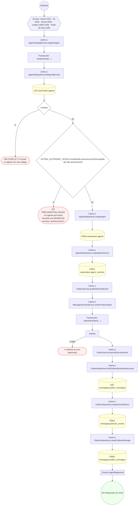

#### 5. POST /automation/agents/{id}/guardrails

Adjuntar una política de guardrail a un agente

| HTTP | Código | Cuándo |
|---|---|---|
| 201 | — | Éxito |
| 400 | `VALIDATION_FAILED` | Los parámetros de ruta son UUID válidos; El cuerpo cumple el DTO (sin propiedades extra) |
| 401 | `UNAUTHENTICATED` | Hay una sesión válida (JWT) |
| 403 | `FORBIDDEN` | El rol está permitido; El tenant se resuelve y pertenece al actor |
| 409 | `CONFLICT` | ConflictException: La política ya está adjunta a este agente. |
| 422 | `PRECONDITION_FAILED` | PreconditionFailedException: La política de guardrail no está activa. |
| 429 | `RATE_LIMITED` | No se supera el límite de solicitudes |

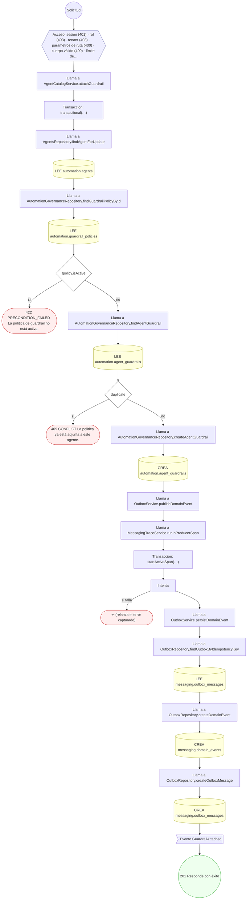

#### 6. POST /automation/agents/{id}/memory

Persistir memoria del agente

| HTTP | Código | Cuándo |
|---|---|---|
| 200 | — | Éxito |
| 400 | `VALIDATION_FAILED` | Los parámetros de ruta son UUID válidos; El cuerpo cumple el DTO (sin propiedades extra) |
| 401 | `UNAUTHENTICATED` | Hay una sesión válida (JWT) |
| 403 | `FORBIDDEN` | El rol está permitido; El tenant se resuelve y pertenece al actor |
| 422 | `PRECONDITION_FAILED` | PreconditionFailedException: Fuera del ámbito global la memoria tiene que declarar a qué se refiere. |
| 429 | `RATE_LIMITED` | No se supera el límite de solicitudes |

```mermaid
flowchart TD
  n1(("Solicitud")):::inicio
  n2{{"Acceso: sesión (401) · rol (403) · tenant (403) · parámetros de ruta (400) · cuerpo válido (400) · límite de…"}}:::acceso
  n1 --> n2
  n3["Llama a AgentCatalogService.upsertMemory"]:::llamada
  n2 --> n3
  n4["Transacción: transactional(…)"]:::transaccion
  n3 --> n4
  n5["Llama a AgentsRepository.findAgentById"]:::llamada
  n4 --> n5
  n6[("LEE automation.agents")]:::efecto
  n5 --> n6
  n7{"dto.scopeConceptId !== CONCEPTS.AUTO_MEMORY_SCOPE_GLOBAL && !dto.scopeRefId"}:::decision
  n6 --> n7
  n8(["422 PRECONDITION_FAILED Fuera del ámbito global la memoria tiene que declarar a qué se refiere."]):::error
  n7 -->|"sí"| n8
  n9["Llama a AgentsRepository.findMemoryForUpdate"]:::llamada
  n7 -->|"no"| n9
  n10[("LEE automation.agent_memory")]:::efecto
  n9 --> n10
  n11{"existing"}:::decision
  n10 --> n11
  n12[("ACTUALIZA automation.agent_memory · ACTUALIZA automation.agent_memory · ACTUALIZA automation.agent_memory · A…")]:::efecto
  n11 -->|"sí"| n12
  n13["Llama a AgentCatalogService.publishMemoryEvent"]:::llamada
  n12 --> n13
  n14["Llama a OutboxService.publishDomainEvent"]:::llamada
  n13 --> n14
  n15["Llama a MessagingTraceService.runInProducerSpan"]:::llamada
  n14 --> n15
  n16["Transacción: startActiveSpan(…)"]:::transaccion
  n15 --> n16
  n17["Intenta"]:::intento
  n16 --> n17
  n18(["↩ (relanza el error capturado)"]):::error
  n17 -->|"si falla"| n18
  n19>"Evento AgentMemoryUpserted"]:::evento
  n17 --> n19
  n20["Llama a AgentsRepository.createMemory"]:::llamada
  n19 --> n20
  n11 -->|"no"| n20
  n21[("CREA automation.agent_memory")]:::efecto
  n20 --> n21
  n22["Llama a AgentCatalogService.publishMemoryEvent"]:::llamada
  n21 --> n22
  n23["Llama a OutboxService.publishDomainEvent"]:::llamada
  n22 --> n23
  n24["Llama a MessagingTraceService.runInProducerSpan"]:::llamada
  n23 --> n24
  n25["Transacción: startActiveSpan(…)"]:::transaccion
  n24 --> n25
  n26["Intenta"]:::intento
  n25 --> n26
  n27(["↩ (relanza el error capturado)"]):::error
  n26 -->|"si falla"| n27
  n28>"Evento AgentMemoryUpserted"]:::evento
  n26 --> n28
  n29(("200 Responde con éxito")):::ok
  n28 --> n29
  classDef acceso fill:#eef,stroke:#66a
  classDef error fill:#fee,stroke:#c33
  classDef ok fill:#efe,stroke:#3a3
  classDef efecto fill:#ffd,stroke:#aa3
  classDef decision fill:#fff,stroke:#555
  classDef corte fill:#eee,stroke:#999,stroke-dasharray: 4
```

#### 7. POST /automation/agents/{id}/versions/{versionId}/tool-bindings

Enlazar herramientas a una versión del agente

| HTTP | Código | Cuándo |
|---|---|---|
| 201 | — | Éxito |
| 400 | `VALIDATION_FAILED` | Los parámetros de ruta son UUID válidos; El cuerpo cumple el DTO (sin propiedades extra) |
| 401 | `UNAUTHENTICATED` | Hay una sesión válida (JWT) |
| 403 | `FORBIDDEN` | El rol está permitido; El tenant se resuelve y pertenece al actor |
| 404 | `NOT_FOUND` | ResourceNotFoundException: {AUTOMATION_SCOPE_FAILURES.agentVersion.message}; ResourceNotFoundException: Herramienta no encontrada. |
| 409 | `CONFLICT` | ConflictException: La misma herramienta viene dos veces en el lote.; ConflictException: La herramienta ya está enlazada a esta versión. |
| 422 | `PRECONDITION_FAILED` | PreconditionFailedException: La herramienta no está activa. |
| 429 | `RATE_LIMITED` | No se supera el límite de solicitudes |

```mermaid
flowchart TD
  n1(("Solicitud")):::inicio
  n2{{"Acceso: sesión (401) · rol (403) · tenant (403) · parámetros de ruta (400) · cuerpo válido (400) · límite de…"}}:::acceso
  n1 --> n2
  n3["Llama a AgentCatalogService.bindTools"]:::llamada
  n2 --> n3
  n4["Transacción: transactional(…)"]:::transaccion
  n3 --> n4
  n5["Llama a AgentsRepository.findAgentById"]:::llamada
  n4 --> n5
  n6[("LEE automation.agents")]:::efecto
  n5 --> n6
  n7["Llama a AgentsRepository.findVersionById"]:::llamada
  n6 --> n7
  n8[("LEE automation.agent_versions")]:::efecto
  n7 --> n8
  n9{"!version || version.agentId !== agentId"}:::decision
  n8 --> n9
  n10(["404 NOT_FOUND {AUTOMATION_SCOPE_FAILURES.agentVersion.message}"]):::error
  n9 -->|"sí"| n10
  n11["Repite: por cada const binding de dto.bindings"]:::bucle
  n9 -->|"no"| n11
  n12{"seen.has(binding.agentToolId)"}:::decision
  n11 -->|"cada elemento"| n12
  n13(["409 CONFLICT La misma herramienta viene dos veces en el lote."]):::error
  n12 -->|"sí"| n13
  n14["Llama a AgentsRepository.findToolById"]:::llamada
  n12 -->|"no"| n14
  n15[("LEE automation.agent_tools")]:::efecto
  n14 --> n15
  n16{"!tool"}:::decision
  n15 --> n16
  n17(["404 NOT_FOUND Herramienta no encontrada."]):::error
  n16 -->|"sí"| n17
  n18{"tool.stateConceptId !== CONCEPTS.AUTO_TOOL_ACTIVE"}:::decision
  n16 -->|"no"| n18
  n19(["422 PRECONDITION_FAILED La herramienta no está activa."]):::error
  n18 -->|"sí"| n19
  n20["Llama a AgentsRepository.findBinding"]:::llamada
  n18 -->|"no"| n20
  n21[("LEE automation.agent_tool_bindings")]:::efecto
  n20 --> n21
  n22{"duplicate"}:::decision
  n21 --> n22
  n23(["409 CONFLICT La herramienta ya está enlazada a esta versión."]):::error
  n22 -->|"sí"| n23
  n24["Llama a AgentsRepository.createBinding"]:::llamada
  n22 -->|"no"| n24
  n25[("CREA automation.agent_tool_bindings")]:::efecto
  n24 --> n25
  n26["Llama a OutboxService.publishDomainEvent"]:::llamada
  n25 --> n26
  n11 -->|"al terminar"| n26
  n27["Llama a MessagingTraceService.runInProducerSpan"]:::llamada
  n26 --> n27
  n28["Transacción: startActiveSpan(…)"]:::transaccion
  n27 --> n28
  n29["Intenta"]:::intento
  n28 --> n29
  n30(["↩ (relanza el error capturado)"]):::error
  n29 -->|"si falla"| n30
  n31["Llama a OutboxService.persistDomainEvent"]:::llamada
  n29 --> n31
  n32["Llama a OutboxRepository.findOutboxByIdempotencyKey"]:::llamada
  n31 --> n32
  n33[("LEE messaging.outbox_messages")]:::efecto
  n32 --> n33
  n34["Llama a OutboxRepository.createDomainEvent"]:::llamada
  n33 --> n34
  n35[("CREA messaging.domain_events")]:::efecto
  n34 --> n35
  n36["Llama a OutboxRepository.createOutboxMessage"]:::llamada
  n35 --> n36
  n37[("CREA messaging.outbox_messages")]:::efecto
  n36 --> n37
  n38>"Evento AgentToolBound"]:::evento
  n37 --> n38
  n39(("201 Responde con éxito")):::ok
  n38 --> n39
  classDef acceso fill:#eef,stroke:#66a
  classDef error fill:#fee,stroke:#c33
  classDef ok fill:#efe,stroke:#3a3
  classDef efecto fill:#ffd,stroke:#aa3
  classDef decision fill:#fff,stroke:#555
  classDef corte fill:#eee,stroke:#999,stroke-dasharray: 4
```

#### 8. POST /automation/agents/{id}/versions/publish

Publicar una versión del agente

| HTTP | Código | Cuándo |
|---|---|---|
| 201 | — | Éxito |
| 400 | `VALIDATION_FAILED` | Los parámetros de ruta son UUID válidos; El cuerpo cumple el DTO (sin propiedades extra) |
| 401 | `UNAUTHENTICATED` | Hay una sesión válida (JWT) |
| 403 | `FORBIDDEN` | El rol está permitido; El tenant se resuelve y pertenece al actor |
| 404 | `NOT_FOUND` | ResourceNotFoundException: {AUTOMATION_SCOPE_FAILURES.agentVersion.message} |
| 422 | `PRECONDITION_FAILED` | PreconditionFailedException: La versión ya no está en borrador.; PreconditionFailedException: Para crear una versión nueva hace falta su plantilla de prompt. |
| 429 | `RATE_LIMITED` | No se supera el límite de solicitudes |

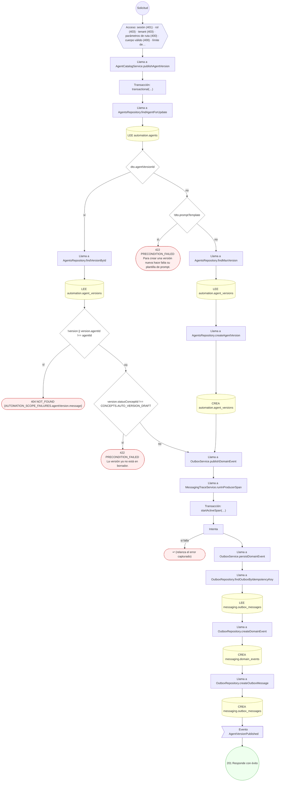

#### 9. POST /automation/approvals/{id}/decide

Decidir la aprobación y reanudar o abortar el run

| HTTP | Código | Cuándo |
|---|---|---|
| 200 | — | Éxito |
| 400 | `VALIDATION_FAILED` | Los parámetros de ruta son UUID válidos; El cuerpo cumple el DTO (sin propiedades extra) |
| 401 | `UNAUTHENTICATED` | Hay una sesión válida (JWT) |
| 403 | `FORBIDDEN` | El rol está permitido; El tenant se resuelve y pertenece al actor |
| 404 | `NOT_FOUND` | ResourceNotFoundException: {AUTOMATION_SCOPE_FAILURES.approval.message} |
| 409 | `CONFLICT` | ConflictException: La aprobación ya está decidida. |
| 422 | `PRECONDITION_FAILED` | PreconditionFailedException: La ejecución del agente no está en pausa. |
| 429 | `RATE_LIMITED` | No se supera el límite de solicitudes |

```mermaid
flowchart TD
  n1(("Solicitud")):::inicio
  n2{{"Acceso: sesión (401) · rol (403) · tenant (403) · parámetros de ruta (400) · cuerpo válido (400) · límite de…"}}:::acceso
  n1 --> n2
  n3["Llama a AutomationExecutionService.decideApproval"]:::llamada
  n2 --> n3
  n4["Transacción: transactional(…)"]:::transaccion
  n3 --> n4
  n5["Llama a AutomationRunsRepository.findApprovalForUpdate"]:::llamada
  n4 --> n5
  n6[("LEE automation.automation_approvals")]:::efecto
  n5 --> n6
  n7{"!approval"}:::decision
  n6 --> n7
  n8(["404 NOT_FOUND {AUTOMATION_SCOPE_FAILURES.approval.message}"]):::error
  n7 -->|"sí"| n8
  n9{"approval.statusConceptId !== CONCEPTS.AUTO_APPROVAL_PENDING"}:::decision
  n7 -->|"no"| n9
  n10(["409 CONFLICT La aprobación ya está decidida."]):::error
  n9 -->|"sí"| n10
  n11{"agentRun.statusConceptId !== CONCEPTS.AUTO_AGENT_RUN_PAUSED"}:::decision
  n9 -->|"no"| n11
  n12(["422 PRECONDITION_FAILED La ejecución del agente no está en pausa."]):::error
  n11 -->|"sí"| n12
  n13[("ACTUALIZA automation.automation_approvals · ACTUALIZA automation.automation_approvals · ACTUALIZA automation.…")]:::efecto
  n11 -->|"no"| n13
  n14["Llama a AutomationRunsRepository.findMaxSequenceNo"]:::llamada
  n13 --> n14
  n15[("LEE automation.agent_run_steps")]:::efecto
  n14 --> n15
  n16["Llama a AutomationRunsRepository.createAgentRunStep"]:::llamada
  n15 --> n16
  n17[("CREA automation.agent_run_steps")]:::efecto
  n16 --> n17
  n18{"agentRun.workflowRunId"}:::decision
  n17 --> n18
  n19["Llama a AutomationRunsRepository.findWorkflowRunForUpdate"]:::llamada
  n18 -->|"sí"| n19
  n20[("LEE automation.workflow_runs")]:::efecto
  n19 --> n20
  n21{"run && run.statusConceptId === CONCEPTS.AUTO_RUN_WAITING"}:::decision
  n20 --> n21
  n22[("ACTUALIZA automation.workflow_runs")]:::efecto
  n21 -->|"sí"| n22
  n23{"!approved"}:::decision
  n22 --> n23
  n24[("ACTUALIZA automation.workflow_runs · ACTUALIZA automation.workflow_runs")]:::efecto
  n23 -->|"sí"| n24
  n25["Llama a OutboxService.publishDomainEvent"]:::llamada
  n24 --> n25
  n23 -->|"no"| n25
  n21 -->|"no"| n25
  n18 -->|"no"| n25
  n26["Llama a MessagingTraceService.runInProducerSpan"]:::llamada
  n25 --> n26
  n27["Transacción: startActiveSpan(…)"]:::transaccion
  n26 --> n27
  n28["Intenta"]:::intento
  n27 --> n28
  n29(["↩ (relanza el error capturado)"]):::error
  n28 -->|"si falla"| n29
  n30["Llama a OutboxService.persistDomainEvent"]:::llamada
  n28 --> n30
  n31["Llama a OutboxRepository.findOutboxByIdempotencyKey"]:::llamada
  n30 --> n31
  n32[("LEE messaging.outbox_messages")]:::efecto
  n31 --> n32
  n33["Llama a OutboxRepository.createDomainEvent"]:::llamada
  n32 --> n33
  n34[("CREA messaging.domain_events")]:::efecto
  n33 --> n34
  n35["Llama a OutboxRepository.createOutboxMessage"]:::llamada
  n34 --> n35
  n36[("CREA messaging.outbox_messages")]:::efecto
  n35 --> n36
  n37>"Evento ApprovalDecided"]:::evento
  n36 --> n37
  n38(("200 Responde con éxito")):::ok
  n37 --> n38
  classDef acceso fill:#eef,stroke:#66a
  classDef error fill:#fee,stroke:#c33
  classDef ok fill:#efe,stroke:#3a3
  classDef efecto fill:#ffd,stroke:#aa3
  classDef decision fill:#fff,stroke:#555
  classDef corte fill:#eee,stroke:#999,stroke-dasharray: 4
```

#### 10. POST /automation/guardrails

Definir una política de guardrail

| HTTP | Código | Cuándo |
|---|---|---|
| 201 | — | Éxito |
| 400 | `VALIDATION_FAILED` | El cuerpo cumple el DTO (sin propiedades extra) |
| 401 | `UNAUTHENTICATED` | Hay una sesión válida (JWT) |
| 403 | `FORBIDDEN` | El rol está permitido; El tenant se resuelve y pertenece al actor |
| 409 | `CONFLICT` | ConflictException: Ya existe una política de guardrail con ese código. |
| 422 | `PRECONDITION_FAILED` | PreconditionFailedException: Una política de coste tiene que declarar su tope.; PreconditionFailedException: Una política de datos de paciente tiene que declarar cómo se tratan. |
| 429 | `RATE_LIMITED` | No se supera el límite de solicitudes |

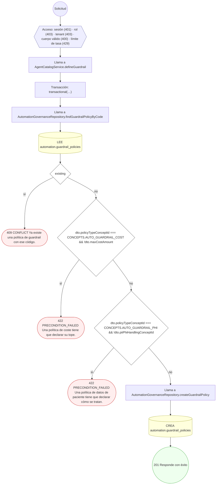

#### 11. POST /automation/runs/{workflowRunId}/agent-runs

Arrancar la ejecución de un agente dentro del run

| HTTP | Código | Cuándo |
|---|---|---|
| 201 | — | Éxito |
| 400 | `VALIDATION_FAILED` | Los parámetros de ruta son UUID válidos; El cuerpo cumple el DTO (sin propiedades extra) |
| 401 | `UNAUTHENTICATED` | Hay una sesión válida (JWT) |
| 403 | `FORBIDDEN` | El rol está permitido; El tenant se resuelve y pertenece al actor |
| 404 | `NOT_FOUND` | ResourceNotFoundException: La versión no existe para ese agente. |
| 422 | `PRECONDITION_FAILED` | PreconditionFailedException: La ejecución del workflow no está en marcha.; PreconditionFailedException: El agente no está activo.; PreconditionFailedException: Sólo se puede ejecutar una versión publicada del agente. |
| 429 | `RATE_LIMITED` | No se supera el límite de solicitudes |

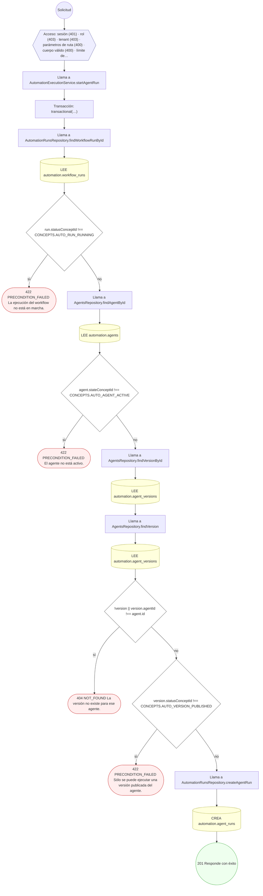

#### 12. POST /automation/runs/{workflowRunId}/finalize

Cerrar la ejecución con el resumen de coste

| HTTP | Código | Cuándo |
|---|---|---|
| 200 | — | Éxito |
| 400 | `VALIDATION_FAILED` | Los parámetros de ruta son UUID válidos; El cuerpo cumple el DTO (sin propiedades extra) |
| 401 | `UNAUTHENTICATED` | Hay una sesión válida (JWT) |
| 403 | `FORBIDDEN` | El rol está permitido; El tenant se resuelve y pertenece al actor |
| 422 | `PRECONDITION_FAILED` | PreconditionFailedException: La ejecución tiene aprobaciones pendientes y no puede cerrarse. |
| 429 | `RATE_LIMITED` | No se supera el límite de solicitudes |

```mermaid
flowchart TD
  n1(("Solicitud")):::inicio
  n2{{"Acceso: sesión (401) · rol (403) · tenant (403) · parámetros de ruta (400) · cuerpo válido (400) · límite de…"}}:::acceso
  n1 --> n2
  n3["Llama a AutomationExecutionService.finalizeWorkflowRun"]:::llamada
  n2 --> n3
  n4["Transacción: transactional(…)"]:::transaccion
  n3 --> n4
  n5["Llama a AutomationRunsRepository.findWorkflowRunForUpdate"]:::llamada
  n4 --> n5
  n6[("LEE automation.workflow_runs")]:::efecto
  n5 --> n6
  n7["Llama a AutomationRunsRepository.findAgentRunsByWorkflowRunForUpdate"]:::llamada
  n6 --> n7
  n8[("LEE automation.agent_runs")]:::efecto
  n7 --> n8
  n9["Llama a AutomationRunsRepository.findPendingApprovalsByAgentRuns"]:::llamada
  n8 --> n9
  n10[("LEE automation.automation_approvals")]:::efecto
  n9 --> n10
  n11{"pending.length › 0"}:::decision
  n10 --> n11
  n12(["422 PRECONDITION_FAILED La ejecución tiene aprobaciones pendientes y no puede cerrarse."]):::error
  n11 -->|"sí"| n12
  n13["Repite: por cada const agentRun de agentRuns"]:::bucle
  n11 -->|"no"| n13
  n14{"OPEN_AGENT_RUN_STATUSES.includes(agentRun.statusConceptId)"}:::decision
  n13 -->|"cada elemento"| n14
  n15[("ACTUALIZA automation.agent_runs · ACTUALIZA automation.agent_runs")]:::efecto
  n14 -->|"sí"| n15
  n16{"agentRun.startedAt"}:::decision
  n15 --> n16
  n17[("ACTUALIZA automation.agent_runs")]:::efecto
  n16 -->|"sí"| n17
  n18["Llama a OutboxService.publishDomainEvent"]:::llamada
  n17 --> n18
  n16 -->|"no"| n18
  n14 -->|"no"| n18
  n13 -->|"al terminar"| n18
  n19["Llama a MessagingTraceService.runInProducerSpan"]:::llamada
  n18 --> n19
  n20["Transacción: startActiveSpan(…)"]:::transaccion
  n19 --> n20
  n21["Intenta"]:::intento
  n20 --> n21
  n22(["↩ (relanza el error capturado)"]):::error
  n21 -->|"si falla"| n22
  n23["Llama a OutboxService.persistDomainEvent"]:::llamada
  n21 --> n23
  n24["Llama a OutboxRepository.findOutboxByIdempotencyKey"]:::llamada
  n23 --> n24
  n25[("LEE messaging.outbox_messages")]:::efecto
  n24 --> n25
  n26["Llama a OutboxRepository.createDomainEvent"]:::llamada
  n25 --> n26
  n27[("CREA messaging.domain_events")]:::efecto
  n26 --> n27
  n28["Llama a OutboxRepository.createOutboxMessage"]:::llamada
  n27 --> n28
  n29[("CREA messaging.outbox_messages")]:::efecto
  n28 --> n29
  n30>"Evento WorkflowRunCompleted"]:::evento
  n29 --> n30
  n31(("200 Responde con éxito")):::ok
  n30 --> n31
  classDef acceso fill:#eef,stroke:#66a
  classDef error fill:#fee,stroke:#c33
  classDef ok fill:#efe,stroke:#3a3
  classDef efecto fill:#ffd,stroke:#aa3
  classDef decision fill:#fff,stroke:#555
  classDef corte fill:#eee,stroke:#999,stroke-dasharray: 4
```

#### 13. POST /automation/tools

Registrar una herramienta de agente

| HTTP | Código | Cuándo |
|---|---|---|
| 201 | — | Éxito |
| 400 | `VALIDATION_FAILED` | El cuerpo cumple el DTO (sin propiedades extra) |
| 401 | `UNAUTHENTICATED` | Hay una sesión válida (JWT) |
| 403 | `FORBIDDEN` | El rol está permitido; El tenant se resuelve y pertenece al actor |
| 409 | `CONFLICT` | ConflictException: Ya existe una herramienta con ese código. |
| 422 | `PRECONDITION_FAILED` | PreconditionFailedException: Una herramienta de llamada HTTP necesita un endpoint de integración. |
| 429 | `RATE_LIMITED` | No se supera el límite de solicitudes |

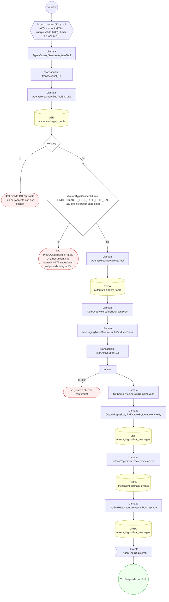

#### 14. POST /automation/triggers

Configurar un disparador de automatización

| HTTP | Código | Cuándo |
|---|---|---|
| 201 | — | Éxito |
| 400 | `VALIDATION_FAILED` | El cuerpo cumple el DTO (sin propiedades extra) |
| 401 | `UNAUTHENTICATED` | Hay una sesión válida (JWT) |
| 403 | `FORBIDDEN` | El rol está permitido; El tenant se resuelve y pertenece al actor |
| 409 | `CONFLICT` | ConflictException: Ya existe un disparador con ese código. |
| 422 | `PRECONDITION_FAILED` | PreconditionFailedException: No se puede disparar un workflow archivado.; PreconditionFailedException: Un disparador por evento tiene que declarar qué evento suscribe.; PreconditionFailedException: Un disparador por calendario tiene que declarar su cron.; PreconditionFailedException: La expresión cron tiene que tener cinco campos. |
| 429 | `RATE_LIMITED` | No se supera el límite de solicitudes |

```mermaid
flowchart TD
  n1(("Solicitud")):::inicio
  n2{{"Acceso: sesión (401) · rol (403) · tenant (403) · cuerpo válido (400) · límite de tasa (429)"}}:::acceso
  n1 --> n2
  n3["Llama a AutomationDefinitionService.configureTrigger"]:::llamada
  n2 --> n3
  n4["Transacción: transactional(…)"]:::transaccion
  n3 --> n4
  n5["Llama a AutomationGovernanceRepository.findTriggerByCode"]:::llamada
  n4 --> n5
  n6[("LEE automation.automation_triggers")]:::efecto
  n5 --> n6
  n7{"existing"}:::decision
  n6 --> n7
  n8(["409 CONFLICT Ya existe un disparador con ese código."]):::error
  n7 -->|"sí"| n8
  n9["Llama a AutomationGovernanceRepository.findWorkflowById"]:::llamada
  n7 -->|"no"| n9
  n10[("LEE automation.workflows")]:::efecto
  n9 --> n10
  n11{"workflow.stateConceptId === CONCEPTS.AUTO_WORKFLOW_ARCHIVED"}:::decision
  n10 --> n11
  n12(["422 PRECONDITION_FAILED No se puede disparar un workflow archivado."]):::error
  n11 -->|"sí"| n12
  n13{"dto.triggerTypeConceptId === CONCEPTS.AUTO_TRIGGER_TYPE_EVENT && !dto.eventType"}:::decision
  n11 -->|"no"| n13
  n14(["422 PRECONDITION_FAILED Un disparador por evento tiene que declarar qué evento suscribe."]):::error
  n13 -->|"sí"| n14
  n15{"dto.triggerTypeConceptId === CONCEPTS.AUTO_TRIGGER_TYPE_SCHEDULE"}:::decision
  n13 -->|"no"| n15
  n16{"!dto.scheduleCron"}:::decision
  n15 -->|"sí"| n16
  n17(["422 PRECONDITION_FAILED Un disparador por calendario tiene que declarar su cron."]):::error
  n16 -->|"sí"| n17
  n18["Llama a AutomationDefinitionService.assertCron"]:::llamada
  n16 -->|"no"| n18
  n19{"fields.length !== CRON_FIELD_COUNT"}:::decision
  n18 --> n19
  n20(["422 PRECONDITION_FAILED La expresión cron tiene que tener cinco campos."]):::error
  n19 -->|"sí"| n20
  n21["Llama a AutomationGovernanceRepository.createTrigger"]:::llamada
  n19 -->|"no"| n21
  n15 -->|"no"| n21
  n22[("CREA automation.automation_triggers")]:::efecto
  n21 --> n22
  n23["Llama a OutboxService.publishDomainEvent"]:::llamada
  n22 --> n23
  n24["Llama a MessagingTraceService.runInProducerSpan"]:::llamada
  n23 --> n24
  n25["Transacción: startActiveSpan(…)"]:::transaccion
  n24 --> n25
  n26["Intenta"]:::intento
  n25 --> n26
  n27(["↩ (relanza el error capturado)"]):::error
  n26 -->|"si falla"| n27
  n28["Llama a OutboxService.persistDomainEvent"]:::llamada
  n26 --> n28
  n29["Llama a OutboxRepository.findOutboxByIdempotencyKey"]:::llamada
  n28 --> n29
  n30[("LEE messaging.outbox_messages")]:::efecto
  n29 --> n30
  n31["Llama a OutboxRepository.createDomainEvent"]:::llamada
  n30 --> n31
  n32[("CREA messaging.domain_events")]:::efecto
  n31 --> n32
  n33["Llama a OutboxRepository.createOutboxMessage"]:::llamada
  n32 --> n33
  n34[("CREA messaging.outbox_messages")]:::efecto
  n33 --> n34
  n35>"Evento TriggerRegistered"]:::evento
  n34 --> n35
  n36(("201 Responde con éxito")):::ok
  n35 --> n36
  classDef acceso fill:#eef,stroke:#66a
  classDef error fill:#fee,stroke:#c33
  classDef ok fill:#efe,stroke:#3a3
  classDef efecto fill:#ffd,stroke:#aa3
  classDef decision fill:#fff,stroke:#555
  classDef corte fill:#eee,stroke:#999,stroke-dasharray: 4
```

#### 15. POST /automation/triggers/calendar/tick

Evaluar los disparadores de calendario vencidos

| HTTP | Código | Cuándo |
|---|---|---|
| 200 | — | Éxito |
| 400 | `VALIDATION_FAILED` | El cuerpo cumple el DTO (sin propiedades extra) |
| 401 | `UNAUTHENTICATED` | Hay una sesión válida (JWT) |
| 403 | `FORBIDDEN` | El rol está permitido; El tenant se resuelve y pertenece al actor |
| 429 | `RATE_LIMITED` | No se supera el límite de solicitudes |

```mermaid
flowchart TD
  n1(("Solicitud")):::inicio
  n2{{"Acceso: sesión (401) · rol (403) · tenant (403) · cuerpo válido (400) · límite de tasa (429)"}}:::acceso
  n1 --> n2
  n3["Llama a AutomationExecutionService.evaluateCalendarTriggers"]:::llamada
  n2 --> n3
  n4["Transacción: transactional(…)"]:::transaccion
  n3 --> n4
  n5["Llama a AutomationGovernanceRepository.findEnabledCalendarTriggers"]:::llamada
  n4 --> n5
  n6[("LEE automation.automation_triggers")]:::efecto
  n5 --> n6
  n7["Repite: por cada const trigger de candidates"]:::bucle
  n6 --> n7
  n8["Llama a AutomationGovernanceRepository.findWorkflowById"]:::llamada
  n7 -->|"cada elemento"| n8
  n9[("LEE automation.workflows")]:::efecto
  n8 --> n9
  n10["Llama a AutomationRunsRepository.countRunsByWorkflow"]:::llamada
  n9 --> n10
  n11[("LEE automation.workflow_runs")]:::efecto
  n10 --> n11
  n12["Llama a AutomationRunsRepository.createWorkflowRun"]:::llamada
  n11 --> n12
  n13[("CREA automation.workflow_runs")]:::efecto
  n12 --> n13
  n14["Llama a OutboxService.publishDomainEvent"]:::llamada
  n13 --> n14
  n15["Llama a MessagingTraceService.runInProducerSpan"]:::llamada
  n14 --> n15
  n16["Transacción: startActiveSpan(…)"]:::transaccion
  n15 --> n16
  n17["Intenta"]:::intento
  n16 --> n17
  n18(["↩ (relanza el error capturado)"]):::error
  n17 -->|"si falla"| n18
  n19["Llama a OutboxService.persistDomainEvent"]:::llamada
  n17 --> n19
  n20["Llama a OutboxRepository.findOutboxByIdempotencyKey"]:::llamada
  n19 --> n20
  n21[("LEE messaging.outbox_messages")]:::efecto
  n20 --> n21
  n22["Llama a OutboxRepository.createDomainEvent"]:::llamada
  n21 --> n22
  n23[("CREA messaging.domain_events")]:::efecto
  n22 --> n23
  n24["Llama a OutboxRepository.createOutboxMessage"]:::llamada
  n23 --> n24
  n25[("CREA messaging.outbox_messages")]:::efecto
  n24 --> n25
  n26>"Evento WorkflowRunStarted"]:::evento
  n25 --> n26
  n27(("200 Responde con éxito")):::ok
  n26 --> n27
  n7 -->|"al terminar"| n27
  classDef acceso fill:#eef,stroke:#66a
  classDef error fill:#fee,stroke:#c33
  classDef ok fill:#efe,stroke:#3a3
  classDef efecto fill:#ffd,stroke:#aa3
  classDef decision fill:#fff,stroke:#555
  classDef corte fill:#eee,stroke:#999,stroke-dasharray: 4
```

#### 16. POST /automation/workflows

Definir un workflow con sus pasos

| HTTP | Código | Cuándo |
|---|---|---|
| 201 | — | Éxito |
| 400 | `VALIDATION_FAILED` | El cuerpo cumple el DTO (sin propiedades extra) |
| 401 | `UNAUTHENTICATED` | Hay una sesión válida (JWT) |
| 403 | `FORBIDDEN` | El rol está permitido; El tenant se resuelve y pertenece al actor |
| 404 | `NOT_FOUND` | ResourceNotFoundException: Herramienta referenciada por un paso no encontrada. |
| 409 | `CONFLICT` | ConflictException: Ya existe un workflow de automatización con ese código.; ConflictException: Dos pasos comparten el mismo código. |
| 422 | `PRECONDITION_FAILED` | PreconditionFailedException: Un paso salta a otro que no está declarado en el workflow.; PreconditionFailedException: Un paso de llamada a agente tiene que declarar qué agente llama.; PreconditionFailedException: Un paso de llamada a herramienta tiene que declarar qué herramienta usa. |
| 429 | `RATE_LIMITED` | No se supera el límite de solicitudes |

```mermaid
flowchart TD
  n1(("Solicitud")):::inicio
  n2{{"Acceso: sesión (401) · rol (403) · tenant (403) · cuerpo válido (400) · límite de tasa (429)"}}:::acceso
  n1 --> n2
  n3["Llama a AutomationDefinitionService.defineWorkflow"]:::llamada
  n2 --> n3
  n4["Transacción: transactional(…)"]:::transaccion
  n3 --> n4
  n5["Llama a AutomationGovernanceRepository.findWorkflowByCode"]:::llamada
  n4 --> n5
  n6[("LEE automation.workflows")]:::efecto
  n5 --> n6
  n7{"existing"}:::decision
  n6 --> n7
  n8(["409 CONFLICT Ya existe un workflow de automatización con ese código."]):::error
  n7 -->|"sí"| n8
  n9["Repite: por cada const step de dto.steps"]:::bucle
  n7 -->|"no"| n9
  n10{"stepCodes.has(step.stepCode)"}:::decision
  n9 -->|"cada elemento"| n10
  n11(["409 CONFLICT Dos pasos comparten el mismo código."]):::error
  n10 -->|"sí"| n11
  n12["Repite: por cada const step de dto.steps"]:::bucle
  n10 -->|"no"| n12
  n9 -->|"al terminar"| n12
  n13["Repite: por cada const target de [step.onSuccessStepCode, step.onFailureStepCode]"]:::bucle
  n12 -->|"cada elemento"| n13
  n14{"target && !stepCodes.has(target)"}:::decision
  n13 -->|"cada elemento"| n14
  n15(["422 PRECONDITION_FAILED Un paso salta a otro que no está declarado en el workflow."]):::error
  n14 -->|"sí"| n15
  n16{"step.stepTypeConceptId === CONCEPTS.AUTO_STEP_AGENT_CALL && !step.agentId"}:::decision
  n14 -->|"no"| n16
  n13 -->|"al terminar"| n16
  n17(["422 PRECONDITION_FAILED Un paso de llamada a agente tiene que declarar qué agente llama."]):::error
  n16 -->|"sí"| n17
  n18{"step.stepTypeConceptId === CONCEPTS.AUTO_STEP_TOOL_CALL && !step.agentToolId"}:::decision
  n16 -->|"no"| n18
  n19(["422 PRECONDITION_FAILED Un paso de llamada a herramienta tiene que declarar qué herramienta usa."]):::error
  n18 -->|"sí"| n19
  n20{"step.agentId"}:::decision
  n18 -->|"no"| n20
  n21["Llama a AgentsRepository.findAgentById"]:::llamada
  n20 -->|"sí"| n21
  n22[("LEE automation.agents")]:::efecto
  n21 --> n22
  n23{"step.agentToolId"}:::decision
  n22 --> n23
  n20 -->|"no"| n23
  n24["Llama a AgentsRepository.findToolById"]:::llamada
  n23 -->|"sí"| n24
  n25[("LEE automation.agent_tools")]:::efecto
  n24 --> n25
  n26{"!tool"}:::decision
  n25 --> n26
  n27(["404 NOT_FOUND Herramienta referenciada por un paso no encontrada."]):::error
  n26 -->|"sí"| n27
  n28["Llama a AutomationGovernanceRepository.createWorkflow"]:::llamada
  n26 -->|"no"| n28
  n23 -->|"no"| n28
  n12 -->|"al terminar"| n28
  n29[("CREA automation.workflows")]:::efecto
  n28 --> n29
  n30["Repite: map(…)"]:::bucle
  n29 --> n30
  n31["Llama a AutomationGovernanceRepository.createWorkflowStep"]:::llamada
  n30 -->|"cada elemento"| n31
  n32[("CREA automation.workflow_steps")]:::efecto
  n31 --> n32
  n33["Repite: por cada const { dto: step, row } de created"]:::bucle
  n32 --> n33
  n30 -->|"al terminar"| n33
  n34{"step.onSuccessStepCode"}:::decision
  n33 -->|"cada elemento"| n34
  n35[("ACTUALIZA automation.workflow_steps")]:::efecto
  n34 -->|"sí"| n35
  n36{"step.onFailureStepCode"}:::decision
  n35 --> n36
  n34 -->|"no"| n36
  n37[("ACTUALIZA automation.workflow_steps")]:::efecto
  n36 -->|"sí"| n37
  n38["Llama a OutboxService.publishDomainEvent"]:::llamada
  n37 --> n38
  n36 -->|"no"| n38
  n33 -->|"al terminar"| n38
  n39["Llama a MessagingTraceService.runInProducerSpan"]:::llamada
  n38 --> n39
  n40["Transacción: startActiveSpan(…)"]:::transaccion
  n39 --> n40
  n41["Intenta"]:::intento
  n40 --> n41
  n42(["↩ (relanza el error capturado)"]):::error
  n41 -->|"si falla"| n42
  n43["Llama a OutboxService.persistDomainEvent"]:::llamada
  n41 --> n43
  n44["Llama a OutboxRepository.findOutboxByIdempotencyKey"]:::llamada
  n43 --> n44
  n45[("LEE messaging.outbox_messages")]:::efecto
  n44 --> n45
  n46["Llama a OutboxRepository.createDomainEvent"]:::llamada
  n45 --> n46
  n47[("CREA messaging.domain_events")]:::efecto
  n46 --> n47
  n48["Llama a OutboxRepository.createOutboxMessage"]:::llamada
  n47 --> n48
  n49[("CREA messaging.outbox_messages")]:::efecto
  n48 --> n49
  n50>"Evento WorkflowDefined"]:::evento
  n49 --> n50
  n51(("201 Responde con éxito")):::ok
  n50 --> n51
  classDef acceso fill:#eef,stroke:#66a
  classDef error fill:#fee,stroke:#c33
  classDef ok fill:#efe,stroke:#3a3
  classDef efecto fill:#ffd,stroke:#aa3
  classDef decision fill:#fff,stroke:#555
  classDef corte fill:#eee,stroke:#999,stroke-dasharray: 4
```

#### 17. POST /automation/workflows/{id}/runs

Arrancar la ejecución de un workflow

| HTTP | Código | Cuándo |
|---|---|---|
| 201 | — | Éxito |
| 400 | `VALIDATION_FAILED` | Los parámetros de ruta son UUID válidos; El cuerpo cumple el DTO (sin propiedades extra) |
| 401 | `UNAUTHENTICATED` | Hay una sesión válida (JWT) |
| 403 | `FORBIDDEN` | El rol está permitido; El tenant se resuelve y pertenece al actor |
| 422 | `PRECONDITION_FAILED` | PreconditionFailedException: El workflow está archivado.; PreconditionFailedException: El disparador está deshabilitado.; PreconditionFailedException: El disparador no pertenece a ese workflow. |
| 429 | `RATE_LIMITED` | No se supera el límite de solicitudes |

```mermaid
flowchart TD
  n1(("Solicitud")):::inicio
  n2{{"Acceso: sesión (401) · rol (403) · tenant (403) · parámetros de ruta (400) · cuerpo válido (400) · límite de…"}}:::acceso
  n1 --> n2
  n3["Llama a AutomationExecutionService.startWorkflowRun"]:::llamada
  n2 --> n3
  n4["Transacción: transactional(…)"]:::transaccion
  n3 --> n4
  n5["Llama a AutomationGovernanceRepository.findWorkflowById"]:::llamada
  n4 --> n5
  n6[("LEE automation.workflows")]:::efecto
  n5 --> n6
  n7{"workflow.stateConceptId === CONCEPTS.AUTO_WORKFLOW_ARCHIVED"}:::decision
  n6 --> n7
  n8(["422 PRECONDITION_FAILED El workflow está archivado."]):::error
  n7 -->|"sí"| n8
  n9{"dto.triggerId"}:::decision
  n7 -->|"no"| n9
  n10["Llama a AutomationGovernanceRepository.findTriggerById"]:::llamada
  n9 -->|"sí"| n10
  n11[("LEE automation.automation_triggers")]:::efecto
  n10 --> n11
  n12{"trigger.isEnabled !== true"}:::decision
  n11 --> n12
  n13(["422 PRECONDITION_FAILED El disparador está deshabilitado."]):::error
  n12 -->|"sí"| n13
  n14{"trigger.workflowId !== workflowId"}:::decision
  n12 -->|"no"| n14
  n15(["422 PRECONDITION_FAILED El disparador no pertenece a ese workflow."]):::error
  n14 -->|"sí"| n15
  n16{"dto.contextRefId"}:::decision
  n14 -->|"no"| n16
  n9 -->|"no"| n16
  n17["Llama a AutomationRunsRepository.findLiveRunByContext"]:::llamada
  n16 -->|"sí"| n17
  n18[("LEE automation.workflow_runs")]:::efecto
  n17 --> n18
  n19["Llama a AutomationRunsRepository.countRunsByWorkflow"]:::llamada
  n18 --> n19
  n16 -->|"no"| n19
  n20[("LEE automation.workflow_runs")]:::efecto
  n19 --> n20
  n21["Llama a AutomationRunsRepository.createWorkflowRun"]:::llamada
  n20 --> n21
  n22[("CREA automation.workflow_runs")]:::efecto
  n21 --> n22
  n23["Llama a OutboxService.publishDomainEvent"]:::llamada
  n22 --> n23
  n24["Llama a MessagingTraceService.runInProducerSpan"]:::llamada
  n23 --> n24
  n25["Transacción: startActiveSpan(…)"]:::transaccion
  n24 --> n25
  n26["Intenta"]:::intento
  n25 --> n26
  n27(["↩ (relanza el error capturado)"]):::error
  n26 -->|"si falla"| n27
  n28["Llama a OutboxService.persistDomainEvent"]:::llamada
  n26 --> n28
  n29["Llama a OutboxRepository.findOutboxByIdempotencyKey"]:::llamada
  n28 --> n29
  n30[("LEE messaging.outbox_messages")]:::efecto
  n29 --> n30
  n31["Llama a OutboxRepository.createDomainEvent"]:::llamada
  n30 --> n31
  n32[("CREA messaging.domain_events")]:::efecto
  n31 --> n32
  n33["Llama a OutboxRepository.createOutboxMessage"]:::llamada
  n32 --> n33
  n34[("CREA messaging.outbox_messages")]:::efecto
  n33 --> n34
  n35>"Evento WorkflowRunStarted"]:::evento
  n34 --> n35
  n36(("201 Responde con éxito")):::ok
  n35 --> n36
  classDef acceso fill:#eef,stroke:#66a
  classDef error fill:#fee,stroke:#c33
  classDef ok fill:#efe,stroke:#3a3
  classDef efecto fill:#ffd,stroke:#aa3
  classDef decision fill:#fff,stroke:#555
  classDef corte fill:#eee,stroke:#999,stroke-dasharray: 4
```

