<!-- AUTOGENERADO por tools/inventario/flujos.mjs. No editar manualmente. -->

# Flujos del módulo `billing`

- **Procesos:** 1 · **Máquinas de estado:** 0
- **Operaciones:** 53 (49 con decisiones propias, 4 sin ellas)
- Inventario de endpoints del módulo: [billing](../endpoints/billing.md)

## Proceso: Módulo Billing (17)

- **Código:** `billing` · **Agrupación:** MIXTO · **Operaciones:** 53
- **Actores:** CLINICIAN · Cualquier sesión válida · PATIENT · PRACTITIONER · SECURITY_ADMIN · SYSTEM · SYSTEM_WORKER
- **Revisión:** AUTO_DETECTADA
- **Fuentes:** `src/modules/billing/README.md`

### Para qué sirve

Facturación al paciente (CxC), cuentas por pagar (CxP), contabilización a ledger, conciliación bancaria, morosidad, planes de pago y KPIs financieros. Expone los 12 casos de uso UC-17-01..12, tres lecturas de soporte y rutas de catálogo.

_Fuente: `src/modules/billing/README.md:3`_

### Etapas y operaciones

| Etapa | Descripción | Operación | Quién actúa | Riesgo | Tablas |
|---|---|---|---|---|---|
| `UC-17-01` | InvoicesService.issueFromEncounter | POST /billing/invoices:issue-from-encounter | SECURITY_ADMIN | MEDIO | 9 |
| `UC-17-02` | PaymentsReceivedService.apply | POST /billing/payments-received:apply | SECURITY_ADMIN | MEDIO | 6 |
| `UC-17-03` | InvoicesService.creditNote | POST /billing/invoices/{id}:credit-note | SECURITY_ADMIN | MEDIO | 4 |
| `UC-17-04` | BillsService.register | POST /billing/bills | SECURITY_ADMIN | MEDIO | 7 |
| `UC-17-05` | PaymentsMadeService.execute | POST /billing/payments-made:execute | SECURITY_ADMIN | MEDIO | 4 |
| `UC-17-06` | LedgerService.postToLedger | POST /billing/documents/{id}:post-to-ledger | SECURITY_ADMIN | BAJO | 4 |
| `UC-17-07` | ReconciliationService.clear | POST /billing/reconciliation:clear | SECURITY_ADMIN | BAJO | 2 |
| `UC-17-08` | ReimbursementsService.link | POST /billing/reimbursements:link | SECURITY_ADMIN | MEDIO | 4 |
| `UC-17-09` | PatientStatementsService.generate | POST /billing/patient-statements:generate | SECURITY_ADMIN | MEDIO | 4 |
| `UC-17-10` | DunningService.execute | POST /billing/dunning-runs:execute | SECURITY_ADMIN | MEDIO | 5 |
| `UC-17-11` | InvoicesService.createPaymentPlan | POST /billing/payment-plans | SECURITY_ADMIN | MEDIO | 3 |
| `UC-17-12` | KpiSnapshotsService.compute | POST /billing/kpi-snapshots:compute | SECURITY_ADMIN | MEDIO | 2 |
| `ctrl:AdminServiceCatalogController` | Operaciones de AdminServiceCatalogController que el README no asigna a un caso de uso | GET /admin/catalogs/services | SECURITY_ADMIN | BAJO | 2 |
|  |  | POST /admin/catalogs/services | SECURITY_ADMIN | MEDIO | 3 |
|  |  | GET /admin/catalogs/services/{id} | SECURITY_ADMIN | BAJO | 2 |
|  |  | PATCH /admin/catalogs/services/{id} | SECURITY_ADMIN | BAJO | 2 |
|  |  | POST /admin/catalogs/services/{id}/deactivate | SECURITY_ADMIN | BAJO | 2 |
|  |  | POST /admin/catalogs/services/{id}/reactivate | SECURITY_ADMIN | BAJO | 2 |
|  |  | GET /admin/catalogs/services/scopes | SECURITY_ADMIN | BAJO | 2 |
| `ctrl:BillingOperationsController` | Operaciones de BillingOperationsController que el README no asigna a un caso de uso | POST /billing/internal/dunning-runs/run-due | SYSTEM · SECURITY_ADMIN | MEDIO | 7 |
| `ctrl:BillingReceivablesController` | Operaciones de BillingReceivablesController que el README no asigna a un caso de uso | GET /billing/invoices | SECURITY_ADMIN | BAJO | 2 |
|  |  | GET /billing/invoices/{id} | SECURITY_ADMIN | BAJO | 3 |
|  |  | GET /billing/patient-statements | SECURITY_ADMIN | BAJO | 2 |
| `ctrl:BillingServiceCatalogController` | Operaciones de BillingServiceCatalogController que el README no asigna a un caso de uso | GET /billing/service-catalog | Cualquier sesión válida | BAJO | 1 |
|  |  | POST /billing/service-catalog | SECURITY_ADMIN · PRACTITIONER · CLINICIAN | MEDIO | 5 |
|  |  | PATCH /billing/service-catalog/{id} | PRACTITIONER · CLINICIAN · SECURITY_ADMIN | MEDIO | 4 |
|  |  | GET /billing/service-catalog/{id}/image | Cualquier sesión válida | BAJO | 4 |
|  |  | POST /billing/service-catalog/import-procedures | SECURITY_ADMIN · PRACTITIONER · CLINICIAN | MEDIO | 5 |
|  |  | GET /billing/service-catalog/procedure-specialties | Cualquier sesión válida | BAJO | 1 |
|  |  | GET /billing/service-catalog/procedure-specialties/mine | Cualquier sesión válida | BAJO | 3 |
|  |  | GET /billing/service-catalog/procedures | Cualquier sesión válida | BAJO | 2 |
| `ctrl:BillingSimulatedController` | Operaciones de BillingSimulatedController que el README no asigna a un caso de uso | GET /billing/simulated/catalogs | Cualquier sesión válida | BAJO | 0 |
|  |  | GET /billing/simulated/charges | Cualquier sesión válida | BAJO | 11 |
|  |  | POST /billing/simulated/charges/{chargeId}/instances/{instanceId}/payments | Cualquier sesión válida | BAJO | 11 |
|  |  | POST /billing/simulated/charges/{chargeId}/invoices | Cualquier sesión válida | ALTO | 12 |
|  |  | POST /billing/simulated/charges/{chargeId}/payment | Cualquier sesión válida | ALTO | 22 |
|  |  | GET /billing/simulated/invoices/{invoiceId} | Cualquier sesión válida | BAJO | 11 |
|  |  | POST /billing/simulated/invoices/{invoiceId}/annulment | Cualquier sesión válida | ALTO | 12 |
|  |  | POST /billing/simulated/invoices/{invoiceId}/annulment-reversal | Cualquier sesión válida | ALTO | 12 |
|  |  | POST /billing/simulated/invoices/{invoiceId}/email | Cualquier sesión válida | ALTO | 13 |
|  |  | GET /billing/simulated/my-invoices | Cualquier sesión válida | BAJO | 4 |
|  |  | GET /billing/simulated/my-invoices/{invoiceId} | Cualquier sesión válida | BAJO | 4 |
|  |  | GET /billing/simulated/outbox | Cualquier sesión válida | BAJO | 3 |
|  |  | GET /billing/simulated/status | Cualquier sesión válida | BAJO | 2 |
| `ctrl:BillingSpaceChargesController` | Operaciones de BillingSpaceChargesController que el README no asigna a un caso de uso | GET /billing/bed-day/stays | Cualquier sesión válida | BAJO | 12 |
|  |  | POST /billing/charge-captures/{id}/void | Cualquier sesión válida | ALTO | 13 |
|  |  | POST /billing/encounters/{encounterId}/bed-day-charges/run | Cualquier sesión válida | ALTO | 17 |
|  |  | GET /billing/encounters/{encounterId}/pending-charges | Cualquier sesión válida | BAJO | 11 |
|  |  | GET /billing/space-tariffs | Cualquier sesión válida | BAJO | 9 |
|  |  | POST /billing/space-tariffs | Cualquier sesión válida | ALTO | 13 |
|  |  | POST /billing/space-tariffs/{id}/close | Cualquier sesión válida | ALTO | 13 |
|  |  | POST /internal/billing/bed-day-charges/run | SYSTEM · SYSTEM_WORKER | MEDIO | 19 |
| `ctrl:PatientSpendingController` | Operaciones de PatientSpendingController que el README no asigna a un caso de uso | GET /patient-spending/me | PATIENT | BAJO | 11 |

### Diagrama 1 de 3 — etapas `UC-17-01`, `UC-17-02`, `UC-17-03`…

```mermaid
flowchart LR
  a2(["SECURITY_ADMIN"]):::actor
  a48(["SYSTEM · SECURITY_ADMIN"]):::actor
  t3[("billing.billing_document_links")]:::tabla
  t4[("billing.charge_captures")]:::tabla
  t5[("billing.invoice_lines")]:::tabla
  t6[("billing.invoices")]:::tabla
  t7[("clinical.encounters")]:::tabla
  e9>"billing.charge_capture.invoiced"]:::evento
  t11[("billing.payments_received")]:::tabla
  t12[("billing.receivable_payment_allocations")]:::tabla
  t13[("insurance.claim_disputes")]:::tabla
  t14[("insurance.insurance_claim_lines")]:::tabla
  t17[("billing.bill_lines")]:::tabla
  t18[("billing.bills")]:::tabla
  t19[("billing.vendors")]:::tabla
  t20[("erp.contracts")]:::tabla
  t23[("billing.payable_payment_allocations")]:::tabla
  t24[("billing.payments_made")]:::tabla
  t28[("billing.reimbursements")]:::tabla
  t30[("billing.patient_statements")]:::tabla
  t32[("billing.dunning_items")]:::tabla
  t33[("billing.dunning_runs")]:::tabla
  t36[("billing.financial_kpi_snapshots")]:::tabla
  t38[("billing.service_catalog")]:::tabla
  t39[("practice.practices")]:::tabla
  t46[("terminology.catalog_concepts")]:::tabla
  t8[("+3 tablas más")]
  subgraph s0["UC-17-01 · InvoicesService.issueFromEncounter"]
    o1["POST /billing/invoices:issue-from-encounter"]:::op
  end
  subgraph s1["UC-17-02 · PaymentsReceivedService.apply"]
    o10["POST /billing/payments-received:apply"]:::op
  end
  subgraph s2["UC-17-03 · InvoicesService.creditNote"]
    o15["POST /billing/invoices/{id}:credit-note"]:::op
  end
  t21[("+1 tablas más")]
  subgraph s3["UC-17-04 · BillsService.register"]
    o16["POST /billing/bills"]:::op
  end
  subgraph s4["UC-17-05 · PaymentsMadeService.execute"]
    o22["POST /billing/payments-made:execute"]:::op
  end
  subgraph s5["UC-17-06 · LedgerService.postToLedger"]
    o25["POST /billing/documents/{id}:post-to-ledger"]:::op
  end
  subgraph s6["UC-17-07 · ReconciliationService.clear"]
    o26["POST /billing/reconciliation:clear"]:::op
  end
  subgraph s7["UC-17-08 · ReimbursementsService.link"]
    o27["POST /billing/reimbursements:link"]:::op
  end
  subgraph s8["UC-17-09 · PatientStatementsService.generate"]
    o29["POST /billing/patient-statements:generate"]:::op
  end
  subgraph s9["UC-17-10 · DunningService.execute"]
    o31["POST /billing/dunning-runs:execute"]:::op
  end
  subgraph s10["UC-17-11 · InvoicesService.createPaymentPlan"]
    o34["POST /billing/payment-plans"]:::op
  end
  subgraph s11["UC-17-12 · KpiSnapshotsService.compute"]
    o35["POST /billing/kpi-snapshots:compute"]:::op
  end
  subgraph s12["ctrl:AdminServiceCatalogController · Operaciones de AdminServiceCatalogControll…"]
    o37["GET /admin/catalogs/services"]:::op
    o40["POST /admin/catalogs/services"]:::op
    o41["GET /admin/catalogs/services/{id}"]:::op
    o42["PATCH /admin/catalogs/services/{id}"]:::op
    o43["POST /admin/catalogs/services/{id}/deactivate"]:::op
    o44["POST /admin/catalogs/services/{id}/reactivate"]:::op
    o45["GET /admin/catalogs/services/scopes"]:::op
  end
  t49[("+1 tablas más")]
  subgraph s13["ctrl:BillingOperationsController · Operaciones de BillingOperationsController q…"]
    o47["POST /billing/internal/dunning-runs/run-due"]:::op
  end
  a2 --> o1
  o1 -->|"CREA"| t3
  o1 -->|"LEE"| t4
  o1 -->|"CREA"| t5
  o1 -->|"CREA"| t6
  o1 -->|"LEE"| t6
  o1 -->|"LEE"| t7
  o1 -.-> t8
  o1 -->|"evento"| e9
  a2 --> o10
  o10 -->|"LEE"| t5
  o10 -->|"LEE"| t6
  o10 -->|"CREA"| t11
  o10 -->|"CREA"| t12
  o10 -->|"LEE"| t13
  o10 -->|"LEE"| t14
  a2 --> o15
  o15 -->|"CREA"| t3
  o15 -->|"CREA"| t5
  o15 -->|"CREA"| t6
  o15 -->|"LEE"| t6
  a2 --> o16
  o16 -->|"CREA"| t17
  o16 -->|"CREA"| t3
  o16 -->|"CREA"| t18
  o16 -->|"LEE"| t18
  o16 -->|"LEE"| t19
  o16 -->|"LEE"| t20
  o16 -.-> t21
  a2 --> o22
  o22 -->|"LEE"| t18
  o22 -->|"CREA"| t23
  o22 -->|"CREA"| t24
  o22 -->|"LEE"| t19
  a2 --> o25
  o25 -->|"LEE"| t18
  o25 -->|"LEE"| t6
  o25 -->|"LEE"| t24
  o25 -->|"LEE"| t11
  a2 --> o26
  o26 -->|"LEE"| t24
  o26 -->|"LEE"| t11
  a2 --> o27
  o27 -->|"CREA"| t3
  o27 -->|"LEE"| t6
  o27 -->|"CREA"| t28
  o27 -->|"LEE"| t28
  a2 --> o29
  o29 -->|"CREA"| t3
  o29 -->|"LEE"| t6
  o29 -->|"CREA"| t30
  o29 -->|"LEE"| t30
  a2 --> o31
  o31 -->|"CREA"| t32
  o31 -->|"ACTUALIZA"| t33
  o31 -->|"CREA"| t33
  o31 -->|"LEE"| t33
  o31 -->|"LEE"| t6
  a2 --> o34
  o34 -->|"CREA"| t3
  o34 -->|"CREA"| t6
  o34 -->|"LEE"| t6
  a2 --> o35
  o35 -->|"CREA"| t36
  o35 -->|"LEE"| t36
  a2 --> o37
  o37 -->|"LEE"| t38
  o37 -->|"LEE"| t39
  a2 --> o40
  o40 -->|"CREA"| t38
  o40 -->|"LEE"| t38
  o40 -->|"LEE"| t39
  a2 --> o41
  o41 -->|"LEE"| t38
  o41 -->|"LEE"| t39
  a2 --> o42
  o42 -->|"LEE"| t38
  o42 -->|"LEE"| t39
  a2 --> o43
  o43 -->|"LEE"| t38
  o43 -->|"LEE"| t39
  a2 --> o44
  o44 -->|"LEE"| t38
  o44 -->|"LEE"| t39
  a2 --> o45
  o45 -->|"LEE"| t39
  o45 -->|"LEE"| t46
  a48 --> o47
  o47 -->|"CREA"| t32
  o47 -->|"ACTUALIZA"| t33
  o47 -->|"CREA"| t33
  o47 -->|"LEE"| t33
  o47 -->|"ACTUALIZA"| t6
  o47 -->|"LEE"| t6
  o47 -.-> t49
  classDef op fill:#fff,stroke:#446
  classDef actor fill:#eef,stroke:#66a
  classDef tabla fill:#ffd,stroke:#aa3
  classDef evento fill:#efe,stroke:#3a3
```

### Diagrama 2 de 3 — etapas `ctrl:BillingReceivablesController`, `ctrl:BillingServiceCatalogController`, `ctrl:BillingSimulatedController`

```mermaid
flowchart LR
  a2(["SECURITY_ADMIN"]):::actor
  a10(["Cualquier sesión válida"]):::actor
  a13(["SECURITY_ADMIN · PRACTITIONER · CLINICIAN"]):::actor
  a17(["PRACTITIONER · CLINICIAN · SECURITY_ADMIN"]):::actor
  t3[("billing.invoices")]:::tabla
  t4[("practice.practices")]:::tabla
  t6[("billing.invoice_lines")]:::tabla
  t8[("billing.patient_statements")]:::tabla
  t11[("billing.service_catalog")]:::tabla
  t14[("common.file_versions")]:::tabla
  t15[("common.files")]:::tabla
  t18[("practice.practitioner_role_assignments")]:::tabla
  t21[("terminology.catalog_concepts")]:::tabla
  t22[("terminology.concept_properties")]:::tabla
  t25[("profiles.practitioner_specialties")]:::tabla
  t29[("billing.payments_received")]:::tabla
  t30[("billing.receivable_payment_allocations")]:::tabla
  t31[("billing.siat_simulated_invoices")]:::tabla
  t38[("billing.billing_document_links")]:::tabla
  t39[("billing.charge_captures")]:::tabla
  e41>"billing.charge_capture.invoiced"]:::evento
  t51[("clinical.encounters")]:::tabla
  t52[("profiles.persons")]:::tabla
  t55[("billing.siat_simulated_outbox")]:::tabla
  subgraph s0["ctrl:BillingReceivablesController · Operaciones de BillingReceivablesController…"]
    o1["GET /billing/invoices"]:::op
    o5["GET /billing/invoices/{id}"]:::op
    o7["GET /billing/patient-statements"]:::op
  end
  subgraph s1["ctrl:BillingServiceCatalogController · Operaciones de BillingServiceCatalogCont…"]
    o9["GET /billing/service-catalog"]:::op
    o12["POST /billing/service-catalog"]:::op
    o16["PATCH /billing/service-catalog/{id}"]:::op
    o19["GET /billing/service-catalog/{id}/image"]:::op
    o20["POST /billing/service-catalog/import-procedures"]:::op
    o23["GET /billing/service-catalog/procedure-specialties"]:::op
    o24["GET /billing/service-catalog/procedure-specialties/mine"]:::op
    o26["GET /billing/service-catalog/procedures"]:::op
  end
  t32[("+5 tablas más")]
  t34[("+5 tablas más")]
  t36[("+6 tablas más")]
  t40[("+16 tablas más")]
  t43[("+5 tablas más")]
  t45[("+6 tablas más")]
  t47[("+6 tablas más")]
  t49[("+7 tablas más")]
  subgraph s2["ctrl:BillingSimulatedController · Operaciones de BillingSimulatedController que…"]
    o27["GET /billing/simulated/catalogs"]:::op
    o28["GET /billing/simulated/charges"]:::op
    o33["POST /billing/simulated/charges/{chargeId}/instances/{instanceId}/pay…"]:::op
    o35["POST /billing/simulated/charges/{chargeId}/invoices"]:::op
    o37["POST /billing/simulated/charges/{chargeId}/payment"]:::op
    o42["GET /billing/simulated/invoices/{invoiceId}"]:::op
    o44["POST /billing/simulated/invoices/{invoiceId}/annulment"]:::op
    o46["POST /billing/simulated/invoices/{invoiceId}/annulment-reversal"]:::op
    o48["POST /billing/simulated/invoices/{invoiceId}/email"]:::op
    o50["GET /billing/simulated/my-invoices"]:::op
    o53["GET /billing/simulated/my-invoices/{invoiceId}"]:::op
    o54["GET /billing/simulated/outbox"]:::op
    o56["GET /billing/simulated/status"]:::op
  end
  a2 --> o1
  o1 -->|"LEE"| t3
  o1 -->|"LEE"| t4
  a2 --> o5
  o5 -->|"LEE"| t6
  o5 -->|"LEE"| t3
  o5 -->|"LEE"| t4
  a2 --> o7
  o7 -->|"LEE"| t8
  o7 -->|"LEE"| t4
  a10 --> o9
  o9 -->|"LEE"| t11
  a13 --> o12
  o12 -->|"CREA"| t11
  o12 -->|"LEE"| t11
  o12 -->|"LEE"| t14
  o12 -->|"LEE"| t15
  o12 -->|"LEE"| t4
  a17 --> o16
  o16 -->|"ACTUALIZA"| t11
  o16 -->|"LEE"| t11
  o16 -->|"LEE"| t4
  o16 -->|"LEE"| t18
  a10 --> o19
  o19 -->|"LEE"| t11
  o19 -->|"LEE"| t14
  o19 -->|"LEE"| t15
  o19 -->|"LEE"| t4
  a13 --> o20
  o20 -->|"CREA"| t11
  o20 -->|"LEE"| t11
  o20 -->|"LEE"| t4
  o20 -->|"LEE"| t21
  o20 -->|"LEE"| t22
  a10 --> o23
  o23 -->|"LEE"| t22
  a10 --> o24
  o24 -->|"LEE"| t25
  o24 -->|"LEE"| t21
  o24 -->|"LEE"| t22
  a10 --> o26
  o26 -->|"LEE"| t21
  o26 -->|"LEE"| t22
  a10 --> o27
  a10 --> o28
  o28 -->|"LEE"| t6
  o28 -->|"LEE"| t3
  o28 -->|"LEE"| t29
  o28 -->|"LEE"| t30
  o28 -->|"LEE"| t11
  o28 -->|"LEE"| t31
  o28 -.-> t32
  a10 --> o33
  o33 -->|"LEE"| t6
  o33 -->|"LEE"| t3
  o33 -->|"LEE"| t29
  o33 -->|"LEE"| t30
  o33 -->|"LEE"| t11
  o33 -->|"LEE"| t31
  o33 -.-> t34
  a10 --> o35
  o35 -->|"LEE"| t6
  o35 -->|"LEE"| t3
  o35 -->|"LEE"| t29
  o35 -->|"LEE"| t30
  o35 -->|"LEE"| t11
  o35 -->|"CREA"| t31
  o35 -.-> t36
  a10 --> o37
  o37 -->|"CREA"| t38
  o37 -->|"LEE"| t39
  o37 -->|"CREA"| t6
  o37 -->|"LEE"| t6
  o37 -->|"CREA"| t3
  o37 -->|"LEE"| t3
  o37 -.-> t40
  o37 -->|"evento"| e41
  a10 --> o42
  o42 -->|"LEE"| t6
  o42 -->|"LEE"| t3
  o42 -->|"LEE"| t29
  o42 -->|"LEE"| t30
  o42 -->|"LEE"| t11
  o42 -->|"LEE"| t31
  o42 -.-> t43
  a10 --> o44
  o44 -->|"LEE"| t6
  o44 -->|"LEE"| t3
  o44 -->|"LEE"| t29
  o44 -->|"LEE"| t30
  o44 -->|"LEE"| t11
  o44 -->|"ACTUALIZA"| t31
  o44 -.-> t45
  a10 --> o46
  o46 -->|"LEE"| t6
  o46 -->|"LEE"| t3
  o46 -->|"LEE"| t29
  o46 -->|"LEE"| t30
  o46 -->|"LEE"| t11
  o46 -->|"ACTUALIZA"| t31
  o46 -.-> t47
  a10 --> o48
  o48 -->|"LEE"| t6
  o48 -->|"LEE"| t3
  o48 -->|"LEE"| t29
  o48 -->|"LEE"| t30
  o48 -->|"LEE"| t11
  o48 -->|"ACTUALIZA"| t31
  o48 -.-> t49
  a10 --> o50
  o50 -->|"LEE"| t31
  o50 -->|"LEE"| t51
  o50 -->|"LEE"| t4
  o50 -->|"LEE"| t52
  a10 --> o53
  o53 -->|"LEE"| t31
  o53 -->|"LEE"| t51
  o53 -->|"LEE"| t4
  o53 -->|"LEE"| t52
  a10 --> o54
  o54 -->|"LEE"| t31
  o54 -->|"LEE"| t55
  o54 -->|"LEE"| t51
  a10 --> o56
  o56 -->|"LEE"| t51
  o56 -->|"LEE"| t4
  classDef op fill:#fff,stroke:#446
  classDef actor fill:#eef,stroke:#66a
  classDef tabla fill:#ffd,stroke:#aa3
  classDef evento fill:#efe,stroke:#3a3
```

### Diagrama 3 de 3 — etapas `ctrl:BillingSpaceChargesController`, `ctrl:PatientSpendingController`

```mermaid
flowchart LR
  a2(["Cualquier sesión válida"]):::actor
  a29(["SYSTEM · SYSTEM_WORKER"]):::actor
  a32(["PATIENT"]):::actor
  t3[("billing.charge_captures")]:::tabla
  t4[("clinical.encounter_locations")]:::tabla
  t5[("clinical.encounters")]:::tabla
  t6[("delegated_access.organization_user_assignments")]:::tabla
  t7[("directory.branch_memberships")]:::tabla
  t8[("directory.tenant_memberships")]:::tabla
  t11[("messaging.domain_events")]:::tabla
  e13>"~eventType"]:::evento
  t15[("accounting.cost_centers")]:::tabla
  t16[("billing.space_tariffs")]:::tabla
  t21[("billing.service_catalog")]:::tabla
  t22[("practice.care_spaces")]:::tabla
  t33[("billing.invoice_lines")]:::tabla
  t34[("billing.invoices")]:::tabla
  t35[("diagnostic_units.diagnostic_study_offerings")]:::tabla
  t36[("directory.tenants")]:::tabla
  t37[("insurance.insurance_claim_lines")]:::tabla
  t38[("insurance.insurance_claims")]:::tabla
  t9[("+6 tablas más")]
  t12[("+7 tablas más")]
  t17[("+11 tablas más")]
  t19[("+5 tablas más")]
  t23[("+3 tablas más")]
  t25[("+7 tablas más")]
  t27[("+7 tablas más")]
  t30[("+13 tablas más")]
  subgraph s0["ctrl:BillingSpaceChargesController · Operaciones de BillingSpaceChargesControll…"]
    o1["GET /billing/bed-day/stays"]:::op
    o10["POST /billing/charge-captures/{id}/void"]:::op
    o14["POST /billing/encounters/{encounterId}/bed-day-charges/run"]:::op
    o18["GET /billing/encounters/{encounterId}/pending-charges"]:::op
    o20["GET /billing/space-tariffs"]:::op
    o24["POST /billing/space-tariffs"]:::op
    o26["POST /billing/space-tariffs/{id}/close"]:::op
    o28["POST /internal/billing/bed-day-charges/run"]:::op
  end
  t39[("+5 tablas más")]
  subgraph s1["ctrl:PatientSpendingController · Operaciones de PatientSpendingController que e…"]
    o31["GET /patient-spending/me"]:::op
  end
  a2 --> o1
  o1 -->|"LEE"| t3
  o1 -->|"LEE"| t4
  o1 -->|"LEE"| t5
  o1 -->|"LEE"| t6
  o1 -->|"LEE"| t7
  o1 -->|"LEE"| t8
  o1 -.-> t9
  a2 --> o10
  o10 -->|"ACTUALIZA"| t3
  o10 -->|"LEE"| t3
  o10 -->|"LEE"| t6
  o10 -->|"LEE"| t7
  o10 -->|"LEE"| t8
  o10 -->|"CREA"| t11
  o10 -.-> t12
  o10 -->|"evento"| e13
  a2 --> o14
  o14 -->|"LEE"| t15
  o14 -->|"CREA"| t3
  o14 -->|"LEE"| t3
  o14 -->|"LEE"| t16
  o14 -->|"LEE"| t4
  o14 -->|"LEE"| t5
  o14 -.-> t17
  o14 -->|"evento"| e13
  a2 --> o18
  o18 -->|"LEE"| t3
  o18 -->|"LEE"| t4
  o18 -->|"LEE"| t5
  o18 -->|"LEE"| t6
  o18 -->|"LEE"| t7
  o18 -->|"LEE"| t8
  o18 -.-> t19
  a2 --> o20
  o20 -->|"LEE"| t21
  o20 -->|"LEE"| t16
  o20 -->|"LEE"| t6
  o20 -->|"LEE"| t7
  o20 -->|"LEE"| t8
  o20 -->|"LEE"| t22
  o20 -.-> t23
  a2 --> o24
  o24 -->|"LEE"| t21
  o24 -->|"CREA"| t16
  o24 -->|"LEE"| t6
  o24 -->|"LEE"| t7
  o24 -->|"LEE"| t8
  o24 -->|"CREA"| t11
  o24 -.-> t25
  o24 -->|"evento"| e13
  a2 --> o26
  o26 -->|"LEE"| t21
  o26 -->|"ACTUALIZA"| t16
  o26 -->|"LEE"| t16
  o26 -->|"LEE"| t6
  o26 -->|"LEE"| t7
  o26 -->|"LEE"| t8
  o26 -.-> t27
  o26 -->|"evento"| e13
  a29 --> o28
  o28 -->|"LEE"| t15
  o28 -->|"CREA"| t3
  o28 -->|"LEE"| t3
  o28 -->|"LEE"| t16
  o28 -->|"LEE"| t4
  o28 -->|"LEE"| t5
  o28 -.-> t30
  o28 -->|"evento"| e13
  a32 --> o31
  o31 -->|"LEE"| t33
  o31 -->|"LEE"| t34
  o31 -->|"LEE"| t35
  o31 -->|"LEE"| t36
  o31 -->|"LEE"| t37
  o31 -->|"LEE"| t38
  o31 -.-> t39
  classDef op fill:#fff,stroke:#446
  classDef actor fill:#eef,stroke:#66a
  classDef tabla fill:#ffd,stroke:#aa3
  classDef evento fill:#efe,stroke:#3a3
```

## Árbol de decisión por operación

Cada árbol se deriva del código del handler y de los métodos que invoca (hasta 4 niveles). Una rama que no decide, no escribe y no falla se poda. Los accesos y los efectos consecutivos se agrupan en un solo nodo.

### Operaciones con decisiones propias

#### 1. GET /admin/catalogs/services

Listar servicios de la organización, filtrable por tipo

| HTTP | Código | Cuándo |
|---|---|---|
| 200 | — | Éxito |
| 401 | `UNAUTHENTICATED` | Hay una sesión válida (JWT) |
| 403 | `FORBIDDEN` | El rol está permitido; El tenant se resuelve y pertenece al actor |
| 429 | `RATE_LIMITED` | No se supera el límite de solicitudes |

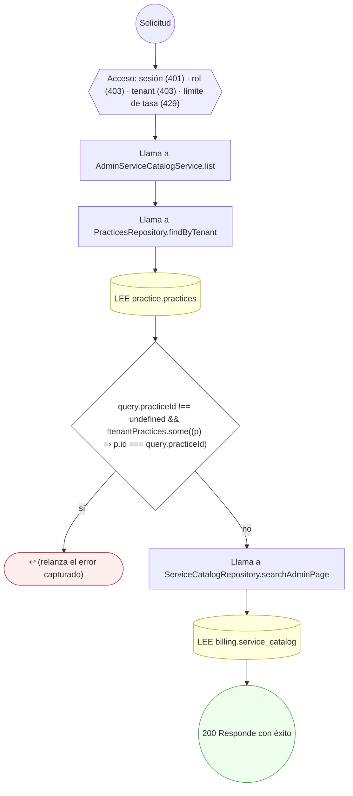

#### 2. POST /admin/catalogs/services

Crear un servicio (idempotente por práctica y código)

| HTTP | Código | Cuándo |
|---|---|---|
| 201 | — | Éxito |
| 400 | `VALIDATION_FAILED` | El cuerpo cumple el DTO (sin propiedades extra) |
| 401 | `UNAUTHENTICATED` | Hay una sesión válida (JWT) |
| 403 | `FORBIDDEN` | El rol está permitido; El tenant se resuelve y pertenece al actor |
| 409 | `CONFLICT` | ConflictException: Ya existe un servicio con ese código en el catálogo |
| 429 | `RATE_LIMITED` | No se supera el límite de solicitudes |

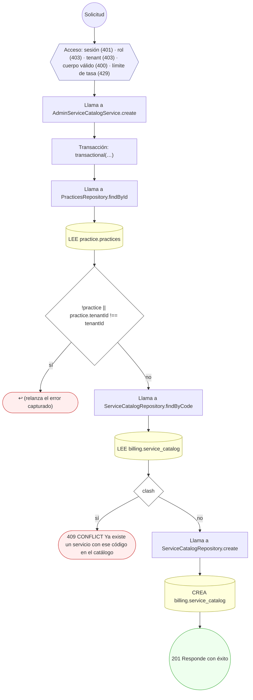

#### 3. GET /admin/catalogs/services/{id}

Ver un servicio con su versión

| HTTP | Código | Cuándo |
|---|---|---|
| 200 | — | Éxito |
| 400 | `VALIDATION_FAILED` | Los parámetros de ruta son UUID válidos |
| 401 | `UNAUTHENTICATED` | Hay una sesión válida (JWT) |
| 403 | `FORBIDDEN` | El rol está permitido; El tenant se resuelve y pertenece al actor |
| 404 | `NOT_FOUND` | ResourceNotFoundException: Servicio no encontrado |
| 429 | `RATE_LIMITED` | No se supera el límite de solicitudes |

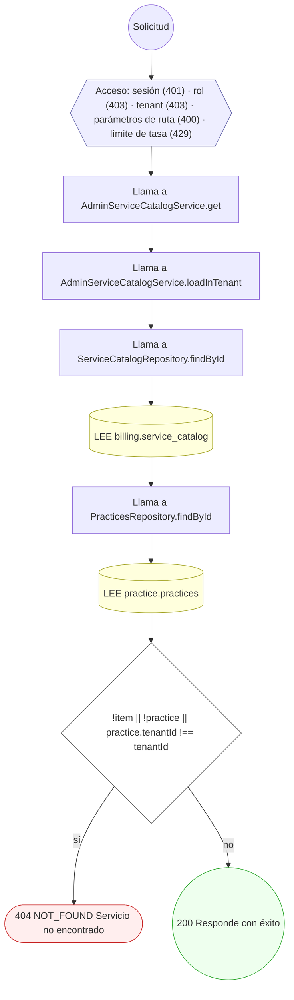

#### 4. PATCH /admin/catalogs/services/{id}

Editar un servicio con precondición de versión

| HTTP | Código | Cuándo |
|---|---|---|
| 200 | — | Éxito |
| 400 | `VALIDATION_FAILED` | Los parámetros de ruta son UUID válidos; El cuerpo cumple el DTO (sin propiedades extra) |
| 401 | `UNAUTHENTICATED` | Hay una sesión válida (JWT) |
| 403 | `FORBIDDEN` | El rol está permitido; El tenant se resuelve y pertenece al actor |
| 404 | `NOT_FOUND` | ResourceNotFoundException: Servicio no encontrado |
| 429 | `RATE_LIMITED` | No se supera el límite de solicitudes |

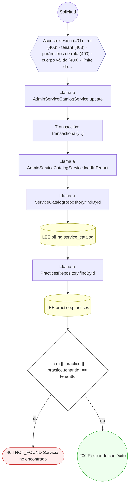

#### 5. POST /admin/catalogs/services/{id}/deactivate

Desactivar un servicio (no se borra)

| HTTP | Código | Cuándo |
|---|---|---|
| 200 | — | Éxito |
| 400 | `VALIDATION_FAILED` | Los parámetros de ruta son UUID válidos; El cuerpo cumple el DTO (sin propiedades extra) |
| 401 | `UNAUTHENTICATED` | Hay una sesión válida (JWT) |
| 403 | `FORBIDDEN` | El rol está permitido; El tenant se resuelve y pertenece al actor |
| 404 | `NOT_FOUND` | ResourceNotFoundException: Servicio no encontrado |
| 429 | `RATE_LIMITED` | No se supera el límite de solicitudes |


#### 6. POST /admin/catalogs/services/{id}/reactivate

Reactivar un servicio desactivado

| HTTP | Código | Cuándo |
|---|---|---|
| 200 | — | Éxito |
| 400 | `VALIDATION_FAILED` | Los parámetros de ruta son UUID válidos; El cuerpo cumple el DTO (sin propiedades extra) |
| 401 | `UNAUTHENTICATED` | Hay una sesión válida (JWT) |
| 403 | `FORBIDDEN` | El rol está permitido; El tenant se resuelve y pertenece al actor |
| 404 | `NOT_FOUND` | ResourceNotFoundException: Servicio no encontrado |
| 429 | `RATE_LIMITED` | No se supera el límite de solicitudes |


#### 7. GET /billing/bed-day/stays

Estancias de internación de una sede (F5e)

| HTTP | Código | Cuándo |
|---|---|---|
| 200 | — | Éxito |
| 400 | `VALIDATION_FAILED` | Están los parámetros de consulta obligatorios |
| 401 | `UNAUTHENTICATED` | Hay una sesión válida (JWT) |
| 403 | `FORBIDDEN` | El rol está permitido; El tenant se resuelve y pertenece al actor; InsufficientRoleException: No hay un objetivo sobre el que autorizar esta acción; InsufficientRoleException: Su rol no permite esta acción sobre este espacio |
| 422 | `PRECONDITION_FAILED` | PreconditionFailedException: Rango inválido (máximo 366 días) |
| 429 | `RATE_LIMITED` | No se supera el límite de solicitudes |
| 500 | `INTERNAL` | Error: Acción de infraestructura no registrada: {action} |

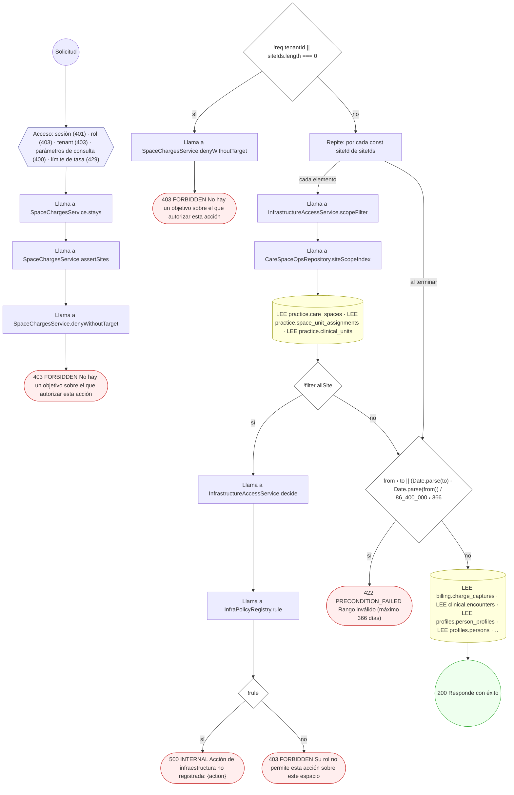

#### 8. POST /billing/bills

Registrar factura de proveedor con three-way match

| HTTP | Código | Cuándo |
|---|---|---|
| 201 | — | Éxito |
| 400 | `VALIDATION_FAILED` | El cuerpo cumple el DTO (sin propiedades extra) |
| 401 | `UNAUTHENTICATED` | Hay una sesión válida (JWT) |
| 403 | `FORBIDDEN` | El rol está permitido; El tenant se resuelve y pertenece al actor |
| 409 | `CONFLICT` | ConflictException: La factura del proveedor ya fue capturada |
| 422 | `PRECONDITION_FAILED` | PreconditionFailedException: El proveedor no está activo; PreconditionFailedException: Three-way match: la línea con orden de compra requiere recepción de bienes |
| 429 | `RATE_LIMITED` | No se supera el límite de solicitudes |

```mermaid
flowchart TD
  n1(("Solicitud")):::inicio
  n2{{"Acceso: sesión (401) · rol (403) · tenant (403) · cuerpo válido (400) · límite de tasa (429)"}}:::acceso
  n1 --> n2
  n3["Llama a BillsService.register"]:::llamada
  n2 --> n3
  n4["Transacción: transactional(…)"]:::transaccion
  n3 --> n4
  n5{"dto.purchaseOrderId"}:::decision
  n4 --> n5
  n6["Llama a BillingLinkTargetsRepository.findPurchaseOrder"]:::llamada
  n5 -->|"sí"| n6
  n7[("LEE erp.purchase_orders")]:::efecto
  n6 --> n7
  n8{"dto.contractId"}:::decision
  n7 --> n8
  n5 -->|"no"| n8
  n9["Llama a BillingLinkTargetsRepository.findContract"]:::llamada
  n8 -->|"sí"| n9
  n10[("LEE erp.contracts")]:::efecto
  n9 --> n10
  n11["Llama a BillsRepository.findVendor"]:::llamada
  n10 --> n11
  n8 -->|"no"| n11
  n12[("LEE billing.vendors")]:::efecto
  n11 --> n12
  n13{"vendor.statusConceptId !== CONCEPTS.STATE_ACTIVE && vendor.statusConceptId !== CONCEPTS.TENANT_ACTIVE"}:::decision
  n12 --> n13
  n14(["422 PRECONDITION_FAILED El proveedor no está activo"]):::error
  n13 -->|"sí"| n14
  n15["Llama a BillsRepository.findByNumber"]:::llamada
  n13 -->|"no"| n15
  n16[("LEE billing.bills")]:::efecto
  n15 --> n16
  n17{"clash"}:::decision
  n16 --> n17
  n18(["409 CONFLICT La factura del proveedor ya fue capturada"]):::error
  n17 -->|"sí"| n18
  n19["Repite: por cada const l de dto.lines"]:::bucle
  n17 -->|"no"| n19
  n20{"l.purchaseOrderItemId && !l.goodsReceiptItemId"}:::decision
  n19 -->|"cada elemento"| n20
  n21(["422 PRECONDITION_FAILED Three-way match: la línea con orden de compra requiere recepción de bienes"]):::error
  n20 -->|"sí"| n21
  n22["Llama a BillsRepository.create"]:::llamada
  n20 -->|"no"| n22
  n19 -->|"al terminar"| n22
  n23[("CREA billing.bills")]:::efecto
  n22 --> n23
  n24["Repite: forEach(…)"]:::bucle
  n23 --> n24
  n25["Llama a BillsRepository.createLine"]:::llamada
  n24 -->|"cada elemento"| n25
  n26[("CREA billing.bill_lines")]:::efecto
  n25 --> n26
  n27{"dto.purchaseOrderId || dto.contractId"}:::decision
  n26 --> n27
  n24 -->|"al terminar"| n27
  n28["Llama a BillingDocumentLinksRepository.create"]:::llamada
  n27 -->|"sí"| n28
  n29[("CREA billing.billing_document_links")]:::efecto
  n28 --> n29
  n30(("201 Responde con éxito")):::ok
  n29 --> n30
  n27 -->|"no"| n30
  classDef acceso fill:#eef,stroke:#66a
  classDef error fill:#fee,stroke:#c33
  classDef ok fill:#efe,stroke:#3a3
  classDef efecto fill:#ffd,stroke:#aa3
  classDef decision fill:#fff,stroke:#555
  classDef corte fill:#eee,stroke:#999,stroke-dasharray: 4
```

#### 9. POST /billing/charge-captures/{id}/void

Anular un cargo devengado

| HTTP | Código | Cuándo |
|---|---|---|
| 200 | — | Éxito |
| 400 | `VALIDATION_FAILED` | Los parámetros de ruta son UUID válidos; El cuerpo cumple el DTO (sin propiedades extra) |
| 401 | `UNAUTHENTICATED` | Hay una sesión válida (JWT) |
| 403 | `FORBIDDEN` | El rol está permitido; El tenant se resuelve y pertenece al actor; InsufficientRoleException: No hay un objetivo sobre el que autorizar esta acción; InsufficientRoleException: Su rol no permite esta acción sobre este espacio |
| 404 | `NOT_FOUND` | ResourceNotFoundException: Cargo no encontrado; ResourceNotFoundException: Práctica no encontrada |
| 409 | `CONFLICT` | ConflictException: El cargo ya está facturado; ConflictException: El cargo no está pendiente |
| 429 | `RATE_LIMITED` | No se supera el límite de solicitudes |
| 500 | `INTERNAL` | Error: Acción de infraestructura no registrada: {action} |

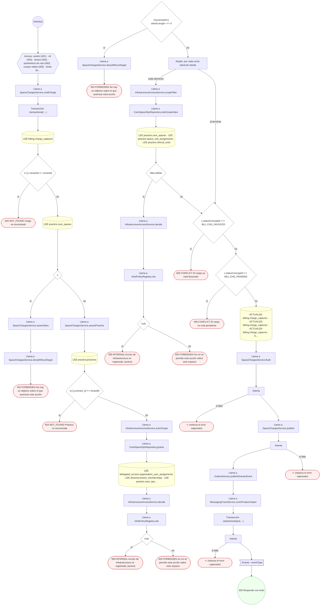

#### 10. POST /billing/documents/{id}:post-to-ledger

Contabilizar documento (posting CxC/CxP)

| HTTP | Código | Cuándo |
|---|---|---|
| 200 | — | Éxito |
| 400 | `VALIDATION_FAILED` | Los parámetros de ruta son UUID válidos; El cuerpo cumple el DTO (sin propiedades extra) |
| 401 | `UNAUTHENTICATED` | Hay una sesión válida (JWT) |
| 403 | `FORBIDDEN` | El rol está permitido; El tenant se resuelve y pertenece al actor |
| 409 | `CONFLICT` | ConflictException: El documento ya fue contabilizado |
| 429 | `RATE_LIMITED` | No se supera el límite de solicitudes |

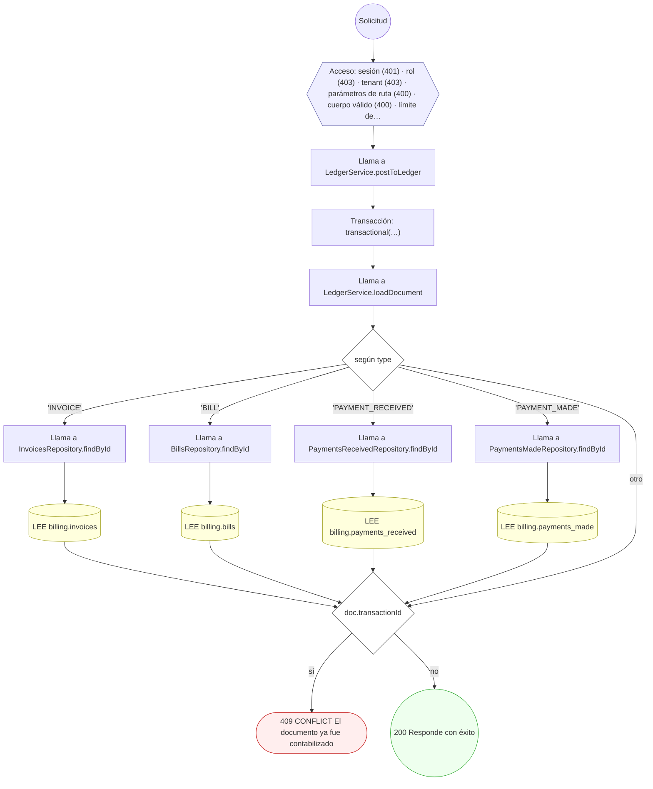

#### 11. POST /billing/dunning-runs:execute

Ejecutar ciclo de morosidad (dunning)

| HTTP | Código | Cuándo |
|---|---|---|
| 201 | — | Éxito |
| 400 | `VALIDATION_FAILED` | El cuerpo cumple el DTO (sin propiedades extra) |
| 401 | `UNAUTHENTICATED` | Hay una sesión válida (JWT) |
| 403 | `FORBIDDEN` | El rol está permitido; El tenant se resuelve y pertenece al actor |
| 409 | `CONFLICT` | ConflictException: El número de corrida ya existe para el tenant |
| 429 | `RATE_LIMITED` | No se supera el límite de solicitudes |

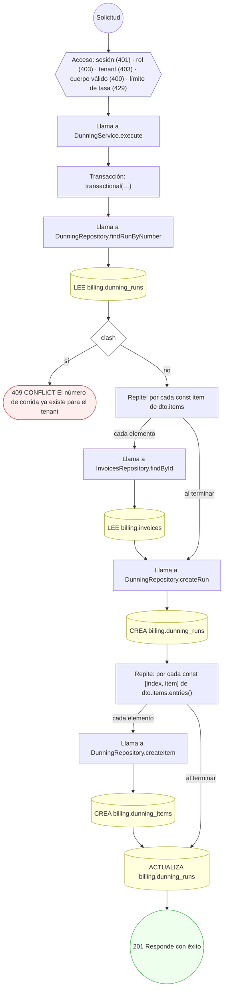

#### 12. POST /billing/encounters/{encounterId}/bed-day-charges/run

Devengar los días-cama de un encuentro

| HTTP | Código | Cuándo |
|---|---|---|
| 200 | — | Éxito |
| 400 | `VALIDATION_FAILED` | Los parámetros de ruta son UUID válidos |
| 401 | `UNAUTHENTICATED` | Hay una sesión válida (JWT) |
| 403 | `FORBIDDEN` | El rol está permitido; El tenant se resuelve y pertenece al actor; InsufficientRoleException: No hay un objetivo sobre el que autorizar esta acción; InsufficientRoleException: Su rol no permite esta acción sobre este espacio |
| 404 | `NOT_FOUND` | ResourceNotFoundException: Encuentro no encontrado |
| 429 | `RATE_LIMITED` | No se supera el límite de solicitudes |
| 500 | `INTERNAL` | Error: Acción de infraestructura no registrada: {action} |

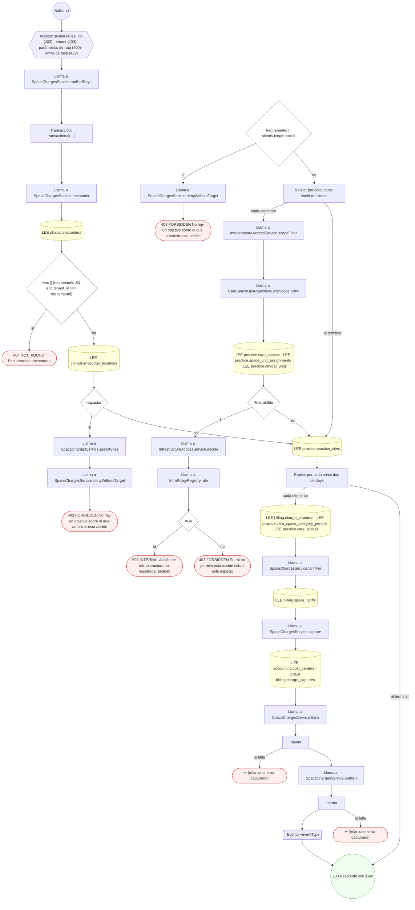

#### 13. GET /billing/encounters/{encounterId}/pending-charges

Cargos devengados pendientes

| HTTP | Código | Cuándo |
|---|---|---|
| 200 | — | Éxito |
| 400 | `VALIDATION_FAILED` | Los parámetros de ruta son UUID válidos |
| 401 | `UNAUTHENTICATED` | Hay una sesión válida (JWT) |
| 403 | `FORBIDDEN` | El rol está permitido; El tenant se resuelve y pertenece al actor; InsufficientRoleException: No hay un objetivo sobre el que autorizar esta acción; InsufficientRoleException: Su rol no permite esta acción sobre este espacio |
| 404 | `NOT_FOUND` | ResourceNotFoundException: Encuentro no encontrado; ResourceNotFoundException: Práctica no encontrada |
| 429 | `RATE_LIMITED` | No se supera el límite de solicitudes |
| 500 | `INTERNAL` | Error: Acción de infraestructura no registrada: {action} |

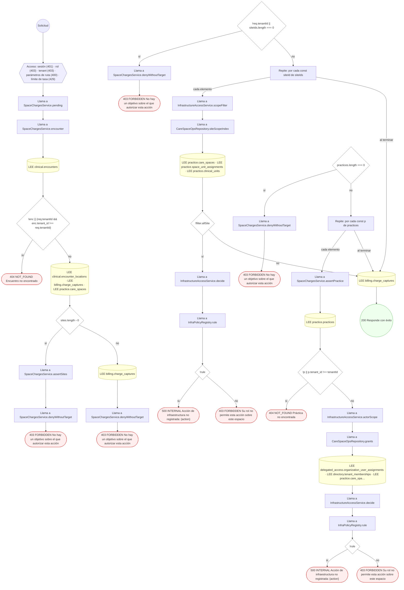

#### 14. POST /billing/internal/dunning-runs/run-due

Evaluar y disparar morosidad automática por tenant

| HTTP | Código | Cuándo |
|---|---|---|
| 200 | — | Éxito |
| 400 | `VALIDATION_FAILED` | El cuerpo cumple el DTO (sin propiedades extra) |
| 401 | `UNAUTHENTICATED` | Hay una sesión válida (JWT) |
| 403 | `FORBIDDEN` | El rol está permitido; El tenant se resuelve y pertenece al actor |
| 429 | `RATE_LIMITED` | No se supera el límite de solicitudes |

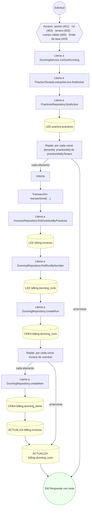

#### 15. GET /billing/invoices

Listar las facturas de la práctica

| HTTP | Código | Cuándo |
|---|---|---|
| 200 | — | Éxito |
| 400 | `VALIDATION_FAILED` | Están los parámetros de consulta obligatorios |
| 401 | `UNAUTHENTICATED` | Hay una sesión válida (JWT) |
| 403 | `FORBIDDEN` | El rol está permitido; El tenant se resuelve y pertenece al actor |
| 404 | `NOT_FOUND` | ResourceNotFoundException: Práctica no encontrada |
| 429 | `RATE_LIMITED` | No se supera el límite de solicitudes |


#### 16. POST /billing/invoices:issue-from-encounter

Emitir factura desde los cargos del encuentro

| HTTP | Código | Cuándo |
|---|---|---|
| 201 | — | Éxito |
| 400 | `VALIDATION_FAILED` | El cuerpo cumple el DTO (sin propiedades extra) |
| 401 | `UNAUTHENTICATED` | Hay una sesión válida (JWT) |
| 403 | `FORBIDDEN` | El rol está permitido; El tenant se resuelve y pertenece al actor |
| 404 | `NOT_FOUND` | ResourceNotFoundException: {INVOICE_ENCOUNTER_NOT_FOUND.message}; ResourceNotFoundException: Cargo no encontrado |
| 409 | `CONFLICT` | ConflictException: El número de factura ya existe en la práctica; ConflictException: El cargo ya está facturado; ConflictException: El cargo no está pendiente |
| 422 | `PRECONDITION_FAILED` | PreconditionFailedException: Los servicios con seguro se facturan al paciente desde la solicitud de seguro, con su parte calculada; PreconditionFailedException: El cargo no tiene precio (sin tarifa vigente) |
| 429 | `RATE_LIMITED` | No se supera el límite de solicitudes |

```mermaid
flowchart TD
  n1(("Solicitud")):::inicio
  n2{{"Acceso: sesión (401) · rol (403) · tenant (403) · cuerpo válido (400) · límite de tasa (429)"}}:::acceso
  n1 --> n2
  n3["Llama a InvoicesService.issueFromEncounter"]:::llamada
  n2 --> n3
  n4{"dto.claimId"}:::decision
  n3 --> n4
  n5(["422 PRECONDITION_FAILED Los servicios con seguro se facturan al paciente desde la solicitud de seguro, con su…"]):::error
  n4 -->|"sí"| n5
  n6["Transacción: transactional(…)"]:::transaccion
  n4 -->|"no"| n6
  n7{"dto.encounterId"}:::decision
  n6 --> n7
  n8["Llama a BillingLinkTargetsRepository.findEncounter"]:::llamada
  n7 -->|"sí"| n8
  n9[("LEE clinical.encounters")]:::efecto
  n8 --> n9
  n10{"encounter?.patientProfileId !== dto.patientProfileId"}:::decision
  n9 --> n10
  n11(["404 NOT_FOUND {INVOICE_ENCOUNTER_NOT_FOUND.message}"]):::error
  n10 -->|"sí"| n11
  n12["Llama a InvoicesRepository.findByNumber"]:::llamada
  n10 -->|"no"| n12
  n7 -->|"no"| n12
  n13[("LEE billing.invoices")]:::efecto
  n12 --> n13
  n14{"clash"}:::decision
  n13 --> n14
  n15(["409 CONFLICT El número de factura ya existe en la práctica"]):::error
  n14 -->|"sí"| n15
  n16["Llama a InvoicesService.loadCharges"]:::llamada
  n14 -->|"no"| n16
  n17[("LEE billing.charge_captures")]:::efecto
  n16 --> n17
  n18["Repite: por cada const id de ids"]:::bucle
  n17 --> n18
  n19{"!c || c.tenantId !== tenantId || c.practiceId !== dto.practiceId || c.patientProfileId !== dto.patientProfile…"}:::decision
  n18 -->|"cada elemento"| n19
  n20(["404 NOT_FOUND Cargo no encontrado"]):::error
  n19 -->|"sí"| n20
  n21{"c.statusConceptId === BILL.CHG_INVOICED"}:::decision
  n19 -->|"no"| n21
  n22(["409 CONFLICT El cargo ya está facturado"]):::error
  n21 -->|"sí"| n22
  n23{"c.statusConceptId !== BILL.CHG_PENDING"}:::decision
  n21 -->|"no"| n23
  n24(["409 CONFLICT El cargo no está pendiente"]):::error
  n23 -->|"sí"| n24
  n25{"c.unitPrice === undefined || c.unitPrice === null"}:::decision
  n23 -->|"no"| n25
  n26(["422 PRECONDITION_FAILED El cargo no tiene precio (sin tarifa vigente)"]):::error
  n25 -->|"sí"| n26
  n27["Llama a InvoicesRepository.create"]:::llamada
  n25 -->|"no"| n27
  n18 -->|"al terminar"| n27
  n28[("CREA billing.invoices")]:::efecto
  n27 --> n28
  n29["Llama a InvoicesRepository.createLine"]:::llamada
  n28 --> n29
  n30[("CREA billing.invoice_lines")]:::efecto
  n29 --> n30
  n31{"charges.length › 0"}:::decision
  n30 --> n31
  n32["Repite: por cada const c de charges"]:::bucle
  n31 -->|"sí"| n32
  n33["Llama a OutboxService.publishDomainEvent"]:::llamada
  n32 -->|"cada elemento"| n33
  n34["Llama a MessagingTraceService.runInProducerSpan"]:::llamada
  n33 --> n34
  n35["Transacción: startActiveSpan(…)"]:::transaccion
  n34 --> n35
  n36["Intenta"]:::intento
  n35 --> n36
  n37(["↩ (relanza el error capturado)"]):::error
  n36 -->|"si falla"| n37
  n38["Llama a OutboxService.persistDomainEvent"]:::llamada
  n36 --> n38
  n39["Llama a OutboxRepository.findOutboxByIdempotencyKey"]:::llamada
  n38 --> n39
  n40[("LEE messaging.outbox_messages")]:::efecto
  n39 --> n40
  n41["Llama a OutboxRepository.createDomainEvent"]:::llamada
  n40 --> n41
  n42[("CREA messaging.domain_events")]:::efecto
  n41 --> n42
  n43["Llama a OutboxRepository.createOutboxMessage"]:::llamada
  n42 --> n43
  n44[("CREA messaging.outbox_messages")]:::efecto
  n43 --> n44
  n45>"Evento billing.charge_capture.invoiced"]:::evento
  n44 --> n45
  n46{"dto.encounterId || dto.claimId"}:::decision
  n45 --> n46
  n32 -->|"al terminar"| n46
  n31 -->|"no"| n46
  n47["Llama a BillingDocumentLinksRepository.create"]:::llamada
  n46 -->|"sí"| n47
  n48[("CREA billing.billing_document_links")]:::efecto
  n47 --> n48
  n49(("201 Responde con éxito")):::ok
  n48 --> n49
  n46 -->|"no"| n49
  classDef acceso fill:#eef,stroke:#66a
  classDef error fill:#fee,stroke:#c33
  classDef ok fill:#efe,stroke:#3a3
  classDef efecto fill:#ffd,stroke:#aa3
  classDef decision fill:#fff,stroke:#555
  classDef corte fill:#eee,stroke:#999,stroke-dasharray: 4
```

#### 17. GET /billing/invoices/{id}

Detalle de una factura, con sus líneas

| HTTP | Código | Cuándo |
|---|---|---|
| 200 | — | Éxito |
| 400 | `VALIDATION_FAILED` | Están los parámetros de consulta obligatorios; Los parámetros de ruta son UUID válidos |
| 401 | `UNAUTHENTICATED` | Hay una sesión válida (JWT) |
| 403 | `FORBIDDEN` | El rol está permitido; El tenant se resuelve y pertenece al actor |
| 404 | `NOT_FOUND` | ResourceNotFoundException: Práctica no encontrada; ResourceNotFoundException: Factura no encontrada |
| 429 | `RATE_LIMITED` | No se supera el límite de solicitudes |


#### 18. POST /billing/invoices/{id}:credit-note

Emitir nota de crédito / castigo sobre una factura

| HTTP | Código | Cuándo |
|---|---|---|
| 201 | — | Éxito |
| 400 | `VALIDATION_FAILED` | Los parámetros de ruta son UUID válidos; El cuerpo cumple el DTO (sin propiedades extra) |
| 401 | `UNAUTHENTICATED` | Hay una sesión válida (JWT) |
| 403 | `FORBIDDEN` | El rol está permitido; El tenant se resuelve y pertenece al actor |
| 422 | `PRECONDITION_FAILED` | PreconditionFailedException: La nota de crédito debe revertir un importe positivo; PreconditionFailedException: El monto de la nota de crédito excede el saldo de la factura |
| 429 | `RATE_LIMITED` | No se supera el límite de solicitudes |

```mermaid
flowchart TD
  n1(("Solicitud")):::inicio
  n2{{"Acceso: sesión (401) · rol (403) · tenant (403) · parámetros de ruta (400) · cuerpo válido (400) · límite de…"}}:::acceso
  n1 --> n2
  n3["Llama a InvoicesService.creditNote"]:::llamada
  n2 --> n3
  n4["Transacción: transactional(…)"]:::transaccion
  n3 --> n4
  n5["Llama a InvoicesRepository.findById"]:::llamada
  n4 --> n5
  n6[("LEE billing.invoices")]:::efecto
  n5 --> n6
  n7{"reverseCents ‹= 0"}:::decision
  n6 --> n7
  n8(["422 PRECONDITION_FAILED La nota de crédito debe revertir un importe positivo"]):::error
  n7 -->|"sí"| n8
  n9{"reverseCents › originalBalanceCents && !dto.writeOff"}:::decision
  n7 -->|"no"| n9
  n10(["422 PRECONDITION_FAILED El monto de la nota de crédito excede el saldo de la factura"]):::error
  n9 -->|"sí"| n10
  n11["Llama a InvoicesRepository.create"]:::llamada
  n9 -->|"no"| n11
  n12[("CREA billing.invoices")]:::efecto
  n11 --> n12
  n13["Repite: forEach(…)"]:::bucle
  n12 --> n13
  n14["Llama a InvoicesRepository.createLine"]:::llamada
  n13 -->|"cada elemento"| n14
  n15[("CREA billing.invoice_lines")]:::efecto
  n14 --> n15
  n16["Llama a BillingDocumentLinksRepository.create"]:::llamada
  n15 --> n16
  n13 -->|"al terminar"| n16
  n17[("CREA billing.billing_document_links")]:::efecto
  n16 --> n17
  n18(("201 Responde con éxito")):::ok
  n17 --> n18
  classDef acceso fill:#eef,stroke:#66a
  classDef error fill:#fee,stroke:#c33
  classDef ok fill:#efe,stroke:#3a3
  classDef efecto fill:#ffd,stroke:#aa3
  classDef decision fill:#fff,stroke:#555
  classDef corte fill:#eee,stroke:#999,stroke-dasharray: 4
```

#### 19. POST /billing/kpi-snapshots:compute

Calcular snapshot de KPI financiero y aging

| HTTP | Código | Cuándo |
|---|---|---|
| 201 | — | Éxito |
| 400 | `VALIDATION_FAILED` | El cuerpo cumple el DTO (sin propiedades extra) |
| 401 | `UNAUTHENTICATED` | Hay una sesión válida (JWT) |
| 403 | `FORBIDDEN` | El rol está permitido; El tenant se resuelve y pertenece al actor |
| 409 | `CONFLICT` | ConflictException: El snapshot de KPI ya fue calculado para esa marca |
| 429 | `RATE_LIMITED` | No se supera el límite de solicitudes |

```mermaid
flowchart TD
  n1(("Solicitud")):::inicio
  n2{{"Acceso: sesión (401) · rol (403) · tenant (403) · cuerpo válido (400) · límite de tasa (429)"}}:::acceso
  n1 --> n2
  n3["Llama a KpiSnapshotsService.compute"]:::llamada
  n2 --> n3
  n4["Transacción: transactional(…)"]:::transaccion
  n3 --> n4
  n5["Llama a KpiSnapshotsRepository.findExisting"]:::llamada
  n4 --> n5
  n6[("LEE billing.financial_kpi_snapshots")]:::efecto
  n5 --> n6
  n7{"existing"}:::decision
  n6 --> n7
  n8(["409 CONFLICT El snapshot de KPI ya fue calculado para esa marca"]):::error
  n7 -->|"sí"| n8
  n9["Llama a KpiSnapshotsRepository.create"]:::llamada
  n7 -->|"no"| n9
  n10[("CREA billing.financial_kpi_snapshots")]:::efecto
  n9 --> n10
  n11(("201 Responde con éxito")):::ok
  n10 --> n11
  classDef acceso fill:#eef,stroke:#66a
  classDef error fill:#fee,stroke:#c33
  classDef ok fill:#efe,stroke:#3a3
  classDef efecto fill:#ffd,stroke:#aa3
  classDef decision fill:#fff,stroke:#555
  classDef corte fill:#eee,stroke:#999,stroke-dasharray: 4
```

#### 20. GET /billing/patient-statements

Listar los estados de cuenta de la práctica

| HTTP | Código | Cuándo |
|---|---|---|
| 200 | — | Éxito |
| 400 | `VALIDATION_FAILED` | Están los parámetros de consulta obligatorios |
| 401 | `UNAUTHENTICATED` | Hay una sesión válida (JWT) |
| 403 | `FORBIDDEN` | El rol está permitido; El tenant se resuelve y pertenece al actor |
| 404 | `NOT_FOUND` | ResourceNotFoundException: Práctica no encontrada |
| 429 | `RATE_LIMITED` | No se supera el límite de solicitudes |

```mermaid
flowchart TD
  n1(("Solicitud")):::inicio
  n2{{"Acceso: sesión (401) · rol (403) · tenant (403) · parámetros de consulta (400) · límite de tasa (429)"}}:::acceso
  n1 --> n2
  n3["Llama a PatientStatementsService.listByPractice"]:::llamada
  n2 --> n3
  n4["Llama a PracticeTenantLookupService.findTenantOfPractice"]:::llamada
  n3 --> n4
  n5["Llama a PracticesRepository.findById"]:::llamada
  n4 --> n5
  n6[("LEE practice.practices")]:::efecto
  n5 --> n6
  n7{"owner !== tenantId"}:::decision
  n6 --> n7
  n8(["404 NOT_FOUND Práctica no encontrada"]):::error
  n7 -->|"sí"| n8
  n9["Llama a PatientStatementsRepository.findByPracticePage"]:::llamada
  n7 -->|"no"| n9
  n10[("LEE billing.patient_statements")]:::efecto
  n9 --> n10
  n11(("200 Responde con éxito")):::ok
  n10 --> n11
  classDef acceso fill:#eef,stroke:#66a
  classDef error fill:#fee,stroke:#c33
  classDef ok fill:#efe,stroke:#3a3
  classDef efecto fill:#ffd,stroke:#aa3
  classDef decision fill:#fff,stroke:#555
  classDef corte fill:#eee,stroke:#999,stroke-dasharray: 4
```

#### 21. POST /billing/patient-statements:generate

Generar el estado de cuenta del paciente

| HTTP | Código | Cuándo |
|---|---|---|
| 201 | — | Éxito |
| 400 | `VALIDATION_FAILED` | El cuerpo cumple el DTO (sin propiedades extra) |
| 401 | `UNAUTHENTICATED` | Hay una sesión válida (JWT) |
| 403 | `FORBIDDEN` | El rol está permitido; El tenant se resuelve y pertenece al actor |
| 409 | `CONFLICT` | ConflictException: Ya existe un estado de cuenta para el periodo |
| 429 | `RATE_LIMITED` | No se supera el límite de solicitudes |

```mermaid
flowchart TD
  n1(("Solicitud")):::inicio
  n2{{"Acceso: sesión (401) · rol (403) · tenant (403) · cuerpo válido (400) · límite de tasa (429)"}}:::acceso
  n1 --> n2
  n3["Llama a PatientStatementsService.generate"]:::llamada
  n2 --> n3
  n4["Transacción: transactional(…)"]:::transaccion
  n3 --> n4
  n5["Llama a PatientStatementsRepository.findByPeriod"]:::llamada
  n4 --> n5
  n6[("LEE billing.patient_statements")]:::efecto
  n5 --> n6
  n7{"existing"}:::decision
  n6 --> n7
  n8(["409 CONFLICT Ya existe un estado de cuenta para el periodo"]):::error
  n7 -->|"sí"| n8
  n9["Llama a InvoicesRepository.findByPatientInRange"]:::llamada
  n7 -->|"no"| n9
  n10[("LEE billing.invoices")]:::efecto
  n9 --> n10
  n11["Llama a PatientStatementsRepository.create"]:::llamada
  n10 --> n11
  n12[("CREA billing.patient_statements")]:::efecto
  n11 --> n12
  n13["Repite: por cada const inv de invoices"]:::bucle
  n12 --> n13
  n14["Llama a BillingDocumentLinksRepository.create"]:::llamada
  n13 -->|"cada elemento"| n14
  n15[("CREA billing.billing_document_links")]:::efecto
  n14 --> n15
  n16(("201 Responde con éxito")):::ok
  n15 --> n16
  n13 -->|"al terminar"| n16
  classDef acceso fill:#eef,stroke:#66a
  classDef error fill:#fee,stroke:#c33
  classDef ok fill:#efe,stroke:#3a3
  classDef efecto fill:#ffd,stroke:#aa3
  classDef decision fill:#fff,stroke:#555
  classDef corte fill:#eee,stroke:#999,stroke-dasharray: 4
```

#### 22. POST /billing/payment-plans

Configurar un plan de pagos del paciente

| HTTP | Código | Cuándo |
|---|---|---|
| 201 | — | Éxito |
| 400 | `VALIDATION_FAILED` | El cuerpo cumple el DTO (sin propiedades extra) |
| 401 | `UNAUTHENTICATED` | Hay una sesión válida (JWT) |
| 403 | `FORBIDDEN` | El rol está permitido; El tenant se resuelve y pertenece al actor |
| 422 | `PRECONDITION_FAILED` | PreconditionFailedException: La factura origen no tiene saldo; PreconditionFailedException: Cada cuota del plan debe ser un importe positivo; PreconditionFailedException: La suma de cuotas debe igualar el saldo de la factura |
| 429 | `RATE_LIMITED` | No se supera el límite de solicitudes |

```mermaid
flowchart TD
  n1(("Solicitud")):::inicio
  n2{{"Acceso: sesión (401) · rol (403) · tenant (403) · cuerpo válido (400) · límite de tasa (429)"}}:::acceso
  n1 --> n2
  n3["Llama a InvoicesService.createPaymentPlan"]:::llamada
  n2 --> n3
  n4["Transacción: transactional(…)"]:::transaccion
  n3 --> n4
  n5["Llama a InvoicesRepository.findById"]:::llamada
  n4 --> n5
  n6[("LEE billing.invoices")]:::efecto
  n5 --> n6
  n7{"balanceCents ‹= 0"}:::decision
  n6 --> n7
  n8(["422 PRECONDITION_FAILED La factura origen no tiene saldo"]):::error
  n7 -->|"sí"| n8
  n9["Repite: reduce(…)"]:::bucle
  n7 -->|"no"| n9
  n10{"cents === null || cents ‹= 0"}:::decision
  n9 -->|"cada elemento"| n10
  n11(["422 PRECONDITION_FAILED Cada cuota del plan debe ser un importe positivo"]):::error
  n10 -->|"sí"| n11
  n12{"installmentsCents !== balanceCents"}:::decision
  n10 -->|"no"| n12
  n9 -->|"al terminar"| n12
  n13(["422 PRECONDITION_FAILED La suma de cuotas debe igualar el saldo de la factura"]):::error
  n12 -->|"sí"| n13
  n14["Repite: ciclo for"]:::bucle
  n12 -->|"no"| n14
  n15["Llama a InvoicesRepository.create"]:::llamada
  n14 -->|"cada elemento"| n15
  n16[("CREA billing.invoices")]:::efecto
  n15 --> n16
  n17["Llama a BillingDocumentLinksRepository.create"]:::llamada
  n16 --> n17
  n18[("CREA billing.billing_document_links")]:::efecto
  n17 --> n18
  n19(("201 Responde con éxito")):::ok
  n18 --> n19
  n14 -->|"al terminar"| n19
  classDef acceso fill:#eef,stroke:#66a
  classDef error fill:#fee,stroke:#c33
  classDef ok fill:#efe,stroke:#3a3
  classDef efecto fill:#ffd,stroke:#aa3
  classDef decision fill:#fff,stroke:#555
  classDef corte fill:#eee,stroke:#999,stroke-dasharray: 4
```

#### 23. POST /billing/payments-made:execute

Ejecutar pago a proveedor con asignación

| HTTP | Código | Cuándo |
|---|---|---|
| 201 | — | Éxito |
| 400 | `VALIDATION_FAILED` | El cuerpo cumple el DTO (sin propiedades extra) |
| 401 | `UNAUTHENTICATED` | Hay una sesión válida (JWT) |
| 403 | `FORBIDDEN` | El rol está permitido; El tenant se resuelve y pertenece al actor |
| 422 | `PRECONDITION_FAILED` | PreconditionFailedException: El monto del pago debe ser positivo; PreconditionFailedException: La asignación debe ser un importe positivo; PreconditionFailedException: El descuento debe ser un importe no negativo; PreconditionFailedException: La retención debe ser un importe no negativo; PreconditionFailedException: La suma asignada más retención excede el monto del pago; PreconditionFailedException: La factura de proveedor no tiene saldo; PreconditionFailedException: La asignación excede el saldo de la factura de proveedor |
| 429 | `RATE_LIMITED` | No se supera el límite de solicitudes |

```mermaid
flowchart TD
  n1(("Solicitud")):::inicio
  n2{{"Acceso: sesión (401) · rol (403) · tenant (403) · cuerpo válido (400) · límite de tasa (429)"}}:::acceso
  n1 --> n2
  n3["Llama a PaymentsMadeService.execute"]:::llamada
  n2 --> n3
  n4["Transacción: transactional(…)"]:::transaccion
  n3 --> n4
  n5{"amountCents === null || amountCents ‹= 0"}:::decision
  n4 --> n5
  n6(["422 PRECONDITION_FAILED El monto del pago debe ser positivo"]):::error
  n5 -->|"sí"| n6
  n7["Repite: por cada const alloc de dto.allocations"]:::bucle
  n5 -->|"no"| n7
  n8{"allocCents === null || allocCents ‹= 0"}:::decision
  n7 -->|"cada elemento"| n8
  n9(["422 PRECONDITION_FAILED La asignación debe ser un importe positivo"]):::error
  n8 -->|"sí"| n9
  n10{"discountCents === null"}:::decision
  n8 -->|"no"| n10
  n11(["422 PRECONDITION_FAILED El descuento debe ser un importe no negativo"]):::error
  n10 -->|"sí"| n11
  n12{"withholdingCents === null"}:::decision
  n10 -->|"no"| n12
  n13(["422 PRECONDITION_FAILED La retención debe ser un importe no negativo"]):::error
  n12 -->|"sí"| n13
  n14{"effectCents › amountCents"}:::decision
  n12 -->|"no"| n14
  n7 -->|"al terminar"| n14
  n15(["422 PRECONDITION_FAILED La suma asignada más retención excede el monto del pago"]):::error
  n14 -->|"sí"| n15
  n16{"dto.vendorId"}:::decision
  n14 -->|"no"| n16
  n17["Llama a BillsRepository.findVendor"]:::llamada
  n16 -->|"sí"| n17
  n18[("LEE billing.vendors")]:::efecto
  n17 --> n18
  n19["Repite: por cada const alloc de dto.allocations"]:::bucle
  n18 --> n19
  n16 -->|"no"| n19
  n20["Llama a BillsRepository.findById"]:::llamada
  n19 -->|"cada elemento"| n20
  n21[("LEE billing.bills")]:::efecto
  n20 --> n21
  n22["Llama a PaymentsMadeRepository.create"]:::llamada
  n21 --> n22
  n19 -->|"al terminar"| n22
  n23[("CREA billing.payments_made")]:::efecto
  n22 --> n23
  n24["Repite: por cada const [index, alloc] de dto.allocations.entries()"]:::bucle
  n23 --> n24
  n25{"balanceCents ‹= 0"}:::decision
  n24 -->|"cada elemento"| n25
  n26(["422 PRECONDITION_FAILED La factura de proveedor no tiene saldo"]):::error
  n25 -->|"sí"| n26
  n27{"allocCents + discountCents › balanceCents"}:::decision
  n25 -->|"no"| n27
  n28(["422 PRECONDITION_FAILED La asignación excede el saldo de la factura de proveedor"]):::error
  n27 -->|"sí"| n28
  n29["Llama a PaymentsMadeRepository.createAllocation"]:::llamada
  n27 -->|"no"| n29
  n30[("CREA billing.payable_payment_allocations")]:::efecto
  n29 --> n30
  n31(("201 Responde con éxito")):::ok
  n30 --> n31
  n24 -->|"al terminar"| n31
  classDef acceso fill:#eef,stroke:#66a
  classDef error fill:#fee,stroke:#c33
  classDef ok fill:#efe,stroke:#3a3
  classDef efecto fill:#ffd,stroke:#aa3
  classDef decision fill:#fff,stroke:#555
  classDef corte fill:#eee,stroke:#999,stroke-dasharray: 4
```

#### 24. POST /billing/payments-received:apply

Aplicar un pago recibido con asignación multi-factura

| HTTP | Código | Cuándo |
|---|---|---|
| 201 | — | Éxito |
| 400 | `VALIDATION_FAILED` | El cuerpo cumple el DTO (sin propiedades extra) |
| 401 | `UNAUTHENTICATED` | Hay una sesión válida (JWT) |
| 403 | `FORBIDDEN` | El rol está permitido; El tenant se resuelve y pertenece al actor |
| 422 | `PRECONDITION_FAILED` | PreconditionFailedException: El monto del pago debe ser positivo; PreconditionFailedException: La asignación debe ser un importe positivo; PreconditionFailedException: El descuento debe ser un importe no negativo; PreconditionFailedException: La suma asignada excede el monto del pago; PreconditionFailedException: El cobro está en pausa mientras el paciente tenga una objeción abierta; PreconditionFailedException: La factura no tiene saldo pendiente; PreconditionFailedException: La asignación excede el saldo de la factura |
| 429 | `RATE_LIMITED` | No se supera el límite de solicitudes |

```mermaid
flowchart TD
  n1(("Solicitud")):::inicio
  n2{{"Acceso: sesión (401) · rol (403) · tenant (403) · cuerpo válido (400) · límite de tasa (429)"}}:::acceso
  n1 --> n2
  n3["Llama a PaymentsReceivedService.apply"]:::llamada
  n2 --> n3
  n4["Transacción: transactional(…)"]:::transaccion
  n3 --> n4
  n5{"amountCents === null || amountCents ‹= 0"}:::decision
  n4 --> n5
  n6(["422 PRECONDITION_FAILED El monto del pago debe ser positivo"]):::error
  n5 -->|"sí"| n6
  n7["Repite: por cada const alloc de dto.allocations"]:::bucle
  n5 -->|"no"| n7
  n8{"allocCents === null || allocCents ‹= 0"}:::decision
  n7 -->|"cada elemento"| n8
  n9(["422 PRECONDITION_FAILED La asignación debe ser un importe positivo"]):::error
  n8 -->|"sí"| n9
  n10{"discountCents === null"}:::decision
  n8 -->|"no"| n10
  n11(["422 PRECONDITION_FAILED El descuento debe ser un importe no negativo"]):::error
  n10 -->|"sí"| n11
  n12{"effectCents › amountCents"}:::decision
  n10 -->|"no"| n12
  n7 -->|"al terminar"| n12
  n13(["422 PRECONDITION_FAILED La suma asignada excede el monto del pago"]):::error
  n12 -->|"sí"| n13
  n14["Repite: por cada const alloc de dto.allocations"]:::bucle
  n12 -->|"no"| n14
  n15["Llama a InvoicesRepository.findById"]:::llamada
  n14 -->|"cada elemento"| n15
  n16[("LEE billing.invoices")]:::efecto
  n15 --> n16
  n17["Llama a PaymentsReceivedRepository.create"]:::llamada
  n16 --> n17
  n14 -->|"al terminar"| n17
  n18[("CREA billing.payments_received")]:::efecto
  n17 --> n18
  n19["Repite: por cada const [index, alloc] de dto.allocations.entries()"]:::bucle
  n18 --> n19
  n20["Llama a InvoicesRepository.hasOpenPatientObjection"]:::llamada
  n19 -->|"cada elemento"| n20
  n21[("LEE billing.invoice_lines · LEE insurance.insurance_claim_lines · LEE insurance.claim_disputes")]:::efecto
  n20 --> n21
  n22{"await this.invoicesRepo.hasOpenPatientObjection(tx, invoice.id)"}:::decision
  n21 --> n22
  n23(["422 PRECONDITION_FAILED El cobro está en pausa mientras el paciente tenga una objeción abierta"]):::error
  n22 -->|"sí"| n23
  n24{"balanceCents ‹= 0"}:::decision
  n22 -->|"no"| n24
  n25(["422 PRECONDITION_FAILED La factura no tiene saldo pendiente"]):::error
  n24 -->|"sí"| n25
  n26{"allocCents + discountCents › balanceCents"}:::decision
  n24 -->|"no"| n26
  n27(["422 PRECONDITION_FAILED La asignación excede el saldo de la factura"]):::error
  n26 -->|"sí"| n27
  n28["Llama a PaymentsReceivedRepository.createAllocation"]:::llamada
  n26 -->|"no"| n28
  n29[("CREA billing.receivable_payment_allocations")]:::efecto
  n28 --> n29
  n30(("201 Responde con éxito")):::ok
  n29 --> n30
  n19 -->|"al terminar"| n30
  classDef acceso fill:#eef,stroke:#66a
  classDef error fill:#fee,stroke:#c33
  classDef ok fill:#efe,stroke:#3a3
  classDef efecto fill:#ffd,stroke:#aa3
  classDef decision fill:#fff,stroke:#555
  classDef corte fill:#eee,stroke:#999,stroke-dasharray: 4
```

#### 25. POST /billing/reconciliation:clear

Conciliar pagos vía documento de compensación

| HTTP | Código | Cuándo |
|---|---|---|
| 200 | — | Éxito |
| 400 | `VALIDATION_FAILED` | El cuerpo cumple el DTO (sin propiedades extra) |
| 401 | `UNAUTHENTICATED` | Hay una sesión válida (JWT) |
| 403 | `FORBIDDEN` | El rol está permitido; El tenant se resuelve y pertenece al actor |
| 422 | `PRECONDITION_FAILED` | PreconditionFailedException: Debe indicar al menos un pago a conciliar; PreconditionFailedException: El pago recibido ya está conciliado; PreconditionFailedException: El pago emitido ya está conciliado |
| 429 | `RATE_LIMITED` | No se supera el límite de solicitudes |

```mermaid
flowchart TD
  n1(("Solicitud")):::inicio
  n2{{"Acceso: sesión (401) · rol (403) · tenant (403) · cuerpo válido (400) · límite de tasa (429)"}}:::acceso
  n1 --> n2
  n3["Llama a ReconciliationService.clear"]:::llamada
  n2 --> n3
  n4{"receivedIds.length === 0 && madeIds.length === 0"}:::decision
  n3 --> n4
  n5(["422 PRECONDITION_FAILED Debe indicar al menos un pago a conciliar"]):::error
  n4 -->|"sí"| n5
  n6["Transacción: transactional(…)"]:::transaccion
  n4 -->|"no"| n6
  n7["Repite: por cada const id de receivedIds"]:::bucle
  n6 --> n7
  n8["Llama a PaymentsReceivedRepository.findById"]:::llamada
  n7 -->|"cada elemento"| n8
  n9[("LEE billing.payments_received")]:::efecto
  n8 --> n9
  n10["Repite: por cada const id de madeIds"]:::bucle
  n9 --> n10
  n7 -->|"al terminar"| n10
  n11["Llama a PaymentsMadeRepository.findById"]:::llamada
  n10 -->|"cada elemento"| n11
  n12[("LEE billing.payments_made")]:::efecto
  n11 --> n12
  n13["Repite: por cada const [index, p] de received.entries()"]:::bucle
  n12 --> n13
  n10 -->|"al terminar"| n13
  n14{"p.clearingDocumentId"}:::decision
  n13 -->|"cada elemento"| n14
  n15(["422 PRECONDITION_FAILED El pago recibido ya está conciliado"]):::error
  n14 -->|"sí"| n15
  n16["Repite: por cada const [index, p] de made.entries()"]:::bucle
  n14 -->|"no"| n16
  n13 -->|"al terminar"| n16
  n17{"p.clearingDocumentId"}:::decision
  n16 -->|"cada elemento"| n17
  n18(["422 PRECONDITION_FAILED El pago emitido ya está conciliado"]):::error
  n17 -->|"sí"| n18
  n19(("200 Responde con éxito")):::ok
  n17 -->|"no"| n19
  n16 -->|"al terminar"| n19
  classDef acceso fill:#eef,stroke:#66a
  classDef error fill:#fee,stroke:#c33
  classDef ok fill:#efe,stroke:#3a3
  classDef efecto fill:#ffd,stroke:#aa3
  classDef decision fill:#fff,stroke:#555
  classDef corte fill:#eee,stroke:#999,stroke-dasharray: 4
```

#### 26. POST /billing/reimbursements:link

Vincular reembolso de reclamo de seguro a la factura

| HTTP | Código | Cuándo |
|---|---|---|
| 201 | — | Éxito |
| 400 | `VALIDATION_FAILED` | El cuerpo cumple el DTO (sin propiedades extra) |
| 401 | `UNAUTHENTICATED` | Hay una sesión válida (JWT) |
| 403 | `FORBIDDEN` | El rol está permitido; El tenant se resuelve y pertenece al actor |
| 409 | `CONFLICT` | ConflictException: El reclamo ya tiene un reembolso registrado |
| 422 | `PRECONDITION_FAILED` | PreconditionFailedException: El monto del reembolso debe ser positivo |
| 429 | `RATE_LIMITED` | No se supera el límite de solicitudes |

```mermaid
flowchart TD
  n1(("Solicitud")):::inicio
  n2{{"Acceso: sesión (401) · rol (403) · tenant (403) · cuerpo válido (400) · límite de tasa (429)"}}:::acceso
  n1 --> n2
  n3["Llama a ReimbursementsService.link"]:::llamada
  n2 --> n3
  n4["Transacción: transactional(…)"]:::transaccion
  n3 --> n4
  n5["Llama a InvoicesRepository.findById"]:::llamada
  n4 --> n5
  n6[("LEE billing.invoices")]:::efecto
  n5 --> n6
  n7{"amountCents === null || amountCents ‹= 0"}:::decision
  n6 --> n7
  n8(["422 PRECONDITION_FAILED El monto del reembolso debe ser positivo"]):::error
  n7 -->|"sí"| n8
  n9["Llama a ReimbursementsRepository.findByClaim"]:::llamada
  n7 -->|"no"| n9
  n10[("LEE billing.reimbursements")]:::efecto
  n9 --> n10
  n11{"existing"}:::decision
  n10 --> n11
  n12(["409 CONFLICT El reclamo ya tiene un reembolso registrado"]):::error
  n11 -->|"sí"| n12
  n13["Llama a ReimbursementsRepository.create"]:::llamada
  n11 -->|"no"| n13
  n14[("CREA billing.reimbursements")]:::efecto
  n13 --> n14
  n15["Llama a BillingDocumentLinksRepository.create"]:::llamada
  n14 --> n15
  n16[("CREA billing.billing_document_links")]:::efecto
  n15 --> n16
  n17(("201 Responde con éxito")):::ok
  n16 --> n17
  classDef acceso fill:#eef,stroke:#66a
  classDef error fill:#fee,stroke:#c33
  classDef ok fill:#efe,stroke:#3a3
  classDef efecto fill:#ffd,stroke:#aa3
  classDef decision fill:#fff,stroke:#555
  classDef corte fill:#eee,stroke:#999,stroke-dasharray: 4
```

#### 27. POST /billing/service-catalog

Dar de alta un servicio en el catálogo maestro

| HTTP | Código | Cuándo |
|---|---|---|
| 201 | — | Éxito |
| 400 | `VALIDATION_FAILED` | El cuerpo cumple el DTO (sin propiedades extra) |
| 401 | `UNAUTHENTICATED` | Hay una sesión válida (JWT) |
| 403 | `FORBIDDEN` | El rol está permitido; El tenant se resuelve y pertenece al actor; ForbiddenException: {labels.subject} no le pertenece |
| 404 | `NOT_FOUND` | ResourceNotFoundException: Práctica no encontrada; ResourceNotFoundException: {labels.notFound}; ResourceNotFoundException: Imagen no encontrada |
| 409 | `CONFLICT` | ConflictException: Ya existe un servicio con ese código en el catálogo |
| 422 | `PRECONDITION_FAILED` | PreconditionFailedException: {labels.subject} está borrado; PreconditionFailedException: {labels.subject} no tiene una versión vigente; PreconditionFailedException: {labels.subject} resultó infectado; PreconditionFailedException: {labels.subject} no es de un formato admitido para este uso |
| 429 | `RATE_LIMITED` | No se supera el límite de solicitudes |

```mermaid
flowchart TD
  n1(("Solicitud")):::inicio
  n2{{"Acceso: sesión (401) · rol (403) · tenant (403) · cuerpo válido (400) · límite de tasa (429)"}}:::acceso
  n1 --> n2
  n3["Llama a BillingServiceCatalogService.create"]:::llamada
  n2 --> n3
  n4["Llama a BillingServiceCatalogService.assertRegistrationCanRegister"]:::llamada
  n3 --> n4
  n5["Llama a PracticeTenantLookupService.isOwnOffice"]:::llamada
  n4 --> n5
  n6["Llama a PracticesRepository.findById"]:::llamada
  n5 --> n6
  n7[("LEE practice.practices")]:::efecto
  n6 --> n7
  n8(["404 NOT_FOUND Práctica no encontrada"]):::error
  n7 --> n8
  n9{"dto.imageFileId !== undefined"}:::decision
  n10["Llama a BillingServiceCatalogService.assertImageUsable"]:::llamada
  n9 -->|"sí"| n10
  n11["Intenta"]:::intento
  n10 --> n11
  n12["Llama a AttachableFileService.assertUsableBy"]:::llamada
  n11 --> n12
  n13["Llama a FilesRepository.findById"]:::llamada
  n12 --> n13
  n14[("LEE common.files")]:::efecto
  n13 --> n14
  n15{"!file"}:::decision
  n14 --> n15
  n16(["404 NOT_FOUND {labels.notFound}"]):::error
  n15 -->|"sí"| n16
  n17{"file.createdByUserId !== actor.id && !enAllowlist"}:::decision
  n15 -->|"no"| n17
  n18(["403 FORBIDDEN {labels.subject} no le pertenece"]):::error
  n17 -->|"sí"| n18
  n19{"file.deletedAt || file.lifecycleStatusConceptId === CONCEPTS.FILE_DELETED"}:::decision
  n17 -->|"no"| n19
  n20(["422 PRECONDITION_FAILED {labels.subject} está borrado"]):::error
  n19 -->|"sí"| n20
  n21{"!file.currentVersionId"}:::decision
  n19 -->|"no"| n21
  n22(["422 PRECONDITION_FAILED {labels.subject} no tiene una versión vigente"]):::error
  n21 -->|"sí"| n22
  n23["Llama a AttachableFileService.assertVersionUsable"]:::llamada
  n21 -->|"no"| n23
  n24{"file.deletedAt || file.lifecycleStatusConceptId === CONCEPTS.FILE_DELETED"}:::decision
  n23 --> n24
  n25(["422 PRECONDITION_FAILED {labels.subject} está borrado"]):::error
  n24 -->|"sí"| n25
  n26{"!file.currentVersionId"}:::decision
  n24 -->|"no"| n26
  n27(["422 PRECONDITION_FAILED {labels.subject} no tiene una versión vigente"]):::error
  n26 -->|"sí"| n27
  n28{"!version"}:::decision
  n26 -->|"no"| n28
  n29(["422 PRECONDITION_FAILED {labels.subject} no tiene una versión vigente"]):::error
  n28 -->|"sí"| n29
  n30{"version.malwareScanStatusConceptId === CONCEPTS.SCAN_INFECTED"}:::decision
  n28 -->|"no"| n30
  n31(["422 PRECONDITION_FAILED {labels.subject} resultó infectado"]):::error
  n30 -->|"sí"| n31
  n32{"accepted && !accepted.includes(version.mimeType ?? '')"}:::decision
  n30 -->|"no"| n32
  n33(["422 PRECONDITION_FAILED {labels.subject} no es de un formato admitido para este uso"]):::error
  n32 -->|"sí"| n33
  n34(["404 NOT_FOUND Imagen no encontrada"]):::error
  n32 -->|"no"| n34
  n35["Transacción: transactional(…)"]:::transaccion
  n9 -->|"no"| n35
  n36["Llama a ServiceCatalogRepository.findByCode"]:::llamada
  n35 --> n36
  n37[("LEE billing.service_catalog")]:::efecto
  n36 --> n37
  n38{"clash"}:::decision
  n37 --> n38
  n39(["409 CONFLICT Ya existe un servicio con ese código en el catálogo"]):::error
  n38 -->|"sí"| n39
  n40["Llama a ServiceCatalogRepository.create"]:::llamada
  n38 -->|"no"| n40
  n41[("CREA billing.service_catalog")]:::efecto
  n40 --> n41
  n42(("201 Responde con éxito")):::ok
  n41 --> n42
  classDef acceso fill:#eef,stroke:#66a
  classDef error fill:#fee,stroke:#c33
  classDef ok fill:#efe,stroke:#3a3
  classDef efecto fill:#ffd,stroke:#aa3
  classDef decision fill:#fff,stroke:#555
  classDef corte fill:#eee,stroke:#999,stroke-dasharray: 4
```

#### 28. PATCH /billing/service-catalog/{id}

Corregir un servicio del catálogo de mi práctica

| HTTP | Código | Cuándo |
|---|---|---|
| 200 | — | Éxito |
| 400 | `VALIDATION_FAILED` | Los parámetros de ruta son UUID válidos; El cuerpo cumple el DTO (sin propiedades extra) |
| 401 | `UNAUTHENTICATED` | Hay una sesión válida (JWT) |
| 403 | `FORBIDDEN` | El rol está permitido; El tenant se resuelve y pertenece al actor |
| 404 | `NOT_FOUND` | ResourceNotFoundException: Servicio no encontrado |
| 429 | `RATE_LIMITED` | No se supera el límite de solicitudes |

```mermaid
flowchart TD
  n1(("Solicitud")):::inicio
  n2{{"Acceso: sesión (401) · rol (403) · tenant (403) · parámetros de ruta (400) · cuerpo válido (400) · límite de…"}}:::acceso
  n1 --> n2
  n3["Llama a BillingServiceCatalogService.update"]:::llamada
  n2 --> n3
  n4["Transacción: transactional(…)"]:::transaccion
  n3 --> n4
  n5["Llama a ServiceCatalogRepository.findById"]:::llamada
  n4 --> n5
  n6[("LEE billing.service_catalog")]:::efecto
  n5 --> n6
  n7{"item === null"}:::decision
  n6 --> n7
  n8(["404 NOT_FOUND Servicio no encontrado"]):::error
  n7 -->|"sí"| n8
  n9["Llama a BillingServiceCatalogService.assertCanEdit"]:::llamada
  n7 -->|"no"| n9
  n10{"actor.practitionerProfileId !== undefined"}:::decision
  n9 --> n10
  n11["Llama a PracticeTenantLookupService.findActivePracticeIdsForPractitioner"]:::llamada
  n10 -->|"sí"| n11
  n12["Llama a PractitionerRoleAssignmentsRepository.findActiveByPractitioner"]:::llamada
  n11 --> n12
  n13[("LEE practice.practitioner_role_assignments")]:::efecto
  n12 --> n13
  n14{"actor.roles.includes('SECURITY_ADMIN')"}:::decision
  n13 --> n14
  n10 -->|"no"| n14
  n15["Llama a PracticeTenantLookupService.findTenantOfPractice"]:::llamada
  n14 -->|"sí"| n15
  n16["Llama a PracticesRepository.findById"]:::llamada
  n15 --> n16
  n17[("LEE practice.practices")]:::efecto
  n16 --> n17
  n18(["404 NOT_FOUND Servicio no encontrado"]):::error
  n17 --> n18
  n14 -->|"no"| n18
  n19[("ACTUALIZA billing.service_catalog")]:::efecto
  n20{"dto.name !== undefined"}:::decision
  n19 --> n20
  n21[("ACTUALIZA billing.service_catalog")]:::efecto
  n20 -->|"sí"| n21
  n22[("ACTUALIZA billing.service_catalog")]:::efecto
  n21 --> n22
  n20 -->|"no"| n22
  n23{"dto.isActive !== undefined"}:::decision
  n22 --> n23
  n24[("ACTUALIZA billing.service_catalog")]:::efecto
  n23 -->|"sí"| n24
  n25{"dto.termsText !== undefined"}:::decision
  n24 --> n25
  n23 -->|"no"| n25
  n26[("ACTUALIZA billing.service_catalog")]:::efecto
  n25 -->|"sí"| n26
  n27{"dto.defaultPrice !== undefined"}:::decision
  n26 --> n27
  n25 -->|"no"| n27
  n28[("ACTUALIZA billing.service_catalog · ACTUALIZA billing.service_catalog")]:::efecto
  n27 -->|"sí"| n28
  n29(("200 Responde con éxito")):::ok
  n28 --> n29
  n27 -->|"no"| n29
  classDef acceso fill:#eef,stroke:#66a
  classDef error fill:#fee,stroke:#c33
  classDef ok fill:#efe,stroke:#3a3
  classDef efecto fill:#ffd,stroke:#aa3
  classDef decision fill:#fff,stroke:#555
  classDef corte fill:#eee,stroke:#999,stroke-dasharray: 4
```

#### 29. GET /billing/service-catalog/{id}/image

Descargar la imagen de un servicio que el actor puede ver

| HTTP | Código | Cuándo |
|---|---|---|
| 200 | — | Éxito |
| 400 | `VALIDATION_FAILED` | Los parámetros de ruta son UUID válidos |
| 401 | `UNAUTHENTICATED` | Hay una sesión válida (JWT) |
| 403 | `FORBIDDEN` | El rol está permitido; El tenant se resuelve y pertenece al actor |
| 404 | `NOT_FOUND` | ResourceNotFoundException: {notVisible.message}; ResourceNotFoundException: {labels.notFound}; ResourceNotFoundException: Archivo no encontrado; ResourceNotFoundException: El contenido no está disponible en el almacenamiento local; ResourceNotFoundException: El contenido no está disponible en el almacenamiento configurado |
| 422 | `PRECONDITION_FAILED` | PreconditionFailedException: {labels.subject} está borrado; PreconditionFailedException: {labels.subject} no tiene una versión vigente; PreconditionFailedException: {labels.subject} resultó infectado; PreconditionFailedException: {labels.subject} no es de un formato admitido para este uso |
| 429 | `RATE_LIMITED` | No se supera el límite de solicitudes |
| 500 | `INTERNAL` | Error: S3 object body is empty |

```mermaid
flowchart TD
  n1(("Solicitud")):::inicio
  n2{{"Acceso: sesión (401) · rol (403) · tenant (403) · parámetros de ruta (400) · límite de tasa (429)"}}:::acceso
  n1 --> n2
  n3["Llama a BillingServiceCatalogService.getImageContent"]:::llamada
  n2 --> n3
  n4["Llama a ServiceCatalogRepository.findById"]:::llamada
  n3 --> n4
  n5[("LEE billing.service_catalog")]:::efecto
  n4 --> n5
  n6["Llama a PracticeTenantLookupService.findTenantOfPractice"]:::llamada
  n5 --> n6
  n7["Llama a PracticesRepository.findById"]:::llamada
  n6 --> n7
  n8[("LEE practice.practices")]:::efecto
  n7 --> n8
  n9{"!imageFileId"}:::decision
  n8 --> n9
  n10(["404 NOT_FOUND {notVisible.message}"]):::error
  n9 -->|"sí"| n10
  n11["Intenta"]:::intento
  n9 -->|"no"| n11
  n12["Llama a AttachableFileService.assertUsableForAuthorizedContext"]:::llamada
  n11 --> n12
  n13["Llama a FilesRepository.findById"]:::llamada
  n12 --> n13
  n14[("LEE common.files")]:::efecto
  n13 --> n14
  n15{"!file"}:::decision
  n14 --> n15
  n16(["404 NOT_FOUND {labels.notFound}"]):::error
  n15 -->|"sí"| n16
  n17["Llama a AttachableFileService.assertVersionUsable"]:::llamada
  n15 -->|"no"| n17
  n18{"file.deletedAt || file.lifecycleStatusConceptId === CONCEPTS.FILE_DELETED"}:::decision
  n17 --> n18
  n19(["422 PRECONDITION_FAILED {labels.subject} está borrado"]):::error
  n18 -->|"sí"| n19
  n20{"!file.currentVersionId"}:::decision
  n18 -->|"no"| n20
  n21(["422 PRECONDITION_FAILED {labels.subject} no tiene una versión vigente"]):::error
  n20 -->|"sí"| n21
  n22["Llama a FileVersionsRepository.findById"]:::llamada
  n20 -->|"no"| n22
  n23[("LEE common.file_versions")]:::efecto
  n22 --> n23
  n24{"!version"}:::decision
  n23 --> n24
  n25(["422 PRECONDITION_FAILED {labels.subject} no tiene una versión vigente"]):::error
  n24 -->|"sí"| n25
  n26{"version.malwareScanStatusConceptId === CONCEPTS.SCAN_INFECTED"}:::decision
  n24 -->|"no"| n26
  n27(["422 PRECONDITION_FAILED {labels.subject} resultó infectado"]):::error
  n26 -->|"sí"| n27
  n28{"accepted && !accepted.includes(version.mimeType ?? '')"}:::decision
  n26 -->|"no"| n28
  n29(["422 PRECONDITION_FAILED {labels.subject} no es de un formato admitido para este uso"]):::error
  n28 -->|"sí"| n29
  n30{"file.sensitivityConceptId === CONCEPTS.SENSITIVITY_NORMAL && file.tenantId === tenantId"}:::decision
  n28 -->|"no"| n30
  n31["Llama a FileUploadService.downloadForAuthorizedContext"]:::llamada
  n30 -->|"sí"| n31
  n32["Llama a FilesRepository.findById"]:::llamada
  n31 --> n32
  n33[("LEE common.files")]:::efecto
  n32 --> n33
  n34{"!file"}:::decision
  n33 --> n34
  n35(["404 NOT_FOUND Archivo no encontrado"]):::error
  n34 -->|"sí"| n35
  n36["Llama a FileUploadService.serveCurrentVersion"]:::llamada
  n34 -->|"no"| n36
  n37["Llama a AttachableFileService.assertUsableForAuthorizedContext"]:::llamada
  n36 --> n37
  n38{"!file"}:::decision
  n37 --> n38
  n39(["404 NOT_FOUND {labels.notFound}"]):::error
  n38 -->|"sí"| n39
  n40["Llama a LocalDiskFileStorageAdapter.retrieve"]:::llamada
  n38 -->|"no"| n40
  n41["Intenta"]:::intento
  n40 --> n41
  n42{"isMissingFile(error)"}:::decision
  n41 -->|"si falla"| n42
  n43(["404 NOT_FOUND El contenido no está disponible en el almacenamiento local"]):::error
  n42 -->|"sí"| n43
  n44(["↩ (relanza el error capturado)"]):::error
  n42 -->|"no"| n44
  n45["Llama a S3FileStorageAdapter.retrieve"]:::llamada
  n41 --> n45
  n46["Intenta"]:::intento
  n45 --> n46
  n47{"!result.Body"}:::decision
  n46 --> n47
  n48(["500 INTERNAL S3 object body is empty"]):::error
  n47 -->|"sí"| n48
  n49{"isNotFound(error)"}:::decision
  n46 -->|"si falla"| n49
  n50(["404 NOT_FOUND El contenido no está disponible en el almacenamiento configurado"]):::error
  n49 -->|"sí"| n50
  n51(["↩ (relanza el error capturado)"]):::error
  n49 -->|"no"| n51
  n52(["404 NOT_FOUND {notVisible.message}"]):::error
  n47 -->|"no"| n52
  n30 -->|"no"| n52
  n53(("200 Responde con éxito")):::ok
  classDef acceso fill:#eef,stroke:#66a
  classDef error fill:#fee,stroke:#c33
  classDef ok fill:#efe,stroke:#3a3
  classDef efecto fill:#ffd,stroke:#aa3
  classDef decision fill:#fff,stroke:#555
  classDef corte fill:#eee,stroke:#999,stroke-dasharray: 4
```

#### 30. POST /billing/service-catalog/import-procedures

Importar en lote procedimientos del arancel al catálogo

| HTTP | Código | Cuándo |
|---|---|---|
| 201 | — | Éxito |
| 400 | `VALIDATION_FAILED` | El cuerpo cumple el DTO (sin propiedades extra); BadRequestException: El filtro abarca más de {PROCEDURE_IMPORT_MAX} procedimientos; acotalo por especialidad o texto |
| 401 | `UNAUTHENTICATED` | Hay una sesión válida (JWT) |
| 403 | `FORBIDDEN` | El rol está permitido; El tenant se resuelve y pertenece al actor |
| 404 | `NOT_FOUND` | ResourceNotFoundException: Práctica no encontrada |
| 429 | `RATE_LIMITED` | No se supera el límite de solicitudes |

```mermaid
flowchart TD
  n1(("Solicitud")):::inicio
  n2{{"Acceso: sesión (401) · rol (403) · tenant (403) · cuerpo válido (400) · límite de tasa (429)"}}:::acceso
  n1 --> n2
  n3["Llama a ProcedureImportService.importProcedures"]:::llamada
  n2 --> n3
  n4["Llama a BillingServiceCatalogService.assertRegistrationCanRegister"]:::llamada
  n3 --> n4
  n5["Llama a PracticeTenantLookupService.isOwnOffice"]:::llamada
  n4 --> n5
  n6["Llama a PracticesRepository.findById"]:::llamada
  n5 --> n6
  n7[("LEE practice.practices")]:::efecto
  n6 --> n7
  n8(["404 NOT_FOUND Práctica no encontrada"]):::error
  n7 --> n8
  n9["Llama a ProcedureImportService.select"]:::llamada
  n10{"filter.specialties.length › 0"}:::decision
  n9 --> n10
  n11[("LEE terminology.concept_properties")]:::efecto
  n10 -->|"sí"| n11
  n12[("LEE terminology.concept_properties · LEE terminology.catalog_concepts")]:::efecto
  n11 --> n12
  n10 -->|"no"| n12
  n13{"result.length › PROCEDURE_IMPORT_MAX"}:::decision
  n12 --> n13
  n14(["400 VALIDATION_FAILED El filtro abarca más de {PROCEDURE_IMPORT_MAX} procedimientos; acotalo por especialidad…"]):::error
  n13 -->|"sí"| n14
  n15["Transacción: transactional(…)"]:::transaccion
  n13 -->|"no"| n15
  n16["Repite: ciclo for"]:::bucle
  n15 --> n16
  n17["Llama a ServiceCatalogRepository.findExistingCodes"]:::llamada
  n16 -->|"cada elemento"| n17
  n18[("LEE billing.service_catalog")]:::efecto
  n17 --> n18
  n19["Repite: ciclo for"]:::bucle
  n18 --> n19
  n16 -->|"al terminar"| n19
  n20["Repite: por cada const row de pending.slice(i, i + INSERT_CHUNK)"]:::bucle
  n19 -->|"cada elemento"| n20
  n21["Llama a ServiceCatalogRepository.create"]:::llamada
  n20 -->|"cada elemento"| n21
  n22[("CREA billing.service_catalog")]:::efecto
  n21 --> n22
  n23(("201 Responde con éxito")):::ok
  n22 --> n23
  n20 -->|"al terminar"| n23
  n19 -->|"al terminar"| n23
  classDef acceso fill:#eef,stroke:#66a
  classDef error fill:#fee,stroke:#c33
  classDef ok fill:#efe,stroke:#3a3
  classDef efecto fill:#ffd,stroke:#aa3
  classDef decision fill:#fff,stroke:#555
  classDef corte fill:#eee,stroke:#999,stroke-dasharray: 4
```

#### 31. GET /billing/service-catalog/procedures

Listar el nomenclador de procedimientos (arancel de referencia)

| HTTP | Código | Cuándo |
|---|---|---|
| 200 | — | Éxito |
| 401 | `UNAUTHENTICATED` | Hay una sesión válida (JWT) |
| 403 | `FORBIDDEN` | El rol está permitido; El tenant se resuelve y pertenece al actor |
| 429 | `RATE_LIMITED` | No se supera el límite de solicitudes |

```mermaid
flowchart TD
  n1(("Solicitud")):::inicio
  n2{{"Acceso: sesión (401) · rol (403) · tenant (403) · límite de tasa (429)"}}:::acceso
  n1 --> n2
  n3["Llama a ProcedureNomenclatureService.search"]:::llamada
  n2 --> n3
  n4{"specialties.length › 0"}:::decision
  n3 --> n4
  n5[("LEE terminology.concept_properties")]:::efecto
  n4 -->|"sí"| n5
  n6["Repite: por cada const token de searchTokens(options.query ?? '')"]:::bucle
  n5 --> n6
  n4 -->|"no"| n6
  n7[("LEE terminology.concept_properties")]:::efecto
  n6 -->|"cada elemento"| n7
  n8[("LEE terminology.catalog_concepts")]:::efecto
  n7 --> n8
  n6 -->|"al terminar"| n8
  n9["Llama a ProcedureNomenclatureService.properties"]:::llamada
  n8 --> n9
  n10[("LEE terminology.concept_properties")]:::efecto
  n9 --> n10
  n11(("200 Responde con éxito")):::ok
  n10 --> n11
  classDef acceso fill:#eef,stroke:#66a
  classDef error fill:#fee,stroke:#c33
  classDef ok fill:#efe,stroke:#3a3
  classDef efecto fill:#ffd,stroke:#aa3
  classDef decision fill:#fff,stroke:#555
  classDef corte fill:#eee,stroke:#999,stroke-dasharray: 4
```

#### 32. GET /billing/simulated/catalogs

Catálogos paramétricos del SIAT simulado

| HTTP | Código | Cuándo |
|---|---|---|
| 200 | — | Éxito |
| 401 | `UNAUTHENTICATED` | Hay una sesión válida (JWT) |
| 403 | `FORBIDDEN` | El rol está permitido; El tenant se resuelve y pertenece al actor |
| 404 | `NOT_FOUND` | ResourceNotFoundException: La facturación simulada está apagada (BILLING_SIMULATED_ENABLED=false) |
| 429 | `RATE_LIMITED` | No se supera el límite de solicitudes |

```mermaid
flowchart TD
  n1(("Solicitud")):::inicio
  n2{{"Acceso: sesión (401) · rol (403) · tenant (403) · límite de tasa (429)"}}:::acceso
  n1 --> n2
  n3["Llama a BillingSimulatedService.catalogs"]:::llamada
  n2 --> n3
  n4["Llama a BillingSimulatedService.ensureEnabled"]:::llamada
  n3 --> n4
  n5{"(process.env['BILLING_SIMULATED_ENABLED'] ?? 'true').toLowerCase() === 'false'"}:::decision
  n4 --> n5
  n6(["404 NOT_FOUND La facturación simulada está apagada (BILLING_SIMULATED_ENABLED=false)"]):::error
  n5 -->|"sí"| n6
  n7(("200 Responde con éxito")):::ok
  n5 -->|"no"| n7
  classDef acceso fill:#eef,stroke:#66a
  classDef error fill:#fee,stroke:#c33
  classDef ok fill:#efe,stroke:#3a3
  classDef efecto fill:#ffd,stroke:#aa3
  classDef decision fill:#fff,stroke:#555
  classDef corte fill:#eee,stroke:#999,stroke-dasharray: 4
```

#### 33. GET /billing/simulated/charges

Cobros de consultas (opcionalmente de una persona)

| HTTP | Código | Cuándo |
|---|---|---|
| 200 | — | Éxito |
| 400 | `VALIDATION_FAILED` | Están los parámetros de consulta obligatorios |
| 401 | `UNAUTHENTICATED` | Hay una sesión válida (JWT) |
| 403 | `FORBIDDEN` | El rol está permitido; El tenant se resuelve y pertenece al actor; ForbiddenException: Su rol no permite operar la facturación |
| 404 | `NOT_FOUND` | ResourceNotFoundException: La facturación simulada está apagada (BILLING_SIMULATED_ENABLED=false) |
| 429 | `RATE_LIMITED` | No se supera el límite de solicitudes |

```mermaid
flowchart TD
  n1(("Solicitud")):::inicio
  n2{{"Acceso: sesión (401) · rol (403) · tenant (403) · parámetros de consulta (400) · límite de tasa (429)"}}:::acceso
  n1 --> n2
  n3["Llama a BillingSimulatedService.listCharges"]:::llamada
  n2 --> n3
  n4["Llama a BillingSimulatedService.ensureEnabled"]:::llamada
  n3 --> n4
  n5{"(process.env['BILLING_SIMULATED_ENABLED'] ?? 'true').toLowerCase() === 'false'"}:::decision
  n4 --> n5
  n6(["404 NOT_FOUND La facturación simulada está apagada (BILLING_SIMULATED_ENABLED=false)"]):::error
  n5 -->|"sí"| n6
  n7["Llama a BillingSimulatedService.scopeOf"]:::llamada
  n5 -->|"no"| n7
  n8{"scope === null"}:::decision
  n7 --> n8
  n9(["403 FORBIDDEN Su rol no permite operar la facturación"]):::error
  n8 -->|"sí"| n9
  n10["Llama a BillingSimulatedService.loadCharges"]:::llamada
  n8 -->|"no"| n10
  n11[("LEE clinical.encounters · LEE practice.practices · LEE billing.invoices · LEE billing.invoice_lines · LEE bil…")]:::efecto
  n10 --> n11
  n12(("200 Responde con éxito")):::ok
  n11 --> n12
  classDef acceso fill:#eef,stroke:#66a
  classDef error fill:#fee,stroke:#c33
  classDef ok fill:#efe,stroke:#3a3
  classDef efecto fill:#ffd,stroke:#aa3
  classDef decision fill:#fff,stroke:#555
  classDef corte fill:#eee,stroke:#999,stroke-dasharray: 4
```

#### 34. POST /billing/simulated/charges/{chargeId}/instances/{instanceId}/payments

Pago de una instancia de plan (no soportado: 409 NOT_A_PLAN)

| HTTP | Código | Cuándo |
|---|---|---|
| 201 | — | Éxito |
| 400 | `VALIDATION_FAILED` | El cuerpo cumple el DTO (sin propiedades extra) |
| 401 | `UNAUTHENTICATED` | Hay una sesión válida (JWT) |
| 403 | `FORBIDDEN` | El rol está permitido; El tenant se resuelve y pertenece al actor; ForbiddenException: Su rol no permite operar la facturación |
| 404 | `NOT_FOUND` | ResourceNotFoundException: La facturación simulada está apagada (BILLING_SIMULATED_ENABLED=false) |
| 409 | `CONFLICT` | ConflictException: El servicio es de una sola instancia: se cobra y se factura de una vez |
| 429 | `RATE_LIMITED` | No se supera el límite de solicitudes |

```mermaid
flowchart TD
  n1(("Solicitud")):::inicio
  n2{{"Acceso: sesión (401) · rol (403) · tenant (403) · cuerpo válido (400) · límite de tasa (429)"}}:::acceso
  n1 --> n2
  n3["Llama a BillingSimulatedService.registerInstancePayment"]:::llamada
  n2 --> n3
  n4["Llama a BillingSimulatedService.ensureEnabled"]:::llamada
  n3 --> n4
  n5{"(process.env['BILLING_SIMULATED_ENABLED'] ?? 'true').toLowerCase() === 'false'"}:::decision
  n4 --> n5
  n6(["404 NOT_FOUND La facturación simulada está apagada (BILLING_SIMULATED_ENABLED=false)"]):::error
  n5 -->|"sí"| n6
  n7["Llama a BillingSimulatedService.scopeOf"]:::llamada
  n5 -->|"no"| n7
  n8{"scope === null"}:::decision
  n7 --> n8
  n9(["403 FORBIDDEN Su rol no permite operar la facturación"]):::error
  n8 -->|"sí"| n9
  n10["Llama a BillingSimulatedService.chargeOrThrow"]:::llamada
  n8 -->|"no"| n10
  n11{"!/^[0-9a-f-]{36}$/i.test(id)"}:::decision
  n10 --> n11
  n12(["↩ (relanza el error capturado)"]):::error
  n11 -->|"sí"| n12
  n13["Llama a BillingSimulatedService.loadCharges"]:::llamada
  n11 -->|"no"| n13
  n14[("LEE clinical.encounters · LEE practice.practices · LEE billing.invoices · LEE billing.invoice_lines · LEE bil…")]:::efecto
  n13 --> n14
  n15{"c === undefined"}:::decision
  n14 --> n15
  n16(["↩ (relanza el error capturado)"]):::error
  n15 -->|"sí"| n16
  n17(["409 CONFLICT El servicio es de una sola instancia: se cobra y se factura de una vez"]):::error
  n15 -->|"no"| n17
  n18(("201 Responde con éxito")):::ok
  classDef acceso fill:#eef,stroke:#66a
  classDef error fill:#fee,stroke:#c33
  classDef ok fill:#efe,stroke:#3a3
  classDef efecto fill:#ffd,stroke:#aa3
  classDef decision fill:#fff,stroke:#555
  classDef corte fill:#eee,stroke:#999,stroke-dasharray: 4
```

#### 35. POST /billing/simulated/charges/{chargeId}/invoices

Emitir la factura SIAT simulada de un cobro pagado

| HTTP | Código | Cuándo |
|---|---|---|
| 201 | — | Éxito |
| 400 | `VALIDATION_FAILED` | El cuerpo cumple el DTO (sin propiedades extra) |
| 401 | `UNAUTHENTICATED` | Hay una sesión válida (JWT) |
| 403 | `FORBIDDEN` | El rol está permitido; El tenant se resuelve y pertenece al actor; ForbiddenException: Su rol no permite operar la facturación |
| 404 | `NOT_FOUND` | ResourceNotFoundException: La facturación simulada está apagada (BILLING_SIMULATED_ENABLED=false) |
| 409 | `CONFLICT` | ConflictException: El cobro ya tiene la factura {String(vigente[0]['n'])} vigente |
| 422 | `PRECONDITION_FAILED` | PreconditionFailedException: El cobro todavía no está pagado |
| 429 | `RATE_LIMITED` | No se supera el límite de solicitudes |

```mermaid
flowchart TD
  n1(("Solicitud")):::inicio
  n2{{"Acceso: sesión (401) · rol (403) · tenant (403) · cuerpo válido (400) · límite de tasa (429)"}}:::acceso
  n1 --> n2
  n3["Llama a BillingSimulatedService.issueInvoice"]:::llamada
  n2 --> n3
  n4["Llama a BillingSimulatedService.ensureEnabled"]:::llamada
  n3 --> n4
  n5{"(process.env['BILLING_SIMULATED_ENABLED'] ?? 'true').toLowerCase() === 'false'"}:::decision
  n4 --> n5
  n6(["404 NOT_FOUND La facturación simulada está apagada (BILLING_SIMULATED_ENABLED=false)"]):::error
  n5 -->|"sí"| n6
  n7["Llama a BillingSimulatedService.scopeOf"]:::llamada
  n5 -->|"no"| n7
  n8{"scope === null"}:::decision
  n7 --> n8
  n9(["403 FORBIDDEN Su rol no permite operar la facturación"]):::error
  n8 -->|"sí"| n9
  n10["Llama a BillingSimulatedService.chargeOrThrow"]:::llamada
  n8 -->|"no"| n10
  n11{"!/^[0-9a-f-]{36}$/i.test(id)"}:::decision
  n10 --> n11
  n12(["↩ (relanza el error capturado)"]):::error
  n11 -->|"sí"| n12
  n13["Llama a BillingSimulatedService.loadCharges"]:::llamada
  n11 -->|"no"| n13
  n14[("LEE clinical.encounters · LEE practice.practices · LEE billing.invoices · LEE billing.invoice_lines · LEE bil…")]:::efecto
  n13 --> n14
  n15{"c === undefined"}:::decision
  n14 --> n15
  n16(["↩ (relanza el error capturado)"]):::error
  n15 -->|"sí"| n16
  n17{"cobro.view.payment === null || cobro.receivableId === null"}:::decision
  n15 -->|"no"| n17
  n18(["422 PRECONDITION_FAILED El cobro todavía no está pagado"]):::error
  n17 -->|"sí"| n18
  n19[("LEE billing.siat_simulated_invoices")]:::efecto
  n17 -->|"no"| n19
  n20{"vigente.length › 0"}:::decision
  n19 --> n20
  n21(["409 CONFLICT El cobro ya tiene la factura {String(vigente[0]['n'])} vigente"]):::error
  n20 -->|"sí"| n21
  n22{"problemas.length › 0"}:::decision
  n20 -->|"no"| n22
  n23(["↩ (relanza el error capturado)"]):::error
  n22 -->|"sí"| n23
  n24["Transacción: transactional(…)"]:::transaccion
  n22 -->|"no"| n24
  n25[("LEE billing.siat_simulated_invoices · CREA billing.siat_simulated_invoices")]:::efecto
  n24 --> n25
  n26["Llama a BillingSimulatedService.siatOrThrow"]:::llamada
  n25 --> n26
  n27{"!/^[0-9a-f-]{36}$/i.test(id)"}:::decision
  n26 --> n27
  n28(["↩ (relanza el error capturado)"]):::error
  n27 -->|"sí"| n28
  n29[("LEE billing.siat_simulated_invoices")]:::efecto
  n27 -->|"no"| n29
  n30{"row === undefined"}:::decision
  n29 --> n30
  n31(["↩ (relanza el error capturado)"]):::error
  n30 -->|"sí"| n31
  n32(("201 Responde con éxito")):::ok
  n30 -->|"no"| n32
  classDef acceso fill:#eef,stroke:#66a
  classDef error fill:#fee,stroke:#c33
  classDef ok fill:#efe,stroke:#3a3
  classDef efecto fill:#ffd,stroke:#aa3
  classDef decision fill:#fff,stroke:#555
  classDef corte fill:#eee,stroke:#999,stroke-dasharray: 4
```

#### 36. POST /billing/simulated/charges/{chargeId}/payment

Registrar el pago real de un cobro

| HTTP | Código | Cuándo |
|---|---|---|
| 201 | — | Éxito |
| 400 | `VALIDATION_FAILED` | El cuerpo cumple el DTO (sin propiedades extra) |
| 401 | `UNAUTHENTICATED` | Hay una sesión válida (JWT) |
| 403 | `FORBIDDEN` | El rol está permitido; El tenant se resuelve y pertenece al actor; ForbiddenException: Su rol no permite operar la facturación |
| 404 | `NOT_FOUND` | ResourceNotFoundException: La facturación simulada está apagada (BILLING_SIMULATED_ENABLED=false); ResourceNotFoundException: {INVOICE_ENCOUNTER_NOT_FOUND.message}; ResourceNotFoundException: Cargo no encontrado |
| 409 | `CONFLICT` | ConflictException: El cobro ya está pagado; ConflictException: El número de factura ya existe en la práctica; ConflictException: El cargo ya está facturado; ConflictException: El cargo no está pendiente |
| 422 | `PRECONDITION_FAILED` | PreconditionFailedException: La consulta no tiene precio: defina el precio del servicio «{cobro.catalogName}» en el catálogo de servicios de la práctica; PreconditionFailedException: Los servicios con seguro se facturan al paciente desde la solicitud de seguro, con su parte calculada; PreconditionFailedException: El cargo no tiene precio (sin tarifa vigente); PreconditionFailedException: El monto del pago debe ser positivo; PreconditionFailedException: La asignación debe ser un importe positivo; PreconditionFailedException: El descuento debe ser un importe no negativo; PreconditionFailedException: La suma asignada excede el monto del pago; PreconditionFailedException: El cobro está en pausa mientras el paciente tenga una objeción abierta; PreconditionFailedException: La factura no tiene saldo pendiente; PreconditionFailedException: La asignación excede el saldo de la factura |
| 429 | `RATE_LIMITED` | No se supera el límite de solicitudes |

```mermaid
flowchart TD
  n1(("Solicitud")):::inicio
  n2{{"Acceso: sesión (401) · rol (403) · tenant (403) · cuerpo válido (400) · límite de tasa (429)"}}:::acceso
  n1 --> n2
  n3["Llama a BillingSimulatedService.registerPayment"]:::llamada
  n2 --> n3
  n4["Llama a BillingSimulatedService.ensureEnabled"]:::llamada
  n3 --> n4
  n5{"(process.env['BILLING_SIMULATED_ENABLED'] ?? 'true').toLowerCase() === 'false'"}:::decision
  n4 --> n5
  n6(["404 NOT_FOUND La facturación simulada está apagada (BILLING_SIMULATED_ENABLED=false)"]):::error
  n5 -->|"sí"| n6
  n7["Llama a BillingSimulatedService.scopeOf"]:::llamada
  n5 -->|"no"| n7
  n8{"scope === null"}:::decision
  n7 --> n8
  n9(["403 FORBIDDEN Su rol no permite operar la facturación"]):::error
  n8 -->|"sí"| n9
  n10{"metodo === undefined"}:::decision
  n8 -->|"no"| n10
  n11(["↩ (relanza el error capturado)"]):::error
  n10 -->|"sí"| n11
  n12["Llama a BillingSimulatedService.chargeOrThrow"]:::llamada
  n10 -->|"no"| n12
  n13{"!/^[0-9a-f-]{36}$/i.test(id)"}:::decision
  n12 --> n13
  n14(["↩ (relanza el error capturado)"]):::error
  n13 -->|"sí"| n14
  n15["Llama a BillingSimulatedService.loadCharges"]:::llamada
  n13 -->|"no"| n15
  n16[("LEE clinical.encounters · LEE practice.practices · LEE billing.invoices · LEE billing.invoice_lines · LEE bil…")]:::efecto
  n15 --> n16
  n17{"c === undefined"}:::decision
  n16 --> n17
  n18(["↩ (relanza el error capturado)"]):::error
  n17 -->|"sí"| n18
  n19{"cobro.view.payment !== null"}:::decision
  n17 -->|"no"| n19
  n20(["409 CONFLICT El cobro ya está pagado"]):::error
  n19 -->|"sí"| n20
  n21{"cents(cobro.view.total) ‹= 0 || cobro.balanceCents ‹= 0"}:::decision
  n19 -->|"no"| n21
  n22(["422 PRECONDITION_FAILED La consulta no tiene precio: defina el precio del servicio «{cobro.catalogName}» en e…"]):::error
  n21 -->|"sí"| n22
  n23{"receivableId === null"}:::decision
  n21 -->|"no"| n23
  n24["Llama a InvoicesService.issueFromEncounter"]:::llamada
  n23 -->|"sí"| n24
  n25{"dto.claimId"}:::decision
  n24 --> n25
  n26(["422 PRECONDITION_FAILED Los servicios con seguro se facturan al paciente desde la solicitud de seguro, con su…"]):::error
  n25 -->|"sí"| n26
  n27["Transacción: transactional(…)"]:::transaccion
  n25 -->|"no"| n27
  n28{"dto.encounterId"}:::decision
  n27 --> n28
  n29["Llama a BillingLinkTargetsRepository.findEncounter"]:::llamada
  n28 -->|"sí"| n29
  n30[("LEE clinical.encounters")]:::efecto
  n29 --> n30
  n31{"encounter?.patientProfileId !== dto.patientProfileId"}:::decision
  n30 --> n31
  n32(["404 NOT_FOUND {INVOICE_ENCOUNTER_NOT_FOUND.message}"]):::error
  n31 -->|"sí"| n32
  n33["Llama a InvoicesRepository.findByNumber"]:::llamada
  n31 -->|"no"| n33
  n28 -->|"no"| n33
  n34[("LEE billing.invoices")]:::efecto
  n33 --> n34
  n35{"clash"}:::decision
  n34 --> n35
  n36(["409 CONFLICT El número de factura ya existe en la práctica"]):::error
  n35 -->|"sí"| n36
  n37["Llama a InvoicesService.loadCharges"]:::llamada
  n35 -->|"no"| n37
  n38[("LEE billing.charge_captures")]:::efecto
  n37 --> n38
  n39["Repite: por cada const id de ids"]:::bucle
  n38 --> n39
  n40{"!c || c.tenantId !== tenantId || c.practiceId !== dto.practiceId || c.patientProfileId !== dto.patientProfile…"}:::decision
  n39 -->|"cada elemento"| n40
  n41(["404 NOT_FOUND Cargo no encontrado"]):::error
  n40 -->|"sí"| n41
  n42{"c.statusConceptId === BILL.CHG_INVOICED"}:::decision
  n40 -->|"no"| n42
  n43(["409 CONFLICT El cargo ya está facturado"]):::error
  n42 -->|"sí"| n43
  n44{"c.statusConceptId !== BILL.CHG_PENDING"}:::decision
  n42 -->|"no"| n44
  n45(["409 CONFLICT El cargo no está pendiente"]):::error
  n44 -->|"sí"| n45
  n46{"c.unitPrice === undefined || c.unitPrice === null"}:::decision
  n44 -->|"no"| n46
  n47(["422 PRECONDITION_FAILED El cargo no tiene precio (sin tarifa vigente)"]):::error
  n46 -->|"sí"| n47
  n48["Llama a InvoicesRepository.create"]:::llamada
  n46 -->|"no"| n48
  n39 -->|"al terminar"| n48
  n49[("CREA billing.invoices")]:::efecto
  n48 --> n49
  n50["Llama a InvoicesRepository.createLine"]:::llamada
  n49 --> n50
  n51[("CREA billing.invoice_lines")]:::efecto
  n50 --> n51
  n52{"charges.length › 0"}:::decision
  n51 --> n52
  n53["Repite: por cada const c de charges"]:::bucle
  n52 -->|"sí"| n53
  n54["Llama a OutboxService.publishDomainEvent"]:::llamada
  n53 -->|"cada elemento"| n54
  n55["Llama a MessagingTraceService.runInProducerSpan"]:::llamada
  n54 --> n55
  n56["Transacción: startActiveSpan(…)"]:::transaccion
  n55 --> n56
  n57["Intenta"]:::intento
  n56 --> n57
  n58(["↩ (relanza el error capturado)"]):::error
  n57 -->|"si falla"| n58
  n59>"Evento billing.charge_capture.invoiced"]:::evento
  n57 --> n59
  n60{"dto.encounterId || dto.claimId"}:::decision
  n59 --> n60
  n53 -->|"al terminar"| n60
  n52 -->|"no"| n60
  n61["Llama a BillingDocumentLinksRepository.create"]:::llamada
  n60 -->|"sí"| n61
  n62[("CREA billing.billing_document_links")]:::efecto
  n61 --> n62
  n63["Llama a PaymentsReceivedService.apply"]:::llamada
  n62 --> n63
  n60 -->|"no"| n63
  n23 -->|"no"| n63
  n64["Transacción: transactional(…)"]:::transaccion
  n63 --> n64
  n65{"amountCents === null || amountCents ‹= 0"}:::decision
  n64 --> n65
  n66(["422 PRECONDITION_FAILED El monto del pago debe ser positivo"]):::error
  n65 -->|"sí"| n66
  n67["Repite: por cada const alloc de dto.allocations"]:::bucle
  n65 -->|"no"| n67
  n68{"allocCents === null || allocCents ‹= 0"}:::decision
  n67 -->|"cada elemento"| n68
  n69(["422 PRECONDITION_FAILED La asignación debe ser un importe positivo"]):::error
  n68 -->|"sí"| n69
  n70{"discountCents === null"}:::decision
  n68 -->|"no"| n70
  n71["… el resto del árbol (1 nodos) está en el JSON del inventario"]:::corte
  n70 -->|"sí"| n71
  classDef acceso fill:#eef,stroke:#66a
  classDef error fill:#fee,stroke:#c33
  classDef ok fill:#efe,stroke:#3a3
  classDef efecto fill:#ffd,stroke:#aa3
  classDef decision fill:#fff,stroke:#555
  classDef corte fill:#eee,stroke:#999,stroke-dasharray: 4
```

#### 37. GET /billing/simulated/invoices/{invoiceId}

Una factura simulada, dentro del alcance de quien la pide

| HTTP | Código | Cuándo |
|---|---|---|
| 200 | — | Éxito |
| 401 | `UNAUTHENTICATED` | Hay una sesión válida (JWT) |
| 403 | `FORBIDDEN` | El rol está permitido; El tenant se resuelve y pertenece al actor; ForbiddenException: Su rol no permite operar la facturación; ForbiddenException: Sólo la administración de la clínica puede hacer esto |
| 404 | `NOT_FOUND` | ResourceNotFoundException: La facturación simulada está apagada (BILLING_SIMULATED_ENABLED=false) |
| 429 | `RATE_LIMITED` | No se supera el límite de solicitudes |

```mermaid
flowchart TD
  n1(("Solicitud")):::inicio
  n2{{"Acceso: sesión (401) · rol (403) · tenant (403) · límite de tasa (429)"}}:::acceso
  n1 --> n2
  n3["Llama a BillingSimulatedService.invoice"]:::llamada
  n2 --> n3
  n4["Llama a BillingSimulatedService.scopedSiat"]:::llamada
  n3 --> n4
  n5["Llama a BillingSimulatedService.ensureEnabled"]:::llamada
  n4 --> n5
  n6{"(process.env['BILLING_SIMULATED_ENABLED'] ?? 'true').toLowerCase() === 'false'"}:::decision
  n5 --> n6
  n7(["404 NOT_FOUND La facturación simulada está apagada (BILLING_SIMULATED_ENABLED=false)"]):::error
  n6 -->|"sí"| n7
  n8["Llama a BillingSimulatedService.adminOnly"]:::llamada
  n6 -->|"no"| n8
  n9["Llama a BillingSimulatedService.scopeOf"]:::llamada
  n8 --> n9
  n10{"scope === null"}:::decision
  n9 --> n10
  n11(["403 FORBIDDEN Su rol no permite operar la facturación"]):::error
  n10 -->|"sí"| n11
  n12{"!isAdminScope(scope)"}:::decision
  n10 -->|"no"| n12
  n13(["403 FORBIDDEN Sólo la administración de la clínica puede hacer esto"]):::error
  n12 -->|"sí"| n13
  n14["Llama a BillingSimulatedService.scopeOf"]:::llamada
  n12 -->|"no"| n14
  n15{"scope === null"}:::decision
  n14 --> n15
  n16(["403 FORBIDDEN Su rol no permite operar la facturación"]):::error
  n15 -->|"sí"| n16
  n17["Llama a BillingSimulatedService.siatOrThrow"]:::llamada
  n15 -->|"no"| n17
  n18{"!/^[0-9a-f-]{36}$/i.test(id)"}:::decision
  n17 --> n18
  n19(["↩ (relanza el error capturado)"]):::error
  n18 -->|"sí"| n19
  n20[("LEE billing.siat_simulated_invoices")]:::efecto
  n18 -->|"no"| n20
  n21{"row === undefined"}:::decision
  n20 --> n21
  n22(["↩ (relanza el error capturado)"]):::error
  n21 -->|"sí"| n22
  n23{"row.encounterId === null"}:::decision
  n21 -->|"no"| n23
  n24(["↩ (relanza el error capturado)"]):::error
  n23 -->|"sí"| n24
  n25["Llama a BillingSimulatedService.chargeOrThrow"]:::llamada
  n23 -->|"no"| n25
  n26{"!/^[0-9a-f-]{36}$/i.test(id)"}:::decision
  n25 --> n26
  n27(["↩ (relanza el error capturado)"]):::error
  n26 -->|"sí"| n27
  n28["Llama a BillingSimulatedService.loadCharges"]:::llamada
  n26 -->|"no"| n28
  n29[("LEE clinical.encounters · LEE practice.practices · LEE billing.invoices · LEE billing.invoice_lines · LEE bil…")]:::efecto
  n28 --> n29
  n30{"c === undefined"}:::decision
  n29 --> n30
  n31(["↩ (relanza el error capturado)"]):::error
  n30 -->|"sí"| n31
  n32(("200 Responde con éxito")):::ok
  n30 -->|"no"| n32
  classDef acceso fill:#eef,stroke:#66a
  classDef error fill:#fee,stroke:#c33
  classDef ok fill:#efe,stroke:#3a3
  classDef efecto fill:#ffd,stroke:#aa3
  classDef decision fill:#fff,stroke:#555
  classDef corte fill:#eee,stroke:#999,stroke-dasharray: 4
```

#### 38. POST /billing/simulated/invoices/{invoiceId}/annulment

Anular la factura (sólo administración)

| HTTP | Código | Cuándo |
|---|---|---|
| 201 | — | Éxito |
| 400 | `VALIDATION_FAILED` | El cuerpo cumple el DTO (sin propiedades extra) |
| 401 | `UNAUTHENTICATED` | Hay una sesión válida (JWT) |
| 403 | `FORBIDDEN` | El rol está permitido; El tenant se resuelve y pertenece al actor; ForbiddenException: Su rol no permite operar la facturación; ForbiddenException: Sólo la administración de la clínica puede hacer esto |
| 404 | `NOT_FOUND` | ResourceNotFoundException: La facturación simulada está apagada (BILLING_SIMULATED_ENABLED=false) |
| 429 | `RATE_LIMITED` | No se supera el límite de solicitudes |

```mermaid
flowchart TD
  n1(("Solicitud")):::inicio
  n2{{"Acceso: sesión (401) · rol (403) · tenant (403) · cuerpo válido (400) · límite de tasa (429)"}}:::acceso
  n1 --> n2
  n3["Llama a BillingSimulatedService.annul"]:::llamada
  n2 --> n3
  n4["Llama a BillingSimulatedService.scopedSiat"]:::llamada
  n3 --> n4
  n5["Llama a BillingSimulatedService.ensureEnabled"]:::llamada
  n4 --> n5
  n6{"(process.env['BILLING_SIMULATED_ENABLED'] ?? 'true').toLowerCase() === 'false'"}:::decision
  n5 --> n6
  n7(["404 NOT_FOUND La facturación simulada está apagada (BILLING_SIMULATED_ENABLED=false)"]):::error
  n6 -->|"sí"| n7
  n8["Llama a BillingSimulatedService.adminOnly"]:::llamada
  n6 -->|"no"| n8
  n9["Llama a BillingSimulatedService.scopeOf"]:::llamada
  n8 --> n9
  n10{"scope === null"}:::decision
  n9 --> n10
  n11(["403 FORBIDDEN Su rol no permite operar la facturación"]):::error
  n10 -->|"sí"| n11
  n12{"!isAdminScope(scope)"}:::decision
  n10 -->|"no"| n12
  n13(["403 FORBIDDEN Sólo la administración de la clínica puede hacer esto"]):::error
  n12 -->|"sí"| n13
  n14["Llama a BillingSimulatedService.scopeOf"]:::llamada
  n12 -->|"no"| n14
  n15{"scope === null"}:::decision
  n14 --> n15
  n16(["403 FORBIDDEN Su rol no permite operar la facturación"]):::error
  n15 -->|"sí"| n16
  n17["Llama a BillingSimulatedService.siatOrThrow"]:::llamada
  n15 -->|"no"| n17
  n18{"!/^[0-9a-f-]{36}$/i.test(id)"}:::decision
  n17 --> n18
  n19(["↩ (relanza el error capturado)"]):::error
  n18 -->|"sí"| n19
  n20[("LEE billing.siat_simulated_invoices")]:::efecto
  n18 -->|"no"| n20
  n21{"row === undefined"}:::decision
  n20 --> n21
  n22(["↩ (relanza el error capturado)"]):::error
  n21 -->|"sí"| n22
  n23{"row.encounterId === null"}:::decision
  n21 -->|"no"| n23
  n24(["↩ (relanza el error capturado)"]):::error
  n23 -->|"sí"| n24
  n25["Llama a BillingSimulatedService.chargeOrThrow"]:::llamada
  n23 -->|"no"| n25
  n26{"!/^[0-9a-f-]{36}$/i.test(id)"}:::decision
  n25 --> n26
  n27(["↩ (relanza el error capturado)"]):::error
  n26 -->|"sí"| n27
  n28["Llama a BillingSimulatedService.loadCharges"]:::llamada
  n26 -->|"no"| n28
  n29[("LEE clinical.encounters · LEE practice.practices · LEE billing.invoices · LEE billing.invoice_lines · LEE bil…")]:::efecto
  n28 --> n29
  n30{"c === undefined"}:::decision
  n29 --> n30
  n31(["↩ (relanza el error capturado)"]):::error
  n30 -->|"sí"| n31
  n32(("201 Responde con éxito")):::ok
  n30 -->|"no"| n32
  classDef acceso fill:#eef,stroke:#66a
  classDef error fill:#fee,stroke:#c33
  classDef ok fill:#efe,stroke:#3a3
  classDef efecto fill:#ffd,stroke:#aa3
  classDef decision fill:#fff,stroke:#555
  classDef corte fill:#eee,stroke:#999,stroke-dasharray: 4
```

#### 39. POST /billing/simulated/invoices/{invoiceId}/annulment-reversal

Revertir la anulación (sólo administración)

| HTTP | Código | Cuándo |
|---|---|---|
| 201 | — | Éxito |
| 401 | `UNAUTHENTICATED` | Hay una sesión válida (JWT) |
| 403 | `FORBIDDEN` | El rol está permitido; El tenant se resuelve y pertenece al actor; ForbiddenException: Su rol no permite operar la facturación; ForbiddenException: Sólo la administración de la clínica puede hacer esto |
| 404 | `NOT_FOUND` | ResourceNotFoundException: La facturación simulada está apagada (BILLING_SIMULATED_ENABLED=false) |
| 429 | `RATE_LIMITED` | No se supera el límite de solicitudes |

```mermaid
flowchart TD
  n1(("Solicitud")):::inicio
  n2{{"Acceso: sesión (401) · rol (403) · tenant (403) · límite de tasa (429)"}}:::acceso
  n1 --> n2
  n3["Llama a BillingSimulatedService.revertAnnulment"]:::llamada
  n2 --> n3
  n4["Llama a BillingSimulatedService.scopedSiat"]:::llamada
  n3 --> n4
  n5["Llama a BillingSimulatedService.ensureEnabled"]:::llamada
  n4 --> n5
  n6{"(process.env['BILLING_SIMULATED_ENABLED'] ?? 'true').toLowerCase() === 'false'"}:::decision
  n5 --> n6
  n7(["404 NOT_FOUND La facturación simulada está apagada (BILLING_SIMULATED_ENABLED=false)"]):::error
  n6 -->|"sí"| n7
  n8["Llama a BillingSimulatedService.adminOnly"]:::llamada
  n6 -->|"no"| n8
  n9["Llama a BillingSimulatedService.scopeOf"]:::llamada
  n8 --> n9
  n10{"scope === null"}:::decision
  n9 --> n10
  n11(["403 FORBIDDEN Su rol no permite operar la facturación"]):::error
  n10 -->|"sí"| n11
  n12{"!isAdminScope(scope)"}:::decision
  n10 -->|"no"| n12
  n13(["403 FORBIDDEN Sólo la administración de la clínica puede hacer esto"]):::error
  n12 -->|"sí"| n13
  n14["Llama a BillingSimulatedService.scopeOf"]:::llamada
  n12 -->|"no"| n14
  n15{"scope === null"}:::decision
  n14 --> n15
  n16(["403 FORBIDDEN Su rol no permite operar la facturación"]):::error
  n15 -->|"sí"| n16
  n17["Llama a BillingSimulatedService.siatOrThrow"]:::llamada
  n15 -->|"no"| n17
  n18{"!/^[0-9a-f-]{36}$/i.test(id)"}:::decision
  n17 --> n18
  n19(["↩ (relanza el error capturado)"]):::error
  n18 -->|"sí"| n19
  n20[("LEE billing.siat_simulated_invoices")]:::efecto
  n18 -->|"no"| n20
  n21{"row === undefined"}:::decision
  n20 --> n21
  n22(["↩ (relanza el error capturado)"]):::error
  n21 -->|"sí"| n22
  n23{"row.encounterId === null"}:::decision
  n21 -->|"no"| n23
  n24(["↩ (relanza el error capturado)"]):::error
  n23 -->|"sí"| n24
  n25["Llama a BillingSimulatedService.chargeOrThrow"]:::llamada
  n23 -->|"no"| n25
  n26{"!/^[0-9a-f-]{36}$/i.test(id)"}:::decision
  n25 --> n26
  n27(["↩ (relanza el error capturado)"]):::error
  n26 -->|"sí"| n27
  n28["Llama a BillingSimulatedService.loadCharges"]:::llamada
  n26 -->|"no"| n28
  n29[("LEE clinical.encounters · LEE practice.practices · LEE billing.invoices · LEE billing.invoice_lines · LEE bil…")]:::efecto
  n28 --> n29
  n30{"c === undefined"}:::decision
  n29 --> n30
  n31(["↩ (relanza el error capturado)"]):::error
  n30 -->|"sí"| n31
  n32["Llama a BillingSimulatedService.operate"]:::llamada
  n30 -->|"no"| n32
  n33[("ACTUALIZA billing.siat_simulated_invoices")]:::efecto
  n32 --> n33
  n34["Llama a BillingSimulatedService.siatOrThrow"]:::llamada
  n33 --> n34
  n35{"!/^[0-9a-f-]{36}$/i.test(id)"}:::decision
  n34 --> n35
  n36(["↩ (relanza el error capturado)"]):::error
  n35 -->|"sí"| n36
  n37[("LEE billing.siat_simulated_invoices")]:::efecto
  n35 -->|"no"| n37
  n38{"row === undefined"}:::decision
  n37 --> n38
  n39(["↩ (relanza el error capturado)"]):::error
  n38 -->|"sí"| n39
  n40(("201 Responde con éxito")):::ok
  n38 -->|"no"| n40
  classDef acceso fill:#eef,stroke:#66a
  classDef error fill:#fee,stroke:#c33
  classDef ok fill:#efe,stroke:#3a3
  classDef efecto fill:#ffd,stroke:#aa3
  classDef decision fill:#fff,stroke:#555
  classDef corte fill:#eee,stroke:#999,stroke-dasharray: 4
```

#### 40. POST /billing/simulated/invoices/{invoiceId}/email

Encolar el envío (simulado, no se envía) de la factura

| HTTP | Código | Cuándo |
|---|---|---|
| 201 | — | Éxito |
| 400 | `VALIDATION_FAILED` | El cuerpo cumple el DTO (sin propiedades extra) |
| 401 | `UNAUTHENTICATED` | Hay una sesión válida (JWT) |
| 403 | `FORBIDDEN` | El rol está permitido; El tenant se resuelve y pertenece al actor; ForbiddenException: Su rol no permite operar la facturación; ForbiddenException: Sólo la administración de la clínica puede hacer esto |
| 404 | `NOT_FOUND` | ResourceNotFoundException: La facturación simulada está apagada (BILLING_SIMULATED_ENABLED=false) |
| 429 | `RATE_LIMITED` | No se supera el límite de solicitudes |

```mermaid
flowchart TD
  n1(("Solicitud")):::inicio
  n2{{"Acceso: sesión (401) · rol (403) · tenant (403) · cuerpo válido (400) · límite de tasa (429)"}}:::acceso
  n1 --> n2
  n3["Llama a BillingSimulatedService.email"]:::llamada
  n2 --> n3
  n4["Llama a BillingSimulatedService.scopedSiat"]:::llamada
  n3 --> n4
  n5["Llama a BillingSimulatedService.ensureEnabled"]:::llamada
  n4 --> n5
  n6{"(process.env['BILLING_SIMULATED_ENABLED'] ?? 'true').toLowerCase() === 'false'"}:::decision
  n5 --> n6
  n7(["404 NOT_FOUND La facturación simulada está apagada (BILLING_SIMULATED_ENABLED=false)"]):::error
  n6 -->|"sí"| n7
  n8["Llama a BillingSimulatedService.adminOnly"]:::llamada
  n6 -->|"no"| n8
  n9["Llama a BillingSimulatedService.scopeOf"]:::llamada
  n8 --> n9
  n10{"scope === null"}:::decision
  n9 --> n10
  n11(["403 FORBIDDEN Su rol no permite operar la facturación"]):::error
  n10 -->|"sí"| n11
  n12{"!isAdminScope(scope)"}:::decision
  n10 -->|"no"| n12
  n13(["403 FORBIDDEN Sólo la administración de la clínica puede hacer esto"]):::error
  n12 -->|"sí"| n13
  n14["Llama a BillingSimulatedService.scopeOf"]:::llamada
  n12 -->|"no"| n14
  n15{"scope === null"}:::decision
  n14 --> n15
  n16(["403 FORBIDDEN Su rol no permite operar la facturación"]):::error
  n15 -->|"sí"| n16
  n17["Llama a BillingSimulatedService.siatOrThrow"]:::llamada
  n15 -->|"no"| n17
  n18{"!/^[0-9a-f-]{36}$/i.test(id)"}:::decision
  n17 --> n18
  n19(["↩ (relanza el error capturado)"]):::error
  n18 -->|"sí"| n19
  n20[("LEE billing.siat_simulated_invoices")]:::efecto
  n18 -->|"no"| n20
  n21{"row === undefined"}:::decision
  n20 --> n21
  n22(["↩ (relanza el error capturado)"]):::error
  n21 -->|"sí"| n22
  n23{"row.encounterId === null"}:::decision
  n21 -->|"no"| n23
  n24(["↩ (relanza el error capturado)"]):::error
  n23 -->|"sí"| n24
  n25["Llama a BillingSimulatedService.chargeOrThrow"]:::llamada
  n23 -->|"no"| n25
  n26{"!/^[0-9a-f-]{36}$/i.test(id)"}:::decision
  n25 --> n26
  n27(["↩ (relanza el error capturado)"]):::error
  n26 -->|"sí"| n27
  n28["Llama a BillingSimulatedService.loadCharges"]:::llamada
  n26 -->|"no"| n28
  n29[("LEE clinical.encounters · LEE practice.practices · LEE billing.invoices · LEE billing.invoice_lines · LEE bil…")]:::efecto
  n28 --> n29
  n30{"c === undefined"}:::decision
  n29 --> n30
  n31(["↩ (relanza el error capturado)"]):::error
  n30 -->|"sí"| n31
  n32{"!EMAIL.test(String(dto.to ?? ''))"}:::decision
  n30 -->|"no"| n32
  n33(["↩ (relanza el error capturado)"]):::error
  n32 -->|"sí"| n33
  n34{"row.status === 'REJECTED'"}:::decision
  n32 -->|"no"| n34
  n35(["↩ (relanza el error capturado)"]):::error
  n34 -->|"sí"| n35
  n36[("CREA billing.siat_simulated_outbox · ACTUALIZA billing.siat_simulated_invoices")]:::efecto
  n34 -->|"no"| n36
  n37(("201 Responde con éxito")):::ok
  n36 --> n37
  classDef acceso fill:#eef,stroke:#66a
  classDef error fill:#fee,stroke:#c33
  classDef ok fill:#efe,stroke:#3a3
  classDef efecto fill:#ffd,stroke:#aa3
  classDef decision fill:#fff,stroke:#555
  classDef corte fill:#eee,stroke:#999,stroke-dasharray: 4
```

#### 41. GET /billing/simulated/my-invoices

Mis facturas: recibidas (paciente) o emitidas (quien factura)

| HTTP | Código | Cuándo |
|---|---|---|
| 200 | — | Éxito |
| 401 | `UNAUTHENTICATED` | Hay una sesión válida (JWT) |
| 403 | `FORBIDDEN` | El rol está permitido; El tenant se resuelve y pertenece al actor |
| 404 | `NOT_FOUND` | ResourceNotFoundException: La facturación simulada está apagada (BILLING_SIMULATED_ENABLED=false) |
| 429 | `RATE_LIMITED` | No se supera el límite de solicitudes |

```mermaid
flowchart TD
  n1(("Solicitud")):::inicio
  n2{{"Acceso: sesión (401) · rol (403) · tenant (403) · límite de tasa (429)"}}:::acceso
  n1 --> n2
  n3["Llama a BillingSimulatedService.myInvoices"]:::llamada
  n2 --> n3
  n4["Llama a BillingSimulatedService.ensureEnabled"]:::llamada
  n3 --> n4
  n5{"(process.env['BILLING_SIMULATED_ENABLED'] ?? 'true').toLowerCase() === 'false'"}:::decision
  n4 --> n5
  n6(["404 NOT_FOUND La facturación simulada está apagada (BILLING_SIMULATED_ENABLED=false)"]):::error
  n5 -->|"sí"| n6
  n7["Llama a BillingSimulatedService.myInvoiceRows"]:::llamada
  n5 -->|"no"| n7
  n8[("LEE billing.siat_simulated_invoices · LEE practice.practices · LEE clinical.encounters · LEE profiles.persons")]:::efecto
  n7 --> n8
  n9(("200 Responde con éxito")):::ok
  n8 --> n9
  classDef acceso fill:#eef,stroke:#66a
  classDef error fill:#fee,stroke:#c33
  classDef ok fill:#efe,stroke:#3a3
  classDef efecto fill:#ffd,stroke:#aa3
  classDef decision fill:#fff,stroke:#555
  classDef corte fill:#eee,stroke:#999,stroke-dasharray: 4
```

#### 42. GET /billing/simulated/my-invoices/{invoiceId}

Una de mis facturas

| HTTP | Código | Cuándo |
|---|---|---|
| 200 | — | Éxito |
| 401 | `UNAUTHENTICATED` | Hay una sesión válida (JWT) |
| 403 | `FORBIDDEN` | El rol está permitido; El tenant se resuelve y pertenece al actor |
| 404 | `NOT_FOUND` | ResourceNotFoundException: La facturación simulada está apagada (BILLING_SIMULATED_ENABLED=false) |
| 429 | `RATE_LIMITED` | No se supera el límite de solicitudes |

```mermaid
flowchart TD
  n1(("Solicitud")):::inicio
  n2{{"Acceso: sesión (401) · rol (403) · tenant (403) · límite de tasa (429)"}}:::acceso
  n1 --> n2
  n3["Llama a BillingSimulatedService.myInvoice"]:::llamada
  n2 --> n3
  n4["Llama a BillingSimulatedService.ensureEnabled"]:::llamada
  n3 --> n4
  n5{"(process.env['BILLING_SIMULATED_ENABLED'] ?? 'true').toLowerCase() === 'false'"}:::decision
  n4 --> n5
  n6(["404 NOT_FOUND La facturación simulada está apagada (BILLING_SIMULATED_ENABLED=false)"]):::error
  n5 -->|"sí"| n6
  n7{"!/^[0-9a-f-]{36}$/i.test(id)"}:::decision
  n5 -->|"no"| n7
  n8(["↩ (relanza el error capturado)"]):::error
  n7 -->|"sí"| n8
  n9["Llama a BillingSimulatedService.myInvoiceRows"]:::llamada
  n7 -->|"no"| n9
  n10[("LEE billing.siat_simulated_invoices · LEE practice.practices · LEE clinical.encounters · LEE profiles.persons")]:::efecto
  n9 --> n10
  n11{"row === undefined"}:::decision
  n10 --> n11
  n12(["↩ (relanza el error capturado)"]):::error
  n11 -->|"sí"| n12
  n13(("200 Responde con éxito")):::ok
  n11 -->|"no"| n13
  classDef acceso fill:#eef,stroke:#66a
  classDef error fill:#fee,stroke:#c33
  classDef ok fill:#efe,stroke:#3a3
  classDef efecto fill:#ffd,stroke:#aa3
  classDef decision fill:#fff,stroke:#555
  classDef corte fill:#eee,stroke:#999,stroke-dasharray: 4
```

#### 43. GET /billing/simulated/outbox

Bandeja de correo simulada (sólo administración)

| HTTP | Código | Cuándo |
|---|---|---|
| 200 | — | Éxito |
| 401 | `UNAUTHENTICATED` | Hay una sesión válida (JWT) |
| 403 | `FORBIDDEN` | El rol está permitido; El tenant se resuelve y pertenece al actor; ForbiddenException: Su rol no permite operar la facturación; ForbiddenException: Sólo la administración de la clínica puede hacer esto |
| 404 | `NOT_FOUND` | ResourceNotFoundException: La facturación simulada está apagada (BILLING_SIMULATED_ENABLED=false) |
| 429 | `RATE_LIMITED` | No se supera el límite de solicitudes |

```mermaid
flowchart TD
  n1(("Solicitud")):::inicio
  n2{{"Acceso: sesión (401) · rol (403) · tenant (403) · límite de tasa (429)"}}:::acceso
  n1 --> n2
  n3["Llama a BillingSimulatedService.outbox"]:::llamada
  n2 --> n3
  n4["Llama a BillingSimulatedService.ensureEnabled"]:::llamada
  n3 --> n4
  n5{"(process.env['BILLING_SIMULATED_ENABLED'] ?? 'true').toLowerCase() === 'false'"}:::decision
  n4 --> n5
  n6(["404 NOT_FOUND La facturación simulada está apagada (BILLING_SIMULATED_ENABLED=false)"]):::error
  n5 -->|"sí"| n6
  n7["Llama a BillingSimulatedService.adminOnly"]:::llamada
  n5 -->|"no"| n7
  n8["Llama a BillingSimulatedService.scopeOf"]:::llamada
  n7 --> n8
  n9{"scope === null"}:::decision
  n8 --> n9
  n10(["403 FORBIDDEN Su rol no permite operar la facturación"]):::error
  n9 -->|"sí"| n10
  n11{"!isAdminScope(scope)"}:::decision
  n9 -->|"no"| n11
  n12(["403 FORBIDDEN Sólo la administración de la clínica puede hacer esto"]):::error
  n11 -->|"sí"| n12
  n13[("LEE billing.siat_simulated_outbox · LEE billing.siat_simulated_invoices · LEE clinical.encounters")]:::efecto
  n11 -->|"no"| n13
  n14(("200 Responde con éxito")):::ok
  n13 --> n14
  classDef acceso fill:#eef,stroke:#66a
  classDef error fill:#fee,stroke:#c33
  classDef ok fill:#efe,stroke:#3a3
  classDef efecto fill:#ffd,stroke:#aa3
  classDef decision fill:#fff,stroke:#555
  classDef corte fill:#eee,stroke:#999,stroke-dasharray: 4
```

#### 44. GET /billing/simulated/status

Estado fiscal simulado: emisores y credenciales sintéticas

| HTTP | Código | Cuándo |
|---|---|---|
| 200 | — | Éxito |
| 401 | `UNAUTHENTICATED` | Hay una sesión válida (JWT) |
| 403 | `FORBIDDEN` | El rol está permitido; El tenant se resuelve y pertenece al actor; ForbiddenException: Su rol no permite operar la facturación |
| 404 | `NOT_FOUND` | ResourceNotFoundException: La facturación simulada está apagada (BILLING_SIMULATED_ENABLED=false) |
| 429 | `RATE_LIMITED` | No se supera el límite de solicitudes |

```mermaid
flowchart TD
  n1(("Solicitud")):::inicio
  n2{{"Acceso: sesión (401) · rol (403) · tenant (403) · límite de tasa (429)"}}:::acceso
  n1 --> n2
  n3["Llama a BillingSimulatedService.status"]:::llamada
  n2 --> n3
  n4["Llama a BillingSimulatedService.ensureEnabled"]:::llamada
  n3 --> n4
  n5{"(process.env['BILLING_SIMULATED_ENABLED'] ?? 'true').toLowerCase() === 'false'"}:::decision
  n4 --> n5
  n6(["404 NOT_FOUND La facturación simulada está apagada (BILLING_SIMULATED_ENABLED=false)"]):::error
  n5 -->|"sí"| n6
  n7["Llama a BillingSimulatedService.scopeOf"]:::llamada
  n5 -->|"no"| n7
  n8{"scope === null"}:::decision
  n7 --> n8
  n9(["403 FORBIDDEN Su rol no permite operar la facturación"]):::error
  n8 -->|"sí"| n9
  n10["Llama a BillingSimulatedService.practicesInScope"]:::llamada
  n8 -->|"no"| n10
  n11{"scope.kind === 'practitioner'"}:::decision
  n10 --> n11
  n12[("LEE clinical.encounters · LEE practice.practices")]:::efecto
  n11 -->|"sí"| n12
  n13[("LEE practice.practices")]:::efecto
  n12 --> n13
  n11 -->|"no"| n13
  n14(("200 Responde con éxito")):::ok
  n13 --> n14
  classDef acceso fill:#eef,stroke:#66a
  classDef error fill:#fee,stroke:#c33
  classDef ok fill:#efe,stroke:#3a3
  classDef efecto fill:#ffd,stroke:#aa3
  classDef decision fill:#fff,stroke:#555
  classDef corte fill:#eee,stroke:#999,stroke-dasharray: 4
```

#### 45. GET /billing/space-tariffs

Tarifas de espacios

| HTTP | Código | Cuándo |
|---|---|---|
| 200 | — | Éxito |
| 400 | `VALIDATION_FAILED` | Están los parámetros de consulta obligatorios |
| 401 | `UNAUTHENTICATED` | Hay una sesión válida (JWT) |
| 403 | `FORBIDDEN` | El rol está permitido; El tenant se resuelve y pertenece al actor; InsufficientRoleException: Su rol no permite esta acción sobre este espacio |
| 404 | `NOT_FOUND` | ResourceNotFoundException: Práctica no encontrada |
| 429 | `RATE_LIMITED` | No se supera el límite de solicitudes |
| 500 | `INTERNAL` | Error: Acción de infraestructura no registrada: {action} |

```mermaid
flowchart TD
  n1(("Solicitud")):::inicio
  n2{{"Acceso: sesión (401) · rol (403) · tenant (403) · parámetros de consulta (400) · límite de tasa (429)"}}:::acceso
  n1 --> n2
  n3["Llama a SpaceChargesService.listTariffs"]:::llamada
  n2 --> n3
  n4["Llama a SpaceChargesService.assertPractice"]:::llamada
  n3 --> n4
  n5[("LEE practice.practices")]:::efecto
  n4 --> n5
  n6{"!p || p.tenant_id !== tenantId"}:::decision
  n5 --> n6
  n7(["404 NOT_FOUND Práctica no encontrada"]):::error
  n6 -->|"sí"| n7
  n8["Llama a InfrastructureAccessService.actorScope"]:::llamada
  n6 -->|"no"| n8
  n9["Llama a CareSpaceOpsRepository.grants"]:::llamada
  n8 --> n9
  n10[("LEE delegated_access.organization_user_assignments · LEE directory.tenant_memberships · LEE practice.care_spa…")]:::efecto
  n9 --> n10
  n11["Llama a InfrastructureAccessService.decide"]:::llamada
  n10 --> n11
  n12["Llama a InfraPolicyRegistry.rule"]:::llamada
  n11 --> n12
  n13{"!rule"}:::decision
  n12 --> n13
  n14(["500 INTERNAL Acción de infraestructura no registrada: {action}"]):::error
  n13 -->|"sí"| n14
  n15(["403 FORBIDDEN Su rol no permite esta acción sobre este espacio"]):::error
  n13 -->|"no"| n15
  n16[("LEE billing.space_tariffs")]:::efecto
  n17["Llama a SpaceChargesService.tariffViews"]:::llamada
  n16 --> n17
  n18[("LEE terminology.catalog_concepts · LEE practice.care_spaces · LEE billing.service_catalog")]:::efecto
  n17 --> n18
  n19(("200 Responde con éxito")):::ok
  n18 --> n19
  classDef acceso fill:#eef,stroke:#66a
  classDef error fill:#fee,stroke:#c33
  classDef ok fill:#efe,stroke:#3a3
  classDef efecto fill:#ffd,stroke:#aa3
  classDef decision fill:#fff,stroke:#555
  classDef corte fill:#eee,stroke:#999,stroke-dasharray: 4
```

#### 46. POST /billing/space-tariffs

Crear una tarifa de espacio

| HTTP | Código | Cuándo |
|---|---|---|
| 201 | — | Éxito |
| 400 | `VALIDATION_FAILED` | El cuerpo cumple el DTO (sin propiedades extra) |
| 401 | `UNAUTHENTICATED` | Hay una sesión válida (JWT) |
| 403 | `FORBIDDEN` | El rol está permitido; El tenant se resuelve y pertenece al actor; InsufficientRoleException: Su rol no permite esta acción sobre este espacio |
| 404 | `NOT_FOUND` | ResourceNotFoundException: Práctica no encontrada; ResourceNotFoundException: Espacio no encontrado |
| 422 | `PRECONDITION_FAILED` | PreconditionFailedException: Vigencia inválida; PreconditionFailedException: La tarifa de quirófano necesita minutos por unidad; PreconditionFailedException: El servicio no es de la práctica; PreconditionFailedException: Categoría de cama desconocida |
| 429 | `RATE_LIMITED` | No se supera el límite de solicitudes |
| 500 | `INTERNAL` | Error: Acción de infraestructura no registrada: {action} |

```mermaid
flowchart TD
  n1(("Solicitud")):::inicio
  n2{{"Acceso: sesión (401) · rol (403) · tenant (403) · cuerpo válido (400) · límite de tasa (429)"}}:::acceso
  n1 --> n2
  n3["Llama a SpaceChargesService.createTariff"]:::llamada
  n2 --> n3
  n4["Transacción: transactional(…)"]:::transaccion
  n3 --> n4
  n5["Llama a SpaceChargesService.assertPractice"]:::llamada
  n4 --> n5
  n6[("LEE practice.practices")]:::efecto
  n5 --> n6
  n7{"!p || p.tenant_id !== tenantId"}:::decision
  n6 --> n7
  n8(["404 NOT_FOUND Práctica no encontrada"]):::error
  n7 -->|"sí"| n8
  n9["Llama a InfrastructureAccessService.actorScope"]:::llamada
  n7 -->|"no"| n9
  n10["Llama a CareSpaceOpsRepository.grants"]:::llamada
  n9 --> n10
  n11[("LEE delegated_access.organization_user_assignments · LEE directory.tenant_memberships · LEE practice.care_spa…")]:::efecto
  n10 --> n11
  n12["Llama a InfrastructureAccessService.decide"]:::llamada
  n11 --> n12
  n13["Llama a InfraPolicyRegistry.rule"]:::llamada
  n12 --> n13
  n14{"!rule"}:::decision
  n13 --> n14
  n15(["500 INTERNAL Acción de infraestructura no registrada: {action}"]):::error
  n14 -->|"sí"| n15
  n16(["403 FORBIDDEN Su rol no permite esta acción sobre este espacio"]):::error
  n14 -->|"no"| n16
  n17{"!DATE_RE.test(input.validFrom) || (input.validTo && !DATE_RE.test(input.validTo))"}:::decision
  n18(["422 PRECONDITION_FAILED Vigencia inválida"]):::error
  n17 -->|"sí"| n18
  n19{"input.tariffKind === 'OR_TIME' && !(Number(input.unitMinutes) › 0)"}:::decision
  n17 -->|"no"| n19
  n20(["422 PRECONDITION_FAILED La tarifa de quirófano necesita minutos por unidad"]):::error
  n19 -->|"sí"| n20
  n21[("LEE billing.service_catalog")]:::efecto
  n19 -->|"no"| n21
  n22{"!svc"}:::decision
  n21 --> n22
  n23(["422 PRECONDITION_FAILED El servicio no es de la práctica"]):::error
  n22 -->|"sí"| n23
  n24{"input.careSpaceId"}:::decision
  n22 -->|"no"| n24
  n25[("LEE practice.care_spaces · LEE practice.practice_sites")]:::efecto
  n24 -->|"sí"| n25
  n26{"!space"}:::decision
  n25 --> n26
  n27(["404 NOT_FOUND Espacio no encontrado"]):::error
  n26 -->|"sí"| n27
  n28{"input.bedCategoryCode && (!input.bedCategoryCode.startsWith('BED_CAT_') || !bedCategory)"}:::decision
  n26 -->|"no"| n28
  n24 -->|"no"| n28
  n29(["422 PRECONDITION_FAILED Categoría de cama desconocida"]):::error
  n28 -->|"sí"| n29
  n30[("CREA billing.space_tariffs")]:::efecto
  n28 -->|"no"| n30
  n31["Llama a SpaceChargesService.flush"]:::llamada
  n30 --> n31
  n32["Intenta"]:::intento
  n31 --> n32
  n33(["↩ (relanza el error capturado)"]):::error
  n32 -->|"si falla"| n33
  n34["Llama a SpaceChargesService.publish"]:::llamada
  n32 --> n34
  n35["Intenta"]:::intento
  n34 --> n35
  n36["Llama a OutboxService.publishDomainEvent"]:::llamada
  n35 --> n36
  n37["Llama a MessagingTraceService.runInProducerSpan"]:::llamada
  n36 --> n37
  n38["Transacción: startActiveSpan(…)"]:::transaccion
  n37 --> n38
  n39["Intenta"]:::intento
  n38 --> n39
  n40(["↩ (relanza el error capturado)"]):::error
  n39 -->|"si falla"| n40
  n41>"Evento ~eventType"]:::evento
  n39 --> n41
  n42(["↩ (relanza el error capturado)"]):::error
  n35 -->|"si falla"| n42
  n43["Llama a SpaceChargesService.tariffViews"]:::llamada
  n41 --> n43
  n44[("LEE terminology.catalog_concepts · LEE practice.care_spaces · LEE billing.service_catalog")]:::efecto
  n43 --> n44
  n45(("201 Responde con éxito")):::ok
  n44 --> n45
  classDef acceso fill:#eef,stroke:#66a
  classDef error fill:#fee,stroke:#c33
  classDef ok fill:#efe,stroke:#3a3
  classDef efecto fill:#ffd,stroke:#aa3
  classDef decision fill:#fff,stroke:#555
  classDef corte fill:#eee,stroke:#999,stroke-dasharray: 4
```

#### 47. POST /billing/space-tariffs/{id}/close

Cerrar la vigencia de una tarifa

| HTTP | Código | Cuándo |
|---|---|---|
| 200 | — | Éxito |
| 400 | `VALIDATION_FAILED` | Los parámetros de ruta son UUID válidos; El cuerpo cumple el DTO (sin propiedades extra) |
| 401 | `UNAUTHENTICATED` | Hay una sesión válida (JWT) |
| 403 | `FORBIDDEN` | El rol está permitido; El tenant se resuelve y pertenece al actor; InsufficientRoleException: Su rol no permite esta acción sobre este espacio |
| 404 | `NOT_FOUND` | ResourceNotFoundException: Tarifa no encontrada; ResourceNotFoundException: Práctica no encontrada |
| 422 | `PRECONDITION_FAILED` | PreconditionFailedException: El fin debe ser posterior al inicio |
| 429 | `RATE_LIMITED` | No se supera el límite de solicitudes |
| 500 | `INTERNAL` | Error: Acción de infraestructura no registrada: {action} |

```mermaid
flowchart TD
  n1(("Solicitud")):::inicio
  n2{{"Acceso: sesión (401) · rol (403) · tenant (403) · parámetros de ruta (400) · cuerpo válido (400) · límite de…"}}:::acceso
  n1 --> n2
  n3["Llama a SpaceChargesService.closeTariff"]:::llamada
  n2 --> n3
  n4["Transacción: transactional(…)"]:::transaccion
  n3 --> n4
  n5[("LEE billing.space_tariffs")]:::efecto
  n4 --> n5
  n6{"!tariff || tariff.tenantId !== tenantId"}:::decision
  n5 --> n6
  n7(["404 NOT_FOUND Tarifa no encontrada"]):::error
  n6 -->|"sí"| n7
  n8["Llama a SpaceChargesService.assertPractice"]:::llamada
  n6 -->|"no"| n8
  n9[("LEE practice.practices")]:::efecto
  n8 --> n9
  n10{"!p || p.tenant_id !== tenantId"}:::decision
  n9 --> n10
  n11(["404 NOT_FOUND Práctica no encontrada"]):::error
  n10 -->|"sí"| n11
  n12["Llama a InfrastructureAccessService.actorScope"]:::llamada
  n10 -->|"no"| n12
  n13["Llama a CareSpaceOpsRepository.grants"]:::llamada
  n12 --> n13
  n14[("LEE delegated_access.organization_user_assignments · LEE directory.tenant_memberships · LEE practice.care_spa…")]:::efecto
  n13 --> n14
  n15["Llama a InfrastructureAccessService.decide"]:::llamada
  n14 --> n15
  n16["Llama a InfraPolicyRegistry.rule"]:::llamada
  n15 --> n16
  n17{"!rule"}:::decision
  n16 --> n17
  n18(["500 INTERNAL Acción de infraestructura no registrada: {action}"]):::error
  n17 -->|"sí"| n18
  n19(["403 FORBIDDEN Su rol no permite esta acción sobre este espacio"]):::error
  n17 -->|"no"| n19
  n20{"!DATE_RE.test(validTo) || validTo ‹= String(tariff.validFrom).slice(0, 10)"}:::decision
  n21(["422 PRECONDITION_FAILED El fin debe ser posterior al inicio"]):::error
  n20 -->|"sí"| n21
  n22[("ACTUALIZA billing.space_tariffs · ACTUALIZA billing.space_tariffs")]:::efecto
  n20 -->|"no"| n22
  n23["Llama a SpaceChargesService.flush"]:::llamada
  n22 --> n23
  n24["Intenta"]:::intento
  n23 --> n24
  n25(["↩ (relanza el error capturado)"]):::error
  n24 -->|"si falla"| n25
  n26["Llama a SpaceChargesService.publish"]:::llamada
  n24 --> n26
  n27["Intenta"]:::intento
  n26 --> n27
  n28["Llama a OutboxService.publishDomainEvent"]:::llamada
  n27 --> n28
  n29["Llama a MessagingTraceService.runInProducerSpan"]:::llamada
  n28 --> n29
  n30["Transacción: startActiveSpan(…)"]:::transaccion
  n29 --> n30
  n31["Intenta"]:::intento
  n30 --> n31
  n32(["↩ (relanza el error capturado)"]):::error
  n31 -->|"si falla"| n32
  n33>"Evento ~eventType"]:::evento
  n31 --> n33
  n34(["↩ (relanza el error capturado)"]):::error
  n27 -->|"si falla"| n34
  n35["Llama a SpaceChargesService.tariffViews"]:::llamada
  n33 --> n35
  n36[("LEE terminology.catalog_concepts · LEE practice.care_spaces · LEE billing.service_catalog")]:::efecto
  n35 --> n36
  n37(("200 Responde con éxito")):::ok
  n36 --> n37
  classDef acceso fill:#eef,stroke:#66a
  classDef error fill:#fee,stroke:#c33
  classDef ok fill:#efe,stroke:#3a3
  classDef efecto fill:#ffd,stroke:#aa3
  classDef decision fill:#fff,stroke:#555
  classDef corte fill:#eee,stroke:#999,stroke-dasharray: 4
```

#### 48. POST /internal/billing/bed-day-charges/run

Devengar día-cama y quirófano (worker)

| HTTP | Código | Cuándo |
|---|---|---|
| 200 | — | Éxito |
| 400 | `VALIDATION_FAILED` | El cuerpo cumple el DTO (sin propiedades extra) |
| 401 | `UNAUTHENTICATED` | Hay una sesión válida (JWT) |
| 403 | `FORBIDDEN` | El rol está permitido; El tenant se resuelve y pertenece al actor; InsufficientRoleException: No hay un objetivo sobre el que autorizar esta acción; InsufficientRoleException: Su rol no permite esta acción sobre este espacio |
| 404 | `NOT_FOUND` | ResourceNotFoundException: Encuentro no encontrado |
| 429 | `RATE_LIMITED` | No se supera el límite de solicitudes |

```mermaid
flowchart TD
  n1(("Solicitud")):::inicio
  n2{{"Acceso: sesión (401) · rol (403) · tenant (403) · cuerpo válido (400) · límite de tasa (429)"}}:::acceso
  n1 --> n2
  n3["Llama a SpaceChargesService.runInternal"]:::llamada
  n2 --> n3
  n4["Transacción: transactional(…)"]:::transaccion
  n3 --> n4
  n5[("LEE clinical.encounter_locations")]:::efecto
  n4 --> n5
  n6["Repite: por cada const e de encounters"]:::bucle
  n5 --> n6
  n7["Llama a SpaceChargesService.runBedDays"]:::llamada
  n6 -->|"cada elemento"| n7
  n8["Transacción: transactional(…)"]:::transaccion
  n7 --> n8
  n9["Llama a SpaceChargesService.encounter"]:::llamada
  n8 --> n9
  n10[("LEE clinical.encounters")]:::efecto
  n9 --> n10
  n11{"!enc || (req.tenantId && enc.tenant_id !== req.tenantId)"}:::decision
  n10 --> n11
  n12(["404 NOT_FOUND Encuentro no encontrado"]):::error
  n11 -->|"sí"| n12
  n13[("LEE clinical.encounter_locations")]:::efecto
  n11 -->|"no"| n13
  n14{"req.actor"}:::decision
  n13 --> n14
  n15["Llama a SpaceChargesService.assertSites"]:::llamada
  n14 -->|"sí"| n15
  n16["Llama a SpaceChargesService.denyWithoutTarget"]:::llamada
  n15 --> n16
  n17(["403 FORBIDDEN No hay un objetivo sobre el que autorizar esta acción"]):::error
  n16 --> n17
  n18{"!req.tenantId || siteIds.length === 0"}:::decision
  n19["Llama a SpaceChargesService.denyWithoutTarget"]:::llamada
  n18 -->|"sí"| n19
  n20(["403 FORBIDDEN No hay un objetivo sobre el que autorizar esta acción"]):::error
  n19 --> n20
  n21["Repite: por cada const siteId de siteIds"]:::bucle
  n18 -->|"no"| n21
  n22{"!filter.allSite"}:::decision
  n21 -->|"cada elemento"| n22
  n23["Llama a InfrastructureAccessService.decide"]:::llamada
  n22 -->|"sí"| n23
  n24(["403 FORBIDDEN Su rol no permite esta acción sobre este espacio"]):::error
  n23 --> n24
  n25[("LEE practice.practice_sites")]:::efecto
  n22 -->|"no"| n25
  n21 -->|"al terminar"| n25
  n14 -->|"no"| n25
  n26["Repite: por cada const day de days"]:::bucle
  n25 --> n26
  n27[("LEE billing.charge_captures · LEE practice.care_space_category_periods · LEE practice.care_spaces")]:::efecto
  n26 -->|"cada elemento"| n27
  n28["Llama a SpaceChargesService.tariffFor"]:::llamada
  n27 --> n28
  n29[("LEE billing.space_tariffs")]:::efecto
  n28 --> n29
  n30["Llama a SpaceChargesService.capture"]:::llamada
  n29 --> n30
  n31[("LEE accounting.cost_centers · CREA billing.charge_captures")]:::efecto
  n30 --> n31
  n32["Llama a SpaceChargesService.flush"]:::llamada
  n31 --> n32
  n33["Intenta"]:::intento
  n32 --> n33
  n34(["↩ (relanza el error capturado)"]):::error
  n33 -->|"si falla"| n34
  n35["Llama a SpaceChargesService.publish"]:::llamada
  n33 --> n35
  n36["Intenta"]:::intento
  n35 --> n36
  n37>"Evento ~eventType"]:::evento
  n36 --> n37
  n38(["↩ (relanza el error capturado)"]):::error
  n36 -->|"si falla"| n38
  n39["Llama a SpaceChargesService.runOrTime"]:::llamada
  n37 --> n39
  n26 -->|"al terminar"| n39
  n6 -->|"al terminar"| n39
  n40["Transacción: transactional(…)"]:::transaccion
  n39 --> n40
  n41[("LEE procedures_perioperative.operating_room_utilization_events · LEE procedures_perioperative.procedure_cases…")]:::efecto
  n40 --> n41
  n42["Repite: por cada const c de cases"]:::bucle
  n41 --> n42
  n43["Llama a SpaceChargesService.tariffFor"]:::llamada
  n42 -->|"cada elemento"| n43
  n44[("LEE billing.space_tariffs")]:::efecto
  n43 --> n44
  n45["Llama a SpaceChargesService.capture"]:::llamada
  n44 --> n45
  n46[("LEE accounting.cost_centers · CREA billing.charge_captures")]:::efecto
  n45 --> n46
  n47["Llama a SpaceChargesService.flush"]:::llamada
  n46 --> n47
  n48["Intenta"]:::intento
  n47 --> n48
  n49(["↩ (relanza el error capturado)"]):::error
  n48 -->|"si falla"| n49
  n50["Llama a SpaceChargesService.publish"]:::llamada
  n48 --> n50
  n51["Intenta"]:::intento
  n50 --> n51
  n52>"Evento ~eventType"]:::evento
  n51 --> n52
  n53(["↩ (relanza el error capturado)"]):::error
  n51 -->|"si falla"| n53
  n54(("200 Responde con éxito")):::ok
  n52 --> n54
  n42 -->|"al terminar"| n54
  classDef acceso fill:#eef,stroke:#66a
  classDef error fill:#fee,stroke:#c33
  classDef ok fill:#efe,stroke:#3a3
  classDef efecto fill:#ffd,stroke:#aa3
  classDef decision fill:#fff,stroke:#555
  classDef corte fill:#eee,stroke:#999,stroke-dasharray: 4
```

#### 49. GET /patient-spending/me

Mis gastos de salud

| HTTP | Código | Cuándo |
|---|---|---|
| 200 | — | Éxito |
| 400 | `VALIDATION_FAILED` | Están los parámetros de consulta obligatorios |
| 401 | `UNAUTHENTICATED` | Hay una sesión válida (JWT) |
| 403 | `FORBIDDEN` | El rol está permitido; El tenant se resuelve y pertenece al actor |
| 422 | `PRECONDITION_FAILED` | PreconditionFailedException: La cuenta no tiene perfil de paciente |
| 429 | `RATE_LIMITED` | No se supera el límite de solicitudes |

```mermaid
flowchart TD
  n1(("Solicitud")):::inicio
  n2{{"Acceso: sesión (401) · rol (403) · tenant (403) · parámetros de consulta (400) · parámetros de consulta (400)…"}}:::acceso
  n1 --> n2
  n3["Llama a PatientSpendingService.listMine"]:::llamada
  n2 --> n3
  n4{"!patientProfileId"}:::decision
  n3 --> n4
  n5(["422 PRECONDITION_FAILED La cuenta no tiene perfil de paciente"]):::error
  n4 -->|"sí"| n5
  n6["Llama a PatientSpendingRepository.findForPatient"]:::llamada
  n4 -->|"no"| n6
  n7[("LEE billing.invoices · LEE terminology.catalog_concepts · LEE procedures_perioperative.procedure_charge_items…")]:::efecto
  n6 --> n7
  n8(("200 Responde con éxito")):::ok
  n7 --> n8
  classDef acceso fill:#eef,stroke:#66a
  classDef error fill:#fee,stroke:#c33
  classDef ok fill:#efe,stroke:#3a3
  classDef efecto fill:#ffd,stroke:#aa3
  classDef decision fill:#fff,stroke:#555
  classDef corte fill:#eee,stroke:#999,stroke-dasharray: 4
```

### Operaciones sin decisiones propias

Sólo comprueban el acceso y leen o escriben: no tienen ramas que dibujar. Su detalle está en la ficha de endpoints.

| Operación | Respuestas posibles | Tablas |
|---|---|---|
| GET /admin/catalogs/services/scopes | 200, 401, 403, 429 | 2 |
| GET /billing/service-catalog | 200, 400, 401, 403, 429 | 1 |
| GET /billing/service-catalog/procedure-specialties | 200, 401, 403, 429 | 1 |
| GET /billing/service-catalog/procedure-specialties/mine | 200, 401, 403, 429 | 3 |
