<!-- AUTOGENERADO por tools/inventario/flujos.mjs. No editar manualmente. -->

# Flujos del módulo `billing`

- **Procesos:** 1 · **Máquinas de estado:** 0
- **Operaciones:** 34 (32 con decisiones propias, 2 sin ellas)
- Inventario de endpoints del módulo: [billing](../endpoints/billing.md)

## Proceso: Módulo Billing (17)

- **Código:** `billing` · **Agrupación:** MIXTO · **Operaciones:** 34
- **Actores:** CLINICIAN · Cualquier sesión válida · PRACTITIONER · SECURITY_ADMIN · SYSTEM
- **Revisión:** AUTO_DETECTADA
- **Fuentes:** `src/modules/billing/README.md`

### Para qué sirve

Facturación al paciente (CxC), cuentas por pagar (CxP), contabilización a ledger, conciliación bancaria, morosidad, planes de pago y KPIs financieros. Expone los 12 casos de uso UC-17-01..12, tres lecturas de soporte y rutas de catálogo.

_Fuente: `src/modules/billing/README.md:3`_

### Etapas y operaciones

| Etapa | Descripción | Operación | Quién actúa | Riesgo | Tablas |
|---|---|---|---|---|---|
| `UC-17-01` | InvoicesService.issueFromEncounter | POST /billing/invoices:issue-from-encounter | SECURITY_ADMIN | MEDIO | 4 |
| `UC-17-02` | PaymentsReceivedService.apply | POST /billing/payments-received:apply | SECURITY_ADMIN | MEDIO | 4 |
| `UC-17-03` | InvoicesService.creditNote | POST /billing/invoices/{id}:credit-note | SECURITY_ADMIN | MEDIO | 5 |
| `UC-17-04` | BillsService.register | POST /billing/bills | SECURITY_ADMIN | MEDIO | 5 |
| `UC-17-05` | PaymentsMadeService.execute | POST /billing/payments-made:execute | SECURITY_ADMIN | MEDIO | 4 |
| `UC-17-06` | LedgerService.postToLedger | POST /billing/documents/{id}:post-to-ledger | SECURITY_ADMIN | BAJO | 4 |
| `UC-17-07` | ReconciliationService.clear | POST /billing/reconciliation:clear | SECURITY_ADMIN | MEDIO | 4 |
| `UC-17-08` | ReimbursementsService.link | POST /billing/reimbursements:link | SECURITY_ADMIN | MEDIO | 5 |
| `UC-17-09` | PatientStatementsService.generate | POST /billing/patient-statements:generate | SECURITY_ADMIN | MEDIO | 4 |
| `UC-17-10` | DunningService.execute | POST /billing/dunning-runs:execute | SECURITY_ADMIN | MEDIO | 6 |
| `UC-17-11` | InvoicesService.createPaymentPlan | POST /billing/payment-plans | SECURITY_ADMIN | MEDIO | 4 |
| `UC-17-12` | KpiSnapshotsService.compute | POST /billing/kpi-snapshots:compute | SECURITY_ADMIN | MEDIO | 2 |
| `ctrl:BillingOperationsController` | Operaciones de BillingOperationsController que el README no asigna a un caso de uso | POST /billing/internal/dunning-runs/run-due | SYSTEM · SECURITY_ADMIN | MEDIO | 7 |
| `ctrl:BillingReceivablesController` | Operaciones de BillingReceivablesController que el README no asigna a un caso de uso | GET /billing/invoices | SECURITY_ADMIN | BAJO | 2 |
|  |  | GET /billing/invoices/{id} | SECURITY_ADMIN | BAJO | 3 |
|  |  | GET /billing/patient-statements | SECURITY_ADMIN | BAJO | 2 |
| `ctrl:BillingServiceCatalogController` | Operaciones de BillingServiceCatalogController que el README no asigna a un caso de uso | GET /billing/service-catalog | Cualquier sesión válida | BAJO | 1 |
|  |  | POST /billing/service-catalog | SECURITY_ADMIN · PRACTITIONER · CLINICIAN | MEDIO | 10 |
|  |  | PATCH /billing/service-catalog/{id} | PRACTITIONER · CLINICIAN · SECURITY_ADMIN | MEDIO | 4 |
|  |  | GET /billing/service-catalog/procedure-specialties | Cualquier sesión válida | BAJO | 1 |
|  |  | GET /billing/service-catalog/procedures | Cualquier sesión válida | BAJO | 2 |
| `ctrl:BillingSimulatedController` | Operaciones de BillingSimulatedController que el README no asigna a un caso de uso | GET /billing/simulated/catalogs | Cualquier sesión válida | BAJO | 0 |
|  |  | GET /billing/simulated/charges | Cualquier sesión válida | BAJO | 11 |
|  |  | POST /billing/simulated/charges/{chargeId}/instances/{instanceId}/payments | Cualquier sesión válida | BAJO | 11 |
|  |  | POST /billing/simulated/charges/{chargeId}/invoices | Cualquier sesión válida | ALTO | 12 |
|  |  | POST /billing/simulated/charges/{chargeId}/payment | Cualquier sesión válida | ALTO | 17 |
|  |  | GET /billing/simulated/invoices/{invoiceId} | Cualquier sesión válida | BAJO | 11 |
|  |  | POST /billing/simulated/invoices/{invoiceId}/annulment | Cualquier sesión válida | ALTO | 12 |
|  |  | POST /billing/simulated/invoices/{invoiceId}/annulment-reversal | Cualquier sesión válida | ALTO | 12 |
|  |  | POST /billing/simulated/invoices/{invoiceId}/email | Cualquier sesión válida | ALTO | 13 |
|  |  | GET /billing/simulated/my-invoices | Cualquier sesión válida | BAJO | 4 |
|  |  | GET /billing/simulated/my-invoices/{invoiceId} | Cualquier sesión válida | BAJO | 4 |
|  |  | GET /billing/simulated/outbox | Cualquier sesión válida | BAJO | 3 |
|  |  | GET /billing/simulated/status | Cualquier sesión válida | BAJO | 2 |

### Diagrama 1 de 2 — etapas `UC-17-01`, `UC-17-02`, `UC-17-03`…

```mermaid
flowchart LR
  a2(["SECURITY_ADMIN"]):::actor
  a30(["SYSTEM · SECURITY_ADMIN"]):::actor
  t3[("billing.billing_document_links")]:::tabla
  t4[("billing.invoice_lines")]:::tabla
  t5[("billing.invoices")]:::tabla
  t7[("billing.payments_received")]:::tabla
  t8[("billing.receivable_payment_allocations")]:::tabla
  t11[("billing.bill_lines")]:::tabla
  t12[("billing.bills")]:::tabla
  t13[("billing.vendors")]:::tabla
  t15[("billing.payable_payment_allocations")]:::tabla
  t16[("billing.payments_made")]:::tabla
  t20[("billing.reimbursements")]:::tabla
  t22[("billing.patient_statements")]:::tabla
  t24[("billing.dunning_items")]:::tabla
  t25[("billing.dunning_runs")]:::tabla
  t28[("billing.financial_kpi_snapshots")]:::tabla
  t33[("practice.practices")]:::tabla
  subgraph s0["UC-17-01 · InvoicesService.issueFromEncounter"]
    o1["POST /billing/invoices:issue-from-encounter"]:::op
  end
  subgraph s1["UC-17-02 · PaymentsReceivedService.apply"]
    o6["POST /billing/payments-received:apply"]:::op
  end
  subgraph s2["UC-17-03 · InvoicesService.creditNote"]
    o9["POST /billing/invoices/{id}:credit-note"]:::op
  end
  subgraph s3["UC-17-04 · BillsService.register"]
    o10["POST /billing/bills"]:::op
  end
  subgraph s4["UC-17-05 · PaymentsMadeService.execute"]
    o14["POST /billing/payments-made:execute"]:::op
  end
  subgraph s5["UC-17-06 · LedgerService.postToLedger"]
    o17["POST /billing/documents/{id}:post-to-ledger"]:::op
  end
  subgraph s6["UC-17-07 · ReconciliationService.clear"]
    o18["POST /billing/reconciliation:clear"]:::op
  end
  subgraph s7["UC-17-08 · ReimbursementsService.link"]
    o19["POST /billing/reimbursements:link"]:::op
  end
  subgraph s8["UC-17-09 · PatientStatementsService.generate"]
    o21["POST /billing/patient-statements:generate"]:::op
  end
  subgraph s9["UC-17-10 · DunningService.execute"]
    o23["POST /billing/dunning-runs:execute"]:::op
  end
  subgraph s10["UC-17-11 · InvoicesService.createPaymentPlan"]
    o26["POST /billing/payment-plans"]:::op
  end
  subgraph s11["UC-17-12 · KpiSnapshotsService.compute"]
    o27["POST /billing/kpi-snapshots:compute"]:::op
  end
  t31[("+1 tablas más")]
  subgraph s12["ctrl:BillingOperationsController · Operaciones de BillingOperationsController q…"]
    o29["POST /billing/internal/dunning-runs/run-due"]:::op
  end
  subgraph s13["ctrl:BillingReceivablesController · Operaciones de BillingReceivablesController…"]
    o32["GET /billing/invoices"]:::op
    o34["GET /billing/invoices/{id}"]:::op
    o35["GET /billing/patient-statements"]:::op
  end
  a2 --> o1
  o1 -->|"CREA"| t3
  o1 -->|"CREA"| t4
  o1 -->|"CREA"| t5
  o1 -->|"LEE"| t5
  a2 --> o6
  o6 -->|"ACTUALIZA"| t5
  o6 -->|"LEE"| t5
  o6 -->|"CREA"| t7
  o6 -->|"CREA"| t8
  a2 --> o9
  o9 -->|"CREA"| t3
  o9 -->|"CREA"| t4
  o9 -->|"ACTUALIZA"| t5
  o9 -->|"CREA"| t5
  o9 -->|"LEE"| t5
  a2 --> o10
  o10 -->|"CREA"| t11
  o10 -->|"CREA"| t3
  o10 -->|"CREA"| t12
  o10 -->|"LEE"| t12
  o10 -->|"LEE"| t13
  a2 --> o14
  o14 -->|"ACTUALIZA"| t12
  o14 -->|"LEE"| t12
  o14 -->|"CREA"| t15
  o14 -->|"CREA"| t16
  a2 --> o17
  o17 -->|"LEE"| t12
  o17 -->|"LEE"| t5
  o17 -->|"LEE"| t16
  o17 -->|"LEE"| t7
  a2 --> o18
  o18 -->|"ACTUALIZA"| t16
  o18 -->|"LEE"| t16
  o18 -->|"ACTUALIZA"| t7
  o18 -->|"LEE"| t7
  a2 --> o19
  o19 -->|"CREA"| t3
  o19 -->|"ACTUALIZA"| t5
  o19 -->|"LEE"| t5
  o19 -->|"CREA"| t20
  o19 -->|"LEE"| t20
  a2 --> o21
  o21 -->|"CREA"| t3
  o21 -->|"LEE"| t5
  o21 -->|"CREA"| t22
  o21 -->|"LEE"| t22
  a2 --> o23
  o23 -->|"CREA"| t24
  o23 -->|"ACTUALIZA"| t25
  o23 -->|"CREA"| t25
  o23 -->|"LEE"| t25
  o23 -->|"ACTUALIZA"| t5
  o23 -->|"LEE"| t5
  a2 --> o26
  o26 -->|"CREA"| t3
  o26 -->|"ACTUALIZA"| t5
  o26 -->|"CREA"| t5
  o26 -->|"LEE"| t5
  a2 --> o27
  o27 -->|"CREA"| t28
  o27 -->|"LEE"| t28
  a30 --> o29
  o29 -->|"CREA"| t24
  o29 -->|"ACTUALIZA"| t25
  o29 -->|"CREA"| t25
  o29 -->|"LEE"| t25
  o29 -->|"ACTUALIZA"| t5
  o29 -->|"LEE"| t5
  o29 -.-> t31
  a2 --> o32
  o32 -->|"LEE"| t5
  o32 -->|"LEE"| t33
  a2 --> o34
  o34 -->|"LEE"| t4
  o34 -->|"LEE"| t5
  o34 -->|"LEE"| t33
  a2 --> o35
  o35 -->|"LEE"| t22
  o35 -->|"LEE"| t33
  classDef op fill:#fff,stroke:#446
  classDef actor fill:#eef,stroke:#66a
  classDef tabla fill:#ffd,stroke:#aa3
  classDef evento fill:#efe,stroke:#3a3
```

### Diagrama 2 de 2 — etapas `ctrl:BillingServiceCatalogController`, `ctrl:BillingSimulatedController`

```mermaid
flowchart LR
  a2(["Cualquier sesión válida"]):::actor
  a5(["SECURITY_ADMIN · PRACTITIONER · CLINICIAN"]):::actor
  a12(["PRACTITIONER · CLINICIAN · SECURITY_ADMIN"]):::actor
  t3[("billing.service_catalog")]:::tabla
  t6[("practice.practices")]:::tabla
  t7[("practice.practitioner_role_assignments")]:::tabla
  t8[("surveys.survey_assignments")]:::tabla
  t9[("surveys.survey_questions")]:::tabla
  t14[("terminology.concept_properties")]:::tabla
  t16[("terminology.catalog_concepts")]:::tabla
  t19[("billing.invoice_lines")]:::tabla
  t20[("billing.invoices")]:::tabla
  t21[("billing.payments_received")]:::tabla
  t22[("billing.receivable_payment_allocations")]:::tabla
  t23[("billing.siat_simulated_invoices")]:::tabla
  t30[("billing.billing_document_links")]:::tabla
  t41[("clinical.encounters")]:::tabla
  t42[("profiles.persons")]:::tabla
  t45[("billing.siat_simulated_outbox")]:::tabla
  t10[("+4 tablas más")]
  subgraph s0["ctrl:BillingServiceCatalogController · Operaciones de BillingServiceCatalogCont…"]
    o1["GET /billing/service-catalog"]:::op
    o4["POST /billing/service-catalog"]:::op
    o11["PATCH /billing/service-catalog/{id}"]:::op
    o13["GET /billing/service-catalog/procedure-specialties"]:::op
    o15["GET /billing/service-catalog/procedures"]:::op
  end
  t24[("+5 tablas más")]
  t26[("+5 tablas más")]
  t28[("+6 tablas más")]
  t31[("+11 tablas más")]
  t33[("+5 tablas más")]
  t35[("+6 tablas más")]
  t37[("+6 tablas más")]
  t39[("+7 tablas más")]
  subgraph s1["ctrl:BillingSimulatedController · Operaciones de BillingSimulatedController que…"]
    o17["GET /billing/simulated/catalogs"]:::op
    o18["GET /billing/simulated/charges"]:::op
    o25["POST /billing/simulated/charges/{chargeId}/instances/{instanceId}/pay…"]:::op
    o27["POST /billing/simulated/charges/{chargeId}/invoices"]:::op
    o29["POST /billing/simulated/charges/{chargeId}/payment"]:::op
    o32["GET /billing/simulated/invoices/{invoiceId}"]:::op
    o34["POST /billing/simulated/invoices/{invoiceId}/annulment"]:::op
    o36["POST /billing/simulated/invoices/{invoiceId}/annulment-reversal"]:::op
    o38["POST /billing/simulated/invoices/{invoiceId}/email"]:::op
    o40["GET /billing/simulated/my-invoices"]:::op
    o43["GET /billing/simulated/my-invoices/{invoiceId}"]:::op
    o44["GET /billing/simulated/outbox"]:::op
    o46["GET /billing/simulated/status"]:::op
  end
  a2 --> o1
  o1 -->|"LEE"| t3
  a5 --> o4
  o4 -->|"CREA"| t3
  o4 -->|"LEE"| t3
  o4 -->|"LEE"| t6
  o4 -->|"LEE"| t7
  o4 -->|"CREA"| t8
  o4 -->|"CREA"| t9
  o4 -.-> t10
  a12 --> o11
  o11 -->|"ACTUALIZA"| t3
  o11 -->|"LEE"| t3
  o11 -->|"LEE"| t6
  o11 -->|"LEE"| t7
  a2 --> o13
  o13 -->|"LEE"| t14
  a2 --> o15
  o15 -->|"LEE"| t16
  o15 -->|"LEE"| t14
  a2 --> o17
  a2 --> o18
  o18 -->|"LEE"| t19
  o18 -->|"LEE"| t20
  o18 -->|"LEE"| t21
  o18 -->|"LEE"| t22
  o18 -->|"LEE"| t3
  o18 -->|"LEE"| t23
  o18 -.-> t24
  a2 --> o25
  o25 -->|"LEE"| t19
  o25 -->|"LEE"| t20
  o25 -->|"LEE"| t21
  o25 -->|"LEE"| t22
  o25 -->|"LEE"| t3
  o25 -->|"LEE"| t23
  o25 -.-> t26
  a2 --> o27
  o27 -->|"LEE"| t19
  o27 -->|"LEE"| t20
  o27 -->|"LEE"| t21
  o27 -->|"LEE"| t22
  o27 -->|"LEE"| t3
  o27 -->|"CREA"| t23
  o27 -.-> t28
  a2 --> o29
  o29 -->|"CREA"| t30
  o29 -->|"CREA"| t19
  o29 -->|"LEE"| t19
  o29 -->|"CREA"| t20
  o29 -->|"ACTUALIZA"| t20
  o29 -->|"LEE"| t20
  o29 -.-> t31
  a2 --> o32
  o32 -->|"LEE"| t19
  o32 -->|"LEE"| t20
  o32 -->|"LEE"| t21
  o32 -->|"LEE"| t22
  o32 -->|"LEE"| t3
  o32 -->|"LEE"| t23
  o32 -.-> t33
  a2 --> o34
  o34 -->|"LEE"| t19
  o34 -->|"LEE"| t20
  o34 -->|"LEE"| t21
  o34 -->|"LEE"| t22
  o34 -->|"LEE"| t3
  o34 -->|"ACTUALIZA"| t23
  o34 -.-> t35
  a2 --> o36
  o36 -->|"LEE"| t19
  o36 -->|"LEE"| t20
  o36 -->|"LEE"| t21
  o36 -->|"LEE"| t22
  o36 -->|"LEE"| t3
  o36 -->|"ACTUALIZA"| t23
  o36 -.-> t37
  a2 --> o38
  o38 -->|"LEE"| t19
  o38 -->|"LEE"| t20
  o38 -->|"LEE"| t21
  o38 -->|"LEE"| t22
  o38 -->|"LEE"| t3
  o38 -->|"ACTUALIZA"| t23
  o38 -.-> t39
  a2 --> o40
  o40 -->|"LEE"| t23
  o40 -->|"LEE"| t41
  o40 -->|"LEE"| t6
  o40 -->|"LEE"| t42
  a2 --> o43
  o43 -->|"LEE"| t23
  o43 -->|"LEE"| t41
  o43 -->|"LEE"| t6
  o43 -->|"LEE"| t42
  a2 --> o44
  o44 -->|"LEE"| t23
  o44 -->|"LEE"| t45
  o44 -->|"LEE"| t41
  a2 --> o46
  o46 -->|"LEE"| t41
  o46 -->|"LEE"| t6
  classDef op fill:#fff,stroke:#446
  classDef actor fill:#eef,stroke:#66a
  classDef tabla fill:#ffd,stroke:#aa3
  classDef evento fill:#efe,stroke:#3a3
```

## Árbol de decisión por operación

Cada árbol se deriva del código del handler y de los métodos que invoca (hasta 4 niveles). Una rama que no decide, no escribe y no falla se poda. Los accesos y los efectos consecutivos se agrupan en un solo nodo.

### Operaciones con decisiones propias

#### 1. POST /billing/bills

Registrar factura de proveedor con three-way match

| HTTP | Código | Cuándo |
|---|---|---|
| 201 | — | Éxito |
| 400 | `VALIDATION_FAILED` | El cuerpo cumple el DTO (sin propiedades extra) |
| 401 | `UNAUTHENTICATED` | Hay una sesión válida (JWT) |
| 403 | `FORBIDDEN` | El rol está permitido; El tenant se resuelve y pertenece al actor |
| 404 | `NOT_FOUND` | ResourceNotFoundException: Proveedor no encontrado |
| 409 | `CONFLICT` | ConflictException: La factura del proveedor ya fue capturada |
| 422 | `PRECONDITION_FAILED` | PreconditionFailedException: El proveedor no está activo; PreconditionFailedException: Three-way match: la línea con orden de compra requiere recepción de bienes |
| 429 | `RATE_LIMITED` | No se supera el límite de solicitudes |

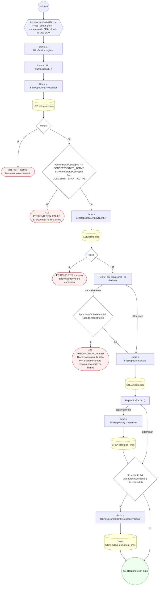

#### 2. POST /billing/documents/{id}:post-to-ledger

Contabilizar documento (posting CxC/CxP)

| HTTP | Código | Cuándo |
|---|---|---|
| 200 | — | Éxito |
| 400 | `VALIDATION_FAILED` | Los parámetros de ruta son UUID válidos; El cuerpo cumple el DTO (sin propiedades extra) |
| 401 | `UNAUTHENTICATED` | Hay una sesión válida (JWT) |
| 403 | `FORBIDDEN` | El rol está permitido; El tenant se resuelve y pertenece al actor |
| 404 | `NOT_FOUND` | ResourceNotFoundException: Documento no encontrado |
| 409 | `CONFLICT` | ConflictException: El documento ya fue contabilizado |
| 429 | `RATE_LIMITED` | No se supera el límite de solicitudes |

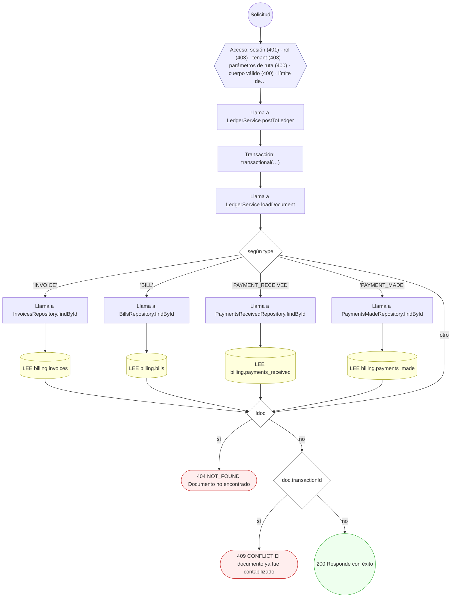

#### 3. POST /billing/dunning-runs:execute

Ejecutar ciclo de morosidad (dunning)

| HTTP | Código | Cuándo |
|---|---|---|
| 201 | — | Éxito |
| 400 | `VALIDATION_FAILED` | El cuerpo cumple el DTO (sin propiedades extra) |
| 401 | `UNAUTHENTICATED` | Hay una sesión válida (JWT) |
| 403 | `FORBIDDEN` | El rol está permitido; El tenant se resuelve y pertenece al actor |
| 409 | `CONFLICT` | ConflictException: El número de corrida ya existe para el tenant |
| 429 | `RATE_LIMITED` | No se supera el límite de solicitudes |

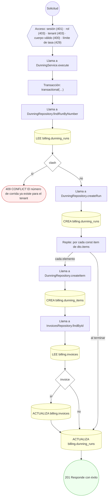

#### 4. POST /billing/internal/dunning-runs/run-due

Evaluar y disparar morosidad automática por tenant

| HTTP | Código | Cuándo |
|---|---|---|
| 200 | — | Éxito |
| 400 | `VALIDATION_FAILED` | El cuerpo cumple el DTO (sin propiedades extra) |
| 401 | `UNAUTHENTICATED` | Hay una sesión válida (JWT) |
| 403 | `FORBIDDEN` | El rol está permitido; El tenant se resuelve y pertenece al actor |
| 429 | `RATE_LIMITED` | No se supera el límite de solicitudes |

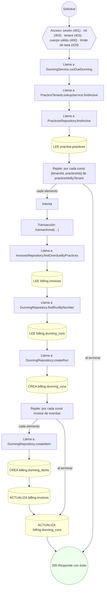

#### 5. GET /billing/invoices

Listar las facturas de la práctica

| HTTP | Código | Cuándo |
|---|---|---|
| 200 | — | Éxito |
| 400 | `VALIDATION_FAILED` | Están los parámetros de consulta obligatorios |
| 401 | `UNAUTHENTICATED` | Hay una sesión válida (JWT) |
| 403 | `FORBIDDEN` | El rol está permitido; El tenant se resuelve y pertenece al actor |
| 404 | `NOT_FOUND` | ResourceNotFoundException: Práctica no encontrada |
| 429 | `RATE_LIMITED` | No se supera el límite de solicitudes |

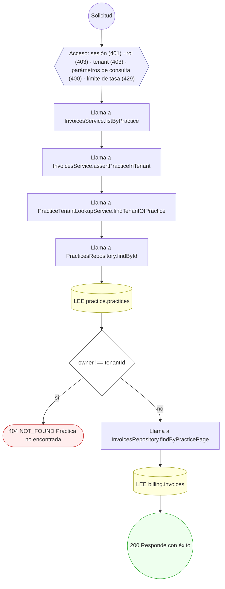

#### 6. POST /billing/invoices:issue-from-encounter

Emitir factura desde los cargos del encuentro

| HTTP | Código | Cuándo |
|---|---|---|
| 201 | — | Éxito |
| 400 | `VALIDATION_FAILED` | El cuerpo cumple el DTO (sin propiedades extra) |
| 401 | `UNAUTHENTICATED` | Hay una sesión válida (JWT) |
| 403 | `FORBIDDEN` | El rol está permitido; El tenant se resuelve y pertenece al actor |
| 409 | `CONFLICT` | ConflictException: El número de factura ya existe en la práctica |
| 429 | `RATE_LIMITED` | No se supera el límite de solicitudes |


#### 7. GET /billing/invoices/{id}

Detalle de una factura, con sus líneas

| HTTP | Código | Cuándo |
|---|---|---|
| 200 | — | Éxito |
| 400 | `VALIDATION_FAILED` | Están los parámetros de consulta obligatorios; Los parámetros de ruta son UUID válidos |
| 401 | `UNAUTHENTICATED` | Hay una sesión válida (JWT) |
| 403 | `FORBIDDEN` | El rol está permitido; El tenant se resuelve y pertenece al actor |
| 404 | `NOT_FOUND` | ResourceNotFoundException: Práctica no encontrada; ResourceNotFoundException: Factura no encontrada |
| 429 | `RATE_LIMITED` | No se supera el límite de solicitudes |

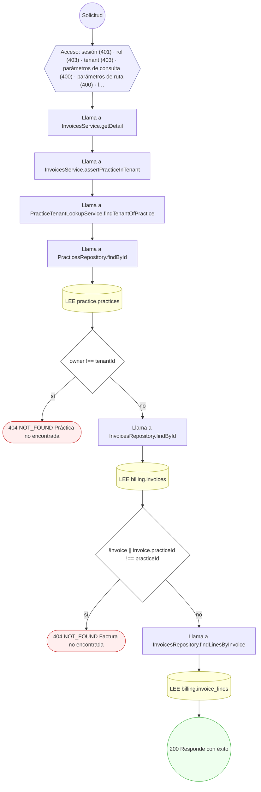

#### 8. POST /billing/invoices/{id}:credit-note

Emitir nota de crédito / castigo sobre una factura

| HTTP | Código | Cuándo |
|---|---|---|
| 201 | — | Éxito |
| 400 | `VALIDATION_FAILED` | Los parámetros de ruta son UUID válidos; El cuerpo cumple el DTO (sin propiedades extra) |
| 401 | `UNAUTHENTICATED` | Hay una sesión válida (JWT) |
| 403 | `FORBIDDEN` | El rol está permitido; El tenant se resuelve y pertenece al actor |
| 404 | `NOT_FOUND` | ResourceNotFoundException: Factura no encontrada |
| 422 | `PRECONDITION_FAILED` | PreconditionFailedException: El monto de la nota de crédito excede el saldo de la factura |
| 429 | `RATE_LIMITED` | No se supera el límite de solicitudes |

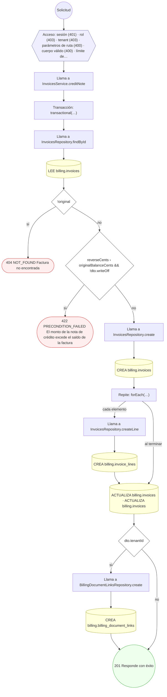

#### 9. POST /billing/kpi-snapshots:compute

Calcular snapshot de KPI financiero y aging

| HTTP | Código | Cuándo |
|---|---|---|
| 201 | — | Éxito |
| 400 | `VALIDATION_FAILED` | El cuerpo cumple el DTO (sin propiedades extra) |
| 401 | `UNAUTHENTICATED` | Hay una sesión válida (JWT) |
| 403 | `FORBIDDEN` | El rol está permitido; El tenant se resuelve y pertenece al actor |
| 409 | `CONFLICT` | ConflictException: El snapshot de KPI ya fue calculado para esa marca |
| 429 | `RATE_LIMITED` | No se supera el límite de solicitudes |


#### 10. GET /billing/patient-statements

Listar los estados de cuenta de la práctica

| HTTP | Código | Cuándo |
|---|---|---|
| 200 | — | Éxito |
| 400 | `VALIDATION_FAILED` | Están los parámetros de consulta obligatorios |
| 401 | `UNAUTHENTICATED` | Hay una sesión válida (JWT) |
| 403 | `FORBIDDEN` | El rol está permitido; El tenant se resuelve y pertenece al actor |
| 404 | `NOT_FOUND` | ResourceNotFoundException: Práctica no encontrada |
| 429 | `RATE_LIMITED` | No se supera el límite de solicitudes |

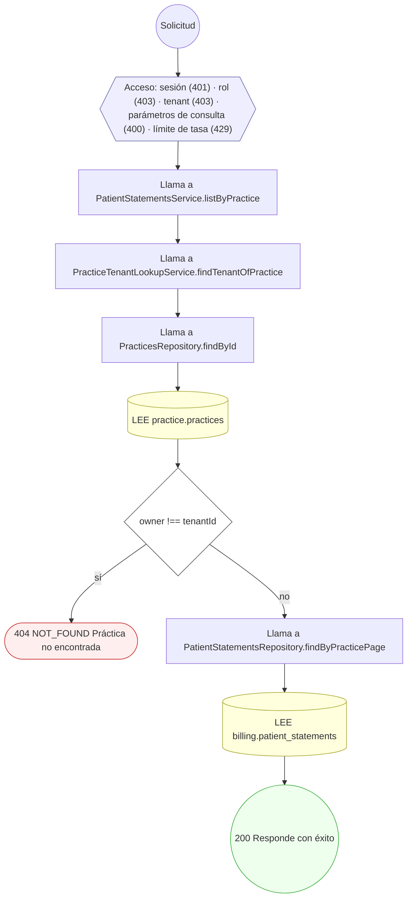

#### 11. POST /billing/patient-statements:generate

Generar el estado de cuenta del paciente

| HTTP | Código | Cuándo |
|---|---|---|
| 201 | — | Éxito |
| 400 | `VALIDATION_FAILED` | El cuerpo cumple el DTO (sin propiedades extra) |
| 401 | `UNAUTHENTICATED` | Hay una sesión válida (JWT) |
| 403 | `FORBIDDEN` | El rol está permitido; El tenant se resuelve y pertenece al actor |
| 409 | `CONFLICT` | ConflictException: Ya existe un estado de cuenta para el periodo |
| 429 | `RATE_LIMITED` | No se supera el límite de solicitudes |


#### 12. POST /billing/payment-plans

Configurar un plan de pagos del paciente

| HTTP | Código | Cuándo |
|---|---|---|
| 201 | — | Éxito |
| 400 | `VALIDATION_FAILED` | El cuerpo cumple el DTO (sin propiedades extra) |
| 401 | `UNAUTHENTICATED` | Hay una sesión válida (JWT) |
| 403 | `FORBIDDEN` | El rol está permitido; El tenant se resuelve y pertenece al actor |
| 404 | `NOT_FOUND` | ResourceNotFoundException: Factura origen no encontrada |
| 422 | `PRECONDITION_FAILED` | PreconditionFailedException: La factura origen no tiene saldo; PreconditionFailedException: La suma de cuotas debe igualar el saldo de la factura |
| 429 | `RATE_LIMITED` | No se supera el límite de solicitudes |

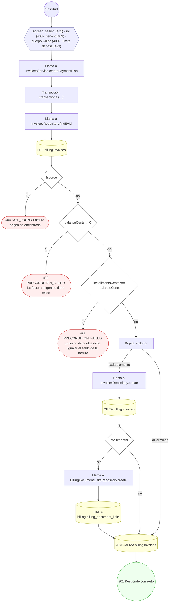

#### 13. POST /billing/payments-made:execute

Ejecutar pago a proveedor con asignación

| HTTP | Código | Cuándo |
|---|---|---|
| 201 | — | Éxito |
| 400 | `VALIDATION_FAILED` | El cuerpo cumple el DTO (sin propiedades extra) |
| 401 | `UNAUTHENTICATED` | Hay una sesión válida (JWT) |
| 403 | `FORBIDDEN` | El rol está permitido; El tenant se resuelve y pertenece al actor |
| 404 | `NOT_FOUND` | ResourceNotFoundException: Factura de proveedor no encontrada |
| 422 | `PRECONDITION_FAILED` | PreconditionFailedException: El monto del pago debe ser positivo; PreconditionFailedException: La suma asignada más retención excede el monto del pago; PreconditionFailedException: La factura de proveedor no tiene saldo; PreconditionFailedException: La asignación excede el saldo de la factura de proveedor |
| 429 | `RATE_LIMITED` | No se supera el límite de solicitudes |

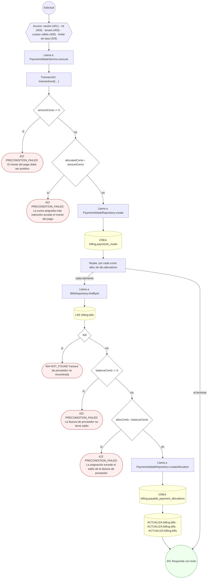

#### 14. POST /billing/payments-received:apply

Aplicar un pago recibido con asignación multi-factura

| HTTP | Código | Cuándo |
|---|---|---|
| 201 | — | Éxito |
| 400 | `VALIDATION_FAILED` | El cuerpo cumple el DTO (sin propiedades extra) |
| 401 | `UNAUTHENTICATED` | Hay una sesión válida (JWT) |
| 403 | `FORBIDDEN` | El rol está permitido; El tenant se resuelve y pertenece al actor |
| 404 | `NOT_FOUND` | ResourceNotFoundException: Factura no encontrada |
| 422 | `PRECONDITION_FAILED` | PreconditionFailedException: El monto del pago debe ser positivo; PreconditionFailedException: La suma asignada excede el monto del pago; PreconditionFailedException: La factura no tiene saldo pendiente; PreconditionFailedException: La asignación excede el saldo de la factura |
| 429 | `RATE_LIMITED` | No se supera el límite de solicitudes |


#### 15. POST /billing/reconciliation:clear

Conciliar pagos vía documento de compensación

| HTTP | Código | Cuándo |
|---|---|---|
| 200 | — | Éxito |
| 400 | `VALIDATION_FAILED` | El cuerpo cumple el DTO (sin propiedades extra) |
| 401 | `UNAUTHENTICATED` | Hay una sesión válida (JWT) |
| 403 | `FORBIDDEN` | El rol está permitido; El tenant se resuelve y pertenece al actor |
| 404 | `NOT_FOUND` | ResourceNotFoundException: Pago recibido no encontrado; ResourceNotFoundException: Pago emitido no encontrado |
| 422 | `PRECONDITION_FAILED` | PreconditionFailedException: Debe indicar al menos un pago a conciliar; PreconditionFailedException: El pago recibido ya está conciliado; PreconditionFailedException: El pago emitido ya está conciliado |
| 429 | `RATE_LIMITED` | No se supera el límite de solicitudes |


#### 16. POST /billing/reimbursements:link

Vincular reembolso de reclamo de seguro a la factura

| HTTP | Código | Cuándo |
|---|---|---|
| 201 | — | Éxito |
| 400 | `VALIDATION_FAILED` | El cuerpo cumple el DTO (sin propiedades extra) |
| 401 | `UNAUTHENTICATED` | Hay una sesión válida (JWT) |
| 403 | `FORBIDDEN` | El rol está permitido; El tenant se resuelve y pertenece al actor |
| 404 | `NOT_FOUND` | ResourceNotFoundException: Factura no encontrada |
| 409 | `CONFLICT` | ConflictException: El reclamo ya tiene un reembolso registrado |
| 429 | `RATE_LIMITED` | No se supera el límite de solicitudes |


#### 17. POST /billing/service-catalog

Dar de alta un servicio en el catálogo maestro

| HTTP | Código | Cuándo |
|---|---|---|
| 201 | — | Éxito |
| 400 | `VALIDATION_FAILED` | El cuerpo cumple el DTO (sin propiedades extra) |
| 401 | `UNAUTHENTICATED` | Hay una sesión válida (JWT) |
| 403 | `FORBIDDEN` | El rol está permitido; El tenant se resuelve y pertenece al actor |
| 404 | `NOT_FOUND` | ResourceNotFoundException: Práctica no encontrada |
| 409 | `CONFLICT` | ConflictException: Ya existe un servicio con ese código en el catálogo |
| 429 | `RATE_LIMITED` | No se supera el límite de solicitudes |

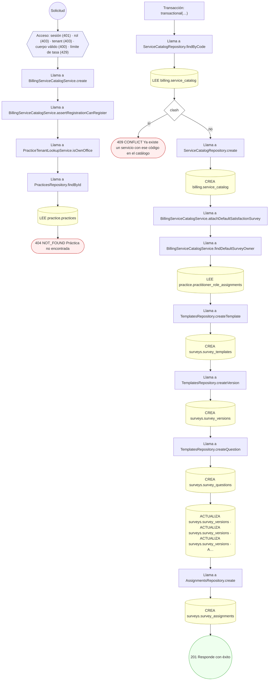

#### 18. PATCH /billing/service-catalog/{id}

Corregir un servicio del catálogo de mi práctica

| HTTP | Código | Cuándo |
|---|---|---|
| 200 | — | Éxito |
| 400 | `VALIDATION_FAILED` | Los parámetros de ruta son UUID válidos; El cuerpo cumple el DTO (sin propiedades extra) |
| 401 | `UNAUTHENTICATED` | Hay una sesión válida (JWT) |
| 403 | `FORBIDDEN` | El rol está permitido; El tenant se resuelve y pertenece al actor |
| 404 | `NOT_FOUND` | ResourceNotFoundException: Servicio no encontrado |
| 429 | `RATE_LIMITED` | No se supera el límite de solicitudes |

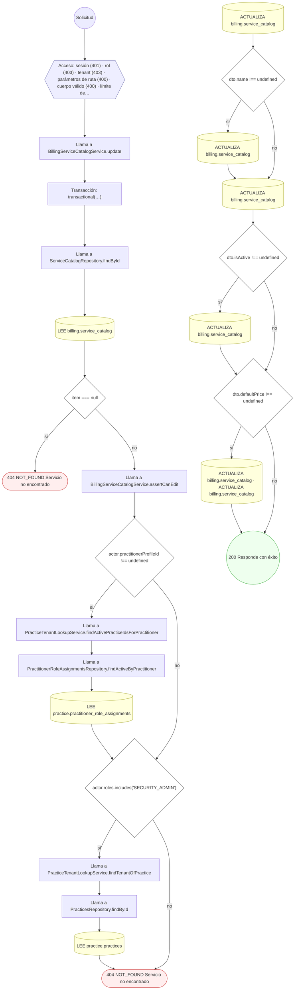

#### 19. GET /billing/service-catalog/procedures

Listar el nomenclador de procedimientos (arancel de referencia)

| HTTP | Código | Cuándo |
|---|---|---|
| 200 | — | Éxito |
| 401 | `UNAUTHENTICATED` | Hay una sesión válida (JWT) |
| 403 | `FORBIDDEN` | El rol está permitido; El tenant se resuelve y pertenece al actor |
| 429 | `RATE_LIMITED` | No se supera el límite de solicitudes |

```mermaid
flowchart TD
  n1(("Solicitud")):::inicio
  n2{{"Acceso: sesión (401) · rol (403) · tenant (403) · límite de tasa (429)"}}:::acceso
  n1 --> n2
  n3["Llama a ProcedureNomenclatureService.search"]:::llamada
  n2 --> n3
  n4{"options.specialty !== undefined && options.specialty !== ''"}:::decision
  n3 --> n4
  n5[("LEE terminology.concept_properties")]:::efecto
  n4 -->|"sí"| n5
  n6[("LEE terminology.catalog_concepts")]:::efecto
  n5 --> n6
  n4 -->|"no"| n6
  n7["Llama a ProcedureNomenclatureService.properties"]:::llamada
  n6 --> n7
  n8[("LEE terminology.concept_properties")]:::efecto
  n7 --> n8
  n9(("200 Responde con éxito")):::ok
  n8 --> n9
  classDef acceso fill:#eef,stroke:#66a
  classDef error fill:#fee,stroke:#c33
  classDef ok fill:#efe,stroke:#3a3
  classDef efecto fill:#ffd,stroke:#aa3
  classDef decision fill:#fff,stroke:#555
  classDef corte fill:#eee,stroke:#999,stroke-dasharray: 4
```

#### 20. GET /billing/simulated/catalogs

Catálogos paramétricos del SIAT simulado

| HTTP | Código | Cuándo |
|---|---|---|
| 200 | — | Éxito |
| 401 | `UNAUTHENTICATED` | Hay una sesión válida (JWT) |
| 403 | `FORBIDDEN` | El rol está permitido; El tenant se resuelve y pertenece al actor |
| 404 | `NOT_FOUND` | ResourceNotFoundException: La facturación simulada está apagada (BILLING_SIMULATED_ENABLED=false) |
| 429 | `RATE_LIMITED` | No se supera el límite de solicitudes |

```mermaid
flowchart TD
  n1(("Solicitud")):::inicio
  n2{{"Acceso: sesión (401) · rol (403) · tenant (403) · límite de tasa (429)"}}:::acceso
  n1 --> n2
  n3["Llama a BillingSimulatedService.catalogs"]:::llamada
  n2 --> n3
  n4["Llama a BillingSimulatedService.ensureEnabled"]:::llamada
  n3 --> n4
  n5{"(process.env['BILLING_SIMULATED_ENABLED'] ?? 'true').toLowerCase() === 'false'"}:::decision
  n4 --> n5
  n6(["404 NOT_FOUND La facturación simulada está apagada (BILLING_SIMULATED_ENABLED=false)"]):::error
  n5 -->|"sí"| n6
  n7(("200 Responde con éxito")):::ok
  n5 -->|"no"| n7
  classDef acceso fill:#eef,stroke:#66a
  classDef error fill:#fee,stroke:#c33
  classDef ok fill:#efe,stroke:#3a3
  classDef efecto fill:#ffd,stroke:#aa3
  classDef decision fill:#fff,stroke:#555
  classDef corte fill:#eee,stroke:#999,stroke-dasharray: 4
```

#### 21. GET /billing/simulated/charges

Cobros de consultas (opcionalmente de una persona)

| HTTP | Código | Cuándo |
|---|---|---|
| 200 | — | Éxito |
| 400 | `VALIDATION_FAILED` | Están los parámetros de consulta obligatorios |
| 401 | `UNAUTHENTICATED` | Hay una sesión válida (JWT) |
| 403 | `FORBIDDEN` | El rol está permitido; El tenant se resuelve y pertenece al actor; ForbiddenException: Su rol no permite operar la facturación |
| 404 | `NOT_FOUND` | ResourceNotFoundException: La facturación simulada está apagada (BILLING_SIMULATED_ENABLED=false) |
| 429 | `RATE_LIMITED` | No se supera el límite de solicitudes |

```mermaid
flowchart TD
  n1(("Solicitud")):::inicio
  n2{{"Acceso: sesión (401) · rol (403) · tenant (403) · parámetros de consulta (400) · límite de tasa (429)"}}:::acceso
  n1 --> n2
  n3["Llama a BillingSimulatedService.listCharges"]:::llamada
  n2 --> n3
  n4["Llama a BillingSimulatedService.ensureEnabled"]:::llamada
  n3 --> n4
  n5{"(process.env['BILLING_SIMULATED_ENABLED'] ?? 'true').toLowerCase() === 'false'"}:::decision
  n4 --> n5
  n6(["404 NOT_FOUND La facturación simulada está apagada (BILLING_SIMULATED_ENABLED=false)"]):::error
  n5 -->|"sí"| n6
  n7["Llama a BillingSimulatedService.scopeOf"]:::llamada
  n5 -->|"no"| n7
  n8{"scope === null"}:::decision
  n7 --> n8
  n9(["403 FORBIDDEN Su rol no permite operar la facturación"]):::error
  n8 -->|"sí"| n9
  n10["Llama a BillingSimulatedService.loadCharges"]:::llamada
  n8 -->|"no"| n10
  n11[("LEE clinical.encounters · LEE practice.practices · LEE billing.invoices · LEE billing.invoice_lines · LEE bil…")]:::efecto
  n10 --> n11
  n12(("200 Responde con éxito")):::ok
  n11 --> n12
  classDef acceso fill:#eef,stroke:#66a
  classDef error fill:#fee,stroke:#c33
  classDef ok fill:#efe,stroke:#3a3
  classDef efecto fill:#ffd,stroke:#aa3
  classDef decision fill:#fff,stroke:#555
  classDef corte fill:#eee,stroke:#999,stroke-dasharray: 4
```

#### 22. POST /billing/simulated/charges/{chargeId}/instances/{instanceId}/payments

Pago de una instancia de plan (no soportado: 409 NOT_A_PLAN)

| HTTP | Código | Cuándo |
|---|---|---|
| 201 | — | Éxito |
| 400 | `VALIDATION_FAILED` | El cuerpo cumple el DTO (sin propiedades extra) |
| 401 | `UNAUTHENTICATED` | Hay una sesión válida (JWT) |
| 403 | `FORBIDDEN` | El rol está permitido; El tenant se resuelve y pertenece al actor; ForbiddenException: Su rol no permite operar la facturación |
| 404 | `NOT_FOUND` | ResourceNotFoundException: La facturación simulada está apagada (BILLING_SIMULATED_ENABLED=false) |
| 409 | `CONFLICT` | ConflictException: El servicio es de una sola instancia: se cobra y se factura de una vez |
| 429 | `RATE_LIMITED` | No se supera el límite de solicitudes |

```mermaid
flowchart TD
  n1(("Solicitud")):::inicio
  n2{{"Acceso: sesión (401) · rol (403) · tenant (403) · cuerpo válido (400) · límite de tasa (429)"}}:::acceso
  n1 --> n2
  n3["Llama a BillingSimulatedService.registerInstancePayment"]:::llamada
  n2 --> n3
  n4["Llama a BillingSimulatedService.ensureEnabled"]:::llamada
  n3 --> n4
  n5{"(process.env['BILLING_SIMULATED_ENABLED'] ?? 'true').toLowerCase() === 'false'"}:::decision
  n4 --> n5
  n6(["404 NOT_FOUND La facturación simulada está apagada (BILLING_SIMULATED_ENABLED=false)"]):::error
  n5 -->|"sí"| n6
  n7["Llama a BillingSimulatedService.scopeOf"]:::llamada
  n5 -->|"no"| n7
  n8{"scope === null"}:::decision
  n7 --> n8
  n9(["403 FORBIDDEN Su rol no permite operar la facturación"]):::error
  n8 -->|"sí"| n9
  n10["Llama a BillingSimulatedService.chargeOrThrow"]:::llamada
  n8 -->|"no"| n10
  n11{"!/^[0-9a-f-]{36}$/i.test(id)"}:::decision
  n10 --> n11
  n12(["↩ (relanza el error capturado)"]):::error
  n11 -->|"sí"| n12
  n13["Llama a BillingSimulatedService.loadCharges"]:::llamada
  n11 -->|"no"| n13
  n14[("LEE clinical.encounters · LEE practice.practices · LEE billing.invoices · LEE billing.invoice_lines · LEE bil…")]:::efecto
  n13 --> n14
  n15{"c === undefined"}:::decision
  n14 --> n15
  n16(["↩ (relanza el error capturado)"]):::error
  n15 -->|"sí"| n16
  n17(["409 CONFLICT El servicio es de una sola instancia: se cobra y se factura de una vez"]):::error
  n15 -->|"no"| n17
  n18(("201 Responde con éxito")):::ok
  classDef acceso fill:#eef,stroke:#66a
  classDef error fill:#fee,stroke:#c33
  classDef ok fill:#efe,stroke:#3a3
  classDef efecto fill:#ffd,stroke:#aa3
  classDef decision fill:#fff,stroke:#555
  classDef corte fill:#eee,stroke:#999,stroke-dasharray: 4
```

#### 23. POST /billing/simulated/charges/{chargeId}/invoices

Emitir la factura SIAT simulada de un cobro pagado

| HTTP | Código | Cuándo |
|---|---|---|
| 201 | — | Éxito |
| 400 | `VALIDATION_FAILED` | El cuerpo cumple el DTO (sin propiedades extra) |
| 401 | `UNAUTHENTICATED` | Hay una sesión válida (JWT) |
| 403 | `FORBIDDEN` | El rol está permitido; El tenant se resuelve y pertenece al actor; ForbiddenException: Su rol no permite operar la facturación |
| 404 | `NOT_FOUND` | ResourceNotFoundException: La facturación simulada está apagada (BILLING_SIMULATED_ENABLED=false) |
| 409 | `CONFLICT` | ConflictException: El cobro ya tiene la factura {String(vigente[0]['n'])} vigente |
| 422 | `PRECONDITION_FAILED` | PreconditionFailedException: El cobro todavía no está pagado |
| 429 | `RATE_LIMITED` | No se supera el límite de solicitudes |

```mermaid
flowchart TD
  n1(("Solicitud")):::inicio
  n2{{"Acceso: sesión (401) · rol (403) · tenant (403) · cuerpo válido (400) · límite de tasa (429)"}}:::acceso
  n1 --> n2
  n3["Llama a BillingSimulatedService.issueInvoice"]:::llamada
  n2 --> n3
  n4["Llama a BillingSimulatedService.ensureEnabled"]:::llamada
  n3 --> n4
  n5{"(process.env['BILLING_SIMULATED_ENABLED'] ?? 'true').toLowerCase() === 'false'"}:::decision
  n4 --> n5
  n6(["404 NOT_FOUND La facturación simulada está apagada (BILLING_SIMULATED_ENABLED=false)"]):::error
  n5 -->|"sí"| n6
  n7["Llama a BillingSimulatedService.scopeOf"]:::llamada
  n5 -->|"no"| n7
  n8{"scope === null"}:::decision
  n7 --> n8
  n9(["403 FORBIDDEN Su rol no permite operar la facturación"]):::error
  n8 -->|"sí"| n9
  n10["Llama a BillingSimulatedService.chargeOrThrow"]:::llamada
  n8 -->|"no"| n10
  n11{"!/^[0-9a-f-]{36}$/i.test(id)"}:::decision
  n10 --> n11
  n12(["↩ (relanza el error capturado)"]):::error
  n11 -->|"sí"| n12
  n13["Llama a BillingSimulatedService.loadCharges"]:::llamada
  n11 -->|"no"| n13
  n14[("LEE clinical.encounters · LEE practice.practices · LEE billing.invoices · LEE billing.invoice_lines · LEE bil…")]:::efecto
  n13 --> n14
  n15{"c === undefined"}:::decision
  n14 --> n15
  n16(["↩ (relanza el error capturado)"]):::error
  n15 -->|"sí"| n16
  n17{"cobro.view.payment === null || cobro.receivableId === null"}:::decision
  n15 -->|"no"| n17
  n18(["422 PRECONDITION_FAILED El cobro todavía no está pagado"]):::error
  n17 -->|"sí"| n18
  n19[("LEE billing.siat_simulated_invoices")]:::efecto
  n17 -->|"no"| n19
  n20{"vigente.length › 0"}:::decision
  n19 --> n20
  n21(["409 CONFLICT El cobro ya tiene la factura {String(vigente[0]['n'])} vigente"]):::error
  n20 -->|"sí"| n21
  n22{"problemas.length › 0"}:::decision
  n20 -->|"no"| n22
  n23(["↩ (relanza el error capturado)"]):::error
  n22 -->|"sí"| n23
  n24["Transacción: transactional(…)"]:::transaccion
  n22 -->|"no"| n24
  n25[("LEE billing.siat_simulated_invoices · CREA billing.siat_simulated_invoices")]:::efecto
  n24 --> n25
  n26["Llama a BillingSimulatedService.siatOrThrow"]:::llamada
  n25 --> n26
  n27{"!/^[0-9a-f-]{36}$/i.test(id)"}:::decision
  n26 --> n27
  n28(["↩ (relanza el error capturado)"]):::error
  n27 -->|"sí"| n28
  n29[("LEE billing.siat_simulated_invoices")]:::efecto
  n27 -->|"no"| n29
  n30{"row === undefined"}:::decision
  n29 --> n30
  n31(["↩ (relanza el error capturado)"]):::error
  n30 -->|"sí"| n31
  n32(("201 Responde con éxito")):::ok
  n30 -->|"no"| n32
  classDef acceso fill:#eef,stroke:#66a
  classDef error fill:#fee,stroke:#c33
  classDef ok fill:#efe,stroke:#3a3
  classDef efecto fill:#ffd,stroke:#aa3
  classDef decision fill:#fff,stroke:#555
  classDef corte fill:#eee,stroke:#999,stroke-dasharray: 4
```

#### 24. POST /billing/simulated/charges/{chargeId}/payment

Registrar el pago real de un cobro

| HTTP | Código | Cuándo |
|---|---|---|
| 201 | — | Éxito |
| 400 | `VALIDATION_FAILED` | El cuerpo cumple el DTO (sin propiedades extra) |
| 401 | `UNAUTHENTICATED` | Hay una sesión válida (JWT) |
| 403 | `FORBIDDEN` | El rol está permitido; El tenant se resuelve y pertenece al actor; ForbiddenException: Su rol no permite operar la facturación |
| 404 | `NOT_FOUND` | ResourceNotFoundException: La facturación simulada está apagada (BILLING_SIMULATED_ENABLED=false); ResourceNotFoundException: Factura no encontrada |
| 409 | `CONFLICT` | ConflictException: El cobro ya está pagado; ConflictException: El número de factura ya existe en la práctica |
| 422 | `PRECONDITION_FAILED` | PreconditionFailedException: La consulta no tiene precio: defina el precio del servicio «{cobro.catalogName}» en el catálogo de servicios de la práctica; PreconditionFailedException: El monto del pago debe ser positivo; PreconditionFailedException: La suma asignada excede el monto del pago; PreconditionFailedException: La factura no tiene saldo pendiente; PreconditionFailedException: La asignación excede el saldo de la factura |
| 429 | `RATE_LIMITED` | No se supera el límite de solicitudes |

```mermaid
flowchart TD
  n1(("Solicitud")):::inicio
  n2{{"Acceso: sesión (401) · rol (403) · tenant (403) · cuerpo válido (400) · límite de tasa (429)"}}:::acceso
  n1 --> n2
  n3["Llama a BillingSimulatedService.registerPayment"]:::llamada
  n2 --> n3
  n4["Llama a BillingSimulatedService.ensureEnabled"]:::llamada
  n3 --> n4
  n5{"(process.env['BILLING_SIMULATED_ENABLED'] ?? 'true').toLowerCase() === 'false'"}:::decision
  n4 --> n5
  n6(["404 NOT_FOUND La facturación simulada está apagada (BILLING_SIMULATED_ENABLED=false)"]):::error
  n5 -->|"sí"| n6
  n7["Llama a BillingSimulatedService.scopeOf"]:::llamada
  n5 -->|"no"| n7
  n8{"scope === null"}:::decision
  n7 --> n8
  n9(["403 FORBIDDEN Su rol no permite operar la facturación"]):::error
  n8 -->|"sí"| n9
  n10{"metodo === undefined"}:::decision
  n8 -->|"no"| n10
  n11(["↩ (relanza el error capturado)"]):::error
  n10 -->|"sí"| n11
  n12["Llama a BillingSimulatedService.chargeOrThrow"]:::llamada
  n10 -->|"no"| n12
  n13{"!/^[0-9a-f-]{36}$/i.test(id)"}:::decision
  n12 --> n13
  n14(["↩ (relanza el error capturado)"]):::error
  n13 -->|"sí"| n14
  n15["Llama a BillingSimulatedService.loadCharges"]:::llamada
  n13 -->|"no"| n15
  n16[("LEE clinical.encounters · LEE practice.practices · LEE billing.invoices · LEE billing.invoice_lines · LEE bil…")]:::efecto
  n15 --> n16
  n17{"c === undefined"}:::decision
  n16 --> n17
  n18(["↩ (relanza el error capturado)"]):::error
  n17 -->|"sí"| n18
  n19{"cobro.view.payment !== null"}:::decision
  n17 -->|"no"| n19
  n20(["409 CONFLICT El cobro ya está pagado"]):::error
  n19 -->|"sí"| n20
  n21{"cents(cobro.view.total) ‹= 0 || cobro.balanceCents ‹= 0"}:::decision
  n19 -->|"no"| n21
  n22(["422 PRECONDITION_FAILED La consulta no tiene precio: defina el precio del servicio «{cobro.catalogName}» en e…"]):::error
  n21 -->|"sí"| n22
  n23{"receivableId === null"}:::decision
  n21 -->|"no"| n23
  n24["Llama a InvoicesService.issueFromEncounter"]:::llamada
  n23 -->|"sí"| n24
  n25["Transacción: transactional(…)"]:::transaccion
  n24 --> n25
  n26["Llama a InvoicesRepository.findByNumber"]:::llamada
  n25 --> n26
  n27[("LEE billing.invoices")]:::efecto
  n26 --> n27
  n28{"clash"}:::decision
  n27 --> n28
  n29(["409 CONFLICT El número de factura ya existe en la práctica"]):::error
  n28 -->|"sí"| n29
  n30["Llama a InvoicesRepository.create"]:::llamada
  n28 -->|"no"| n30
  n31[("CREA billing.invoices")]:::efecto
  n30 --> n31
  n32["Repite: forEach(…)"]:::bucle
  n31 --> n32
  n33["Llama a InvoicesRepository.createLine"]:::llamada
  n32 -->|"cada elemento"| n33
  n34[("CREA billing.invoice_lines")]:::efecto
  n33 --> n34
  n35{"dto.tenantId && (dto.encounterId || dto.claimId)"}:::decision
  n34 --> n35
  n32 -->|"al terminar"| n35
  n36["Llama a BillingDocumentLinksRepository.create"]:::llamada
  n35 -->|"sí"| n36
  n37[("CREA billing.billing_document_links")]:::efecto
  n36 --> n37
  n38["Llama a PaymentsReceivedService.apply"]:::llamada
  n37 --> n38
  n35 -->|"no"| n38
  n23 -->|"no"| n38
  n39["Transacción: transactional(…)"]:::transaccion
  n38 --> n39
  n40{"amountCents ‹= 0"}:::decision
  n39 --> n40
  n41(["422 PRECONDITION_FAILED El monto del pago debe ser positivo"]):::error
  n40 -->|"sí"| n41
  n42{"allocatedCents › amountCents"}:::decision
  n40 -->|"no"| n42
  n43(["422 PRECONDITION_FAILED La suma asignada excede el monto del pago"]):::error
  n42 -->|"sí"| n43
  n44["Llama a PaymentsReceivedRepository.create"]:::llamada
  n42 -->|"no"| n44
  n45[("CREA billing.payments_received")]:::efecto
  n44 --> n45
  n46["Repite: por cada const alloc de dto.allocations"]:::bucle
  n45 --> n46
  n47["Llama a InvoicesRepository.findById"]:::llamada
  n46 -->|"cada elemento"| n47
  n48[("LEE billing.invoices")]:::efecto
  n47 --> n48
  n49{"!invoice"}:::decision
  n48 --> n49
  n50(["404 NOT_FOUND Factura no encontrada"]):::error
  n49 -->|"sí"| n50
  n51{"balanceCents ‹= 0"}:::decision
  n49 -->|"no"| n51
  n52(["422 PRECONDITION_FAILED La factura no tiene saldo pendiente"]):::error
  n51 -->|"sí"| n52
  n53{"allocCents › balanceCents"}:::decision
  n51 -->|"no"| n53
  n54(["422 PRECONDITION_FAILED La asignación excede el saldo de la factura"]):::error
  n53 -->|"sí"| n54
  n55["Llama a PaymentsReceivedRepository.createAllocation"]:::llamada
  n53 -->|"no"| n55
  n56[("CREA billing.receivable_payment_allocations")]:::efecto
  n55 --> n56
  n57[("ACTUALIZA billing.invoices · ACTUALIZA billing.invoices · ACTUALIZA billing.invoices")]:::efecto
  n56 --> n57
  n58["Llama a BillingSimulatedService.chargeOrThrow"]:::llamada
  n57 --> n58
  n46 -->|"al terminar"| n58
  n59{"!/^[0-9a-f-]{36}$/i.test(id)"}:::decision
  n58 --> n59
  n60(["↩ (relanza el error capturado)"]):::error
  n59 -->|"sí"| n60
  n61["Llama a BillingSimulatedService.loadCharges"]:::llamada
  n59 -->|"no"| n61
  n62[("LEE clinical.encounters · LEE practice.practices · LEE billing.invoices · LEE billing.invoice_lines · LEE bil…")]:::efecto
  n61 --> n62
  n63{"c === undefined"}:::decision
  n62 --> n63
  n64(["↩ (relanza el error capturado)"]):::error
  n63 -->|"sí"| n64
  n65(("201 Responde con éxito")):::ok
  n63 -->|"no"| n65
  classDef acceso fill:#eef,stroke:#66a
  classDef error fill:#fee,stroke:#c33
  classDef ok fill:#efe,stroke:#3a3
  classDef efecto fill:#ffd,stroke:#aa3
  classDef decision fill:#fff,stroke:#555
  classDef corte fill:#eee,stroke:#999,stroke-dasharray: 4
```

#### 25. GET /billing/simulated/invoices/{invoiceId}

Una factura simulada, dentro del alcance de quien la pide

| HTTP | Código | Cuándo |
|---|---|---|
| 200 | — | Éxito |
| 401 | `UNAUTHENTICATED` | Hay una sesión válida (JWT) |
| 403 | `FORBIDDEN` | El rol está permitido; El tenant se resuelve y pertenece al actor; ForbiddenException: Su rol no permite operar la facturación; ForbiddenException: Sólo la administración de la clínica puede hacer esto |
| 404 | `NOT_FOUND` | ResourceNotFoundException: La facturación simulada está apagada (BILLING_SIMULATED_ENABLED=false) |
| 429 | `RATE_LIMITED` | No se supera el límite de solicitudes |

```mermaid
flowchart TD
  n1(("Solicitud")):::inicio
  n2{{"Acceso: sesión (401) · rol (403) · tenant (403) · límite de tasa (429)"}}:::acceso
  n1 --> n2
  n3["Llama a BillingSimulatedService.invoice"]:::llamada
  n2 --> n3
  n4["Llama a BillingSimulatedService.scopedSiat"]:::llamada
  n3 --> n4
  n5["Llama a BillingSimulatedService.ensureEnabled"]:::llamada
  n4 --> n5
  n6{"(process.env['BILLING_SIMULATED_ENABLED'] ?? 'true').toLowerCase() === 'false'"}:::decision
  n5 --> n6
  n7(["404 NOT_FOUND La facturación simulada está apagada (BILLING_SIMULATED_ENABLED=false)"]):::error
  n6 -->|"sí"| n7
  n8["Llama a BillingSimulatedService.adminOnly"]:::llamada
  n6 -->|"no"| n8
  n9["Llama a BillingSimulatedService.scopeOf"]:::llamada
  n8 --> n9
  n10{"scope === null"}:::decision
  n9 --> n10
  n11(["403 FORBIDDEN Su rol no permite operar la facturación"]):::error
  n10 -->|"sí"| n11
  n12{"!isAdminScope(scope)"}:::decision
  n10 -->|"no"| n12
  n13(["403 FORBIDDEN Sólo la administración de la clínica puede hacer esto"]):::error
  n12 -->|"sí"| n13
  n14["Llama a BillingSimulatedService.scopeOf"]:::llamada
  n12 -->|"no"| n14
  n15{"scope === null"}:::decision
  n14 --> n15
  n16(["403 FORBIDDEN Su rol no permite operar la facturación"]):::error
  n15 -->|"sí"| n16
  n17["Llama a BillingSimulatedService.siatOrThrow"]:::llamada
  n15 -->|"no"| n17
  n18{"!/^[0-9a-f-]{36}$/i.test(id)"}:::decision
  n17 --> n18
  n19(["↩ (relanza el error capturado)"]):::error
  n18 -->|"sí"| n19
  n20[("LEE billing.siat_simulated_invoices")]:::efecto
  n18 -->|"no"| n20
  n21{"row === undefined"}:::decision
  n20 --> n21
  n22(["↩ (relanza el error capturado)"]):::error
  n21 -->|"sí"| n22
  n23{"row.encounterId === null"}:::decision
  n21 -->|"no"| n23
  n24(["↩ (relanza el error capturado)"]):::error
  n23 -->|"sí"| n24
  n25["Llama a BillingSimulatedService.chargeOrThrow"]:::llamada
  n23 -->|"no"| n25
  n26{"!/^[0-9a-f-]{36}$/i.test(id)"}:::decision
  n25 --> n26
  n27(["↩ (relanza el error capturado)"]):::error
  n26 -->|"sí"| n27
  n28["Llama a BillingSimulatedService.loadCharges"]:::llamada
  n26 -->|"no"| n28
  n29[("LEE clinical.encounters · LEE practice.practices · LEE billing.invoices · LEE billing.invoice_lines · LEE bil…")]:::efecto
  n28 --> n29
  n30{"c === undefined"}:::decision
  n29 --> n30
  n31(["↩ (relanza el error capturado)"]):::error
  n30 -->|"sí"| n31
  n32(("200 Responde con éxito")):::ok
  n30 -->|"no"| n32
  classDef acceso fill:#eef,stroke:#66a
  classDef error fill:#fee,stroke:#c33
  classDef ok fill:#efe,stroke:#3a3
  classDef efecto fill:#ffd,stroke:#aa3
  classDef decision fill:#fff,stroke:#555
  classDef corte fill:#eee,stroke:#999,stroke-dasharray: 4
```

#### 26. POST /billing/simulated/invoices/{invoiceId}/annulment

Anular la factura (sólo administración)

| HTTP | Código | Cuándo |
|---|---|---|
| 201 | — | Éxito |
| 400 | `VALIDATION_FAILED` | El cuerpo cumple el DTO (sin propiedades extra) |
| 401 | `UNAUTHENTICATED` | Hay una sesión válida (JWT) |
| 403 | `FORBIDDEN` | El rol está permitido; El tenant se resuelve y pertenece al actor; ForbiddenException: Su rol no permite operar la facturación; ForbiddenException: Sólo la administración de la clínica puede hacer esto |
| 404 | `NOT_FOUND` | ResourceNotFoundException: La facturación simulada está apagada (BILLING_SIMULATED_ENABLED=false) |
| 429 | `RATE_LIMITED` | No se supera el límite de solicitudes |

```mermaid
flowchart TD
  n1(("Solicitud")):::inicio
  n2{{"Acceso: sesión (401) · rol (403) · tenant (403) · cuerpo válido (400) · límite de tasa (429)"}}:::acceso
  n1 --> n2
  n3["Llama a BillingSimulatedService.annul"]:::llamada
  n2 --> n3
  n4["Llama a BillingSimulatedService.scopedSiat"]:::llamada
  n3 --> n4
  n5["Llama a BillingSimulatedService.ensureEnabled"]:::llamada
  n4 --> n5
  n6{"(process.env['BILLING_SIMULATED_ENABLED'] ?? 'true').toLowerCase() === 'false'"}:::decision
  n5 --> n6
  n7(["404 NOT_FOUND La facturación simulada está apagada (BILLING_SIMULATED_ENABLED=false)"]):::error
  n6 -->|"sí"| n7
  n8["Llama a BillingSimulatedService.adminOnly"]:::llamada
  n6 -->|"no"| n8
  n9["Llama a BillingSimulatedService.scopeOf"]:::llamada
  n8 --> n9
  n10{"scope === null"}:::decision
  n9 --> n10
  n11(["403 FORBIDDEN Su rol no permite operar la facturación"]):::error
  n10 -->|"sí"| n11
  n12{"!isAdminScope(scope)"}:::decision
  n10 -->|"no"| n12
  n13(["403 FORBIDDEN Sólo la administración de la clínica puede hacer esto"]):::error
  n12 -->|"sí"| n13
  n14["Llama a BillingSimulatedService.scopeOf"]:::llamada
  n12 -->|"no"| n14
  n15{"scope === null"}:::decision
  n14 --> n15
  n16(["403 FORBIDDEN Su rol no permite operar la facturación"]):::error
  n15 -->|"sí"| n16
  n17["Llama a BillingSimulatedService.siatOrThrow"]:::llamada
  n15 -->|"no"| n17
  n18{"!/^[0-9a-f-]{36}$/i.test(id)"}:::decision
  n17 --> n18
  n19(["↩ (relanza el error capturado)"]):::error
  n18 -->|"sí"| n19
  n20[("LEE billing.siat_simulated_invoices")]:::efecto
  n18 -->|"no"| n20
  n21{"row === undefined"}:::decision
  n20 --> n21
  n22(["↩ (relanza el error capturado)"]):::error
  n21 -->|"sí"| n22
  n23{"row.encounterId === null"}:::decision
  n21 -->|"no"| n23
  n24(["↩ (relanza el error capturado)"]):::error
  n23 -->|"sí"| n24
  n25["Llama a BillingSimulatedService.chargeOrThrow"]:::llamada
  n23 -->|"no"| n25
  n26{"!/^[0-9a-f-]{36}$/i.test(id)"}:::decision
  n25 --> n26
  n27(["↩ (relanza el error capturado)"]):::error
  n26 -->|"sí"| n27
  n28["Llama a BillingSimulatedService.loadCharges"]:::llamada
  n26 -->|"no"| n28
  n29[("LEE clinical.encounters · LEE practice.practices · LEE billing.invoices · LEE billing.invoice_lines · LEE bil…")]:::efecto
  n28 --> n29
  n30{"c === undefined"}:::decision
  n29 --> n30
  n31(["↩ (relanza el error capturado)"]):::error
  n30 -->|"sí"| n31
  n32(("201 Responde con éxito")):::ok
  n30 -->|"no"| n32
  classDef acceso fill:#eef,stroke:#66a
  classDef error fill:#fee,stroke:#c33
  classDef ok fill:#efe,stroke:#3a3
  classDef efecto fill:#ffd,stroke:#aa3
  classDef decision fill:#fff,stroke:#555
  classDef corte fill:#eee,stroke:#999,stroke-dasharray: 4
```

#### 27. POST /billing/simulated/invoices/{invoiceId}/annulment-reversal

Revertir la anulación (sólo administración)

| HTTP | Código | Cuándo |
|---|---|---|
| 201 | — | Éxito |
| 401 | `UNAUTHENTICATED` | Hay una sesión válida (JWT) |
| 403 | `FORBIDDEN` | El rol está permitido; El tenant se resuelve y pertenece al actor; ForbiddenException: Su rol no permite operar la facturación; ForbiddenException: Sólo la administración de la clínica puede hacer esto |
| 404 | `NOT_FOUND` | ResourceNotFoundException: La facturación simulada está apagada (BILLING_SIMULATED_ENABLED=false) |
| 429 | `RATE_LIMITED` | No se supera el límite de solicitudes |

```mermaid
flowchart TD
  n1(("Solicitud")):::inicio
  n2{{"Acceso: sesión (401) · rol (403) · tenant (403) · límite de tasa (429)"}}:::acceso
  n1 --> n2
  n3["Llama a BillingSimulatedService.revertAnnulment"]:::llamada
  n2 --> n3
  n4["Llama a BillingSimulatedService.scopedSiat"]:::llamada
  n3 --> n4
  n5["Llama a BillingSimulatedService.ensureEnabled"]:::llamada
  n4 --> n5
  n6{"(process.env['BILLING_SIMULATED_ENABLED'] ?? 'true').toLowerCase() === 'false'"}:::decision
  n5 --> n6
  n7(["404 NOT_FOUND La facturación simulada está apagada (BILLING_SIMULATED_ENABLED=false)"]):::error
  n6 -->|"sí"| n7
  n8["Llama a BillingSimulatedService.adminOnly"]:::llamada
  n6 -->|"no"| n8
  n9["Llama a BillingSimulatedService.scopeOf"]:::llamada
  n8 --> n9
  n10{"scope === null"}:::decision
  n9 --> n10
  n11(["403 FORBIDDEN Su rol no permite operar la facturación"]):::error
  n10 -->|"sí"| n11
  n12{"!isAdminScope(scope)"}:::decision
  n10 -->|"no"| n12
  n13(["403 FORBIDDEN Sólo la administración de la clínica puede hacer esto"]):::error
  n12 -->|"sí"| n13
  n14["Llama a BillingSimulatedService.scopeOf"]:::llamada
  n12 -->|"no"| n14
  n15{"scope === null"}:::decision
  n14 --> n15
  n16(["403 FORBIDDEN Su rol no permite operar la facturación"]):::error
  n15 -->|"sí"| n16
  n17["Llama a BillingSimulatedService.siatOrThrow"]:::llamada
  n15 -->|"no"| n17
  n18{"!/^[0-9a-f-]{36}$/i.test(id)"}:::decision
  n17 --> n18
  n19(["↩ (relanza el error capturado)"]):::error
  n18 -->|"sí"| n19
  n20[("LEE billing.siat_simulated_invoices")]:::efecto
  n18 -->|"no"| n20
  n21{"row === undefined"}:::decision
  n20 --> n21
  n22(["↩ (relanza el error capturado)"]):::error
  n21 -->|"sí"| n22
  n23{"row.encounterId === null"}:::decision
  n21 -->|"no"| n23
  n24(["↩ (relanza el error capturado)"]):::error
  n23 -->|"sí"| n24
  n25["Llama a BillingSimulatedService.chargeOrThrow"]:::llamada
  n23 -->|"no"| n25
  n26{"!/^[0-9a-f-]{36}$/i.test(id)"}:::decision
  n25 --> n26
  n27(["↩ (relanza el error capturado)"]):::error
  n26 -->|"sí"| n27
  n28["Llama a BillingSimulatedService.loadCharges"]:::llamada
  n26 -->|"no"| n28
  n29[("LEE clinical.encounters · LEE practice.practices · LEE billing.invoices · LEE billing.invoice_lines · LEE bil…")]:::efecto
  n28 --> n29
  n30{"c === undefined"}:::decision
  n29 --> n30
  n31(["↩ (relanza el error capturado)"]):::error
  n30 -->|"sí"| n31
  n32["Llama a BillingSimulatedService.operate"]:::llamada
  n30 -->|"no"| n32
  n33[("ACTUALIZA billing.siat_simulated_invoices")]:::efecto
  n32 --> n33
  n34["Llama a BillingSimulatedService.siatOrThrow"]:::llamada
  n33 --> n34
  n35{"!/^[0-9a-f-]{36}$/i.test(id)"}:::decision
  n34 --> n35
  n36(["↩ (relanza el error capturado)"]):::error
  n35 -->|"sí"| n36
  n37[("LEE billing.siat_simulated_invoices")]:::efecto
  n35 -->|"no"| n37
  n38{"row === undefined"}:::decision
  n37 --> n38
  n39(["↩ (relanza el error capturado)"]):::error
  n38 -->|"sí"| n39
  n40(("201 Responde con éxito")):::ok
  n38 -->|"no"| n40
  classDef acceso fill:#eef,stroke:#66a
  classDef error fill:#fee,stroke:#c33
  classDef ok fill:#efe,stroke:#3a3
  classDef efecto fill:#ffd,stroke:#aa3
  classDef decision fill:#fff,stroke:#555
  classDef corte fill:#eee,stroke:#999,stroke-dasharray: 4
```

#### 28. POST /billing/simulated/invoices/{invoiceId}/email

Encolar el envío (simulado, no se envía) de la factura

| HTTP | Código | Cuándo |
|---|---|---|
| 201 | — | Éxito |
| 400 | `VALIDATION_FAILED` | El cuerpo cumple el DTO (sin propiedades extra) |
| 401 | `UNAUTHENTICATED` | Hay una sesión válida (JWT) |
| 403 | `FORBIDDEN` | El rol está permitido; El tenant se resuelve y pertenece al actor; ForbiddenException: Su rol no permite operar la facturación; ForbiddenException: Sólo la administración de la clínica puede hacer esto |
| 404 | `NOT_FOUND` | ResourceNotFoundException: La facturación simulada está apagada (BILLING_SIMULATED_ENABLED=false) |
| 429 | `RATE_LIMITED` | No se supera el límite de solicitudes |

```mermaid
flowchart TD
  n1(("Solicitud")):::inicio
  n2{{"Acceso: sesión (401) · rol (403) · tenant (403) · cuerpo válido (400) · límite de tasa (429)"}}:::acceso
  n1 --> n2
  n3["Llama a BillingSimulatedService.email"]:::llamada
  n2 --> n3
  n4["Llama a BillingSimulatedService.scopedSiat"]:::llamada
  n3 --> n4
  n5["Llama a BillingSimulatedService.ensureEnabled"]:::llamada
  n4 --> n5
  n6{"(process.env['BILLING_SIMULATED_ENABLED'] ?? 'true').toLowerCase() === 'false'"}:::decision
  n5 --> n6
  n7(["404 NOT_FOUND La facturación simulada está apagada (BILLING_SIMULATED_ENABLED=false)"]):::error
  n6 -->|"sí"| n7
  n8["Llama a BillingSimulatedService.adminOnly"]:::llamada
  n6 -->|"no"| n8
  n9["Llama a BillingSimulatedService.scopeOf"]:::llamada
  n8 --> n9
  n10{"scope === null"}:::decision
  n9 --> n10
  n11(["403 FORBIDDEN Su rol no permite operar la facturación"]):::error
  n10 -->|"sí"| n11
  n12{"!isAdminScope(scope)"}:::decision
  n10 -->|"no"| n12
  n13(["403 FORBIDDEN Sólo la administración de la clínica puede hacer esto"]):::error
  n12 -->|"sí"| n13
  n14["Llama a BillingSimulatedService.scopeOf"]:::llamada
  n12 -->|"no"| n14
  n15{"scope === null"}:::decision
  n14 --> n15
  n16(["403 FORBIDDEN Su rol no permite operar la facturación"]):::error
  n15 -->|"sí"| n16
  n17["Llama a BillingSimulatedService.siatOrThrow"]:::llamada
  n15 -->|"no"| n17
  n18{"!/^[0-9a-f-]{36}$/i.test(id)"}:::decision
  n17 --> n18
  n19(["↩ (relanza el error capturado)"]):::error
  n18 -->|"sí"| n19
  n20[("LEE billing.siat_simulated_invoices")]:::efecto
  n18 -->|"no"| n20
  n21{"row === undefined"}:::decision
  n20 --> n21
  n22(["↩ (relanza el error capturado)"]):::error
  n21 -->|"sí"| n22
  n23{"row.encounterId === null"}:::decision
  n21 -->|"no"| n23
  n24(["↩ (relanza el error capturado)"]):::error
  n23 -->|"sí"| n24
  n25["Llama a BillingSimulatedService.chargeOrThrow"]:::llamada
  n23 -->|"no"| n25
  n26{"!/^[0-9a-f-]{36}$/i.test(id)"}:::decision
  n25 --> n26
  n27(["↩ (relanza el error capturado)"]):::error
  n26 -->|"sí"| n27
  n28["Llama a BillingSimulatedService.loadCharges"]:::llamada
  n26 -->|"no"| n28
  n29[("LEE clinical.encounters · LEE practice.practices · LEE billing.invoices · LEE billing.invoice_lines · LEE bil…")]:::efecto
  n28 --> n29
  n30{"c === undefined"}:::decision
  n29 --> n30
  n31(["↩ (relanza el error capturado)"]):::error
  n30 -->|"sí"| n31
  n32{"!EMAIL.test(String(dto.to ?? ''))"}:::decision
  n30 -->|"no"| n32
  n33(["↩ (relanza el error capturado)"]):::error
  n32 -->|"sí"| n33
  n34{"row.status === 'REJECTED'"}:::decision
  n32 -->|"no"| n34
  n35(["↩ (relanza el error capturado)"]):::error
  n34 -->|"sí"| n35
  n36[("CREA billing.siat_simulated_outbox · ACTUALIZA billing.siat_simulated_invoices")]:::efecto
  n34 -->|"no"| n36
  n37(("201 Responde con éxito")):::ok
  n36 --> n37
  classDef acceso fill:#eef,stroke:#66a
  classDef error fill:#fee,stroke:#c33
  classDef ok fill:#efe,stroke:#3a3
  classDef efecto fill:#ffd,stroke:#aa3
  classDef decision fill:#fff,stroke:#555
  classDef corte fill:#eee,stroke:#999,stroke-dasharray: 4
```

#### 29. GET /billing/simulated/my-invoices

Mis facturas: recibidas (paciente) o emitidas (quien factura)

| HTTP | Código | Cuándo |
|---|---|---|
| 200 | — | Éxito |
| 401 | `UNAUTHENTICATED` | Hay una sesión válida (JWT) |
| 403 | `FORBIDDEN` | El rol está permitido; El tenant se resuelve y pertenece al actor |
| 404 | `NOT_FOUND` | ResourceNotFoundException: La facturación simulada está apagada (BILLING_SIMULATED_ENABLED=false) |
| 429 | `RATE_LIMITED` | No se supera el límite de solicitudes |

```mermaid
flowchart TD
  n1(("Solicitud")):::inicio
  n2{{"Acceso: sesión (401) · rol (403) · tenant (403) · límite de tasa (429)"}}:::acceso
  n1 --> n2
  n3["Llama a BillingSimulatedService.myInvoices"]:::llamada
  n2 --> n3
  n4["Llama a BillingSimulatedService.ensureEnabled"]:::llamada
  n3 --> n4
  n5{"(process.env['BILLING_SIMULATED_ENABLED'] ?? 'true').toLowerCase() === 'false'"}:::decision
  n4 --> n5
  n6(["404 NOT_FOUND La facturación simulada está apagada (BILLING_SIMULATED_ENABLED=false)"]):::error
  n5 -->|"sí"| n6
  n7["Llama a BillingSimulatedService.myInvoiceRows"]:::llamada
  n5 -->|"no"| n7
  n8[("LEE billing.siat_simulated_invoices · LEE practice.practices · LEE clinical.encounters · LEE profiles.persons")]:::efecto
  n7 --> n8
  n9(("200 Responde con éxito")):::ok
  n8 --> n9
  classDef acceso fill:#eef,stroke:#66a
  classDef error fill:#fee,stroke:#c33
  classDef ok fill:#efe,stroke:#3a3
  classDef efecto fill:#ffd,stroke:#aa3
  classDef decision fill:#fff,stroke:#555
  classDef corte fill:#eee,stroke:#999,stroke-dasharray: 4
```

#### 30. GET /billing/simulated/my-invoices/{invoiceId}

Una de mis facturas

| HTTP | Código | Cuándo |
|---|---|---|
| 200 | — | Éxito |
| 401 | `UNAUTHENTICATED` | Hay una sesión válida (JWT) |
| 403 | `FORBIDDEN` | El rol está permitido; El tenant se resuelve y pertenece al actor |
| 404 | `NOT_FOUND` | ResourceNotFoundException: La facturación simulada está apagada (BILLING_SIMULATED_ENABLED=false) |
| 429 | `RATE_LIMITED` | No se supera el límite de solicitudes |

```mermaid
flowchart TD
  n1(("Solicitud")):::inicio
  n2{{"Acceso: sesión (401) · rol (403) · tenant (403) · límite de tasa (429)"}}:::acceso
  n1 --> n2
  n3["Llama a BillingSimulatedService.myInvoice"]:::llamada
  n2 --> n3
  n4["Llama a BillingSimulatedService.ensureEnabled"]:::llamada
  n3 --> n4
  n5{"(process.env['BILLING_SIMULATED_ENABLED'] ?? 'true').toLowerCase() === 'false'"}:::decision
  n4 --> n5
  n6(["404 NOT_FOUND La facturación simulada está apagada (BILLING_SIMULATED_ENABLED=false)"]):::error
  n5 -->|"sí"| n6
  n7{"!/^[0-9a-f-]{36}$/i.test(id)"}:::decision
  n5 -->|"no"| n7
  n8(["↩ (relanza el error capturado)"]):::error
  n7 -->|"sí"| n8
  n9["Llama a BillingSimulatedService.myInvoiceRows"]:::llamada
  n7 -->|"no"| n9
  n10[("LEE billing.siat_simulated_invoices · LEE practice.practices · LEE clinical.encounters · LEE profiles.persons")]:::efecto
  n9 --> n10
  n11{"row === undefined"}:::decision
  n10 --> n11
  n12(["↩ (relanza el error capturado)"]):::error
  n11 -->|"sí"| n12
  n13(("200 Responde con éxito")):::ok
  n11 -->|"no"| n13
  classDef acceso fill:#eef,stroke:#66a
  classDef error fill:#fee,stroke:#c33
  classDef ok fill:#efe,stroke:#3a3
  classDef efecto fill:#ffd,stroke:#aa3
  classDef decision fill:#fff,stroke:#555
  classDef corte fill:#eee,stroke:#999,stroke-dasharray: 4
```

#### 31. GET /billing/simulated/outbox

Bandeja de correo simulada (sólo administración)

| HTTP | Código | Cuándo |
|---|---|---|
| 200 | — | Éxito |
| 401 | `UNAUTHENTICATED` | Hay una sesión válida (JWT) |
| 403 | `FORBIDDEN` | El rol está permitido; El tenant se resuelve y pertenece al actor; ForbiddenException: Su rol no permite operar la facturación; ForbiddenException: Sólo la administración de la clínica puede hacer esto |
| 404 | `NOT_FOUND` | ResourceNotFoundException: La facturación simulada está apagada (BILLING_SIMULATED_ENABLED=false) |
| 429 | `RATE_LIMITED` | No se supera el límite de solicitudes |

```mermaid
flowchart TD
  n1(("Solicitud")):::inicio
  n2{{"Acceso: sesión (401) · rol (403) · tenant (403) · límite de tasa (429)"}}:::acceso
  n1 --> n2
  n3["Llama a BillingSimulatedService.outbox"]:::llamada
  n2 --> n3
  n4["Llama a BillingSimulatedService.ensureEnabled"]:::llamada
  n3 --> n4
  n5{"(process.env['BILLING_SIMULATED_ENABLED'] ?? 'true').toLowerCase() === 'false'"}:::decision
  n4 --> n5
  n6(["404 NOT_FOUND La facturación simulada está apagada (BILLING_SIMULATED_ENABLED=false)"]):::error
  n5 -->|"sí"| n6
  n7["Llama a BillingSimulatedService.adminOnly"]:::llamada
  n5 -->|"no"| n7
  n8["Llama a BillingSimulatedService.scopeOf"]:::llamada
  n7 --> n8
  n9{"scope === null"}:::decision
  n8 --> n9
  n10(["403 FORBIDDEN Su rol no permite operar la facturación"]):::error
  n9 -->|"sí"| n10
  n11{"!isAdminScope(scope)"}:::decision
  n9 -->|"no"| n11
  n12(["403 FORBIDDEN Sólo la administración de la clínica puede hacer esto"]):::error
  n11 -->|"sí"| n12
  n13[("LEE billing.siat_simulated_outbox · LEE billing.siat_simulated_invoices · LEE clinical.encounters")]:::efecto
  n11 -->|"no"| n13
  n14(("200 Responde con éxito")):::ok
  n13 --> n14
  classDef acceso fill:#eef,stroke:#66a
  classDef error fill:#fee,stroke:#c33
  classDef ok fill:#efe,stroke:#3a3
  classDef efecto fill:#ffd,stroke:#aa3
  classDef decision fill:#fff,stroke:#555
  classDef corte fill:#eee,stroke:#999,stroke-dasharray: 4
```

#### 32. GET /billing/simulated/status

Estado fiscal simulado: emisores y credenciales sintéticas

| HTTP | Código | Cuándo |
|---|---|---|
| 200 | — | Éxito |
| 401 | `UNAUTHENTICATED` | Hay una sesión válida (JWT) |
| 403 | `FORBIDDEN` | El rol está permitido; El tenant se resuelve y pertenece al actor; ForbiddenException: Su rol no permite operar la facturación |
| 404 | `NOT_FOUND` | ResourceNotFoundException: La facturación simulada está apagada (BILLING_SIMULATED_ENABLED=false) |
| 429 | `RATE_LIMITED` | No se supera el límite de solicitudes |

```mermaid
flowchart TD
  n1(("Solicitud")):::inicio
  n2{{"Acceso: sesión (401) · rol (403) · tenant (403) · límite de tasa (429)"}}:::acceso
  n1 --> n2
  n3["Llama a BillingSimulatedService.status"]:::llamada
  n2 --> n3
  n4["Llama a BillingSimulatedService.ensureEnabled"]:::llamada
  n3 --> n4
  n5{"(process.env['BILLING_SIMULATED_ENABLED'] ?? 'true').toLowerCase() === 'false'"}:::decision
  n4 --> n5
  n6(["404 NOT_FOUND La facturación simulada está apagada (BILLING_SIMULATED_ENABLED=false)"]):::error
  n5 -->|"sí"| n6
  n7["Llama a BillingSimulatedService.scopeOf"]:::llamada
  n5 -->|"no"| n7
  n8{"scope === null"}:::decision
  n7 --> n8
  n9(["403 FORBIDDEN Su rol no permite operar la facturación"]):::error
  n8 -->|"sí"| n9
  n10["Llama a BillingSimulatedService.practicesInScope"]:::llamada
  n8 -->|"no"| n10
  n11{"scope.kind === 'practitioner'"}:::decision
  n10 --> n11
  n12[("LEE clinical.encounters · LEE practice.practices")]:::efecto
  n11 -->|"sí"| n12
  n13[("LEE practice.practices")]:::efecto
  n12 --> n13
  n11 -->|"no"| n13
  n14(("200 Responde con éxito")):::ok
  n13 --> n14
  classDef acceso fill:#eef,stroke:#66a
  classDef error fill:#fee,stroke:#c33
  classDef ok fill:#efe,stroke:#3a3
  classDef efecto fill:#ffd,stroke:#aa3
  classDef decision fill:#fff,stroke:#555
  classDef corte fill:#eee,stroke:#999,stroke-dasharray: 4
```

### Operaciones sin decisiones propias

Sólo comprueban el acceso y leen o escriben: no tienen ramas que dibujar. Su detalle está en la ficha de endpoints.

| Operación | Respuestas posibles | Tablas |
|---|---|---|
| GET /billing/service-catalog | 200, 400, 401, 403, 429 | 1 |
| GET /billing/service-catalog/procedure-specialties | 200, 401, 403, 429 | 1 |
