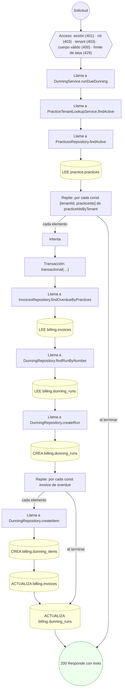
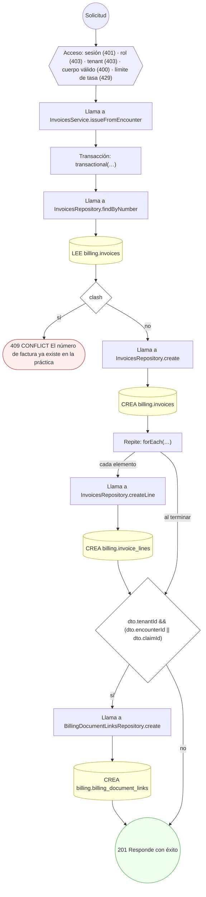
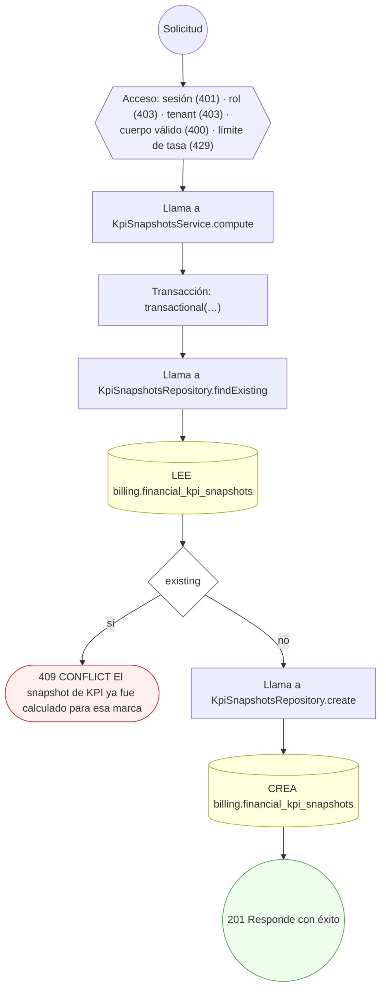
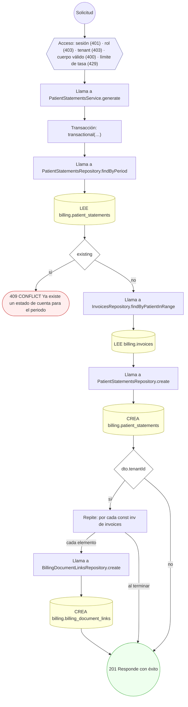
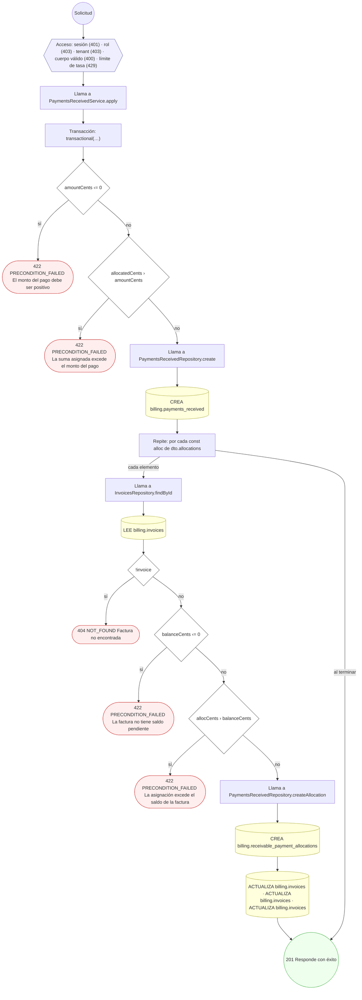
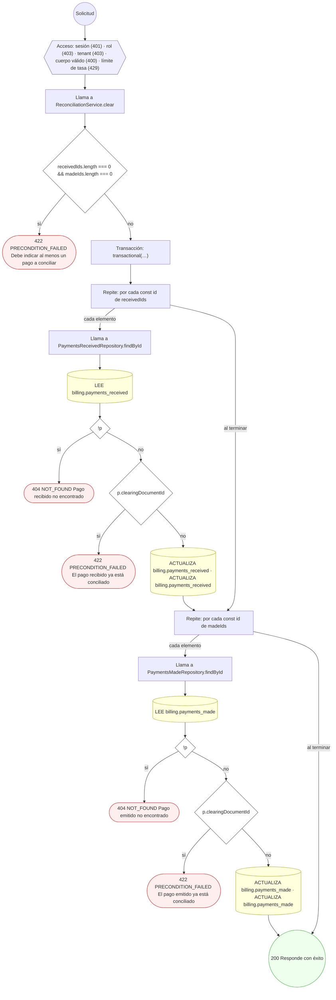
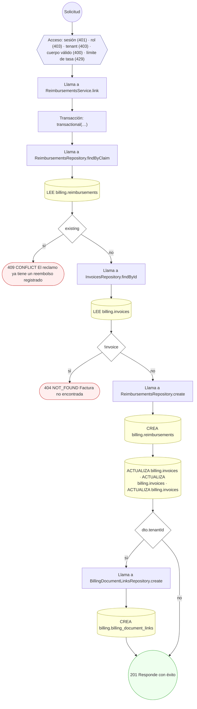
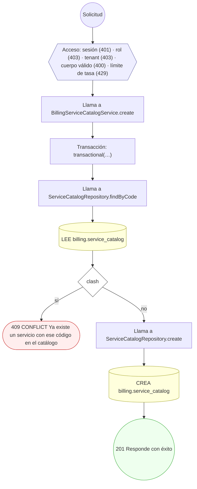

<!-- AUTOGENERADO por tools/inventario/flujos.mjs. No editar manualmente. -->

# Flujos del módulo `billing`

- **Procesos:** 1 · **Máquinas de estado:** 0
- **Operaciones:** 15 (14 con decisiones propias, 1 sin ellas)
- Inventario de endpoints del módulo: [billing](../endpoints/billing.md)

## Proceso: Módulo Billing (17)

- **Código:** `billing` · **Agrupación:** MIXTO · **Operaciones:** 15
- **Actores:** Cualquier sesión válida · SECURITY_ADMIN · SYSTEM
- **Revisión:** AUTO_DETECTADA
- **Fuentes:** `src/modules/billing/README.md`

### Para qué sirve

Facturación al paciente (CxC), cuentas por pagar (CxP), contabilización a ledger, conciliación bancaria, morosidad, planes de pago y KPIs financieros. Implementa los 12 casos de uso UC-17-01..12 del spec `casos_uso_17_billing.puml`.

_Fuente: `src/modules/billing/README.md:3`_

### Etapas y operaciones

| Etapa | Descripción | Operación | Quién actúa | Riesgo | Tablas |
|---|---|---|---|---|---|
| `UC-17-01` | InvoicesService.issueFromEncounter | POST /billing/invoices:issue-from-encounter | SECURITY_ADMIN | MEDIO | 4 |
| `UC-17-02` | PaymentsReceivedService.apply | POST /billing/payments-received:apply | SECURITY_ADMIN | MEDIO | 4 |
| `UC-17-03` | InvoicesService.creditNote | POST /billing/invoices/{id}:credit-note | SECURITY_ADMIN | MEDIO | 5 |
| `UC-17-04` | BillsService.register | POST /billing/bills | SECURITY_ADMIN | MEDIO | 5 |
| `UC-17-05` | PaymentsMadeService.execute | POST /billing/payments-made:execute | SECURITY_ADMIN | MEDIO | 4 |
| `UC-17-06` | LedgerService.postToLedger | POST /billing/documents/{id}:post-to-ledger | SECURITY_ADMIN | BAJO | 4 |
| `UC-17-07` | ReconciliationService.clear | POST /billing/reconciliation:clear | SECURITY_ADMIN | MEDIO | 4 |
| `UC-17-08` | ReimbursementsService.link | POST /billing/reimbursements:link | SECURITY_ADMIN | MEDIO | 5 |
| `UC-17-09` | PatientStatementsService.generate | POST /billing/patient-statements:generate | SECURITY_ADMIN | MEDIO | 4 |
| `UC-17-10` | DunningService.execute | POST /billing/dunning-runs:execute | SECURITY_ADMIN | MEDIO | 6 |
| `UC-17-11` | InvoicesService.createPaymentPlan | POST /billing/payment-plans | SECURITY_ADMIN | MEDIO | 4 |
| `UC-17-12` | KpiSnapshotsService.compute | POST /billing/kpi-snapshots:compute | SECURITY_ADMIN | MEDIO | 2 |
| `ctrl:BillingOperationsController` | Operaciones de BillingOperationsController que el README no asigna a un caso de uso | POST /billing/internal/dunning-runs/run-due | SYSTEM · SECURITY_ADMIN | MEDIO | 7 |
| `ctrl:BillingServiceCatalogController` | Operaciones de BillingServiceCatalogController que el README no asigna a un caso de uso | GET /billing/service-catalog | Cualquier sesión válida | BAJO | 1 |
|  |  | POST /billing/service-catalog | SECURITY_ADMIN | MEDIO | 2 |

### Diagrama — etapas `UC-17-01`, `UC-17-02`, `UC-17-03`…

```mermaid
flowchart LR
  a2(["SECURITY_ADMIN"]):::actor
  a30(["SYSTEM · SECURITY_ADMIN"]):::actor
  a33(["Cualquier sesión válida"]):::actor
  t3[("billing.billing_document_links")]:::tabla
  t4[("billing.invoice_lines")]:::tabla
  t5[("billing.invoices")]:::tabla
  t7[("billing.payments_received")]:::tabla
  t8[("billing.receivable_payment_allocations")]:::tabla
  t11[("billing.bill_lines")]:::tabla
  t12[("billing.bills")]:::tabla
  t13[("billing.vendors")]:::tabla
  t15[("billing.payable_payment_allocations")]:::tabla
  t16[("billing.payments_made")]:::tabla
  t20[("billing.reimbursements")]:::tabla
  t22[("billing.patient_statements")]:::tabla
  t24[("billing.dunning_items")]:::tabla
  t25[("billing.dunning_runs")]:::tabla
  t28[("billing.financial_kpi_snapshots")]:::tabla
  t34[("billing.service_catalog")]:::tabla
  subgraph s0["UC-17-01 · InvoicesService.issueFromEncounter"]
    o1["POST /billing/invoices:issue-from-encounter"]:::op
  end
  subgraph s1["UC-17-02 · PaymentsReceivedService.apply"]
    o6["POST /billing/payments-received:apply"]:::op
  end
  subgraph s2["UC-17-03 · InvoicesService.creditNote"]
    o9["POST /billing/invoices/{id}:credit-note"]:::op
  end
  subgraph s3["UC-17-04 · BillsService.register"]
    o10["POST /billing/bills"]:::op
  end
  subgraph s4["UC-17-05 · PaymentsMadeService.execute"]
    o14["POST /billing/payments-made:execute"]:::op
  end
  subgraph s5["UC-17-06 · LedgerService.postToLedger"]
    o17["POST /billing/documents/{id}:post-to-ledger"]:::op
  end
  subgraph s6["UC-17-07 · ReconciliationService.clear"]
    o18["POST /billing/reconciliation:clear"]:::op
  end
  subgraph s7["UC-17-08 · ReimbursementsService.link"]
    o19["POST /billing/reimbursements:link"]:::op
  end
  subgraph s8["UC-17-09 · PatientStatementsService.generate"]
    o21["POST /billing/patient-statements:generate"]:::op
  end
  subgraph s9["UC-17-10 · DunningService.execute"]
    o23["POST /billing/dunning-runs:execute"]:::op
  end
  subgraph s10["UC-17-11 · InvoicesService.createPaymentPlan"]
    o26["POST /billing/payment-plans"]:::op
  end
  subgraph s11["UC-17-12 · KpiSnapshotsService.compute"]
    o27["POST /billing/kpi-snapshots:compute"]:::op
  end
  t31[("+1 tablas más")]
  subgraph s12["ctrl:BillingOperationsController · Operaciones de BillingOperationsController q…"]
    o29["POST /billing/internal/dunning-runs/run-due"]:::op
  end
  subgraph s13["ctrl:BillingServiceCatalogController · Operaciones de BillingServiceCatalogCont…"]
    o32["GET /billing/service-catalog"]:::op
    o35["POST /billing/service-catalog"]:::op
  end
  a2 --> o1
  o1 -->|"CREA"| t3
  o1 -->|"CREA"| t4
  o1 -->|"CREA"| t5
  o1 -->|"LEE"| t5
  a2 --> o6
  o6 -->|"ACTUALIZA"| t5
  o6 -->|"LEE"| t5
  o6 -->|"CREA"| t7
  o6 -->|"CREA"| t8
  a2 --> o9
  o9 -->|"CREA"| t3
  o9 -->|"CREA"| t4
  o9 -->|"ACTUALIZA"| t5
  o9 -->|"CREA"| t5
  o9 -->|"LEE"| t5
  a2 --> o10
  o10 -->|"CREA"| t11
  o10 -->|"CREA"| t3
  o10 -->|"CREA"| t12
  o10 -->|"LEE"| t12
  o10 -->|"LEE"| t13
  a2 --> o14
  o14 -->|"ACTUALIZA"| t12
  o14 -->|"LEE"| t12
  o14 -->|"CREA"| t15
  o14 -->|"CREA"| t16
  a2 --> o17
  o17 -->|"LEE"| t12
  o17 -->|"LEE"| t5
  o17 -->|"LEE"| t16
  o17 -->|"LEE"| t7
  a2 --> o18
  o18 -->|"ACTUALIZA"| t16
  o18 -->|"LEE"| t16
  o18 -->|"ACTUALIZA"| t7
  o18 -->|"LEE"| t7
  a2 --> o19
  o19 -->|"CREA"| t3
  o19 -->|"ACTUALIZA"| t5
  o19 -->|"LEE"| t5
  o19 -->|"CREA"| t20
  o19 -->|"LEE"| t20
  a2 --> o21
  o21 -->|"CREA"| t3
  o21 -->|"LEE"| t5
  o21 -->|"CREA"| t22
  o21 -->|"LEE"| t22
  a2 --> o23
  o23 -->|"CREA"| t24
  o23 -->|"ACTUALIZA"| t25
  o23 -->|"CREA"| t25
  o23 -->|"LEE"| t25
  o23 -->|"ACTUALIZA"| t5
  o23 -->|"LEE"| t5
  a2 --> o26
  o26 -->|"CREA"| t3
  o26 -->|"ACTUALIZA"| t5
  o26 -->|"CREA"| t5
  o26 -->|"LEE"| t5
  a2 --> o27
  o27 -->|"CREA"| t28
  o27 -->|"LEE"| t28
  a30 --> o29
  o29 -->|"CREA"| t24
  o29 -->|"ACTUALIZA"| t25
  o29 -->|"CREA"| t25
  o29 -->|"LEE"| t25
  o29 -->|"ACTUALIZA"| t5
  o29 -->|"LEE"| t5
  o29 -.-> t31
  a33 --> o32
  o32 -->|"LEE"| t34
  a2 --> o35
  o35 -->|"CREA"| t34
  o35 -->|"LEE"| t34
  classDef op fill:#fff,stroke:#446
  classDef actor fill:#eef,stroke:#66a
  classDef tabla fill:#ffd,stroke:#aa3
  classDef evento fill:#efe,stroke:#3a3
```

## Árbol de decisión por operación

Cada árbol se deriva del código del handler y de los métodos que invoca (hasta 4 niveles). Una rama que no decide, no escribe y no falla se poda. Los accesos y los efectos consecutivos se agrupan en un solo nodo.

### Operaciones con decisiones propias

#### 1. POST /billing/bills

Registrar factura de proveedor con three-way match

| HTTP | Código | Cuándo |
|---|---|---|
| 201 | — | Éxito |
| 400 | `VALIDATION_FAILED` | El cuerpo cumple el DTO (sin propiedades extra) |
| 401 | `UNAUTHENTICATED` | Hay una sesión válida (JWT) |
| 403 | `FORBIDDEN` | El rol está permitido; El tenant se resuelve y pertenece al actor |
| 404 | `NOT_FOUND` | ResourceNotFoundException: Proveedor no encontrado |
| 409 | `CONFLICT` | ConflictException: La factura del proveedor ya fue capturada |
| 422 | `PRECONDITION_FAILED` | PreconditionFailedException: El proveedor no está activo; PreconditionFailedException: Three-way match: la línea con orden de compra requiere recepción de bienes |
| 429 | `RATE_LIMITED` | No se supera el límite de solicitudes |

#### 2. POST /billing/documents/{id}:post-to-ledger

Contabilizar documento (posting CxC/CxP)

| HTTP | Código | Cuándo |
|---|---|---|
| 200 | — | Éxito |
| 400 | `VALIDATION_FAILED` | Los parámetros de ruta son UUID válidos; El cuerpo cumple el DTO (sin propiedades extra) |
| 401 | `UNAUTHENTICATED` | Hay una sesión válida (JWT) |
| 403 | `FORBIDDEN` | El rol está permitido; El tenant se resuelve y pertenece al actor |
| 404 | `NOT_FOUND` | ResourceNotFoundException: Documento no encontrado |
| 409 | `CONFLICT` | ConflictException: El documento ya fue contabilizado |
| 429 | `RATE_LIMITED` | No se supera el límite de solicitudes |

#### 3. POST /billing/dunning-runs:execute

Ejecutar ciclo de morosidad (dunning)

| HTTP | Código | Cuándo |
|---|---|---|
| 201 | — | Éxito |
| 400 | `VALIDATION_FAILED` | El cuerpo cumple el DTO (sin propiedades extra) |
| 401 | `UNAUTHENTICATED` | Hay una sesión válida (JWT) |
| 403 | `FORBIDDEN` | El rol está permitido; El tenant se resuelve y pertenece al actor |
| 409 | `CONFLICT` | ConflictException: El número de corrida ya existe para el tenant |
| 429 | `RATE_LIMITED` | No se supera el límite de solicitudes |

#### 4. POST /billing/internal/dunning-runs/run-due

Evaluar y disparar morosidad automática por tenant

| HTTP | Código | Cuándo |
|---|---|---|
| 200 | — | Éxito |
| 400 | `VALIDATION_FAILED` | El cuerpo cumple el DTO (sin propiedades extra) |
| 401 | `UNAUTHENTICATED` | Hay una sesión válida (JWT) |
| 403 | `FORBIDDEN` | El rol está permitido; El tenant se resuelve y pertenece al actor |
| 429 | `RATE_LIMITED` | No se supera el límite de solicitudes |

#### 5. POST /billing/invoices:issue-from-encounter

Emitir factura desde los cargos del encuentro

| HTTP | Código | Cuándo |
|---|---|---|
| 201 | — | Éxito |
| 400 | `VALIDATION_FAILED` | El cuerpo cumple el DTO (sin propiedades extra) |
| 401 | `UNAUTHENTICATED` | Hay una sesión válida (JWT) |
| 403 | `FORBIDDEN` | El rol está permitido; El tenant se resuelve y pertenece al actor |
| 409 | `CONFLICT` | ConflictException: El número de factura ya existe en la práctica |
| 429 | `RATE_LIMITED` | No se supera el límite de solicitudes |

#### 6. POST /billing/invoices/{id}:credit-note

Emitir nota de crédito / castigo sobre una factura

| HTTP | Código | Cuándo |
|---|---|---|
| 201 | — | Éxito |
| 400 | `VALIDATION_FAILED` | Los parámetros de ruta son UUID válidos; El cuerpo cumple el DTO (sin propiedades extra) |
| 401 | `UNAUTHENTICATED` | Hay una sesión válida (JWT) |
| 403 | `FORBIDDEN` | El rol está permitido; El tenant se resuelve y pertenece al actor |
| 404 | `NOT_FOUND` | ResourceNotFoundException: Factura no encontrada |
| 422 | `PRECONDITION_FAILED` | PreconditionFailedException: El monto de la nota de crédito excede el saldo de la factura |
| 429 | `RATE_LIMITED` | No se supera el límite de solicitudes |

#### 7. POST /billing/kpi-snapshots:compute

Calcular snapshot de KPI financiero y aging

| HTTP | Código | Cuándo |
|---|---|---|
| 201 | — | Éxito |
| 400 | `VALIDATION_FAILED` | El cuerpo cumple el DTO (sin propiedades extra) |
| 401 | `UNAUTHENTICATED` | Hay una sesión válida (JWT) |
| 403 | `FORBIDDEN` | El rol está permitido; El tenant se resuelve y pertenece al actor |
| 409 | `CONFLICT` | ConflictException: El snapshot de KPI ya fue calculado para esa marca |
| 429 | `RATE_LIMITED` | No se supera el límite de solicitudes |

#### 8. POST /billing/patient-statements:generate

Generar el estado de cuenta del paciente

| HTTP | Código | Cuándo |
|---|---|---|
| 201 | — | Éxito |
| 400 | `VALIDATION_FAILED` | El cuerpo cumple el DTO (sin propiedades extra) |
| 401 | `UNAUTHENTICATED` | Hay una sesión válida (JWT) |
| 403 | `FORBIDDEN` | El rol está permitido; El tenant se resuelve y pertenece al actor |
| 409 | `CONFLICT` | ConflictException: Ya existe un estado de cuenta para el periodo |
| 429 | `RATE_LIMITED` | No se supera el límite de solicitudes |

#### 9. POST /billing/payment-plans

Configurar un plan de pagos del paciente

| HTTP | Código | Cuándo |
|---|---|---|
| 201 | — | Éxito |
| 400 | `VALIDATION_FAILED` | El cuerpo cumple el DTO (sin propiedades extra) |
| 401 | `UNAUTHENTICATED` | Hay una sesión válida (JWT) |
| 403 | `FORBIDDEN` | El rol está permitido; El tenant se resuelve y pertenece al actor |
| 404 | `NOT_FOUND` | ResourceNotFoundException: Factura origen no encontrada |
| 422 | `PRECONDITION_FAILED` | PreconditionFailedException: La factura origen no tiene saldo; PreconditionFailedException: La suma de cuotas debe igualar el saldo de la factura |
| 429 | `RATE_LIMITED` | No se supera el límite de solicitudes |

#### 10. POST /billing/payments-made:execute

Ejecutar pago a proveedor con asignación

| HTTP | Código | Cuándo |
|---|---|---|
| 201 | — | Éxito |
| 400 | `VALIDATION_FAILED` | El cuerpo cumple el DTO (sin propiedades extra) |
| 401 | `UNAUTHENTICATED` | Hay una sesión válida (JWT) |
| 403 | `FORBIDDEN` | El rol está permitido; El tenant se resuelve y pertenece al actor |
| 404 | `NOT_FOUND` | ResourceNotFoundException: Factura de proveedor no encontrada |
| 422 | `PRECONDITION_FAILED` | PreconditionFailedException: El monto del pago debe ser positivo; PreconditionFailedException: La suma asignada más retención excede el monto del pago; PreconditionFailedException: La factura de proveedor no tiene saldo; PreconditionFailedException: La asignación excede el saldo de la factura de proveedor |
| 429 | `RATE_LIMITED` | No se supera el límite de solicitudes |

#### 11. POST /billing/payments-received:apply

Aplicar un pago recibido con asignación multi-factura

| HTTP | Código | Cuándo |
|---|---|---|
| 201 | — | Éxito |
| 400 | `VALIDATION_FAILED` | El cuerpo cumple el DTO (sin propiedades extra) |
| 401 | `UNAUTHENTICATED` | Hay una sesión válida (JWT) |
| 403 | `FORBIDDEN` | El rol está permitido; El tenant se resuelve y pertenece al actor |
| 404 | `NOT_FOUND` | ResourceNotFoundException: Factura no encontrada |
| 422 | `PRECONDITION_FAILED` | PreconditionFailedException: El monto del pago debe ser positivo; PreconditionFailedException: La suma asignada excede el monto del pago; PreconditionFailedException: La factura no tiene saldo pendiente; PreconditionFailedException: La asignación excede el saldo de la factura |
| 429 | `RATE_LIMITED` | No se supera el límite de solicitudes |

#### 12. POST /billing/reconciliation:clear

Conciliar pagos vía documento de compensación

| HTTP | Código | Cuándo |
|---|---|---|
| 200 | — | Éxito |
| 400 | `VALIDATION_FAILED` | El cuerpo cumple el DTO (sin propiedades extra) |
| 401 | `UNAUTHENTICATED` | Hay una sesión válida (JWT) |
| 403 | `FORBIDDEN` | El rol está permitido; El tenant se resuelve y pertenece al actor |
| 404 | `NOT_FOUND` | ResourceNotFoundException: Pago recibido no encontrado; ResourceNotFoundException: Pago emitido no encontrado |
| 422 | `PRECONDITION_FAILED` | PreconditionFailedException: Debe indicar al menos un pago a conciliar; PreconditionFailedException: El pago recibido ya está conciliado; PreconditionFailedException: El pago emitido ya está conciliado |
| 429 | `RATE_LIMITED` | No se supera el límite de solicitudes |

#### 13. POST /billing/reimbursements:link

Vincular reembolso de reclamo de seguro a la factura

| HTTP | Código | Cuándo |
|---|---|---|
| 201 | — | Éxito |
| 400 | `VALIDATION_FAILED` | El cuerpo cumple el DTO (sin propiedades extra) |
| 401 | `UNAUTHENTICATED` | Hay una sesión válida (JWT) |
| 403 | `FORBIDDEN` | El rol está permitido; El tenant se resuelve y pertenece al actor |
| 404 | `NOT_FOUND` | ResourceNotFoundException: Factura no encontrada |
| 409 | `CONFLICT` | ConflictException: El reclamo ya tiene un reembolso registrado |
| 429 | `RATE_LIMITED` | No se supera el límite de solicitudes |

#### 14. POST /billing/service-catalog

Dar de alta un servicio en el catálogo maestro

| HTTP | Código | Cuándo |
|---|---|---|
| 201 | — | Éxito |
| 400 | `VALIDATION_FAILED` | El cuerpo cumple el DTO (sin propiedades extra) |
| 401 | `UNAUTHENTICATED` | Hay una sesión válida (JWT) |
| 403 | `FORBIDDEN` | El rol está permitido; El tenant se resuelve y pertenece al actor |
| 409 | `CONFLICT` | ConflictException: Ya existe un servicio con ese código en el catálogo |
| 429 | `RATE_LIMITED` | No se supera el límite de solicitudes |

### Operaciones sin decisiones propias

Sólo comprueban el acceso y leen o escriben: no tienen ramas que dibujar. Su detalle está en la ficha de endpoints.

| Operación | Respuestas posibles | Tablas |
|---|---|---|
| GET /billing/service-catalog | 200, 400, 401, 403, 429 | 1 |
