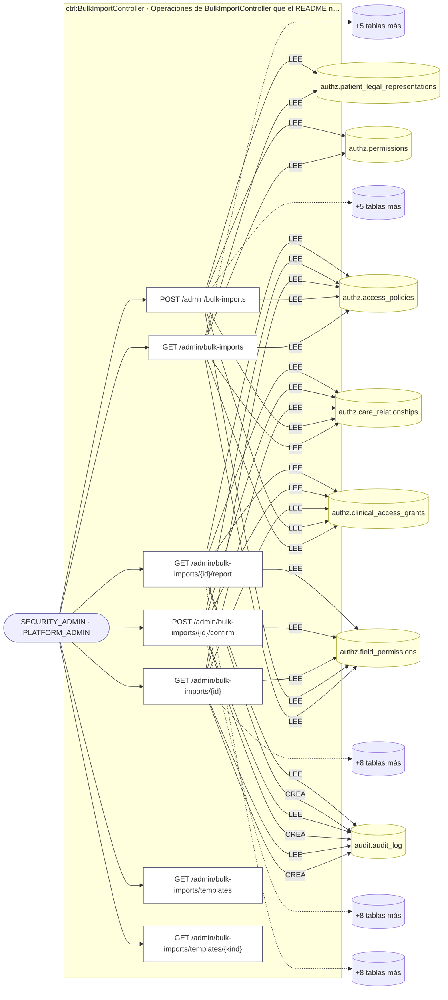
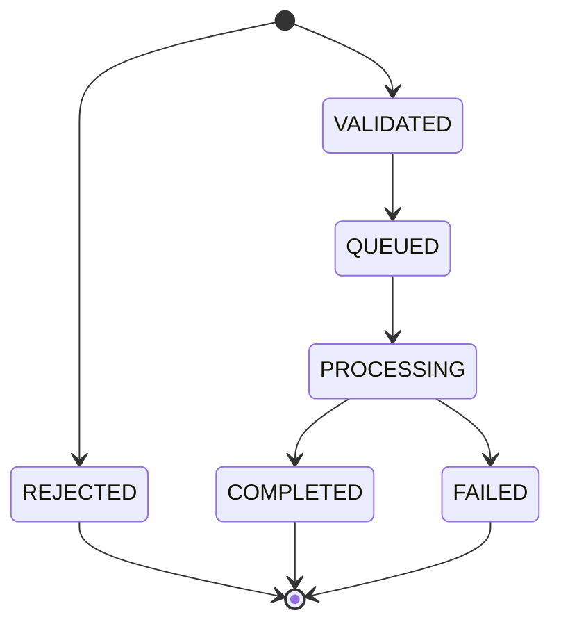
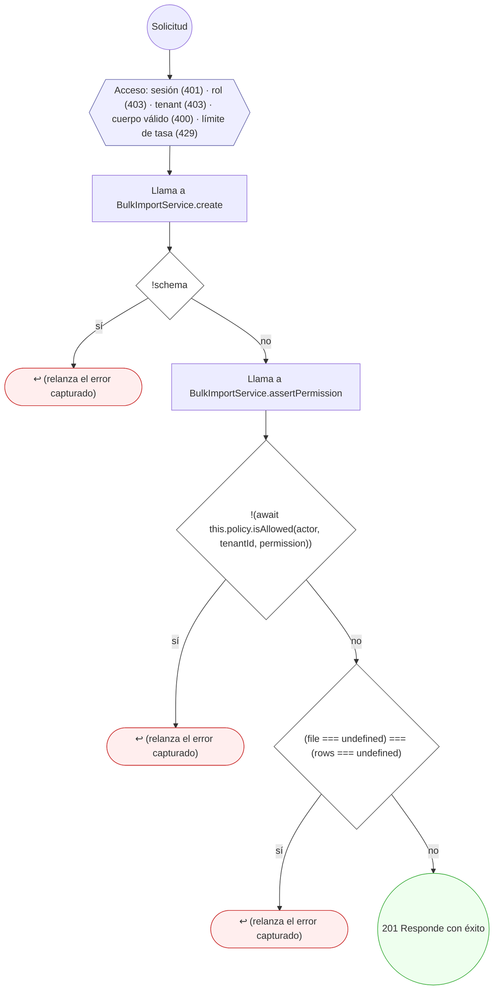
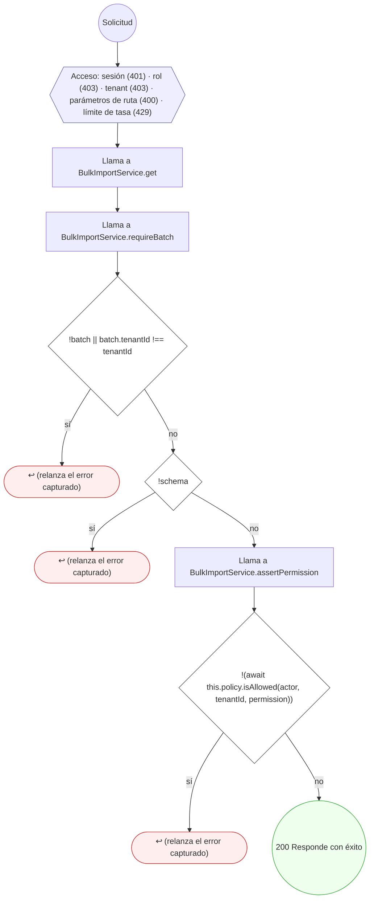
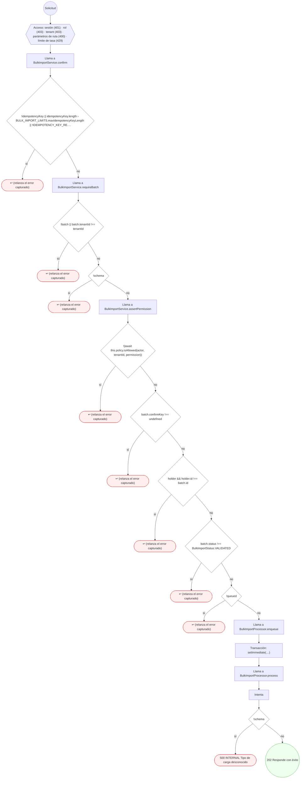
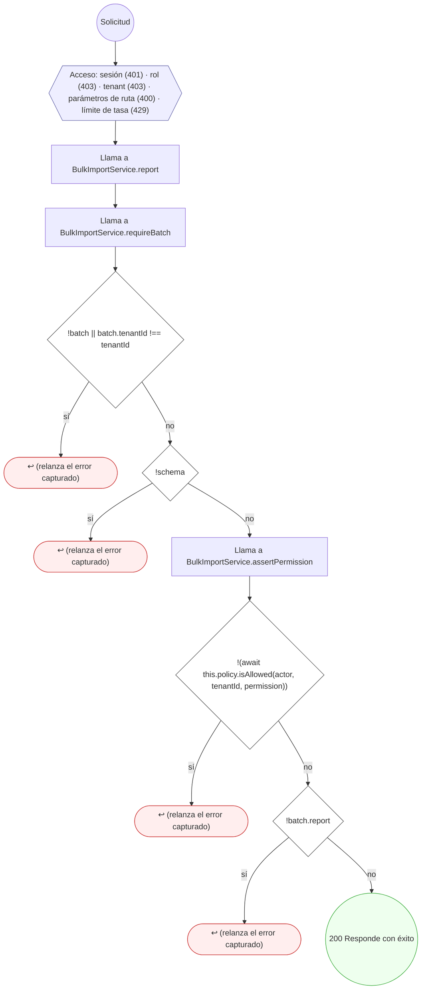
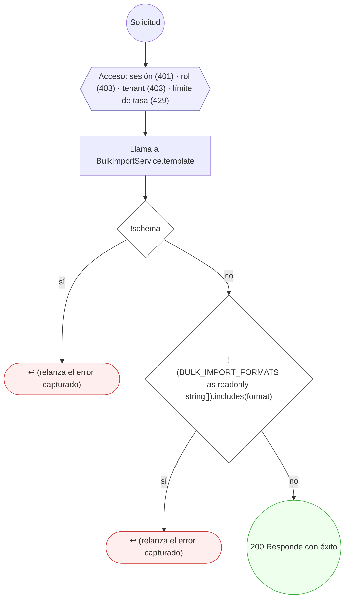

<!-- AUTOGENERADO por tools/inventario/flujos.mjs. No editar manualmente. -->

# Flujos del módulo `bulk_import`

- **Procesos:** 1 · **Máquinas de estado:** 1
- **Operaciones:** 7 (6 con decisiones propias, 1 sin ellas)
- Inventario de endpoints del módulo: [bulk_import](../endpoints/bulk_import.md)

## Proceso: bulk_import — motor de cargas masivas

- **Código:** `bulk_import` · **Agrupación:** AGRUPACION_POR_CONTROLADOR · **Operaciones:** 7
- **Actores:** PLATFORM_ADMIN · SECURITY_ADMIN
- **Revisión:** AUTO_DETECTADA
- **Fuentes:** `src/modules/bulk_import/README.md`

### Para qué sirve

Altas masivas de usuarios y carga especial de historias clínicas, con **plantilla CSV y JSON generada del mismo esquema que valida** (regla T1 del plan `docs/trabajo/2026-10-30-perfil-admin-medicion-gobierno/PLAN.md`, H6 y H7).

_Fuente: `src/modules/bulk_import/README.md:3`_

### Etapas y operaciones

| Etapa | Descripción | Operación | Quién actúa | Riesgo | Tablas |
|---|---|---|---|---|---|
| `ctrl:BulkImportController` | Operaciones de BulkImportController que el README no asigna a un caso de uso | GET /admin/bulk-imports | SECURITY_ADMIN · PLATFORM_ADMIN | BAJO | 11 |
|  |  | POST /admin/bulk-imports | SECURITY_ADMIN · PLATFORM_ADMIN | BAJO | 11 |
|  |  | GET /admin/bulk-imports/{id} | SECURITY_ADMIN · PLATFORM_ADMIN | MEDIO | 14 |
|  |  | POST /admin/bulk-imports/{id}/confirm | SECURITY_ADMIN · PLATFORM_ADMIN | MEDIO | 14 |
|  |  | GET /admin/bulk-imports/{id}/report | SECURITY_ADMIN · PLATFORM_ADMIN | MEDIO | 14 |
|  |  | GET /admin/bulk-imports/templates | SECURITY_ADMIN · PLATFORM_ADMIN | BAJO | 0 |
|  |  | GET /admin/bulk-imports/templates/{kind} | SECURITY_ADMIN · PLATFORM_ADMIN | BAJO | 0 |

### Diagrama — etapas `ctrl:BulkImportController`

## Máquinas de estado

### Máquina de estados `BATCH_TRANSITIONS`

Declarada en `src/modules/bulk_import/bulk-import.constants.ts:75`. Los estados llevan el nombre del identificador del código; no se resuelven al catálogo de conceptos.

_No se detectó ninguna operación que la ejerza._

## Árbol de decisión por operación

Cada árbol se deriva del código del handler y de los métodos que invoca (hasta 4 niveles). Una rama que no decide, no escribe y no falla se poda. Los accesos y los efectos consecutivos se agrupan en un solo nodo.

### Operaciones con decisiones propias

#### 1. GET /admin/bulk-imports

Lotes de la organización

| HTTP | Código | Cuándo |
|---|---|---|
| 200 | — | Éxito |
| 401 | `UNAUTHENTICATED` | Hay una sesión válida (JWT) |
| 403 | `FORBIDDEN` | El rol está permitido; El tenant se resuelve y pertenece al actor |
| 429 | `RATE_LIMITED` | No se supera el límite de solicitudes |

```mermaid
flowchart TD
  n1(("Solicitud")):::inicio
  n2{{"Acceso: sesión (401) · rol (403) · tenant (403) · límite de tasa (429)"}}:::acceso
  n1 --> n2
  n3["Llama a BulkImportService.list"]:::llamada
  n2 --> n3
  n4["Repite: por cada const permission de [ 'bulk_import.users', 'bulk_import.clinical', ]…"]:::bucle
  n3 --> n4
  n5["Llama a PdpAccessPolicyAdapter.isAllowed"]:::llamada
  n4 -->|"cada elemento"| n5
  n6["Llama a AuthzPdpService.evaluate"]:::llamada
  n5 --> n6
  n7["Llama a PermissionsRepository.findByResourceAction"]:::llamada
  n6 --> n7
  n8[("LEE authz.permissions")]:::efecto
  n7 --> n8
  n9["Llama a UserRoleAssignmentsRepository.findActiveForUser"]:::llamada
  n8 --> n9
  n10[("LEE authz.user_role_assignments")]:::efecto
  n9 --> n10
  n11{"!permission"}:::decision
  n10 --> n11
  n12["Llama a RolePermissionsRepository.findActiveForRoles"]:::llamada
  n11 -->|"no"| n12
  n13[("LEE authz.role_permissions")]:::efecto
  n12 --> n13
  n14["Llama a UserPermissionGrantsRepository.findActiveForUser"]:::llamada
  n13 --> n14
  n15[("LEE authz.user_permission_grants")]:::efecto
  n14 --> n15
  n16{"dto.resourceId"}:::decision
  n15 --> n16
  n17["Llama a ResourceScopeGrantsRepository.findForSubjectResource"]:::llamada
  n16 -->|"sí"| n17
  n18[("LEE authz.resource_scope_grants")]:::efecto
  n17 --> n18
  n19["Llama a AccessPoliciesRepository.findActiveForTarget"]:::llamada
  n11 -->|"sí"| n19
  n18 --> n19
  n16 -->|"no"| n19
  n20[("LEE authz.access_policies")]:::efecto
  n19 --> n20
  n21{"dto.patientProfileId"}:::decision
  n20 --> n21
  n22["Llama a ClinicalAccessGrantsRepository.findActiveForUserPatient"]:::llamada
  n21 -->|"sí"| n22
  n23[("LEE authz.clinical_access_grants")]:::efecto
  n22 --> n23
  n24{"dto.practitionerProfileId"}:::decision
  n23 --> n24
  n25["Llama a CareRelationshipsRepository.findActiveForPractitionerPatient"]:::llamada
  n24 -->|"sí"| n25
  n26[("LEE authz.care_relationships")]:::efecto
  n25 --> n26
  n27["Llama a PatientLegalRepresentationsRepository.findActiveForRepresentativePatient"]:::llamada
  n26 --> n27
  n24 -->|"no"| n27
  n28[("LEE authz.patient_legal_representations")]:::efecto
  n27 --> n28
  n29{"allowed.size === 0"}:::decision
  n28 --> n29
  n21 -->|"no"| n29
  n4 -->|"al terminar"| n29
  n30(["↩ (relanza el error capturado)"]):::error
  n29 -->|"sí"| n30
  n31(("200 Responde con éxito")):::ok
  n29 -->|"no"| n31
  classDef acceso fill:#eef,stroke:#66a
  classDef error fill:#fee,stroke:#c33
  classDef ok fill:#efe,stroke:#3a3
  classDef efecto fill:#ffd,stroke:#aa3
  classDef decision fill:#fff,stroke:#555
  classDef corte fill:#eee,stroke:#999,stroke-dasharray: 4
```

#### 2. POST /admin/bulk-imports

Crea un lote: valida el archivo y devuelve la vista previa (VALIDADO o RECHAZADO)

| HTTP | Código | Cuándo |
|---|---|---|
| 201 | — | Éxito |
| 400 | `VALIDATION_FAILED` | El cuerpo cumple el DTO (sin propiedades extra) |
| 401 | `UNAUTHENTICATED` | Hay una sesión válida (JWT) |
| 403 | `FORBIDDEN` | El rol está permitido; El tenant se resuelve y pertenece al actor |
| 429 | `RATE_LIMITED` | No se supera el límite de solicitudes |

#### 3. GET /admin/bulk-imports/{id}

Estado, vista previa y avance de un lote

| HTTP | Código | Cuándo |
|---|---|---|
| 200 | — | Éxito |
| 400 | `VALIDATION_FAILED` | Los parámetros de ruta son UUID válidos |
| 401 | `UNAUTHENTICATED` | Hay una sesión válida (JWT) |
| 403 | `FORBIDDEN` | El rol está permitido; El tenant se resuelve y pertenece al actor |
| 429 | `RATE_LIMITED` | No se supera el límite de solicitudes |

#### 4. POST /admin/bulk-imports/{id}/confirm

Confirma un lote VALIDADO y lo encola (idempotente por Idempotency-Key)

| HTTP | Código | Cuándo |
|---|---|---|
| 202 | — | Éxito |
| 400 | `VALIDATION_FAILED` | Los parámetros de ruta son UUID válidos |
| 401 | `UNAUTHENTICATED` | Hay una sesión válida (JWT) |
| 403 | `FORBIDDEN` | El rol está permitido; El tenant se resuelve y pertenece al actor |
| 429 | `RATE_LIMITED` | No se supera el límite de solicitudes |
| 500 | `INTERNAL` | Error: Tipo de carga desconocido |

#### 5. GET /admin/bulk-imports/{id}/report

Informe de un lote: creados, omitidos y rechazados con su motivo

| HTTP | Código | Cuándo |
|---|---|---|
| 200 | — | Éxito |
| 400 | `VALIDATION_FAILED` | Los parámetros de ruta son UUID válidos |
| 401 | `UNAUTHENTICATED` | Hay una sesión válida (JWT) |
| 403 | `FORBIDDEN` | El rol está permitido; El tenant se resuelve y pertenece al actor |
| 429 | `RATE_LIMITED` | No se supera el límite de solicitudes |

#### 6. GET /admin/bulk-imports/templates/{kind}

Descarga la plantilla de un tipo de carga en CSV o JSON

| HTTP | Código | Cuándo |
|---|---|---|
| 200 | — | Éxito |
| 401 | `UNAUTHENTICATED` | Hay una sesión válida (JWT) |
| 403 | `FORBIDDEN` | El rol está permitido; El tenant se resuelve y pertenece al actor |
| 429 | `RATE_LIMITED` | No se supera el límite de solicitudes |

### Operaciones sin decisiones propias

Sólo comprueban el acceso y leen o escriben: no tienen ramas que dibujar. Su detalle está en la ficha de endpoints.

| Operación | Respuestas posibles | Tablas |
|---|---|---|
| GET /admin/bulk-imports/templates | 200, 401, 403, 429 | 0 |
