<!-- AUTOGENERADO por tools/inventario/flujos.mjs. No editar manualmente. -->

# Flujos del módulo `chart`

- **Procesos:** 1 · **Máquinas de estado:** 0
- **Operaciones:** 23 (22 con decisiones propias, 1 sin ellas)
- Inventario de endpoints del módulo: [chart](../endpoints/chart.md)

## Proceso: src / modules / chart

- **Código:** `chart` · **Agrupación:** AGRUPACION_POR_CONTROLADOR · **Operaciones:** 23
- **Actores:** CLINICIAN · Cualquier sesión válida · PRACTITIONER · SECURITY_ADMIN
- **Revisión:** AUTO_DETECTADA
- **Fuentes:** `src/modules/chart/README.md`

### Para qué sirve

Agrupa los componentes relacionados con **chart** y mantiene cohesionada esta responsabilidad del sistema.

_Fuente: `src/modules/chart/README.md:3`_

### Etapas y operaciones

| Etapa | Descripción | Operación | Quién actúa | Riesgo | Tablas |
|---|---|---|---|---|---|
| `ctrl:ChartCarePlansController` | Operaciones de ChartCarePlansController que el README no asigna a un caso de uso | POST /charts/care-plans | CLINICIAN · PRACTITIONER | MEDIO | 5 |
|  |  | PATCH /charts/care-plans/{planId}/activities/{activityId} | CLINICIAN · PRACTITIONER | MEDIO | 20 |
| `ctrl:ChartDocumentsController` | Operaciones de ChartDocumentsController que el README no asigna a un caso de uso | POST /charts/documents | CLINICIAN · PRACTITIONER | MEDIO | 5 |
|  |  | GET /charts/documents/{documentId}/files/{fileId}/content | CLINICIAN · PRACTITIONER | BAJO | 22 |
| `ctrl:ChartEncountersController` | Operaciones de ChartEncountersController que el README no asigna a un caso de uso | GET /charts/encounters/{id}/pdf | CLINICIAN · PRACTITIONER | BAJO | 30 |
| `ctrl:ChartMeController` | Operaciones de ChartMeController que el README no asigna a un caso de uso | GET /charts/me/documents | Cualquier sesión válida | ALTO | 3 |
|  |  | GET /charts/me/documents/{documentId}/files/{fileId}/content | Cualquier sesión válida | ALTO | 5 |
|  |  | GET /charts/me/encounters/{id}/pdf | Cualquier sesión válida | BAJO | 14 |
|  |  | GET /charts/me/notes | Cualquier sesión válida | ALTO | 3 |
| `ctrl:ChartNotesController` | Operaciones de ChartNotesController que el README no asigna a un caso de uso | GET /charts/notes | CLINICIAN · PRACTITIONER | BAJO | 2 |
|  |  | POST /charts/notes | CLINICIAN · PRACTITIONER | MEDIO | 4 |
|  |  | POST /charts/notes/{noteId}/amendments | CLINICIAN · PRACTITIONER | MEDIO | 20 |
|  |  | PUT /charts/notes/{noteId}/versions | CLINICIAN · PRACTITIONER | MEDIO | 20 |
|  |  | POST /charts/notes/{noteId}/versions/{versionId}/cosign | CLINICIAN · PRACTITIONER | MEDIO | 20 |
|  |  | POST /charts/notes/{noteId}/versions/{versionId}/sign | CLINICIAN · PRACTITIONER | MEDIO | 19 |
|  |  | POST /charts/notes/versions/{versionId}/exam-findings | CLINICIAN · PRACTITIONER | MEDIO | 20 |
|  |  | POST /charts/notes/versions/{versionId}/release | CLINICIAN · PRACTITIONER | MEDIO | 20 |
|  |  | POST /charts/notes/versions/{versionId}/withhold | CLINICIAN · PRACTITIONER | MEDIO | 20 |
| `ctrl:ChartReadController` | Operaciones de ChartReadController que el README no asigna a un caso de uso | GET /charts/patients/{patientProfileId}/chart | CLINICIAN · PRACTITIONER | BAJO | 6 |
| `ctrl:ChartTemplatesController` | Operaciones de ChartTemplatesController que el README no asigna a un caso de uso | GET /charts/templates | CLINICIAN · PRACTITIONER · SECURITY_ADMIN | BAJO | 3 |
|  |  | POST /charts/templates | SECURITY_ADMIN | MEDIO | 5 |
|  |  | GET /charts/templates/{id} | CLINICIAN · PRACTITIONER · SECURITY_ADMIN | BAJO | 3 |
|  |  | POST /charts/templates/{templateId}/assignments | SECURITY_ADMIN | MEDIO | 3 |

### Diagrama — etapas `ctrl:ChartCarePlansController`, `ctrl:ChartDocumentsController`, `ctrl:ChartEncountersController`…

```mermaid
flowchart LR
  a2(["CLINICIAN · PRACTITIONER"]):::actor
  a26(["Cualquier sesión válida"]):::actor
  a52(["CLINICIAN · PRACTITIONER · SECURITY_ADMIN"]):::actor
  a57(["SECURITY_ADMIN"]):::actor
  t3[("chart.care_plan_activities")]:::tabla
  t4[("chart.care_plans")]:::tabla
  t5[("clinical.conditions")]:::tabla
  t6[("clinical.encounters")]:::tabla
  t7[("forms.form_instances")]:::tabla
  t9[("authz.access_policies")]:::tabla
  t10[("authz.care_relationships")]:::tabla
  t11[("authz.clinical_access_grants")]:::tabla
  t12[("authz.field_permissions")]:::tabla
  t13[("authz.patient_legal_representations")]:::tabla
  t14[("authz.permissions")]:::tabla
  t17[("chart.document_record_files")]:::tabla
  t18[("chart.document_records")]:::tabla
  t19[("common.file_versions")]:::tabla
  t20[("common.files")]:::tabla
  t27[("audit.data_access_log")]:::tabla
  t30[("chart.clinical_note_headers")]:::tabla
  t31[("chart.clinical_note_versions")]:::tabla
  t53[("chart.specialty_chart_templates")]:::tabla
  t54[("forms.dynamic_field_definitions")]:::tabla
  t55[("forms.field_assignments")]:::tabla
  t58[("forms.dynamic_field_sections")]:::tabla
  t61[("chart.chart_template_assignments")]:::tabla
  t15[("+14 tablas más")]
  subgraph s0["ctrl:ChartCarePlansController · Operaciones de ChartCarePlansController que el…"]
    o1["POST /charts/care-plans"]:::op
    o8["PATCH /charts/care-plans/{planId}/activities/{activityId}"]:::op
  end
  t22[("+16 tablas más")]
  subgraph s1["ctrl:ChartDocumentsController · Operaciones de ChartDocumentsController que el…"]
    o16["POST /charts/documents"]:::op
    o21["GET /charts/documents/{documentId}/files/{fileId}/content"]:::op
  end
  t24[("+24 tablas más")]
  subgraph s2["ctrl:ChartEncountersController · Operaciones de ChartEncountersController que e…"]
    o23["GET /charts/encounters/{id}/pdf"]:::op
  end
  t32[("+8 tablas más")]
  subgraph s3["ctrl:ChartMeController · Operaciones de ChartMeController que el README no asig…"]
    o25["GET /charts/me/documents"]:::op
    o28["GET /charts/me/documents/{documentId}/files/{fileId}/content"]:::op
    o29["GET /charts/me/encounters/{id}/pdf"]:::op
    o33["GET /charts/me/notes"]:::op
  end
  t37[("+14 tablas más")]
  t39[("+14 tablas más")]
  t41[("+14 tablas más")]
  t43[("+13 tablas más")]
  t45[("+14 tablas más")]
  t47[("+14 tablas más")]
  t49[("+14 tablas más")]
  subgraph s4["ctrl:ChartNotesController · Operaciones de ChartNotesController que el README n…"]
    o34["GET /charts/notes"]:::op
    o35["POST /charts/notes"]:::op
    o36["POST /charts/notes/{noteId}/amendments"]:::op
    o38["PUT /charts/notes/{noteId}/versions"]:::op
    o40["POST /charts/notes/{noteId}/versions/{versionId}/cosign"]:::op
    o42["POST /charts/notes/{noteId}/versions/{versionId}/sign"]:::op
    o44["POST /charts/notes/versions/{versionId}/exam-findings"]:::op
    o46["POST /charts/notes/versions/{versionId}/release"]:::op
    o48["POST /charts/notes/versions/{versionId}/withhold"]:::op
  end
  subgraph s5["ctrl:ChartReadController · Operaciones de ChartReadController que el README no…"]
    o50["GET /charts/patients/{patientProfileId}/chart"]:::op
  end
  subgraph s6["ctrl:ChartTemplatesController · Operaciones de ChartTemplatesController que el…"]
    o51["GET /charts/templates"]:::op
    o56["POST /charts/templates"]:::op
    o59["GET /charts/templates/{id}"]:::op
    o60["POST /charts/templates/{templateId}/assignments"]:::op
  end
  a2 --> o1
  o1 -->|"CREA"| t3
  o1 -->|"CREA"| t4
  o1 -->|"LEE"| t5
  o1 -->|"LEE"| t6
  o1 -->|"LEE"| t7
  a2 --> o8
  o8 -->|"LEE"| t9
  o8 -->|"LEE"| t10
  o8 -->|"LEE"| t11
  o8 -->|"LEE"| t12
  o8 -->|"LEE"| t13
  o8 -->|"LEE"| t14
  o8 -.-> t15
  a2 --> o16
  o16 -->|"CREA"| t17
  o16 -->|"CREA"| t18
  o16 -->|"LEE"| t6
  o16 -->|"LEE"| t19
  o16 -->|"LEE"| t20
  a2 --> o21
  o21 -->|"LEE"| t9
  o21 -->|"LEE"| t10
  o21 -->|"LEE"| t11
  o21 -->|"LEE"| t12
  o21 -->|"LEE"| t13
  o21 -->|"LEE"| t14
  o21 -.-> t22
  a2 --> o23
  o23 -->|"LEE"| t9
  o23 -->|"LEE"| t10
  o23 -->|"LEE"| t11
  o23 -->|"LEE"| t12
  o23 -->|"LEE"| t13
  o23 -->|"LEE"| t14
  o23 -.-> t24
  a26 --> o25
  o25 -->|"CREA"| t27
  o25 -->|"LEE"| t17
  o25 -->|"LEE"| t18
  a26 --> o28
  o28 -->|"CREA"| t27
  o28 -->|"LEE"| t17
  o28 -->|"LEE"| t18
  o28 -->|"LEE"| t19
  o28 -->|"LEE"| t20
  a26 --> o29
  o29 -->|"LEE"| t3
  o29 -->|"LEE"| t4
  o29 -->|"LEE"| t30
  o29 -->|"LEE"| t31
  o29 -->|"LEE"| t17
  o29 -->|"LEE"| t18
  o29 -.-> t32
  a26 --> o33
  o33 -->|"CREA"| t27
  o33 -->|"LEE"| t30
  o33 -->|"LEE"| t31
  a2 --> o34
  o34 -->|"LEE"| t30
  o34 -->|"LEE"| t31
  a2 --> o35
  o35 -->|"ACTUALIZA"| t30
  o35 -->|"CREA"| t30
  o35 -->|"CREA"| t31
  o35 -->|"LEE"| t6
  a2 --> o36
  o36 -->|"LEE"| t9
  o36 -->|"LEE"| t10
  o36 -->|"LEE"| t11
  o36 -->|"LEE"| t12
  o36 -->|"LEE"| t13
  o36 -->|"LEE"| t14
  o36 -.-> t37
  a2 --> o38
  o38 -->|"LEE"| t9
  o38 -->|"LEE"| t10
  o38 -->|"LEE"| t11
  o38 -->|"LEE"| t12
  o38 -->|"LEE"| t13
  o38 -->|"LEE"| t14
  o38 -.-> t39
  a2 --> o40
  o40 -->|"LEE"| t9
  o40 -->|"LEE"| t10
  o40 -->|"LEE"| t11
  o40 -->|"LEE"| t12
  o40 -->|"LEE"| t13
  o40 -->|"LEE"| t14
  o40 -.-> t41
  a2 --> o42
  o42 -->|"LEE"| t9
  o42 -->|"LEE"| t10
  o42 -->|"LEE"| t11
  o42 -->|"LEE"| t12
  o42 -->|"LEE"| t13
  o42 -->|"LEE"| t14
  o42 -.-> t43
  a2 --> o44
  o44 -->|"LEE"| t9
  o44 -->|"LEE"| t10
  o44 -->|"LEE"| t11
  o44 -->|"LEE"| t12
  o44 -->|"LEE"| t13
  o44 -->|"LEE"| t14
  o44 -.-> t45
  a2 --> o46
  o46 -->|"LEE"| t9
  o46 -->|"LEE"| t10
  o46 -->|"LEE"| t11
  o46 -->|"LEE"| t12
  o46 -->|"LEE"| t13
  o46 -->|"LEE"| t14
  o46 -.-> t47
  a2 --> o48
  o48 -->|"LEE"| t9
  o48 -->|"LEE"| t10
  o48 -->|"LEE"| t11
  o48 -->|"LEE"| t12
  o48 -->|"LEE"| t13
  o48 -->|"LEE"| t14
  o48 -.-> t49
  a2 --> o50
  o50 -->|"LEE"| t3
  o50 -->|"LEE"| t4
  o50 -->|"LEE"| t30
  o50 -->|"LEE"| t31
  o50 -->|"LEE"| t17
  o50 -->|"LEE"| t18
  a52 --> o51
  o51 -->|"LEE"| t53
  o51 -->|"LEE"| t54
  o51 -->|"LEE"| t55
  a57 --> o56
  o56 -->|"ACTUALIZA"| t53
  o56 -->|"CREA"| t53
  o56 -->|"CREA"| t54
  o56 -->|"CREA"| t58
  o56 -->|"CREA"| t55
  a52 --> o59
  o59 -->|"LEE"| t53
  o59 -->|"LEE"| t54
  o59 -->|"LEE"| t55
  a57 --> o60
  o60 -->|"ACTUALIZA"| t61
  o60 -->|"CREA"| t61
  o60 -->|"LEE"| t61
  classDef op fill:#fff,stroke:#446
  classDef actor fill:#eef,stroke:#66a
  classDef tabla fill:#ffd,stroke:#aa3
  classDef evento fill:#efe,stroke:#3a3
```

## Árbol de decisión por operación

Cada árbol se deriva del código del handler y de los métodos que invoca (hasta 4 niveles). Una rama que no decide, no escribe y no falla se poda. Los accesos y los efectos consecutivos se agrupan en un solo nodo.

### Operaciones con decisiones propias

#### 1. POST /charts/care-plans

Crear un plan de cuidado con actividades

| HTTP | Código | Cuándo |
|---|---|---|
| 201 | — | Éxito |
| 400 | `VALIDATION_FAILED` | El cuerpo cumple el DTO (sin propiedades extra) |
| 401 | `UNAUTHENTICATED` | Hay una sesión válida (JWT) |
| 403 | `FORBIDDEN` | El rol está permitido; El tenant se resuelve y pertenece al actor; ForbiddenException: Un plan de cuidados necesita un profesional autor.; ForbiddenException: La sesión no tiene un perfil profesional con el que crear el plan.; ForbiddenException: El autor del plan es el profesional de la sesión: no se crea en nombre de otro perfil. |
| 404 | `NOT_FOUND` | ResourceNotFoundException: Encuentro no encontrado; ResourceNotFoundException: Diagnóstico no encontrado |
| 422 | `PRECONDITION_FAILED` | PreconditionFailedException: El encuentro ya está cerrado y sellado: no admite más escrituras. |
| 429 | `RATE_LIMITED` | No se supera el límite de solicitudes |

```mermaid
flowchart TD
  n1(("Solicitud")):::inicio
  n2{{"Acceso: sesión (401) · rol (403) · tenant (403) · cuerpo válido (400) · límite de tasa (429)"}}:::acceso
  n1 --> n2
  n3["Llama a ChartCarePlansService.createCarePlan"]:::llamada
  n2 --> n3
  n4["Llama a ChartCarePlansService.resolveAuthor"]:::llamada
  n3 --> n4
  n5{"actor.roles.includes(SUPERADMIN_ROLE)"}:::decision
  n4 --> n5
  n6{"!chosen"}:::decision
  n5 -->|"sí"| n6
  n7(["403 FORBIDDEN Un plan de cuidados necesita un profesional autor."]):::error
  n6 -->|"sí"| n7
  n8{"!actor.practitionerProfileId"}:::decision
  n6 -->|"no"| n8
  n5 -->|"no"| n8
  n9(["403 FORBIDDEN La sesión no tiene un perfil profesional con el que crear el plan."]):::error
  n8 -->|"sí"| n9
  n10{"declared !== undefined && declared !== actor.practitionerProfileId"}:::decision
  n8 -->|"no"| n10
  n11(["403 FORBIDDEN El autor del plan es el profesional de la sesión: no se crea en nombre de otro perfil."]):::error
  n10 -->|"sí"| n11
  n12["Transacción: transactional(…)"]:::transaccion
  n10 -->|"no"| n12
  n13{"dto.encounterId"}:::decision
  n12 --> n13
  n14["Llama a ChartEncounterScopeService.assertEncounterBelongsToPatientAndWritable"]:::llamada
  n13 -->|"sí"| n14
  n15["Llama a EncountersRepository.findById"]:::llamada
  n14 --> n15
  n16[("LEE clinical.encounters")]:::efecto
  n15 --> n16
  n17{"!encounter || encounter.patientProfileId !== patientProfileId || encounter.tenantId !== tenantId"}:::decision
  n16 --> n17
  n18(["404 NOT_FOUND Encuentro no encontrado"]):::error
  n17 -->|"sí"| n18
  n19{"encounter.sealedAt"}:::decision
  n17 -->|"no"| n19
  n20(["422 PRECONDITION_FAILED El encuentro ya está cerrado y sellado: no admite más escrituras."]):::error
  n19 -->|"sí"| n20
  n21{"dto.conditionId"}:::decision
  n19 -->|"no"| n21
  n13 -->|"no"| n21
  n22["Llama a ChartEncounterScopeService.assertConditionBelongsToPatient"]:::llamada
  n21 -->|"sí"| n22
  n23["Llama a ConditionsRepository.findById"]:::llamada
  n22 --> n23
  n24[("LEE clinical.conditions")]:::efecto
  n23 --> n24
  n25{"!condition || condition.patientProfileId !== patientProfileId || condition.custodianTenantId !== tenantId"}:::decision
  n24 --> n25
  n26(["404 NOT_FOUND Diagnóstico no encontrado"]):::error
  n25 -->|"sí"| n26
  n27{"dto.encounterId"}:::decision
  n25 -->|"no"| n27
  n21 -->|"no"| n27
  n28["Llama a EncounterSealGuardService.assertEncounterWritable"]:::llamada
  n27 -->|"sí"| n28
  n29["Llama a EncountersRepository.findById"]:::llamada
  n28 --> n29
  n30[("LEE clinical.encounters")]:::efecto
  n29 --> n30
  n31{"encounter?.sealedAt"}:::decision
  n30 --> n31
  n32(["422 PRECONDITION_FAILED El encuentro ya está cerrado y sellado: no admite más escrituras."]):::error
  n31 -->|"sí"| n32
  n33{"dto.formInstanceId !== undefined"}:::decision
  n31 -->|"no"| n33
  n27 -->|"no"| n33
  n34["Llama a FormInstanceOriginValidator.assertUsableOrigin"]:::llamada
  n33 -->|"sí"| n34
  n35[("LEE forms.form_instances")]:::efecto
  n34 --> n35
  n36{"!instance"}:::decision
  n35 --> n36
  n37(["↩ (relanza el error capturado)"]):::error
  n36 -->|"sí"| n37
  n38{"instance.stateConceptId !== FORMS.INSTANCE_CLOSED"}:::decision
  n36 -->|"no"| n38
  n39(["↩ (relanza el error capturado)"]):::error
  n38 -->|"sí"| n39
  n40{"encounterId && instance.resourceId !== encounterId"}:::decision
  n38 -->|"no"| n40
  n41(["↩ (relanza el error capturado)"]):::error
  n40 -->|"sí"| n41
  n42["Llama a CarePlansRepository.createPlan"]:::llamada
  n40 -->|"no"| n42
  n33 -->|"no"| n42
  n43[("CREA chart.care_plans")]:::efecto
  n42 --> n43
  n44["Repite: por cada const a de activities"]:::bucle
  n43 --> n44
  n45["Llama a CarePlansRepository.createActivity"]:::llamada
  n44 -->|"cada elemento"| n45
  n46[("CREA chart.care_plan_activities")]:::efecto
  n45 --> n46
  n47(("201 Responde con éxito")):::ok
  n46 --> n47
  n44 -->|"al terminar"| n47
  classDef acceso fill:#eef,stroke:#66a
  classDef error fill:#fee,stroke:#c33
  classDef ok fill:#efe,stroke:#3a3
  classDef efecto fill:#ffd,stroke:#aa3
  classDef decision fill:#fff,stroke:#555
  classDef corte fill:#eee,stroke:#999,stroke-dasharray: 4
```

#### 2. PATCH /charts/care-plans/{planId}/activities/{activityId}

Actualizar una actividad del plan de cuidado

| HTTP | Código | Cuándo |
|---|---|---|
| 200 | — | Éxito |
| 400 | `VALIDATION_FAILED` | Los parámetros de ruta son UUID válidos; El cuerpo cumple el DTO (sin propiedades extra) |
| 401 | `UNAUTHENTICATED` | Hay una sesión válida (JWT) |
| 403 | `FORBIDDEN` | El rol está permitido; El tenant se resuelve y pertenece al actor; ForbiddenException: {WITHOUT_ACCESS_TO_HISTORY} |
| 404 | `NOT_FOUND` | ResourceNotFoundException: Plan de cuidado no encontrado; ResourceNotFoundException: Actividad no encontrada |
| 422 | `PRECONDITION_FAILED` | PreconditionFailedException: El plan de cuidado no está activo |
| 429 | `RATE_LIMITED` | No se supera el límite de solicitudes |

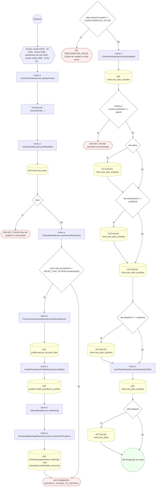

#### 3. POST /charts/documents

Adjuntar un documento con archivos gobernados

| HTTP | Código | Cuándo |
|---|---|---|
| 201 | — | Éxito |
| 400 | `VALIDATION_FAILED` | El cuerpo cumple el DTO (sin propiedades extra) |
| 401 | `UNAUTHENTICATED` | Hay una sesión válida (JWT) |
| 403 | `FORBIDDEN` | El rol está permitido; El tenant se resuelve y pertenece al actor; ForbiddenException: {labels.subject} no le pertenece |
| 404 | `NOT_FOUND` | ResourceNotFoundException: Encuentro no encontrado; ResourceNotFoundException: {labels.notFound} |
| 422 | `PRECONDITION_FAILED` | PreconditionFailedException: El encuentro ya está cerrado y sellado: no admite más escrituras.; PreconditionFailedException: {labels.subject} está borrado; PreconditionFailedException: {labels.subject} no tiene una versión vigente; PreconditionFailedException: {labels.subject} resultó infectado; PreconditionFailedException: {labels.subject} no es de un formato admitido para este uso |
| 429 | `RATE_LIMITED` | No se supera el límite de solicitudes |

```mermaid
flowchart TD
  n1(("Solicitud")):::inicio
  n2{{"Acceso: sesión (401) · rol (403) · tenant (403) · cuerpo válido (400) · límite de tasa (429)"}}:::acceso
  n1 --> n2
  n3["Llama a ChartDocumentsService.createDocument"]:::llamada
  n2 --> n3
  n4["Transacción: transactional(…)"]:::transaccion
  n3 --> n4
  n5{"dto.encounterId"}:::decision
  n4 --> n5
  n6["Llama a ChartEncounterScopeService.assertEncounterBelongsToPatientAndWritable"]:::llamada
  n5 -->|"sí"| n6
  n7["Llama a EncountersRepository.findById"]:::llamada
  n6 --> n7
  n8[("LEE clinical.encounters")]:::efecto
  n7 --> n8
  n9{"!encounter || encounter.patientProfileId !== patientProfileId || encounter.tenantId !== tenantId"}:::decision
  n8 --> n9
  n10(["404 NOT_FOUND Encuentro no encontrado"]):::error
  n9 -->|"sí"| n10
  n11{"encounter.sealedAt"}:::decision
  n9 -->|"no"| n11
  n12(["422 PRECONDITION_FAILED El encuentro ya está cerrado y sellado: no admite más escrituras."]):::error
  n11 -->|"sí"| n12
  n13{"dto.encounterId"}:::decision
  n11 -->|"no"| n13
  n5 -->|"no"| n13
  n14["Llama a EncounterSealGuardService.assertEncounterWritable"]:::llamada
  n13 -->|"sí"| n14
  n15["Llama a EncountersRepository.findById"]:::llamada
  n14 --> n15
  n16[("LEE clinical.encounters")]:::efecto
  n15 --> n16
  n17{"encounter?.sealedAt"}:::decision
  n16 --> n17
  n18(["422 PRECONDITION_FAILED El encuentro ya está cerrado y sellado: no admite más escrituras."]):::error
  n17 -->|"sí"| n18
  n19["Repite: por cada const f de dto.files ?? []"]:::bucle
  n17 -->|"no"| n19
  n13 -->|"no"| n19
  n20["Llama a AttachableFileService.assertUsableBy"]:::llamada
  n19 -->|"cada elemento"| n20
  n21["Llama a FilesRepository.findById"]:::llamada
  n20 --> n21
  n22[("LEE common.files")]:::efecto
  n21 --> n22
  n23{"!file"}:::decision
  n22 --> n23
  n24(["404 NOT_FOUND {labels.notFound}"]):::error
  n23 -->|"sí"| n24
  n25{"file.createdByUserId !== actor.id && !enAllowlist"}:::decision
  n23 -->|"no"| n25
  n26(["403 FORBIDDEN {labels.subject} no le pertenece"]):::error
  n25 -->|"sí"| n26
  n27{"file.deletedAt || file.lifecycleStatusConceptId === CONCEPTS.FILE_DELETED"}:::decision
  n25 -->|"no"| n27
  n28(["422 PRECONDITION_FAILED {labels.subject} está borrado"]):::error
  n27 -->|"sí"| n28
  n29{"!file.currentVersionId"}:::decision
  n27 -->|"no"| n29
  n30(["422 PRECONDITION_FAILED {labels.subject} no tiene una versión vigente"]):::error
  n29 -->|"sí"| n30
  n31["Llama a AttachableFileService.assertVersionUsable"]:::llamada
  n29 -->|"no"| n31
  n32{"file.deletedAt || file.lifecycleStatusConceptId === CONCEPTS.FILE_DELETED"}:::decision
  n31 --> n32
  n33(["422 PRECONDITION_FAILED {labels.subject} está borrado"]):::error
  n32 -->|"sí"| n33
  n34{"!file.currentVersionId"}:::decision
  n32 -->|"no"| n34
  n35(["422 PRECONDITION_FAILED {labels.subject} no tiene una versión vigente"]):::error
  n34 -->|"sí"| n35
  n36["Llama a FileVersionsRepository.findById"]:::llamada
  n34 -->|"no"| n36
  n37[("LEE common.file_versions")]:::efecto
  n36 --> n37
  n38{"!version"}:::decision
  n37 --> n38
  n39(["422 PRECONDITION_FAILED {labels.subject} no tiene una versión vigente"]):::error
  n38 -->|"sí"| n39
  n40{"version.malwareScanStatusConceptId === CONCEPTS.SCAN_INFECTED"}:::decision
  n38 -->|"no"| n40
  n41(["422 PRECONDITION_FAILED {labels.subject} resultó infectado"]):::error
  n40 -->|"sí"| n41
  n42{"accepted && !accepted.includes(version.mimeType ?? '')"}:::decision
  n40 -->|"no"| n42
  n43(["422 PRECONDITION_FAILED {labels.subject} no es de un formato admitido para este uso"]):::error
  n42 -->|"sí"| n43
  n44["Llama a DocumentsRepository.createRecord"]:::llamada
  n42 -->|"no"| n44
  n19 -->|"al terminar"| n44
  n45[("CREA chart.document_records")]:::efecto
  n44 --> n45
  n46["Repite: forEach(…)"]:::bucle
  n45 --> n46
  n47["Llama a DocumentsRepository.createFile"]:::llamada
  n46 -->|"cada elemento"| n47
  n48[("CREA chart.document_record_files")]:::efecto
  n47 --> n48
  n49(("201 Responde con éxito")):::ok
  n48 --> n49
  n46 -->|"al terminar"| n49
  classDef acceso fill:#eef,stroke:#66a
  classDef error fill:#fee,stroke:#c33
  classDef ok fill:#efe,stroke:#3a3
  classDef efecto fill:#ffd,stroke:#aa3
  classDef decision fill:#fff,stroke:#555
  classDef corte fill:#eee,stroke:#999,stroke-dasharray: 4
```

#### 4. GET /charts/documents/{documentId}/files/{fileId}/content

Descargar el archivo de un documento del expediente

| HTTP | Código | Cuándo |
|---|---|---|
| 200 | — | Éxito |
| 400 | `VALIDATION_FAILED` | Los parámetros de ruta son UUID válidos |
| 401 | `UNAUTHENTICATED` | Hay una sesión válida (JWT) |
| 403 | `FORBIDDEN` | El rol está permitido; El tenant se resuelve y pertenece al actor; ForbiddenException: {WITHOUT_ACCESS_TO_HISTORY} |
| 404 | `NOT_FOUND` | ResourceNotFoundException: Documento no encontrado; ResourceNotFoundException: Archivo no encontrado; ResourceNotFoundException: {labels.notFound}; ResourceNotFoundException: El contenido no está disponible en el almacenamiento local; ResourceNotFoundException: El contenido no está disponible en el almacenamiento configurado |
| 429 | `RATE_LIMITED` | No se supera el límite de solicitudes |
| 500 | `INTERNAL` | Error: S3 object body is empty |

```mermaid
flowchart TD
  n1(("Solicitud")):::inicio
  n2{{"Acceso: sesión (401) · rol (403) · tenant (403) · parámetros de ruta (400) · límite de tasa (429)"}}:::acceso
  n1 --> n2
  n3["Llama a ChartDocumentsService.getDocumentFileContent"]:::llamada
  n2 --> n3
  n4["Llama a DocumentsRepository.findRecordById"]:::llamada
  n3 --> n4
  n5[("LEE chart.document_records")]:::efecto
  n4 --> n5
  n6{"!record"}:::decision
  n5 --> n6
  n7(["404 NOT_FOUND Documento no encontrado"]):::error
  n6 -->|"sí"| n7
  n8["Llama a DocumentsRepository.findFilesForRecords"]:::llamada
  n6 -->|"no"| n8
  n9[("LEE chart.document_record_files")]:::efecto
  n8 --> n9
  n10{"!files.some((f) =› f.fileId === fileId)"}:::decision
  n9 --> n10
  n11(["404 NOT_FOUND Documento no encontrado"]):::error
  n10 -->|"sí"| n11
  n12["Llama a ClinicalReadService.assertCanReadHistory"]:::llamada
  n10 -->|"no"| n12
  n13{"!actor.roles.some((role) =› ROLES_THAT_ATTEND.includes(role))"}:::decision
  n12 --> n13
  n14["Llama a ClinicalReadService.assertOwnRecord"]:::llamada
  n13 -->|"sí"| n14
  n15["Llama a PersonAccountLinksRepository.findActiveByUser"]:::llamada
  n14 --> n15
  n16[("LEE profiles.person_account_links")]:::efecto
  n15 --> n16
  n17["Llama a PatientProfilesRepository.findById"]:::llamada
  n16 --> n17
  n18[("LEE profiles.patient_profiles")]:::efecto
  n17 --> n18
  n19{"!link || !profile || profile.profileId !== link.personId"}:::decision
  n18 --> n19
  n20(["403 FORBIDDEN {WITHOUT_ACCESS_TO_HISTORY}"]):::error
  n19 -->|"sí"| n20
  n21["Llama a PersonAccountLinksRepository.findActiveByUser"]:::llamada
  n19 -->|"no"| n21
  n13 -->|"no"| n21
  n22[("LEE profiles.person_account_links")]:::efecto
  n21 --> n22
  n23["Llama a HealthPractitionerProfilesRepository.findById"]:::llamada
  n22 --> n23
  n24[("LEE profiles.health_practitioner_profiles")]:::efecto
  n23 --> n24
  n25["Llama a ClinicalReadService.isAttending"]:::llamada
  n24 --> n25
  n26["Llama a SchedulingBookingsRepository.hasConsultationInProgress"]:::llamada
  n25 --> n26
  n27[("LEE scheduling.appointment_bookings · LEE scheduling.schedulable_resources")]:::efecto
  n26 --> n27
  n28["Llama a ClinicalReadService.assertOwnRecord"]:::llamada
  n27 --> n28
  n29["Llama a PersonAccountLinksRepository.findActiveByUser"]:::llamada
  n28 --> n29
  n30[("LEE profiles.person_account_links")]:::efecto
  n29 --> n30
  n31["Llama a PatientProfilesRepository.findById"]:::llamada
  n30 --> n31
  n32[("LEE profiles.patient_profiles")]:::efecto
  n31 --> n32
  n33{"!link || !profile || profile.profileId !== link.personId"}:::decision
  n32 --> n33
  n34(["403 FORBIDDEN {WITHOUT_ACCESS_TO_HISTORY}"]):::error
  n33 -->|"sí"| n34
  n35["Llama a FileUploadService.downloadForAuthorizedContext"]:::llamada
  n33 -->|"no"| n35
  n36["Llama a FilesRepository.findById"]:::llamada
  n35 --> n36
  n37[("LEE common.files")]:::efecto
  n36 --> n37
  n38{"!file"}:::decision
  n37 --> n38
  n39(["404 NOT_FOUND Archivo no encontrado"]):::error
  n38 -->|"sí"| n39
  n40["Llama a FileUploadService.serveCurrentVersion"]:::llamada
  n38 -->|"no"| n40
  n41["Llama a AttachableFileService.assertUsableForAuthorizedContext"]:::llamada
  n40 --> n41
  n42{"!file"}:::decision
  n41 --> n42
  n43(["404 NOT_FOUND {labels.notFound}"]):::error
  n42 -->|"sí"| n43
  n44["Llama a LocalDiskFileStorageAdapter.retrieve"]:::llamada
  n42 -->|"no"| n44
  n45["Intenta"]:::intento
  n44 --> n45
  n46{"isMissingFile(error)"}:::decision
  n45 -->|"si falla"| n46
  n47(["404 NOT_FOUND El contenido no está disponible en el almacenamiento local"]):::error
  n46 -->|"sí"| n47
  n48(["↩ (relanza el error capturado)"]):::error
  n46 -->|"no"| n48
  n49["Llama a S3FileStorageAdapter.retrieve"]:::llamada
  n45 --> n49
  n50["Intenta"]:::intento
  n49 --> n50
  n51{"!result.Body"}:::decision
  n50 --> n51
  n52(["500 INTERNAL S3 object body is empty"]):::error
  n51 -->|"sí"| n52
  n53{"isNotFound(error)"}:::decision
  n50 -->|"si falla"| n53
  n54(["404 NOT_FOUND El contenido no está disponible en el almacenamiento configurado"]):::error
  n53 -->|"sí"| n54
  n55(["↩ (relanza el error capturado)"]):::error
  n53 -->|"no"| n55
  n56(("200 Responde con éxito")):::ok
  n51 -->|"no"| n56
  classDef acceso fill:#eef,stroke:#66a
  classDef error fill:#fee,stroke:#c33
  classDef ok fill:#efe,stroke:#3a3
  classDef efecto fill:#ffd,stroke:#aa3
  classDef decision fill:#fff,stroke:#555
  classDef corte fill:#eee,stroke:#999,stroke-dasharray: 4
```

#### 5. GET /charts/encounters/{id}/pdf

Descargar el PDF oficial de un encuentro cerrado

| HTTP | Código | Cuándo |
|---|---|---|
| 200 | — | Éxito |
| 400 | `VALIDATION_FAILED` | Los parámetros de ruta son UUID válidos |
| 401 | `UNAUTHENTICATED` | Hay una sesión válida (JWT) |
| 403 | `FORBIDDEN` | El rol está permitido; El tenant se resuelve y pertenece al actor; ForbiddenException: {WITHOUT_ACCESS_TO_HISTORY} |
| 404 | `NOT_FOUND` | ResourceNotFoundException: Encuentro no encontrado |
| 422 | `PRECONDITION_FAILED` | PreconditionFailedException: El encuentro no está cerrado |
| 429 | `RATE_LIMITED` | No se supera el límite de solicitudes |

```mermaid
flowchart TD
  n1(("Solicitud")):::inicio
  n2{{"Acceso: sesión (401) · rol (403) · tenant (403) · parámetros de ruta (400) · límite de tasa (429)"}}:::acceso
  n1 --> n2
  n3["Llama a EncounterPdfService.render"]:::llamada
  n2 --> n3
  n4["Llama a EncountersRepository.findById"]:::llamada
  n3 --> n4
  n5[("LEE clinical.encounters")]:::efecto
  n4 --> n5
  n6{"!encounter"}:::decision
  n5 --> n6
  n7(["404 NOT_FOUND Encuentro no encontrado"]):::error
  n6 -->|"sí"| n7
  n8["Llama a ClinicalReadService.assertCanReadHistory"]:::llamada
  n6 -->|"no"| n8
  n9{"!actor.roles.some((role) =› ROLES_THAT_ATTEND.includes(role))"}:::decision
  n8 --> n9
  n10["Llama a ClinicalReadService.assertOwnRecord"]:::llamada
  n9 -->|"sí"| n10
  n11["Llama a PersonAccountLinksRepository.findActiveByUser"]:::llamada
  n10 --> n11
  n12[("LEE profiles.person_account_links")]:::efecto
  n11 --> n12
  n13["Llama a PatientProfilesRepository.findById"]:::llamada
  n12 --> n13
  n14[("LEE profiles.patient_profiles")]:::efecto
  n13 --> n14
  n15{"!link || !profile || profile.profileId !== link.personId"}:::decision
  n14 --> n15
  n16(["403 FORBIDDEN {WITHOUT_ACCESS_TO_HISTORY}"]):::error
  n15 -->|"sí"| n16
  n17["Llama a PersonAccountLinksRepository.findActiveByUser"]:::llamada
  n15 -->|"no"| n17
  n9 -->|"no"| n17
  n18[("LEE profiles.person_account_links")]:::efecto
  n17 --> n18
  n19["Llama a HealthPractitionerProfilesRepository.findById"]:::llamada
  n18 --> n19
  n20[("LEE profiles.health_practitioner_profiles")]:::efecto
  n19 --> n20
  n21["Llama a ClinicalReadService.isAttending"]:::llamada
  n20 --> n21
  n22["Llama a SchedulingBookingsRepository.hasConsultationInProgress"]:::llamada
  n21 --> n22
  n23[("LEE scheduling.appointment_bookings · LEE scheduling.schedulable_resources")]:::efecto
  n22 --> n23
  n24["Llama a ClinicalReadService.assertOwnRecord"]:::llamada
  n23 --> n24
  n25["Llama a PersonAccountLinksRepository.findActiveByUser"]:::llamada
  n24 --> n25
  n26[("LEE profiles.person_account_links")]:::efecto
  n25 --> n26
  n27["Llama a PatientProfilesRepository.findById"]:::llamada
  n26 --> n27
  n28[("LEE profiles.patient_profiles")]:::efecto
  n27 --> n28
  n29{"!link || !profile || profile.profileId !== link.personId"}:::decision
  n28 --> n29
  n30(["403 FORBIDDEN {WITHOUT_ACCESS_TO_HISTORY}"]):::error
  n29 -->|"sí"| n30
  n31{"encounter.statusConceptId !== CLIN.ENCOUNTER_FINISHED || !encounter.contentHash"}:::decision
  n29 -->|"no"| n31
  n32(["422 PRECONDITION_FAILED El encuentro no está cerrado"]):::error
  n31 -->|"sí"| n32
  n33["Llama a EncounterPdfService.compose"]:::llamada
  n31 -->|"no"| n33
  n34["Llama a ClinicalNotesRepository.findHeadersByEncounter"]:::llamada
  n33 --> n34
  n35[("LEE chart.clinical_note_headers")]:::efecto
  n34 --> n35
  n36["Llama a ConditionsRepository.findByEncounter"]:::llamada
  n35 --> n36
  n37[("LEE clinical.conditions")]:::efecto
  n36 --> n37
  n38["Llama a MedicationRequestsRepository.findByEncounter"]:::llamada
  n37 --> n38
  n39[("LEE clinical.medication_requests")]:::efecto
  n38 --> n39
  n40["Llama a CarePlansRepository.findByEncounter"]:::llamada
  n39 --> n40
  n41[("LEE chart.care_plans")]:::efecto
  n40 --> n41
  n42["Llama a CarePlansRepository.findActivitiesForPlans"]:::llamada
  n41 --> n42
  n43[("LEE chart.care_plan_activities")]:::efecto
  n42 --> n43
  n44["Llama a DocumentsRepository.findByEncounter"]:::llamada
  n43 --> n44
  n45[("LEE chart.document_records")]:::efecto
  n44 --> n45
  n46["Llama a DocumentsRepository.findFilesForRecords"]:::llamada
  n45 --> n46
  n47[("LEE chart.document_record_files")]:::efecto
  n46 --> n47
  n48["Llama a ClinicalNotesRepository.findVersionsByIds"]:::llamada
  n47 --> n48
  n49[("LEE chart.clinical_note_versions")]:::efecto
  n48 --> n49
  n50["Llama a CatalogConceptsRepository.findByIds"]:::llamada
  n49 --> n50
  n51[("LEE terminology.catalog_concepts")]:::efecto
  n50 --> n51
  n52["Llama a EncounterPdfService.resolvePatientName"]:::llamada
  n51 --> n52
  n53["Llama a PatientProfilesRepository.findById"]:::llamada
  n52 --> n53
  n54[("LEE profiles.patient_profiles")]:::efecto
  n53 --> n54
  n55["Llama a PersonsRepository.findById"]:::llamada
  n54 --> n55
  n56[("LEE profiles.persons")]:::efecto
  n55 --> n56
  n57["Llama a EncounterPdfService.resolvePractitionerName"]:::llamada
  n56 --> n57
  n58["Llama a HealthPractitionerProfilesRepository.findById"]:::llamada
  n57 --> n58
  n59[("LEE profiles.health_practitioner_profiles")]:::efecto
  n58 --> n59
  n60["Llama a PersonsRepository.findById"]:::llamada
  n59 --> n60
  n61[("LEE profiles.persons")]:::efecto
  n60 --> n61
  n62["Llama a FilesRepository.findById"]:::llamada
  n61 --> n62
  n63[("LEE common.files")]:::efecto
  n62 --> n63
  n64(("200 Responde con éxito")):::ok
  n63 --> n64
  classDef acceso fill:#eef,stroke:#66a
  classDef error fill:#fee,stroke:#c33
  classDef ok fill:#efe,stroke:#3a3
  classDef efecto fill:#ffd,stroke:#aa3
  classDef decision fill:#fff,stroke:#555
  classDef corte fill:#eee,stroke:#999,stroke-dasharray: 4
```

#### 6. GET /charts/me/documents

Ver mis documentos visibles

| HTTP | Código | Cuándo |
|---|---|---|
| 200 | — | Éxito |
| 401 | `UNAUTHENTICATED` | Hay una sesión válida (JWT) |
| 403 | `FORBIDDEN` | El rol está permitido; El tenant se resuelve y pertenece al actor |
| 422 | `PRECONDITION_FAILED` | PreconditionFailedException: La sesión no tiene perfil de paciente asociado |
| 429 | `RATE_LIMITED` | No se supera el límite de solicitudes |

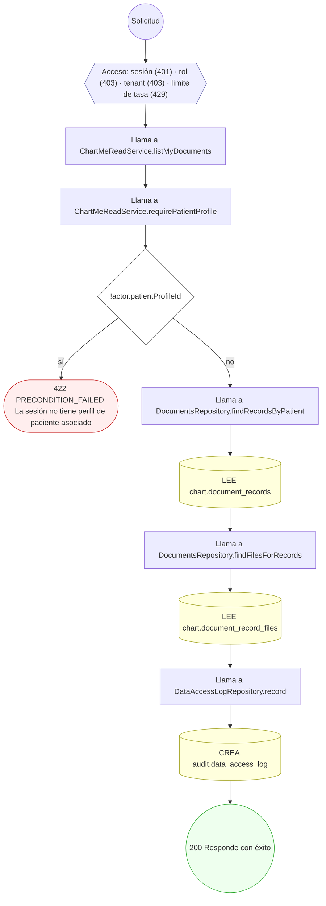

#### 7. GET /charts/me/documents/{documentId}/files/{fileId}/content

Descargar el archivo de un documento propio

| HTTP | Código | Cuándo |
|---|---|---|
| 200 | — | Éxito |
| 400 | `VALIDATION_FAILED` | Los parámetros de ruta son UUID válidos |
| 401 | `UNAUTHENTICATED` | Hay una sesión válida (JWT) |
| 403 | `FORBIDDEN` | El rol está permitido; El tenant se resuelve y pertenece al actor |
| 404 | `NOT_FOUND` | ResourceNotFoundException: Archivo no encontrado; ResourceNotFoundException: {labels.notFound}; ResourceNotFoundException: El contenido no está disponible en el almacenamiento local; ResourceNotFoundException: El contenido no está disponible en el almacenamiento configurado |
| 422 | `PRECONDITION_FAILED` | PreconditionFailedException: La sesión no tiene perfil de paciente asociado |
| 429 | `RATE_LIMITED` | No se supera el límite de solicitudes |
| 500 | `INTERNAL` | Error: S3 object body is empty |

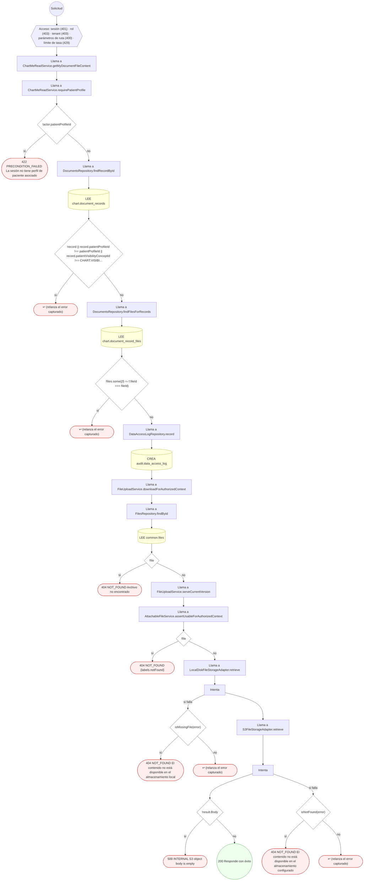

#### 8. GET /charts/me/encounters/{id}/pdf

Descargar el PDF oficial de una atención propia

| HTTP | Código | Cuándo |
|---|---|---|
| 200 | — | Éxito |
| 400 | `VALIDATION_FAILED` | Los parámetros de ruta son UUID válidos |
| 401 | `UNAUTHENTICATED` | Hay una sesión válida (JWT) |
| 403 | `FORBIDDEN` | El rol está permitido; El tenant se resuelve y pertenece al actor |
| 404 | `NOT_FOUND` | ResourceNotFoundException: Encuentro no encontrado |
| 422 | `PRECONDITION_FAILED` | PreconditionFailedException: El encuentro no está cerrado |
| 429 | `RATE_LIMITED` | No se supera el límite de solicitudes |

```mermaid
flowchart TD
  n1(("Solicitud")):::inicio
  n2{{"Acceso: sesión (401) · rol (403) · tenant (403) · parámetros de ruta (400) · límite de tasa (429)"}}:::acceso
  n1 --> n2
  n3["Llama a EncounterPdfService.renderForPatient"]:::llamada
  n2 --> n3
  n4{"!actor.patientProfileId"}:::decision
  n3 --> n4
  n5(["404 NOT_FOUND Encuentro no encontrado"]):::error
  n4 -->|"sí"| n5
  n6["Llama a EncountersRepository.findById"]:::llamada
  n4 -->|"no"| n6
  n7[("LEE clinical.encounters")]:::efecto
  n6 --> n7
  n8{"!encounter || encounter.patientProfileId !== actor.patientProfileId"}:::decision
  n7 --> n8
  n9(["404 NOT_FOUND Encuentro no encontrado"]):::error
  n8 -->|"sí"| n9
  n10{"encounter.statusConceptId !== CLIN.ENCOUNTER_FINISHED || !encounter.contentHash"}:::decision
  n8 -->|"no"| n10
  n11(["422 PRECONDITION_FAILED El encuentro no está cerrado"]):::error
  n10 -->|"sí"| n11
  n12["Llama a EncounterPdfService.compose"]:::llamada
  n10 -->|"no"| n12
  n13["Llama a ClinicalNotesRepository.findHeadersByEncounter"]:::llamada
  n12 --> n13
  n14[("LEE chart.clinical_note_headers")]:::efecto
  n13 --> n14
  n15["Llama a ConditionsRepository.findByEncounter"]:::llamada
  n14 --> n15
  n16[("LEE clinical.conditions")]:::efecto
  n15 --> n16
  n17["Llama a MedicationRequestsRepository.findByEncounter"]:::llamada
  n16 --> n17
  n18[("LEE clinical.medication_requests")]:::efecto
  n17 --> n18
  n19["Llama a CarePlansRepository.findByEncounter"]:::llamada
  n18 --> n19
  n20[("LEE chart.care_plans")]:::efecto
  n19 --> n20
  n21["Llama a CarePlansRepository.findActivitiesForPlans"]:::llamada
  n20 --> n21
  n22[("LEE chart.care_plan_activities")]:::efecto
  n21 --> n22
  n23["Llama a DocumentsRepository.findByEncounter"]:::llamada
  n22 --> n23
  n24[("LEE chart.document_records")]:::efecto
  n23 --> n24
  n25["Llama a DocumentsRepository.findFilesForRecords"]:::llamada
  n24 --> n25
  n26[("LEE chart.document_record_files")]:::efecto
  n25 --> n26
  n27["Llama a ClinicalNotesRepository.findVersionsByIds"]:::llamada
  n26 --> n27
  n28[("LEE chart.clinical_note_versions")]:::efecto
  n27 --> n28
  n29["Llama a CatalogConceptsRepository.findByIds"]:::llamada
  n28 --> n29
  n30[("LEE terminology.catalog_concepts")]:::efecto
  n29 --> n30
  n31["Llama a EncounterPdfService.resolvePatientName"]:::llamada
  n30 --> n31
  n32["Llama a PatientProfilesRepository.findById"]:::llamada
  n31 --> n32
  n33[("LEE profiles.patient_profiles")]:::efecto
  n32 --> n33
  n34["Llama a PersonsRepository.findById"]:::llamada
  n33 --> n34
  n35[("LEE profiles.persons")]:::efecto
  n34 --> n35
  n36["Llama a EncounterPdfService.resolvePractitionerName"]:::llamada
  n35 --> n36
  n37["Llama a HealthPractitionerProfilesRepository.findById"]:::llamada
  n36 --> n37
  n38[("LEE profiles.health_practitioner_profiles")]:::efecto
  n37 --> n38
  n39["Llama a PersonsRepository.findById"]:::llamada
  n38 --> n39
  n40[("LEE profiles.persons")]:::efecto
  n39 --> n40
  n41["Llama a FilesRepository.findById"]:::llamada
  n40 --> n41
  n42[("LEE common.files")]:::efecto
  n41 --> n42
  n43(("200 Responde con éxito")):::ok
  n42 --> n43
  classDef acceso fill:#eef,stroke:#66a
  classDef error fill:#fee,stroke:#c33
  classDef ok fill:#efe,stroke:#3a3
  classDef efecto fill:#ffd,stroke:#aa3
  classDef decision fill:#fff,stroke:#555
  classDef corte fill:#eee,stroke:#999,stroke-dasharray: 4
```

#### 9. GET /charts/me/notes

Ver mis evoluciones liberadas

| HTTP | Código | Cuándo |
|---|---|---|
| 200 | — | Éxito |
| 401 | `UNAUTHENTICATED` | Hay una sesión válida (JWT) |
| 403 | `FORBIDDEN` | El rol está permitido; El tenant se resuelve y pertenece al actor |
| 422 | `PRECONDITION_FAILED` | PreconditionFailedException: La sesión no tiene perfil de paciente asociado |
| 429 | `RATE_LIMITED` | No se supera el límite de solicitudes |

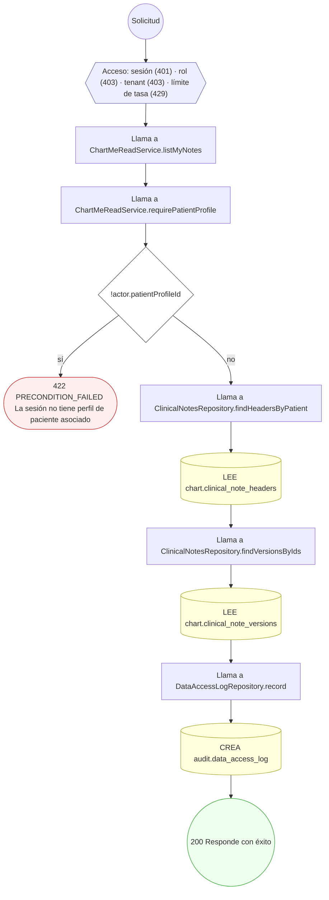

#### 10. GET /charts/notes

Listar las notas de evolución de un profesional por ventana de fechas

| HTTP | Código | Cuándo |
|---|---|---|
| 200 | — | Éxito |
| 400 | `VALIDATION_FAILED` | BadRequestException: La fecha "from" no puede ser posterior a "to" |
| 401 | `UNAUTHENTICATED` | Hay una sesión válida (JWT) |
| 403 | `FORBIDDEN` | El rol está permitido; El tenant se resuelve y pertenece al actor; ForbiddenException: Estas notas son de otro profesional: solo las lista quien las firma.; ForbiddenException: Esta lectura es la de un profesional: la sesión no tiene perfil profesional. |
| 429 | `RATE_LIMITED` | No se supera el límite de solicitudes |

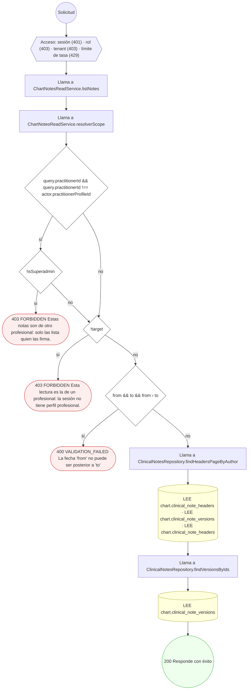

#### 11. POST /charts/notes

Crear una nota clínica versionada (borrador SOAP)

| HTTP | Código | Cuándo |
|---|---|---|
| 201 | — | Éxito |
| 400 | `VALIDATION_FAILED` | El cuerpo cumple el DTO (sin propiedades extra) |
| 401 | `UNAUTHENTICATED` | Hay una sesión válida (JWT) |
| 403 | `FORBIDDEN` | El rol está permitido; El tenant se resuelve y pertenece al actor; ForbiddenException: Una nota clínica necesita un profesional autor.; ForbiddenException: La sesión no tiene un perfil profesional con el que escribir la nota.; ForbiddenException: El autor de la nota es el profesional de la sesión: no se escribe en nombre de otro perfil. |
| 404 | `NOT_FOUND` | ResourceNotFoundException: Encuentro no encontrado |
| 422 | `PRECONDITION_FAILED` | PreconditionFailedException: El encuentro ya está cerrado y sellado: no admite más escrituras. |
| 429 | `RATE_LIMITED` | No se supera el límite de solicitudes |

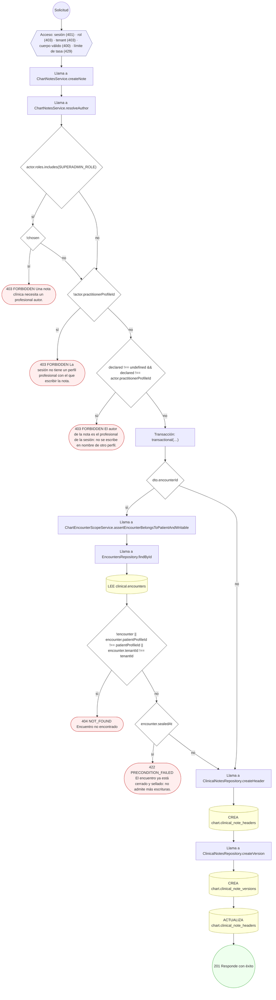

#### 12. POST /charts/notes/{noteId}/amendments

Enmendar una nota firmada (addendum versionado)

| HTTP | Código | Cuándo |
|---|---|---|
| 201 | — | Éxito |
| 400 | `VALIDATION_FAILED` | Los parámetros de ruta son UUID válidos; El cuerpo cumple el DTO (sin propiedades extra) |
| 401 | `UNAUTHENTICATED` | Hay una sesión válida (JWT) |
| 403 | `FORBIDDEN` | El rol está permitido; El tenant se resuelve y pertenece al actor; ForbiddenException: {WITHOUT_ACCESS_TO_HISTORY}; ForbiddenException: Una nota clínica necesita un profesional autor.; ForbiddenException: La sesión no tiene un perfil profesional con el que escribir la nota.; ForbiddenException: El autor de la nota es el profesional de la sesión: no se escribe en nombre de otro perfil. |
| 404 | `NOT_FOUND` | ResourceNotFoundException: Nota clínica no encontrada |
| 422 | `PRECONDITION_FAILED` | PreconditionFailedException: La nota no está firmada; edítela como borrador (UC-15-02) |
| 429 | `RATE_LIMITED` | No se supera el límite de solicitudes |

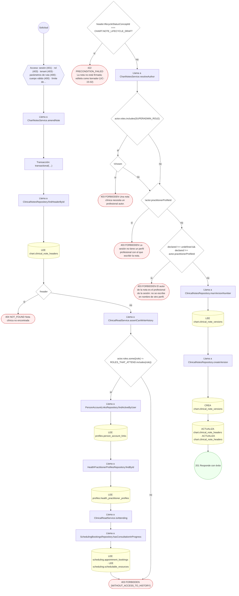

#### 13. PUT /charts/notes/{noteId}/versions

Editar borrador creando una nueva versión inmutable

| HTTP | Código | Cuándo |
|---|---|---|
| 201 | — | Éxito |
| 400 | `VALIDATION_FAILED` | Los parámetros de ruta son UUID válidos; El cuerpo cumple el DTO (sin propiedades extra) |
| 401 | `UNAUTHENTICATED` | Hay una sesión válida (JWT) |
| 403 | `FORBIDDEN` | El rol está permitido; El tenant se resuelve y pertenece al actor; ForbiddenException: {WITHOUT_ACCESS_TO_HISTORY}; ForbiddenException: Una nota clínica necesita un profesional autor.; ForbiddenException: La sesión no tiene un perfil profesional con el que escribir la nota.; ForbiddenException: El autor de la nota es el profesional de la sesión: no se escribe en nombre de otro perfil. |
| 404 | `NOT_FOUND` | ResourceNotFoundException: Nota clínica no encontrada |
| 422 | `PRECONDITION_FAILED` | PreconditionFailedException: La nota ya no está en borrador; use una enmienda (UC-15-05) |
| 429 | `RATE_LIMITED` | No se supera el límite de solicitudes |

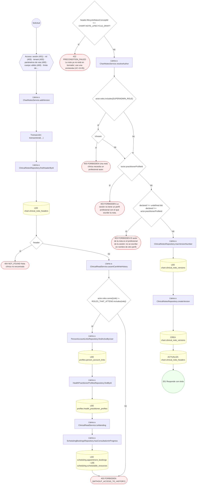

#### 14. POST /charts/notes/{noteId}/versions/{versionId}/cosign

Cofirmar una versión firmada (cadena de firmas)

| HTTP | Código | Cuándo |
|---|---|---|
| 201 | — | Éxito |
| 400 | `VALIDATION_FAILED` | Los parámetros de ruta son UUID válidos; El cuerpo cumple el DTO (sin propiedades extra) |
| 401 | `UNAUTHENTICATED` | Hay una sesión válida (JWT) |
| 403 | `FORBIDDEN` | El rol está permitido; El tenant se resuelve y pertenece al actor; ForbiddenException: Una firma clínica necesita un perfil profesional firmante.; ForbiddenException: La sesión no tiene un perfil profesional con el que firmar.; ForbiddenException: Una nota la firma su profesional: no se puede firmar en nombre de otro perfil.; ForbiddenException: {WITHOUT_ACCESS_TO_HISTORY} |
| 404 | `NOT_FOUND` | ResourceNotFoundException: Versión de nota no encontrada; ResourceNotFoundException: Nota clínica no encontrada |
| 409 | `CONFLICT` | ConflictException: El cofirmante ya firmó esta versión |
| 422 | `PRECONDITION_FAILED` | PreconditionFailedException: La versión no está firmada (SIGNED); PreconditionFailedException: Falta la firma primaria del autor |
| 429 | `RATE_LIMITED` | No se supera el límite de solicitudes |

```mermaid
flowchart TD
  n1(("Solicitud")):::inicio
  n2{{"Acceso: sesión (401) · rol (403) · tenant (403) · parámetros de ruta (400) · cuerpo válido (400) · límite de…"}}:::acceso
  n1 --> n2
  n3["Llama a ChartNotesService.cosignVersion"]:::llamada
  n2 --> n3
  n4["Transacción: transactional(…)"]:::transaccion
  n3 --> n4
  n5["Llama a ChartNotesService.resolveSigner"]:::llamada
  n4 --> n5
  n6{"actor.roles.includes(SUPERADMIN_ROLE)"}:::decision
  n5 --> n6
  n7{"!chosen"}:::decision
  n6 -->|"sí"| n7
  n8(["403 FORBIDDEN Una firma clínica necesita un perfil profesional firmante."]):::error
  n7 -->|"sí"| n8
  n9{"!actor.practitionerProfileId"}:::decision
  n7 -->|"no"| n9
  n6 -->|"no"| n9
  n10(["403 FORBIDDEN La sesión no tiene un perfil profesional con el que firmar."]):::error
  n9 -->|"sí"| n10
  n11{"declared !== undefined && declared !== actor.practitionerProfileId"}:::decision
  n9 -->|"no"| n11
  n12(["403 FORBIDDEN Una nota la firma su profesional: no se puede firmar en nombre de otro perfil."]):::error
  n11 -->|"sí"| n12
  n13["Llama a ChartNotesService.loadNoteAndVersion"]:::llamada
  n11 -->|"no"| n13
  n14["Llama a ClinicalNotesRepository.findVersionById"]:::llamada
  n13 --> n14
  n15[("LEE chart.clinical_note_versions")]:::efecto
  n14 --> n15
  n16{"!version || version.clinicalNoteId !== noteId"}:::decision
  n15 --> n16
  n17(["404 NOT_FOUND Versión de nota no encontrada"]):::error
  n16 -->|"sí"| n17
  n18["Llama a ClinicalNotesRepository.findHeaderById"]:::llamada
  n16 -->|"no"| n18
  n19[("LEE chart.clinical_note_headers")]:::efecto
  n18 --> n19
  n20{"!header"}:::decision
  n19 --> n20
  n21(["404 NOT_FOUND Nota clínica no encontrada"]):::error
  n20 -->|"sí"| n21
  n22["Llama a ClinicalReadService.assertCanWriteHistory"]:::llamada
  n20 -->|"no"| n22
  n23{"actor.roles.some((role) =› ROLES_THAT_ATTEND.includes(role))"}:::decision
  n22 --> n23
  n24["Llama a PersonAccountLinksRepository.findActiveByUser"]:::llamada
  n23 -->|"sí"| n24
  n25[("LEE profiles.person_account_links")]:::efecto
  n24 --> n25
  n26["Llama a HealthPractitionerProfilesRepository.findById"]:::llamada
  n25 --> n26
  n27[("LEE profiles.health_practitioner_profiles")]:::efecto
  n26 --> n27
  n28["Llama a ClinicalReadService.isAttending"]:::llamada
  n27 --> n28
  n29["Llama a SchedulingBookingsRepository.hasConsultationInProgress"]:::llamada
  n28 --> n29
  n30[("LEE scheduling.appointment_bookings · LEE scheduling.schedulable_resources")]:::efecto
  n29 --> n30
  n31(["403 FORBIDDEN {WITHOUT_ACCESS_TO_HISTORY}"]):::error
  n30 --> n31
  n23 -->|"no"| n31
  n32{"version.statusConceptId !== CHART.VERSION_SIGNED"}:::decision
  n33(["422 PRECONDITION_FAILED La versión no está firmada (SIGNED)"]):::error
  n32 -->|"sí"| n33
  n34["Llama a ClinicalNotesRepository.findSignatures"]:::llamada
  n32 -->|"no"| n34
  n35[("LEE chart.clinical_note_signatures")]:::efecto
  n34 --> n35
  n36{"!hasAuthor"}:::decision
  n35 --> n36
  n37(["422 PRECONDITION_FAILED Falta la firma primaria del autor"]):::error
  n36 -->|"sí"| n37
  n38{"alreadyCosigned"}:::decision
  n36 -->|"no"| n38
  n39(["409 CONFLICT El cofirmante ya firmó esta versión"]):::error
  n38 -->|"sí"| n39
  n40["Llama a ClinicalNotesRepository.createSignature"]:::llamada
  n38 -->|"no"| n40
  n41[("CREA chart.clinical_note_signatures")]:::efecto
  n40 --> n41
  n42(("201 Responde con éxito")):::ok
  n41 --> n42
  classDef acceso fill:#eef,stroke:#66a
  classDef error fill:#fee,stroke:#c33
  classDef ok fill:#efe,stroke:#3a3
  classDef efecto fill:#ffd,stroke:#aa3
  classDef decision fill:#fff,stroke:#555
  classDef corte fill:#eee,stroke:#999,stroke-dasharray: 4
```

#### 15. POST /charts/notes/{noteId}/versions/{versionId}/sign

Firmar una versión y sellar su contenido

| HTTP | Código | Cuándo |
|---|---|---|
| 201 | — | Éxito |
| 400 | `VALIDATION_FAILED` | Los parámetros de ruta son UUID válidos; El cuerpo cumple el DTO (sin propiedades extra) |
| 401 | `UNAUTHENTICATED` | Hay una sesión válida (JWT) |
| 403 | `FORBIDDEN` | El rol está permitido; El tenant se resuelve y pertenece al actor; ForbiddenException: Una firma clínica necesita un perfil profesional firmante.; ForbiddenException: La sesión no tiene un perfil profesional con el que firmar.; ForbiddenException: Una nota la firma su profesional: no se puede firmar en nombre de otro perfil.; ForbiddenException: {WITHOUT_ACCESS_TO_HISTORY} |
| 404 | `NOT_FOUND` | ResourceNotFoundException: Versión de nota no encontrada; ResourceNotFoundException: Nota clínica no encontrada |
| 422 | `PRECONDITION_FAILED` | PreconditionFailedException: La versión no está en borrador |
| 429 | `RATE_LIMITED` | No se supera el límite de solicitudes |

```mermaid
flowchart TD
  n1(("Solicitud")):::inicio
  n2{{"Acceso: sesión (401) · rol (403) · tenant (403) · parámetros de ruta (400) · cuerpo válido (400) · límite de…"}}:::acceso
  n1 --> n2
  n3["Llama a ChartNotesService.signVersion"]:::llamada
  n2 --> n3
  n4["Transacción: transactional(…)"]:::transaccion
  n3 --> n4
  n5["Llama a ChartNotesService.resolveSigner"]:::llamada
  n4 --> n5
  n6{"actor.roles.includes(SUPERADMIN_ROLE)"}:::decision
  n5 --> n6
  n7{"!chosen"}:::decision
  n6 -->|"sí"| n7
  n8(["403 FORBIDDEN Una firma clínica necesita un perfil profesional firmante."]):::error
  n7 -->|"sí"| n8
  n9{"!actor.practitionerProfileId"}:::decision
  n7 -->|"no"| n9
  n6 -->|"no"| n9
  n10(["403 FORBIDDEN La sesión no tiene un perfil profesional con el que firmar."]):::error
  n9 -->|"sí"| n10
  n11{"declared !== undefined && declared !== actor.practitionerProfileId"}:::decision
  n9 -->|"no"| n11
  n12(["403 FORBIDDEN Una nota la firma su profesional: no se puede firmar en nombre de otro perfil."]):::error
  n11 -->|"sí"| n12
  n13["Llama a ChartNotesService.loadNoteAndVersion"]:::llamada
  n11 -->|"no"| n13
  n14["Llama a ClinicalNotesRepository.findVersionById"]:::llamada
  n13 --> n14
  n15[("LEE chart.clinical_note_versions")]:::efecto
  n14 --> n15
  n16{"!version || version.clinicalNoteId !== noteId"}:::decision
  n15 --> n16
  n17(["404 NOT_FOUND Versión de nota no encontrada"]):::error
  n16 -->|"sí"| n17
  n18["Llama a ClinicalNotesRepository.findHeaderById"]:::llamada
  n16 -->|"no"| n18
  n19[("LEE chart.clinical_note_headers")]:::efecto
  n18 --> n19
  n20{"!header"}:::decision
  n19 --> n20
  n21(["404 NOT_FOUND Nota clínica no encontrada"]):::error
  n20 -->|"sí"| n21
  n22["Llama a ClinicalReadService.assertCanWriteHistory"]:::llamada
  n20 -->|"no"| n22
  n23{"actor.roles.some((role) =› ROLES_THAT_ATTEND.includes(role))"}:::decision
  n22 --> n23
  n24["Llama a PersonAccountLinksRepository.findActiveByUser"]:::llamada
  n23 -->|"sí"| n24
  n25[("LEE profiles.person_account_links")]:::efecto
  n24 --> n25
  n26["Llama a HealthPractitionerProfilesRepository.findById"]:::llamada
  n25 --> n26
  n27[("LEE profiles.health_practitioner_profiles")]:::efecto
  n26 --> n27
  n28["Llama a ClinicalReadService.isAttending"]:::llamada
  n27 --> n28
  n29["Llama a SchedulingBookingsRepository.hasConsultationInProgress"]:::llamada
  n28 --> n29
  n30[("LEE scheduling.appointment_bookings · LEE scheduling.schedulable_resources")]:::efecto
  n29 --> n30
  n31(["403 FORBIDDEN {WITHOUT_ACCESS_TO_HISTORY}"]):::error
  n30 --> n31
  n23 -->|"no"| n31
  n32{"version.statusConceptId !== CHART.VERSION_DRAFT"}:::decision
  n33(["422 PRECONDITION_FAILED La versión no está en borrador"]):::error
  n32 -->|"sí"| n33
  n34["Llama a ClinicalNotesRepository.createSignature"]:::llamada
  n32 -->|"no"| n34
  n35[("CREA chart.clinical_note_signatures")]:::efecto
  n34 --> n35
  n36(("201 Responde con éxito")):::ok
  n35 --> n36
  classDef acceso fill:#eef,stroke:#66a
  classDef error fill:#fee,stroke:#c33
  classDef ok fill:#efe,stroke:#3a3
  classDef efecto fill:#ffd,stroke:#aa3
  classDef decision fill:#fff,stroke:#555
  classDef corte fill:#eee,stroke:#999,stroke-dasharray: 4
```

#### 16. POST /charts/notes/versions/{versionId}/exam-findings

Registrar hallazgos de examen físico

| HTTP | Código | Cuándo |
|---|---|---|
| 201 | — | Éxito |
| 400 | `VALIDATION_FAILED` | Los parámetros de ruta son UUID válidos; El cuerpo cumple el DTO (sin propiedades extra) |
| 401 | `UNAUTHENTICATED` | Hay una sesión válida (JWT) |
| 403 | `FORBIDDEN` | El rol está permitido; El tenant se resuelve y pertenece al actor; ForbiddenException: {WITHOUT_ACCESS_TO_HISTORY} |
| 404 | `NOT_FOUND` | ResourceNotFoundException: Versión de nota no encontrada; ResourceNotFoundException: Nota clínica no encontrada |
| 422 | `PRECONDITION_FAILED` | PreconditionFailedException: La versión ya está firmada; los hallazgos quedan sellados |
| 429 | `RATE_LIMITED` | No se supera el límite de solicitudes |

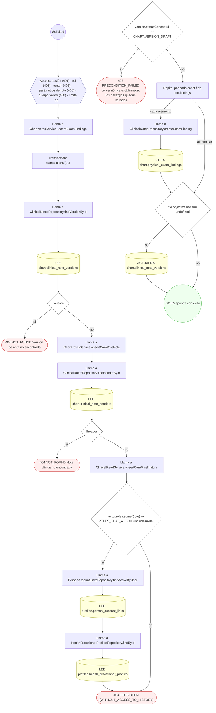

#### 17. POST /charts/notes/versions/{versionId}/release

Liberar una versión al paciente

| HTTP | Código | Cuándo |
|---|---|---|
| 201 | — | Éxito |
| 400 | `VALIDATION_FAILED` | Los parámetros de ruta son UUID válidos; El cuerpo cumple el DTO (sin propiedades extra) |
| 401 | `UNAUTHENTICATED` | Hay una sesión válida (JWT) |
| 403 | `FORBIDDEN` | El rol está permitido; El tenant se resuelve y pertenece al actor; ForbiddenException: {WITHOUT_ACCESS_TO_HISTORY} |
| 404 | `NOT_FOUND` | ResourceNotFoundException: Versión de nota no encontrada; ResourceNotFoundException: Nota clínica no encontrada |
| 422 | `PRECONDITION_FAILED` | PreconditionFailedException: La versión no está firmada; PreconditionFailedException: La versión no es elegible para liberación |
| 429 | `RATE_LIMITED` | No se supera el límite de solicitudes |

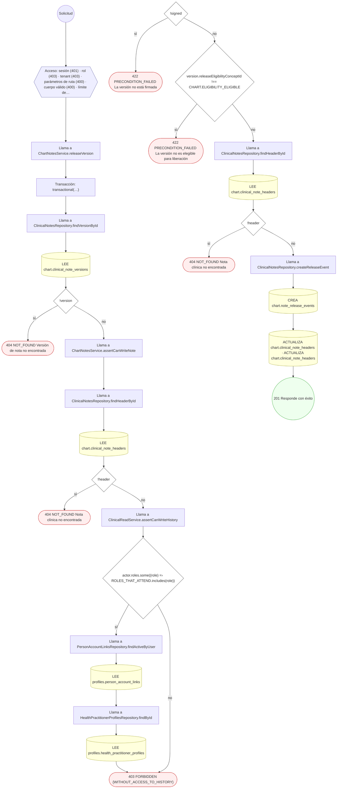

#### 18. POST /charts/notes/versions/{versionId}/withhold

Retener una versión del paciente (motivo legal)

| HTTP | Código | Cuándo |
|---|---|---|
| 201 | — | Éxito |
| 400 | `VALIDATION_FAILED` | Los parámetros de ruta son UUID válidos; El cuerpo cumple el DTO (sin propiedades extra) |
| 401 | `UNAUTHENTICATED` | Hay una sesión válida (JWT) |
| 403 | `FORBIDDEN` | El rol está permitido; El tenant se resuelve y pertenece al actor; ForbiddenException: {WITHOUT_ACCESS_TO_HISTORY} |
| 404 | `NOT_FOUND` | ResourceNotFoundException: Versión de nota no encontrada; ResourceNotFoundException: Nota clínica no encontrada |
| 429 | `RATE_LIMITED` | No se supera el límite de solicitudes |

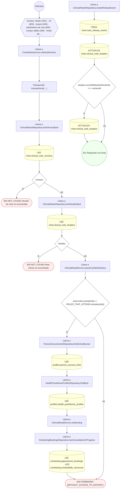

#### 19. GET /charts/templates

Listar las plantillas de chart por especialidad

| HTTP | Código | Cuándo |
|---|---|---|
| 200 | — | Éxito |
| 401 | `UNAUTHENTICATED` | Hay una sesión válida (JWT) |
| 403 | `FORBIDDEN` | El rol está permitido; El tenant se resuelve y pertenece al actor |
| 429 | `RATE_LIMITED` | No se supera el límite de solicitudes |

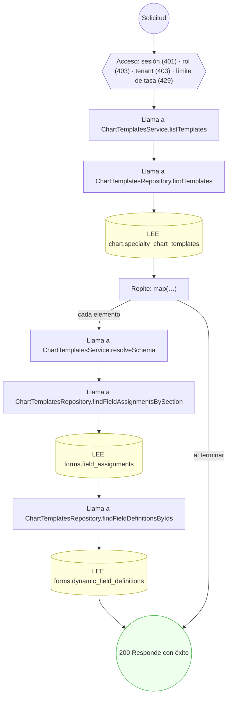

#### 20. POST /charts/templates

Crear una plantilla de chart con su esquema de campos, por especialidad

| HTTP | Código | Cuándo |
|---|---|---|
| 201 | — | Éxito |
| 400 | `VALIDATION_FAILED` | El cuerpo cumple el DTO (sin propiedades extra) |
| 401 | `UNAUTHENTICATED` | Hay una sesión válida (JWT) |
| 403 | `FORBIDDEN` | El rol está permitido; El tenant se resuelve y pertenece al actor |
| 422 | `PRECONDITION_FAILED` | PreconditionFailedException: `options`/`allowOther` sólo aplican a dataType "code"; PreconditionFailedException: Un campo "code" declara valueSetId u options, no los dos; PreconditionFailedException: `allowOther` no aplica sobre un valueSetId; PreconditionFailedException: Un campo "code" sin valueSetId necesita al menos dos opciones; PreconditionFailedException: Una opción no puede estar vacía; PreconditionFailedException: Las opciones no pueden repetirse |
| 429 | `RATE_LIMITED` | No se supera el límite de solicitudes |

```mermaid
flowchart TD
  n1(("Solicitud")):::inicio
  n2{{"Acceso: sesión (401) · rol (403) · tenant (403) · cuerpo válido (400) · límite de tasa (429)"}}:::acceso
  n1 --> n2
  n3["Llama a ChartTemplatesService.createTemplate"]:::llamada
  n2 --> n3
  n4["Transacción: transactional(…)"]:::transaccion
  n3 --> n4
  n5["Llama a ChartTemplatesRepository.createTemplate"]:::llamada
  n4 --> n5
  n6[("CREA chart.specialty_chart_templates")]:::efecto
  n5 --> n6
  n7["Llama a ChartTemplatesRepository.createTemplateSection"]:::llamada
  n6 --> n7
  n8[("CREA forms.dynamic_field_sections")]:::efecto
  n7 --> n8
  n9[("ACTUALIZA chart.specialty_chart_templates")]:::efecto
  n8 --> n9
  n10["Repite: por cada const [i, input] de dto.fields.entries()"]:::bucle
  n9 --> n10
  n11["Llama a ChartTemplatesService.validateChoiceField"]:::llamada
  n10 -->|"cada elemento"| n11
  n12{"input.dataType !== 'code'"}:::decision
  n11 --> n12
  n13{"input.options !== undefined || input.allowOther"}:::decision
  n12 -->|"sí"| n13
  n14(["422 PRECONDITION_FAILED `options`/`allowOther` sólo aplican a dataType 'code'"]):::error
  n13 -->|"sí"| n14
  n15{"input.valueSetId !== undefined && input.options !== undefined"}:::decision
  n13 -->|"no"| n15
  n12 -->|"no"| n15
  n16(["422 PRECONDITION_FAILED Un campo 'code' declara valueSetId u options, no los dos"]):::error
  n15 -->|"sí"| n16
  n17{"input.valueSetId !== undefined"}:::decision
  n15 -->|"no"| n17
  n18{"input.allowOther"}:::decision
  n17 -->|"sí"| n18
  n19(["422 PRECONDITION_FAILED `allowOther` no aplica sobre un valueSetId"]):::error
  n18 -->|"sí"| n19
  n20{"opciones.length ‹ 2"}:::decision
  n18 -->|"no"| n20
  n17 -->|"no"| n20
  n21(["422 PRECONDITION_FAILED Un campo 'code' sin valueSetId necesita al menos dos opciones"]):::error
  n20 -->|"sí"| n21
  n22["Repite: por cada const opcionCruda de opciones"]:::bucle
  n20 -->|"no"| n22
  n23{"opcion === ''"}:::decision
  n22 -->|"cada elemento"| n23
  n24(["422 PRECONDITION_FAILED Una opción no puede estar vacía"]):::error
  n23 -->|"sí"| n24
  n25{"vistas.has(opcion)"}:::decision
  n23 -->|"no"| n25
  n26(["422 PRECONDITION_FAILED Las opciones no pueden repetirse"]):::error
  n25 -->|"sí"| n26
  n27["Llama a ChartTemplatesRepository.createTemplateField"]:::llamada
  n25 -->|"no"| n27
  n22 -->|"al terminar"| n27
  n28[("CREA forms.dynamic_field_definitions")]:::efecto
  n27 --> n28
  n29["Llama a ChartTemplatesRepository.createTemplateFieldAssignment"]:::llamada
  n28 --> n29
  n30[("CREA forms.field_assignments")]:::efecto
  n29 --> n30
  n31(("201 Responde con éxito")):::ok
  n30 --> n31
  n10 -->|"al terminar"| n31
  classDef acceso fill:#eef,stroke:#66a
  classDef error fill:#fee,stroke:#c33
  classDef ok fill:#efe,stroke:#3a3
  classDef efecto fill:#ffd,stroke:#aa3
  classDef decision fill:#fff,stroke:#555
  classDef corte fill:#eee,stroke:#999,stroke-dasharray: 4
```

#### 21. GET /charts/templates/{id}

Leer el esquema de una plantilla de chart

| HTTP | Código | Cuándo |
|---|---|---|
| 200 | — | Éxito |
| 400 | `VALIDATION_FAILED` | Los parámetros de ruta son UUID válidos |
| 401 | `UNAUTHENTICATED` | Hay una sesión válida (JWT) |
| 403 | `FORBIDDEN` | El rol está permitido; El tenant se resuelve y pertenece al actor |
| 404 | `NOT_FOUND` | ResourceNotFoundException: Plantilla no encontrada |
| 429 | `RATE_LIMITED` | No se supera el límite de solicitudes |

```mermaid
flowchart TD
  n1(("Solicitud")):::inicio
  n2{{"Acceso: sesión (401) · rol (403) · tenant (403) · parámetros de ruta (400) · límite de tasa (429)"}}:::acceso
  n1 --> n2
  n3["Llama a ChartTemplatesService.getTemplate"]:::llamada
  n2 --> n3
  n4["Llama a ChartTemplatesRepository.findTemplateById"]:::llamada
  n3 --> n4
  n5[("LEE chart.specialty_chart_templates")]:::efecto
  n4 --> n5
  n6{"!template || (template.tenantId && template.tenantId !== tenantId)"}:::decision
  n5 --> n6
  n7(["404 NOT_FOUND Plantilla no encontrada"]):::error
  n6 -->|"sí"| n7
  n8["Llama a ChartTemplatesService.resolveSchema"]:::llamada
  n6 -->|"no"| n8
  n9["Llama a ChartTemplatesRepository.findFieldAssignmentsBySection"]:::llamada
  n8 --> n9
  n10[("LEE forms.field_assignments")]:::efecto
  n9 --> n10
  n11["Llama a ChartTemplatesRepository.findFieldDefinitionsByIds"]:::llamada
  n10 --> n11
  n12[("LEE forms.dynamic_field_definitions")]:::efecto
  n11 --> n12
  n13(("200 Responde con éxito")):::ok
  n12 --> n13
  classDef acceso fill:#eef,stroke:#66a
  classDef error fill:#fee,stroke:#c33
  classDef ok fill:#efe,stroke:#3a3
  classDef efecto fill:#ffd,stroke:#aa3
  classDef decision fill:#fff,stroke:#555
  classDef corte fill:#eee,stroke:#999,stroke-dasharray: 4
```

#### 22. POST /charts/templates/{templateId}/assignments

Asignar una plantilla de chart por especialidad

| HTTP | Código | Cuándo |
|---|---|---|
| 201 | — | Éxito |
| 400 | `VALIDATION_FAILED` | Los parámetros de ruta son UUID válidos; El cuerpo cumple el DTO (sin propiedades extra) |
| 401 | `UNAUTHENTICATED` | Hay una sesión válida (JWT) |
| 403 | `FORBIDDEN` | El rol está permitido; El tenant se resuelve y pertenece al actor |
| 429 | `RATE_LIMITED` | No se supera el límite de solicitudes |

```mermaid
flowchart TD
  n1(("Solicitud")):::inicio
  n2{{"Acceso: sesión (401) · rol (403) · tenant (403) · parámetros de ruta (400) · cuerpo válido (400) · límite de…"}}:::acceso
  n1 --> n2
  n3["Llama a ChartTemplatesService.assignTemplate"]:::llamada
  n2 --> n3
  n4["Transacción: transactional(…)"]:::transaccion
  n3 --> n4
  n5{"isDefault"}:::decision
  n4 --> n5
  n6["Llama a ChartTemplatesRepository.findActiveDefaults"]:::llamada
  n5 -->|"sí"| n6
  n7[("LEE chart.chart_template_assignments")]:::efecto
  n6 --> n7
  n8["Repite: por cada const prior de priorDefaults"]:::bucle
  n7 --> n8
  n9[("ACTUALIZA chart.chart_template_assignments")]:::efecto
  n8 -->|"cada elemento"| n9
  n10["Llama a ChartTemplatesRepository.createAssignment"]:::llamada
  n9 --> n10
  n8 -->|"al terminar"| n10
  n5 -->|"no"| n10
  n11[("CREA chart.chart_template_assignments")]:::efecto
  n10 --> n11
  n12(("201 Responde con éxito")):::ok
  n11 --> n12
  classDef acceso fill:#eef,stroke:#66a
  classDef error fill:#fee,stroke:#c33
  classDef ok fill:#efe,stroke:#3a3
  classDef efecto fill:#ffd,stroke:#aa3
  classDef decision fill:#fff,stroke:#555
  classDef corte fill:#eee,stroke:#999,stroke-dasharray: 4
```

### Operaciones sin decisiones propias

Sólo comprueban el acceso y leen o escriben: no tienen ramas que dibujar. Su detalle está en la ficha de endpoints.

| Operación | Respuestas posibles | Tablas |
|---|---|---|
| GET /charts/patients/{patientProfileId}/chart | 200, 400, 401, 403, 429 | 6 |
