<!-- AUTOGENERADO por tools/inventario/flujos.mjs. No editar manualmente. -->

# Flujos del módulo `chart`

- **Procesos:** 1 · **Máquinas de estado:** 0
- **Operaciones:** 16 (14 con decisiones propias, 2 sin ellas)
- Inventario de endpoints del módulo: [chart](../endpoints/chart.md)

## Proceso: src / modules / chart

- **Código:** `chart` · **Agrupación:** AGRUPACION_POR_CONTROLADOR · **Operaciones:** 16
- **Actores:** CLINICIAN · PRACTITIONER · SECURITY_ADMIN
- **Revisión:** AUTO_DETECTADA
- **Fuentes:** `src/modules/chart/README.md`

### Para qué sirve

Agrupa los componentes relacionados con **chart** y mantiene cohesionada esta responsabilidad del sistema.

_Fuente: `src/modules/chart/README.md:3`_

### Etapas y operaciones

| Etapa | Descripción | Operación | Quién actúa | Riesgo | Tablas |
|---|---|---|---|---|---|
| `ctrl:ChartCarePlansController` | Operaciones de ChartCarePlansController que el README no asigna a un caso de uso | POST /charts/care-plans | CLINICIAN · PRACTITIONER | MEDIO | 2 |
|  |  | PATCH /charts/care-plans/{planId}/activities/{activityId} | CLINICIAN · PRACTITIONER | MEDIO | 4 |
| `ctrl:ChartDocumentsController` | Operaciones de ChartDocumentsController que el README no asigna a un caso de uso | POST /charts/documents | CLINICIAN · PRACTITIONER | MEDIO | 2 |
| `ctrl:ChartNotesController` | Operaciones de ChartNotesController que el README no asigna a un caso de uso | POST /charts/notes | CLINICIAN · PRACTITIONER | MEDIO | 3 |
|  |  | POST /charts/notes/{noteId}/amendments | CLINICIAN · PRACTITIONER | MEDIO | 4 |
|  |  | PUT /charts/notes/{noteId}/versions | CLINICIAN · PRACTITIONER | MEDIO | 4 |
|  |  | POST /charts/notes/{noteId}/versions/{versionId}/cosign | CLINICIAN · PRACTITIONER | MEDIO | 4 |
|  |  | POST /charts/notes/{noteId}/versions/{versionId}/sign | CLINICIAN · PRACTITIONER | MEDIO | 3 |
|  |  | POST /charts/notes/versions/{versionId}/exam-findings | CLINICIAN · PRACTITIONER | MEDIO | 3 |
|  |  | POST /charts/notes/versions/{versionId}/release | CLINICIAN · PRACTITIONER | MEDIO | 4 |
|  |  | POST /charts/notes/versions/{versionId}/withhold | CLINICIAN · PRACTITIONER | MEDIO | 4 |
| `ctrl:ChartReadController` | Operaciones de ChartReadController que el README no asigna a un caso de uso | GET /charts/patients/{patientProfileId}/chart | CLINICIAN · PRACTITIONER | BAJO | 5 |
| `ctrl:ChartTemplatesController` | Operaciones de ChartTemplatesController que el README no asigna a un caso de uso | GET /charts/templates | CLINICIAN · PRACTITIONER · SECURITY_ADMIN | BAJO | 3 |
|  |  | POST /charts/templates | SECURITY_ADMIN | MEDIO | 5 |
|  |  | GET /charts/templates/{id} | CLINICIAN · PRACTITIONER · SECURITY_ADMIN | BAJO | 3 |
|  |  | POST /charts/templates/{templateId}/assignments | SECURITY_ADMIN | MEDIO | 3 |

### Diagrama — etapas `ctrl:ChartCarePlansController`, `ctrl:ChartDocumentsController`, `ctrl:ChartNotesController`…

```mermaid
flowchart LR
  a2(["CLINICIAN · PRACTITIONER"]):::actor
  a24(["CLINICIAN · PRACTITIONER · SECURITY_ADMIN"]):::actor
  a29(["SECURITY_ADMIN"]):::actor
  t3[("chart.care_plan_activities")]:::tabla
  t4[("chart.care_plans")]:::tabla
  t7[("chart.document_record_files")]:::tabla
  t8[("chart.document_records")]:::tabla
  t10[("chart.clinical_note_headers")]:::tabla
  t11[("chart.clinical_note_versions")]:::tabla
  t15[("chart.clinical_note_signatures")]:::tabla
  t18[("chart.physical_exam_findings")]:::tabla
  t20[("chart.note_release_events")]:::tabla
  t25[("chart.specialty_chart_templates")]:::tabla
  t26[("forms.dynamic_field_definitions")]:::tabla
  t27[("forms.field_assignments")]:::tabla
  t30[("forms.dynamic_field_sections")]:::tabla
  t33[("chart.chart_template_assignments")]:::tabla
  subgraph s0["ctrl:ChartCarePlansController · Operaciones de ChartCarePlansController que el…"]
    o1["POST /charts/care-plans"]:::op
    o5["PATCH /charts/care-plans/{planId}/activities/{activityId}"]:::op
  end
  subgraph s1["ctrl:ChartDocumentsController · Operaciones de ChartDocumentsController que el…"]
    o6["POST /charts/documents"]:::op
  end
  subgraph s2["ctrl:ChartNotesController · Operaciones de ChartNotesController que el README n…"]
    o9["POST /charts/notes"]:::op
    o12["POST /charts/notes/{noteId}/amendments"]:::op
    o13["PUT /charts/notes/{noteId}/versions"]:::op
    o14["POST /charts/notes/{noteId}/versions/{versionId}/cosign"]:::op
    o16["POST /charts/notes/{noteId}/versions/{versionId}/sign"]:::op
    o17["POST /charts/notes/versions/{versionId}/exam-findings"]:::op
    o19["POST /charts/notes/versions/{versionId}/release"]:::op
    o21["POST /charts/notes/versions/{versionId}/withhold"]:::op
  end
  subgraph s3["ctrl:ChartReadController · Operaciones de ChartReadController que el README no…"]
    o22["GET /charts/patients/{patientProfileId}/chart"]:::op
  end
  subgraph s4["ctrl:ChartTemplatesController · Operaciones de ChartTemplatesController que el…"]
    o23["GET /charts/templates"]:::op
    o28["POST /charts/templates"]:::op
    o31["GET /charts/templates/{id}"]:::op
    o32["POST /charts/templates/{templateId}/assignments"]:::op
  end
  a2 --> o1
  o1 -->|"CREA"| t3
  o1 -->|"CREA"| t4
  a2 --> o5
  o5 -->|"ACTUALIZA"| t3
  o5 -->|"LEE"| t3
  o5 -->|"ACTUALIZA"| t4
  o5 -->|"LEE"| t4
  a2 --> o6
  o6 -->|"CREA"| t7
  o6 -->|"CREA"| t8
  a2 --> o9
  o9 -->|"ACTUALIZA"| t10
  o9 -->|"CREA"| t10
  o9 -->|"CREA"| t11
  a2 --> o12
  o12 -->|"ACTUALIZA"| t10
  o12 -->|"LEE"| t10
  o12 -->|"CREA"| t11
  o12 -->|"LEE"| t11
  a2 --> o13
  o13 -->|"ACTUALIZA"| t10
  o13 -->|"LEE"| t10
  o13 -->|"CREA"| t11
  o13 -->|"LEE"| t11
  a2 --> o14
  o14 -->|"LEE"| t10
  o14 -->|"CREA"| t15
  o14 -->|"LEE"| t15
  o14 -->|"LEE"| t11
  a2 --> o16
  o16 -->|"LEE"| t10
  o16 -->|"CREA"| t15
  o16 -->|"LEE"| t11
  a2 --> o17
  o17 -->|"ACTUALIZA"| t11
  o17 -->|"LEE"| t11
  o17 -->|"CREA"| t18
  a2 --> o19
  o19 -->|"ACTUALIZA"| t10
  o19 -->|"LEE"| t10
  o19 -->|"LEE"| t11
  o19 -->|"CREA"| t20
  a2 --> o21
  o21 -->|"ACTUALIZA"| t10
  o21 -->|"LEE"| t10
  o21 -->|"LEE"| t11
  o21 -->|"CREA"| t20
  a2 --> o22
  o22 -->|"LEE"| t3
  o22 -->|"LEE"| t4
  o22 -->|"LEE"| t10
  o22 -->|"LEE"| t11
  o22 -->|"LEE"| t8
  a24 --> o23
  o23 -->|"LEE"| t25
  o23 -->|"LEE"| t26
  o23 -->|"LEE"| t27
  a29 --> o28
  o28 -->|"ACTUALIZA"| t25
  o28 -->|"CREA"| t25
  o28 -->|"CREA"| t26
  o28 -->|"CREA"| t30
  o28 -->|"CREA"| t27
  a24 --> o31
  o31 -->|"LEE"| t25
  o31 -->|"LEE"| t26
  o31 -->|"LEE"| t27
  a29 --> o32
  o32 -->|"ACTUALIZA"| t33
  o32 -->|"CREA"| t33
  o32 -->|"LEE"| t33
  classDef op fill:#fff,stroke:#446
  classDef actor fill:#eef,stroke:#66a
  classDef tabla fill:#ffd,stroke:#aa3
  classDef evento fill:#efe,stroke:#3a3
```

## Árbol de decisión por operación

Cada árbol se deriva del código del handler y de los métodos que invoca (hasta 4 niveles). Una rama que no decide, no escribe y no falla se poda. Los accesos y los efectos consecutivos se agrupan en un solo nodo.

### Operaciones con decisiones propias

#### 1. POST /charts/care-plans

Crear un plan de cuidado con actividades

| HTTP | Código | Cuándo |
|---|---|---|
| 201 | — | Éxito |
| 400 | `VALIDATION_FAILED` | El cuerpo cumple el DTO (sin propiedades extra) |
| 401 | `UNAUTHENTICATED` | Hay una sesión válida (JWT) |
| 403 | `FORBIDDEN` | El rol está permitido; El tenant se resuelve y pertenece al actor |
| 429 | `RATE_LIMITED` | No se supera el límite de solicitudes |

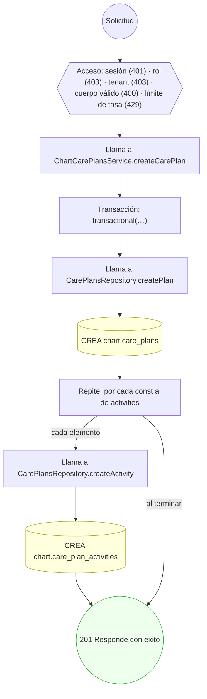

#### 2. PATCH /charts/care-plans/{planId}/activities/{activityId}

Actualizar una actividad del plan de cuidado

| HTTP | Código | Cuándo |
|---|---|---|
| 200 | — | Éxito |
| 400 | `VALIDATION_FAILED` | Los parámetros de ruta son UUID válidos; El cuerpo cumple el DTO (sin propiedades extra) |
| 401 | `UNAUTHENTICATED` | Hay una sesión válida (JWT) |
| 403 | `FORBIDDEN` | El rol está permitido; El tenant se resuelve y pertenece al actor |
| 404 | `NOT_FOUND` | ResourceNotFoundException: Plan de cuidado no encontrado; ResourceNotFoundException: Actividad no encontrada |
| 422 | `PRECONDITION_FAILED` | PreconditionFailedException: El plan de cuidado no está activo |
| 429 | `RATE_LIMITED` | No se supera el límite de solicitudes |

```mermaid
flowchart TD
  n1(("Solicitud")):::inicio
  n2{{"Acceso: sesión (401) · rol (403) · tenant (403) · parámetros de ruta (400) · cuerpo válido (400) · límite de…"}}:::acceso
  n1 --> n2
  n3["Llama a ChartCarePlansService.updateActivity"]:::llamada
  n2 --> n3
  n4["Transacción: transactional(…)"]:::transaccion
  n3 --> n4
  n5["Llama a CarePlansRepository.findPlanById"]:::llamada
  n4 --> n5
  n6[("LEE chart.care_plans")]:::efecto
  n5 --> n6
  n7{"!plan"}:::decision
  n6 --> n7
  n8(["404 NOT_FOUND Plan de cuidado no encontrado"]):::error
  n7 -->|"sí"| n8
  n9{"plan.statusConceptId !== CHART.CAREPLAN_ACTIVE"}:::decision
  n7 -->|"no"| n9
  n10(["422 PRECONDITION_FAILED El plan de cuidado no está activo"]):::error
  n9 -->|"sí"| n10
  n11["Llama a CarePlansRepository.findActivityById"]:::llamada
  n9 -->|"no"| n11
  n12[("LEE chart.care_plan_activities")]:::efecto
  n11 --> n12
  n13{"!activity || activity.carePlanId !== planId"}:::decision
  n12 --> n13
  n14(["404 NOT_FOUND Actividad no encontrada"]):::error
  n13 -->|"sí"| n14
  n15{"dto.status"}:::decision
  n13 -->|"no"| n15
  n16[("ACTUALIZA chart.care_plan_activities")]:::efecto
  n15 -->|"sí"| n16
  n17{"dto.scheduledAt !== undefined"}:::decision
  n16 --> n17
  n15 -->|"no"| n17
  n18[("ACTUALIZA chart.care_plan_activities")]:::efecto
  n17 -->|"sí"| n18
  n19[("ACTUALIZA chart.care_plan_activities")]:::efecto
  n18 --> n19
  n17 -->|"no"| n19
  n20{"dto.detailText !== undefined"}:::decision
  n19 --> n20
  n21[("ACTUALIZA chart.care_plan_activities")]:::efecto
  n20 -->|"sí"| n21
  n22["Llama a CarePlansRepository.findActivitiesForPlan"]:::llamada
  n21 --> n22
  n20 -->|"no"| n22
  n23[("LEE chart.care_plan_activities")]:::efecto
  n22 --> n23
  n24{"allCompleted"}:::decision
  n23 --> n24
  n25[("ACTUALIZA chart.care_plans")]:::efecto
  n24 -->|"sí"| n25
  n26(("200 Responde con éxito")):::ok
  n25 --> n26
  n24 -->|"no"| n26
  classDef acceso fill:#eef,stroke:#66a
  classDef error fill:#fee,stroke:#c33
  classDef ok fill:#efe,stroke:#3a3
  classDef efecto fill:#ffd,stroke:#aa3
  classDef decision fill:#fff,stroke:#555
  classDef corte fill:#eee,stroke:#999,stroke-dasharray: 4
```

#### 3. POST /charts/documents

Adjuntar un documento con archivos gobernados

| HTTP | Código | Cuándo |
|---|---|---|
| 201 | — | Éxito |
| 400 | `VALIDATION_FAILED` | El cuerpo cumple el DTO (sin propiedades extra) |
| 401 | `UNAUTHENTICATED` | Hay una sesión válida (JWT) |
| 403 | `FORBIDDEN` | El rol está permitido; El tenant se resuelve y pertenece al actor |
| 429 | `RATE_LIMITED` | No se supera el límite de solicitudes |

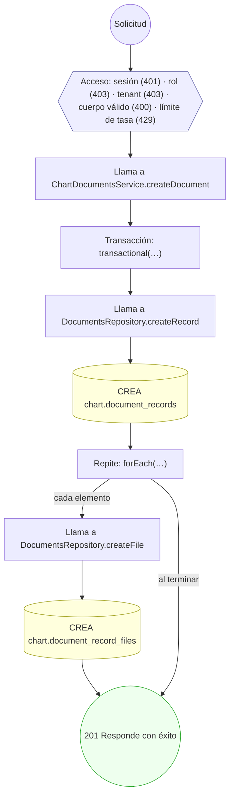

#### 4. POST /charts/notes/{noteId}/amendments

Enmendar una nota firmada (addendum versionado)

| HTTP | Código | Cuándo |
|---|---|---|
| 201 | — | Éxito |
| 400 | `VALIDATION_FAILED` | Los parámetros de ruta son UUID válidos; El cuerpo cumple el DTO (sin propiedades extra) |
| 401 | `UNAUTHENTICATED` | Hay una sesión válida (JWT) |
| 403 | `FORBIDDEN` | El rol está permitido; El tenant se resuelve y pertenece al actor |
| 404 | `NOT_FOUND` | ResourceNotFoundException: Nota clínica no encontrada |
| 422 | `PRECONDITION_FAILED` | PreconditionFailedException: La nota no está firmada; edítela como borrador (UC-15-02) |
| 429 | `RATE_LIMITED` | No se supera el límite de solicitudes |

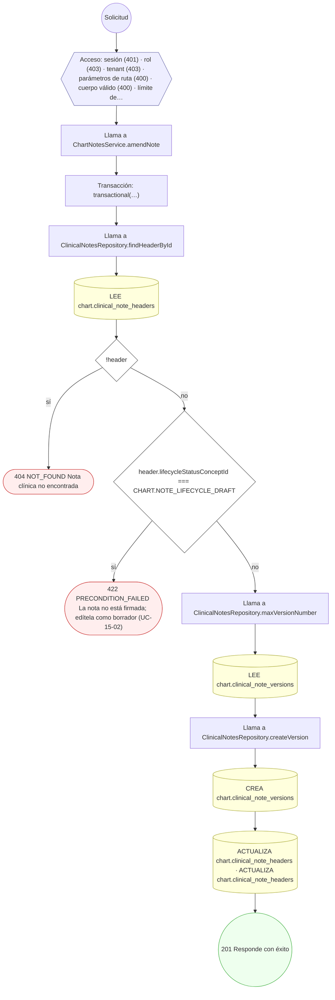

#### 5. PUT /charts/notes/{noteId}/versions

Editar borrador creando una nueva versión inmutable

| HTTP | Código | Cuándo |
|---|---|---|
| 201 | — | Éxito |
| 400 | `VALIDATION_FAILED` | Los parámetros de ruta son UUID válidos; El cuerpo cumple el DTO (sin propiedades extra) |
| 401 | `UNAUTHENTICATED` | Hay una sesión válida (JWT) |
| 403 | `FORBIDDEN` | El rol está permitido; El tenant se resuelve y pertenece al actor |
| 404 | `NOT_FOUND` | ResourceNotFoundException: Nota clínica no encontrada |
| 422 | `PRECONDITION_FAILED` | PreconditionFailedException: La nota ya no está en borrador; use una enmienda (UC-15-05) |
| 429 | `RATE_LIMITED` | No se supera el límite de solicitudes |

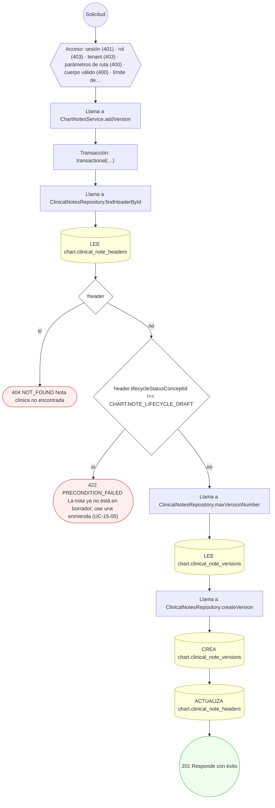

#### 6. POST /charts/notes/{noteId}/versions/{versionId}/cosign

Cofirmar una versión firmada (cadena de firmas)

| HTTP | Código | Cuándo |
|---|---|---|
| 201 | — | Éxito |
| 400 | `VALIDATION_FAILED` | Los parámetros de ruta son UUID válidos; El cuerpo cumple el DTO (sin propiedades extra) |
| 401 | `UNAUTHENTICATED` | Hay una sesión válida (JWT) |
| 403 | `FORBIDDEN` | El rol está permitido; El tenant se resuelve y pertenece al actor |
| 404 | `NOT_FOUND` | ResourceNotFoundException: Versión de nota no encontrada; ResourceNotFoundException: Nota clínica no encontrada |
| 409 | `CONFLICT` | ConflictException: El cofirmante ya firmó esta versión |
| 422 | `PRECONDITION_FAILED` | PreconditionFailedException: La versión no está firmada (SIGNED); PreconditionFailedException: Falta la firma primaria del autor |
| 429 | `RATE_LIMITED` | No se supera el límite de solicitudes |

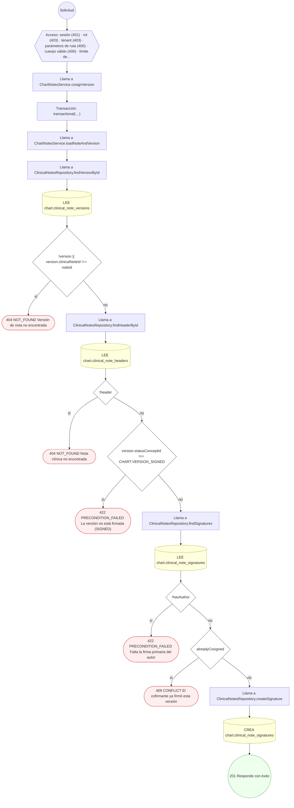

#### 7. POST /charts/notes/{noteId}/versions/{versionId}/sign

Firmar una versión y sellar su contenido

| HTTP | Código | Cuándo |
|---|---|---|
| 201 | — | Éxito |
| 400 | `VALIDATION_FAILED` | Los parámetros de ruta son UUID válidos; El cuerpo cumple el DTO (sin propiedades extra) |
| 401 | `UNAUTHENTICATED` | Hay una sesión válida (JWT) |
| 403 | `FORBIDDEN` | El rol está permitido; El tenant se resuelve y pertenece al actor |
| 404 | `NOT_FOUND` | ResourceNotFoundException: Versión de nota no encontrada; ResourceNotFoundException: Nota clínica no encontrada |
| 422 | `PRECONDITION_FAILED` | PreconditionFailedException: La versión no está en borrador |
| 429 | `RATE_LIMITED` | No se supera el límite de solicitudes |

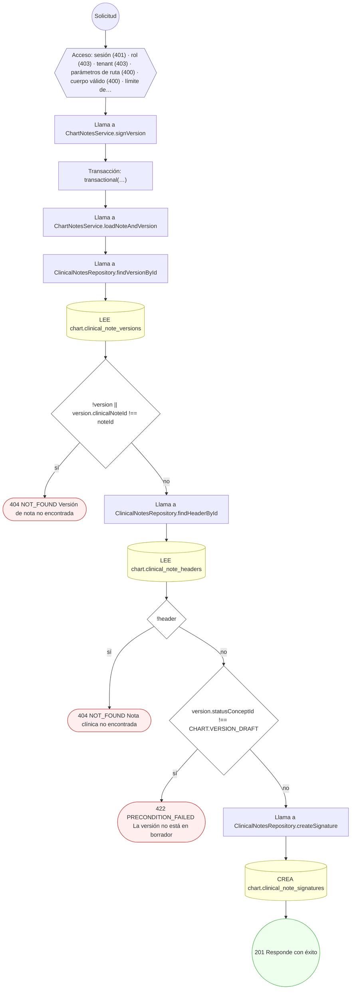

#### 8. POST /charts/notes/versions/{versionId}/exam-findings

Registrar hallazgos de examen físico

| HTTP | Código | Cuándo |
|---|---|---|
| 201 | — | Éxito |
| 400 | `VALIDATION_FAILED` | Los parámetros de ruta son UUID válidos; El cuerpo cumple el DTO (sin propiedades extra) |
| 401 | `UNAUTHENTICATED` | Hay una sesión válida (JWT) |
| 403 | `FORBIDDEN` | El rol está permitido; El tenant se resuelve y pertenece al actor |
| 404 | `NOT_FOUND` | ResourceNotFoundException: Versión de nota no encontrada |
| 422 | `PRECONDITION_FAILED` | PreconditionFailedException: La versión ya está firmada; los hallazgos quedan sellados |
| 429 | `RATE_LIMITED` | No se supera el límite de solicitudes |

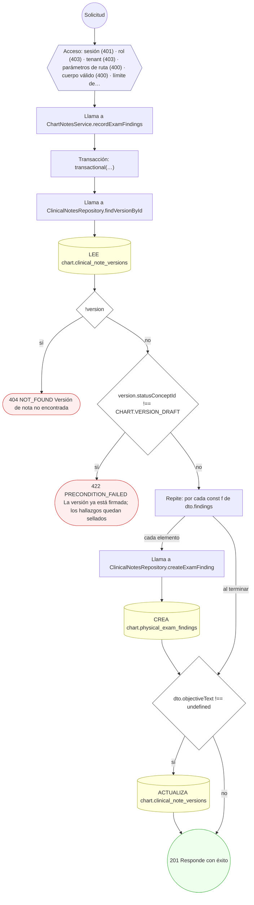

#### 9. POST /charts/notes/versions/{versionId}/release

Liberar una versión al paciente

| HTTP | Código | Cuándo |
|---|---|---|
| 201 | — | Éxito |
| 400 | `VALIDATION_FAILED` | Los parámetros de ruta son UUID válidos; El cuerpo cumple el DTO (sin propiedades extra) |
| 401 | `UNAUTHENTICATED` | Hay una sesión válida (JWT) |
| 403 | `FORBIDDEN` | El rol está permitido; El tenant se resuelve y pertenece al actor |
| 404 | `NOT_FOUND` | ResourceNotFoundException: Versión de nota no encontrada; ResourceNotFoundException: Nota clínica no encontrada |
| 422 | `PRECONDITION_FAILED` | PreconditionFailedException: La versión no está firmada; PreconditionFailedException: La versión no es elegible para liberación |
| 429 | `RATE_LIMITED` | No se supera el límite de solicitudes |

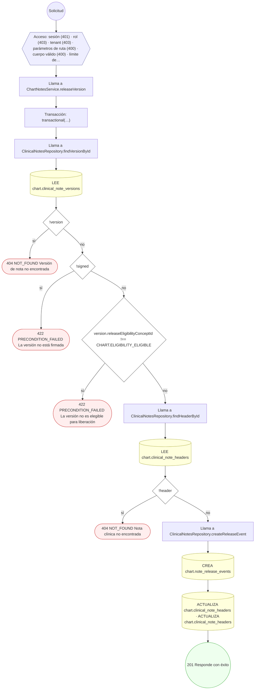

#### 10. POST /charts/notes/versions/{versionId}/withhold

Retener una versión del paciente (motivo legal)

| HTTP | Código | Cuándo |
|---|---|---|
| 201 | — | Éxito |
| 400 | `VALIDATION_FAILED` | Los parámetros de ruta son UUID válidos; El cuerpo cumple el DTO (sin propiedades extra) |
| 401 | `UNAUTHENTICATED` | Hay una sesión válida (JWT) |
| 403 | `FORBIDDEN` | El rol está permitido; El tenant se resuelve y pertenece al actor |
| 404 | `NOT_FOUND` | ResourceNotFoundException: Versión de nota no encontrada; ResourceNotFoundException: Nota clínica no encontrada |
| 429 | `RATE_LIMITED` | No se supera el límite de solicitudes |

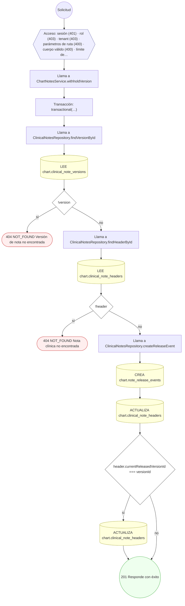

#### 11. GET /charts/templates

Listar las plantillas de chart por especialidad

| HTTP | Código | Cuándo |
|---|---|---|
| 200 | — | Éxito |
| 401 | `UNAUTHENTICATED` | Hay una sesión válida (JWT) |
| 403 | `FORBIDDEN` | El rol está permitido; El tenant se resuelve y pertenece al actor |
| 429 | `RATE_LIMITED` | No se supera el límite de solicitudes |

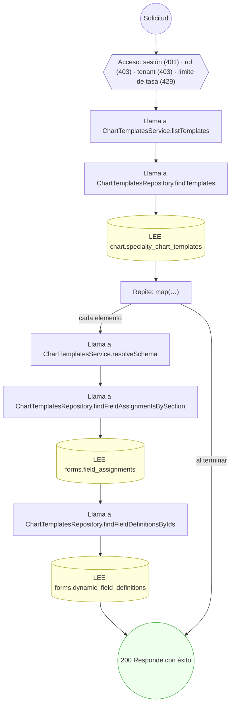

#### 12. POST /charts/templates

Crear una plantilla de chart con su esquema de campos, por especialidad

| HTTP | Código | Cuándo |
|---|---|---|
| 201 | — | Éxito |
| 400 | `VALIDATION_FAILED` | El cuerpo cumple el DTO (sin propiedades extra) |
| 401 | `UNAUTHENTICATED` | Hay una sesión válida (JWT) |
| 403 | `FORBIDDEN` | El rol está permitido; El tenant se resuelve y pertenece al actor |
| 429 | `RATE_LIMITED` | No se supera el límite de solicitudes |

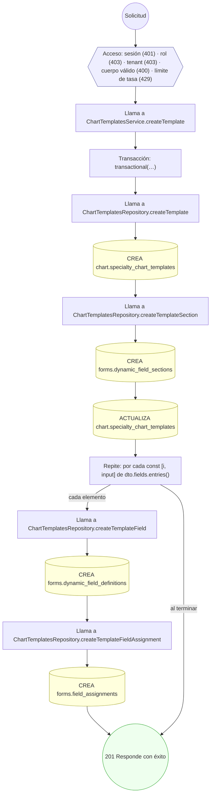

#### 13. GET /charts/templates/{id}

Leer el esquema de una plantilla de chart

| HTTP | Código | Cuándo |
|---|---|---|
| 200 | — | Éxito |
| 400 | `VALIDATION_FAILED` | Los parámetros de ruta son UUID válidos |
| 401 | `UNAUTHENTICATED` | Hay una sesión válida (JWT) |
| 403 | `FORBIDDEN` | El rol está permitido; El tenant se resuelve y pertenece al actor |
| 404 | `NOT_FOUND` | ResourceNotFoundException: Plantilla no encontrada |
| 429 | `RATE_LIMITED` | No se supera el límite de solicitudes |

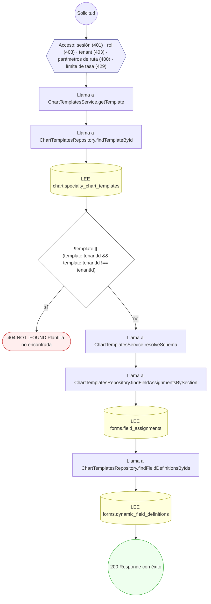

#### 14. POST /charts/templates/{templateId}/assignments

Asignar una plantilla de chart por especialidad

| HTTP | Código | Cuándo |
|---|---|---|
| 201 | — | Éxito |
| 400 | `VALIDATION_FAILED` | Los parámetros de ruta son UUID válidos; El cuerpo cumple el DTO (sin propiedades extra) |
| 401 | `UNAUTHENTICATED` | Hay una sesión válida (JWT) |
| 403 | `FORBIDDEN` | El rol está permitido; El tenant se resuelve y pertenece al actor |
| 429 | `RATE_LIMITED` | No se supera el límite de solicitudes |

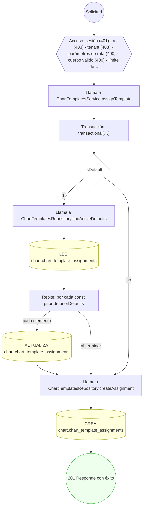

### Operaciones sin decisiones propias

Sólo comprueban el acceso y leen o escriben: no tienen ramas que dibujar. Su detalle está en la ficha de endpoints.

| Operación | Respuestas posibles | Tablas |
|---|---|---|
| POST /charts/notes | 201, 400, 401, 403, 429 | 3 |
| GET /charts/patients/{patientProfileId}/chart | 200, 400, 401, 403, 429 | 5 |
