<!-- AUTOGENERADO por tools/inventario/flujos.mjs. No editar manualmente. -->

# Flujos del módulo `clinical`

- **Procesos:** 1 · **Máquinas de estado:** 1
- **Operaciones:** 41 (37 con decisiones propias, 4 sin ellas)
- Inventario de endpoints del módulo: [clinical](../endpoints/clinical.md)

## Proceso: Módulo Clinical (08) — Core Clinical Record, Orders & Encounter Logistics

- **Código:** `clinical` · **Agrupación:** AGRUPACION_POR_CONTROLADOR · **Operaciones:** 41
- **Actores:** CLINICIAN · Cualquier sesión válida · PATIENT · PRACTITIONER · Público (sin sesión) · SECURITY_ADMIN · SYSTEM · SYSTEM_WORKER
- **Revisión:** AUTO_DETECTADA
- **Fuentes:** `src/modules/clinical/README.md`

### Para qué sirve

Registro clínico nuclear del paciente, órdenes y logística del encuentro. Cubre los 14 casos de uso UC-08-01..14 como endpoints REST bajo el prefijo `/clinical`; además el módulo expone lecturas, sellado de encuentros, recetas en PDF y políticas de firma (todas las rutas en [Rutas HTTP](#rutas-http-y-alcance-medido)).

_Fuente: `src/modules/clinical/README.md:3`_

### Etapas y operaciones

| Etapa | Descripción | Operación | Quién actúa | Riesgo | Tablas |
|---|---|---|---|---|---|
| `ctrl:ClinicalEncountersController` | Operaciones de ClinicalEncountersController que el README no asigna a un caso de uso | POST /clinical/care-episodes | CLINICIAN · PRACTITIONER | MEDIO | 2 |
|  |  | GET /clinical/encounters/{id}/attachments | CLINICIAN · PRACTITIONER · PATIENT | BAJO | 22 |
|  |  | POST /clinical/encounters/{id}/attachments | CLINICIAN · PRACTITIONER | MEDIO | 21 |
|  |  | POST /clinical/encounters/{id}/close | CLINICIAN · PRACTITIONER | MEDIO | 40 |
|  |  | POST /clinical/encounters/check-in | CLINICIAN · PRACTITIONER | MEDIO | 8 |
| `ctrl:ClinicalMedicalAspectsController` | Operaciones de ClinicalMedicalAspectsController que el README no asigna a un caso de uso | GET /clinical/me/medical-aspects | Cualquier sesión válida | BAJO | 3 |
|  |  | PUT /clinical/me/medical-aspects | Cualquier sesión válida | ALTO | 4 |
| `ctrl:ClinicalObservationsController` | Operaciones de ClinicalObservationsController que el README no asigna a un caso de uso | POST /clinical/observations | CLINICIAN · PRACTITIONER | MEDIO | 7 |
|  |  | PATCH /clinical/observations/{id}/amend | CLINICIAN · PRACTITIONER | MEDIO | 20 |
| `ctrl:ClinicalOrdersController` | Operaciones de ClinicalOrdersController que el README no asigna a un caso de uso | POST /clinical/diagnostic-reports | CLINICIAN · PRACTITIONER | MEDIO | 3 |
|  |  | POST /clinical/diagnostic-reports/{id}/release | CLINICIAN · PRACTITIONER | BAJO | 17 |
|  |  | POST /clinical/service-requests | CLINICIAN · PRACTITIONER | MEDIO | 23 |
|  |  | POST /clinical/service-requests/duplicate-check | CLINICIAN · PRACTITIONER | BAJO | 26 |
| `ctrl:ClinicalPrescriptionExpiryController` | Operaciones de ClinicalPrescriptionExpiryController que el README no asigna a un caso de uso | POST /clinical/internal/prescription-expiry-notices | SYSTEM · SYSTEM_WORKER | MEDIO | 13 |
| `ctrl:ClinicalPrescriptionPoliciesController` | Operaciones de ClinicalPrescriptionPoliciesController que el README no asigna a un caso de uso | GET /clinical/prescription-signature-policies | CLINICIAN · SECURITY_ADMIN | BAJO | 1 |
|  |  | POST /clinical/prescription-signature-policies | CLINICIAN · SECURITY_ADMIN | MEDIO | 1 |
|  |  | POST /clinical/prescription-signature-policies/{id}/deactivate | CLINICIAN · SECURITY_ADMIN | MEDIO | 2 |
| `ctrl:ClinicalPrescriptionsController` | Operaciones de ClinicalPrescriptionsController que el README no asigna a un caso de uso | GET /clinical/prescriptions/{id}/pdf | CLINICIAN · PRACTITIONER · PATIENT | BAJO | 30 |
| `ctrl:ClinicalPrescriptionsPublicController` | Operaciones de ClinicalPrescriptionsPublicController que el README no asigna a un caso de uso | GET /public/prescriptions/{id}/verify | Público (sin sesión) | BAJO | 2 |
| `ctrl:ClinicalReadController` | Operaciones de ClinicalReadController que el README no asigna a un caso de uso | GET /clinical/patients/{patientProfileId}/received-services | CLINICIAN · PRACTITIONER · PATIENT | BAJO | 6 |
|  |  | GET /clinical/patients/{patientProfileId}/summary | CLINICIAN · PRACTITIONER · PATIENT | MEDIO | 9 |
| `ctrl:ClinicalRecordsController` | Operaciones de ClinicalRecordsController que el README no asigna a un caso de uso | POST /clinical/allergy-intolerances | CLINICIAN · PRACTITIONER | MEDIO | 4 |
|  |  | GET /clinical/allergy-intolerances/{id}/attachments | CLINICIAN · PRACTITIONER · PATIENT | BAJO | 22 |
|  |  | POST /clinical/allergy-intolerances/{id}/attachments | CLINICIAN · PRACTITIONER | MEDIO | 21 |
|  |  | POST /clinical/conditions | CLINICIAN · PRACTITIONER | MEDIO | 9 |
|  |  | POST /clinical/conditions/{id}/attachments | CLINICIAN · PRACTITIONER | MEDIO | 21 |
|  |  | POST /clinical/conditions/{id}/change-status | CLINICIAN · PRACTITIONER | MEDIO | 24 |
|  |  | POST /clinical/conditions/{id}/verification | CLINICIAN · PRACTITIONER | MEDIO | 27 |
|  |  | POST /clinical/immunizations | CLINICIAN · PRACTITIONER | MEDIO | 4 |
|  |  | POST /clinical/medication-records | CLINICIAN · PRACTITIONER | MEDIO | 3 |
|  |  | POST /clinical/medication-requests | CLINICIAN · PRACTITIONER | MEDIO | 6 |
|  |  | GET /clinical/medication-requests/{id}/attachments | CLINICIAN · PRACTITIONER · PATIENT | BAJO | 22 |
|  |  | POST /clinical/medication-requests/{id}/attachments | CLINICIAN · PRACTITIONER | MEDIO | 21 |
|  |  | POST /clinical/medication-requests/{id}/edit | CLINICIAN · PRACTITIONER | MEDIO | 22 |
|  |  | POST /clinical/medication-requests/{id}/invalidate | CLINICIAN · PRACTITIONER | MEDIO | 24 |
|  |  | POST /clinical/medication-requests/{id}/issue | CLINICIAN · PRACTITIONER | MEDIO | 35 |
|  |  | POST /clinical/medication-requests/{id}/renew | CLINICIAN · PRACTITIONER | MEDIO | 24 |
|  |  | POST /clinical/medication-requests/{id}/replace | CLINICIAN · PRACTITIONER | MEDIO | 25 |
|  |  | POST /clinical/medication-requests/{id}/sign | CLINICIAN · PRACTITIONER | MEDIO | 24 |
|  |  | POST /clinical/procedures | CLINICIAN · PRACTITIONER | MEDIO | 7 |
|  |  | POST /clinical/procedures/{id}/attachments | CLINICIAN · PRACTITIONER | MEDIO | 21 |

### Diagrama 1 de 2 — etapas `ctrl:ClinicalEncountersController`, `ctrl:ClinicalMedicalAspectsController`, `ctrl:ClinicalObservationsController`…

```mermaid
flowchart LR
  a2(["CLINICIAN · PRACTITIONER"]):::actor
  a5(["CLINICIAN · PRACTITIONER · PATIENT"]):::actor
  a23(["Cualquier sesión válida"]):::actor
  a51(["SYSTEM · SYSTEM_WORKER"]):::actor
  a58(["CLINICIAN · SECURITY_ADMIN"]):::actor
  a65(["Público (sin sesión)"]):::actor
  t3[("clinical.care_episodes")]:::tabla
  t6[("authz.access_policies")]:::tabla
  t7[("authz.care_relationships")]:::tabla
  t8[("authz.clinical_access_grants")]:::tabla
  t9[("authz.field_permissions")]:::tabla
  t10[("authz.patient_legal_representations")]:::tabla
  t11[("authz.permissions")]:::tabla
  t18[("clinical.appointments")]:::tabla
  t19[("clinical.encounter_locations")]:::tabla
  t20[("clinical.encounter_participants")]:::tabla
  t24[("clinical.patient_reported_health_statements")]:::tabla
  t25[("profiles.patient_profiles")]:::tabla
  t26[("profiles.person_account_links")]:::tabla
  t29[("clinical.encounters")]:::tabla
  t30[("clinical.observation_components")]:::tabla
  t31[("clinical.observation_notes")]:::tabla
  t32[("clinical.observation_performers")]:::tabla
  t33[("clinical.observation_reference_ranges")]:::tabla
  t34[("clinical.observations")]:::tabla
  t39[("clinical.diagnostic_reports")]:::tabla
  t40[("clinical.service_requests")]:::tabla
  t44[("diagnostics.diagnostic_report_versions")]:::tabla
  t45[("directory.tenants")]:::tabla
  e47>"ServiceRequestPlaced"]:::evento
  t52[("clinical.medication_requests")]:::tabla
  t53[("iam.devices")]:::tabla
  t54[("messaging.in_app_notifications")]:::tabla
  t55[("messaging.message_channels")]:::tabla
  t59[("clinical.prescription_signature_policies")]:::tabla
  t66[("profiles.jurisdiction_authorizations")]:::tabla
  t68[("billing.invoice_lines")]:::tabla
  t69[("billing.invoices")]:::tabla
  t70[("clinical.received_services")]:::tabla
  t71[("practice.practice_sites")]:::tabla
  t72[("procedures_perioperative.procedure_cases")]:::tabla
  t73[("procedures_perioperative.procedure_charge_items")]:::tabla
  t75[("audit.conditions_history")]:::tabla
  t76[("audit.data_access_log")]:::tabla
  t77[("clinical.allergy_intolerances")]:::tabla
  t78[("clinical.allergy_reactions")]:::tabla
  t79[("clinical.conditions")]:::tabla
  t12[("+16 tablas más")]
  t14[("+15 tablas más")]
  t16[("+34 tablas más")]
  t21[("+2 tablas más")]
  subgraph s0["ctrl:ClinicalEncountersController · Operaciones de ClinicalEncountersController…"]
    o1["POST /clinical/care-episodes"]:::op
    o4["GET /clinical/encounters/{id}/attachments"]:::op
    o13["POST /clinical/encounters/{id}/attachments"]:::op
    o15["POST /clinical/encounters/{id}/close"]:::op
    o17["POST /clinical/encounters/check-in"]:::op
  end
  subgraph s1["ctrl:ClinicalMedicalAspectsController · Operaciones de ClinicalMedicalAspectsCo…"]
    o22["GET /clinical/me/medical-aspects"]:::op
    o27["PUT /clinical/me/medical-aspects"]:::op
  end
  t35[("+1 tablas más")]
  t37[("+14 tablas más")]
  subgraph s2["ctrl:ClinicalObservationsController · Operaciones de ClinicalObservationsContro…"]
    o28["POST /clinical/observations"]:::op
    o36["PATCH /clinical/observations/{id}/amend"]:::op
  end
  t42[("+11 tablas más")]
  t46[("+17 tablas más")]
  t49[("+20 tablas más")]
  subgraph s3["ctrl:ClinicalOrdersController · Operaciones de ClinicalOrdersController que el…"]
    o38["POST /clinical/diagnostic-reports"]:::op
    o41["POST /clinical/diagnostic-reports/{id}/release"]:::op
    o43["POST /clinical/service-requests"]:::op
    o48["POST /clinical/service-requests/duplicate-check"]:::op
  end
  t56[("+7 tablas más")]
  subgraph s4["ctrl:ClinicalPrescriptionExpiryController · Operaciones de ClinicalPrescription…"]
    o50["POST /clinical/internal/prescription-expiry-notices"]:::op
  end
  subgraph s5["ctrl:ClinicalPrescriptionPoliciesController · Operaciones de ClinicalPrescripti…"]
    o57["GET /clinical/prescription-signature-policies"]:::op
    o60["POST /clinical/prescription-signature-policies"]:::op
    o61["POST /clinical/prescription-signature-policies/{id}/deactivate"]:::op
  end
  t63[("+24 tablas más")]
  subgraph s6["ctrl:ClinicalPrescriptionsController · Operaciones de ClinicalPrescriptionsCont…"]
    o62["GET /clinical/prescriptions/{id}/pdf"]:::op
  end
  subgraph s7["ctrl:ClinicalPrescriptionsPublicController · Operaciones de ClinicalPrescriptio…"]
    o64["GET /public/prescriptions/{id}/verify"]:::op
  end
  t80[("+3 tablas más")]
  subgraph s8["ctrl:ClinicalReadController · Operaciones de ClinicalReadController que el READ…"]
    o67["GET /clinical/patients/{patientProfileId}/received-services"]:::op
    o74["GET /clinical/patients/{patientProfileId}/summary"]:::op
  end
  a2 --> o1
  o1 -->|"CREA"| t3
  o1 -->|"LEE"| t3
  a5 --> o4
  o4 -->|"LEE"| t6
  o4 -->|"LEE"| t7
  o4 -->|"LEE"| t8
  o4 -->|"LEE"| t9
  o4 -->|"LEE"| t10
  o4 -->|"LEE"| t11
  o4 -.-> t12
  a2 --> o13
  o13 -->|"LEE"| t6
  o13 -->|"LEE"| t7
  o13 -->|"LEE"| t8
  o13 -->|"LEE"| t9
  o13 -->|"LEE"| t10
  o13 -->|"LEE"| t11
  o13 -.-> t14
  a2 --> o15
  o15 -->|"LEE"| t6
  o15 -->|"LEE"| t7
  o15 -->|"LEE"| t8
  o15 -->|"LEE"| t9
  o15 -->|"LEE"| t10
  o15 -->|"LEE"| t11
  o15 -.-> t16
  a2 --> o17
  o17 -->|"LEE"| t18
  o17 -->|"LEE"| t3
  o17 -->|"CREA"| t19
  o17 -->|"LEE"| t19
  o17 -->|"CREA"| t20
  o17 -->|"LEE"| t20
  o17 -.-> t21
  a23 --> o22
  o22 -->|"LEE"| t24
  o22 -->|"LEE"| t25
  o22 -->|"LEE"| t26
  a23 --> o27
  o27 -->|"CREA"| t24
  o27 -->|"LEE"| t24
  o27 -->|"LEE"| t25
  o27 -->|"LEE"| t26
  a2 --> o28
  o28 -->|"LEE"| t29
  o28 -->|"CREA"| t30
  o28 -->|"CREA"| t31
  o28 -->|"CREA"| t32
  o28 -->|"CREA"| t33
  o28 -->|"CREA"| t34
  o28 -.-> t35
  a2 --> o36
  o36 -->|"LEE"| t6
  o36 -->|"LEE"| t7
  o36 -->|"LEE"| t8
  o36 -->|"LEE"| t9
  o36 -->|"LEE"| t10
  o36 -->|"LEE"| t11
  o36 -.-> t37
  a2 --> o38
  o38 -->|"CREA"| t39
  o38 -->|"ACTUALIZA"| t40
  o38 -->|"LEE"| t40
  a2 --> o41
  o41 -->|"LEE"| t6
  o41 -->|"LEE"| t7
  o41 -->|"LEE"| t8
  o41 -->|"LEE"| t9
  o41 -->|"LEE"| t10
  o41 -->|"LEE"| t11
  o41 -.-> t42
  a2 --> o43
  o43 -->|"LEE"| t39
  o43 -->|"LEE"| t29
  o43 -->|"CREA"| t40
  o43 -->|"LEE"| t40
  o43 -->|"LEE"| t44
  o43 -->|"LEE"| t45
  o43 -.-> t46
  o43 -->|"evento"| e47
  a2 --> o48
  o48 -->|"LEE"| t6
  o48 -->|"LEE"| t7
  o48 -->|"LEE"| t8
  o48 -->|"LEE"| t9
  o48 -->|"LEE"| t10
  o48 -->|"LEE"| t11
  o48 -.-> t49
  a51 --> o50
  o50 -->|"LEE"| t52
  o50 -->|"ACTUALIZA"| t53
  o50 -->|"LEE"| t53
  o50 -->|"CREA"| t54
  o50 -->|"LEE"| t54
  o50 -->|"LEE"| t55
  o50 -.-> t56
  a58 --> o57
  o57 -->|"LEE"| t59
  a58 --> o60
  o60 -->|"CREA"| t59
  a58 --> o61
  o61 -->|"ACTUALIZA"| t59
  o61 -->|"LEE"| t59
  a5 --> o62
  o62 -->|"LEE"| t6
  o62 -->|"LEE"| t7
  o62 -->|"LEE"| t8
  o62 -->|"LEE"| t9
  o62 -->|"LEE"| t10
  o62 -->|"LEE"| t11
  o62 -.-> t63
  a65 --> o64
  o64 -->|"LEE"| t52
  o64 -->|"LEE"| t66
  a5 --> o67
  o67 -->|"LEE"| t68
  o67 -->|"LEE"| t69
  o67 -->|"LEE"| t70
  o67 -->|"LEE"| t71
  o67 -->|"LEE"| t72
  o67 -->|"LEE"| t73
  a5 --> o74
  o74 -->|"LEE"| t75
  o74 -->|"CREA"| t76
  o74 -->|"LEE"| t77
  o74 -->|"LEE"| t78
  o74 -->|"LEE"| t3
  o74 -->|"LEE"| t79
  o74 -.-> t80
  classDef op fill:#fff,stroke:#446
  classDef actor fill:#eef,stroke:#66a
  classDef tabla fill:#ffd,stroke:#aa3
  classDef evento fill:#efe,stroke:#3a3
```

### Diagrama 2 de 2 — etapas `ctrl:ClinicalRecordsController`

```mermaid
flowchart LR
  a2(["CLINICIAN · PRACTITIONER"]):::actor
  a7(["CLINICIAN · PRACTITIONER · PATIENT"]):::actor
  t3[("clinical.allergy_intolerances")]:::tabla
  t4[("clinical.allergy_reactions")]:::tabla
  t5[("clinical.encounters")]:::tabla
  t8[("authz.access_policies")]:::tabla
  t9[("authz.care_relationships")]:::tabla
  t10[("authz.clinical_access_grants")]:::tabla
  t11[("authz.field_permissions")]:::tabla
  t12[("authz.patient_legal_representations")]:::tabla
  t13[("authz.permissions")]:::tabla
  t18[("audit.audit_log")]:::tabla
  t19[("audit.conditions_history")]:::tabla
  t20[("clinical.conditions")]:::tabla
  t29[("clinical.immunizations")]:::tabla
  t30[("clinical.received_services")]:::tabla
  t32[("clinical.medication_records")]:::tabla
  t33[("clinical.medication_requests")]:::tabla
  t35[("audit.medication_requests_history")]:::tabla
  t36[("forms.form_instances")]:::tabla
  t54[("clinical.procedures")]:::tabla
  t55[("clinical.service_requests")]:::tabla
  t14[("+16 tablas más")]
  t16[("+15 tablas más")]
  t21[("+3 tablas más")]
  t23[("+15 tablas más")]
  t25[("+18 tablas más")]
  t27[("+21 tablas más")]
  t38[("+16 tablas más")]
  t40[("+15 tablas más")]
  t42[("+16 tablas más")]
  t44[("+18 tablas más")]
  t46[("+29 tablas más")]
  t48[("+18 tablas más")]
  t50[("+19 tablas más")]
  t52[("+18 tablas más")]
  t56[("+1 tablas más")]
  t58[("+15 tablas más")]
  subgraph s0["ctrl:ClinicalRecordsController · Operaciones de ClinicalRecordsController que e…"]
    o1["POST /clinical/allergy-intolerances"]:::op
    o6["GET /clinical/allergy-intolerances/{id}/attachments"]:::op
    o15["POST /clinical/allergy-intolerances/{id}/attachments"]:::op
    o17["POST /clinical/conditions"]:::op
    o22["POST /clinical/conditions/{id}/attachments"]:::op
    o24["POST /clinical/conditions/{id}/change-status"]:::op
    o26["POST /clinical/conditions/{id}/verification"]:::op
    o28["POST /clinical/immunizations"]:::op
    o31["POST /clinical/medication-records"]:::op
    o34["POST /clinical/medication-requests"]:::op
    o37["GET /clinical/medication-requests/{id}/attachments"]:::op
    o39["POST /clinical/medication-requests/{id}/attachments"]:::op
    o41["POST /clinical/medication-requests/{id}/edit"]:::op
    o43["POST /clinical/medication-requests/{id}/invalidate"]:::op
    o45["POST /clinical/medication-requests/{id}/issue"]:::op
    o47["POST /clinical/medication-requests/{id}/renew"]:::op
    o49["POST /clinical/medication-requests/{id}/replace"]:::op
    o51["POST /clinical/medication-requests/{id}/sign"]:::op
    o53["POST /clinical/procedures"]:::op
    o57["POST /clinical/procedures/{id}/attachments"]:::op
  end
  a2 --> o1
  o1 -->|"CREA"| t3
  o1 -->|"LEE"| t3
  o1 -->|"CREA"| t4
  o1 -->|"LEE"| t5
  a7 --> o6
  o6 -->|"LEE"| t8
  o6 -->|"LEE"| t9
  o6 -->|"LEE"| t10
  o6 -->|"LEE"| t11
  o6 -->|"LEE"| t12
  o6 -->|"LEE"| t13
  o6 -.-> t14
  a2 --> o15
  o15 -->|"LEE"| t8
  o15 -->|"LEE"| t9
  o15 -->|"LEE"| t10
  o15 -->|"LEE"| t11
  o15 -->|"LEE"| t12
  o15 -->|"LEE"| t13
  o15 -.-> t16
  a2 --> o17
  o17 -->|"CREA"| t18
  o17 -->|"LEE"| t18
  o17 -->|"ACTUALIZA"| t19
  o17 -->|"CREA"| t19
  o17 -->|"LEE"| t19
  o17 -->|"CREA"| t20
  o17 -.-> t21
  a2 --> o22
  o22 -->|"LEE"| t8
  o22 -->|"LEE"| t9
  o22 -->|"LEE"| t10
  o22 -->|"LEE"| t11
  o22 -->|"LEE"| t12
  o22 -->|"LEE"| t13
  o22 -.-> t23
  a2 --> o24
  o24 -->|"CREA"| t18
  o24 -->|"LEE"| t18
  o24 -->|"ACTUALIZA"| t19
  o24 -->|"CREA"| t19
  o24 -->|"LEE"| t19
  o24 -->|"LEE"| t8
  o24 -.-> t25
  a2 --> o26
  o26 -->|"CREA"| t18
  o26 -->|"LEE"| t18
  o26 -->|"ACTUALIZA"| t19
  o26 -->|"CREA"| t19
  o26 -->|"LEE"| t19
  o26 -->|"LEE"| t8
  o26 -.-> t27
  a2 --> o28
  o28 -->|"CREA"| t29
  o28 -->|"LEE"| t29
  o28 -->|"CREA"| t30
  o28 -->|"LEE"| t30
  a2 --> o31
  o31 -->|"CREA"| t32
  o31 -->|"ACTUALIZA"| t33
  o31 -->|"LEE"| t33
  a2 --> o34
  o34 -->|"ACTUALIZA"| t35
  o34 -->|"CREA"| t35
  o34 -->|"LEE"| t35
  o34 -->|"LEE"| t20
  o34 -->|"CREA"| t33
  o34 -->|"LEE"| t36
  a7 --> o37
  o37 -->|"LEE"| t8
  o37 -->|"LEE"| t9
  o37 -->|"LEE"| t10
  o37 -->|"LEE"| t11
  o37 -->|"LEE"| t12
  o37 -->|"LEE"| t13
  o37 -.-> t38
  a2 --> o39
  o39 -->|"LEE"| t8
  o39 -->|"LEE"| t9
  o39 -->|"LEE"| t10
  o39 -->|"LEE"| t11
  o39 -->|"LEE"| t12
  o39 -->|"LEE"| t13
  o39 -.-> t40
  a2 --> o41
  o41 -->|"ACTUALIZA"| t35
  o41 -->|"CREA"| t35
  o41 -->|"LEE"| t35
  o41 -->|"LEE"| t8
  o41 -->|"LEE"| t9
  o41 -->|"LEE"| t10
  o41 -.-> t42
  a2 --> o43
  o43 -->|"CREA"| t18
  o43 -->|"LEE"| t18
  o43 -->|"ACTUALIZA"| t35
  o43 -->|"CREA"| t35
  o43 -->|"LEE"| t35
  o43 -->|"LEE"| t8
  o43 -.-> t44
  a2 --> o45
  o45 -->|"CREA"| t18
  o45 -->|"LEE"| t18
  o45 -->|"ACTUALIZA"| t35
  o45 -->|"CREA"| t35
  o45 -->|"LEE"| t35
  o45 -->|"LEE"| t8
  o45 -.-> t46
  a2 --> o47
  o47 -->|"CREA"| t18
  o47 -->|"LEE"| t18
  o47 -->|"ACTUALIZA"| t35
  o47 -->|"CREA"| t35
  o47 -->|"LEE"| t35
  o47 -->|"LEE"| t8
  o47 -.-> t48
  a2 --> o49
  o49 -->|"CREA"| t18
  o49 -->|"LEE"| t18
  o49 -->|"ACTUALIZA"| t35
  o49 -->|"CREA"| t35
  o49 -->|"LEE"| t35
  o49 -->|"LEE"| t8
  o49 -.-> t50
  a2 --> o51
  o51 -->|"CREA"| t18
  o51 -->|"LEE"| t18
  o51 -->|"ACTUALIZA"| t35
  o51 -->|"CREA"| t35
  o51 -->|"LEE"| t35
  o51 -->|"LEE"| t8
  o51 -.-> t52
  a2 --> o53
  o53 -->|"CREA"| t54
  o53 -->|"LEE"| t54
  o53 -->|"CREA"| t30
  o53 -->|"LEE"| t30
  o53 -->|"ACTUALIZA"| t55
  o53 -->|"LEE"| t55
  o53 -.-> t56
  a2 --> o57
  o57 -->|"LEE"| t8
  o57 -->|"LEE"| t9
  o57 -->|"LEE"| t10
  o57 -->|"LEE"| t11
  o57 -->|"LEE"| t12
  o57 -->|"LEE"| t13
  o57 -.-> t58
  classDef op fill:#fff,stroke:#446
  classDef actor fill:#eef,stroke:#66a
  classDef tabla fill:#ffd,stroke:#aa3
  classDef evento fill:#efe,stroke:#3a3
```

## Máquinas de estado

### Máquina de estados `CLINICAL_STATUS_TRANSITIONS`

Declarada en `src/modules/clinical/services/conditions.service.ts:53`. Los estados llevan el nombre del identificador del código; no se resuelven al catálogo de conceptos.

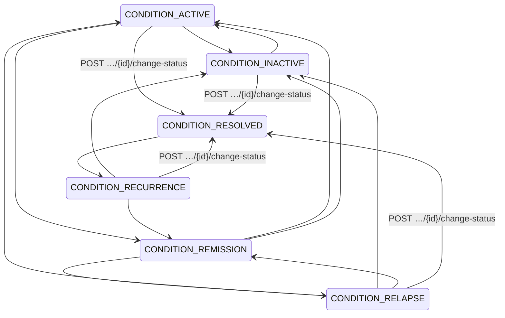

**Operaciones que ejercen esta máquina** _(POR_REFERENCIA: el handler alcanza un método que valida contra la tabla; «sin destino nombrado» significa que el estado de destino llega por el cuerpo de la petición)_:

| Operación | Estados de destino que nombra | A través de |
|---|---|---|
| POST /clinical/conditions/{id}/change-status | CONDITION_RESOLVED | ConditionsService.changeClinicalStatus |

## Árbol de decisión por operación

Cada árbol se deriva del código del handler y de los métodos que invoca (hasta 4 niveles). Una rama que no decide, no escribe y no falla se poda. Los accesos y los efectos consecutivos se agrupan en un solo nodo.

### Operaciones con decisiones propias

#### 1. POST /clinical/allergy-intolerances

Registrar una alergia con reacciones

| HTTP | Código | Cuándo |
|---|---|---|
| 201 | — | Éxito |
| 400 | `VALIDATION_FAILED` | El cuerpo cumple el DTO (sin propiedades extra) |
| 401 | `UNAUTHENTICATED` | Hay una sesión válida (JWT) |
| 403 | `FORBIDDEN` | El rol está permitido; El tenant se resuelve y pertenece al actor |
| 409 | `CONFLICT` | ConflictException: El paciente ya tiene una alergia activa a esa sustancia |
| 422 | `PRECONDITION_FAILED` | PreconditionFailedException: El encuentro indicado no existe o no pertenece a este paciente |
| 429 | `RATE_LIMITED` | No se supera el límite de solicitudes |

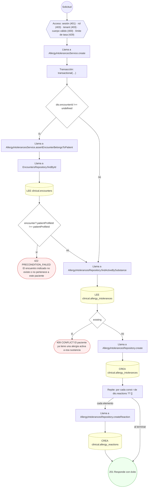

#### 2. GET /clinical/allergy-intolerances/{id}/attachments

Listar los adjuntos de una alergia

| HTTP | Código | Cuándo |
|---|---|---|
| 200 | — | Éxito |
| 400 | `VALIDATION_FAILED` | Los parámetros de ruta son UUID válidos |
| 401 | `UNAUTHENTICATED` | Hay una sesión válida (JWT) |
| 403 | `FORBIDDEN` | El rol está permitido; El tenant se resuelve y pertenece al actor; ForbiddenException: {WITHOUT_ACCESS_TO_HISTORY}; ForbiddenException: No tiene acceso a los adjuntos de este recurso |
| 404 | `NOT_FOUND` | ResourceNotFoundException: Alergia no encontrada |
| 429 | `RATE_LIMITED` | No se supera el límite de solicitudes |

```mermaid
flowchart TD
  n1(("Solicitud")):::inicio
  n2{{"Acceso: sesión (401) · rol (403) · tenant (403) · parámetros de ruta (400) · límite de tasa (429)"}}:::acceso
  n1 --> n2
  n3["Llama a AllergyIntolerancesService.listAttachments"]:::llamada
  n2 --> n3
  n4["Llama a AllergyIntolerancesRepository.findById"]:::llamada
  n3 --> n4
  n5[("LEE clinical.allergy_intolerances")]:::efecto
  n4 --> n5
  n6{"!allergy"}:::decision
  n5 --> n6
  n7(["404 NOT_FOUND Alergia no encontrada"]):::error
  n6 -->|"sí"| n7
  n8["Llama a ClinicalReadService.assertCanReadHistory"]:::llamada
  n6 -->|"no"| n8
  n9{"!actor.roles.some((role) =› ROLES_THAT_ATTEND.includes(role))"}:::decision
  n8 --> n9
  n10["Llama a ClinicalReadService.assertOwnRecord"]:::llamada
  n9 -->|"sí"| n10
  n11["Llama a PersonAccountLinksRepository.findActiveByUser"]:::llamada
  n10 --> n11
  n12[("LEE profiles.person_account_links")]:::efecto
  n11 --> n12
  n13["Llama a PatientProfilesRepository.findById"]:::llamada
  n12 --> n13
  n14[("LEE profiles.patient_profiles")]:::efecto
  n13 --> n14
  n15{"!link || !profile || profile.profileId !== link.personId"}:::decision
  n14 --> n15
  n16(["403 FORBIDDEN {WITHOUT_ACCESS_TO_HISTORY}"]):::error
  n15 -->|"sí"| n16
  n17["Llama a PersonAccountLinksRepository.findActiveByUser"]:::llamada
  n15 -->|"no"| n17
  n9 -->|"no"| n17
  n18[("LEE profiles.person_account_links")]:::efecto
  n17 --> n18
  n19["Llama a HealthPractitionerProfilesRepository.findById"]:::llamada
  n18 --> n19
  n20[("LEE profiles.health_practitioner_profiles")]:::efecto
  n19 --> n20
  n21["Llama a ClinicalReadService.isAttending"]:::llamada
  n20 --> n21
  n22["Llama a SchedulingBookingsRepository.hasConsultationInProgress"]:::llamada
  n21 --> n22
  n23[("LEE scheduling.appointment_bookings · LEE scheduling.schedulable_resources")]:::efecto
  n22 --> n23
  n24["Llama a ClinicalReadService.assertOwnRecord"]:::llamada
  n23 --> n24
  n25["Llama a PersonAccountLinksRepository.findActiveByUser"]:::llamada
  n24 --> n25
  n26[("LEE profiles.person_account_links")]:::efecto
  n25 --> n26
  n27["Llama a PatientProfilesRepository.findById"]:::llamada
  n26 --> n27
  n28[("LEE profiles.patient_profiles")]:::efecto
  n27 --> n28
  n29{"!link || !profile || profile.profileId !== link.personId"}:::decision
  n28 --> n29
  n30(["403 FORBIDDEN {WITHOUT_ACCESS_TO_HISTORY}"]):::error
  n29 -->|"sí"| n30
  n31["Llama a FilesService.listLinkedFilesOf"]:::llamada
  n29 -->|"no"| n31
  n32["Llama a FileLinksRepository.findByOwner"]:::llamada
  n31 --> n32
  n33[("LEE common.file_links")]:::efecto
  n32 --> n33
  n34["Repite: por cada const link de links"]:::bucle
  n33 --> n34
  n35["Llama a FilesRepository.findById"]:::llamada
  n34 -->|"cada elemento"| n35
  n36[("LEE common.files")]:::efecto
  n35 --> n36
  n37{"live.length › 0 && visible.length === 0"}:::decision
  n36 --> n37
  n34 -->|"al terminar"| n37
  n38(["403 FORBIDDEN No tiene acceso a los adjuntos de este recurso"]):::error
  n37 -->|"sí"| n38
  n39["Llama a FileVersionsRepository.findByIds"]:::llamada
  n37 -->|"no"| n39
  n40[("LEE common.file_versions")]:::efecto
  n39 --> n40
  n41(("200 Responde con éxito")):::ok
  n40 --> n41
  classDef acceso fill:#eef,stroke:#66a
  classDef error fill:#fee,stroke:#c33
  classDef ok fill:#efe,stroke:#3a3
  classDef efecto fill:#ffd,stroke:#aa3
  classDef decision fill:#fff,stroke:#555
  classDef corte fill:#eee,stroke:#999,stroke-dasharray: 4
```

#### 3. POST /clinical/allergy-intolerances/{id}/attachments

Adjuntar un archivo ya subido a una alergia

| HTTP | Código | Cuándo |
|---|---|---|
| 201 | — | Éxito |
| 400 | `VALIDATION_FAILED` | Los parámetros de ruta son UUID válidos; El cuerpo cumple el DTO (sin propiedades extra) |
| 401 | `UNAUTHENTICATED` | Hay una sesión válida (JWT) |
| 403 | `FORBIDDEN` | El rol está permitido; El tenant se resuelve y pertenece al actor; ForbiddenException: {WITHOUT_ACCESS_TO_HISTORY}; InsufficientRoleException: No tiene permiso para modificar este archivo |
| 404 | `NOT_FOUND` | ResourceNotFoundException: Alergia no encontrada; ResourceNotFoundException: Archivo no encontrado |
| 429 | `RATE_LIMITED` | No se supera el límite de solicitudes |
| 500 | `INTERNAL` | StorageLifecycleDenied: LIFECYCLE_WIRING_MISSING; StorageLifecycleDenied: {identity.reasonCode}; StorageLifecycleDenied: FILE_NOT_LIVE; StorageLifecycleDenied: VERSION_UNKNOWN; StorageLifecycleDenied: PHYSICAL_IDENTITY_UNKNOWN; StorageLifecycleDenied: PRODUCER_OR_PURGE_IN_FLIGHT |

```mermaid
flowchart TD
  n1(("Solicitud")):::inicio
  n2{{"Acceso: sesión (401) · rol (403) · tenant (403) · parámetros de ruta (400) · cuerpo válido (400) · límite de…"}}:::acceso
  n1 --> n2
  n3["Llama a AllergyIntolerancesService.attachFile"]:::llamada
  n2 --> n3
  n4["Llama a AllergyIntolerancesRepository.findById"]:::llamada
  n3 --> n4
  n5[("LEE clinical.allergy_intolerances")]:::efecto
  n4 --> n5
  n6{"!allergy"}:::decision
  n5 --> n6
  n7(["404 NOT_FOUND Alergia no encontrada"]):::error
  n6 -->|"sí"| n7
  n8["Llama a ClinicalReadService.assertCanWriteHistory"]:::llamada
  n6 -->|"no"| n8
  n9{"actor.roles.some((role) =› ROLES_THAT_ATTEND.includes(role))"}:::decision
  n8 --> n9
  n10["Llama a PersonAccountLinksRepository.findActiveByUser"]:::llamada
  n9 -->|"sí"| n10
  n11[("LEE profiles.person_account_links")]:::efecto
  n10 --> n11
  n12["Llama a HealthPractitionerProfilesRepository.findById"]:::llamada
  n11 --> n12
  n13[("LEE profiles.health_practitioner_profiles")]:::efecto
  n12 --> n13
  n14["Llama a ClinicalReadService.isAttending"]:::llamada
  n13 --> n14
  n15["Llama a SchedulingBookingsRepository.hasConsultationInProgress"]:::llamada
  n14 --> n15
  n16[("LEE scheduling.appointment_bookings · LEE scheduling.schedulable_resources")]:::efecto
  n15 --> n16
  n17(["403 FORBIDDEN {WITHOUT_ACCESS_TO_HISTORY}"]):::error
  n16 --> n17
  n9 -->|"no"| n17
  n18["Llama a FilesService.createLink"]:::llamada
  n19["Transacción: transactional(…)"]:::transaccion
  n18 --> n19
  n20["Llama a FilesService.assertLifecycleWired"]:::llamada
  n19 --> n20
  n21{"loadStorageEnv().lifecycleBinding && !this.publication"}:::decision
  n20 --> n21
  n22(["500 INTERNAL LIFECYCLE_WIRING_MISSING"]):::error
  n21 -->|"sí"| n22
  n23["Llama a StoragePublicationService.guardFile"]:::llamada
  n21 -->|"no"| n23
  n24["Llama a StoragePublicationService.lockNamespace"]:::llamada
  n23 --> n24
  n25{"identity.kind === 'UNKNOWN'"}:::decision
  n24 --> n25
  n26(["500 INTERNAL {identity.reasonCode}"]):::error
  n25 -->|"sí"| n26
  n27[("LEE common.files")]:::efecto
  n25 -->|"no"| n27
  n28{"!file || file.deletedAt || file.lifecycleStatusConceptId === CONCEPTS.FILE_DELETED || !file.currentVersionId"}:::decision
  n27 --> n28
  n29(["500 INTERNAL FILE_NOT_LIVE"]):::error
  n28 -->|"sí"| n29
  n30[("LEE common.file_versions")]:::efecto
  n28 -->|"no"| n30
  n31{"!versions.some((version) =› version.id === file.currentVersionId)"}:::decision
  n30 --> n31
  n32(["500 INTERNAL VERSION_UNKNOWN"]):::error
  n31 -->|"sí"| n32
  n33["Repite: por cada const version de versions"]:::bucle
  n31 -->|"no"| n33
  n34{"!identity || identity.kind === 'UNKNOWN'"}:::decision
  n33 -->|"cada elemento"| n34
  n35(["500 INTERNAL PHYSICAL_IDENTITY_UNKNOWN"]):::error
  n34 -->|"sí"| n35
  n36["Llama a StorageLifecycleCoordinator.assertNoContender"]:::llamada
  n34 -->|"no"| n36
  n37["Repite: por cada const job de await this.queues.findStorageIntents(tx)"]:::bucle
  n36 --> n37
  n38{"physicalContentionKey(intent.identity) === physicalContentionKey(identity) && intentExcludesPublication(inten…"}:::decision
  n37 -->|"cada elemento"| n38
  n39(["500 INTERNAL PRODUCER_OR_PURGE_IN_FLIGHT"]):::error
  n38 -->|"sí"| n39
  n40["Llama a FilesRepository.findById"]:::llamada
  n38 -->|"no"| n40
  n37 -->|"al terminar"| n40
  n33 -->|"al terminar"| n40
  n41[("LEE common.files")]:::efecto
  n40 --> n41
  n42{"!file"}:::decision
  n41 --> n42
  n43(["404 NOT_FOUND Archivo no encontrado"]):::error
  n42 -->|"sí"| n43
  n44["Llama a FilesService.assertCanMutateFile"]:::llamada
  n42 -->|"no"| n44
  n45{"!canActorReadOwnFile(file, actor)"}:::decision
  n44 --> n45
  n46(["404 NOT_FOUND Archivo no encontrado"]):::error
  n45 -->|"sí"| n46
  n47(["403 FORBIDDEN No tiene permiso para modificar este archivo"]):::error
  n45 -->|"no"| n47
  n48["Llama a FileLinksRepository.create"]:::llamada
  n49[("CREA common.file_links")]:::efecto
  n48 --> n49
  n50(("201 Responde con éxito")):::ok
  n49 --> n50
  classDef acceso fill:#eef,stroke:#66a
  classDef error fill:#fee,stroke:#c33
  classDef ok fill:#efe,stroke:#3a3
  classDef efecto fill:#ffd,stroke:#aa3
  classDef decision fill:#fff,stroke:#555
  classDef corte fill:#eee,stroke:#999,stroke-dasharray: 4
```

#### 4. POST /clinical/care-episodes

Abrir un episodio de cuidado

| HTTP | Código | Cuándo |
|---|---|---|
| 201 | — | Éxito |
| 400 | `VALIDATION_FAILED` | El cuerpo cumple el DTO (sin propiedades extra) |
| 401 | `UNAUTHENTICATED` | Hay una sesión válida (JWT) |
| 403 | `FORBIDDEN` | El rol está permitido; El tenant se resuelve y pertenece al actor |
| 409 | `CONFLICT` | ConflictException: El paciente ya tiene un episodio activo |
| 429 | `RATE_LIMITED` | No se supera el límite de solicitudes |


#### 5. POST /clinical/conditions

Registrar una condición/diagnóstico

| HTTP | Código | Cuándo |
|---|---|---|
| 201 | — | Éxito |
| 400 | `VALIDATION_FAILED` | El cuerpo cumple el DTO (sin propiedades extra) |
| 401 | `UNAUTHENTICATED` | Hay una sesión válida (JWT) |
| 403 | `FORBIDDEN` | El rol está permitido; El tenant se resuelve y pertenece al actor |
| 404 | `NOT_FOUND` | ResourceNotFoundException: Encuentro no encontrado |
| 409 | `CONFLICT` | ConflictException: El paciente ya tiene esa condición activa |
| 422 | `PRECONDITION_FAILED` | PreconditionFailedException: Un diagnóstico se registra presuntivo o confirmado.; PreconditionFailedException: El encuentro ya está cerrado y sellado: no admite más escrituras. |
| 429 | `RATE_LIMITED` | No se supera el límite de solicitudes |
| 500 | `INTERNAL` | Error: Entidad de historial no registrada: {entity} |

```mermaid
flowchart TD
  n1(("Solicitud")):::inicio
  n2{{"Acceso: sesión (401) · rol (403) · tenant (403) · cuerpo válido (400) · límite de tasa (429)"}}:::acceso
  n1 --> n2
  n3["Llama a ConditionsService.create"]:::llamada
  n2 --> n3
  n4{"dto.verificationStatusConceptId !== undefined && !CREATION_VERIFICATION_STATUSES.includes(dto.verificationSta…"}:::decision
  n3 --> n4
  n5(["422 PRECONDITION_FAILED Un diagnóstico se registra presuntivo o confirmado."]):::error
  n4 -->|"sí"| n5
  n6["Transacción: transactional(…)"]:::transaccion
  n4 -->|"no"| n6
  n7["Llama a ConditionsService.assertEncounterBelongsToPatient"]:::llamada
  n6 --> n7
  n8["Llama a EncountersRepository.findById"]:::llamada
  n7 --> n8
  n9[("LEE clinical.encounters")]:::efecto
  n8 --> n9
  n10{"!encounter || encounter.patientProfileId !== dto.patientProfileId || encounter.tenantId !== dto.custodianTena…"}:::decision
  n9 --> n10
  n11(["404 NOT_FOUND Encuentro no encontrado"]):::error
  n10 -->|"sí"| n11
  n12["Llama a EncounterSealGuardService.assertEncounterWritable"]:::llamada
  n10 -->|"no"| n12
  n13["Llama a EncountersRepository.findById"]:::llamada
  n12 --> n13
  n14[("LEE clinical.encounters")]:::efecto
  n13 --> n14
  n15{"encounter?.sealedAt"}:::decision
  n14 --> n15
  n16(["422 PRECONDITION_FAILED El encuentro ya está cerrado y sellado: no admite más escrituras."]):::error
  n15 -->|"sí"| n16
  n17["Llama a ConditionsRepository.findActiveByCode"]:::llamada
  n15 -->|"no"| n17
  n18[("LEE clinical.conditions")]:::efecto
  n17 --> n18
  n19{"existing"}:::decision
  n18 --> n19
  n20(["409 CONFLICT El paciente ya tiene esa condición activa"]):::error
  n19 -->|"sí"| n20
  n21["Llama a ConditionsRepository.create"]:::llamada
  n19 -->|"no"| n21
  n22[("CREA clinical.conditions")]:::efecto
  n21 --> n22
  n23["Llama a AuditTrailService.record"]:::llamada
  n22 --> n23
  n24["Llama a AuditLogRepository.append"]:::llamada
  n23 --> n24
  n25["Llama a AuditLogRepository.findChainTip"]:::llamada
  n24 --> n25
  n26[("LEE audit.audit_log")]:::efecto
  n25 --> n26
  n27[("CREA audit.audit_log")]:::efecto
  n26 --> n27
  n28["Llama a HistoryRepository.append"]:::llamada
  n27 --> n28
  n29{"!binding"}:::decision
  n28 --> n29
  n30(["500 INTERNAL Entidad de historial no registrada: {entity}"]):::error
  n29 -->|"sí"| n30
  n31[("LEE audit.conditions_history · ACTUALIZA audit.conditions_history · CREA audit.conditions_history")]:::efecto
  n29 -->|"no"| n31
  n32(("201 Responde con éxito")):::ok
  n31 --> n32
  classDef acceso fill:#eef,stroke:#66a
  classDef error fill:#fee,stroke:#c33
  classDef ok fill:#efe,stroke:#3a3
  classDef efecto fill:#ffd,stroke:#aa3
  classDef decision fill:#fff,stroke:#555
  classDef corte fill:#eee,stroke:#999,stroke-dasharray: 4
```

#### 6. POST /clinical/conditions/{id}/attachments

Adjuntar un archivo ya subido a una condición

| HTTP | Código | Cuándo |
|---|---|---|
| 201 | — | Éxito |
| 400 | `VALIDATION_FAILED` | Los parámetros de ruta son UUID válidos; El cuerpo cumple el DTO (sin propiedades extra) |
| 401 | `UNAUTHENTICATED` | Hay una sesión válida (JWT) |
| 403 | `FORBIDDEN` | El rol está permitido; El tenant se resuelve y pertenece al actor; ForbiddenException: {WITHOUT_ACCESS_TO_HISTORY}; InsufficientRoleException: No tiene permiso para modificar este archivo |
| 404 | `NOT_FOUND` | ResourceNotFoundException: Condición no encontrada; ResourceNotFoundException: Archivo no encontrado |
| 429 | `RATE_LIMITED` | No se supera el límite de solicitudes |
| 500 | `INTERNAL` | StorageLifecycleDenied: LIFECYCLE_WIRING_MISSING; StorageLifecycleDenied: {identity.reasonCode}; StorageLifecycleDenied: FILE_NOT_LIVE; StorageLifecycleDenied: VERSION_UNKNOWN; StorageLifecycleDenied: PHYSICAL_IDENTITY_UNKNOWN; StorageLifecycleDenied: PRODUCER_OR_PURGE_IN_FLIGHT |

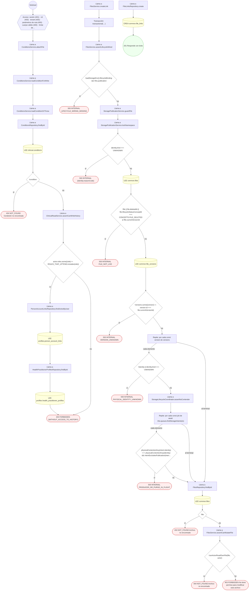

#### 7. POST /clinical/conditions/{id}/change-status

Cambiar el estado clínico de una condición

| HTTP | Código | Cuándo |
|---|---|---|
| 200 | — | Éxito |
| 400 | `VALIDATION_FAILED` | Los parámetros de ruta son UUID válidos; El cuerpo cumple el DTO (sin propiedades extra) |
| 401 | `UNAUTHENTICATED` | Hay una sesión válida (JWT) |
| 403 | `FORBIDDEN` | El rol está permitido; El tenant se resuelve y pertenece al actor; ForbiddenException: {WITHOUT_ACCESS_TO_HISTORY} |
| 404 | `NOT_FOUND` | ResourceNotFoundException: Condición no encontrada |
| 422 | `PRECONDITION_FAILED` | PreconditionFailedException: Esa transición de estado clínico no es válida desde el estado actual; PreconditionFailedException: Una condición de curso crónico no pasa a resuelta; márquela inactiva o en remisión |
| 429 | `RATE_LIMITED` | No se supera el límite de solicitudes |
| 500 | `INTERNAL` | Error: Entidad de historial no registrada: {entity} |

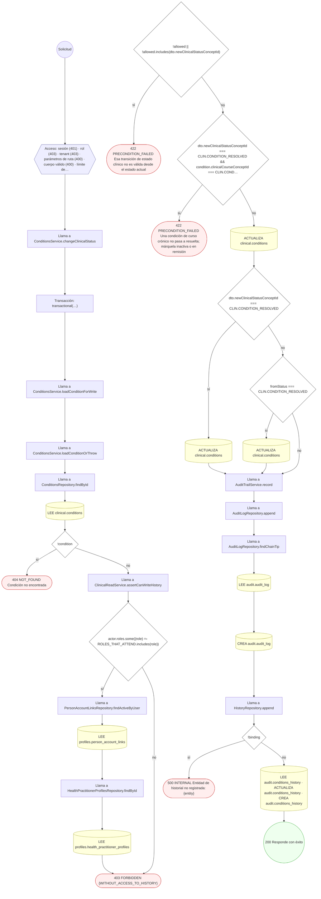

#### 8. POST /clinical/conditions/{id}/verification

Confirmar o refutar un diagnóstico presuntivo

| HTTP | Código | Cuándo |
|---|---|---|
| 200 | — | Éxito |
| 400 | `VALIDATION_FAILED` | Los parámetros de ruta son UUID válidos; El cuerpo cumple el DTO (sin propiedades extra) |
| 401 | `UNAUTHENTICATED` | Hay una sesión válida (JWT) |
| 403 | `FORBIDDEN` | El rol está permitido; El tenant se resuelve y pertenece al actor; ForbiddenException: La sesión no tiene un perfil profesional con el que decidir el diagnóstico.; ForbiddenException: {WITHOUT_ACCESS_TO_HISTORY} |
| 404 | `NOT_FOUND` | ResourceNotFoundException: Condición no encontrada |
| 409 | `CONFLICT` | ConflictException: Ese diagnóstico ya fue decidido: sólo un presuntivo se confirma o se rechaza |
| 422 | `PRECONDITION_FAILED` | PreconditionFailedException: Escriba el motivo o elija una evidencia: al menos uno de los dos.; PreconditionFailedException: Indique desde cuándo la persona presenta la condición.; PreconditionFailedException: El inicio de la condición no puede ser futuro.; PreconditionFailedException: El curso clínico no es uno del catálogo.; PreconditionFailedException: Indique hasta cuándo se espera la condición, o márquela como crónica.; PreconditionFailedException: El fin esperado no puede ser anterior al inicio. |
| 429 | `RATE_LIMITED` | No se supera el límite de solicitudes |
| 500 | `INTERNAL` | Error: Entidad de historial no registrada: {entity} |

```mermaid
flowchart TD
  n1(("Solicitud")):::inicio
  n2{{"Acceso: sesión (401) · rol (403) · tenant (403) · parámetros de ruta (400) · cuerpo válido (400) · límite de…"}}:::acceso
  n1 --> n2
  n3["Llama a ConditionsService.verify"]:::llamada
  n2 --> n3
  n4{"!decidedByProfileId"}:::decision
  n3 --> n4
  n5(["403 FORBIDDEN La sesión no tiene un perfil profesional con el que decidir el diagnóstico."]):::error
  n4 -->|"sí"| n5
  n6["Transacción: transactional(…)"]:::transaccion
  n4 -->|"no"| n6
  n7["Llama a ConditionsService.loadConditionForWrite"]:::llamada
  n6 --> n7
  n8["Llama a ConditionsService.loadConditionOrThrow"]:::llamada
  n7 --> n8
  n9["Llama a ConditionsRepository.findById"]:::llamada
  n8 --> n9
  n10[("LEE clinical.conditions")]:::efecto
  n9 --> n10
  n11{"!condition"}:::decision
  n10 --> n11
  n12(["404 NOT_FOUND Condición no encontrada"]):::error
  n11 -->|"sí"| n12
  n13["Llama a ClinicalReadService.assertCanWriteHistory"]:::llamada
  n11 -->|"no"| n13
  n14{"actor.roles.some((role) =› ROLES_THAT_ATTEND.includes(role))"}:::decision
  n13 --> n14
  n15["Llama a PersonAccountLinksRepository.findActiveByUser"]:::llamada
  n14 -->|"sí"| n15
  n16[("LEE profiles.person_account_links")]:::efecto
  n15 --> n16
  n17["Llama a HealthPractitionerProfilesRepository.findById"]:::llamada
  n16 --> n17
  n18[("LEE profiles.health_practitioner_profiles")]:::efecto
  n17 --> n18
  n19(["403 FORBIDDEN {WITHOUT_ACCESS_TO_HISTORY}"]):::error
  n18 --> n19
  n14 -->|"no"| n19
  n20{"actual === CLIN.CONDITION_CONFIRMED || actual === CLIN.CONDITION_REFUTED"}:::decision
  n21(["409 CONFLICT Ese diagnóstico ya fue decidido: sólo un presuntivo se confirma o se rechaza"]):::error
  n20 -->|"sí"| n21
  n22{"reasonText === undefined && dto.basedOn === undefined"}:::decision
  n20 -->|"no"| n22
  n23(["422 PRECONDITION_FAILED Escriba el motivo o elija una evidencia: al menos uno de los dos."]):::error
  n22 -->|"sí"| n23
  n24["Llama a ConditionsService.resolveEvidenceOfPatient"]:::llamada
  n22 -->|"no"| n24
  n25{"evidence.kind === 'NOTE'"}:::decision
  n24 --> n25
  n26[("LEE chart.clinical_note_headers")]:::efecto
  n25 -->|"sí"| n26
  n27{"!note"}:::decision
  n26 --> n27
  n28(["↩ (relanza el error capturado)"]):::error
  n27 -->|"sí"| n28
  n29[("LEE clinical.diagnostic_reports")]:::efecto
  n27 -->|"no"| n29
  n25 -->|"no"| n29
  n30{"evidence.diagnosticReportId && !report"}:::decision
  n29 --> n30
  n31(["↩ (relanza el error capturado)"]):::error
  n30 -->|"sí"| n31
  n32[("LEE clinical.service_requests")]:::efecto
  n30 -->|"no"| n32
  n33{"!order"}:::decision
  n32 --> n33
  n34(["↩ (relanza el error capturado)"]):::error
  n33 -->|"sí"| n34
  n35{"dto.outcome === 'CONFIRMED'"}:::decision
  n33 -->|"no"| n35
  n36["Llama a ConditionsService.applyConfirmation"]:::llamada
  n35 -->|"sí"| n36
  n37{"!onsetAt"}:::decision
  n36 --> n37
  n38(["422 PRECONDITION_FAILED Indique desde cuándo la persona presenta la condición."]):::error
  n37 -->|"sí"| n38
  n39{"onsetAt.getTime() › now.getTime()"}:::decision
  n37 -->|"no"| n39
  n40(["422 PRECONDITION_FAILED El inicio de la condición no puede ser futuro."]):::error
  n39 -->|"sí"| n40
  n41{"dto.clinicalCourseConceptId !== undefined && !CLINICAL_COURSES.includes(dto.clinicalCourseConceptId)"}:::decision
  n39 -->|"no"| n41
  n42(["422 PRECONDITION_FAILED El curso clínico no es uno del catálogo."]):::error
  n41 -->|"sí"| n42
  n43{"!chronic"}:::decision
  n41 -->|"no"| n43
  n44{"!expectedResolutionAt"}:::decision
  n43 -->|"sí"| n44
  n45(["422 PRECONDITION_FAILED Indique hasta cuándo se espera la condición, o márquela como crónica."]):::error
  n44 -->|"sí"| n45
  n46{"expectedResolutionAt.getTime() ‹ onsetAt.getTime()"}:::decision
  n44 -->|"no"| n46
  n47(["422 PRECONDITION_FAILED El fin esperado no puede ser anterior al inicio."]):::error
  n46 -->|"sí"| n47
  n48[("ACTUALIZA clinical.conditions · ACTUALIZA clinical.conditions · ACTUALIZA clinical.conditions · ACTUALIZA cli…")]:::efecto
  n46 -->|"no"| n48
  n43 -->|"no"| n48
  n49[("ACTUALIZA clinical.conditions · ACTUALIZA clinical.conditions · ACTUALIZA clinical.conditions")]:::efecto
  n35 -->|"no"| n49
  n50["Llama a AuditTrailService.record"]:::llamada
  n48 --> n50
  n49 --> n50
  n51["Llama a AuditLogRepository.append"]:::llamada
  n50 --> n51
  n52["Llama a AuditLogRepository.findChainTip"]:::llamada
  n51 --> n52
  n53[("LEE audit.audit_log")]:::efecto
  n52 --> n53
  n54[("CREA audit.audit_log")]:::efecto
  n53 --> n54
  n55["Llama a HistoryRepository.append"]:::llamada
  n54 --> n55
  n56{"!binding"}:::decision
  n55 --> n56
  n57(["500 INTERNAL Entidad de historial no registrada: {entity}"]):::error
  n56 -->|"sí"| n57
  n58[("LEE audit.conditions_history · ACTUALIZA audit.conditions_history · CREA audit.conditions_history")]:::efecto
  n56 -->|"no"| n58
  n59(("200 Responde con éxito")):::ok
  n58 --> n59
  classDef acceso fill:#eef,stroke:#66a
  classDef error fill:#fee,stroke:#c33
  classDef ok fill:#efe,stroke:#3a3
  classDef efecto fill:#ffd,stroke:#aa3
  classDef decision fill:#fff,stroke:#555
  classDef corte fill:#eee,stroke:#999,stroke-dasharray: 4
```

#### 9. POST /clinical/diagnostic-reports

Emitir un reporte diagnóstico desde la orden

| HTTP | Código | Cuándo |
|---|---|---|
| 201 | — | Éxito |
| 400 | `VALIDATION_FAILED` | El cuerpo cumple el DTO (sin propiedades extra) |
| 401 | `UNAUTHENTICATED` | Hay una sesión válida (JWT) |
| 403 | `FORBIDDEN` | El rol está permitido; El tenant se resuelve y pertenece al actor |
| 404 | `NOT_FOUND` | ResourceNotFoundException: Orden de servicio no encontrada |
| 429 | `RATE_LIMITED` | No se supera el límite de solicitudes |


#### 10. POST /clinical/diagnostic-reports/{id}/release

Liberar los resultados de un reporte diagnóstico

| HTTP | Código | Cuándo |
|---|---|---|
| 200 | — | Éxito |
| 400 | `VALIDATION_FAILED` | Los parámetros de ruta son UUID válidos; El cuerpo cumple el DTO (sin propiedades extra) |
| 401 | `UNAUTHENTICATED` | Hay una sesión válida (JWT) |
| 403 | `FORBIDDEN` | El rol está permitido; El tenant se resuelve y pertenece al actor; ForbiddenException: {WITHOUT_ACCESS_TO_HISTORY} |
| 404 | `NOT_FOUND` | ResourceNotFoundException: Reporte diagnóstico no encontrado |
| 422 | `PRECONDITION_FAILED` | PreconditionFailedException: Esta ruta ya no libera informes. Use POST /diagnostics/reports/:reportId/versions/:versionId/release,que es el único camino que el paciente ve en «Mis resultad… |
| 429 | `RATE_LIMITED` | No se supera el límite de solicitudes |

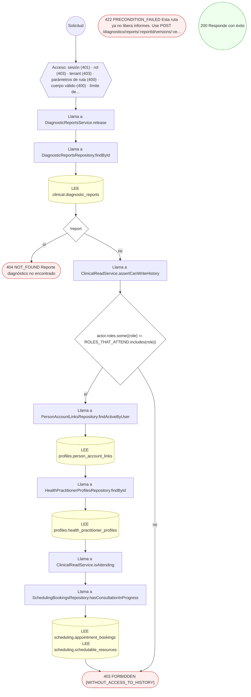

#### 11. GET /clinical/encounters/{id}/attachments

Listar los adjuntos de un encuentro

| HTTP | Código | Cuándo |
|---|---|---|
| 200 | — | Éxito |
| 400 | `VALIDATION_FAILED` | Los parámetros de ruta son UUID válidos |
| 401 | `UNAUTHENTICATED` | Hay una sesión válida (JWT) |
| 403 | `FORBIDDEN` | El rol está permitido; El tenant se resuelve y pertenece al actor; ForbiddenException: {WITHOUT_ACCESS_TO_HISTORY}; ForbiddenException: No tiene acceso a los adjuntos de este recurso |
| 404 | `NOT_FOUND` | ResourceNotFoundException: Encuentro no encontrado |
| 429 | `RATE_LIMITED` | No se supera el límite de solicitudes |

```mermaid
flowchart TD
  n1(("Solicitud")):::inicio
  n2{{"Acceso: sesión (401) · rol (403) · tenant (403) · parámetros de ruta (400) · límite de tasa (429)"}}:::acceso
  n1 --> n2
  n3["Llama a EncountersService.listAttachments"]:::llamada
  n2 --> n3
  n4["Llama a EncountersRepository.findById"]:::llamada
  n3 --> n4
  n5[("LEE clinical.encounters")]:::efecto
  n4 --> n5
  n6{"!encounter"}:::decision
  n5 --> n6
  n7(["404 NOT_FOUND Encuentro no encontrado"]):::error
  n6 -->|"sí"| n7
  n8["Llama a ClinicalReadService.assertCanReadHistory"]:::llamada
  n6 -->|"no"| n8
  n9{"!actor.roles.some((role) =› ROLES_THAT_ATTEND.includes(role))"}:::decision
  n8 --> n9
  n10["Llama a ClinicalReadService.assertOwnRecord"]:::llamada
  n9 -->|"sí"| n10
  n11["Llama a PersonAccountLinksRepository.findActiveByUser"]:::llamada
  n10 --> n11
  n12[("LEE profiles.person_account_links")]:::efecto
  n11 --> n12
  n13["Llama a PatientProfilesRepository.findById"]:::llamada
  n12 --> n13
  n14[("LEE profiles.patient_profiles")]:::efecto
  n13 --> n14
  n15{"!link || !profile || profile.profileId !== link.personId"}:::decision
  n14 --> n15
  n16(["403 FORBIDDEN {WITHOUT_ACCESS_TO_HISTORY}"]):::error
  n15 -->|"sí"| n16
  n17["Llama a PersonAccountLinksRepository.findActiveByUser"]:::llamada
  n15 -->|"no"| n17
  n9 -->|"no"| n17
  n18[("LEE profiles.person_account_links")]:::efecto
  n17 --> n18
  n19["Llama a HealthPractitionerProfilesRepository.findById"]:::llamada
  n18 --> n19
  n20[("LEE profiles.health_practitioner_profiles")]:::efecto
  n19 --> n20
  n21["Llama a ClinicalReadService.isAttending"]:::llamada
  n20 --> n21
  n22["Llama a SchedulingBookingsRepository.hasConsultationInProgress"]:::llamada
  n21 --> n22
  n23[("LEE scheduling.appointment_bookings · LEE scheduling.schedulable_resources")]:::efecto
  n22 --> n23
  n24["Llama a ClinicalReadService.assertOwnRecord"]:::llamada
  n23 --> n24
  n25["Llama a PersonAccountLinksRepository.findActiveByUser"]:::llamada
  n24 --> n25
  n26[("LEE profiles.person_account_links")]:::efecto
  n25 --> n26
  n27["Llama a PatientProfilesRepository.findById"]:::llamada
  n26 --> n27
  n28[("LEE profiles.patient_profiles")]:::efecto
  n27 --> n28
  n29{"!link || !profile || profile.profileId !== link.personId"}:::decision
  n28 --> n29
  n30(["403 FORBIDDEN {WITHOUT_ACCESS_TO_HISTORY}"]):::error
  n29 -->|"sí"| n30
  n31["Llama a FilesService.listLinkedFilesOf"]:::llamada
  n29 -->|"no"| n31
  n32["Llama a FileLinksRepository.findByOwner"]:::llamada
  n31 --> n32
  n33[("LEE common.file_links")]:::efecto
  n32 --> n33
  n34["Repite: por cada const link de links"]:::bucle
  n33 --> n34
  n35["Llama a FilesRepository.findById"]:::llamada
  n34 -->|"cada elemento"| n35
  n36[("LEE common.files")]:::efecto
  n35 --> n36
  n37{"live.length › 0 && visible.length === 0"}:::decision
  n36 --> n37
  n34 -->|"al terminar"| n37
  n38(["403 FORBIDDEN No tiene acceso a los adjuntos de este recurso"]):::error
  n37 -->|"sí"| n38
  n39["Llama a FileVersionsRepository.findByIds"]:::llamada
  n37 -->|"no"| n39
  n40[("LEE common.file_versions")]:::efecto
  n39 --> n40
  n41(("200 Responde con éxito")):::ok
  n40 --> n41
  classDef acceso fill:#eef,stroke:#66a
  classDef error fill:#fee,stroke:#c33
  classDef ok fill:#efe,stroke:#3a3
  classDef efecto fill:#ffd,stroke:#aa3
  classDef decision fill:#fff,stroke:#555
  classDef corte fill:#eee,stroke:#999,stroke-dasharray: 4
```

#### 12. POST /clinical/encounters/{id}/attachments

Adjuntar un archivo ya subido a un encuentro

| HTTP | Código | Cuándo |
|---|---|---|
| 201 | — | Éxito |
| 400 | `VALIDATION_FAILED` | Los parámetros de ruta son UUID válidos; El cuerpo cumple el DTO (sin propiedades extra) |
| 401 | `UNAUTHENTICATED` | Hay una sesión válida (JWT) |
| 403 | `FORBIDDEN` | El rol está permitido; El tenant se resuelve y pertenece al actor; ForbiddenException: {WITHOUT_ACCESS_TO_HISTORY}; InsufficientRoleException: No tiene permiso para modificar este archivo |
| 404 | `NOT_FOUND` | ResourceNotFoundException: Encuentro no encontrado; ResourceNotFoundException: Archivo no encontrado |
| 429 | `RATE_LIMITED` | No se supera el límite de solicitudes |
| 500 | `INTERNAL` | StorageLifecycleDenied: LIFECYCLE_WIRING_MISSING; StorageLifecycleDenied: {identity.reasonCode}; StorageLifecycleDenied: FILE_NOT_LIVE; StorageLifecycleDenied: VERSION_UNKNOWN; StorageLifecycleDenied: PHYSICAL_IDENTITY_UNKNOWN; StorageLifecycleDenied: PRODUCER_OR_PURGE_IN_FLIGHT |

```mermaid
flowchart TD
  n1(("Solicitud")):::inicio
  n2{{"Acceso: sesión (401) · rol (403) · tenant (403) · parámetros de ruta (400) · cuerpo válido (400) · límite de…"}}:::acceso
  n1 --> n2
  n3["Llama a EncountersService.attachFile"]:::llamada
  n2 --> n3
  n4["Llama a EncountersRepository.findById"]:::llamada
  n3 --> n4
  n5[("LEE clinical.encounters")]:::efecto
  n4 --> n5
  n6{"!encounter"}:::decision
  n5 --> n6
  n7(["404 NOT_FOUND Encuentro no encontrado"]):::error
  n6 -->|"sí"| n7
  n8["Llama a ClinicalReadService.assertCanWriteHistory"]:::llamada
  n6 -->|"no"| n8
  n9{"actor.roles.some((role) =› ROLES_THAT_ATTEND.includes(role))"}:::decision
  n8 --> n9
  n10["Llama a PersonAccountLinksRepository.findActiveByUser"]:::llamada
  n9 -->|"sí"| n10
  n11[("LEE profiles.person_account_links")]:::efecto
  n10 --> n11
  n12["Llama a HealthPractitionerProfilesRepository.findById"]:::llamada
  n11 --> n12
  n13[("LEE profiles.health_practitioner_profiles")]:::efecto
  n12 --> n13
  n14["Llama a ClinicalReadService.isAttending"]:::llamada
  n13 --> n14
  n15["Llama a SchedulingBookingsRepository.hasConsultationInProgress"]:::llamada
  n14 --> n15
  n16[("LEE scheduling.appointment_bookings · LEE scheduling.schedulable_resources")]:::efecto
  n15 --> n16
  n17(["403 FORBIDDEN {WITHOUT_ACCESS_TO_HISTORY}"]):::error
  n16 --> n17
  n9 -->|"no"| n17
  n18["Llama a FilesService.createLink"]:::llamada
  n19["Transacción: transactional(…)"]:::transaccion
  n18 --> n19
  n20["Llama a FilesService.assertLifecycleWired"]:::llamada
  n19 --> n20
  n21{"loadStorageEnv().lifecycleBinding && !this.publication"}:::decision
  n20 --> n21
  n22(["500 INTERNAL LIFECYCLE_WIRING_MISSING"]):::error
  n21 -->|"sí"| n22
  n23["Llama a StoragePublicationService.guardFile"]:::llamada
  n21 -->|"no"| n23
  n24["Llama a StoragePublicationService.lockNamespace"]:::llamada
  n23 --> n24
  n25{"identity.kind === 'UNKNOWN'"}:::decision
  n24 --> n25
  n26(["500 INTERNAL {identity.reasonCode}"]):::error
  n25 -->|"sí"| n26
  n27[("LEE common.files")]:::efecto
  n25 -->|"no"| n27
  n28{"!file || file.deletedAt || file.lifecycleStatusConceptId === CONCEPTS.FILE_DELETED || !file.currentVersionId"}:::decision
  n27 --> n28
  n29(["500 INTERNAL FILE_NOT_LIVE"]):::error
  n28 -->|"sí"| n29
  n30[("LEE common.file_versions")]:::efecto
  n28 -->|"no"| n30
  n31{"!versions.some((version) =› version.id === file.currentVersionId)"}:::decision
  n30 --> n31
  n32(["500 INTERNAL VERSION_UNKNOWN"]):::error
  n31 -->|"sí"| n32
  n33["Repite: por cada const version de versions"]:::bucle
  n31 -->|"no"| n33
  n34{"!identity || identity.kind === 'UNKNOWN'"}:::decision
  n33 -->|"cada elemento"| n34
  n35(["500 INTERNAL PHYSICAL_IDENTITY_UNKNOWN"]):::error
  n34 -->|"sí"| n35
  n36["Llama a StorageLifecycleCoordinator.assertNoContender"]:::llamada
  n34 -->|"no"| n36
  n37["Repite: por cada const job de await this.queues.findStorageIntents(tx)"]:::bucle
  n36 --> n37
  n38{"physicalContentionKey(intent.identity) === physicalContentionKey(identity) && intentExcludesPublication(inten…"}:::decision
  n37 -->|"cada elemento"| n38
  n39(["500 INTERNAL PRODUCER_OR_PURGE_IN_FLIGHT"]):::error
  n38 -->|"sí"| n39
  n40["Llama a FilesRepository.findById"]:::llamada
  n38 -->|"no"| n40
  n37 -->|"al terminar"| n40
  n33 -->|"al terminar"| n40
  n41[("LEE common.files")]:::efecto
  n40 --> n41
  n42{"!file"}:::decision
  n41 --> n42
  n43(["404 NOT_FOUND Archivo no encontrado"]):::error
  n42 -->|"sí"| n43
  n44["Llama a FilesService.assertCanMutateFile"]:::llamada
  n42 -->|"no"| n44
  n45{"!canActorReadOwnFile(file, actor)"}:::decision
  n44 --> n45
  n46(["404 NOT_FOUND Archivo no encontrado"]):::error
  n45 -->|"sí"| n46
  n47(["403 FORBIDDEN No tiene permiso para modificar este archivo"]):::error
  n45 -->|"no"| n47
  n48["Llama a FileLinksRepository.create"]:::llamada
  n49[("CREA common.file_links")]:::efecto
  n48 --> n49
  n50(("201 Responde con éxito")):::ok
  n49 --> n50
  classDef acceso fill:#eef,stroke:#66a
  classDef error fill:#fee,stroke:#c33
  classDef ok fill:#efe,stroke:#3a3
  classDef efecto fill:#ffd,stroke:#aa3
  classDef decision fill:#fff,stroke:#555
  classDef corte fill:#eee,stroke:#999,stroke-dasharray: 4
```

#### 13. POST /clinical/encounters/{id}/close

Cerrar un encuentro en curso (gatilla facturación)

| HTTP | Código | Cuándo |
|---|---|---|
| 200 | — | Éxito |
| 400 | `VALIDATION_FAILED` | Los parámetros de ruta son UUID válidos; El cuerpo cumple el DTO (sin propiedades extra) |
| 401 | `UNAUTHENTICATED` | Hay una sesión válida (JWT) |
| 403 | `FORBIDDEN` | El rol está permitido; El tenant se resuelve y pertenece al actor; ForbiddenException: {WITHOUT_ACCESS_TO_HISTORY} |
| 404 | `NOT_FOUND` | ResourceNotFoundException: Encuentro no encontrado |
| 409 | `CONCURRENCY_CONFLICT` | ConcurrencyConflictException: Versión del encuentro desactualizada |
| 422 | `PRECONDITION_FAILED` | PreconditionFailedException: El encuentro no está en curso |
| 429 | `RATE_LIMITED` | No se supera el límite de solicitudes |

```mermaid
flowchart TD
  n1(("Solicitud")):::inicio
  n2{{"Acceso: sesión (401) · rol (403) · tenant (403) · parámetros de ruta (400) · cuerpo válido (400) · límite de…"}}:::acceso
  n1 --> n2
  n3["Llama a EncountersService.close"]:::llamada
  n2 --> n3
  n4["Transacción: transactional(…)"]:::transaccion
  n3 --> n4
  n5["Llama a EncountersRepository.findById"]:::llamada
  n4 --> n5
  n6[("LEE clinical.encounters")]:::efecto
  n5 --> n6
  n7{"!encounter"}:::decision
  n6 --> n7
  n8(["404 NOT_FOUND Encuentro no encontrado"]):::error
  n7 -->|"sí"| n8
  n9["Llama a ClinicalReadService.assertCanWriteHistory"]:::llamada
  n7 -->|"no"| n9
  n10{"actor.roles.some((role) =› ROLES_THAT_ATTEND.includes(role))"}:::decision
  n9 --> n10
  n11["Llama a PersonAccountLinksRepository.findActiveByUser"]:::llamada
  n10 -->|"sí"| n11
  n12[("LEE profiles.person_account_links")]:::efecto
  n11 --> n12
  n13["Llama a HealthPractitionerProfilesRepository.findById"]:::llamada
  n12 --> n13
  n14[("LEE profiles.health_practitioner_profiles")]:::efecto
  n13 --> n14
  n15["Llama a ClinicalReadService.isAttending"]:::llamada
  n14 --> n15
  n16["Llama a SchedulingBookingsRepository.hasConsultationInProgress"]:::llamada
  n15 --> n16
  n17[("LEE scheduling.appointment_bookings · LEE scheduling.schedulable_resources")]:::efecto
  n16 --> n17
  n18(["403 FORBIDDEN {WITHOUT_ACCESS_TO_HISTORY}"]):::error
  n17 --> n18
  n10 -->|"no"| n18
  n19{"encounter.statusConceptId !== CLIN.ENCOUNTER_IN_PROGRESS"}:::decision
  n20(["422 PRECONDITION_FAILED El encuentro no está en curso"]):::error
  n19 -->|"sí"| n20
  n21{"dto.expectedRowVersion !== undefined && dto.expectedRowVersion !== encounter.rowVersion"}:::decision
  n19 -->|"no"| n21
  n22(["409 CONCURRENCY_CONFLICT Versión del encuentro desactualizada"]):::error
  n21 -->|"sí"| n22
  n23[("ACTUALIZA clinical.encounters · ACTUALIZA clinical.encounters")]:::efecto
  n21 -->|"no"| n23
  n24["Llama a EncountersRepository.findActiveParticipants"]:::llamada
  n23 --> n24
  n25[("LEE clinical.encounter_participants")]:::efecto
  n24 --> n25
  n26["Repite: por cada const p de participants"]:::bucle
  n25 --> n26
  n27[("ACTUALIZA clinical.encounter_participants · ACTUALIZA clinical.encounter_participants")]:::efecto
  n26 -->|"cada elemento"| n27
  n28["Llama a EncountersRepository.findActiveLocations"]:::llamada
  n27 --> n28
  n26 -->|"al terminar"| n28
  n29[("LEE clinical.encounter_locations")]:::efecto
  n28 --> n29
  n30["Repite: por cada const l de locations"]:::bucle
  n29 --> n30
  n31[("ACTUALIZA clinical.encounter_locations · ACTUALIZA clinical.encounter_locations")]:::efecto
  n30 -->|"cada elemento"| n31
  n32["Llama a EncounterSealService.computeHash"]:::llamada
  n31 --> n32
  n30 -->|"al terminar"| n32
  n33["Llama a EncounterSealService.buildPayload"]:::llamada
  n32 --> n33
  n34["Llama a ClinicalNotesRepository.findHeadersByEncounter"]:::llamada
  n33 --> n34
  n35[("LEE chart.clinical_note_headers")]:::efecto
  n34 --> n35
  n36["Llama a ConditionsRepository.findByEncounter"]:::llamada
  n35 --> n36
  n37[("LEE clinical.conditions")]:::efecto
  n36 --> n37
  n38["Llama a MedicationRequestsRepository.findByEncounter"]:::llamada
  n37 --> n38
  n39[("LEE clinical.medication_requests")]:::efecto
  n38 --> n39
  n40["Llama a CarePlansRepository.findByEncounter"]:::llamada
  n39 --> n40
  n41[("LEE chart.care_plans")]:::efecto
  n40 --> n41
  n42["Llama a DocumentsRepository.findByEncounter"]:::llamada
  n41 --> n42
  n43[("LEE chart.document_records")]:::efecto
  n42 --> n43
  n44["Llama a ClinicalNotesRepository.findVersionsByIds"]:::llamada
  n43 --> n44
  n45[("LEE chart.clinical_note_versions")]:::efecto
  n44 --> n45
  n46[("ACTUALIZA clinical.encounters · ACTUALIZA clinical.encounters")]:::efecto
  n45 --> n46
  n47["Llama a ClinicalNotificationsService.encounterClosed"]:::llamada
  n46 --> n47
  n48["Llama a ClinicalNotificationsService.emitToPatient"]:::llamada
  n47 --> n48
  n49["Intenta"]:::intento
  n48 --> n49
  n50["Llama a PersonAccountLinksRepository.findActiveByPerson"]:::llamada
  n49 --> n50
  n51[("LEE profiles.person_account_links")]:::efecto
  n50 --> n51
  n52(("200 Responde con éxito")):::ok
  n51 --> n52
  classDef acceso fill:#eef,stroke:#66a
  classDef error fill:#fee,stroke:#c33
  classDef ok fill:#efe,stroke:#3a3
  classDef efecto fill:#ffd,stroke:#aa3
  classDef decision fill:#fff,stroke:#555
  classDef corte fill:#eee,stroke:#999,stroke-dasharray: 4
```

#### 14. POST /clinical/encounters/check-in

Check-in de un encuentro con participantes y ubicación

| HTTP | Código | Cuándo |
|---|---|---|
| 201 | — | Éxito |
| 400 | `VALIDATION_FAILED` | El cuerpo cumple el DTO (sin propiedades extra) |
| 401 | `UNAUTHENTICATED` | Hay una sesión válida (JWT) |
| 403 | `FORBIDDEN` | El rol está permitido; El tenant se resuelve y pertenece al actor |
| 404 | `NOT_FOUND` | ResourceNotFoundException: Episodio de cuidado no encontrado |
| 409 | `CONFLICT` | ConflictException: La cita ya cuenta con un encuentro clínico finalizado. |
| 429 | `RATE_LIMITED` | No se supera el límite de solicitudes |

```mermaid
flowchart TD
  n1(("Solicitud")):::inicio
  n2{{"Acceso: sesión (401) · rol (403) · tenant (403) · cuerpo válido (400) · límite de tasa (429)"}}:::acceso
  n1 --> n2
  n3["Llama a EncountersService.checkIn"]:::llamada
  n2 --> n3
  n4["Transacción: transactional(…)"]:::transaccion
  n3 --> n4
  n5{"dto.episodeId"}:::decision
  n4 --> n5
  n6["Llama a CareEpisodesRepository.findById"]:::llamada
  n5 -->|"sí"| n6
  n7[("LEE clinical.care_episodes")]:::efecto
  n6 --> n7
  n8{"!episode"}:::decision
  n7 --> n8
  n9(["404 NOT_FOUND Episodio de cuidado no encontrado"]):::error
  n8 -->|"sí"| n9
  n10{"dto.appointmentId"}:::decision
  n8 -->|"no"| n10
  n5 -->|"no"| n10
  n11["Llama a EncountersService.resolverAppointmentEncounter"]:::llamada
  n10 -->|"sí"| n11
  n12["Llama a EncountersRepository.findAppointmentForUpdate"]:::llamada
  n11 --> n12
  n13[("LEE clinical.appointments")]:::efecto
  n12 --> n13
  n14["Llama a EncountersRepository.findByAppointmentId"]:::llamada
  n13 --> n14
  n15[("LEE clinical.encounters")]:::efecto
  n14 --> n15
  n16{"previousEncounter.statusConceptId === CLIN.ENCOUNTER_IN_PROGRESS"}:::decision
  n15 --> n16
  n17["Llama a EncountersRepository.findActiveParticipants"]:::llamada
  n16 -->|"sí"| n17
  n18[("LEE clinical.encounter_participants")]:::efecto
  n17 --> n18
  n19["Llama a EncountersRepository.findActiveLocations"]:::llamada
  n18 --> n19
  n20[("LEE clinical.encounter_locations")]:::efecto
  n19 --> n20
  n21{"previousEncounter.statusConceptId === CLIN.ENCOUNTER_FINISHED"}:::decision
  n20 --> n21
  n16 -->|"no"| n21
  n22(["409 CONFLICT La cita ya cuenta con un encuentro clínico finalizado."]):::error
  n21 -->|"sí"| n22
  n23["Llama a EncountersRepository.create"]:::llamada
  n21 -->|"no"| n23
  n10 -->|"no"| n23
  n24[("CREA clinical.encounters")]:::efecto
  n23 --> n24
  n25["Repite: por cada const p de dto.participants ?? []"]:::bucle
  n24 --> n25
  n26["Llama a EncountersRepository.createParticipant"]:::llamada
  n25 -->|"cada elemento"| n26
  n27[("CREA clinical.encounter_participants")]:::efecto
  n26 --> n27
  n28{"dto.location"}:::decision
  n27 --> n28
  n25 -->|"al terminar"| n28
  n29["Llama a EncountersRepository.createLocation"]:::llamada
  n28 -->|"sí"| n29
  n30[("CREA clinical.encounter_locations")]:::efecto
  n29 --> n30
  n31(("201 Responde con éxito")):::ok
  n30 --> n31
  n28 -->|"no"| n31
  classDef acceso fill:#eef,stroke:#66a
  classDef error fill:#fee,stroke:#c33
  classDef ok fill:#efe,stroke:#3a3
  classDef efecto fill:#ffd,stroke:#aa3
  classDef decision fill:#fff,stroke:#555
  classDef corte fill:#eee,stroke:#999,stroke-dasharray: 4
```

#### 15. POST /clinical/immunizations

Registrar una inmunización

| HTTP | Código | Cuándo |
|---|---|---|
| 201 | — | Éxito |
| 400 | `VALIDATION_FAILED` | El cuerpo cumple el DTO (sin propiedades extra) |
| 401 | `UNAUTHENTICATED` | Hay una sesión válida (JWT) |
| 403 | `FORBIDDEN` | El rol está permitido; El tenant se resuelve y pertenece al actor |
| 409 | `CONFLICT` | ConflictException: Esa dosis de la vacuna ya fue registrada |
| 429 | `RATE_LIMITED` | No se supera el límite de solicitudes |

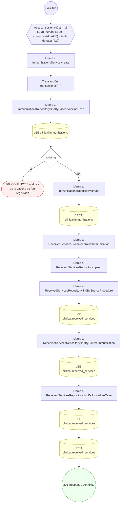

#### 16. POST /clinical/internal/prescription-expiry-notices

Avisar al paciente de las recetas por vencer (barrido)

| HTTP | Código | Cuándo |
|---|---|---|
| 200 | — | Éxito |
| 400 | `VALIDATION_FAILED` | El cuerpo cumple el DTO (sin propiedades extra) |
| 401 | `UNAUTHENTICATED` | Hay una sesión válida (JWT) |
| 403 | `FORBIDDEN` | El rol está permitido; El tenant se resuelve y pertenece al actor |
| 404 | `NOT_FOUND` | ResourceNotFoundException: El proveedor configurado para el canal in-app no existe |
| 422 | `PRECONDITION_FAILED` | PreconditionFailedException: No hay canal in-app activo: falta correr el seed de mensajería; PreconditionFailedException: El canal in-app no tiene configuración de proveedor activa |
| 429 | `RATE_LIMITED` | No se supera el límite de solicitudes |

```mermaid
flowchart TD
  n1(("Solicitud")):::inicio
  n2{{"Acceso: sesión (401) · rol (403) · tenant (403) · cuerpo válido (400) · límite de tasa (429)"}}:::acceso
  n1 --> n2
  n3["Llama a PrescriptionExpiryNoticesService.sweep"]:::llamada
  n2 --> n3
  n4["Transacción: transactional(…)"]:::transaccion
  n3 --> n4
  n5["Llama a PrescriptionExpiryRepository.findToNotify"]:::llamada
  n4 --> n5
  n6[("LEE clinical.medication_requests · LEE profiles.person_account_links · LEE messaging.notification_requests")]:::efecto
  n5 --> n6
  n7["Repite: por cada const prescription de due"]:::bucle
  n6 --> n7
  n8["Llama a NotificationsService.emitInApp"]:::llamada
  n7 -->|"cada elemento"| n8
  n9["Intenta"]:::intento
  n8 --> n9
  n10["Llama a NotificationsService.writeInApp"]:::llamada
  n9 --> n10
  n11["Llama a NotificationsRepository.findActiveChannelByType"]:::llamada
  n10 --> n11
  n12[("LEE messaging.message_channels")]:::efecto
  n11 --> n12
  n13{"!channel"}:::decision
  n12 --> n13
  n14(["422 PRECONDITION_FAILED No hay canal in-app activo: falta correr el seed de mensajería"]):::error
  n13 -->|"sí"| n14
  n15{"input.destination"}:::decision
  n13 -->|"no"| n15
  n16["Llama a NotificationsRepository.findUnreadInAppForResource"]:::llamada
  n15 -->|"sí"| n16
  n17[("LEE messaging.in_app_notifications")]:::efecto
  n16 --> n17
  n18["Llama a NotificationsRepository.createNotificationRequest"]:::llamada
  n17 --> n18
  n15 -->|"no"| n18
  n19[("CREA messaging.notification_requests")]:::efecto
  n18 --> n19
  n20["Llama a NotificationsRepository.findChannelConfigs"]:::llamada
  n19 --> n20
  n21[("LEE messaging.provider_channel_configs")]:::efecto
  n20 --> n21
  n22{"!config"}:::decision
  n21 --> n22
  n23(["422 PRECONDITION_FAILED El canal in-app no tiene configuración de proveedor activa"]):::error
  n22 -->|"sí"| n23
  n24["Llama a NotificationsRepository.findProviderById"]:::llamada
  n22 -->|"no"| n24
  n25[("LEE messaging.messaging_providers")]:::efecto
  n24 --> n25
  n26{"!provider"}:::decision
  n25 --> n26
  n27(["404 NOT_FOUND El proveedor configurado para el canal in-app no existe"]):::error
  n26 -->|"sí"| n27
  n28["Llama a NotificationsRepository.createDelivery"]:::llamada
  n26 -->|"no"| n28
  n29[("CREA messaging.notification_deliveries")]:::efecto
  n28 --> n29
  n30["Llama a NotificationsRepository.createInAppNotification"]:::llamada
  n29 --> n30
  n31[("CREA messaging.in_app_notifications")]:::efecto
  n30 --> n31
  n32{"!result.suppressed && result.inAppNotificationId && result.availableAt && new Date(result.availableAt).getTim…"}:::decision
  n31 --> n32
  n33["Llama a WebPushService.pushToUser"]:::llamada
  n32 -->|"sí"| n33
  n34["Intenta"]:::intento
  n33 --> n34
  n35[("LEE iam.devices")]:::efecto
  n34 --> n35
  n36(("200 Responde con éxito")):::ok
  n35 --> n36
  n32 -->|"no"| n36
  n7 -->|"al terminar"| n36
  classDef acceso fill:#eef,stroke:#66a
  classDef error fill:#fee,stroke:#c33
  classDef ok fill:#efe,stroke:#3a3
  classDef efecto fill:#ffd,stroke:#aa3
  classDef decision fill:#fff,stroke:#555
  classDef corte fill:#eee,stroke:#999,stroke-dasharray: 4
```

#### 17. GET /clinical/me/medical-aspects

Ver mis aspectos médicos declarados

| HTTP | Código | Cuándo |
|---|---|---|
| 200 | — | Éxito |
| 401 | `UNAUTHENTICATED` | Hay una sesión válida (JWT) |
| 403 | `FORBIDDEN` | El rol está permitido; El tenant se resuelve y pertenece al actor; ForbiddenException: {WITHOUT_PATIENT_PROFILE} |
| 429 | `RATE_LIMITED` | No se supera el límite de solicitudes |

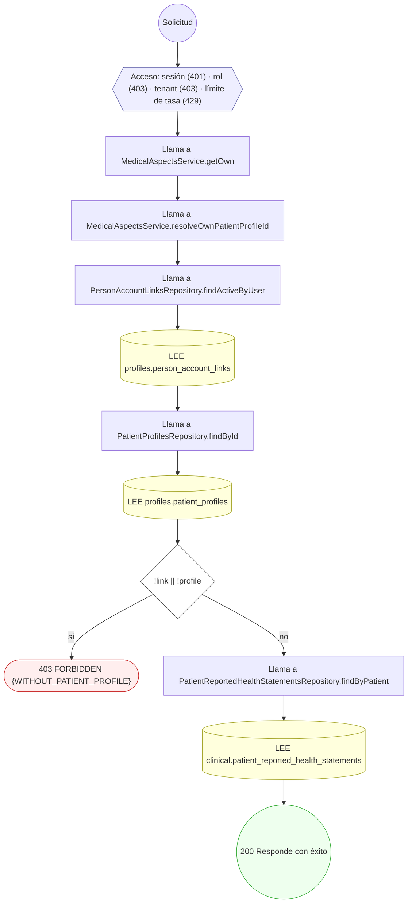

#### 18. PUT /clinical/me/medical-aspects

Guardar mis aspectos médicos declarados

| HTTP | Código | Cuándo |
|---|---|---|
| 200 | — | Éxito |
| 400 | `VALIDATION_FAILED` | El cuerpo cumple el DTO (sin propiedades extra) |
| 401 | `UNAUTHENTICATED` | Hay una sesión válida (JWT) |
| 403 | `FORBIDDEN` | El rol está permitido; El tenant se resuelve y pertenece al actor; ForbiddenException: {WITHOUT_PATIENT_PROFILE} |
| 429 | `RATE_LIMITED` | No se supera el límite de solicitudes |

```mermaid
flowchart TD
  n1(("Solicitud")):::inicio
  n2{{"Acceso: sesión (401) · rol (403) · tenant (403) · cuerpo válido (400) · límite de tasa (429)"}}:::acceso
  n1 --> n2
  n3["Llama a MedicalAspectsService.updateOwn"]:::llamada
  n2 --> n3
  n4["Transacción: transactional(…)"]:::transaccion
  n3 --> n4
  n5["Llama a MedicalAspectsService.resolveOwnPatientProfileId"]:::llamada
  n4 --> n5
  n6["Llama a PersonAccountLinksRepository.findActiveByUser"]:::llamada
  n5 --> n6
  n7[("LEE profiles.person_account_links")]:::efecto
  n6 --> n7
  n8["Llama a PatientProfilesRepository.findById"]:::llamada
  n7 --> n8
  n9[("LEE profiles.patient_profiles")]:::efecto
  n8 --> n9
  n10{"!link || !profile"}:::decision
  n9 --> n10
  n11(["403 FORBIDDEN {WITHOUT_PATIENT_PROFILE}"]):::error
  n10 -->|"sí"| n11
  n12["Llama a PatientReportedHealthStatementsRepository.findByPatient"]:::llamada
  n10 -->|"no"| n12
  n13[("LEE clinical.patient_reported_health_statements")]:::efecto
  n12 --> n13
  n14{"!row"}:::decision
  n13 --> n14
  n15["Llama a PatientReportedHealthStatementsRepository.create"]:::llamada
  n14 -->|"sí"| n15
  n16[("CREA clinical.patient_reported_health_statements")]:::efecto
  n15 --> n16
  n17(("200 Responde con éxito")):::ok
  n16 --> n17
  n14 -->|"no"| n17
  classDef acceso fill:#eef,stroke:#66a
  classDef error fill:#fee,stroke:#c33
  classDef ok fill:#efe,stroke:#3a3
  classDef efecto fill:#ffd,stroke:#aa3
  classDef decision fill:#fff,stroke:#555
  classDef corte fill:#eee,stroke:#999,stroke-dasharray: 4
```

#### 19. POST /clinical/medication-records

Administrar/registrar medicación

| HTTP | Código | Cuándo |
|---|---|---|
| 201 | — | Éxito |
| 400 | `VALIDATION_FAILED` | El cuerpo cumple el DTO (sin propiedades extra) |
| 401 | `UNAUTHENTICATED` | Hay una sesión válida (JWT) |
| 403 | `FORBIDDEN` | El rol está permitido; El tenant se resuelve y pertenece al actor |
| 404 | `NOT_FOUND` | ResourceNotFoundException: Prescripción no encontrada |
| 422 | `PRECONDITION_FAILED` | PreconditionFailedException: La prescripción no está emitida (ISSUED) |
| 429 | `RATE_LIMITED` | No se supera el límite de solicitudes |

```mermaid
flowchart TD
  n1(("Solicitud")):::inicio
  n2{{"Acceso: sesión (401) · rol (403) · tenant (403) · cuerpo válido (400) · límite de tasa (429)"}}:::acceso
  n1 --> n2
  n3["Llama a MedicationsService.administer"]:::llamada
  n2 --> n3
  n4["Transacción: transactional(…)"]:::transaccion
  n3 --> n4
  n5{"dto.requestId"}:::decision
  n4 --> n5
  n6["Llama a MedicationRequestsRepository.findById"]:::llamada
  n5 -->|"sí"| n6
  n7[("LEE clinical.medication_requests")]:::efecto
  n6 --> n7
  n8{"!request"}:::decision
  n7 --> n8
  n9(["404 NOT_FOUND Prescripción no encontrada"]):::error
  n8 -->|"sí"| n9
  n10{"request.statusConceptId !== CLIN.MEDICATION_REQUEST_ISSUED"}:::decision
  n8 -->|"no"| n10
  n11(["422 PRECONDITION_FAILED La prescripción no está emitida (ISSUED)"]):::error
  n10 -->|"sí"| n11
  n12{"dto.isFinalDose"}:::decision
  n10 -->|"no"| n12
  n13[("ACTUALIZA clinical.medication_requests")]:::efecto
  n12 -->|"sí"| n13
  n14["Llama a MedicationRecordsRepository.create"]:::llamada
  n13 --> n14
  n12 -->|"no"| n14
  n5 -->|"no"| n14
  n15[("CREA clinical.medication_records")]:::efecto
  n14 --> n15
  n16(("201 Responde con éxito")):::ok
  n15 --> n16
  classDef acceso fill:#eef,stroke:#66a
  classDef error fill:#fee,stroke:#c33
  classDef ok fill:#efe,stroke:#3a3
  classDef efecto fill:#ffd,stroke:#aa3
  classDef decision fill:#fff,stroke:#555
  classDef corte fill:#eee,stroke:#999,stroke-dasharray: 4
```

#### 20. POST /clinical/medication-requests

Prescribir medicación

| HTTP | Código | Cuándo |
|---|---|---|
| 201 | — | Éxito |
| 400 | `VALIDATION_FAILED` | El cuerpo cumple el DTO (sin propiedades extra) |
| 401 | `UNAUTHENTICATED` | Hay una sesión válida (JWT) |
| 403 | `FORBIDDEN` | El rol está permitido; El tenant se resuelve y pertenece al actor; ForbiddenException: Una receta necesita un profesional prescriptor.; ForbiddenException: La sesión no tiene un perfil profesional con el que prescribir.; ForbiddenException: El prescriptor es el profesional de la sesión: no se prescribe en nombre de otro. |
| 422 | `PRECONDITION_FAILED` | PreconditionFailedException: La condición indicada no existe o no pertenece a este paciente |
| 429 | `RATE_LIMITED` | No se supera el límite de solicitudes |
| 500 | `INTERNAL` | Error: Entidad de historial no registrada: {entity} |

```mermaid
flowchart TD
  n1(("Solicitud")):::inicio
  n2{{"Acceso: sesión (401) · rol (403) · tenant (403) · cuerpo válido (400) · límite de tasa (429)"}}:::acceso
  n1 --> n2
  n3["Llama a MedicationsService.prescribe"]:::llamada
  n2 --> n3
  n4["Transacción: transactional(…)"]:::transaccion
  n3 --> n4
  n5["Llama a MedicationsService.resolvePrescriber"]:::llamada
  n4 --> n5
  n6{"actor.roles.includes('SUPERADMIN')"}:::decision
  n5 --> n6
  n7{"!chosen"}:::decision
  n6 -->|"sí"| n7
  n8(["403 FORBIDDEN Una receta necesita un profesional prescriptor."]):::error
  n7 -->|"sí"| n8
  n9{"!actor.practitionerProfileId"}:::decision
  n7 -->|"no"| n9
  n6 -->|"no"| n9
  n10(["403 FORBIDDEN La sesión no tiene un perfil profesional con el que prescribir."]):::error
  n9 -->|"sí"| n10
  n11{"declared !== undefined && declared !== actor.practitionerProfileId"}:::decision
  n9 -->|"no"| n11
  n12(["403 FORBIDDEN El prescriptor es el profesional de la sesión: no se prescribe en nombre de otro."]):::error
  n11 -->|"sí"| n12
  n13{"dto.indicationConditionId !== undefined"}:::decision
  n11 -->|"no"| n13
  n14["Llama a MedicationsService.assertIndicationBelongsToPatient"]:::llamada
  n13 -->|"sí"| n14
  n15["Llama a ConditionsRepository.findById"]:::llamada
  n14 --> n15
  n16[("LEE clinical.conditions")]:::efecto
  n15 --> n16
  n17{"condition?.patientProfileId !== patientProfileId"}:::decision
  n16 --> n17
  n18(["422 PRECONDITION_FAILED La condición indicada no existe o no pertenece a este paciente"]):::error
  n17 -->|"sí"| n18
  n19{"dto.formInstanceId !== undefined"}:::decision
  n17 -->|"no"| n19
  n13 -->|"no"| n19
  n20["Llama a FormInstanceOriginValidator.assertUsableOrigin"]:::llamada
  n19 -->|"sí"| n20
  n21[("LEE forms.form_instances")]:::efecto
  n20 --> n21
  n22{"!instance"}:::decision
  n21 --> n22
  n23(["↩ (relanza el error capturado)"]):::error
  n22 -->|"sí"| n23
  n24{"instance.stateConceptId !== FORMS.INSTANCE_CLOSED"}:::decision
  n22 -->|"no"| n24
  n25(["↩ (relanza el error capturado)"]):::error
  n24 -->|"sí"| n25
  n26{"encounterId && instance.resourceId !== encounterId"}:::decision
  n24 -->|"no"| n26
  n27(["↩ (relanza el error capturado)"]):::error
  n26 -->|"sí"| n27
  n28["Llama a MedicationRequestsRepository.create"]:::llamada
  n26 -->|"no"| n28
  n19 -->|"no"| n28
  n29[("CREA clinical.medication_requests")]:::efecto
  n28 --> n29
  n30["Llama a MedicationsService.versionRequest"]:::llamada
  n29 --> n30
  n31["Llama a HistoryRepository.append"]:::llamada
  n30 --> n31
  n32{"!binding"}:::decision
  n31 --> n32
  n33(["500 INTERNAL Entidad de historial no registrada: {entity}"]):::error
  n32 -->|"sí"| n33
  n34[("LEE audit.medication_requests_history · ACTUALIZA audit.medication_requests_history · CREA audit.medication_r…")]:::efecto
  n32 -->|"no"| n34
  n35(("201 Responde con éxito")):::ok
  n34 --> n35
  classDef acceso fill:#eef,stroke:#66a
  classDef error fill:#fee,stroke:#c33
  classDef ok fill:#efe,stroke:#3a3
  classDef efecto fill:#ffd,stroke:#aa3
  classDef decision fill:#fff,stroke:#555
  classDef corte fill:#eee,stroke:#999,stroke-dasharray: 4
```

#### 21. GET /clinical/medication-requests/{id}/attachments

Listar los adjuntos de una receta

| HTTP | Código | Cuándo |
|---|---|---|
| 200 | — | Éxito |
| 400 | `VALIDATION_FAILED` | Los parámetros de ruta son UUID válidos |
| 401 | `UNAUTHENTICATED` | Hay una sesión válida (JWT) |
| 403 | `FORBIDDEN` | El rol está permitido; El tenant se resuelve y pertenece al actor; ForbiddenException: {WITHOUT_ACCESS_TO_HISTORY}; ForbiddenException: No tiene acceso a los adjuntos de este recurso |
| 404 | `NOT_FOUND` | ResourceNotFoundException: Receta no encontrada |
| 429 | `RATE_LIMITED` | No se supera el límite de solicitudes |

```mermaid
flowchart TD
  n1(("Solicitud")):::inicio
  n2{{"Acceso: sesión (401) · rol (403) · tenant (403) · parámetros de ruta (400) · límite de tasa (429)"}}:::acceso
  n1 --> n2
  n3["Llama a MedicationsService.listAttachments"]:::llamada
  n2 --> n3
  n4["Llama a MedicationsService.loadRequestOrThrow"]:::llamada
  n3 --> n4
  n5["Llama a MedicationRequestsRepository.findById"]:::llamada
  n4 --> n5
  n6[("LEE clinical.medication_requests")]:::efecto
  n5 --> n6
  n7{"!request"}:::decision
  n6 --> n7
  n8(["404 NOT_FOUND Receta no encontrada"]):::error
  n7 -->|"sí"| n8
  n9["Llama a ClinicalReadService.assertCanReadHistory"]:::llamada
  n7 -->|"no"| n9
  n10{"!actor.roles.some((role) =› ROLES_THAT_ATTEND.includes(role))"}:::decision
  n9 --> n10
  n11["Llama a ClinicalReadService.assertOwnRecord"]:::llamada
  n10 -->|"sí"| n11
  n12["Llama a PersonAccountLinksRepository.findActiveByUser"]:::llamada
  n11 --> n12
  n13[("LEE profiles.person_account_links")]:::efecto
  n12 --> n13
  n14["Llama a PatientProfilesRepository.findById"]:::llamada
  n13 --> n14
  n15[("LEE profiles.patient_profiles")]:::efecto
  n14 --> n15
  n16{"!link || !profile || profile.profileId !== link.personId"}:::decision
  n15 --> n16
  n17(["403 FORBIDDEN {WITHOUT_ACCESS_TO_HISTORY}"]):::error
  n16 -->|"sí"| n17
  n18["Llama a PersonAccountLinksRepository.findActiveByUser"]:::llamada
  n16 -->|"no"| n18
  n10 -->|"no"| n18
  n19[("LEE profiles.person_account_links")]:::efecto
  n18 --> n19
  n20["Llama a HealthPractitionerProfilesRepository.findById"]:::llamada
  n19 --> n20
  n21[("LEE profiles.health_practitioner_profiles")]:::efecto
  n20 --> n21
  n22["Llama a ClinicalReadService.isAttending"]:::llamada
  n21 --> n22
  n23["Llama a SchedulingBookingsRepository.hasConsultationInProgress"]:::llamada
  n22 --> n23
  n24[("LEE scheduling.appointment_bookings · LEE scheduling.schedulable_resources")]:::efecto
  n23 --> n24
  n25["Llama a ClinicalReadService.assertOwnRecord"]:::llamada
  n24 --> n25
  n26["Llama a PersonAccountLinksRepository.findActiveByUser"]:::llamada
  n25 --> n26
  n27[("LEE profiles.person_account_links")]:::efecto
  n26 --> n27
  n28["Llama a PatientProfilesRepository.findById"]:::llamada
  n27 --> n28
  n29[("LEE profiles.patient_profiles")]:::efecto
  n28 --> n29
  n30{"!link || !profile || profile.profileId !== link.personId"}:::decision
  n29 --> n30
  n31(["403 FORBIDDEN {WITHOUT_ACCESS_TO_HISTORY}"]):::error
  n30 -->|"sí"| n31
  n32["Llama a FilesService.listLinkedFilesOf"]:::llamada
  n30 -->|"no"| n32
  n33["Llama a FileLinksRepository.findByOwner"]:::llamada
  n32 --> n33
  n34[("LEE common.file_links")]:::efecto
  n33 --> n34
  n35["Repite: por cada const link de links"]:::bucle
  n34 --> n35
  n36["Llama a FilesRepository.findById"]:::llamada
  n35 -->|"cada elemento"| n36
  n37[("LEE common.files")]:::efecto
  n36 --> n37
  n38{"live.length › 0 && visible.length === 0"}:::decision
  n37 --> n38
  n35 -->|"al terminar"| n38
  n39(["403 FORBIDDEN No tiene acceso a los adjuntos de este recurso"]):::error
  n38 -->|"sí"| n39
  n40["Llama a FileVersionsRepository.findByIds"]:::llamada
  n38 -->|"no"| n40
  n41[("LEE common.file_versions")]:::efecto
  n40 --> n41
  n42(("200 Responde con éxito")):::ok
  n41 --> n42
  classDef acceso fill:#eef,stroke:#66a
  classDef error fill:#fee,stroke:#c33
  classDef ok fill:#efe,stroke:#3a3
  classDef efecto fill:#ffd,stroke:#aa3
  classDef decision fill:#fff,stroke:#555
  classDef corte fill:#eee,stroke:#999,stroke-dasharray: 4
```

#### 22. POST /clinical/medication-requests/{id}/attachments

Adjuntar un archivo ya subido a una receta

| HTTP | Código | Cuándo |
|---|---|---|
| 201 | — | Éxito |
| 400 | `VALIDATION_FAILED` | Los parámetros de ruta son UUID válidos; El cuerpo cumple el DTO (sin propiedades extra) |
| 401 | `UNAUTHENTICATED` | Hay una sesión válida (JWT) |
| 403 | `FORBIDDEN` | El rol está permitido; El tenant se resuelve y pertenece al actor; ForbiddenException: {WITHOUT_ACCESS_TO_HISTORY}; InsufficientRoleException: No tiene permiso para modificar este archivo |
| 404 | `NOT_FOUND` | ResourceNotFoundException: Receta no encontrada; ResourceNotFoundException: Archivo no encontrado |
| 429 | `RATE_LIMITED` | No se supera el límite de solicitudes |
| 500 | `INTERNAL` | StorageLifecycleDenied: LIFECYCLE_WIRING_MISSING; StorageLifecycleDenied: {identity.reasonCode}; StorageLifecycleDenied: FILE_NOT_LIVE; StorageLifecycleDenied: VERSION_UNKNOWN; StorageLifecycleDenied: PHYSICAL_IDENTITY_UNKNOWN; StorageLifecycleDenied: PRODUCER_OR_PURGE_IN_FLIGHT |

```mermaid
flowchart TD
  n1(("Solicitud")):::inicio
  n2{{"Acceso: sesión (401) · rol (403) · tenant (403) · parámetros de ruta (400) · cuerpo válido (400) · límite de…"}}:::acceso
  n1 --> n2
  n3["Llama a MedicationsService.attachFile"]:::llamada
  n2 --> n3
  n4["Llama a MedicationsService.loadRequestOrThrow"]:::llamada
  n3 --> n4
  n5["Llama a MedicationRequestsRepository.findById"]:::llamada
  n4 --> n5
  n6[("LEE clinical.medication_requests")]:::efecto
  n5 --> n6
  n7{"!request"}:::decision
  n6 --> n7
  n8(["404 NOT_FOUND Receta no encontrada"]):::error
  n7 -->|"sí"| n8
  n9["Llama a ClinicalReadService.assertCanWriteHistory"]:::llamada
  n7 -->|"no"| n9
  n10{"actor.roles.some((role) =› ROLES_THAT_ATTEND.includes(role))"}:::decision
  n9 --> n10
  n11["Llama a PersonAccountLinksRepository.findActiveByUser"]:::llamada
  n10 -->|"sí"| n11
  n12[("LEE profiles.person_account_links")]:::efecto
  n11 --> n12
  n13["Llama a HealthPractitionerProfilesRepository.findById"]:::llamada
  n12 --> n13
  n14[("LEE profiles.health_practitioner_profiles")]:::efecto
  n13 --> n14
  n15["Llama a ClinicalReadService.isAttending"]:::llamada
  n14 --> n15
  n16["Llama a SchedulingBookingsRepository.hasConsultationInProgress"]:::llamada
  n15 --> n16
  n17[("LEE scheduling.appointment_bookings · LEE scheduling.schedulable_resources")]:::efecto
  n16 --> n17
  n18(["403 FORBIDDEN {WITHOUT_ACCESS_TO_HISTORY}"]):::error
  n17 --> n18
  n10 -->|"no"| n18
  n19["Llama a FilesService.createLink"]:::llamada
  n20["Transacción: transactional(…)"]:::transaccion
  n19 --> n20
  n21["Llama a FilesService.assertLifecycleWired"]:::llamada
  n20 --> n21
  n22{"loadStorageEnv().lifecycleBinding && !this.publication"}:::decision
  n21 --> n22
  n23(["500 INTERNAL LIFECYCLE_WIRING_MISSING"]):::error
  n22 -->|"sí"| n23
  n24["Llama a StoragePublicationService.guardFile"]:::llamada
  n22 -->|"no"| n24
  n25["Llama a StoragePublicationService.lockNamespace"]:::llamada
  n24 --> n25
  n26{"identity.kind === 'UNKNOWN'"}:::decision
  n25 --> n26
  n27(["500 INTERNAL {identity.reasonCode}"]):::error
  n26 -->|"sí"| n27
  n28[("LEE common.files")]:::efecto
  n26 -->|"no"| n28
  n29{"!file || file.deletedAt || file.lifecycleStatusConceptId === CONCEPTS.FILE_DELETED || !file.currentVersionId"}:::decision
  n28 --> n29
  n30(["500 INTERNAL FILE_NOT_LIVE"]):::error
  n29 -->|"sí"| n30
  n31[("LEE common.file_versions")]:::efecto
  n29 -->|"no"| n31
  n32{"!versions.some((version) =› version.id === file.currentVersionId)"}:::decision
  n31 --> n32
  n33(["500 INTERNAL VERSION_UNKNOWN"]):::error
  n32 -->|"sí"| n33
  n34["Repite: por cada const version de versions"]:::bucle
  n32 -->|"no"| n34
  n35{"!identity || identity.kind === 'UNKNOWN'"}:::decision
  n34 -->|"cada elemento"| n35
  n36(["500 INTERNAL PHYSICAL_IDENTITY_UNKNOWN"]):::error
  n35 -->|"sí"| n36
  n37["Llama a StorageLifecycleCoordinator.assertNoContender"]:::llamada
  n35 -->|"no"| n37
  n38["Repite: por cada const job de await this.queues.findStorageIntents(tx)"]:::bucle
  n37 --> n38
  n39{"physicalContentionKey(intent.identity) === physicalContentionKey(identity) && intentExcludesPublication(inten…"}:::decision
  n38 -->|"cada elemento"| n39
  n40(["500 INTERNAL PRODUCER_OR_PURGE_IN_FLIGHT"]):::error
  n39 -->|"sí"| n40
  n41["Llama a FilesRepository.findById"]:::llamada
  n39 -->|"no"| n41
  n38 -->|"al terminar"| n41
  n34 -->|"al terminar"| n41
  n42[("LEE common.files")]:::efecto
  n41 --> n42
  n43{"!file"}:::decision
  n42 --> n43
  n44(["404 NOT_FOUND Archivo no encontrado"]):::error
  n43 -->|"sí"| n44
  n45["Llama a FilesService.assertCanMutateFile"]:::llamada
  n43 -->|"no"| n45
  n46{"!canActorReadOwnFile(file, actor)"}:::decision
  n45 --> n46
  n47(["404 NOT_FOUND Archivo no encontrado"]):::error
  n46 -->|"sí"| n47
  n48(["403 FORBIDDEN No tiene permiso para modificar este archivo"]):::error
  n46 -->|"no"| n48
  n49["Llama a FileLinksRepository.create"]:::llamada
  n50[("CREA common.file_links")]:::efecto
  n49 --> n50
  n51(("201 Responde con éxito")):::ok
  n50 --> n51
  classDef acceso fill:#eef,stroke:#66a
  classDef error fill:#fee,stroke:#c33
  classDef ok fill:#efe,stroke:#3a3
  classDef efecto fill:#ffd,stroke:#aa3
  classDef decision fill:#fff,stroke:#555
  classDef corte fill:#eee,stroke:#999,stroke-dasharray: 4
```

#### 23. POST /clinical/medication-requests/{id}/edit

Editar ítems de una receta en borrador (DRAFT)

| HTTP | Código | Cuándo |
|---|---|---|
| 200 | — | Éxito |
| 400 | `VALIDATION_FAILED` | Los parámetros de ruta son UUID válidos; El cuerpo cumple el DTO (sin propiedades extra) |
| 401 | `UNAUTHENTICATED` | Hay una sesión válida (JWT) |
| 403 | `FORBIDDEN` | El rol está permitido; El tenant se resuelve y pertenece al actor; ForbiddenException: {WITHOUT_ACCESS_TO_HISTORY}; ForbiddenException: Una receta necesita un profesional prescriptor.; ForbiddenException: La sesión no tiene un perfil profesional con el que prescribir.; ForbiddenException: El prescriptor es el profesional de la sesión: no se prescribe en nombre de otro. |
| 404 | `NOT_FOUND` | ResourceNotFoundException: Receta no encontrada |
| 422 | `PRECONDITION_FAILED` | PreconditionFailedException: Solo un borrador (DRAFT) admite edición; una receta emitida es inmutable; PreconditionFailedException: La condición indicada no existe o no pertenece a este paciente |
| 429 | `RATE_LIMITED` | No se supera el límite de solicitudes |
| 500 | `INTERNAL` | Error: Entidad de historial no registrada: {entity} |

```mermaid
flowchart TD
  n1(("Solicitud")):::inicio
  n2{{"Acceso: sesión (401) · rol (403) · tenant (403) · parámetros de ruta (400) · cuerpo válido (400) · límite de…"}}:::acceso
  n1 --> n2
  n3["Llama a MedicationsService.editDraft"]:::llamada
  n2 --> n3
  n4["Transacción: transactional(…)"]:::transaccion
  n3 --> n4
  n5["Llama a MedicationsService.loadRequestForWrite"]:::llamada
  n4 --> n5
  n6["Llama a MedicationsService.loadRequestOrThrow"]:::llamada
  n5 --> n6
  n7["Llama a MedicationRequestsRepository.findById"]:::llamada
  n6 --> n7
  n8[("LEE clinical.medication_requests")]:::efecto
  n7 --> n8
  n9{"!request"}:::decision
  n8 --> n9
  n10(["404 NOT_FOUND Receta no encontrada"]):::error
  n9 -->|"sí"| n10
  n11["Llama a ClinicalReadService.assertCanWriteHistory"]:::llamada
  n9 -->|"no"| n11
  n12{"actor.roles.some((role) =› ROLES_THAT_ATTEND.includes(role))"}:::decision
  n11 --> n12
  n13["Llama a PersonAccountLinksRepository.findActiveByUser"]:::llamada
  n12 -->|"sí"| n13
  n14[("LEE profiles.person_account_links")]:::efecto
  n13 --> n14
  n15["Llama a HealthPractitionerProfilesRepository.findById"]:::llamada
  n14 --> n15
  n16[("LEE profiles.health_practitioner_profiles")]:::efecto
  n15 --> n16
  n17(["403 FORBIDDEN {WITHOUT_ACCESS_TO_HISTORY}"]):::error
  n16 --> n17
  n12 -->|"no"| n17
  n18{"request.statusConceptId !== CLIN.MEDICATION_REQUEST_DRAFT"}:::decision
  n19(["422 PRECONDITION_FAILED Solo un borrador (DRAFT) admite edición; una receta emitida es inmutable"]):::error
  n18 -->|"sí"| n19
  n20[("ACTUALIZA clinical.medication_requests")]:::efecto
  n18 -->|"no"| n20
  n21{"dto.encounterId !== undefined"}:::decision
  n20 --> n21
  n22[("ACTUALIZA clinical.medication_requests")]:::efecto
  n21 -->|"sí"| n22
  n23{"dto.medicationConceptId !== undefined"}:::decision
  n22 --> n23
  n21 -->|"no"| n23
  n24[("ACTUALIZA clinical.medication_requests")]:::efecto
  n23 -->|"sí"| n24
  n25{"dto.substanceAtcConceptId !== undefined"}:::decision
  n24 --> n25
  n23 -->|"no"| n25
  n26[("ACTUALIZA clinical.medication_requests")]:::efecto
  n25 -->|"sí"| n26
  n27{"dto.prescriberProfileId !== undefined"}:::decision
  n26 --> n27
  n25 -->|"no"| n27
  n28["Llama a MedicationsService.resolvePrescriber"]:::llamada
  n27 -->|"sí"| n28
  n29{"actor.roles.includes('SUPERADMIN')"}:::decision
  n28 --> n29
  n30{"!chosen"}:::decision
  n29 -->|"sí"| n30
  n31(["403 FORBIDDEN Una receta necesita un profesional prescriptor."]):::error
  n30 -->|"sí"| n31
  n32{"!actor.practitionerProfileId"}:::decision
  n30 -->|"no"| n32
  n29 -->|"no"| n32
  n33(["403 FORBIDDEN La sesión no tiene un perfil profesional con el que prescribir."]):::error
  n32 -->|"sí"| n33
  n34{"declared !== undefined && declared !== actor.practitionerProfileId"}:::decision
  n32 -->|"no"| n34
  n35(["403 FORBIDDEN El prescriptor es el profesional de la sesión: no se prescribe en nombre de otro."]):::error
  n34 -->|"sí"| n35
  n36[("ACTUALIZA clinical.medication_requests")]:::efecto
  n34 -->|"no"| n36
  n37[("ACTUALIZA clinical.medication_requests")]:::efecto
  n36 --> n37
  n27 -->|"no"| n37
  n38{"dto.doseText !== undefined"}:::decision
  n37 --> n38
  n39[("ACTUALIZA clinical.medication_requests")]:::efecto
  n38 -->|"sí"| n39
  n40{"dto.routeConceptId !== undefined"}:::decision
  n39 --> n40
  n38 -->|"no"| n40
  n41[("ACTUALIZA clinical.medication_requests")]:::efecto
  n40 -->|"sí"| n41
  n42{"dto.frequencyText !== undefined"}:::decision
  n41 --> n42
  n40 -->|"no"| n42
  n43[("ACTUALIZA clinical.medication_requests")]:::efecto
  n42 -->|"sí"| n43
  n44{"dto.quantityDecimal !== undefined"}:::decision
  n43 --> n44
  n42 -->|"no"| n44
  n45[("ACTUALIZA clinical.medication_requests")]:::efecto
  n44 -->|"sí"| n45
  n46{"dto.unitConceptId !== undefined"}:::decision
  n45 --> n46
  n44 -->|"no"| n46
  n47[("ACTUALIZA clinical.medication_requests")]:::efecto
  n46 -->|"sí"| n47
  n48{"dto.validFrom !== undefined"}:::decision
  n47 --> n48
  n46 -->|"no"| n48
  n49[("ACTUALIZA clinical.medication_requests")]:::efecto
  n48 -->|"sí"| n49
  n50[("ACTUALIZA clinical.medication_requests")]:::efecto
  n49 --> n50
  n48 -->|"no"| n50
  n51{"dto.validTo !== undefined"}:::decision
  n50 --> n51
  n52[("ACTUALIZA clinical.medication_requests")]:::efecto
  n51 -->|"sí"| n52
  n53{"dto.patientInstructionsText !== undefined"}:::decision
  n52 --> n53
  n51 -->|"no"| n53
  n54[("ACTUALIZA clinical.medication_requests")]:::efecto
  n53 -->|"sí"| n54
  n55{"dto.indicationConditionId !== undefined"}:::decision
  n54 --> n55
  n53 -->|"no"| n55
  n56["Llama a MedicationsService.assertIndicationBelongsToPatient"]:::llamada
  n55 -->|"sí"| n56
  n57["Llama a ConditionsRepository.findById"]:::llamada
  n56 --> n57
  n58[("LEE clinical.conditions")]:::efecto
  n57 --> n58
  n59{"condition?.patientProfileId !== patientProfileId"}:::decision
  n58 --> n59
  n60(["422 PRECONDITION_FAILED La condición indicada no existe o no pertenece a este paciente"]):::error
  n59 -->|"sí"| n60
  n61[("ACTUALIZA clinical.medication_requests")]:::efecto
  n59 -->|"no"| n61
  n62{"dto.indicationText !== undefined"}:::decision
  n61 --> n62
  n55 -->|"no"| n62
  n63[("ACTUALIZA clinical.medication_requests")]:::efecto
  n62 -->|"sí"| n63
  n64[("ACTUALIZA clinical.medication_requests")]:::efecto
  n63 --> n64
  n62 -->|"no"| n64
  n65{"request.indicationConditionId"}:::decision
  n64 --> n65
  n66[("ACTUALIZA clinical.medication_requests")]:::efecto
  n65 -->|"sí"| n66
  n67["Llama a MedicationsService.versionRequest"]:::llamada
  n66 --> n67
  n65 -->|"no"| n67
  n68["Llama a HistoryRepository.append"]:::llamada
  n67 --> n68
  n69{"!binding"}:::decision
  n68 --> n69
  n70(["500 INTERNAL Entidad de historial no registrada: {entity}"]):::error
  n69 -->|"sí"| n70
  n71["… el resto del árbol (3 nodos) está en el JSON del inventario"]:::corte
  n69 -->|"no"| n71
  classDef acceso fill:#eef,stroke:#66a
  classDef error fill:#fee,stroke:#c33
  classDef ok fill:#efe,stroke:#3a3
  classDef efecto fill:#ffd,stroke:#aa3
  classDef decision fill:#fff,stroke:#555
  classDef corte fill:#eee,stroke:#999,stroke-dasharray: 4
```

#### 24. POST /clinical/medication-requests/{id}/invalidate

Invalidar una receta emitida

| HTTP | Código | Cuándo |
|---|---|---|
| 200 | — | Éxito |
| 400 | `VALIDATION_FAILED` | Los parámetros de ruta son UUID válidos; El cuerpo cumple el DTO (sin propiedades extra) |
| 401 | `UNAUTHENTICATED` | Hay una sesión válida (JWT) |
| 403 | `FORBIDDEN` | El rol está permitido; El tenant se resuelve y pertenece al actor; ForbiddenException: {WITHOUT_ACCESS_TO_HISTORY} |
| 404 | `NOT_FOUND` | ResourceNotFoundException: Receta no encontrada |
| 422 | `PRECONDITION_FAILED` | PreconditionFailedException: Solo una receta emitida (ISSUED) puede invalidarse |
| 429 | `RATE_LIMITED` | No se supera el límite de solicitudes |
| 500 | `INTERNAL` | Error: Entidad de historial no registrada: {entity} |

```mermaid
flowchart TD
  n1(("Solicitud")):::inicio
  n2{{"Acceso: sesión (401) · rol (403) · tenant (403) · parámetros de ruta (400) · cuerpo válido (400) · límite de…"}}:::acceso
  n1 --> n2
  n3["Llama a MedicationsService.invalidate"]:::llamada
  n2 --> n3
  n4["Transacción: transactional(…)"]:::transaccion
  n3 --> n4
  n5["Llama a MedicationsService.loadRequestForWrite"]:::llamada
  n4 --> n5
  n6["Llama a MedicationsService.loadRequestOrThrow"]:::llamada
  n5 --> n6
  n7["Llama a MedicationRequestsRepository.findById"]:::llamada
  n6 --> n7
  n8[("LEE clinical.medication_requests")]:::efecto
  n7 --> n8
  n9{"!request"}:::decision
  n8 --> n9
  n10(["404 NOT_FOUND Receta no encontrada"]):::error
  n9 -->|"sí"| n10
  n11["Llama a ClinicalReadService.assertCanWriteHistory"]:::llamada
  n9 -->|"no"| n11
  n12{"actor.roles.some((role) =› ROLES_THAT_ATTEND.includes(role))"}:::decision
  n11 --> n12
  n13["Llama a PersonAccountLinksRepository.findActiveByUser"]:::llamada
  n12 -->|"sí"| n13
  n14[("LEE profiles.person_account_links")]:::efecto
  n13 --> n14
  n15["Llama a HealthPractitionerProfilesRepository.findById"]:::llamada
  n14 --> n15
  n16[("LEE profiles.health_practitioner_profiles")]:::efecto
  n15 --> n16
  n17(["403 FORBIDDEN {WITHOUT_ACCESS_TO_HISTORY}"]):::error
  n16 --> n17
  n12 -->|"no"| n17
  n18{"request.statusConceptId !== CLIN.MEDICATION_REQUEST_ISSUED"}:::decision
  n19(["422 PRECONDITION_FAILED Solo una receta emitida (ISSUED) puede invalidarse"]):::error
  n18 -->|"sí"| n19
  n20[("ACTUALIZA clinical.medication_requests · ACTUALIZA clinical.medication_requests")]:::efecto
  n18 -->|"no"| n20
  n21["Llama a AuditTrailService.record"]:::llamada
  n20 --> n21
  n22["Llama a AuditLogRepository.append"]:::llamada
  n21 --> n22
  n23["Llama a AuditLogRepository.findChainTip"]:::llamada
  n22 --> n23
  n24[("LEE audit.audit_log")]:::efecto
  n23 --> n24
  n25[("CREA audit.audit_log")]:::efecto
  n24 --> n25
  n26["Llama a MedicationsService.versionRequest"]:::llamada
  n25 --> n26
  n27["Llama a HistoryRepository.append"]:::llamada
  n26 --> n27
  n28{"!binding"}:::decision
  n27 --> n28
  n29(["500 INTERNAL Entidad de historial no registrada: {entity}"]):::error
  n28 -->|"sí"| n29
  n30[("LEE audit.medication_requests_history · ACTUALIZA audit.medication_requests_history · CREA audit.medication_r…")]:::efecto
  n28 -->|"no"| n30
  n31(("200 Responde con éxito")):::ok
  n30 --> n31
  classDef acceso fill:#eef,stroke:#66a
  classDef error fill:#fee,stroke:#c33
  classDef ok fill:#efe,stroke:#3a3
  classDef efecto fill:#ffd,stroke:#aa3
  classDef decision fill:#fff,stroke:#555
  classDef corte fill:#eee,stroke:#999,stroke-dasharray: 4
```

#### 25. POST /clinical/medication-requests/{id}/issue

Emitir una receta (la vuelve inmutable)

| HTTP | Código | Cuándo |
|---|---|---|
| 200 | — | Éxito |
| 400 | `VALIDATION_FAILED` | Los parámetros de ruta son UUID válidos |
| 401 | `UNAUTHENTICATED` | Hay una sesión válida (JWT) |
| 403 | `FORBIDDEN` | El rol está permitido; El tenant se resuelve y pertenece al actor; ForbiddenException: {WITHOUT_ACCESS_TO_HISTORY} |
| 404 | `NOT_FOUND` | ResourceNotFoundException: Receta no encontrada |
| 409 | `CONFLICT` | ConflictException: La clave de idempotencia ya fue usada para emitir otra receta |
| 422 | `PRECONDITION_FAILED` | PreconditionFailedException: Solo un borrador (DRAFT) puede emitirse; PreconditionFailedException: La política vigente exige firmar la receta antes de emitirla |
| 429 | `RATE_LIMITED` | No se supera el límite de solicitudes |
| 500 | `INTERNAL` | Error: Entidad de historial no registrada: {entity} |

```mermaid
flowchart TD
  n1(("Solicitud")):::inicio
  n2{{"Acceso: sesión (401) · rol (403) · tenant (403) · parámetros de ruta (400) · límite de tasa (429)"}}:::acceso
  n1 --> n2
  n3["Llama a MedicationsService.issue"]:::llamada
  n2 --> n3
  n4["Transacción: transactional(…)"]:::transaccion
  n3 --> n4
  n5["Llama a MedicationsService.loadRequestForWrite"]:::llamada
  n4 --> n5
  n6["Llama a MedicationsService.loadRequestOrThrow"]:::llamada
  n5 --> n6
  n7["Llama a MedicationRequestsRepository.findById"]:::llamada
  n6 --> n7
  n8[("LEE clinical.medication_requests")]:::efecto
  n7 --> n8
  n9{"!request"}:::decision
  n8 --> n9
  n10(["404 NOT_FOUND Receta no encontrada"]):::error
  n9 -->|"sí"| n10
  n11["Llama a ClinicalReadService.assertCanWriteHistory"]:::llamada
  n9 -->|"no"| n11
  n12{"actor.roles.some((role) =› ROLES_THAT_ATTEND.includes(role))"}:::decision
  n11 --> n12
  n13["Llama a PersonAccountLinksRepository.findActiveByUser"]:::llamada
  n12 -->|"sí"| n13
  n14[("LEE profiles.person_account_links")]:::efecto
  n13 --> n14
  n15["Llama a HealthPractitionerProfilesRepository.findById"]:::llamada
  n14 --> n15
  n16[("LEE profiles.health_practitioner_profiles")]:::efecto
  n15 --> n16
  n17(["403 FORBIDDEN {WITHOUT_ACCESS_TO_HISTORY}"]):::error
  n16 --> n17
  n12 -->|"no"| n17
  n18{"request.statusConceptId !== CLIN.MEDICATION_REQUEST_DRAFT"}:::decision
  n19(["422 PRECONDITION_FAILED Solo un borrador (DRAFT) puede emitirse"]):::error
  n18 -->|"sí"| n19
  n20{"idempotencyKey"}:::decision
  n18 -->|"no"| n20
  n21["Llama a MedicationRequestsRepository.findByIssueIdempotencyKey"]:::llamada
  n20 -->|"sí"| n21
  n22[("LEE clinical.medication_requests")]:::efecto
  n21 --> n22
  n23{"existing && existing.id !== request.id"}:::decision
  n22 --> n23
  n24(["409 CONFLICT La clave de idempotencia ya fue usada para emitir otra receta"]):::error
  n23 -->|"sí"| n24
  n25{"!request.signedAt"}:::decision
  n23 -->|"no"| n25
  n20 -->|"no"| n25
  n26["Llama a PrescriptionSignaturePoliciesService.isSignatureRequired"]:::llamada
  n25 -->|"sí"| n26
  n27["Llama a PrescriptionSignaturePoliciesRepository.findActive"]:::llamada
  n26 --> n27
  n28[("LEE clinical.prescription_signature_policies")]:::efecto
  n27 --> n28
  n29{"signatureRequired"}:::decision
  n28 --> n29
  n30(["422 PRECONDITION_FAILED La política vigente exige firmar la receta antes de emitirla"]):::error
  n29 -->|"sí"| n30
  n31[("ACTUALIZA clinical.medication_requests · ACTUALIZA clinical.medication_requests · ACTUALIZA clinical.medicati…")]:::efecto
  n29 -->|"no"| n31
  n25 -->|"no"| n31
  n32{"idempotencyKey"}:::decision
  n31 --> n32
  n33[("ACTUALIZA clinical.medication_requests")]:::efecto
  n32 -->|"sí"| n33
  n34["Llama a AuditTrailService.record"]:::llamada
  n33 --> n34
  n32 -->|"no"| n34
  n35["Llama a AuditLogRepository.append"]:::llamada
  n34 --> n35
  n36["Llama a AuditLogRepository.findChainTip"]:::llamada
  n35 --> n36
  n37[("LEE audit.audit_log")]:::efecto
  n36 --> n37
  n38[("CREA audit.audit_log")]:::efecto
  n37 --> n38
  n39["Llama a MedicationsService.versionRequest"]:::llamada
  n38 --> n39
  n40["Llama a HistoryRepository.append"]:::llamada
  n39 --> n40
  n41{"!binding"}:::decision
  n40 --> n41
  n42(["500 INTERNAL Entidad de historial no registrada: {entity}"]):::error
  n41 -->|"sí"| n42
  n43[("LEE audit.medication_requests_history · ACTUALIZA audit.medication_requests_history · CREA audit.medication_r…")]:::efecto
  n41 -->|"no"| n43
  n44["Llama a ClinicalNotificationsService.prescriptionIssued"]:::llamada
  n43 --> n44
  n45["Llama a ClinicalNotificationsService.emitToPatient"]:::llamada
  n44 --> n45
  n46["Intenta"]:::intento
  n45 --> n46
  n47["Llama a PersonAccountLinksRepository.findActiveByPerson"]:::llamada
  n46 --> n47
  n48[("LEE profiles.person_account_links")]:::efecto
  n47 --> n48
  n49(("200 Responde con éxito")):::ok
  n48 --> n49
  classDef acceso fill:#eef,stroke:#66a
  classDef error fill:#fee,stroke:#c33
  classDef ok fill:#efe,stroke:#3a3
  classDef efecto fill:#ffd,stroke:#aa3
  classDef decision fill:#fff,stroke:#555
  classDef corte fill:#eee,stroke:#999,stroke-dasharray: 4
```

#### 26. POST /clinical/medication-requests/{id}/renew

Renovar una receta (crea una nueva copiando datos)

| HTTP | Código | Cuándo |
|---|---|---|
| 201 | — | Éxito |
| 400 | `VALIDATION_FAILED` | Los parámetros de ruta son UUID válidos; El cuerpo cumple el DTO (sin propiedades extra) |
| 401 | `UNAUTHENTICATED` | Hay una sesión válida (JWT) |
| 403 | `FORBIDDEN` | El rol está permitido; El tenant se resuelve y pertenece al actor; ForbiddenException: {WITHOUT_ACCESS_TO_HISTORY} |
| 404 | `NOT_FOUND` | ResourceNotFoundException: Receta no encontrada |
| 422 | `PRECONDITION_FAILED` | PreconditionFailedException: Solo una receta emitida o completada puede renovarse |
| 429 | `RATE_LIMITED` | No se supera el límite de solicitudes |
| 500 | `INTERNAL` | Error: Entidad de historial no registrada: {entity} |

```mermaid
flowchart TD
  n1(("Solicitud")):::inicio
  n2{{"Acceso: sesión (401) · rol (403) · tenant (403) · parámetros de ruta (400) · cuerpo válido (400) · límite de…"}}:::acceso
  n1 --> n2
  n3["Llama a MedicationsService.renew"]:::llamada
  n2 --> n3
  n4["Transacción: transactional(…)"]:::transaccion
  n3 --> n4
  n5["Llama a MedicationsService.loadRequestForWrite"]:::llamada
  n4 --> n5
  n6["Llama a MedicationsService.loadRequestOrThrow"]:::llamada
  n5 --> n6
  n7["Llama a MedicationRequestsRepository.findById"]:::llamada
  n6 --> n7
  n8[("LEE clinical.medication_requests")]:::efecto
  n7 --> n8
  n9{"!request"}:::decision
  n8 --> n9
  n10(["404 NOT_FOUND Receta no encontrada"]):::error
  n9 -->|"sí"| n10
  n11["Llama a ClinicalReadService.assertCanWriteHistory"]:::llamada
  n9 -->|"no"| n11
  n12{"actor.roles.some((role) =› ROLES_THAT_ATTEND.includes(role))"}:::decision
  n11 --> n12
  n13["Llama a PersonAccountLinksRepository.findActiveByUser"]:::llamada
  n12 -->|"sí"| n13
  n14[("LEE profiles.person_account_links")]:::efecto
  n13 --> n14
  n15["Llama a HealthPractitionerProfilesRepository.findById"]:::llamada
  n14 --> n15
  n16[("LEE profiles.health_practitioner_profiles")]:::efecto
  n15 --> n16
  n17(["403 FORBIDDEN {WITHOUT_ACCESS_TO_HISTORY}"]):::error
  n16 --> n17
  n12 -->|"no"| n17
  n18{"!renewable.includes(source.statusConceptId)"}:::decision
  n19(["422 PRECONDITION_FAILED Solo una receta emitida o completada puede renovarse"]):::error
  n18 -->|"sí"| n19
  n20["Llama a MedicationRequestsRepository.create"]:::llamada
  n18 -->|"no"| n20
  n21[("CREA clinical.medication_requests")]:::efecto
  n20 --> n21
  n22["Llama a AuditTrailService.record"]:::llamada
  n21 --> n22
  n23["Llama a AuditLogRepository.append"]:::llamada
  n22 --> n23
  n24["Llama a AuditLogRepository.findChainTip"]:::llamada
  n23 --> n24
  n25[("LEE audit.audit_log")]:::efecto
  n24 --> n25
  n26[("CREA audit.audit_log")]:::efecto
  n25 --> n26
  n27["Llama a MedicationsService.versionRequest"]:::llamada
  n26 --> n27
  n28["Llama a HistoryRepository.append"]:::llamada
  n27 --> n28
  n29{"!binding"}:::decision
  n28 --> n29
  n30(["500 INTERNAL Entidad de historial no registrada: {entity}"]):::error
  n29 -->|"sí"| n30
  n31[("LEE audit.medication_requests_history · ACTUALIZA audit.medication_requests_history · CREA audit.medication_r…")]:::efecto
  n29 -->|"no"| n31
  n32(("201 Responde con éxito")):::ok
  n31 --> n32
  classDef acceso fill:#eef,stroke:#66a
  classDef error fill:#fee,stroke:#c33
  classDef ok fill:#efe,stroke:#3a3
  classDef efecto fill:#ffd,stroke:#aa3
  classDef decision fill:#fff,stroke:#555
  classDef corte fill:#eee,stroke:#999,stroke-dasharray: 4
```

#### 27. POST /clinical/medication-requests/{id}/replace

Reemplazar una receta emitida (crea la corrección)

| HTTP | Código | Cuándo |
|---|---|---|
| 201 | — | Éxito |
| 400 | `VALIDATION_FAILED` | Los parámetros de ruta son UUID válidos; El cuerpo cumple el DTO (sin propiedades extra) |
| 401 | `UNAUTHENTICATED` | Hay una sesión válida (JWT) |
| 403 | `FORBIDDEN` | El rol está permitido; El tenant se resuelve y pertenece al actor; ForbiddenException: {WITHOUT_ACCESS_TO_HISTORY} |
| 404 | `NOT_FOUND` | ResourceNotFoundException: Receta no encontrada |
| 422 | `PRECONDITION_FAILED` | PreconditionFailedException: Solo una receta emitida (ISSUED) puede reemplazarse |
| 429 | `RATE_LIMITED` | No se supera el límite de solicitudes |
| 500 | `INTERNAL` | Error: Entidad de historial no registrada: {entity} |

```mermaid
flowchart TD
  n1(("Solicitud")):::inicio
  n2{{"Acceso: sesión (401) · rol (403) · tenant (403) · parámetros de ruta (400) · cuerpo válido (400) · límite de…"}}:::acceso
  n1 --> n2
  n3["Llama a MedicationsService.replace"]:::llamada
  n2 --> n3
  n4["Transacción: transactional(…)"]:::transaccion
  n3 --> n4
  n5["Llama a MedicationsService.loadRequestForWrite"]:::llamada
  n4 --> n5
  n6["Llama a MedicationsService.loadRequestOrThrow"]:::llamada
  n5 --> n6
  n7["Llama a MedicationRequestsRepository.findById"]:::llamada
  n6 --> n7
  n8[("LEE clinical.medication_requests")]:::efecto
  n7 --> n8
  n9{"!request"}:::decision
  n8 --> n9
  n10(["404 NOT_FOUND Receta no encontrada"]):::error
  n9 -->|"sí"| n10
  n11["Llama a ClinicalReadService.assertCanWriteHistory"]:::llamada
  n9 -->|"no"| n11
  n12{"actor.roles.some((role) =› ROLES_THAT_ATTEND.includes(role))"}:::decision
  n11 --> n12
  n13["Llama a PersonAccountLinksRepository.findActiveByUser"]:::llamada
  n12 -->|"sí"| n13
  n14[("LEE profiles.person_account_links")]:::efecto
  n13 --> n14
  n15["Llama a HealthPractitionerProfilesRepository.findById"]:::llamada
  n14 --> n15
  n16[("LEE profiles.health_practitioner_profiles")]:::efecto
  n15 --> n16
  n17(["403 FORBIDDEN {WITHOUT_ACCESS_TO_HISTORY}"]):::error
  n16 --> n17
  n12 -->|"no"| n17
  n18{"original.statusConceptId !== CLIN.MEDICATION_REQUEST_ISSUED"}:::decision
  n19(["422 PRECONDITION_FAILED Solo una receta emitida (ISSUED) puede reemplazarse"]):::error
  n18 -->|"sí"| n19
  n20["Llama a MedicationRequestsRepository.create"]:::llamada
  n18 -->|"no"| n20
  n21[("CREA clinical.medication_requests")]:::efecto
  n20 --> n21
  n22[("ACTUALIZA clinical.medication_requests · ACTUALIZA clinical.medication_requests · ACTUALIZA clinical.medicati…")]:::efecto
  n21 --> n22
  n23["Llama a AuditTrailService.record"]:::llamada
  n22 --> n23
  n24["Llama a AuditLogRepository.append"]:::llamada
  n23 --> n24
  n25["Llama a AuditLogRepository.findChainTip"]:::llamada
  n24 --> n25
  n26[("LEE audit.audit_log")]:::efecto
  n25 --> n26
  n27[("CREA audit.audit_log")]:::efecto
  n26 --> n27
  n28["Llama a MedicationsService.versionRequest"]:::llamada
  n27 --> n28
  n29["Llama a HistoryRepository.append"]:::llamada
  n28 --> n29
  n30{"!binding"}:::decision
  n29 --> n30
  n31(["500 INTERNAL Entidad de historial no registrada: {entity}"]):::error
  n30 -->|"sí"| n31
  n32[("LEE audit.medication_requests_history · ACTUALIZA audit.medication_requests_history · CREA audit.medication_r…")]:::efecto
  n30 -->|"no"| n32
  n33["Llama a MedicationsService.versionRequest"]:::llamada
  n32 --> n33
  n34["Llama a HistoryRepository.append"]:::llamada
  n33 --> n34
  n35{"!binding"}:::decision
  n34 --> n35
  n36(["500 INTERNAL Entidad de historial no registrada: {entity}"]):::error
  n35 -->|"sí"| n36
  n37[("LEE audit.medication_requests_history · ACTUALIZA audit.medication_requests_history · CREA audit.medication_r…")]:::efecto
  n35 -->|"no"| n37
  n38(("201 Responde con éxito")):::ok
  n37 --> n38
  classDef acceso fill:#eef,stroke:#66a
  classDef error fill:#fee,stroke:#c33
  classDef ok fill:#efe,stroke:#3a3
  classDef efecto fill:#ffd,stroke:#aa3
  classDef decision fill:#fff,stroke:#555
  classDef corte fill:#eee,stroke:#999,stroke-dasharray: 4
```

#### 28. POST /clinical/medication-requests/{id}/sign

Firmar una receta en borrador (DRAFT)

| HTTP | Código | Cuándo |
|---|---|---|
| 200 | — | Éxito |
| 400 | `VALIDATION_FAILED` | Los parámetros de ruta son UUID válidos |
| 401 | `UNAUTHENTICATED` | Hay una sesión válida (JWT) |
| 403 | `FORBIDDEN` | El rol está permitido; El tenant se resuelve y pertenece al actor; ForbiddenException: {WITHOUT_ACCESS_TO_HISTORY}; ForbiddenException: Una receta la firma su prescriptor: no se puede firmar en nombre de otro profesional. |
| 404 | `NOT_FOUND` | ResourceNotFoundException: Receta no encontrada |
| 422 | `PRECONDITION_FAILED` | PreconditionFailedException: Solo un borrador (DRAFT) puede firmarse antes de emitirse |
| 429 | `RATE_LIMITED` | No se supera el límite de solicitudes |
| 500 | `INTERNAL` | Error: Entidad de historial no registrada: {entity} |

```mermaid
flowchart TD
  n1(("Solicitud")):::inicio
  n2{{"Acceso: sesión (401) · rol (403) · tenant (403) · parámetros de ruta (400) · límite de tasa (429)"}}:::acceso
  n1 --> n2
  n3["Llama a MedicationsService.sign"]:::llamada
  n2 --> n3
  n4["Transacción: transactional(…)"]:::transaccion
  n3 --> n4
  n5["Llama a MedicationsService.loadRequestForWrite"]:::llamada
  n4 --> n5
  n6["Llama a MedicationsService.loadRequestOrThrow"]:::llamada
  n5 --> n6
  n7["Llama a MedicationRequestsRepository.findById"]:::llamada
  n6 --> n7
  n8[("LEE clinical.medication_requests")]:::efecto
  n7 --> n8
  n9{"!request"}:::decision
  n8 --> n9
  n10(["404 NOT_FOUND Receta no encontrada"]):::error
  n9 -->|"sí"| n10
  n11["Llama a ClinicalReadService.assertCanWriteHistory"]:::llamada
  n9 -->|"no"| n11
  n12{"actor.roles.some((role) =› ROLES_THAT_ATTEND.includes(role))"}:::decision
  n11 --> n12
  n13["Llama a PersonAccountLinksRepository.findActiveByUser"]:::llamada
  n12 -->|"sí"| n13
  n14[("LEE profiles.person_account_links")]:::efecto
  n13 --> n14
  n15["Llama a HealthPractitionerProfilesRepository.findById"]:::llamada
  n14 --> n15
  n16[("LEE profiles.health_practitioner_profiles")]:::efecto
  n15 --> n16
  n17(["403 FORBIDDEN {WITHOUT_ACCESS_TO_HISTORY}"]):::error
  n16 --> n17
  n12 -->|"no"| n17
  n18{"request.statusConceptId !== CLIN.MEDICATION_REQUEST_DRAFT"}:::decision
  n19(["422 PRECONDITION_FAILED Solo un borrador (DRAFT) puede firmarse antes de emitirse"]):::error
  n18 -->|"sí"| n19
  n20["Llama a MedicationsService.assertPrescriberSignature"]:::llamada
  n18 -->|"no"| n20
  n21{"!isTheirs"}:::decision
  n20 --> n21
  n22(["403 FORBIDDEN Una receta la firma su prescriptor: no se puede firmar en nombre de otro profesional."]):::error
  n21 -->|"sí"| n22
  n23{"!request.signedAt"}:::decision
  n21 -->|"no"| n23
  n24[("ACTUALIZA clinical.medication_requests · ACTUALIZA clinical.medication_requests")]:::efecto
  n23 -->|"sí"| n24
  n25["Llama a AuditTrailService.record"]:::llamada
  n24 --> n25
  n26["Llama a AuditLogRepository.append"]:::llamada
  n25 --> n26
  n27["Llama a AuditLogRepository.findChainTip"]:::llamada
  n26 --> n27
  n28[("LEE audit.audit_log")]:::efecto
  n27 --> n28
  n29[("CREA audit.audit_log")]:::efecto
  n28 --> n29
  n30["Llama a MedicationsService.versionRequest"]:::llamada
  n29 --> n30
  n31["Llama a HistoryRepository.append"]:::llamada
  n30 --> n31
  n32{"!binding"}:::decision
  n31 --> n32
  n33(["500 INTERNAL Entidad de historial no registrada: {entity}"]):::error
  n32 -->|"sí"| n33
  n34[("LEE audit.medication_requests_history · ACTUALIZA audit.medication_requests_history · CREA audit.medication_r…")]:::efecto
  n32 -->|"no"| n34
  n35(("200 Responde con éxito")):::ok
  n34 --> n35
  n23 -->|"no"| n35
  classDef acceso fill:#eef,stroke:#66a
  classDef error fill:#fee,stroke:#c33
  classDef ok fill:#efe,stroke:#3a3
  classDef efecto fill:#ffd,stroke:#aa3
  classDef decision fill:#fff,stroke:#555
  classDef corte fill:#eee,stroke:#999,stroke-dasharray: 4
```

#### 29. POST /clinical/observations

Registrar una observación con componentes y ejecutantes

| HTTP | Código | Cuándo |
|---|---|---|
| 201 | — | Éxito |
| 400 | `VALIDATION_FAILED` | El cuerpo cumple el DTO (sin propiedades extra) |
| 401 | `UNAUTHENTICATED` | Hay una sesión válida (JWT) |
| 403 | `FORBIDDEN` | El rol está permitido; El tenant se resuelve y pertenece al actor |
| 404 | `NOT_FOUND` | ResourceNotFoundException: Encuentro no encontrado; ResourceNotFoundException: Orden de servicio no encontrada |
| 422 | `PRECONDITION_FAILED` | PreconditionFailedException: El encuentro ya está cerrado y sellado: no admite más escrituras.; PreconditionFailedException: La observación requiere un valor (cantidad, decimal, texto, booleano o concepto) |
| 429 | `RATE_LIMITED` | No se supera el límite de solicitudes |

```mermaid
flowchart TD
  n1(("Solicitud")):::inicio
  n2{{"Acceso: sesión (401) · rol (403) · tenant (403) · cuerpo válido (400) · límite de tasa (429)"}}:::acceso
  n1 --> n2
  n3["Llama a ObservationsService.record"]:::llamada
  n2 --> n3
  n4["Transacción: transactional(…)"]:::transaccion
  n3 --> n4
  n5["Llama a ObservationsService.assertReferencesBelongToPatient"]:::llamada
  n4 --> n5
  n6{"dto.encounterId"}:::decision
  n5 --> n6
  n7["Llama a EncountersRepository.findById"]:::llamada
  n6 -->|"sí"| n7
  n8[("LEE clinical.encounters")]:::efecto
  n7 --> n8
  n9{"!encounter || encounter.patientProfileId !== dto.patientProfileId || encounter.tenantId !== dto.custodianTena…"}:::decision
  n8 --> n9
  n10(["404 NOT_FOUND Encuentro no encontrado"]):::error
  n9 -->|"sí"| n10
  n11["Llama a EncounterSealGuardService.assertEncounterWritable"]:::llamada
  n9 -->|"no"| n11
  n12["Llama a EncountersRepository.findById"]:::llamada
  n11 --> n12
  n13[("LEE clinical.encounters")]:::efecto
  n12 --> n13
  n14{"encounter?.sealedAt"}:::decision
  n13 --> n14
  n15(["422 PRECONDITION_FAILED El encuentro ya está cerrado y sellado: no admite más escrituras."]):::error
  n14 -->|"sí"| n15
  n16{"dto.basedOnServiceRequestId"}:::decision
  n14 -->|"no"| n16
  n6 -->|"no"| n16
  n17["Llama a ServiceRequestsRepository.findById"]:::llamada
  n16 -->|"sí"| n17
  n18[("LEE clinical.service_requests")]:::efecto
  n17 --> n18
  n19{"!order || order.patientProfileId !== dto.patientProfileId || !custodiesOrder"}:::decision
  n18 --> n19
  n20(["404 NOT_FOUND Orden de servicio no encontrada"]):::error
  n19 -->|"sí"| n20
  n21{"!value.valueTypeConceptId"}:::decision
  n19 -->|"no"| n21
  n16 -->|"no"| n21
  n22(["422 PRECONDITION_FAILED La observación requiere un valor (cantidad, decimal, texto, booleano o concepto)"]):::error
  n21 -->|"sí"| n22
  n23["Llama a ObservationsRepository.create"]:::llamada
  n21 -->|"no"| n23
  n24[("CREA clinical.observations")]:::efecto
  n23 --> n24
  n25["Repite: por cada const c de dto.components ?? []"]:::bucle
  n24 --> n25
  n26["Llama a ObservationsRepository.createComponent"]:::llamada
  n25 -->|"cada elemento"| n26
  n27[("CREA clinical.observation_components")]:::efecto
  n26 --> n27
  n28["Repite: por cada const p de dto.performers ?? []"]:::bucle
  n27 --> n28
  n25 -->|"al terminar"| n28
  n29["Llama a ObservationsRepository.createPerformer"]:::llamada
  n28 -->|"cada elemento"| n29
  n30[("CREA clinical.observation_performers")]:::efecto
  n29 --> n30
  n31["Repite: por cada const r de dto.referenceRanges ?? []"]:::bucle
  n30 --> n31
  n28 -->|"al terminar"| n31
  n32["Llama a ObservationsRepository.createReferenceRange"]:::llamada
  n31 -->|"cada elemento"| n32
  n33[("CREA clinical.observation_reference_ranges")]:::efecto
  n32 --> n33
  n34["Repite: por cada const note de dto.notes ?? []"]:::bucle
  n33 --> n34
  n31 -->|"al terminar"| n34
  n35["Llama a ObservationsRepository.createNote"]:::llamada
  n34 -->|"cada elemento"| n35
  n36[("CREA clinical.observation_notes")]:::efecto
  n35 --> n36
  n37(("201 Responde con éxito")):::ok
  n36 --> n37
  n34 -->|"al terminar"| n37
  classDef acceso fill:#eef,stroke:#66a
  classDef error fill:#fee,stroke:#c33
  classDef ok fill:#efe,stroke:#3a3
  classDef efecto fill:#ffd,stroke:#aa3
  classDef decision fill:#fff,stroke:#555
  classDef corte fill:#eee,stroke:#999,stroke-dasharray: 4
```

#### 30. PATCH /clinical/observations/{id}/amend

Corregir/enmendar una observación (value contract)

| HTTP | Código | Cuándo |
|---|---|---|
| 200 | — | Éxito |
| 400 | `VALIDATION_FAILED` | Los parámetros de ruta son UUID válidos; El cuerpo cumple el DTO (sin propiedades extra) |
| 401 | `UNAUTHENTICATED` | Hay una sesión válida (JWT) |
| 403 | `FORBIDDEN` | El rol está permitido; El tenant se resuelve y pertenece al actor; ForbiddenException: {WITHOUT_ACCESS_TO_HISTORY} |
| 404 | `NOT_FOUND` | ResourceNotFoundException: Observación no encontrada |
| 409 | `CONCURRENCY_CONFLICT` | ConcurrencyConflictException: Versión de la observación desactualizada |
| 422 | `PRECONDITION_FAILED` | PreconditionFailedException: La observación no admite enmienda en su estado |
| 429 | `RATE_LIMITED` | No se supera el límite de solicitudes |

```mermaid
flowchart TD
  n1(("Solicitud")):::inicio
  n2{{"Acceso: sesión (401) · rol (403) · tenant (403) · parámetros de ruta (400) · cuerpo válido (400) · límite de…"}}:::acceso
  n1 --> n2
  n3["Llama a ObservationsService.amend"]:::llamada
  n2 --> n3
  n4["Transacción: transactional(…)"]:::transaccion
  n3 --> n4
  n5["Llama a ObservationsRepository.findById"]:::llamada
  n4 --> n5
  n6[("LEE clinical.observations")]:::efecto
  n5 --> n6
  n7{"!observation"}:::decision
  n6 --> n7
  n8(["404 NOT_FOUND Observación no encontrada"]):::error
  n7 -->|"sí"| n8
  n9["Llama a ClinicalReadService.assertCanWriteHistory"]:::llamada
  n7 -->|"no"| n9
  n10{"actor.roles.some((role) =› ROLES_THAT_ATTEND.includes(role))"}:::decision
  n9 --> n10
  n11["Llama a PersonAccountLinksRepository.findActiveByUser"]:::llamada
  n10 -->|"sí"| n11
  n12[("LEE profiles.person_account_links")]:::efecto
  n11 --> n12
  n13["Llama a HealthPractitionerProfilesRepository.findById"]:::llamada
  n12 --> n13
  n14[("LEE profiles.health_practitioner_profiles")]:::efecto
  n13 --> n14
  n15["Llama a ClinicalReadService.isAttending"]:::llamada
  n14 --> n15
  n16["Llama a SchedulingBookingsRepository.hasConsultationInProgress"]:::llamada
  n15 --> n16
  n17[("LEE scheduling.appointment_bookings · LEE scheduling.schedulable_resources")]:::efecto
  n16 --> n17
  n18(["403 FORBIDDEN {WITHOUT_ACCESS_TO_HISTORY}"]):::error
  n17 --> n18
  n10 -->|"no"| n18
  n19{"!amendable.includes(observation.statusConceptId)"}:::decision
  n20(["422 PRECONDITION_FAILED La observación no admite enmienda en su estado"]):::error
  n19 -->|"sí"| n20
  n21{"dto.expectedRowVersion !== undefined && dto.expectedRowVersion !== observation.rowVersion"}:::decision
  n19 -->|"no"| n21
  n22(["409 CONCURRENCY_CONFLICT Versión de la observación desactualizada"]):::error
  n21 -->|"sí"| n22
  n23{"value.valueTypeConceptId"}:::decision
  n21 -->|"no"| n23
  n24[("ACTUALIZA clinical.observations · ACTUALIZA clinical.observations · ACTUALIZA clinical.observations · ACTUALI…")]:::efecto
  n23 -->|"sí"| n24
  n25{"dto.interpretationConceptId"}:::decision
  n24 --> n25
  n23 -->|"no"| n25
  n26[("ACTUALIZA clinical.observations")]:::efecto
  n25 -->|"sí"| n26
  n27[("ACTUALIZA clinical.observations")]:::efecto
  n26 --> n27
  n25 -->|"no"| n27
  n28["Llama a ObservationsRepository.createNote"]:::llamada
  n27 --> n28
  n29[("CREA clinical.observation_notes")]:::efecto
  n28 --> n29
  n30["Llama a ObservationsRepository.findComponents"]:::llamada
  n29 --> n30
  n31[("LEE clinical.observation_components")]:::efecto
  n30 --> n31
  n32(("200 Responde con éxito")):::ok
  n31 --> n32
  classDef acceso fill:#eef,stroke:#66a
  classDef error fill:#fee,stroke:#c33
  classDef ok fill:#efe,stroke:#3a3
  classDef efecto fill:#ffd,stroke:#aa3
  classDef decision fill:#fff,stroke:#555
  classDef corte fill:#eee,stroke:#999,stroke-dasharray: 4
```

#### 31. POST /clinical/prescription-signature-policies/{id}/deactivate

Desactivar una política (cierra vigencia, sin borrado duro)

| HTTP | Código | Cuándo |
|---|---|---|
| 200 | — | Éxito |
| 400 | `VALIDATION_FAILED` | Los parámetros de ruta son UUID válidos |
| 401 | `UNAUTHENTICATED` | Hay una sesión válida (JWT) |
| 403 | `FORBIDDEN` | El rol está permitido; El tenant se resuelve y pertenece al actor |
| 404 | `NOT_FOUND` | ResourceNotFoundException: Política no encontrada |
| 429 | `RATE_LIMITED` | No se supera el límite de solicitudes |

```mermaid
flowchart TD
  n1(("Solicitud")):::inicio
  n2{{"Acceso: sesión (401) · rol (403) · tenant (403) · parámetros de ruta (400) · límite de tasa (429)"}}:::acceso
  n1 --> n2
  n3["Llama a PrescriptionSignaturePoliciesService.deactivate"]:::llamada
  n2 --> n3
  n4["Transacción: transactional(…)"]:::transaccion
  n3 --> n4
  n5["Llama a PrescriptionSignaturePoliciesRepository.findById"]:::llamada
  n4 --> n5
  n6[("LEE clinical.prescription_signature_policies")]:::efecto
  n5 --> n6
  n7{"!policy"}:::decision
  n6 --> n7
  n8(["404 NOT_FOUND Política no encontrada"]):::error
  n7 -->|"sí"| n8
  n9{"!policy.effectiveTo || policy.effectiveTo › now"}:::decision
  n7 -->|"no"| n9
  n10[("ACTUALIZA clinical.prescription_signature_policies")]:::efecto
  n9 -->|"sí"| n10
  n11(("200 Responde con éxito")):::ok
  n10 --> n11
  n9 -->|"no"| n11
  classDef acceso fill:#eef,stroke:#66a
  classDef error fill:#fee,stroke:#c33
  classDef ok fill:#efe,stroke:#3a3
  classDef efecto fill:#ffd,stroke:#aa3
  classDef decision fill:#fff,stroke:#555
  classDef corte fill:#eee,stroke:#999,stroke-dasharray: 4
```

#### 32. GET /clinical/prescriptions/{id}/pdf

Descargar el PDF oficial de una receta

| HTTP | Código | Cuándo |
|---|---|---|
| 200 | — | Éxito |
| 400 | `VALIDATION_FAILED` | Los parámetros de ruta son UUID válidos |
| 401 | `UNAUTHENTICATED` | Hay una sesión válida (JWT) |
| 403 | `FORBIDDEN` | El rol está permitido; El tenant se resuelve y pertenece al actor; ForbiddenException: {WITHOUT_ACCESS_TO_HISTORY} |
| 404 | `NOT_FOUND` | ResourceNotFoundException: Receta no encontrada |
| 429 | `RATE_LIMITED` | No se supera el límite de solicitudes |

```mermaid
flowchart TD
  n1(("Solicitud")):::inicio
  n2{{"Acceso: sesión (401) · rol (403) · tenant (403) · parámetros de ruta (400) · límite de tasa (429)"}}:::acceso
  n1 --> n2
  n3["Llama a PrescriptionPdfService.render"]:::llamada
  n2 --> n3
  n4["Llama a MedicationRequestsRepository.findById"]:::llamada
  n3 --> n4
  n5[("LEE clinical.medication_requests")]:::efecto
  n4 --> n5
  n6{"!request"}:::decision
  n5 --> n6
  n7(["404 NOT_FOUND Receta no encontrada"]):::error
  n6 -->|"sí"| n7
  n8["Llama a PrescriptionPdfService.assertPrescriptionCanSee"]:::llamada
  n6 -->|"no"| n8
  n9["Llama a ClinicalReadService.assertCanReadHistory"]:::llamada
  n8 --> n9
  n10{"!actor.roles.some((role) =› ROLES_THAT_ATTEND.includes(role))"}:::decision
  n9 --> n10
  n11["Llama a ClinicalReadService.assertOwnRecord"]:::llamada
  n10 -->|"sí"| n11
  n12{"!link || !profile || profile.profileId !== link.personId"}:::decision
  n11 --> n12
  n13(["403 FORBIDDEN {WITHOUT_ACCESS_TO_HISTORY}"]):::error
  n12 -->|"sí"| n13
  n14["Llama a PersonAccountLinksRepository.findActiveByUser"]:::llamada
  n12 -->|"no"| n14
  n10 -->|"no"| n14
  n15[("LEE profiles.person_account_links")]:::efecto
  n14 --> n15
  n16["Llama a HealthPractitionerProfilesRepository.findById"]:::llamada
  n15 --> n16
  n17[("LEE profiles.health_practitioner_profiles")]:::efecto
  n16 --> n17
  n18["Llama a ClinicalReadService.assertOwnRecord"]:::llamada
  n17 --> n18
  n19{"!link || !profile || profile.profileId !== link.personId"}:::decision
  n18 --> n19
  n20(["403 FORBIDDEN {WITHOUT_ACCESS_TO_HISTORY}"]):::error
  n19 -->|"sí"| n20
  n21["Llama a PrescriptionPdfService.resolvePatientName"]:::llamada
  n19 -->|"no"| n21
  n22["Llama a PatientProfilesRepository.findById"]:::llamada
  n21 --> n22
  n23[("LEE profiles.patient_profiles")]:::efecto
  n22 --> n23
  n24["Llama a PersonsRepository.findById"]:::llamada
  n23 --> n24
  n25[("LEE profiles.persons")]:::efecto
  n24 --> n25
  n26["Llama a PrescriptionPdfService.resolvePatientDocument"]:::llamada
  n25 --> n26
  n27["Llama a PatientProfilesRepository.findById"]:::llamada
  n26 --> n27
  n28[("LEE profiles.patient_profiles")]:::efecto
  n27 --> n28
  n29["Llama a IdentifiersRepository.findCurrentByOwner"]:::llamada
  n28 --> n29
  n30[("LEE common.identifiers")]:::efecto
  n29 --> n30
  n31["Llama a PrescriptionPdfService.resolvePractitioner"]:::llamada
  n30 --> n31
  n32["Llama a HealthPractitionerProfilesRepository.findById"]:::llamada
  n31 --> n32
  n33[("LEE profiles.health_practitioner_profiles")]:::efecto
  n32 --> n33
  n34["Llama a PersonsRepository.findById"]:::llamada
  n33 --> n34
  n35[("LEE profiles.persons")]:::efecto
  n34 --> n35
  n36["Llama a PractitionerSpecialtiesRepository.findAllByPractitioner"]:::llamada
  n35 --> n36
  n37[("LEE profiles.practitioner_specialties")]:::efecto
  n36 --> n37
  n38["Llama a JurisdictionAuthorizationsRepository.findByPractitioner"]:::llamada
  n37 --> n38
  n39[("LEE profiles.jurisdiction_authorizations")]:::efecto
  n38 --> n39
  n40["Llama a DeclaredCoveragesReader.read"]:::llamada
  n39 --> n40
  n41[("LEE insurance.patient_coverages · LEE insurance.insurance_plans · LEE insurance.insurance_products · LEE insu…")]:::efecto
  n40 --> n41
  n42["Llama a ConditionsRepository.findById"]:::llamada
  n41 --> n42
  n43[("LEE clinical.conditions")]:::efecto
  n42 --> n43
  n44["Llama a PrescriptionPdfService.resolvePatientBirthDate"]:::llamada
  n43 --> n44
  n45["Llama a PatientProfilesRepository.findById"]:::llamada
  n44 --> n45
  n46[("LEE profiles.patient_profiles")]:::efecto
  n45 --> n46
  n47["Llama a PersonsRepository.findById"]:::llamada
  n46 --> n47
  n48[("LEE profiles.persons")]:::efecto
  n47 --> n48
  n49["Llama a CatalogConceptsRepository.findByIds"]:::llamada
  n48 --> n49
  n50[("LEE terminology.catalog_concepts")]:::efecto
  n49 --> n50
  n51(("200 Responde con éxito")):::ok
  n50 --> n51
  classDef acceso fill:#eef,stroke:#66a
  classDef error fill:#fee,stroke:#c33
  classDef ok fill:#efe,stroke:#3a3
  classDef efecto fill:#ffd,stroke:#aa3
  classDef decision fill:#fff,stroke:#555
  classDef corte fill:#eee,stroke:#999,stroke-dasharray: 4
```

#### 33. POST /clinical/procedures

Registrar un procedimiento

| HTTP | Código | Cuándo |
|---|---|---|
| 201 | — | Éxito |
| 400 | `VALIDATION_FAILED` | El cuerpo cumple el DTO (sin propiedades extra) |
| 401 | `UNAUTHENTICATED` | Hay una sesión válida (JWT) |
| 403 | `FORBIDDEN` | El rol está permitido; El tenant se resuelve y pertenece al actor |
| 404 | `NOT_FOUND` | ResourceNotFoundException: Orden de servicio no encontrada; ResourceNotFoundException: Procedimiento padre no encontrado |
| 429 | `RATE_LIMITED` | No se supera el límite de solicitudes |

```mermaid
flowchart TD
  n1(("Solicitud")):::inicio
  n2{{"Acceso: sesión (401) · rol (403) · tenant (403) · cuerpo válido (400) · límite de tasa (429)"}}:::acceso
  n1 --> n2
  n3["Llama a ProceduresService.create"]:::llamada
  n2 --> n3
  n4["Transacción: transactional(…)"]:::transaccion
  n3 --> n4
  n5{"dto.serviceRequestId"}:::decision
  n4 --> n5
  n6["Llama a ServiceRequestsRepository.findById"]:::llamada
  n5 -->|"sí"| n6
  n7[("LEE clinical.service_requests")]:::efecto
  n6 --> n7
  n8{"!sr"}:::decision
  n7 --> n8
  n9(["404 NOT_FOUND Orden de servicio no encontrada"]):::error
  n8 -->|"sí"| n9
  n10[("ACTUALIZA clinical.service_requests")]:::efecto
  n8 -->|"no"| n10
  n11{"dto.parentProcedureId"}:::decision
  n10 --> n11
  n5 -->|"no"| n11
  n12["Llama a ProceduresRepository.findById"]:::llamada
  n11 -->|"sí"| n12
  n13[("LEE clinical.procedures")]:::efecto
  n12 --> n13
  n14{"!parent"}:::decision
  n13 --> n14
  n15(["404 NOT_FOUND Procedimiento padre no encontrado"]):::error
  n14 -->|"sí"| n15
  n16["Llama a ProceduresRepository.create"]:::llamada
  n14 -->|"no"| n16
  n11 -->|"no"| n16
  n17[("CREA clinical.procedures")]:::efecto
  n16 --> n17
  n18["Llama a ReceivedServicesProjector.projectProcedure"]:::llamada
  n17 --> n18
  n19["Llama a ReceivedServicesRepository.findCaseByPrimaryProcedure"]:::llamada
  n18 --> n19
  n20[("LEE procedures_perioperative.procedure_cases")]:::efecto
  n19 --> n20
  n21["Llama a ReceivedServicesRepository.upsert"]:::llamada
  n20 --> n21
  n22["Llama a ReceivedServicesRepository.findBySourceProcedure"]:::llamada
  n21 --> n22
  n23[("LEE clinical.received_services")]:::efecto
  n22 --> n23
  n24["Llama a ReceivedServicesRepository.findBySourceImmunization"]:::llamada
  n23 --> n24
  n25[("LEE clinical.received_services")]:::efecto
  n24 --> n25
  n26["Llama a ReceivedServicesRepository.findByProcedureCase"]:::llamada
  n25 --> n26
  n27[("LEE clinical.received_services")]:::efecto
  n26 --> n27
  n28[("CREA clinical.received_services")]:::efecto
  n27 --> n28
  n29(("201 Responde con éxito")):::ok
  n28 --> n29
  classDef acceso fill:#eef,stroke:#66a
  classDef error fill:#fee,stroke:#c33
  classDef ok fill:#efe,stroke:#3a3
  classDef efecto fill:#ffd,stroke:#aa3
  classDef decision fill:#fff,stroke:#555
  classDef corte fill:#eee,stroke:#999,stroke-dasharray: 4
```

#### 34. POST /clinical/procedures/{id}/attachments

Adjuntar un archivo ya subido a un procedimiento

| HTTP | Código | Cuándo |
|---|---|---|
| 201 | — | Éxito |
| 400 | `VALIDATION_FAILED` | Los parámetros de ruta son UUID válidos; El cuerpo cumple el DTO (sin propiedades extra) |
| 401 | `UNAUTHENTICATED` | Hay una sesión válida (JWT) |
| 403 | `FORBIDDEN` | El rol está permitido; El tenant se resuelve y pertenece al actor; ForbiddenException: {WITHOUT_ACCESS_TO_HISTORY}; InsufficientRoleException: No tiene permiso para modificar este archivo |
| 404 | `NOT_FOUND` | ResourceNotFoundException: Procedimiento no encontrado; ResourceNotFoundException: Archivo no encontrado |
| 429 | `RATE_LIMITED` | No se supera el límite de solicitudes |
| 500 | `INTERNAL` | StorageLifecycleDenied: LIFECYCLE_WIRING_MISSING; StorageLifecycleDenied: {identity.reasonCode}; StorageLifecycleDenied: FILE_NOT_LIVE; StorageLifecycleDenied: VERSION_UNKNOWN; StorageLifecycleDenied: PHYSICAL_IDENTITY_UNKNOWN; StorageLifecycleDenied: PRODUCER_OR_PURGE_IN_FLIGHT |

```mermaid
flowchart TD
  n1(("Solicitud")):::inicio
  n2{{"Acceso: sesión (401) · rol (403) · tenant (403) · parámetros de ruta (400) · cuerpo válido (400) · límite de…"}}:::acceso
  n1 --> n2
  n3["Llama a ProceduresService.attachFile"]:::llamada
  n2 --> n3
  n4["Llama a ProceduresRepository.findById"]:::llamada
  n3 --> n4
  n5[("LEE clinical.procedures")]:::efecto
  n4 --> n5
  n6{"!procedure"}:::decision
  n5 --> n6
  n7(["404 NOT_FOUND Procedimiento no encontrado"]):::error
  n6 -->|"sí"| n7
  n8["Llama a ClinicalReadService.assertCanWriteHistory"]:::llamada
  n6 -->|"no"| n8
  n9{"actor.roles.some((role) =› ROLES_THAT_ATTEND.includes(role))"}:::decision
  n8 --> n9
  n10["Llama a PersonAccountLinksRepository.findActiveByUser"]:::llamada
  n9 -->|"sí"| n10
  n11[("LEE profiles.person_account_links")]:::efecto
  n10 --> n11
  n12["Llama a HealthPractitionerProfilesRepository.findById"]:::llamada
  n11 --> n12
  n13[("LEE profiles.health_practitioner_profiles")]:::efecto
  n12 --> n13
  n14["Llama a ClinicalReadService.isAttending"]:::llamada
  n13 --> n14
  n15["Llama a SchedulingBookingsRepository.hasConsultationInProgress"]:::llamada
  n14 --> n15
  n16[("LEE scheduling.appointment_bookings · LEE scheduling.schedulable_resources")]:::efecto
  n15 --> n16
  n17(["403 FORBIDDEN {WITHOUT_ACCESS_TO_HISTORY}"]):::error
  n16 --> n17
  n9 -->|"no"| n17
  n18["Llama a FilesService.createLink"]:::llamada
  n19["Transacción: transactional(…)"]:::transaccion
  n18 --> n19
  n20["Llama a FilesService.assertLifecycleWired"]:::llamada
  n19 --> n20
  n21{"loadStorageEnv().lifecycleBinding && !this.publication"}:::decision
  n20 --> n21
  n22(["500 INTERNAL LIFECYCLE_WIRING_MISSING"]):::error
  n21 -->|"sí"| n22
  n23["Llama a StoragePublicationService.guardFile"]:::llamada
  n21 -->|"no"| n23
  n24["Llama a StoragePublicationService.lockNamespace"]:::llamada
  n23 --> n24
  n25{"identity.kind === 'UNKNOWN'"}:::decision
  n24 --> n25
  n26(["500 INTERNAL {identity.reasonCode}"]):::error
  n25 -->|"sí"| n26
  n27[("LEE common.files")]:::efecto
  n25 -->|"no"| n27
  n28{"!file || file.deletedAt || file.lifecycleStatusConceptId === CONCEPTS.FILE_DELETED || !file.currentVersionId"}:::decision
  n27 --> n28
  n29(["500 INTERNAL FILE_NOT_LIVE"]):::error
  n28 -->|"sí"| n29
  n30[("LEE common.file_versions")]:::efecto
  n28 -->|"no"| n30
  n31{"!versions.some((version) =› version.id === file.currentVersionId)"}:::decision
  n30 --> n31
  n32(["500 INTERNAL VERSION_UNKNOWN"]):::error
  n31 -->|"sí"| n32
  n33["Repite: por cada const version de versions"]:::bucle
  n31 -->|"no"| n33
  n34{"!identity || identity.kind === 'UNKNOWN'"}:::decision
  n33 -->|"cada elemento"| n34
  n35(["500 INTERNAL PHYSICAL_IDENTITY_UNKNOWN"]):::error
  n34 -->|"sí"| n35
  n36["Llama a StorageLifecycleCoordinator.assertNoContender"]:::llamada
  n34 -->|"no"| n36
  n37["Repite: por cada const job de await this.queues.findStorageIntents(tx)"]:::bucle
  n36 --> n37
  n38{"physicalContentionKey(intent.identity) === physicalContentionKey(identity) && intentExcludesPublication(inten…"}:::decision
  n37 -->|"cada elemento"| n38
  n39(["500 INTERNAL PRODUCER_OR_PURGE_IN_FLIGHT"]):::error
  n38 -->|"sí"| n39
  n40["Llama a FilesRepository.findById"]:::llamada
  n38 -->|"no"| n40
  n37 -->|"al terminar"| n40
  n33 -->|"al terminar"| n40
  n41[("LEE common.files")]:::efecto
  n40 --> n41
  n42{"!file"}:::decision
  n41 --> n42
  n43(["404 NOT_FOUND Archivo no encontrado"]):::error
  n42 -->|"sí"| n43
  n44["Llama a FilesService.assertCanMutateFile"]:::llamada
  n42 -->|"no"| n44
  n45{"!canActorReadOwnFile(file, actor)"}:::decision
  n44 --> n45
  n46(["404 NOT_FOUND Archivo no encontrado"]):::error
  n45 -->|"sí"| n46
  n47(["403 FORBIDDEN No tiene permiso para modificar este archivo"]):::error
  n45 -->|"no"| n47
  n48["Llama a FileLinksRepository.create"]:::llamada
  n49[("CREA common.file_links")]:::efecto
  n48 --> n49
  n50(("201 Responde con éxito")):::ok
  n49 --> n50
  classDef acceso fill:#eef,stroke:#66a
  classDef error fill:#fee,stroke:#c33
  classDef ok fill:#efe,stroke:#3a3
  classDef efecto fill:#ffd,stroke:#aa3
  classDef decision fill:#fff,stroke:#555
  classDef corte fill:#eee,stroke:#999,stroke-dasharray: 4
```

#### 35. POST /clinical/service-requests

Crear una orden de servicio

| HTTP | Código | Cuándo |
|---|---|---|
| 201 | — | Éxito |
| 400 | `VALIDATION_FAILED` | El cuerpo cumple el DTO (sin propiedades extra) |
| 401 | `UNAUTHENTICATED` | Hay una sesión válida (JWT) |
| 403 | `FORBIDDEN` | El rol está permitido; El tenant se resuelve y pertenece al actor |
| 404 | `NOT_FOUND` | ResourceNotFoundException: Encuentro no encontrado |
| 422 | `PRECONDITION_FAILED` | PreconditionFailedException: El paciente ya tiene este estudio dentro de la ventana; hace falta reutilizar el informe o justificar la repetición; PreconditionFailedException: El informe previo indicado no coincide con el duplicado detectado; PreconditionFailedException: El paciente ya tiene una orden activa de este estudio, sin informe; hace falta justificar la repetición; PreconditionFailedException: No se detectó ningún estudio duplicado para justificar |
| 429 | `RATE_LIMITED` | No se supera el límite de solicitudes |

```mermaid
flowchart TD
  n1(("Solicitud")):::inicio
  n2{{"Acceso: sesión (401) · rol (403) · tenant (403) · cuerpo válido (400) · límite de tasa (429)"}}:::acceso
  n1 --> n2
  n3["Llama a ServiceRequestsService.create"]:::llamada
  n2 --> n3
  n4["Transacción: transactional(…)"]:::transaccion
  n3 --> n4
  n5["Llama a ServiceRequestsService.assertEncounterBelongsToPatient"]:::llamada
  n4 --> n5
  n6["Llama a EncountersRepository.findById"]:::llamada
  n5 --> n6
  n7[("LEE clinical.encounters")]:::efecto
  n6 --> n7
  n8{"!encounter || encounter.patientProfileId !== dto.patientProfileId || encounter.tenantId !== dto.custodianTena…"}:::decision
  n7 --> n8
  n9(["404 NOT_FOUND Encuentro no encontrado"]):::error
  n8 -->|"sí"| n9
  n10{"dto.formInstanceId !== undefined"}:::decision
  n8 -->|"no"| n10
  n11["Llama a FormInstanceOriginValidator.assertUsableOrigin"]:::llamada
  n10 -->|"sí"| n11
  n12[("LEE forms.form_instances")]:::efecto
  n11 --> n12
  n13{"!instance"}:::decision
  n12 --> n13
  n14(["↩ (relanza el error capturado)"]):::error
  n13 -->|"sí"| n14
  n15{"instance.stateConceptId !== FORMS.INSTANCE_CLOSED"}:::decision
  n13 -->|"no"| n15
  n16(["↩ (relanza el error capturado)"]):::error
  n15 -->|"sí"| n16
  n17{"encounterId && instance.resourceId !== encounterId"}:::decision
  n15 -->|"no"| n17
  n18(["↩ (relanza el error capturado)"]):::error
  n17 -->|"sí"| n18
  n19["Llama a ServiceRequestsService.resolveDuplicateDecision"]:::llamada
  n17 -->|"no"| n19
  n10 -->|"no"| n19
  n20["Llama a DuplicateStudyDetector.findDuplicate"]:::llamada
  n19 --> n20
  n21[("LEE clinical.diagnostic_reports · LEE diagnostics.diagnostic_report_versions · LEE clinical.service_requests…")]:::efecto
  n20 --> n21
  n22["Llama a DuplicateStudyDetector.releasedVersionOf"]:::llamada
  n21 --> n22
  n23[("LEE diagnostics.diagnostic_report_versions")]:::efecto
  n22 --> n23
  n24{"match"}:::decision
  n23 --> n24
  n25{"!dto.previousDiagnosticReportId"}:::decision
  n24 -->|"sí"| n25
  n26["Llama a DuplicateStudyDetector.describe"]:::llamada
  n25 -->|"sí"| n26
  n27["Llama a DuplicateStudyDetector.designationOrDisplay"]:::llamada
  n26 --> n27
  n28[("LEE terminology.catalog_concepts")]:::efecto
  n27 --> n28
  n29["Llama a DuplicateStudyDetector.providerName"]:::llamada
  n28 --> n29
  n30[("LEE directory.tenants")]:::efecto
  n29 --> n30
  n31(["422 PRECONDITION_FAILED El paciente ya tiene este estudio dentro de la ventana; hace falta reutilizar el info…"]):::error
  n30 --> n31
  n32{"dto.previousDiagnosticReportId !== match.report.id"}:::decision
  n25 -->|"no"| n32
  n33(["422 PRECONDITION_FAILED El informe previo indicado no coincide con el duplicado detectado"]):::error
  n32 -->|"sí"| n33
  n34{"!dto.previousDiagnosticReportId"}:::decision
  n32 -->|"no"| n34
  n24 -->|"no"| n34
  n35["Llama a DuplicateStudyDetector.findActiveOrderWithoutReport"]:::llamada
  n34 -->|"sí"| n35
  n36[("LEE clinical.service_requests · LEE clinical.diagnostic_reports")]:::efecto
  n35 --> n36
  n37["Llama a DuplicateStudyDetector.designationOrDisplay"]:::llamada
  n36 --> n37
  n38[("LEE terminology.catalog_concepts")]:::efecto
  n37 --> n38
  n39["Llama a DuplicateStudyDetector.providerName"]:::llamada
  n38 --> n39
  n40[("LEE directory.tenants")]:::efecto
  n39 --> n40
  n41{"activa"}:::decision
  n40 --> n41
  n42{"dto.reusePreviousReport === true || dto.duplicateOverrideReason === undefined"}:::decision
  n41 -->|"sí"| n42
  n43(["422 PRECONDITION_FAILED El paciente ya tiene una orden activa de este estudio, sin informe; hace falta justif…"]):::error
  n42 -->|"sí"| n43
  n44{"dto.previousDiagnosticReportId"}:::decision
  n42 -->|"no"| n44
  n41 -->|"no"| n44
  n34 -->|"no"| n44
  n45(["422 PRECONDITION_FAILED No se detectó ningún estudio duplicado para justificar"]):::error
  n44 -->|"sí"| n45
  n46["Llama a ServiceRequestsRepository.create"]:::llamada
  n44 -->|"no"| n46
  n47[("CREA clinical.service_requests")]:::efecto
  n46 --> n47
  n48["Llama a OutboxService.publishDomainEvent"]:::llamada
  n47 --> n48
  n49["Llama a MessagingTraceService.runInProducerSpan"]:::llamada
  n48 --> n49
  n50["Transacción: startActiveSpan(…)"]:::transaccion
  n49 --> n50
  n51["Intenta"]:::intento
  n50 --> n51
  n52(["↩ (relanza el error capturado)"]):::error
  n51 -->|"si falla"| n52
  n53["Llama a OutboxService.persistDomainEvent"]:::llamada
  n51 --> n53
  n54["Llama a OutboxRepository.findOutboxByIdempotencyKey"]:::llamada
  n53 --> n54
  n55[("LEE messaging.outbox_messages")]:::efecto
  n54 --> n55
  n56["Llama a OutboxRepository.createDomainEvent"]:::llamada
  n55 --> n56
  n57[("CREA messaging.domain_events")]:::efecto
  n56 --> n57
  n58["Llama a OutboxRepository.createOutboxMessage"]:::llamada
  n57 --> n58
  n59[("CREA messaging.outbox_messages")]:::efecto
  n58 --> n59
  n60>"Evento ServiceRequestPlaced"]:::evento
  n59 --> n60
  n61{"sr.statusConceptId === CLIN.SERVICE_REQUEST_ACTIVE"}:::decision
  n60 --> n61
  n62["Llama a ClinicalNotificationsService.serviceRequestPlaced"]:::llamada
  n61 -->|"sí"| n62
  n63["Llama a ClinicalNotificationsService.emitToPatient"]:::llamada
  n62 --> n63
  n64["Intenta"]:::intento
  n63 --> n64
  n65["Llama a PersonAccountLinksRepository.findActiveByPerson"]:::llamada
  n64 --> n65
  n66[("LEE profiles.person_account_links")]:::efecto
  n65 --> n66
  n67(("201 Responde con éxito")):::ok
  n66 --> n67
  n61 -->|"no"| n67
  classDef acceso fill:#eef,stroke:#66a
  classDef error fill:#fee,stroke:#c33
  classDef ok fill:#efe,stroke:#3a3
  classDef efecto fill:#ffd,stroke:#aa3
  classDef decision fill:#fff,stroke:#555
  classDef corte fill:#eee,stroke:#999,stroke-dasharray: 4
```

#### 36. POST /clinical/service-requests/duplicate-check

Pre-validar si el paciente ya se hizo este estudio en la ventana (antiduplicación · T-26)

| HTTP | Código | Cuándo |
|---|---|---|
| 200 | — | Éxito |
| 400 | `VALIDATION_FAILED` | El cuerpo cumple el DTO (sin propiedades extra) |
| 401 | `UNAUTHENTICATED` | Hay una sesión válida (JWT) |
| 403 | `FORBIDDEN` | El rol está permitido; El tenant se resuelve y pertenece al actor; ForbiddenException: {WITHOUT_ACCESS_TO_HISTORY} |
| 404 | `NOT_FOUND` | ResourceNotFoundException: Encuentro no encontrado; ResourceNotFoundException: Oferta de estudio no encontrada |
| 429 | `RATE_LIMITED` | No se supera el límite de solicitudes |

```mermaid
flowchart TD
  n1(("Solicitud")):::inicio
  n2{{"Acceso: sesión (401) · rol (403) · tenant (403) · cuerpo válido (400) · límite de tasa (429)"}}:::acceso
  n1 --> n2
  n3["Llama a ServiceRequestsService.checkDuplicate"]:::llamada
  n2 --> n3
  n4["Llama a ClinicalReadService.assertCanReadHistory"]:::llamada
  n3 --> n4
  n5{"!actor.roles.some((role) =› ROLES_THAT_ATTEND.includes(role))"}:::decision
  n4 --> n5
  n6["Llama a ClinicalReadService.assertOwnRecord"]:::llamada
  n5 -->|"sí"| n6
  n7["Llama a PersonAccountLinksRepository.findActiveByUser"]:::llamada
  n6 --> n7
  n8[("LEE profiles.person_account_links")]:::efecto
  n7 --> n8
  n9["Llama a PatientProfilesRepository.findById"]:::llamada
  n8 --> n9
  n10[("LEE profiles.patient_profiles")]:::efecto
  n9 --> n10
  n11{"!link || !profile || profile.profileId !== link.personId"}:::decision
  n10 --> n11
  n12(["403 FORBIDDEN {WITHOUT_ACCESS_TO_HISTORY}"]):::error
  n11 -->|"sí"| n12
  n13["Llama a PersonAccountLinksRepository.findActiveByUser"]:::llamada
  n11 -->|"no"| n13
  n5 -->|"no"| n13
  n14[("LEE profiles.person_account_links")]:::efecto
  n13 --> n14
  n15["Llama a HealthPractitionerProfilesRepository.findById"]:::llamada
  n14 --> n15
  n16[("LEE profiles.health_practitioner_profiles")]:::efecto
  n15 --> n16
  n17["Llama a ClinicalReadService.isAttending"]:::llamada
  n16 --> n17
  n18["Llama a SchedulingBookingsRepository.hasConsultationInProgress"]:::llamada
  n17 --> n18
  n19[("LEE scheduling.appointment_bookings · LEE scheduling.schedulable_resources")]:::efecto
  n18 --> n19
  n20["Llama a ClinicalReadService.assertOwnRecord"]:::llamada
  n19 --> n20
  n21["Llama a PersonAccountLinksRepository.findActiveByUser"]:::llamada
  n20 --> n21
  n22[("LEE profiles.person_account_links")]:::efecto
  n21 --> n22
  n23["Llama a PatientProfilesRepository.findById"]:::llamada
  n22 --> n23
  n24[("LEE profiles.patient_profiles")]:::efecto
  n23 --> n24
  n25{"!link || !profile || profile.profileId !== link.personId"}:::decision
  n24 --> n25
  n26(["403 FORBIDDEN {WITHOUT_ACCESS_TO_HISTORY}"]):::error
  n25 -->|"sí"| n26
  n27["Llama a EncountersRepository.findById"]:::llamada
  n25 -->|"no"| n27
  n28[("LEE clinical.encounters")]:::efecto
  n27 --> n28
  n29{"!encounter || encounter.patientProfileId !== dto.patientProfileId || encounter.tenantId !== tenantId"}:::decision
  n28 --> n29
  n30(["404 NOT_FOUND Encuentro no encontrado"]):::error
  n29 -->|"sí"| n30
  n31["Llama a ServiceRequestsService.resolveCodeConceptId"]:::llamada
  n29 -->|"no"| n31
  n32[("LEE diagnostic_units.diagnostic_study_offerings")]:::efecto
  n31 --> n32
  n33{"!offering"}:::decision
  n32 --> n33
  n34(["404 NOT_FOUND Oferta de estudio no encontrada"]):::error
  n33 -->|"sí"| n34
  n35["Llama a DuplicateStudyDetector.findDuplicate"]:::llamada
  n33 -->|"no"| n35
  n36[("LEE clinical.diagnostic_reports · LEE diagnostics.diagnostic_report_versions · LEE clinical.service_requests…")]:::efecto
  n35 --> n36
  n37["Llama a DuplicateStudyDetector.releasedVersionOf"]:::llamada
  n36 --> n37
  n38[("LEE diagnostics.diagnostic_report_versions")]:::efecto
  n37 --> n38
  n39["Llama a DuplicateStudyDetector.findPendingReport"]:::llamada
  n38 --> n39
  n40[("LEE clinical.diagnostic_reports")]:::efecto
  n39 --> n40
  n41{"!match"}:::decision
  n40 --> n41
  n42["Llama a DuplicateStudyDetector.findActiveOrderWithoutReport"]:::llamada
  n41 -->|"sí"| n42
  n43[("LEE clinical.service_requests · LEE clinical.diagnostic_reports")]:::efecto
  n42 --> n43
  n44["Llama a DuplicateStudyDetector.designationOrDisplay"]:::llamada
  n43 --> n44
  n45["Llama a ConceptDesignationsRepository.findPreferredByLanguageForConcepts"]:::llamada
  n44 --> n45
  n46[("LEE terminology.concept_designations")]:::efecto
  n45 --> n46
  n47[("LEE terminology.catalog_concepts")]:::efecto
  n46 --> n47
  n48["Llama a DuplicateStudyDetector.providerName"]:::llamada
  n47 --> n48
  n49[("LEE directory.tenants")]:::efecto
  n48 --> n49
  n50["Llama a DuplicateStudyDetector.describe"]:::llamada
  n49 --> n50
  n41 -->|"no"| n50
  n51["Llama a DuplicateStudyDetector.designationOrDisplay"]:::llamada
  n50 --> n51
  n52["Llama a ConceptDesignationsRepository.findPreferredByLanguageForConcepts"]:::llamada
  n51 --> n52
  n53[("LEE terminology.concept_designations")]:::efecto
  n52 --> n53
  n54[("LEE terminology.catalog_concepts")]:::efecto
  n53 --> n54
  n55["Llama a DuplicateStudyDetector.providerName"]:::llamada
  n54 --> n55
  n56[("LEE directory.tenants")]:::efecto
  n55 --> n56
  n57(("200 Responde con éxito")):::ok
  n56 --> n57
  classDef acceso fill:#eef,stroke:#66a
  classDef error fill:#fee,stroke:#c33
  classDef ok fill:#efe,stroke:#3a3
  classDef efecto fill:#ffd,stroke:#aa3
  classDef decision fill:#fff,stroke:#555
  classDef corte fill:#eee,stroke:#999,stroke-dasharray: 4
```

#### 37. GET /public/prescriptions/{id}/verify

Verificar la autenticidad de una receta por su sello

| HTTP | Código | Cuándo |
|---|---|---|
| 200 | — | Éxito |
| 400 | `VALIDATION_FAILED` | Los parámetros de ruta son UUID válidos |
| 401 | `UNAUTHENTICATED` | Hay una sesión válida (JWT) |
| 404 | `NOT_FOUND` | ResourceNotFoundException: Receta no encontrada |
| 429 | `RATE_LIMITED` | No se supera el límite de solicitudes |

```mermaid
flowchart TD
  n1(("Solicitud")):::inicio
  n2{{"Acceso: sesión (401) · parámetros de ruta (400) · límite de tasa (429)"}}:::acceso
  n1 --> n2
  n3["Llama a PrescriptionPdfService.verify"]:::llamada
  n2 --> n3
  n4["Llama a MedicationRequestsRepository.findById"]:::llamada
  n3 --> n4
  n5[("LEE clinical.medication_requests")]:::efecto
  n4 --> n5
  n6{"!request"}:::decision
  n5 --> n6
  n7(["404 NOT_FOUND Receta no encontrada"]):::error
  n6 -->|"sí"| n7
  n8["Llama a PrescriptionPdfService.resolvePrescriberLicense"]:::llamada
  n6 -->|"no"| n8
  n9["Llama a JurisdictionAuthorizationsRepository.findByPractitioner"]:::llamada
  n8 --> n9
  n10[("LEE profiles.jurisdiction_authorizations")]:::efecto
  n9 --> n10
  n11(("200 Responde con éxito")):::ok
  n10 --> n11
  classDef acceso fill:#eef,stroke:#66a
  classDef error fill:#fee,stroke:#c33
  classDef ok fill:#efe,stroke:#3a3
  classDef efecto fill:#ffd,stroke:#aa3
  classDef decision fill:#fff,stroke:#555
  classDef corte fill:#eee,stroke:#999,stroke-dasharray: 4
```

### Operaciones sin decisiones propias

Sólo comprueban el acceso y leen o escriben: no tienen ramas que dibujar. Su detalle está en la ficha de endpoints.

| Operación | Respuestas posibles | Tablas |
|---|---|---|
| GET /clinical/patients/{patientProfileId}/received-services | 200, 400, 401, 403, 429 | 6 |
| GET /clinical/patients/{patientProfileId}/summary | 200, 400, 401, 403, 429 | 9 |
| GET /clinical/prescription-signature-policies | 200, 400, 401, 403, 429 | 1 |
| POST /clinical/prescription-signature-policies | 201, 400, 401, 403, 429 | 1 |
