<!-- AUTOGENERADO por tools/inventario/flujos.mjs. No editar manualmente. -->

# Flujos del módulo `clinical`

- **Procesos:** 1 · **Máquinas de estado:** 1
- **Operaciones:** 28 (26 con decisiones propias, 2 sin ellas)
- Inventario de endpoints del módulo: [clinical](../endpoints/clinical.md)

## Proceso: Módulo Clinical (08) — Core Clinical Record, Orders & Encounter Logistics

- **Código:** `clinical` · **Agrupación:** AGRUPACION_POR_CONTROLADOR · **Operaciones:** 28
- **Actores:** CLINICIAN · PATIENT · PRACTITIONER · SECURITY_ADMIN
- **Revisión:** AUTO_DETECTADA
- **Fuentes:** `src/modules/clinical/README.md`

### Para qué sirve

Registro clínico nuclear del paciente, órdenes y logística del encuentro. Cubre los 14 casos de uso UC-08-01..14 como endpoints REST bajo el prefijo `/clinical`.

_Fuente: `src/modules/clinical/README.md:3`_

### Etapas y operaciones

| Etapa | Descripción | Operación | Quién actúa | Riesgo | Tablas |
|---|---|---|---|---|---|
| `ctrl:ClinicalEncountersController` | Operaciones de ClinicalEncountersController que el README no asigna a un caso de uso | POST /clinical/care-episodes | CLINICIAN · PRACTITIONER | MEDIO | 2 |
|  |  | POST /clinical/encounters/{id}/close | CLINICIAN · PRACTITIONER | MEDIO | 15 |
|  |  | POST /clinical/encounters/check-in | CLINICIAN · PRACTITIONER | MEDIO | 4 |
| `ctrl:ClinicalObservationsController` | Operaciones de ClinicalObservationsController que el README no asigna a un caso de uso | POST /clinical/observations | CLINICIAN · PRACTITIONER | MEDIO | 7 |
|  |  | PATCH /clinical/observations/{id}/amend | CLINICIAN · PRACTITIONER | MEDIO | 4 |
| `ctrl:ClinicalOrdersController` | Operaciones de ClinicalOrdersController que el README no asigna a un caso de uso | POST /clinical/diagnostic-reports | CLINICIAN · PRACTITIONER | MEDIO | 3 |
|  |  | POST /clinical/diagnostic-reports/{id}/release | CLINICIAN · PRACTITIONER | MEDIO | 2 |
|  |  | POST /clinical/service-requests | CLINICIAN · PRACTITIONER | MEDIO | 2 |
| `ctrl:ClinicalPrescriptionPoliciesController` | Operaciones de ClinicalPrescriptionPoliciesController que el README no asigna a un caso de uso | GET /clinical/prescription-signature-policies | CLINICIAN · SECURITY_ADMIN | BAJO | 1 |
|  |  | POST /clinical/prescription-signature-policies | CLINICIAN · SECURITY_ADMIN | MEDIO | 1 |
|  |  | POST /clinical/prescription-signature-policies/{id}/deactivate | CLINICIAN · SECURITY_ADMIN | MEDIO | 2 |
| `ctrl:ClinicalPrescriptionsController` | Operaciones de ClinicalPrescriptionsController que el README no asigna a un caso de uso | GET /clinical/patients/{patientProfileId}/prescriptions | PATIENT · PRACTITIONER · CLINICIAN | BAJO | 11 |
|  |  | GET /clinical/patients/{patientProfileId}/prescriptions/history.pdf | PATIENT · PRACTITIONER · CLINICIAN | BAJO | 9 |
|  |  | GET /clinical/prescriptions/{id}/pdf | PATIENT · PRACTITIONER · CLINICIAN | BAJO | 12 |
| `ctrl:ClinicalReadController` | Operaciones de ClinicalReadController que el README no asigna a un caso de uso | GET /clinical/patients/{patientProfileId}/summary | CLINICIAN · PRACTITIONER · PATIENT | BAJO | 14 |
| `ctrl:ClinicalRecordsController` | Operaciones de ClinicalRecordsController que el README no asigna a un caso de uso | POST /clinical/allergy-intolerances | CLINICIAN · PRACTITIONER | MEDIO | 3 |
|  |  | POST /clinical/conditions | CLINICIAN · PRACTITIONER | MEDIO | 7 |
|  |  | POST /clinical/conditions/{id}/change-status | CLINICIAN · PRACTITIONER | MEDIO | 7 |
|  |  | POST /clinical/immunizations | CLINICIAN · PRACTITIONER | MEDIO | 2 |
|  |  | POST /clinical/medication-records | CLINICIAN · PRACTITIONER | MEDIO | 3 |
|  |  | POST /clinical/medication-requests | CLINICIAN · PRACTITIONER | MEDIO | 2 |
|  |  | POST /clinical/medication-requests/{id}/edit | CLINICIAN · PRACTITIONER | MEDIO | 3 |
|  |  | POST /clinical/medication-requests/{id}/invalidate | CLINICIAN · PRACTITIONER | MEDIO | 7 |
|  |  | POST /clinical/medication-requests/{id}/issue | CLINICIAN · PRACTITIONER | MEDIO | 17 |
|  |  | POST /clinical/medication-requests/{id}/renew | CLINICIAN · PRACTITIONER | MEDIO | 4 |
|  |  | POST /clinical/medication-requests/{id}/replace | CLINICIAN · PRACTITIONER | MEDIO | 8 |
|  |  | POST /clinical/medication-requests/{id}/sign | CLINICIAN · PRACTITIONER | MEDIO | 4 |
|  |  | POST /clinical/procedures | CLINICIAN · PRACTITIONER | MEDIO | 4 |

### Diagrama 1 de 2 — etapas `ctrl:ClinicalEncountersController`, `ctrl:ClinicalObservationsController`, `ctrl:ClinicalOrdersController`…

```mermaid
flowchart LR
  a2(["CLINICIAN · PRACTITIONER"]):::actor
  a24(["CLINICIAN · SECURITY_ADMIN"]):::actor
  a29(["PATIENT · PRACTITIONER · CLINICIAN"]):::actor
  a43(["CLINICIAN · PRACTITIONER · PATIENT"]):::actor
  t3[("clinical.care_episodes")]:::tabla
  t5[("clinical.encounter_locations")]:::tabla
  t6[("clinical.encounter_participants")]:::tabla
  t7[("clinical.encounters")]:::tabla
  t11[("clinical.observation_components")]:::tabla
  t12[("clinical.observation_notes")]:::tabla
  t13[("clinical.observation_performers")]:::tabla
  t14[("clinical.observation_reference_ranges")]:::tabla
  t15[("clinical.observations")]:::tabla
  t19[("clinical.diagnostic_reports")]:::tabla
  t20[("clinical.service_requests")]:::tabla
  t25[("clinical.prescription_signature_policies")]:::tabla
  t30[("clinical.medication_requests")]:::tabla
  t31[("profiles.health_practitioner_profiles")]:::tabla
  t32[("profiles.patient_portal_proxies")]:::tabla
  t33[("profiles.patient_profiles")]:::tabla
  t34[("profiles.person_account_links")]:::tabla
  t35[("profiles.persons")]:::tabla
  t38[("profiles.jurisdiction_authorizations")]:::tabla
  t44[("clinical.allergy_intolerances")]:::tabla
  t45[("clinical.conditions")]:::tabla
  t8[("+9 tablas más")]
  subgraph s0["ctrl:ClinicalEncountersController · Operaciones de ClinicalEncountersController…"]
    o1["POST /clinical/care-episodes"]:::op
    o4["POST /clinical/encounters/{id}/close"]:::op
    o9["POST /clinical/encounters/check-in"]:::op
  end
  t16[("+1 tablas más")]
  subgraph s1["ctrl:ClinicalObservationsController · Operaciones de ClinicalObservationsContro…"]
    o10["POST /clinical/observations"]:::op
    o17["PATCH /clinical/observations/{id}/amend"]:::op
  end
  subgraph s2["ctrl:ClinicalOrdersController · Operaciones de ClinicalOrdersController que el…"]
    o18["POST /clinical/diagnostic-reports"]:::op
    o21["POST /clinical/diagnostic-reports/{id}/release"]:::op
    o22["POST /clinical/service-requests"]:::op
  end
  subgraph s3["ctrl:ClinicalPrescriptionPoliciesController · Operaciones de ClinicalPrescripti…"]
    o23["GET /clinical/prescription-signature-policies"]:::op
    o26["POST /clinical/prescription-signature-policies"]:::op
    o27["POST /clinical/prescription-signature-policies/{id}/deactivate"]:::op
  end
  t36[("+5 tablas más")]
  t39[("+3 tablas más")]
  t41[("+6 tablas más")]
  subgraph s4["ctrl:ClinicalPrescriptionsController · Operaciones de ClinicalPrescriptionsCont…"]
    o28["GET /clinical/patients/{patientProfileId}/prescriptions"]:::op
    o37["GET /clinical/patients/{patientProfileId}/prescriptions/history.pdf"]:::op
    o40["GET /clinical/prescriptions/{id}/pdf"]:::op
  end
  t46[("+8 tablas más")]
  subgraph s5["ctrl:ClinicalReadController · Operaciones de ClinicalReadController que el READ…"]
    o42["GET /clinical/patients/{patientProfileId}/summary"]:::op
  end
  a2 --> o1
  o1 -->|"CREA"| t3
  o1 -->|"LEE"| t3
  a2 --> o4
  o4 -->|"ACTUALIZA"| t5
  o4 -->|"LEE"| t5
  o4 -->|"ACTUALIZA"| t6
  o4 -->|"LEE"| t6
  o4 -->|"ACTUALIZA"| t7
  o4 -->|"LEE"| t7
  o4 -.-> t8
  a2 --> o9
  o9 -->|"LEE"| t3
  o9 -->|"CREA"| t5
  o9 -->|"CREA"| t6
  o9 -->|"CREA"| t7
  a2 --> o10
  o10 -->|"LEE"| t7
  o10 -->|"CREA"| t11
  o10 -->|"CREA"| t12
  o10 -->|"CREA"| t13
  o10 -->|"CREA"| t14
  o10 -->|"CREA"| t15
  o10 -.-> t16
  a2 --> o17
  o17 -->|"LEE"| t11
  o17 -->|"CREA"| t12
  o17 -->|"ACTUALIZA"| t15
  o17 -->|"LEE"| t15
  a2 --> o18
  o18 -->|"CREA"| t19
  o18 -->|"ACTUALIZA"| t20
  o18 -->|"LEE"| t20
  a2 --> o21
  o21 -->|"ACTUALIZA"| t19
  o21 -->|"LEE"| t19
  a2 --> o22
  o22 -->|"LEE"| t7
  o22 -->|"CREA"| t20
  a24 --> o23
  o23 -->|"LEE"| t25
  a24 --> o26
  o26 -->|"CREA"| t25
  a24 --> o27
  o27 -->|"ACTUALIZA"| t25
  o27 -->|"LEE"| t25
  a29 --> o28
  o28 -->|"LEE"| t30
  o28 -->|"LEE"| t31
  o28 -->|"LEE"| t32
  o28 -->|"LEE"| t33
  o28 -->|"LEE"| t34
  o28 -->|"LEE"| t35
  o28 -.-> t36
  a29 --> o37
  o37 -->|"LEE"| t30
  o37 -->|"LEE"| t31
  o37 -->|"LEE"| t38
  o37 -->|"LEE"| t32
  o37 -->|"LEE"| t33
  o37 -->|"LEE"| t34
  o37 -.-> t39
  a29 --> o40
  o40 -->|"LEE"| t30
  o40 -->|"LEE"| t31
  o40 -->|"LEE"| t38
  o40 -->|"LEE"| t32
  o40 -->|"LEE"| t33
  o40 -->|"LEE"| t34
  o40 -.-> t41
  a43 --> o42
  o42 -->|"LEE"| t44
  o42 -->|"LEE"| t3
  o42 -->|"LEE"| t45
  o42 -->|"LEE"| t7
  o42 -->|"LEE"| t30
  o42 -->|"LEE"| t15
  o42 -.-> t46
  classDef op fill:#fff,stroke:#446
  classDef actor fill:#eef,stroke:#66a
  classDef tabla fill:#ffd,stroke:#aa3
  classDef evento fill:#efe,stroke:#3a3
```

### Diagrama 2 de 2 — etapas `ctrl:ClinicalRecordsController`

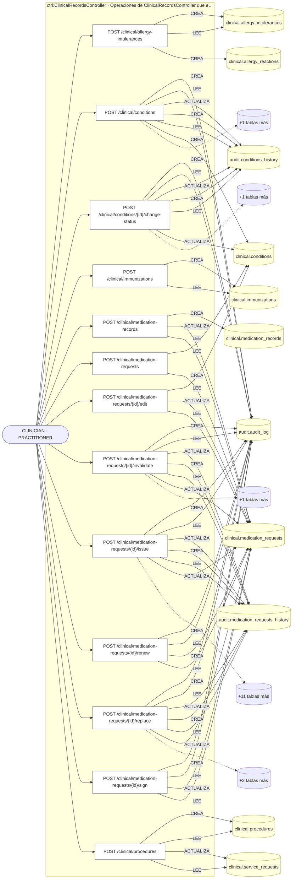

## Máquinas de estado

### Máquina de estados `CLINICAL_STATUS_TRANSITIONS`

Declarada en `src/modules/clinical/services/conditions.service.ts:35`. Los estados llevan el nombre del identificador del código; no se resuelven al catálogo de conceptos.

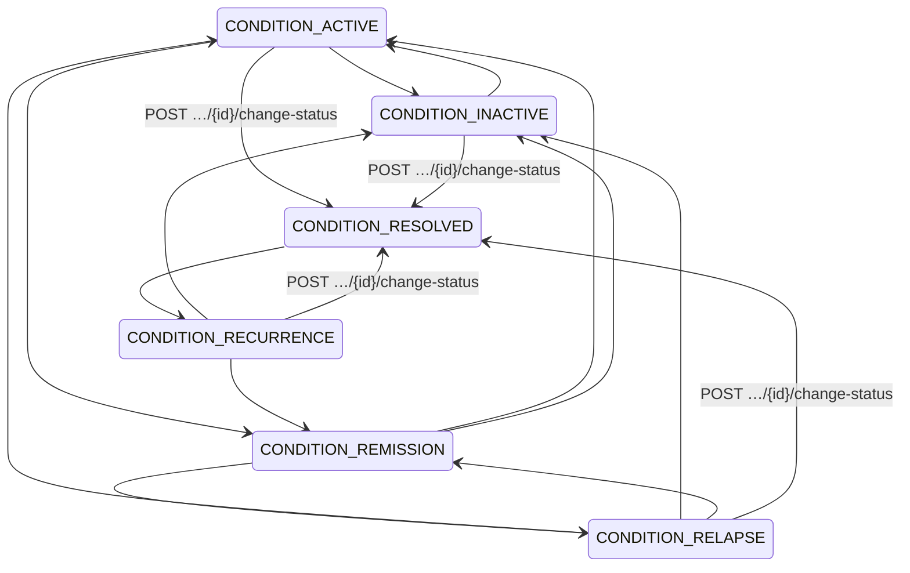

**Operaciones que ejercen esta máquina** _(POR_REFERENCIA: el handler alcanza un método que valida contra la tabla; «sin destino nombrado» significa que el estado de destino llega por el cuerpo de la petición)_:

| Operación | Estados de destino que nombra | A través de |
|---|---|---|
| POST /clinical/conditions/{id}/change-status | CONDITION_RESOLVED | ConditionsService.changeClinicalStatus |

## Árbol de decisión por operación

Cada árbol se deriva del código del handler y de los métodos que invoca (hasta 4 niveles). Una rama que no decide, no escribe y no falla se poda. Los accesos y los efectos consecutivos se agrupan en un solo nodo.

### Operaciones con decisiones propias

#### 1. POST /clinical/allergy-intolerances

Registrar una alergia con reacciones

| HTTP | Código | Cuándo |
|---|---|---|
| 201 | — | Éxito |
| 400 | `VALIDATION_FAILED` | El cuerpo cumple el DTO (sin propiedades extra) |
| 401 | `UNAUTHENTICATED` | Hay una sesión válida (JWT) |
| 403 | `FORBIDDEN` | El rol está permitido; El tenant se resuelve y pertenece al actor |
| 409 | `CONFLICT` | ConflictException: El paciente ya tiene una alergia activa a esa sustancia |
| 429 | `RATE_LIMITED` | No se supera el límite de solicitudes |

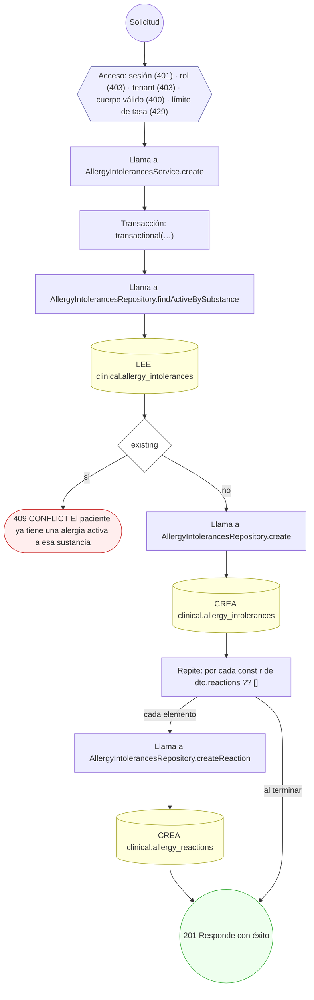

#### 2. POST /clinical/care-episodes

Abrir un episodio de cuidado

| HTTP | Código | Cuándo |
|---|---|---|
| 201 | — | Éxito |
| 400 | `VALIDATION_FAILED` | El cuerpo cumple el DTO (sin propiedades extra) |
| 401 | `UNAUTHENTICATED` | Hay una sesión válida (JWT) |
| 403 | `FORBIDDEN` | El rol está permitido; El tenant se resuelve y pertenece al actor |
| 409 | `CONFLICT` | ConflictException: El paciente ya tiene un episodio activo |
| 429 | `RATE_LIMITED` | No se supera el límite de solicitudes |

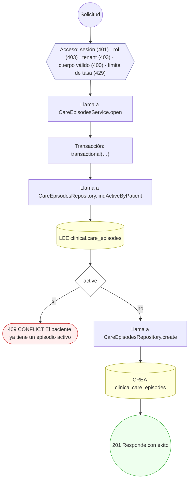

#### 3. POST /clinical/conditions

Registrar una condición/diagnóstico

| HTTP | Código | Cuándo |
|---|---|---|
| 201 | — | Éxito |
| 400 | `VALIDATION_FAILED` | El cuerpo cumple el DTO (sin propiedades extra) |
| 401 | `UNAUTHENTICATED` | Hay una sesión válida (JWT) |
| 403 | `FORBIDDEN` | El rol está permitido; El tenant se resuelve y pertenece al actor |
| 409 | `CONFLICT` | ConflictException: El paciente ya tiene esa condición activa |
| 429 | `RATE_LIMITED` | No se supera el límite de solicitudes |
| 500 | `INTERNAL` | Error: Entidad de historial no registrada: {entity} |

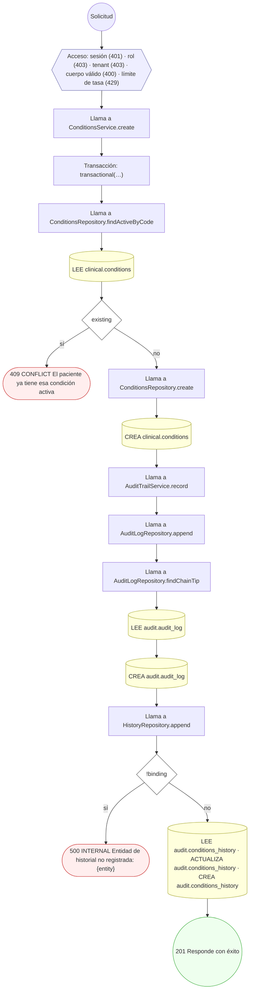

#### 4. POST /clinical/conditions/{id}/change-status

Cambiar el estado clínico de una condición

| HTTP | Código | Cuándo |
|---|---|---|
| 200 | — | Éxito |
| 400 | `VALIDATION_FAILED` | Los parámetros de ruta son UUID válidos; El cuerpo cumple el DTO (sin propiedades extra) |
| 401 | `UNAUTHENTICATED` | Hay una sesión válida (JWT) |
| 403 | `FORBIDDEN` | El rol está permitido; El tenant se resuelve y pertenece al actor |
| 404 | `NOT_FOUND` | ResourceNotFoundException: Condición no encontrada |
| 422 | `PRECONDITION_FAILED` | PreconditionFailedException: Esa transición de estado clínico no es válida desde el estado actual; PreconditionFailedException: Una condición de curso crónico no pasa a resuelta; marcala inactiva o en remisión |
| 429 | `RATE_LIMITED` | No se supera el límite de solicitudes |
| 500 | `INTERNAL` | Error: Entidad de historial no registrada: {entity} |

```mermaid
flowchart TD
  n1(("Solicitud")):::inicio
  n2{{"Acceso: sesión (401) · rol (403) · tenant (403) · parámetros de ruta (400) · cuerpo válido (400) · límite de…"}}:::acceso
  n1 --> n2
  n3["Llama a ConditionsService.changeClinicalStatus"]:::llamada
  n2 --> n3
  n4["Transacción: transactional(…)"]:::transaccion
  n3 --> n4
  n5["Llama a ConditionsService.loadConditionOrThrow"]:::llamada
  n4 --> n5
  n6["Llama a ConditionsRepository.findById"]:::llamada
  n5 --> n6
  n7[("LEE clinical.conditions")]:::efecto
  n6 --> n7
  n8{"!condition"}:::decision
  n7 --> n8
  n9(["404 NOT_FOUND Condición no encontrada"]):::error
  n8 -->|"sí"| n9
  n10{"!allowed || !allowed.includes(dto.newClinicalStatusConceptId)"}:::decision
  n8 -->|"no"| n10
  n11(["422 PRECONDITION_FAILED Esa transición de estado clínico no es válida desde el estado actual"]):::error
  n10 -->|"sí"| n11
  n12{"dto.newClinicalStatusConceptId === CLIN.CONDITION_RESOLVED && condition.clinicalCourseConceptId === CLIN.COND…"}:::decision
  n10 -->|"no"| n12
  n13(["422 PRECONDITION_FAILED Una condición de curso crónico no pasa a resuelta; marcala inactiva o en remisión"]):::error
  n12 -->|"sí"| n13
  n14[("ACTUALIZA clinical.conditions")]:::efecto
  n12 -->|"no"| n14
  n15{"dto.newClinicalStatusConceptId === CLIN.CONDITION_RESOLVED"}:::decision
  n14 --> n15
  n16[("ACTUALIZA clinical.conditions")]:::efecto
  n15 -->|"sí"| n16
  n17{"fromStatus === CLIN.CONDITION_RESOLVED"}:::decision
  n15 -->|"no"| n17
  n18[("ACTUALIZA clinical.conditions")]:::efecto
  n17 -->|"sí"| n18
  n19["Llama a AuditTrailService.record"]:::llamada
  n16 --> n19
  n18 --> n19
  n17 -->|"no"| n19
  n20["Llama a AuditLogRepository.append"]:::llamada
  n19 --> n20
  n21["Llama a AuditLogRepository.findChainTip"]:::llamada
  n20 --> n21
  n22[("LEE audit.audit_log")]:::efecto
  n21 --> n22
  n23[("CREA audit.audit_log")]:::efecto
  n22 --> n23
  n24["Llama a HistoryRepository.append"]:::llamada
  n23 --> n24
  n25{"!binding"}:::decision
  n24 --> n25
  n26(["500 INTERNAL Entidad de historial no registrada: {entity}"]):::error
  n25 -->|"sí"| n26
  n27[("LEE audit.conditions_history · ACTUALIZA audit.conditions_history · CREA audit.conditions_history")]:::efecto
  n25 -->|"no"| n27
  n28(("200 Responde con éxito")):::ok
  n27 --> n28
  classDef acceso fill:#eef,stroke:#66a
  classDef error fill:#fee,stroke:#c33
  classDef ok fill:#efe,stroke:#3a3
  classDef efecto fill:#ffd,stroke:#aa3
  classDef decision fill:#fff,stroke:#555
  classDef corte fill:#eee,stroke:#999,stroke-dasharray: 4
```

#### 5. POST /clinical/diagnostic-reports

Emitir un reporte diagnóstico desde la orden

| HTTP | Código | Cuándo |
|---|---|---|
| 201 | — | Éxito |
| 400 | `VALIDATION_FAILED` | El cuerpo cumple el DTO (sin propiedades extra) |
| 401 | `UNAUTHENTICATED` | Hay una sesión válida (JWT) |
| 403 | `FORBIDDEN` | El rol está permitido; El tenant se resuelve y pertenece al actor |
| 404 | `NOT_FOUND` | ResourceNotFoundException: Orden de servicio no encontrada |
| 429 | `RATE_LIMITED` | No se supera el límite de solicitudes |

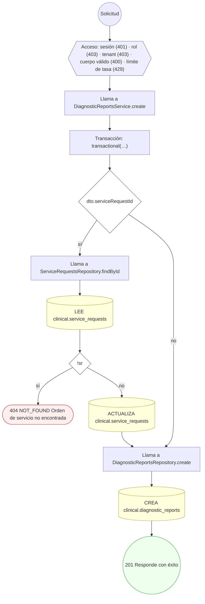

#### 6. POST /clinical/diagnostic-reports/{id}/release

Liberar los resultados de un reporte diagnóstico

| HTTP | Código | Cuándo |
|---|---|---|
| 200 | — | Éxito |
| 400 | `VALIDATION_FAILED` | Los parámetros de ruta son UUID válidos; El cuerpo cumple el DTO (sin propiedades extra) |
| 401 | `UNAUTHENTICATED` | Hay una sesión válida (JWT) |
| 403 | `FORBIDDEN` | El rol está permitido; El tenant se resuelve y pertenece al actor |
| 404 | `NOT_FOUND` | ResourceNotFoundException: Reporte diagnóstico no encontrado |
| 409 | `CONCURRENCY_CONFLICT` | ConcurrencyConflictException: Versión del reporte desactualizada |
| 422 | `PRECONDITION_FAILED` | PreconditionFailedException: El reporte no está en estado liberable |
| 429 | `RATE_LIMITED` | No se supera el límite de solicitudes |

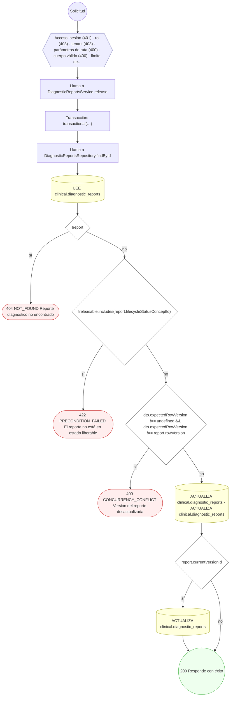

#### 7. POST /clinical/encounters/{id}/close

Cerrar un encuentro en curso (gatilla facturación)

| HTTP | Código | Cuándo |
|---|---|---|
| 200 | — | Éxito |
| 400 | `VALIDATION_FAILED` | Los parámetros de ruta son UUID válidos; El cuerpo cumple el DTO (sin propiedades extra) |
| 401 | `UNAUTHENTICATED` | Hay una sesión válida (JWT) |
| 403 | `FORBIDDEN` | El rol está permitido; El tenant se resuelve y pertenece al actor |
| 404 | `NOT_FOUND` | ResourceNotFoundException: Encuentro no encontrado |
| 409 | `CONCURRENCY_CONFLICT` | ConcurrencyConflictException: Versión del encuentro desactualizada |
| 422 | `PRECONDITION_FAILED` | PreconditionFailedException: El encuentro no está en curso |
| 429 | `RATE_LIMITED` | No se supera el límite de solicitudes |

```mermaid
flowchart TD
  n1(("Solicitud")):::inicio
  n2{{"Acceso: sesión (401) · rol (403) · tenant (403) · parámetros de ruta (400) · cuerpo válido (400) · límite de…"}}:::acceso
  n1 --> n2
  n3["Llama a EncountersService.close"]:::llamada
  n2 --> n3
  n4["Transacción: transactional(…)"]:::transaccion
  n3 --> n4
  n5["Llama a EncountersRepository.findById"]:::llamada
  n4 --> n5
  n6[("LEE clinical.encounters")]:::efecto
  n5 --> n6
  n7{"!encounter"}:::decision
  n6 --> n7
  n8(["404 NOT_FOUND Encuentro no encontrado"]):::error
  n7 -->|"sí"| n8
  n9{"encounter.statusConceptId !== CLIN.ENCOUNTER_IN_PROGRESS"}:::decision
  n7 -->|"no"| n9
  n10(["422 PRECONDITION_FAILED El encuentro no está en curso"]):::error
  n9 -->|"sí"| n10
  n11{"dto.expectedRowVersion !== undefined && dto.expectedRowVersion !== encounter.rowVersion"}:::decision
  n9 -->|"no"| n11
  n12(["409 CONCURRENCY_CONFLICT Versión del encuentro desactualizada"]):::error
  n11 -->|"sí"| n12
  n13[("ACTUALIZA clinical.encounters · ACTUALIZA clinical.encounters")]:::efecto
  n11 -->|"no"| n13
  n14["Llama a EncountersRepository.findActiveParticipants"]:::llamada
  n13 --> n14
  n15[("LEE clinical.encounter_participants")]:::efecto
  n14 --> n15
  n16["Repite: por cada const p de participants"]:::bucle
  n15 --> n16
  n17[("ACTUALIZA clinical.encounter_participants · ACTUALIZA clinical.encounter_participants")]:::efecto
  n16 -->|"cada elemento"| n17
  n18["Llama a EncountersRepository.findActiveLocations"]:::llamada
  n17 --> n18
  n16 -->|"al terminar"| n18
  n19[("LEE clinical.encounter_locations")]:::efecto
  n18 --> n19
  n20["Repite: por cada const l de locations"]:::bucle
  n19 --> n20
  n21[("ACTUALIZA clinical.encounter_locations · ACTUALIZA clinical.encounter_locations")]:::efecto
  n20 -->|"cada elemento"| n21
  n22["Llama a ClinicalNotificationsService.encounterClosed"]:::llamada
  n21 --> n22
  n20 -->|"al terminar"| n22
  n23["Llama a ClinicalNotificationsService.emitToPatient"]:::llamada
  n22 --> n23
  n24["Intenta"]:::intento
  n23 --> n24
  n25["Llama a PersonAccountLinksRepository.findActiveByPerson"]:::llamada
  n24 --> n25
  n26[("LEE profiles.person_account_links")]:::efecto
  n25 --> n26
  n27(("200 Responde con éxito")):::ok
  n26 --> n27
  classDef acceso fill:#eef,stroke:#66a
  classDef error fill:#fee,stroke:#c33
  classDef ok fill:#efe,stroke:#3a3
  classDef efecto fill:#ffd,stroke:#aa3
  classDef decision fill:#fff,stroke:#555
  classDef corte fill:#eee,stroke:#999,stroke-dasharray: 4
```

#### 8. POST /clinical/encounters/check-in

Check-in de un encuentro con participantes y ubicación

| HTTP | Código | Cuándo |
|---|---|---|
| 201 | — | Éxito |
| 400 | `VALIDATION_FAILED` | El cuerpo cumple el DTO (sin propiedades extra) |
| 401 | `UNAUTHENTICATED` | Hay una sesión válida (JWT) |
| 403 | `FORBIDDEN` | El rol está permitido; El tenant se resuelve y pertenece al actor |
| 404 | `NOT_FOUND` | ResourceNotFoundException: Episodio de cuidado no encontrado |
| 429 | `RATE_LIMITED` | No se supera el límite de solicitudes |

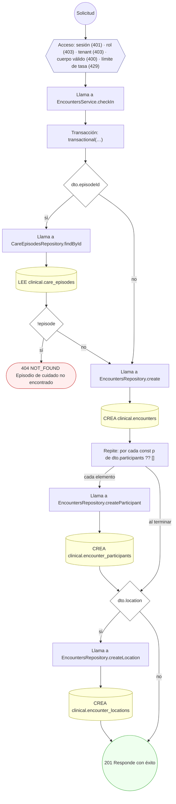

#### 9. POST /clinical/immunizations

Registrar una inmunización

| HTTP | Código | Cuándo |
|---|---|---|
| 201 | — | Éxito |
| 400 | `VALIDATION_FAILED` | El cuerpo cumple el DTO (sin propiedades extra) |
| 401 | `UNAUTHENTICATED` | Hay una sesión válida (JWT) |
| 403 | `FORBIDDEN` | El rol está permitido; El tenant se resuelve y pertenece al actor |
| 409 | `CONFLICT` | ConflictException: Esa dosis de la vacuna ya fue registrada |
| 429 | `RATE_LIMITED` | No se supera el límite de solicitudes |

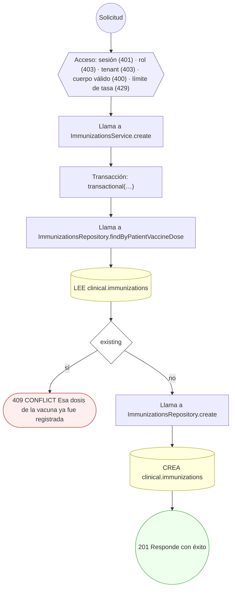

#### 10. POST /clinical/medication-records

Administrar/registrar medicación

| HTTP | Código | Cuándo |
|---|---|---|
| 201 | — | Éxito |
| 400 | `VALIDATION_FAILED` | El cuerpo cumple el DTO (sin propiedades extra) |
| 401 | `UNAUTHENTICATED` | Hay una sesión válida (JWT) |
| 403 | `FORBIDDEN` | El rol está permitido; El tenant se resuelve y pertenece al actor |
| 404 | `NOT_FOUND` | ResourceNotFoundException: Prescripción no encontrada |
| 422 | `PRECONDITION_FAILED` | PreconditionFailedException: La prescripción no está emitida (ISSUED) |
| 429 | `RATE_LIMITED` | No se supera el límite de solicitudes |

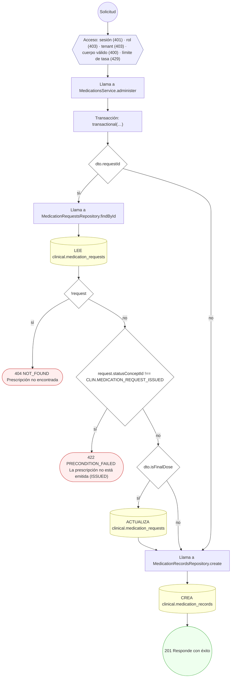

#### 11. POST /clinical/medication-requests

Prescribir medicación

| HTTP | Código | Cuándo |
|---|---|---|
| 201 | — | Éxito |
| 400 | `VALIDATION_FAILED` | El cuerpo cumple el DTO (sin propiedades extra) |
| 401 | `UNAUTHENTICATED` | Hay una sesión válida (JWT) |
| 403 | `FORBIDDEN` | El rol está permitido; El tenant se resuelve y pertenece al actor |
| 422 | `PRECONDITION_FAILED` | PreconditionFailedException: La condición indicada no existe o no pertenece a este paciente |
| 429 | `RATE_LIMITED` | No se supera el límite de solicitudes |

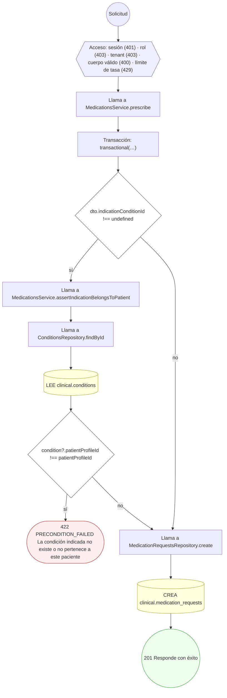

#### 12. POST /clinical/medication-requests/{id}/edit

Editar ítems de una receta en borrador (DRAFT)

| HTTP | Código | Cuándo |
|---|---|---|
| 200 | — | Éxito |
| 400 | `VALIDATION_FAILED` | Los parámetros de ruta son UUID válidos; El cuerpo cumple el DTO (sin propiedades extra) |
| 401 | `UNAUTHENTICATED` | Hay una sesión válida (JWT) |
| 403 | `FORBIDDEN` | El rol está permitido; El tenant se resuelve y pertenece al actor |
| 404 | `NOT_FOUND` | ResourceNotFoundException: Receta no encontrada |
| 422 | `PRECONDITION_FAILED` | PreconditionFailedException: Solo un borrador (DRAFT) admite edición; una receta emitida es inmutable; PreconditionFailedException: La condición indicada no existe o no pertenece a este paciente |
| 429 | `RATE_LIMITED` | No se supera el límite de solicitudes |

```mermaid
flowchart TD
  n1(("Solicitud")):::inicio
  n2{{"Acceso: sesión (401) · rol (403) · tenant (403) · parámetros de ruta (400) · cuerpo válido (400) · límite de…"}}:::acceso
  n1 --> n2
  n3["Llama a MedicationsService.editDraft"]:::llamada
  n2 --> n3
  n4["Transacción: transactional(…)"]:::transaccion
  n3 --> n4
  n5["Llama a MedicationsService.loadRequestOrThrow"]:::llamada
  n4 --> n5
  n6["Llama a MedicationRequestsRepository.findById"]:::llamada
  n5 --> n6
  n7[("LEE clinical.medication_requests")]:::efecto
  n6 --> n7
  n8{"!request"}:::decision
  n7 --> n8
  n9(["404 NOT_FOUND Receta no encontrada"]):::error
  n8 -->|"sí"| n9
  n10{"request.statusConceptId !== CLIN.MEDICATION_REQUEST_DRAFT"}:::decision
  n8 -->|"no"| n10
  n11(["422 PRECONDITION_FAILED Solo un borrador (DRAFT) admite edición; una receta emitida es inmutable"]):::error
  n10 -->|"sí"| n11
  n12[("ACTUALIZA clinical.medication_requests")]:::efecto
  n10 -->|"no"| n12
  n13{"dto.encounterId !== undefined"}:::decision
  n12 --> n13
  n14[("ACTUALIZA clinical.medication_requests")]:::efecto
  n13 -->|"sí"| n14
  n15{"dto.medicationConceptId !== undefined"}:::decision
  n14 --> n15
  n13 -->|"no"| n15
  n16[("ACTUALIZA clinical.medication_requests")]:::efecto
  n15 -->|"sí"| n16
  n17{"dto.substanceAtcConceptId !== undefined"}:::decision
  n16 --> n17
  n15 -->|"no"| n17
  n18[("ACTUALIZA clinical.medication_requests")]:::efecto
  n17 -->|"sí"| n18
  n19{"dto.prescriberProfileId !== undefined"}:::decision
  n18 --> n19
  n17 -->|"no"| n19
  n20[("ACTUALIZA clinical.medication_requests")]:::efecto
  n19 -->|"sí"| n20
  n21[("ACTUALIZA clinical.medication_requests")]:::efecto
  n20 --> n21
  n19 -->|"no"| n21
  n22{"dto.doseText !== undefined"}:::decision
  n21 --> n22
  n23[("ACTUALIZA clinical.medication_requests")]:::efecto
  n22 -->|"sí"| n23
  n24{"dto.routeConceptId !== undefined"}:::decision
  n23 --> n24
  n22 -->|"no"| n24
  n25[("ACTUALIZA clinical.medication_requests")]:::efecto
  n24 -->|"sí"| n25
  n26{"dto.frequencyText !== undefined"}:::decision
  n25 --> n26
  n24 -->|"no"| n26
  n27[("ACTUALIZA clinical.medication_requests")]:::efecto
  n26 -->|"sí"| n27
  n28{"dto.quantityDecimal !== undefined"}:::decision
  n27 --> n28
  n26 -->|"no"| n28
  n29[("ACTUALIZA clinical.medication_requests")]:::efecto
  n28 -->|"sí"| n29
  n30{"dto.unitConceptId !== undefined"}:::decision
  n29 --> n30
  n28 -->|"no"| n30
  n31[("ACTUALIZA clinical.medication_requests")]:::efecto
  n30 -->|"sí"| n31
  n32{"dto.validFrom !== undefined"}:::decision
  n31 --> n32
  n30 -->|"no"| n32
  n33[("ACTUALIZA clinical.medication_requests")]:::efecto
  n32 -->|"sí"| n33
  n34[("ACTUALIZA clinical.medication_requests")]:::efecto
  n33 --> n34
  n32 -->|"no"| n34
  n35{"dto.validTo !== undefined"}:::decision
  n34 --> n35
  n36[("ACTUALIZA clinical.medication_requests")]:::efecto
  n35 -->|"sí"| n36
  n37{"dto.patientInstructionsText !== undefined"}:::decision
  n36 --> n37
  n35 -->|"no"| n37
  n38[("ACTUALIZA clinical.medication_requests")]:::efecto
  n37 -->|"sí"| n38
  n39{"dto.indicationConditionId !== undefined"}:::decision
  n38 --> n39
  n37 -->|"no"| n39
  n40["Llama a MedicationsService.assertIndicationBelongsToPatient"]:::llamada
  n39 -->|"sí"| n40
  n41["Llama a ConditionsRepository.findById"]:::llamada
  n40 --> n41
  n42[("LEE clinical.conditions")]:::efecto
  n41 --> n42
  n43{"condition?.patientProfileId !== patientProfileId"}:::decision
  n42 --> n43
  n44(["422 PRECONDITION_FAILED La condición indicada no existe o no pertenece a este paciente"]):::error
  n43 -->|"sí"| n44
  n45[("ACTUALIZA clinical.medication_requests")]:::efecto
  n43 -->|"no"| n45
  n46(("200 Responde con éxito")):::ok
  n45 --> n46
  n39 -->|"no"| n46
  classDef acceso fill:#eef,stroke:#66a
  classDef error fill:#fee,stroke:#c33
  classDef ok fill:#efe,stroke:#3a3
  classDef efecto fill:#ffd,stroke:#aa3
  classDef decision fill:#fff,stroke:#555
  classDef corte fill:#eee,stroke:#999,stroke-dasharray: 4
```

#### 13. POST /clinical/medication-requests/{id}/invalidate

Invalidar una receta emitida

| HTTP | Código | Cuándo |
|---|---|---|
| 200 | — | Éxito |
| 400 | `VALIDATION_FAILED` | Los parámetros de ruta son UUID válidos; El cuerpo cumple el DTO (sin propiedades extra) |
| 401 | `UNAUTHENTICATED` | Hay una sesión válida (JWT) |
| 403 | `FORBIDDEN` | El rol está permitido; El tenant se resuelve y pertenece al actor |
| 404 | `NOT_FOUND` | ResourceNotFoundException: Receta no encontrada |
| 422 | `PRECONDITION_FAILED` | PreconditionFailedException: Solo una receta emitida (ISSUED) puede invalidarse |
| 429 | `RATE_LIMITED` | No se supera el límite de solicitudes |
| 500 | `INTERNAL` | Error: Entidad de historial no registrada: {entity} |

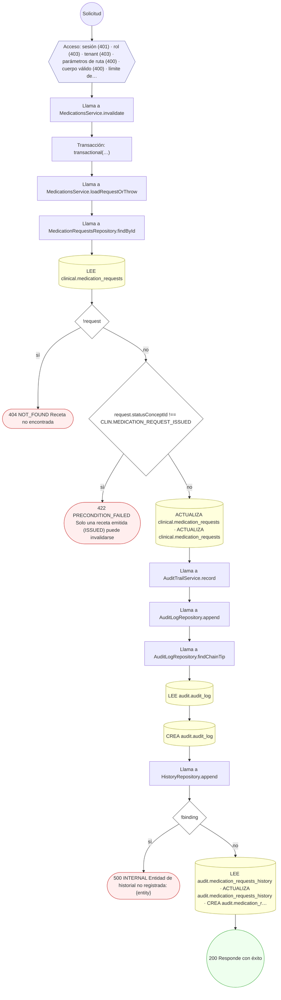

#### 14. POST /clinical/medication-requests/{id}/issue

Emitir una receta (la vuelve inmutable)

| HTTP | Código | Cuándo |
|---|---|---|
| 200 | — | Éxito |
| 400 | `VALIDATION_FAILED` | Los parámetros de ruta son UUID válidos |
| 401 | `UNAUTHENTICATED` | Hay una sesión válida (JWT) |
| 403 | `FORBIDDEN` | El rol está permitido; El tenant se resuelve y pertenece al actor |
| 404 | `NOT_FOUND` | ResourceNotFoundException: Receta no encontrada |
| 409 | `CONFLICT` | ConflictException: La clave de idempotencia ya fue usada para emitir otra receta |
| 422 | `PRECONDITION_FAILED` | PreconditionFailedException: Solo un borrador (DRAFT) puede emitirse; PreconditionFailedException: La política vigente exige firmar la receta antes de emitirla |
| 429 | `RATE_LIMITED` | No se supera el límite de solicitudes |
| 500 | `INTERNAL` | Error: Entidad de historial no registrada: {entity} |

```mermaid
flowchart TD
  n1(("Solicitud")):::inicio
  n2{{"Acceso: sesión (401) · rol (403) · tenant (403) · parámetros de ruta (400) · límite de tasa (429)"}}:::acceso
  n1 --> n2
  n3["Llama a MedicationsService.issue"]:::llamada
  n2 --> n3
  n4["Transacción: transactional(…)"]:::transaccion
  n3 --> n4
  n5["Llama a MedicationsService.loadRequestOrThrow"]:::llamada
  n4 --> n5
  n6["Llama a MedicationRequestsRepository.findById"]:::llamada
  n5 --> n6
  n7[("LEE clinical.medication_requests")]:::efecto
  n6 --> n7
  n8{"!request"}:::decision
  n7 --> n8
  n9(["404 NOT_FOUND Receta no encontrada"]):::error
  n8 -->|"sí"| n9
  n10{"request.statusConceptId !== CLIN.MEDICATION_REQUEST_DRAFT"}:::decision
  n8 -->|"no"| n10
  n11(["422 PRECONDITION_FAILED Solo un borrador (DRAFT) puede emitirse"]):::error
  n10 -->|"sí"| n11
  n12{"idempotencyKey"}:::decision
  n10 -->|"no"| n12
  n13["Llama a MedicationRequestsRepository.findByIssueIdempotencyKey"]:::llamada
  n12 -->|"sí"| n13
  n14[("LEE clinical.medication_requests")]:::efecto
  n13 --> n14
  n15{"existing && existing.id !== request.id"}:::decision
  n14 --> n15
  n16(["409 CONFLICT La clave de idempotencia ya fue usada para emitir otra receta"]):::error
  n15 -->|"sí"| n16
  n17{"!request.signedAt"}:::decision
  n15 -->|"no"| n17
  n12 -->|"no"| n17
  n18["Llama a PrescriptionSignaturePoliciesService.isSignatureRequired"]:::llamada
  n17 -->|"sí"| n18
  n19["Llama a PrescriptionSignaturePoliciesRepository.findActive"]:::llamada
  n18 --> n19
  n20[("LEE clinical.prescription_signature_policies")]:::efecto
  n19 --> n20
  n21{"signatureRequired"}:::decision
  n20 --> n21
  n22(["422 PRECONDITION_FAILED La política vigente exige firmar la receta antes de emitirla"]):::error
  n21 -->|"sí"| n22
  n23[("ACTUALIZA clinical.medication_requests · ACTUALIZA clinical.medication_requests · ACTUALIZA clinical.medicati…")]:::efecto
  n21 -->|"no"| n23
  n17 -->|"no"| n23
  n24{"idempotencyKey"}:::decision
  n23 --> n24
  n25[("ACTUALIZA clinical.medication_requests")]:::efecto
  n24 -->|"sí"| n25
  n26["Llama a AuditTrailService.record"]:::llamada
  n25 --> n26
  n24 -->|"no"| n26
  n27["Llama a AuditLogRepository.append"]:::llamada
  n26 --> n27
  n28["Llama a AuditLogRepository.findChainTip"]:::llamada
  n27 --> n28
  n29[("LEE audit.audit_log")]:::efecto
  n28 --> n29
  n30[("CREA audit.audit_log")]:::efecto
  n29 --> n30
  n31["Llama a HistoryRepository.append"]:::llamada
  n30 --> n31
  n32{"!binding"}:::decision
  n31 --> n32
  n33(["500 INTERNAL Entidad de historial no registrada: {entity}"]):::error
  n32 -->|"sí"| n33
  n34[("LEE audit.medication_requests_history · ACTUALIZA audit.medication_requests_history · CREA audit.medication_r…")]:::efecto
  n32 -->|"no"| n34
  n35["Llama a ClinicalNotificationsService.prescriptionIssued"]:::llamada
  n34 --> n35
  n36["Llama a ClinicalNotificationsService.emitToPatient"]:::llamada
  n35 --> n36
  n37["Intenta"]:::intento
  n36 --> n37
  n38["Llama a PersonAccountLinksRepository.findActiveByPerson"]:::llamada
  n37 --> n38
  n39[("LEE profiles.person_account_links")]:::efecto
  n38 --> n39
  n40(("200 Responde con éxito")):::ok
  n39 --> n40
  classDef acceso fill:#eef,stroke:#66a
  classDef error fill:#fee,stroke:#c33
  classDef ok fill:#efe,stroke:#3a3
  classDef efecto fill:#ffd,stroke:#aa3
  classDef decision fill:#fff,stroke:#555
  classDef corte fill:#eee,stroke:#999,stroke-dasharray: 4
```

#### 15. POST /clinical/medication-requests/{id}/renew

Renovar una receta (crea una nueva copiando datos)

| HTTP | Código | Cuándo |
|---|---|---|
| 201 | — | Éxito |
| 400 | `VALIDATION_FAILED` | Los parámetros de ruta son UUID válidos; El cuerpo cumple el DTO (sin propiedades extra) |
| 401 | `UNAUTHENTICATED` | Hay una sesión válida (JWT) |
| 403 | `FORBIDDEN` | El rol está permitido; El tenant se resuelve y pertenece al actor |
| 404 | `NOT_FOUND` | ResourceNotFoundException: Receta no encontrada |
| 422 | `PRECONDITION_FAILED` | PreconditionFailedException: Solo una receta emitida o completada puede renovarse |
| 429 | `RATE_LIMITED` | No se supera el límite de solicitudes |

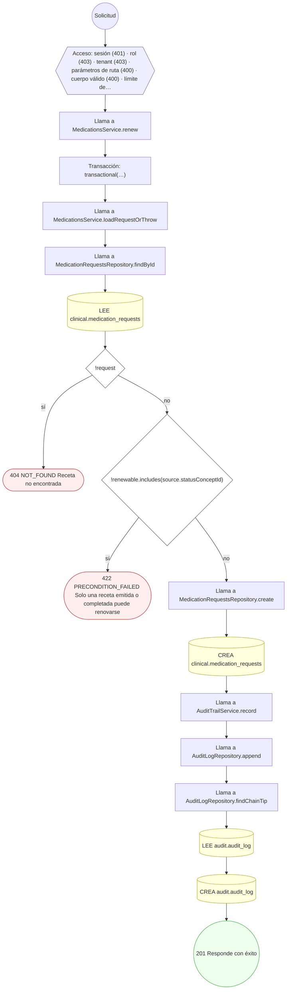

#### 16. POST /clinical/medication-requests/{id}/replace

Reemplazar una receta emitida (crea la corrección)

| HTTP | Código | Cuándo |
|---|---|---|
| 201 | — | Éxito |
| 400 | `VALIDATION_FAILED` | Los parámetros de ruta son UUID válidos; El cuerpo cumple el DTO (sin propiedades extra) |
| 401 | `UNAUTHENTICATED` | Hay una sesión válida (JWT) |
| 403 | `FORBIDDEN` | El rol está permitido; El tenant se resuelve y pertenece al actor |
| 404 | `NOT_FOUND` | ResourceNotFoundException: Receta no encontrada |
| 422 | `PRECONDITION_FAILED` | PreconditionFailedException: Solo una receta emitida (ISSUED) puede reemplazarse |
| 429 | `RATE_LIMITED` | No se supera el límite de solicitudes |
| 500 | `INTERNAL` | Error: Entidad de historial no registrada: {entity} |

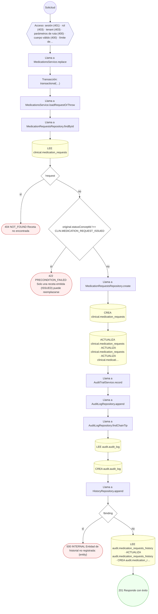

#### 17. POST /clinical/medication-requests/{id}/sign

Firmar una receta en borrador (DRAFT)

| HTTP | Código | Cuándo |
|---|---|---|
| 200 | — | Éxito |
| 400 | `VALIDATION_FAILED` | Los parámetros de ruta son UUID válidos |
| 401 | `UNAUTHENTICATED` | Hay una sesión válida (JWT) |
| 403 | `FORBIDDEN` | El rol está permitido; El tenant se resuelve y pertenece al actor |
| 404 | `NOT_FOUND` | ResourceNotFoundException: Receta no encontrada |
| 422 | `PRECONDITION_FAILED` | PreconditionFailedException: Solo un borrador (DRAFT) puede firmarse antes de emitirse |
| 429 | `RATE_LIMITED` | No se supera el límite de solicitudes |

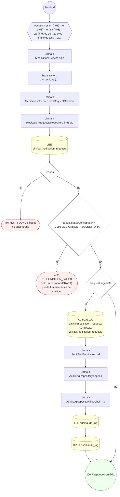

#### 18. POST /clinical/observations

Registrar una observación con componentes y ejecutantes

| HTTP | Código | Cuándo |
|---|---|---|
| 201 | — | Éxito |
| 400 | `VALIDATION_FAILED` | El cuerpo cumple el DTO (sin propiedades extra) |
| 401 | `UNAUTHENTICATED` | Hay una sesión válida (JWT) |
| 403 | `FORBIDDEN` | El rol está permitido; El tenant se resuelve y pertenece al actor |
| 404 | `NOT_FOUND` | ResourceNotFoundException: Encuentro no encontrado; ResourceNotFoundException: Orden de servicio no encontrada |
| 422 | `PRECONDITION_FAILED` | PreconditionFailedException: La observación requiere un valor (cantidad, decimal, texto, booleano o concepto) |
| 429 | `RATE_LIMITED` | No se supera el límite de solicitudes |

```mermaid
flowchart TD
  n1(("Solicitud")):::inicio
  n2{{"Acceso: sesión (401) · rol (403) · tenant (403) · cuerpo válido (400) · límite de tasa (429)"}}:::acceso
  n1 --> n2
  n3["Llama a ObservationsService.record"]:::llamada
  n2 --> n3
  n4["Transacción: transactional(…)"]:::transaccion
  n3 --> n4
  n5{"dto.encounterId"}:::decision
  n4 --> n5
  n6["Llama a EncountersRepository.findById"]:::llamada
  n5 -->|"sí"| n6
  n7[("LEE clinical.encounters")]:::efecto
  n6 --> n7
  n8{"!encounter"}:::decision
  n7 --> n8
  n9(["404 NOT_FOUND Encuentro no encontrado"]):::error
  n8 -->|"sí"| n9
  n10{"dto.basedOnServiceRequestId"}:::decision
  n8 -->|"no"| n10
  n5 -->|"no"| n10
  n11["Llama a ServiceRequestsRepository.findById"]:::llamada
  n10 -->|"sí"| n11
  n12[("LEE clinical.service_requests")]:::efecto
  n11 --> n12
  n13{"!sr"}:::decision
  n12 --> n13
  n14(["404 NOT_FOUND Orden de servicio no encontrada"]):::error
  n13 -->|"sí"| n14
  n15{"!value.valueTypeConceptId"}:::decision
  n13 -->|"no"| n15
  n10 -->|"no"| n15
  n16(["422 PRECONDITION_FAILED La observación requiere un valor (cantidad, decimal, texto, booleano o concepto)"]):::error
  n15 -->|"sí"| n16
  n17["Llama a ObservationsRepository.create"]:::llamada
  n15 -->|"no"| n17
  n18[("CREA clinical.observations")]:::efecto
  n17 --> n18
  n19["Repite: por cada const c de dto.components ?? []"]:::bucle
  n18 --> n19
  n20["Llama a ObservationsRepository.createComponent"]:::llamada
  n19 -->|"cada elemento"| n20
  n21[("CREA clinical.observation_components")]:::efecto
  n20 --> n21
  n22["Repite: por cada const p de dto.performers ?? []"]:::bucle
  n21 --> n22
  n19 -->|"al terminar"| n22
  n23["Llama a ObservationsRepository.createPerformer"]:::llamada
  n22 -->|"cada elemento"| n23
  n24[("CREA clinical.observation_performers")]:::efecto
  n23 --> n24
  n25["Repite: por cada const r de dto.referenceRanges ?? []"]:::bucle
  n24 --> n25
  n22 -->|"al terminar"| n25
  n26["Llama a ObservationsRepository.createReferenceRange"]:::llamada
  n25 -->|"cada elemento"| n26
  n27[("CREA clinical.observation_reference_ranges")]:::efecto
  n26 --> n27
  n28["Repite: por cada const note de dto.notes ?? []"]:::bucle
  n27 --> n28
  n25 -->|"al terminar"| n28
  n29["Llama a ObservationsRepository.createNote"]:::llamada
  n28 -->|"cada elemento"| n29
  n30[("CREA clinical.observation_notes")]:::efecto
  n29 --> n30
  n31(("201 Responde con éxito")):::ok
  n30 --> n31
  n28 -->|"al terminar"| n31
  classDef acceso fill:#eef,stroke:#66a
  classDef error fill:#fee,stroke:#c33
  classDef ok fill:#efe,stroke:#3a3
  classDef efecto fill:#ffd,stroke:#aa3
  classDef decision fill:#fff,stroke:#555
  classDef corte fill:#eee,stroke:#999,stroke-dasharray: 4
```

#### 19. PATCH /clinical/observations/{id}/amend

Corregir/enmendar una observación (value contract)

| HTTP | Código | Cuándo |
|---|---|---|
| 200 | — | Éxito |
| 400 | `VALIDATION_FAILED` | Los parámetros de ruta son UUID válidos; El cuerpo cumple el DTO (sin propiedades extra) |
| 401 | `UNAUTHENTICATED` | Hay una sesión válida (JWT) |
| 403 | `FORBIDDEN` | El rol está permitido; El tenant se resuelve y pertenece al actor |
| 404 | `NOT_FOUND` | ResourceNotFoundException: Observación no encontrada |
| 409 | `CONCURRENCY_CONFLICT` | ConcurrencyConflictException: Versión de la observación desactualizada |
| 422 | `PRECONDITION_FAILED` | PreconditionFailedException: La observación no admite enmienda en su estado |
| 429 | `RATE_LIMITED` | No se supera el límite de solicitudes |

```mermaid
flowchart TD
  n1(("Solicitud")):::inicio
  n2{{"Acceso: sesión (401) · rol (403) · tenant (403) · parámetros de ruta (400) · cuerpo válido (400) · límite de…"}}:::acceso
  n1 --> n2
  n3["Llama a ObservationsService.amend"]:::llamada
  n2 --> n3
  n4["Transacción: transactional(…)"]:::transaccion
  n3 --> n4
  n5["Llama a ObservationsRepository.findById"]:::llamada
  n4 --> n5
  n6[("LEE clinical.observations")]:::efecto
  n5 --> n6
  n7{"!observation"}:::decision
  n6 --> n7
  n8(["404 NOT_FOUND Observación no encontrada"]):::error
  n7 -->|"sí"| n8
  n9{"!amendable.includes(observation.statusConceptId)"}:::decision
  n7 -->|"no"| n9
  n10(["422 PRECONDITION_FAILED La observación no admite enmienda en su estado"]):::error
  n9 -->|"sí"| n10
  n11{"dto.expectedRowVersion !== undefined && dto.expectedRowVersion !== observation.rowVersion"}:::decision
  n9 -->|"no"| n11
  n12(["409 CONCURRENCY_CONFLICT Versión de la observación desactualizada"]):::error
  n11 -->|"sí"| n12
  n13{"value.valueTypeConceptId"}:::decision
  n11 -->|"no"| n13
  n14[("ACTUALIZA clinical.observations · ACTUALIZA clinical.observations · ACTUALIZA clinical.observations · ACTUALI…")]:::efecto
  n13 -->|"sí"| n14
  n15{"dto.interpretationConceptId"}:::decision
  n14 --> n15
  n13 -->|"no"| n15
  n16[("ACTUALIZA clinical.observations")]:::efecto
  n15 -->|"sí"| n16
  n17[("ACTUALIZA clinical.observations")]:::efecto
  n16 --> n17
  n15 -->|"no"| n17
  n18["Llama a ObservationsRepository.createNote"]:::llamada
  n17 --> n18
  n19[("CREA clinical.observation_notes")]:::efecto
  n18 --> n19
  n20["Llama a ObservationsRepository.findComponents"]:::llamada
  n19 --> n20
  n21[("LEE clinical.observation_components")]:::efecto
  n20 --> n21
  n22(("200 Responde con éxito")):::ok
  n21 --> n22
  classDef acceso fill:#eef,stroke:#66a
  classDef error fill:#fee,stroke:#c33
  classDef ok fill:#efe,stroke:#3a3
  classDef efecto fill:#ffd,stroke:#aa3
  classDef decision fill:#fff,stroke:#555
  classDef corte fill:#eee,stroke:#999,stroke-dasharray: 4
```

#### 20. GET /clinical/patients/{patientProfileId}/prescriptions


| HTTP | Código | Cuándo |
|---|---|---|
| 200 | — | Éxito |
| 400 | `VALIDATION_FAILED` | Los parámetros de ruta son UUID válidos |
| 401 | `UNAUTHENTICATED` | Hay una sesión válida (JWT) |
| 403 | `FORBIDDEN` | El rol está permitido; El tenant se resuelve y pertenece al actor; ForbiddenException: Sólo podés consultar tu propia historia clínica. |
| 429 | `RATE_LIMITED` | No se supera el límite de solicitudes |

```mermaid
flowchart TD
  n1(("Solicitud")):::inicio
  n2{{"Acceso: sesión (401) · rol (403) · tenant (403) · parámetros de ruta (400) · límite de tasa (429)"}}:::acceso
  n1 --> n2
  n3["Llama a ClinicalReadService.assertPuedeLeerHistoria"]:::llamada
  n2 --> n3
  n4{"!actor.roles.some((rol) =› ROLES_QUE_ATIENDEN.includes(rol))"}:::decision
  n3 --> n4
  n5["Llama a ClinicalReadService.assertOwnRecord"]:::llamada
  n4 -->|"sí"| n5
  n6["Llama a PersonAccountLinksRepository.findActiveByUser"]:::llamada
  n5 --> n6
  n7[("LEE profiles.person_account_links")]:::efecto
  n6 --> n7
  n8["Llama a PatientProfilesRepository.findById"]:::llamada
  n7 --> n8
  n9[("LEE profiles.patient_profiles")]:::efecto
  n8 --> n9
  n10[("LEE profiles.patient_portal_proxies · LEE terminology.value_sets")]:::efecto
  n9 --> n10
  n11{"!proxy || !scope"}:::decision
  n10 --> n11
  n12(["403 FORBIDDEN Sólo podés consultar tu propia historia clínica."]):::error
  n11 -->|"sí"| n12
  n13["Llama a PersonAccountLinksRepository.findActiveByUser"]:::llamada
  n11 -->|"no"| n13
  n4 -->|"no"| n13
  n14[("LEE profiles.person_account_links")]:::efecto
  n13 --> n14
  n15["Llama a HealthPractitionerProfilesRepository.findById"]:::llamada
  n14 --> n15
  n16[("LEE profiles.health_practitioner_profiles")]:::efecto
  n15 --> n16
  n17["Llama a ClinicalReadService.estaAtendiendo"]:::llamada
  n16 --> n17
  n18["Llama a SchedulingBookingsRepository.tieneConsultaEnCurso"]:::llamada
  n17 --> n18
  n19[("LEE scheduling.appointment_bookings · LEE scheduling.schedulable_resources")]:::efecto
  n18 --> n19
  n20["Llama a ClinicalReadService.atiendeHoy"]:::llamada
  n19 --> n20
  n21["Llama a SchedulingBookingsRepository.findConfirmadasConPacienteEntre"]:::llamada
  n20 --> n21
  n22[("LEE scheduling.appointment_bookings · LEE scheduling.bookable_slots · LEE scheduling.schedulable_resources")]:::efecto
  n21 --> n22
  n23["Llama a ClinicalReadService.assertOwnRecord"]:::llamada
  n22 --> n23
  n24["Llama a PersonAccountLinksRepository.findActiveByUser"]:::llamada
  n23 --> n24
  n25[("LEE profiles.person_account_links")]:::efecto
  n24 --> n25
  n26["Llama a PatientProfilesRepository.findById"]:::llamada
  n25 --> n26
  n27[("LEE profiles.patient_profiles")]:::efecto
  n26 --> n27
  n28[("LEE profiles.patient_portal_proxies · LEE terminology.value_sets")]:::efecto
  n27 --> n28
  n29{"!proxy || !scope"}:::decision
  n28 --> n29
  n30(["403 FORBIDDEN Sólo podés consultar tu propia historia clínica."]):::error
  n29 -->|"sí"| n30
  n31["Llama a PrescriptionDocumentsService.list"]:::llamada
  n29 -->|"no"| n31
  n32[("LEE clinical.medication_requests")]:::efecto
  n31 --> n32
  n33(("200 Responde con éxito")):::ok
  n32 --> n33
  classDef acceso fill:#eef,stroke:#66a
  classDef error fill:#fee,stroke:#c33
  classDef ok fill:#efe,stroke:#3a3
  classDef efecto fill:#ffd,stroke:#aa3
  classDef decision fill:#fff,stroke:#555
  classDef corte fill:#eee,stroke:#999,stroke-dasharray: 4
```

#### 21. GET /clinical/patients/{patientProfileId}/prescriptions/history.pdf


| HTTP | Código | Cuándo |
|---|---|---|
| 200 | — | Éxito |
| 400 | `VALIDATION_FAILED` | Los parámetros de ruta son UUID válidos |
| 401 | `UNAUTHENTICATED` | Hay una sesión válida (JWT) |
| 403 | `FORBIDDEN` | El rol está permitido; El tenant se resuelve y pertenece al actor; ForbiddenException: Sólo podés consultar tu propia historia clínica. |
| 413 | `PAYLOAD_TOO_LARGE` | PayloadTooLargeException: El historial supera el máximo operativo de {MAX_HISTORY_PRESCRIPTIONS} recetas. |
| 429 | `RATE_LIMITED` | No se supera el límite de solicitudes |

```mermaid
flowchart TD
  n1(("Solicitud")):::inicio
  n2{{"Acceso: sesión (401) · rol (403) · tenant (403) · parámetros de ruta (400) · límite de tasa (429)"}}:::acceso
  n1 --> n2
  n3["Llama a ClinicalReadService.assertOwnRecord"]:::llamada
  n2 --> n3
  n4["Llama a PersonAccountLinksRepository.findActiveByUser"]:::llamada
  n3 --> n4
  n5[("LEE profiles.person_account_links")]:::efecto
  n4 --> n5
  n6["Llama a PatientProfilesRepository.findById"]:::llamada
  n5 --> n6
  n7[("LEE profiles.patient_profiles")]:::efecto
  n6 --> n7
  n8[("LEE profiles.patient_portal_proxies · LEE terminology.value_sets")]:::efecto
  n7 --> n8
  n9{"!proxy || !scope"}:::decision
  n8 --> n9
  n10(["403 FORBIDDEN Sólo podés consultar tu propia historia clínica."]):::error
  n9 -->|"sí"| n10
  n11["Llama a PrescriptionDocumentsService.all"]:::llamada
  n9 -->|"no"| n11
  n12["Repite: ciclo for"]:::bucle
  n11 --> n12
  n13[("LEE clinical.medication_requests")]:::efecto
  n12 -->|"cada elemento"| n13
  n14{"rows.length › MAX_HISTORY_PRESCRIPTIONS"}:::decision
  n13 --> n14
  n15(["413 PAYLOAD_TOO_LARGE El historial supera el máximo operativo de {MAX_HISTORY_PRESCRIPTIONS} recetas."]):::error
  n14 -->|"sí"| n15
  n16["Llama a PrescriptionDocumentsService.pdf"]:::llamada
  n14 -->|"no"| n16
  n12 -->|"al terminar"| n16
  n17[("LEE profiles.health_practitioner_profiles")]:::efecto
  n16 --> n17
  n18(("200 Responde con éxito")):::ok
  n17 --> n18
  classDef acceso fill:#eef,stroke:#66a
  classDef error fill:#fee,stroke:#c33
  classDef ok fill:#efe,stroke:#3a3
  classDef efecto fill:#ffd,stroke:#aa3
  classDef decision fill:#fff,stroke:#555
  classDef corte fill:#eee,stroke:#999,stroke-dasharray: 4
```

#### 22. GET /clinical/patients/{patientProfileId}/summary

UC-39-20: historial clínico del paciente (condiciones, alergias, medicación, observaciones, encuentros)

| HTTP | Código | Cuándo |
|---|---|---|
| 200 | — | Éxito |
| 400 | `VALIDATION_FAILED` | Los parámetros de ruta son UUID válidos |
| 401 | `UNAUTHENTICATED` | Hay una sesión válida (JWT) |
| 403 | `FORBIDDEN` | El rol está permitido; El tenant se resuelve y pertenece al actor; ForbiddenException: Sólo podés consultar tu propia historia clínica. |
| 429 | `RATE_LIMITED` | No se supera el límite de solicitudes |

```mermaid
flowchart TD
  n1(("Solicitud")):::inicio
  n2{{"Acceso: sesión (401) · rol (403) · tenant (403) · parámetros de ruta (400) · límite de tasa (429)"}}:::acceso
  n1 --> n2
  n3["Llama a ClinicalReadService.assertPuedeLeerHistoria"]:::llamada
  n2 --> n3
  n4{"!actor.roles.some((rol) =› ROLES_QUE_ATIENDEN.includes(rol))"}:::decision
  n3 --> n4
  n5["Llama a ClinicalReadService.assertOwnRecord"]:::llamada
  n4 -->|"sí"| n5
  n6["Llama a PersonAccountLinksRepository.findActiveByUser"]:::llamada
  n5 --> n6
  n7[("LEE profiles.person_account_links")]:::efecto
  n6 --> n7
  n8["Llama a PatientProfilesRepository.findById"]:::llamada
  n7 --> n8
  n9[("LEE profiles.patient_profiles")]:::efecto
  n8 --> n9
  n10[("LEE profiles.patient_portal_proxies · LEE terminology.value_sets")]:::efecto
  n9 --> n10
  n11{"!proxy || !scope"}:::decision
  n10 --> n11
  n12(["403 FORBIDDEN Sólo podés consultar tu propia historia clínica."]):::error
  n11 -->|"sí"| n12
  n13["Llama a PersonAccountLinksRepository.findActiveByUser"]:::llamada
  n11 -->|"no"| n13
  n4 -->|"no"| n13
  n14[("LEE profiles.person_account_links")]:::efecto
  n13 --> n14
  n15["Llama a HealthPractitionerProfilesRepository.findById"]:::llamada
  n14 --> n15
  n16[("LEE profiles.health_practitioner_profiles")]:::efecto
  n15 --> n16
  n17["Llama a ClinicalReadService.estaAtendiendo"]:::llamada
  n16 --> n17
  n18["Llama a SchedulingBookingsRepository.tieneConsultaEnCurso"]:::llamada
  n17 --> n18
  n19[("LEE scheduling.appointment_bookings · LEE scheduling.schedulable_resources")]:::efecto
  n18 --> n19
  n20["Llama a ClinicalReadService.atiendeHoy"]:::llamada
  n19 --> n20
  n21["Llama a SchedulingBookingsRepository.findConfirmadasConPacienteEntre"]:::llamada
  n20 --> n21
  n22[("LEE scheduling.appointment_bookings · LEE scheduling.bookable_slots · LEE scheduling.schedulable_resources")]:::efecto
  n21 --> n22
  n23["Llama a ClinicalReadService.assertOwnRecord"]:::llamada
  n22 --> n23
  n24["Llama a PersonAccountLinksRepository.findActiveByUser"]:::llamada
  n23 --> n24
  n25[("LEE profiles.person_account_links")]:::efecto
  n24 --> n25
  n26["Llama a PatientProfilesRepository.findById"]:::llamada
  n25 --> n26
  n27[("LEE profiles.patient_profiles")]:::efecto
  n26 --> n27
  n28[("LEE profiles.patient_portal_proxies · LEE terminology.value_sets")]:::efecto
  n27 --> n28
  n29{"!proxy || !scope"}:::decision
  n28 --> n29
  n30(["403 FORBIDDEN Sólo podés consultar tu propia historia clínica."]):::error
  n29 -->|"sí"| n30
  n31["Llama a ClinicalReadService.getPatientSummary"]:::llamada
  n29 -->|"no"| n31
  n32["Llama a ConditionsRepository.findByPatient"]:::llamada
  n31 --> n32
  n33[("LEE clinical.conditions")]:::efecto
  n32 --> n33
  n34["Llama a AllergyIntolerancesRepository.findByPatient"]:::llamada
  n33 --> n34
  n35[("LEE clinical.allergy_intolerances")]:::efecto
  n34 --> n35
  n36["Llama a MedicationRequestsRepository.findByPatient"]:::llamada
  n35 --> n36
  n37[("LEE clinical.medication_requests")]:::efecto
  n36 --> n37
  n38["Llama a ObservationsRepository.findByPatient"]:::llamada
  n37 --> n38
  n39[("LEE clinical.observations")]:::efecto
  n38 --> n39
  n40["Llama a EncountersRepository.findByPatient"]:::llamada
  n39 --> n40
  n41[("LEE clinical.encounters")]:::efecto
  n40 --> n41
  n42["Llama a CareEpisodesRepository.findByPatient"]:::llamada
  n41 --> n42
  n43[("LEE clinical.care_episodes")]:::efecto
  n42 --> n43
  n44(("200 Responde con éxito")):::ok
  n43 --> n44
  classDef acceso fill:#eef,stroke:#66a
  classDef error fill:#fee,stroke:#c33
  classDef ok fill:#efe,stroke:#3a3
  classDef efecto fill:#ffd,stroke:#aa3
  classDef decision fill:#fff,stroke:#555
  classDef corte fill:#eee,stroke:#999,stroke-dasharray: 4
```

#### 23. POST /clinical/prescription-signature-policies/{id}/deactivate

Desactivar una política (cierra vigencia, sin borrado duro)

| HTTP | Código | Cuándo |
|---|---|---|
| 200 | — | Éxito |
| 400 | `VALIDATION_FAILED` | Los parámetros de ruta son UUID válidos |
| 401 | `UNAUTHENTICATED` | Hay una sesión válida (JWT) |
| 403 | `FORBIDDEN` | El rol está permitido; El tenant se resuelve y pertenece al actor |
| 404 | `NOT_FOUND` | ResourceNotFoundException: Política no encontrada |
| 429 | `RATE_LIMITED` | No se supera el límite de solicitudes |

```mermaid
flowchart TD
  n1(("Solicitud")):::inicio
  n2{{"Acceso: sesión (401) · rol (403) · tenant (403) · parámetros de ruta (400) · límite de tasa (429)"}}:::acceso
  n1 --> n2
  n3["Llama a PrescriptionSignaturePoliciesService.deactivate"]:::llamada
  n2 --> n3
  n4["Transacción: transactional(…)"]:::transaccion
  n3 --> n4
  n5["Llama a PrescriptionSignaturePoliciesRepository.findById"]:::llamada
  n4 --> n5
  n6[("LEE clinical.prescription_signature_policies")]:::efecto
  n5 --> n6
  n7{"!policy"}:::decision
  n6 --> n7
  n8(["404 NOT_FOUND Política no encontrada"]):::error
  n7 -->|"sí"| n8
  n9{"!policy.effectiveTo || policy.effectiveTo › now"}:::decision
  n7 -->|"no"| n9
  n10[("ACTUALIZA clinical.prescription_signature_policies")]:::efecto
  n9 -->|"sí"| n10
  n11(("200 Responde con éxito")):::ok
  n10 --> n11
  n9 -->|"no"| n11
  classDef acceso fill:#eef,stroke:#66a
  classDef error fill:#fee,stroke:#c33
  classDef ok fill:#efe,stroke:#3a3
  classDef efecto fill:#ffd,stroke:#aa3
  classDef decision fill:#fff,stroke:#555
  classDef corte fill:#eee,stroke:#999,stroke-dasharray: 4
```

#### 24. GET /clinical/prescriptions/{id}/pdf


| HTTP | Código | Cuándo |
|---|---|---|
| 200 | — | Éxito |
| 400 | `VALIDATION_FAILED` | Los parámetros de ruta son UUID válidos |
| 401 | `UNAUTHENTICATED` | Hay una sesión válida (JWT) |
| 403 | `FORBIDDEN` | El rol está permitido; El tenant se resuelve y pertenece al actor; ForbiddenException: Sólo podés consultar tu propia historia clínica. |
| 404 | `NOT_FOUND` | NotFoundException: Receta emitida no encontrada |
| 429 | `RATE_LIMITED` | No se supera el límite de solicitudes |

```mermaid
flowchart TD
  n1(("Solicitud")):::inicio
  n2{{"Acceso: sesión (401) · rol (403) · tenant (403) · parámetros de ruta (400) · límite de tasa (429)"}}:::acceso
  n1 --> n2
  n3["Llama a PrescriptionDocumentsService.one"]:::llamada
  n2 --> n3
  n4[("LEE clinical.medication_requests")]:::efecto
  n3 --> n4
  n5{"!row || !row.issuedAt"}:::decision
  n4 --> n5
  n6(["404 NOT_FOUND Receta emitida no encontrada"]):::error
  n5 -->|"sí"| n6
  n7["Intenta"]:::intento
  n5 -->|"no"| n7
  n8["Llama a ClinicalReadService.assertPuedeLeerHistoria"]:::llamada
  n7 --> n8
  n9{"!actor.roles.some((rol) =› ROLES_QUE_ATIENDEN.includes(rol))"}:::decision
  n8 --> n9
  n10["Llama a ClinicalReadService.assertOwnRecord"]:::llamada
  n9 -->|"sí"| n10
  n11["Llama a PersonAccountLinksRepository.findActiveByUser"]:::llamada
  n10 --> n11
  n12[("LEE profiles.person_account_links")]:::efecto
  n11 --> n12
  n13["Llama a PatientProfilesRepository.findById"]:::llamada
  n12 --> n13
  n14[("LEE profiles.patient_profiles")]:::efecto
  n13 --> n14
  n15[("LEE profiles.patient_portal_proxies · LEE terminology.value_sets")]:::efecto
  n14 --> n15
  n16{"!proxy || !scope"}:::decision
  n15 --> n16
  n17(["403 FORBIDDEN Sólo podés consultar tu propia historia clínica."]):::error
  n16 -->|"sí"| n17
  n18["Llama a PersonAccountLinksRepository.findActiveByUser"]:::llamada
  n16 -->|"no"| n18
  n9 -->|"no"| n18
  n19[("LEE profiles.person_account_links")]:::efecto
  n18 --> n19
  n20["Llama a HealthPractitionerProfilesRepository.findById"]:::llamada
  n19 --> n20
  n21[("LEE profiles.health_practitioner_profiles")]:::efecto
  n20 --> n21
  n22["Llama a ClinicalReadService.estaAtendiendo"]:::llamada
  n21 --> n22
  n23["Llama a SchedulingBookingsRepository.tieneConsultaEnCurso"]:::llamada
  n22 --> n23
  n24[("LEE scheduling.appointment_bookings · LEE scheduling.schedulable_resources")]:::efecto
  n23 --> n24
  n25["Llama a ClinicalReadService.atiendeHoy"]:::llamada
  n24 --> n25
  n26["Llama a SchedulingBookingsRepository.findConfirmadasConPacienteEntre"]:::llamada
  n25 --> n26
  n27[("LEE scheduling.appointment_bookings · LEE scheduling.bookable_slots · LEE scheduling.schedulable_resources")]:::efecto
  n26 --> n27
  n28["Llama a ClinicalReadService.assertOwnRecord"]:::llamada
  n27 --> n28
  n29["Llama a PersonAccountLinksRepository.findActiveByUser"]:::llamada
  n28 --> n29
  n30[("LEE profiles.person_account_links")]:::efecto
  n29 --> n30
  n31["Llama a PatientProfilesRepository.findById"]:::llamada
  n30 --> n31
  n32[("LEE profiles.patient_profiles")]:::efecto
  n31 --> n32
  n33[("LEE profiles.patient_portal_proxies · LEE terminology.value_sets")]:::efecto
  n32 --> n33
  n34{"!proxy || !scope"}:::decision
  n33 --> n34
  n35(["403 FORBIDDEN Sólo podés consultar tu propia historia clínica."]):::error
  n34 -->|"sí"| n35
  n36(["404 NOT_FOUND Receta emitida no encontrada"]):::error
  n7 -->|"si falla"| n36
  n37["Llama a PrescriptionDocumentsService.pdf"]:::llamada
  n34 -->|"no"| n37
  n38[("LEE profiles.health_practitioner_profiles")]:::efecto
  n37 --> n38
  n39(("200 Responde con éxito")):::ok
  n38 --> n39
  classDef acceso fill:#eef,stroke:#66a
  classDef error fill:#fee,stroke:#c33
  classDef ok fill:#efe,stroke:#3a3
  classDef efecto fill:#ffd,stroke:#aa3
  classDef decision fill:#fff,stroke:#555
  classDef corte fill:#eee,stroke:#999,stroke-dasharray: 4
```

#### 25. POST /clinical/procedures

Registrar un procedimiento

| HTTP | Código | Cuándo |
|---|---|---|
| 201 | — | Éxito |
| 400 | `VALIDATION_FAILED` | El cuerpo cumple el DTO (sin propiedades extra) |
| 401 | `UNAUTHENTICATED` | Hay una sesión válida (JWT) |
| 403 | `FORBIDDEN` | El rol está permitido; El tenant se resuelve y pertenece al actor |
| 404 | `NOT_FOUND` | ResourceNotFoundException: Orden de servicio no encontrada; ResourceNotFoundException: Procedimiento padre no encontrado |
| 429 | `RATE_LIMITED` | No se supera el límite de solicitudes |

```mermaid
flowchart TD
  n1(("Solicitud")):::inicio
  n2{{"Acceso: sesión (401) · rol (403) · tenant (403) · cuerpo válido (400) · límite de tasa (429)"}}:::acceso
  n1 --> n2
  n3["Llama a ProceduresService.create"]:::llamada
  n2 --> n3
  n4["Transacción: transactional(…)"]:::transaccion
  n3 --> n4
  n5{"dto.serviceRequestId"}:::decision
  n4 --> n5
  n6["Llama a ServiceRequestsRepository.findById"]:::llamada
  n5 -->|"sí"| n6
  n7[("LEE clinical.service_requests")]:::efecto
  n6 --> n7
  n8{"!sr"}:::decision
  n7 --> n8
  n9(["404 NOT_FOUND Orden de servicio no encontrada"]):::error
  n8 -->|"sí"| n9
  n10[("ACTUALIZA clinical.service_requests")]:::efecto
  n8 -->|"no"| n10
  n11{"dto.parentProcedureId"}:::decision
  n10 --> n11
  n5 -->|"no"| n11
  n12["Llama a ProceduresRepository.findById"]:::llamada
  n11 -->|"sí"| n12
  n13[("LEE clinical.procedures")]:::efecto
  n12 --> n13
  n14{"!parent"}:::decision
  n13 --> n14
  n15(["404 NOT_FOUND Procedimiento padre no encontrado"]):::error
  n14 -->|"sí"| n15
  n16["Llama a ProceduresRepository.create"]:::llamada
  n14 -->|"no"| n16
  n11 -->|"no"| n16
  n17[("CREA clinical.procedures")]:::efecto
  n16 --> n17
  n18(("201 Responde con éxito")):::ok
  n17 --> n18
  classDef acceso fill:#eef,stroke:#66a
  classDef error fill:#fee,stroke:#c33
  classDef ok fill:#efe,stroke:#3a3
  classDef efecto fill:#ffd,stroke:#aa3
  classDef decision fill:#fff,stroke:#555
  classDef corte fill:#eee,stroke:#999,stroke-dasharray: 4
```

#### 26. POST /clinical/service-requests

Crear una orden de servicio

| HTTP | Código | Cuándo |
|---|---|---|
| 201 | — | Éxito |
| 400 | `VALIDATION_FAILED` | El cuerpo cumple el DTO (sin propiedades extra) |
| 401 | `UNAUTHENTICATED` | Hay una sesión válida (JWT) |
| 403 | `FORBIDDEN` | El rol está permitido; El tenant se resuelve y pertenece al actor |
| 404 | `NOT_FOUND` | ResourceNotFoundException: Encuentro no encontrado |
| 429 | `RATE_LIMITED` | No se supera el límite de solicitudes |

```mermaid
flowchart TD
  n1(("Solicitud")):::inicio
  n2{{"Acceso: sesión (401) · rol (403) · tenant (403) · cuerpo válido (400) · límite de tasa (429)"}}:::acceso
  n1 --> n2
  n3["Llama a ServiceRequestsService.create"]:::llamada
  n2 --> n3
  n4["Transacción: transactional(…)"]:::transaccion
  n3 --> n4
  n5{"dto.encounterId"}:::decision
  n4 --> n5
  n6["Llama a EncountersRepository.findById"]:::llamada
  n5 -->|"sí"| n6
  n7[("LEE clinical.encounters")]:::efecto
  n6 --> n7
  n8{"!encounter"}:::decision
  n7 --> n8
  n9(["404 NOT_FOUND Encuentro no encontrado"]):::error
  n8 -->|"sí"| n9
  n10["Llama a ServiceRequestsRepository.create"]:::llamada
  n8 -->|"no"| n10
  n5 -->|"no"| n10
  n11[("CREA clinical.service_requests")]:::efecto
  n10 --> n11
  n12(("201 Responde con éxito")):::ok
  n11 --> n12
  classDef acceso fill:#eef,stroke:#66a
  classDef error fill:#fee,stroke:#c33
  classDef ok fill:#efe,stroke:#3a3
  classDef efecto fill:#ffd,stroke:#aa3
  classDef decision fill:#fff,stroke:#555
  classDef corte fill:#eee,stroke:#999,stroke-dasharray: 4
```

### Operaciones sin decisiones propias

Sólo comprueban el acceso y leen o escriben: no tienen ramas que dibujar. Su detalle está en la ficha de endpoints.

| Operación | Respuestas posibles | Tablas |
|---|---|---|
| GET /clinical/prescription-signature-policies | 200, 400, 401, 403, 429 | 1 |
| POST /clinical/prescription-signature-policies | 201, 400, 401, 403, 429 | 1 |
