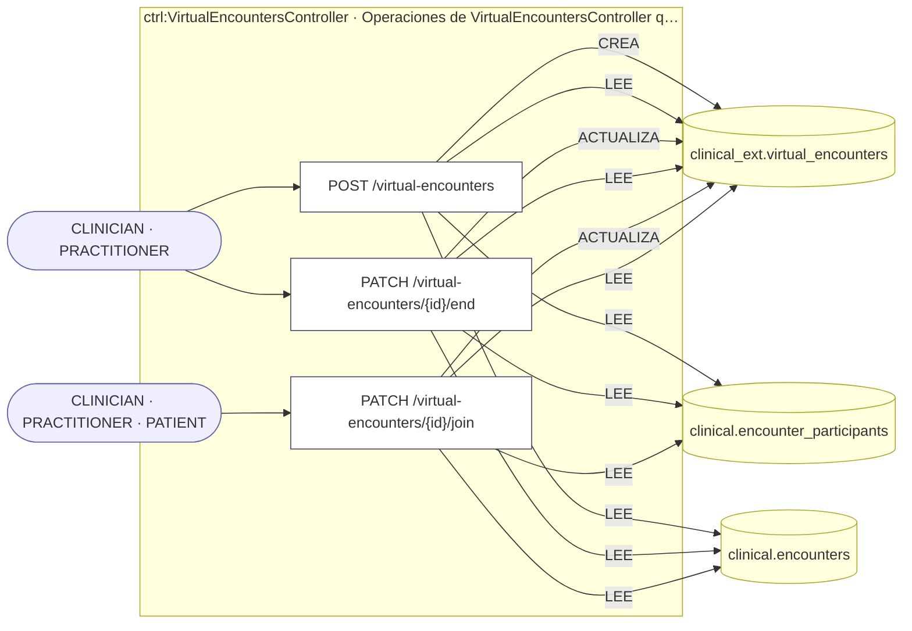
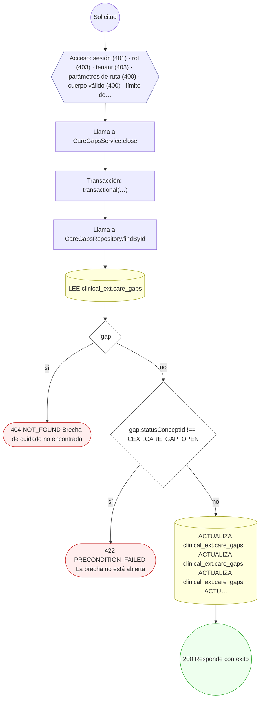
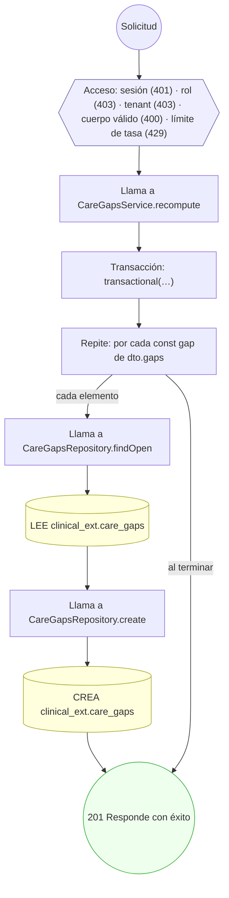
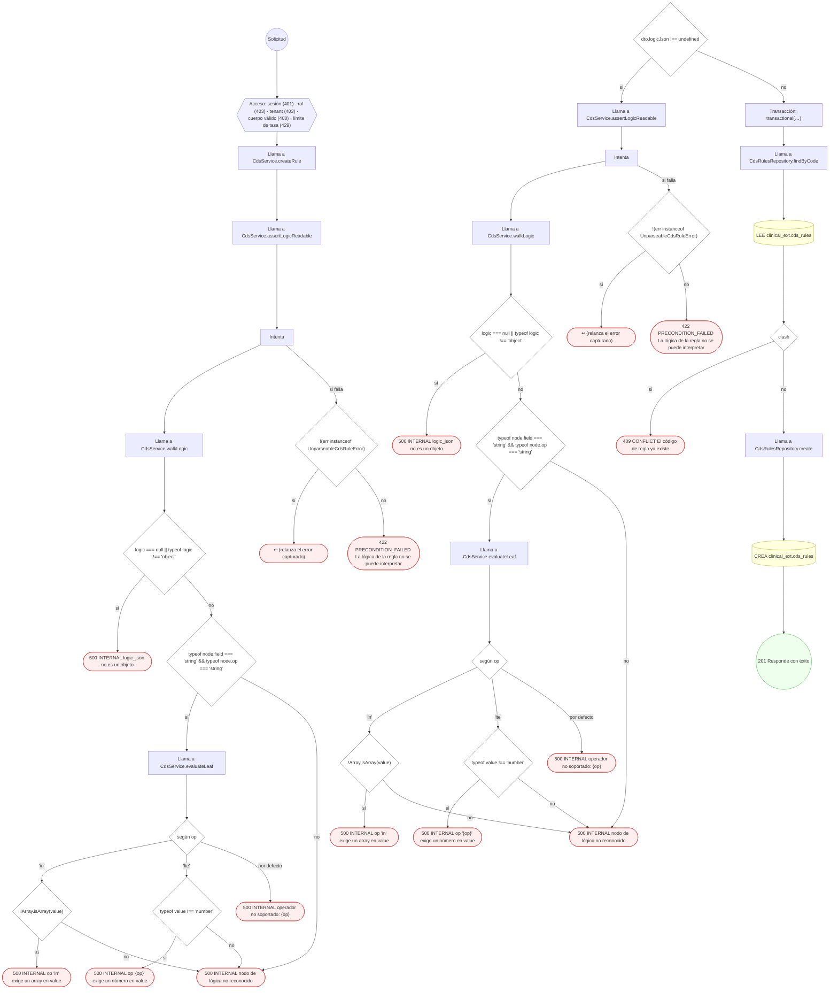
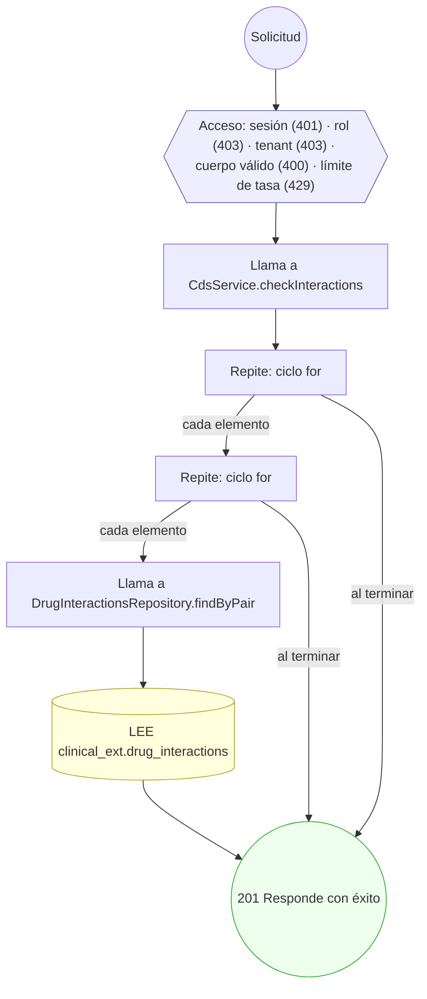
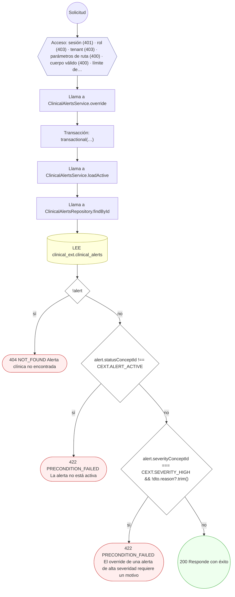
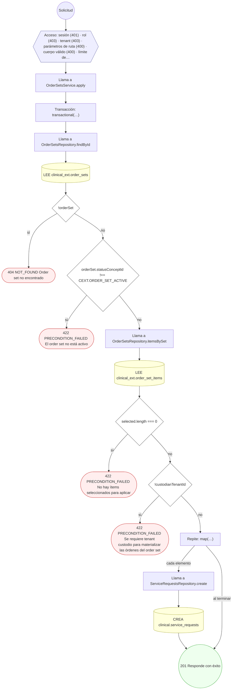
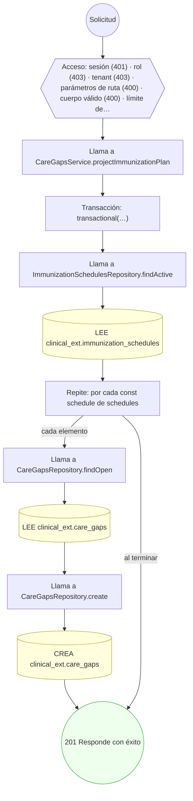
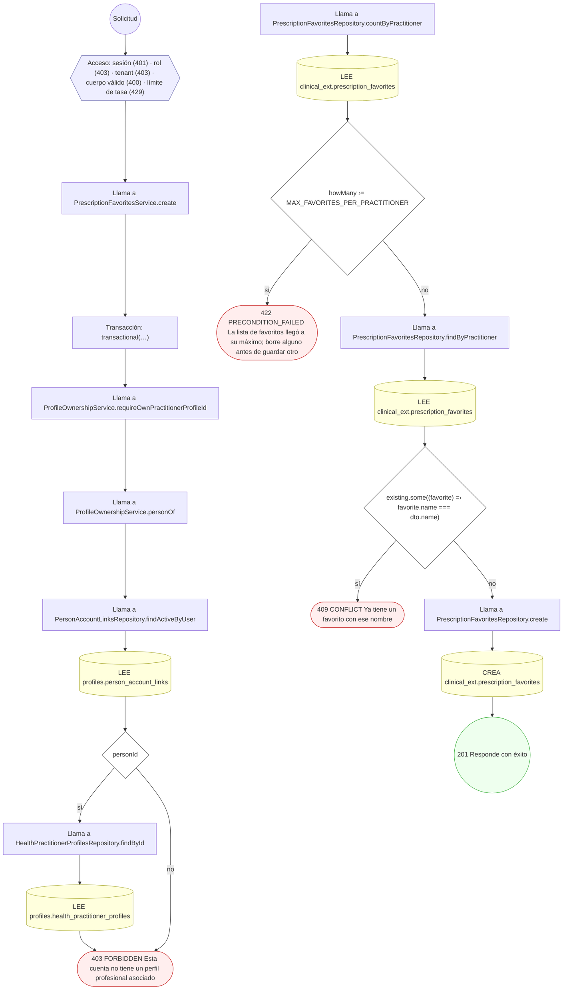

<!-- AUTOGENERADO por tools/inventario/flujos.mjs. No editar manualmente. -->

# Flujos del módulo `clinical_ext`

- **Procesos:** 1 · **Máquinas de estado:** 0
- **Operaciones:** 27 (22 con decisiones propias, 5 sin ellas)
- Inventario de endpoints del módulo: [clinical_ext](../endpoints/clinical_ext.md)

## Proceso: `clinical_ext` — coordinación y soporte clínico

- **Código:** `clinical_ext` · **Agrupación:** AGRUPACION_POR_CONTROLADOR · **Operaciones:** 27
- **Actores:** CLINICIAN · Cualquier sesión válida · PATIENT · PRACTITIONER · SECURITY_ADMIN
- **Revisión:** AUTO_DETECTADA
- **Fuentes:** `src/modules/clinical_ext/README.md`

### Para qué sirve

El módulo implementa equipos de cuidado, reglas CDS, alertas, interacciones, plantillas de órdenes, referencias, brechas de cuidado, calendario de inmunización, encuentros virtuales y favoritos de prescripción. Tiene ocho controladores y **27 endpoints**. Este README describe el código de la rama actual.

_Fuente: `src/modules/clinical_ext/README.md:3`_

### Etapas y operaciones

| Etapa | Descripción | Operación | Quién actúa | Riesgo | Tablas |
|---|---|---|---|---|---|
| `ctrl:CareGapsController` | Operaciones de CareGapsController que el README no asigna a un caso de uso | PATCH /care-gaps/{id}/close | Cualquier sesión válida | ALTO | 2 |
|  |  | POST /care-gaps/recompute | Cualquier sesión válida | ALTO | 2 |
|  |  | POST /immunization-schedules | SECURITY_ADMIN | MEDIO | 1 |
|  |  | POST /patients/{id}/immunization-plan/project | Cualquier sesión válida | ALTO | 3 |
| `ctrl:CareTeamsController` | Operaciones de CareTeamsController que el README no asigna a un caso de uso | GET /care-teams | CLINICIAN · PRACTITIONER | BAJO | 1 |
|  |  | POST /care-teams | CLINICIAN · PRACTITIONER | MEDIO | 2 |
|  |  | PATCH /care-teams/{id}/members/{memberId}/set-responsible | CLINICIAN · PRACTITIONER | MEDIO | 3 |
| `ctrl:CdsController` | Operaciones de CdsController que el README no asigna a un caso de uso | POST /cds-rules | SECURITY_ADMIN | MEDIO | 2 |
|  |  | POST /cds-rules/{id}/versions/publish | SECURITY_ADMIN | MEDIO | 2 |
|  |  | POST /cds-rules/{id}/versions/rollback | SECURITY_ADMIN | MEDIO | 2 |
|  |  | POST /cds/check-interactions | CLINICIAN · PRACTITIONER | BAJO | 1 |
|  |  | POST /cds/evaluate | CLINICIAN · PRACTITIONER | MEDIO | 2 |
|  |  | POST /drug-interactions | SECURITY_ADMIN | MEDIO | 1 |
| `ctrl:ClinicalAlertsController` | Operaciones de ClinicalAlertsController que el README no asigna a un caso de uso | PATCH /clinical-alerts/{id}/acknowledge | CLINICIAN · PRACTITIONER | BAJO | 1 |
|  |  | PATCH /clinical-alerts/{id}/override | CLINICIAN · PRACTITIONER | BAJO | 1 |
| `ctrl:OrderSetsController` | Operaciones de OrderSetsController que el README no asigna a un caso de uso | POST /order-sets | SECURITY_ADMIN | MEDIO | 3 |
|  |  | POST /order-sets/{id}/apply | Cualquier sesión válida | ALTO | 3 |
| `ctrl:PrescriptionFavoritesController` | Operaciones de PrescriptionFavoritesController que el README no asigna a un caso de uso | GET /prescription-favorites | Cualquier sesión válida | BAJO | 3 |
|  |  | POST /prescription-favorites | Cualquier sesión válida | ALTO | 4 |
|  |  | DELETE /prescription-favorites/{id} | Cualquier sesión válida | ALTO | 4 |
| `ctrl:ReferralsController` | Operaciones de ReferralsController que el README no asigna a un caso de uso | GET /referrals | CLINICIAN · PRACTITIONER | BAJO | 1 |
|  |  | POST /referrals | CLINICIAN · PRACTITIONER | MEDIO | 2 |
|  |  | PATCH /referrals/{id}/respond | CLINICIAN · PRACTITIONER | MEDIO | 2 |
|  |  | GET /referrals/me | CLINICIAN · PRACTITIONER · PATIENT | BAJO | 3 |
| `ctrl:VirtualEncountersController` | Operaciones de VirtualEncountersController que el README no asigna a un caso de uso | POST /virtual-encounters | CLINICIAN · PRACTITIONER | MEDIO | 4 |
|  |  | PATCH /virtual-encounters/{id}/end | CLINICIAN · PRACTITIONER | MEDIO | 4 |
|  |  | PATCH /virtual-encounters/{id}/join | CLINICIAN · PRACTITIONER · PATIENT | MEDIO | 4 |

### Diagrama 1 de 2 — etapas `ctrl:CareGapsController`, `ctrl:CareTeamsController`, `ctrl:CdsController`…

```mermaid
flowchart LR
  a2(["Cualquier sesión válida"]):::actor
  a6(["SECURITY_ADMIN"]):::actor
  a10(["CLINICIAN · PRACTITIONER"]):::actor
  a42(["CLINICIAN · PRACTITIONER · PATIENT"]):::actor
  t3[("clinical_ext.care_gaps")]:::tabla
  t7[("clinical_ext.immunization_schedules")]:::tabla
  t11[("clinical_ext.care_teams")]:::tabla
  t13[("clinical_ext.care_team_members")]:::tabla
  t16[("clinical_ext.cds_rules")]:::tabla
  t20[("clinical_ext.drug_interactions")]:::tabla
  t22[("clinical_ext.clinical_alerts")]:::tabla
  t27[("clinical_ext.order_set_items")]:::tabla
  t28[("clinical_ext.order_sets")]:::tabla
  t30[("clinical.service_requests")]:::tabla
  t32[("clinical_ext.prescription_favorites")]:::tabla
  t33[("profiles.health_practitioner_profiles")]:::tabla
  t34[("profiles.person_account_links")]:::tabla
  t38[("clinical_ext.referrals")]:::tabla
  t43[("profiles.patient_profiles")]:::tabla
  subgraph s0["ctrl:CareGapsController · Operaciones de CareGapsController que el README no as…"]
    o1["PATCH /care-gaps/{id}/close"]:::op
    o4["POST /care-gaps/recompute"]:::op
    o5["POST /immunization-schedules"]:::op
    o8["POST /patients/{id}/immunization-plan/project"]:::op
  end
  subgraph s1["ctrl:CareTeamsController · Operaciones de CareTeamsController que el README no…"]
    o9["GET /care-teams"]:::op
    o12["POST /care-teams"]:::op
    o14["PATCH /care-teams/{id}/members/{memberId}/set-responsible"]:::op
  end
  subgraph s2["ctrl:CdsController · Operaciones de CdsController que el README no asigna a un…"]
    o15["POST /cds-rules"]:::op
    o17["POST /cds-rules/{id}/versions/publish"]:::op
    o18["POST /cds-rules/{id}/versions/rollback"]:::op
    o19["POST /cds/check-interactions"]:::op
    o21["POST /cds/evaluate"]:::op
    o23["POST /drug-interactions"]:::op
  end
  subgraph s3["ctrl:ClinicalAlertsController · Operaciones de ClinicalAlertsController que el…"]
    o24["PATCH /clinical-alerts/{id}/acknowledge"]:::op
    o25["PATCH /clinical-alerts/{id}/override"]:::op
  end
  subgraph s4["ctrl:OrderSetsController · Operaciones de OrderSetsController que el README no…"]
    o26["POST /order-sets"]:::op
    o29["POST /order-sets/{id}/apply"]:::op
  end
  subgraph s5["ctrl:PrescriptionFavoritesController · Operaciones de PrescriptionFavoritesCont…"]
    o31["GET /prescription-favorites"]:::op
    o35["POST /prescription-favorites"]:::op
    o36["DELETE /prescription-favorites/{id}"]:::op
  end
  subgraph s6["ctrl:ReferralsController · Operaciones de ReferralsController que el README no…"]
    o37["GET /referrals"]:::op
    o39["POST /referrals"]:::op
    o40["PATCH /referrals/{id}/respond"]:::op
    o41["GET /referrals/me"]:::op
  end
  a2 --> o1
  o1 -->|"ACTUALIZA"| t3
  o1 -->|"LEE"| t3
  a2 --> o4
  o4 -->|"CREA"| t3
  o4 -->|"LEE"| t3
  a6 --> o5
  o5 -->|"CREA"| t7
  a2 --> o8
  o8 -->|"CREA"| t3
  o8 -->|"LEE"| t3
  o8 -->|"LEE"| t7
  a10 --> o9
  o9 -->|"LEE"| t11
  a10 --> o12
  o12 -->|"CREA"| t13
  o12 -->|"CREA"| t11
  a10 --> o14
  o14 -->|"ACTUALIZA"| t13
  o14 -->|"LEE"| t13
  o14 -->|"LEE"| t11
  a6 --> o15
  o15 -->|"CREA"| t16
  o15 -->|"LEE"| t16
  a6 --> o17
  o17 -->|"ACTUALIZA"| t16
  o17 -->|"LEE"| t16
  a6 --> o18
  o18 -->|"ACTUALIZA"| t16
  o18 -->|"LEE"| t16
  a10 --> o19
  o19 -->|"LEE"| t20
  a10 --> o21
  o21 -->|"LEE"| t16
  o21 -->|"CREA"| t22
  a6 --> o23
  o23 -->|"CREA"| t20
  a10 --> o24
  o24 -->|"LEE"| t22
  a10 --> o25
  o25 -->|"LEE"| t22
  a6 --> o26
  o26 -->|"CREA"| t27
  o26 -->|"CREA"| t28
  o26 -->|"LEE"| t28
  a2 --> o29
  o29 -->|"LEE"| t27
  o29 -->|"LEE"| t28
  o29 -->|"CREA"| t30
  a2 --> o31
  o31 -->|"LEE"| t32
  o31 -->|"LEE"| t33
  o31 -->|"LEE"| t34
  a2 --> o35
  o35 -->|"CREA"| t32
  o35 -->|"LEE"| t32
  o35 -->|"LEE"| t33
  o35 -->|"LEE"| t34
  a2 --> o36
  o36 -->|"BORRA"| t32
  o36 -->|"LEE"| t32
  o36 -->|"LEE"| t33
  o36 -->|"LEE"| t34
  a10 --> o37
  o37 -->|"LEE"| t38
  a10 --> o39
  o39 -->|"CREA"| t38
  o39 -->|"LEE"| t38
  a10 --> o40
  o40 -->|"ACTUALIZA"| t38
  o40 -->|"LEE"| t38
  a42 --> o41
  o41 -->|"LEE"| t38
  o41 -->|"LEE"| t43
  o41 -->|"LEE"| t34
  classDef op fill:#fff,stroke:#446
  classDef actor fill:#eef,stroke:#66a
  classDef tabla fill:#ffd,stroke:#aa3
  classDef evento fill:#efe,stroke:#3a3
```



### Diagrama 2 de 2 — etapas `ctrl:VirtualEncountersController`



## Árbol de decisión por operación

Cada árbol se deriva del código del handler y de los métodos que invoca (hasta 4 niveles). Una rama que no decide, no escribe y no falla se poda. Los accesos y los efectos consecutivos se agrupan en un solo nodo.

### Operaciones con decisiones propias

#### 1. PATCH /care-gaps/{id}/close

Cerrar una brecha de cuidado por evento clínico

| HTTP | Código | Cuándo |
|---|---|---|
| 200 | — | Éxito |
| 400 | `VALIDATION_FAILED` | Los parámetros de ruta son UUID válidos; El cuerpo cumple el DTO (sin propiedades extra) |
| 401 | `UNAUTHENTICATED` | Hay una sesión válida (JWT) |
| 403 | `FORBIDDEN` | El rol está permitido; El tenant se resuelve y pertenece al actor |
| 404 | `NOT_FOUND` | ResourceNotFoundException: Brecha de cuidado no encontrada |
| 422 | `PRECONDITION_FAILED` | PreconditionFailedException: La brecha no está abierta |
| 429 | `RATE_LIMITED` | No se supera el límite de solicitudes |



#### 2. POST /care-gaps/recompute

Detectar y abrir brechas de cuidado (batch)

| HTTP | Código | Cuándo |
|---|---|---|
| 201 | — | Éxito |
| 400 | `VALIDATION_FAILED` | El cuerpo cumple el DTO (sin propiedades extra) |
| 401 | `UNAUTHENTICATED` | Hay una sesión válida (JWT) |
| 403 | `FORBIDDEN` | El rol está permitido; El tenant se resuelve y pertenece al actor |
| 429 | `RATE_LIMITED` | No se supera el límite de solicitudes |



#### 3. POST /care-teams

Crear un equipo de cuidado con sus miembros

| HTTP | Código | Cuándo |
|---|---|---|
| 201 | — | Éxito |
| 400 | `VALIDATION_FAILED` | El cuerpo cumple el DTO (sin propiedades extra) |
| 401 | `UNAUTHENTICATED` | Hay una sesión válida (JWT) |
| 403 | `FORBIDDEN` | El rol está permitido; El tenant se resuelve y pertenece al actor |
| 409 | `CONFLICT` | ConflictException: A lo sumo un miembro puede ser responsable |
| 429 | `RATE_LIMITED` | No se supera el límite de solicitudes |


#### 4. PATCH /care-teams/{id}/members/{memberId}/set-responsible

Designar miembro responsable (transferir liderazgo)

| HTTP | Código | Cuándo |
|---|---|---|
| 200 | — | Éxito |
| 400 | `VALIDATION_FAILED` | Los parámetros de ruta son UUID válidos |
| 401 | `UNAUTHENTICATED` | Hay una sesión válida (JWT) |
| 403 | `FORBIDDEN` | El rol está permitido; El tenant se resuelve y pertenece al actor |
| 404 | `NOT_FOUND` | ResourceNotFoundException: Equipo de cuidado no encontrado; ResourceNotFoundException: Miembro no encontrado en el equipo |
| 422 | `PRECONDITION_FAILED` | PreconditionFailedException: El equipo no está activo; PreconditionFailedException: El miembro destino no está activo |
| 429 | `RATE_LIMITED` | No se supera el límite de solicitudes |


#### 5. POST /cds-rules

Crear una regla CDS en borrador

| HTTP | Código | Cuándo |
|---|---|---|
| 201 | — | Éxito |
| 400 | `VALIDATION_FAILED` | El cuerpo cumple el DTO (sin propiedades extra) |
| 401 | `UNAUTHENTICATED` | Hay una sesión válida (JWT) |
| 403 | `FORBIDDEN` | El rol está permitido; El tenant se resuelve y pertenece al actor |
| 409 | `CONFLICT` | ConflictException: El código de regla ya existe |
| 422 | `PRECONDITION_FAILED` | PreconditionFailedException: La lógica de la regla no se puede interpretar |
| 429 | `RATE_LIMITED` | No se supera el límite de solicitudes |
| 500 | `INTERNAL` | UnparseableCdsRuleError: logic_json no es un objeto; UnparseableCdsRuleError: op 'in' exige un array en value; UnparseableCdsRuleError: op '{op}' exige un número en value; UnparseableCdsRuleError: operador no soportado: {op}; UnparseableCdsRuleError: nodo de lógica no reconocido |



#### 6. POST /cds-rules/{id}/versions/publish

Publicar una versión de la regla CDS

| HTTP | Código | Cuándo |
|---|---|---|
| 200 | — | Éxito |
| 400 | `VALIDATION_FAILED` | Los parámetros de ruta son UUID válidos; El cuerpo cumple el DTO (sin propiedades extra) |
| 401 | `UNAUTHENTICATED` | Hay una sesión válida (JWT) |
| 403 | `FORBIDDEN` | El rol está permitido; El tenant se resuelve y pertenece al actor |
| 404 | `NOT_FOUND` | ResourceNotFoundException: Regla CDS no encontrada |
| 422 | `PRECONDITION_FAILED` | PreconditionFailedException: La lógica de la regla no se puede interpretar |
| 429 | `RATE_LIMITED` | No se supera el límite de solicitudes |
| 500 | `INTERNAL` | UnparseableCdsRuleError: logic_json no es un objeto; UnparseableCdsRuleError: op 'in' exige un array en value; UnparseableCdsRuleError: op '{op}' exige un número en value; UnparseableCdsRuleError: operador no soportado: {op}; UnparseableCdsRuleError: nodo de lógica no reconocido |


#### 7. POST /cds-rules/{id}/versions/rollback

Rollback de la versión activa de la regla CDS

| HTTP | Código | Cuándo |
|---|---|---|
| 200 | — | Éxito |
| 400 | `VALIDATION_FAILED` | Los parámetros de ruta son UUID válidos |
| 401 | `UNAUTHENTICATED` | Hay una sesión válida (JWT) |
| 403 | `FORBIDDEN` | El rol está permitido; El tenant se resuelve y pertenece al actor |
| 404 | `NOT_FOUND` | ResourceNotFoundException: Regla CDS no encontrada |
| 422 | `PRECONDITION_FAILED` | PreconditionFailedException: Solo se puede hacer rollback de una regla activa |
| 429 | `RATE_LIMITED` | No se supera el límite de solicitudes |


#### 8. POST /cds/check-interactions

Detectar interacciones medicamentosas al prescribir

| HTTP | Código | Cuándo |
|---|---|---|
| 201 | — | Éxito |
| 400 | `VALIDATION_FAILED` | El cuerpo cumple el DTO (sin propiedades extra) |
| 401 | `UNAUTHENTICATED` | Hay una sesión válida (JWT) |
| 403 | `FORBIDDEN` | El rol está permitido; El tenant se resuelve y pertenece al actor |
| 429 | `RATE_LIMITED` | No se supera el límite de solicitudes |



#### 9. POST /cds/evaluate

Evaluar reglas CDS y generar alertas

| HTTP | Código | Cuándo |
|---|---|---|
| 201 | — | Éxito |
| 400 | `VALIDATION_FAILED` | El cuerpo cumple el DTO (sin propiedades extra) |
| 401 | `UNAUTHENTICATED` | Hay una sesión válida (JWT) |
| 403 | `FORBIDDEN` | El rol está permitido; El tenant se resuelve y pertenece al actor |
| 429 | `RATE_LIMITED` | No se supera el límite de solicitudes |
| 500 | `INTERNAL` | UnparseableCdsRuleError: logic_json no es un objeto; UnparseableCdsRuleError: op 'in' exige un array en value; UnparseableCdsRuleError: op '{op}' exige un número en value; UnparseableCdsRuleError: operador no soportado: {op}; UnparseableCdsRuleError: nodo de lógica no reconocido |


#### 10. PATCH /clinical-alerts/{id}/acknowledge

Reconocer una alerta clínica

| HTTP | Código | Cuándo |
|---|---|---|
| 200 | — | Éxito |
| 400 | `VALIDATION_FAILED` | Los parámetros de ruta son UUID válidos |
| 401 | `UNAUTHENTICATED` | Hay una sesión válida (JWT) |
| 403 | `FORBIDDEN` | El rol está permitido; El tenant se resuelve y pertenece al actor |
| 404 | `NOT_FOUND` | ResourceNotFoundException: Alerta clínica no encontrada |
| 422 | `PRECONDITION_FAILED` | PreconditionFailedException: La alerta no está activa |
| 429 | `RATE_LIMITED` | No se supera el límite de solicitudes |


#### 11. PATCH /clinical-alerts/{id}/override

Override (sobreescribir) una alerta clínica

| HTTP | Código | Cuándo |
|---|---|---|
| 200 | — | Éxito |
| 400 | `VALIDATION_FAILED` | Los parámetros de ruta son UUID válidos; El cuerpo cumple el DTO (sin propiedades extra) |
| 401 | `UNAUTHENTICATED` | Hay una sesión válida (JWT) |
| 403 | `FORBIDDEN` | El rol está permitido; El tenant se resuelve y pertenece al actor |
| 404 | `NOT_FOUND` | ResourceNotFoundException: Alerta clínica no encontrada |
| 422 | `PRECONDITION_FAILED` | PreconditionFailedException: La alerta no está activa; PreconditionFailedException: El override de una alerta de alta severidad requiere un motivo |
| 429 | `RATE_LIMITED` | No se supera el límite de solicitudes |



#### 12. POST /order-sets

Crear una plantilla de órdenes (order set) con sus ítems

| HTTP | Código | Cuándo |
|---|---|---|
| 201 | — | Éxito |
| 400 | `VALIDATION_FAILED` | El cuerpo cumple el DTO (sin propiedades extra) |
| 401 | `UNAUTHENTICATED` | Hay una sesión válida (JWT) |
| 403 | `FORBIDDEN` | El rol está permitido; El tenant se resuelve y pertenece al actor |
| 409 | `CONFLICT` | ConflictException: El código de order set ya existe |
| 429 | `RATE_LIMITED` | No se supera el límite de solicitudes |


#### 13. POST /order-sets/{id}/apply

Aplicar un order set (fan-out de órdenes)

| HTTP | Código | Cuándo |
|---|---|---|
| 201 | — | Éxito |
| 400 | `VALIDATION_FAILED` | Los parámetros de ruta son UUID válidos; El cuerpo cumple el DTO (sin propiedades extra) |
| 401 | `UNAUTHENTICATED` | Hay una sesión válida (JWT) |
| 403 | `FORBIDDEN` | El rol está permitido; El tenant se resuelve y pertenece al actor |
| 404 | `NOT_FOUND` | ResourceNotFoundException: Order set no encontrado |
| 422 | `PRECONDITION_FAILED` | PreconditionFailedException: El order set no está activo; PreconditionFailedException: No hay ítems seleccionados para aplicar; PreconditionFailedException: Se requiere tenant custodio para materializar las órdenes del order set |
| 429 | `RATE_LIMITED` | No se supera el límite de solicitudes |



#### 14. POST /patients/{id}/immunization-plan/project

Proyectar el plan de inmunización y abrir brechas

| HTTP | Código | Cuándo |
|---|---|---|
| 201 | — | Éxito |
| 400 | `VALIDATION_FAILED` | Los parámetros de ruta son UUID válidos; El cuerpo cumple el DTO (sin propiedades extra) |
| 401 | `UNAUTHENTICATED` | Hay una sesión válida (JWT) |
| 403 | `FORBIDDEN` | El rol está permitido; El tenant se resuelve y pertenece al actor |
| 429 | `RATE_LIMITED` | No se supera el límite de solicitudes |



#### 15. GET /prescription-favorites

Listar mis favoritos de prescripción

| HTTP | Código | Cuándo |
|---|---|---|
| 200 | — | Éxito |
| 401 | `UNAUTHENTICATED` | Hay una sesión válida (JWT) |
| 403 | `FORBIDDEN` | El rol está permitido; El tenant se resuelve y pertenece al actor; ForbiddenException: Esta cuenta no tiene un perfil profesional asociado |
| 429 | `RATE_LIMITED` | No se supera el límite de solicitudes |


#### 16. POST /prescription-favorites

Guardar un favorito de prescripción

| HTTP | Código | Cuándo |
|---|---|---|
| 201 | — | Éxito |
| 400 | `VALIDATION_FAILED` | El cuerpo cumple el DTO (sin propiedades extra) |
| 401 | `UNAUTHENTICATED` | Hay una sesión válida (JWT) |
| 403 | `FORBIDDEN` | El rol está permitido; El tenant se resuelve y pertenece al actor; ForbiddenException: Esta cuenta no tiene un perfil profesional asociado |
| 409 | `CONFLICT` | ConflictException: Ya tiene un favorito con ese nombre |
| 422 | `PRECONDITION_FAILED` | PreconditionFailedException: La lista de favoritos llegó a su máximo; borre alguno antes de guardar otro |
| 429 | `RATE_LIMITED` | No se supera el límite de solicitudes |



#### 17. DELETE /prescription-favorites/{id}

Borrar un favorito de prescripción propio

| HTTP | Código | Cuándo |
|---|---|---|
| 204 | — | Éxito |
| 400 | `VALIDATION_FAILED` | Los parámetros de ruta son UUID válidos |
| 401 | `UNAUTHENTICATED` | Hay una sesión válida (JWT) |
| 403 | `FORBIDDEN` | El rol está permitido; El tenant se resuelve y pertenece al actor; ForbiddenException: Esta cuenta no tiene un perfil profesional asociado |
| 404 | `NOT_FOUND` | ResourceNotFoundException: Favorito no encontrado |
| 429 | `RATE_LIMITED` | No se supera el límite de solicitudes |


#### 18. POST /referrals

Emitir una referencia desde un encuentro

| HTTP | Código | Cuándo |
|---|---|---|
| 201 | — | Éxito |
| 400 | `VALIDATION_FAILED` | El cuerpo cumple el DTO (sin propiedades extra) |
| 401 | `UNAUTHENTICATED` | Hay una sesión válida (JWT) |
| 403 | `FORBIDDEN` | El rol está permitido; El tenant se resuelve y pertenece al actor |
| 409 | `CONFLICT` | ConflictException: Ya existe una referencia equivalente |
| 429 | `RATE_LIMITED` | No se supera el límite de solicitudes |


#### 19. PATCH /referrals/{id}/respond

Responder / aceptar una referencia inter-tenant

| HTTP | Código | Cuándo |
|---|---|---|
| 200 | — | Éxito |
| 400 | `VALIDATION_FAILED` | Los parámetros de ruta son UUID válidos; El cuerpo cumple el DTO (sin propiedades extra) |
| 401 | `UNAUTHENTICATED` | Hay una sesión válida (JWT) |
| 403 | `FORBIDDEN` | El rol está permitido; El tenant se resuelve y pertenece al actor |
| 404 | `NOT_FOUND` | ResourceNotFoundException: Referencia no encontrada |
| 422 | `PRECONDITION_FAILED` | PreconditionFailedException: La referencia no está en estado solicitado |
| 429 | `RATE_LIMITED` | No se supera el límite de solicitudes |

```mermaid
flowchart TD
  n1(("Solicitud")):::inicio
  n2{{"Acceso: sesión (401) · rol (403) · tenant (403) · parámetros de ruta (400) · cuerpo válido (400) · límite de…"}}:::acceso
  n1 --> n2
  n3["Llama a ReferralsService.respond"]:::llamada
  n2 --> n3
  n4["Transacción: transactional(…)"]:::transaccion
  n3 --> n4
  n5["Llama a ReferralsRepository.findById"]:::llamada
  n4 --> n5
  n6[("LEE clinical_ext.referrals")]:::efecto
  n5 --> n6
  n7{"!referral"}:::decision
  n6 --> n7
  n8(["404 NOT_FOUND Referencia no encontrada"]):::error
  n7 -->|"sí"| n8
  n9{"referral.statusConceptId !== CEXT.REFERRAL_REQUESTED"}:::decision
  n7 -->|"no"| n9
  n10(["422 PRECONDITION_FAILED La referencia no está en estado solicitado"]):::error
  n9 -->|"sí"| n10
  n11[("ACTUALIZA clinical_ext.referrals · ACTUALIZA clinical_ext.referrals")]:::efecto
  n9 -->|"no"| n11
  n12(("200 Responde con éxito")):::ok
  n11 --> n12
  classDef acceso fill:#eef,stroke:#66a
  classDef error fill:#fee,stroke:#c33
  classDef ok fill:#efe,stroke:#3a3
  classDef efecto fill:#ffd,stroke:#aa3
  classDef decision fill:#fff,stroke:#555
  classDef corte fill:#eee,stroke:#999,stroke-dasharray: 4
```

#### 20. POST /virtual-encounters

Iniciar una sesión de telesalud

| HTTP | Código | Cuándo |
|---|---|---|
| 201 | — | Éxito |
| 400 | `VALIDATION_FAILED` | El cuerpo cumple el DTO (sin propiedades extra) |
| 401 | `UNAUTHENTICATED` | Hay una sesión válida (JWT) |
| 403 | `FORBIDDEN` | El rol está permitido; El tenant se resuelve y pertenece al actor; ForbiddenException: La sesión virtual pertenece a otra organización.; ForbiddenException: No participa de este encuentro clínico. |
| 404 | `NOT_FOUND` | ResourceNotFoundException: Encuentro clínico no encontrado |
| 409 | `CONFLICT` | ConflictException: El encuentro ya tiene una sesión virtual |
| 429 | `RATE_LIMITED` | No se supera el límite de solicitudes |

```mermaid
flowchart TD
  n1(("Solicitud")):::inicio
  n2{{"Acceso: sesión (401) · rol (403) · tenant (403) · cuerpo válido (400) · límite de tasa (429)"}}:::acceso
  n1 --> n2
  n3["Llama a VirtualEncountersService.create"]:::llamada
  n2 --> n3
  n4["Transacción: transactional(…)"]:::transaccion
  n3 --> n4
  n5["Llama a VirtualEncountersService.requireEncounterParticipant"]:::llamada
  n4 --> n5
  n6["Llama a EncountersRepository.findById"]:::llamada
  n5 --> n6
  n7[("LEE clinical.encounters")]:::efecto
  n6 --> n7
  n8{"!encounter"}:::decision
  n7 --> n8
  n9(["404 NOT_FOUND Encuentro clínico no encontrado"]):::error
  n8 -->|"sí"| n9
  n10{"!belongsToTenant"}:::decision
  n8 -->|"no"| n10
  n11(["403 FORBIDDEN La sesión virtual pertenece a otra organización."]):::error
  n10 -->|"sí"| n11
  n12{"!practitionerProfileId"}:::decision
  n10 -->|"no"| n12
  n13(["403 FORBIDDEN No participa de este encuentro clínico."]):::error
  n12 -->|"sí"| n13
  n14["Llama a EncountersRepository.findActiveParticipants"]:::llamada
  n12 -->|"no"| n14
  n15[("LEE clinical.encounter_participants")]:::efecto
  n14 --> n15
  n16(["403 FORBIDDEN No participa de este encuentro clínico."]):::error
  n15 --> n16
  n17["Llama a VirtualEncountersRepository.findByEncounter"]:::llamada
  n18[("LEE clinical_ext.virtual_encounters")]:::efecto
  n17 --> n18
  n19{"existing"}:::decision
  n18 --> n19
  n20(["409 CONFLICT El encuentro ya tiene una sesión virtual"]):::error
  n19 -->|"sí"| n20
  n21["Llama a VirtualEncountersRepository.create"]:::llamada
  n19 -->|"no"| n21
  n22[("CREA clinical_ext.virtual_encounters")]:::efecto
  n21 --> n22
  n23(("201 Responde con éxito")):::ok
  n22 --> n23
  classDef acceso fill:#eef,stroke:#66a
  classDef error fill:#fee,stroke:#c33
  classDef ok fill:#efe,stroke:#3a3
  classDef efecto fill:#ffd,stroke:#aa3
  classDef decision fill:#fff,stroke:#555
  classDef corte fill:#eee,stroke:#999,stroke-dasharray: 4
```

#### 21. PATCH /virtual-encounters/{id}/end

Finalizar una sesión de telesalud

| HTTP | Código | Cuándo |
|---|---|---|
| 200 | — | Éxito |
| 400 | `VALIDATION_FAILED` | Los parámetros de ruta son UUID válidos; El cuerpo cumple el DTO (sin propiedades extra) |
| 401 | `UNAUTHENTICATED` | Hay una sesión válida (JWT) |
| 403 | `FORBIDDEN` | El rol está permitido; El tenant se resuelve y pertenece al actor; ForbiddenException: La sesión virtual pertenece a otra organización.; ForbiddenException: No participa de este encuentro clínico. |
| 404 | `NOT_FOUND` | ResourceNotFoundException: Sesión virtual no encontrada; ResourceNotFoundException: Encuentro clínico no encontrado |
| 422 | `PRECONDITION_FAILED` | PreconditionFailedException: La sesión no está en progreso |
| 429 | `RATE_LIMITED` | No se supera el límite de solicitudes |

```mermaid
flowchart TD
  n1(("Solicitud")):::inicio
  n2{{"Acceso: sesión (401) · rol (403) · tenant (403) · parámetros de ruta (400) · cuerpo válido (400) · límite de…"}}:::acceso
  n1 --> n2
  n3["Llama a VirtualEncountersService.end"]:::llamada
  n2 --> n3
  n4["Transacción: transactional(…)"]:::transaccion
  n3 --> n4
  n5["Llama a VirtualEncountersRepository.findById"]:::llamada
  n4 --> n5
  n6[("LEE clinical_ext.virtual_encounters")]:::efecto
  n5 --> n6
  n7{"!due"}:::decision
  n6 --> n7
  n8(["404 NOT_FOUND Sesión virtual no encontrada"]):::error
  n7 -->|"sí"| n8
  n9["Llama a VirtualEncountersService.requireEncounterParticipant"]:::llamada
  n7 -->|"no"| n9
  n10["Llama a EncountersRepository.findById"]:::llamada
  n9 --> n10
  n11[("LEE clinical.encounters")]:::efecto
  n10 --> n11
  n12{"!encounter"}:::decision
  n11 --> n12
  n13(["404 NOT_FOUND Encuentro clínico no encontrado"]):::error
  n12 -->|"sí"| n13
  n14{"!belongsToTenant"}:::decision
  n12 -->|"no"| n14
  n15(["403 FORBIDDEN La sesión virtual pertenece a otra organización."]):::error
  n14 -->|"sí"| n15
  n16{"!practitionerProfileId"}:::decision
  n14 -->|"no"| n16
  n17(["403 FORBIDDEN No participa de este encuentro clínico."]):::error
  n16 -->|"sí"| n17
  n18["Llama a EncountersRepository.findActiveParticipants"]:::llamada
  n16 -->|"no"| n18
  n19[("LEE clinical.encounter_participants")]:::efecto
  n18 --> n19
  n20(["403 FORBIDDEN No participa de este encuentro clínico."]):::error
  n19 --> n20
  n21{"due.statusConceptId !== CEXT.VIRTUAL_ENCOUNTER_IN_PROGRESS"}:::decision
  n22(["422 PRECONDITION_FAILED La sesión no está en progreso"]):::error
  n21 -->|"sí"| n22
  n23[("ACTUALIZA clinical_ext.virtual_encounters · ACTUALIZA clinical_ext.virtual_encounters · ACTUALIZA clinical_ex…")]:::efecto
  n21 -->|"no"| n23
  n24(("200 Responde con éxito")):::ok
  n23 --> n24
  classDef acceso fill:#eef,stroke:#66a
  classDef error fill:#fee,stroke:#c33
  classDef ok fill:#efe,stroke:#3a3
  classDef efecto fill:#ffd,stroke:#aa3
  classDef decision fill:#fff,stroke:#555
  classDef corte fill:#eee,stroke:#999,stroke-dasharray: 4
```

#### 22. PATCH /virtual-encounters/{id}/join

Unirse a una sesión de telesalud

| HTTP | Código | Cuándo |
|---|---|---|
| 200 | — | Éxito |
| 400 | `VALIDATION_FAILED` | Los parámetros de ruta son UUID válidos |
| 401 | `UNAUTHENTICATED` | Hay una sesión válida (JWT) |
| 403 | `FORBIDDEN` | El rol está permitido; El tenant se resuelve y pertenece al actor; ForbiddenException: La sesión virtual pertenece a otra organización.; ForbiddenException: No participa de este encuentro clínico. |
| 404 | `NOT_FOUND` | ResourceNotFoundException: Sesión virtual no encontrada; ResourceNotFoundException: Encuentro clínico no encontrado |
| 422 | `PRECONDITION_FAILED` | PreconditionFailedException: La sesión no está agendada |
| 429 | `RATE_LIMITED` | No se supera el límite de solicitudes |

```mermaid
flowchart TD
  n1(("Solicitud")):::inicio
  n2{{"Acceso: sesión (401) · rol (403) · tenant (403) · parámetros de ruta (400) · límite de tasa (429)"}}:::acceso
  n1 --> n2
  n3["Llama a VirtualEncountersService.join"]:::llamada
  n2 --> n3
  n4["Transacción: transactional(…)"]:::transaccion
  n3 --> n4
  n5["Llama a VirtualEncountersRepository.findById"]:::llamada
  n4 --> n5
  n6[("LEE clinical_ext.virtual_encounters")]:::efecto
  n5 --> n6
  n7{"!due"}:::decision
  n6 --> n7
  n8(["404 NOT_FOUND Sesión virtual no encontrada"]):::error
  n7 -->|"sí"| n8
  n9["Llama a VirtualEncountersService.requireEncounterParticipant"]:::llamada
  n7 -->|"no"| n9
  n10["Llama a EncountersRepository.findById"]:::llamada
  n9 --> n10
  n11[("LEE clinical.encounters")]:::efecto
  n10 --> n11
  n12{"!encounter"}:::decision
  n11 --> n12
  n13(["404 NOT_FOUND Encuentro clínico no encontrado"]):::error
  n12 -->|"sí"| n13
  n14{"!belongsToTenant"}:::decision
  n12 -->|"no"| n14
  n15(["403 FORBIDDEN La sesión virtual pertenece a otra organización."]):::error
  n14 -->|"sí"| n15
  n16{"!practitionerProfileId"}:::decision
  n14 -->|"no"| n16
  n17(["403 FORBIDDEN No participa de este encuentro clínico."]):::error
  n16 -->|"sí"| n17
  n18["Llama a EncountersRepository.findActiveParticipants"]:::llamada
  n16 -->|"no"| n18
  n19[("LEE clinical.encounter_participants")]:::efecto
  n18 --> n19
  n20(["403 FORBIDDEN No participa de este encuentro clínico."]):::error
  n19 --> n20
  n21{"due.statusConceptId !== CEXT.VIRTUAL_ENCOUNTER_SCHEDULED"}:::decision
  n22(["422 PRECONDITION_FAILED La sesión no está agendada"]):::error
  n21 -->|"sí"| n22
  n23[("ACTUALIZA clinical_ext.virtual_encounters · ACTUALIZA clinical_ext.virtual_encounters")]:::efecto
  n21 -->|"no"| n23
  n24(("200 Responde con éxito")):::ok
  n23 --> n24
  classDef acceso fill:#eef,stroke:#66a
  classDef error fill:#fee,stroke:#c33
  classDef ok fill:#efe,stroke:#3a3
  classDef efecto fill:#ffd,stroke:#aa3
  classDef decision fill:#fff,stroke:#555
  classDef corte fill:#eee,stroke:#999,stroke-dasharray: 4
```

### Operaciones sin decisiones propias

Sólo comprueban el acceso y leen o escriben: no tienen ramas que dibujar. Su detalle está en la ficha de endpoints.

| Operación | Respuestas posibles | Tablas |
|---|---|---|
| GET /care-teams | 200, 400, 401, 403, 429 | 1 |
| POST /drug-interactions | 201, 400, 401, 403, 429 | 1 |
| POST /immunization-schedules | 201, 400, 401, 403, 429 | 1 |
| GET /referrals | 200, 400, 401, 403, 429 | 1 |
| GET /referrals/me | 200, 401, 403, 429 | 3 |
