<!-- AUTOGENERADO por tools/inventario/flujos.mjs. No editar manualmente. -->

# Flujos del módulo `clinical_ext`

- **Procesos:** 1 · **Máquinas de estado:** 0
- **Operaciones:** 26 (22 con decisiones propias, 4 sin ellas)
- Inventario de endpoints del módulo: [clinical_ext](../endpoints/clinical_ext.md)

## Proceso: Módulo Clinical-Ext (18) — Care Coordination, Alerts & Decision Support

- **Código:** `clinical_ext` · **Agrupación:** MIXTO · **Operaciones:** 26
- **Actores:** CLINICIAN · Cualquier sesión válida · PRACTITIONER · SECURITY_ADMIN
- **Revisión:** AUTO_DETECTADA
- **Fuentes:** `src/modules/clinical_ext/README.md`

### Para qué sirve

Coordinación de cuidado, decisión clínica (CDS), alertas, interacciones medicamentosas, plantillas de órdenes, referencias, brechas de cuidado / inmunizaciones y telesalud. Sigue la forma de los módulos de referencia (`iam`, `common`, `terminology`): servicios que poseen la transacción (`em.transactional`), repositorios stateless (reciben el `EntityManager`), FKs como columnas uuid planas (flush del padre antes de los hijos), auditoría con `createdBy`/`touch`, y `*_concept_id` tomados de `clinical_ext.concepts.ts`.

_Fuente: `src/modules/clinical_ext/README.md:3`_

### Etapas y operaciones

| Etapa | Descripción | Operación | Quién actúa | Riesgo | Tablas |
|---|---|---|---|---|---|
| `UC-18-01` | Crear equipo de cuidado con miembros | POST /care-teams | CLINICIAN · PRACTITIONER | MEDIO | 2 |
| `UC-18-02` | Transferir liderazgo | PATCH /care-teams/{id}/members/{memberId}/set-responsible | CLINICIAN · PRACTITIONER | MEDIO | 3 |
| `UC-18-03` | Evaluar reglas CDS y generar alertas | POST /cds/evaluate | Cualquier sesión válida | ALTO | 2 |
| `UC-18-04` | Detectar interacciones medicamentosas | POST /cds/check-interactions | Cualquier sesión válida | ALTO | 2 |
| `UC-18-05` | Reconocer / override de alerta | PATCH /clinical-alerts/{id}/acknowledge | CLINICIAN · PRACTITIONER | BAJO | 1 |
| `UC-18-06` | Aplicar order set (fan-out) | POST /order-sets/{id}/apply | Cualquier sesión válida | ALTO | 3 |
| `UC-18-07` | Emitir referencia | POST /referrals | CLINICIAN · PRACTITIONER | MEDIO | 2 |
| `UC-18-08` | Aceptar / rechazar referencia inter-tenant | PATCH /referrals/{id}/respond | CLINICIAN · PRACTITIONER | MEDIO | 2 |
| `UC-18-09` | Detectar y abrir brechas de cuidado | POST /care-gaps/recompute | Cualquier sesión válida | ALTO | 2 |
| `UC-18-10` | Cerrar brecha por evento clínico | PATCH /care-gaps/{id}/close | Cualquier sesión válida | ALTO | 2 |
| `UC-18-11` | Proyectar plan de inmunización y abrir brechas | POST /patients/{id}/immunization-plan/project | Cualquier sesión válida | ALTO | 3 |
| `UC-18-12` | Telesalud: iniciar / unirse / finalizar | POST /virtual-encounters | CLINICIAN · PRACTITIONER | MEDIO | 2 |
| `UC-18-13` | Publicar versión de regla CDS con rollback | POST /cds-rules/{id}/versions/publish | SECURITY_ADMIN | MEDIO | 2 |
| `ctrl:CareGapsController` | Operaciones de CareGapsController que el README no asigna a un caso de uso | POST /immunization-schedules | SECURITY_ADMIN | MEDIO | 1 |
| `ctrl:CareTeamsController` | Operaciones de CareTeamsController que el README no asigna a un caso de uso | GET /care-teams | CLINICIAN · PRACTITIONER | BAJO | 1 |
| `ctrl:CdsController` | Operaciones de CdsController que el README no asigna a un caso de uso | POST /cds-rules | SECURITY_ADMIN | MEDIO | 2 |
|  |  | POST /cds-rules/{id}/versions/rollback | SECURITY_ADMIN | MEDIO | 2 |
|  |  | POST /drug-interactions | SECURITY_ADMIN | MEDIO | 1 |
| `ctrl:ClinicalAlertsController` | Operaciones de ClinicalAlertsController que el README no asigna a un caso de uso | PATCH /clinical-alerts/{id}/override | CLINICIAN · PRACTITIONER | BAJO | 1 |
| `ctrl:OrderSetsController` | Operaciones de OrderSetsController que el README no asigna a un caso de uso | POST /order-sets | SECURITY_ADMIN | MEDIO | 3 |
| `ctrl:PrescriptionFavoritesController` | Operaciones de PrescriptionFavoritesController que el README no asigna a un caso de uso | GET /prescription-favorites | Cualquier sesión válida | BAJO | 3 |
|  |  | POST /prescription-favorites | Cualquier sesión válida | ALTO | 4 |
|  |  | DELETE /prescription-favorites/{id} | Cualquier sesión válida | ALTO | 4 |
| `ctrl:ReferralsController` | Operaciones de ReferralsController que el README no asigna a un caso de uso | GET /referrals | CLINICIAN · PRACTITIONER | BAJO | 1 |
| `ctrl:VirtualEncountersController` | Operaciones de VirtualEncountersController que el README no asigna a un caso de uso | PATCH /virtual-encounters/{id}/end | CLINICIAN · PRACTITIONER | MEDIO | 2 |
|  |  | PATCH /virtual-encounters/{id}/join | CLINICIAN · PRACTITIONER | MEDIO | 2 |

### Diagrama 1 de 2 — etapas `UC-18-01`, `UC-18-02`, `UC-18-03`…

```mermaid
flowchart LR
  a2(["CLINICIAN · PRACTITIONER"]):::actor
  a7(["Cualquier sesión válida"]):::actor
  a28(["SECURITY_ADMIN"]):::actor
  t3[("clinical_ext.care_team_members")]:::tabla
  t4[("clinical_ext.care_teams")]:::tabla
  t8[("clinical_ext.cds_rules")]:::tabla
  t9[("clinical_ext.clinical_alerts")]:::tabla
  t11[("clinical_ext.drug_interactions")]:::tabla
  t14[("clinical_ext.order_set_items")]:::tabla
  t15[("clinical_ext.order_sets")]:::tabla
  t16[("clinical.service_requests")]:::tabla
  t18[("clinical_ext.referrals")]:::tabla
  t21[("clinical_ext.care_gaps")]:::tabla
  t24[("clinical_ext.immunization_schedules")]:::tabla
  t26[("clinical_ext.virtual_encounters")]:::tabla
  subgraph s0["UC-18-01 · Crear equipo de cuidado con miembros"]
    o1["POST /care-teams"]:::op
  end
  subgraph s1["UC-18-02 · Transferir liderazgo"]
    o5["PATCH /care-teams/{id}/members/{memberId}/set-responsible"]:::op
  end
  subgraph s2["UC-18-03 · Evaluar reglas CDS y generar alertas"]
    o6["POST /cds/evaluate"]:::op
  end
  subgraph s3["UC-18-04 · Detectar interacciones medicamentosas"]
    o10["POST /cds/check-interactions"]:::op
  end
  subgraph s4["UC-18-05 · Reconocer / override de alerta"]
    o12["PATCH /clinical-alerts/{id}/acknowledge"]:::op
  end
  subgraph s5["UC-18-06 · Aplicar order set (fan-out)"]
    o13["POST /order-sets/{id}/apply"]:::op
  end
  subgraph s6["UC-18-07 · Emitir referencia"]
    o17["POST /referrals"]:::op
  end
  subgraph s7["UC-18-08 · Aceptar / rechazar referencia inter-tenant"]
    o19["PATCH /referrals/{id}/respond"]:::op
  end
  subgraph s8["UC-18-09 · Detectar y abrir brechas de cuidado"]
    o20["POST /care-gaps/recompute"]:::op
  end
  subgraph s9["UC-18-10 · Cerrar brecha por evento clínico"]
    o22["PATCH /care-gaps/{id}/close"]:::op
  end
  subgraph s10["UC-18-11 · Proyectar plan de inmunización y abrir brechas"]
    o23["POST /patients/{id}/immunization-plan/project"]:::op
  end
  subgraph s11["UC-18-12 · Telesalud: iniciar / unirse / finalizar"]
    o25["POST /virtual-encounters"]:::op
  end
  subgraph s12["UC-18-13 · Publicar versión de regla CDS con rollback"]
    o27["POST /cds-rules/{id}/versions/publish"]:::op
  end
  subgraph s13["ctrl:CareGapsController · Operaciones de CareGapsController que el README no as…"]
    o29["POST /immunization-schedules"]:::op
  end
  subgraph s14["ctrl:CareTeamsController · Operaciones de CareTeamsController que el README no…"]
    o30["GET /care-teams"]:::op
  end
  subgraph s15["ctrl:CdsController · Operaciones de CdsController que el README no asigna a un…"]
    o31["POST /cds-rules"]:::op
    o32["POST /cds-rules/{id}/versions/rollback"]:::op
    o33["POST /drug-interactions"]:::op
  end
  a2 --> o1
  o1 -->|"CREA"| t3
  o1 -->|"CREA"| t4
  a2 --> o5
  o5 -->|"ACTUALIZA"| t3
  o5 -->|"LEE"| t3
  o5 -->|"LEE"| t4
  a7 --> o6
  o6 -->|"LEE"| t8
  o6 -->|"CREA"| t9
  a7 --> o10
  o10 -->|"CREA"| t9
  o10 -->|"LEE"| t11
  a2 --> o12
  o12 -->|"LEE"| t9
  a7 --> o13
  o13 -->|"LEE"| t14
  o13 -->|"LEE"| t15
  o13 -->|"CREA"| t16
  a2 --> o17
  o17 -->|"CREA"| t18
  o17 -->|"LEE"| t18
  a2 --> o19
  o19 -->|"ACTUALIZA"| t18
  o19 -->|"LEE"| t18
  a7 --> o20
  o20 -->|"CREA"| t21
  o20 -->|"LEE"| t21
  a7 --> o22
  o22 -->|"ACTUALIZA"| t21
  o22 -->|"LEE"| t21
  a7 --> o23
  o23 -->|"CREA"| t21
  o23 -->|"LEE"| t21
  o23 -->|"LEE"| t24
  a2 --> o25
  o25 -->|"CREA"| t26
  o25 -->|"LEE"| t26
  a28 --> o27
  o27 -->|"ACTUALIZA"| t8
  o27 -->|"LEE"| t8
  a28 --> o29
  o29 -->|"CREA"| t24
  a2 --> o30
  o30 -->|"LEE"| t4
  a28 --> o31
  o31 -->|"CREA"| t8
  o31 -->|"LEE"| t8
  a28 --> o32
  o32 -->|"ACTUALIZA"| t8
  o32 -->|"LEE"| t8
  a28 --> o33
  o33 -->|"CREA"| t11
  classDef op fill:#fff,stroke:#446
  classDef actor fill:#eef,stroke:#66a
  classDef tabla fill:#ffd,stroke:#aa3
  classDef evento fill:#efe,stroke:#3a3
```

### Diagrama 2 de 2 — etapas `ctrl:ClinicalAlertsController`, `ctrl:OrderSetsController`, `ctrl:PrescriptionFavoritesController`…

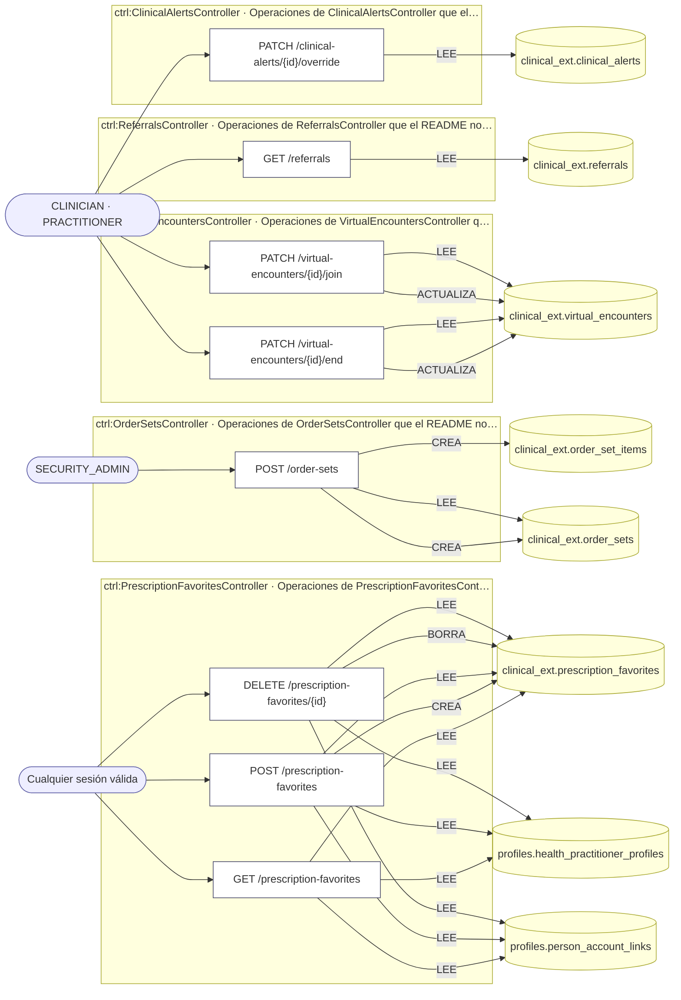

## Árbol de decisión por operación

Cada árbol se deriva del código del handler y de los métodos que invoca (hasta 4 niveles). Una rama que no decide, no escribe y no falla se poda. Los accesos y los efectos consecutivos se agrupan en un solo nodo.

### Operaciones con decisiones propias

#### 1. PATCH /care-gaps/{id}/close

Cerrar una brecha de cuidado por evento clínico

| HTTP | Código | Cuándo |
|---|---|---|
| 200 | — | Éxito |
| 400 | `VALIDATION_FAILED` | Los parámetros de ruta son UUID válidos; El cuerpo cumple el DTO (sin propiedades extra) |
| 401 | `UNAUTHENTICATED` | Hay una sesión válida (JWT) |
| 403 | `FORBIDDEN` | El rol está permitido; El tenant se resuelve y pertenece al actor |
| 404 | `NOT_FOUND` | ResourceNotFoundException: Brecha de cuidado no encontrada |
| 422 | `PRECONDITION_FAILED` | PreconditionFailedException: La brecha no está abierta |
| 429 | `RATE_LIMITED` | No se supera el límite de solicitudes |


#### 2. POST /care-gaps/recompute

Detectar y abrir brechas de cuidado (batch)

| HTTP | Código | Cuándo |
|---|---|---|
| 201 | — | Éxito |
| 400 | `VALIDATION_FAILED` | El cuerpo cumple el DTO (sin propiedades extra) |
| 401 | `UNAUTHENTICATED` | Hay una sesión válida (JWT) |
| 403 | `FORBIDDEN` | El rol está permitido; El tenant se resuelve y pertenece al actor |
| 429 | `RATE_LIMITED` | No se supera el límite de solicitudes |

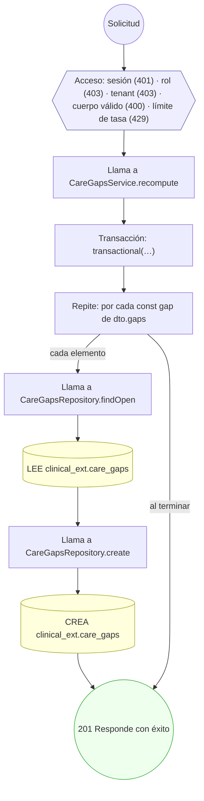

#### 3. POST /care-teams

Crear un equipo de cuidado con sus miembros

| HTTP | Código | Cuándo |
|---|---|---|
| 201 | — | Éxito |
| 400 | `VALIDATION_FAILED` | El cuerpo cumple el DTO (sin propiedades extra) |
| 401 | `UNAUTHENTICATED` | Hay una sesión válida (JWT) |
| 403 | `FORBIDDEN` | El rol está permitido; El tenant se resuelve y pertenece al actor |
| 409 | `CONFLICT` | ConflictException: A lo sumo un miembro puede ser responsable |
| 429 | `RATE_LIMITED` | No se supera el límite de solicitudes |

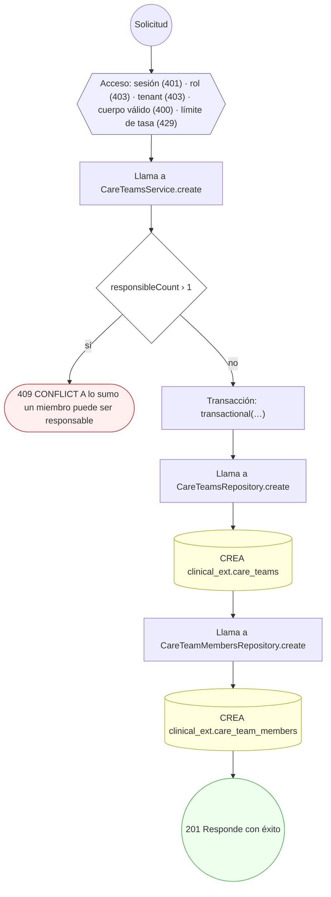

#### 4. PATCH /care-teams/{id}/members/{memberId}/set-responsible

Designar miembro responsable (transferir liderazgo)

| HTTP | Código | Cuándo |
|---|---|---|
| 200 | — | Éxito |
| 400 | `VALIDATION_FAILED` | Los parámetros de ruta son UUID válidos |
| 401 | `UNAUTHENTICATED` | Hay una sesión válida (JWT) |
| 403 | `FORBIDDEN` | El rol está permitido; El tenant se resuelve y pertenece al actor |
| 404 | `NOT_FOUND` | ResourceNotFoundException: Equipo de cuidado no encontrado; ResourceNotFoundException: Miembro no encontrado en el equipo |
| 422 | `PRECONDITION_FAILED` | PreconditionFailedException: El equipo no está activo; PreconditionFailedException: El miembro destino no está activo |
| 429 | `RATE_LIMITED` | No se supera el límite de solicitudes |

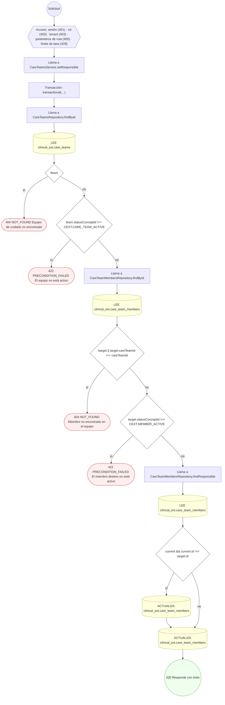

#### 5. POST /cds-rules

Crear una regla CDS en borrador

| HTTP | Código | Cuándo |
|---|---|---|
| 201 | — | Éxito |
| 400 | `VALIDATION_FAILED` | El cuerpo cumple el DTO (sin propiedades extra) |
| 401 | `UNAUTHENTICATED` | Hay una sesión válida (JWT) |
| 403 | `FORBIDDEN` | El rol está permitido; El tenant se resuelve y pertenece al actor |
| 409 | `CONFLICT` | ConflictException: El código de regla ya existe |
| 429 | `RATE_LIMITED` | No se supera el límite de solicitudes |

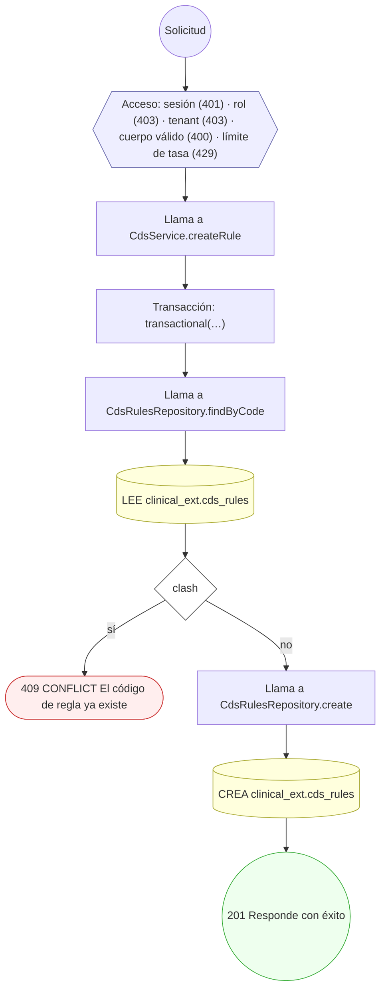

#### 6. POST /cds-rules/{id}/versions/publish

Publicar una versión de la regla CDS

| HTTP | Código | Cuándo |
|---|---|---|
| 200 | — | Éxito |
| 400 | `VALIDATION_FAILED` | Los parámetros de ruta son UUID válidos; El cuerpo cumple el DTO (sin propiedades extra) |
| 401 | `UNAUTHENTICATED` | Hay una sesión válida (JWT) |
| 403 | `FORBIDDEN` | El rol está permitido; El tenant se resuelve y pertenece al actor |
| 404 | `NOT_FOUND` | ResourceNotFoundException: Regla CDS no encontrada |
| 429 | `RATE_LIMITED` | No se supera el límite de solicitudes |

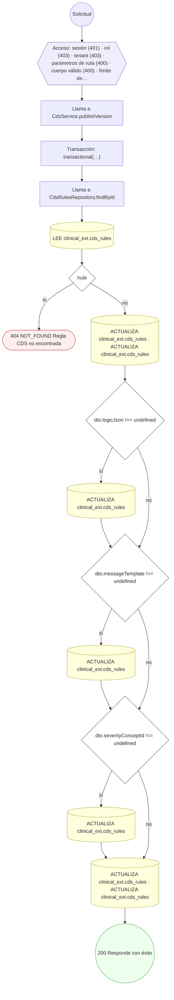

#### 7. POST /cds-rules/{id}/versions/rollback

Rollback de la versión activa de la regla CDS

| HTTP | Código | Cuándo |
|---|---|---|
| 200 | — | Éxito |
| 400 | `VALIDATION_FAILED` | Los parámetros de ruta son UUID válidos |
| 401 | `UNAUTHENTICATED` | Hay una sesión válida (JWT) |
| 403 | `FORBIDDEN` | El rol está permitido; El tenant se resuelve y pertenece al actor |
| 404 | `NOT_FOUND` | ResourceNotFoundException: Regla CDS no encontrada |
| 422 | `PRECONDITION_FAILED` | PreconditionFailedException: Solo se puede hacer rollback de una regla activa |
| 429 | `RATE_LIMITED` | No se supera el límite de solicitudes |


#### 8. POST /cds/check-interactions

Detectar interacciones medicamentosas al prescribir

| HTTP | Código | Cuándo |
|---|---|---|
| 201 | — | Éxito |
| 400 | `VALIDATION_FAILED` | El cuerpo cumple el DTO (sin propiedades extra) |
| 401 | `UNAUTHENTICATED` | Hay una sesión válida (JWT) |
| 403 | `FORBIDDEN` | El rol está permitido; El tenant se resuelve y pertenece al actor |
| 429 | `RATE_LIMITED` | No se supera el límite de solicitudes |

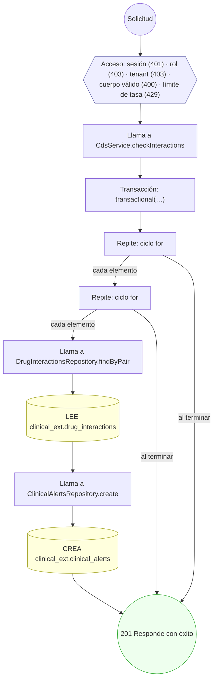

#### 9. POST /cds/evaluate

Evaluar reglas CDS y generar alertas

| HTTP | Código | Cuándo |
|---|---|---|
| 201 | — | Éxito |
| 400 | `VALIDATION_FAILED` | El cuerpo cumple el DTO (sin propiedades extra) |
| 401 | `UNAUTHENTICATED` | Hay una sesión válida (JWT) |
| 403 | `FORBIDDEN` | El rol está permitido; El tenant se resuelve y pertenece al actor |
| 429 | `RATE_LIMITED` | No se supera el límite de solicitudes |
| 500 | `INTERNAL` | UnparseableCdsRuleError: logic_json no es un objeto; UnparseableCdsRuleError: op 'in' exige un array en value; UnparseableCdsRuleError: op '{op}' exige un número en value; UnparseableCdsRuleError: operador no soportado: {op}; UnparseableCdsRuleError: nodo de lógica no reconocido |

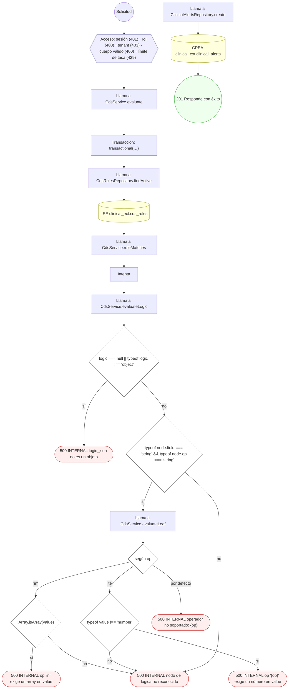

#### 10. PATCH /clinical-alerts/{id}/acknowledge

Reconocer una alerta clínica

| HTTP | Código | Cuándo |
|---|---|---|
| 200 | — | Éxito |
| 400 | `VALIDATION_FAILED` | Los parámetros de ruta son UUID válidos |
| 401 | `UNAUTHENTICATED` | Hay una sesión válida (JWT) |
| 403 | `FORBIDDEN` | El rol está permitido; El tenant se resuelve y pertenece al actor |
| 404 | `NOT_FOUND` | ResourceNotFoundException: Alerta clínica no encontrada |
| 422 | `PRECONDITION_FAILED` | PreconditionFailedException: La alerta no está activa |
| 429 | `RATE_LIMITED` | No se supera el límite de solicitudes |

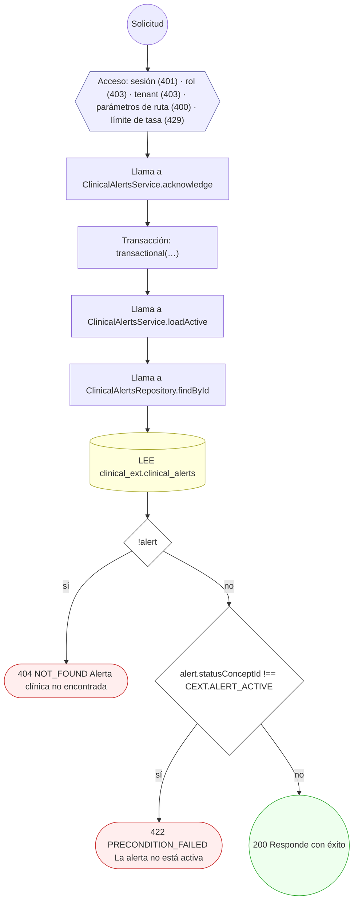

#### 11. PATCH /clinical-alerts/{id}/override

Override (sobreescribir) una alerta clínica

| HTTP | Código | Cuándo |
|---|---|---|
| 200 | — | Éxito |
| 400 | `VALIDATION_FAILED` | Los parámetros de ruta son UUID válidos; El cuerpo cumple el DTO (sin propiedades extra) |
| 401 | `UNAUTHENTICATED` | Hay una sesión válida (JWT) |
| 403 | `FORBIDDEN` | El rol está permitido; El tenant se resuelve y pertenece al actor |
| 404 | `NOT_FOUND` | ResourceNotFoundException: Alerta clínica no encontrada |
| 422 | `PRECONDITION_FAILED` | PreconditionFailedException: La alerta no está activa; PreconditionFailedException: El override de una alerta de alta severidad requiere un motivo |
| 429 | `RATE_LIMITED` | No se supera el límite de solicitudes |


#### 12. POST /order-sets

Crear una plantilla de órdenes (order set) con sus ítems

| HTTP | Código | Cuándo |
|---|---|---|
| 201 | — | Éxito |
| 400 | `VALIDATION_FAILED` | El cuerpo cumple el DTO (sin propiedades extra) |
| 401 | `UNAUTHENTICATED` | Hay una sesión válida (JWT) |
| 403 | `FORBIDDEN` | El rol está permitido; El tenant se resuelve y pertenece al actor |
| 409 | `CONFLICT` | ConflictException: El código de order set ya existe |
| 429 | `RATE_LIMITED` | No se supera el límite de solicitudes |


#### 13. POST /order-sets/{id}/apply

Aplicar un order set (fan-out de órdenes)

| HTTP | Código | Cuándo |
|---|---|---|
| 201 | — | Éxito |
| 400 | `VALIDATION_FAILED` | Los parámetros de ruta son UUID válidos; El cuerpo cumple el DTO (sin propiedades extra) |
| 401 | `UNAUTHENTICATED` | Hay una sesión válida (JWT) |
| 403 | `FORBIDDEN` | El rol está permitido; El tenant se resuelve y pertenece al actor |
| 404 | `NOT_FOUND` | ResourceNotFoundException: Order set no encontrado |
| 422 | `PRECONDITION_FAILED` | PreconditionFailedException: El order set no está activo; PreconditionFailedException: No hay ítems seleccionados para aplicar; PreconditionFailedException: Se requiere tenant custodio para materializar las órdenes del order set |
| 429 | `RATE_LIMITED` | No se supera el límite de solicitudes |


#### 14. POST /patients/{id}/immunization-plan/project

Proyectar el plan de inmunización y abrir brechas

| HTTP | Código | Cuándo |
|---|---|---|
| 201 | — | Éxito |
| 400 | `VALIDATION_FAILED` | Los parámetros de ruta son UUID válidos; El cuerpo cumple el DTO (sin propiedades extra) |
| 401 | `UNAUTHENTICATED` | Hay una sesión válida (JWT) |
| 403 | `FORBIDDEN` | El rol está permitido; El tenant se resuelve y pertenece al actor |
| 429 | `RATE_LIMITED` | No se supera el límite de solicitudes |

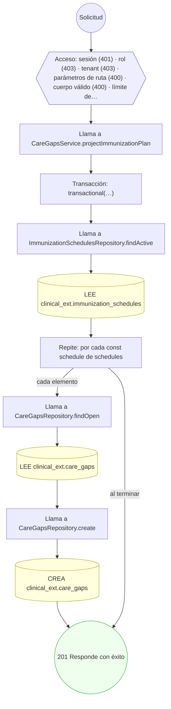

#### 15. GET /prescription-favorites

Listar mis favoritos de prescripción

| HTTP | Código | Cuándo |
|---|---|---|
| 200 | — | Éxito |
| 401 | `UNAUTHENTICATED` | Hay una sesión válida (JWT) |
| 403 | `FORBIDDEN` | El rol está permitido; El tenant se resuelve y pertenece al actor; ForbiddenException: Esta cuenta no tiene un perfil profesional asociado |
| 429 | `RATE_LIMITED` | No se supera el límite de solicitudes |

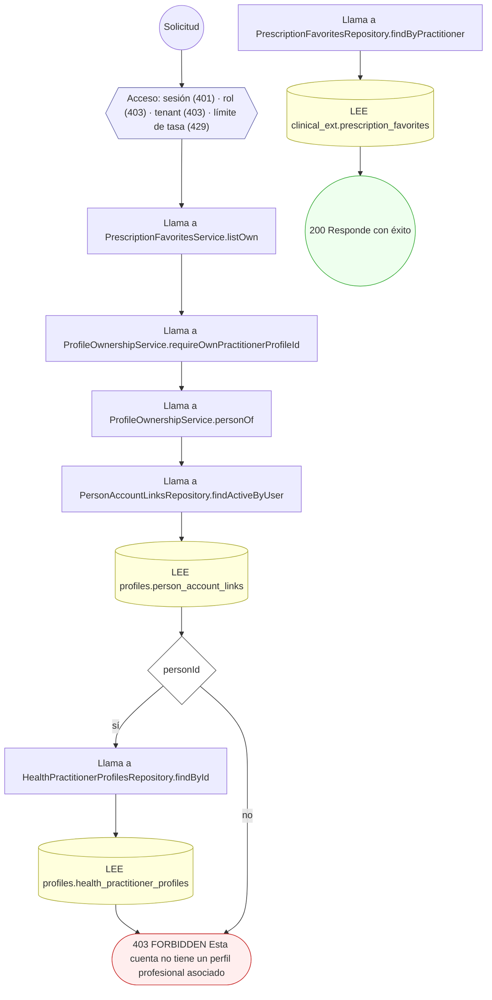

#### 16. POST /prescription-favorites

Guardar un favorito de prescripción

| HTTP | Código | Cuándo |
|---|---|---|
| 201 | — | Éxito |
| 400 | `VALIDATION_FAILED` | El cuerpo cumple el DTO (sin propiedades extra) |
| 401 | `UNAUTHENTICATED` | Hay una sesión válida (JWT) |
| 403 | `FORBIDDEN` | El rol está permitido; El tenant se resuelve y pertenece al actor; ForbiddenException: Esta cuenta no tiene un perfil profesional asociado |
| 409 | `CONFLICT` | ConflictException: Ya tenés un favorito con ese nombre |
| 422 | `PRECONDITION_FAILED` | PreconditionFailedException: La lista de favoritos llegó a su máximo; borrá alguno antes de guardar otro |
| 429 | `RATE_LIMITED` | No se supera el límite de solicitudes |


#### 17. DELETE /prescription-favorites/{id}

Borrar un favorito de prescripción propio

| HTTP | Código | Cuándo |
|---|---|---|
| 204 | — | Éxito |
| 400 | `VALIDATION_FAILED` | Los parámetros de ruta son UUID válidos |
| 401 | `UNAUTHENTICATED` | Hay una sesión válida (JWT) |
| 403 | `FORBIDDEN` | El rol está permitido; El tenant se resuelve y pertenece al actor; ForbiddenException: Esta cuenta no tiene un perfil profesional asociado |
| 404 | `NOT_FOUND` | ResourceNotFoundException: Favorito no encontrado |
| 429 | `RATE_LIMITED` | No se supera el límite de solicitudes |

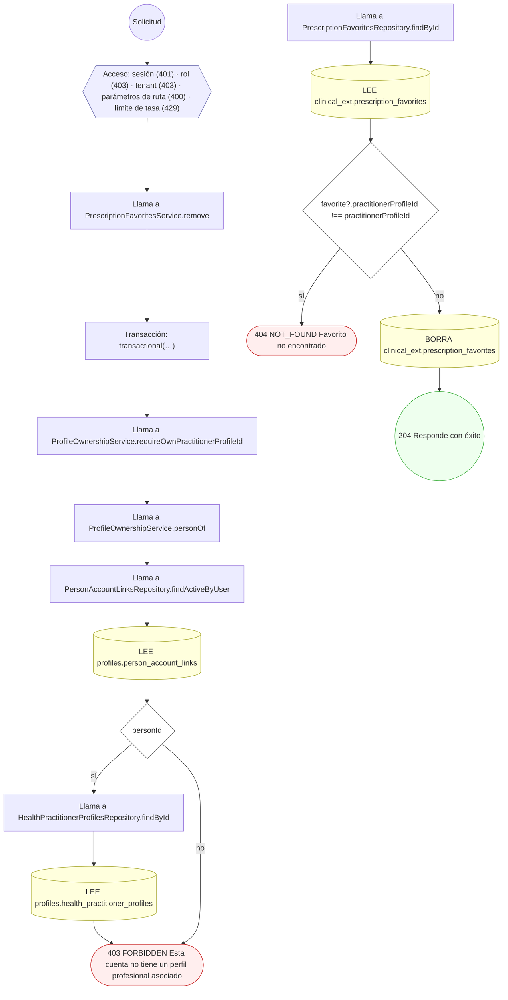

#### 18. POST /referrals

Emitir una referencia desde un encuentro

| HTTP | Código | Cuándo |
|---|---|---|
| 201 | — | Éxito |
| 400 | `VALIDATION_FAILED` | El cuerpo cumple el DTO (sin propiedades extra) |
| 401 | `UNAUTHENTICATED` | Hay una sesión válida (JWT) |
| 403 | `FORBIDDEN` | El rol está permitido; El tenant se resuelve y pertenece al actor |
| 409 | `CONFLICT` | ConflictException: Ya existe una referencia equivalente |
| 429 | `RATE_LIMITED` | No se supera el límite de solicitudes |

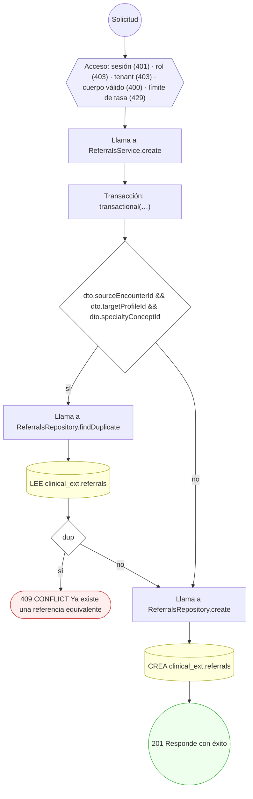

#### 19. PATCH /referrals/{id}/respond

Responder / aceptar una referencia inter-tenant

| HTTP | Código | Cuándo |
|---|---|---|
| 200 | — | Éxito |
| 400 | `VALIDATION_FAILED` | Los parámetros de ruta son UUID válidos; El cuerpo cumple el DTO (sin propiedades extra) |
| 401 | `UNAUTHENTICATED` | Hay una sesión válida (JWT) |
| 403 | `FORBIDDEN` | El rol está permitido; El tenant se resuelve y pertenece al actor |
| 404 | `NOT_FOUND` | ResourceNotFoundException: Referencia no encontrada |
| 422 | `PRECONDITION_FAILED` | PreconditionFailedException: La referencia no está en estado solicitado |
| 429 | `RATE_LIMITED` | No se supera el límite de solicitudes |

```mermaid
flowchart TD
  n1(("Solicitud")):::inicio
  n2{{"Acceso: sesión (401) · rol (403) · tenant (403) · parámetros de ruta (400) · cuerpo válido (400) · límite de…"}}:::acceso
  n1 --> n2
  n3["Llama a ReferralsService.respond"]:::llamada
  n2 --> n3
  n4["Transacción: transactional(…)"]:::transaccion
  n3 --> n4
  n5["Llama a ReferralsRepository.findById"]:::llamada
  n4 --> n5
  n6[("LEE clinical_ext.referrals")]:::efecto
  n5 --> n6
  n7{"!referral"}:::decision
  n6 --> n7
  n8(["404 NOT_FOUND Referencia no encontrada"]):::error
  n7 -->|"sí"| n8
  n9{"referral.statusConceptId !== CEXT.REFERRAL_REQUESTED"}:::decision
  n7 -->|"no"| n9
  n10(["422 PRECONDITION_FAILED La referencia no está en estado solicitado"]):::error
  n9 -->|"sí"| n10
  n11[("ACTUALIZA clinical_ext.referrals · ACTUALIZA clinical_ext.referrals")]:::efecto
  n9 -->|"no"| n11
  n12(("200 Responde con éxito")):::ok
  n11 --> n12
  classDef acceso fill:#eef,stroke:#66a
  classDef error fill:#fee,stroke:#c33
  classDef ok fill:#efe,stroke:#3a3
  classDef efecto fill:#ffd,stroke:#aa3
  classDef decision fill:#fff,stroke:#555
  classDef corte fill:#eee,stroke:#999,stroke-dasharray: 4
```

#### 20. POST /virtual-encounters

Iniciar una sesión de telesalud

| HTTP | Código | Cuándo |
|---|---|---|
| 201 | — | Éxito |
| 400 | `VALIDATION_FAILED` | El cuerpo cumple el DTO (sin propiedades extra) |
| 401 | `UNAUTHENTICATED` | Hay una sesión válida (JWT) |
| 403 | `FORBIDDEN` | El rol está permitido; El tenant se resuelve y pertenece al actor |
| 409 | `CONFLICT` | ConflictException: El encuentro ya tiene una sesión virtual |
| 429 | `RATE_LIMITED` | No se supera el límite de solicitudes |

```mermaid
flowchart TD
  n1(("Solicitud")):::inicio
  n2{{"Acceso: sesión (401) · rol (403) · tenant (403) · cuerpo válido (400) · límite de tasa (429)"}}:::acceso
  n1 --> n2
  n3["Llama a VirtualEncountersService.create"]:::llamada
  n2 --> n3
  n4["Transacción: transactional(…)"]:::transaccion
  n3 --> n4
  n5["Llama a VirtualEncountersRepository.findByEncounter"]:::llamada
  n4 --> n5
  n6[("LEE clinical_ext.virtual_encounters")]:::efecto
  n5 --> n6
  n7{"existing"}:::decision
  n6 --> n7
  n8(["409 CONFLICT El encuentro ya tiene una sesión virtual"]):::error
  n7 -->|"sí"| n8
  n9["Llama a VirtualEncountersRepository.create"]:::llamada
  n7 -->|"no"| n9
  n10[("CREA clinical_ext.virtual_encounters")]:::efecto
  n9 --> n10
  n11(("201 Responde con éxito")):::ok
  n10 --> n11
  classDef acceso fill:#eef,stroke:#66a
  classDef error fill:#fee,stroke:#c33
  classDef ok fill:#efe,stroke:#3a3
  classDef efecto fill:#ffd,stroke:#aa3
  classDef decision fill:#fff,stroke:#555
  classDef corte fill:#eee,stroke:#999,stroke-dasharray: 4
```

#### 21. PATCH /virtual-encounters/{id}/end

Finalizar una sesión de telesalud

| HTTP | Código | Cuándo |
|---|---|---|
| 200 | — | Éxito |
| 400 | `VALIDATION_FAILED` | Los parámetros de ruta son UUID válidos; El cuerpo cumple el DTO (sin propiedades extra) |
| 401 | `UNAUTHENTICATED` | Hay una sesión válida (JWT) |
| 403 | `FORBIDDEN` | El rol está permitido; El tenant se resuelve y pertenece al actor |
| 404 | `NOT_FOUND` | ResourceNotFoundException: Sesión virtual no encontrada |
| 422 | `PRECONDITION_FAILED` | PreconditionFailedException: La sesión no está en progreso |
| 429 | `RATE_LIMITED` | No se supera el límite de solicitudes |

```mermaid
flowchart TD
  n1(("Solicitud")):::inicio
  n2{{"Acceso: sesión (401) · rol (403) · tenant (403) · parámetros de ruta (400) · cuerpo válido (400) · límite de…"}}:::acceso
  n1 --> n2
  n3["Llama a VirtualEncountersService.end"]:::llamada
  n2 --> n3
  n4["Transacción: transactional(…)"]:::transaccion
  n3 --> n4
  n5["Llama a VirtualEncountersRepository.findById"]:::llamada
  n4 --> n5
  n6[("LEE clinical_ext.virtual_encounters")]:::efecto
  n5 --> n6
  n7{"!venc"}:::decision
  n6 --> n7
  n8(["404 NOT_FOUND Sesión virtual no encontrada"]):::error
  n7 -->|"sí"| n8
  n9{"venc.statusConceptId !== CEXT.VIRTUAL_ENCOUNTER_IN_PROGRESS"}:::decision
  n7 -->|"no"| n9
  n10(["422 PRECONDITION_FAILED La sesión no está en progreso"]):::error
  n9 -->|"sí"| n10
  n11[("ACTUALIZA clinical_ext.virtual_encounters · ACTUALIZA clinical_ext.virtual_encounters · ACTUALIZA clinical_ex…")]:::efecto
  n9 -->|"no"| n11
  n12(("200 Responde con éxito")):::ok
  n11 --> n12
  classDef acceso fill:#eef,stroke:#66a
  classDef error fill:#fee,stroke:#c33
  classDef ok fill:#efe,stroke:#3a3
  classDef efecto fill:#ffd,stroke:#aa3
  classDef decision fill:#fff,stroke:#555
  classDef corte fill:#eee,stroke:#999,stroke-dasharray: 4
```

#### 22. PATCH /virtual-encounters/{id}/join

Unirse a una sesión de telesalud

| HTTP | Código | Cuándo |
|---|---|---|
| 200 | — | Éxito |
| 400 | `VALIDATION_FAILED` | Los parámetros de ruta son UUID válidos |
| 401 | `UNAUTHENTICATED` | Hay una sesión válida (JWT) |
| 403 | `FORBIDDEN` | El rol está permitido; El tenant se resuelve y pertenece al actor |
| 404 | `NOT_FOUND` | ResourceNotFoundException: Sesión virtual no encontrada |
| 422 | `PRECONDITION_FAILED` | PreconditionFailedException: La sesión no está agendada |
| 429 | `RATE_LIMITED` | No se supera el límite de solicitudes |

```mermaid
flowchart TD
  n1(("Solicitud")):::inicio
  n2{{"Acceso: sesión (401) · rol (403) · tenant (403) · parámetros de ruta (400) · límite de tasa (429)"}}:::acceso
  n1 --> n2
  n3["Llama a VirtualEncountersService.join"]:::llamada
  n2 --> n3
  n4["Transacción: transactional(…)"]:::transaccion
  n3 --> n4
  n5["Llama a VirtualEncountersRepository.findById"]:::llamada
  n4 --> n5
  n6[("LEE clinical_ext.virtual_encounters")]:::efecto
  n5 --> n6
  n7{"!venc"}:::decision
  n6 --> n7
  n8(["404 NOT_FOUND Sesión virtual no encontrada"]):::error
  n7 -->|"sí"| n8
  n9{"venc.statusConceptId !== CEXT.VIRTUAL_ENCOUNTER_SCHEDULED"}:::decision
  n7 -->|"no"| n9
  n10(["422 PRECONDITION_FAILED La sesión no está agendada"]):::error
  n9 -->|"sí"| n10
  n11[("ACTUALIZA clinical_ext.virtual_encounters · ACTUALIZA clinical_ext.virtual_encounters")]:::efecto
  n9 -->|"no"| n11
  n12(("200 Responde con éxito")):::ok
  n11 --> n12
  classDef acceso fill:#eef,stroke:#66a
  classDef error fill:#fee,stroke:#c33
  classDef ok fill:#efe,stroke:#3a3
  classDef efecto fill:#ffd,stroke:#aa3
  classDef decision fill:#fff,stroke:#555
  classDef corte fill:#eee,stroke:#999,stroke-dasharray: 4
```

### Operaciones sin decisiones propias

Sólo comprueban el acceso y leen o escriben: no tienen ramas que dibujar. Su detalle está en la ficha de endpoints.

| Operación | Respuestas posibles | Tablas |
|---|---|---|
| GET /care-teams | 200, 400, 401, 403, 429 | 1 |
| POST /drug-interactions | 201, 400, 401, 403, 429 | 1 |
| POST /immunization-schedules | 201, 400, 401, 403, 429 | 1 |
| GET /referrals | 200, 400, 401, 403, 429 | 1 |
