<!-- AUTOGENERADO por tools/inventario/flujos.mjs. No editar manualmente. -->

# Flujos del módulo `clinical_ext`

- **Procesos:** 1 · **Máquinas de estado:** 0
- **Operaciones:** 32 (29 con decisiones propias, 3 sin ellas)
- Inventario de endpoints del módulo: [clinical_ext](../endpoints/clinical_ext.md)

## Proceso: `clinical_ext` — coordinación y soporte clínico

- **Código:** `clinical_ext` · **Agrupación:** AGRUPACION_POR_CONTROLADOR · **Operaciones:** 32
- **Actores:** CLINICIAN · Cualquier sesión válida · PATIENT · PRACTITIONER · SECURITY_ADMIN
- **Revisión:** AUTO_DETECTADA
- **Fuentes:** `src/modules/clinical_ext/README.md`

### Para qué sirve

El módulo implementa equipos de cuidado, reglas CDS, alertas, interacciones, plantillas de órdenes, referencias, brechas de cuidado, calendario de inmunización, encuentros virtuales y favoritos de prescripción. Tiene ocho controladores y **27 endpoints**. Este README describe el código de la rama actual.

_Fuente: `src/modules/clinical_ext/README.md:3`_

### Etapas y operaciones

| Etapa | Descripción | Operación | Quién actúa | Riesgo | Tablas |
|---|---|---|---|---|---|
| `ctrl:CareGapsController` | Operaciones de CareGapsController que el README no asigna a un caso de uso | PATCH /care-gaps/{id}/close | CLINICIAN · PRACTITIONER | MEDIO | 2 |
|  |  | POST /care-gaps/recompute | CLINICIAN · PRACTITIONER | MEDIO | 18 |
|  |  | POST /immunization-schedules | SECURITY_ADMIN | MEDIO | 1 |
|  |  | POST /patients/{id}/immunization-plan/project | CLINICIAN · PRACTITIONER | MEDIO | 20 |
| `ctrl:CareTeamsController` | Operaciones de CareTeamsController que el README no asigna a un caso de uso | GET /care-teams | CLINICIAN · PRACTITIONER | BAJO | 19 |
|  |  | POST /care-teams | CLINICIAN · PRACTITIONER | MEDIO | 18 |
|  |  | PATCH /care-teams/{id}/members/{memberId}/set-responsible | CLINICIAN · PRACTITIONER | MEDIO | 3 |
| `ctrl:CdsController` | Operaciones de CdsController que el README no asigna a un caso de uso | POST /cds-rules | SECURITY_ADMIN | MEDIO | 2 |
|  |  | POST /cds-rules/{id}/versions/publish | SECURITY_ADMIN | MEDIO | 2 |
|  |  | POST /cds-rules/{id}/versions/rollback | SECURITY_ADMIN | MEDIO | 2 |
|  |  | POST /cds/check-interactions | CLINICIAN · PRACTITIONER | BAJO | 1 |
|  |  | POST /cds/evaluate | CLINICIAN · PRACTITIONER | MEDIO | 2 |
|  |  | POST /drug-interactions | SECURITY_ADMIN | MEDIO | 1 |
| `ctrl:ClinicalAlertsController` | Operaciones de ClinicalAlertsController que el README no asigna a un caso de uso | PATCH /clinical-alerts/{id}/acknowledge | CLINICIAN · PRACTITIONER | BAJO | 1 |
|  |  | PATCH /clinical-alerts/{id}/override | CLINICIAN · PRACTITIONER | BAJO | 1 |
| `ctrl:OrderSetsController` | Operaciones de OrderSetsController que el README no asigna a un caso de uso | POST /order-sets | SECURITY_ADMIN | MEDIO | 3 |
|  |  | POST /order-sets/{id}/apply | CLINICIAN · PRACTITIONER | MEDIO | 20 |
| `ctrl:PrescriptionFavoritesController` | Operaciones de PrescriptionFavoritesController que el README no asigna a un caso de uso | GET /prescription-favorites | Cualquier sesión válida | BAJO | 3 |
|  |  | POST /prescription-favorites | Cualquier sesión válida | ALTO | 4 |
|  |  | DELETE /prescription-favorites/{id} | Cualquier sesión válida | ALTO | 4 |
| `ctrl:ReferralsController` | Operaciones de ReferralsController que el README no asigna a un caso de uso | GET /referrals | CLINICIAN · PRACTITIONER | BAJO | 22 |
|  |  | POST /referrals | CLINICIAN · PRACTITIONER | MEDIO | 38 |
|  |  | GET /referrals/{id} | CLINICIAN · PRACTITIONER | BAJO | 21 |
|  |  | PATCH /referrals/{id}/cancel | CLINICIAN · PRACTITIONER | MEDIO | 20 |
|  |  | PATCH /referrals/{id}/counter-referral | CLINICIAN · PRACTITIONER | MEDIO | 20 |
|  |  | PATCH /referrals/{id}/respond | CLINICIAN · PRACTITIONER | MEDIO | 3 |
|  |  | GET /referrals/me | CLINICIAN · PRACTITIONER · PATIENT | BAJO | 6 |
|  |  | GET /referrals/target-services | CLINICIAN · PRACTITIONER | BAJO | 4 |
|  |  | GET /referrals/targets | CLINICIAN · PRACTITIONER | BAJO | 5 |
| `ctrl:VirtualEncountersController` | Operaciones de VirtualEncountersController que el README no asigna a un caso de uso | POST /virtual-encounters | CLINICIAN · PRACTITIONER | MEDIO | 4 |
|  |  | PATCH /virtual-encounters/{id}/end | CLINICIAN · PRACTITIONER | MEDIO | 4 |
|  |  | PATCH /virtual-encounters/{id}/join | CLINICIAN · PRACTITIONER · PATIENT | MEDIO | 4 |

### Diagrama 1 de 2 — etapas `ctrl:CareGapsController`, `ctrl:CareTeamsController`, `ctrl:CdsController`…

```mermaid
flowchart LR
  a2(["CLINICIAN · PRACTITIONER"]):::actor
  a13(["SECURITY_ADMIN"]):::actor
  a41(["Cualquier sesión válida"]):::actor
  t3[("clinical_ext.care_gaps")]:::tabla
  t5[("authz.access_policies")]:::tabla
  t6[("authz.care_relationships")]:::tabla
  t7[("authz.clinical_access_grants")]:::tabla
  t8[("authz.field_permissions")]:::tabla
  t9[("authz.patient_legal_representations")]:::tabla
  t10[("authz.permissions")]:::tabla
  t14[("clinical_ext.immunization_schedules")]:::tabla
  t22[("clinical_ext.care_team_members")]:::tabla
  t23[("clinical_ext.care_teams")]:::tabla
  t25[("clinical_ext.cds_rules")]:::tabla
  t29[("clinical_ext.drug_interactions")]:::tabla
  t31[("clinical_ext.clinical_alerts")]:::tabla
  t36[("clinical_ext.order_set_items")]:::tabla
  t37[("clinical_ext.order_sets")]:::tabla
  t42[("clinical_ext.prescription_favorites")]:::tabla
  t43[("profiles.health_practitioner_profiles")]:::tabla
  t44[("profiles.person_account_links")]:::tabla
  t11[("+12 tablas más")]
  t16[("+14 tablas más")]
  subgraph s0["ctrl:CareGapsController · Operaciones de CareGapsController que el README no as…"]
    o1["PATCH /care-gaps/{id}/close"]:::op
    o4["POST /care-gaps/recompute"]:::op
    o12["POST /immunization-schedules"]:::op
    o15["POST /patients/{id}/immunization-plan/project"]:::op
  end
  t18[("+13 tablas más")]
  t20[("+12 tablas más")]
  subgraph s1["ctrl:CareTeamsController · Operaciones de CareTeamsController que el README no…"]
    o17["GET /care-teams"]:::op
    o19["POST /care-teams"]:::op
    o21["PATCH /care-teams/{id}/members/{memberId}/set-responsible"]:::op
  end
  subgraph s2["ctrl:CdsController · Operaciones de CdsController que el README no asigna a un…"]
    o24["POST /cds-rules"]:::op
    o26["POST /cds-rules/{id}/versions/publish"]:::op
    o27["POST /cds-rules/{id}/versions/rollback"]:::op
    o28["POST /cds/check-interactions"]:::op
    o30["POST /cds/evaluate"]:::op
    o32["POST /drug-interactions"]:::op
  end
  subgraph s3["ctrl:ClinicalAlertsController · Operaciones de ClinicalAlertsController que el…"]
    o33["PATCH /clinical-alerts/{id}/acknowledge"]:::op
    o34["PATCH /clinical-alerts/{id}/override"]:::op
  end
  t39[("+14 tablas más")]
  subgraph s4["ctrl:OrderSetsController · Operaciones de OrderSetsController que el README no…"]
    o35["POST /order-sets"]:::op
    o38["POST /order-sets/{id}/apply"]:::op
  end
  subgraph s5["ctrl:PrescriptionFavoritesController · Operaciones de PrescriptionFavoritesCont…"]
    o40["GET /prescription-favorites"]:::op
    o45["POST /prescription-favorites"]:::op
    o46["DELETE /prescription-favorites/{id}"]:::op
  end
  a2 --> o1
  o1 -->|"ACTUALIZA"| t3
  o1 -->|"LEE"| t3
  a2 --> o4
  o4 -->|"LEE"| t5
  o4 -->|"LEE"| t6
  o4 -->|"LEE"| t7
  o4 -->|"LEE"| t8
  o4 -->|"LEE"| t9
  o4 -->|"LEE"| t10
  o4 -.-> t11
  a13 --> o12
  o12 -->|"CREA"| t14
  a2 --> o15
  o15 -->|"LEE"| t5
  o15 -->|"LEE"| t6
  o15 -->|"LEE"| t7
  o15 -->|"LEE"| t8
  o15 -->|"LEE"| t9
  o15 -->|"LEE"| t10
  o15 -.-> t16
  a2 --> o17
  o17 -->|"LEE"| t5
  o17 -->|"LEE"| t6
  o17 -->|"LEE"| t7
  o17 -->|"LEE"| t8
  o17 -->|"LEE"| t9
  o17 -->|"LEE"| t10
  o17 -.-> t18
  a2 --> o19
  o19 -->|"LEE"| t5
  o19 -->|"LEE"| t6
  o19 -->|"LEE"| t7
  o19 -->|"LEE"| t8
  o19 -->|"LEE"| t9
  o19 -->|"LEE"| t10
  o19 -.-> t20
  a2 --> o21
  o21 -->|"ACTUALIZA"| t22
  o21 -->|"LEE"| t22
  o21 -->|"LEE"| t23
  a13 --> o24
  o24 -->|"CREA"| t25
  o24 -->|"LEE"| t25
  a13 --> o26
  o26 -->|"ACTUALIZA"| t25
  o26 -->|"LEE"| t25
  a13 --> o27
  o27 -->|"ACTUALIZA"| t25
  o27 -->|"LEE"| t25
  a2 --> o28
  o28 -->|"LEE"| t29
  a2 --> o30
  o30 -->|"LEE"| t25
  o30 -->|"CREA"| t31
  a13 --> o32
  o32 -->|"CREA"| t29
  a2 --> o33
  o33 -->|"LEE"| t31
  a2 --> o34
  o34 -->|"LEE"| t31
  a13 --> o35
  o35 -->|"CREA"| t36
  o35 -->|"CREA"| t37
  o35 -->|"LEE"| t37
  a2 --> o38
  o38 -->|"LEE"| t5
  o38 -->|"LEE"| t6
  o38 -->|"LEE"| t7
  o38 -->|"LEE"| t8
  o38 -->|"LEE"| t9
  o38 -->|"LEE"| t10
  o38 -.-> t39
  a41 --> o40
  o40 -->|"LEE"| t42
  o40 -->|"LEE"| t43
  o40 -->|"LEE"| t44
  a41 --> o45
  o45 -->|"CREA"| t42
  o45 -->|"LEE"| t42
  o45 -->|"LEE"| t43
  o45 -->|"LEE"| t44
  a41 --> o46
  o46 -->|"BORRA"| t42
  o46 -->|"LEE"| t42
  o46 -->|"LEE"| t43
  o46 -->|"LEE"| t44
  classDef op fill:#fff,stroke:#446
  classDef actor fill:#eef,stroke:#66a
  classDef tabla fill:#ffd,stroke:#aa3
  classDef evento fill:#efe,stroke:#3a3
```

### Diagrama 2 de 2 — etapas `ctrl:ReferralsController`, `ctrl:VirtualEncountersController`

```mermaid
flowchart LR
  a2(["CLINICIAN · PRACTITIONER"]):::actor
  a22(["CLINICIAN · PRACTITIONER · PATIENT"]):::actor
  t3[("authz.access_policies")]:::tabla
  t4[("authz.care_relationships")]:::tabla
  t5[("authz.clinical_access_grants")]:::tabla
  t6[("authz.field_permissions")]:::tabla
  t7[("authz.patient_legal_representations")]:::tabla
  t8[("authz.permissions")]:::tabla
  t19[("clinical_ext.referrals")]:::tabla
  t20[("directory.branches")]:::tabla
  t23[("billing.service_catalog")]:::tabla
  t24[("directory.tenants")]:::tabla
  t25[("profiles.patient_profiles")]:::tabla
  t26[("profiles.person_account_links")]:::tabla
  t28[("practice.practices")]:::tabla
  t29[("scheduling.practitioner_service_offerings")]:::tabla
  t30[("terminology.catalog_concepts")]:::tabla
  t32[("practice.practitioner_role_assignments")]:::tabla
  t33[("profiles.health_practitioner_profiles")]:::tabla
  t34[("profiles.persons")]:::tabla
  t36[("clinical_ext.virtual_encounters")]:::tabla
  t37[("clinical.encounter_participants")]:::tabla
  t38[("clinical.encounters")]:::tabla
  t9[("+16 tablas más")]
  t11[("+32 tablas más")]
  t13[("+15 tablas más")]
  t15[("+14 tablas más")]
  t17[("+14 tablas más")]
  subgraph s0["ctrl:ReferralsController · Operaciones de ReferralsController que el README no…"]
    o1["GET /referrals"]:::op
    o10["POST /referrals"]:::op
    o12["GET /referrals/{id}"]:::op
    o14["PATCH /referrals/{id}/cancel"]:::op
    o16["PATCH /referrals/{id}/counter-referral"]:::op
    o18["PATCH /referrals/{id}/respond"]:::op
    o21["GET /referrals/me"]:::op
    o27["GET /referrals/target-services"]:::op
    o31["GET /referrals/targets"]:::op
  end
  subgraph s1["ctrl:VirtualEncountersController · Operaciones de VirtualEncountersController q…"]
    o35["POST /virtual-encounters"]:::op
    o39["PATCH /virtual-encounters/{id}/end"]:::op
    o40["PATCH /virtual-encounters/{id}/join"]:::op
  end
  a2 --> o1
  o1 -->|"LEE"| t3
  o1 -->|"LEE"| t4
  o1 -->|"LEE"| t5
  o1 -->|"LEE"| t6
  o1 -->|"LEE"| t7
  o1 -->|"LEE"| t8
  o1 -.-> t9
  a2 --> o10
  o10 -->|"LEE"| t3
  o10 -->|"LEE"| t4
  o10 -->|"LEE"| t5
  o10 -->|"LEE"| t6
  o10 -->|"LEE"| t7
  o10 -->|"LEE"| t8
  o10 -.-> t11
  a2 --> o12
  o12 -->|"LEE"| t3
  o12 -->|"LEE"| t4
  o12 -->|"LEE"| t5
  o12 -->|"LEE"| t6
  o12 -->|"LEE"| t7
  o12 -->|"LEE"| t8
  o12 -.-> t13
  a2 --> o14
  o14 -->|"LEE"| t3
  o14 -->|"LEE"| t4
  o14 -->|"LEE"| t5
  o14 -->|"LEE"| t6
  o14 -->|"LEE"| t7
  o14 -->|"LEE"| t8
  o14 -.-> t15
  a2 --> o16
  o16 -->|"LEE"| t3
  o16 -->|"LEE"| t4
  o16 -->|"LEE"| t5
  o16 -->|"LEE"| t6
  o16 -->|"LEE"| t7
  o16 -->|"LEE"| t8
  o16 -.-> t17
  a2 --> o18
  o18 -->|"ACTUALIZA"| t19
  o18 -->|"LEE"| t19
  o18 -->|"LEE"| t20
  a22 --> o21
  o21 -->|"LEE"| t23
  o21 -->|"LEE"| t19
  o21 -->|"LEE"| t20
  o21 -->|"LEE"| t24
  o21 -->|"LEE"| t25
  o21 -->|"LEE"| t26
  a2 --> o27
  o27 -->|"LEE"| t23
  o27 -->|"LEE"| t28
  o27 -->|"LEE"| t29
  o27 -->|"LEE"| t30
  a2 --> o31
  o31 -->|"LEE"| t24
  o31 -->|"LEE"| t28
  o31 -->|"LEE"| t32
  o31 -->|"LEE"| t33
  o31 -->|"LEE"| t34
  a2 --> o35
  o35 -->|"CREA"| t36
  o35 -->|"LEE"| t36
  o35 -->|"LEE"| t37
  o35 -->|"LEE"| t38
  a2 --> o39
  o39 -->|"ACTUALIZA"| t36
  o39 -->|"LEE"| t36
  o39 -->|"LEE"| t37
  o39 -->|"LEE"| t38
  a22 --> o40
  o40 -->|"ACTUALIZA"| t36
  o40 -->|"LEE"| t36
  o40 -->|"LEE"| t37
  o40 -->|"LEE"| t38
  classDef op fill:#fff,stroke:#446
  classDef actor fill:#eef,stroke:#66a
  classDef tabla fill:#ffd,stroke:#aa3
  classDef evento fill:#efe,stroke:#3a3
```

## Árbol de decisión por operación

Cada árbol se deriva del código del handler y de los métodos que invoca (hasta 4 niveles). Una rama que no decide, no escribe y no falla se poda. Los accesos y los efectos consecutivos se agrupan en un solo nodo.

### Operaciones con decisiones propias

#### 1. PATCH /care-gaps/{id}/close

Cerrar una brecha de cuidado por evento clínico

| HTTP | Código | Cuándo |
|---|---|---|
| 200 | — | Éxito |
| 400 | `VALIDATION_FAILED` | Los parámetros de ruta son UUID válidos; El cuerpo cumple el DTO (sin propiedades extra) |
| 401 | `UNAUTHENTICATED` | Hay una sesión válida (JWT) |
| 403 | `FORBIDDEN` | El rol está permitido; El tenant se resuelve y pertenece al actor |
| 404 | `NOT_FOUND` | ResourceNotFoundException: {notFound.message} |
| 422 | `PRECONDITION_FAILED` | PreconditionFailedException: La brecha no está abierta |
| 429 | `RATE_LIMITED` | No se supera el límite de solicitudes |

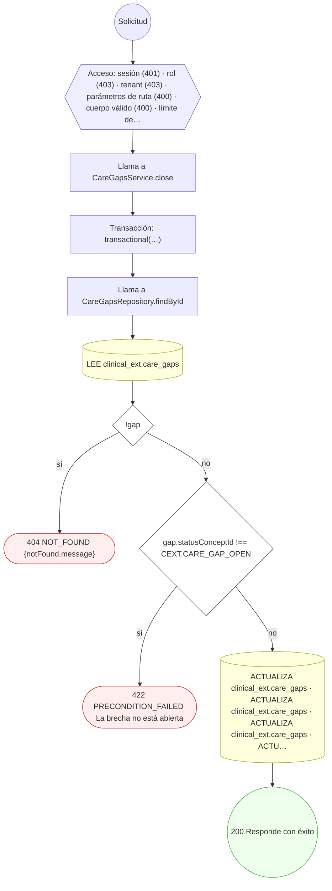

#### 2. POST /care-gaps/recompute

Detectar y abrir brechas de cuidado (batch)

| HTTP | Código | Cuándo |
|---|---|---|
| 201 | — | Éxito |
| 400 | `VALIDATION_FAILED` | El cuerpo cumple el DTO (sin propiedades extra) |
| 401 | `UNAUTHENTICATED` | Hay una sesión válida (JWT) |
| 403 | `FORBIDDEN` | El rol está permitido; El tenant se resuelve y pertenece al actor; ForbiddenException: {WITHOUT_ACCESS_TO_HISTORY} |
| 429 | `RATE_LIMITED` | No se supera el límite de solicitudes |

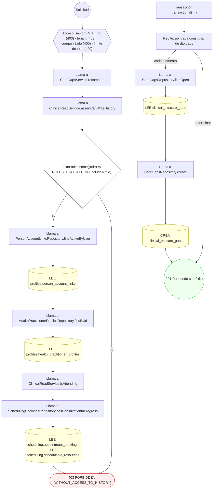

#### 3. GET /care-teams

Listar equipos de cuidado de un paciente

| HTTP | Código | Cuándo |
|---|---|---|
| 200 | — | Éxito |
| 400 | `VALIDATION_FAILED` | Están los parámetros de consulta obligatorios |
| 401 | `UNAUTHENTICATED` | Hay una sesión válida (JWT) |
| 403 | `FORBIDDEN` | El rol está permitido; El tenant se resuelve y pertenece al actor; ForbiddenException: {WITHOUT_ACCESS_TO_HISTORY} |
| 429 | `RATE_LIMITED` | No se supera el límite de solicitudes |

```mermaid
flowchart TD
  n1(("Solicitud")):::inicio
  n2{{"Acceso: sesión (401) · rol (403) · tenant (403) · parámetros de consulta (400) · límite de tasa (429)"}}:::acceso
  n1 --> n2
  n3["Llama a CareTeamsService.listByPatient"]:::llamada
  n2 --> n3
  n4["Llama a ClinicalReadService.assertCanReadHistory"]:::llamada
  n3 --> n4
  n5{"!actor.roles.some((role) =› ROLES_THAT_ATTEND.includes(role))"}:::decision
  n4 --> n5
  n6["Llama a ClinicalReadService.assertOwnRecord"]:::llamada
  n5 -->|"sí"| n6
  n7["Llama a PersonAccountLinksRepository.findActiveByUser"]:::llamada
  n6 --> n7
  n8[("LEE profiles.person_account_links")]:::efecto
  n7 --> n8
  n9["Llama a PatientProfilesRepository.findById"]:::llamada
  n8 --> n9
  n10[("LEE profiles.patient_profiles")]:::efecto
  n9 --> n10
  n11{"!link || !profile || profile.profileId !== link.personId"}:::decision
  n10 --> n11
  n12(["403 FORBIDDEN {WITHOUT_ACCESS_TO_HISTORY}"]):::error
  n11 -->|"sí"| n12
  n13["Llama a PersonAccountLinksRepository.findActiveByUser"]:::llamada
  n11 -->|"no"| n13
  n5 -->|"no"| n13
  n14[("LEE profiles.person_account_links")]:::efecto
  n13 --> n14
  n15["Llama a HealthPractitionerProfilesRepository.findById"]:::llamada
  n14 --> n15
  n16[("LEE profiles.health_practitioner_profiles")]:::efecto
  n15 --> n16
  n17["Llama a ClinicalReadService.isAttending"]:::llamada
  n16 --> n17
  n18["Llama a SchedulingBookingsRepository.hasConsultationInProgress"]:::llamada
  n17 --> n18
  n19[("LEE scheduling.appointment_bookings · LEE scheduling.schedulable_resources")]:::efecto
  n18 --> n19
  n20["Llama a ClinicalReadService.assertOwnRecord"]:::llamada
  n19 --> n20
  n21["Llama a PersonAccountLinksRepository.findActiveByUser"]:::llamada
  n20 --> n21
  n22[("LEE profiles.person_account_links")]:::efecto
  n21 --> n22
  n23["Llama a PatientProfilesRepository.findById"]:::llamada
  n22 --> n23
  n24[("LEE profiles.patient_profiles")]:::efecto
  n23 --> n24
  n25{"!link || !profile || profile.profileId !== link.personId"}:::decision
  n24 --> n25
  n26(["403 FORBIDDEN {WITHOUT_ACCESS_TO_HISTORY}"]):::error
  n25 -->|"sí"| n26
  n27["Llama a CareTeamsRepository.findByPatient"]:::llamada
  n25 -->|"no"| n27
  n28[("LEE clinical_ext.care_teams")]:::efecto
  n27 --> n28
  n29(("200 Responde con éxito")):::ok
  n28 --> n29
  classDef acceso fill:#eef,stroke:#66a
  classDef error fill:#fee,stroke:#c33
  classDef ok fill:#efe,stroke:#3a3
  classDef efecto fill:#ffd,stroke:#aa3
  classDef decision fill:#fff,stroke:#555
  classDef corte fill:#eee,stroke:#999,stroke-dasharray: 4
```

#### 4. POST /care-teams

Crear un equipo de cuidado con sus miembros

| HTTP | Código | Cuándo |
|---|---|---|
| 201 | — | Éxito |
| 400 | `VALIDATION_FAILED` | El cuerpo cumple el DTO (sin propiedades extra) |
| 401 | `UNAUTHENTICATED` | Hay una sesión válida (JWT) |
| 403 | `FORBIDDEN` | El rol está permitido; El tenant se resuelve y pertenece al actor; ForbiddenException: {WITHOUT_ACCESS_TO_HISTORY} |
| 409 | `CONFLICT` | ConflictException: A lo sumo un miembro puede ser responsable |
| 429 | `RATE_LIMITED` | No se supera el límite de solicitudes |

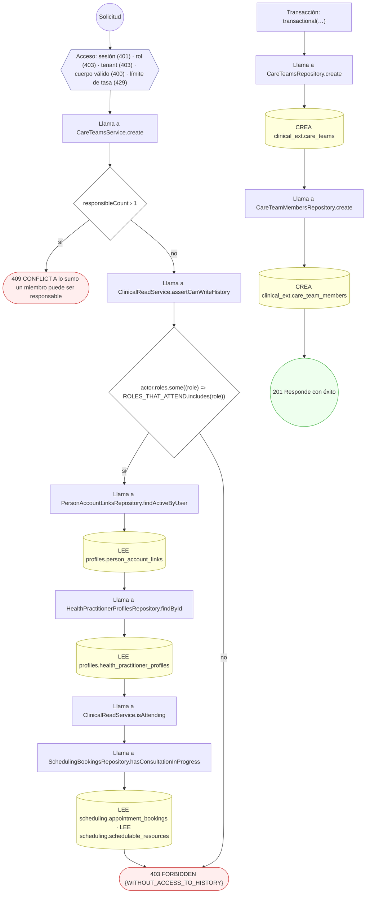

#### 5. PATCH /care-teams/{id}/members/{memberId}/set-responsible

Designar miembro responsable (transferir liderazgo)

| HTTP | Código | Cuándo |
|---|---|---|
| 200 | — | Éxito |
| 400 | `VALIDATION_FAILED` | Los parámetros de ruta son UUID válidos |
| 401 | `UNAUTHENTICATED` | Hay una sesión válida (JWT) |
| 403 | `FORBIDDEN` | El rol está permitido; El tenant se resuelve y pertenece al actor |
| 404 | `NOT_FOUND` | ResourceNotFoundException: Miembro no encontrado en el equipo |
| 422 | `PRECONDITION_FAILED` | PreconditionFailedException: El equipo no está activo; PreconditionFailedException: El miembro destino no está activo |
| 429 | `RATE_LIMITED` | No se supera el límite de solicitudes |

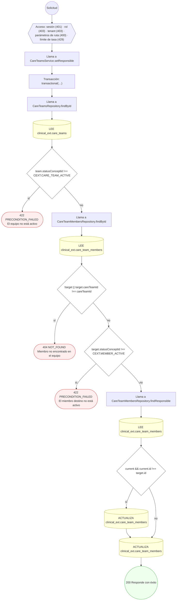

#### 6. POST /cds-rules

Crear una regla CDS en borrador

| HTTP | Código | Cuándo |
|---|---|---|
| 201 | — | Éxito |
| 400 | `VALIDATION_FAILED` | El cuerpo cumple el DTO (sin propiedades extra) |
| 401 | `UNAUTHENTICATED` | Hay una sesión válida (JWT) |
| 403 | `FORBIDDEN` | El rol está permitido; El tenant se resuelve y pertenece al actor |
| 409 | `CONFLICT` | ConflictException: El código de regla ya existe |
| 422 | `PRECONDITION_FAILED` | PreconditionFailedException: La lógica de la regla no se puede interpretar |
| 429 | `RATE_LIMITED` | No se supera el límite de solicitudes |
| 500 | `INTERNAL` | UnparseableCdsRuleError: logic_json no es un objeto; UnparseableCdsRuleError: op 'in' exige un array en value; UnparseableCdsRuleError: op '{op}' exige un número en value; UnparseableCdsRuleError: operador no soportado: {op}; UnparseableCdsRuleError: nodo de lógica no reconocido |


#### 7. POST /cds-rules/{id}/versions/publish

Publicar una versión de la regla CDS

| HTTP | Código | Cuándo |
|---|---|---|
| 200 | — | Éxito |
| 400 | `VALIDATION_FAILED` | Los parámetros de ruta son UUID válidos; El cuerpo cumple el DTO (sin propiedades extra) |
| 401 | `UNAUTHENTICATED` | Hay una sesión válida (JWT) |
| 403 | `FORBIDDEN` | El rol está permitido; El tenant se resuelve y pertenece al actor |
| 404 | `NOT_FOUND` | ResourceNotFoundException: Regla CDS no encontrada |
| 422 | `PRECONDITION_FAILED` | PreconditionFailedException: La lógica de la regla no se puede interpretar |
| 429 | `RATE_LIMITED` | No se supera el límite de solicitudes |
| 500 | `INTERNAL` | UnparseableCdsRuleError: logic_json no es un objeto; UnparseableCdsRuleError: op 'in' exige un array en value; UnparseableCdsRuleError: op '{op}' exige un número en value; UnparseableCdsRuleError: operador no soportado: {op}; UnparseableCdsRuleError: nodo de lógica no reconocido |

```mermaid
flowchart TD
  n1(("Solicitud")):::inicio
  n2{{"Acceso: sesión (401) · rol (403) · tenant (403) · parámetros de ruta (400) · cuerpo válido (400) · límite de…"}}:::acceso
  n1 --> n2
  n3["Llama a CdsService.publishVersion"]:::llamada
  n2 --> n3
  n4["Transacción: transactional(…)"]:::transaccion
  n3 --> n4
  n5["Llama a CdsRulesRepository.findById"]:::llamada
  n4 --> n5
  n6[("LEE clinical_ext.cds_rules")]:::efecto
  n5 --> n6
  n7{"!rule"}:::decision
  n6 --> n7
  n8(["404 NOT_FOUND Regla CDS no encontrada"]):::error
  n7 -->|"sí"| n8
  n9[("ACTUALIZA clinical_ext.cds_rules · ACTUALIZA clinical_ext.cds_rules")]:::efecto
  n7 -->|"no"| n9
  n10{"dto.logicJson !== undefined"}:::decision
  n9 --> n10
  n11[("ACTUALIZA clinical_ext.cds_rules")]:::efecto
  n10 -->|"sí"| n11
  n12{"dto.messageTemplate !== undefined"}:::decision
  n11 --> n12
  n10 -->|"no"| n12
  n13[("ACTUALIZA clinical_ext.cds_rules")]:::efecto
  n12 -->|"sí"| n13
  n14{"dto.severityConceptId !== undefined"}:::decision
  n13 --> n14
  n12 -->|"no"| n14
  n15[("ACTUALIZA clinical_ext.cds_rules")]:::efecto
  n14 -->|"sí"| n15
  n16["Llama a CdsService.assertLogicReadable"]:::llamada
  n15 --> n16
  n14 -->|"no"| n16
  n17["Intenta"]:::intento
  n16 --> n17
  n18["Llama a CdsService.walkLogic"]:::llamada
  n17 --> n18
  n19{"logic === null || typeof logic !== 'object'"}:::decision
  n18 --> n19
  n20(["500 INTERNAL logic_json no es un objeto"]):::error
  n19 -->|"sí"| n20
  n21{"typeof node.field === 'string' && typeof node.op === 'string'"}:::decision
  n19 -->|"no"| n21
  n22["Llama a CdsService.evaluateLeaf"]:::llamada
  n21 -->|"sí"| n22
  n23{"según op"}:::decision
  n22 --> n23
  n24{"!Array.isArray(value)"}:::decision
  n23 -->|"'in'"| n24
  n25(["500 INTERNAL op 'in' exige un array en value"]):::error
  n24 -->|"sí"| n25
  n26{"typeof value !== 'number'"}:::decision
  n23 -->|"'lte'"| n26
  n27(["500 INTERNAL op '{op}' exige un número en value"]):::error
  n26 -->|"sí"| n27
  n28(["500 INTERNAL operador no soportado: {op}"]):::error
  n23 -->|"por defecto"| n28
  n29(["500 INTERNAL nodo de lógica no reconocido"]):::error
  n24 -->|"no"| n29
  n26 -->|"no"| n29
  n21 -->|"no"| n29
  n30{"!(err instanceof UnparseableCdsRuleError)"}:::decision
  n17 -->|"si falla"| n30
  n31(["↩ (relanza el error capturado)"]):::error
  n30 -->|"sí"| n31
  n32(["422 PRECONDITION_FAILED La lógica de la regla no se puede interpretar"]):::error
  n30 -->|"no"| n32
  n33[("ACTUALIZA clinical_ext.cds_rules · ACTUALIZA clinical_ext.cds_rules")]:::efecto
  n34(("200 Responde con éxito")):::ok
  n33 --> n34
  classDef acceso fill:#eef,stroke:#66a
  classDef error fill:#fee,stroke:#c33
  classDef ok fill:#efe,stroke:#3a3
  classDef efecto fill:#ffd,stroke:#aa3
  classDef decision fill:#fff,stroke:#555
  classDef corte fill:#eee,stroke:#999,stroke-dasharray: 4
```

#### 8. POST /cds-rules/{id}/versions/rollback

Rollback de la versión activa de la regla CDS

| HTTP | Código | Cuándo |
|---|---|---|
| 200 | — | Éxito |
| 400 | `VALIDATION_FAILED` | Los parámetros de ruta son UUID válidos |
| 401 | `UNAUTHENTICATED` | Hay una sesión válida (JWT) |
| 403 | `FORBIDDEN` | El rol está permitido; El tenant se resuelve y pertenece al actor |
| 404 | `NOT_FOUND` | ResourceNotFoundException: Regla CDS no encontrada |
| 422 | `PRECONDITION_FAILED` | PreconditionFailedException: Solo se puede hacer rollback de una regla activa |
| 429 | `RATE_LIMITED` | No se supera el límite de solicitudes |

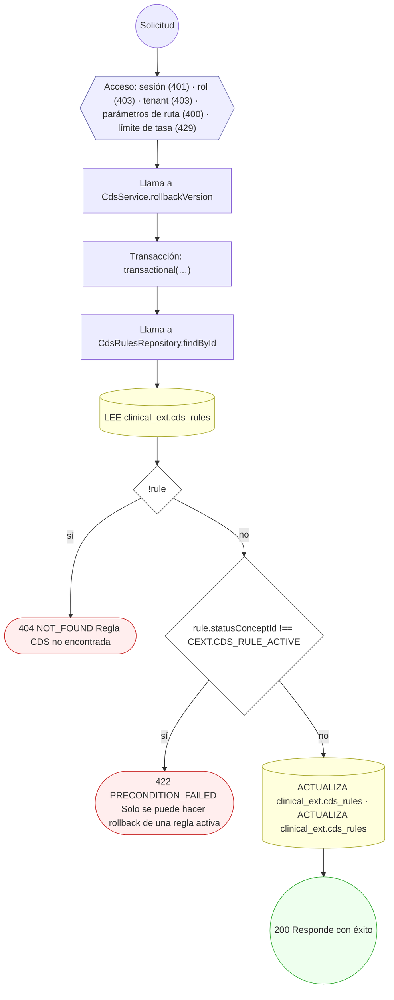

#### 9. POST /cds/check-interactions

Detectar interacciones medicamentosas al prescribir

| HTTP | Código | Cuándo |
|---|---|---|
| 201 | — | Éxito |
| 400 | `VALIDATION_FAILED` | El cuerpo cumple el DTO (sin propiedades extra) |
| 401 | `UNAUTHENTICATED` | Hay una sesión válida (JWT) |
| 403 | `FORBIDDEN` | El rol está permitido; El tenant se resuelve y pertenece al actor |
| 429 | `RATE_LIMITED` | No se supera el límite de solicitudes |

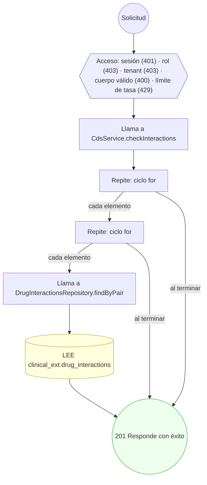

#### 10. POST /cds/evaluate

Evaluar reglas CDS y generar alertas

| HTTP | Código | Cuándo |
|---|---|---|
| 201 | — | Éxito |
| 400 | `VALIDATION_FAILED` | El cuerpo cumple el DTO (sin propiedades extra) |
| 401 | `UNAUTHENTICATED` | Hay una sesión válida (JWT) |
| 403 | `FORBIDDEN` | El rol está permitido; El tenant se resuelve y pertenece al actor |
| 429 | `RATE_LIMITED` | No se supera el límite de solicitudes |
| 500 | `INTERNAL` | UnparseableCdsRuleError: logic_json no es un objeto; UnparseableCdsRuleError: op 'in' exige un array en value; UnparseableCdsRuleError: op '{op}' exige un número en value; UnparseableCdsRuleError: operador no soportado: {op}; UnparseableCdsRuleError: nodo de lógica no reconocido |

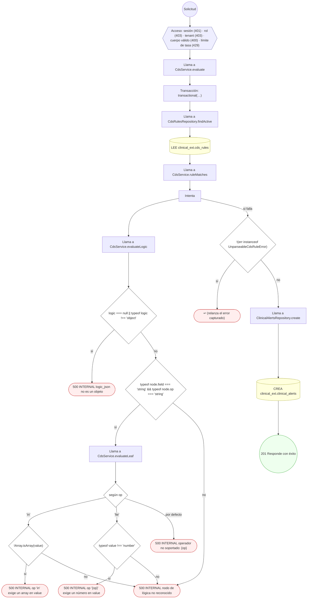

#### 11. PATCH /clinical-alerts/{id}/acknowledge

Reconocer una alerta clínica

| HTTP | Código | Cuándo |
|---|---|---|
| 200 | — | Éxito |
| 400 | `VALIDATION_FAILED` | Los parámetros de ruta son UUID válidos |
| 401 | `UNAUTHENTICATED` | Hay una sesión válida (JWT) |
| 403 | `FORBIDDEN` | El rol está permitido; El tenant se resuelve y pertenece al actor |
| 404 | `NOT_FOUND` | ResourceNotFoundException: {notFound.message} |
| 422 | `PRECONDITION_FAILED` | PreconditionFailedException: La alerta no está activa |
| 429 | `RATE_LIMITED` | No se supera el límite de solicitudes |

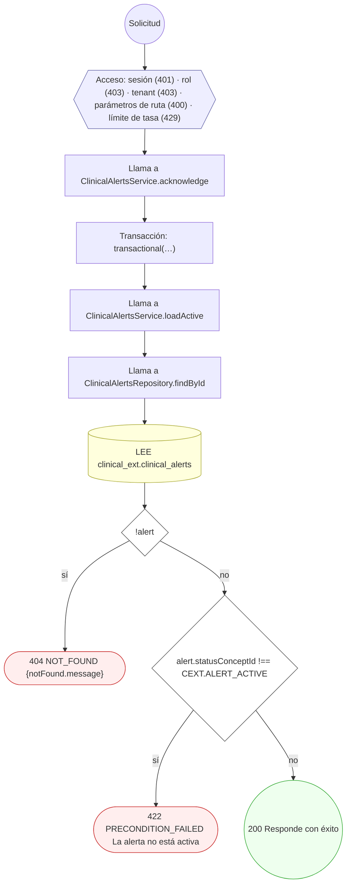

#### 12. PATCH /clinical-alerts/{id}/override

Override (sobreescribir) una alerta clínica

| HTTP | Código | Cuándo |
|---|---|---|
| 200 | — | Éxito |
| 400 | `VALIDATION_FAILED` | Los parámetros de ruta son UUID válidos; El cuerpo cumple el DTO (sin propiedades extra) |
| 401 | `UNAUTHENTICATED` | Hay una sesión válida (JWT) |
| 403 | `FORBIDDEN` | El rol está permitido; El tenant se resuelve y pertenece al actor |
| 404 | `NOT_FOUND` | ResourceNotFoundException: {notFound.message} |
| 422 | `PRECONDITION_FAILED` | PreconditionFailedException: La alerta no está activa; PreconditionFailedException: El override de una alerta de alta severidad requiere un motivo |
| 429 | `RATE_LIMITED` | No se supera el límite de solicitudes |


#### 13. POST /order-sets

Crear una plantilla de órdenes (order set) con sus ítems

| HTTP | Código | Cuándo |
|---|---|---|
| 201 | — | Éxito |
| 400 | `VALIDATION_FAILED` | El cuerpo cumple el DTO (sin propiedades extra) |
| 401 | `UNAUTHENTICATED` | Hay una sesión válida (JWT) |
| 403 | `FORBIDDEN` | El rol está permitido; El tenant se resuelve y pertenece al actor |
| 409 | `CONFLICT` | ConflictException: El código de order set ya existe |
| 429 | `RATE_LIMITED` | No se supera el límite de solicitudes |

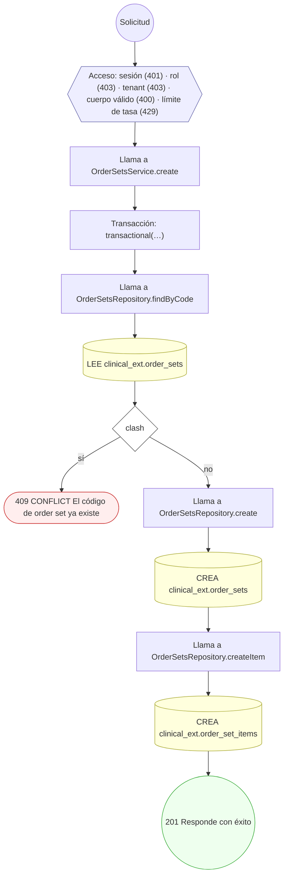

#### 14. POST /order-sets/{id}/apply

Aplicar un order set (fan-out de órdenes)

| HTTP | Código | Cuándo |
|---|---|---|
| 201 | — | Éxito |
| 400 | `VALIDATION_FAILED` | Los parámetros de ruta son UUID válidos; El cuerpo cumple el DTO (sin propiedades extra) |
| 401 | `UNAUTHENTICATED` | Hay una sesión válida (JWT) |
| 403 | `FORBIDDEN` | El rol está permitido; El tenant se resuelve y pertenece al actor; ForbiddenException: {WITHOUT_ACCESS_TO_HISTORY} |
| 404 | `NOT_FOUND` | ResourceNotFoundException: Encuentro no encontrado; ResourceNotFoundException: Order set no encontrado |
| 422 | `PRECONDITION_FAILED` | PreconditionFailedException: El order set no está activo; PreconditionFailedException: No hay ítems seleccionados para aplicar |
| 429 | `RATE_LIMITED` | No se supera el límite de solicitudes |

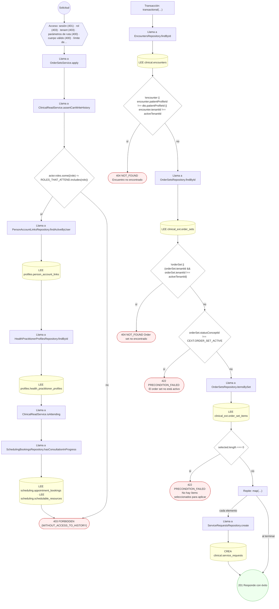

#### 15. POST /patients/{id}/immunization-plan/project

Proyectar el plan de inmunización y abrir brechas

| HTTP | Código | Cuándo |
|---|---|---|
| 201 | — | Éxito |
| 400 | `VALIDATION_FAILED` | Los parámetros de ruta son UUID válidos; El cuerpo cumple el DTO (sin propiedades extra) |
| 401 | `UNAUTHENTICATED` | Hay una sesión válida (JWT) |
| 403 | `FORBIDDEN` | El rol está permitido; El tenant se resuelve y pertenece al actor; ForbiddenException: {WITHOUT_ACCESS_TO_HISTORY} |
| 422 | `PRECONDITION_FAILED` | PreconditionFailedException: El perfil del paciente no tiene una fecha de nacimiento válida; PreconditionFailedException: La fecha de nacimiento enviada no coincide con la del perfil del paciente |
| 429 | `RATE_LIMITED` | No se supera el límite de solicitudes |

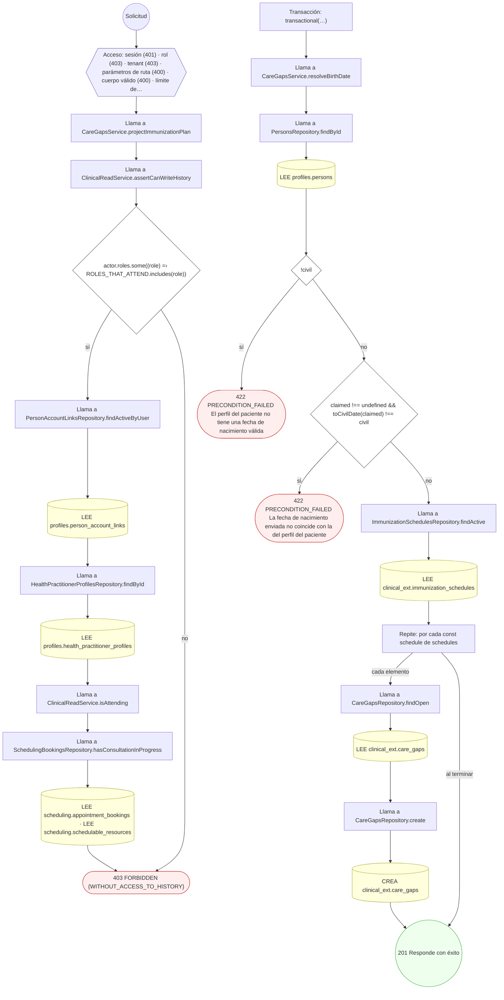

#### 16. GET /prescription-favorites

Listar mis favoritos de prescripción

| HTTP | Código | Cuándo |
|---|---|---|
| 200 | — | Éxito |
| 401 | `UNAUTHENTICATED` | Hay una sesión válida (JWT) |
| 403 | `FORBIDDEN` | El rol está permitido; El tenant se resuelve y pertenece al actor; ForbiddenException: Esta cuenta no tiene un perfil profesional asociado |
| 429 | `RATE_LIMITED` | No se supera el límite de solicitudes |


#### 17. POST /prescription-favorites

Guardar un favorito de prescripción

| HTTP | Código | Cuándo |
|---|---|---|
| 201 | — | Éxito |
| 400 | `VALIDATION_FAILED` | El cuerpo cumple el DTO (sin propiedades extra) |
| 401 | `UNAUTHENTICATED` | Hay una sesión válida (JWT) |
| 403 | `FORBIDDEN` | El rol está permitido; El tenant se resuelve y pertenece al actor; ForbiddenException: Esta cuenta no tiene un perfil profesional asociado |
| 409 | `CONFLICT` | ConflictException: Ya tiene un favorito con ese nombre |
| 422 | `PRECONDITION_FAILED` | PreconditionFailedException: La lista de favoritos llegó a su máximo; borre alguno antes de guardar otro |
| 429 | `RATE_LIMITED` | No se supera el límite de solicitudes |


#### 18. DELETE /prescription-favorites/{id}

Borrar un favorito de prescripción propio

| HTTP | Código | Cuándo |
|---|---|---|
| 204 | — | Éxito |
| 400 | `VALIDATION_FAILED` | Los parámetros de ruta son UUID válidos |
| 401 | `UNAUTHENTICATED` | Hay una sesión válida (JWT) |
| 403 | `FORBIDDEN` | El rol está permitido; El tenant se resuelve y pertenece al actor; ForbiddenException: Esta cuenta no tiene un perfil profesional asociado |
| 404 | `NOT_FOUND` | ResourceNotFoundException: Favorito no encontrado |
| 429 | `RATE_LIMITED` | No se supera el límite de solicitudes |


#### 19. GET /referrals

Listar derivaciones de un paciente

| HTTP | Código | Cuándo |
|---|---|---|
| 200 | — | Éxito |
| 400 | `VALIDATION_FAILED` | Están los parámetros de consulta obligatorios |
| 401 | `UNAUTHENTICATED` | Hay una sesión válida (JWT) |
| 403 | `FORBIDDEN` | El rol está permitido; El tenant se resuelve y pertenece al actor; ForbiddenException: {WITHOUT_ACCESS_TO_HISTORY} |
| 429 | `RATE_LIMITED` | No se supera el límite de solicitudes |

```mermaid
flowchart TD
  n1(("Solicitud")):::inicio
  n2{{"Acceso: sesión (401) · rol (403) · tenant (403) · parámetros de consulta (400) · límite de tasa (429)"}}:::acceso
  n1 --> n2
  n3["Llama a ReferralsService.listByPatient"]:::llamada
  n2 --> n3
  n4["Llama a ClinicalReadService.assertCanReadHistory"]:::llamada
  n3 --> n4
  n5{"!actor.roles.some((role) =› ROLES_THAT_ATTEND.includes(role))"}:::decision
  n4 --> n5
  n6["Llama a ClinicalReadService.assertOwnRecord"]:::llamada
  n5 -->|"sí"| n6
  n7["Llama a PersonAccountLinksRepository.findActiveByUser"]:::llamada
  n6 --> n7
  n8[("LEE profiles.person_account_links")]:::efecto
  n7 --> n8
  n9["Llama a PatientProfilesRepository.findById"]:::llamada
  n8 --> n9
  n10[("LEE profiles.patient_profiles")]:::efecto
  n9 --> n10
  n11{"!link || !profile || profile.profileId !== link.personId"}:::decision
  n10 --> n11
  n12(["403 FORBIDDEN {WITHOUT_ACCESS_TO_HISTORY}"]):::error
  n11 -->|"sí"| n12
  n13["Llama a PersonAccountLinksRepository.findActiveByUser"]:::llamada
  n11 -->|"no"| n13
  n5 -->|"no"| n13
  n14[("LEE profiles.person_account_links")]:::efecto
  n13 --> n14
  n15["Llama a HealthPractitionerProfilesRepository.findById"]:::llamada
  n14 --> n15
  n16[("LEE profiles.health_practitioner_profiles")]:::efecto
  n15 --> n16
  n17["Llama a ClinicalReadService.isAttending"]:::llamada
  n16 --> n17
  n18["Llama a SchedulingBookingsRepository.hasConsultationInProgress"]:::llamada
  n17 --> n18
  n19[("LEE scheduling.appointment_bookings · LEE scheduling.schedulable_resources")]:::efecto
  n18 --> n19
  n20["Llama a ClinicalReadService.assertOwnRecord"]:::llamada
  n19 --> n20
  n21["Llama a PersonAccountLinksRepository.findActiveByUser"]:::llamada
  n20 --> n21
  n22[("LEE profiles.person_account_links")]:::efecto
  n21 --> n22
  n23["Llama a PatientProfilesRepository.findById"]:::llamada
  n22 --> n23
  n24[("LEE profiles.patient_profiles")]:::efecto
  n23 --> n24
  n25{"!link || !profile || profile.profileId !== link.personId"}:::decision
  n24 --> n25
  n26(["403 FORBIDDEN {WITHOUT_ACCESS_TO_HISTORY}"]):::error
  n25 -->|"sí"| n26
  n27["Llama a ReferralsRepository.findByPatient"]:::llamada
  n25 -->|"no"| n27
  n28[("LEE clinical_ext.referrals")]:::efecto
  n27 --> n28
  n29["Llama a ReferralsService.toListItems"]:::llamada
  n28 --> n29
  n30["Llama a TenantsRepository.findById"]:::llamada
  n29 --> n30
  n31[("LEE directory.tenants")]:::efecto
  n30 --> n31
  n32["Llama a SchedulingOfferingsRepository.findCatalogItems"]:::llamada
  n31 --> n32
  n33[("LEE billing.service_catalog")]:::efecto
  n32 --> n33
  n34["Llama a ReferralsService.resolveNames"]:::llamada
  n33 --> n34
  n35[("LEE directory.branches · LEE directory.tenants")]:::efecto
  n34 --> n35
  n36(("200 Responde con éxito")):::ok
  n35 --> n36
  classDef acceso fill:#eef,stroke:#66a
  classDef error fill:#fee,stroke:#c33
  classDef ok fill:#efe,stroke:#3a3
  classDef efecto fill:#ffd,stroke:#aa3
  classDef decision fill:#fff,stroke:#555
  classDef corte fill:#eee,stroke:#999,stroke-dasharray: 4
```

#### 20. POST /referrals

Emitir una referencia desde un encuentro

| HTTP | Código | Cuándo |
|---|---|---|
| 201 | — | Éxito |
| 400 | `VALIDATION_FAILED` | El cuerpo cumple el DTO (sin propiedades extra) |
| 401 | `UNAUTHENTICATED` | Hay una sesión válida (JWT) |
| 403 | `FORBIDDEN` | El rol está permitido; El tenant se resuelve y pertenece al actor; ForbiddenException: {WITHOUT_ACCESS_TO_HISTORY} |
| 404 | `NOT_FOUND` | ResourceNotFoundException: Profesional no encontrado; ResourceNotFoundException: Servicio no encontrado; ResourceNotFoundException: Encuentro no encontrado; ResourceNotFoundException: Sede destino no encontrada; ResourceNotFoundException: Canal no encontrado; ResourceNotFoundException: Plantilla no encontrada; ResourceNotFoundException: Solicitud de notificación no encontrada; ResourceNotFoundException: El proveedor configurado para el canal no existe |
| 409 | `CONFLICT` | ConflictException: Ya existe una referencia equivalente |
| 422 | `PRECONDITION_FAILED` | PreconditionFailedException: La derivación necesita un destino: profesional, organización, servicio, sede o destino externo.; PreconditionFailedException: Ese servicio está inactivo en el catálogo.; PreconditionFailedException: El servicio no pertenece a la organización destino.; PreconditionFailedException: El profesional destino no ofrece ese servicio.; PreconditionFailedException: La notificación a una dirección externa también necesita el usuario destinatario / La notificación necesita el usuario destinatario; PreconditionFailedException: El canal no está activo; PreconditionFailedException: La plantilla no está publicada; PreconditionFailedException: La plantilla es de otro canal; PreconditionFailedException: La notificación está suprimida; PreconditionFailedException: La notificación ya no admite intentos; PreconditionFailedException: El canal no tiene configuración de proveedor activa; PreconditionFailedException: Una notificación in-app necesita destinatario interno |
| 429 | `RATE_LIMITED` | No se supera el límite de solicitudes |

```mermaid
flowchart TD
  n1(("Solicitud")):::inicio
  n2{{"Acceso: sesión (401) · rol (403) · tenant (403) · cuerpo válido (400) · límite de tasa (429)"}}:::acceso
  n1 --> n2
  n3["Llama a ReferralsService.create"]:::llamada
  n2 --> n3
  n4{"dto.informedConsentId"}:::decision
  n3 --> n4
  n5(["↩ (relanza el error capturado)"]):::error
  n4 -->|"sí"| n5
  n6["Llama a ClinicalReadService.assertCanWriteHistory"]:::llamada
  n4 -->|"no"| n6
  n7{"actor.roles.some((role) =› ROLES_THAT_ATTEND.includes(role))"}:::decision
  n6 --> n7
  n8["Llama a PersonAccountLinksRepository.findActiveByUser"]:::llamada
  n7 -->|"sí"| n8
  n9[("LEE profiles.person_account_links")]:::efecto
  n8 --> n9
  n10["Llama a HealthPractitionerProfilesRepository.findById"]:::llamada
  n9 --> n10
  n11[("LEE profiles.health_practitioner_profiles")]:::efecto
  n10 --> n11
  n12["Llama a ClinicalReadService.isAttending"]:::llamada
  n11 --> n12
  n13["Llama a SchedulingBookingsRepository.hasConsultationInProgress"]:::llamada
  n12 --> n13
  n14[("LEE scheduling.appointment_bookings · LEE scheduling.schedulable_resources")]:::efecto
  n13 --> n14
  n15(["403 FORBIDDEN {WITHOUT_ACCESS_TO_HISTORY}"]):::error
  n14 --> n15
  n7 -->|"no"| n15
  n16{"!dto.targetProfileId && !dto.targetTenantId && !dto.targetServiceCatalogId && !dto.targetBranchId && !dto.tar…"}:::decision
  n17(["422 PRECONDITION_FAILED La derivación necesita un destino: profesional, organización, servicio, sede o destin…"]):::error
  n16 -->|"sí"| n17
  n18["Transacción: transactional(…)"]:::transaccion
  n16 -->|"no"| n18
  n19{"dto.targetProfileId"}:::decision
  n18 --> n19
  n20["Llama a ReferralsService.assertTargetIsPractitioner"]:::llamada
  n19 -->|"sí"| n20
  n21["Llama a HealthPractitionerProfilesRepository.findById"]:::llamada
  n20 --> n21
  n22[("LEE profiles.health_practitioner_profiles")]:::efecto
  n21 --> n22
  n23{"!target"}:::decision
  n22 --> n23
  n24(["404 NOT_FOUND Profesional no encontrado"]):::error
  n23 -->|"sí"| n24
  n25["Llama a ReferralsService.assertServiceOfTarget"]:::llamada
  n23 -->|"no"| n25
  n19 -->|"no"| n25
  n26["Llama a ServiceCatalogRepository.findById"]:::llamada
  n25 --> n26
  n27[("LEE billing.service_catalog")]:::efecto
  n26 --> n27
  n28{"!service"}:::decision
  n27 --> n28
  n29(["404 NOT_FOUND Servicio no encontrado"]):::error
  n28 -->|"sí"| n29
  n30{"!service.isActive"}:::decision
  n28 -->|"no"| n30
  n31(["422 PRECONDITION_FAILED Ese servicio está inactivo en el catálogo."]):::error
  n30 -->|"sí"| n31
  n32["Llama a PracticesRepository.findById"]:::llamada
  n30 -->|"no"| n32
  n33[("LEE practice.practices")]:::efecto
  n32 --> n33
  n34{"target.targetTenantId && serviceTenantId !== target.targetTenantId"}:::decision
  n33 --> n34
  n35(["422 PRECONDITION_FAILED El servicio no pertenece a la organización destino."]):::error
  n34 -->|"sí"| n35
  n36{"target.targetProfileId"}:::decision
  n34 -->|"no"| n36
  n37["Llama a SchedulingOfferingsRepository.findOfferingOf"]:::llamada
  n36 -->|"sí"| n37
  n38[("LEE scheduling.practitioner_service_offerings")]:::efecto
  n37 --> n38
  n39{"!offering || offering.statusConceptId !== SCHED.OFFERING_ACTIVE"}:::decision
  n38 --> n39
  n40(["422 PRECONDITION_FAILED El profesional destino no ofrece ese servicio."]):::error
  n39 -->|"sí"| n40
  n41{"dto.sourceEncounterId"}:::decision
  n39 -->|"no"| n41
  n36 -->|"no"| n41
  n42["Llama a ReferralsService.assertEncounterBelongsToPatient"]:::llamada
  n41 -->|"sí"| n42
  n43["Llama a EncountersRepository.findById"]:::llamada
  n42 --> n43
  n44[("LEE clinical.encounters")]:::efecto
  n43 --> n44
  n45{"!encounter || encounter.patientProfileId !== patientProfileId || actor.tenantIds?.includes(encounter.tenantId…"}:::decision
  n44 --> n45
  n46(["404 NOT_FOUND Encuentro no encontrado"]):::error
  n45 -->|"sí"| n46
  n47{"dto.sourceEncounterId && (dto.targetServiceCatalogId || (dto.targetProfileId && dto.specialtyConceptId))"}:::decision
  n45 -->|"no"| n47
  n41 -->|"no"| n47
  n48["Llama a ReferralsRepository.findDuplicate"]:::llamada
  n47 -->|"sí"| n48
  n49[("LEE clinical_ext.referrals")]:::efecto
  n48 --> n49
  n50{"dup"}:::decision
  n49 --> n50
  n51(["409 CONFLICT Ya existe una referencia equivalente"]):::error
  n50 -->|"sí"| n51
  n52{"dto.targetBranchId"}:::decision
  n50 -->|"no"| n52
  n47 -->|"no"| n52
  n53[("LEE directory.branches")]:::efecto
  n52 -->|"sí"| n53
  n54{"!branch"}:::decision
  n53 --> n54
  n55(["404 NOT_FOUND Sede destino no encontrada"]):::error
  n54 -->|"sí"| n55
  n56["Llama a ReferralsRepository.create"]:::llamada
  n54 -->|"no"| n56
  n52 -->|"no"| n56
  n57[("CREA clinical_ext.referrals")]:::efecto
  n56 --> n57
  n58{"dto.sourceEncounterId && dto.targetProfileId"}:::decision
  n57 --> n58
  n59["Llama a ReferralNotifier.notifyRecommended"]:::llamada
  n58 -->|"sí"| n59
  n60["Intenta"]:::intento
  n59 --> n60
  n61[("LEE clinical_ext.referrals")]:::efecto
  n60 --> n61
  n62["Llama a ReferralNotifier.accountOf"]:::llamada
  n61 --> n62
  n63["Llama a ReferralNotifier.personIdOf"]:::llamada
  n62 --> n63
  n64[("LEE profiles.persons · LEE profiles.person_profiles")]:::efecto
  n63 --> n64
  n65[("LEE profiles.person_account_links")]:::efecto
  n64 --> n65
  n66["Llama a ReferralNotifier.displayNameOf"]:::llamada
  n65 --> n66
  n67["Llama a ReferralNotifier.personIdOf"]:::llamada
  n66 --> n67
  n68[("LEE profiles.persons · LEE profiles.person_profiles")]:::efecto
  n67 --> n68
  n69[("LEE profiles.persons")]:::efecto
  n68 --> n69
  n70["Llama a ReferralNotifier.displayNameOf"]:::llamada
  n69 --> n70
  n71["… el resto del árbol (4 nodos) está en el JSON del inventario"]:::corte
  n70 --> n71
  classDef acceso fill:#eef,stroke:#66a
  classDef error fill:#fee,stroke:#c33
  classDef ok fill:#efe,stroke:#3a3
  classDef efecto fill:#ffd,stroke:#aa3
  classDef decision fill:#fff,stroke:#555
  classDef corte fill:#eee,stroke:#999,stroke-dasharray: 4
```

#### 21. GET /referrals/{id}

Leer una derivación

| HTTP | Código | Cuándo |
|---|---|---|
| 200 | — | Éxito |
| 400 | `VALIDATION_FAILED` | Los parámetros de ruta son UUID válidos |
| 401 | `UNAUTHENTICATED` | Hay una sesión válida (JWT) |
| 403 | `FORBIDDEN` | El rol está permitido; El tenant se resuelve y pertenece al actor; ForbiddenException: {WITHOUT_ACCESS_TO_HISTORY} |
| 404 | `NOT_FOUND` | ResourceNotFoundException: Referencia no encontrada |
| 429 | `RATE_LIMITED` | No se supera el límite de solicitudes |

```mermaid
flowchart TD
  n1(("Solicitud")):::inicio
  n2{{"Acceso: sesión (401) · rol (403) · tenant (403) · parámetros de ruta (400) · límite de tasa (429)"}}:::acceso
  n1 --> n2
  n3["Llama a ReferralsService.get"]:::llamada
  n2 --> n3
  n4["Llama a ReferralsService.findOrFail"]:::llamada
  n3 --> n4
  n5["Llama a ReferralsRepository.findById"]:::llamada
  n4 --> n5
  n6[("LEE clinical_ext.referrals")]:::efecto
  n5 --> n6
  n7{"!referral"}:::decision
  n6 --> n7
  n8(["404 NOT_FOUND Referencia no encontrada"]):::error
  n7 -->|"sí"| n8
  n9["Llama a ReferralsService.isDestination"]:::llamada
  n7 -->|"no"| n9
  n10{"referral.targetBranchId"}:::decision
  n9 --> n10
  n11[("LEE directory.branches")]:::efecto
  n10 -->|"sí"| n11
  n12{"!(await this.isDestination(em, referral, actor, getCurrentTenantId()))"}:::decision
  n11 --> n12
  n10 -->|"no"| n12
  n13["Llama a ClinicalReadService.assertCanReadHistory"]:::llamada
  n12 -->|"sí"| n13
  n14{"!actor.roles.some((role) =› ROLES_THAT_ATTEND.includes(role))"}:::decision
  n13 --> n14
  n15["Llama a ClinicalReadService.assertOwnRecord"]:::llamada
  n14 -->|"sí"| n15
  n16["Llama a PersonAccountLinksRepository.findActiveByUser"]:::llamada
  n15 --> n16
  n17[("LEE profiles.person_account_links")]:::efecto
  n16 --> n17
  n18["Llama a PatientProfilesRepository.findById"]:::llamada
  n17 --> n18
  n19[("LEE profiles.patient_profiles")]:::efecto
  n18 --> n19
  n20{"!link || !profile || profile.profileId !== link.personId"}:::decision
  n19 --> n20
  n21(["403 FORBIDDEN {WITHOUT_ACCESS_TO_HISTORY}"]):::error
  n20 -->|"sí"| n21
  n22["Llama a PersonAccountLinksRepository.findActiveByUser"]:::llamada
  n20 -->|"no"| n22
  n14 -->|"no"| n22
  n23[("LEE profiles.person_account_links")]:::efecto
  n22 --> n23
  n24["Llama a HealthPractitionerProfilesRepository.findById"]:::llamada
  n23 --> n24
  n25[("LEE profiles.health_practitioner_profiles")]:::efecto
  n24 --> n25
  n26["Llama a ClinicalReadService.isAttending"]:::llamada
  n25 --> n26
  n27["Llama a SchedulingBookingsRepository.hasConsultationInProgress"]:::llamada
  n26 --> n27
  n28[("LEE scheduling.appointment_bookings · LEE scheduling.schedulable_resources")]:::efecto
  n27 --> n28
  n29["Llama a ClinicalReadService.assertOwnRecord"]:::llamada
  n28 --> n29
  n30["Llama a PersonAccountLinksRepository.findActiveByUser"]:::llamada
  n29 --> n30
  n31[("LEE profiles.person_account_links")]:::efecto
  n30 --> n31
  n32["Llama a PatientProfilesRepository.findById"]:::llamada
  n31 --> n32
  n33[("LEE profiles.patient_profiles")]:::efecto
  n32 --> n33
  n34{"!link || !profile || profile.profileId !== link.personId"}:::decision
  n33 --> n34
  n35(["403 FORBIDDEN {WITHOUT_ACCESS_TO_HISTORY}"]):::error
  n34 -->|"sí"| n35
  n36["Llama a ReferralsService.resolveNames"]:::llamada
  n34 -->|"no"| n36
  n12 -->|"no"| n36
  n37[("LEE directory.branches · LEE directory.tenants")]:::efecto
  n36 --> n37
  n38(("200 Responde con éxito")):::ok
  n37 --> n38
  classDef acceso fill:#eef,stroke:#66a
  classDef error fill:#fee,stroke:#c33
  classDef ok fill:#efe,stroke:#3a3
  classDef efecto fill:#ffd,stroke:#aa3
  classDef decision fill:#fff,stroke:#555
  classDef corte fill:#eee,stroke:#999,stroke-dasharray: 4
```

#### 22. PATCH /referrals/{id}/cancel

Anular una derivación

| HTTP | Código | Cuándo |
|---|---|---|
| 200 | — | Éxito |
| 400 | `VALIDATION_FAILED` | Los parámetros de ruta son UUID válidos |
| 401 | `UNAUTHENTICATED` | Hay una sesión válida (JWT) |
| 403 | `FORBIDDEN` | El rol está permitido; El tenant se resuelve y pertenece al actor; ForbiddenException: {WITHOUT_ACCESS_TO_HISTORY} |
| 404 | `NOT_FOUND` | ResourceNotFoundException: Referencia no encontrada |
| 422 | `PRECONDITION_FAILED` | PreconditionFailedException: La derivación ya está cerrada |
| 429 | `RATE_LIMITED` | No se supera el límite de solicitudes |

```mermaid
flowchart TD
  n1(("Solicitud")):::inicio
  n2{{"Acceso: sesión (401) · rol (403) · tenant (403) · parámetros de ruta (400) · límite de tasa (429)"}}:::acceso
  n1 --> n2
  n3["Llama a ReferralsService.cancel"]:::llamada
  n2 --> n3
  n4["Transacción: transactional(…)"]:::transaccion
  n3 --> n4
  n5["Llama a ReferralsService.findOrFail"]:::llamada
  n4 --> n5
  n6["Llama a ReferralsRepository.findById"]:::llamada
  n5 --> n6
  n7[("LEE clinical_ext.referrals")]:::efecto
  n6 --> n7
  n8{"!referral"}:::decision
  n7 --> n8
  n9(["404 NOT_FOUND Referencia no encontrada"]):::error
  n8 -->|"sí"| n9
  n10["Llama a ClinicalReadService.assertCanWriteHistory"]:::llamada
  n8 -->|"no"| n10
  n11{"actor.roles.some((role) =› ROLES_THAT_ATTEND.includes(role))"}:::decision
  n10 --> n11
  n12["Llama a PersonAccountLinksRepository.findActiveByUser"]:::llamada
  n11 -->|"sí"| n12
  n13[("LEE profiles.person_account_links")]:::efecto
  n12 --> n13
  n14["Llama a HealthPractitionerProfilesRepository.findById"]:::llamada
  n13 --> n14
  n15[("LEE profiles.health_practitioner_profiles")]:::efecto
  n14 --> n15
  n16["Llama a ClinicalReadService.isAttending"]:::llamada
  n15 --> n16
  n17["Llama a SchedulingBookingsRepository.hasConsultationInProgress"]:::llamada
  n16 --> n17
  n18[("LEE scheduling.appointment_bookings · LEE scheduling.schedulable_resources")]:::efecto
  n17 --> n18
  n19(["403 FORBIDDEN {WITHOUT_ACCESS_TO_HISTORY}"]):::error
  n18 --> n19
  n11 -->|"no"| n19
  n20{"referral.statusConceptId !== CEXT.REFERRAL_REQUESTED && referral.statusConceptId !== CEXT.REFERRAL_ACCEPTED"}:::decision
  n21(["422 PRECONDITION_FAILED La derivación ya está cerrada"]):::error
  n20 -->|"sí"| n21
  n22[("ACTUALIZA clinical_ext.referrals")]:::efecto
  n20 -->|"no"| n22
  n23["Llama a ReferralsService.resolveNames"]:::llamada
  n22 --> n23
  n24[("LEE directory.branches · LEE directory.tenants")]:::efecto
  n23 --> n24
  n25(("200 Responde con éxito")):::ok
  n24 --> n25
  classDef acceso fill:#eef,stroke:#66a
  classDef error fill:#fee,stroke:#c33
  classDef ok fill:#efe,stroke:#3a3
  classDef efecto fill:#ffd,stroke:#aa3
  classDef decision fill:#fff,stroke:#555
  classDef corte fill:#eee,stroke:#999,stroke-dasharray: 4
```

#### 23. PATCH /referrals/{id}/counter-referral

Registrar la contrarreferencia de una derivación

| HTTP | Código | Cuándo |
|---|---|---|
| 200 | — | Éxito |
| 400 | `VALIDATION_FAILED` | Los parámetros de ruta son UUID válidos; El cuerpo cumple el DTO (sin propiedades extra) |
| 401 | `UNAUTHENTICATED` | Hay una sesión válida (JWT) |
| 403 | `FORBIDDEN` | El rol está permitido; El tenant se resuelve y pertenece al actor; ForbiddenException: {WITHOUT_ACCESS_TO_HISTORY} |
| 404 | `NOT_FOUND` | ResourceNotFoundException: Referencia no encontrada |
| 422 | `PRECONDITION_FAILED` | PreconditionFailedException: La derivación no admite contrarreferencia en su estado actual |
| 429 | `RATE_LIMITED` | No se supera el límite de solicitudes |

```mermaid
flowchart TD
  n1(("Solicitud")):::inicio
  n2{{"Acceso: sesión (401) · rol (403) · tenant (403) · parámetros de ruta (400) · cuerpo válido (400) · límite de…"}}:::acceso
  n1 --> n2
  n3["Llama a ReferralsService.counterReferral"]:::llamada
  n2 --> n3
  n4["Transacción: transactional(…)"]:::transaccion
  n3 --> n4
  n5["Llama a ReferralsService.findOrFail"]:::llamada
  n4 --> n5
  n6["Llama a ReferralsRepository.findById"]:::llamada
  n5 --> n6
  n7[("LEE clinical_ext.referrals")]:::efecto
  n6 --> n7
  n8{"!referral"}:::decision
  n7 --> n8
  n9(["404 NOT_FOUND Referencia no encontrada"]):::error
  n8 -->|"sí"| n9
  n10{"externalOnly"}:::decision
  n8 -->|"no"| n10
  n11["Llama a ClinicalReadService.assertCanWriteHistory"]:::llamada
  n10 -->|"sí"| n11
  n12{"actor.roles.some((role) =› ROLES_THAT_ATTEND.includes(role))"}:::decision
  n11 --> n12
  n13["Llama a PersonAccountLinksRepository.findActiveByUser"]:::llamada
  n12 -->|"sí"| n13
  n14[("LEE profiles.person_account_links")]:::efecto
  n13 --> n14
  n15["Llama a HealthPractitionerProfilesRepository.findById"]:::llamada
  n14 --> n15
  n16[("LEE profiles.health_practitioner_profiles")]:::efecto
  n15 --> n16
  n17["Llama a ClinicalReadService.isAttending"]:::llamada
  n16 --> n17
  n18["Llama a SchedulingBookingsRepository.hasConsultationInProgress"]:::llamada
  n17 --> n18
  n19[("LEE scheduling.appointment_bookings · LEE scheduling.schedulable_resources")]:::efecto
  n18 --> n19
  n20(["403 FORBIDDEN {WITHOUT_ACCESS_TO_HISTORY}"]):::error
  n19 --> n20
  n12 -->|"no"| n20
  n21["Llama a ReferralsService.isDestination"]:::llamada
  n10 -->|"no"| n21
  n22{"referral.targetBranchId"}:::decision
  n21 --> n22
  n23[("LEE directory.branches")]:::efecto
  n22 -->|"sí"| n23
  n24{"!(await this.isDestination(tx, referral, actor, getCurrentTenantId()))"}:::decision
  n23 --> n24
  n22 -->|"no"| n24
  n25(["404 NOT_FOUND Referencia no encontrada"]):::error
  n24 -->|"sí"| n25
  n26{"!allowed"}:::decision
  n24 -->|"no"| n26
  n27(["422 PRECONDITION_FAILED La derivación no admite contrarreferencia en su estado actual"]):::error
  n26 -->|"sí"| n27
  n28[("ACTUALIZA clinical_ext.referrals · ACTUALIZA clinical_ext.referrals · ACTUALIZA clinical_ext.referrals")]:::efecto
  n26 -->|"no"| n28
  n29["Llama a ReferralsService.resolveNames"]:::llamada
  n28 --> n29
  n30[("LEE directory.branches · LEE directory.tenants")]:::efecto
  n29 --> n30
  n31(("200 Responde con éxito")):::ok
  n30 --> n31
  classDef acceso fill:#eef,stroke:#66a
  classDef error fill:#fee,stroke:#c33
  classDef ok fill:#efe,stroke:#3a3
  classDef efecto fill:#ffd,stroke:#aa3
  classDef decision fill:#fff,stroke:#555
  classDef corte fill:#eee,stroke:#999,stroke-dasharray: 4
```

#### 24. PATCH /referrals/{id}/respond

Responder / aceptar una referencia inter-tenant

| HTTP | Código | Cuándo |
|---|---|---|
| 200 | — | Éxito |
| 400 | `VALIDATION_FAILED` | Los parámetros de ruta son UUID válidos; El cuerpo cumple el DTO (sin propiedades extra) |
| 401 | `UNAUTHENTICATED` | Hay una sesión válida (JWT) |
| 403 | `FORBIDDEN` | El rol está permitido; El tenant se resuelve y pertenece al actor |
| 404 | `NOT_FOUND` | ResourceNotFoundException: Referencia no encontrada |
| 422 | `PRECONDITION_FAILED` | PreconditionFailedException: La referencia no está en estado solicitado |
| 429 | `RATE_LIMITED` | No se supera el límite de solicitudes |

```mermaid
flowchart TD
  n1(("Solicitud")):::inicio
  n2{{"Acceso: sesión (401) · rol (403) · tenant (403) · parámetros de ruta (400) · cuerpo válido (400) · límite de…"}}:::acceso
  n1 --> n2
  n3["Llama a ReferralsService.respond"]:::llamada
  n2 --> n3
  n4{"dto.decision === 'REJECT' && !dto.rejectReason?.trim()"}:::decision
  n3 --> n4
  n5(["↩ (relanza el error capturado)"]):::error
  n4 -->|"sí"| n5
  n6["Transacción: transactional(…)"]:::transaccion
  n4 -->|"no"| n6
  n7["Llama a ReferralsRepository.findById"]:::llamada
  n6 --> n7
  n8[("LEE clinical_ext.referrals")]:::efecto
  n7 --> n8
  n9["Llama a ReferralsService.isDestination"]:::llamada
  n8 --> n9
  n10{"referral.targetBranchId"}:::decision
  n9 --> n10
  n11[("LEE directory.branches")]:::efecto
  n10 -->|"sí"| n11
  n12{"!referral || !(await this.isDestination(tx, referral, actor, activeTenantId))"}:::decision
  n11 --> n12
  n10 -->|"no"| n12
  n13(["404 NOT_FOUND Referencia no encontrada"]):::error
  n12 -->|"sí"| n13
  n14{"referral.statusConceptId !== CEXT.REFERRAL_REQUESTED"}:::decision
  n12 -->|"no"| n14
  n15(["422 PRECONDITION_FAILED La referencia no está en estado solicitado"]):::error
  n14 -->|"sí"| n15
  n16[("ACTUALIZA clinical_ext.referrals · ACTUALIZA clinical_ext.referrals")]:::efecto
  n14 -->|"no"| n16
  n17{"dto.decision === 'REJECT'"}:::decision
  n16 --> n17
  n18[("ACTUALIZA clinical_ext.referrals")]:::efecto
  n17 -->|"sí"| n18
  n19[("ACTUALIZA clinical_ext.referrals")]:::efecto
  n18 --> n19
  n17 -->|"no"| n19
  n20(("200 Responde con éxito")):::ok
  n19 --> n20
  classDef acceso fill:#eef,stroke:#66a
  classDef error fill:#fee,stroke:#c33
  classDef ok fill:#efe,stroke:#3a3
  classDef efecto fill:#ffd,stroke:#aa3
  classDef decision fill:#fff,stroke:#555
  classDef corte fill:#eee,stroke:#999,stroke-dasharray: 4
```

#### 25. GET /referrals/target-services

Servicios activos de un destino de derivación

| HTTP | Código | Cuándo |
|---|---|---|
| 200 | — | Éxito |
| 401 | `UNAUTHENTICATED` | Hay una sesión válida (JWT) |
| 403 | `FORBIDDEN` | El rol está permitido; El tenant se resuelve y pertenece al actor |
| 422 | `PRECONDITION_FAILED` | PreconditionFailedException: Indique targetProfileId o targetTenantId. |
| 429 | `RATE_LIMITED` | No se supera el límite de solicitudes |

```mermaid
flowchart TD
  n1(("Solicitud")):::inicio
  n2{{"Acceso: sesión (401) · rol (403) · tenant (403) · límite de tasa (429)"}}:::acceso
  n1 --> n2
  n3["Llama a ReferralsService.listTargetServices"]:::llamada
  n2 --> n3
  n4{"!targetProfileId && !targetTenantId"}:::decision
  n3 --> n4
  n5(["422 PRECONDITION_FAILED Indique targetProfileId o targetTenantId."]):::error
  n4 -->|"sí"| n5
  n6{"targetProfileId"}:::decision
  n4 -->|"no"| n6
  n7["Llama a SchedulingOfferingsRepository.listOfferings"]:::llamada
  n6 -->|"sí"| n7
  n8[("LEE scheduling.practitioner_service_offerings")]:::efecto
  n7 --> n8
  n9["Llama a SchedulingOfferingsRepository.findCatalogItems"]:::llamada
  n8 --> n9
  n10[("LEE billing.service_catalog")]:::efecto
  n9 --> n10
  n11["Llama a PracticesRepository.findByTenant"]:::llamada
  n6 -->|"no"| n11
  n12[("LEE practice.practices")]:::efecto
  n11 --> n12
  n13["Llama a ServiceCatalogRepository.searchPage"]:::llamada
  n12 --> n13
  n14[("LEE billing.service_catalog")]:::efecto
  n13 --> n14
  n15["Llama a ReferralsService.practicesById"]:::llamada
  n10 --> n15
  n14 --> n15
  n16["Llama a PracticesRepository.findById"]:::llamada
  n15 --> n16
  n17[("LEE practice.practices")]:::efecto
  n16 --> n17
  n18["Llama a CatalogConceptsRepository.findByIds"]:::llamada
  n17 --> n18
  n19[("LEE terminology.catalog_concepts")]:::efecto
  n18 --> n19
  n20(("200 Responde con éxito")):::ok
  n19 --> n20
  classDef acceso fill:#eef,stroke:#66a
  classDef error fill:#fee,stroke:#c33
  classDef ok fill:#efe,stroke:#3a3
  classDef efecto fill:#ffd,stroke:#aa3
  classDef decision fill:#fff,stroke:#555
  classDef corte fill:#eee,stroke:#999,stroke-dasharray: 4
```

#### 26. GET /referrals/targets

Buscar destinos de derivación

| HTTP | Código | Cuándo |
|---|---|---|
| 200 | — | Éxito |
| 400 | `VALIDATION_FAILED` | Están los parámetros de consulta obligatorios |
| 401 | `UNAUTHENTICATED` | Hay una sesión válida (JWT) |
| 403 | `FORBIDDEN` | El rol está permitido; El tenant se resuelve y pertenece al actor |
| 422 | `PRECONDITION_FAILED` | PreconditionFailedException: La búsqueda necesita al menos dos caracteres. |
| 429 | `RATE_LIMITED` | No se supera el límite de solicitudes |

```mermaid
flowchart TD
  n1(("Solicitud")):::inicio
  n2{{"Acceso: sesión (401) · rol (403) · tenant (403) · parámetros de consulta (400) · límite de tasa (429)"}}:::acceso
  n1 --> n2
  n3["Llama a ReferralsService.searchTargets"]:::llamada
  n2 --> n3
  n4{"q.length ‹ 2"}:::decision
  n3 --> n4
  n5(["422 PRECONDITION_FAILED La búsqueda necesita al menos dos caracteres."]):::error
  n4 -->|"sí"| n5
  n6["Llama a ReferralsService.searchPractitionerTargets"]:::llamada
  n4 -->|"no"| n6
  n7["Llama a ReferralTargetsRepository.searchPractitioners"]:::llamada
  n6 --> n7
  n8[("LEE profiles.health_practitioner_profiles · LEE profiles.persons · LEE practice.practitioner_role_assignments…")]:::efecto
  n7 --> n8
  n9["Llama a ReferralsService.searchOrganizationTargets"]:::llamada
  n8 --> n9
  n10["Llama a ReferralTargetsRepository.searchOrganizations"]:::llamada
  n9 --> n10
  n11[("LEE directory.tenants")]:::efecto
  n10 --> n11
  n12(("200 Responde con éxito")):::ok
  n11 --> n12
  classDef acceso fill:#eef,stroke:#66a
  classDef error fill:#fee,stroke:#c33
  classDef ok fill:#efe,stroke:#3a3
  classDef efecto fill:#ffd,stroke:#aa3
  classDef decision fill:#fff,stroke:#555
  classDef corte fill:#eee,stroke:#999,stroke-dasharray: 4
```

#### 27. POST /virtual-encounters

Iniciar una sesión de telesalud

| HTTP | Código | Cuándo |
|---|---|---|
| 201 | — | Éxito |
| 400 | `VALIDATION_FAILED` | El cuerpo cumple el DTO (sin propiedades extra) |
| 401 | `UNAUTHENTICATED` | Hay una sesión válida (JWT) |
| 403 | `FORBIDDEN` | El rol está permitido; El tenant se resuelve y pertenece al actor; ForbiddenException: La sesión virtual pertenece a otra organización.; ForbiddenException: No participa de este encuentro clínico. |
| 404 | `NOT_FOUND` | ResourceNotFoundException: Encuentro clínico no encontrado |
| 409 | `CONFLICT` | ConflictException: El encuentro ya tiene una sesión virtual |
| 429 | `RATE_LIMITED` | No se supera el límite de solicitudes |

```mermaid
flowchart TD
  n1(("Solicitud")):::inicio
  n2{{"Acceso: sesión (401) · rol (403) · tenant (403) · cuerpo válido (400) · límite de tasa (429)"}}:::acceso
  n1 --> n2
  n3["Llama a VirtualEncountersService.create"]:::llamada
  n2 --> n3
  n4["Transacción: transactional(…)"]:::transaccion
  n3 --> n4
  n5["Llama a VirtualEncountersService.requireEncounterParticipant"]:::llamada
  n4 --> n5
  n6["Llama a EncountersRepository.findById"]:::llamada
  n5 --> n6
  n7[("LEE clinical.encounters")]:::efecto
  n6 --> n7
  n8{"!encounter"}:::decision
  n7 --> n8
  n9(["404 NOT_FOUND Encuentro clínico no encontrado"]):::error
  n8 -->|"sí"| n9
  n10{"!belongsToTenant"}:::decision
  n8 -->|"no"| n10
  n11(["403 FORBIDDEN La sesión virtual pertenece a otra organización."]):::error
  n10 -->|"sí"| n11
  n12{"!practitionerProfileId"}:::decision
  n10 -->|"no"| n12
  n13(["403 FORBIDDEN No participa de este encuentro clínico."]):::error
  n12 -->|"sí"| n13
  n14["Llama a EncountersRepository.findActiveParticipants"]:::llamada
  n12 -->|"no"| n14
  n15[("LEE clinical.encounter_participants")]:::efecto
  n14 --> n15
  n16(["403 FORBIDDEN No participa de este encuentro clínico."]):::error
  n15 --> n16
  n17["Llama a VirtualEncountersRepository.findByEncounter"]:::llamada
  n18[("LEE clinical_ext.virtual_encounters")]:::efecto
  n17 --> n18
  n19{"existing"}:::decision
  n18 --> n19
  n20(["409 CONFLICT El encuentro ya tiene una sesión virtual"]):::error
  n19 -->|"sí"| n20
  n21["Llama a VirtualEncountersRepository.create"]:::llamada
  n19 -->|"no"| n21
  n22[("CREA clinical_ext.virtual_encounters")]:::efecto
  n21 --> n22
  n23(("201 Responde con éxito")):::ok
  n22 --> n23
  classDef acceso fill:#eef,stroke:#66a
  classDef error fill:#fee,stroke:#c33
  classDef ok fill:#efe,stroke:#3a3
  classDef efecto fill:#ffd,stroke:#aa3
  classDef decision fill:#fff,stroke:#555
  classDef corte fill:#eee,stroke:#999,stroke-dasharray: 4
```

#### 28. PATCH /virtual-encounters/{id}/end

Finalizar una sesión de telesalud

| HTTP | Código | Cuándo |
|---|---|---|
| 200 | — | Éxito |
| 400 | `VALIDATION_FAILED` | Los parámetros de ruta son UUID válidos; El cuerpo cumple el DTO (sin propiedades extra) |
| 401 | `UNAUTHENTICATED` | Hay una sesión válida (JWT) |
| 403 | `FORBIDDEN` | El rol está permitido; El tenant se resuelve y pertenece al actor; ForbiddenException: La sesión virtual pertenece a otra organización.; ForbiddenException: No participa de este encuentro clínico. |
| 404 | `NOT_FOUND` | ResourceNotFoundException: Sesión virtual no encontrada; ResourceNotFoundException: Encuentro clínico no encontrado |
| 422 | `PRECONDITION_FAILED` | PreconditionFailedException: La sesión no está en progreso |
| 429 | `RATE_LIMITED` | No se supera el límite de solicitudes |

```mermaid
flowchart TD
  n1(("Solicitud")):::inicio
  n2{{"Acceso: sesión (401) · rol (403) · tenant (403) · parámetros de ruta (400) · cuerpo válido (400) · límite de…"}}:::acceso
  n1 --> n2
  n3["Llama a VirtualEncountersService.end"]:::llamada
  n2 --> n3
  n4["Transacción: transactional(…)"]:::transaccion
  n3 --> n4
  n5["Llama a VirtualEncountersRepository.findById"]:::llamada
  n4 --> n5
  n6[("LEE clinical_ext.virtual_encounters")]:::efecto
  n5 --> n6
  n7{"!due"}:::decision
  n6 --> n7
  n8(["404 NOT_FOUND Sesión virtual no encontrada"]):::error
  n7 -->|"sí"| n8
  n9["Llama a VirtualEncountersService.requireEncounterParticipant"]:::llamada
  n7 -->|"no"| n9
  n10["Llama a EncountersRepository.findById"]:::llamada
  n9 --> n10
  n11[("LEE clinical.encounters")]:::efecto
  n10 --> n11
  n12{"!encounter"}:::decision
  n11 --> n12
  n13(["404 NOT_FOUND Encuentro clínico no encontrado"]):::error
  n12 -->|"sí"| n13
  n14{"!belongsToTenant"}:::decision
  n12 -->|"no"| n14
  n15(["403 FORBIDDEN La sesión virtual pertenece a otra organización."]):::error
  n14 -->|"sí"| n15
  n16{"!practitionerProfileId"}:::decision
  n14 -->|"no"| n16
  n17(["403 FORBIDDEN No participa de este encuentro clínico."]):::error
  n16 -->|"sí"| n17
  n18["Llama a EncountersRepository.findActiveParticipants"]:::llamada
  n16 -->|"no"| n18
  n19[("LEE clinical.encounter_participants")]:::efecto
  n18 --> n19
  n20(["403 FORBIDDEN No participa de este encuentro clínico."]):::error
  n19 --> n20
  n21{"due.statusConceptId !== CEXT.VIRTUAL_ENCOUNTER_IN_PROGRESS"}:::decision
  n22(["422 PRECONDITION_FAILED La sesión no está en progreso"]):::error
  n21 -->|"sí"| n22
  n23[("ACTUALIZA clinical_ext.virtual_encounters · ACTUALIZA clinical_ext.virtual_encounters · ACTUALIZA clinical_ex…")]:::efecto
  n21 -->|"no"| n23
  n24(("200 Responde con éxito")):::ok
  n23 --> n24
  classDef acceso fill:#eef,stroke:#66a
  classDef error fill:#fee,stroke:#c33
  classDef ok fill:#efe,stroke:#3a3
  classDef efecto fill:#ffd,stroke:#aa3
  classDef decision fill:#fff,stroke:#555
  classDef corte fill:#eee,stroke:#999,stroke-dasharray: 4
```

#### 29. PATCH /virtual-encounters/{id}/join

Unirse a una sesión de telesalud

| HTTP | Código | Cuándo |
|---|---|---|
| 200 | — | Éxito |
| 400 | `VALIDATION_FAILED` | Los parámetros de ruta son UUID válidos |
| 401 | `UNAUTHENTICATED` | Hay una sesión válida (JWT) |
| 403 | `FORBIDDEN` | El rol está permitido; El tenant se resuelve y pertenece al actor; ForbiddenException: La sesión virtual pertenece a otra organización.; ForbiddenException: No participa de este encuentro clínico. |
| 404 | `NOT_FOUND` | ResourceNotFoundException: Sesión virtual no encontrada; ResourceNotFoundException: Encuentro clínico no encontrado |
| 422 | `PRECONDITION_FAILED` | PreconditionFailedException: La sesión no está agendada |
| 429 | `RATE_LIMITED` | No se supera el límite de solicitudes |

```mermaid
flowchart TD
  n1(("Solicitud")):::inicio
  n2{{"Acceso: sesión (401) · rol (403) · tenant (403) · parámetros de ruta (400) · límite de tasa (429)"}}:::acceso
  n1 --> n2
  n3["Llama a VirtualEncountersService.join"]:::llamada
  n2 --> n3
  n4["Transacción: transactional(…)"]:::transaccion
  n3 --> n4
  n5["Llama a VirtualEncountersRepository.findById"]:::llamada
  n4 --> n5
  n6[("LEE clinical_ext.virtual_encounters")]:::efecto
  n5 --> n6
  n7{"!due"}:::decision
  n6 --> n7
  n8(["404 NOT_FOUND Sesión virtual no encontrada"]):::error
  n7 -->|"sí"| n8
  n9["Llama a VirtualEncountersService.requireEncounterParticipant"]:::llamada
  n7 -->|"no"| n9
  n10["Llama a EncountersRepository.findById"]:::llamada
  n9 --> n10
  n11[("LEE clinical.encounters")]:::efecto
  n10 --> n11
  n12{"!encounter"}:::decision
  n11 --> n12
  n13(["404 NOT_FOUND Encuentro clínico no encontrado"]):::error
  n12 -->|"sí"| n13
  n14{"!belongsToTenant"}:::decision
  n12 -->|"no"| n14
  n15(["403 FORBIDDEN La sesión virtual pertenece a otra organización."]):::error
  n14 -->|"sí"| n15
  n16{"!practitionerProfileId"}:::decision
  n14 -->|"no"| n16
  n17(["403 FORBIDDEN No participa de este encuentro clínico."]):::error
  n16 -->|"sí"| n17
  n18["Llama a EncountersRepository.findActiveParticipants"]:::llamada
  n16 -->|"no"| n18
  n19[("LEE clinical.encounter_participants")]:::efecto
  n18 --> n19
  n20(["403 FORBIDDEN No participa de este encuentro clínico."]):::error
  n19 --> n20
  n21{"due.statusConceptId !== CEXT.VIRTUAL_ENCOUNTER_SCHEDULED"}:::decision
  n22(["422 PRECONDITION_FAILED La sesión no está agendada"]):::error
  n21 -->|"sí"| n22
  n23[("ACTUALIZA clinical_ext.virtual_encounters · ACTUALIZA clinical_ext.virtual_encounters")]:::efecto
  n21 -->|"no"| n23
  n24(("200 Responde con éxito")):::ok
  n23 --> n24
  classDef acceso fill:#eef,stroke:#66a
  classDef error fill:#fee,stroke:#c33
  classDef ok fill:#efe,stroke:#3a3
  classDef efecto fill:#ffd,stroke:#aa3
  classDef decision fill:#fff,stroke:#555
  classDef corte fill:#eee,stroke:#999,stroke-dasharray: 4
```

### Operaciones sin decisiones propias

Sólo comprueban el acceso y leen o escriben: no tienen ramas que dibujar. Su detalle está en la ficha de endpoints.

| Operación | Respuestas posibles | Tablas |
|---|---|---|
| POST /drug-interactions | 201, 400, 401, 403, 429 | 1 |
| POST /immunization-schedules | 201, 400, 401, 403, 429 | 1 |
| GET /referrals/me | 200, 401, 403, 429 | 6 |
