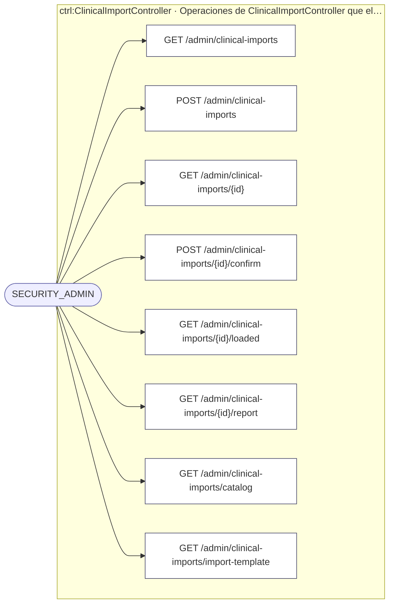
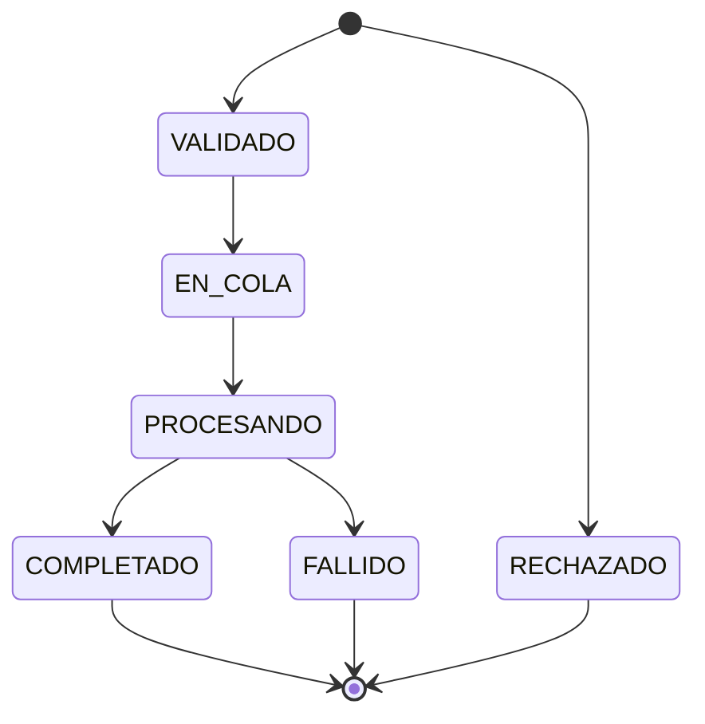
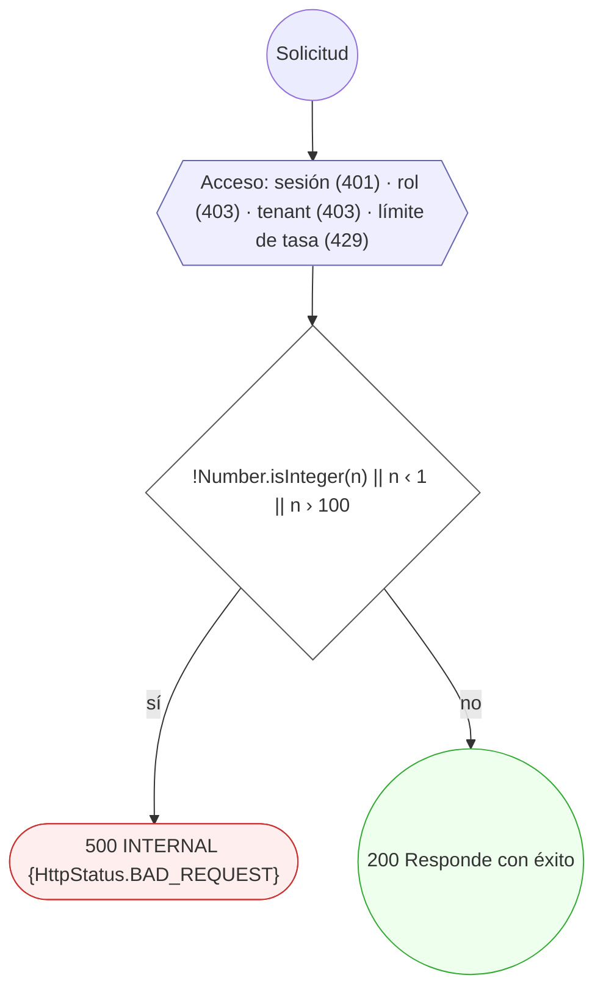
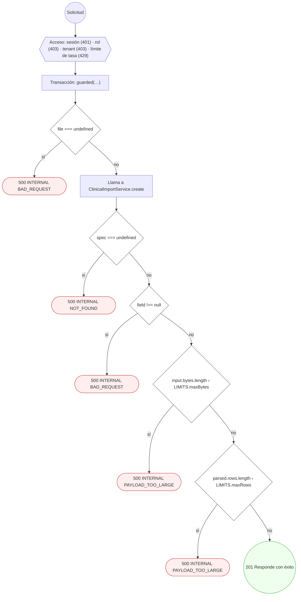
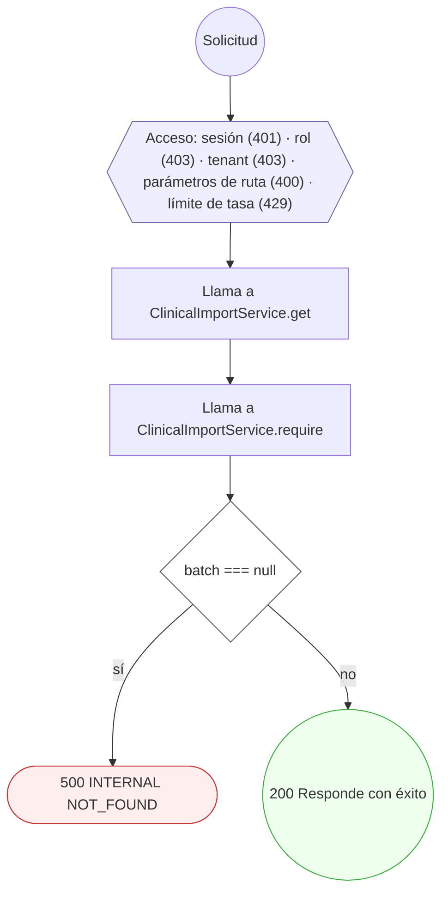
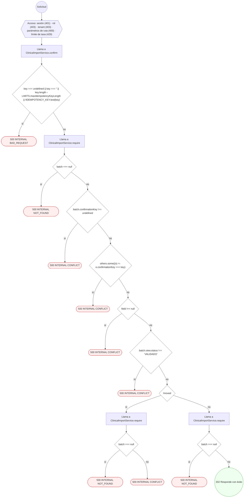
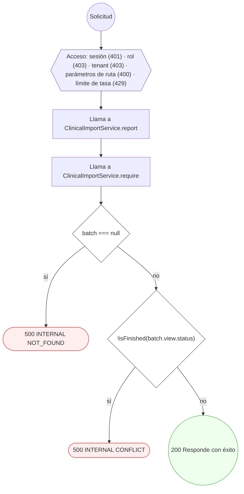
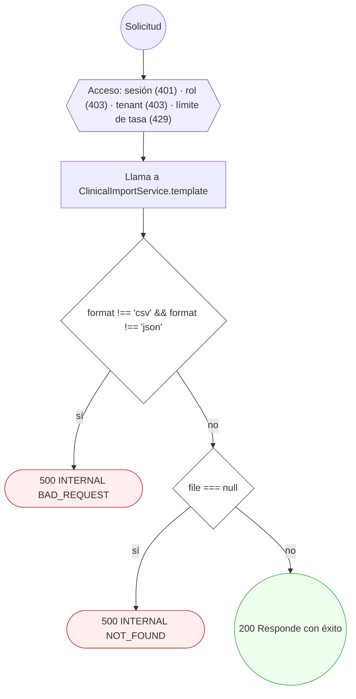

<!-- AUTOGENERADO por tools/inventario/flujos.mjs. No editar manualmente. -->

# Flujos del módulo `clinical_import`

- **Procesos:** 1 · **Máquinas de estado:** 1
- **Operaciones:** 8 (7 con decisiones propias, 1 sin ellas)
- Inventario de endpoints del módulo: [clinical_import](../endpoints/clinical_import.md)

## Proceso: clinical_import

- **Código:** `clinical_import` · **Agrupación:** AGRUPACION_POR_CONTROLADOR · **Operaciones:** 8
- **Actores:** SECURITY_ADMIN
- **Revisión:** AUTO_DETECTADA
- **Fuentes:** —

### Para qué sirve

_Sin fuente: ni el README del módulo ni el modelo lo describen._

### Etapas y operaciones

| Etapa | Descripción | Operación | Quién actúa | Riesgo | Tablas |
|---|---|---|---|---|---|
| `ctrl:ClinicalImportController` | Operaciones de ClinicalImportController que el README no asigna a un caso de uso | GET /admin/clinical-imports | SECURITY_ADMIN | BAJO | 0 |
|  |  | POST /admin/clinical-imports | SECURITY_ADMIN | BAJO | 0 |
|  |  | GET /admin/clinical-imports/{id} | SECURITY_ADMIN | BAJO | 0 |
|  |  | POST /admin/clinical-imports/{id}/confirm | SECURITY_ADMIN | BAJO | 0 |
|  |  | GET /admin/clinical-imports/{id}/loaded | SECURITY_ADMIN | BAJO | 0 |
|  |  | GET /admin/clinical-imports/{id}/report | SECURITY_ADMIN | BAJO | 0 |
|  |  | GET /admin/clinical-imports/catalog | SECURITY_ADMIN | BAJO | 0 |
|  |  | GET /admin/clinical-imports/import-template | SECURITY_ADMIN | BAJO | 0 |

### Diagrama — etapas `ctrl:ClinicalImportController`

## Máquinas de estado

### Máquina de estados `TRANSITIONS`

Declarada en `src/modules/clinical_import/clinical-import.state.ts:12`. Los estados llevan el nombre del identificador del código; no se resuelven al catálogo de conceptos.

**Operaciones que ejercen esta máquina** _(POR_REFERENCIA: el handler alcanza un método que valida contra la tabla; «sin destino nombrado» significa que el estado de destino llega por el cuerpo de la petición)_:

| Operación | Estados de destino que nombra | A través de |
|---|---|---|
| PATCH /insurance-campaigns/{id}/status | sin destino nombrado | InsuranceCampaignsController.changeStatus → InsuranceCampaignsService.changeStatus |
| PATCH /insurance/campaigns/{id}/status | sin destino nombrado | InsuranceCampaignsController.changeStatus → InsuranceCampaignsService.changeStatus |
| POST /admissions/{id}/claim | sin destino nombrado | PractitionerAdmissionsService.claim → PractitionerAdmissionsService.assertTransition |
| POST /admissions/{id}/decision | sin destino nombrado | PractitionerAdmissionsService.decide → PractitionerAdmissionsService.assertTransition |
| POST /admissions/{id}/reassign | sin destino nombrado | PractitionerAdmissionsService.reassign → PractitionerAdmissionsService.assertTransition |
| POST /admissions/{id}/reinstate | sin destino nombrado | PractitionerAdmissionsService.reinstate → PractitionerAdmissionsService.assertTransition |
| POST /admissions/{id}/release | sin destino nombrado | PractitionerAdmissionsService.release → PractitionerAdmissionsService.assertTransition |
| POST /admissions/{id}/request-info | sin destino nombrado | PractitionerAdmissionsService.requestInfo → PractitionerAdmissionsService.assertTransition |
| POST /admissions/{id}/suspend | sin destino nombrado | PractitionerAdmissionsService.suspend → PractitionerAdmissionsService.assertTransition |
| POST /admissions/expire-sweep | sin destino nombrado | PractitionerAdmissionsService.expireSweep → PractitionerAdmissionsService.sweepLocked |
| POST /profiles/practitioners/me/admission/resubmit | sin destino nombrado | PractitionerAdmissionsService.resubmit → PractitionerAdmissionsService.assertTransition |
| POST /profiles/practitioners/me/admission/withdraw | sin destino nombrado | PractitionerAdmissionsService.withdraw → PractitionerAdmissionsService.assertTransition |

## Árbol de decisión por operación

Cada árbol se deriva del código del handler y de los métodos que invoca (hasta 4 niveles). Una rama que no decide, no escribe y no falla se poda. Los accesos y los efectos consecutivos se agrupan en un solo nodo.

### Operaciones con decisiones propias

#### 1. GET /admin/clinical-imports

| HTTP | Código | Cuándo |
|---|---|---|
| 200 | — | Éxito |
| 401 | `UNAUTHENTICATED` | Hay una sesión válida (JWT) |
| 403 | `FORBIDDEN` | El rol está permitido; El tenant se resuelve y pertenece al actor |
| 429 | `RATE_LIMITED` | No se supera el límite de solicitudes |
| 500 | `INTERNAL` | DomainException: {HttpStatus.BAD_REQUEST} |

#### 2. POST /admin/clinical-imports

Valida y previsualiza. No escribe nada en ninguna historia clínica.

| HTTP | Código | Cuándo |
|---|---|---|
| 201 | — | Éxito |
| 401 | `UNAUTHENTICATED` | Hay una sesión válida (JWT) |
| 403 | `FORBIDDEN` | El rol está permitido; El tenant se resuelve y pertenece al actor |
| 429 | `RATE_LIMITED` | No se supera el límite de solicitudes |
| 500 | `INTERNAL` | ImportError: BAD_REQUEST; ImportError: NOT_FOUND; ImportError: PAYLOAD_TOO_LARGE |

#### 3. GET /admin/clinical-imports/{id}

| HTTP | Código | Cuándo |
|---|---|---|
| 200 | — | Éxito |
| 400 | `VALIDATION_FAILED` | Los parámetros de ruta son UUID válidos |
| 401 | `UNAUTHENTICATED` | Hay una sesión válida (JWT) |
| 403 | `FORBIDDEN` | El rol está permitido; El tenant se resuelve y pertenece al actor |
| 429 | `RATE_LIMITED` | No se supera el límite de solicitudes |
| 500 | `INTERNAL` | ImportError: NOT_FOUND |

#### 4. POST /admin/clinical-imports/{id}/confirm

| HTTP | Código | Cuándo |
|---|---|---|
| 202 | — | Éxito |
| 400 | `VALIDATION_FAILED` | Los parámetros de ruta son UUID válidos |
| 401 | `UNAUTHENTICATED` | Hay una sesión válida (JWT) |
| 403 | `FORBIDDEN` | El rol está permitido; El tenant se resuelve y pertenece al actor |
| 429 | `RATE_LIMITED` | No se supera el límite de solicitudes |
| 500 | `INTERNAL` | ImportError: BAD_REQUEST; ImportError: NOT_FOUND; ImportError: CONFLICT |

#### 5. GET /admin/clinical-imports/{id}/loaded

Qué agregó el lote y dónde: sólo identificadores. Leerlo queda auditado.

| HTTP | Código | Cuándo |
|---|---|---|
| 200 | — | Éxito |
| 400 | `VALIDATION_FAILED` | Los parámetros de ruta son UUID válidos |
| 401 | `UNAUTHENTICATED` | Hay una sesión válida (JWT) |
| 403 | `FORBIDDEN` | El rol está permitido; El tenant se resuelve y pertenece al actor |
| 429 | `RATE_LIMITED` | No se supera el límite de solicitudes |
| 500 | `INTERNAL` | ImportError: NOT_FOUND; ImportError: CONFLICT |

#### 6. GET /admin/clinical-imports/{id}/report

El informe: sólo fila, resultado y motivo. Leerlo queda auditado.

| HTTP | Código | Cuándo |
|---|---|---|
| 200 | — | Éxito |
| 400 | `VALIDATION_FAILED` | Los parámetros de ruta son UUID válidos |
| 401 | `UNAUTHENTICATED` | Hay una sesión válida (JWT) |
| 403 | `FORBIDDEN` | El rol está permitido; El tenant se resuelve y pertenece al actor |
| 429 | `RATE_LIMITED` | No se supera el límite de solicitudes |
| 500 | `INTERNAL` | ImportError: NOT_FOUND; ImportError: CONFLICT |

#### 7. GET /admin/clinical-imports/import-template

T1: la plantilla del tipo, en CSV o JSON, generada del mismo esquema que valida.

| HTTP | Código | Cuándo |
|---|---|---|
| 200 | — | Éxito |
| 401 | `UNAUTHENTICATED` | Hay una sesión válida (JWT) |
| 403 | `FORBIDDEN` | El rol está permitido; El tenant se resuelve y pertenece al actor |
| 429 | `RATE_LIMITED` | No se supera el límite de solicitudes |
| 500 | `INTERNAL` | ImportError: BAD_REQUEST; ImportError: NOT_FOUND |

### Operaciones sin decisiones propias

Sólo comprueban el acceso y leen o escriben: no tienen ramas que dibujar. Su detalle está en la ficha de endpoints.

| Operación | Respuestas posibles | Tablas |
|---|---|---|
| GET /admin/clinical-imports/catalog | 200, 401, 403, 429 | 0 |
