<!-- AUTOGENERADO por tools/inventario/flujos.mjs. No editar manualmente. -->

# Flujos del módulo `common`

- **Procesos:** 1 · **Máquinas de estado:** 0
- **Operaciones:** 19 (16 con decisiones propias, 3 sin ellas)
- Inventario de endpoints del módulo: [common](../endpoints/common.md)

## Proceso: Common module

- **Código:** `common` · **Agrupación:** AGRUPACION_POR_CONTROLADOR · **Operaciones:** 19
- **Actores:** Cualquier sesión válida · SECURITY_ADMIN · SYSTEM
- **Revisión:** AUTO_DETECTADA
- **Fuentes:** `src/modules/common/README.md`

### Para qué sirve

Cross-cutting reference data shared by every clinical/business domain: official **identifiers**, **contact points**, **addresses**, and the **file** subsystem (versioning, derivatives, links, antimalware scanning, soft-delete and signed download URLs). Owners are polymorphic (`owner_type_concept_id` + `owner_id`) and, except for `files.tenant_id`, are **not** FK-enforced.

_Fuente: `src/modules/common/README.md:3`_

### Etapas y operaciones

| Etapa | Descripción | Operación | Quién actúa | Riesgo | Tablas |
|---|---|---|---|---|---|
| `ctrl:CommonAddressesController` | Operaciones de CommonAddressesController que el README no asigna a un caso de uso | POST /common/addresses | SECURITY_ADMIN | MEDIO | 1 |
| `ctrl:CommonContactPointsController` | Operaciones de CommonContactPointsController que el README no asigna a un caso de uso | POST /common/contact-points | SECURITY_ADMIN | MEDIO | 1 |
|  |  | POST /common/contact-points/{id}/verify | SECURITY_ADMIN | MEDIO | 2 |
| `ctrl:CommonFilesController` | Operaciones de CommonFilesController que el README no asigna a un caso de uso | POST /common/files | Cualquier sesión válida | ALTO | 3 |
|  |  | DELETE /common/files/{id} | Cualquier sesión válida | ALTO | 4 |
|  |  | GET /common/files/{id}/content | Cualquier sesión válida | BAJO | 2 |
|  |  | POST /common/files/{id}/download-url | Cualquier sesión válida | BAJO | 2 |
|  |  | POST /common/files/{id}/links | Cualquier sesión válida | ALTO | 4 |
|  |  | POST /common/files/{id}/versions | Cualquier sesión válida | ALTO | 5 |
|  |  | POST /common/files/{id}/versions/{vid}/derivatives | Cualquier sesión válida | ALTO | 5 |
|  |  | GET /common/files/links | Cualquier sesión válida | BAJO | 3 |
|  |  | POST /common/files/upload | Cualquier sesión válida | ALTO | 6 |
| `ctrl:CommonIdentifiersController` | Operaciones de CommonIdentifiersController que el README no asigna a un caso de uso | POST /common/identifiers | SECURITY_ADMIN | MEDIO | 2 |
| `ctrl:InternalFilesController` | Operaciones de InternalFilesController que el README no asigna a un caso de uso | POST /internal/files/versions/{vid}/scan-result | SYSTEM · SECURITY_ADMIN | MEDIO | 2 |
|  |  | GET /internal/files/versions/pending-scan | SYSTEM · SECURITY_ADMIN | BAJO | 1 |
| `ctrl:InternalStorageLifecycleController` | Operaciones de InternalStorageLifecycleController que el README no asigna a un caso de uso | POST /internal/storage-lifecycle/audio/{assetId}/abort | SYSTEM | MEDIO | 3 |
|  |  | POST /internal/storage-lifecycle/audio/{assetId}/begin | SYSTEM | MEDIO | 5 |
|  |  | POST /internal/storage-lifecycle/audio/{assetId}/dispatch | SYSTEM | MEDIO | 3 |
|  |  | POST /internal/storage-lifecycle/recover | SYSTEM | MEDIO | 2 |

### Diagrama — etapas `ctrl:CommonAddressesController`, `ctrl:CommonContactPointsController`, `ctrl:CommonFilesController`…

```mermaid
flowchart LR
  a2(["SECURITY_ADMIN"]):::actor
  a8(["Cualquier sesión válida"]):::actor
  a26(["SYSTEM · SECURITY_ADMIN"]):::actor
  a29(["SYSTEM"]):::actor
  t3[("common.addresses")]:::tabla
  t5[("common.contact_points")]:::tabla
  t9[("common.file_versions")]:::tabla
  t10[("common.files")]:::tabla
  t11[("messaging.queued_jobs")]:::tabla
  t16[("common.file_links")]:::tabla
  t19[("common.file_derivatives")]:::tabla
  t22[("messaging.message_queues")]:::tabla
  t24[("common.identifiers")]:::tabla
  t30[("audio_assets.audio_assets")]:::tabla
  subgraph s0["ctrl:CommonAddressesController · Operaciones de CommonAddressesController que e…"]
    o1["POST /common/addresses"]:::op
  end
  subgraph s1["ctrl:CommonContactPointsController · Operaciones de CommonContactPointsControll…"]
    o4["POST /common/contact-points"]:::op
    o6["POST /common/contact-points/{id}/verify"]:::op
  end
  subgraph s2["ctrl:CommonFilesController · Operaciones de CommonFilesController que el README…"]
    o7["POST /common/files"]:::op
    o12["DELETE /common/files/{id}"]:::op
    o13["GET /common/files/{id}/content"]:::op
    o14["POST /common/files/{id}/download-url"]:::op
    o15["POST /common/files/{id}/links"]:::op
    o17["POST /common/files/{id}/versions"]:::op
    o18["POST /common/files/{id}/versions/{vid}/derivatives"]:::op
    o20["GET /common/files/links"]:::op
    o21["POST /common/files/upload"]:::op
  end
  subgraph s3["ctrl:CommonIdentifiersController · Operaciones de CommonIdentifiersController q…"]
    o23["POST /common/identifiers"]:::op
  end
  subgraph s4["ctrl:InternalFilesController · Operaciones de InternalFilesController que el RE…"]
    o25["POST /internal/files/versions/{vid}/scan-result"]:::op
    o27["GET /internal/files/versions/pending-scan"]:::op
  end
  subgraph s5["ctrl:InternalStorageLifecycleController · Operaciones de InternalStorageLifecyc…"]
    o28["POST /internal/storage-lifecycle/audio/{assetId}/abort"]:::op
    o31["POST /internal/storage-lifecycle/audio/{assetId}/begin"]:::op
    o32["POST /internal/storage-lifecycle/audio/{assetId}/dispatch"]:::op
    o33["POST /internal/storage-lifecycle/recover"]:::op
  end
  a2 --> o1
  o1 -->|"CREA"| t3
  a2 --> o4
  o4 -->|"CREA"| t5
  a2 --> o6
  o6 -->|"ACTUALIZA"| t5
  o6 -->|"LEE"| t5
  a8 --> o7
  o7 -->|"CREA"| t9
  o7 -->|"CREA"| t10
  o7 -->|"LEE"| t11
  a8 --> o12
  o12 -->|"LEE"| t9
  o12 -->|"ACTUALIZA"| t10
  o12 -->|"LEE"| t10
  o12 -->|"LEE"| t11
  a8 --> o13
  o13 -->|"LEE"| t9
  o13 -->|"LEE"| t10
  a8 --> o14
  o14 -->|"LEE"| t9
  o14 -->|"LEE"| t10
  a8 --> o15
  o15 -->|"CREA"| t16
  o15 -->|"LEE"| t9
  o15 -->|"LEE"| t10
  o15 -->|"LEE"| t11
  a8 --> o17
  o17 -->|"CREA"| t9
  o17 -->|"LEE"| t9
  o17 -->|"ACTUALIZA"| t10
  o17 -->|"LEE"| t10
  o17 -->|"LEE"| t11
  a8 --> o18
  o18 -->|"CREA"| t19
  o18 -->|"CREA"| t9
  o18 -->|"LEE"| t9
  o18 -->|"LEE"| t10
  o18 -->|"LEE"| t11
  a8 --> o20
  o20 -->|"LEE"| t16
  o20 -->|"LEE"| t9
  o20 -->|"LEE"| t10
  a8 --> o21
  o21 -->|"CREA"| t9
  o21 -->|"CREA"| t10
  o21 -->|"LEE"| t22
  o21 -->|"CREA"| t11
  o21 -->|"ACTUALIZA"| t11
  o21 -->|"LEE"| t11
  a2 --> o23
  o23 -->|"CREA"| t24
  o23 -->|"LEE"| t24
  a26 --> o25
  o25 -->|"ACTUALIZA"| t9
  o25 -->|"LEE"| t9
  a26 --> o27
  o27 -->|"LEE"| t9
  a29 --> o28
  o28 -->|"LEE"| t30
  o28 -->|"ACTUALIZA"| t11
  o28 -->|"LEE"| t11
  a29 --> o31
  o31 -->|"LEE"| t30
  o31 -->|"LEE"| t22
  o31 -->|"CREA"| t11
  o31 -->|"ACTUALIZA"| t11
  o31 -->|"LEE"| t11
  a29 --> o32
  o32 -->|"LEE"| t30
  o32 -->|"ACTUALIZA"| t11
  o32 -->|"LEE"| t11
  a29 --> o33
  o33 -->|"ACTUALIZA"| t11
  o33 -->|"LEE"| t11
  classDef op fill:#fff,stroke:#446
  classDef actor fill:#eef,stroke:#66a
  classDef tabla fill:#ffd,stroke:#aa3
  classDef evento fill:#efe,stroke:#3a3
```

## Árbol de decisión por operación

Cada árbol se deriva del código del handler y de los métodos que invoca (hasta 4 niveles). Una rama que no decide, no escribe y no falla se poda. Los accesos y los efectos consecutivos se agrupan en un solo nodo.

### Operaciones con decisiones propias

#### 1. POST /common/contact-points/{id}/verify

Verificar un punto de contacto (UC-02-03)

| HTTP | Código | Cuándo |
|---|---|---|
| 200 | — | Éxito |
| 400 | `VALIDATION_FAILED` | Los parámetros de ruta son UUID válidos; El cuerpo cumple el DTO (sin propiedades extra) |
| 401 | `UNAUTHENTICATED` | Hay una sesión válida (JWT) |
| 403 | `FORBIDDEN` | El rol está permitido; El tenant se resuelve y pertenece al actor |
| 404 | `NOT_FOUND` | ResourceNotFoundException: Punto de contacto no encontrado |
| 429 | `RATE_LIMITED` | No se supera el límite de solicitudes |

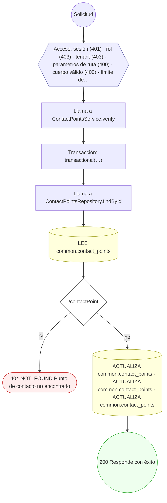

#### 2. POST /common/files

Crear un archivo con su versión inicial (UC-02-05)

| HTTP | Código | Cuándo |
|---|---|---|
| 201 | — | Éxito |
| 400 | `VALIDATION_FAILED` | El cuerpo cumple el DTO (sin propiedades extra) |
| 401 | `UNAUTHENTICATED` | Hay una sesión válida (JWT) |
| 403 | `FORBIDDEN` | El rol está permitido; El tenant se resuelve y pertenece al actor |
| 404 | `NOT_FOUND` | ResourceNotFoundException: La URI no pertenece al almacenamiento local; ResourceNotFoundException: La URI de almacenamiento local está mal formada; ResourceNotFoundException: La URI no pertenece al bucket configurado; ResourceNotFoundException: La URI S3 está mal formada o fuera del prefijo permitido |
| 429 | `RATE_LIMITED` | No se supera el límite de solicitudes |
| 500 | `INTERNAL` | StorageLifecycleDenied: LIFECYCLE_WIRING_MISSING; StorageLifecycleDenied: {identity.reasonCode}; StorageLifecycleDenied: TRANSACTION_REQUIRED; StorageLifecycleDenied: PHYSICAL_IDENTITY_UNKNOWN; StorageLifecycleDenied: PURGE_IN_FLIGHT; StorageLifecycleDenied: REFERENCE_OBJECT_UNPROVEN; StorageLifecycleDenied: STORE_RECEIPT_UNKNOWN; StorageLifecycleDenied: RESERVATION_MISSING; StorageLifecycleDenied: RESERVATION_OWNER_MISMATCH; StorageLifecycleDenied: PUBLICATION_IDENTITY_CHANGED; StorageLifecycleDenied: REFERENCE_METADATA_MISMATCH; StorageLifecycleDenied: INTENT_ENVELOPE_UNKNOWN; StorageLifecycleDenied: PRODUCER_OR_PURGE_IN_FLIGHT |

```mermaid
flowchart TD
  n1(("Solicitud")):::inicio
  n2{{"Acceso: sesión (401) · rol (403) · tenant (403) · cuerpo válido (400) · límite de tasa (429)"}}:::acceso
  n1 --> n2
  n3["Llama a FilesService.createFile"]:::llamada
  n2 --> n3
  n4["Llama a FilesService.assertLifecycleWired"]:::llamada
  n3 --> n4
  n5{"loadStorageEnv().lifecycleBinding && !this.publication"}:::decision
  n4 --> n5
  n6(["500 INTERNAL LIFECYCLE_WIRING_MISSING"]):::error
  n5 -->|"sí"| n6
  n7["Llama a StoragePublicationService.guardLocator"]:::llamada
  n5 -->|"no"| n7
  n8["Llama a StoragePublicationService.lockNamespace"]:::llamada
  n7 --> n8
  n9{"identity.kind === 'UNKNOWN'"}:::decision
  n8 --> n9
  n10(["500 INTERNAL {identity.reasonCode}"]):::error
  n9 -->|"sí"| n10
  n11["Llama a StorageLifecycleCoordinator.excludeNamespaces"]:::llamada
  n9 -->|"no"| n11
  n12{"!tx.getTransactionContext()"}:::decision
  n11 --> n12
  n13(["500 INTERNAL TRANSACTION_REQUIRED"]):::error
  n12 -->|"sí"| n13
  n14["Repite: map(…)"]:::bucle
  n12 -->|"no"| n14
  n15{"!isStorageReservationIdentity(identity)"}:::decision
  n14 -->|"cada elemento"| n15
  n16(["500 INTERNAL PHYSICAL_IDENTITY_UNKNOWN"]):::error
  n15 -->|"sí"| n16
  n17["Llama a StorageLifecycleCoordinator.assertNoPendingPurge"]:::llamada
  n15 -->|"no"| n17
  n14 -->|"al terminar"| n17
  n18["Repite: por cada const job de await this.queues.findStorageIntents(tx)"]:::bucle
  n17 --> n18
  n19{"job.jobType === 'storage.purge' && intent.phase !== 'PURGED'"}:::decision
  n18 -->|"cada elemento"| n19
  n20(["500 INTERNAL PURGE_IN_FLIGHT"]):::error
  n19 -->|"sí"| n20
  n21["Llama a LocalDiskFileStorageAdapter.inspect"]:::llamada
  n19 -->|"no"| n21
  n18 -->|"al terminar"| n21
  n22["Intenta"]:::intento
  n21 --> n22
  n23["Llama a LocalDiskFileStorageAdapter.hashFromUri"]:::llamada
  n22 --> n23
  n24{"!storageUri.startsWith(LOCAL_URI_PREFIX)"}:::decision
  n23 --> n24
  n25(["404 NOT_FOUND La URI no pertenece al almacenamiento local"]):::error
  n24 -->|"sí"| n25
  n26{"!CONTENT_HASH_PATTERN.test(hash)"}:::decision
  n24 -->|"no"| n26
  n27(["404 NOT_FOUND La URI de almacenamiento local está mal formada"]):::error
  n26 -->|"sí"| n27
  n28["Llama a LocalDiskFileStorageAdapter.hashFromUri"]:::llamada
  n26 -->|"no"| n28
  n29{"!storageUri.startsWith(LOCAL_URI_PREFIX)"}:::decision
  n28 --> n29
  n30(["404 NOT_FOUND La URI no pertenece al almacenamiento local"]):::error
  n29 -->|"sí"| n30
  n31{"!CONTENT_HASH_PATTERN.test(hash)"}:::decision
  n29 -->|"no"| n31
  n32(["404 NOT_FOUND La URI de almacenamiento local está mal formada"]):::error
  n31 -->|"sí"| n32
  n33["Llama a S3FileStorageAdapter.inspect"]:::llamada
  n31 -->|"no"| n33
  n34["Intenta"]:::intento
  n33 --> n34
  n35["Llama a S3FileStorageAdapter.parseOwnedKey"]:::llamada
  n34 --> n35
  n36{"!storageUri.startsWith(expected)"}:::decision
  n35 --> n36
  n37(["404 NOT_FOUND La URI no pertenece al bucket configurado"]):::error
  n36 -->|"sí"| n37
  n38{"!CONTENT_HASH_PATTERN.test(hash) || key !== this.objectKey(hash)"}:::decision
  n36 -->|"no"| n38
  n39(["404 NOT_FOUND La URI S3 está mal formada o fuera del prefijo permitido"]):::error
  n38 -->|"sí"| n39
  n40{"!presence || presence.state !== 'PRESENT'"}:::decision
  n38 -->|"no"| n40
  n41(["500 INTERNAL REFERENCE_OBJECT_UNPROVEN"]):::error
  n40 -->|"sí"| n41
  n42["Llama a StoragePublicationService.receipt"]:::llamada
  n40 -->|"no"| n42
  n43{"!isKnownPhysicalIdentity(stored.physicalIdentity)"}:::decision
  n42 --> n43
  n44(["500 INTERNAL STORE_RECEIPT_UNKNOWN"]):::error
  n43 -->|"sí"| n44
  n45{"reservation"}:::decision
  n43 -->|"no"| n45
  n46["Llama a StorageLifecycleCoordinator.assertSettledReference"]:::llamada
  n45 -->|"sí"| n46
  n47["Llama a QueuesRepository.findJobByDedupeKey"]:::llamada
  n46 --> n47
  n48[("LEE messaging.queued_jobs")]:::efecto
  n47 --> n48
  n49{"!job"}:::decision
  n48 --> n49
  n50(["500 INTERNAL RESERVATION_MISSING"]):::error
  n49 -->|"sí"| n50
  n51["Llama a StorageLifecycleCoordinator.owned"]:::llamada
  n49 -->|"no"| n51
  n52{"job.jobType !== 'storage.publish' || intent.operationId !== reservation.operationId || intent.ownerToken !==…"}:::decision
  n51 --> n52
  n53(["500 INTERNAL RESERVATION_OWNER_MISMATCH"]):::error
  n52 -->|"sí"| n53
  n54{"intent.phase !== 'STORED' || !intent.storedIdentity || reservationKey(intent.storedIdentity) !== reservationK…"}:::decision
  n52 -->|"no"| n54
  n55(["500 INTERNAL PUBLICATION_IDENTITY_CHANGED"]):::error
  n54 -->|"sí"| n55
  n56{"expected && (receipt.contentHash !== expected.contentHash || receipt.sizeBytes !== expected.sizeBytes)"}:::decision
  n54 -->|"no"| n56
  n45 -->|"no"| n56
  n57(["500 INTERNAL REFERENCE_METADATA_MISMATCH"]):::error
  n56 -->|"sí"| n57
  n58["Llama a StorageLifecycleCoordinator.assertNoContender"]:::llamada
  n56 -->|"no"| n58
  n59["Repite: por cada const job de await this.queues.findStorageIntents(tx)"]:::bucle
  n58 --> n59
  n60["Llama a StorageLifecycleCoordinator.readJob"]:::llamada
  n59 -->|"cada elemento"| n60
  n61{"!allowed.includes(intent.phase) || (job.jobType === 'storage.purge' && !isKnownPhysicalIdentity(intent.identi…"}:::decision
  n60 --> n61
  n62(["500 INTERNAL INTENT_ENVELOPE_UNKNOWN"]):::error
  n61 -->|"sí"| n62
  n63{"physicalContentionKey(intent.identity) === physicalContentionKey(identity) && intentExcludesPublication(inten…"}:::decision
  n61 -->|"no"| n63
  n64(["500 INTERNAL PRODUCER_OR_PURGE_IN_FLIGHT"]):::error
  n63 -->|"sí"| n64
  n65["Llama a FilesRepository.create"]:::llamada
  n63 -->|"no"| n65
  n59 -->|"al terminar"| n65
  n66[("CREA common.files")]:::efecto
  n65 --> n66
  n67["Llama a FileVersionsRepository.create"]:::llamada
  n66 --> n67
  n68[("CREA common.file_versions")]:::efecto
  n67 --> n68
  n69(("201 Responde con éxito")):::ok
  n68 --> n69
  classDef acceso fill:#eef,stroke:#66a
  classDef error fill:#fee,stroke:#c33
  classDef ok fill:#efe,stroke:#3a3
  classDef efecto fill:#ffd,stroke:#aa3
  classDef decision fill:#fff,stroke:#555
  classDef corte fill:#eee,stroke:#999,stroke-dasharray: 4
```

#### 3. DELETE /common/files/{id}

Borrar lógicamente un archivo (UC-02-10)

| HTTP | Código | Cuándo |
|---|---|---|
| 200 | — | Éxito |
| 400 | `VALIDATION_FAILED` | Los parámetros de ruta son UUID válidos |
| 401 | `UNAUTHENTICATED` | Hay una sesión válida (JWT) |
| 403 | `FORBIDDEN` | El rol está permitido; El tenant se resuelve y pertenece al actor; InsufficientRoleException: No tiene permiso para modificar este archivo |
| 404 | `NOT_FOUND` | ResourceNotFoundException: La URI no pertenece al almacenamiento local; ResourceNotFoundException: La URI de almacenamiento local está mal formada; ResourceNotFoundException: La URI no pertenece al bucket configurado; ResourceNotFoundException: La URI S3 está mal formada o fuera del prefijo permitido; ResourceNotFoundException: Archivo no encontrado |
| 422 | `PRECONDITION_FAILED` | PreconditionFailedException: El archivo está bajo retención legal y no puede borrarse |
| 429 | `RATE_LIMITED` | No se supera el límite de solicitudes |
| 500 | `INTERNAL` | StorageLifecycleDenied: LIFECYCLE_WIRING_MISSING; StorageLifecycleDenied: {identity.reasonCode}; StorageLifecycleDenied: TRANSACTION_REQUIRED; StorageLifecycleDenied: PHYSICAL_IDENTITY_UNKNOWN; StorageLifecycleDenied: PURGE_IN_FLIGHT; StorageLifecycleDenied: FILE_NOT_LIVE; StorageLifecycleDenied: VERSION_UNKNOWN; StorageLifecycleDenied: INTENT_ENVELOPE_UNKNOWN; StorageLifecycleDenied: PRODUCER_OR_PURGE_IN_FLIGHT |

```mermaid
flowchart TD
  n1(("Solicitud")):::inicio
  n2{{"Acceso: sesión (401) · rol (403) · tenant (403) · parámetros de ruta (400) · límite de tasa (429)"}}:::acceso
  n1 --> n2
  n3["Llama a FilesService.softDelete"]:::llamada
  n2 --> n3
  n4["Transacción: transactional(…)"]:::transaccion
  n3 --> n4
  n5["Llama a FilesService.assertLifecycleWired"]:::llamada
  n4 --> n5
  n6{"loadStorageEnv().lifecycleBinding && !this.publication"}:::decision
  n5 --> n6
  n7(["500 INTERNAL LIFECYCLE_WIRING_MISSING"]):::error
  n6 -->|"sí"| n7
  n8["Llama a StoragePublicationService.guardFile"]:::llamada
  n6 -->|"no"| n8
  n9["Llama a StoragePublicationService.lockNamespace"]:::llamada
  n8 --> n9
  n10{"identity.kind === 'UNKNOWN'"}:::decision
  n9 --> n10
  n11(["500 INTERNAL {identity.reasonCode}"]):::error
  n10 -->|"sí"| n11
  n12["Llama a StorageLifecycleCoordinator.excludeNamespaces"]:::llamada
  n10 -->|"no"| n12
  n13{"!tx.getTransactionContext()"}:::decision
  n12 --> n13
  n14(["500 INTERNAL TRANSACTION_REQUIRED"]):::error
  n13 -->|"sí"| n14
  n15["Repite: map(…)"]:::bucle
  n13 -->|"no"| n15
  n16{"!isStorageReservationIdentity(identity)"}:::decision
  n15 -->|"cada elemento"| n16
  n17(["500 INTERNAL PHYSICAL_IDENTITY_UNKNOWN"]):::error
  n16 -->|"sí"| n17
  n18["Llama a StorageLifecycleCoordinator.assertNoPendingPurge"]:::llamada
  n16 -->|"no"| n18
  n15 -->|"al terminar"| n18
  n19["Repite: por cada const job de await this.queues.findStorageIntents(tx)"]:::bucle
  n18 --> n19
  n20{"job.jobType === 'storage.purge' && intent.phase !== 'PURGED'"}:::decision
  n19 -->|"cada elemento"| n20
  n21(["500 INTERNAL PURGE_IN_FLIGHT"]):::error
  n20 -->|"sí"| n21
  n22[("LEE common.files")]:::efecto
  n20 -->|"no"| n22
  n19 -->|"al terminar"| n22
  n23{"!file || file.deletedAt || file.lifecycleStatusConceptId === CONCEPTS.FILE_DELETED || !file.currentVersionId"}:::decision
  n22 --> n23
  n24(["500 INTERNAL FILE_NOT_LIVE"]):::error
  n23 -->|"sí"| n24
  n25[("LEE common.file_versions")]:::efecto
  n23 -->|"no"| n25
  n26{"!versions.some((version) =› version.id === file.currentVersionId)"}:::decision
  n25 --> n26
  n27(["500 INTERNAL VERSION_UNKNOWN"]):::error
  n26 -->|"sí"| n27
  n28["Repite: por cada const version de versions"]:::bucle
  n26 -->|"no"| n28
  n29["Llama a LocalDiskFileStorageAdapter.resolvePhysicalIdentity"]:::llamada
  n28 -->|"cada elemento"| n29
  n30["Intenta"]:::intento
  n29 --> n30
  n31["Llama a LocalDiskFileStorageAdapter.hashFromUri"]:::llamada
  n30 --> n31
  n32{"!storageUri.startsWith(LOCAL_URI_PREFIX)"}:::decision
  n31 --> n32
  n33(["404 NOT_FOUND La URI no pertenece al almacenamiento local"]):::error
  n32 -->|"sí"| n33
  n34{"!CONTENT_HASH_PATTERN.test(hash)"}:::decision
  n32 -->|"no"| n34
  n35(["404 NOT_FOUND La URI de almacenamiento local está mal formada"]):::error
  n34 -->|"sí"| n35
  n36["Llama a S3FileStorageAdapter.resolvePhysicalIdentity"]:::llamada
  n34 -->|"no"| n36
  n37["Intenta"]:::intento
  n36 --> n37
  n38["Llama a S3FileStorageAdapter.parseOwnedKey"]:::llamada
  n37 --> n38
  n39{"!storageUri.startsWith(expected)"}:::decision
  n38 --> n39
  n40(["404 NOT_FOUND La URI no pertenece al bucket configurado"]):::error
  n39 -->|"sí"| n40
  n41{"!CONTENT_HASH_PATTERN.test(hash) || key !== this.objectKey(hash)"}:::decision
  n39 -->|"no"| n41
  n42(["404 NOT_FOUND La URI S3 está mal formada o fuera del prefijo permitido"]):::error
  n41 -->|"sí"| n42
  n43{"!identity || identity.kind === 'UNKNOWN'"}:::decision
  n41 -->|"no"| n43
  n44(["500 INTERNAL PHYSICAL_IDENTITY_UNKNOWN"]):::error
  n43 -->|"sí"| n44
  n45["Llama a StorageLifecycleCoordinator.assertNoContender"]:::llamada
  n43 -->|"no"| n45
  n46["Repite: por cada const job de await this.queues.findStorageIntents(tx)"]:::bucle
  n45 --> n46
  n47["Llama a StorageLifecycleCoordinator.readJob"]:::llamada
  n46 -->|"cada elemento"| n47
  n48{"!allowed.includes(intent.phase) || (job.jobType === 'storage.purge' && !isKnownPhysicalIdentity(intent.identi…"}:::decision
  n47 --> n48
  n49(["500 INTERNAL INTENT_ENVELOPE_UNKNOWN"]):::error
  n48 -->|"sí"| n49
  n50{"physicalContentionKey(intent.identity) === physicalContentionKey(identity) && intentExcludesPublication(inten…"}:::decision
  n48 -->|"no"| n50
  n51(["500 INTERNAL PRODUCER_OR_PURGE_IN_FLIGHT"]):::error
  n50 -->|"sí"| n51
  n52["Llama a FilesRepository.findById"]:::llamada
  n50 -->|"no"| n52
  n46 -->|"al terminar"| n52
  n28 -->|"al terminar"| n52
  n53[("LEE common.files")]:::efecto
  n52 --> n53
  n54{"!file"}:::decision
  n53 --> n54
  n55(["404 NOT_FOUND Archivo no encontrado"]):::error
  n54 -->|"sí"| n55
  n56["Llama a FilesService.assertCanMutateFile"]:::llamada
  n54 -->|"no"| n56
  n57{"!canActorReadOwnFile(file, actor)"}:::decision
  n56 --> n57
  n58(["404 NOT_FOUND Archivo no encontrado"]):::error
  n57 -->|"sí"| n58
  n59(["403 FORBIDDEN No tiene permiso para modificar este archivo"]):::error
  n57 -->|"no"| n59
  n60{"file.legalHoldUntil && file.legalHoldUntil.getTime() › Date.now()"}:::decision
  n61(["422 PRECONDITION_FAILED El archivo está bajo retención legal y no puede borrarse"]):::error
  n60 -->|"sí"| n61
  n62[("ACTUALIZA common.files · ACTUALIZA common.files · ACTUALIZA common.files · ACTUALIZA common.files")]:::efecto
  n60 -->|"no"| n62
  n63(("200 Responde con éxito")):::ok
  n62 --> n63
  classDef acceso fill:#eef,stroke:#66a
  classDef error fill:#fee,stroke:#c33
  classDef ok fill:#efe,stroke:#3a3
  classDef efecto fill:#ffd,stroke:#aa3
  classDef decision fill:#fff,stroke:#555
  classDef corte fill:#eee,stroke:#999,stroke-dasharray: 4
```

#### 4. GET /common/files/{id}/content

Descargar el contenido vigente de un archivo

| HTTP | Código | Cuándo |
|---|---|---|
| 200 | — | Éxito |
| 400 | `VALIDATION_FAILED` | Los parámetros de ruta son UUID válidos |
| 401 | `UNAUTHENTICATED` | Hay una sesión válida (JWT) |
| 403 | `FORBIDDEN` | El rol está permitido; El tenant se resuelve y pertenece al actor; ForbiddenException: La firma de la URL no es válida; ForbiddenException: No tiene acceso a este archivo |
| 404 | `NOT_FOUND` | ResourceNotFoundException: Archivo no encontrado; ResourceNotFoundException: {labels.notFound}; ResourceNotFoundException: La URI no pertenece al almacenamiento local; ResourceNotFoundException: La URI de almacenamiento local está mal formada; ResourceNotFoundException: El contenido no está disponible en el almacenamiento local; ResourceNotFoundException: La URI no pertenece al bucket configurado; ResourceNotFoundException: La URI S3 está mal formada o fuera del prefijo permitido; ResourceNotFoundException: El contenido no está disponible en el almacenamiento configurado |
| 410 | — | GoneException: {{ // Sin `code` propio el filtro global lo dejaba como INTE…} |
| 422 | `PRECONDITION_FAILED` | PreconditionFailedException: {labels.subject} está borrado; PreconditionFailedException: {labels.subject} no tiene una versión vigente; PreconditionFailedException: {labels.subject} resultó infectado; PreconditionFailedException: {labels.subject} no es de un formato admitido para este uso |
| 429 | `RATE_LIMITED` | No se supera el límite de solicitudes |
| 500 | `INTERNAL` | DomainException: {HttpStatus.SERVICE_UNAVAILABLE}; Error: S3 object body is empty |

```mermaid
flowchart TD
  n1(("Solicitud")):::inicio
  n2{{"Acceso: sesión (401) · rol (403) · tenant (403) · parámetros de ruta (400) · límite de tasa (429)"}}:::acceso
  n1 --> n2
  n3["Llama a FilesService.assertDownloadSignature"]:::llamada
  n2 --> n3
  n4{"!query.versionId || !query.signature || !Number.isFinite(expiry)"}:::decision
  n3 --> n4
  n5(["403 FORBIDDEN La firma de la URL no es válida"]):::error
  n4 -->|"sí"| n5
  n6{"presented.length !== expected.length || !timingSafeEqual(presented, expected)"}:::decision
  n4 -->|"no"| n6
  n7(["403 FORBIDDEN La firma de la URL no es válida"]):::error
  n6 -->|"sí"| n7
  n8{"expiry ‹ Date.now()"}:::decision
  n6 -->|"no"| n8
  n9(["410 {{ // Sin `code` propio el filtro global lo dejaba como INTE…}"]):::error
  n8 -->|"sí"| n9
  n10["Llama a FileUploadService.download"]:::llamada
  n8 -->|"no"| n10
  n11["Llama a FilesRepository.findById"]:::llamada
  n10 --> n11
  n12[("LEE common.files")]:::efecto
  n11 --> n12
  n13{"!file"}:::decision
  n12 --> n13
  n14(["404 NOT_FOUND Archivo no encontrado"]):::error
  n13 -->|"sí"| n14
  n15{"!canActorReadOwnFile(file, actor)"}:::decision
  n13 -->|"no"| n15
  n16(["403 FORBIDDEN No tiene acceso a este archivo"]):::error
  n15 -->|"sí"| n16
  n17["Llama a FileUploadService.serveCurrentVersion"]:::llamada
  n15 -->|"no"| n17
  n18["Llama a AttachableFileService.assertUsableForAuthorizedContext"]:::llamada
  n17 --> n18
  n19["Llama a FilesRepository.findById"]:::llamada
  n18 --> n19
  n20[("LEE common.files")]:::efecto
  n19 --> n20
  n21{"!file"}:::decision
  n20 --> n21
  n22(["404 NOT_FOUND {labels.notFound}"]):::error
  n21 -->|"sí"| n22
  n23["Llama a AttachableFileService.assertVersionUsable"]:::llamada
  n21 -->|"no"| n23
  n24{"file.deletedAt || file.lifecycleStatusConceptId === CONCEPTS.FILE_DELETED"}:::decision
  n23 --> n24
  n25(["422 PRECONDITION_FAILED {labels.subject} está borrado"]):::error
  n24 -->|"sí"| n25
  n26{"!file.currentVersionId"}:::decision
  n24 -->|"no"| n26
  n27(["422 PRECONDITION_FAILED {labels.subject} no tiene una versión vigente"]):::error
  n26 -->|"sí"| n27
  n28{"!version"}:::decision
  n26 -->|"no"| n28
  n29(["422 PRECONDITION_FAILED {labels.subject} no tiene una versión vigente"]):::error
  n28 -->|"sí"| n29
  n30{"version.malwareScanStatusConceptId === CONCEPTS.SCAN_INFECTED"}:::decision
  n28 -->|"no"| n30
  n31(["422 PRECONDITION_FAILED {labels.subject} resultó infectado"]):::error
  n30 -->|"sí"| n31
  n32{"accepted && !accepted.includes(version.mimeType ?? '')"}:::decision
  n30 -->|"no"| n32
  n33(["422 PRECONDITION_FAILED {labels.subject} no es de un formato admitido para este uso"]):::error
  n32 -->|"sí"| n33
  n34["Llama a LocalDiskFileStorageAdapter.retrieve"]:::llamada
  n32 -->|"no"| n34
  n35["Llama a LocalDiskFileStorageAdapter.hashFromUri"]:::llamada
  n34 --> n35
  n36{"!storageUri.startsWith(LOCAL_URI_PREFIX)"}:::decision
  n35 --> n36
  n37(["404 NOT_FOUND La URI no pertenece al almacenamiento local"]):::error
  n36 -->|"sí"| n37
  n38{"!CONTENT_HASH_PATTERN.test(hash)"}:::decision
  n36 -->|"no"| n38
  n39(["404 NOT_FOUND La URI de almacenamiento local está mal formada"]):::error
  n38 -->|"sí"| n39
  n40["Intenta"]:::intento
  n38 -->|"no"| n40
  n41{"isMissingFile(error)"}:::decision
  n40 -->|"si falla"| n41
  n42(["404 NOT_FOUND El contenido no está disponible en el almacenamiento local"]):::error
  n41 -->|"sí"| n42
  n43(["↩ (relanza el error capturado)"]):::error
  n41 -->|"no"| n43
  n44["Llama a S3FileStorageAdapter.retrieve"]:::llamada
  n40 --> n44
  n45["Llama a S3FileStorageAdapter.assertConfigured"]:::llamada
  n44 --> n45
  n46{"!this.env.s3.bucket"}:::decision
  n45 --> n46
  n47(["500 INTERNAL {HttpStatus.SERVICE_UNAVAILABLE}"]):::error
  n46 -->|"sí"| n47
  n48["Llama a S3FileStorageAdapter.parseOwnedKey"]:::llamada
  n46 -->|"no"| n48
  n49{"!storageUri.startsWith(expected)"}:::decision
  n48 --> n49
  n50(["404 NOT_FOUND La URI no pertenece al bucket configurado"]):::error
  n49 -->|"sí"| n50
  n51{"!CONTENT_HASH_PATTERN.test(hash) || key !== this.objectKey(hash)"}:::decision
  n49 -->|"no"| n51
  n52(["404 NOT_FOUND La URI S3 está mal formada o fuera del prefijo permitido"]):::error
  n51 -->|"sí"| n52
  n53["Intenta"]:::intento
  n51 -->|"no"| n53
  n54{"!result.Body"}:::decision
  n53 --> n54
  n55(["500 INTERNAL S3 object body is empty"]):::error
  n54 -->|"sí"| n55
  n56{"isNotFound(error)"}:::decision
  n53 -->|"si falla"| n56
  n57(["404 NOT_FOUND El contenido no está disponible en el almacenamiento configurado"]):::error
  n56 -->|"sí"| n57
  n58(["↩ (relanza el error capturado)"]):::error
  n56 -->|"no"| n58
  n59(("200 Responde con éxito")):::ok
  n54 -->|"no"| n59
  classDef acceso fill:#eef,stroke:#66a
  classDef error fill:#fee,stroke:#c33
  classDef ok fill:#efe,stroke:#3a3
  classDef efecto fill:#ffd,stroke:#aa3
  classDef decision fill:#fff,stroke:#555
  classDef corte fill:#eee,stroke:#999,stroke-dasharray: 4
```

#### 5. POST /common/files/{id}/download-url

Emitir una URL de descarga firmada (UC-02-11)

| HTTP | Código | Cuándo |
|---|---|---|
| 201 | — | Éxito |
| 400 | `VALIDATION_FAILED` | Los parámetros de ruta son UUID válidos |
| 401 | `UNAUTHENTICATED` | Hay una sesión válida (JWT) |
| 403 | `FORBIDDEN` | El rol está permitido; El tenant se resuelve y pertenece al actor; ForbiddenException: No tiene acceso a este archivo |
| 404 | `NOT_FOUND` | ResourceNotFoundException: Archivo no encontrado; ResourceNotFoundException: Versión vigente no encontrada |
| 422 | `PRECONDITION_FAILED` | PreconditionFailedException: El archivo está borrado; PreconditionFailedException: El archivo no tiene una versión vigente; PreconditionFailedException: La versión vigente no ha superado el escaneo antimalware |
| 429 | `RATE_LIMITED` | No se supera el límite de solicitudes |

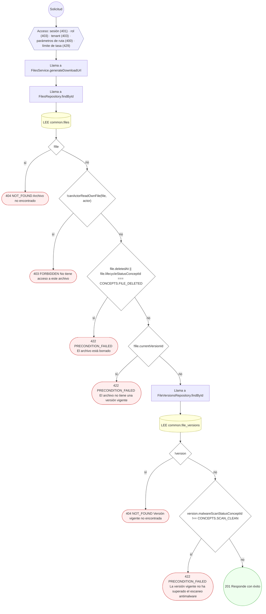

#### 6. POST /common/files/{id}/links

Vincular un archivo a un propietario (UC-02-08)

| HTTP | Código | Cuándo |
|---|---|---|
| 201 | — | Éxito |
| 400 | `VALIDATION_FAILED` | Los parámetros de ruta son UUID válidos; El cuerpo cumple el DTO (sin propiedades extra) |
| 401 | `UNAUTHENTICATED` | Hay una sesión válida (JWT) |
| 403 | `FORBIDDEN` | El rol está permitido; El tenant se resuelve y pertenece al actor; InsufficientRoleException: No tiene permiso para modificar este archivo |
| 404 | `NOT_FOUND` | ResourceNotFoundException: La URI no pertenece al almacenamiento local; ResourceNotFoundException: La URI de almacenamiento local está mal formada; ResourceNotFoundException: La URI no pertenece al bucket configurado; ResourceNotFoundException: La URI S3 está mal formada o fuera del prefijo permitido; ResourceNotFoundException: Archivo no encontrado |
| 429 | `RATE_LIMITED` | No se supera el límite de solicitudes |
| 500 | `INTERNAL` | StorageLifecycleDenied: LIFECYCLE_WIRING_MISSING; StorageLifecycleDenied: {identity.reasonCode}; StorageLifecycleDenied: TRANSACTION_REQUIRED; StorageLifecycleDenied: PHYSICAL_IDENTITY_UNKNOWN; StorageLifecycleDenied: PURGE_IN_FLIGHT; StorageLifecycleDenied: FILE_NOT_LIVE; StorageLifecycleDenied: VERSION_UNKNOWN; StorageLifecycleDenied: INTENT_ENVELOPE_UNKNOWN; StorageLifecycleDenied: PRODUCER_OR_PURGE_IN_FLIGHT |

```mermaid
flowchart TD
  n1(("Solicitud")):::inicio
  n2{{"Acceso: sesión (401) · rol (403) · tenant (403) · parámetros de ruta (400) · cuerpo válido (400) · límite de…"}}:::acceso
  n1 --> n2
  n3["Llama a FilesService.createLink"]:::llamada
  n2 --> n3
  n4["Transacción: transactional(…)"]:::transaccion
  n3 --> n4
  n5["Llama a FilesService.assertLifecycleWired"]:::llamada
  n4 --> n5
  n6{"loadStorageEnv().lifecycleBinding && !this.publication"}:::decision
  n5 --> n6
  n7(["500 INTERNAL LIFECYCLE_WIRING_MISSING"]):::error
  n6 -->|"sí"| n7
  n8["Llama a StoragePublicationService.guardFile"]:::llamada
  n6 -->|"no"| n8
  n9["Llama a StoragePublicationService.lockNamespace"]:::llamada
  n8 --> n9
  n10{"identity.kind === 'UNKNOWN'"}:::decision
  n9 --> n10
  n11(["500 INTERNAL {identity.reasonCode}"]):::error
  n10 -->|"sí"| n11
  n12["Llama a StorageLifecycleCoordinator.excludeNamespaces"]:::llamada
  n10 -->|"no"| n12
  n13{"!tx.getTransactionContext()"}:::decision
  n12 --> n13
  n14(["500 INTERNAL TRANSACTION_REQUIRED"]):::error
  n13 -->|"sí"| n14
  n15["Repite: map(…)"]:::bucle
  n13 -->|"no"| n15
  n16{"!isStorageReservationIdentity(identity)"}:::decision
  n15 -->|"cada elemento"| n16
  n17(["500 INTERNAL PHYSICAL_IDENTITY_UNKNOWN"]):::error
  n16 -->|"sí"| n17
  n18["Llama a StorageLifecycleCoordinator.assertNoPendingPurge"]:::llamada
  n16 -->|"no"| n18
  n15 -->|"al terminar"| n18
  n19["Repite: por cada const job de await this.queues.findStorageIntents(tx)"]:::bucle
  n18 --> n19
  n20{"job.jobType === 'storage.purge' && intent.phase !== 'PURGED'"}:::decision
  n19 -->|"cada elemento"| n20
  n21(["500 INTERNAL PURGE_IN_FLIGHT"]):::error
  n20 -->|"sí"| n21
  n22[("LEE common.files")]:::efecto
  n20 -->|"no"| n22
  n19 -->|"al terminar"| n22
  n23{"!file || file.deletedAt || file.lifecycleStatusConceptId === CONCEPTS.FILE_DELETED || !file.currentVersionId"}:::decision
  n22 --> n23
  n24(["500 INTERNAL FILE_NOT_LIVE"]):::error
  n23 -->|"sí"| n24
  n25[("LEE common.file_versions")]:::efecto
  n23 -->|"no"| n25
  n26{"!versions.some((version) =› version.id === file.currentVersionId)"}:::decision
  n25 --> n26
  n27(["500 INTERNAL VERSION_UNKNOWN"]):::error
  n26 -->|"sí"| n27
  n28["Repite: por cada const version de versions"]:::bucle
  n26 -->|"no"| n28
  n29["Llama a LocalDiskFileStorageAdapter.resolvePhysicalIdentity"]:::llamada
  n28 -->|"cada elemento"| n29
  n30["Intenta"]:::intento
  n29 --> n30
  n31["Llama a LocalDiskFileStorageAdapter.hashFromUri"]:::llamada
  n30 --> n31
  n32{"!storageUri.startsWith(LOCAL_URI_PREFIX)"}:::decision
  n31 --> n32
  n33(["404 NOT_FOUND La URI no pertenece al almacenamiento local"]):::error
  n32 -->|"sí"| n33
  n34{"!CONTENT_HASH_PATTERN.test(hash)"}:::decision
  n32 -->|"no"| n34
  n35(["404 NOT_FOUND La URI de almacenamiento local está mal formada"]):::error
  n34 -->|"sí"| n35
  n36["Llama a S3FileStorageAdapter.resolvePhysicalIdentity"]:::llamada
  n34 -->|"no"| n36
  n37["Intenta"]:::intento
  n36 --> n37
  n38["Llama a S3FileStorageAdapter.parseOwnedKey"]:::llamada
  n37 --> n38
  n39{"!storageUri.startsWith(expected)"}:::decision
  n38 --> n39
  n40(["404 NOT_FOUND La URI no pertenece al bucket configurado"]):::error
  n39 -->|"sí"| n40
  n41{"!CONTENT_HASH_PATTERN.test(hash) || key !== this.objectKey(hash)"}:::decision
  n39 -->|"no"| n41
  n42(["404 NOT_FOUND La URI S3 está mal formada o fuera del prefijo permitido"]):::error
  n41 -->|"sí"| n42
  n43{"!identity || identity.kind === 'UNKNOWN'"}:::decision
  n41 -->|"no"| n43
  n44(["500 INTERNAL PHYSICAL_IDENTITY_UNKNOWN"]):::error
  n43 -->|"sí"| n44
  n45["Llama a StorageLifecycleCoordinator.assertNoContender"]:::llamada
  n43 -->|"no"| n45
  n46["Repite: por cada const job de await this.queues.findStorageIntents(tx)"]:::bucle
  n45 --> n46
  n47["Llama a StorageLifecycleCoordinator.readJob"]:::llamada
  n46 -->|"cada elemento"| n47
  n48{"!allowed.includes(intent.phase) || (job.jobType === 'storage.purge' && !isKnownPhysicalIdentity(intent.identi…"}:::decision
  n47 --> n48
  n49(["500 INTERNAL INTENT_ENVELOPE_UNKNOWN"]):::error
  n48 -->|"sí"| n49
  n50{"physicalContentionKey(intent.identity) === physicalContentionKey(identity) && intentExcludesPublication(inten…"}:::decision
  n48 -->|"no"| n50
  n51(["500 INTERNAL PRODUCER_OR_PURGE_IN_FLIGHT"]):::error
  n50 -->|"sí"| n51
  n52["Llama a FilesRepository.findById"]:::llamada
  n50 -->|"no"| n52
  n46 -->|"al terminar"| n52
  n28 -->|"al terminar"| n52
  n53[("LEE common.files")]:::efecto
  n52 --> n53
  n54{"!file"}:::decision
  n53 --> n54
  n55(["404 NOT_FOUND Archivo no encontrado"]):::error
  n54 -->|"sí"| n55
  n56["Llama a FilesService.assertCanMutateFile"]:::llamada
  n54 -->|"no"| n56
  n57{"!canActorReadOwnFile(file, actor)"}:::decision
  n56 --> n57
  n58(["404 NOT_FOUND Archivo no encontrado"]):::error
  n57 -->|"sí"| n58
  n59(["403 FORBIDDEN No tiene permiso para modificar este archivo"]):::error
  n57 -->|"no"| n59
  n60["Llama a FileLinksRepository.create"]:::llamada
  n61[("CREA common.file_links")]:::efecto
  n60 --> n61
  n62(("201 Responde con éxito")):::ok
  n61 --> n62
  classDef acceso fill:#eef,stroke:#66a
  classDef error fill:#fee,stroke:#c33
  classDef ok fill:#efe,stroke:#3a3
  classDef efecto fill:#ffd,stroke:#aa3
  classDef decision fill:#fff,stroke:#555
  classDef corte fill:#eee,stroke:#999,stroke-dasharray: 4
```

#### 7. POST /common/files/{id}/versions

Añadir una versión a un archivo (UC-02-06)

| HTTP | Código | Cuándo |
|---|---|---|
| 201 | — | Éxito |
| 400 | `VALIDATION_FAILED` | Los parámetros de ruta son UUID válidos; El cuerpo cumple el DTO (sin propiedades extra) |
| 401 | `UNAUTHENTICATED` | Hay una sesión válida (JWT) |
| 403 | `FORBIDDEN` | El rol está permitido; El tenant se resuelve y pertenece al actor; InsufficientRoleException: No tiene permiso para modificar este archivo |
| 404 | `NOT_FOUND` | ResourceNotFoundException: La URI no pertenece al almacenamiento local; ResourceNotFoundException: La URI de almacenamiento local está mal formada; ResourceNotFoundException: La URI no pertenece al bucket configurado; ResourceNotFoundException: La URI S3 está mal formada o fuera del prefijo permitido; ResourceNotFoundException: Archivo no encontrado |
| 429 | `RATE_LIMITED` | No se supera el límite de solicitudes |
| 500 | `INTERNAL` | StorageLifecycleDenied: LIFECYCLE_WIRING_MISSING; StorageLifecycleDenied: {identity.reasonCode}; StorageLifecycleDenied: TRANSACTION_REQUIRED; StorageLifecycleDenied: PHYSICAL_IDENTITY_UNKNOWN; StorageLifecycleDenied: PURGE_IN_FLIGHT; StorageLifecycleDenied: FILE_NOT_LIVE; StorageLifecycleDenied: VERSION_UNKNOWN; StorageLifecycleDenied: INTENT_ENVELOPE_UNKNOWN; StorageLifecycleDenied: PRODUCER_OR_PURGE_IN_FLIGHT; StorageLifecycleDenied: REFERENCE_OBJECT_UNPROVEN; StorageLifecycleDenied: STORE_RECEIPT_UNKNOWN; StorageLifecycleDenied: RESERVATION_MISSING; StorageLifecycleDenied: RESERVATION_OWNER_MISMATCH; StorageLifecycleDenied: PUBLICATION_IDENTITY_CHANGED; StorageLifecycleDenied: REFERENCE_METADATA_MISMATCH |

#### 8. POST /common/files/{id}/versions/{vid}/derivatives

Generar un derivado de una versión (UC-02-07)

| HTTP | Código | Cuándo |
|---|---|---|
| 201 | — | Éxito |
| 400 | `VALIDATION_FAILED` | Los parámetros de ruta son UUID válidos; El cuerpo cumple el DTO (sin propiedades extra) |
| 401 | `UNAUTHENTICATED` | Hay una sesión válida (JWT) |
| 403 | `FORBIDDEN` | El rol está permitido; El tenant se resuelve y pertenece al actor; InsufficientRoleException: No tiene permiso para modificar este archivo |
| 404 | `NOT_FOUND` | ResourceNotFoundException: La URI no pertenece al almacenamiento local; ResourceNotFoundException: La URI de almacenamiento local está mal formada; ResourceNotFoundException: La URI no pertenece al bucket configurado; ResourceNotFoundException: La URI S3 está mal formada o fuera del prefijo permitido; ResourceNotFoundException: Archivo no encontrado; ResourceNotFoundException: Versión de archivo no encontrada |
| 422 | `PRECONDITION_FAILED` | PreconditionFailedException: Solo se pueden generar derivados de versiones con escaneo limpio |
| 429 | `RATE_LIMITED` | No se supera el límite de solicitudes |
| 500 | `INTERNAL` | StorageLifecycleDenied: LIFECYCLE_WIRING_MISSING; StorageLifecycleDenied: {identity.reasonCode}; StorageLifecycleDenied: TRANSACTION_REQUIRED; StorageLifecycleDenied: PHYSICAL_IDENTITY_UNKNOWN; StorageLifecycleDenied: PURGE_IN_FLIGHT; StorageLifecycleDenied: FILE_NOT_LIVE; StorageLifecycleDenied: VERSION_UNKNOWN; StorageLifecycleDenied: INTENT_ENVELOPE_UNKNOWN; StorageLifecycleDenied: PRODUCER_OR_PURGE_IN_FLIGHT; StorageLifecycleDenied: REFERENCE_OBJECT_UNPROVEN; StorageLifecycleDenied: STORE_RECEIPT_UNKNOWN; StorageLifecycleDenied: RESERVATION_MISSING; StorageLifecycleDenied: RESERVATION_OWNER_MISMATCH; StorageLifecycleDenied: PUBLICATION_IDENTITY_CHANGED; StorageLifecycleDenied: REFERENCE_METADATA_MISMATCH |

```mermaid
flowchart TD
  n1(("Solicitud")):::inicio
  n2{{"Acceso: sesión (401) · rol (403) · tenant (403) · parámetros de ruta (400) · cuerpo válido (400) · límite de…"}}:::acceso
  n1 --> n2
  n3["Llama a FilesService.createDerivative"]:::llamada
  n2 --> n3
  n4["Transacción: transactional(…)"]:::transaccion
  n3 --> n4
  n5["Llama a FilesService.assertLifecycleWired"]:::llamada
  n4 --> n5
  n6{"loadStorageEnv().lifecycleBinding && !this.publication"}:::decision
  n5 --> n6
  n7(["500 INTERNAL LIFECYCLE_WIRING_MISSING"]):::error
  n6 -->|"sí"| n7
  n8["Llama a StoragePublicationService.guardFile"]:::llamada
  n6 -->|"no"| n8
  n9["Llama a StoragePublicationService.lockNamespace"]:::llamada
  n8 --> n9
  n10{"identity.kind === 'UNKNOWN'"}:::decision
  n9 --> n10
  n11(["500 INTERNAL {identity.reasonCode}"]):::error
  n10 -->|"sí"| n11
  n12["Llama a StorageLifecycleCoordinator.excludeNamespaces"]:::llamada
  n10 -->|"no"| n12
  n13{"!tx.getTransactionContext()"}:::decision
  n12 --> n13
  n14(["500 INTERNAL TRANSACTION_REQUIRED"]):::error
  n13 -->|"sí"| n14
  n15["Repite: map(…)"]:::bucle
  n13 -->|"no"| n15
  n16{"!isStorageReservationIdentity(identity)"}:::decision
  n15 -->|"cada elemento"| n16
  n17(["500 INTERNAL PHYSICAL_IDENTITY_UNKNOWN"]):::error
  n16 -->|"sí"| n17
  n18["Llama a StorageLifecycleCoordinator.assertNoPendingPurge"]:::llamada
  n16 -->|"no"| n18
  n15 -->|"al terminar"| n18
  n19["Repite: por cada const job de await this.queues.findStorageIntents(tx)"]:::bucle
  n18 --> n19
  n20{"job.jobType === 'storage.purge' && intent.phase !== 'PURGED'"}:::decision
  n19 -->|"cada elemento"| n20
  n21(["500 INTERNAL PURGE_IN_FLIGHT"]):::error
  n20 -->|"sí"| n21
  n22[("LEE common.files")]:::efecto
  n20 -->|"no"| n22
  n19 -->|"al terminar"| n22
  n23{"!file || file.deletedAt || file.lifecycleStatusConceptId === CONCEPTS.FILE_DELETED || !file.currentVersionId"}:::decision
  n22 --> n23
  n24(["500 INTERNAL FILE_NOT_LIVE"]):::error
  n23 -->|"sí"| n24
  n25[("LEE common.file_versions")]:::efecto
  n23 -->|"no"| n25
  n26{"!versions.some((version) =› version.id === file.currentVersionId)"}:::decision
  n25 --> n26
  n27(["500 INTERNAL VERSION_UNKNOWN"]):::error
  n26 -->|"sí"| n27
  n28["Repite: por cada const version de versions"]:::bucle
  n26 -->|"no"| n28
  n29["Llama a LocalDiskFileStorageAdapter.resolvePhysicalIdentity"]:::llamada
  n28 -->|"cada elemento"| n29
  n30["Intenta"]:::intento
  n29 --> n30
  n31["Llama a LocalDiskFileStorageAdapter.hashFromUri"]:::llamada
  n30 --> n31
  n32{"!storageUri.startsWith(LOCAL_URI_PREFIX)"}:::decision
  n31 --> n32
  n33(["404 NOT_FOUND La URI no pertenece al almacenamiento local"]):::error
  n32 -->|"sí"| n33
  n34{"!CONTENT_HASH_PATTERN.test(hash)"}:::decision
  n32 -->|"no"| n34
  n35(["404 NOT_FOUND La URI de almacenamiento local está mal formada"]):::error
  n34 -->|"sí"| n35
  n36["Llama a S3FileStorageAdapter.resolvePhysicalIdentity"]:::llamada
  n34 -->|"no"| n36
  n37["Intenta"]:::intento
  n36 --> n37
  n38["Llama a S3FileStorageAdapter.parseOwnedKey"]:::llamada
  n37 --> n38
  n39{"!storageUri.startsWith(expected)"}:::decision
  n38 --> n39
  n40(["404 NOT_FOUND La URI no pertenece al bucket configurado"]):::error
  n39 -->|"sí"| n40
  n41{"!CONTENT_HASH_PATTERN.test(hash) || key !== this.objectKey(hash)"}:::decision
  n39 -->|"no"| n41
  n42(["404 NOT_FOUND La URI S3 está mal formada o fuera del prefijo permitido"]):::error
  n41 -->|"sí"| n42
  n43{"!identity || identity.kind === 'UNKNOWN'"}:::decision
  n41 -->|"no"| n43
  n44(["500 INTERNAL PHYSICAL_IDENTITY_UNKNOWN"]):::error
  n43 -->|"sí"| n44
  n45["Llama a StorageLifecycleCoordinator.assertNoContender"]:::llamada
  n43 -->|"no"| n45
  n46["Repite: por cada const job de await this.queues.findStorageIntents(tx)"]:::bucle
  n45 --> n46
  n47["Llama a StorageLifecycleCoordinator.readJob"]:::llamada
  n46 -->|"cada elemento"| n47
  n48{"!allowed.includes(intent.phase) || (job.jobType === 'storage.purge' && !isKnownPhysicalIdentity(intent.identi…"}:::decision
  n47 --> n48
  n49(["500 INTERNAL INTENT_ENVELOPE_UNKNOWN"]):::error
  n48 -->|"sí"| n49
  n50{"physicalContentionKey(intent.identity) === physicalContentionKey(identity) && intentExcludesPublication(inten…"}:::decision
  n48 -->|"no"| n50
  n51(["500 INTERNAL PRODUCER_OR_PURGE_IN_FLIGHT"]):::error
  n50 -->|"sí"| n51
  n52["Llama a StoragePublicationService.guardLocator"]:::llamada
  n50 -->|"no"| n52
  n46 -->|"al terminar"| n52
  n28 -->|"al terminar"| n52
  n53["Llama a StoragePublicationService.lockNamespace"]:::llamada
  n52 --> n53
  n54{"identity.kind === 'UNKNOWN'"}:::decision
  n53 --> n54
  n55(["500 INTERNAL {identity.reasonCode}"]):::error
  n54 -->|"sí"| n55
  n56["Llama a StorageLifecycleCoordinator.excludeNamespaces"]:::llamada
  n54 -->|"no"| n56
  n57{"!tx.getTransactionContext()"}:::decision
  n56 --> n57
  n58(["500 INTERNAL TRANSACTION_REQUIRED"]):::error
  n57 -->|"sí"| n58
  n59["Repite: map(…)"]:::bucle
  n57 -->|"no"| n59
  n60{"!isStorageReservationIdentity(identity)"}:::decision
  n59 -->|"cada elemento"| n60
  n61(["500 INTERNAL PHYSICAL_IDENTITY_UNKNOWN"]):::error
  n60 -->|"sí"| n61
  n62["Llama a StorageLifecycleCoordinator.assertNoPendingPurge"]:::llamada
  n60 -->|"no"| n62
  n59 -->|"al terminar"| n62
  n63["Repite: por cada const job de await this.queues.findStorageIntents(tx)"]:::bucle
  n62 --> n63
  n64{"job.jobType === 'storage.purge' && intent.phase !== 'PURGED'"}:::decision
  n63 -->|"cada elemento"| n64
  n65(["500 INTERNAL PURGE_IN_FLIGHT"]):::error
  n64 -->|"sí"| n65
  n66["Llama a LocalDiskFileStorageAdapter.inspect"]:::llamada
  n64 -->|"no"| n66
  n63 -->|"al terminar"| n66
  n67["Intenta"]:::intento
  n66 --> n67
  n68["Llama a LocalDiskFileStorageAdapter.hashFromUri"]:::llamada
  n67 --> n68
  n69{"!storageUri.startsWith(LOCAL_URI_PREFIX)"}:::decision
  n68 --> n69
  n70(["404 NOT_FOUND La URI no pertenece al almacenamiento local"]):::error
  n69 -->|"sí"| n70
  n71["… el resto del árbol (2 nodos) está en el JSON del inventario"]:::corte
  n69 -->|"no"| n71
  classDef acceso fill:#eef,stroke:#66a
  classDef error fill:#fee,stroke:#c33
  classDef ok fill:#efe,stroke:#3a3
  classDef efecto fill:#ffd,stroke:#aa3
  classDef decision fill:#fff,stroke:#555
  classDef corte fill:#eee,stroke:#999,stroke-dasharray: 4
```

#### 9. GET /common/files/links

Listar los archivos adjuntos a un recurso (UC-02-08)

| HTTP | Código | Cuándo |
|---|---|---|
| 200 | — | Éxito |
| 400 | `VALIDATION_FAILED` | Están los parámetros de consulta obligatorios |
| 401 | `UNAUTHENTICATED` | Hay una sesión válida (JWT) |
| 403 | `FORBIDDEN` | El rol está permitido; El tenant se resuelve y pertenece al actor; ForbiddenException: Los adjuntos de la historia clínica se listan por la ruta clínica del recurso, no por el listado genérico.; ForbiddenException: No tiene acceso a los adjuntos de este recurso |
| 429 | `RATE_LIMITED` | No se supera el límite de solicitudes |

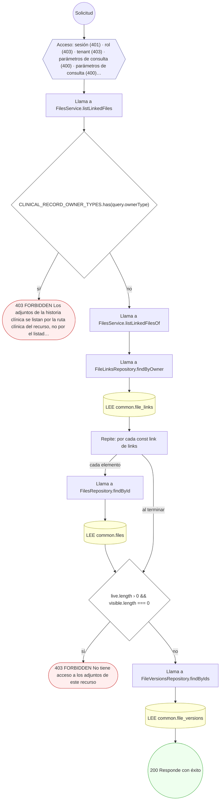

#### 10. POST /common/files/upload

Subir el contenido de un archivo (multipart)

| HTTP | Código | Cuándo |
|---|---|---|
| 201 | — | Éxito |
| 400 | `VALIDATION_FAILED` | El cuerpo cumple el DTO (sin propiedades extra) |
| 401 | `UNAUTHENTICATED` | Hay una sesión válida (JWT) |
| 403 | `FORBIDDEN` | El rol está permitido; El tenant se resuelve y pertenece al actor |
| 422 | `PRECONDITION_FAILED` | PreconditionFailedException: No se recibió contenido en el campo "file"; PreconditionFailedException: El archivo excede el tamaño máximo permitido; PreconditionFailedException: El contenido no corresponde a ningún formato de archivo permitido; PreconditionFailedException: El formato del archivo no está permitido para esta categoría |
| 429 | `RATE_LIMITED` | No se supera el límite de solicitudes |
| 500 | `INTERNAL` | StorageLifecycleDenied: LIFECYCLE_WIRING_MISSING; StorageLifecycleDenied: PHYSICAL_IDENTITY_UNKNOWN; StorageLifecycleDenied: REMOTE_STATE_UNKNOWN; StorageLifecycleDenied: ADAPTER_DID_NOT_CONSUME_PERMIT; StorageLifecycleDenied: PUBLICATION_RESULT_REQUIRES_RELOAD; StorageLifecycleDenied: WRITE_RESERVATION_REQUIRED; DomainException: {HttpStatus.SERVICE_UNAVAILABLE}; StorageLifecycleDenied: REFERENCE_OBJECT_UNPROVEN; StorageLifecycleDenied: REFERENCE_METADATA_MISMATCH |

```mermaid
flowchart TD
  n1(("Solicitud")):::inicio
  n2{{"Acceso: sesión (401) · rol (403) · tenant (403) · cuerpo válido (400) · límite de tasa (429)"}}:::acceso
  n1 --> n2
  n3["Llama a FileUploadService.upload"]:::llamada
  n2 --> n3
  n4{"!file?.buffer?.byteLength"}:::decision
  n3 --> n4
  n5(["422 PRECONDITION_FAILED No se recibió contenido en el campo 'file'"]):::error
  n4 -->|"sí"| n5
  n6{"file.buffer.byteLength › this.maxSizeBytes"}:::decision
  n4 -->|"no"| n6
  n7(["422 PRECONDITION_FAILED El archivo excede el tamaño máximo permitido"]):::error
  n6 -->|"sí"| n7
  n8{"!detectedMimeType"}:::decision
  n6 -->|"no"| n8
  n9(["422 PRECONDITION_FAILED El contenido no corresponde a ningún formato de archivo permitido"]):::error
  n8 -->|"sí"| n9
  n10{"!isMimeTypeAllowedForCategory(dto.category, detectedMimeType)"}:::decision
  n8 -->|"no"| n10
  n11(["422 PRECONDITION_FAILED El formato del archivo no está permitido para esta categoría"]):::error
  n10 -->|"sí"| n11
  n12["Llama a FileUploadService.persistBytes"]:::llamada
  n10 -->|"no"| n12
  n13{"this.publication"}:::decision
  n12 --> n13
  n14["Llama a FileUploadService.publishUpload"]:::llamada
  n13 -->|"sí"| n14
  n15{"!this.publication"}:::decision
  n14 --> n15
  n16(["500 INTERNAL LIFECYCLE_WIRING_MISSING"]):::error
  n15 -->|"sí"| n16
  n17["Llama a StoragePublicationService.publish"]:::llamada
  n15 -->|"no"| n17
  n18{"!plan || plan.identity.kind === 'UNKNOWN' || !this.storage.inspect"}:::decision
  n17 --> n18
  n19(["500 INTERNAL PHYSICAL_IDENTITY_UNKNOWN"]):::error
  n18 -->|"sí"| n19
  n20["Intenta"]:::intento
  n18 -->|"no"| n20
  n21{"presence.state === 'UNKNOWN'"}:::decision
  n20 --> n21
  n22(["500 INTERNAL REMOTE_STATE_UNKNOWN"]):::error
  n21 -->|"sí"| n22
  n23{"presence.state === 'PRESENT'"}:::decision
  n21 -->|"no"| n23
  n24{"!attemptId"}:::decision
  n23 -->|"no"| n24
  n25(["500 INTERNAL ADAPTER_DID_NOT_CONSUME_PERMIT"]):::error
  n24 -->|"sí"| n25
  n26{"result.duplicate || result.result === undefined"}:::decision
  n23 -->|"sí"| n26
  n24 -->|"no"| n26
  n27(["500 INTERNAL PUBLICATION_RESULT_REQUIRES_RELOAD"]):::error
  n26 -->|"sí"| n27
  n28(["↩ (relanza el error capturado)"]):::error
  n20 -->|"si falla"| n28
  n29{"loadStorageEnv().lifecycleBinding"}:::decision
  n26 -->|"no"| n29
  n13 -->|"no"| n29
  n30(["500 INTERNAL LIFECYCLE_WIRING_MISSING"]):::error
  n29 -->|"sí"| n30
  n31["Llama a LocalDiskFileStorageAdapter.store"]:::llamada
  n29 -->|"no"| n31
  n32{"this.lifecycleBinding"}:::decision
  n31 --> n32
  n33{"!permit || plan.identity.kind === 'UNKNOWN'"}:::decision
  n32 -->|"sí"| n33
  n34(["500 INTERNAL WRITE_RESERVATION_REQUIRED"]):::error
  n33 -->|"sí"| n34
  n35["Llama a S3FileStorageAdapter.store"]:::llamada
  n33 -->|"no"| n35
  n32 -->|"no"| n35
  n36["Llama a S3FileStorageAdapter.assertConfigured"]:::llamada
  n35 --> n36
  n37{"!this.env.s3.bucket"}:::decision
  n36 --> n37
  n38(["500 INTERNAL {HttpStatus.SERVICE_UNAVAILABLE}"]):::error
  n37 -->|"sí"| n38
  n39{"this.env.lifecycleBinding"}:::decision
  n37 -->|"no"| n39
  n40{"!permit || plan.identity.kind === 'UNKNOWN'"}:::decision
  n39 -->|"sí"| n40
  n41(["500 INTERNAL WRITE_RESERVATION_REQUIRED"]):::error
  n40 -->|"sí"| n41
  n42["Llama a FilesService.createFile"]:::llamada
  n40 -->|"no"| n42
  n39 -->|"no"| n42
  n43["Llama a FilesService.assertLifecycleWired"]:::llamada
  n42 --> n43
  n44{"loadStorageEnv().lifecycleBinding && !this.publication"}:::decision
  n43 --> n44
  n45(["500 INTERNAL LIFECYCLE_WIRING_MISSING"]):::error
  n44 -->|"sí"| n45
  n46["Llama a StoragePublicationService.guardLocator"]:::llamada
  n44 -->|"no"| n46
  n47{"!presence || presence.state !== 'PRESENT'"}:::decision
  n46 --> n47
  n48(["500 INTERNAL REFERENCE_OBJECT_UNPROVEN"]):::error
  n47 -->|"sí"| n48
  n49{"expected && (receipt.contentHash !== expected.contentHash || receipt.sizeBytes !== expected.sizeBytes)"}:::decision
  n47 -->|"no"| n49
  n50(["500 INTERNAL REFERENCE_METADATA_MISMATCH"]):::error
  n49 -->|"sí"| n50
  n51["Llama a FilesRepository.create"]:::llamada
  n49 -->|"no"| n51
  n52[("CREA common.files")]:::efecto
  n51 --> n52
  n53["Llama a FileVersionsRepository.create"]:::llamada
  n52 --> n53
  n54[("CREA common.file_versions")]:::efecto
  n53 --> n54
  n55(("201 Responde con éxito")):::ok
  n54 --> n55
  classDef acceso fill:#eef,stroke:#66a
  classDef error fill:#fee,stroke:#c33
  classDef ok fill:#efe,stroke:#3a3
  classDef efecto fill:#ffd,stroke:#aa3
  classDef decision fill:#fff,stroke:#555
  classDef corte fill:#eee,stroke:#999,stroke-dasharray: 4
```

#### 11. POST /common/identifiers

Registrar un identificador oficial (UC-02-01)

| HTTP | Código | Cuándo |
|---|---|---|
| 201 | — | Éxito |
| 400 | `VALIDATION_FAILED` | El cuerpo cumple el DTO (sin propiedades extra) |
| 401 | `UNAUTHENTICATED` | Hay una sesión válida (JWT) |
| 403 | `FORBIDDEN` | El rol está permitido; El tenant se resuelve y pertenece al actor |
| 409 | `CONFLICT` | ConflictException: Ya existe un identificador activo con ese tipo, sistema y valor |
| 429 | `RATE_LIMITED` | No se supera el límite de solicitudes |

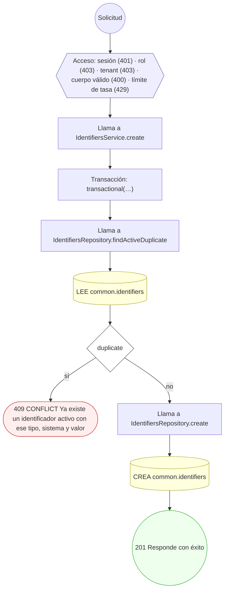

#### 12. POST /internal/files/versions/{vid}/scan-result

Registrar resultado de escaneo antimalware (UC-02-09)

| HTTP | Código | Cuándo |
|---|---|---|
| 200 | — | Éxito |
| 400 | `VALIDATION_FAILED` | Los parámetros de ruta son UUID válidos; El cuerpo cumple el DTO (sin propiedades extra) |
| 401 | `UNAUTHENTICATED` | Hay una sesión válida (JWT) |
| 403 | `FORBIDDEN` | El rol está permitido; El tenant se resuelve y pertenece al actor |
| 404 | `NOT_FOUND` | ResourceNotFoundException: Versión de archivo no encontrada |
| 429 | `RATE_LIMITED` | No se supera el límite de solicitudes |

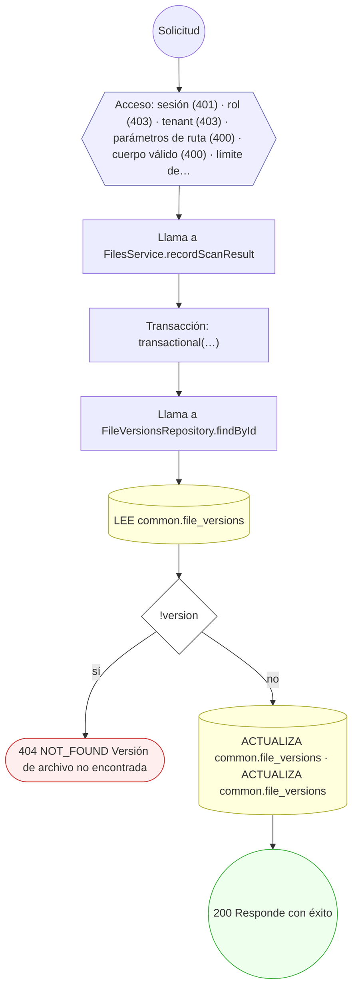

#### 13. POST /internal/storage-lifecycle/audio/{assetId}/abort

Abortar la publicación reservada de un audio

| HTTP | Código | Cuándo |
|---|---|---|
| 201 | — | Éxito |
| 400 | `VALIDATION_FAILED` | Los parámetros de ruta son UUID válidos; El cuerpo cumple el DTO (sin propiedades extra) |
| 401 | `UNAUTHENTICATED` | Hay una sesión válida (JWT) |
| 403 | `FORBIDDEN` | El rol está permitido; El tenant se resuelve y pertenece al actor |
| 429 | `RATE_LIMITED` | No se supera el límite de solicitudes |
| 500 | `INTERNAL` | StorageLifecycleDenied: RESERVATION_MISSING; StorageLifecycleDenied: PRODUCER_OWNERSHIP_UNKNOWN |

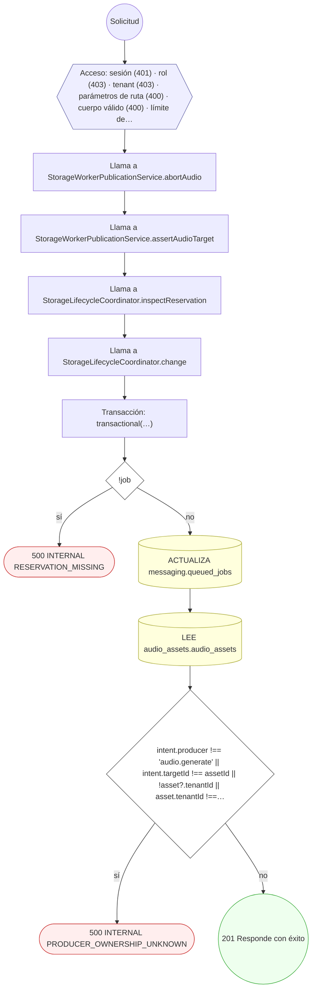

#### 14. POST /internal/storage-lifecycle/audio/{assetId}/begin

Reservar la publicación de un audio en almacenamiento

| HTTP | Código | Cuándo |
|---|---|---|
| 201 | — | Éxito |
| 400 | `VALIDATION_FAILED` | Los parámetros de ruta son UUID válidos; El cuerpo cumple el DTO (sin propiedades extra) |
| 401 | `UNAUTHENTICATED` | Hay una sesión válida (JWT) |
| 403 | `FORBIDDEN` | El rol está permitido; El tenant se resuelve y pertenece al actor |
| 404 | `NOT_FOUND` | ResourceNotFoundException: La URI no pertenece al almacenamiento local; ResourceNotFoundException: La URI de almacenamiento local está mal formada; ResourceNotFoundException: La URI no pertenece al bucket configurado; ResourceNotFoundException: La URI S3 está mal formada o fuera del prefijo permitido |
| 429 | `RATE_LIMITED` | No se supera el límite de solicitudes |
| 500 | `INTERNAL` | StorageLifecycleDenied: PRODUCER_OWNERSHIP_UNKNOWN; StorageLifecycleDenied: PHYSICAL_IDENTITY_UNKNOWN; StorageLifecycleDenied: TRANSACTION_REQUIRED; StorageLifecycleDenied: GLOBAL_RESERVATION_VISIBILITY_UNPROVEN; StorageLifecycleDenied: INTENT_ENVELOPE_UNKNOWN; StorageLifecycleDenied: RESERVATION_OWNER_MISMATCH; StorageLifecycleDenied: IDEMPOTENCY_CONFLICT; StorageLifecycleDenied: OPERATION_ALREADY_DISPATCHED; StorageLifecycleDenied: PRODUCER_OR_PURGE_IN_FLIGHT; StorageLifecycleDenied: QUEUE_CONFIGURATION_MISSING; StorageLifecycleDenied: REMOTE_STATE_UNKNOWN; StorageLifecycleDenied: STORE_RECEIPT_UNKNOWN; StorageLifecycleDenied: PRESENT_OBJECT_UNPROVEN |

```mermaid
flowchart TD
  n1(("Solicitud")):::inicio
  n2{{"Acceso: sesión (401) · rol (403) · tenant (403) · parámetros de ruta (400) · cuerpo válido (400) · límite de…"}}:::acceso
  n1 --> n2
  n3["Llama a StorageWorkerPublicationService.beginAudio"]:::llamada
  n2 --> n3
  n4[("LEE audio_assets.audio_assets · LEE messaging.queued_jobs")]:::efecto
  n3 --> n4
  n5{"!asset?.tenantId || asset.generationStatus !== 'GENERATING' || !job || job.tenantId !== asset.tenantId || job…"}:::decision
  n4 --> n5
  n6(["500 INTERNAL PRODUCER_OWNERSHIP_UNKNOWN"]):::error
  n5 -->|"sí"| n6
  n7["Llama a LocalDiskFileStorageAdapter.resolveReservationIdentity"]:::llamada
  n5 -->|"no"| n7
  n8["Llama a LocalDiskFileStorageAdapter.resolvePhysicalIdentity"]:::llamada
  n7 --> n8
  n9["Intenta"]:::intento
  n8 --> n9
  n10["Llama a LocalDiskFileStorageAdapter.hashFromUri"]:::llamada
  n9 --> n10
  n11{"!storageUri.startsWith(LOCAL_URI_PREFIX)"}:::decision
  n10 --> n11
  n12(["404 NOT_FOUND La URI no pertenece al almacenamiento local"]):::error
  n11 -->|"sí"| n12
  n13{"!CONTENT_HASH_PATTERN.test(hash)"}:::decision
  n11 -->|"no"| n13
  n14(["404 NOT_FOUND La URI de almacenamiento local está mal formada"]):::error
  n13 -->|"sí"| n14
  n15["Llama a S3FileStorageAdapter.resolveReservationIdentity"]:::llamada
  n13 -->|"no"| n15
  n16["Intenta"]:::intento
  n15 --> n16
  n17["Llama a S3FileStorageAdapter.parseOwnedKey"]:::llamada
  n16 --> n17
  n18{"!storageUri.startsWith(expected)"}:::decision
  n17 --> n18
  n19(["404 NOT_FOUND La URI no pertenece al bucket configurado"]):::error
  n18 -->|"sí"| n19
  n20{"!CONTENT_HASH_PATTERN.test(hash) || key !== this.objectKey(hash)"}:::decision
  n18 -->|"no"| n20
  n21(["404 NOT_FOUND La URI S3 está mal formada o fuera del prefijo permitido"]):::error
  n20 -->|"sí"| n21
  n22{"!identity || identity.kind === 'UNKNOWN'"}:::decision
  n20 -->|"no"| n22
  n23(["500 INTERNAL PHYSICAL_IDENTITY_UNKNOWN"]):::error
  n22 -->|"sí"| n23
  n24["Llama a StorageLifecycleCoordinator.begin"]:::llamada
  n22 -->|"no"| n24
  n25["Transacción: transactional(…)"]:::transaccion
  n24 --> n25
  n26["Llama a StorageLifecycleCoordinator.excludeNamespaces"]:::llamada
  n25 --> n26
  n27{"!tx.getTransactionContext()"}:::decision
  n26 --> n27
  n28(["500 INTERNAL TRANSACTION_REQUIRED"]):::error
  n27 -->|"sí"| n28
  n29["Llama a StorageLifecycleCoordinator.assertPrimaryVisibility"]:::llamada
  n27 -->|"no"| n29
  n30{"!tx.getTransactionContext()"}:::decision
  n29 --> n30
  n31(["500 INTERNAL TRANSACTION_REQUIRED"]):::error
  n30 -->|"sí"| n31
  n32{"rows.length !== 1 || rows[0].primary !== true || rows[0].global_visibility !== true"}:::decision
  n30 -->|"no"| n32
  n33(["500 INTERNAL GLOBAL_RESERVATION_VISIBILITY_UNPROVEN"]):::error
  n32 -->|"sí"| n33
  n34["Repite: map(…)"]:::bucle
  n32 -->|"no"| n34
  n35{"!isStorageReservationIdentity(identity)"}:::decision
  n34 -->|"cada elemento"| n35
  n36(["500 INTERNAL PHYSICAL_IDENTITY_UNKNOWN"]):::error
  n35 -->|"sí"| n36
  n37["Llama a QueuesRepository.findJobByDedupeKey"]:::llamada
  n35 -->|"no"| n37
  n34 -->|"al terminar"| n37
  n38[("LEE messaging.queued_jobs")]:::efecto
  n37 --> n38
  n39{"prior"}:::decision
  n38 --> n39
  n40["Llama a StorageLifecycleCoordinator.owned"]:::llamada
  n39 -->|"sí"| n40
  n41["Llama a StorageLifecycleCoordinator.readJob"]:::llamada
  n40 --> n41
  n42{"!allowed.includes(intent.phase) || (job.jobType === 'storage.purge' && !isKnownPhysicalIdentity(intent.identi…"}:::decision
  n41 --> n42
  n43(["500 INTERNAL INTENT_ENVELOPE_UNKNOWN"]):::error
  n42 -->|"sí"| n43
  n44{"job.jobType !== 'storage.publish' || intent.operationId !== reservation.operationId || intent.ownerToken !==…"}:::decision
  n42 -->|"no"| n44
  n45(["500 INTERNAL RESERVATION_OWNER_MISMATCH"]):::error
  n44 -->|"sí"| n45
  n46{"stored.contentHash !== input.contentHash || stored.sizeBytes !== input.sizeBytes || stored.tenantId !== input…"}:::decision
  n44 -->|"no"| n46
  n47(["500 INTERNAL IDEMPOTENCY_CONFLICT"]):::error
  n46 -->|"sí"| n47
  n48{"stored.phase !== 'RESERVED'"}:::decision
  n46 -->|"no"| n48
  n49(["500 INTERNAL OPERATION_ALREADY_DISPATCHED"]):::error
  n48 -->|"sí"| n49
  n50["Llama a StorageLifecycleCoordinator.assertNoContender"]:::llamada
  n48 -->|"no"| n50
  n39 -->|"no"| n50
  n51["Repite: por cada const job de await this.queues.findStorageIntents(tx)"]:::bucle
  n50 --> n51
  n52["Llama a StorageLifecycleCoordinator.readJob"]:::llamada
  n51 -->|"cada elemento"| n52
  n53{"!allowed.includes(intent.phase) || (job.jobType === 'storage.purge' && !isKnownPhysicalIdentity(intent.identi…"}:::decision
  n52 --> n53
  n54(["500 INTERNAL INTENT_ENVELOPE_UNKNOWN"]):::error
  n53 -->|"sí"| n54
  n55{"physicalContentionKey(intent.identity) === physicalContentionKey(identity) && intentExcludesPublication(inten…"}:::decision
  n53 -->|"no"| n55
  n56(["500 INTERNAL PRODUCER_OR_PURGE_IN_FLIGHT"]):::error
  n55 -->|"sí"| n56
  n57["Llama a QueuesRepository.findQueueByCode"]:::llamada
  n55 -->|"no"| n57
  n51 -->|"al terminar"| n57
  n58[("LEE messaging.message_queues")]:::efecto
  n57 --> n58
  n59{"!queue || queue.stateConceptId !== CONCEPTS.STATE_ACTIVE"}:::decision
  n58 --> n59
  n60(["500 INTERNAL QUEUE_CONFIGURATION_MISSING"]):::error
  n59 -->|"sí"| n60
  n61["Llama a QueuesRepository.createJob"]:::llamada
  n59 -->|"no"| n61
  n62[("CREA messaging.queued_jobs")]:::efecto
  n61 --> n62
  n63["Intenta"]:::intento
  n62 --> n63
  n64["Llama a LocalDiskFileStorageAdapter.inspect"]:::llamada
  n63 --> n64
  n65["Llama a LocalDiskFileStorageAdapter.resolvePhysicalIdentity"]:::llamada
  n64 --> n65
  n66["Intenta"]:::intento
  n65 --> n66
  n67["Llama a LocalDiskFileStorageAdapter.hashFromUri"]:::llamada
  n66 --> n67
  n68{"!storageUri.startsWith(LOCAL_URI_PREFIX)"}:::decision
  n67 --> n68
  n69(["404 NOT_FOUND La URI no pertenece al almacenamiento local"]):::error
  n68 -->|"sí"| n69
  n70{"!CONTENT_HASH_PATTERN.test(hash)"}:::decision
  n68 -->|"no"| n70
  n71["… el resto del árbol (1 nodos) está en el JSON del inventario"]:::corte
  n70 -->|"sí"| n71
  classDef acceso fill:#eef,stroke:#66a
  classDef error fill:#fee,stroke:#c33
  classDef ok fill:#efe,stroke:#3a3
  classDef efecto fill:#ffd,stroke:#aa3
  classDef decision fill:#fff,stroke:#555
  classDef corte fill:#eee,stroke:#999,stroke-dasharray: 4
```

#### 15. POST /internal/storage-lifecycle/audio/{assetId}/dispatch

Despachar la subida reservada de un audio

| HTTP | Código | Cuándo |
|---|---|---|
| 201 | — | Éxito |
| 400 | `VALIDATION_FAILED` | Los parámetros de ruta son UUID válidos; El cuerpo cumple el DTO (sin propiedades extra) |
| 401 | `UNAUTHENTICATED` | Hay una sesión válida (JWT) |
| 403 | `FORBIDDEN` | El rol está permitido; El tenant se resuelve y pertenece al actor |
| 429 | `RATE_LIMITED` | No se supera el límite de solicitudes |
| 500 | `INTERNAL` | StorageLifecycleDenied: RESERVATION_MISSING; StorageLifecycleDenied: PRODUCER_OWNERSHIP_UNKNOWN; StorageLifecycleDenied: DISPATCH_REPLAY |

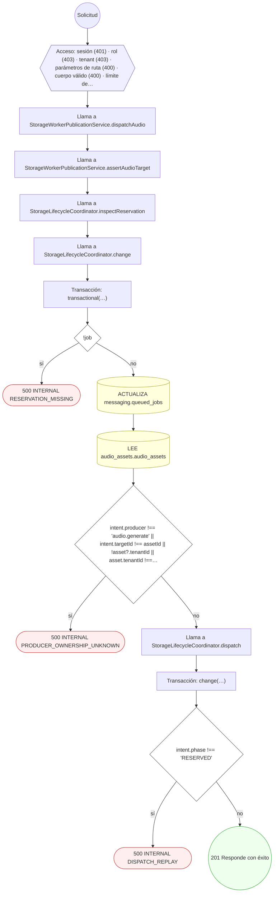

#### 16. POST /internal/storage-lifecycle/recover

Recuperar publicaciones de almacenamiento pendientes

| HTTP | Código | Cuándo |
|---|---|---|
| 201 | — | Éxito |
| 401 | `UNAUTHENTICATED` | Hay una sesión válida (JWT) |
| 403 | `FORBIDDEN` | El rol está permitido; El tenant se resuelve y pertenece al actor |
| 429 | `RATE_LIMITED` | No se supera el límite de solicitudes |
| 500 | `INTERNAL` | StorageLifecycleDenied: TRANSACTION_REQUIRED; StorageLifecycleDenied: GLOBAL_RESERVATION_VISIBILITY_UNPROVEN; StorageLifecycleDenied: INTENT_ENVELOPE_UNKNOWN; StorageLifecycleDenied: PHYSICAL_IDENTITY_UNKNOWN; StorageLifecycleDenied: RESERVATION_MISSING |

```mermaid
flowchart TD
  n1(("Solicitud")):::inicio
  n2{{"Acceso: sesión (401) · rol (403) · tenant (403) · límite de tasa (429)"}}:::acceso
  n1 --> n2
  n3["Llama a StorageLifecycleCoordinator.recover"]:::llamada
  n2 --> n3
  n4["Transacción: transactional(…)"]:::transaccion
  n3 --> n4
  n5["Llama a StorageLifecycleCoordinator.assertPrimaryVisibility"]:::llamada
  n4 --> n5
  n6{"!tx.getTransactionContext()"}:::decision
  n5 --> n6
  n7(["500 INTERNAL TRANSACTION_REQUIRED"]):::error
  n6 -->|"sí"| n7
  n8{"rows.length !== 1 || rows[0].primary !== true || rows[0].global_visibility !== true"}:::decision
  n6 -->|"no"| n8
  n9(["500 INTERNAL GLOBAL_RESERVATION_VISIBILITY_UNPROVEN"]):::error
  n8 -->|"sí"| n9
  n10["Llama a QueuesRepository.findStorageIntents"]:::llamada
  n8 -->|"no"| n10
  n11[("LEE messaging.queued_jobs")]:::efecto
  n10 --> n11
  n12["Repite: por cada const job de jobs"]:::bucle
  n11 --> n12
  n13["Llama a StorageLifecycleCoordinator.readJob"]:::llamada
  n12 -->|"cada elemento"| n13
  n14{"!allowed.includes(intent.phase) || (job.jobType === 'storage.purge' && !isKnownPhysicalIdentity(intent.identi…"}:::decision
  n13 --> n14
  n15(["500 INTERNAL INTENT_ENVELOPE_UNKNOWN"]):::error
  n14 -->|"sí"| n15
  n16{"stale && ['STORE_DISPATCHED', 'DELETE_DISPATCHED'].includes(intent.phase)"}:::decision
  n14 -->|"no"| n16
  n17["Transacción: transactional(…)"]:::transaccion
  n16 -->|"sí"| n17
  n18["Llama a StorageLifecycleCoordinator.excludeNamespaces"]:::llamada
  n17 --> n18
  n19{"!tx.getTransactionContext()"}:::decision
  n18 --> n19
  n20(["500 INTERNAL TRANSACTION_REQUIRED"]):::error
  n19 -->|"sí"| n20
  n21["Llama a StorageLifecycleCoordinator.assertPrimaryVisibility"]:::llamada
  n19 -->|"no"| n21
  n22{"!tx.getTransactionContext()"}:::decision
  n21 --> n22
  n23(["500 INTERNAL TRANSACTION_REQUIRED"]):::error
  n22 -->|"sí"| n23
  n24{"rows.length !== 1 || rows[0].primary !== true || rows[0].global_visibility !== true"}:::decision
  n22 -->|"no"| n24
  n25(["500 INTERNAL GLOBAL_RESERVATION_VISIBILITY_UNPROVEN"]):::error
  n24 -->|"sí"| n25
  n26["Repite: map(…)"]:::bucle
  n24 -->|"no"| n26
  n27{"!isStorageReservationIdentity(identity)"}:::decision
  n26 -->|"cada elemento"| n27
  n28(["500 INTERNAL PHYSICAL_IDENTITY_UNKNOWN"]):::error
  n27 -->|"sí"| n28
  n29["Llama a QueuesRepository.findJobByDedupeKey"]:::llamada
  n27 -->|"no"| n29
  n26 -->|"al terminar"| n29
  n30[("LEE messaging.queued_jobs")]:::efecto
  n29 --> n30
  n31{"!current"}:::decision
  n30 --> n31
  n32(["500 INTERNAL RESERVATION_MISSING"]):::error
  n31 -->|"sí"| n32
  n33["Llama a StorageLifecycleCoordinator.readJob"]:::llamada
  n31 -->|"no"| n33
  n34{"!allowed.includes(intent.phase) || (job.jobType === 'storage.purge' && !isKnownPhysicalIdentity(intent.identi…"}:::decision
  n33 --> n34
  n35(["500 INTERNAL INTENT_ENVELOPE_UNKNOWN"]):::error
  n34 -->|"sí"| n35
  n36{"['STORE_DISPATCHED', 'DELETE_DISPATCHED'].includes(latest.phase)"}:::decision
  n34 -->|"no"| n36
  n37[("ACTUALIZA messaging.queued_jobs")]:::efecto
  n36 -->|"sí"| n37
  n38(("201 Responde con éxito")):::ok
  n37 --> n38
  n36 -->|"no"| n38
  n16 -->|"no"| n38
  n12 -->|"al terminar"| n38
  classDef acceso fill:#eef,stroke:#66a
  classDef error fill:#fee,stroke:#c33
  classDef ok fill:#efe,stroke:#3a3
  classDef efecto fill:#ffd,stroke:#aa3
  classDef decision fill:#fff,stroke:#555
  classDef corte fill:#eee,stroke:#999,stroke-dasharray: 4
```

### Operaciones sin decisiones propias

Sólo comprueban el acceso y leen o escriben: no tienen ramas que dibujar. Su detalle está en la ficha de endpoints.

| Operación | Respuestas posibles | Tablas |
|---|---|---|
| POST /common/addresses | 201, 400, 401, 403, 429 | 1 |
| POST /common/contact-points | 201, 400, 401, 403, 429 | 1 |
| GET /internal/files/versions/pending-scan | 200, 401, 403, 429 | 1 |
