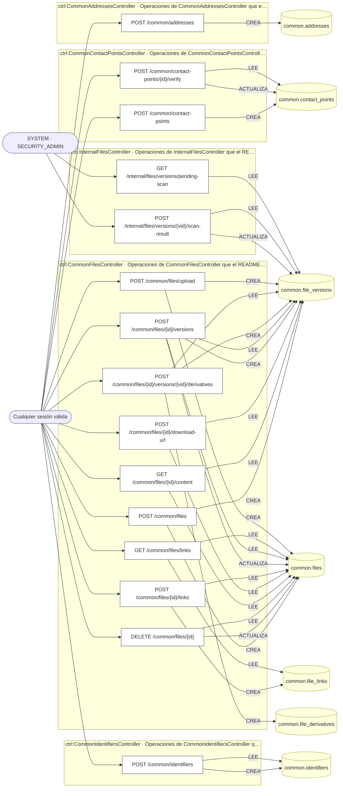
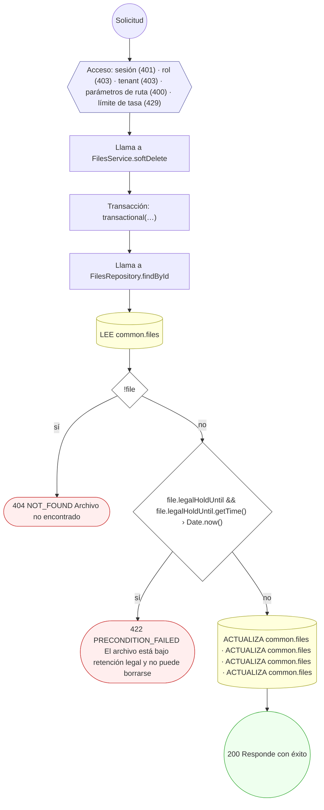
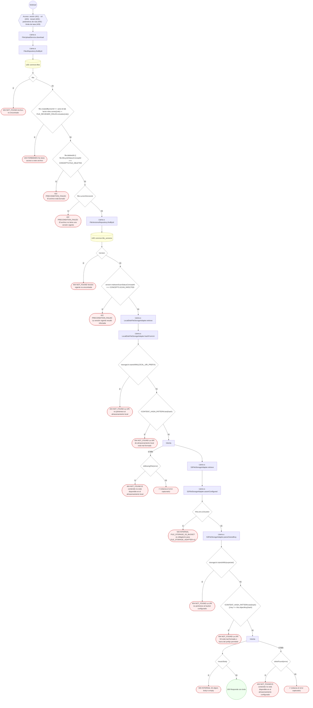
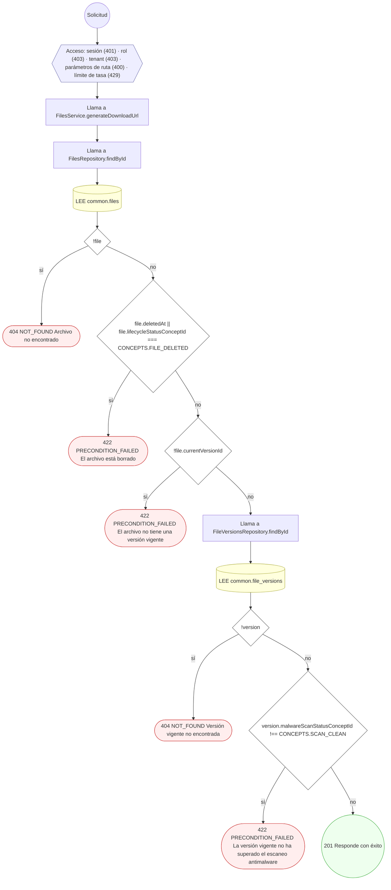
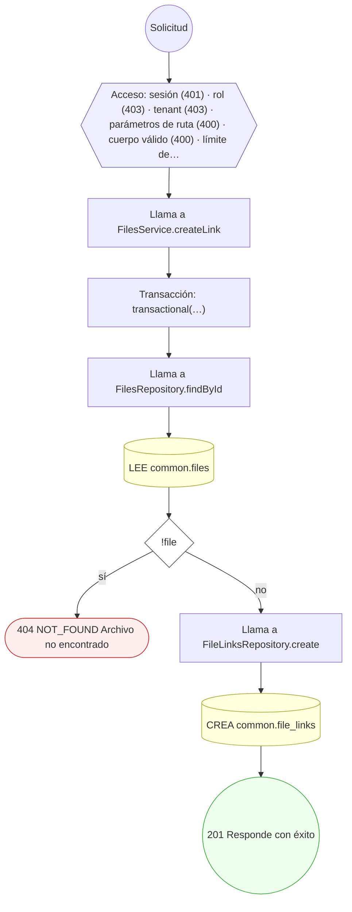
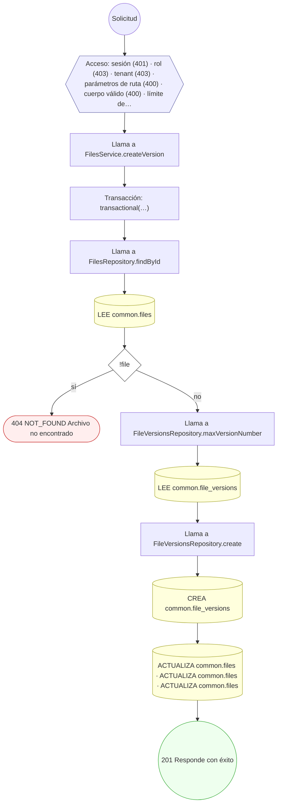
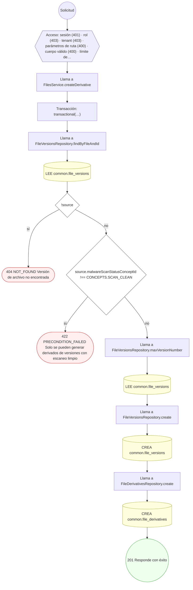
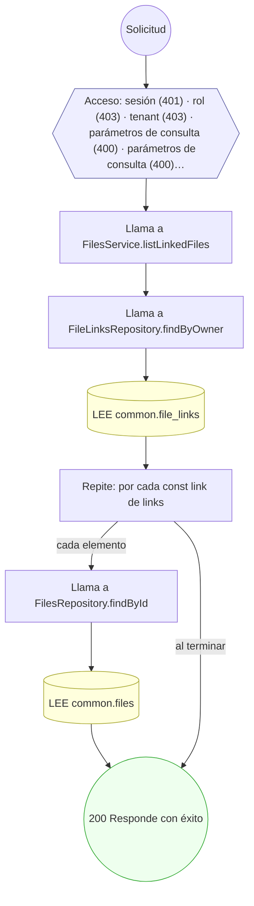
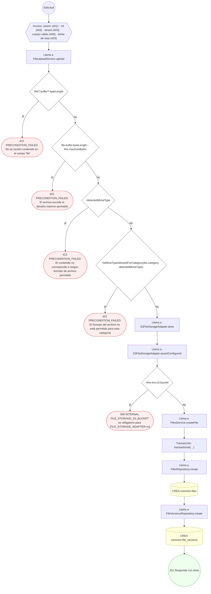

<!-- AUTOGENERADO por tools/inventario/flujos.mjs. No editar manualmente. -->

# Flujos del módulo `common`

- **Procesos:** 1 · **Máquinas de estado:** 0
- **Operaciones:** 15 (11 con decisiones propias, 4 sin ellas)
- Inventario de endpoints del módulo: [common](../endpoints/common.md)

## Proceso: Common module

- **Código:** `common` · **Agrupación:** AGRUPACION_POR_CONTROLADOR · **Operaciones:** 15
- **Actores:** Cualquier sesión válida · SECURITY_ADMIN · SYSTEM
- **Revisión:** AUTO_DETECTADA
- **Fuentes:** `src/modules/common/README.md`

### Para qué sirve

Cross-cutting reference data shared by every clinical/business domain: official **identifiers**, **contact points**, **addresses**, and the **file** subsystem (versioning, derivatives, links, antimalware scanning, soft-delete and signed download URLs). Owners are polymorphic (`owner_type_concept_id` + `owner_id`) and, except for `files.tenant_id`, are **not** FK-enforced.

_Fuente: `src/modules/common/README.md:3`_

### Etapas y operaciones

| Etapa | Descripción | Operación | Quién actúa | Riesgo | Tablas |
|---|---|---|---|---|---|
| `ctrl:CommonAddressesController` | Operaciones de CommonAddressesController que el README no asigna a un caso de uso | POST /common/addresses | Cualquier sesión válida | ALTO | 1 |
| `ctrl:CommonContactPointsController` | Operaciones de CommonContactPointsController que el README no asigna a un caso de uso | POST /common/contact-points | Cualquier sesión válida | ALTO | 1 |
|  |  | POST /common/contact-points/{id}/verify | Cualquier sesión válida | ALTO | 2 |
| `ctrl:CommonFilesController` | Operaciones de CommonFilesController que el README no asigna a un caso de uso | POST /common/files | Cualquier sesión válida | ALTO | 2 |
|  |  | DELETE /common/files/{id} | Cualquier sesión válida | ALTO | 2 |
|  |  | GET /common/files/{id}/content | Cualquier sesión válida | BAJO | 2 |
|  |  | POST /common/files/{id}/download-url | Cualquier sesión válida | BAJO | 2 |
|  |  | POST /common/files/{id}/links | Cualquier sesión válida | ALTO | 2 |
|  |  | POST /common/files/{id}/versions | Cualquier sesión válida | ALTO | 4 |
|  |  | POST /common/files/{id}/versions/{vid}/derivatives | Cualquier sesión válida | ALTO | 3 |
|  |  | GET /common/files/links | Cualquier sesión válida | BAJO | 2 |
|  |  | POST /common/files/upload | Cualquier sesión válida | ALTO | 2 |
| `ctrl:CommonIdentifiersController` | Operaciones de CommonIdentifiersController que el README no asigna a un caso de uso | POST /common/identifiers | Cualquier sesión válida | ALTO | 2 |
| `ctrl:InternalFilesController` | Operaciones de InternalFilesController que el README no asigna a un caso de uso | POST /internal/files/versions/{vid}/scan-result | SYSTEM · SECURITY_ADMIN | MEDIO | 2 |
|  |  | GET /internal/files/versions/pending-scan | SYSTEM · SECURITY_ADMIN | BAJO | 1 |

### Diagrama — etapas `ctrl:CommonAddressesController`, `ctrl:CommonContactPointsController`, `ctrl:CommonFilesController`…

## Árbol de decisión por operación

Cada árbol se deriva del código del handler y de los métodos que invoca (hasta 4 niveles). Una rama que no decide, no escribe y no falla se poda. Los accesos y los efectos consecutivos se agrupan en un solo nodo.

### Operaciones con decisiones propias

#### 1. POST /common/contact-points/{id}/verify

Verificar un punto de contacto (UC-02-03)

| HTTP | Código | Cuándo |
|---|---|---|
| 200 | — | Éxito |
| 400 | `VALIDATION_FAILED` | Los parámetros de ruta son UUID válidos; El cuerpo cumple el DTO (sin propiedades extra) |
| 401 | `UNAUTHENTICATED` | Hay una sesión válida (JWT) |
| 403 | `FORBIDDEN` | El rol está permitido; El tenant se resuelve y pertenece al actor |
| 404 | `NOT_FOUND` | ResourceNotFoundException: Punto de contacto no encontrado |
| 429 | `RATE_LIMITED` | No se supera el límite de solicitudes |

#### 2. DELETE /common/files/{id}

Borrar lógicamente un archivo (UC-02-10)

| HTTP | Código | Cuándo |
|---|---|---|
| 200 | — | Éxito |
| 400 | `VALIDATION_FAILED` | Los parámetros de ruta son UUID válidos |
| 401 | `UNAUTHENTICATED` | Hay una sesión válida (JWT) |
| 403 | `FORBIDDEN` | El rol está permitido; El tenant se resuelve y pertenece al actor |
| 404 | `NOT_FOUND` | ResourceNotFoundException: Archivo no encontrado |
| 422 | `PRECONDITION_FAILED` | PreconditionFailedException: El archivo está bajo retención legal y no puede borrarse |
| 429 | `RATE_LIMITED` | No se supera el límite de solicitudes |

#### 3. GET /common/files/{id}/content

Descargar el contenido vigente de un archivo

| HTTP | Código | Cuándo |
|---|---|---|
| 200 | — | Éxito |
| 400 | `VALIDATION_FAILED` | Los parámetros de ruta son UUID válidos |
| 401 | `UNAUTHENTICATED` | Hay una sesión válida (JWT) |
| 403 | `FORBIDDEN` | El rol está permitido; El tenant se resuelve y pertenece al actor; ForbiddenException: No tiene acceso a este archivo |
| 404 | `NOT_FOUND` | ResourceNotFoundException: Archivo no encontrado; ResourceNotFoundException: Versión vigente no encontrada; ResourceNotFoundException: La URI no pertenece al almacenamiento local; ResourceNotFoundException: La URI de almacenamiento local está mal formada; ResourceNotFoundException: El contenido no está disponible en el almacenamiento local; ResourceNotFoundException: La URI no pertenece al bucket configurado; ResourceNotFoundException: La URI S3 está mal formada o fuera del prefijo permitido; ResourceNotFoundException: El contenido no está disponible en el almacenamiento configurado |
| 422 | `PRECONDITION_FAILED` | PreconditionFailedException: El archivo está borrado; PreconditionFailedException: El archivo no tiene una versión vigente; PreconditionFailedException: La versión vigente resultó infectada |
| 429 | `RATE_LIMITED` | No se supera el límite de solicitudes |
| 500 | `INTERNAL` | Error: FILE_STORAGE_S3_BUCKET es obligatorio para FILE_STORAGE_ADAPTER=s3; Error: S3 object body is empty |

#### 4. POST /common/files/{id}/download-url

Emitir una URL de descarga firmada (UC-02-11)

| HTTP | Código | Cuándo |
|---|---|---|
| 201 | — | Éxito |
| 400 | `VALIDATION_FAILED` | Los parámetros de ruta son UUID válidos |
| 401 | `UNAUTHENTICATED` | Hay una sesión válida (JWT) |
| 403 | `FORBIDDEN` | El rol está permitido; El tenant se resuelve y pertenece al actor |
| 404 | `NOT_FOUND` | ResourceNotFoundException: Archivo no encontrado; ResourceNotFoundException: Versión vigente no encontrada |
| 422 | `PRECONDITION_FAILED` | PreconditionFailedException: El archivo está borrado; PreconditionFailedException: El archivo no tiene una versión vigente; PreconditionFailedException: La versión vigente no ha superado el escaneo antimalware |
| 429 | `RATE_LIMITED` | No se supera el límite de solicitudes |

#### 5. POST /common/files/{id}/links

Vincular un archivo a un propietario (UC-02-08)

| HTTP | Código | Cuándo |
|---|---|---|
| 201 | — | Éxito |
| 400 | `VALIDATION_FAILED` | Los parámetros de ruta son UUID válidos; El cuerpo cumple el DTO (sin propiedades extra) |
| 401 | `UNAUTHENTICATED` | Hay una sesión válida (JWT) |
| 403 | `FORBIDDEN` | El rol está permitido; El tenant se resuelve y pertenece al actor |
| 404 | `NOT_FOUND` | ResourceNotFoundException: Archivo no encontrado |
| 429 | `RATE_LIMITED` | No se supera el límite de solicitudes |

#### 6. POST /common/files/{id}/versions

Añadir una versión a un archivo (UC-02-06)

| HTTP | Código | Cuándo |
|---|---|---|
| 201 | — | Éxito |
| 400 | `VALIDATION_FAILED` | Los parámetros de ruta son UUID válidos; El cuerpo cumple el DTO (sin propiedades extra) |
| 401 | `UNAUTHENTICATED` | Hay una sesión válida (JWT) |
| 403 | `FORBIDDEN` | El rol está permitido; El tenant se resuelve y pertenece al actor |
| 404 | `NOT_FOUND` | ResourceNotFoundException: Archivo no encontrado |
| 429 | `RATE_LIMITED` | No se supera el límite de solicitudes |

#### 7. POST /common/files/{id}/versions/{vid}/derivatives

Generar un derivado de una versión (UC-02-07)

| HTTP | Código | Cuándo |
|---|---|---|
| 201 | — | Éxito |
| 400 | `VALIDATION_FAILED` | Los parámetros de ruta son UUID válidos; El cuerpo cumple el DTO (sin propiedades extra) |
| 401 | `UNAUTHENTICATED` | Hay una sesión válida (JWT) |
| 403 | `FORBIDDEN` | El rol está permitido; El tenant se resuelve y pertenece al actor |
| 404 | `NOT_FOUND` | ResourceNotFoundException: Versión de archivo no encontrada |
| 422 | `PRECONDITION_FAILED` | PreconditionFailedException: Solo se pueden generar derivados de versiones con escaneo limpio |
| 429 | `RATE_LIMITED` | No se supera el límite de solicitudes |

#### 8. GET /common/files/links

Listar los archivos adjuntos a un recurso (UC-02-08)

| HTTP | Código | Cuándo |
|---|---|---|
| 200 | — | Éxito |
| 400 | `VALIDATION_FAILED` | Están los parámetros de consulta obligatorios |
| 401 | `UNAUTHENTICATED` | Hay una sesión válida (JWT) |
| 403 | `FORBIDDEN` | El rol está permitido; El tenant se resuelve y pertenece al actor |
| 429 | `RATE_LIMITED` | No se supera el límite de solicitudes |

#### 9. POST /common/files/upload

Subir el contenido de un archivo (multipart)

| HTTP | Código | Cuándo |
|---|---|---|
| 201 | — | Éxito |
| 400 | `VALIDATION_FAILED` | El cuerpo cumple el DTO (sin propiedades extra) |
| 401 | `UNAUTHENTICATED` | Hay una sesión válida (JWT) |
| 403 | `FORBIDDEN` | El rol está permitido; El tenant se resuelve y pertenece al actor |
| 422 | `PRECONDITION_FAILED` | PreconditionFailedException: No se recibió contenido en el campo "file"; PreconditionFailedException: El archivo excede el tamaño máximo permitido; PreconditionFailedException: El contenido no corresponde a ningún formato de archivo permitido; PreconditionFailedException: El formato del archivo no está permitido para esta categoría |
| 429 | `RATE_LIMITED` | No se supera el límite de solicitudes |
| 500 | `INTERNAL` | Error: FILE_STORAGE_S3_BUCKET es obligatorio para FILE_STORAGE_ADAPTER=s3 |

#### 10. POST /common/identifiers

Registrar un identificador oficial (UC-02-01)

| HTTP | Código | Cuándo |
|---|---|---|
| 201 | — | Éxito |
| 400 | `VALIDATION_FAILED` | El cuerpo cumple el DTO (sin propiedades extra) |
| 401 | `UNAUTHENTICATED` | Hay una sesión válida (JWT) |
| 403 | `FORBIDDEN` | El rol está permitido; El tenant se resuelve y pertenece al actor |
| 409 | `CONFLICT` | ConflictException: Ya existe un identificador activo con ese tipo, sistema y valor |
| 429 | `RATE_LIMITED` | No se supera el límite de solicitudes |

#### 11. POST /internal/files/versions/{vid}/scan-result

Registrar resultado de escaneo antimalware (UC-02-09)

| HTTP | Código | Cuándo |
|---|---|---|
| 200 | — | Éxito |
| 400 | `VALIDATION_FAILED` | Los parámetros de ruta son UUID válidos; El cuerpo cumple el DTO (sin propiedades extra) |
| 401 | `UNAUTHENTICATED` | Hay una sesión válida (JWT) |
| 403 | `FORBIDDEN` | El rol está permitido; El tenant se resuelve y pertenece al actor |
| 404 | `NOT_FOUND` | ResourceNotFoundException: Versión de archivo no encontrada |
| 429 | `RATE_LIMITED` | No se supera el límite de solicitudes |

### Operaciones sin decisiones propias

Sólo comprueban el acceso y leen o escriben: no tienen ramas que dibujar. Su detalle está en la ficha de endpoints.

| Operación | Respuestas posibles | Tablas |
|---|---|---|
| POST /common/addresses | 201, 400, 401, 403, 429 | 1 |
| POST /common/contact-points | 201, 400, 401, 403, 429 | 1 |
| POST /common/files | 201, 400, 401, 403, 429 | 2 |
| GET /internal/files/versions/pending-scan | 200, 401, 403, 429 | 1 |
