<!-- AUTOGENERADO por tools/inventario/flujos.mjs. No editar manualmente. -->

# Flujos del módulo `community`

- **Procesos:** 1 · **Máquinas de estado:** 0
- **Operaciones:** 81 (70 con decisiones propias, 11 sin ellas)
- Inventario de endpoints del módulo: [community](../endpoints/community.md)

## Proceso: Módulo Community (19)

- **Código:** `community` · **Agrupación:** MIXTO · **Operaciones:** 81
- **Actores:** Cualquier sesión válida · Público (sin sesión) · SEARCH_ADMIN · SECURITY_ADMIN · SYSTEM
- **Revisión:** AUTO_DETECTADA
- **Fuentes:** `src/modules/community/README.md`

### Para qué sirve

Perfiles públicos, grafo social, mensajería directa, moderación (confianza y seguridad), reviews verificadas, encuestas, grupos y fan-out de feed. Implementa los 15 casos de uso `UC-19-01..15` más endpoints de bootstrap para los recursos padre que ningún UC crea (perfil público, conversación, encuesta, grupo).

_Fuente: `src/modules/community/README.md:3`_

### Etapas y operaciones

| Etapa | Descripción | Operación | Quién actúa | Riesgo | Tablas |
|---|---|---|---|---|---|
| `UC-19-01` | Publica post con hashtags, media y menciones | POST /community/profiles/{profileId}/posts | Cualquier sesión válida | ALTO | 10 |
| `UC-19-02` | Comenta (hilo anidado) con contadores | POST /community/comments | Cualquier sesión válida | ALTO | 5 |
| `UC-19-03` | Reacciona (upsert una reacción por actor/objeto) | PUT /community/reactions | Cualquier sesión válida | ALTO | 4 |
| `UC-19-04` | Guarda bookmark en colección | POST /community/bookmarks | Cualquier sesión válida | ALTO | 3 |
| `UC-19-05` | Sigue objeto social (perfil/tópico/hashtag/grupo) | POST /community/follows | Cualquier sesión válida | ALTO | 4 |
| `UC-19-06` | Envía mensaje directo | POST /community/conversations/{conversationId}/messages | Cualquier sesión válida | ALTO | 16 |
| `UC-19-07` | Marca mensajes como leídos (recibos) | POST /community/conversations/{conversationId}/read | Cualquier sesión válida | ALTO | 5 |
| `UC-19-08` | Reporta contenido y encola moderación | POST /community/reports | Cualquier sesión válida | ALTO | 3 |
| `UC-19-09` | Resuelve moderación (decisión + strike) | POST /community/moderation/queue/{queueId}/decision | SECURITY_ADMIN | MEDIO | 6 |
| `UC-19-10` | Apela una decisión | POST /community/moderation/decisions/{decisionId}/appeal | Cualquier sesión válida | ALTO | 6 |
| `UC-19-11` | Publica review verificada de servicio | POST /community/profiles/{profileId}/reviews | Cualquier sesión válida | ALTO | 6 |
| `UC-19-12` | Vota en encuesta | POST /community/polls/{pollId}/votes | Cualquier sesión válida | ALTO | 6 |
| `UC-19-13` | Se une a grupo/comunidad | POST /community/groups/{groupId}/members | Cualquier sesión válida | ALTO | 5 |
| `UC-19-14` | Bloquea a un usuario | POST /community/blocks | Cualquier sesión válida | ALTO | 6 |
| `UC-19-15` | Lote de posts publicados sin repartir, con sus seguidores | GET /internal/community/feed/pending | SYSTEM · SECURITY_ADMIN | BAJO | 3 |
|  |  | POST /internal/community/feed/rebuild | SYSTEM · SECURITY_ADMIN | MEDIO | 2 |
| `ctrl:CommunityGroupsController` | Operaciones de CommunityGroupsController que el README no asigna a un caso de uso | GET /community/groups | Cualquier sesión válida | BAJO | 1 |
|  |  | POST /community/groups | Cualquier sesión válida | ALTO | 5 |
|  |  | GET /community/groups/{groupId} | Cualquier sesión válida | BAJO | 3 |
|  |  | GET /community/groups/{groupId}/members | Cualquier sesión válida | BAJO | 3 |
|  |  | PATCH /community/groups/{groupId}/members/{memberId} | Cualquier sesión válida | ALTO | 9 |
|  |  | DELETE /community/groups/{groupId}/members/{memberProfileId} | Cualquier sesión válida | ALTO | 5 |
|  |  | GET /community/groups/{groupId}/posts | Cualquier sesión válida | BAJO | 4 |
|  |  | POST /community/groups/{groupId}/posts | Cualquier sesión válida | ALTO | 11 |
| `ctrl:CommunityMessagingController` | Operaciones de CommunityMessagingController que el README no asigna a un caso de uso | GET /community/conversations | Cualquier sesión válida | BAJO | 4 |
|  |  | POST /community/conversations | Cualquier sesión válida | ALTO | 4 |
|  |  | GET /community/conversations/{conversationId}/messages | Cualquier sesión válida | BAJO | 5 |
| `ctrl:CommunityModerationController` | Operaciones de CommunityModerationController que el README no asigna a un caso de uso | GET /community/moderation/appeals | SECURITY_ADMIN | BAJO | 2 |
|  |  | POST /community/moderation/appeals/{appealId}/resolve | SECURITY_ADMIN | MEDIO | 5 |
|  |  | GET /community/moderation/decisions | SECURITY_ADMIN | BAJO | 1 |
|  |  | GET /community/moderation/queue | SECURITY_ADMIN | BAJO | 2 |
| `ctrl:CommunityPollsController` | Operaciones de CommunityPollsController que el README no asigna a un caso de uso | GET /community/polls/{pollId} | Cualquier sesión válida | BAJO | 7 |
|  |  | POST /community/posts/{postId}/polls | Cualquier sesión válida | ALTO | 3 |
| `ctrl:CommunityPublicController` | Operaciones de CommunityPublicController que el README no asigna a un caso de uso | DESCONOCIDO / | Cualquier sesión válida | BAJO | 0 |
|  |  | DESCONOCIDO / | Cualquier sesión válida | BAJO | 0 |
|  |  | DESCONOCIDO / | Cualquier sesión válida | BAJO | 0 |
|  |  | GET /f/{slug} | Público (sin sesión) | BAJO | 14 |
|  |  | GET /l/{slug} | Público (sin sesión) | BAJO | 14 |
|  |  | GET /o/{slug} | Público (sin sesión) | BAJO | 14 |
|  |  | GET /p/{slug} | Público (sin sesión) | BAJO | 14 |
|  |  | GET /public/comments/{commentId}/replies | Público (sin sesión) | BAJO | 3 |
|  |  | GET /public/media/{id} | Público (sin sesión) | BAJO | 5 |
|  |  | GET /public/nearby | Público (sin sesión) | BAJO | 7 |
|  |  | GET /public/posts | Público (sin sesión) | BAJO | 5 |
|  |  | GET /public/posts/{postId}/comments | Público (sin sesión) | BAJO | 3 |
|  |  | GET /public/posts/{postId}/reactions | Público (sin sesión) | BAJO | 3 |
|  |  | GET /public/profiles/{prefijo}/{slug} | Público (sin sesión) | BAJO | 14 |
|  |  | GET /public/search | Público (sin sesión) | BAJO | 12 |
|  |  | GET /public/search/diagnostic-units | Público (sin sesión) | BAJO | 12 |
|  |  | GET /public/search/insurers | Público (sin sesión) | BAJO | 12 |
|  |  | GET /public/search/medications | Público (sin sesión) | BAJO | 12 |
|  |  | GET /public/search/organizations | Público (sin sesión) | BAJO | 12 |
|  |  | GET /public/search/pharmacies | Público (sin sesión) | BAJO | 12 |
|  |  | GET /public/search/practitioners | Público (sin sesión) | BAJO | 12 |
|  |  | GET /s/{slug} | Público (sin sesión) | BAJO | 14 |
| `ctrl:CommunityReviewsController` | Operaciones de CommunityReviewsController que el README no asigna a un caso de uso | GET /community/profiles/{profileId}/reviews | Cualquier sesión válida | BAJO | 4 |
|  |  | POST /community/profiles/{profileId}/reviews/{reviewId}/responses | Cualquier sesión válida | ALTO | 4 |
| `ctrl:CommunitySearchIndexController` | Operaciones de CommunitySearchIndexController que el README no asigna a un caso de uso | GET /internal/community/search/health | SYSTEM · SECURITY_ADMIN · SEARCH_ADMIN | BAJO | 1 |
|  |  | POST /internal/community/search/reindex | SYSTEM · SECURITY_ADMIN · SEARCH_ADMIN | BAJO | 9 |
| `ctrl:CommunitySocialController` | Operaciones de CommunitySocialController que el README no asigna a un caso de uso | DELETE /community/blocks | Cualquier sesión válida | ALTO | 3 |
|  |  | GET /community/blocks | Cualquier sesión válida | BAJO | 2 |
|  |  | DELETE /community/bookmarks | Cualquier sesión válida | ALTO | 3 |
|  |  | GET /community/bookmarks | Cualquier sesión válida | BAJO | 2 |
|  |  | DELETE /community/follows | Cualquier sesión válida | ALTO | 3 |
|  |  | GET /community/follows | Cualquier sesión válida | BAJO | 2 |
|  |  | GET /community/posts/{postId} | Cualquier sesión válida | BAJO | 10 |
|  |  | GET /community/posts/{postId}/comments | Cualquier sesión válida | BAJO | 5 |
|  |  | GET /community/posts/{postId}/reactions | Cualquier sesión válida | BAJO | 5 |
|  |  | GET /community/profiles/{profileId} | Cualquier sesión válida | BAJO | 4 |
|  |  | GET /community/profiles/{profileId}/posts | Cualquier sesión válida | BAJO | 6 |
|  |  | GET /community/profiles/by-slug/{slug} | Cualquier sesión válida | BAJO | 4 |
|  |  | GET /community/profiles/me | Cualquier sesión válida | BAJO | 1 |
|  |  | PUT /community/profiles/me | Cualquier sesión válida | ALTO | 4 |
|  |  | GET /community/profiles/me/stats | Cualquier sesión válida | BAJO | 1 |
|  |  | POST /community/public-profiles | SECURITY_ADMIN | MEDIO | 1 |
| `ctrl:CommunityTimelineController` | Operaciones de CommunityTimelineController que el README no asigna a un caso de uso | GET /community/feed | Cualquier sesión válida | BAJO | 7 |
|  |  | GET /community/notifications | Cualquier sesión válida | BAJO | 2 |
| `ctrl:CommunityTopicsController` | Operaciones de CommunityTopicsController que el README no asigna a un caso de uso | GET /community/topics | Cualquier sesión válida | BAJO | 1 |
| `ctrl:CommunityVerificationController` | Operaciones de CommunityVerificationController que el README no asigna a un caso de uso | POST /internal/community/verification/badges | SECURITY_ADMIN | MEDIO | 6 |
|  |  | POST /internal/community/verification/badges/{targetId}/revoke | SECURITY_ADMIN | MEDIO | 5 |
|  |  | POST /internal/community/verification/badges/expire-sweep | SYSTEM · SECURITY_ADMIN | MEDIO | 5 |

### Diagrama 1 de 4 — etapas `UC-19-01`, `UC-19-02`, `UC-19-03`…

```mermaid
flowchart LR
  a2(["Cualquier sesión válida"]):::actor
  a29(["SECURITY_ADMIN"]):::actor
  a49(["SYSTEM · SECURITY_ADMIN"]):::actor
  t3[("common.file_versions")]:::tabla
  t4[("common.files")]:::tabla
  t5[("community.content_hashtags")]:::tabla
  t6[("community.hashtags")]:::tabla
  t9[("community.comments")]:::tabla
  t10[("community.mentions")]:::tabla
  t11[("community.public_profiles")]:::tabla
  t13[("community.reactions")]:::tabla
  t15[("community.bookmarks")]:::tabla
  t17[("community.social_follows")]:::tabla
  t19[("community.conversation_participants")]:::tabla
  t20[("community.conversations")]:::tabla
  t21[("community.direct_messages")]:::tabla
  t22[("community.message_receipts")]:::tabla
  t26[("community.content_reports")]:::tabla
  t27[("community.moderation_queue")]:::tabla
  t30[("community.moderation_decisions")]:::tabla
  t31[("community.moderation_strikes")]:::tabla
  t33[("community.moderation_appeals")]:::tabla
  t35[("clinical.encounter_participants")]:::tabla
  t36[("clinical.encounters")]:::tabla
  t37[("community.review_dimension_scores")]:::tabla
  t38[("community.service_reviews")]:::tabla
  t40[("community.poll_options")]:::tabla
  t41[("community.poll_votes")]:::tabla
  t42[("community.polls")]:::tabla
  t44[("community.group_members")]:::tabla
  t45[("community.groups")]:::tabla
  t47[("community.user_blocks")]:::tabla
  t50[("community.feed_items")]:::tabla
  t51[("community.social_posts")]:::tabla
  t7[("+4 tablas más")]
  subgraph s0["UC-19-01 · Publica post con hashtags, media y menciones"]
    o1["POST /community/profiles/{profileId}/posts"]:::op
  end
  subgraph s1["UC-19-02 · Comenta (hilo anidado) con contadores"]
    o8["POST /community/comments"]:::op
  end
  subgraph s2["UC-19-03 · Reacciona (upsert una reacción por actor/objeto)"]
    o12["PUT /community/reactions"]:::op
  end
  subgraph s3["UC-19-04 · Guarda bookmark en colección"]
    o14["POST /community/bookmarks"]:::op
  end
  subgraph s4["UC-19-05 · Sigue objeto social (perfil/tópico/hashtag/grupo)"]
    o16["POST /community/follows"]:::op
  end
  t23[("+10 tablas más")]
  subgraph s5["UC-19-06 · Envía mensaje directo"]
    o18["POST /community/conversations/{conversationId}/messages"]:::op
  end
  subgraph s6["UC-19-07 · Marca mensajes como leídos (recibos)"]
    o24["POST /community/conversations/{conversationId}/read"]:::op
  end
  subgraph s7["UC-19-08 · Reporta contenido y encola moderación"]
    o25["POST /community/reports"]:::op
  end
  subgraph s8["UC-19-09 · Resuelve moderación (decisión + strike)"]
    o28["POST /community/moderation/queue/{queueId}/decision"]:::op
  end
  subgraph s9["UC-19-10 · Apela una decisión"]
    o32["POST /community/moderation/decisions/{decisionId}/appeal"]:::op
  end
  subgraph s10["UC-19-11 · Publica review verificada de servicio"]
    o34["POST /community/profiles/{profileId}/reviews"]:::op
  end
  subgraph s11["UC-19-12 · Vota en encuesta"]
    o39["POST /community/polls/{pollId}/votes"]:::op
  end
  subgraph s12["UC-19-13 · Se une a grupo/comunidad"]
    o43["POST /community/groups/{groupId}/members"]:::op
  end
  subgraph s13["UC-19-14 · Bloquea a un usuario"]
    o46["POST /community/blocks"]:::op
  end
  subgraph s14["UC-19-15 · Lote de posts publicados sin repartir, con sus seguidores"]
    o48["GET /internal/community/feed/pending"]:::op
    o52["POST /internal/community/feed/rebuild"]:::op
  end
  a2 --> o1
  o1 -->|"LEE"| t3
  o1 -->|"LEE"| t4
  o1 -->|"CREA"| t5
  o1 -->|"ACTUALIZA"| t6
  o1 -->|"CREA"| t6
  o1 -->|"LEE"| t6
  o1 -.-> t7
  a2 --> o8
  o8 -->|"ACTUALIZA"| t9
  o8 -->|"CREA"| t9
  o8 -->|"LEE"| t9
  o8 -->|"CREA"| t10
  o8 -->|"LEE"| t11
  a2 --> o12
  o12 -->|"LEE"| t11
  o12 -->|"ACTUALIZA"| t13
  o12 -->|"CREA"| t13
  o12 -->|"LEE"| t13
  a2 --> o14
  o14 -->|"CREA"| t15
  o14 -->|"LEE"| t15
  o14 -->|"LEE"| t11
  a2 --> o16
  o16 -->|"LEE"| t11
  o16 -->|"ACTUALIZA"| t17
  o16 -->|"CREA"| t17
  o16 -->|"LEE"| t17
  a2 --> o18
  o18 -->|"LEE"| t19
  o18 -->|"ACTUALIZA"| t20
  o18 -->|"LEE"| t20
  o18 -->|"CREA"| t21
  o18 -->|"CREA"| t22
  o18 -->|"LEE"| t11
  o18 -.-> t23
  a2 --> o24
  o24 -->|"ACTUALIZA"| t19
  o24 -->|"LEE"| t19
  o24 -->|"LEE"| t20
  o24 -->|"LEE"| t21
  o24 -->|"CREA"| t22
  a2 --> o25
  o25 -->|"CREA"| t26
  o25 -->|"CREA"| t27
  o25 -->|"LEE"| t27
  a29 --> o28
  o28 -->|"ACTUALIZA"| t26
  o28 -->|"LEE"| t26
  o28 -->|"CREA"| t30
  o28 -->|"ACTUALIZA"| t27
  o28 -->|"LEE"| t27
  o28 -->|"CREA"| t31
  a2 --> o32
  o32 -->|"CREA"| t33
  o32 -->|"LEE"| t33
  o32 -->|"LEE"| t30
  o32 -->|"CREA"| t27
  o32 -->|"LEE"| t27
  o32 -->|"LEE"| t11
  a2 --> o34
  o34 -->|"LEE"| t35
  o34 -->|"LEE"| t36
  o34 -->|"LEE"| t11
  o34 -->|"CREA"| t37
  o34 -->|"CREA"| t38
  o34 -->|"LEE"| t38
  a2 --> o39
  o39 -->|"ACTUALIZA"| t40
  o39 -->|"LEE"| t40
  o39 -->|"CREA"| t41
  o39 -->|"LEE"| t41
  o39 -->|"ACTUALIZA"| t42
  o39 -->|"LEE"| t42
  a2 --> o43
  o43 -->|"ACTUALIZA"| t44
  o43 -->|"CREA"| t44
  o43 -->|"LEE"| t44
  o43 -->|"ACTUALIZA"| t45
  o43 -->|"LEE"| t45
  a2 --> o46
  o46 -->|"LEE"| t11
  o46 -->|"ACTUALIZA"| t17
  o46 -->|"LEE"| t17
  o46 -->|"ACTUALIZA"| t47
  o46 -->|"CREA"| t47
  o46 -->|"LEE"| t47
  a49 --> o48
  o48 -->|"LEE"| t50
  o48 -->|"LEE"| t17
  o48 -->|"LEE"| t51
  a49 --> o52
  o52 -->|"CREA"| t50
  o52 -->|"LEE"| t50
  classDef op fill:#fff,stroke:#446
  classDef actor fill:#eef,stroke:#66a
  classDef tabla fill:#ffd,stroke:#aa3
  classDef evento fill:#efe,stroke:#3a3
```

### Diagrama 2 de 4 — etapas `ctrl:CommunityGroupsController`, `ctrl:CommunityMessagingController`, `ctrl:CommunityModerationController`…

```mermaid
flowchart LR
  a2(["Cualquier sesión válida"]):::actor
  a27(["SECURITY_ADMIN"]):::actor
  t3[("community.groups")]:::tabla
  t5[("community.group_members")]:::tabla
  t6[("community.public_profiles")]:::tabla
  t7[("community.topics")]:::tabla
  t11[("messaging.message_channels")]:::tabla
  t12[("messaging.message_templates")]:::tabla
  t16[("community.comments")]:::tabla
  t20[("community.conversation_participants")]:::tabla
  t21[("community.conversations")]:::tabla
  t22[("community.direct_messages")]:::tabla
  t25[("community.user_blocks")]:::tabla
  t28[("community.moderation_appeals")]:::tabla
  t29[("community.moderation_decisions")]:::tabla
  t31[("community.moderation_queue")]:::tabla
  t34[("community.content_reports")]:::tabla
  t36[("community.poll_options")]:::tabla
  t37[("community.poll_votes")]:::tabla
  t38[("community.polls")]:::tabla
  t39[("community.social_follows")]:::tabla
  t40[("community.social_posts")]:::tabla
  t13[("+3 tablas más")]
  t18[("+5 tablas más")]
  subgraph s0["ctrl:CommunityGroupsController · Operaciones de CommunityGroupsController que e…"]
    o1["GET /community/groups"]:::op
    o4["POST /community/groups"]:::op
    o8["GET /community/groups/{groupId}"]:::op
    o9["GET /community/groups/{groupId}/members"]:::op
    o10["PATCH /community/groups/{groupId}/members/{memberId}"]:::op
    o14["DELETE /community/groups/{groupId}/members/{memberProfileId}"]:::op
    o15["GET /community/groups/{groupId}/posts"]:::op
    o17["POST /community/groups/{groupId}/posts"]:::op
  end
  subgraph s1["ctrl:CommunityMessagingController · Operaciones de CommunityMessagingController…"]
    o19["GET /community/conversations"]:::op
    o23["POST /community/conversations"]:::op
    o24["GET /community/conversations/{conversationId}/messages"]:::op
  end
  subgraph s2["ctrl:CommunityModerationController · Operaciones de CommunityModerationControll…"]
    o26["GET /community/moderation/appeals"]:::op
    o30["POST /community/moderation/appeals/{appealId}/resolve"]:::op
    o32["GET /community/moderation/decisions"]:::op
    o33["GET /community/moderation/queue"]:::op
  end
  t41[("+1 tablas más")]
  subgraph s3["ctrl:CommunityPollsController · Operaciones de CommunityPollsController que el…"]
    o35["GET /community/polls/{pollId}"]:::op
    o42["POST /community/posts/{postId}/polls"]:::op
  end
  a2 --> o1
  o1 -->|"LEE"| t3
  a2 --> o4
  o4 -->|"CREA"| t5
  o4 -->|"CREA"| t3
  o4 -->|"LEE"| t3
  o4 -->|"LEE"| t6
  o4 -->|"LEE"| t7
  a2 --> o8
  o8 -->|"LEE"| t5
  o8 -->|"LEE"| t3
  o8 -->|"LEE"| t6
  a2 --> o9
  o9 -->|"LEE"| t5
  o9 -->|"LEE"| t3
  o9 -->|"LEE"| t6
  a2 --> o10
  o10 -->|"ACTUALIZA"| t5
  o10 -->|"LEE"| t5
  o10 -->|"LEE"| t3
  o10 -->|"LEE"| t6
  o10 -->|"LEE"| t11
  o10 -->|"LEE"| t12
  o10 -.-> t13
  a2 --> o14
  o14 -->|"ACTUALIZA"| t5
  o14 -->|"LEE"| t5
  o14 -->|"ACTUALIZA"| t3
  o14 -->|"LEE"| t3
  o14 -->|"LEE"| t6
  a2 --> o15
  o15 -->|"LEE"| t16
  o15 -->|"LEE"| t5
  o15 -->|"LEE"| t3
  o15 -->|"LEE"| t6
  a2 --> o17
  o17 -->|"ACTUALIZA"| t16
  o17 -->|"CREA"| t16
  o17 -->|"LEE"| t16
  o17 -->|"LEE"| t5
  o17 -->|"LEE"| t3
  o17 -->|"LEE"| t6
  o17 -.-> t18
  a2 --> o19
  o19 -->|"LEE"| t20
  o19 -->|"LEE"| t21
  o19 -->|"LEE"| t22
  o19 -->|"LEE"| t6
  a2 --> o23
  o23 -->|"CREA"| t20
  o23 -->|"LEE"| t20
  o23 -->|"CREA"| t21
  o23 -->|"LEE"| t21
  a2 --> o24
  o24 -->|"LEE"| t20
  o24 -->|"LEE"| t21
  o24 -->|"LEE"| t22
  o24 -->|"LEE"| t6
  o24 -->|"LEE"| t25
  a27 --> o26
  o26 -->|"LEE"| t28
  o26 -->|"LEE"| t29
  a27 --> o30
  o30 -->|"ACTUALIZA"| t28
  o30 -->|"LEE"| t28
  o30 -->|"LEE"| t29
  o30 -->|"ACTUALIZA"| t31
  o30 -->|"LEE"| t31
  a27 --> o32
  o32 -->|"LEE"| t29
  a27 --> o33
  o33 -->|"LEE"| t34
  o33 -->|"LEE"| t31
  a2 --> o35
  o35 -->|"LEE"| t36
  o35 -->|"LEE"| t37
  o35 -->|"LEE"| t38
  o35 -->|"LEE"| t6
  o35 -->|"LEE"| t39
  o35 -->|"LEE"| t40
  o35 -.-> t41
  a2 --> o42
  o42 -->|"CREA"| t36
  o42 -->|"CREA"| t38
  o42 -->|"LEE"| t40
  classDef op fill:#fff,stroke:#446
  classDef actor fill:#eef,stroke:#66a
  classDef tabla fill:#ffd,stroke:#aa3
  classDef evento fill:#efe,stroke:#3a3
```

### Diagrama 3 de 4 — etapas `ctrl:CommunityPublicController`, `ctrl:CommunityReviewsController`, `ctrl:CommunitySearchIndexController`

```mermaid
flowchart LR
  a2(["Cualquier sesión válida"]):::actor
  a6(["Público (sin sesión)"]):::actor
  a57(["SYSTEM · SECURITY_ADMIN · SEARCH_ADMIN"]):::actor
  t7[("common.addresses")]:::tabla
  t8[("community.comments")]:::tabla
  t9[("community.post_media")]:::tabla
  t10[("community.public_profiles")]:::tabla
  t11[("community.reactions")]:::tabla
  t12[("community.service_reviews")]:::tabla
  t21[("community.social_posts")]:::tabla
  t23[("common.file_versions")]:::tabla
  t24[("common.files")]:::tabla
  t26[("community.verified_badges")]:::tabla
  t27[("scheduling.bookable_slots")]:::tabla
  t28[("scheduling.practitioner_schedules")]:::tabla
  t36[("profiles.practitioner_specialties")]:::tabla
  t53[("community.review_dimension_scores")]:::tabla
  t54[("community.review_responses")]:::tabla
  t13[("+8 tablas más")]
  t15[("+8 tablas más")]
  t17[("+8 tablas más")]
  t19[("+8 tablas más")]
  t29[("+1 tablas más")]
  t34[("+8 tablas más")]
  t37[("+6 tablas más")]
  t39[("+6 tablas más")]
  t41[("+6 tablas más")]
  t43[("+6 tablas más")]
  t45[("+6 tablas más")]
  t47[("+6 tablas más")]
  t49[("+6 tablas más")]
  t51[("+8 tablas más")]
  subgraph s0["ctrl:CommunityPublicController · Operaciones de CommunityPublicController que e…"]
    o1["DESCONOCIDO /"]:::op
    o3["DESCONOCIDO /"]:::op
    o4["DESCONOCIDO /"]:::op
    o5["GET /f/{slug}"]:::op
    o14["GET /l/{slug}"]:::op
    o16["GET /o/{slug}"]:::op
    o18["GET /p/{slug}"]:::op
    o20["GET /public/comments/{commentId}/replies"]:::op
    o22["GET /public/media/{id}"]:::op
    o25["GET /public/nearby"]:::op
    o30["GET /public/posts"]:::op
    o31["GET /public/posts/{postId}/comments"]:::op
    o32["GET /public/posts/{postId}/reactions"]:::op
    o33["GET /public/profiles/{prefijo}/{slug}"]:::op
    o35["GET /public/search"]:::op
    o38["GET /public/search/diagnostic-units"]:::op
    o40["GET /public/search/insurers"]:::op
    o42["GET /public/search/medications"]:::op
    o44["GET /public/search/organizations"]:::op
    o46["GET /public/search/pharmacies"]:::op
    o48["GET /public/search/practitioners"]:::op
    o50["GET /s/{slug}"]:::op
  end
  subgraph s1["ctrl:CommunityReviewsController · Operaciones de CommunityReviewsController que…"]
    o52["GET /community/profiles/{profileId}/reviews"]:::op
    o55["POST /community/profiles/{profileId}/reviews/{reviewId}/responses"]:::op
  end
  t59[("+3 tablas más")]
  subgraph s2["ctrl:CommunitySearchIndexController · Operaciones de CommunitySearchIndexContro…"]
    o56["GET /internal/community/search/health"]:::op
    o58["POST /internal/community/search/reindex"]:::op
  end
  a2 --> o1
  a2 --> o3
  a2 --> o4
  a6 --> o5
  o5 -->|"LEE"| t7
  o5 -->|"LEE"| t8
  o5 -->|"LEE"| t9
  o5 -->|"LEE"| t10
  o5 -->|"LEE"| t11
  o5 -->|"LEE"| t12
  o5 -.-> t13
  a6 --> o14
  o14 -->|"LEE"| t7
  o14 -->|"LEE"| t8
  o14 -->|"LEE"| t9
  o14 -->|"LEE"| t10
  o14 -->|"LEE"| t11
  o14 -->|"LEE"| t12
  o14 -.-> t15
  a6 --> o16
  o16 -->|"LEE"| t7
  o16 -->|"LEE"| t8
  o16 -->|"LEE"| t9
  o16 -->|"LEE"| t10
  o16 -->|"LEE"| t11
  o16 -->|"LEE"| t12
  o16 -.-> t17
  a6 --> o18
  o18 -->|"LEE"| t7
  o18 -->|"LEE"| t8
  o18 -->|"LEE"| t9
  o18 -->|"LEE"| t10
  o18 -->|"LEE"| t11
  o18 -->|"LEE"| t12
  o18 -.-> t19
  a6 --> o20
  o20 -->|"LEE"| t8
  o20 -->|"LEE"| t10
  o20 -->|"LEE"| t21
  a6 --> o22
  o22 -->|"LEE"| t23
  o22 -->|"LEE"| t24
  o22 -->|"LEE"| t9
  o22 -->|"LEE"| t10
  o22 -->|"LEE"| t21
  a6 --> o25
  o25 -->|"LEE"| t7
  o25 -->|"LEE"| t10
  o25 -->|"LEE"| t12
  o25 -->|"LEE"| t26
  o25 -->|"LEE"| t27
  o25 -->|"LEE"| t28
  o25 -.-> t29
  a6 --> o30
  o30 -->|"LEE"| t8
  o30 -->|"LEE"| t9
  o30 -->|"LEE"| t10
  o30 -->|"LEE"| t11
  o30 -->|"LEE"| t21
  a6 --> o31
  o31 -->|"LEE"| t8
  o31 -->|"LEE"| t10
  o31 -->|"LEE"| t21
  a6 --> o32
  o32 -->|"LEE"| t10
  o32 -->|"LEE"| t11
  o32 -->|"LEE"| t21
  a6 --> o33
  o33 -->|"LEE"| t7
  o33 -->|"LEE"| t8
  o33 -->|"LEE"| t9
  o33 -->|"LEE"| t10
  o33 -->|"LEE"| t11
  o33 -->|"LEE"| t12
  o33 -.-> t34
  a6 --> o35
  o35 -->|"LEE"| t7
  o35 -->|"LEE"| t10
  o35 -->|"LEE"| t12
  o35 -->|"LEE"| t26
  o35 -->|"LEE"| t36
  o35 -->|"LEE"| t27
  o35 -.-> t37
  a6 --> o38
  o38 -->|"LEE"| t7
  o38 -->|"LEE"| t10
  o38 -->|"LEE"| t12
  o38 -->|"LEE"| t26
  o38 -->|"LEE"| t36
  o38 -->|"LEE"| t27
  o38 -.-> t39
  a6 --> o40
  o40 -->|"LEE"| t7
  o40 -->|"LEE"| t10
  o40 -->|"LEE"| t12
  o40 -->|"LEE"| t26
  o40 -->|"LEE"| t36
  o40 -->|"LEE"| t27
  o40 -.-> t41
  a6 --> o42
  o42 -->|"LEE"| t7
  o42 -->|"LEE"| t10
  o42 -->|"LEE"| t12
  o42 -->|"LEE"| t26
  o42 -->|"LEE"| t36
  o42 -->|"LEE"| t27
  o42 -.-> t43
  a6 --> o44
  o44 -->|"LEE"| t7
  o44 -->|"LEE"| t10
  o44 -->|"LEE"| t12
  o44 -->|"LEE"| t26
  o44 -->|"LEE"| t36
  o44 -->|"LEE"| t27
  o44 -.-> t45
  a6 --> o46
  o46 -->|"LEE"| t7
  o46 -->|"LEE"| t10
  o46 -->|"LEE"| t12
  o46 -->|"LEE"| t26
  o46 -->|"LEE"| t36
  o46 -->|"LEE"| t27
  o46 -.-> t47
  a6 --> o48
  o48 -->|"LEE"| t7
  o48 -->|"LEE"| t10
  o48 -->|"LEE"| t12
  o48 -->|"LEE"| t26
  o48 -->|"LEE"| t36
  o48 -->|"LEE"| t27
  o48 -.-> t49
  a6 --> o50
  o50 -->|"LEE"| t7
  o50 -->|"LEE"| t8
  o50 -->|"LEE"| t9
  o50 -->|"LEE"| t10
  o50 -->|"LEE"| t11
  o50 -->|"LEE"| t12
  o50 -.-> t51
  a2 --> o52
  o52 -->|"LEE"| t10
  o52 -->|"LEE"| t53
  o52 -->|"LEE"| t54
  o52 -->|"LEE"| t12
  a2 --> o55
  o55 -->|"LEE"| t10
  o55 -->|"CREA"| t54
  o55 -->|"LEE"| t54
  o55 -->|"LEE"| t12
  a57 --> o56
  o56 -->|"LEE"| t10
  a57 --> o58
  o58 -->|"LEE"| t7
  o58 -->|"LEE"| t10
  o58 -->|"LEE"| t12
  o58 -->|"LEE"| t26
  o58 -->|"LEE"| t36
  o58 -->|"LEE"| t27
  o58 -.-> t59
  classDef op fill:#fff,stroke:#446
  classDef actor fill:#eef,stroke:#66a
  classDef tabla fill:#ffd,stroke:#aa3
  classDef evento fill:#efe,stroke:#3a3
```

### Diagrama 4 de 4 — etapas `ctrl:CommunitySocialController`, `ctrl:CommunityTimelineController`, `ctrl:CommunityTopicsController`…

```mermaid
flowchart LR
  a2(["Cualquier sesión válida"]):::actor
  a34(["SECURITY_ADMIN"]):::actor
  a46(["SYSTEM · SECURITY_ADMIN"]):::actor
  t3[("community.public_profiles")]:::tabla
  t4[("community.user_blocks")]:::tabla
  t7[("community.bookmarks")]:::tabla
  t10[("community.social_follows")]:::tabla
  t13[("community.comments")]:::tabla
  t14[("community.content_hashtags")]:::tabla
  t15[("community.hashtags")]:::tabla
  t16[("community.mentions")]:::tabla
  t17[("community.post_media")]:::tabla
  t20[("community.social_posts")]:::tabla
  t22[("community.reactions")]:::tabla
  t24[("community.prestige_scores")]:::tabla
  t25[("community.verified_badges")]:::tabla
  t30[("common.file_versions")]:::tabla
  t31[("common.files")]:::tabla
  t36[("community.feed_items")]:::tabla
  t39[("community.social_notifications")]:::tabla
  t41[("community.topics")]:::tabla
  t43[("audit.verified_badges_history")]:::tabla
  t18[("+4 tablas más")]
  subgraph s0["ctrl:CommunitySocialController · Operaciones de CommunitySocialController que e…"]
    o1["DELETE /community/blocks"]:::op
    o5["GET /community/blocks"]:::op
    o6["DELETE /community/bookmarks"]:::op
    o8["GET /community/bookmarks"]:::op
    o9["DELETE /community/follows"]:::op
    o11["GET /community/follows"]:::op
    o12["GET /community/posts/{postId}"]:::op
    o19["GET /community/posts/{postId}/comments"]:::op
    o21["GET /community/posts/{postId}/reactions"]:::op
    o23["GET /community/profiles/{profileId}"]:::op
    o26["GET /community/profiles/{profileId}/posts"]:::op
    o27["GET /community/profiles/by-slug/{slug}"]:::op
    o28["GET /community/profiles/me"]:::op
    o29["PUT /community/profiles/me"]:::op
    o32["GET /community/profiles/me/stats"]:::op
    o33["POST /community/public-profiles"]:::op
  end
  t37[("+1 tablas más")]
  subgraph s1["ctrl:CommunityTimelineController · Operaciones de CommunityTimelineController q…"]
    o35["GET /community/feed"]:::op
    o38["GET /community/notifications"]:::op
  end
  subgraph s2["ctrl:CommunityTopicsController · Operaciones de CommunityTopicsController que e…"]
    o40["GET /community/topics"]:::op
  end
  subgraph s3["ctrl:CommunityVerificationController · Operaciones de CommunityVerificationCont…"]
    o42["POST /internal/community/verification/badges"]:::op
    o44["POST /internal/community/verification/badges/{targetId}/revoke"]:::op
    o45["POST /internal/community/verification/badges/expire-sweep"]:::op
  end
  a2 --> o1
  o1 -->|"LEE"| t3
  o1 -->|"ACTUALIZA"| t4
  o1 -->|"LEE"| t4
  a2 --> o5
  o5 -->|"LEE"| t3
  o5 -->|"LEE"| t4
  a2 --> o6
  o6 -->|"BORRA"| t7
  o6 -->|"LEE"| t7
  o6 -->|"LEE"| t3
  a2 --> o8
  o8 -->|"LEE"| t7
  o8 -->|"LEE"| t3
  a2 --> o9
  o9 -->|"LEE"| t3
  o9 -->|"ACTUALIZA"| t10
  o9 -->|"LEE"| t10
  a2 --> o11
  o11 -->|"LEE"| t3
  o11 -->|"LEE"| t10
  a2 --> o12
  o12 -->|"LEE"| t13
  o12 -->|"LEE"| t14
  o12 -->|"LEE"| t15
  o12 -->|"LEE"| t16
  o12 -->|"LEE"| t17
  o12 -->|"LEE"| t3
  o12 -.-> t18
  a2 --> o19
  o19 -->|"LEE"| t13
  o19 -->|"LEE"| t3
  o19 -->|"LEE"| t10
  o19 -->|"LEE"| t20
  o19 -->|"LEE"| t4
  a2 --> o21
  o21 -->|"LEE"| t3
  o21 -->|"LEE"| t22
  o21 -->|"LEE"| t10
  o21 -->|"LEE"| t20
  o21 -->|"LEE"| t4
  a2 --> o23
  o23 -->|"LEE"| t24
  o23 -->|"LEE"| t3
  o23 -->|"LEE"| t4
  o23 -->|"LEE"| t25
  a2 --> o26
  o26 -->|"LEE"| t13
  o26 -->|"LEE"| t3
  o26 -->|"LEE"| t22
  o26 -->|"LEE"| t10
  o26 -->|"LEE"| t20
  o26 -->|"LEE"| t4
  a2 --> o27
  o27 -->|"LEE"| t24
  o27 -->|"LEE"| t3
  o27 -->|"LEE"| t4
  o27 -->|"LEE"| t25
  a2 --> o28
  o28 -->|"LEE"| t3
  a2 --> o29
  o29 -->|"LEE"| t30
  o29 -->|"LEE"| t31
  o29 -->|"CREA"| t3
  o29 -->|"LEE"| t3
  a2 --> o32
  o32 -->|"LEE"| t3
  a34 --> o33
  o33 -->|"CREA"| t3
  a2 --> o35
  o35 -->|"LEE"| t13
  o35 -->|"LEE"| t36
  o35 -->|"LEE"| t3
  o35 -->|"LEE"| t22
  o35 -->|"LEE"| t10
  o35 -->|"LEE"| t20
  o35 -.-> t37
  a2 --> o38
  o38 -->|"LEE"| t3
  o38 -->|"LEE"| t39
  a2 --> o40
  o40 -->|"LEE"| t41
  a34 --> o42
  o42 -->|"CREA"| t43
  o42 -->|"ACTUALIZA"| t3
  o42 -->|"LEE"| t3
  o42 -->|"ACTUALIZA"| t25
  o42 -->|"CREA"| t25
  o42 -->|"LEE"| t25
  a34 --> o44
  o44 -->|"CREA"| t43
  o44 -->|"ACTUALIZA"| t3
  o44 -->|"LEE"| t3
  o44 -->|"ACTUALIZA"| t25
  o44 -->|"LEE"| t25
  a46 --> o45
  o45 -->|"CREA"| t43
  o45 -->|"ACTUALIZA"| t3
  o45 -->|"LEE"| t3
  o45 -->|"ACTUALIZA"| t25
  o45 -->|"LEE"| t25
  classDef op fill:#fff,stroke:#446
  classDef actor fill:#eef,stroke:#66a
  classDef tabla fill:#ffd,stroke:#aa3
  classDef evento fill:#efe,stroke:#3a3
```

## Árbol de decisión por operación

Cada árbol se deriva del código del handler y de los métodos que invoca (hasta 4 niveles). Una rama que no decide, no escribe y no falla se poda. Los accesos y los efectos consecutivos se agrupan en un solo nodo.

### Operaciones con decisiones propias

#### 1. DELETE /community/blocks

Levantar un bloqueo

| HTTP | Código | Cuándo |
|---|---|---|
| 200 | — | Éxito |
| 400 | `VALIDATION_FAILED` | Están los parámetros de consulta obligatorios |
| 401 | `UNAUTHENTICATED` | Hay una sesión válida (JWT) |
| 403 | `FORBIDDEN` | El rol está permitido; El tenant se resuelve y pertenece al actor; ForbiddenException: No se puede escribir en el grafo social con un perfil ajeno |
| 429 | `RATE_LIMITED` | No se supera el límite de solicitudes |

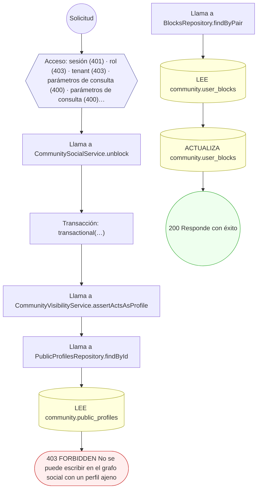

#### 2. GET /community/blocks

Bloqueos emitidos por un perfil

| HTTP | Código | Cuándo |
|---|---|---|
| 200 | — | Éxito |
| 400 | `VALIDATION_FAILED` | Están los parámetros de consulta obligatorios |
| 401 | `UNAUTHENTICATED` | Hay una sesión válida (JWT) |
| 403 | `FORBIDDEN` | El rol está permitido; El tenant se resuelve y pertenece al actor; ForbiddenException: Sólo el titular del perfil puede leer su contenido privado |
| 429 | `RATE_LIMITED` | No se supera el límite de solicitudes |

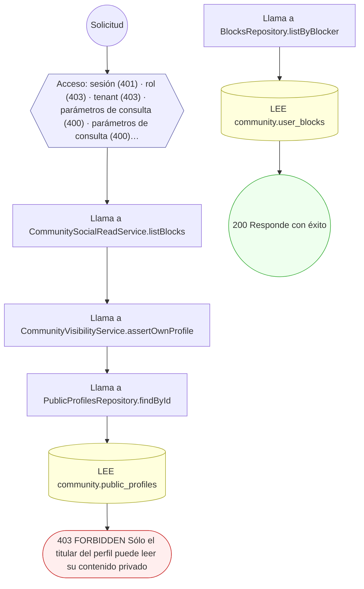

#### 3. POST /community/blocks

Bloquear a un usuario

| HTTP | Código | Cuándo |
|---|---|---|
| 201 | — | Éxito |
| 400 | `VALIDATION_FAILED` | El cuerpo cumple el DTO (sin propiedades extra) |
| 401 | `UNAUTHENTICATED` | Hay una sesión válida (JWT) |
| 403 | `FORBIDDEN` | El rol está permitido; El tenant se resuelve y pertenece al actor; ForbiddenException: No se puede escribir en el grafo social con un perfil ajeno |
| 409 | `CONFLICT` | ConflictException: El usuario ya está bloqueado |
| 422 | `PRECONDITION_FAILED` | PreconditionFailedException: No se puede bloquear a uno mismo |
| 429 | `RATE_LIMITED` | No se supera el límite de solicitudes |

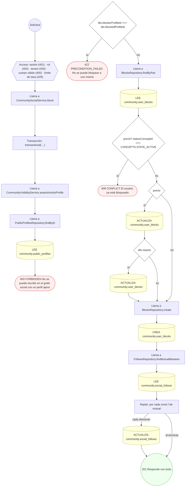

#### 4. DELETE /community/bookmarks

Quitar un marcador

| HTTP | Código | Cuándo |
|---|---|---|
| 200 | — | Éxito |
| 400 | `VALIDATION_FAILED` | Están los parámetros de consulta obligatorios |
| 401 | `UNAUTHENTICATED` | Hay una sesión válida (JWT) |
| 403 | `FORBIDDEN` | El rol está permitido; El tenant se resuelve y pertenece al actor; ForbiddenException: No se puede escribir en el grafo social con un perfil ajeno |
| 429 | `RATE_LIMITED` | No se supera el límite de solicitudes |


#### 5. GET /community/bookmarks

Marcadores guardados por un perfil

| HTTP | Código | Cuándo |
|---|---|---|
| 200 | — | Éxito |
| 400 | `VALIDATION_FAILED` | Están los parámetros de consulta obligatorios |
| 401 | `UNAUTHENTICATED` | Hay una sesión válida (JWT) |
| 403 | `FORBIDDEN` | El rol está permitido; El tenant se resuelve y pertenece al actor; ForbiddenException: Sólo el titular del perfil puede leer su contenido privado |
| 429 | `RATE_LIMITED` | No se supera el límite de solicitudes |


#### 6. POST /community/bookmarks

Guardar un bookmark en una colección

| HTTP | Código | Cuándo |
|---|---|---|
| 201 | — | Éxito |
| 400 | `VALIDATION_FAILED` | El cuerpo cumple el DTO (sin propiedades extra) |
| 401 | `UNAUTHENTICATED` | Hay una sesión válida (JWT) |
| 403 | `FORBIDDEN` | El rol está permitido; El tenant se resuelve y pertenece al actor; ForbiddenException: No se puede escribir en el grafo social con un perfil ajeno |
| 409 | `CONFLICT` | ConflictException: El contenido ya está guardado |
| 429 | `RATE_LIMITED` | No se supera el límite de solicitudes |

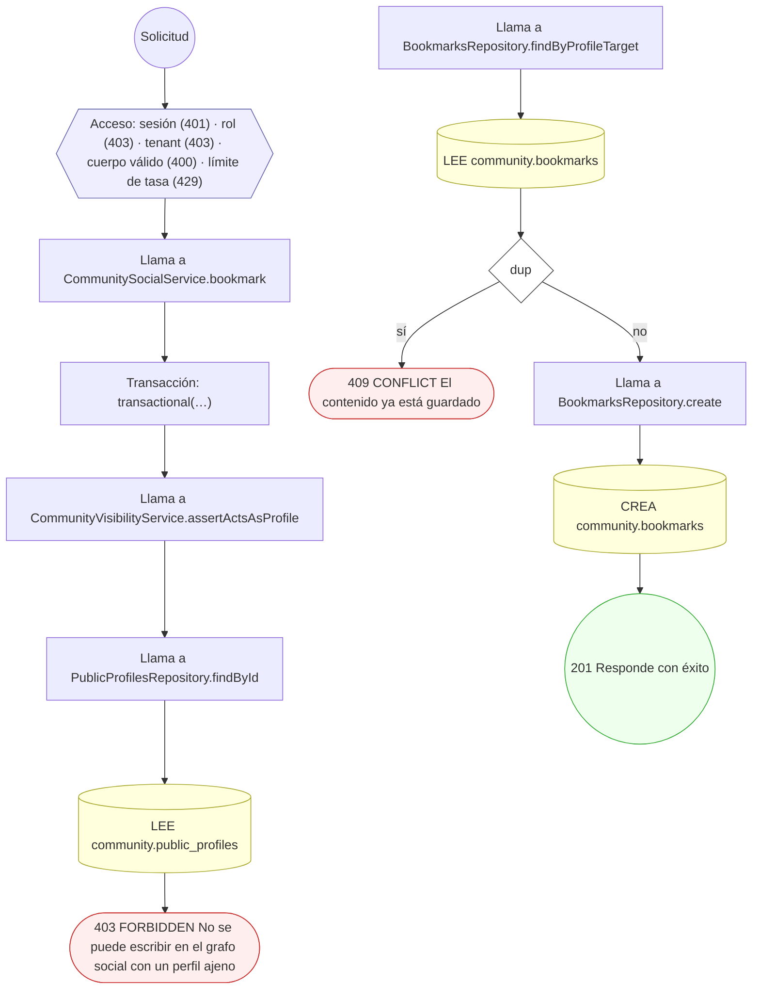

#### 7. POST /community/comments

Comentar (hilo anidado) con contadores

| HTTP | Código | Cuándo |
|---|---|---|
| 201 | — | Éxito |
| 400 | `VALIDATION_FAILED` | El cuerpo cumple el DTO (sin propiedades extra) |
| 401 | `UNAUTHENTICATED` | Hay una sesión válida (JWT) |
| 403 | `FORBIDDEN` | El rol está permitido; El tenant se resuelve y pertenece al actor; ForbiddenException: No se puede escribir en el grafo social con un perfil ajeno |
| 404 | `NOT_FOUND` | ResourceNotFoundException: Perfil autor no encontrado; ResourceNotFoundException: Comentario padre no encontrado |
| 429 | `RATE_LIMITED` | No se supera el límite de solicitudes |

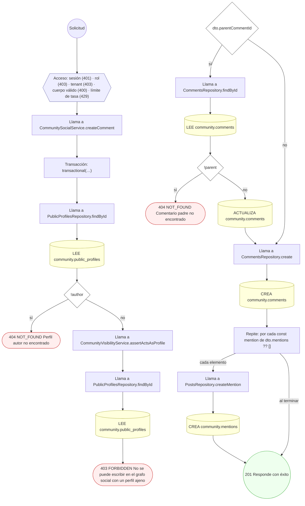

#### 8. GET /community/conversations

Conversaciones activas de un perfil

| HTTP | Código | Cuándo |
|---|---|---|
| 200 | — | Éxito |
| 400 | `VALIDATION_FAILED` | Están los parámetros de consulta obligatorios |
| 401 | `UNAUTHENTICATED` | Hay una sesión válida (JWT) |
| 403 | `FORBIDDEN` | El rol está permitido; El tenant se resuelve y pertenece al actor; ForbiddenException: Sólo el titular del perfil puede leer su contenido privado |
| 429 | `RATE_LIMITED` | No se supera el límite de solicitudes |

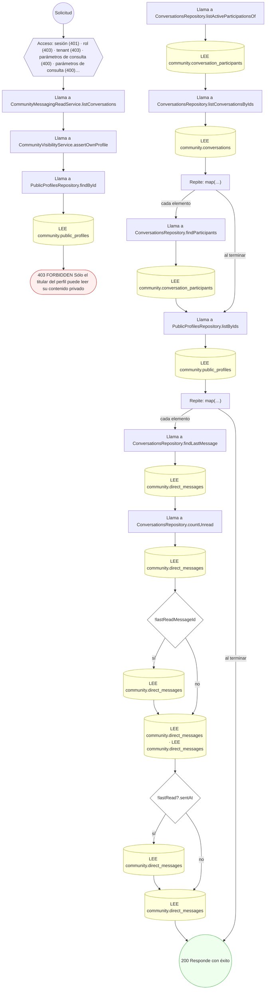

#### 9. POST /community/conversations

Crear una conversación con participantes

| HTTP | Código | Cuándo |
|---|---|---|
| 201 | — | Éxito |
| 400 | `VALIDATION_FAILED` | El cuerpo cumple el DTO (sin propiedades extra) |
| 401 | `UNAUTHENTICATED` | Hay una sesión válida (JWT) |
| 403 | `FORBIDDEN` | El rol está permitido; El tenant se resuelve y pertenece al actor |
| 429 | `RATE_LIMITED` | No se supera el límite de solicitudes |

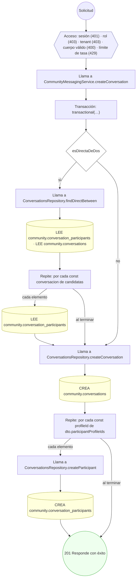

#### 10. GET /community/conversations/{conversationId}/messages

Mensajes de una conversación

| HTTP | Código | Cuándo |
|---|---|---|
| 200 | — | Éxito |
| 400 | `VALIDATION_FAILED` | Están los parámetros de consulta obligatorios; Los parámetros de ruta son UUID válidos |
| 401 | `UNAUTHENTICATED` | Hay una sesión válida (JWT) |
| 403 | `FORBIDDEN` | El rol está permitido; El tenant se resuelve y pertenece al actor; ForbiddenException: Sólo el titular del perfil puede leer su contenido privado |
| 404 | `NOT_FOUND` | ResourceNotFoundException: Conversación no encontrada |
| 429 | `RATE_LIMITED` | No se supera el límite de solicitudes |

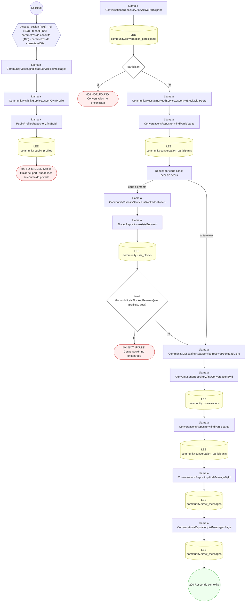

#### 11. POST /community/conversations/{conversationId}/messages

Enviar un mensaje directo en la conversación

| HTTP | Código | Cuándo |
|---|---|---|
| 201 | — | Éxito |
| 400 | `VALIDATION_FAILED` | Los parámetros de ruta son UUID válidos; El cuerpo cumple el DTO (sin propiedades extra) |
| 401 | `UNAUTHENTICATED` | Hay una sesión válida (JWT) |
| 403 | `FORBIDDEN` | El rol está permitido; El tenant se resuelve y pertenece al actor |
| 404 | `NOT_FOUND` | ResourceNotFoundException: Conversación no encontrada; ResourceNotFoundException: El proveedor configurado para el canal in-app no existe |
| 422 | `PRECONDITION_FAILED` | PreconditionFailedException: El remitente no es participante activo; PreconditionFailedException: Existe un bloqueo entre los participantes; PreconditionFailedException: No hay canal in-app activo: falta correr el seed de mensajería; PreconditionFailedException: El canal in-app no tiene configuración de proveedor activa |
| 429 | `RATE_LIMITED` | No se supera el límite de solicitudes |

```mermaid
flowchart TD
  n1(("Solicitud")):::inicio
  n2{{"Acceso: sesión (401) · rol (403) · tenant (403) · parámetros de ruta (400) · cuerpo válido (400) · límite de…"}}:::acceso
  n1 --> n2
  n3["Llama a CommunityMessagingService.sendMessage"]:::llamada
  n2 --> n3
  n4["Transacción: transactional(…)"]:::transaccion
  n3 --> n4
  n5["Llama a ConversationsRepository.findConversationById"]:::llamada
  n4 --> n5
  n6[("LEE community.conversations")]:::efecto
  n5 --> n6
  n7{"!conversation"}:::decision
  n6 --> n7
  n8(["404 NOT_FOUND Conversación no encontrada"]):::error
  n7 -->|"sí"| n8
  n9["Llama a ConversationsRepository.findActiveParticipant"]:::llamada
  n7 -->|"no"| n9
  n10[("LEE community.conversation_participants")]:::efecto
  n9 --> n10
  n11{"!sender"}:::decision
  n10 --> n11
  n12(["422 PRECONDITION_FAILED El remitente no es participante activo"]):::error
  n11 -->|"sí"| n12
  n13["Llama a ConversationsRepository.findParticipants"]:::llamada
  n11 -->|"no"| n13
  n14[("LEE community.conversation_participants")]:::efecto
  n13 --> n14
  n15["Repite: por cada const p de participants"]:::bucle
  n14 --> n15
  n16["Llama a BlocksRepository.existsBetween"]:::llamada
  n15 -->|"cada elemento"| n16
  n17[("LEE community.user_blocks")]:::efecto
  n16 --> n17
  n18{"blocked"}:::decision
  n17 --> n18
  n19(["422 PRECONDITION_FAILED Existe un bloqueo entre los participantes"]):::error
  n18 -->|"sí"| n19
  n20["Llama a ConversationsRepository.createMessage"]:::llamada
  n18 -->|"no"| n20
  n15 -->|"al terminar"| n20
  n21[("CREA community.direct_messages")]:::efecto
  n20 --> n21
  n22[("ACTUALIZA community.conversations · ACTUALIZA community.conversations")]:::efecto
  n21 --> n22
  n23["Repite: por cada const p de participants"]:::bucle
  n22 --> n23
  n24["Llama a ConversationsRepository.createReceipt"]:::llamada
  n23 -->|"cada elemento"| n24
  n25[("CREA community.message_receipts")]:::efecto
  n24 --> n25
  n26["Llama a CommunityMessageNotificationsService.mensajeNuevo"]:::llamada
  n25 --> n26
  n23 -->|"al terminar"| n26
  n27["Intenta"]:::intento
  n26 --> n27
  n28["Llama a PublicProfilesRepository.findById"]:::llamada
  n27 --> n28
  n29[("LEE community.public_profiles")]:::efecto
  n28 --> n29
  n30["Repite: por cada const destinatario de destinatarioProfileIds"]:::bucle
  n29 --> n30
  n31["Llama a CommunityMessageNotificationsService.cuentaDe"]:::llamada
  n30 -->|"cada elemento"| n31
  n32["Llama a PublicProfilesRepository.findById"]:::llamada
  n31 --> n32
  n33[("LEE community.public_profiles")]:::efecto
  n32 --> n33
  n34["Llama a PersonAccountLinksRepository.findActiveByPerson"]:::llamada
  n33 --> n34
  n35[("LEE profiles.person_account_links")]:::efecto
  n34 --> n35
  n36["Llama a NotificationsService.emitInApp"]:::llamada
  n35 --> n36
  n37["Intenta"]:::intento
  n36 --> n37
  n38["Llama a NotificationsService.writeInApp"]:::llamada
  n37 --> n38
  n39{"!channel"}:::decision
  n38 --> n39
  n40(["422 PRECONDITION_FAILED No hay canal in-app activo: falta correr el seed de mensajería"]):::error
  n39 -->|"sí"| n40
  n41{"!config"}:::decision
  n39 -->|"no"| n41
  n42(["422 PRECONDITION_FAILED El canal in-app no tiene configuración de proveedor activa"]):::error
  n41 -->|"sí"| n42
  n43{"!provider"}:::decision
  n41 -->|"no"| n43
  n44(["404 NOT_FOUND El proveedor configurado para el canal in-app no existe"]):::error
  n43 -->|"sí"| n44
  n45(("201 Responde con éxito")):::ok
  n43 -->|"no"| n45
  n30 -->|"al terminar"| n45
  classDef acceso fill:#eef,stroke:#66a
  classDef error fill:#fee,stroke:#c33
  classDef ok fill:#efe,stroke:#3a3
  classDef efecto fill:#ffd,stroke:#aa3
  classDef decision fill:#fff,stroke:#555
  classDef corte fill:#eee,stroke:#999,stroke-dasharray: 4
```

#### 12. POST /community/conversations/{conversationId}/read

Marcar mensajes como leídos (recibos)

| HTTP | Código | Cuándo |
|---|---|---|
| 200 | — | Éxito |
| 400 | `VALIDATION_FAILED` | Los parámetros de ruta son UUID válidos; El cuerpo cumple el DTO (sin propiedades extra) |
| 401 | `UNAUTHENTICATED` | Hay una sesión válida (JWT) |
| 403 | `FORBIDDEN` | El rol está permitido; El tenant se resuelve y pertenece al actor |
| 404 | `NOT_FOUND` | ResourceNotFoundException: Conversación no encontrada |
| 422 | `PRECONDITION_FAILED` | PreconditionFailedException: El perfil no es participante activo |
| 429 | `RATE_LIMITED` | No se supera el límite de solicitudes |

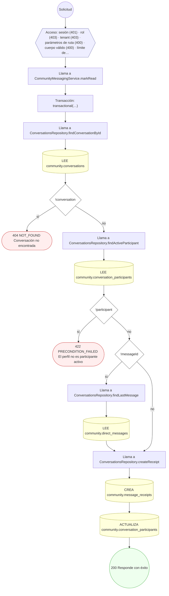

#### 13. GET /community/feed

Timeline de un perfil

| HTTP | Código | Cuándo |
|---|---|---|
| 200 | — | Éxito |
| 400 | `VALIDATION_FAILED` | Están los parámetros de consulta obligatorios |
| 401 | `UNAUTHENTICATED` | Hay una sesión válida (JWT) |
| 403 | `FORBIDDEN` | El rol está permitido; El tenant se resuelve y pertenece al actor; ForbiddenException: Sólo el titular del perfil puede leer su contenido privado |
| 429 | `RATE_LIMITED` | No se supera el límite de solicitudes |

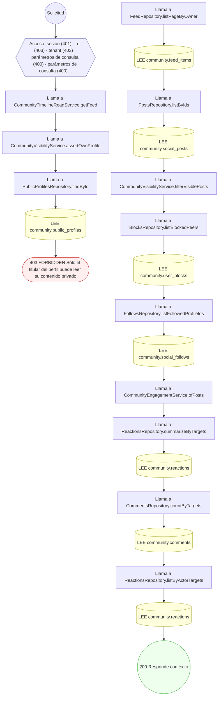

#### 14. DELETE /community/follows

Dejar de seguir un objeto social

| HTTP | Código | Cuándo |
|---|---|---|
| 200 | — | Éxito |
| 400 | `VALIDATION_FAILED` | Están los parámetros de consulta obligatorios |
| 401 | `UNAUTHENTICATED` | Hay una sesión válida (JWT) |
| 403 | `FORBIDDEN` | El rol está permitido; El tenant se resuelve y pertenece al actor; ForbiddenException: No se puede escribir en el grafo social con un perfil ajeno |
| 429 | `RATE_LIMITED` | No se supera el límite de solicitudes |

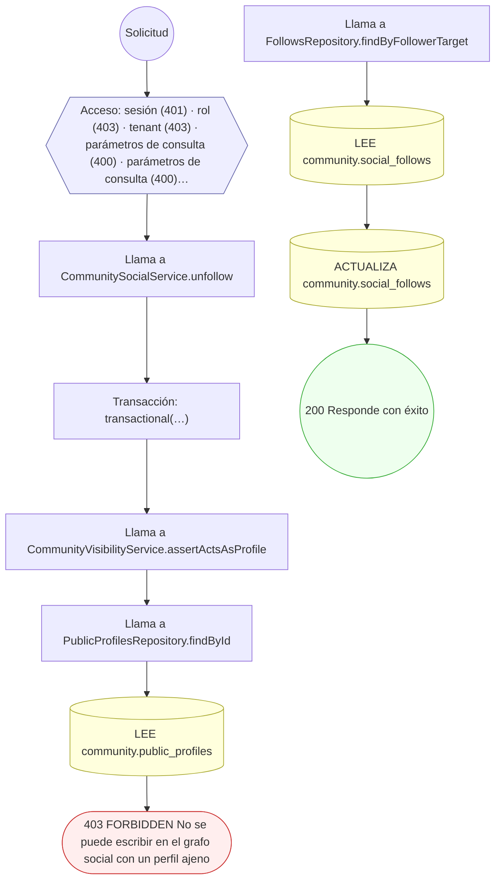

#### 15. GET /community/follows

Seguimientos activos de un perfil

| HTTP | Código | Cuándo |
|---|---|---|
| 200 | — | Éxito |
| 400 | `VALIDATION_FAILED` | Están los parámetros de consulta obligatorios |
| 401 | `UNAUTHENTICATED` | Hay una sesión válida (JWT) |
| 403 | `FORBIDDEN` | El rol está permitido; El tenant se resuelve y pertenece al actor; ForbiddenException: Sólo el titular del perfil puede leer su contenido privado |
| 429 | `RATE_LIMITED` | No se supera el límite de solicitudes |

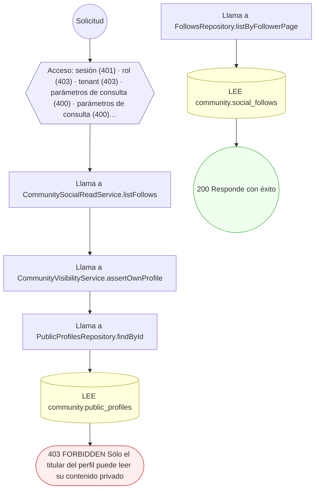

#### 16. POST /community/follows

Seguir un objeto social

| HTTP | Código | Cuándo |
|---|---|---|
| 201 | — | Éxito |
| 400 | `VALIDATION_FAILED` | El cuerpo cumple el DTO (sin propiedades extra) |
| 401 | `UNAUTHENTICATED` | Hay una sesión válida (JWT) |
| 403 | `FORBIDDEN` | El rol está permitido; El tenant se resuelve y pertenece al actor; ForbiddenException: No se puede escribir en el grafo social con un perfil ajeno |
| 409 | `CONFLICT` | ConflictException: Ya sigue este objeto |
| 422 | `PRECONDITION_FAILED` | PreconditionFailedException: No se puede seguir a uno mismo |
| 429 | `RATE_LIMITED` | No se supera el límite de solicitudes |

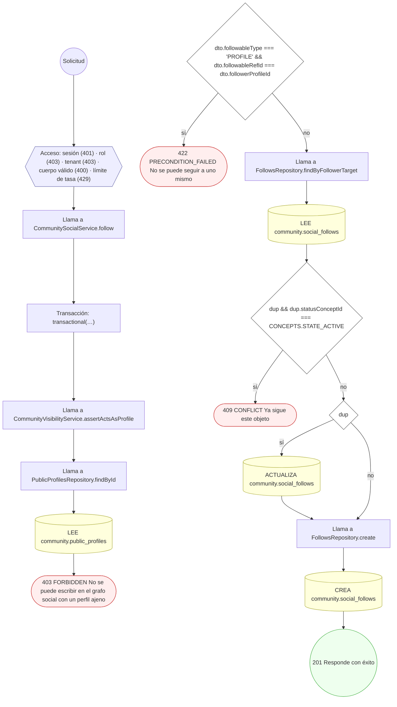

#### 17. POST /community/groups

Crear un grupo/comunidad

| HTTP | Código | Cuándo |
|---|---|---|
| 201 | — | Éxito |
| 400 | `VALIDATION_FAILED` | El cuerpo cumple el DTO (sin propiedades extra) |
| 401 | `UNAUTHENTICATED` | Hay una sesión válida (JWT) |
| 403 | `FORBIDDEN` | El rol está permitido; El tenant se resuelve y pertenece al actor; ForbiddenException: Sólo el titular del perfil puede leer su contenido privado |
| 404 | `NOT_FOUND` | ResourceNotFoundException: Tema no encontrado |
| 409 | `CONFLICT` | ConflictException: Ya hay un grupo con ese slug |
| 422 | `PRECONDITION_FAILED` | PreconditionFailedException: Para crear un grupo necesitás tu perfil público configurado; PreconditionFailedException: Para crear un grupo público necesitás tu perfil público configurado; PreconditionFailedException: Para crear un grupo público, tu perfil público tiene que estar completo |
| 429 | `RATE_LIMITED` | No se supera el límite de solicitudes |

```mermaid
flowchart TD
  n1(("Solicitud")):::inicio
  n2{{"Acceso: sesión (401) · rol (403) · tenant (403) · cuerpo válido (400) · límite de tasa (429)"}}:::acceso
  n1 --> n2
  n3["Llama a CommunityGroupsService.createGroup"]:::llamada
  n2 --> n3
  n4["Transacción: transactional(…)"]:::transaccion
  n3 --> n4
  n5["Llama a GroupsRepository.findBySlug"]:::llamada
  n4 --> n5
  n6[("LEE community.groups")]:::efecto
  n5 --> n6
  n7{"duplicate"}:::decision
  n6 --> n7
  n8(["409 CONFLICT Ya hay un grupo con ese slug"]):::error
  n7 -->|"sí"| n8
  n9{"dto.topicId"}:::decision
  n7 -->|"no"| n9
  n10["Llama a GroupsRepository.findTopicById"]:::llamada
  n9 -->|"sí"| n10
  n11[("LEE community.topics")]:::efecto
  n10 --> n11
  n12{"!topic"}:::decision
  n11 --> n12
  n13(["404 NOT_FOUND Tema no encontrado"]):::error
  n12 -->|"sí"| n13
  n14["Llama a CommunityVisibilityService.resolveActorProfileId"]:::llamada
  n12 -->|"no"| n14
  n9 -->|"no"| n14
  n15{"requested"}:::decision
  n14 --> n15
  n16["Llama a CommunityVisibilityService.assertOwnProfile"]:::llamada
  n15 -->|"sí"| n16
  n17["Llama a PublicProfilesRepository.findById"]:::llamada
  n16 --> n17
  n18[("LEE community.public_profiles")]:::efecto
  n17 --> n18
  n19(["403 FORBIDDEN Sólo el titular del perfil puede leer su contenido privado"]):::error
  n18 --> n19
  n20["Repite: por cada const sujeto de this.sujetosDe(actor)"]:::bucle
  n15 -->|"no"| n20
  n21["Llama a PublicProfilesRepository.findByTarget"]:::llamada
  n20 -->|"cada elemento"| n21
  n22[("LEE community.public_profiles")]:::efecto
  n21 --> n22
  n23{"!ownerProfileId"}:::decision
  n22 --> n23
  n20 -->|"al terminar"| n23
  n24(["422 PRECONDITION_FAILED Para crear un grupo necesitás tu perfil público configurado"]):::error
  n23 -->|"sí"| n24
  n25{"esVisibilidadPublica(dto.visibility)"}:::decision
  n23 -->|"no"| n25
  n26["Llama a CommunityGroupsService.assertPerfilPublicoCompleto"]:::llamada
  n25 -->|"sí"| n26
  n27["Llama a PublicProfilesRepository.findById"]:::llamada
  n26 --> n27
  n28[("LEE community.public_profiles")]:::efecto
  n27 --> n28
  n29{"!perfil"}:::decision
  n28 --> n29
  n30(["422 PRECONDITION_FAILED Para crear un grupo público necesitás tu perfil público configurado"]):::error
  n29 -->|"sí"| n30
  n31{"falta.length › 0"}:::decision
  n29 -->|"no"| n31
  n32(["422 PRECONDITION_FAILED Para crear un grupo público, tu perfil público tiene que estar completo"]):::error
  n31 -->|"sí"| n32
  n33["Llama a GroupsRepository.create"]:::llamada
  n31 -->|"no"| n33
  n25 -->|"no"| n33
  n34[("CREA community.groups")]:::efecto
  n33 --> n34
  n35["Llama a GroupsRepository.createMember"]:::llamada
  n34 --> n35
  n36[("CREA community.group_members")]:::efecto
  n35 --> n36
  n37(("201 Responde con éxito")):::ok
  n36 --> n37
  classDef acceso fill:#eef,stroke:#66a
  classDef error fill:#fee,stroke:#c33
  classDef ok fill:#efe,stroke:#3a3
  classDef efecto fill:#ffd,stroke:#aa3
  classDef decision fill:#fff,stroke:#555
  classDef corte fill:#eee,stroke:#999,stroke-dasharray: 4
```

#### 18. GET /community/groups/{groupId}

Ficha de un grupo

| HTTP | Código | Cuándo |
|---|---|---|
| 200 | — | Éxito |
| 400 | `VALIDATION_FAILED` | Están los parámetros de consulta obligatorios; Los parámetros de ruta son UUID válidos |
| 401 | `UNAUTHENTICATED` | Hay una sesión válida (JWT) |
| 403 | `FORBIDDEN` | El rol está permitido; El tenant se resuelve y pertenece al actor; ForbiddenException: Sólo el titular del perfil puede leer su contenido privado |
| 404 | `NOT_FOUND` | ResourceNotFoundException: Grupo no encontrado |
| 429 | `RATE_LIMITED` | No se supera el límite de solicitudes |

```mermaid
flowchart TD
  n1(("Solicitud")):::inicio
  n2{{"Acceso: sesión (401) · rol (403) · tenant (403) · parámetros de consulta (400) · parámetros de ruta (400) · l…"}}:::acceso
  n1 --> n2
  n3["Llama a CommunityGroupsReadService.getGroup"]:::llamada
  n2 --> n3
  n4["Llama a CommunityGroupAccessService.resolve"]:::llamada
  n3 --> n4
  n5["Llama a CommunityVisibilityService.resolveActorProfileId"]:::llamada
  n4 --> n5
  n6{"requested"}:::decision
  n5 --> n6
  n7["Llama a CommunityVisibilityService.assertOwnProfile"]:::llamada
  n6 -->|"sí"| n7
  n8(["403 FORBIDDEN Sólo el titular del perfil puede leer su contenido privado"]):::error
  n7 --> n8
  n9["Repite: por cada const sujeto de this.sujetosDe(actor)"]:::bucle
  n6 -->|"no"| n9
  n10["Llama a PublicProfilesRepository.findByTarget"]:::llamada
  n9 -->|"cada elemento"| n10
  n11[("LEE community.public_profiles")]:::efecto
  n10 --> n11
  n12["Llama a GroupsRepository.findById"]:::llamada
  n11 --> n12
  n9 -->|"al terminar"| n12
  n13[("LEE community.groups")]:::efecto
  n12 --> n13
  n14{"!group"}:::decision
  n13 --> n14
  n15(["404 NOT_FOUND Grupo no encontrado"]):::error
  n14 -->|"sí"| n15
  n16["Llama a GroupsRepository.findMember"]:::llamada
  n14 -->|"no"| n16
  n17[("LEE community.group_members")]:::efecto
  n16 --> n17
  n18{"isSecret && !isMember && !isPlatform"}:::decision
  n17 --> n18
  n19(["404 NOT_FOUND Grupo no encontrado"]):::error
  n18 -->|"sí"| n19
  n20{"group.statusConceptId !== CONCEPTS.STATE_ACTIVE && !isPlatform"}:::decision
  n18 -->|"no"| n20
  n21(["404 NOT_FOUND Grupo no encontrado"]):::error
  n20 -->|"sí"| n21
  n22["Llama a GroupsRepository.countMembersByStatus"]:::llamada
  n20 -->|"no"| n22
  n23[("LEE community.group_members")]:::efecto
  n22 --> n23
  n24(("200 Responde con éxito")):::ok
  n23 --> n24
  classDef acceso fill:#eef,stroke:#66a
  classDef error fill:#fee,stroke:#c33
  classDef ok fill:#efe,stroke:#3a3
  classDef efecto fill:#ffd,stroke:#aa3
  classDef decision fill:#fff,stroke:#555
  classDef corte fill:#eee,stroke:#999,stroke-dasharray: 4
```

#### 19. GET /community/groups/{groupId}/members

Integrantes de un grupo

| HTTP | Código | Cuándo |
|---|---|---|
| 200 | — | Éxito |
| 400 | `VALIDATION_FAILED` | Están los parámetros de consulta obligatorios; Los parámetros de ruta son UUID válidos |
| 401 | `UNAUTHENTICATED` | Hay una sesión válida (JWT) |
| 403 | `FORBIDDEN` | El rol está permitido; El tenant se resuelve y pertenece al actor; ForbiddenException: Sólo el titular del perfil puede leer su contenido privado |
| 404 | `NOT_FOUND` | ResourceNotFoundException: Grupo no encontrado |
| 429 | `RATE_LIMITED` | No se supera el límite de solicitudes |

```mermaid
flowchart TD
  n1(("Solicitud")):::inicio
  n2{{"Acceso: sesión (401) · rol (403) · tenant (403) · parámetros de consulta (400) · parámetros de consulta (400)…"}}:::acceso
  n1 --> n2
  n3["Llama a CommunityGroupsReadService.listMembers"]:::llamada
  n2 --> n3
  n4["Llama a CommunityVisibilityService.resolveActorProfileId"]:::llamada
  n3 --> n4
  n5{"requested"}:::decision
  n4 --> n5
  n6["Llama a CommunityVisibilityService.assertOwnProfile"]:::llamada
  n5 -->|"sí"| n6
  n7["Llama a PublicProfilesRepository.findById"]:::llamada
  n6 --> n7
  n8[("LEE community.public_profiles")]:::efecto
  n7 --> n8
  n9(["403 FORBIDDEN Sólo el titular del perfil puede leer su contenido privado"]):::error
  n8 --> n9
  n10["Repite: por cada const sujeto de this.sujetosDe(actor)"]:::bucle
  n5 -->|"no"| n10
  n11["Llama a PublicProfilesRepository.findByTarget"]:::llamada
  n10 -->|"cada elemento"| n11
  n12[("LEE community.public_profiles")]:::efecto
  n11 --> n12
  n13["Llama a GroupsRepository.findById"]:::llamada
  n12 --> n13
  n10 -->|"al terminar"| n13
  n14[("LEE community.groups")]:::efecto
  n13 --> n14
  n15{"!group"}:::decision
  n14 --> n15
  n16(["404 NOT_FOUND Grupo no encontrado"]):::error
  n15 -->|"sí"| n16
  n17{"group.visibilityConceptId === COMM.GROUP_VISIBILITY_SECRET"}:::decision
  n15 -->|"no"| n17
  n18["Llama a GroupsRepository.findMember"]:::llamada
  n17 -->|"sí"| n18
  n19[("LEE community.group_members")]:::efecto
  n18 --> n19
  n20{"!member || member.joinStatusConceptId !== COMM.GROUP_JOIN_ACTIVE"}:::decision
  n19 --> n20
  n21(["404 NOT_FOUND Grupo no encontrado"]):::error
  n20 -->|"sí"| n21
  n22["Llama a GroupsRepository.listMembers"]:::llamada
  n20 -->|"no"| n22
  n17 -->|"no"| n22
  n23[("LEE community.group_members")]:::efecto
  n22 --> n23
  n24(("200 Responde con éxito")):::ok
  n23 --> n24
  classDef acceso fill:#eef,stroke:#66a
  classDef error fill:#fee,stroke:#c33
  classDef ok fill:#efe,stroke:#3a3
  classDef efecto fill:#ffd,stroke:#aa3
  classDef decision fill:#fff,stroke:#555
  classDef corte fill:#eee,stroke:#999,stroke-dasharray: 4
```

#### 20. POST /community/groups/{groupId}/members

Unirse a un grupo / comunidad

| HTTP | Código | Cuándo |
|---|---|---|
| 201 | — | Éxito |
| 400 | `VALIDATION_FAILED` | Los parámetros de ruta son UUID válidos; El cuerpo cumple el DTO (sin propiedades extra) |
| 401 | `UNAUTHENTICATED` | Hay una sesión válida (JWT) |
| 403 | `FORBIDDEN` | El rol está permitido; El tenant se resuelve y pertenece al actor |
| 404 | `NOT_FOUND` | ResourceNotFoundException: Grupo no encontrado |
| 409 | `CONFLICT` | ConflictException: El perfil ya es miembro del grupo |
| 429 | `RATE_LIMITED` | No se supera el límite de solicitudes |

```mermaid
flowchart TD
  n1(("Solicitud")):::inicio
  n2{{"Acceso: sesión (401) · rol (403) · tenant (403) · parámetros de ruta (400) · cuerpo válido (400) · límite de…"}}:::acceso
  n1 --> n2
  n3["Llama a CommunityGroupsService.joinGroup"]:::llamada
  n2 --> n3
  n4["Transacción: transactional(…)"]:::transaccion
  n3 --> n4
  n5["Llama a GroupsRepository.findById"]:::llamada
  n4 --> n5
  n6[("LEE community.groups")]:::efecto
  n5 --> n6
  n7{"!group"}:::decision
  n6 --> n7
  n8(["404 NOT_FOUND Grupo no encontrado"]):::error
  n7 -->|"sí"| n8
  n9["Llama a GroupsRepository.findMember"]:::llamada
  n7 -->|"no"| n9
  n10[("LEE community.group_members")]:::efecto
  n9 --> n10
  n11{"dup && this.isLiveMembership(dup)"}:::decision
  n10 --> n11
  n12(["409 CONFLICT El perfil ya es miembro del grupo"]):::error
  n11 -->|"sí"| n12
  n13{"dup"}:::decision
  n11 -->|"no"| n13
  n14[("ACTUALIZA community.group_members · ACTUALIZA community.group_members · ACTUALIZA community.group_members · A…")]:::efecto
  n13 -->|"sí"| n14
  n15["Llama a GroupsRepository.createMember"]:::llamada
  n13 -->|"no"| n15
  n16[("CREA community.group_members")]:::efecto
  n15 --> n16
  n17{"isPublic"}:::decision
  n14 --> n17
  n16 --> n17
  n18[("ACTUALIZA community.groups")]:::efecto
  n17 -->|"sí"| n18
  n19(("201 Responde con éxito")):::ok
  n18 --> n19
  n17 -->|"no"| n19
  classDef acceso fill:#eef,stroke:#66a
  classDef error fill:#fee,stroke:#c33
  classDef ok fill:#efe,stroke:#3a3
  classDef efecto fill:#ffd,stroke:#aa3
  classDef decision fill:#fff,stroke:#555
  classDef corte fill:#eee,stroke:#999,stroke-dasharray: 4
```

#### 21. PATCH /community/groups/{groupId}/members/{memberId}

Aprobar/rechazar un alta o cambiar el rol

| HTTP | Código | Cuándo |
|---|---|---|
| 200 | — | Éxito |
| 400 | `VALIDATION_FAILED` | Los parámetros de ruta son UUID válidos; El cuerpo cumple el DTO (sin propiedades extra) |
| 401 | `UNAUTHENTICATED` | Hay una sesión válida (JWT) |
| 403 | `FORBIDDEN` | El rol está permitido; El tenant se resuelve y pertenece al actor; ForbiddenException: Sólo el titular del perfil puede leer su contenido privado; ForbiddenException: Sólo quien administra el grupo puede resolver sus membresías |
| 404 | `NOT_FOUND` | ResourceNotFoundException: Grupo no encontrado; ResourceNotFoundException: Membresía no encontrada; ResourceNotFoundException: Canal no encontrado; ResourceNotFoundException: Plantilla no encontrada |
| 422 | `PRECONDITION_FAILED` | PreconditionFailedException: Hay que indicar una decisión o un rol; PreconditionFailedException: La solicitud de ingreso ya estaba resuelta; PreconditionFailedException: La notificación necesita destinatario interno o dirección de destino; PreconditionFailedException: El canal no está activo; PreconditionFailedException: La plantilla no está publicada; PreconditionFailedException: La plantilla es de otro canal |
| 429 | `RATE_LIMITED` | No se supera el límite de solicitudes |

```mermaid
flowchart TD
  n1(("Solicitud")):::inicio
  n2{{"Acceso: sesión (401) · rol (403) · tenant (403) · parámetros de ruta (400) · cuerpo válido (400) · límite de…"}}:::acceso
  n1 --> n2
  n3["Llama a CommunityGroupsService.updateMember"]:::llamada
  n2 --> n3
  n4{"!dto.decision && !dto.role"}:::decision
  n3 --> n4
  n5(["422 PRECONDITION_FAILED Hay que indicar una decisión o un rol"]):::error
  n4 -->|"sí"| n5
  n6["Transacción: transactional(…)"]:::transaccion
  n4 -->|"no"| n6
  n7["Llama a CommunityGroupAccessService.resolve"]:::llamada
  n6 --> n7
  n8["Llama a CommunityVisibilityService.resolveActorProfileId"]:::llamada
  n7 --> n8
  n9{"requested"}:::decision
  n8 --> n9
  n10["Llama a CommunityVisibilityService.assertOwnProfile"]:::llamada
  n9 -->|"sí"| n10
  n11(["403 FORBIDDEN Sólo el titular del perfil puede leer su contenido privado"]):::error
  n10 --> n11
  n12["Repite: por cada const sujeto de this.sujetosDe(actor)"]:::bucle
  n9 -->|"no"| n12
  n13["Llama a PublicProfilesRepository.findByTarget"]:::llamada
  n12 -->|"cada elemento"| n13
  n14[("LEE community.public_profiles")]:::efecto
  n13 --> n14
  n15["Llama a GroupsRepository.findById"]:::llamada
  n14 --> n15
  n12 -->|"al terminar"| n15
  n16[("LEE community.groups")]:::efecto
  n15 --> n16
  n17{"!group"}:::decision
  n16 --> n17
  n18(["404 NOT_FOUND Grupo no encontrado"]):::error
  n17 -->|"sí"| n18
  n19["Llama a GroupsRepository.findMember"]:::llamada
  n17 -->|"no"| n19
  n20[("LEE community.group_members")]:::efecto
  n19 --> n20
  n21{"isSecret && !isMember && !isPlatform"}:::decision
  n20 --> n21
  n22(["404 NOT_FOUND Grupo no encontrado"]):::error
  n21 -->|"sí"| n22
  n23{"group.statusConceptId !== CONCEPTS.STATE_ACTIVE && !isPlatform"}:::decision
  n21 -->|"no"| n23
  n24(["404 NOT_FOUND Grupo no encontrado"]):::error
  n23 -->|"sí"| n24
  n25["Llama a CommunityGroupAccessService.assertCanAdminister"]:::llamada
  n23 -->|"no"| n25
  n26(["403 FORBIDDEN Sólo quien administra el grupo puede resolver sus membresías"]):::error
  n25 --> n26
  n27["Llama a GroupsRepository.findMemberById"]:::llamada
  n28[("LEE community.group_members")]:::efecto
  n27 --> n28
  n29{"!member"}:::decision
  n28 --> n29
  n30(["404 NOT_FOUND Membresía no encontrada"]):::error
  n29 -->|"sí"| n30
  n31{"dto.decision"}:::decision
  n29 -->|"no"| n31
  n32{"member.joinStatusConceptId !== COMM.GROUP_JOIN_PENDING"}:::decision
  n31 -->|"sí"| n32
  n33(["422 PRECONDITION_FAILED La solicitud de ingreso ya estaba resuelta"]):::error
  n32 -->|"sí"| n33
  n34{"dto.decision === 'APPROVE'"}:::decision
  n32 -->|"no"| n34
  n35[("ACTUALIZA community.group_members · ACTUALIZA community.group_members")]:::efecto
  n34 -->|"sí"| n35
  n36[("ACTUALIZA community.group_members")]:::efecto
  n34 -->|"no"| n36
  n37{"dto.role"}:::decision
  n35 --> n37
  n36 --> n37
  n31 -->|"no"| n37
  n38[("ACTUALIZA community.group_members")]:::efecto
  n37 -->|"sí"| n38
  n39{"approved"}:::decision
  n38 --> n39
  n37 -->|"no"| n39
  n40["Llama a CommunityGroupNotificationsService.notifyJoinApproved"]:::llamada
  n39 -->|"sí"| n40
  n41["Transacción: safely(…)"]:::transaccion
  n40 --> n41
  n42["Llama a PublicProfilesRepository.listByIds"]:::llamada
  n41 --> n42
  n43[("LEE community.public_profiles")]:::efecto
  n42 --> n43
  n44["Llama a CommunityGroupNotificationsService.emit"]:::llamada
  n43 --> n44
  n45["Llama a NotificationsService.createRequest"]:::llamada
  n44 --> n45
  n46{"!dto.recipientUserId && !dto.recipientAddress"}:::decision
  n45 --> n46
  n47(["422 PRECONDITION_FAILED La notificación necesita destinatario interno o dirección de destino"]):::error
  n46 -->|"sí"| n47
  n48["Transacción: transactional(…)"]:::transaccion
  n46 -->|"no"| n48
  n49{"!channel"}:::decision
  n48 --> n49
  n50(["404 NOT_FOUND Canal no encontrado"]):::error
  n49 -->|"sí"| n50
  n51{"channel.stateConceptId !== CONCEPTS.STATE_ACTIVE"}:::decision
  n49 -->|"no"| n51
  n52(["422 PRECONDITION_FAILED El canal no está activo"]):::error
  n51 -->|"sí"| n52
  n53{"dto.templateId"}:::decision
  n51 -->|"no"| n53
  n54{"!template"}:::decision
  n53 -->|"sí"| n54
  n55(["404 NOT_FOUND Plantilla no encontrada"]):::error
  n54 -->|"sí"| n55
  n56{"template.statusConceptId !== CONCEPTS.STATE_ACTIVE"}:::decision
  n54 -->|"no"| n56
  n57(["422 PRECONDITION_FAILED La plantilla no está publicada"]):::error
  n56 -->|"sí"| n57
  n58{"template.channelId !== dto.channelId"}:::decision
  n56 -->|"no"| n58
  n59(["422 PRECONDITION_FAILED La plantilla es de otro canal"]):::error
  n58 -->|"sí"| n59
  n60(("200 Responde con éxito")):::ok
  n58 -->|"no"| n60
  n53 -->|"no"| n60
  n39 -->|"no"| n60
  classDef acceso fill:#eef,stroke:#66a
  classDef error fill:#fee,stroke:#c33
  classDef ok fill:#efe,stroke:#3a3
  classDef efecto fill:#ffd,stroke:#aa3
  classDef decision fill:#fff,stroke:#555
  classDef corte fill:#eee,stroke:#999,stroke-dasharray: 4
```

#### 22. DELETE /community/groups/{groupId}/members/{memberProfileId}

Salir del grupo o dar de baja a un integrante

| HTTP | Código | Cuándo |
|---|---|---|
| 200 | — | Éxito |
| 400 | `VALIDATION_FAILED` | Los parámetros de ruta son UUID válidos |
| 401 | `UNAUTHENTICATED` | Hay una sesión válida (JWT) |
| 403 | `FORBIDDEN` | El rol está permitido; El tenant se resuelve y pertenece al actor; ForbiddenException: Sólo el titular del perfil puede leer su contenido privado; ForbiddenException: Sólo quien administra el grupo puede resolver sus membresías |
| 404 | `NOT_FOUND` | ResourceNotFoundException: Grupo no encontrado; ResourceNotFoundException: El perfil no es del grupo |
| 409 | `CONFLICT` | ConflictException: Al dueño del grupo no lo puede sacar otro: sólo él puede irse, o transferir el grupo antes |
| 429 | `RATE_LIMITED` | No se supera el límite de solicitudes |

```mermaid
flowchart TD
  n1(("Solicitud")):::inicio
  n2{{"Acceso: sesión (401) · rol (403) · tenant (403) · parámetros de ruta (400) · límite de tasa (429)"}}:::acceso
  n1 --> n2
  n3["Llama a CommunityGroupsService.leaveGroup"]:::llamada
  n2 --> n3
  n4["Transacción: transactional(…)"]:::transaccion
  n3 --> n4
  n5["Llama a CommunityGroupAccessService.resolve"]:::llamada
  n4 --> n5
  n6["Llama a CommunityVisibilityService.resolveActorProfileId"]:::llamada
  n5 --> n6
  n7{"requested"}:::decision
  n6 --> n7
  n8["Llama a CommunityVisibilityService.assertOwnProfile"]:::llamada
  n7 -->|"sí"| n8
  n9(["403 FORBIDDEN Sólo el titular del perfil puede leer su contenido privado"]):::error
  n8 --> n9
  n10["Repite: por cada const sujeto de this.sujetosDe(actor)"]:::bucle
  n7 -->|"no"| n10
  n11["Llama a PublicProfilesRepository.findByTarget"]:::llamada
  n10 -->|"cada elemento"| n11
  n12[("LEE community.public_profiles")]:::efecto
  n11 --> n12
  n13["Llama a GroupsRepository.findById"]:::llamada
  n12 --> n13
  n10 -->|"al terminar"| n13
  n14[("LEE community.groups")]:::efecto
  n13 --> n14
  n15{"!group"}:::decision
  n14 --> n15
  n16(["404 NOT_FOUND Grupo no encontrado"]):::error
  n15 -->|"sí"| n16
  n17["Llama a GroupsRepository.findMember"]:::llamada
  n15 -->|"no"| n17
  n18[("LEE community.group_members")]:::efecto
  n17 --> n18
  n19{"isSecret && !isMember && !isPlatform"}:::decision
  n18 --> n19
  n20(["404 NOT_FOUND Grupo no encontrado"]):::error
  n19 -->|"sí"| n20
  n21{"group.statusConceptId !== CONCEPTS.STATE_ACTIVE && !isPlatform"}:::decision
  n19 -->|"no"| n21
  n22(["404 NOT_FOUND Grupo no encontrado"]):::error
  n21 -->|"sí"| n22
  n23["Llama a CommunityGroupAccessService.assertCanAdminister"]:::llamada
  n21 -->|"no"| n23
  n24(["403 FORBIDDEN Sólo quien administra el grupo puede resolver sus membresías"]):::error
  n23 --> n24
  n25{"!isSelf"}:::decision
  n26["Llama a CommunityGroupAccessService.assertCanAdminister"]:::llamada
  n25 -->|"sí"| n26
  n27(["403 FORBIDDEN Sólo quien administra el grupo puede resolver sus membresías"]):::error
  n26 --> n27
  n28["Llama a GroupsRepository.findByIdForUpdate"]:::llamada
  n25 -->|"no"| n28
  n29[("LEE community.groups")]:::efecto
  n28 --> n29
  n30{"!group"}:::decision
  n29 --> n30
  n31(["404 NOT_FOUND Grupo no encontrado"]):::error
  n30 -->|"sí"| n31
  n32["Llama a GroupsRepository.findMember"]:::llamada
  n30 -->|"no"| n32
  n33[("LEE community.group_members")]:::efecto
  n32 --> n33
  n34{"!member"}:::decision
  n33 --> n34
  n35(["404 NOT_FOUND El perfil no es del grupo"]):::error
  n34 -->|"sí"| n35
  n36{"eraDueno && !isSelf"}:::decision
  n34 -->|"no"| n36
  n37(["409 CONFLICT Al dueño del grupo no lo puede sacar otro: sólo él puede irse, o transferir el grupo antes"]):::error
  n36 -->|"sí"| n37
  n38[("ACTUALIZA community.group_members")]:::efecto
  n36 -->|"no"| n38
  n39["Llama a GroupsRepository.countMembersByStatus"]:::llamada
  n38 --> n39
  n40[("LEE community.group_members")]:::efecto
  n39 --> n40
  n41[("ACTUALIZA community.groups")]:::efecto
  n40 --> n41
  n42{"quedan === 0"}:::decision
  n41 --> n42
  n43[("ACTUALIZA community.groups")]:::efecto
  n42 -->|"sí"| n43
  n44{"eraDueno && wasActive"}:::decision
  n42 -->|"no"| n44
  n45["Llama a CommunityGroupsService.elegirHeredero"]:::llamada
  n44 -->|"sí"| n45
  n46["Llama a GroupsRepository.listActiveMembersByAge"]:::llamada
  n45 --> n46
  n47[("LEE community.group_members")]:::efecto
  n46 --> n47
  n48{"heredero"}:::decision
  n47 --> n48
  n49[("ACTUALIZA community.group_members · ACTUALIZA community.groups")]:::efecto
  n48 -->|"sí"| n49
  n50(("200 Responde con éxito")):::ok
  n43 --> n50
  n49 --> n50
  n48 -->|"no"| n50
  n44 -->|"no"| n50
  classDef acceso fill:#eef,stroke:#66a
  classDef error fill:#fee,stroke:#c33
  classDef ok fill:#efe,stroke:#3a3
  classDef efecto fill:#ffd,stroke:#aa3
  classDef decision fill:#fff,stroke:#555
  classDef corte fill:#eee,stroke:#999,stroke-dasharray: 4
```

#### 23. GET /community/groups/{groupId}/posts

Muro de un grupo

| HTTP | Código | Cuándo |
|---|---|---|
| 200 | — | Éxito |
| 400 | `VALIDATION_FAILED` | Están los parámetros de consulta obligatorios; Los parámetros de ruta son UUID válidos |
| 401 | `UNAUTHENTICATED` | Hay una sesión válida (JWT) |
| 403 | `FORBIDDEN` | El rol está permitido; El tenant se resuelve y pertenece al actor; ForbiddenException: Sólo el titular del perfil puede leer su contenido privado; ForbiddenException: Hay que ser integrante del grupo para ver su contenido |
| 404 | `NOT_FOUND` | ResourceNotFoundException: Grupo no encontrado |
| 429 | `RATE_LIMITED` | No se supera el límite de solicitudes |

```mermaid
flowchart TD
  n1(("Solicitud")):::inicio
  n2{{"Acceso: sesión (401) · rol (403) · tenant (403) · parámetros de consulta (400) · parámetros de consulta (400)…"}}:::acceso
  n1 --> n2
  n3["Llama a CommunityGroupWallService.listWall"]:::llamada
  n2 --> n3
  n4["Llama a CommunityGroupAccessService.resolve"]:::llamada
  n3 --> n4
  n5["Llama a CommunityVisibilityService.resolveActorProfileId"]:::llamada
  n4 --> n5
  n6{"requested"}:::decision
  n5 --> n6
  n7["Llama a CommunityVisibilityService.assertOwnProfile"]:::llamada
  n6 -->|"sí"| n7
  n8(["403 FORBIDDEN Sólo el titular del perfil puede leer su contenido privado"]):::error
  n7 --> n8
  n9["Repite: por cada const sujeto de this.sujetosDe(actor)"]:::bucle
  n6 -->|"no"| n9
  n10["Llama a PublicProfilesRepository.findByTarget"]:::llamada
  n9 -->|"cada elemento"| n10
  n11[("LEE community.public_profiles")]:::efecto
  n10 --> n11
  n12["Llama a GroupsRepository.findById"]:::llamada
  n11 --> n12
  n9 -->|"al terminar"| n12
  n13[("LEE community.groups")]:::efecto
  n12 --> n13
  n14{"!group"}:::decision
  n13 --> n14
  n15(["404 NOT_FOUND Grupo no encontrado"]):::error
  n14 -->|"sí"| n15
  n16["Llama a GroupsRepository.findMember"]:::llamada
  n14 -->|"no"| n16
  n17[("LEE community.group_members")]:::efecto
  n16 --> n17
  n18{"isSecret && !isMember && !isPlatform"}:::decision
  n17 --> n18
  n19(["404 NOT_FOUND Grupo no encontrado"]):::error
  n18 -->|"sí"| n19
  n20{"group.statusConceptId !== CONCEPTS.STATE_ACTIVE && !isPlatform"}:::decision
  n18 -->|"no"| n20
  n21(["404 NOT_FOUND Grupo no encontrado"]):::error
  n20 -->|"sí"| n21
  n22["Llama a CommunityGroupAccessService.assertCanRead"]:::llamada
  n20 -->|"no"| n22
  n23(["403 FORBIDDEN Hay que ser integrante del grupo para ver su contenido"]):::error
  n22 --> n23
  n24["Llama a CommentsRepository.listRootsPage"]:::llamada
  n25[("LEE community.comments")]:::efecto
  n24 --> n25
  n26["Llama a CommentsRepository.listRepliesOf"]:::llamada
  n25 --> n26
  n27[("LEE community.comments")]:::efecto
  n26 --> n27
  n28(("200 Responde con éxito")):::ok
  n27 --> n28
  classDef acceso fill:#eef,stroke:#66a
  classDef error fill:#fee,stroke:#c33
  classDef ok fill:#efe,stroke:#3a3
  classDef efecto fill:#ffd,stroke:#aa3
  classDef decision fill:#fff,stroke:#555
  classDef corte fill:#eee,stroke:#999,stroke-dasharray: 4
```

#### 24. POST /community/groups/{groupId}/posts

Publicar en el muro del grupo

| HTTP | Código | Cuándo |
|---|---|---|
| 201 | — | Éxito |
| 400 | `VALIDATION_FAILED` | Los parámetros de ruta son UUID válidos; El cuerpo cumple el DTO (sin propiedades extra) |
| 401 | `UNAUTHENTICATED` | Hay una sesión válida (JWT) |
| 403 | `FORBIDDEN` | El rol está permitido; El tenant se resuelve y pertenece al actor; ForbiddenException: Sólo el titular del perfil puede leer su contenido privado; ForbiddenException: Hay que ser integrante del grupo para publicar en su muro |
| 404 | `NOT_FOUND` | ResourceNotFoundException: Grupo no encontrado; ResourceNotFoundException: Perfil autor no encontrado; ResourceNotFoundException: La publicación a la que responde no es de este grupo; ResourceNotFoundException: Canal no encontrado; ResourceNotFoundException: Plantilla no encontrada |
| 422 | `PRECONDITION_FAILED` | PreconditionFailedException: La notificación necesita destinatario interno o dirección de destino; PreconditionFailedException: El canal no está activo; PreconditionFailedException: La plantilla no está publicada; PreconditionFailedException: La plantilla es de otro canal |
| 429 | `RATE_LIMITED` | No se supera el límite de solicitudes |

```mermaid
flowchart TD
  n1(("Solicitud")):::inicio
  n2{{"Acceso: sesión (401) · rol (403) · tenant (403) · parámetros de ruta (400) · cuerpo válido (400) · límite de…"}}:::acceso
  n1 --> n2
  n3["Llama a CommunityGroupWallService.createPost"]:::llamada
  n2 --> n3
  n4["Transacción: transactional(…)"]:::transaccion
  n3 --> n4
  n5["Llama a CommunityGroupAccessService.resolve"]:::llamada
  n4 --> n5
  n6["Llama a CommunityVisibilityService.resolveActorProfileId"]:::llamada
  n5 --> n6
  n7{"requested"}:::decision
  n6 --> n7
  n8["Llama a CommunityVisibilityService.assertOwnProfile"]:::llamada
  n7 -->|"sí"| n8
  n9(["403 FORBIDDEN Sólo el titular del perfil puede leer su contenido privado"]):::error
  n8 --> n9
  n10["Repite: por cada const sujeto de this.sujetosDe(actor)"]:::bucle
  n7 -->|"no"| n10
  n11["Llama a PublicProfilesRepository.findByTarget"]:::llamada
  n10 -->|"cada elemento"| n11
  n12[("LEE community.public_profiles")]:::efecto
  n11 --> n12
  n13["Llama a GroupsRepository.findById"]:::llamada
  n12 --> n13
  n10 -->|"al terminar"| n13
  n14[("LEE community.groups")]:::efecto
  n13 --> n14
  n15{"!group"}:::decision
  n14 --> n15
  n16(["404 NOT_FOUND Grupo no encontrado"]):::error
  n15 -->|"sí"| n16
  n17["Llama a GroupsRepository.findMember"]:::llamada
  n15 -->|"no"| n17
  n18[("LEE community.group_members")]:::efecto
  n17 --> n18
  n19{"isSecret && !isMember && !isPlatform"}:::decision
  n18 --> n19
  n20(["404 NOT_FOUND Grupo no encontrado"]):::error
  n19 -->|"sí"| n20
  n21{"group.statusConceptId !== CONCEPTS.STATE_ACTIVE && !isPlatform"}:::decision
  n19 -->|"no"| n21
  n22(["404 NOT_FOUND Grupo no encontrado"]):::error
  n21 -->|"sí"| n22
  n23["Llama a CommunityGroupAccessService.assertCanPost"]:::llamada
  n21 -->|"no"| n23
  n24(["403 FORBIDDEN Hay que ser integrante del grupo para publicar en su muro"]):::error
  n23 --> n24
  n25["Llama a PublicProfilesRepository.findById"]:::llamada
  n26[("LEE community.public_profiles")]:::efecto
  n25 --> n26
  n27{"!author"}:::decision
  n26 --> n27
  n28(["404 NOT_FOUND Perfil autor no encontrado"]):::error
  n27 -->|"sí"| n28
  n29{"dto.parentCommentId"}:::decision
  n27 -->|"no"| n29
  n30["Llama a CommentsRepository.findById"]:::llamada
  n29 -->|"sí"| n30
  n31[("LEE community.comments")]:::efecto
  n30 --> n31
  n32{"!parent || parent.commentableTypeConceptId !== COMM.CONTENT_TYPE_GROUP || parent.commentableRefId !== groupId"}:::decision
  n31 --> n32
  n33(["404 NOT_FOUND La publicación a la que responde no es de este grupo"]):::error
  n32 -->|"sí"| n33
  n34[("ACTUALIZA community.comments")]:::efecto
  n32 -->|"no"| n34
  n35["Llama a CommentsRepository.create"]:::llamada
  n34 --> n35
  n29 -->|"no"| n35
  n36[("CREA community.comments")]:::efecto
  n35 --> n36
  n37{"announce"}:::decision
  n36 --> n37
  n38["Llama a CommunityGroupNotificationsService.notifyNewPost"]:::llamada
  n37 -->|"sí"| n38
  n39["Transacción: safely(…)"]:::transaccion
  n38 --> n39
  n40["Llama a GroupsRepository.listActiveMemberProfileIds"]:::llamada
  n39 --> n40
  n41[("LEE community.group_members")]:::efecto
  n40 --> n41
  n42["Llama a PublicProfilesRepository.listByIds"]:::llamada
  n41 --> n42
  n43[("LEE community.public_profiles")]:::efecto
  n42 --> n43
  n44["Repite: por cada const recipientUserId de new Set(recipients)"]:::bucle
  n43 --> n44
  n45["Llama a CommunityGroupNotificationsService.emit"]:::llamada
  n44 -->|"cada elemento"| n45
  n46["Llama a NotificationsService.createRequest"]:::llamada
  n45 --> n46
  n47{"!dto.recipientUserId && !dto.recipientAddress"}:::decision
  n46 --> n47
  n48(["422 PRECONDITION_FAILED La notificación necesita destinatario interno o dirección de destino"]):::error
  n47 -->|"sí"| n48
  n49["Transacción: transactional(…)"]:::transaccion
  n47 -->|"no"| n49
  n50{"!channel"}:::decision
  n49 --> n50
  n51(["404 NOT_FOUND Canal no encontrado"]):::error
  n50 -->|"sí"| n51
  n52{"channel.stateConceptId !== CONCEPTS.STATE_ACTIVE"}:::decision
  n50 -->|"no"| n52
  n53(["422 PRECONDITION_FAILED El canal no está activo"]):::error
  n52 -->|"sí"| n53
  n54{"dto.templateId"}:::decision
  n52 -->|"no"| n54
  n55{"!template"}:::decision
  n54 -->|"sí"| n55
  n56(["404 NOT_FOUND Plantilla no encontrada"]):::error
  n55 -->|"sí"| n56
  n57{"template.statusConceptId !== CONCEPTS.STATE_ACTIVE"}:::decision
  n55 -->|"no"| n57
  n58(["422 PRECONDITION_FAILED La plantilla no está publicada"]):::error
  n57 -->|"sí"| n58
  n59{"template.channelId !== dto.channelId"}:::decision
  n57 -->|"no"| n59
  n60(["422 PRECONDITION_FAILED La plantilla es de otro canal"]):::error
  n59 -->|"sí"| n60
  n61(("201 Responde con éxito")):::ok
  n59 -->|"no"| n61
  n54 -->|"no"| n61
  n44 -->|"al terminar"| n61
  n37 -->|"no"| n61
  classDef acceso fill:#eef,stroke:#66a
  classDef error fill:#fee,stroke:#c33
  classDef ok fill:#efe,stroke:#3a3
  classDef efecto fill:#ffd,stroke:#aa3
  classDef decision fill:#fff,stroke:#555
  classDef corte fill:#eee,stroke:#999,stroke-dasharray: 4
```

#### 25. POST /community/moderation/appeals/{appealId}/resolve

Resolver una apelación de moderación

| HTTP | Código | Cuándo |
|---|---|---|
| 200 | — | Éxito |
| 400 | `VALIDATION_FAILED` | Los parámetros de ruta son UUID válidos; El cuerpo cumple el DTO (sin propiedades extra) |
| 401 | `UNAUTHENTICATED` | Hay una sesión válida (JWT) |
| 403 | `FORBIDDEN` | El rol está permitido; El tenant se resuelve y pertenece al actor |
| 404 | `NOT_FOUND` | ResourceNotFoundException: Apelación no encontrada |
| 409 | `CONFLICT` | ConflictException: La apelación ya está resuelta |
| 429 | `RATE_LIMITED` | No se supera el límite de solicitudes |

```mermaid
flowchart TD
  n1(("Solicitud")):::inicio
  n2{{"Acceso: sesión (401) · rol (403) · tenant (403) · parámetros de ruta (400) · cuerpo válido (400) · límite de…"}}:::acceso
  n1 --> n2
  n3["Llama a CommunityModerationService.resolveAppeal"]:::llamada
  n2 --> n3
  n4["Transacción: transactional(…)"]:::transaccion
  n3 --> n4
  n5["Llama a ModerationRepository.findAppealById"]:::llamada
  n4 --> n5
  n6[("LEE community.moderation_appeals")]:::efecto
  n5 --> n6
  n7{"!appeal"}:::decision
  n6 --> n7
  n8(["404 NOT_FOUND Apelación no encontrada"]):::error
  n7 -->|"sí"| n8
  n9{"appeal.statusConceptId !== COMM.APPEAL_OPEN"}:::decision
  n7 -->|"no"| n9
  n10(["409 CONFLICT La apelación ya está resuelta"]):::error
  n9 -->|"sí"| n10
  n11[("ACTUALIZA community.moderation_appeals · ACTUALIZA community.moderation_appeals · ACTUALIZA community.moderat…")]:::efecto
  n9 -->|"no"| n11
  n12["Llama a ModerationRepository.findDecisionById"]:::llamada
  n11 --> n12
  n13[("LEE community.moderation_decisions")]:::efecto
  n12 --> n13
  n14["Llama a ModerationRepository.findQueueById"]:::llamada
  n13 --> n14
  n15[("LEE community.moderation_queue")]:::efecto
  n14 --> n15
  n16{"original"}:::decision
  n15 --> n16
  n17["Llama a ModerationRepository.findOpenQueueForContent"]:::llamada
  n16 -->|"sí"| n17
  n18[("LEE community.moderation_queue")]:::efecto
  n17 --> n18
  n19{"reencolada"}:::decision
  n18 --> n19
  n20[("ACTUALIZA community.moderation_queue")]:::efecto
  n19 -->|"sí"| n20
  n21(("200 Responde con éxito")):::ok
  n20 --> n21
  n19 -->|"no"| n21
  n16 -->|"no"| n21
  classDef acceso fill:#eef,stroke:#66a
  classDef error fill:#fee,stroke:#c33
  classDef ok fill:#efe,stroke:#3a3
  classDef efecto fill:#ffd,stroke:#aa3
  classDef decision fill:#fff,stroke:#555
  classDef corte fill:#eee,stroke:#999,stroke-dasharray: 4
```

#### 26. POST /community/moderation/decisions/{decisionId}/appeal

Apelar una decisión de moderación

| HTTP | Código | Cuándo |
|---|---|---|
| 201 | — | Éxito |
| 400 | `VALIDATION_FAILED` | Los parámetros de ruta son UUID válidos; El cuerpo cumple el DTO (sin propiedades extra) |
| 401 | `UNAUTHENTICATED` | Hay una sesión válida (JWT) |
| 403 | `FORBIDDEN` | El rol está permitido; El tenant se resuelve y pertenece al actor; ForbiddenException: No se puede escribir en el grafo social con un perfil ajeno |
| 404 | `NOT_FOUND` | ResourceNotFoundException: Decisión no encontrada |
| 409 | `CONFLICT` | ConflictException: Ya existe una apelación abierta para esta decisión |
| 429 | `RATE_LIMITED` | No se supera el límite de solicitudes |

```mermaid
flowchart TD
  n1(("Solicitud")):::inicio
  n2{{"Acceso: sesión (401) · rol (403) · tenant (403) · parámetros de ruta (400) · cuerpo válido (400) · límite de…"}}:::acceso
  n1 --> n2
  n3["Llama a CommunityModerationService.appeal"]:::llamada
  n2 --> n3
  n4["Transacción: transactional(…)"]:::transaccion
  n3 --> n4
  n5["Llama a CommunityVisibilityService.assertActsAsProfile"]:::llamada
  n4 --> n5
  n6["Llama a PublicProfilesRepository.findById"]:::llamada
  n5 --> n6
  n7[("LEE community.public_profiles")]:::efecto
  n6 --> n7
  n8(["403 FORBIDDEN No se puede escribir en el grafo social con un perfil ajeno"]):::error
  n7 --> n8
  n9["Llama a ModerationRepository.findDecisionById"]:::llamada
  n10[("LEE community.moderation_decisions")]:::efecto
  n9 --> n10
  n11{"!decision"}:::decision
  n10 --> n11
  n12(["404 NOT_FOUND Decisión no encontrada"]):::error
  n11 -->|"sí"| n12
  n13["Llama a ModerationRepository.findOpenAppealForDecision"]:::llamada
  n11 -->|"no"| n13
  n14[("LEE community.moderation_appeals")]:::efecto
  n13 --> n14
  n15{"open"}:::decision
  n14 --> n15
  n16(["409 CONFLICT Ya existe una apelación abierta para esta decisión"]):::error
  n15 -->|"sí"| n16
  n17["Llama a ModerationRepository.createAppeal"]:::llamada
  n15 -->|"no"| n17
  n18[("CREA community.moderation_appeals")]:::efecto
  n17 --> n18
  n19["Llama a ModerationRepository.findQueueById"]:::llamada
  n18 --> n19
  n20[("LEE community.moderation_queue")]:::efecto
  n19 --> n20
  n21{"queue"}:::decision
  n20 --> n21
  n22["Llama a ModerationRepository.createQueue"]:::llamada
  n21 -->|"sí"| n22
  n23[("CREA community.moderation_queue")]:::efecto
  n22 --> n23
  n24(("201 Responde con éxito")):::ok
  n23 --> n24
  n21 -->|"no"| n24
  classDef acceso fill:#eef,stroke:#66a
  classDef error fill:#fee,stroke:#c33
  classDef ok fill:#efe,stroke:#3a3
  classDef efecto fill:#ffd,stroke:#aa3
  classDef decision fill:#fff,stroke:#555
  classDef corte fill:#eee,stroke:#999,stroke-dasharray: 4
```

#### 27. POST /community/moderation/queue/{queueId}/decision

Resolver moderación (decisión + strike)

| HTTP | Código | Cuándo |
|---|---|---|
| 201 | — | Éxito |
| 400 | `VALIDATION_FAILED` | Los parámetros de ruta son UUID válidos; El cuerpo cumple el DTO (sin propiedades extra) |
| 401 | `UNAUTHENTICATED` | Hay una sesión válida (JWT) |
| 403 | `FORBIDDEN` | El rol está permitido; El tenant se resuelve y pertenece al actor |
| 404 | `NOT_FOUND` | ResourceNotFoundException: Entrada de cola no encontrada |
| 409 | `CONFLICT` | ConflictException: La entrada de cola ya está resuelta |
| 429 | `RATE_LIMITED` | No se supera el límite de solicitudes |

```mermaid
flowchart TD
  n1(("Solicitud")):::inicio
  n2{{"Acceso: sesión (401) · rol (403) · tenant (403) · parámetros de ruta (400) · cuerpo válido (400) · límite de…"}}:::acceso
  n1 --> n2
  n3["Llama a CommunityModerationService.decide"]:::llamada
  n2 --> n3
  n4["Transacción: transactional(…)"]:::transaccion
  n3 --> n4
  n5["Llama a ModerationRepository.findQueueById"]:::llamada
  n4 --> n5
  n6[("LEE community.moderation_queue")]:::efecto
  n5 --> n6
  n7{"!queue"}:::decision
  n6 --> n7
  n8(["404 NOT_FOUND Entrada de cola no encontrada"]):::error
  n7 -->|"sí"| n8
  n9{"queue.statusConceptId === COMM.QUEUE_RESOLVED"}:::decision
  n7 -->|"no"| n9
  n10(["409 CONFLICT La entrada de cola ya está resuelta"]):::error
  n9 -->|"sí"| n10
  n11["Llama a ModerationRepository.createDecision"]:::llamada
  n9 -->|"no"| n11
  n12[("CREA community.moderation_decisions")]:::efecto
  n11 --> n12
  n13[("ACTUALIZA community.moderation_queue")]:::efecto
  n12 --> n13
  n14["Llama a ModerationRepository.findReportsByTarget"]:::llamada
  n13 --> n14
  n15[("LEE community.content_reports")]:::efecto
  n14 --> n15
  n16["Repite: por cada const r de reports"]:::bucle
  n15 --> n16
  n17[("ACTUALIZA community.content_reports · ACTUALIZA community.content_reports · ACTUALIZA community.content_repor…")]:::efecto
  n16 -->|"cada elemento"| n17
  n18{"dto.subjectProfileId && dto.strikeSeverity && dto.decision !== 'DISMISSED'"}:::decision
  n17 --> n18
  n16 -->|"al terminar"| n18
  n19["Llama a ModerationRepository.createStrike"]:::llamada
  n18 -->|"sí"| n19
  n20[("CREA community.moderation_strikes")]:::efecto
  n19 --> n20
  n21(("201 Responde con éxito")):::ok
  n20 --> n21
  n18 -->|"no"| n21
  classDef acceso fill:#eef,stroke:#66a
  classDef error fill:#fee,stroke:#c33
  classDef ok fill:#efe,stroke:#3a3
  classDef efecto fill:#ffd,stroke:#aa3
  classDef decision fill:#fff,stroke:#555
  classDef corte fill:#eee,stroke:#999,stroke-dasharray: 4
```

#### 28. GET /community/notifications

Notificaciones sociales de un perfil

| HTTP | Código | Cuándo |
|---|---|---|
| 200 | — | Éxito |
| 400 | `VALIDATION_FAILED` | Están los parámetros de consulta obligatorios |
| 401 | `UNAUTHENTICATED` | Hay una sesión válida (JWT) |
| 403 | `FORBIDDEN` | El rol está permitido; El tenant se resuelve y pertenece al actor; ForbiddenException: Sólo el titular del perfil puede leer su contenido privado |
| 429 | `RATE_LIMITED` | No se supera el límite de solicitudes |

```mermaid
flowchart TD
  n1(("Solicitud")):::inicio
  n2{{"Acceso: sesión (401) · rol (403) · tenant (403) · parámetros de consulta (400) · parámetros de consulta (400)…"}}:::acceso
  n1 --> n2
  n3["Llama a CommunityTimelineReadService.listNotifications"]:::llamada
  n2 --> n3
  n4["Llama a CommunityVisibilityService.assertOwnProfile"]:::llamada
  n3 --> n4
  n5["Llama a PublicProfilesRepository.findById"]:::llamada
  n4 --> n5
  n6[("LEE community.public_profiles")]:::efecto
  n5 --> n6
  n7(["403 FORBIDDEN Sólo el titular del perfil puede leer su contenido privado"]):::error
  n6 --> n7
  n8["Llama a NotificationsRepository.listByRecipientPage"]:::llamada
  n9[("LEE community.social_notifications")]:::efecto
  n8 --> n9
  n10["Llama a NotificationsRepository.countUnread"]:::llamada
  n9 --> n10
  n11[("LEE community.social_notifications")]:::efecto
  n10 --> n11
  n12(("200 Responde con éxito")):::ok
  n11 --> n12
  classDef acceso fill:#eef,stroke:#66a
  classDef error fill:#fee,stroke:#c33
  classDef ok fill:#efe,stroke:#3a3
  classDef efecto fill:#ffd,stroke:#aa3
  classDef decision fill:#fff,stroke:#555
  classDef corte fill:#eee,stroke:#999,stroke-dasharray: 4
```

#### 29. GET /community/polls/{pollId}

Encuesta con opciones, recuentos y voto propio

| HTTP | Código | Cuándo |
|---|---|---|
| 200 | — | Éxito |
| 400 | `VALIDATION_FAILED` | Están los parámetros de consulta obligatorios; Los parámetros de ruta son UUID válidos |
| 401 | `UNAUTHENTICATED` | Hay una sesión válida (JWT) |
| 403 | `FORBIDDEN` | El rol está permitido; El tenant se resuelve y pertenece al actor; ForbiddenException: Sólo el titular del perfil puede leer su contenido privado |
| 404 | `NOT_FOUND` | ResourceNotFoundException: Encuesta no encontrada |
| 429 | `RATE_LIMITED` | No se supera el límite de solicitudes |

```mermaid
flowchart TD
  n1(("Solicitud")):::inicio
  n2{{"Acceso: sesión (401) · rol (403) · tenant (403) · parámetros de consulta (400) · parámetros de ruta (400) · l…"}}:::acceso
  n1 --> n2
  n3["Llama a CommunityPollsReadService.getPoll"]:::llamada
  n2 --> n3
  n4["Llama a CommunityVisibilityService.resolveActorProfileId"]:::llamada
  n3 --> n4
  n5{"requested"}:::decision
  n4 --> n5
  n6["Llama a CommunityVisibilityService.assertOwnProfile"]:::llamada
  n5 -->|"sí"| n6
  n7["Llama a PublicProfilesRepository.findById"]:::llamada
  n6 --> n7
  n8[("LEE community.public_profiles")]:::efecto
  n7 --> n8
  n9(["403 FORBIDDEN Sólo el titular del perfil puede leer su contenido privado"]):::error
  n8 --> n9
  n10["Repite: por cada const sujeto de this.sujetosDe(actor)"]:::bucle
  n5 -->|"no"| n10
  n11["Llama a PublicProfilesRepository.findByTarget"]:::llamada
  n10 -->|"cada elemento"| n11
  n12[("LEE community.public_profiles")]:::efecto
  n11 --> n12
  n13["Llama a PollsRepository.findPollById"]:::llamada
  n12 --> n13
  n10 -->|"al terminar"| n13
  n14[("LEE community.polls")]:::efecto
  n13 --> n14
  n15{"!poll"}:::decision
  n14 --> n15
  n16(["404 NOT_FOUND Encuesta no encontrada"]):::error
  n15 -->|"sí"| n16
  n17["Llama a PostsRepository.findById"]:::llamada
  n15 -->|"no"| n17
  n18[("LEE community.social_posts")]:::efecto
  n17 --> n18
  n19["Llama a CommunityVisibilityService.canViewPost"]:::llamada
  n18 --> n19
  n20["Llama a CommunityVisibilityService.isBlockedBetween"]:::llamada
  n19 --> n20
  n21["Llama a BlocksRepository.existsBetween"]:::llamada
  n20 --> n21
  n22[("LEE community.user_blocks")]:::efecto
  n21 --> n22
  n23{"según post.visibilityConceptId"}:::decision
  n22 --> n23
  n24["Llama a CommunityVisibilityService.followsProfile"]:::llamada
  n23 -->|"COMM.POST_VISIBILITY_FOLLOWERS"| n24
  n25["Llama a FollowsRepository.findByFollowerTarget"]:::llamada
  n24 --> n25
  n26[("LEE community.social_follows")]:::efecto
  n25 --> n26
  n27{"!post || !(await this.visibility.canViewPost(em, post, actorProfileId))"}:::decision
  n26 --> n27
  n23 -->|"otro"| n27
  n28(["404 NOT_FOUND Encuesta no encontrada"]):::error
  n27 -->|"sí"| n28
  n29["Llama a PollsRepository.listOptions"]:::llamada
  n27 -->|"no"| n29
  n30[("LEE community.poll_options")]:::efecto
  n29 --> n30
  n31["Llama a PollsRepository.countVotesByOption"]:::llamada
  n30 --> n31
  n32[("LEE community.poll_votes")]:::efecto
  n31 --> n32
  n33["Llama a PollsRepository.listVotedOptionIds"]:::llamada
  n32 --> n33
  n34[("LEE community.poll_votes")]:::efecto
  n33 --> n34
  n35(("200 Responde con éxito")):::ok
  n34 --> n35
  classDef acceso fill:#eef,stroke:#66a
  classDef error fill:#fee,stroke:#c33
  classDef ok fill:#efe,stroke:#3a3
  classDef efecto fill:#ffd,stroke:#aa3
  classDef decision fill:#fff,stroke:#555
  classDef corte fill:#eee,stroke:#999,stroke-dasharray: 4
```

#### 30. POST /community/polls/{pollId}/votes

Votar en una encuesta

| HTTP | Código | Cuándo |
|---|---|---|
| 201 | — | Éxito |
| 400 | `VALIDATION_FAILED` | Los parámetros de ruta son UUID válidos; El cuerpo cumple el DTO (sin propiedades extra) |
| 401 | `UNAUTHENTICATED` | Hay una sesión válida (JWT) |
| 403 | `FORBIDDEN` | El rol está permitido; El tenant se resuelve y pertenece al actor |
| 404 | `NOT_FOUND` | ResourceNotFoundException: Encuesta no encontrada; ResourceNotFoundException: La opción no pertenece a la encuesta |
| 409 | `CONFLICT` | ConflictException: Ya votó por esta opción; ConflictException: La encuesta admite un único voto por votante |
| 422 | `PRECONDITION_FAILED` | PreconditionFailedException: La encuesta está cerrada |
| 429 | `RATE_LIMITED` | No se supera el límite de solicitudes |

```mermaid
flowchart TD
  n1(("Solicitud")):::inicio
  n2{{"Acceso: sesión (401) · rol (403) · tenant (403) · parámetros de ruta (400) · cuerpo válido (400) · límite de…"}}:::acceso
  n1 --> n2
  n3["Llama a CommunityPollsService.vote"]:::llamada
  n2 --> n3
  n4["Transacción: transactional(…)"]:::transaccion
  n3 --> n4
  n5["Llama a PollsRepository.findPollById"]:::llamada
  n4 --> n5
  n6[("LEE community.polls")]:::efecto
  n5 --> n6
  n7{"!poll"}:::decision
  n6 --> n7
  n8(["404 NOT_FOUND Encuesta no encontrada"]):::error
  n7 -->|"sí"| n8
  n9{"poll.statusConceptId !== COMM.POLL_OPEN || (poll.closesAt && poll.closesAt.getTime() ‹= Date.now())"}:::decision
  n7 -->|"no"| n9
  n10(["422 PRECONDITION_FAILED La encuesta está cerrada"]):::error
  n9 -->|"sí"| n10
  n11["Llama a PollsRepository.findOptionById"]:::llamada
  n9 -->|"no"| n11
  n12[("LEE community.poll_options")]:::efecto
  n11 --> n12
  n13{"!option || option.pollId !== pollId"}:::decision
  n12 --> n13
  n14(["404 NOT_FOUND La opción no pertenece a la encuesta"]):::error
  n13 -->|"sí"| n14
  n15["Llama a PollsRepository.findVote"]:::llamada
  n13 -->|"no"| n15
  n16[("LEE community.poll_votes")]:::efecto
  n15 --> n16
  n17{"dupOption"}:::decision
  n16 --> n17
  n18(["409 CONFLICT Ya votó por esta opción"]):::error
  n17 -->|"sí"| n18
  n19{"!poll.allowsMultiple"}:::decision
  n17 -->|"no"| n19
  n20["Llama a PollsRepository.countVotesByVoter"]:::llamada
  n19 -->|"sí"| n20
  n21[("LEE community.poll_votes")]:::efecto
  n20 --> n21
  n22{"already › 0"}:::decision
  n21 --> n22
  n23(["409 CONFLICT La encuesta admite un único voto por votante"]):::error
  n22 -->|"sí"| n23
  n24["Llama a PollsRepository.createVote"]:::llamada
  n22 -->|"no"| n24
  n19 -->|"no"| n24
  n25[("CREA community.poll_votes")]:::efecto
  n24 --> n25
  n26[("ACTUALIZA community.poll_options · ACTUALIZA community.polls")]:::efecto
  n25 --> n26
  n27(("201 Responde con éxito")):::ok
  n26 --> n27
  classDef acceso fill:#eef,stroke:#66a
  classDef error fill:#fee,stroke:#c33
  classDef ok fill:#efe,stroke:#3a3
  classDef efecto fill:#ffd,stroke:#aa3
  classDef decision fill:#fff,stroke:#555
  classDef corte fill:#eee,stroke:#999,stroke-dasharray: 4
```

#### 31. GET /community/posts/{postId}

Publicación con media, hashtags y menciones

| HTTP | Código | Cuándo |
|---|---|---|
| 200 | — | Éxito |
| 400 | `VALIDATION_FAILED` | Están los parámetros de consulta obligatorios; Los parámetros de ruta son UUID válidos |
| 401 | `UNAUTHENTICATED` | Hay una sesión válida (JWT) |
| 403 | `FORBIDDEN` | El rol está permitido; El tenant se resuelve y pertenece al actor; ForbiddenException: Sólo el titular del perfil puede leer su contenido privado |
| 404 | `NOT_FOUND` | ResourceNotFoundException: Publicación no encontrada |
| 429 | `RATE_LIMITED` | No se supera el límite de solicitudes |

```mermaid
flowchart TD
  n1(("Solicitud")):::inicio
  n2{{"Acceso: sesión (401) · rol (403) · tenant (403) · parámetros de consulta (400) · parámetros de ruta (400) · l…"}}:::acceso
  n1 --> n2
  n3["Llama a CommunitySocialReadService.getPost"]:::llamada
  n2 --> n3
  n4["Llama a PostsRepository.findById"]:::llamada
  n3 --> n4
  n5[("LEE community.social_posts")]:::efecto
  n4 --> n5
  n6{"!post"}:::decision
  n5 --> n6
  n7(["404 NOT_FOUND Publicación no encontrada"]):::error
  n6 -->|"sí"| n7
  n8["Llama a CommunityVisibilityService.resolveActorProfileId"]:::llamada
  n6 -->|"no"| n8
  n9{"requested"}:::decision
  n8 --> n9
  n10["Llama a CommunityVisibilityService.assertOwnProfile"]:::llamada
  n9 -->|"sí"| n10
  n11["Llama a PublicProfilesRepository.findById"]:::llamada
  n10 --> n11
  n12[("LEE community.public_profiles")]:::efecto
  n11 --> n12
  n13(["403 FORBIDDEN Sólo el titular del perfil puede leer su contenido privado"]):::error
  n12 --> n13
  n14["Repite: por cada const sujeto de this.sujetosDe(actor)"]:::bucle
  n9 -->|"no"| n14
  n15["Llama a PublicProfilesRepository.findByTarget"]:::llamada
  n14 -->|"cada elemento"| n15
  n16[("LEE community.public_profiles")]:::efecto
  n15 --> n16
  n17["Llama a CommunityVisibilityService.canViewPost"]:::llamada
  n16 --> n17
  n14 -->|"al terminar"| n17
  n18["Llama a CommunityVisibilityService.isBlockedBetween"]:::llamada
  n17 --> n18
  n19["Llama a BlocksRepository.existsBetween"]:::llamada
  n18 --> n19
  n20[("LEE community.user_blocks")]:::efecto
  n19 --> n20
  n21{"según post.visibilityConceptId"}:::decision
  n20 --> n21
  n22["Llama a CommunityVisibilityService.followsProfile"]:::llamada
  n21 -->|"COMM.POST_VISIBILITY_FOLLOWERS"| n22
  n23["Llama a FollowsRepository.findByFollowerTarget"]:::llamada
  n22 --> n23
  n24[("LEE community.social_follows")]:::efecto
  n23 --> n24
  n25{"!canView"}:::decision
  n24 --> n25
  n21 -->|"otro"| n25
  n26(["404 NOT_FOUND Publicación no encontrada"]):::error
  n25 -->|"sí"| n26
  n27["Llama a PostsRepository.listMedia"]:::llamada
  n25 -->|"no"| n27
  n28[("LEE community.post_media")]:::efecto
  n27 --> n28
  n29["Llama a PostsRepository.listHashtags"]:::llamada
  n28 --> n29
  n30[("LEE community.content_hashtags · LEE community.hashtags")]:::efecto
  n29 --> n30
  n31["Llama a PostsRepository.listMentions"]:::llamada
  n30 --> n31
  n32[("LEE community.mentions")]:::efecto
  n31 --> n32
  n33["Llama a CommunityEngagementService.ofPosts"]:::llamada
  n32 --> n33
  n34["Llama a ReactionsRepository.summarizeByTargets"]:::llamada
  n33 --> n34
  n35[("LEE community.reactions")]:::efecto
  n34 --> n35
  n36["Llama a CommentsRepository.countByTargets"]:::llamada
  n35 --> n36
  n37[("LEE community.comments")]:::efecto
  n36 --> n37
  n38["Llama a ReactionsRepository.listByActorTargets"]:::llamada
  n37 --> n38
  n39[("LEE community.reactions")]:::efecto
  n38 --> n39
  n40(("200 Responde con éxito")):::ok
  n39 --> n40
  classDef acceso fill:#eef,stroke:#66a
  classDef error fill:#fee,stroke:#c33
  classDef ok fill:#efe,stroke:#3a3
  classDef efecto fill:#ffd,stroke:#aa3
  classDef decision fill:#fff,stroke:#555
  classDef corte fill:#eee,stroke:#999,stroke-dasharray: 4
```

#### 32. GET /community/posts/{postId}/comments

Comentarios de una publicación (hilo anidado)

| HTTP | Código | Cuándo |
|---|---|---|
| 200 | — | Éxito |
| 400 | `VALIDATION_FAILED` | Están los parámetros de consulta obligatorios; Los parámetros de ruta son UUID válidos |
| 401 | `UNAUTHENTICATED` | Hay una sesión válida (JWT) |
| 403 | `FORBIDDEN` | El rol está permitido; El tenant se resuelve y pertenece al actor; ForbiddenException: Sólo el titular del perfil puede leer su contenido privado |
| 404 | `NOT_FOUND` | ResourceNotFoundException: Publicación no encontrada |
| 429 | `RATE_LIMITED` | No se supera el límite de solicitudes |

```mermaid
flowchart TD
  n1(("Solicitud")):::inicio
  n2{{"Acceso: sesión (401) · rol (403) · tenant (403) · parámetros de consulta (400) · parámetros de consulta (400)…"}}:::acceso
  n1 --> n2
  n3["Llama a CommunitySocialReadService.listPostComments"]:::llamada
  n2 --> n3
  n4["Llama a CommunityVisibilityService.resolveActorProfileId"]:::llamada
  n3 --> n4
  n5{"requested"}:::decision
  n4 --> n5
  n6["Llama a CommunityVisibilityService.assertOwnProfile"]:::llamada
  n5 -->|"sí"| n6
  n7["Llama a PublicProfilesRepository.findById"]:::llamada
  n6 --> n7
  n8[("LEE community.public_profiles")]:::efecto
  n7 --> n8
  n9(["403 FORBIDDEN Sólo el titular del perfil puede leer su contenido privado"]):::error
  n8 --> n9
  n10["Repite: por cada const sujeto de this.sujetosDe(actor)"]:::bucle
  n5 -->|"no"| n10
  n11["Llama a PublicProfilesRepository.findByTarget"]:::llamada
  n10 -->|"cada elemento"| n11
  n12[("LEE community.public_profiles")]:::efecto
  n11 --> n12
  n13["Llama a CommunitySocialReadService.assertPostVisible"]:::llamada
  n12 --> n13
  n10 -->|"al terminar"| n13
  n14["Llama a PostsRepository.findById"]:::llamada
  n13 --> n14
  n15[("LEE community.social_posts")]:::efecto
  n14 --> n15
  n16{"!post || !(await this.visibility.canViewPost(em, post, actorProfileId))"}:::decision
  n15 --> n16
  n17(["404 NOT_FOUND Publicación no encontrada"]):::error
  n16 -->|"sí"| n17
  n18["Llama a CommentsRepository.listRootsPage"]:::llamada
  n16 -->|"no"| n18
  n19[("LEE community.comments")]:::efecto
  n18 --> n19
  n20["Llama a CommentsRepository.listRepliesOf"]:::llamada
  n19 --> n20
  n21[("LEE community.comments")]:::efecto
  n20 --> n21
  n22(("200 Responde con éxito")):::ok
  n21 --> n22
  classDef acceso fill:#eef,stroke:#66a
  classDef error fill:#fee,stroke:#c33
  classDef ok fill:#efe,stroke:#3a3
  classDef efecto fill:#ffd,stroke:#aa3
  classDef decision fill:#fff,stroke:#555
  classDef corte fill:#eee,stroke:#999,stroke-dasharray: 4
```

#### 33. POST /community/posts/{postId}/polls

Crear una encuesta con opciones sobre un post

| HTTP | Código | Cuándo |
|---|---|---|
| 201 | — | Éxito |
| 400 | `VALIDATION_FAILED` | Los parámetros de ruta son UUID válidos; El cuerpo cumple el DTO (sin propiedades extra) |
| 401 | `UNAUTHENTICATED` | Hay una sesión válida (JWT) |
| 403 | `FORBIDDEN` | El rol está permitido; El tenant se resuelve y pertenece al actor |
| 404 | `NOT_FOUND` | ResourceNotFoundException: Post no encontrado |
| 429 | `RATE_LIMITED` | No se supera el límite de solicitudes |

```mermaid
flowchart TD
  n1(("Solicitud")):::inicio
  n2{{"Acceso: sesión (401) · rol (403) · tenant (403) · parámetros de ruta (400) · cuerpo válido (400) · límite de…"}}:::acceso
  n1 --> n2
  n3["Llama a CommunityPollsService.createPoll"]:::llamada
  n2 --> n3
  n4["Transacción: transactional(…)"]:::transaccion
  n3 --> n4
  n5["Llama a PostsRepository.findById"]:::llamada
  n4 --> n5
  n6[("LEE community.social_posts")]:::efecto
  n5 --> n6
  n7{"!post"}:::decision
  n6 --> n7
  n8(["404 NOT_FOUND Post no encontrado"]):::error
  n7 -->|"sí"| n8
  n9["Llama a PollsRepository.createPoll"]:::llamada
  n7 -->|"no"| n9
  n10[("CREA community.polls")]:::efecto
  n9 --> n10
  n11["Repite: por cada const [i, label] de dto.options.entries()"]:::bucle
  n10 --> n11
  n12["Llama a PollsRepository.createOption"]:::llamada
  n11 -->|"cada elemento"| n12
  n13[("CREA community.poll_options")]:::efecto
  n12 --> n13
  n14(("201 Responde con éxito")):::ok
  n13 --> n14
  n11 -->|"al terminar"| n14
  classDef acceso fill:#eef,stroke:#66a
  classDef error fill:#fee,stroke:#c33
  classDef ok fill:#efe,stroke:#3a3
  classDef efecto fill:#ffd,stroke:#aa3
  classDef decision fill:#fff,stroke:#555
  classDef corte fill:#eee,stroke:#999,stroke-dasharray: 4
```

#### 34. GET /community/posts/{postId}/reactions

Reacciones de una publicación, agrupadas por tipo

| HTTP | Código | Cuándo |
|---|---|---|
| 200 | — | Éxito |
| 400 | `VALIDATION_FAILED` | Están los parámetros de consulta obligatorios; Los parámetros de ruta son UUID válidos |
| 401 | `UNAUTHENTICATED` | Hay una sesión válida (JWT) |
| 403 | `FORBIDDEN` | El rol está permitido; El tenant se resuelve y pertenece al actor; ForbiddenException: Sólo el titular del perfil puede leer su contenido privado |
| 404 | `NOT_FOUND` | ResourceNotFoundException: Publicación no encontrada |
| 429 | `RATE_LIMITED` | No se supera el límite de solicitudes |

```mermaid
flowchart TD
  n1(("Solicitud")):::inicio
  n2{{"Acceso: sesión (401) · rol (403) · tenant (403) · parámetros de consulta (400) · parámetros de ruta (400) · l…"}}:::acceso
  n1 --> n2
  n3["Llama a CommunitySocialReadService.getPostReactions"]:::llamada
  n2 --> n3
  n4["Llama a CommunityVisibilityService.resolveActorProfileId"]:::llamada
  n3 --> n4
  n5{"requested"}:::decision
  n4 --> n5
  n6["Llama a CommunityVisibilityService.assertOwnProfile"]:::llamada
  n5 -->|"sí"| n6
  n7["Llama a PublicProfilesRepository.findById"]:::llamada
  n6 --> n7
  n8[("LEE community.public_profiles")]:::efecto
  n7 --> n8
  n9(["403 FORBIDDEN Sólo el titular del perfil puede leer su contenido privado"]):::error
  n8 --> n9
  n10["Repite: por cada const sujeto de this.sujetosDe(actor)"]:::bucle
  n5 -->|"no"| n10
  n11["Llama a PublicProfilesRepository.findByTarget"]:::llamada
  n10 -->|"cada elemento"| n11
  n12[("LEE community.public_profiles")]:::efecto
  n11 --> n12
  n13["Llama a CommunitySocialReadService.assertPostVisible"]:::llamada
  n12 --> n13
  n10 -->|"al terminar"| n13
  n14["Llama a PostsRepository.findById"]:::llamada
  n13 --> n14
  n15[("LEE community.social_posts")]:::efecto
  n14 --> n15
  n16{"!post || !(await this.visibility.canViewPost(em, post, actorProfileId))"}:::decision
  n15 --> n16
  n17(["404 NOT_FOUND Publicación no encontrada"]):::error
  n16 -->|"sí"| n17
  n18["Llama a ReactionsRepository.summarizeByTarget"]:::llamada
  n16 -->|"no"| n18
  n19[("LEE community.reactions")]:::efecto
  n18 --> n19
  n20["Llama a ReactionsRepository.findByActorTarget"]:::llamada
  n19 --> n20
  n21[("LEE community.reactions")]:::efecto
  n20 --> n21
  n22(("200 Responde con éxito")):::ok
  n21 --> n22
  classDef acceso fill:#eef,stroke:#66a
  classDef error fill:#fee,stroke:#c33
  classDef ok fill:#efe,stroke:#3a3
  classDef efecto fill:#ffd,stroke:#aa3
  classDef decision fill:#fff,stroke:#555
  classDef corte fill:#eee,stroke:#999,stroke-dasharray: 4
```

#### 35. GET /community/profiles/{profileId}

Ficha de un perfil público

| HTTP | Código | Cuándo |
|---|---|---|
| 200 | — | Éxito |
| 400 | `VALIDATION_FAILED` | Los parámetros de ruta son UUID válidos |
| 401 | `UNAUTHENTICATED` | Hay una sesión válida (JWT) |
| 403 | `FORBIDDEN` | El rol está permitido; El tenant se resuelve y pertenece al actor; ForbiddenException: Sólo el titular del perfil puede leer su contenido privado |
| 404 | `NOT_FOUND` | ResourceNotFoundException: Perfil público no encontrado |
| 429 | `RATE_LIMITED` | No se supera el límite de solicitudes |

```mermaid
flowchart TD
  n1(("Solicitud")):::inicio
  n2{{"Acceso: sesión (401) · rol (403) · tenant (403) · parámetros de ruta (400) · límite de tasa (429)"}}:::acceso
  n1 --> n2
  n3["Llama a CommunitySocialReadService.getProfile"]:::llamada
  n2 --> n3
  n4["Llama a PublicProfilesRepository.findById"]:::llamada
  n3 --> n4
  n5[("LEE community.public_profiles")]:::efecto
  n4 --> n5
  n6{"!profile"}:::decision
  n5 --> n6
  n7(["404 NOT_FOUND Perfil público no encontrado"]):::error
  n6 -->|"sí"| n7
  n8["Llama a CommunityVisibilityService.resolveActorProfileId"]:::llamada
  n6 -->|"no"| n8
  n9{"requested"}:::decision
  n8 --> n9
  n10["Llama a CommunityVisibilityService.assertOwnProfile"]:::llamada
  n9 -->|"sí"| n10
  n11["Llama a PublicProfilesRepository.findById"]:::llamada
  n10 --> n11
  n12[("LEE community.public_profiles")]:::efecto
  n11 --> n12
  n13(["403 FORBIDDEN Sólo el titular del perfil puede leer su contenido privado"]):::error
  n12 --> n13
  n14["Repite: por cada const sujeto de this.sujetosDe(actor)"]:::bucle
  n9 -->|"no"| n14
  n15["Llama a PublicProfilesRepository.findByTarget"]:::llamada
  n14 -->|"cada elemento"| n15
  n16[("LEE community.public_profiles")]:::efecto
  n15 --> n16
  n17["Llama a CommunityVisibilityService.isBlockedBetween"]:::llamada
  n16 --> n17
  n14 -->|"al terminar"| n17
  n18["Llama a BlocksRepository.existsBetween"]:::llamada
  n17 --> n18
  n19[("LEE community.user_blocks")]:::efecto
  n18 --> n19
  n20{"actorProfileId && (await this.visibility.isBlockedBetween(em, actorProfileId, profile.id))"}:::decision
  n19 --> n20
  n21(["404 NOT_FOUND Perfil público no encontrado"]):::error
  n20 -->|"sí"| n21
  n22["Llama a PublicProfilesRepository.listBadgesBySubject"]:::llamada
  n20 -->|"no"| n22
  n23[("LEE community.verified_badges")]:::efecto
  n22 --> n23
  n24["Llama a CommunityPrestigeRepository.findScoreByProfile"]:::llamada
  n23 --> n24
  n25[("LEE community.prestige_scores")]:::efecto
  n24 --> n25
  n26(("200 Responde con éxito")):::ok
  n25 --> n26
  classDef acceso fill:#eef,stroke:#66a
  classDef error fill:#fee,stroke:#c33
  classDef ok fill:#efe,stroke:#3a3
  classDef efecto fill:#ffd,stroke:#aa3
  classDef decision fill:#fff,stroke:#555
  classDef corte fill:#eee,stroke:#999,stroke-dasharray: 4
```

#### 36. GET /community/profiles/{profileId}/posts

Publicaciones de un perfil

| HTTP | Código | Cuándo |
|---|---|---|
| 200 | — | Éxito |
| 400 | `VALIDATION_FAILED` | Están los parámetros de consulta obligatorios; Los parámetros de ruta son UUID válidos |
| 401 | `UNAUTHENTICATED` | Hay una sesión válida (JWT) |
| 403 | `FORBIDDEN` | El rol está permitido; El tenant se resuelve y pertenece al actor; ForbiddenException: Sólo el titular del perfil puede leer su contenido privado |
| 429 | `RATE_LIMITED` | No se supera el límite de solicitudes |

```mermaid
flowchart TD
  n1(("Solicitud")):::inicio
  n2{{"Acceso: sesión (401) · rol (403) · tenant (403) · parámetros de consulta (400) · parámetros de consulta (400)…"}}:::acceso
  n1 --> n2
  n3["Llama a CommunitySocialReadService.listProfilePosts"]:::llamada
  n2 --> n3
  n4["Llama a PostsRepository.listByAuthorPage"]:::llamada
  n3 --> n4
  n5[("LEE community.social_posts")]:::efecto
  n4 --> n5
  n6["Llama a CommunityVisibilityService.resolveActorProfileId"]:::llamada
  n5 --> n6
  n7{"requested"}:::decision
  n6 --> n7
  n8["Llama a CommunityVisibilityService.assertOwnProfile"]:::llamada
  n7 -->|"sí"| n8
  n9["Llama a PublicProfilesRepository.findById"]:::llamada
  n8 --> n9
  n10[("LEE community.public_profiles")]:::efecto
  n9 --> n10
  n11(["403 FORBIDDEN Sólo el titular del perfil puede leer su contenido privado"]):::error
  n10 --> n11
  n12["Repite: por cada const sujeto de this.sujetosDe(actor)"]:::bucle
  n7 -->|"no"| n12
  n13["Llama a PublicProfilesRepository.findByTarget"]:::llamada
  n12 -->|"cada elemento"| n13
  n14[("LEE community.public_profiles")]:::efecto
  n13 --> n14
  n15["Llama a CommunityVisibilityService.filterVisiblePosts"]:::llamada
  n14 --> n15
  n12 -->|"al terminar"| n15
  n16["Llama a BlocksRepository.listBlockedPeers"]:::llamada
  n15 --> n16
  n17[("LEE community.user_blocks")]:::efecto
  n16 --> n17
  n18["Llama a FollowsRepository.listFollowedProfileIds"]:::llamada
  n17 --> n18
  n19[("LEE community.social_follows")]:::efecto
  n18 --> n19
  n20["Llama a CommunityEngagementService.ofPosts"]:::llamada
  n19 --> n20
  n21["Llama a ReactionsRepository.summarizeByTargets"]:::llamada
  n20 --> n21
  n22[("LEE community.reactions")]:::efecto
  n21 --> n22
  n23["Llama a CommentsRepository.countByTargets"]:::llamada
  n22 --> n23
  n24[("LEE community.comments")]:::efecto
  n23 --> n24
  n25["Llama a ReactionsRepository.listByActorTargets"]:::llamada
  n24 --> n25
  n26[("LEE community.reactions")]:::efecto
  n25 --> n26
  n27(("200 Responde con éxito")):::ok
  n26 --> n27
  classDef acceso fill:#eef,stroke:#66a
  classDef error fill:#fee,stroke:#c33
  classDef ok fill:#efe,stroke:#3a3
  classDef efecto fill:#ffd,stroke:#aa3
  classDef decision fill:#fff,stroke:#555
  classDef corte fill:#eee,stroke:#999,stroke-dasharray: 4
```

#### 37. POST /community/profiles/{profileId}/posts

Publicar un post con hashtags, media y menciones

| HTTP | Código | Cuándo |
|---|---|---|
| 201 | — | Éxito |
| 400 | `VALIDATION_FAILED` | Los parámetros de ruta son UUID válidos; El cuerpo cumple el DTO (sin propiedades extra) |
| 401 | `UNAUTHENTICATED` | Hay una sesión válida (JWT) |
| 403 | `FORBIDDEN` | El rol está permitido; El tenant se resuelve y pertenece al actor; ForbiddenException: No se puede escribir en el grafo social con un perfil ajeno; ForbiddenException: {labels.subject} no le pertenece |
| 404 | `NOT_FOUND` | ResourceNotFoundException: Perfil autor no encontrado; ResourceNotFoundException: {labels.notFound} |
| 422 | `PRECONDITION_FAILED` | PreconditionFailedException: {labels.subject} está borrado; PreconditionFailedException: {labels.subject} no tiene una versión vigente; PreconditionFailedException: {labels.subject} resultó infectado; PreconditionFailedException: {labels.subject} no es de un formato admitido para este uso |
| 429 | `RATE_LIMITED` | No se supera el límite de solicitudes |

```mermaid
flowchart TD
  n1(("Solicitud")):::inicio
  n2{{"Acceso: sesión (401) · rol (403) · tenant (403) · parámetros de ruta (400) · cuerpo válido (400) · límite de…"}}:::acceso
  n1 --> n2
  n3["Llama a CommunitySocialService.publishPost"]:::llamada
  n2 --> n3
  n4["Transacción: transactional(…)"]:::transaccion
  n3 --> n4
  n5["Llama a PublicProfilesRepository.findById"]:::llamada
  n4 --> n5
  n6[("LEE community.public_profiles")]:::efecto
  n5 --> n6
  n7{"!author"}:::decision
  n6 --> n7
  n8(["404 NOT_FOUND Perfil autor no encontrado"]):::error
  n7 -->|"sí"| n8
  n9["Llama a CommunityVisibilityService.assertActsAsProfile"]:::llamada
  n7 -->|"no"| n9
  n10["Llama a PublicProfilesRepository.findById"]:::llamada
  n9 --> n10
  n11[("LEE community.public_profiles")]:::efecto
  n10 --> n11
  n12(["403 FORBIDDEN No se puede escribir en el grafo social con un perfil ajeno"]):::error
  n11 --> n12
  n13["Llama a PostsRepository.create"]:::llamada
  n14[("CREA community.social_posts")]:::efecto
  n13 --> n14
  n15["Repite: por cada const [i, m] de (dto.media ?? []).entries()"]:::bucle
  n14 --> n15
  n16["Llama a CommunitySocialService.assertMediaFileUsableBy"]:::llamada
  n15 -->|"cada elemento"| n16
  n17["Llama a AttachableFileService.assertUsableBy"]:::llamada
  n16 --> n17
  n18["Llama a FilesRepository.findById"]:::llamada
  n17 --> n18
  n19[("LEE common.files")]:::efecto
  n18 --> n19
  n20{"!file"}:::decision
  n19 --> n20
  n21(["404 NOT_FOUND {labels.notFound}"]):::error
  n20 -->|"sí"| n21
  n22{"file.createdByUserId !== actor.id"}:::decision
  n20 -->|"no"| n22
  n23(["403 FORBIDDEN {labels.subject} no le pertenece"]):::error
  n22 -->|"sí"| n23
  n24{"file.deletedAt || file.lifecycleStatusConceptId === CONCEPTS.FILE_DELETED"}:::decision
  n22 -->|"no"| n24
  n25(["422 PRECONDITION_FAILED {labels.subject} está borrado"]):::error
  n24 -->|"sí"| n25
  n26{"!file.currentVersionId"}:::decision
  n24 -->|"no"| n26
  n27(["422 PRECONDITION_FAILED {labels.subject} no tiene una versión vigente"]):::error
  n26 -->|"sí"| n27
  n28["Llama a FileVersionsRepository.findById"]:::llamada
  n26 -->|"no"| n28
  n29[("LEE common.file_versions")]:::efecto
  n28 --> n29
  n30{"!version"}:::decision
  n29 --> n30
  n31(["422 PRECONDITION_FAILED {labels.subject} no tiene una versión vigente"]):::error
  n30 -->|"sí"| n31
  n32{"version.malwareScanStatusConceptId === CONCEPTS.SCAN_INFECTED"}:::decision
  n30 -->|"no"| n32
  n33(["422 PRECONDITION_FAILED {labels.subject} resultó infectado"]):::error
  n32 -->|"sí"| n33
  n34{"admitidos && !admitidos.includes(version.mimeType ?? '')"}:::decision
  n32 -->|"no"| n34
  n35(["422 PRECONDITION_FAILED {labels.subject} no es de un formato admitido para este uso"]):::error
  n34 -->|"sí"| n35
  n36["Llama a PostsRepository.createMedia"]:::llamada
  n34 -->|"no"| n36
  n37[("CREA community.post_media")]:::efecto
  n36 --> n37
  n38["Repite: por cada const raw de dto.hashtags ?? []"]:::bucle
  n37 --> n38
  n15 -->|"al terminar"| n38
  n39["Llama a PostsRepository.upsertHashtag"]:::llamada
  n38 -->|"cada elemento"| n39
  n40[("LEE community.hashtags")]:::efecto
  n39 --> n40
  n41{"hashtag"}:::decision
  n40 --> n41
  n42[("ACTUALIZA community.hashtags")]:::efecto
  n41 -->|"sí"| n42
  n43[("CREA community.hashtags")]:::efecto
  n42 --> n43
  n41 -->|"no"| n43
  n44["Llama a PostsRepository.linkHashtag"]:::llamada
  n43 --> n44
  n45[("CREA community.content_hashtags")]:::efecto
  n44 --> n45
  n46["Repite: por cada const mention de dto.mentions ?? []"]:::bucle
  n45 --> n46
  n38 -->|"al terminar"| n46
  n47["Llama a PostsRepository.createMention"]:::llamada
  n46 -->|"cada elemento"| n47
  n48[("CREA community.mentions")]:::efecto
  n47 --> n48
  n49(("201 Responde con éxito")):::ok
  n48 --> n49
  n46 -->|"al terminar"| n49
  classDef acceso fill:#eef,stroke:#66a
  classDef error fill:#fee,stroke:#c33
  classDef ok fill:#efe,stroke:#3a3
  classDef efecto fill:#ffd,stroke:#aa3
  classDef decision fill:#fff,stroke:#555
  classDef corte fill:#eee,stroke:#999,stroke-dasharray: 4
```

#### 38. GET /community/profiles/{profileId}/reviews

Reviews publicadas de un perfil

| HTTP | Código | Cuándo |
|---|---|---|
| 200 | — | Éxito |
| 400 | `VALIDATION_FAILED` | Están los parámetros de consulta obligatorios; Los parámetros de ruta son UUID válidos |
| 401 | `UNAUTHENTICATED` | Hay una sesión válida (JWT) |
| 403 | `FORBIDDEN` | El rol está permitido; El tenant se resuelve y pertenece al actor |
| 404 | `NOT_FOUND` | ResourceNotFoundException: Perfil público no encontrado |
| 429 | `RATE_LIMITED` | No se supera el límite de solicitudes |

```mermaid
flowchart TD
  n1(("Solicitud")):::inicio
  n2{{"Acceso: sesión (401) · rol (403) · tenant (403) · parámetros de consulta (400) · parámetros de consulta (400)…"}}:::acceso
  n1 --> n2
  n3["Llama a CommunityReviewsReadService.listProfileReviews"]:::llamada
  n2 --> n3
  n4["Llama a PublicProfilesRepository.findById"]:::llamada
  n3 --> n4
  n5[("LEE community.public_profiles")]:::efecto
  n4 --> n5
  n6{"!profile"}:::decision
  n5 --> n6
  n7(["404 NOT_FOUND Perfil público no encontrado"]):::error
  n6 -->|"sí"| n7
  n8["Llama a ReviewsRepository.listByTargetPage"]:::llamada
  n6 -->|"no"| n8
  n9[("LEE community.service_reviews")]:::efecto
  n8 --> n9
  n10["Llama a ReviewsRepository.listDimensionScores"]:::llamada
  n9 --> n10
  n11[("LEE community.review_dimension_scores")]:::efecto
  n10 --> n11
  n12["Llama a ReviewsRepository.listResponses"]:::llamada
  n11 --> n12
  n13[("LEE community.review_responses")]:::efecto
  n12 --> n13
  n14(("200 Responde con éxito")):::ok
  n13 --> n14
  classDef acceso fill:#eef,stroke:#66a
  classDef error fill:#fee,stroke:#c33
  classDef ok fill:#efe,stroke:#3a3
  classDef efecto fill:#ffd,stroke:#aa3
  classDef decision fill:#fff,stroke:#555
  classDef corte fill:#eee,stroke:#999,stroke-dasharray: 4
```

#### 39. POST /community/profiles/{profileId}/reviews

Publicar una review verificada de servicio

| HTTP | Código | Cuándo |
|---|---|---|
| 201 | — | Éxito |
| 400 | `VALIDATION_FAILED` | Los parámetros de ruta son UUID válidos; El cuerpo cumple el DTO (sin propiedades extra) |
| 401 | `UNAUTHENTICATED` | Hay una sesión válida (JWT) |
| 403 | `FORBIDDEN` | El rol está permitido; El tenant se resuelve y pertenece al actor; ForbiddenException: Sólo un paciente con atención registrada puede calificar |
| 404 | `NOT_FOUND` | ResourceNotFoundException: Perfil objetivo no encontrado |
| 409 | `CONFLICT` | ConflictException: Ya existe una review verificada para este encuentro |
| 422 | `PRECONDITION_FAILED` | PreconditionFailedException: El perfil no acepta reviews; PreconditionFailedException: La atención declarada no habilita una reseña; PreconditionFailedException: La atención todavía no terminó; PreconditionFailedException: La atención declarada no fue con este profesional |
| 429 | `RATE_LIMITED` | No se supera el límite de solicitudes |

```mermaid
flowchart TD
  n1(("Solicitud")):::inicio
  n2{{"Acceso: sesión (401) · rol (403) · tenant (403) · parámetros de ruta (400) · cuerpo válido (400) · límite de…"}}:::acceso
  n1 --> n2
  n3["Llama a CommunityReviewsService.publishReview"]:::llamada
  n2 --> n3
  n4["Transacción: transactional(…)"]:::transaccion
  n3 --> n4
  n5["Llama a PublicProfilesRepository.findById"]:::llamada
  n4 --> n5
  n6[("LEE community.public_profiles")]:::efecto
  n5 --> n6
  n7{"!target"}:::decision
  n6 --> n7
  n8(["404 NOT_FOUND Perfil objetivo no encontrado"]):::error
  n7 -->|"sí"| n8
  n9{"target.acceptsReviews === false"}:::decision
  n7 -->|"no"| n9
  n10(["422 PRECONDITION_FAILED El perfil no acepta reviews"]):::error
  n9 -->|"sí"| n10
  n11{"!reviewerPatientProfileId"}:::decision
  n9 -->|"no"| n11
  n12(["403 FORBIDDEN Sólo un paciente con atención registrada puede calificar"]):::error
  n11 -->|"sí"| n12
  n13["Llama a CommunityReviewsService.assertAtencionElegible"]:::llamada
  n11 -->|"no"| n13
  n14["Llama a EncountersRepository.findById"]:::llamada
  n13 --> n14
  n15[("LEE clinical.encounters")]:::efecto
  n14 --> n15
  n16{"!encuentro"}:::decision
  n15 --> n16
  n17(["422 PRECONDITION_FAILED La atención declarada no habilita una reseña"]):::error
  n16 -->|"sí"| n17
  n18{"encuentro.patientProfileId !== patientProfileId"}:::decision
  n16 -->|"no"| n18
  n19(["422 PRECONDITION_FAILED La atención declarada no habilita una reseña"]):::error
  n18 -->|"sí"| n19
  n20{"encuentro.statusConceptId !== CLIN.ENCOUNTER_FINISHED"}:::decision
  n18 -->|"no"| n20
  n21(["422 PRECONDITION_FAILED La atención todavía no terminó"]):::error
  n20 -->|"sí"| n21
  n22[("LEE clinical.encounter_participants")]:::efecto
  n20 -->|"no"| n22
  n23{"!atendio"}:::decision
  n22 --> n23
  n24(["422 PRECONDITION_FAILED La atención declarada no fue con este profesional"]):::error
  n23 -->|"sí"| n24
  n25["Llama a ReviewsRepository.findByReviewerEncounter"]:::llamada
  n23 -->|"no"| n25
  n26[("LEE community.service_reviews")]:::efecto
  n25 --> n26
  n27{"existing"}:::decision
  n26 --> n27
  n28(["409 CONFLICT Ya existe una review verificada para este encuentro"]):::error
  n27 -->|"sí"| n28
  n29["Llama a ReviewsRepository.create"]:::llamada
  n27 -->|"no"| n29
  n30[("CREA community.service_reviews")]:::efecto
  n29 --> n30
  n31["Repite: por cada const d de dto.dimensions ?? []"]:::bucle
  n30 --> n31
  n32["Llama a ReviewsRepository.createDimensionScore"]:::llamada
  n31 -->|"cada elemento"| n32
  n33[("CREA community.review_dimension_scores")]:::efecto
  n32 --> n33
  n34(("201 Responde con éxito")):::ok
  n33 --> n34
  n31 -->|"al terminar"| n34
  classDef acceso fill:#eef,stroke:#66a
  classDef error fill:#fee,stroke:#c33
  classDef ok fill:#efe,stroke:#3a3
  classDef efecto fill:#ffd,stroke:#aa3
  classDef decision fill:#fff,stroke:#555
  classDef corte fill:#eee,stroke:#999,stroke-dasharray: 4
```

#### 40. POST /community/profiles/{profileId}/reviews/{reviewId}/responses

Responder una reseña de la propia vitrina

| HTTP | Código | Cuándo |
|---|---|---|
| 201 | — | Éxito |
| 400 | `VALIDATION_FAILED` | Los parámetros de ruta son UUID válidos; El cuerpo cumple el DTO (sin propiedades extra) |
| 401 | `UNAUTHENTICATED` | Hay una sesión válida (JWT) |
| 403 | `FORBIDDEN` | El rol está permitido; El tenant se resuelve y pertenece al actor; ForbiddenException: No se puede escribir en el grafo social con un perfil ajeno |
| 404 | `NOT_FOUND` | ResourceNotFoundException: Perfil objetivo no encontrado; ResourceNotFoundException: Reseña no encontrada |
| 409 | `CONFLICT` | ConflictException: Ya respondiste esta reseña |
| 429 | `RATE_LIMITED` | No se supera el límite de solicitudes |

```mermaid
flowchart TD
  n1(("Solicitud")):::inicio
  n2{{"Acceso: sesión (401) · rol (403) · tenant (403) · parámetros de ruta (400) · cuerpo válido (400) · límite de…"}}:::acceso
  n1 --> n2
  n3["Llama a CommunityReviewsService.respondToReview"]:::llamada
  n2 --> n3
  n4["Transacción: transactional(…)"]:::transaccion
  n3 --> n4
  n5["Llama a PublicProfilesRepository.findById"]:::llamada
  n4 --> n5
  n6[("LEE community.public_profiles")]:::efecto
  n5 --> n6
  n7{"!target"}:::decision
  n6 --> n7
  n8(["404 NOT_FOUND Perfil objetivo no encontrado"]):::error
  n7 -->|"sí"| n8
  n9["Llama a CommunityVisibilityService.assertActsAsProfile"]:::llamada
  n7 -->|"no"| n9
  n10["Llama a PublicProfilesRepository.findById"]:::llamada
  n9 --> n10
  n11[("LEE community.public_profiles")]:::efecto
  n10 --> n11
  n12(["403 FORBIDDEN No se puede escribir en el grafo social con un perfil ajeno"]):::error
  n11 --> n12
  n13["Llama a ReviewsRepository.findById"]:::llamada
  n14[("LEE community.service_reviews")]:::efecto
  n13 --> n14
  n15{"!review || review.targetPublicProfileId !== profileId"}:::decision
  n14 --> n15
  n16(["404 NOT_FOUND Reseña no encontrada"]):::error
  n15 -->|"sí"| n16
  n17["Llama a ReviewsRepository.findResponseByResponder"]:::llamada
  n15 -->|"no"| n17
  n18[("LEE community.review_responses")]:::efecto
  n17 --> n18
  n19{"previa"}:::decision
  n18 --> n19
  n20(["409 CONFLICT Ya respondiste esta reseña"]):::error
  n19 -->|"sí"| n20
  n21["Llama a ReviewsRepository.createResponse"]:::llamada
  n19 -->|"no"| n21
  n22[("CREA community.review_responses")]:::efecto
  n21 --> n22
  n23(("201 Responde con éxito")):::ok
  n22 --> n23
  classDef acceso fill:#eef,stroke:#66a
  classDef error fill:#fee,stroke:#c33
  classDef ok fill:#efe,stroke:#3a3
  classDef efecto fill:#ffd,stroke:#aa3
  classDef decision fill:#fff,stroke:#555
  classDef corte fill:#eee,stroke:#999,stroke-dasharray: 4
```

#### 41. GET /community/profiles/by-slug/{slug}

Ficha de un perfil público por su slug

| HTTP | Código | Cuándo |
|---|---|---|
| 200 | — | Éxito |
| 401 | `UNAUTHENTICATED` | Hay una sesión válida (JWT) |
| 403 | `FORBIDDEN` | El rol está permitido; El tenant se resuelve y pertenece al actor; ForbiddenException: Sólo el titular del perfil puede leer su contenido privado |
| 404 | `NOT_FOUND` | ResourceNotFoundException: Perfil no encontrado; ResourceNotFoundException: Perfil público no encontrado |
| 429 | `RATE_LIMITED` | No se supera el límite de solicitudes |

```mermaid
flowchart TD
  n1(("Solicitud")):::inicio
  n2{{"Acceso: sesión (401) · rol (403) · tenant (403) · límite de tasa (429)"}}:::acceso
  n1 --> n2
  n3["Llama a CommunitySocialReadService.getProfileBySlug"]:::llamada
  n2 --> n3
  n4["Llama a PublicProfilesRepository.findBySlug"]:::llamada
  n3 --> n4
  n5[("LEE community.public_profiles")]:::efecto
  n4 --> n5
  n6{"!perfil"}:::decision
  n5 --> n6
  n7(["404 NOT_FOUND Perfil no encontrado"]):::error
  n6 -->|"sí"| n7
  n8["Llama a CommunitySocialReadService.getProfile"]:::llamada
  n6 -->|"no"| n8
  n9["Llama a PublicProfilesRepository.findById"]:::llamada
  n8 --> n9
  n10[("LEE community.public_profiles")]:::efecto
  n9 --> n10
  n11{"!profile"}:::decision
  n10 --> n11
  n12(["404 NOT_FOUND Perfil público no encontrado"]):::error
  n11 -->|"sí"| n12
  n13["Llama a CommunityVisibilityService.resolveActorProfileId"]:::llamada
  n11 -->|"no"| n13
  n14{"requested"}:::decision
  n13 --> n14
  n15["Llama a CommunityVisibilityService.assertOwnProfile"]:::llamada
  n14 -->|"sí"| n15
  n16(["403 FORBIDDEN Sólo el titular del perfil puede leer su contenido privado"]):::error
  n15 --> n16
  n17["Repite: por cada const sujeto de this.sujetosDe(actor)"]:::bucle
  n14 -->|"no"| n17
  n18["Llama a PublicProfilesRepository.findByTarget"]:::llamada
  n17 -->|"cada elemento"| n18
  n19[("LEE community.public_profiles")]:::efecto
  n18 --> n19
  n20["Llama a CommunityVisibilityService.isBlockedBetween"]:::llamada
  n19 --> n20
  n17 -->|"al terminar"| n20
  n21["Llama a BlocksRepository.existsBetween"]:::llamada
  n20 --> n21
  n22[("LEE community.user_blocks")]:::efecto
  n21 --> n22
  n23{"actorProfileId && (await this.visibility.isBlockedBetween(em, actorProfileId, profile.id))"}:::decision
  n22 --> n23
  n24(["404 NOT_FOUND Perfil público no encontrado"]):::error
  n23 -->|"sí"| n24
  n25["Llama a PublicProfilesRepository.listBadgesBySubject"]:::llamada
  n23 -->|"no"| n25
  n26[("LEE community.verified_badges")]:::efecto
  n25 --> n26
  n27["Llama a CommunityPrestigeRepository.findScoreByProfile"]:::llamada
  n26 --> n27
  n28[("LEE community.prestige_scores")]:::efecto
  n27 --> n28
  n29(("200 Responde con éxito")):::ok
  n28 --> n29
  classDef acceso fill:#eef,stroke:#66a
  classDef error fill:#fee,stroke:#c33
  classDef ok fill:#efe,stroke:#3a3
  classDef efecto fill:#ffd,stroke:#aa3
  classDef decision fill:#fff,stroke:#555
  classDef corte fill:#eee,stroke:#999,stroke-dasharray: 4
```

#### 42. GET /community/profiles/me

Consultar la vitrina pública propia

| HTTP | Código | Cuándo |
|---|---|---|
| 200 | — | Éxito |
| 401 | `UNAUTHENTICATED` | Hay una sesión válida (JWT) |
| 403 | `FORBIDDEN` | El rol está permitido; El tenant se resuelve y pertenece al actor |
| 429 | `RATE_LIMITED` | No se supera el límite de solicitudes |

```mermaid
flowchart TD
  n1(("Solicitud")):::inicio
  n2{{"Acceso: sesión (401) · rol (403) · tenant (403) · límite de tasa (429)"}}:::acceso
  n1 --> n2
  n3["Llama a CommunitySocialService.getOwnProfile"]:::llamada
  n2 --> n3
  n4["Llama a CommunitySocialService.vitrinaDe"]:::llamada
  n3 --> n4
  n5["Repite: por cada const targetId de this.sujetosDe(actor)"]:::bucle
  n4 --> n5
  n6["Llama a PublicProfilesRepository.findByTarget"]:::llamada
  n5 -->|"cada elemento"| n6
  n7[("LEE community.public_profiles")]:::efecto
  n6 --> n7
  n8(("200 Responde con éxito")):::ok
  n7 --> n8
  n5 -->|"al terminar"| n8
  classDef acceso fill:#eef,stroke:#66a
  classDef error fill:#fee,stroke:#c33
  classDef ok fill:#efe,stroke:#3a3
  classDef efecto fill:#ffd,stroke:#aa3
  classDef decision fill:#fff,stroke:#555
  classDef corte fill:#eee,stroke:#999,stroke-dasharray: 4
```

#### 43. PUT /community/profiles/me

Crear o actualizar la vitrina pública propia

| HTTP | Código | Cuándo |
|---|---|---|
| 200 | — | Éxito |
| 400 | `VALIDATION_FAILED` | El cuerpo cumple el DTO (sin propiedades extra) |
| 401 | `UNAUTHENTICATED` | Hay una sesión válida (JWT) |
| 403 | `FORBIDDEN` | El rol está permitido; El tenant se resuelve y pertenece al actor; ForbiddenException: {labels.subject} no le pertenece |
| 404 | `NOT_FOUND` | ResourceNotFoundException: {labels.notFound} |
| 409 | `CONFLICT` | ConflictException: Ese enlace ya está en uso |
| 422 | `PRECONDITION_FAILED` | PreconditionFailedException: {labels.subject} está borrado; PreconditionFailedException: {labels.subject} no tiene una versión vigente; PreconditionFailedException: {labels.subject} resultó infectado; PreconditionFailedException: {labels.subject} no es de un formato admitido para este uso; PreconditionFailedException: No se pudo recuperar el perfil público recién guardado |
| 429 | `RATE_LIMITED` | No se supera el límite de solicitudes |

```mermaid
flowchart TD
  n1(("Solicitud")):::inicio
  n2{{"Acceso: sesión (401) · rol (403) · tenant (403) · cuerpo válido (400) · límite de tasa (429)"}}:::acceso
  n1 --> n2
  n3["Llama a CommunitySocialService.upsertOwnProfile"]:::llamada
  n2 --> n3
  n4["Transacción: transactional(…)"]:::transaccion
  n3 --> n4
  n5["Llama a PublicProfilesRepository.findBySlug"]:::llamada
  n4 --> n5
  n6[("LEE community.public_profiles")]:::efecto
  n5 --> n6
  n7{"ocupado && !this.sujetosDe(actor).includes(ocupado.targetId)"}:::decision
  n6 --> n7
  n8(["409 CONFLICT Ese enlace ya está en uso"]):::error
  n7 -->|"sí"| n8
  n9{"dto.avatarFileId"}:::decision
  n7 -->|"no"| n9
  n10["Llama a AttachableFileService.assertUsableBy"]:::llamada
  n9 -->|"sí"| n10
  n11["Llama a FilesRepository.findById"]:::llamada
  n10 --> n11
  n12[("LEE common.files")]:::efecto
  n11 --> n12
  n13{"!file"}:::decision
  n12 --> n13
  n14(["404 NOT_FOUND {labels.notFound}"]):::error
  n13 -->|"sí"| n14
  n15{"file.createdByUserId !== actor.id"}:::decision
  n13 -->|"no"| n15
  n16(["403 FORBIDDEN {labels.subject} no le pertenece"]):::error
  n15 -->|"sí"| n16
  n17{"file.deletedAt || file.lifecycleStatusConceptId === CONCEPTS.FILE_DELETED"}:::decision
  n15 -->|"no"| n17
  n18(["422 PRECONDITION_FAILED {labels.subject} está borrado"]):::error
  n17 -->|"sí"| n18
  n19{"!file.currentVersionId"}:::decision
  n17 -->|"no"| n19
  n20(["422 PRECONDITION_FAILED {labels.subject} no tiene una versión vigente"]):::error
  n19 -->|"sí"| n20
  n21["Llama a FileVersionsRepository.findById"]:::llamada
  n19 -->|"no"| n21
  n22[("LEE common.file_versions")]:::efecto
  n21 --> n22
  n23{"!version"}:::decision
  n22 --> n23
  n24(["422 PRECONDITION_FAILED {labels.subject} no tiene una versión vigente"]):::error
  n23 -->|"sí"| n24
  n25{"version.malwareScanStatusConceptId === CONCEPTS.SCAN_INFECTED"}:::decision
  n23 -->|"no"| n25
  n26(["422 PRECONDITION_FAILED {labels.subject} resultó infectado"]):::error
  n25 -->|"sí"| n26
  n27{"admitidos && !admitidos.includes(version.mimeType ?? '')"}:::decision
  n25 -->|"no"| n27
  n28(["422 PRECONDITION_FAILED {labels.subject} no es de un formato admitido para este uso"]):::error
  n27 -->|"sí"| n28
  n29{"dto.coverFileId"}:::decision
  n27 -->|"no"| n29
  n9 -->|"no"| n29
  n30["Llama a AttachableFileService.assertUsableBy"]:::llamada
  n29 -->|"sí"| n30
  n31["Llama a FilesRepository.findById"]:::llamada
  n30 --> n31
  n32[("LEE common.files")]:::efecto
  n31 --> n32
  n33{"!file"}:::decision
  n32 --> n33
  n34(["404 NOT_FOUND {labels.notFound}"]):::error
  n33 -->|"sí"| n34
  n35{"file.createdByUserId !== actor.id"}:::decision
  n33 -->|"no"| n35
  n36(["403 FORBIDDEN {labels.subject} no le pertenece"]):::error
  n35 -->|"sí"| n36
  n37{"file.deletedAt || file.lifecycleStatusConceptId === CONCEPTS.FILE_DELETED"}:::decision
  n35 -->|"no"| n37
  n38(["422 PRECONDITION_FAILED {labels.subject} está borrado"]):::error
  n37 -->|"sí"| n38
  n39{"!file.currentVersionId"}:::decision
  n37 -->|"no"| n39
  n40(["422 PRECONDITION_FAILED {labels.subject} no tiene una versión vigente"]):::error
  n39 -->|"sí"| n40
  n41["Llama a FileVersionsRepository.findById"]:::llamada
  n39 -->|"no"| n41
  n42[("LEE common.file_versions")]:::efecto
  n41 --> n42
  n43{"!version"}:::decision
  n42 --> n43
  n44(["422 PRECONDITION_FAILED {labels.subject} no tiene una versión vigente"]):::error
  n43 -->|"sí"| n44
  n45{"version.malwareScanStatusConceptId === CONCEPTS.SCAN_INFECTED"}:::decision
  n43 -->|"no"| n45
  n46(["422 PRECONDITION_FAILED {labels.subject} resultó infectado"]):::error
  n45 -->|"sí"| n46
  n47{"admitidos && !admitidos.includes(version.mimeType ?? '')"}:::decision
  n45 -->|"no"| n47
  n48(["422 PRECONDITION_FAILED {labels.subject} no es de un formato admitido para este uso"]):::error
  n47 -->|"sí"| n48
  n49["Llama a CommunitySocialService.vitrinaDe"]:::llamada
  n47 -->|"no"| n49
  n29 -->|"no"| n49
  n50["Repite: por cada const targetId de this.sujetosDe(actor)"]:::bucle
  n49 --> n50
  n51["Llama a PublicProfilesRepository.findByTarget"]:::llamada
  n50 -->|"cada elemento"| n51
  n52[("LEE community.public_profiles")]:::efecto
  n51 --> n52
  n53{"existente"}:::decision
  n52 --> n53
  n50 -->|"al terminar"| n53
  n54["Llama a PublicProfilesRepository.create"]:::llamada
  n53 -->|"no"| n54
  n55[("CREA community.public_profiles")]:::efecto
  n54 --> n55
  n56["Llama a CommunitySocialService.getOwnProfile"]:::llamada
  n53 -->|"sí"| n56
  n55 --> n56
  n57["Llama a CommunitySocialService.vitrinaDe"]:::llamada
  n56 --> n57
  n58["Repite: por cada const targetId de this.sujetosDe(actor)"]:::bucle
  n57 --> n58
  n59["Llama a PublicProfilesRepository.findByTarget"]:::llamada
  n58 -->|"cada elemento"| n59
  n60[("LEE community.public_profiles")]:::efecto
  n59 --> n60
  n61{"!guardado"}:::decision
  n60 --> n61
  n58 -->|"al terminar"| n61
  n62(["422 PRECONDITION_FAILED No se pudo recuperar el perfil público recién guardado"]):::error
  n61 -->|"sí"| n62
  n63(("200 Responde con éxito")):::ok
  n61 -->|"no"| n63
  classDef acceso fill:#eef,stroke:#66a
  classDef error fill:#fee,stroke:#c33
  classDef ok fill:#efe,stroke:#3a3
  classDef efecto fill:#ffd,stroke:#aa3
  classDef decision fill:#fff,stroke:#555
  classDef corte fill:#eee,stroke:#999,stroke-dasharray: 4
```

#### 44. GET /community/profiles/me/stats

Estadísticas de la vitrina pública propia

| HTTP | Código | Cuándo |
|---|---|---|
| 200 | — | Éxito |
| 401 | `UNAUTHENTICATED` | Hay una sesión válida (JWT) |
| 403 | `FORBIDDEN` | El rol está permitido; El tenant se resuelve y pertenece al actor |
| 422 | `PRECONDITION_FAILED` | PreconditionFailedException: Operación de runtime sin tenant en contexto; PreconditionFailedException: Clave de runtime vacía |
| 429 | `RATE_LIMITED` | No se supera el límite de solicitudes |

```mermaid
flowchart TD
  n1(("Solicitud")):::inicio
  n2{{"Acceso: sesión (401) · rol (403) · tenant (403) · límite de tasa (429)"}}:::acceso
  n1 --> n2
  n3["Llama a CommunitySocialService.getOwnProfileStats"]:::llamada
  n2 --> n3
  n4["Llama a CommunitySocialService.vitrinaDe"]:::llamada
  n3 --> n4
  n5["Repite: por cada const targetId de this.sujetosDe(actor)"]:::bucle
  n4 --> n5
  n6["Llama a PublicProfilesRepository.findByTarget"]:::llamada
  n5 -->|"cada elemento"| n6
  n7[("LEE community.public_profiles")]:::efecto
  n6 --> n7
  n8["Llama a CommunityProfileStatsService.read"]:::llamada
  n7 --> n8
  n5 -->|"al terminar"| n8
  n9["Intenta"]:::intento
  n8 --> n9
  n10["Llama a RedisRuntimeService.getCounters"]:::llamada
  n9 --> n10
  n11["Llama a RedisRuntimeService.keyFor"]:::llamada
  n10 --> n11
  n12{"!tenant"}:::decision
  n11 --> n12
  n13(["422 PRECONDITION_FAILED Operación de runtime sin tenant en contexto"]):::error
  n12 -->|"sí"| n13
  n14{"!key"}:::decision
  n12 -->|"no"| n14
  n15(["422 PRECONDITION_FAILED Clave de runtime vacía"]):::error
  n14 -->|"sí"| n15
  n16(("200 Responde con éxito")):::ok
  n14 -->|"no"| n16
  classDef acceso fill:#eef,stroke:#66a
  classDef error fill:#fee,stroke:#c33
  classDef ok fill:#efe,stroke:#3a3
  classDef efecto fill:#ffd,stroke:#aa3
  classDef decision fill:#fff,stroke:#555
  classDef corte fill:#eee,stroke:#999,stroke-dasharray: 4
```

#### 45. PUT /community/reactions

Reaccionar a contenido (upsert una reacción por actor/objeto)

| HTTP | Código | Cuándo |
|---|---|---|
| 200 | — | Éxito |
| 400 | `VALIDATION_FAILED` | El cuerpo cumple el DTO (sin propiedades extra) |
| 401 | `UNAUTHENTICATED` | Hay una sesión válida (JWT) |
| 403 | `FORBIDDEN` | El rol está permitido; El tenant se resuelve y pertenece al actor; ForbiddenException: No se puede escribir en el grafo social con un perfil ajeno |
| 429 | `RATE_LIMITED` | No se supera el límite de solicitudes |

```mermaid
flowchart TD
  n1(("Solicitud")):::inicio
  n2{{"Acceso: sesión (401) · rol (403) · tenant (403) · cuerpo válido (400) · límite de tasa (429)"}}:::acceso
  n1 --> n2
  n3["Llama a CommunitySocialService.react"]:::llamada
  n2 --> n3
  n4["Transacción: transactional(…)"]:::transaccion
  n3 --> n4
  n5["Llama a CommunityVisibilityService.assertActsAsProfile"]:::llamada
  n4 --> n5
  n6["Llama a PublicProfilesRepository.findById"]:::llamada
  n5 --> n6
  n7[("LEE community.public_profiles")]:::efecto
  n6 --> n7
  n8(["403 FORBIDDEN No se puede escribir en el grafo social con un perfil ajeno"]):::error
  n7 --> n8
  n9["Llama a ReactionsRepository.findByActorTarget"]:::llamada
  n10[("LEE community.reactions")]:::efecto
  n9 --> n10
  n11{"existing"}:::decision
  n10 --> n11
  n12[("ACTUALIZA community.reactions")]:::efecto
  n11 -->|"sí"| n12
  n13["Llama a ReactionsRepository.create"]:::llamada
  n12 --> n13
  n11 -->|"no"| n13
  n14[("CREA community.reactions")]:::efecto
  n13 --> n14
  n15(("200 Responde con éxito")):::ok
  n14 --> n15
  classDef acceso fill:#eef,stroke:#66a
  classDef error fill:#fee,stroke:#c33
  classDef ok fill:#efe,stroke:#3a3
  classDef efecto fill:#ffd,stroke:#aa3
  classDef decision fill:#fff,stroke:#555
  classDef corte fill:#eee,stroke:#999,stroke-dasharray: 4
```

#### 46. POST /community/reports

Reportar contenido y encolar moderación

| HTTP | Código | Cuándo |
|---|---|---|
| 201 | — | Éxito |
| 400 | `VALIDATION_FAILED` | El cuerpo cumple el DTO (sin propiedades extra) |
| 401 | `UNAUTHENTICATED` | Hay una sesión válida (JWT) |
| 403 | `FORBIDDEN` | El rol está permitido; El tenant se resuelve y pertenece al actor |
| 429 | `RATE_LIMITED` | No se supera el límite de solicitudes |

```mermaid
flowchart TD
  n1(("Solicitud")):::inicio
  n2{{"Acceso: sesión (401) · rol (403) · tenant (403) · cuerpo válido (400) · límite de tasa (429)"}}:::acceso
  n1 --> n2
  n3["Llama a CommunityModerationService.report"]:::llamada
  n2 --> n3
  n4["Transacción: transactional(…)"]:::transaccion
  n3 --> n4
  n5["Llama a ModerationRepository.createReport"]:::llamada
  n4 --> n5
  n6[("CREA community.content_reports")]:::efecto
  n5 --> n6
  n7["Llama a ModerationRepository.findOpenQueueForContent"]:::llamada
  n6 --> n7
  n8[("LEE community.moderation_queue")]:::efecto
  n7 --> n8
  n9{"!queue"}:::decision
  n8 --> n9
  n10["Llama a ModerationRepository.createQueue"]:::llamada
  n9 -->|"sí"| n10
  n11[("CREA community.moderation_queue")]:::efecto
  n10 --> n11
  n12(("201 Responde con éxito")):::ok
  n11 --> n12
  n9 -->|"no"| n12
  classDef acceso fill:#eef,stroke:#66a
  classDef error fill:#fee,stroke:#c33
  classDef ok fill:#efe,stroke:#3a3
  classDef efecto fill:#ffd,stroke:#aa3
  classDef decision fill:#fff,stroke:#555
  classDef corte fill:#eee,stroke:#999,stroke-dasharray: 4
```

#### 47. GET /f/{slug}

Ficha pública de una farmacia

| HTTP | Código | Cuándo |
|---|---|---|
| 200 | — | Éxito |
| 401 | `UNAUTHENTICATED` | Hay una sesión válida (JWT) |
| 404 | `NOT_FOUND` | ResourceNotFoundException: No encontrado |
| 429 | `RATE_LIMITED` | No se supera el límite de solicitudes |

```mermaid
flowchart TD
  n1(("Solicitud")):::inicio
  n2{{"Acceso: sesión (401) · límite de tasa (429)"}}:::acceso
  n1 --> n2
  n3["Llama a CommunityPublicService.getBySlug"]:::llamada
  n2 --> n3
  n4["Llama a PublicSearchRepository.findPublicBySlug"]:::llamada
  n3 --> n4
  n5[("LEE community.public_profiles")]:::efecto
  n4 --> n5
  n6{"!profile || (expectedTargetConceptId && profile.targetTypeConceptId !== expectedTargetConceptId)"}:::decision
  n5 --> n6
  n7(["404 NOT_FOUND No encontrado"]):::error
  n6 -->|"sí"| n7
  n8["Llama a CommunityPublicService.señalesDe"]:::llamada
  n6 -->|"no"| n8
  n9["Llama a PublicSearchRepository.ratingsByProfile"]:::llamada
  n8 --> n9
  n10[("LEE community.service_reviews")]:::efecto
  n9 --> n10
  n11["Llama a PublicSearchRepository.badgesByProfiles"]:::llamada
  n10 --> n11
  n12[("LEE community.verified_badges")]:::efecto
  n11 --> n12
  n13["Llama a PublicSearchRepository.agendaByPractitioner"]:::llamada
  n12 --> n13
  n14[("LEE scheduling.bookable_slots · LEE scheduling.schedulable_resources · LEE scheduling.practitioner_schedules")]:::efecto
  n13 --> n14
  n15["Llama a PublicSearchRepository.locationsByOwner"]:::llamada
  n14 --> n15
  n16[("LEE common.addresses")]:::efecto
  n15 --> n16
  n17["Llama a PublicSearchRepository.listPublicPosts"]:::llamada
  n16 --> n17
  n18[("LEE community.social_posts")]:::efecto
  n17 --> n18
  n19["Llama a PublicSearchRepository.specialtiesByPractitioner"]:::llamada
  n18 --> n19
  n20[("LEE profiles.practitioner_specialties · LEE terminology.catalog_concepts")]:::efecto
  n19 --> n20
  n21["Llama a PublicSearchRepository.affiliationsByPractitioner"]:::llamada
  n20 --> n21
  n22[("LEE profiles.practitioner_affiliations")]:::efecto
  n21 --> n22
  n23["Llama a PublicSearchRepository.engagementByPost"]:::llamada
  n22 --> n23
  n24[("LEE community.post_media · LEE community.reactions · LEE community.comments")]:::efecto
  n23 --> n24
  n25(("200 Responde con éxito")):::ok
  n24 --> n25
  classDef acceso fill:#eef,stroke:#66a
  classDef error fill:#fee,stroke:#c33
  classDef ok fill:#efe,stroke:#3a3
  classDef efecto fill:#ffd,stroke:#aa3
  classDef decision fill:#fff,stroke:#555
  classDef corte fill:#eee,stroke:#999,stroke-dasharray: 4
```

#### 48. POST /internal/community/feed/rebuild

Generar feed (fan-out y ranking)

| HTTP | Código | Cuándo |
|---|---|---|
| 201 | — | Éxito |
| 400 | `VALIDATION_FAILED` | El cuerpo cumple el DTO (sin propiedades extra) |
| 401 | `UNAUTHENTICATED` | Hay una sesión válida (JWT) |
| 403 | `FORBIDDEN` | El rol está permitido; El tenant se resuelve y pertenece al actor |
| 429 | `RATE_LIMITED` | No se supera el límite de solicitudes |

```mermaid
flowchart TD
  n1(("Solicitud")):::inicio
  n2{{"Acceso: sesión (401) · rol (403) · tenant (403) · cuerpo válido (400) · límite de tasa (429)"}}:::acceso
  n1 --> n2
  n3["Llama a CommunityFeedService.rebuild"]:::llamada
  n2 --> n3
  n4["Transacción: transactional(…)"]:::transaccion
  n3 --> n4
  n5["Repite: por cada const ownerProfileId de dto.followerProfileIds"]:::bucle
  n4 --> n5
  n6["Llama a FeedRepository.findByOwnerSource"]:::llamada
  n5 -->|"cada elemento"| n6
  n7[("LEE community.feed_items")]:::efecto
  n6 --> n7
  n8["Llama a FeedRepository.create"]:::llamada
  n7 --> n8
  n9[("CREA community.feed_items")]:::efecto
  n8 --> n9
  n10(("201 Responde con éxito")):::ok
  n9 --> n10
  n5 -->|"al terminar"| n10
  classDef acceso fill:#eef,stroke:#66a
  classDef error fill:#fee,stroke:#c33
  classDef ok fill:#efe,stroke:#3a3
  classDef efecto fill:#ffd,stroke:#aa3
  classDef decision fill:#fff,stroke:#555
  classDef corte fill:#eee,stroke:#999,stroke-dasharray: 4
```

#### 49. GET /internal/community/search/health

Estado del índice del directorio público

| HTTP | Código | Cuándo |
|---|---|---|
| 200 | — | Éxito |
| 401 | `UNAUTHENTICATED` | Hay una sesión válida (JWT) |
| 403 | `FORBIDDEN` | El rol está permitido; El tenant se resuelve y pertenece al actor |
| 404 | `NOT_FOUND` | ResourceNotFoundException: Índice de búsqueda no reconocido |
| 422 | `PRECONDITION_FAILED` | PreconditionFailedException: Falta el tenant de contexto para la operación de búsqueda |
| 429 | `RATE_LIMITED` | No se supera el límite de solicitudes |
| 500 | `INTERNAL` | Error: OpenSearch está en estado red |

```mermaid
flowchart TD
  n1(("Solicitud")):::inicio
  n2{{"Acceso: sesión (401) · rol (403) · tenant (403) · límite de tasa (429)"}}:::acceso
  n1 --> n2
  n3["Llama a CommunitySearchIndexService.health"]:::llamada
  n2 --> n3
  n4["Llama a PublicSearchRepository.countIndexable"]:::llamada
  n3 --> n4
  n5[("LEE community.public_profiles")]:::efecto
  n4 --> n5
  n6["Intenta"]:::intento
  n5 --> n6
  n7["Llama a SearchIndexService.ping"]:::llamada
  n6 --> n7
  n8{"response.body.status === 'red'"}:::decision
  n7 --> n8
  n9(["500 INTERNAL OpenSearch está en estado red"]):::error
  n8 -->|"sí"| n9
  n10["Llama a SearchIndexService.countDocuments"]:::llamada
  n8 -->|"no"| n10
  n11["Llama a SearchIndexService.assertTenant"]:::llamada
  n10 --> n11
  n12{"!tenantId"}:::decision
  n11 --> n12
  n13(["422 PRECONDITION_FAILED Falta el tenant de contexto para la operación de búsqueda"]):::error
  n12 -->|"sí"| n13
  n14["Llama a SearchIndexService.resolveIndex"]:::llamada
  n12 -->|"no"| n14
  n15{"!def"}:::decision
  n14 --> n15
  n16(["404 NOT_FOUND Índice de búsqueda no reconocido"]):::error
  n15 -->|"sí"| n16
  n17(("200 Responde con éxito")):::ok
  n15 -->|"no"| n17
  classDef acceso fill:#eef,stroke:#66a
  classDef error fill:#fee,stroke:#c33
  classDef ok fill:#efe,stroke:#3a3
  classDef efecto fill:#ffd,stroke:#aa3
  classDef decision fill:#fff,stroke:#555
  classDef corte fill:#eee,stroke:#999,stroke-dasharray: 4
```

#### 50. POST /internal/community/search/reindex

Reindexar el directorio público

| HTTP | Código | Cuándo |
|---|---|---|
| 200 | — | Éxito |
| 400 | `VALIDATION_FAILED` | El cuerpo cumple el DTO (sin propiedades extra) |
| 401 | `UNAUTHENTICATED` | Hay una sesión válida (JWT) |
| 403 | `FORBIDDEN` | El rol está permitido; El tenant se resuelve y pertenece al actor |
| 404 | `NOT_FOUND` | ResourceNotFoundException: Índice de búsqueda no reconocido |
| 422 | `PRECONDITION_FAILED` | PreconditionFailedException: Falta el tenant de contexto para la operación de búsqueda; PreconditionFailedException: El documento trae campos no declarados para este índice |
| 429 | `RATE_LIMITED` | No se supera el límite de solicitudes |

```mermaid
flowchart TD
  n1(("Solicitud")):::inicio
  n2{{"Acceso: sesión (401) · rol (403) · tenant (403) · cuerpo válido (400) · límite de tasa (429)"}}:::acceso
  n1 --> n2
  n3["Llama a CommunitySearchIndexService.reindexAll"]:::llamada
  n2 --> n3
  n4{"recreate"}:::decision
  n3 --> n4
  n5["Llama a SearchIndexService.recreateIndex"]:::llamada
  n4 -->|"sí"| n5
  n6["Llama a SearchIndexService.resolveIndex"]:::llamada
  n5 --> n6
  n7{"!def"}:::decision
  n6 --> n7
  n8(["404 NOT_FOUND Índice de búsqueda no reconocido"]):::error
  n7 -->|"sí"| n8
  n9["Llama a SearchIndexService.ensureIndex"]:::llamada
  n7 -->|"no"| n9
  n10["Llama a SearchIndexService.resolveIndex"]:::llamada
  n9 --> n10
  n11{"!def"}:::decision
  n10 --> n11
  n12(["404 NOT_FOUND Índice de búsqueda no reconocido"]):::error
  n11 -->|"sí"| n12
  n13["Llama a SearchIndexService.ensureIndex"]:::llamada
  n4 -->|"no"| n13
  n14["Llama a SearchIndexService.resolveIndex"]:::llamada
  n13 --> n14
  n15{"!def"}:::decision
  n14 --> n15
  n16(["404 NOT_FOUND Índice de búsqueda no reconocido"]):::error
  n15 -->|"sí"| n16
  n17["Llama a PublicSearchRepository.countIndexable"]:::llamada
  n11 -->|"no"| n17
  n15 -->|"no"| n17
  n18[("LEE community.public_profiles")]:::efecto
  n17 --> n18
  n19["Repite: ciclo for"]:::bucle
  n18 --> n19
  n20["Llama a PublicSearchRepository.listIndexable"]:::llamada
  n19 -->|"cada elemento"| n20
  n21[("LEE community.public_profiles")]:::efecto
  n20 --> n21
  n22["Llama a CommunitySearchIndexService.buildDocuments"]:::llamada
  n21 --> n22
  n23["Llama a PublicSearchRepository.ratingsByProfile"]:::llamada
  n22 --> n23
  n24[("LEE community.service_reviews")]:::efecto
  n23 --> n24
  n25["Llama a PublicSearchRepository.locationsByOwner"]:::llamada
  n24 --> n25
  n26[("LEE common.addresses")]:::efecto
  n25 --> n26
  n27["Llama a PublicSearchRepository.specialtiesByPractitioner"]:::llamada
  n26 --> n27
  n28[("LEE profiles.practitioner_specialties · LEE terminology.catalog_concepts")]:::efecto
  n27 --> n28
  n29["Llama a PublicSearchRepository.badgesByProfiles"]:::llamada
  n28 --> n29
  n30[("LEE community.verified_badges")]:::efecto
  n29 --> n30
  n31["Llama a PublicSearchRepository.agendaByPractitioner"]:::llamada
  n30 --> n31
  n32[("LEE scheduling.bookable_slots · LEE scheduling.schedulable_resources · LEE scheduling.practitioner_schedules")]:::efecto
  n31 --> n32
  n33["Llama a SearchIndexService.bulkIndex"]:::llamada
  n32 --> n33
  n34["Llama a SearchIndexService.assertTenant"]:::llamada
  n33 --> n34
  n35{"!tenantId"}:::decision
  n34 --> n35
  n36(["422 PRECONDITION_FAILED Falta el tenant de contexto para la operación de búsqueda"]):::error
  n35 -->|"sí"| n36
  n37["Llama a SearchIndexService.resolveIndex"]:::llamada
  n35 -->|"no"| n37
  n38{"!def"}:::decision
  n37 --> n38
  n39(["404 NOT_FOUND Índice de búsqueda no reconocido"]):::error
  n38 -->|"sí"| n39
  n40["Llama a SearchIndexService.ensureIndex"]:::llamada
  n38 -->|"no"| n40
  n41["Llama a SearchIndexService.resolveIndex"]:::llamada
  n40 --> n41
  n42{"!def"}:::decision
  n41 --> n42
  n43(["404 NOT_FOUND Índice de búsqueda no reconocido"]):::error
  n42 -->|"sí"| n43
  n44["Repite: por cada const entry de documents"]:::bucle
  n42 -->|"no"| n44
  n45["Llama a SearchIndexService.assertIndexableDocument"]:::llamada
  n44 -->|"cada elemento"| n45
  n46{"extra.length › 0"}:::decision
  n45 --> n46
  n47(["422 PRECONDITION_FAILED El documento trae campos no declarados para este índice"]):::error
  n46 -->|"sí"| n47
  n48["Llama a SearchIndexService.countDocuments"]:::llamada
  n46 -->|"no"| n48
  n44 -->|"al terminar"| n48
  n19 -->|"al terminar"| n48
  n49["Llama a SearchIndexService.assertTenant"]:::llamada
  n48 --> n49
  n50{"!tenantId"}:::decision
  n49 --> n50
  n51(["422 PRECONDITION_FAILED Falta el tenant de contexto para la operación de búsqueda"]):::error
  n50 -->|"sí"| n51
  n52["Llama a SearchIndexService.resolveIndex"]:::llamada
  n50 -->|"no"| n52
  n53{"!def"}:::decision
  n52 --> n53
  n54(["404 NOT_FOUND Índice de búsqueda no reconocido"]):::error
  n53 -->|"sí"| n54
  n55(("200 Responde con éxito")):::ok
  n53 -->|"no"| n55
  classDef acceso fill:#eef,stroke:#66a
  classDef error fill:#fee,stroke:#c33
  classDef ok fill:#efe,stroke:#3a3
  classDef efecto fill:#ffd,stroke:#aa3
  classDef decision fill:#fff,stroke:#555
  classDef corte fill:#eee,stroke:#999,stroke-dasharray: 4
```

#### 51. POST /internal/community/verification/badges

Emitir un sello a mano (auditado)

| HTTP | Código | Cuándo |
|---|---|---|
| 200 | — | Éxito |
| 400 | `VALIDATION_FAILED` | El cuerpo cumple el DTO (sin propiedades extra) |
| 401 | `UNAUTHENTICATED` | Hay una sesión válida (JWT) |
| 403 | `FORBIDDEN` | El rol está permitido; El tenant se resuelve y pertenece al actor |
| 429 | `RATE_LIMITED` | No se supera el límite de solicitudes |

```mermaid
flowchart TD
  n1(("Solicitud")):::inicio
  n2{{"Acceso: sesión (401) · rol (403) · tenant (403) · cuerpo válido (400) · límite de tasa (429)"}}:::acceso
  n1 --> n2
  n3["Llama a CommunityVerificationService.applyVerified"]:::llamada
  n2 --> n3
  n4["Llama a VerifiedBadgesRepository.findProfileByTarget"]:::llamada
  n3 --> n4
  n5[("LEE community.public_profiles")]:::efecto
  n4 --> n5
  n6["Llama a VerifiedBadgesRepository.findActive"]:::llamada
  n5 --> n6
  n7[("LEE community.verified_badges")]:::efecto
  n6 --> n7
  n8["Llama a VerifiedBadgesRepository.grant"]:::llamada
  n7 --> n8
  n9{"existente"}:::decision
  n8 --> n9
  n10[("ACTUALIZA community.verified_badges · ACTUALIZA community.verified_badges · ACTUALIZA community.verified_badg…")]:::efecto
  n9 -->|"sí"| n10
  n11[("CREA community.verified_badges")]:::efecto
  n10 --> n11
  n9 -->|"no"| n11
  n12["Llama a VerifiedBadgesRepository.recordHistory"]:::llamada
  n11 --> n12
  n13[("CREA audit.verified_badges_history")]:::efecto
  n12 --> n13
  n14[("ACTUALIZA community.public_profiles")]:::efecto
  n13 --> n14
  n15(("200 Responde con éxito")):::ok
  n14 --> n15
  classDef acceso fill:#eef,stroke:#66a
  classDef error fill:#fee,stroke:#c33
  classDef ok fill:#efe,stroke:#3a3
  classDef efecto fill:#ffd,stroke:#aa3
  classDef decision fill:#fff,stroke:#555
  classDef corte fill:#eee,stroke:#999,stroke-dasharray: 4
```

#### 52. POST /internal/community/verification/badges/{targetId}/revoke

Bajar los sellos de un sujeto (auditado)

| HTTP | Código | Cuándo |
|---|---|---|
| 200 | — | Éxito |
| 400 | `VALIDATION_FAILED` | El cuerpo cumple el DTO (sin propiedades extra) |
| 401 | `UNAUTHENTICATED` | Hay una sesión válida (JWT) |
| 403 | `FORBIDDEN` | El rol está permitido; El tenant se resuelve y pertenece al actor |
| 429 | `RATE_LIMITED` | No se supera el límite de solicitudes |

```mermaid
flowchart TD
  n1(("Solicitud")):::inicio
  n2{{"Acceso: sesión (401) · rol (403) · tenant (403) · cuerpo válido (400) · límite de tasa (429)"}}:::acceso
  n1 --> n2
  n3["Llama a CommunityVerificationService.applyRevoked"]:::llamada
  n2 --> n3
  n4["Llama a VerifiedBadgesRepository.findProfileByTarget"]:::llamada
  n3 --> n4
  n5[("LEE community.public_profiles")]:::efecto
  n4 --> n5
  n6["Llama a CommunityVerificationService.revokeProfileBadges"]:::llamada
  n5 --> n6
  n7["Llama a VerifiedBadgesRepository.findAllBySubject"]:::llamada
  n6 --> n7
  n8[("LEE community.verified_badges")]:::efecto
  n7 --> n8
  n9["Repite: por cada const badge de vigentes"]:::bucle
  n8 --> n9
  n10["Llama a VerifiedBadgesRepository.revoke"]:::llamada
  n9 -->|"cada elemento"| n10
  n11[("ACTUALIZA community.verified_badges")]:::efecto
  n10 --> n11
  n12{"motivo === 'REVOKED' || !badge.validTo"}:::decision
  n11 --> n12
  n13[("ACTUALIZA community.verified_badges")]:::efecto
  n12 -->|"sí"| n13
  n14["Llama a VerifiedBadgesRepository.recordHistory"]:::llamada
  n13 --> n14
  n12 -->|"no"| n14
  n15[("CREA audit.verified_badges_history")]:::efecto
  n14 --> n15
  n16{"profile.verificationStatusConceptId === CONCEPTS.STATE_ACTIVE"}:::decision
  n15 --> n16
  n9 -->|"al terminar"| n16
  n17[("ACTUALIZA community.public_profiles")]:::efecto
  n16 -->|"sí"| n17
  n18(("200 Responde con éxito")):::ok
  n17 --> n18
  n16 -->|"no"| n18
  classDef acceso fill:#eef,stroke:#66a
  classDef error fill:#fee,stroke:#c33
  classDef ok fill:#efe,stroke:#3a3
  classDef efecto fill:#ffd,stroke:#aa3
  classDef decision fill:#fff,stroke:#555
  classDef corte fill:#eee,stroke:#999,stroke-dasharray: 4
```

#### 53. POST /internal/community/verification/badges/expire-sweep

Bajar los sellos cuya vigencia ya venció

| HTTP | Código | Cuándo |
|---|---|---|
| 200 | — | Éxito |
| 401 | `UNAUTHENTICATED` | Hay una sesión válida (JWT) |
| 403 | `FORBIDDEN` | El rol está permitido; El tenant se resuelve y pertenece al actor |
| 429 | `RATE_LIMITED` | No se supera el límite de solicitudes |

```mermaid
flowchart TD
  n1(("Solicitud")):::inicio
  n2{{"Acceso: sesión (401) · rol (403) · tenant (403) · límite de tasa (429)"}}:::acceso
  n1 --> n2
  n3["Llama a CommunityVerificationService.expireSweep"]:::llamada
  n2 --> n3
  n4["Transacción: transactional(…)"]:::transaccion
  n3 --> n4
  n5["Llama a VerifiedBadgesRepository.findExpired"]:::llamada
  n4 --> n5
  n6[("LEE community.verified_badges")]:::efecto
  n5 --> n6
  n7["Repite: por cada const badge de vencidos"]:::bucle
  n6 --> n7
  n8["Llama a VerifiedBadgesRepository.revoke"]:::llamada
  n7 -->|"cada elemento"| n8
  n9[("ACTUALIZA community.verified_badges")]:::efecto
  n8 --> n9
  n10{"motivo === 'REVOKED' || !badge.validTo"}:::decision
  n9 --> n10
  n11[("ACTUALIZA community.verified_badges")]:::efecto
  n10 -->|"sí"| n11
  n12["Llama a VerifiedBadgesRepository.recordHistory"]:::llamada
  n11 --> n12
  n10 -->|"no"| n12
  n13[("CREA audit.verified_badges_history")]:::efecto
  n12 --> n13
  n14["Repite: por cada const profileId de perfiles"]:::bucle
  n13 --> n14
  n7 -->|"al terminar"| n14
  n15["Llama a VerifiedBadgesRepository.findAllBySubject"]:::llamada
  n14 -->|"cada elemento"| n15
  n16[("LEE community.verified_badges")]:::efecto
  n15 --> n16
  n17[("LEE community.public_profiles")]:::efecto
  n16 --> n17
  n18{"profile?.verificationStatusConceptId === CONCEPTS.STATE_ACTIVE"}:::decision
  n17 --> n18
  n19[("ACTUALIZA community.public_profiles")]:::efecto
  n18 -->|"sí"| n19
  n20(("200 Responde con éxito")):::ok
  n19 --> n20
  n18 -->|"no"| n20
  n14 -->|"al terminar"| n20
  classDef acceso fill:#eef,stroke:#66a
  classDef error fill:#fee,stroke:#c33
  classDef ok fill:#efe,stroke:#3a3
  classDef efecto fill:#ffd,stroke:#aa3
  classDef decision fill:#fff,stroke:#555
  classDef corte fill:#eee,stroke:#999,stroke-dasharray: 4
```

#### 54. GET /l/{slug}

Ficha pública de un laboratorio

| HTTP | Código | Cuándo |
|---|---|---|
| 200 | — | Éxito |
| 401 | `UNAUTHENTICATED` | Hay una sesión válida (JWT) |
| 404 | `NOT_FOUND` | ResourceNotFoundException: No encontrado |
| 429 | `RATE_LIMITED` | No se supera el límite de solicitudes |

```mermaid
flowchart TD
  n1(("Solicitud")):::inicio
  n2{{"Acceso: sesión (401) · límite de tasa (429)"}}:::acceso
  n1 --> n2
  n3["Llama a CommunityPublicService.getBySlug"]:::llamada
  n2 --> n3
  n4["Llama a PublicSearchRepository.findPublicBySlug"]:::llamada
  n3 --> n4
  n5[("LEE community.public_profiles")]:::efecto
  n4 --> n5
  n6{"!profile || (expectedTargetConceptId && profile.targetTypeConceptId !== expectedTargetConceptId)"}:::decision
  n5 --> n6
  n7(["404 NOT_FOUND No encontrado"]):::error
  n6 -->|"sí"| n7
  n8["Llama a CommunityPublicService.señalesDe"]:::llamada
  n6 -->|"no"| n8
  n9["Llama a PublicSearchRepository.ratingsByProfile"]:::llamada
  n8 --> n9
  n10[("LEE community.service_reviews")]:::efecto
  n9 --> n10
  n11["Llama a PublicSearchRepository.badgesByProfiles"]:::llamada
  n10 --> n11
  n12[("LEE community.verified_badges")]:::efecto
  n11 --> n12
  n13["Llama a PublicSearchRepository.agendaByPractitioner"]:::llamada
  n12 --> n13
  n14[("LEE scheduling.bookable_slots · LEE scheduling.schedulable_resources · LEE scheduling.practitioner_schedules")]:::efecto
  n13 --> n14
  n15["Llama a PublicSearchRepository.locationsByOwner"]:::llamada
  n14 --> n15
  n16[("LEE common.addresses")]:::efecto
  n15 --> n16
  n17["Llama a PublicSearchRepository.listPublicPosts"]:::llamada
  n16 --> n17
  n18[("LEE community.social_posts")]:::efecto
  n17 --> n18
  n19["Llama a PublicSearchRepository.specialtiesByPractitioner"]:::llamada
  n18 --> n19
  n20[("LEE profiles.practitioner_specialties · LEE terminology.catalog_concepts")]:::efecto
  n19 --> n20
  n21["Llama a PublicSearchRepository.affiliationsByPractitioner"]:::llamada
  n20 --> n21
  n22[("LEE profiles.practitioner_affiliations")]:::efecto
  n21 --> n22
  n23["Llama a PublicSearchRepository.engagementByPost"]:::llamada
  n22 --> n23
  n24[("LEE community.post_media · LEE community.reactions · LEE community.comments")]:::efecto
  n23 --> n24
  n25(("200 Responde con éxito")):::ok
  n24 --> n25
  classDef acceso fill:#eef,stroke:#66a
  classDef error fill:#fee,stroke:#c33
  classDef ok fill:#efe,stroke:#3a3
  classDef efecto fill:#ffd,stroke:#aa3
  classDef decision fill:#fff,stroke:#555
  classDef corte fill:#eee,stroke:#999,stroke-dasharray: 4
```

#### 55. GET /o/{slug}

Ficha pública de una organización

| HTTP | Código | Cuándo |
|---|---|---|
| 200 | — | Éxito |
| 401 | `UNAUTHENTICATED` | Hay una sesión válida (JWT) |
| 404 | `NOT_FOUND` | ResourceNotFoundException: No encontrado |
| 429 | `RATE_LIMITED` | No se supera el límite de solicitudes |

```mermaid
flowchart TD
  n1(("Solicitud")):::inicio
  n2{{"Acceso: sesión (401) · límite de tasa (429)"}}:::acceso
  n1 --> n2
  n3["Llama a CommunityPublicService.getBySlug"]:::llamada
  n2 --> n3
  n4["Llama a PublicSearchRepository.findPublicBySlug"]:::llamada
  n3 --> n4
  n5[("LEE community.public_profiles")]:::efecto
  n4 --> n5
  n6{"!profile || (expectedTargetConceptId && profile.targetTypeConceptId !== expectedTargetConceptId)"}:::decision
  n5 --> n6
  n7(["404 NOT_FOUND No encontrado"]):::error
  n6 -->|"sí"| n7
  n8["Llama a CommunityPublicService.señalesDe"]:::llamada
  n6 -->|"no"| n8
  n9["Llama a PublicSearchRepository.ratingsByProfile"]:::llamada
  n8 --> n9
  n10[("LEE community.service_reviews")]:::efecto
  n9 --> n10
  n11["Llama a PublicSearchRepository.badgesByProfiles"]:::llamada
  n10 --> n11
  n12[("LEE community.verified_badges")]:::efecto
  n11 --> n12
  n13["Llama a PublicSearchRepository.agendaByPractitioner"]:::llamada
  n12 --> n13
  n14[("LEE scheduling.bookable_slots · LEE scheduling.schedulable_resources · LEE scheduling.practitioner_schedules")]:::efecto
  n13 --> n14
  n15["Llama a PublicSearchRepository.locationsByOwner"]:::llamada
  n14 --> n15
  n16[("LEE common.addresses")]:::efecto
  n15 --> n16
  n17["Llama a PublicSearchRepository.listPublicPosts"]:::llamada
  n16 --> n17
  n18[("LEE community.social_posts")]:::efecto
  n17 --> n18
  n19["Llama a PublicSearchRepository.specialtiesByPractitioner"]:::llamada
  n18 --> n19
  n20[("LEE profiles.practitioner_specialties · LEE terminology.catalog_concepts")]:::efecto
  n19 --> n20
  n21["Llama a PublicSearchRepository.affiliationsByPractitioner"]:::llamada
  n20 --> n21
  n22[("LEE profiles.practitioner_affiliations")]:::efecto
  n21 --> n22
  n23["Llama a PublicSearchRepository.engagementByPost"]:::llamada
  n22 --> n23
  n24[("LEE community.post_media · LEE community.reactions · LEE community.comments")]:::efecto
  n23 --> n24
  n25(("200 Responde con éxito")):::ok
  n24 --> n25
  classDef acceso fill:#eef,stroke:#66a
  classDef error fill:#fee,stroke:#c33
  classDef ok fill:#efe,stroke:#3a3
  classDef efecto fill:#ffd,stroke:#aa3
  classDef decision fill:#fff,stroke:#555
  classDef corte fill:#eee,stroke:#999,stroke-dasharray: 4
```

#### 56. GET /p/{slug}

Ficha pública de un profesional

| HTTP | Código | Cuándo |
|---|---|---|
| 200 | — | Éxito |
| 401 | `UNAUTHENTICATED` | Hay una sesión válida (JWT) |
| 404 | `NOT_FOUND` | ResourceNotFoundException: No encontrado |
| 429 | `RATE_LIMITED` | No se supera el límite de solicitudes |

```mermaid
flowchart TD
  n1(("Solicitud")):::inicio
  n2{{"Acceso: sesión (401) · límite de tasa (429)"}}:::acceso
  n1 --> n2
  n3["Llama a CommunityPublicService.getBySlug"]:::llamada
  n2 --> n3
  n4["Llama a PublicSearchRepository.findPublicBySlug"]:::llamada
  n3 --> n4
  n5[("LEE community.public_profiles")]:::efecto
  n4 --> n5
  n6{"!profile || (expectedTargetConceptId && profile.targetTypeConceptId !== expectedTargetConceptId)"}:::decision
  n5 --> n6
  n7(["404 NOT_FOUND No encontrado"]):::error
  n6 -->|"sí"| n7
  n8["Llama a CommunityPublicService.señalesDe"]:::llamada
  n6 -->|"no"| n8
  n9["Llama a PublicSearchRepository.ratingsByProfile"]:::llamada
  n8 --> n9
  n10[("LEE community.service_reviews")]:::efecto
  n9 --> n10
  n11["Llama a PublicSearchRepository.badgesByProfiles"]:::llamada
  n10 --> n11
  n12[("LEE community.verified_badges")]:::efecto
  n11 --> n12
  n13["Llama a PublicSearchRepository.agendaByPractitioner"]:::llamada
  n12 --> n13
  n14[("LEE scheduling.bookable_slots · LEE scheduling.schedulable_resources · LEE scheduling.practitioner_schedules")]:::efecto
  n13 --> n14
  n15["Llama a PublicSearchRepository.locationsByOwner"]:::llamada
  n14 --> n15
  n16[("LEE common.addresses")]:::efecto
  n15 --> n16
  n17["Llama a PublicSearchRepository.listPublicPosts"]:::llamada
  n16 --> n17
  n18[("LEE community.social_posts")]:::efecto
  n17 --> n18
  n19["Llama a PublicSearchRepository.specialtiesByPractitioner"]:::llamada
  n18 --> n19
  n20[("LEE profiles.practitioner_specialties · LEE terminology.catalog_concepts")]:::efecto
  n19 --> n20
  n21["Llama a PublicSearchRepository.affiliationsByPractitioner"]:::llamada
  n20 --> n21
  n22[("LEE profiles.practitioner_affiliations")]:::efecto
  n21 --> n22
  n23["Llama a PublicSearchRepository.engagementByPost"]:::llamada
  n22 --> n23
  n24[("LEE community.post_media · LEE community.reactions · LEE community.comments")]:::efecto
  n23 --> n24
  n25(("200 Responde con éxito")):::ok
  n24 --> n25
  classDef acceso fill:#eef,stroke:#66a
  classDef error fill:#fee,stroke:#c33
  classDef ok fill:#efe,stroke:#3a3
  classDef efecto fill:#ffd,stroke:#aa3
  classDef decision fill:#fff,stroke:#555
  classDef corte fill:#eee,stroke:#999,stroke-dasharray: 4
```

#### 57. GET /public/comments/{commentId}/replies

Las respuestas de un comentario (AC-01-12, «Ver N respuestas»). Ruta propia y no un parámetro de la anterior: son dos recursos paginados distintos y el desplegable abre varios hilos a la vez. La justificación larga está en `CommunityPublicService.commentReplies`.

| HTTP | Código | Cuándo |
|---|---|---|
| 200 | — | Éxito |
| 400 | `VALIDATION_FAILED` | Los parámetros de ruta son UUID válidos |
| 401 | `UNAUTHENTICATED` | Hay una sesión válida (JWT) |
| 404 | `NOT_FOUND` | ResourceNotFoundException: Comentario no encontrado; ResourceNotFoundException: Publicación no encontrada |
| 429 | `RATE_LIMITED` | No se supera el límite de solicitudes |

```mermaid
flowchart TD
  n1(("Solicitud")):::inicio
  n2{{"Acceso: sesión (401) · parámetros de ruta (400) · límite de tasa (429)"}}:::acceso
  n1 --> n2
  n3["Llama a CommunityPublicService.commentReplies"]:::llamada
  n2 --> n3
  n4["Llama a PublicSearchRepository.findPostOfPublicComment"]:::llamada
  n3 --> n4
  n5[("LEE community.comments · LEE community.public_profiles")]:::efecto
  n4 --> n5
  n6{"postId === null"}:::decision
  n5 --> n6
  n7(["404 NOT_FOUND Comentario no encontrado"]):::error
  n6 -->|"sí"| n7
  n8["Llama a CommunityPublicService.assertPostPublic"]:::llamada
  n6 -->|"no"| n8
  n9["Llama a PublicSearchRepository.isPostPublic"]:::llamada
  n8 --> n9
  n10[("LEE community.social_posts · LEE community.public_profiles")]:::efecto
  n9 --> n10
  n11{"!(await this.repo.isPostPublic(em, postId))"}:::decision
  n10 --> n11
  n12(["404 NOT_FOUND Publicación no encontrada"]):::error
  n11 -->|"sí"| n12
  n13["Llama a PublicSearchRepository.listPublicCommentReplies"]:::llamada
  n11 -->|"no"| n13
  n14["Llama a PublicSearchRepository.listPublicComments"]:::llamada
  n13 --> n14
  n15[("LEE community.comments · LEE community.public_profiles")]:::efecto
  n14 --> n15
  n16(("200 Responde con éxito")):::ok
  n15 --> n16
  classDef acceso fill:#eef,stroke:#66a
  classDef error fill:#fee,stroke:#c33
  classDef ok fill:#efe,stroke:#3a3
  classDef efecto fill:#ffd,stroke:#aa3
  classDef decision fill:#fff,stroke:#555
  classDef corte fill:#eee,stroke:#999,stroke-dasharray: 4
```

#### 58. GET /public/media/{id}

Servir una imagen pública (avatar, portada o post)

| HTTP | Código | Cuándo |
|---|---|---|
| 200 | — | Éxito |
| 400 | `VALIDATION_FAILED` | Los parámetros de ruta son UUID válidos |
| 401 | `UNAUTHENTICATED` | Hay una sesión válida (JWT) |
| 404 | `NOT_FOUND` | ResourceNotFoundException: Archivo no encontrado; ResourceNotFoundException: Versión vigente no encontrada; ResourceNotFoundException: La URI no pertenece al almacenamiento local; ResourceNotFoundException: La URI de almacenamiento local está mal formada; ResourceNotFoundException: El contenido no está disponible en el almacenamiento local; ResourceNotFoundException: La URI no pertenece al bucket configurado; ResourceNotFoundException: La URI S3 está mal formada o fuera del prefijo permitido; ResourceNotFoundException: El contenido no está disponible en el almacenamiento configurado |
| 422 | `PRECONDITION_FAILED` | PreconditionFailedException: El archivo está borrado; PreconditionFailedException: El archivo no tiene una versión vigente; PreconditionFailedException: La versión vigente todavía no está lista para servirse públicamente |
| 429 | `RATE_LIMITED` | No se supera el límite de solicitudes |
| 500 | `INTERNAL` | Error: FILE_STORAGE_S3_BUCKET es obligatorio para FILE_STORAGE_ADAPTER=s3; Error: S3 object body is empty |

```mermaid
flowchart TD
  n1(("Solicitud")):::inicio
  n2{{"Acceso: sesión (401) · parámetros de ruta (400) · límite de tasa (429)"}}:::acceso
  n1 --> n2
  n3["Llama a CommunityPublicService.getPublicMedia"]:::llamada
  n2 --> n3
  n4["Llama a PublicProfilesRepository.isPublicMedia"]:::llamada
  n3 --> n4
  n5[("LEE community.public_profiles")]:::efecto
  n4 --> n5
  n6["Llama a PublicSearchRepository.isPublicPostMedia"]:::llamada
  n5 --> n6
  n7[("LEE community.post_media · LEE community.social_posts · LEE community.public_profiles")]:::efecto
  n6 --> n7
  n8{"!permitido"}:::decision
  n7 --> n8
  n9(["404 NOT_FOUND Archivo no encontrado"]):::error
  n8 -->|"sí"| n9
  n10["Llama a FileUploadService.downloadPublicMedia"]:::llamada
  n8 -->|"no"| n10
  n11["Llama a FilesRepository.findById"]:::llamada
  n10 --> n11
  n12[("LEE common.files")]:::efecto
  n11 --> n12
  n13{"!file || file.categoryConceptId !== CONCEPTS.FILE_CATEGORY_IMAGE || file.sensitivityConceptId !== CONCEPTS.SE…"}:::decision
  n12 --> n13
  n14(["404 NOT_FOUND Archivo no encontrado"]):::error
  n13 -->|"sí"| n14
  n15{"file.deletedAt || file.lifecycleStatusConceptId === CONCEPTS.FILE_DELETED"}:::decision
  n13 -->|"no"| n15
  n16(["422 PRECONDITION_FAILED El archivo está borrado"]):::error
  n15 -->|"sí"| n16
  n17{"!file.currentVersionId"}:::decision
  n15 -->|"no"| n17
  n18(["422 PRECONDITION_FAILED El archivo no tiene una versión vigente"]):::error
  n17 -->|"sí"| n18
  n19["Llama a FileVersionsRepository.findById"]:::llamada
  n17 -->|"no"| n19
  n20[("LEE common.file_versions")]:::efecto
  n19 --> n20
  n21{"!version"}:::decision
  n20 --> n21
  n22(["404 NOT_FOUND Versión vigente no encontrada"]):::error
  n21 -->|"sí"| n22
  n23{"version.malwareScanStatusConceptId !== CONCEPTS.SCAN_CLEAN"}:::decision
  n21 -->|"no"| n23
  n24(["422 PRECONDITION_FAILED La versión vigente todavía no está lista para servirse públicamente"]):::error
  n23 -->|"sí"| n24
  n25["Llama a LocalDiskFileStorageAdapter.retrieve"]:::llamada
  n23 -->|"no"| n25
  n26["Llama a LocalDiskFileStorageAdapter.hashFromUri"]:::llamada
  n25 --> n26
  n27{"!storageUri.startsWith(LOCAL_URI_PREFIX)"}:::decision
  n26 --> n27
  n28(["404 NOT_FOUND La URI no pertenece al almacenamiento local"]):::error
  n27 -->|"sí"| n28
  n29{"!CONTENT_HASH_PATTERN.test(hash)"}:::decision
  n27 -->|"no"| n29
  n30(["404 NOT_FOUND La URI de almacenamiento local está mal formada"]):::error
  n29 -->|"sí"| n30
  n31["Intenta"]:::intento
  n29 -->|"no"| n31
  n32{"isMissingFile(error)"}:::decision
  n31 -->|"si falla"| n32
  n33(["404 NOT_FOUND El contenido no está disponible en el almacenamiento local"]):::error
  n32 -->|"sí"| n33
  n34(["↩ (relanza el error capturado)"]):::error
  n32 -->|"no"| n34
  n35["Llama a S3FileStorageAdapter.retrieve"]:::llamada
  n31 --> n35
  n36["Llama a S3FileStorageAdapter.assertConfigured"]:::llamada
  n35 --> n36
  n37{"!this.env.s3.bucket"}:::decision
  n36 --> n37
  n38(["500 INTERNAL FILE_STORAGE_S3_BUCKET es obligatorio para FILE_STORAGE_ADAPTER=s3"]):::error
  n37 -->|"sí"| n38
  n39["Llama a S3FileStorageAdapter.parseOwnedKey"]:::llamada
  n37 -->|"no"| n39
  n40{"!storageUri.startsWith(expected)"}:::decision
  n39 --> n40
  n41(["404 NOT_FOUND La URI no pertenece al bucket configurado"]):::error
  n40 -->|"sí"| n41
  n42{"!CONTENT_HASH_PATTERN.test(hash) || key !== this.objectKey(hash)"}:::decision
  n40 -->|"no"| n42
  n43(["404 NOT_FOUND La URI S3 está mal formada o fuera del prefijo permitido"]):::error
  n42 -->|"sí"| n43
  n44["Intenta"]:::intento
  n42 -->|"no"| n44
  n45{"!result.Body"}:::decision
  n44 --> n45
  n46(["500 INTERNAL S3 object body is empty"]):::error
  n45 -->|"sí"| n46
  n47{"isNotFound(error)"}:::decision
  n44 -->|"si falla"| n47
  n48(["404 NOT_FOUND El contenido no está disponible en el almacenamiento configurado"]):::error
  n47 -->|"sí"| n48
  n49(["↩ (relanza el error capturado)"]):::error
  n47 -->|"no"| n49
  n50(("200 Responde con éxito")):::ok
  n45 -->|"no"| n50
  classDef acceso fill:#eef,stroke:#66a
  classDef error fill:#fee,stroke:#c33
  classDef ok fill:#efe,stroke:#3a3
  classDef efecto fill:#ffd,stroke:#aa3
  classDef decision fill:#fff,stroke:#555
  classDef corte fill:#eee,stroke:#999,stroke-dasharray: 4
```

#### 59. GET /public/nearby

Prestadores cercanos, en línea recta

| HTTP | Código | Cuándo |
|---|---|---|
| 200 | — | Éxito |
| 400 | `VALIDATION_FAILED` | Están los parámetros de consulta obligatorios; BadRequestException: Se requieren coordenadas válidas: lat en [-90,90] y lng en [-180,180] |
| 401 | `UNAUTHENTICATED` | Hay una sesión válida (JWT) |
| 404 | `NOT_FOUND` | ResourceNotFoundException: Índice de búsqueda no reconocido |
| 422 | `PRECONDITION_FAILED` | PreconditionFailedException: Falta el tenant de contexto para la operación de búsqueda; PreconditionFailedException: Campo de {kind} no permitido para el índice |
| 429 | `RATE_LIMITED` | No se supera el límite de solicitudes |

```mermaid
flowchart TD
  n1(("Solicitud")):::inicio
  n2{{"Acceso: sesión (401) · parámetros de consulta (400) · parámetros de consulta (400) · parámetros de consulta (…"}}:::acceso
  n1 --> n2
  n3["Llama a CommunityPublicService.nearby"]:::llamada
  n2 --> n3
  n4["Llama a CommunityPublicService.requireCoordinates"]:::llamada
  n3 --> n4
  n5{"!valida(lat, 90) || !valida(lng, 180)"}:::decision
  n4 --> n5
  n6(["400 VALIDATION_FAILED Se requieren coordenadas válidas: lat en [-90,90] y lng en [-180,180]"]):::error
  n5 -->|"sí"| n6
  n7["Intenta"]:::intento
  n5 -->|"no"| n7
  n8["Llama a SearchIndexService.search"]:::llamada
  n7 --> n8
  n9["Llama a SearchIndexService.assertTenant"]:::llamada
  n8 --> n9
  n10{"!tenantId"}:::decision
  n9 --> n10
  n11(["422 PRECONDITION_FAILED Falta el tenant de contexto para la operación de búsqueda"]):::error
  n10 -->|"sí"| n11
  n12["Llama a SearchIndexService.resolveIndex"]:::llamada
  n10 -->|"no"| n12
  n13{"!def"}:::decision
  n12 --> n13
  n14(["404 NOT_FOUND Índice de búsqueda no reconocido"]):::error
  n13 -->|"sí"| n14
  n15["Repite: por cada const clause de params.filters ?? []"]:::bucle
  n13 -->|"no"| n15
  n16["Llama a SearchIndexService.assertAllowedField"]:::llamada
  n15 -->|"cada elemento"| n16
  n17{"!allowed.includes(field)"}:::decision
  n16 --> n17
  n18(["422 PRECONDITION_FAILED Campo de {kind} no permitido para el índice"]):::error
  n17 -->|"sí"| n18
  n19["Repite: por cada const field de params.facets ?? []"]:::bucle
  n17 -->|"no"| n19
  n15 -->|"al terminar"| n19
  n20["Llama a SearchIndexService.assertAllowedField"]:::llamada
  n19 -->|"cada elemento"| n20
  n21{"!allowed.includes(field)"}:::decision
  n20 --> n21
  n22(["422 PRECONDITION_FAILED Campo de {kind} no permitido para el índice"]):::error
  n21 -->|"sí"| n22
  n23{"params.geo"}:::decision
  n21 -->|"no"| n23
  n19 -->|"al terminar"| n23
  n24["Llama a SearchIndexService.assertAllowedField"]:::llamada
  n23 -->|"sí"| n24
  n25{"!allowed.includes(field)"}:::decision
  n24 --> n25
  n26(["422 PRECONDITION_FAILED Campo de {kind} no permitido para el índice"]):::error
  n25 -->|"sí"| n26
  n27["Repite: por cada const clause de params.sort ?? []"]:::bucle
  n25 -->|"no"| n27
  n23 -->|"no"| n27
  n28["Llama a SearchIndexService.assertAllowedField"]:::llamada
  n27 -->|"cada elemento"| n28
  n29{"!allowed.includes(field)"}:::decision
  n28 --> n29
  n30(["422 PRECONDITION_FAILED Campo de {kind} no permitido para el índice"]):::error
  n29 -->|"sí"| n30
  n31["Llama a CommunityPublicService.nearbyFromSql"]:::llamada
  n7 -->|"si falla"| n31
  n32["Llama a PublicSearchRepository.nearbyProfiles"]:::llamada
  n31 --> n32
  n33[("LEE community.public_profiles · LEE common.addresses · LEE community.public_profiles")]:::efecto
  n32 --> n33
  n34["Llama a CommunityPublicService.señalesDe"]:::llamada
  n33 --> n34
  n35["Llama a PublicSearchRepository.ratingsByProfile"]:::llamada
  n34 --> n35
  n36[("LEE community.service_reviews")]:::efecto
  n35 --> n36
  n37["Llama a PublicSearchRepository.badgesByProfiles"]:::llamada
  n36 --> n37
  n38[("LEE community.verified_badges")]:::efecto
  n37 --> n38
  n39["Llama a PublicSearchRepository.agendaByPractitioner"]:::llamada
  n38 --> n39
  n40[("LEE scheduling.bookable_slots · LEE scheduling.schedulable_resources · LEE scheduling.practitioner_schedules")]:::efecto
  n39 --> n40
  n41["Llama a PublicSearchRepository.locationsByOwner"]:::llamada
  n40 --> n41
  n42[("LEE common.addresses")]:::efecto
  n41 --> n42
  n43(("200 Responde con éxito")):::ok
  n29 -->|"no"| n43
  n27 -->|"al terminar"| n43
  n42 --> n43
  classDef acceso fill:#eef,stroke:#66a
  classDef error fill:#fee,stroke:#c33
  classDef ok fill:#efe,stroke:#3a3
  classDef efecto fill:#ffd,stroke:#aa3
  classDef decision fill:#fff,stroke:#555
  classDef corte fill:#eee,stroke:#999,stroke-dasharray: 4
```

#### 60. GET /public/posts/{postId}/comments

El hilo de comentarios raíz de una publicación (AC-01-11, AC-01-12).

| HTTP | Código | Cuándo |
|---|---|---|
| 200 | — | Éxito |
| 400 | `VALIDATION_FAILED` | Los parámetros de ruta son UUID válidos |
| 401 | `UNAUTHENTICATED` | Hay una sesión válida (JWT) |
| 404 | `NOT_FOUND` | ResourceNotFoundException: Publicación no encontrada |
| 429 | `RATE_LIMITED` | No se supera el límite de solicitudes |

```mermaid
flowchart TD
  n1(("Solicitud")):::inicio
  n2{{"Acceso: sesión (401) · parámetros de ruta (400) · límite de tasa (429)"}}:::acceso
  n1 --> n2
  n3["Llama a CommunityPublicService.postComments"]:::llamada
  n2 --> n3
  n4["Llama a CommunityPublicService.assertPostPublic"]:::llamada
  n3 --> n4
  n5["Llama a PublicSearchRepository.isPostPublic"]:::llamada
  n4 --> n5
  n6[("LEE community.social_posts · LEE community.public_profiles")]:::efecto
  n5 --> n6
  n7{"!(await this.repo.isPostPublic(em, postId))"}:::decision
  n6 --> n7
  n8(["404 NOT_FOUND Publicación no encontrada"]):::error
  n7 -->|"sí"| n8
  n9["Llama a PublicSearchRepository.listPublicRootComments"]:::llamada
  n7 -->|"no"| n9
  n10["Llama a PublicSearchRepository.listPublicComments"]:::llamada
  n9 --> n10
  n11[("LEE community.comments · LEE community.public_profiles")]:::efecto
  n10 --> n11
  n12(("200 Responde con éxito")):::ok
  n11 --> n12
  classDef acceso fill:#eef,stroke:#66a
  classDef error fill:#fee,stroke:#c33
  classDef ok fill:#efe,stroke:#3a3
  classDef efecto fill:#ffd,stroke:#aa3
  classDef decision fill:#fff,stroke:#555
  classDef corte fill:#eee,stroke:#999,stroke-dasharray: 4
```

#### 61. GET /public/posts/{postId}/reactions

Quién reaccionó a una publicación (AC-01-9). Va inmediatamente detrás de `public/posts` y comparte todo lo suyo: es `@Public()`, cae bajo el mismo límite de 60 por minuto por IP que declara la clase, se envuelve en `items`/`nextCursor`/`totalHint`/`generatedAt` y gana su `ETag` y su `Cache-Control` de `PublicCacheInterceptor`, que actúa sobre todo `GET` marcado `@Public()`. `ParseUUIDPipe` rechaza con 400 lo que no es un uuid antes de tocar la base —igual que en `public/media/:id`—; el resto de los «no» son un 404 indistinguible del «no existe».

| HTTP | Código | Cuándo |
|---|---|---|
| 200 | — | Éxito |
| 400 | `VALIDATION_FAILED` | Los parámetros de ruta son UUID válidos |
| 401 | `UNAUTHENTICATED` | Hay una sesión válida (JWT) |
| 404 | `NOT_FOUND` | ResourceNotFoundException: Publicación no encontrada |
| 429 | `RATE_LIMITED` | No se supera el límite de solicitudes |

```mermaid
flowchart TD
  n1(("Solicitud")):::inicio
  n2{{"Acceso: sesión (401) · parámetros de ruta (400) · límite de tasa (429)"}}:::acceso
  n1 --> n2
  n3["Llama a CommunityPublicService.postReactions"]:::llamada
  n2 --> n3
  n4["Llama a CommunityPublicService.assertPostPublic"]:::llamada
  n3 --> n4
  n5["Llama a PublicSearchRepository.isPostPublic"]:::llamada
  n4 --> n5
  n6[("LEE community.social_posts · LEE community.public_profiles")]:::efecto
  n5 --> n6
  n7{"!(await this.repo.isPostPublic(em, postId))"}:::decision
  n6 --> n7
  n8(["404 NOT_FOUND Publicación no encontrada"]):::error
  n7 -->|"sí"| n8
  n9["Llama a PublicSearchRepository.listPostReactors"]:::llamada
  n7 -->|"no"| n9
  n10[("LEE community.reactions · LEE community.public_profiles")]:::efecto
  n9 --> n10
  n11(("200 Responde con éxito")):::ok
  n10 --> n11
  classDef acceso fill:#eef,stroke:#66a
  classDef error fill:#fee,stroke:#c33
  classDef ok fill:#efe,stroke:#3a3
  classDef efecto fill:#ffd,stroke:#aa3
  classDef decision fill:#fff,stroke:#555
  classDef corte fill:#eee,stroke:#999,stroke-dasharray: 4
```

#### 62. GET /public/profiles/{prefijo}/{slug}

Ficha pública por prefijo de vertical

| HTTP | Código | Cuándo |
|---|---|---|
| 200 | — | Éxito |
| 401 | `UNAUTHENTICATED` | Hay una sesión válida (JWT) |
| 404 | `NOT_FOUND` | ResourceNotFoundException: No encontrado |
| 429 | `RATE_LIMITED` | No se supera el límite de solicitudes |

```mermaid
flowchart TD
  n1(("Solicitud")):::inicio
  n2{{"Acceso: sesión (401) · límite de tasa (429)"}}:::acceso
  n1 --> n2
  n3{"concepto === undefined"}:::decision
  n2 --> n3
  n4(["404 NOT_FOUND No encontrado"]):::error
  n3 -->|"sí"| n4
  n5["Llama a CommunityPublicService.getBySlug"]:::llamada
  n3 -->|"no"| n5
  n6["Llama a PublicSearchRepository.findPublicBySlug"]:::llamada
  n5 --> n6
  n7[("LEE community.public_profiles")]:::efecto
  n6 --> n7
  n8{"!profile || (expectedTargetConceptId && profile.targetTypeConceptId !== expectedTargetConceptId)"}:::decision
  n7 --> n8
  n9(["404 NOT_FOUND No encontrado"]):::error
  n8 -->|"sí"| n9
  n10["Llama a CommunityPublicService.señalesDe"]:::llamada
  n8 -->|"no"| n10
  n11["Llama a PublicSearchRepository.ratingsByProfile"]:::llamada
  n10 --> n11
  n12[("LEE community.service_reviews")]:::efecto
  n11 --> n12
  n13["Llama a PublicSearchRepository.badgesByProfiles"]:::llamada
  n12 --> n13
  n14[("LEE community.verified_badges")]:::efecto
  n13 --> n14
  n15["Llama a PublicSearchRepository.agendaByPractitioner"]:::llamada
  n14 --> n15
  n16[("LEE scheduling.bookable_slots · LEE scheduling.schedulable_resources · LEE scheduling.practitioner_schedules")]:::efecto
  n15 --> n16
  n17["Llama a PublicSearchRepository.locationsByOwner"]:::llamada
  n16 --> n17
  n18[("LEE common.addresses")]:::efecto
  n17 --> n18
  n19["Llama a PublicSearchRepository.listPublicPosts"]:::llamada
  n18 --> n19
  n20[("LEE community.social_posts")]:::efecto
  n19 --> n20
  n21["Llama a PublicSearchRepository.specialtiesByPractitioner"]:::llamada
  n20 --> n21
  n22[("LEE profiles.practitioner_specialties · LEE terminology.catalog_concepts")]:::efecto
  n21 --> n22
  n23["Llama a PublicSearchRepository.affiliationsByPractitioner"]:::llamada
  n22 --> n23
  n24[("LEE profiles.practitioner_affiliations")]:::efecto
  n23 --> n24
  n25["Llama a PublicSearchRepository.engagementByPost"]:::llamada
  n24 --> n25
  n26[("LEE community.post_media · LEE community.reactions · LEE community.comments")]:::efecto
  n25 --> n26
  n27(("200 Responde con éxito")):::ok
  n26 --> n27
  classDef acceso fill:#eef,stroke:#66a
  classDef error fill:#fee,stroke:#c33
  classDef ok fill:#efe,stroke:#3a3
  classDef efecto fill:#ffd,stroke:#aa3
  classDef decision fill:#fff,stroke:#555
  classDef corte fill:#eee,stroke:#999,stroke-dasharray: 4
```

#### 63. GET /public/search

Buscador público unificado

| HTTP | Código | Cuándo |
|---|---|---|
| 200 | — | Éxito |
| 400 | `VALIDATION_FAILED` | Están los parámetros de consulta obligatorios |
| 401 | `UNAUTHENTICATED` | Hay una sesión válida (JWT) |
| 404 | `NOT_FOUND` | ResourceNotFoundException: Índice de búsqueda no reconocido |
| 422 | `PRECONDITION_FAILED` | PreconditionFailedException: El catálogo de especialidades médicas no está disponible; PreconditionFailedException: La especialidad no pertenece al catálogo de especialidades médicas; PreconditionFailedException: Falta el tenant de contexto para la operación de búsqueda; PreconditionFailedException: Campo de {kind} no permitido para el índice |
| 429 | `RATE_LIMITED` | No se supera el límite de solicitudes |

```mermaid
flowchart TD
  n1(("Solicitud")):::inicio
  n2{{"Acceso: sesión (401) · parámetros de consulta (400) · parámetros de consulta (400) · parámetros de consulta (…"}}:::acceso
  n1 --> n2
  n3["Llama a CommunityPublicService.search"]:::llamada
  n2 --> n3
  n4{"specialtyConceptId"}:::decision
  n3 --> n4
  n5["Llama a MedicalSpecialtyCatalogService.assertIsMedicalSpecialty"]:::llamada
  n4 -->|"sí"| n5
  n6["Llama a MedicalSpecialtyCatalogService.listMemberIds"]:::llamada
  n5 --> n6
  n7["Llama a ValueSetsRepository.findByInternalCode"]:::llamada
  n6 --> n7
  n8[("LEE terminology.value_sets")]:::efecto
  n7 --> n8
  n9["Llama a ValueSetsRepository.findIncludedConceptIdsByValueSet"]:::llamada
  n8 --> n9
  n10[("LEE terminology.value_set_members")]:::efecto
  n9 --> n10
  n11{"miembros === null"}:::decision
  n10 --> n11
  n12(["422 PRECONDITION_FAILED El catálogo de especialidades médicas no está disponible"]):::error
  n11 -->|"sí"| n12
  n13{"!miembros.has(specialtyConceptId)"}:::decision
  n11 -->|"no"| n13
  n14(["422 PRECONDITION_FAILED La especialidad no pertenece al catálogo de especialidades médicas"]):::error
  n13 -->|"sí"| n14
  n15["Llama a CatalogConceptsRepository.findById"]:::llamada
  n13 -->|"no"| n15
  n16[("LEE terminology.catalog_concepts")]:::efecto
  n15 --> n16
  n17["Llama a CommunityPublicService.searchFromIndex"]:::llamada
  n16 --> n17
  n4 -->|"no"| n17
  n18["Intenta"]:::intento
  n17 --> n18
  n19["Llama a SearchIndexService.search"]:::llamada
  n18 --> n19
  n20["Llama a SearchIndexService.assertTenant"]:::llamada
  n19 --> n20
  n21{"!tenantId"}:::decision
  n20 --> n21
  n22(["422 PRECONDITION_FAILED Falta el tenant de contexto para la operación de búsqueda"]):::error
  n21 -->|"sí"| n22
  n23["Llama a SearchIndexService.resolveIndex"]:::llamada
  n21 -->|"no"| n23
  n24{"!def"}:::decision
  n23 --> n24
  n25(["404 NOT_FOUND Índice de búsqueda no reconocido"]):::error
  n24 -->|"sí"| n25
  n26["Repite: por cada const clause de params.filters ?? []"]:::bucle
  n24 -->|"no"| n26
  n27["Llama a SearchIndexService.assertAllowedField"]:::llamada
  n26 -->|"cada elemento"| n27
  n28{"!allowed.includes(field)"}:::decision
  n27 --> n28
  n29(["422 PRECONDITION_FAILED Campo de {kind} no permitido para el índice"]):::error
  n28 -->|"sí"| n29
  n30["Repite: por cada const field de params.facets ?? []"]:::bucle
  n28 -->|"no"| n30
  n26 -->|"al terminar"| n30
  n31["Llama a SearchIndexService.assertAllowedField"]:::llamada
  n30 -->|"cada elemento"| n31
  n32{"!allowed.includes(field)"}:::decision
  n31 --> n32
  n33(["422 PRECONDITION_FAILED Campo de {kind} no permitido para el índice"]):::error
  n32 -->|"sí"| n33
  n34{"params.geo"}:::decision
  n32 -->|"no"| n34
  n30 -->|"al terminar"| n34
  n35["Llama a SearchIndexService.assertAllowedField"]:::llamada
  n34 -->|"sí"| n35
  n36{"!allowed.includes(field)"}:::decision
  n35 --> n36
  n37(["422 PRECONDITION_FAILED Campo de {kind} no permitido para el índice"]):::error
  n36 -->|"sí"| n37
  n38["Repite: por cada const clause de params.sort ?? []"]:::bucle
  n36 -->|"no"| n38
  n34 -->|"no"| n38
  n39["Llama a SearchIndexService.assertAllowedField"]:::llamada
  n38 -->|"cada elemento"| n39
  n40{"!allowed.includes(field)"}:::decision
  n39 --> n40
  n41(["422 PRECONDITION_FAILED Campo de {kind} no permitido para el índice"]):::error
  n40 -->|"sí"| n41
  n42["Llama a PublicSearchRepository.searchProfiles"]:::llamada
  n40 -->|"no"| n42
  n38 -->|"al terminar"| n42
  n43{"filtros.city"}:::decision
  n42 --> n43
  n44["Llama a PublicSearchRepository.targetIdsByCity"]:::llamada
  n43 -->|"sí"| n44
  n45[("LEE common.addresses")]:::efecto
  n44 --> n45
  n46{"filtros.specialtyConceptId"}:::decision
  n45 --> n46
  n43 -->|"no"| n46
  n47["Llama a PublicSearchRepository.practitionerIdsBySpecialty"]:::llamada
  n46 -->|"sí"| n47
  n48[("LEE profiles.practitioner_specialties")]:::efecto
  n47 --> n48
  n49[("LEE community.public_profiles")]:::efecto
  n48 --> n49
  n46 -->|"no"| n49
  n50["Llama a PublicSearchRepository.matchIdsByText"]:::llamada
  n49 --> n50
  n51[("LEE community.public_profiles")]:::efecto
  n50 --> n51
  n52["Llama a CommunityPublicService.señalesDe"]:::llamada
  n51 --> n52
  n53["Llama a PublicSearchRepository.ratingsByProfile"]:::llamada
  n52 --> n53
  n54[("LEE community.service_reviews")]:::efecto
  n53 --> n54
  n55["Llama a PublicSearchRepository.badgesByProfiles"]:::llamada
  n54 --> n55
  n56[("LEE community.verified_badges")]:::efecto
  n55 --> n56
  n57["Llama a PublicSearchRepository.agendaByPractitioner"]:::llamada
  n56 --> n57
  n58[("LEE scheduling.bookable_slots · LEE scheduling.schedulable_resources · LEE scheduling.practitioner_schedules")]:::efecto
  n57 --> n58
  n59["Llama a PublicSearchRepository.locationsByOwner"]:::llamada
  n58 --> n59
  n60[("LEE common.addresses")]:::efecto
  n59 --> n60
  n61(("200 Responde con éxito")):::ok
  n60 --> n61
  classDef acceso fill:#eef,stroke:#66a
  classDef error fill:#fee,stroke:#c33
  classDef ok fill:#efe,stroke:#3a3
  classDef efecto fill:#ffd,stroke:#aa3
  classDef decision fill:#fff,stroke:#555
  classDef corte fill:#eee,stroke:#999,stroke-dasharray: 4
```

#### 64. GET /public/search/diagnostic-units

Laboratorios y centros de diagnóstico

| HTTP | Código | Cuándo |
|---|---|---|
| 200 | — | Éxito |
| 400 | `VALIDATION_FAILED` | Están los parámetros de consulta obligatorios |
| 401 | `UNAUTHENTICATED` | Hay una sesión válida (JWT) |
| 404 | `NOT_FOUND` | ResourceNotFoundException: Índice de búsqueda no reconocido |
| 422 | `PRECONDITION_FAILED` | PreconditionFailedException: El catálogo de especialidades médicas no está disponible; PreconditionFailedException: La especialidad no pertenece al catálogo de especialidades médicas; PreconditionFailedException: Falta el tenant de contexto para la operación de búsqueda; PreconditionFailedException: Campo de {kind} no permitido para el índice |
| 429 | `RATE_LIMITED` | No se supera el límite de solicitudes |

```mermaid
flowchart TD
  n1(("Solicitud")):::inicio
  n2{{"Acceso: sesión (401) · parámetros de consulta (400) · parámetros de consulta (400) · parámetros de consulta (…"}}:::acceso
  n1 --> n2
  n3["Llama a CommunityPublicService.search"]:::llamada
  n2 --> n3
  n4{"specialtyConceptId"}:::decision
  n3 --> n4
  n5["Llama a MedicalSpecialtyCatalogService.assertIsMedicalSpecialty"]:::llamada
  n4 -->|"sí"| n5
  n6["Llama a MedicalSpecialtyCatalogService.listMemberIds"]:::llamada
  n5 --> n6
  n7["Llama a ValueSetsRepository.findByInternalCode"]:::llamada
  n6 --> n7
  n8[("LEE terminology.value_sets")]:::efecto
  n7 --> n8
  n9["Llama a ValueSetsRepository.findIncludedConceptIdsByValueSet"]:::llamada
  n8 --> n9
  n10[("LEE terminology.value_set_members")]:::efecto
  n9 --> n10
  n11{"miembros === null"}:::decision
  n10 --> n11
  n12(["422 PRECONDITION_FAILED El catálogo de especialidades médicas no está disponible"]):::error
  n11 -->|"sí"| n12
  n13{"!miembros.has(specialtyConceptId)"}:::decision
  n11 -->|"no"| n13
  n14(["422 PRECONDITION_FAILED La especialidad no pertenece al catálogo de especialidades médicas"]):::error
  n13 -->|"sí"| n14
  n15["Llama a CatalogConceptsRepository.findById"]:::llamada
  n13 -->|"no"| n15
  n16[("LEE terminology.catalog_concepts")]:::efecto
  n15 --> n16
  n17["Llama a CommunityPublicService.searchFromIndex"]:::llamada
  n16 --> n17
  n4 -->|"no"| n17
  n18["Intenta"]:::intento
  n17 --> n18
  n19["Llama a SearchIndexService.search"]:::llamada
  n18 --> n19
  n20["Llama a SearchIndexService.assertTenant"]:::llamada
  n19 --> n20
  n21{"!tenantId"}:::decision
  n20 --> n21
  n22(["422 PRECONDITION_FAILED Falta el tenant de contexto para la operación de búsqueda"]):::error
  n21 -->|"sí"| n22
  n23["Llama a SearchIndexService.resolveIndex"]:::llamada
  n21 -->|"no"| n23
  n24{"!def"}:::decision
  n23 --> n24
  n25(["404 NOT_FOUND Índice de búsqueda no reconocido"]):::error
  n24 -->|"sí"| n25
  n26["Repite: por cada const clause de params.filters ?? []"]:::bucle
  n24 -->|"no"| n26
  n27["Llama a SearchIndexService.assertAllowedField"]:::llamada
  n26 -->|"cada elemento"| n27
  n28{"!allowed.includes(field)"}:::decision
  n27 --> n28
  n29(["422 PRECONDITION_FAILED Campo de {kind} no permitido para el índice"]):::error
  n28 -->|"sí"| n29
  n30["Repite: por cada const field de params.facets ?? []"]:::bucle
  n28 -->|"no"| n30
  n26 -->|"al terminar"| n30
  n31["Llama a SearchIndexService.assertAllowedField"]:::llamada
  n30 -->|"cada elemento"| n31
  n32{"!allowed.includes(field)"}:::decision
  n31 --> n32
  n33(["422 PRECONDITION_FAILED Campo de {kind} no permitido para el índice"]):::error
  n32 -->|"sí"| n33
  n34{"params.geo"}:::decision
  n32 -->|"no"| n34
  n30 -->|"al terminar"| n34
  n35["Llama a SearchIndexService.assertAllowedField"]:::llamada
  n34 -->|"sí"| n35
  n36{"!allowed.includes(field)"}:::decision
  n35 --> n36
  n37(["422 PRECONDITION_FAILED Campo de {kind} no permitido para el índice"]):::error
  n36 -->|"sí"| n37
  n38["Repite: por cada const clause de params.sort ?? []"]:::bucle
  n36 -->|"no"| n38
  n34 -->|"no"| n38
  n39["Llama a SearchIndexService.assertAllowedField"]:::llamada
  n38 -->|"cada elemento"| n39
  n40{"!allowed.includes(field)"}:::decision
  n39 --> n40
  n41(["422 PRECONDITION_FAILED Campo de {kind} no permitido para el índice"]):::error
  n40 -->|"sí"| n41
  n42["Llama a PublicSearchRepository.searchProfiles"]:::llamada
  n40 -->|"no"| n42
  n38 -->|"al terminar"| n42
  n43{"filtros.city"}:::decision
  n42 --> n43
  n44["Llama a PublicSearchRepository.targetIdsByCity"]:::llamada
  n43 -->|"sí"| n44
  n45[("LEE common.addresses")]:::efecto
  n44 --> n45
  n46{"filtros.specialtyConceptId"}:::decision
  n45 --> n46
  n43 -->|"no"| n46
  n47["Llama a PublicSearchRepository.practitionerIdsBySpecialty"]:::llamada
  n46 -->|"sí"| n47
  n48[("LEE profiles.practitioner_specialties")]:::efecto
  n47 --> n48
  n49[("LEE community.public_profiles")]:::efecto
  n48 --> n49
  n46 -->|"no"| n49
  n50["Llama a PublicSearchRepository.matchIdsByText"]:::llamada
  n49 --> n50
  n51[("LEE community.public_profiles")]:::efecto
  n50 --> n51
  n52["Llama a CommunityPublicService.señalesDe"]:::llamada
  n51 --> n52
  n53["Llama a PublicSearchRepository.ratingsByProfile"]:::llamada
  n52 --> n53
  n54[("LEE community.service_reviews")]:::efecto
  n53 --> n54
  n55["Llama a PublicSearchRepository.badgesByProfiles"]:::llamada
  n54 --> n55
  n56[("LEE community.verified_badges")]:::efecto
  n55 --> n56
  n57["Llama a PublicSearchRepository.agendaByPractitioner"]:::llamada
  n56 --> n57
  n58[("LEE scheduling.bookable_slots · LEE scheduling.schedulable_resources · LEE scheduling.practitioner_schedules")]:::efecto
  n57 --> n58
  n59["Llama a PublicSearchRepository.locationsByOwner"]:::llamada
  n58 --> n59
  n60[("LEE common.addresses")]:::efecto
  n59 --> n60
  n61(("200 Responde con éxito")):::ok
  n60 --> n61
  classDef acceso fill:#eef,stroke:#66a
  classDef error fill:#fee,stroke:#c33
  classDef ok fill:#efe,stroke:#3a3
  classDef efecto fill:#ffd,stroke:#aa3
  classDef decision fill:#fff,stroke:#555
  classDef corte fill:#eee,stroke:#999,stroke-dasharray: 4
```

#### 65. GET /public/search/insurers

Aseguradoras en el directorio público

| HTTP | Código | Cuándo |
|---|---|---|
| 200 | — | Éxito |
| 400 | `VALIDATION_FAILED` | Están los parámetros de consulta obligatorios |
| 401 | `UNAUTHENTICATED` | Hay una sesión válida (JWT) |
| 404 | `NOT_FOUND` | ResourceNotFoundException: Índice de búsqueda no reconocido |
| 422 | `PRECONDITION_FAILED` | PreconditionFailedException: El catálogo de especialidades médicas no está disponible; PreconditionFailedException: La especialidad no pertenece al catálogo de especialidades médicas; PreconditionFailedException: Falta el tenant de contexto para la operación de búsqueda; PreconditionFailedException: Campo de {kind} no permitido para el índice |
| 429 | `RATE_LIMITED` | No se supera el límite de solicitudes |

```mermaid
flowchart TD
  n1(("Solicitud")):::inicio
  n2{{"Acceso: sesión (401) · parámetros de consulta (400) · parámetros de consulta (400) · parámetros de consulta (…"}}:::acceso
  n1 --> n2
  n3["Llama a CommunityPublicService.search"]:::llamada
  n2 --> n3
  n4{"specialtyConceptId"}:::decision
  n3 --> n4
  n5["Llama a MedicalSpecialtyCatalogService.assertIsMedicalSpecialty"]:::llamada
  n4 -->|"sí"| n5
  n6["Llama a MedicalSpecialtyCatalogService.listMemberIds"]:::llamada
  n5 --> n6
  n7["Llama a ValueSetsRepository.findByInternalCode"]:::llamada
  n6 --> n7
  n8[("LEE terminology.value_sets")]:::efecto
  n7 --> n8
  n9["Llama a ValueSetsRepository.findIncludedConceptIdsByValueSet"]:::llamada
  n8 --> n9
  n10[("LEE terminology.value_set_members")]:::efecto
  n9 --> n10
  n11{"miembros === null"}:::decision
  n10 --> n11
  n12(["422 PRECONDITION_FAILED El catálogo de especialidades médicas no está disponible"]):::error
  n11 -->|"sí"| n12
  n13{"!miembros.has(specialtyConceptId)"}:::decision
  n11 -->|"no"| n13
  n14(["422 PRECONDITION_FAILED La especialidad no pertenece al catálogo de especialidades médicas"]):::error
  n13 -->|"sí"| n14
  n15["Llama a CatalogConceptsRepository.findById"]:::llamada
  n13 -->|"no"| n15
  n16[("LEE terminology.catalog_concepts")]:::efecto
  n15 --> n16
  n17["Llama a CommunityPublicService.searchFromIndex"]:::llamada
  n16 --> n17
  n4 -->|"no"| n17
  n18["Intenta"]:::intento
  n17 --> n18
  n19["Llama a SearchIndexService.search"]:::llamada
  n18 --> n19
  n20["Llama a SearchIndexService.assertTenant"]:::llamada
  n19 --> n20
  n21{"!tenantId"}:::decision
  n20 --> n21
  n22(["422 PRECONDITION_FAILED Falta el tenant de contexto para la operación de búsqueda"]):::error
  n21 -->|"sí"| n22
  n23["Llama a SearchIndexService.resolveIndex"]:::llamada
  n21 -->|"no"| n23
  n24{"!def"}:::decision
  n23 --> n24
  n25(["404 NOT_FOUND Índice de búsqueda no reconocido"]):::error
  n24 -->|"sí"| n25
  n26["Repite: por cada const clause de params.filters ?? []"]:::bucle
  n24 -->|"no"| n26
  n27["Llama a SearchIndexService.assertAllowedField"]:::llamada
  n26 -->|"cada elemento"| n27
  n28{"!allowed.includes(field)"}:::decision
  n27 --> n28
  n29(["422 PRECONDITION_FAILED Campo de {kind} no permitido para el índice"]):::error
  n28 -->|"sí"| n29
  n30["Repite: por cada const field de params.facets ?? []"]:::bucle
  n28 -->|"no"| n30
  n26 -->|"al terminar"| n30
  n31["Llama a SearchIndexService.assertAllowedField"]:::llamada
  n30 -->|"cada elemento"| n31
  n32{"!allowed.includes(field)"}:::decision
  n31 --> n32
  n33(["422 PRECONDITION_FAILED Campo de {kind} no permitido para el índice"]):::error
  n32 -->|"sí"| n33
  n34{"params.geo"}:::decision
  n32 -->|"no"| n34
  n30 -->|"al terminar"| n34
  n35["Llama a SearchIndexService.assertAllowedField"]:::llamada
  n34 -->|"sí"| n35
  n36{"!allowed.includes(field)"}:::decision
  n35 --> n36
  n37(["422 PRECONDITION_FAILED Campo de {kind} no permitido para el índice"]):::error
  n36 -->|"sí"| n37
  n38["Repite: por cada const clause de params.sort ?? []"]:::bucle
  n36 -->|"no"| n38
  n34 -->|"no"| n38
  n39["Llama a SearchIndexService.assertAllowedField"]:::llamada
  n38 -->|"cada elemento"| n39
  n40{"!allowed.includes(field)"}:::decision
  n39 --> n40
  n41(["422 PRECONDITION_FAILED Campo de {kind} no permitido para el índice"]):::error
  n40 -->|"sí"| n41
  n42["Llama a PublicSearchRepository.searchProfiles"]:::llamada
  n40 -->|"no"| n42
  n38 -->|"al terminar"| n42
  n43{"filtros.city"}:::decision
  n42 --> n43
  n44["Llama a PublicSearchRepository.targetIdsByCity"]:::llamada
  n43 -->|"sí"| n44
  n45[("LEE common.addresses")]:::efecto
  n44 --> n45
  n46{"filtros.specialtyConceptId"}:::decision
  n45 --> n46
  n43 -->|"no"| n46
  n47["Llama a PublicSearchRepository.practitionerIdsBySpecialty"]:::llamada
  n46 -->|"sí"| n47
  n48[("LEE profiles.practitioner_specialties")]:::efecto
  n47 --> n48
  n49[("LEE community.public_profiles")]:::efecto
  n48 --> n49
  n46 -->|"no"| n49
  n50["Llama a PublicSearchRepository.matchIdsByText"]:::llamada
  n49 --> n50
  n51[("LEE community.public_profiles")]:::efecto
  n50 --> n51
  n52["Llama a CommunityPublicService.señalesDe"]:::llamada
  n51 --> n52
  n53["Llama a PublicSearchRepository.ratingsByProfile"]:::llamada
  n52 --> n53
  n54[("LEE community.service_reviews")]:::efecto
  n53 --> n54
  n55["Llama a PublicSearchRepository.badgesByProfiles"]:::llamada
  n54 --> n55
  n56[("LEE community.verified_badges")]:::efecto
  n55 --> n56
  n57["Llama a PublicSearchRepository.agendaByPractitioner"]:::llamada
  n56 --> n57
  n58[("LEE scheduling.bookable_slots · LEE scheduling.schedulable_resources · LEE scheduling.practitioner_schedules")]:::efecto
  n57 --> n58
  n59["Llama a PublicSearchRepository.locationsByOwner"]:::llamada
  n58 --> n59
  n60[("LEE common.addresses")]:::efecto
  n59 --> n60
  n61(("200 Responde con éxito")):::ok
  n60 --> n61
  classDef acceso fill:#eef,stroke:#66a
  classDef error fill:#fee,stroke:#c33
  classDef ok fill:#efe,stroke:#3a3
  classDef efecto fill:#ffd,stroke:#aa3
  classDef decision fill:#fff,stroke:#555
  classDef corte fill:#eee,stroke:#999,stroke-dasharray: 4
```

#### 66. GET /public/search/medications

Medicamentos ofertados públicamente

| HTTP | Código | Cuándo |
|---|---|---|
| 200 | — | Éxito |
| 400 | `VALIDATION_FAILED` | Están los parámetros de consulta obligatorios |
| 401 | `UNAUTHENTICATED` | Hay una sesión válida (JWT) |
| 404 | `NOT_FOUND` | ResourceNotFoundException: Índice de búsqueda no reconocido |
| 422 | `PRECONDITION_FAILED` | PreconditionFailedException: El catálogo de especialidades médicas no está disponible; PreconditionFailedException: La especialidad no pertenece al catálogo de especialidades médicas; PreconditionFailedException: Falta el tenant de contexto para la operación de búsqueda; PreconditionFailedException: Campo de {kind} no permitido para el índice |
| 429 | `RATE_LIMITED` | No se supera el límite de solicitudes |

```mermaid
flowchart TD
  n1(("Solicitud")):::inicio
  n2{{"Acceso: sesión (401) · parámetros de consulta (400) · parámetros de consulta (400) · parámetros de consulta (…"}}:::acceso
  n1 --> n2
  n3["Llama a CommunityPublicService.search"]:::llamada
  n2 --> n3
  n4{"specialtyConceptId"}:::decision
  n3 --> n4
  n5["Llama a MedicalSpecialtyCatalogService.assertIsMedicalSpecialty"]:::llamada
  n4 -->|"sí"| n5
  n6["Llama a MedicalSpecialtyCatalogService.listMemberIds"]:::llamada
  n5 --> n6
  n7["Llama a ValueSetsRepository.findByInternalCode"]:::llamada
  n6 --> n7
  n8[("LEE terminology.value_sets")]:::efecto
  n7 --> n8
  n9["Llama a ValueSetsRepository.findIncludedConceptIdsByValueSet"]:::llamada
  n8 --> n9
  n10[("LEE terminology.value_set_members")]:::efecto
  n9 --> n10
  n11{"miembros === null"}:::decision
  n10 --> n11
  n12(["422 PRECONDITION_FAILED El catálogo de especialidades médicas no está disponible"]):::error
  n11 -->|"sí"| n12
  n13{"!miembros.has(specialtyConceptId)"}:::decision
  n11 -->|"no"| n13
  n14(["422 PRECONDITION_FAILED La especialidad no pertenece al catálogo de especialidades médicas"]):::error
  n13 -->|"sí"| n14
  n15["Llama a CatalogConceptsRepository.findById"]:::llamada
  n13 -->|"no"| n15
  n16[("LEE terminology.catalog_concepts")]:::efecto
  n15 --> n16
  n17["Llama a CommunityPublicService.searchFromIndex"]:::llamada
  n16 --> n17
  n4 -->|"no"| n17
  n18["Intenta"]:::intento
  n17 --> n18
  n19["Llama a SearchIndexService.search"]:::llamada
  n18 --> n19
  n20["Llama a SearchIndexService.assertTenant"]:::llamada
  n19 --> n20
  n21{"!tenantId"}:::decision
  n20 --> n21
  n22(["422 PRECONDITION_FAILED Falta el tenant de contexto para la operación de búsqueda"]):::error
  n21 -->|"sí"| n22
  n23["Llama a SearchIndexService.resolveIndex"]:::llamada
  n21 -->|"no"| n23
  n24{"!def"}:::decision
  n23 --> n24
  n25(["404 NOT_FOUND Índice de búsqueda no reconocido"]):::error
  n24 -->|"sí"| n25
  n26["Repite: por cada const clause de params.filters ?? []"]:::bucle
  n24 -->|"no"| n26
  n27["Llama a SearchIndexService.assertAllowedField"]:::llamada
  n26 -->|"cada elemento"| n27
  n28{"!allowed.includes(field)"}:::decision
  n27 --> n28
  n29(["422 PRECONDITION_FAILED Campo de {kind} no permitido para el índice"]):::error
  n28 -->|"sí"| n29
  n30["Repite: por cada const field de params.facets ?? []"]:::bucle
  n28 -->|"no"| n30
  n26 -->|"al terminar"| n30
  n31["Llama a SearchIndexService.assertAllowedField"]:::llamada
  n30 -->|"cada elemento"| n31
  n32{"!allowed.includes(field)"}:::decision
  n31 --> n32
  n33(["422 PRECONDITION_FAILED Campo de {kind} no permitido para el índice"]):::error
  n32 -->|"sí"| n33
  n34{"params.geo"}:::decision
  n32 -->|"no"| n34
  n30 -->|"al terminar"| n34
  n35["Llama a SearchIndexService.assertAllowedField"]:::llamada
  n34 -->|"sí"| n35
  n36{"!allowed.includes(field)"}:::decision
  n35 --> n36
  n37(["422 PRECONDITION_FAILED Campo de {kind} no permitido para el índice"]):::error
  n36 -->|"sí"| n37
  n38["Repite: por cada const clause de params.sort ?? []"]:::bucle
  n36 -->|"no"| n38
  n34 -->|"no"| n38
  n39["Llama a SearchIndexService.assertAllowedField"]:::llamada
  n38 -->|"cada elemento"| n39
  n40{"!allowed.includes(field)"}:::decision
  n39 --> n40
  n41(["422 PRECONDITION_FAILED Campo de {kind} no permitido para el índice"]):::error
  n40 -->|"sí"| n41
  n42["Llama a PublicSearchRepository.searchProfiles"]:::llamada
  n40 -->|"no"| n42
  n38 -->|"al terminar"| n42
  n43{"filtros.city"}:::decision
  n42 --> n43
  n44["Llama a PublicSearchRepository.targetIdsByCity"]:::llamada
  n43 -->|"sí"| n44
  n45[("LEE common.addresses")]:::efecto
  n44 --> n45
  n46{"filtros.specialtyConceptId"}:::decision
  n45 --> n46
  n43 -->|"no"| n46
  n47["Llama a PublicSearchRepository.practitionerIdsBySpecialty"]:::llamada
  n46 -->|"sí"| n47
  n48[("LEE profiles.practitioner_specialties")]:::efecto
  n47 --> n48
  n49[("LEE community.public_profiles")]:::efecto
  n48 --> n49
  n46 -->|"no"| n49
  n50["Llama a PublicSearchRepository.matchIdsByText"]:::llamada
  n49 --> n50
  n51[("LEE community.public_profiles")]:::efecto
  n50 --> n51
  n52["Llama a CommunityPublicService.señalesDe"]:::llamada
  n51 --> n52
  n53["Llama a PublicSearchRepository.ratingsByProfile"]:::llamada
  n52 --> n53
  n54[("LEE community.service_reviews")]:::efecto
  n53 --> n54
  n55["Llama a PublicSearchRepository.badgesByProfiles"]:::llamada
  n54 --> n55
  n56[("LEE community.verified_badges")]:::efecto
  n55 --> n56
  n57["Llama a PublicSearchRepository.agendaByPractitioner"]:::llamada
  n56 --> n57
  n58[("LEE scheduling.bookable_slots · LEE scheduling.schedulable_resources · LEE scheduling.practitioner_schedules")]:::efecto
  n57 --> n58
  n59["Llama a PublicSearchRepository.locationsByOwner"]:::llamada
  n58 --> n59
  n60[("LEE common.addresses")]:::efecto
  n59 --> n60
  n61(("200 Responde con éxito")):::ok
  n60 --> n61
  classDef acceso fill:#eef,stroke:#66a
  classDef error fill:#fee,stroke:#c33
  classDef ok fill:#efe,stroke:#3a3
  classDef efecto fill:#ffd,stroke:#aa3
  classDef decision fill:#fff,stroke:#555
  classDef corte fill:#eee,stroke:#999,stroke-dasharray: 4
```

#### 67. GET /public/search/organizations

Organizaciones en el directorio público

| HTTP | Código | Cuándo |
|---|---|---|
| 200 | — | Éxito |
| 400 | `VALIDATION_FAILED` | Están los parámetros de consulta obligatorios |
| 401 | `UNAUTHENTICATED` | Hay una sesión válida (JWT) |
| 404 | `NOT_FOUND` | ResourceNotFoundException: Índice de búsqueda no reconocido |
| 422 | `PRECONDITION_FAILED` | PreconditionFailedException: El catálogo de especialidades médicas no está disponible; PreconditionFailedException: La especialidad no pertenece al catálogo de especialidades médicas; PreconditionFailedException: Falta el tenant de contexto para la operación de búsqueda; PreconditionFailedException: Campo de {kind} no permitido para el índice |
| 429 | `RATE_LIMITED` | No se supera el límite de solicitudes |

```mermaid
flowchart TD
  n1(("Solicitud")):::inicio
  n2{{"Acceso: sesión (401) · parámetros de consulta (400) · parámetros de consulta (400) · parámetros de consulta (…"}}:::acceso
  n1 --> n2
  n3["Llama a CommunityPublicService.search"]:::llamada
  n2 --> n3
  n4{"specialtyConceptId"}:::decision
  n3 --> n4
  n5["Llama a MedicalSpecialtyCatalogService.assertIsMedicalSpecialty"]:::llamada
  n4 -->|"sí"| n5
  n6["Llama a MedicalSpecialtyCatalogService.listMemberIds"]:::llamada
  n5 --> n6
  n7["Llama a ValueSetsRepository.findByInternalCode"]:::llamada
  n6 --> n7
  n8[("LEE terminology.value_sets")]:::efecto
  n7 --> n8
  n9["Llama a ValueSetsRepository.findIncludedConceptIdsByValueSet"]:::llamada
  n8 --> n9
  n10[("LEE terminology.value_set_members")]:::efecto
  n9 --> n10
  n11{"miembros === null"}:::decision
  n10 --> n11
  n12(["422 PRECONDITION_FAILED El catálogo de especialidades médicas no está disponible"]):::error
  n11 -->|"sí"| n12
  n13{"!miembros.has(specialtyConceptId)"}:::decision
  n11 -->|"no"| n13
  n14(["422 PRECONDITION_FAILED La especialidad no pertenece al catálogo de especialidades médicas"]):::error
  n13 -->|"sí"| n14
  n15["Llama a CatalogConceptsRepository.findById"]:::llamada
  n13 -->|"no"| n15
  n16[("LEE terminology.catalog_concepts")]:::efecto
  n15 --> n16
  n17["Llama a CommunityPublicService.searchFromIndex"]:::llamada
  n16 --> n17
  n4 -->|"no"| n17
  n18["Intenta"]:::intento
  n17 --> n18
  n19["Llama a SearchIndexService.search"]:::llamada
  n18 --> n19
  n20["Llama a SearchIndexService.assertTenant"]:::llamada
  n19 --> n20
  n21{"!tenantId"}:::decision
  n20 --> n21
  n22(["422 PRECONDITION_FAILED Falta el tenant de contexto para la operación de búsqueda"]):::error
  n21 -->|"sí"| n22
  n23["Llama a SearchIndexService.resolveIndex"]:::llamada
  n21 -->|"no"| n23
  n24{"!def"}:::decision
  n23 --> n24
  n25(["404 NOT_FOUND Índice de búsqueda no reconocido"]):::error
  n24 -->|"sí"| n25
  n26["Repite: por cada const clause de params.filters ?? []"]:::bucle
  n24 -->|"no"| n26
  n27["Llama a SearchIndexService.assertAllowedField"]:::llamada
  n26 -->|"cada elemento"| n27
  n28{"!allowed.includes(field)"}:::decision
  n27 --> n28
  n29(["422 PRECONDITION_FAILED Campo de {kind} no permitido para el índice"]):::error
  n28 -->|"sí"| n29
  n30["Repite: por cada const field de params.facets ?? []"]:::bucle
  n28 -->|"no"| n30
  n26 -->|"al terminar"| n30
  n31["Llama a SearchIndexService.assertAllowedField"]:::llamada
  n30 -->|"cada elemento"| n31
  n32{"!allowed.includes(field)"}:::decision
  n31 --> n32
  n33(["422 PRECONDITION_FAILED Campo de {kind} no permitido para el índice"]):::error
  n32 -->|"sí"| n33
  n34{"params.geo"}:::decision
  n32 -->|"no"| n34
  n30 -->|"al terminar"| n34
  n35["Llama a SearchIndexService.assertAllowedField"]:::llamada
  n34 -->|"sí"| n35
  n36{"!allowed.includes(field)"}:::decision
  n35 --> n36
  n37(["422 PRECONDITION_FAILED Campo de {kind} no permitido para el índice"]):::error
  n36 -->|"sí"| n37
  n38["Repite: por cada const clause de params.sort ?? []"]:::bucle
  n36 -->|"no"| n38
  n34 -->|"no"| n38
  n39["Llama a SearchIndexService.assertAllowedField"]:::llamada
  n38 -->|"cada elemento"| n39
  n40{"!allowed.includes(field)"}:::decision
  n39 --> n40
  n41(["422 PRECONDITION_FAILED Campo de {kind} no permitido para el índice"]):::error
  n40 -->|"sí"| n41
  n42["Llama a PublicSearchRepository.searchProfiles"]:::llamada
  n40 -->|"no"| n42
  n38 -->|"al terminar"| n42
  n43{"filtros.city"}:::decision
  n42 --> n43
  n44["Llama a PublicSearchRepository.targetIdsByCity"]:::llamada
  n43 -->|"sí"| n44
  n45[("LEE common.addresses")]:::efecto
  n44 --> n45
  n46{"filtros.specialtyConceptId"}:::decision
  n45 --> n46
  n43 -->|"no"| n46
  n47["Llama a PublicSearchRepository.practitionerIdsBySpecialty"]:::llamada
  n46 -->|"sí"| n47
  n48[("LEE profiles.practitioner_specialties")]:::efecto
  n47 --> n48
  n49[("LEE community.public_profiles")]:::efecto
  n48 --> n49
  n46 -->|"no"| n49
  n50["Llama a PublicSearchRepository.matchIdsByText"]:::llamada
  n49 --> n50
  n51[("LEE community.public_profiles")]:::efecto
  n50 --> n51
  n52["Llama a CommunityPublicService.señalesDe"]:::llamada
  n51 --> n52
  n53["Llama a PublicSearchRepository.ratingsByProfile"]:::llamada
  n52 --> n53
  n54[("LEE community.service_reviews")]:::efecto
  n53 --> n54
  n55["Llama a PublicSearchRepository.badgesByProfiles"]:::llamada
  n54 --> n55
  n56[("LEE community.verified_badges")]:::efecto
  n55 --> n56
  n57["Llama a PublicSearchRepository.agendaByPractitioner"]:::llamada
  n56 --> n57
  n58[("LEE scheduling.bookable_slots · LEE scheduling.schedulable_resources · LEE scheduling.practitioner_schedules")]:::efecto
  n57 --> n58
  n59["Llama a PublicSearchRepository.locationsByOwner"]:::llamada
  n58 --> n59
  n60[("LEE common.addresses")]:::efecto
  n59 --> n60
  n61(("200 Responde con éxito")):::ok
  n60 --> n61
  classDef acceso fill:#eef,stroke:#66a
  classDef error fill:#fee,stroke:#c33
  classDef ok fill:#efe,stroke:#3a3
  classDef efecto fill:#ffd,stroke:#aa3
  classDef decision fill:#fff,stroke:#555
  classDef corte fill:#eee,stroke:#999,stroke-dasharray: 4
```

#### 68. GET /public/search/pharmacies

Farmacias en el directorio público

| HTTP | Código | Cuándo |
|---|---|---|
| 200 | — | Éxito |
| 400 | `VALIDATION_FAILED` | Están los parámetros de consulta obligatorios |
| 401 | `UNAUTHENTICATED` | Hay una sesión válida (JWT) |
| 404 | `NOT_FOUND` | ResourceNotFoundException: Índice de búsqueda no reconocido |
| 422 | `PRECONDITION_FAILED` | PreconditionFailedException: El catálogo de especialidades médicas no está disponible; PreconditionFailedException: La especialidad no pertenece al catálogo de especialidades médicas; PreconditionFailedException: Falta el tenant de contexto para la operación de búsqueda; PreconditionFailedException: Campo de {kind} no permitido para el índice |
| 429 | `RATE_LIMITED` | No se supera el límite de solicitudes |

```mermaid
flowchart TD
  n1(("Solicitud")):::inicio
  n2{{"Acceso: sesión (401) · parámetros de consulta (400) · parámetros de consulta (400) · parámetros de consulta (…"}}:::acceso
  n1 --> n2
  n3["Llama a CommunityPublicService.search"]:::llamada
  n2 --> n3
  n4{"specialtyConceptId"}:::decision
  n3 --> n4
  n5["Llama a MedicalSpecialtyCatalogService.assertIsMedicalSpecialty"]:::llamada
  n4 -->|"sí"| n5
  n6["Llama a MedicalSpecialtyCatalogService.listMemberIds"]:::llamada
  n5 --> n6
  n7["Llama a ValueSetsRepository.findByInternalCode"]:::llamada
  n6 --> n7
  n8[("LEE terminology.value_sets")]:::efecto
  n7 --> n8
  n9["Llama a ValueSetsRepository.findIncludedConceptIdsByValueSet"]:::llamada
  n8 --> n9
  n10[("LEE terminology.value_set_members")]:::efecto
  n9 --> n10
  n11{"miembros === null"}:::decision
  n10 --> n11
  n12(["422 PRECONDITION_FAILED El catálogo de especialidades médicas no está disponible"]):::error
  n11 -->|"sí"| n12
  n13{"!miembros.has(specialtyConceptId)"}:::decision
  n11 -->|"no"| n13
  n14(["422 PRECONDITION_FAILED La especialidad no pertenece al catálogo de especialidades médicas"]):::error
  n13 -->|"sí"| n14
  n15["Llama a CatalogConceptsRepository.findById"]:::llamada
  n13 -->|"no"| n15
  n16[("LEE terminology.catalog_concepts")]:::efecto
  n15 --> n16
  n17["Llama a CommunityPublicService.searchFromIndex"]:::llamada
  n16 --> n17
  n4 -->|"no"| n17
  n18["Intenta"]:::intento
  n17 --> n18
  n19["Llama a SearchIndexService.search"]:::llamada
  n18 --> n19
  n20["Llama a SearchIndexService.assertTenant"]:::llamada
  n19 --> n20
  n21{"!tenantId"}:::decision
  n20 --> n21
  n22(["422 PRECONDITION_FAILED Falta el tenant de contexto para la operación de búsqueda"]):::error
  n21 -->|"sí"| n22
  n23["Llama a SearchIndexService.resolveIndex"]:::llamada
  n21 -->|"no"| n23
  n24{"!def"}:::decision
  n23 --> n24
  n25(["404 NOT_FOUND Índice de búsqueda no reconocido"]):::error
  n24 -->|"sí"| n25
  n26["Repite: por cada const clause de params.filters ?? []"]:::bucle
  n24 -->|"no"| n26
  n27["Llama a SearchIndexService.assertAllowedField"]:::llamada
  n26 -->|"cada elemento"| n27
  n28{"!allowed.includes(field)"}:::decision
  n27 --> n28
  n29(["422 PRECONDITION_FAILED Campo de {kind} no permitido para el índice"]):::error
  n28 -->|"sí"| n29
  n30["Repite: por cada const field de params.facets ?? []"]:::bucle
  n28 -->|"no"| n30
  n26 -->|"al terminar"| n30
  n31["Llama a SearchIndexService.assertAllowedField"]:::llamada
  n30 -->|"cada elemento"| n31
  n32{"!allowed.includes(field)"}:::decision
  n31 --> n32
  n33(["422 PRECONDITION_FAILED Campo de {kind} no permitido para el índice"]):::error
  n32 -->|"sí"| n33
  n34{"params.geo"}:::decision
  n32 -->|"no"| n34
  n30 -->|"al terminar"| n34
  n35["Llama a SearchIndexService.assertAllowedField"]:::llamada
  n34 -->|"sí"| n35
  n36{"!allowed.includes(field)"}:::decision
  n35 --> n36
  n37(["422 PRECONDITION_FAILED Campo de {kind} no permitido para el índice"]):::error
  n36 -->|"sí"| n37
  n38["Repite: por cada const clause de params.sort ?? []"]:::bucle
  n36 -->|"no"| n38
  n34 -->|"no"| n38
  n39["Llama a SearchIndexService.assertAllowedField"]:::llamada
  n38 -->|"cada elemento"| n39
  n40{"!allowed.includes(field)"}:::decision
  n39 --> n40
  n41(["422 PRECONDITION_FAILED Campo de {kind} no permitido para el índice"]):::error
  n40 -->|"sí"| n41
  n42["Llama a PublicSearchRepository.searchProfiles"]:::llamada
  n40 -->|"no"| n42
  n38 -->|"al terminar"| n42
  n43{"filtros.city"}:::decision
  n42 --> n43
  n44["Llama a PublicSearchRepository.targetIdsByCity"]:::llamada
  n43 -->|"sí"| n44
  n45[("LEE common.addresses")]:::efecto
  n44 --> n45
  n46{"filtros.specialtyConceptId"}:::decision
  n45 --> n46
  n43 -->|"no"| n46
  n47["Llama a PublicSearchRepository.practitionerIdsBySpecialty"]:::llamada
  n46 -->|"sí"| n47
  n48[("LEE profiles.practitioner_specialties")]:::efecto
  n47 --> n48
  n49[("LEE community.public_profiles")]:::efecto
  n48 --> n49
  n46 -->|"no"| n49
  n50["Llama a PublicSearchRepository.matchIdsByText"]:::llamada
  n49 --> n50
  n51[("LEE community.public_profiles")]:::efecto
  n50 --> n51
  n52["Llama a CommunityPublicService.señalesDe"]:::llamada
  n51 --> n52
  n53["Llama a PublicSearchRepository.ratingsByProfile"]:::llamada
  n52 --> n53
  n54[("LEE community.service_reviews")]:::efecto
  n53 --> n54
  n55["Llama a PublicSearchRepository.badgesByProfiles"]:::llamada
  n54 --> n55
  n56[("LEE community.verified_badges")]:::efecto
  n55 --> n56
  n57["Llama a PublicSearchRepository.agendaByPractitioner"]:::llamada
  n56 --> n57
  n58[("LEE scheduling.bookable_slots · LEE scheduling.schedulable_resources · LEE scheduling.practitioner_schedules")]:::efecto
  n57 --> n58
  n59["Llama a PublicSearchRepository.locationsByOwner"]:::llamada
  n58 --> n59
  n60[("LEE common.addresses")]:::efecto
  n59 --> n60
  n61(("200 Responde con éxito")):::ok
  n60 --> n61
  classDef acceso fill:#eef,stroke:#66a
  classDef error fill:#fee,stroke:#c33
  classDef ok fill:#efe,stroke:#3a3
  classDef efecto fill:#ffd,stroke:#aa3
  classDef decision fill:#fff,stroke:#555
  classDef corte fill:#eee,stroke:#999,stroke-dasharray: 4
```

#### 69. GET /public/search/practitioners

Profesionales en el directorio público

| HTTP | Código | Cuándo |
|---|---|---|
| 200 | — | Éxito |
| 400 | `VALIDATION_FAILED` | Están los parámetros de consulta obligatorios |
| 401 | `UNAUTHENTICATED` | Hay una sesión válida (JWT) |
| 404 | `NOT_FOUND` | ResourceNotFoundException: Índice de búsqueda no reconocido |
| 422 | `PRECONDITION_FAILED` | PreconditionFailedException: El catálogo de especialidades médicas no está disponible; PreconditionFailedException: La especialidad no pertenece al catálogo de especialidades médicas; PreconditionFailedException: Falta el tenant de contexto para la operación de búsqueda; PreconditionFailedException: Campo de {kind} no permitido para el índice |
| 429 | `RATE_LIMITED` | No se supera el límite de solicitudes |

```mermaid
flowchart TD
  n1(("Solicitud")):::inicio
  n2{{"Acceso: sesión (401) · parámetros de consulta (400) · parámetros de consulta (400) · parámetros de consulta (…"}}:::acceso
  n1 --> n2
  n3["Llama a CommunityPublicService.search"]:::llamada
  n2 --> n3
  n4{"specialtyConceptId"}:::decision
  n3 --> n4
  n5["Llama a MedicalSpecialtyCatalogService.assertIsMedicalSpecialty"]:::llamada
  n4 -->|"sí"| n5
  n6["Llama a MedicalSpecialtyCatalogService.listMemberIds"]:::llamada
  n5 --> n6
  n7["Llama a ValueSetsRepository.findByInternalCode"]:::llamada
  n6 --> n7
  n8[("LEE terminology.value_sets")]:::efecto
  n7 --> n8
  n9["Llama a ValueSetsRepository.findIncludedConceptIdsByValueSet"]:::llamada
  n8 --> n9
  n10[("LEE terminology.value_set_members")]:::efecto
  n9 --> n10
  n11{"miembros === null"}:::decision
  n10 --> n11
  n12(["422 PRECONDITION_FAILED El catálogo de especialidades médicas no está disponible"]):::error
  n11 -->|"sí"| n12
  n13{"!miembros.has(specialtyConceptId)"}:::decision
  n11 -->|"no"| n13
  n14(["422 PRECONDITION_FAILED La especialidad no pertenece al catálogo de especialidades médicas"]):::error
  n13 -->|"sí"| n14
  n15["Llama a CatalogConceptsRepository.findById"]:::llamada
  n13 -->|"no"| n15
  n16[("LEE terminology.catalog_concepts")]:::efecto
  n15 --> n16
  n17["Llama a CommunityPublicService.searchFromIndex"]:::llamada
  n16 --> n17
  n4 -->|"no"| n17
  n18["Intenta"]:::intento
  n17 --> n18
  n19["Llama a SearchIndexService.search"]:::llamada
  n18 --> n19
  n20["Llama a SearchIndexService.assertTenant"]:::llamada
  n19 --> n20
  n21{"!tenantId"}:::decision
  n20 --> n21
  n22(["422 PRECONDITION_FAILED Falta el tenant de contexto para la operación de búsqueda"]):::error
  n21 -->|"sí"| n22
  n23["Llama a SearchIndexService.resolveIndex"]:::llamada
  n21 -->|"no"| n23
  n24{"!def"}:::decision
  n23 --> n24
  n25(["404 NOT_FOUND Índice de búsqueda no reconocido"]):::error
  n24 -->|"sí"| n25
  n26["Repite: por cada const clause de params.filters ?? []"]:::bucle
  n24 -->|"no"| n26
  n27["Llama a SearchIndexService.assertAllowedField"]:::llamada
  n26 -->|"cada elemento"| n27
  n28{"!allowed.includes(field)"}:::decision
  n27 --> n28
  n29(["422 PRECONDITION_FAILED Campo de {kind} no permitido para el índice"]):::error
  n28 -->|"sí"| n29
  n30["Repite: por cada const field de params.facets ?? []"]:::bucle
  n28 -->|"no"| n30
  n26 -->|"al terminar"| n30
  n31["Llama a SearchIndexService.assertAllowedField"]:::llamada
  n30 -->|"cada elemento"| n31
  n32{"!allowed.includes(field)"}:::decision
  n31 --> n32
  n33(["422 PRECONDITION_FAILED Campo de {kind} no permitido para el índice"]):::error
  n32 -->|"sí"| n33
  n34{"params.geo"}:::decision
  n32 -->|"no"| n34
  n30 -->|"al terminar"| n34
  n35["Llama a SearchIndexService.assertAllowedField"]:::llamada
  n34 -->|"sí"| n35
  n36{"!allowed.includes(field)"}:::decision
  n35 --> n36
  n37(["422 PRECONDITION_FAILED Campo de {kind} no permitido para el índice"]):::error
  n36 -->|"sí"| n37
  n38["Repite: por cada const clause de params.sort ?? []"]:::bucle
  n36 -->|"no"| n38
  n34 -->|"no"| n38
  n39["Llama a SearchIndexService.assertAllowedField"]:::llamada
  n38 -->|"cada elemento"| n39
  n40{"!allowed.includes(field)"}:::decision
  n39 --> n40
  n41(["422 PRECONDITION_FAILED Campo de {kind} no permitido para el índice"]):::error
  n40 -->|"sí"| n41
  n42["Llama a PublicSearchRepository.searchProfiles"]:::llamada
  n40 -->|"no"| n42
  n38 -->|"al terminar"| n42
  n43{"filtros.city"}:::decision
  n42 --> n43
  n44["Llama a PublicSearchRepository.targetIdsByCity"]:::llamada
  n43 -->|"sí"| n44
  n45[("LEE common.addresses")]:::efecto
  n44 --> n45
  n46{"filtros.specialtyConceptId"}:::decision
  n45 --> n46
  n43 -->|"no"| n46
  n47["Llama a PublicSearchRepository.practitionerIdsBySpecialty"]:::llamada
  n46 -->|"sí"| n47
  n48[("LEE profiles.practitioner_specialties")]:::efecto
  n47 --> n48
  n49[("LEE community.public_profiles")]:::efecto
  n48 --> n49
  n46 -->|"no"| n49
  n50["Llama a PublicSearchRepository.matchIdsByText"]:::llamada
  n49 --> n50
  n51[("LEE community.public_profiles")]:::efecto
  n50 --> n51
  n52["Llama a CommunityPublicService.señalesDe"]:::llamada
  n51 --> n52
  n53["Llama a PublicSearchRepository.ratingsByProfile"]:::llamada
  n52 --> n53
  n54[("LEE community.service_reviews")]:::efecto
  n53 --> n54
  n55["Llama a PublicSearchRepository.badgesByProfiles"]:::llamada
  n54 --> n55
  n56[("LEE community.verified_badges")]:::efecto
  n55 --> n56
  n57["Llama a PublicSearchRepository.agendaByPractitioner"]:::llamada
  n56 --> n57
  n58[("LEE scheduling.bookable_slots · LEE scheduling.schedulable_resources · LEE scheduling.practitioner_schedules")]:::efecto
  n57 --> n58
  n59["Llama a PublicSearchRepository.locationsByOwner"]:::llamada
  n58 --> n59
  n60[("LEE common.addresses")]:::efecto
  n59 --> n60
  n61(("200 Responde con éxito")):::ok
  n60 --> n61
  classDef acceso fill:#eef,stroke:#66a
  classDef error fill:#fee,stroke:#c33
  classDef ok fill:#efe,stroke:#3a3
  classDef efecto fill:#ffd,stroke:#aa3
  classDef decision fill:#fff,stroke:#555
  classDef corte fill:#eee,stroke:#999,stroke-dasharray: 4
```

#### 70. GET /s/{slug}

Ficha pública de una aseguradora

| HTTP | Código | Cuándo |
|---|---|---|
| 200 | — | Éxito |
| 401 | `UNAUTHENTICATED` | Hay una sesión válida (JWT) |
| 404 | `NOT_FOUND` | ResourceNotFoundException: No encontrado |
| 429 | `RATE_LIMITED` | No se supera el límite de solicitudes |

```mermaid
flowchart TD
  n1(("Solicitud")):::inicio
  n2{{"Acceso: sesión (401) · límite de tasa (429)"}}:::acceso
  n1 --> n2
  n3["Llama a CommunityPublicService.getBySlug"]:::llamada
  n2 --> n3
  n4["Llama a PublicSearchRepository.findPublicBySlug"]:::llamada
  n3 --> n4
  n5[("LEE community.public_profiles")]:::efecto
  n4 --> n5
  n6{"!profile || (expectedTargetConceptId && profile.targetTypeConceptId !== expectedTargetConceptId)"}:::decision
  n5 --> n6
  n7(["404 NOT_FOUND No encontrado"]):::error
  n6 -->|"sí"| n7
  n8["Llama a CommunityPublicService.señalesDe"]:::llamada
  n6 -->|"no"| n8
  n9["Llama a PublicSearchRepository.ratingsByProfile"]:::llamada
  n8 --> n9
  n10[("LEE community.service_reviews")]:::efecto
  n9 --> n10
  n11["Llama a PublicSearchRepository.badgesByProfiles"]:::llamada
  n10 --> n11
  n12[("LEE community.verified_badges")]:::efecto
  n11 --> n12
  n13["Llama a PublicSearchRepository.agendaByPractitioner"]:::llamada
  n12 --> n13
  n14[("LEE scheduling.bookable_slots · LEE scheduling.schedulable_resources · LEE scheduling.practitioner_schedules")]:::efecto
  n13 --> n14
  n15["Llama a PublicSearchRepository.locationsByOwner"]:::llamada
  n14 --> n15
  n16[("LEE common.addresses")]:::efecto
  n15 --> n16
  n17["Llama a PublicSearchRepository.listPublicPosts"]:::llamada
  n16 --> n17
  n18[("LEE community.social_posts")]:::efecto
  n17 --> n18
  n19["Llama a PublicSearchRepository.specialtiesByPractitioner"]:::llamada
  n18 --> n19
  n20[("LEE profiles.practitioner_specialties · LEE terminology.catalog_concepts")]:::efecto
  n19 --> n20
  n21["Llama a PublicSearchRepository.affiliationsByPractitioner"]:::llamada
  n20 --> n21
  n22[("LEE profiles.practitioner_affiliations")]:::efecto
  n21 --> n22
  n23["Llama a PublicSearchRepository.engagementByPost"]:::llamada
  n22 --> n23
  n24[("LEE community.post_media · LEE community.reactions · LEE community.comments")]:::efecto
  n23 --> n24
  n25(("200 Responde con éxito")):::ok
  n24 --> n25
  classDef acceso fill:#eef,stroke:#66a
  classDef error fill:#fee,stroke:#c33
  classDef ok fill:#efe,stroke:#3a3
  classDef efecto fill:#ffd,stroke:#aa3
  classDef decision fill:#fff,stroke:#555
  classDef corte fill:#eee,stroke:#999,stroke-dasharray: 4
```

### Operaciones sin decisiones propias

Sólo comprueban el acceso y leen o escriben: no tienen ramas que dibujar. Su detalle está en la ficha de endpoints.

| Operación | Respuestas posibles | Tablas |
|---|---|---|
| DESCONOCIDO / | 200, 401, 403, 429 | 0 |
| DESCONOCIDO / | 200, 401, 403, 429 | 0 |
| DESCONOCIDO / | 200, 401, 403, 429 | 0 |
| GET /community/groups | 200, 400, 401, 403, 429 | 1 |
| GET /community/moderation/appeals | 200, 401, 403, 429 | 2 |
| GET /community/moderation/decisions | 200, 401, 403, 429 | 1 |
| GET /community/moderation/queue | 200, 401, 403, 429 | 2 |
| POST /community/public-profiles | 201, 400, 401, 403, 429 | 1 |
| GET /community/topics | 200, 401, 403, 429 | 1 |
| GET /internal/community/feed/pending | 200, 400, 401, 403, 429 | 3 |
| GET /public/posts | 200, 400, 401, 429 | 5 |
