<!-- AUTOGENERADO por tools/inventario/flujos.mjs. No editar manualmente. -->

# Flujos del módulo `consent`

- **Procesos:** 2 · **Máquinas de estado:** 0
- **Operaciones:** 28 (23 con decisiones propias, 5 sin ellas)
- Inventario de endpoints del módulo: [consent](../endpoints/consent.md)

## Proceso: Módulo Consent (07 — Privacy Directives, Legal Bases and Consent Evidence)

- **Código:** `consent` · **Agrupación:** MIXTO · **Operaciones:** 28
- **Actores:** CLINICIAN · PATIENT · PRACTITIONER · SECURITY_ADMIN · SYSTEM
- **Revisión:** AUTO_DETECTADA
- **Fuentes:** `src/modules/consent/README.md`

### Para qué sirve

Directivas de privacidad, bases legales de procesamiento y evidencia de consentimiento. Implementa los 12 casos de uso UC-07-01..12 como endpoints REST, siguiendo el stack de referencia (IAM): controladores finos, servicios dueños de la transacción, repositorios stateless y conceptos de dominio versionados.

_Fuente: `src/modules/consent/README.md:3`_

### Etapas y operaciones

| Etapa | Descripción | Operación | Quién actúa | Riesgo | Tablas |
|---|---|---|---|---|---|
| `UC-07-01` | Capturar consentimiento de directiva de privacidad (+ provisiones + evento granted) | POST /consent/consents | SECURITY_ADMIN | MEDIO | 7 |
| `UC-07-02` | Retirar consentimiento y disparar re-evaluación de accesos | POST /consent/consents/{id}/withdraw | SECURITY_ADMIN | MEDIO | 7 |
| `UC-07-03` | Registrar objeción y (opcional) materializar restricción (include UC-07-07) | POST /consent/patient-objections | SECURITY_ADMIN | MEDIO | 4 |
| `UC-07-04` | Otorgar autorización HIPAA de divulgación | POST /consent/hipaa-authorizations | SECURITY_ADMIN | MEDIO | 5 |
| `UC-07-05` | Revocar autorización HIPAA | POST /consent/hipaa-authorizations/{id}/revoke | SECURITY_ADMIN | MEDIO | 2 |
| `UC-07-06` | Establecer/versionar base legal (supersede la anterior) | POST /consent/processing-legal-bases | SECURITY_ADMIN | MEDIO | 3 |
| `UC-07-07` | Aplicar restricción de privacidad que afecta RLS clínico | POST /consent/privacy-restrictions | SECURITY_ADMIN | MEDIO | 3 |
| `UC-07-08` | Capturar consentimiento informado de tratamiento | POST /consent/treatment-informed-consents | SECURITY_ADMIN · CLINICIAN · PRACTITIONER | MEDIO | 24 |
| `UC-07-09` | Actualizar provisiones granulares (soft-close + insert) | PATCH /consent/consents/{id}/provisions | SECURITY_ADMIN | MEDIO | 5 |
| `UC-07-10` | Registrar evidencia inmutable (append-only) | POST /consent/consent-evidence | SECURITY_ADMIN | MEDIO | 1 |
| `UC-07-11` | Barrido de expiraciones (worker) | POST /consent/internal/expiration-sweep | SYSTEM · SECURITY_ADMIN | MEDIO | 7 |
| `UC-07-12` | Resolver objeción (upheld/rejected) | POST /consent/patient-objections/{id}/resolve | SECURITY_ADMIN | MEDIO | 5 |
| `ctrl:ConsentMeController` | Operaciones de ConsentMeController que el README no asigna a un caso de uso | GET /consent/me/consents | PATIENT | BAJO | 4 |
|  |  | POST /consent/me/consents/{id}/withdraw | PATIENT | MEDIO | 9 |
|  |  | GET /consent/me/hipaa-authorizations | PATIENT | BAJO | 4 |
|  |  | GET /consent/me/objections | PATIENT | BAJO | 4 |
|  |  | GET /consent/me/treatment-informed-consents | PATIENT | BAJO | 3 |
| `ctrl:EncounterInformedConsentsController` | Operaciones de EncounterInformedConsentsController que el README no asigna a un caso de uso | GET /consent/encounters/{encounterId}/informed-consent | CLINICIAN · PRACTITIONER | BAJO | 24 |
|  |  | POST /consent/encounters/{encounterId}/informed-consent | CLINICIAN · PRACTITIONER | MEDIO | 24 |
| `ctrl:PractitionerAccessRequestsController` | Operaciones de PractitionerAccessRequestsController que el README no asigna a un caso de uso | POST /consent/practitioner-access-requests | PRACTITIONER · CLINICIAN | MEDIO | 23 |
|  |  | POST /consent/practitioner-access-requests/{id}/decision | PATIENT | MEDIO | 26 |
|  |  | POST /consent/practitioner-access-requests/{id}/revoke | PATIENT | MEDIO | 9 |
|  |  | GET /consent/practitioner-access-requests/mine | PATIENT | BAJO | 4 |
| `ctrl:TreatmentInformedConsentsController` | Operaciones de TreatmentInformedConsentsController que el README no asigna a un caso de uso | GET /consent/treatment-informed-consents | CLINICIAN · PRACTITIONER | BAJO | 24 |
|  |  | GET /consent/treatment-informed-consents/{id} | CLINICIAN · PRACTITIONER | BAJO | 24 |
|  |  | POST /consent/treatment-informed-consents/{id}/evidence | CLINICIAN · PRACTITIONER | MEDIO | 22 |
|  |  | PATCH /consent/treatment-informed-consents/{id}/post-emergency-information | CLINICIAN · PRACTITIONER | MEDIO | 23 |
|  |  | PATCH /consent/treatment-informed-consents/{id}/withdraw | CLINICIAN · PRACTITIONER | MEDIO | 26 |

### Diagrama 1 de 2 — etapas `UC-07-01`, `UC-07-02`, `UC-07-03`…

```mermaid
flowchart LR
  a2(["SECURITY_ADMIN"]):::actor
  a23(["SECURITY_ADMIN · CLINICIAN · PRACTITIONER"]):::actor
  a34(["SYSTEM · SECURITY_ADMIN"]):::actor
  a38(["PATIENT"]):::actor
  a47(["CLINICIAN · PRACTITIONER"]):::actor
  t3[("consent.consent_events")]:::tabla
  t4[("consent.consent_provisions")]:::tabla
  t5[("consent.consents")]:::tabla
  t6[("consent.processing_legal_bases")]:::tabla
  t7[("consent.processing_purposes")]:::tabla
  t10[("audit.audit_log")]:::tabla
  t11[("authz.clinical_access_grants")]:::tabla
  t14[("consent.patient_objections")]:::tabla
  t15[("consent.privacy_restrictions")]:::tabla
  t17[("consent.hipaa_authorizations")]:::tabla
  t18[("profiles.patient_profiles")]:::tabla
  t24[("authz.access_policies")]:::tabla
  t25[("authz.care_relationships")]:::tabla
  t26[("authz.field_permissions")]:::tabla
  t27[("authz.patient_legal_representations")]:::tabla
  t28[("authz.permissions")]:::tabla
  t32[("consent.consent_evidence")]:::tabla
  t39[("profiles.person_account_links")]:::tabla
  t45[("consent.treatment_informed_consents")]:::tabla
  t8[("+1 tablas más")]
  subgraph s0["UC-07-01 · Capturar consentimiento de directiva de privacidad (+ provisiones +…"]
    o1["POST /consent/consents"]:::op
  end
  t12[("+1 tablas más")]
  subgraph s1["UC-07-02 · Retirar consentimiento y disparar re-evaluación de accesos"]
    o9["POST /consent/consents/{id}/withdraw"]:::op
  end
  subgraph s2["UC-07-03 · Registrar objeción y (opcional) materializar restricción (include UC…"]
    o13["POST /consent/patient-objections"]:::op
  end
  subgraph s3["UC-07-04 · Otorgar autorización HIPAA de divulgación"]
    o16["POST /consent/hipaa-authorizations"]:::op
  end
  subgraph s4["UC-07-05 · Revocar autorización HIPAA"]
    o19["POST /consent/hipaa-authorizations/{id}/revoke"]:::op
  end
  subgraph s5["UC-07-06 · Establecer/versionar base legal (supersede la anterior)"]
    o20["POST /consent/processing-legal-bases"]:::op
  end
  subgraph s6["UC-07-07 · Aplicar restricción de privacidad que afecta RLS clínico"]
    o21["POST /consent/privacy-restrictions"]:::op
  end
  t29[("+18 tablas más")]
  subgraph s7["UC-07-08 · Capturar consentimiento informado de tratamiento"]
    o22["POST /consent/treatment-informed-consents"]:::op
  end
  subgraph s8["UC-07-09 · Actualizar provisiones granulares (soft-close + insert)"]
    o30["PATCH /consent/consents/{id}/provisions"]:::op
  end
  subgraph s9["UC-07-10 · Registrar evidencia inmutable (append-only)"]
    o31["POST /consent/consent-evidence"]:::op
  end
  t35[("+1 tablas más")]
  subgraph s10["UC-07-11 · Barrido de expiraciones (worker)"]
    o33["POST /consent/internal/expiration-sweep"]:::op
  end
  subgraph s11["UC-07-12 · Resolver objeción (upheld/rejected)"]
    o36["POST /consent/patient-objections/{id}/resolve"]:::op
  end
  t41[("+3 tablas más")]
  subgraph s12["ctrl:ConsentMeController · Operaciones de ConsentMeController que el README no…"]
    o37["GET /consent/me/consents"]:::op
    o40["POST /consent/me/consents/{id}/withdraw"]:::op
    o42["GET /consent/me/hipaa-authorizations"]:::op
    o43["GET /consent/me/objections"]:::op
    o44["GET /consent/me/treatment-informed-consents"]:::op
  end
  t48[("+18 tablas más")]
  t50[("+18 tablas más")]
  subgraph s13["ctrl:EncounterInformedConsentsController · Operaciones de EncounterInformedCons…"]
    o46["GET /consent/encounters/{encounterId}/informed-consent"]:::op
    o49["POST /consent/encounters/{encounterId}/informed-consent"]:::op
  end
  a2 --> o1
  o1 -->|"CREA"| t3
  o1 -->|"CREA"| t4
  o1 -->|"CREA"| t5
  o1 -->|"LEE"| t5
  o1 -->|"LEE"| t6
  o1 -->|"LEE"| t7
  o1 -.-> t8
  a2 --> o9
  o9 -->|"CREA"| t10
  o9 -->|"LEE"| t10
  o9 -->|"ACTUALIZA"| t11
  o9 -->|"LEE"| t11
  o9 -->|"CREA"| t3
  o9 -->|"LEE"| t5
  o9 -.-> t12
  a2 --> o13
  o13 -->|"CREA"| t3
  o13 -->|"CREA"| t14
  o13 -->|"LEE"| t14
  o13 -->|"CREA"| t15
  a2 --> o16
  o16 -->|"CREA"| t3
  o16 -->|"CREA"| t17
  o16 -->|"LEE"| t6
  o16 -->|"LEE"| t7
  o16 -->|"LEE"| t18
  a2 --> o19
  o19 -->|"CREA"| t3
  o19 -->|"LEE"| t17
  a2 --> o20
  o20 -->|"ACTUALIZA"| t6
  o20 -->|"CREA"| t6
  o20 -->|"LEE"| t6
  a2 --> o21
  o21 -->|"CREA"| t3
  o21 -->|"CREA"| t15
  o21 -->|"LEE"| t18
  a23 --> o22
  o22 -->|"LEE"| t24
  o22 -->|"LEE"| t25
  o22 -->|"LEE"| t11
  o22 -->|"LEE"| t26
  o22 -->|"LEE"| t27
  o22 -->|"LEE"| t28
  o22 -.-> t29
  a2 --> o30
  o30 -->|"CREA"| t3
  o30 -->|"ACTUALIZA"| t4
  o30 -->|"CREA"| t4
  o30 -->|"LEE"| t4
  o30 -->|"LEE"| t5
  a2 --> o31
  o31 -->|"CREA"| t32
  a34 --> o33
  o33 -->|"CREA"| t3
  o33 -->|"ACTUALIZA"| t5
  o33 -->|"LEE"| t5
  o33 -->|"ACTUALIZA"| t17
  o33 -->|"LEE"| t17
  o33 -->|"ACTUALIZA"| t15
  o33 -.-> t35
  a2 --> o36
  o36 -->|"CREA"| t3
  o36 -->|"ACTUALIZA"| t14
  o36 -->|"LEE"| t14
  o36 -->|"ACTUALIZA"| t15
  o36 -->|"LEE"| t15
  a38 --> o37
  o37 -->|"LEE"| t5
  o37 -->|"LEE"| t7
  o37 -->|"LEE"| t18
  o37 -->|"LEE"| t39
  a38 --> o40
  o40 -->|"CREA"| t10
  o40 -->|"LEE"| t10
  o40 -->|"ACTUALIZA"| t11
  o40 -->|"LEE"| t11
  o40 -->|"CREA"| t3
  o40 -->|"LEE"| t5
  o40 -.-> t41
  a38 --> o42
  o42 -->|"LEE"| t17
  o42 -->|"LEE"| t7
  o42 -->|"LEE"| t18
  o42 -->|"LEE"| t39
  a38 --> o43
  o43 -->|"LEE"| t14
  o43 -->|"LEE"| t7
  o43 -->|"LEE"| t18
  o43 -->|"LEE"| t39
  a38 --> o44
  o44 -->|"LEE"| t45
  o44 -->|"LEE"| t18
  o44 -->|"LEE"| t39
  a47 --> o46
  o46 -->|"LEE"| t24
  o46 -->|"LEE"| t25
  o46 -->|"LEE"| t11
  o46 -->|"LEE"| t26
  o46 -->|"LEE"| t27
  o46 -->|"LEE"| t28
  o46 -.-> t48
  a47 --> o49
  o49 -->|"LEE"| t24
  o49 -->|"LEE"| t25
  o49 -->|"LEE"| t11
  o49 -->|"LEE"| t26
  o49 -->|"LEE"| t27
  o49 -->|"LEE"| t28
  o49 -.-> t50
  classDef op fill:#fff,stroke:#446
  classDef actor fill:#eef,stroke:#66a
  classDef tabla fill:#ffd,stroke:#aa3
  classDef evento fill:#efe,stroke:#3a3
```

### Diagrama 2 de 2 — etapas `ctrl:PractitionerAccessRequestsController`, `ctrl:TreatmentInformedConsentsController`

```mermaid
flowchart LR
  a2(["PRACTITIONER · CLINICIAN"]):::actor
  a9(["PATIENT"]):::actor
  a18(["CLINICIAN · PRACTITIONER"]):::actor
  t3[("audit.audit_log")]:::tabla
  t4[("consent.consent_events")]:::tabla
  t5[("consent.consent_provisions")]:::tabla
  t6[("consent.consents")]:::tabla
  t10[("authz.clinical_access_grants")]:::tabla
  t15[("profiles.patient_profiles")]:::tabla
  t16[("profiles.person_account_links")]:::tabla
  t19[("authz.access_policies")]:::tabla
  t20[("authz.care_relationships")]:::tabla
  t21[("authz.field_permissions")]:::tabla
  t22[("authz.patient_legal_representations")]:::tabla
  t23[("authz.permissions")]:::tabla
  t7[("+17 tablas más")]
  t11[("+20 tablas más")]
  t13[("+3 tablas más")]
  subgraph s0["ctrl:PractitionerAccessRequestsController · Operaciones de PractitionerAccessRe…"]
    o1["POST /consent/practitioner-access-requests"]:::op
    o8["POST /consent/practitioner-access-requests/{id}/decision"]:::op
    o12["POST /consent/practitioner-access-requests/{id}/revoke"]:::op
    o14["GET /consent/practitioner-access-requests/mine"]:::op
  end
  t24[("+18 tablas más")]
  t26[("+18 tablas más")]
  t28[("+16 tablas más")]
  t30[("+17 tablas más")]
  t32[("+20 tablas más")]
  subgraph s1["ctrl:TreatmentInformedConsentsController · Operaciones de TreatmentInformedCons…"]
    o17["GET /consent/treatment-informed-consents"]:::op
    o25["GET /consent/treatment-informed-consents/{id}"]:::op
    o27["POST /consent/treatment-informed-consents/{id}/evidence"]:::op
    o29["PATCH /consent/treatment-informed-consents/{id}/post-emergency-inform…"]:::op
    o31["PATCH /consent/treatment-informed-consents/{id}/withdraw"]:::op
  end
  a2 --> o1
  o1 -->|"CREA"| t3
  o1 -->|"LEE"| t3
  o1 -->|"CREA"| t4
  o1 -->|"CREA"| t5
  o1 -->|"CREA"| t6
  o1 -->|"LEE"| t6
  o1 -.-> t7
  a9 --> o8
  o8 -->|"CREA"| t3
  o8 -->|"LEE"| t3
  o8 -->|"CREA"| t10
  o8 -->|"CREA"| t4
  o8 -->|"ACTUALIZA"| t5
  o8 -->|"LEE"| t5
  o8 -.-> t11
  a9 --> o12
  o12 -->|"CREA"| t3
  o12 -->|"LEE"| t3
  o12 -->|"ACTUALIZA"| t10
  o12 -->|"LEE"| t10
  o12 -->|"CREA"| t4
  o12 -->|"LEE"| t6
  o12 -.-> t13
  a9 --> o14
  o14 -->|"LEE"| t5
  o14 -->|"LEE"| t6
  o14 -->|"LEE"| t15
  o14 -->|"LEE"| t16
  a18 --> o17
  o17 -->|"LEE"| t19
  o17 -->|"LEE"| t20
  o17 -->|"LEE"| t10
  o17 -->|"LEE"| t21
  o17 -->|"LEE"| t22
  o17 -->|"LEE"| t23
  o17 -.-> t24
  a18 --> o25
  o25 -->|"LEE"| t19
  o25 -->|"LEE"| t20
  o25 -->|"LEE"| t10
  o25 -->|"LEE"| t21
  o25 -->|"LEE"| t22
  o25 -->|"LEE"| t23
  o25 -.-> t26
  a18 --> o27
  o27 -->|"LEE"| t19
  o27 -->|"LEE"| t20
  o27 -->|"LEE"| t10
  o27 -->|"LEE"| t21
  o27 -->|"LEE"| t22
  o27 -->|"LEE"| t23
  o27 -.-> t28
  a18 --> o29
  o29 -->|"LEE"| t19
  o29 -->|"LEE"| t20
  o29 -->|"LEE"| t10
  o29 -->|"LEE"| t21
  o29 -->|"LEE"| t22
  o29 -->|"LEE"| t23
  o29 -.-> t30
  a18 --> o31
  o31 -->|"LEE"| t19
  o31 -->|"LEE"| t20
  o31 -->|"LEE"| t10
  o31 -->|"LEE"| t21
  o31 -->|"LEE"| t22
  o31 -->|"LEE"| t23
  o31 -.-> t32
  classDef op fill:#fff,stroke:#446
  classDef actor fill:#eef,stroke:#66a
  classDef tabla fill:#ffd,stroke:#aa3
  classDef evento fill:#efe,stroke:#3a3
```

## Flujo crítico: Consentimiento y acceso clínico

- **Código:** `critico:consent` · **Agrupación:** CURADO_EN_DOCUMENTO · **Operaciones:** 7
- **Actores:** `PATIENT` (otorga/retira consentimiento), `CLINICIAN`/`PRACTITIONER` (solicita acceso), `COMPLIANCE_OFFICER`/`PRIVACY_OFFICER` (supervisión).
- **Revisión:** CURADO_EN_DOCUMENTO
- **Fuentes:** `docs/business/critical-workflows.md:84`

### Para qué sirve

el acceso a PHI no puede depender solo de un rol (`CLINICIAN`) — debe respetar el consentimiento y la relación asistencial vigentes del paciente concreto, y reaccionar de inmediato cuando ese consentimiento se retira.

_Fuente: `docs/business/critical-workflows.md:86`_

### Precondiciones

existe una relación asistencial (`CareRelationshipsRepository`) o una representación legal vigente entre el profesional y el paciente.

_Fuente: `docs/business/critical-workflows.md:93`_

### Reglas de negocio

las bases legales de procesamiento son versionadas — una nueva *supersede* a la anterior, nunca la reemplaza en el histórico. La evidencia de consentimiento es append-only e inmutable (`consent.consent_evidence`, IMMUTABLE) — un consentimiento otorgado no se edita ni borra, solo se revoca hacia adelante.

_Fuente: `docs/business/critical-workflows.md:120`_

### Estados y transiciones

consentimiento `granted → withdrawn`; objeción `raised → upheld \| rejected`; base legal `active → superseded`.

_Fuente: `docs/business/critical-workflows.md:125`_

### Etapas y operaciones

| Etapa | Descripción | Operación | Quién actúa | Riesgo | Tablas |
|---|---|---|---|---|---|
| `P1` | `POST /consent/consents` — captura consentimiento de directiva de privacidad (+ provisiones + evento `granted`). | POST /consent/consents | SECURITY_ADMIN | MEDIO | 7 |
| `P2` | El PDP clínico (`authz-pdp.service.ts`) evalúa cada acceso posterior a PHI de ese paciente contra: rol global (RBAC) **Y** `ClinicalAccessGrantsRepository` **Y** relación asistencial vigente **Y** rango de la acción (`READ`/`WRITE`/`DELETE`) vs. nivel del grant. | _sin operación HTTP (lo hace el sistema)_ | — | — | — |
| `P3` | El profesional accede a PHI solo si las cuatro condiciones se cumplen simultáneamente. | _sin operación HTTP (lo hace el sistema)_ | — | — | — |
| `A1` | **Retiro de consentimiento** (`POST /consent/consents/{id}/withdraw`): dispara re-evaluación de accesos activos — no es un flag pasivo, invalida el acceso hacia adelante. | POST /consent/consents/{id}/withdraw | SECURITY_ADMIN | MEDIO | 7 |
| `A2` | **Objeción del paciente** (`POST /consent/patient-objections`): puede materializar una restricción de privacidad de inmediato (UC-07-07) o quedar pendiente de resolución (`POST /consent/patient-objections/{id}/resolve`, `upheld`/`rejected`). | POST /consent/patient-objections | SECURITY_ADMIN | MEDIO | 4 |
|  |  | POST /consent/patient-objections/{id}/resolve | SECURITY_ADMIN | MEDIO | 5 |
| `A3` | **Autorización HIPAA específica** (`POST /consent/hipaa-authorizations`): divulgación puntual a un tercero, revocable independientemente (`.../revoke`) del consentimiento general. | POST /consent/hipaa-authorizations | SECURITY_ADMIN | MEDIO | 5 |
|  |  | POST /consent/hipaa-authorizations/{id}/revoke | SECURITY_ADMIN | MEDIO | 2 |
| `A4` | **Expiración**: `POST /consent/internal/expiration-sweep` (worker) barre consentimientos vencidos. | POST /consent/internal/expiration-sweep | SYSTEM · SECURITY_ADMIN | MEDIO | 7 |
| `A5` | **Break-the-glass** (módulo `authz`): acceso de emergencia excepcional fuera del flujo normal, auditado explícitamente — no documentado en detalle en esta fase, ver `docs/security/access-control.md` (Fase 13). | _sin operación HTTP (lo hace el sistema)_ | — | — | — |

### Diagrama — etapas `P1`, `P2`, `P3`…

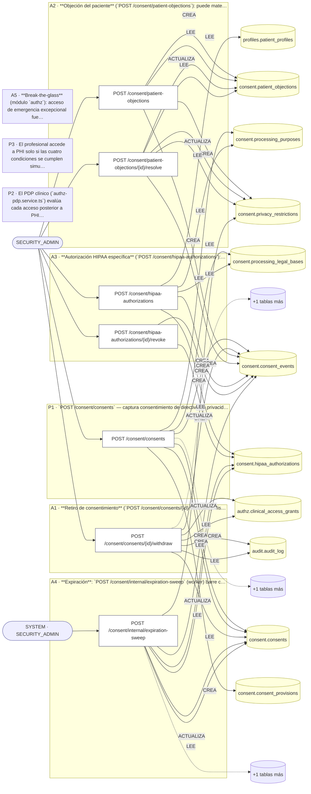

## Árbol de decisión por operación

Cada árbol se deriva del código del handler y de los métodos que invoca (hasta 4 niveles). Una rama que no decide, no escribe y no falla se poda. Los accesos y los efectos consecutivos se agrupan en un solo nodo.

### Operaciones con decisiones propias

#### 1. POST /consent/consents

Capturar consentimiento de directiva de privacidad

| HTTP | Código | Cuándo |
|---|---|---|
| 201 | — | Éxito |
| 400 | `VALIDATION_FAILED` | El cuerpo cumple el DTO (sin propiedades extra) |
| 401 | `UNAUTHENTICATED` | Hay una sesión válida (JWT) |
| 403 | `FORBIDDEN` | El rol está permitido; El tenant se resuelve y pertenece al actor |
| 404 | `NOT_FOUND` | ResourceNotFoundException: Paciente no encontrado; ResourceNotFoundException: Propósito de tratamiento no encontrado; ResourceNotFoundException: Base legal no encontrada |
| 409 | `CONFLICT` | ConflictException: Ya existe un consentimiento activo para este propósito |
| 422 | `PRECONDITION_FAILED` | PreconditionFailedException: La base legal no corresponde al propósito indicado |
| 429 | `RATE_LIMITED` | No se supera el límite de solicitudes |
| 500 | `INTERNAL` | DomainException: {HttpStatus.FORBIDDEN} |

```mermaid
flowchart TD
  n1(("Solicitud")):::inicio
  n2{{"Acceso: sesión (401) · rol (403) · tenant (403) · cuerpo válido (400) · límite de tasa (429)"}}:::acceso
  n1 --> n2
  n3["Llama a ConsentsService.capture"]:::llamada
  n2 --> n3
  n4["Llama a ConsentScopeService.resolveTenant"]:::llamada
  n3 --> n4
  n5{"bodyTenantId !== undefined && bodyTenantId !== tenantId"}:::decision
  n4 --> n5
  n6(["500 INTERNAL {HttpStatus.FORBIDDEN}"]):::error
  n5 -->|"sí"| n6
  n7["Transacción: transactional(…)"]:::transaccion
  n5 -->|"no"| n7
  n8["Llama a ConsentScopeService.assertPatientExists"]:::llamada
  n7 --> n8
  n9["Llama a PatientProfilesRepository.findById"]:::llamada
  n8 --> n9
  n10[("LEE profiles.patient_profiles")]:::efecto
  n9 --> n10
  n11{"!patient"}:::decision
  n10 --> n11
  n12(["404 NOT_FOUND Paciente no encontrado"]):::error
  n11 -->|"sí"| n12
  n13["Llama a ConsentScopeService.assertPurposeScope"]:::llamada
  n11 -->|"no"| n13
  n14["Llama a ProcessingPurposesRepository.findById"]:::llamada
  n13 --> n14
  n15[("LEE consent.processing_purposes")]:::efecto
  n14 --> n15
  n16{"!purpose"}:::decision
  n15 --> n16
  n17(["404 NOT_FOUND Propósito de tratamiento no encontrado"]):::error
  n16 -->|"sí"| n17
  n18["Llama a ProcessingLegalBasesRepository.findById"]:::llamada
  n16 -->|"no"| n18
  n19[("LEE consent.processing_legal_bases")]:::efecto
  n18 --> n19
  n20{"!basis || basis.tenantId !== tenantId"}:::decision
  n19 --> n20
  n21(["404 NOT_FOUND Base legal no encontrada"]):::error
  n20 -->|"sí"| n21
  n22{"basis.processingPurposeId !== processingPurposeId"}:::decision
  n20 -->|"no"| n22
  n23(["422 PRECONDITION_FAILED La base legal no corresponde al propósito indicado"]):::error
  n22 -->|"sí"| n23
  n24["Llama a ConsentsRepository.findActiveByPurpose"]:::llamada
  n22 -->|"no"| n24
  n25[("LEE consent.consents")]:::efecto
  n24 --> n25
  n26{"clash"}:::decision
  n25 --> n26
  n27(["409 CONFLICT Ya existe un consentimiento activo para este propósito"]):::error
  n26 -->|"sí"| n27
  n28["Llama a ConsentsRepository.create"]:::llamada
  n26 -->|"no"| n28
  n29[("CREA consent.consents")]:::efecto
  n28 --> n29
  n30["Repite: por cada const provision de dto.provisions ?? []"]:::bucle
  n29 --> n30
  n31["Llama a ConsentsService.createProvision"]:::llamada
  n30 -->|"cada elemento"| n31
  n32["Llama a ConsentProvisionsRepository.create"]:::llamada
  n31 --> n32
  n33[("CREA consent.consent_provisions")]:::efecto
  n32 --> n33
  n34["Llama a ConsentEventsRepository.record"]:::llamada
  n33 --> n34
  n30 -->|"al terminar"| n34
  n35[("CREA consent.consent_events")]:::efecto
  n34 --> n35
  n36(("201 Responde con éxito")):::ok
  n35 --> n36
  classDef acceso fill:#eef,stroke:#66a
  classDef error fill:#fee,stroke:#c33
  classDef ok fill:#efe,stroke:#3a3
  classDef efecto fill:#ffd,stroke:#aa3
  classDef decision fill:#fff,stroke:#555
  classDef corte fill:#eee,stroke:#999,stroke-dasharray: 4
```

#### 2. PATCH /consent/consents/{id}/provisions

Actualizar provisiones granulares (data class / actor / acción)

| HTTP | Código | Cuándo |
|---|---|---|
| 200 | — | Éxito |
| 400 | `VALIDATION_FAILED` | Los parámetros de ruta son UUID válidos; El cuerpo cumple el DTO (sin propiedades extra) |
| 401 | `UNAUTHENTICATED` | Hay una sesión válida (JWT) |
| 403 | `FORBIDDEN` | El rol está permitido; El tenant se resuelve y pertenece al actor |
| 409 | `CONFLICT` | ConflictException: El consentimiento no está activo |
| 429 | `RATE_LIMITED` | No se supera el límite de solicitudes |

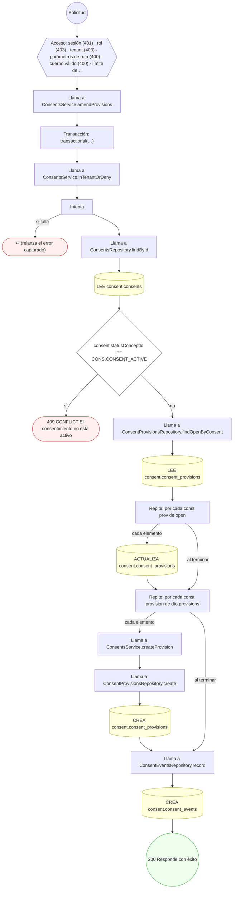

#### 3. POST /consent/consents/{id}/withdraw

Revocar/retirar consentimiento y disparar re-evaluación de accesos

| HTTP | Código | Cuándo |
|---|---|---|
| 200 | — | Éxito |
| 400 | `VALIDATION_FAILED` | Los parámetros de ruta son UUID válidos; El cuerpo cumple el DTO (sin propiedades extra) |
| 401 | `UNAUTHENTICATED` | Hay una sesión válida (JWT) |
| 403 | `FORBIDDEN` | El rol está permitido; El tenant se resuelve y pertenece al actor |
| 409 | `CONFLICT` | ConflictException: El consentimiento no está activo |
| 429 | `RATE_LIMITED` | No se supera el límite de solicitudes |

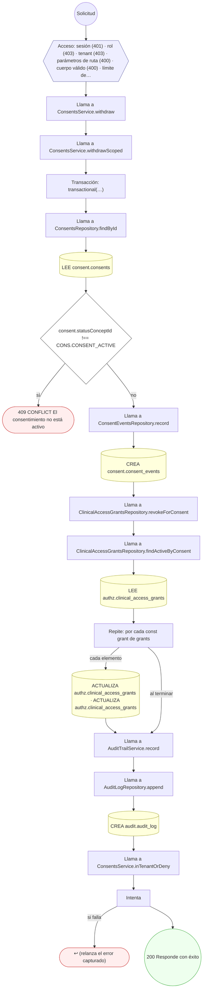

#### 4. GET /consent/encounters/{encounterId}/informed-consent

Consentimientos informados registrados en el encuentro

| HTTP | Código | Cuándo |
|---|---|---|
| 200 | — | Éxito |
| 400 | `VALIDATION_FAILED` | Los parámetros de ruta son UUID válidos |
| 401 | `UNAUTHENTICATED` | Hay una sesión válida (JWT) |
| 403 | `FORBIDDEN` | El rol está permitido; El tenant se resuelve y pertenece al actor; ForbiddenException: {WITHOUT_ACCESS_TO_HISTORY} |
| 404 | `NOT_FOUND` | ResourceNotFoundException: Encuentro no encontrado |
| 429 | `RATE_LIMITED` | No se supera el límite de solicitudes |

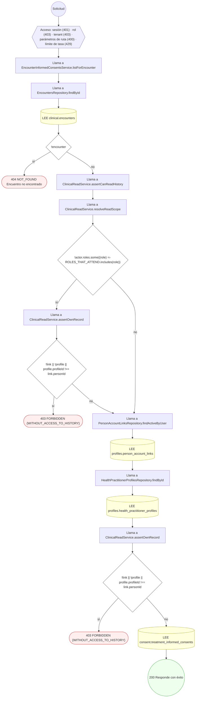

#### 5. POST /consent/encounters/{encounterId}/informed-consent

Registrar el consentimiento informado del encuentro

| HTTP | Código | Cuándo |
|---|---|---|
| 201 | — | Éxito |
| 400 | `VALIDATION_FAILED` | Los parámetros de ruta son UUID válidos; El cuerpo cumple el DTO (sin propiedades extra) |
| 401 | `UNAUTHENTICATED` | Hay una sesión válida (JWT) |
| 403 | `FORBIDDEN` | El rol está permitido; El tenant se resuelve y pertenece al actor; ForbiddenException: {WITHOUT_ACCESS_TO_HISTORY} |
| 404 | `NOT_FOUND` | ResourceNotFoundException: Encuentro no encontrado; ResourceNotFoundException: El objeto consentido no existe |
| 429 | `RATE_LIMITED` | No se supera el límite de solicitudes |

```mermaid
flowchart TD
  n1(("Solicitud")):::inicio
  n2{{"Acceso: sesión (401) · rol (403) · tenant (403) · parámetros de ruta (400) · cuerpo válido (400) · límite de…"}}:::acceso
  n1 --> n2
  n3["Llama a EncounterInformedConsentsService.register"]:::llamada
  n2 --> n3
  n4["Llama a EncountersRepository.findById"]:::llamada
  n3 --> n4
  n5[("LEE clinical.encounters")]:::efecto
  n4 --> n5
  n6{"!encounter"}:::decision
  n5 --> n6
  n7(["404 NOT_FOUND Encuentro no encontrado"]):::error
  n6 -->|"sí"| n7
  n8["Llama a ClinicalReadService.assertCanWriteHistory"]:::llamada
  n6 -->|"no"| n8
  n9{"actor.roles.some((role) =› ROLES_THAT_ATTEND.includes(role))"}:::decision
  n8 --> n9
  n10["Llama a PersonAccountLinksRepository.findActiveByUser"]:::llamada
  n9 -->|"sí"| n10
  n11[("LEE profiles.person_account_links")]:::efecto
  n10 --> n11
  n12["Llama a HealthPractitionerProfilesRepository.findById"]:::llamada
  n11 --> n12
  n13[("LEE profiles.health_practitioner_profiles")]:::efecto
  n12 --> n13
  n14["Llama a ClinicalReadService.attendanceBasis"]:::llamada
  n13 --> n14
  n15["Llama a SchedulingBookingsRepository.hasConsultationInProgress"]:::llamada
  n14 --> n15
  n16[("LEE scheduling.appointment_bookings · LEE scheduling.schedulable_resources")]:::efecto
  n15 --> n16
  n17["Llama a ClinicalScopeRepository.isOwnOpenEncounter"]:::llamada
  n16 --> n17
  n18[("LEE clinical.encounters")]:::efecto
  n17 --> n18
  n19["Llama a ClinicalScopeRepository.participates"]:::llamada
  n18 --> n19
  n20[("LEE clinical.encounter_participants")]:::efecto
  n19 --> n20
  n21["Llama a ClinicalScopeRepository.hasOwnOpenEncounter"]:::llamada
  n20 --> n21
  n22[("LEE clinical.encounters")]:::efecto
  n21 --> n22
  n23["Llama a ClinicalScopeRepository.participates"]:::llamada
  n22 --> n23
  n24[("LEE clinical.encounter_participants")]:::efecto
  n23 --> n24
  n25["Llama a ClinicalGranularScopeService.hasWriteLevelGrant"]:::llamada
  n24 --> n25
  n26["Llama a ClinicalAccessGrantsRepository.findActiveForUserPatient"]:::llamada
  n25 --> n26
  n27[("LEE authz.clinical_access_grants")]:::efecto
  n26 --> n27
  n28(["403 FORBIDDEN {WITHOUT_ACCESS_TO_HISTORY}"]):::error
  n27 --> n28
  n9 -->|"no"| n28
  n29["Llama a TreatmentInformedConsentsService.sign"]:::llamada
  n30["Llama a TreatmentInformedConsentsService.assertContentRules"]:::llamada
  n29 --> n30
  n31{"Boolean(dto.targetType) !== Boolean(dto.targetId)"}:::decision
  n30 --> n31
  n32(["↩ (relanza el error capturado)"]):::error
  n31 -->|"sí"| n32
  n33{"dto.exceptionType && !dto.exceptionJustification?.trim()"}:::decision
  n31 -->|"no"| n33
  n34(["↩ (relanza el error capturado)"]):::error
  n33 -->|"sí"| n34
  n35{"dto.targetType && !dto.exceptionType"}:::decision
  n33 -->|"no"| n35
  n36{"missing.length › 0"}:::decision
  n35 -->|"sí"| n36
  n37(["↩ (relanza el error capturado)"]):::error
  n36 -->|"sí"| n37
  n38{"dto.grantedBy && dto.grantedBy !== 'PATIENT'"}:::decision
  n36 -->|"no"| n38
  n35 -->|"no"| n38
  n39{"missing.length › 0"}:::decision
  n38 -->|"sí"| n39
  n40(["↩ (relanza el error capturado)"]):::error
  n39 -->|"sí"| n40
  n41{"typeof dto.assentObtained !== 'boolean'"}:::decision
  n39 -->|"no"| n41
  n42(["↩ (relanza el error capturado)"]):::error
  n41 -->|"sí"| n42
  n43{"dto.decision === 'ACCEPTED' && dto.targetType && dto.exceptionType !== 'EMERGENCY' && dto.revocationRightInfo…"}:::decision
  n41 -->|"no"| n43
  n38 -->|"no"| n43
  n44(["↩ (relanza el error capturado)"]):::error
  n43 -->|"sí"| n44
  n45["Transacción: transactional(…)"]:::transaccion
  n43 -->|"no"| n45
  n46{"dto.targetType && dto.targetId"}:::decision
  n45 --> n46
  n47["Llama a TreatmentInformedConsentsService.assertTargetOfPatient"]:::llamada
  n46 -->|"sí"| n47
  n48{"!target"}:::decision
  n47 --> n48
  n49(["404 NOT_FOUND El objeto consentido no existe"]):::error
  n48 -->|"sí"| n49
  n50{"target.patientProfileId !== patientProfileId"}:::decision
  n48 -->|"no"| n50
  n51(["↩ (relanza el error capturado)"]):::error
  n50 -->|"sí"| n51
  n52["Llama a TreatmentInformedConsentsRepository.create"]:::llamada
  n50 -->|"no"| n52
  n46 -->|"no"| n52
  n53[("CREA consent.treatment_informed_consents")]:::efecto
  n52 --> n53
  n54{"dto.targetType === 'REFERRAL' && dto.decision !== 'DECLINED' && target"}:::decision
  n53 --> n54
  n55["Llama a TreatmentInformedConsentsService.linkReferral"]:::llamada
  n54 -->|"sí"| n55
  n56{"referral.informedConsentId"}:::decision
  n55 --> n56
  n57["Llama a TreatmentInformedConsentsRepository.findById"]:::llamada
  n56 -->|"sí"| n57
  n58[("LEE consent.treatment_informed_consents")]:::efecto
  n57 --> n58
  n59[("ACTUALIZA clinical_ext.referrals")]:::efecto
  n58 --> n59
  n56 -->|"no"| n59
  n60["Llama a ConsentEventsRepository.record"]:::llamada
  n59 --> n60
  n54 -->|"no"| n60
  n61[("CREA consent.consent_events")]:::efecto
  n60 --> n61
  n62(("201 Responde con éxito")):::ok
  n61 --> n62
  classDef acceso fill:#eef,stroke:#66a
  classDef error fill:#fee,stroke:#c33
  classDef ok fill:#efe,stroke:#3a3
  classDef efecto fill:#ffd,stroke:#aa3
  classDef decision fill:#fff,stroke:#555
  classDef corte fill:#eee,stroke:#999,stroke-dasharray: 4
```

#### 6. POST /consent/hipaa-authorizations

Otorgar autorización HIPAA de divulgación

| HTTP | Código | Cuándo |
|---|---|---|
| 201 | — | Éxito |
| 400 | `VALIDATION_FAILED` | El cuerpo cumple el DTO (sin propiedades extra) |
| 401 | `UNAUTHENTICATED` | Hay una sesión válida (JWT) |
| 403 | `FORBIDDEN` | El rol está permitido; El tenant se resuelve y pertenece al actor |
| 404 | `NOT_FOUND` | ResourceNotFoundException: Paciente no encontrado; ResourceNotFoundException: Propósito de tratamiento no encontrado; ResourceNotFoundException: Base legal no encontrada |
| 422 | `PRECONDITION_FAILED` | PreconditionFailedException: expiresAt es obligatorio cuando expirationType=DATE; PreconditionFailedException: expirationEventText es obligatorio cuando expirationType=EVENT; PreconditionFailedException: La base legal no corresponde al propósito indicado |
| 429 | `RATE_LIMITED` | No se supera el límite de solicitudes |
| 500 | `INTERNAL` | DomainException: {HttpStatus.FORBIDDEN} |

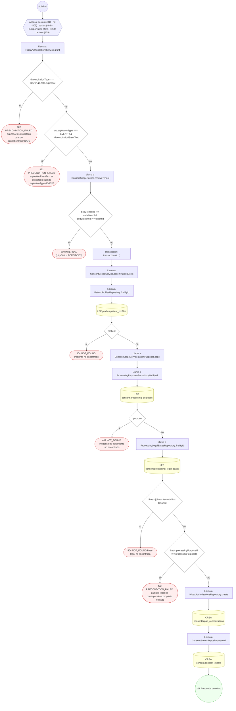

#### 7. POST /consent/hipaa-authorizations/{id}/revoke

Revocar autorización HIPAA

| HTTP | Código | Cuándo |
|---|---|---|
| 200 | — | Éxito |
| 400 | `VALIDATION_FAILED` | Los parámetros de ruta son UUID válidos |
| 401 | `UNAUTHENTICATED` | Hay una sesión válida (JWT) |
| 403 | `FORBIDDEN` | El rol está permitido; El tenant se resuelve y pertenece al actor |
| 409 | `CONFLICT` | ConflictException: La autorización no está activa |
| 429 | `RATE_LIMITED` | No se supera el límite de solicitudes |

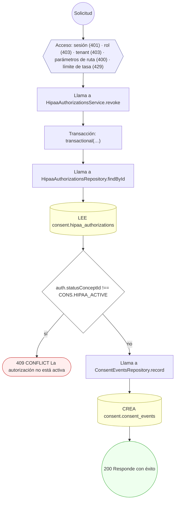

#### 8. POST /consent/internal/expiration-sweep

Expirar consentimientos y autorizaciones vencidas (barrido)

| HTTP | Código | Cuándo |
|---|---|---|
| 200 | — | Éxito |
| 401 | `UNAUTHENTICATED` | Hay una sesión válida (JWT) |
| 403 | `FORBIDDEN` | El rol está permitido; El tenant se resuelve y pertenece al actor |
| 429 | `RATE_LIMITED` | No se supera el límite de solicitudes |

```mermaid
flowchart TD
  n1(("Solicitud")):::inicio
  n2{{"Acceso: sesión (401) · rol (403) · tenant (403) · límite de tasa (429)"}}:::acceso
  n1 --> n2
  n3["Llama a ConsentSweepService.sweep"]:::llamada
  n2 --> n3
  n4["Transacción: transactional(…)"]:::transaccion
  n3 --> n4
  n5["Llama a ConsentsRepository.findExpirable"]:::llamada
  n4 --> n5
  n6[("LEE consent.consents")]:::efecto
  n5 --> n6
  n7["Repite: por cada const consent de consents"]:::bucle
  n6 --> n7
  n8[("ACTUALIZA consent.consents")]:::efecto
  n7 -->|"cada elemento"| n8
  n9["Llama a ConsentEventsRepository.record"]:::llamada
  n8 --> n9
  n10[("CREA consent.consent_events")]:::efecto
  n9 --> n10
  n11["Llama a HipaaAuthorizationsRepository.findExpirable"]:::llamada
  n10 --> n11
  n7 -->|"al terminar"| n11
  n12[("LEE consent.hipaa_authorizations")]:::efecto
  n11 --> n12
  n13["Repite: por cada const auth de auths"]:::bucle
  n12 --> n13
  n14[("ACTUALIZA consent.hipaa_authorizations")]:::efecto
  n13 -->|"cada elemento"| n14
  n15["Llama a ConsentEventsRepository.record"]:::llamada
  n14 --> n15
  n16[("CREA consent.consent_events")]:::efecto
  n15 --> n16
  n17["Llama a PrivacyRestrictionsRepository.findExpirable"]:::llamada
  n16 --> n17
  n13 -->|"al terminar"| n17
  n18[("LEE consent.privacy_restrictions")]:::efecto
  n17 --> n18
  n19["Repite: por cada const restriction de restrictions"]:::bucle
  n18 --> n19
  n20[("ACTUALIZA consent.privacy_restrictions")]:::efecto
  n19 -->|"cada elemento"| n20
  n21["Llama a ConsentEventsRepository.record"]:::llamada
  n20 --> n21
  n22[("CREA consent.consent_events")]:::efecto
  n21 --> n22
  n23(("200 Responde con éxito")):::ok
  n22 --> n23
  n19 -->|"al terminar"| n23
  classDef acceso fill:#eef,stroke:#66a
  classDef error fill:#fee,stroke:#c33
  classDef ok fill:#efe,stroke:#3a3
  classDef efecto fill:#ffd,stroke:#aa3
  classDef decision fill:#fff,stroke:#555
  classDef corte fill:#eee,stroke:#999,stroke-dasharray: 4
```

#### 9. POST /consent/me/consents/{id}/withdraw

Retirar uno de mis consentimientos

| HTTP | Código | Cuándo |
|---|---|---|
| 200 | — | Éxito |
| 400 | `VALIDATION_FAILED` | Los parámetros de ruta son UUID válidos; El cuerpo cumple el DTO (sin propiedades extra) |
| 401 | `UNAUTHENTICATED` | Hay una sesión válida (JWT) |
| 403 | `FORBIDDEN` | El rol está permitido; El tenant se resuelve y pertenece al actor |
| 404 | `NOT_FOUND` | ResourceNotFoundException: Consentimiento no encontrado; ResourceNotFoundException: {CONSENT_NOT_FOUND.message} |
| 429 | `RATE_LIMITED` | No se supera el límite de solicitudes |

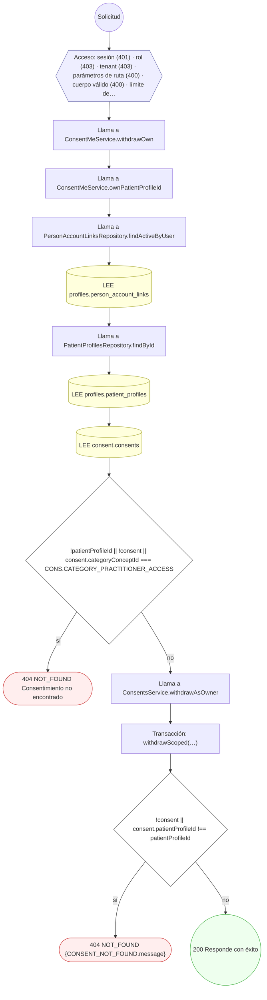

#### 10. POST /consent/patient-objections

Registrar objeción del paciente y materializar restricción

| HTTP | Código | Cuándo |
|---|---|---|
| 201 | — | Éxito |
| 400 | `VALIDATION_FAILED` | El cuerpo cumple el DTO (sin propiedades extra) |
| 401 | `UNAUTHENTICATED` | Hay una sesión válida (JWT) |
| 403 | `FORBIDDEN` | El rol está permitido; El tenant se resuelve y pertenece al actor |
| 409 | `CONFLICT` | ConflictException: Ya existe una objeción abierta para este propósito |
| 429 | `RATE_LIMITED` | No se supera el límite de solicitudes |

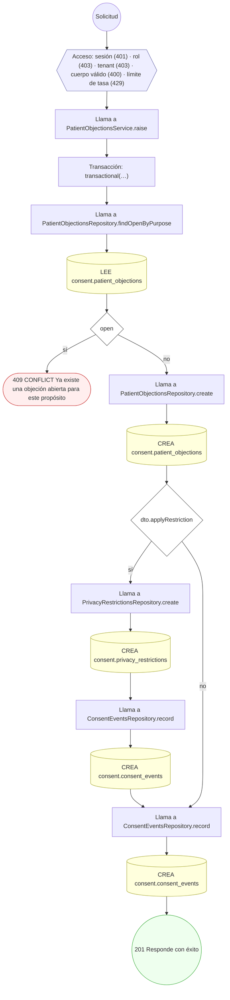

#### 11. POST /consent/patient-objections/{id}/resolve

Resolver objeción del paciente

| HTTP | Código | Cuándo |
|---|---|---|
| 200 | — | Éxito |
| 400 | `VALIDATION_FAILED` | Los parámetros de ruta son UUID válidos; El cuerpo cumple el DTO (sin propiedades extra) |
| 401 | `UNAUTHENTICATED` | Hay una sesión válida (JWT) |
| 403 | `FORBIDDEN` | El rol está permitido; El tenant se resuelve y pertenece al actor |
| 404 | `NOT_FOUND` | ResourceNotFoundException: Objeción no encontrada |
| 409 | `CONFLICT` | ConflictException: La objeción no está abierta |
| 429 | `RATE_LIMITED` | No se supera el límite de solicitudes |

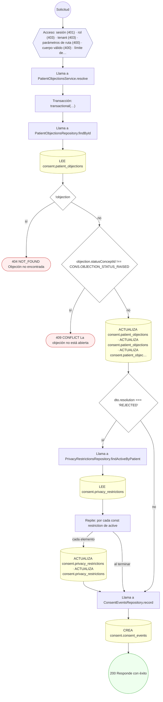

#### 12. POST /consent/practitioner-access-requests

Pedir acceso al expediente de un paciente encontrado en la búsqueda

| HTTP | Código | Cuándo |
|---|---|---|
| 201 | — | Éxito |
| 400 | `VALIDATION_FAILED` | El cuerpo cumple el DTO (sin propiedades extra) |
| 401 | `UNAUTHENTICATED` | Hay una sesión válida (JWT) |
| 403 | `FORBIDDEN` | El rol está permitido; El tenant se resuelve y pertenece al actor |
| 404 | `NOT_FOUND` | ResourceNotFoundException: Canal no encontrado; ResourceNotFoundException: Plantilla no encontrada; ResourceNotFoundException: Solicitud de notificación no encontrada; ResourceNotFoundException: El proveedor configurado para el canal no existe |
| 409 | `CONFLICT` | ConflictException: Ya existe una solicitud pendiente o un vínculo activo con este paciente |
| 422 | `PRECONDITION_FAILED` | PreconditionFailedException: El catálogo de especialidades médicas no está disponible; PreconditionFailedException: La especialidad no pertenece al catálogo de especialidades médicas; PreconditionFailedException: La notificación a una dirección externa también necesita el usuario destinatario / La notificación necesita el usuario destinatario; PreconditionFailedException: El canal no está activo; PreconditionFailedException: La plantilla no está publicada; PreconditionFailedException: La plantilla es de otro canal; PreconditionFailedException: La notificación está suprimida; PreconditionFailedException: La notificación ya no admite intentos; PreconditionFailedException: El canal no tiene configuración de proveedor activa; PreconditionFailedException: Una notificación in-app necesita destinatario interno |
| 429 | `RATE_LIMITED` | No se supera el límite de solicitudes |

```mermaid
flowchart TD
  n1(("Solicitud")):::inicio
  n2{{"Acceso: sesión (401) · rol (403) · tenant (403) · cuerpo válido (400) · límite de tasa (429)"}}:::acceso
  n1 --> n2
  n3["Llama a PractitionerAccessRequestsService.request"]:::llamada
  n2 --> n3
  n4["Transacción: transactional(…)"]:::transaccion
  n3 --> n4
  n5["Llama a MedicalSpecialtyCatalogService.assertAllAreSpecialties"]:::llamada
  n4 --> n5
  n6["Llama a MedicalSpecialtyCatalogService.listMemberIds"]:::llamada
  n5 --> n6
  n7{"members === null"}:::decision
  n6 --> n7
  n8(["422 PRECONDITION_FAILED El catálogo de especialidades médicas no está disponible"]):::error
  n7 -->|"sí"| n8
  n9{"outside.length › 0"}:::decision
  n7 -->|"no"| n9
  n10(["422 PRECONDITION_FAILED La especialidad no pertenece al catálogo de especialidades médicas"]):::error
  n9 -->|"sí"| n10
  n11["Llama a ConsentsRepository.findByPatientCreatorCategory"]:::llamada
  n9 -->|"no"| n11
  n12[("LEE consent.consents")]:::efecto
  n11 --> n12
  n13{"inCourse"}:::decision
  n12 --> n13
  n14(["409 CONFLICT Ya existe una solicitud pendiente o un vínculo activo con este paciente"]):::error
  n13 -->|"sí"| n14
  n15["Llama a ConsentsRepository.create"]:::llamada
  n13 -->|"no"| n15
  n16[("CREA consent.consents")]:::efecto
  n15 --> n16
  n17["Repite: por cada const specialtyId de dto.specialtyConceptIds"]:::bucle
  n16 --> n17
  n18["Llama a ConsentProvisionsRepository.create"]:::llamada
  n17 -->|"cada elemento"| n18
  n19[("CREA consent.consent_provisions")]:::efecto
  n18 --> n19
  n20["Llama a ConsentEventsRepository.record"]:::llamada
  n19 --> n20
  n17 -->|"al terminar"| n20
  n21[("CREA consent.consent_events")]:::efecto
  n20 --> n21
  n22["Llama a AuditTrailService.record"]:::llamada
  n21 --> n22
  n23["Llama a AuditLogRepository.append"]:::llamada
  n22 --> n23
  n24["Llama a AuditLogRepository.findChainTip"]:::llamada
  n23 --> n24
  n25[("LEE audit.audit_log")]:::efecto
  n24 --> n25
  n26[("CREA audit.audit_log")]:::efecto
  n25 --> n26
  n27["Llama a PractitionerAccessRequestsService.resolveUserIdForPatient"]:::llamada
  n26 --> n27
  n28["Llama a PersonAccountLinksRepository.findActiveByPerson"]:::llamada
  n27 --> n28
  n29[("LEE profiles.person_account_links")]:::efecto
  n28 --> n29
  n30{"patientUserId"}:::decision
  n29 --> n30
  n31["Llama a MessagingPractitionerAccessNoticeAdapter.emit"]:::llamada
  n30 -->|"sí"| n31
  n32["Intenta"]:::intento
  n31 --> n32
  n33["Llama a MessagingPractitionerAccessNoticeAdapter.issue"]:::llamada
  n32 --> n33
  n34["Llama a NotificationsService.createRequest"]:::llamada
  n33 --> n34
  n35{"!recipientUserId"}:::decision
  n34 --> n35
  n36(["422 PRECONDITION_FAILED La notificación a una dirección externa también necesita el usuario destinatario / La…"]):::error
  n35 -->|"sí"| n36
  n37["Transacción: transactional(…)"]:::transaccion
  n35 -->|"no"| n37
  n38{"!channel"}:::decision
  n37 --> n38
  n39(["404 NOT_FOUND Canal no encontrado"]):::error
  n38 -->|"sí"| n39
  n40{"channel.stateConceptId !== CONCEPTS.STATE_ACTIVE"}:::decision
  n38 -->|"no"| n40
  n41(["422 PRECONDITION_FAILED El canal no está activo"]):::error
  n40 -->|"sí"| n41
  n42{"dto.templateId"}:::decision
  n40 -->|"no"| n42
  n43{"!template"}:::decision
  n42 -->|"sí"| n43
  n44(["404 NOT_FOUND Plantilla no encontrada"]):::error
  n43 -->|"sí"| n44
  n45{"template.statusConceptId !== CONCEPTS.STATE_ACTIVE"}:::decision
  n43 -->|"no"| n45
  n46(["422 PRECONDITION_FAILED La plantilla no está publicada"]):::error
  n45 -->|"sí"| n46
  n47{"template.channelId !== dto.channelId"}:::decision
  n45 -->|"no"| n47
  n48(["422 PRECONDITION_FAILED La plantilla es de otro canal"]):::error
  n47 -->|"sí"| n48
  n49["Llama a NotificationsService.deliverNotification"]:::llamada
  n47 -->|"no"| n49
  n42 -->|"no"| n49
  n50["Transacción: transactional(…)"]:::transaccion
  n49 --> n50
  n51{"!request"}:::decision
  n50 --> n51
  n52(["404 NOT_FOUND Solicitud de notificación no encontrada"]):::error
  n51 -->|"sí"| n52
  n53{"request.statusConceptId === CONCEPTS.NOTIF_SUPPRESSED"}:::decision
  n51 -->|"no"| n53
  n54(["422 PRECONDITION_FAILED La notificación está suprimida"]):::error
  n53 -->|"sí"| n54
  n55{"request.statusConceptId !== CONCEPTS.NOTIF_PENDING && request.statusConceptId !== CONCEPTS.NOTIF_SENDING"}:::decision
  n53 -->|"no"| n55
  n56(["422 PRECONDITION_FAILED La notificación ya no admite intentos"]):::error
  n55 -->|"sí"| n56
  n57{"!config"}:::decision
  n55 -->|"no"| n57
  n58(["422 PRECONDITION_FAILED El canal no tiene configuración de proveedor activa"]):::error
  n57 -->|"sí"| n58
  n59{"!provider"}:::decision
  n57 -->|"no"| n59
  n60(["404 NOT_FOUND El proveedor configurado para el canal no existe"]):::error
  n59 -->|"sí"| n60
  n61{"sent && channel?.channelTypeConceptId === CONCEPTS.CHANNEL_TYPE_IN_APP"}:::decision
  n59 -->|"no"| n61
  n62{"!request.recipientUserId"}:::decision
  n61 -->|"sí"| n62
  n63(["422 PRECONDITION_FAILED Una notificación in-app necesita destinatario interno"]):::error
  n62 -->|"sí"| n63
  n64{"availableAt › now"}:::decision
  n62 -->|"no"| n64
  n65[("ACTUALIZA messaging.in_app_notifications")]:::efecto
  n64 -->|"sí"| n65
  n66[("ACTUALIZA messaging.notification_requests")]:::efecto
  n65 --> n66
  n64 -->|"no"| n66
  n61 -->|"no"| n66
  n67(("201 Responde con éxito")):::ok
  n66 --> n67
  n30 -->|"no"| n67
  classDef acceso fill:#eef,stroke:#66a
  classDef error fill:#fee,stroke:#c33
  classDef ok fill:#efe,stroke:#3a3
  classDef efecto fill:#ffd,stroke:#aa3
  classDef decision fill:#fff,stroke:#555
  classDef corte fill:#eee,stroke:#999,stroke-dasharray: 4
```

#### 13. POST /consent/practitioner-access-requests/{id}/decision

Aceptar (con las especialidades autorizadas) o rechazar la solicitud

| HTTP | Código | Cuándo |
|---|---|---|
| 200 | — | Éxito |
| 400 | `VALIDATION_FAILED` | Los parámetros de ruta son UUID válidos; El cuerpo cumple el DTO (sin propiedades extra) |
| 401 | `UNAUTHENTICATED` | Hay una sesión válida (JWT) |
| 403 | `FORBIDDEN` | El rol está permitido; El tenant se resuelve y pertenece al actor |
| 404 | `NOT_FOUND` | ResourceNotFoundException: Solicitud no encontrada; ResourceNotFoundException: Canal no encontrado; ResourceNotFoundException: Plantilla no encontrada; ResourceNotFoundException: Solicitud de notificación no encontrada; ResourceNotFoundException: El proveedor configurado para el canal no existe |
| 409 | `CONFLICT` | ConflictException: Esta solicitud ya fue decidida |
| 422 | `PRECONDITION_FAILED` | PreconditionFailedException: La solicitud no tiene profesional asociado; PreconditionFailedException: Sólo se pueden autorizar especialidades que el profesional pidió; PreconditionFailedException: Aceptar exige autorizar al menos una especialidad; si no autoriza ninguna, rechace la solicitud; PreconditionFailedException: El catálogo de especialidades médicas no está disponible; PreconditionFailedException: La especialidad no pertenece al catálogo de especialidades médicas; PreconditionFailedException: La notificación a una dirección externa también necesita el usuario destinatario / La notificación necesita el usuario destinatario; PreconditionFailedException: El canal no está activo; PreconditionFailedException: La plantilla no está publicada; PreconditionFailedException: La plantilla es de otro canal; PreconditionFailedException: La notificación está suprimida; PreconditionFailedException: La notificación ya no admite intentos; PreconditionFailedException: El canal no tiene configuración de proveedor activa; PreconditionFailedException: Una notificación in-app necesita destinatario interno |
| 429 | `RATE_LIMITED` | No se supera el límite de solicitudes |

```mermaid
flowchart TD
  n1(("Solicitud")):::inicio
  n2{{"Acceso: sesión (401) · rol (403) · tenant (403) · parámetros de ruta (400) · cuerpo válido (400) · límite de…"}}:::acceso
  n1 --> n2
  n3["Llama a PractitionerAccessRequestsService.decide"]:::llamada
  n2 --> n3
  n4["Transacción: transactional(…)"]:::transaccion
  n3 --> n4
  n5["Llama a ConsentsRepository.findById"]:::llamada
  n4 --> n5
  n6[("LEE consent.consents")]:::efecto
  n5 --> n6
  n7{"!consent || consent.categoryConceptId !== CONS.CATEGORY_PRACTITIONER_ACCESS"}:::decision
  n6 --> n7
  n8(["404 NOT_FOUND Solicitud no encontrada"]):::error
  n7 -->|"sí"| n8
  n9["Llama a PersonAccountLinksRepository.findActiveByUser"]:::llamada
  n7 -->|"no"| n9
  n10[("LEE profiles.person_account_links")]:::efecto
  n9 --> n10
  n11["Llama a PatientProfilesRepository.findById"]:::llamada
  n10 --> n11
  n12[("LEE profiles.patient_profiles")]:::efecto
  n11 --> n12
  n13{"!profile || profile.profileId !== consent.patientProfileId"}:::decision
  n12 --> n13
  n14(["404 NOT_FOUND Solicitud no encontrada"]):::error
  n13 -->|"sí"| n14
  n15{"consent.statusConceptId !== CONS.ACCESS_REQUEST_PENDING"}:::decision
  n13 -->|"no"| n15
  n16(["409 CONFLICT Esta solicitud ya fue decidida"]):::error
  n15 -->|"sí"| n16
  n17["Llama a ConsentProvisionsRepository.findOpenByConsent"]:::llamada
  n15 -->|"no"| n17
  n18[("LEE consent.consent_provisions")]:::efecto
  n17 --> n18
  n19{"!practitionerUserId"}:::decision
  n18 --> n19
  n20(["422 PRECONDITION_FAILED La solicitud no tiene profesional asociado"]):::error
  n19 -->|"sí"| n20
  n21{"dto.decision === 'DECLINED'"}:::decision
  n19 -->|"no"| n21
  n22[("ACTUALIZA consent.consents · ACTUALIZA consent.consents · ACTUALIZA consent.consents")]:::efecto
  n21 -->|"sí"| n22
  n23["Repite: por cada const provision de requested"]:::bucle
  n22 --> n23
  n24[("ACTUALIZA consent.consent_provisions")]:::efecto
  n23 -->|"cada elemento"| n24
  n25["Llama a ConsentEventsRepository.record"]:::llamada
  n24 --> n25
  n23 -->|"al terminar"| n25
  n26[("CREA consent.consent_events")]:::efecto
  n25 --> n26
  n27["Llama a AuditTrailService.record"]:::llamada
  n26 --> n27
  n28["Llama a AuditLogRepository.append"]:::llamada
  n27 --> n28
  n29["Llama a AuditLogRepository.findChainTip"]:::llamada
  n28 --> n29
  n30[("LEE audit.audit_log")]:::efecto
  n29 --> n30
  n31[("CREA audit.audit_log")]:::efecto
  n30 --> n31
  n32{"invalid.length › 0"}:::decision
  n31 --> n32
  n21 -->|"no"| n32
  n33(["422 PRECONDITION_FAILED Sólo se pueden autorizar especialidades que el profesional pidió"]):::error
  n32 -->|"sí"| n33
  n34{"authorized.length === 0"}:::decision
  n32 -->|"no"| n34
  n35(["422 PRECONDITION_FAILED Aceptar exige autorizar al menos una especialidad; si no autoriza ninguna, rechace la…"]):::error
  n34 -->|"sí"| n35
  n36["Llama a MedicalSpecialtyCatalogService.assertAllAreSpecialties"]:::llamada
  n34 -->|"no"| n36
  n37["Llama a MedicalSpecialtyCatalogService.listMemberIds"]:::llamada
  n36 --> n37
  n38{"members === null"}:::decision
  n37 --> n38
  n39(["422 PRECONDITION_FAILED El catálogo de especialidades médicas no está disponible"]):::error
  n38 -->|"sí"| n39
  n40{"outside.length › 0"}:::decision
  n38 -->|"no"| n40
  n41(["422 PRECONDITION_FAILED La especialidad no pertenece al catálogo de especialidades médicas"]):::error
  n40 -->|"sí"| n41
  n42[("ACTUALIZA consent.consents · ACTUALIZA consent.consents · ACTUALIZA consent.consents · ACTUALIZA consent.cons…")]:::efecto
  n40 -->|"no"| n42
  n43["Repite: por cada const provision de requested"]:::bucle
  n42 --> n43
  n44[("ACTUALIZA consent.consent_provisions")]:::efecto
  n43 -->|"cada elemento"| n44
  n45["Llama a ConsentEventsRepository.record"]:::llamada
  n44 --> n45
  n43 -->|"al terminar"| n45
  n46[("CREA consent.consent_events")]:::efecto
  n45 --> n46
  n47["Llama a ClinicalAccessGrantsRepository.create"]:::llamada
  n46 --> n47
  n48[("CREA authz.clinical_access_grants")]:::efecto
  n47 --> n48
  n49["Llama a AuditTrailService.record"]:::llamada
  n48 --> n49
  n50["Llama a AuditLogRepository.append"]:::llamada
  n49 --> n50
  n51["Llama a AuditLogRepository.findChainTip"]:::llamada
  n50 --> n51
  n52[("LEE audit.audit_log")]:::efecto
  n51 --> n52
  n53[("CREA audit.audit_log")]:::efecto
  n52 --> n53
  n54["Llama a MessagingPractitionerAccessNoticeAdapter.emit"]:::llamada
  n53 --> n54
  n55["Intenta"]:::intento
  n54 --> n55
  n56["Llama a MessagingPractitionerAccessNoticeAdapter.issue"]:::llamada
  n55 --> n56
  n57["Llama a NotificationsService.createRequest"]:::llamada
  n56 --> n57
  n58{"!recipientUserId"}:::decision
  n57 --> n58
  n59(["422 PRECONDITION_FAILED La notificación a una dirección externa también necesita el usuario destinatario / La…"]):::error
  n58 -->|"sí"| n59
  n60["Transacción: transactional(…)"]:::transaccion
  n58 -->|"no"| n60
  n61{"!channel"}:::decision
  n60 --> n61
  n62(["404 NOT_FOUND Canal no encontrado"]):::error
  n61 -->|"sí"| n62
  n63{"channel.stateConceptId !== CONCEPTS.STATE_ACTIVE"}:::decision
  n61 -->|"no"| n63
  n64(["422 PRECONDITION_FAILED El canal no está activo"]):::error
  n63 -->|"sí"| n64
  n65{"dto.templateId"}:::decision
  n63 -->|"no"| n65
  n66{"!template"}:::decision
  n65 -->|"sí"| n66
  n67(["404 NOT_FOUND Plantilla no encontrada"]):::error
  n66 -->|"sí"| n67
  n68{"template.statusConceptId !== CONCEPTS.STATE_ACTIVE"}:::decision
  n66 -->|"no"| n68
  n69(["422 PRECONDITION_FAILED La plantilla no está publicada"]):::error
  n68 -->|"sí"| n69
  n70{"template.channelId !== dto.channelId"}:::decision
  n68 -->|"no"| n70
  n71["… el resto del árbol (1 nodos) está en el JSON del inventario"]:::corte
  n70 -->|"sí"| n71
  classDef acceso fill:#eef,stroke:#66a
  classDef error fill:#fee,stroke:#c33
  classDef ok fill:#efe,stroke:#3a3
  classDef efecto fill:#ffd,stroke:#aa3
  classDef decision fill:#fff,stroke:#555
  classDef corte fill:#eee,stroke:#999,stroke-dasharray: 4
```

#### 14. POST /consent/practitioner-access-requests/{id}/revoke

Revocar un acceso granular que el paciente ya había aceptado

| HTTP | Código | Cuándo |
|---|---|---|
| 200 | — | Éxito |
| 400 | `VALIDATION_FAILED` | Los parámetros de ruta son UUID válidos |
| 401 | `UNAUTHENTICATED` | Hay una sesión válida (JWT) |
| 403 | `FORBIDDEN` | El rol está permitido; El tenant se resuelve y pertenece al actor |
| 404 | `NOT_FOUND` | ResourceNotFoundException: Solicitud no encontrada; ResourceNotFoundException: {CONSENT_NOT_FOUND.message} |
| 429 | `RATE_LIMITED` | No se supera el límite de solicitudes |

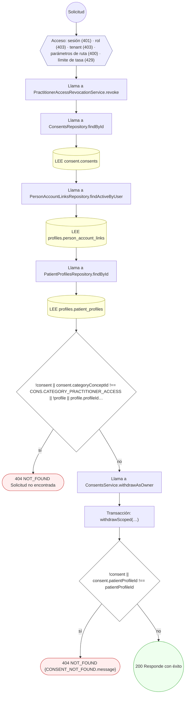

#### 15. GET /consent/practitioner-access-requests/mine

Mis solicitudes de vínculo pendientes de decisión

| HTTP | Código | Cuándo |
|---|---|---|
| 200 | — | Éxito |
| 401 | `UNAUTHENTICATED` | Hay una sesión válida (JWT) |
| 403 | `FORBIDDEN` | El rol está permitido; El tenant se resuelve y pertenece al actor |
| 429 | `RATE_LIMITED` | No se supera el límite de solicitudes |

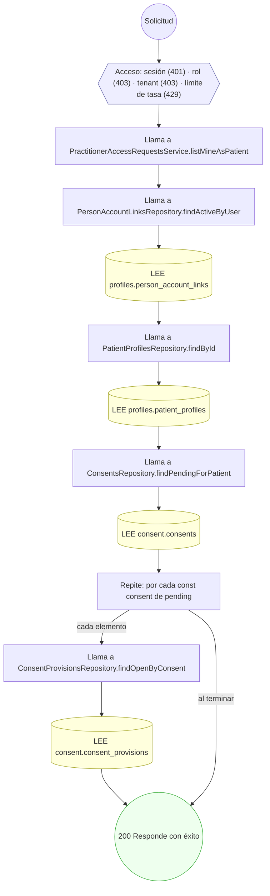

#### 16. POST /consent/privacy-restrictions

Aplicar restricción de privacidad que afecta RLS clínico

| HTTP | Código | Cuándo |
|---|---|---|
| 201 | — | Éxito |
| 400 | `VALIDATION_FAILED` | El cuerpo cumple el DTO (sin propiedades extra) |
| 401 | `UNAUTHENTICATED` | Hay una sesión válida (JWT) |
| 403 | `FORBIDDEN` | El rol está permitido; El tenant se resuelve y pertenece al actor |
| 404 | `NOT_FOUND` | ResourceNotFoundException: Paciente no encontrado |
| 429 | `RATE_LIMITED` | No se supera el límite de solicitudes |
| 500 | `INTERNAL` | DomainException: {HttpStatus.FORBIDDEN} |

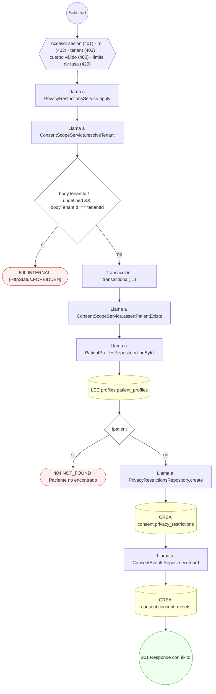

#### 17. POST /consent/processing-legal-bases

Establecer/versionar base legal de procesamiento

| HTTP | Código | Cuándo |
|---|---|---|
| 201 | — | Éxito |
| 400 | `VALIDATION_FAILED` | El cuerpo cumple el DTO (sin propiedades extra) |
| 401 | `UNAUTHENTICATED` | Hay una sesión válida (JWT) |
| 403 | `FORBIDDEN` | El rol está permitido; El tenant se resuelve y pertenece al actor |
| 429 | `RATE_LIMITED` | No se supera el límite de solicitudes |

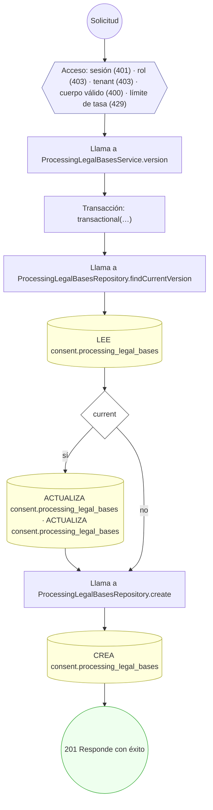

#### 18. GET /consent/treatment-informed-consents

Listar consentimientos informados de tratamiento

| HTTP | Código | Cuándo |
|---|---|---|
| 200 | — | Éxito |
| 400 | `VALIDATION_FAILED` | Están los parámetros de consulta obligatorios |
| 401 | `UNAUTHENTICATED` | Hay una sesión válida (JWT) |
| 403 | `FORBIDDEN` | El rol está permitido; El tenant se resuelve y pertenece al actor; ForbiddenException: {WITHOUT_ACCESS_TO_HISTORY} |
| 429 | `RATE_LIMITED` | No se supera el límite de solicitudes |

```mermaid
flowchart TD
  n1(("Solicitud")):::inicio
  n2{{"Acceso: sesión (401) · rol (403) · tenant (403) · parámetros de consulta (400) · límite de tasa (429)"}}:::acceso
  n1 --> n2
  n3["Llama a TreatmentInformedConsentsService.list"]:::llamada
  n2 --> n3
  n4["Llama a ClinicalReadService.assertCanReadHistory"]:::llamada
  n3 --> n4
  n5["Llama a ClinicalReadService.resolveReadScope"]:::llamada
  n4 --> n5
  n6{"!actor.roles.some((role) =› ROLES_THAT_ATTEND.includes(role))"}:::decision
  n5 --> n6
  n7["Llama a ClinicalReadService.assertOwnRecord"]:::llamada
  n6 -->|"sí"| n7
  n8{"!link || !profile || profile.profileId !== link.personId"}:::decision
  n7 --> n8
  n9(["403 FORBIDDEN {WITHOUT_ACCESS_TO_HISTORY}"]):::error
  n8 -->|"sí"| n9
  n10["Llama a PersonAccountLinksRepository.findActiveByUser"]:::llamada
  n8 -->|"no"| n10
  n6 -->|"no"| n10
  n11[("LEE profiles.person_account_links")]:::efecto
  n10 --> n11
  n12["Llama a HealthPractitionerProfilesRepository.findById"]:::llamada
  n11 --> n12
  n13[("LEE profiles.health_practitioner_profiles")]:::efecto
  n12 --> n13
  n14["Llama a ClinicalReadService.assertOwnRecord"]:::llamada
  n13 --> n14
  n15{"!link || !profile || profile.profileId !== link.personId"}:::decision
  n14 --> n15
  n16(["403 FORBIDDEN {WITHOUT_ACCESS_TO_HISTORY}"]):::error
  n15 -->|"sí"| n16
  n17["Llama a TreatmentInformedConsentsRepository.findByPatient"]:::llamada
  n15 -->|"no"| n17
  n18[("LEE consent.treatment_informed_consents")]:::efecto
  n17 --> n18
  n19["Llama a ConsentEvidenceRepository.findBySubjects"]:::llamada
  n18 --> n19
  n20[("LEE consent.consent_evidence")]:::efecto
  n19 --> n20
  n21(("200 Responde con éxito")):::ok
  n20 --> n21
  classDef acceso fill:#eef,stroke:#66a
  classDef error fill:#fee,stroke:#c33
  classDef ok fill:#efe,stroke:#3a3
  classDef efecto fill:#ffd,stroke:#aa3
  classDef decision fill:#fff,stroke:#555
  classDef corte fill:#eee,stroke:#999,stroke-dasharray: 4
```

#### 19. POST /consent/treatment-informed-consents

Capturar consentimiento informado de tratamiento

| HTTP | Código | Cuándo |
|---|---|---|
| 201 | — | Éxito |
| 400 | `VALIDATION_FAILED` | El cuerpo cumple el DTO (sin propiedades extra) |
| 401 | `UNAUTHENTICATED` | Hay una sesión válida (JWT) |
| 403 | `FORBIDDEN` | El rol está permitido; El tenant se resuelve y pertenece al actor; ForbiddenException: {WITHOUT_ACCESS_TO_HISTORY} |
| 404 | `NOT_FOUND` | ResourceNotFoundException: El objeto consentido no existe; ResourceNotFoundException: Encuentro no encontrado |
| 429 | `RATE_LIMITED` | No se supera el límite de solicitudes |

```mermaid
flowchart TD
  n1(("Solicitud")):::inicio
  n2{{"Acceso: sesión (401) · rol (403) · tenant (403) · cuerpo válido (400) · límite de tasa (429)"}}:::acceso
  n1 --> n2
  n3["Llama a TreatmentInformedConsentsService.create"]:::llamada
  n2 --> n3
  n4{"actor.roles.some((role) =› ADMIN_ROLES.includes(role))"}:::decision
  n3 --> n4
  n5["Llama a TreatmentInformedConsentsService.sign"]:::llamada
  n4 -->|"sí"| n5
  n6["Llama a TreatmentInformedConsentsService.assertContentRules"]:::llamada
  n5 --> n6
  n7{"Boolean(dto.targetType) !== Boolean(dto.targetId)"}:::decision
  n6 --> n7
  n8(["↩ (relanza el error capturado)"]):::error
  n7 -->|"sí"| n8
  n9{"dto.exceptionType && !dto.exceptionJustification?.trim()"}:::decision
  n7 -->|"no"| n9
  n10(["↩ (relanza el error capturado)"]):::error
  n9 -->|"sí"| n10
  n11{"dto.targetType && !dto.exceptionType"}:::decision
  n9 -->|"no"| n11
  n12{"missing.length › 0"}:::decision
  n11 -->|"sí"| n12
  n13(["↩ (relanza el error capturado)"]):::error
  n12 -->|"sí"| n13
  n14{"dto.grantedBy && dto.grantedBy !== 'PATIENT'"}:::decision
  n12 -->|"no"| n14
  n11 -->|"no"| n14
  n15{"missing.length › 0"}:::decision
  n14 -->|"sí"| n15
  n16(["↩ (relanza el error capturado)"]):::error
  n15 -->|"sí"| n16
  n17{"typeof dto.assentObtained !== 'boolean'"}:::decision
  n15 -->|"no"| n17
  n18(["↩ (relanza el error capturado)"]):::error
  n17 -->|"sí"| n18
  n19{"dto.decision === 'ACCEPTED' && dto.targetType && dto.exceptionType !== 'EMERGENCY' && dto.revocationRightInfo…"}:::decision
  n17 -->|"no"| n19
  n14 -->|"no"| n19
  n20(["↩ (relanza el error capturado)"]):::error
  n19 -->|"sí"| n20
  n21["Transacción: transactional(…)"]:::transaccion
  n19 -->|"no"| n21
  n22{"dto.targetType && dto.targetId"}:::decision
  n21 --> n22
  n23["Llama a TreatmentInformedConsentsService.assertTargetOfPatient"]:::llamada
  n22 -->|"sí"| n23
  n24{"!target"}:::decision
  n23 --> n24
  n25(["404 NOT_FOUND El objeto consentido no existe"]):::error
  n24 -->|"sí"| n25
  n26{"target.patientProfileId !== patientProfileId"}:::decision
  n24 -->|"no"| n26
  n27(["↩ (relanza el error capturado)"]):::error
  n26 -->|"sí"| n27
  n28["Llama a TreatmentInformedConsentsRepository.create"]:::llamada
  n26 -->|"no"| n28
  n22 -->|"no"| n28
  n29[("CREA consent.treatment_informed_consents")]:::efecto
  n28 --> n29
  n30{"dto.targetType === 'REFERRAL' && dto.decision !== 'DECLINED' && target"}:::decision
  n29 --> n30
  n31["Llama a TreatmentInformedConsentsService.linkReferral"]:::llamada
  n30 -->|"sí"| n31
  n32{"referral.informedConsentId"}:::decision
  n31 --> n32
  n33["Llama a TreatmentInformedConsentsRepository.findById"]:::llamada
  n32 -->|"sí"| n33
  n34[("LEE consent.treatment_informed_consents")]:::efecto
  n33 --> n34
  n35[("ACTUALIZA clinical_ext.referrals")]:::efecto
  n34 --> n35
  n32 -->|"no"| n35
  n36["Llama a ConsentEventsRepository.record"]:::llamada
  n35 --> n36
  n30 -->|"no"| n36
  n37[("CREA consent.consent_events")]:::efecto
  n36 --> n37
  n38["Llama a EncountersRepository.findById"]:::llamada
  n37 --> n38
  n4 -->|"no"| n38
  n39[("LEE clinical.encounters")]:::efecto
  n38 --> n39
  n40{"!encounter"}:::decision
  n39 --> n40
  n41(["404 NOT_FOUND Encuentro no encontrado"]):::error
  n40 -->|"sí"| n41
  n42{"encounter.patientProfileId !== dto.patientProfileId"}:::decision
  n40 -->|"no"| n42
  n43(["↩ (relanza el error capturado)"]):::error
  n42 -->|"sí"| n43
  n44["Llama a ClinicalReadService.assertCanWriteHistory"]:::llamada
  n42 -->|"no"| n44
  n45{"actor.roles.some((role) =› ROLES_THAT_ATTEND.includes(role))"}:::decision
  n44 --> n45
  n46["Llama a PersonAccountLinksRepository.findActiveByUser"]:::llamada
  n45 -->|"sí"| n46
  n47[("LEE profiles.person_account_links")]:::efecto
  n46 --> n47
  n48["Llama a HealthPractitionerProfilesRepository.findById"]:::llamada
  n47 --> n48
  n49[("LEE profiles.health_practitioner_profiles")]:::efecto
  n48 --> n49
  n50["Llama a ClinicalReadService.attendanceBasis"]:::llamada
  n49 --> n50
  n51["Llama a SchedulingBookingsRepository.hasConsultationInProgress"]:::llamada
  n50 --> n51
  n52[("LEE scheduling.appointment_bookings · LEE scheduling.schedulable_resources")]:::efecto
  n51 --> n52
  n53["Llama a ClinicalScopeRepository.isOwnOpenEncounter"]:::llamada
  n52 --> n53
  n54[("LEE clinical.encounters")]:::efecto
  n53 --> n54
  n55["Llama a ClinicalScopeRepository.participates"]:::llamada
  n54 --> n55
  n56[("LEE clinical.encounter_participants")]:::efecto
  n55 --> n56
  n57["Llama a ClinicalScopeRepository.hasOwnOpenEncounter"]:::llamada
  n56 --> n57
  n58[("LEE clinical.encounters")]:::efecto
  n57 --> n58
  n59["Llama a ClinicalScopeRepository.participates"]:::llamada
  n58 --> n59
  n60[("LEE clinical.encounter_participants")]:::efecto
  n59 --> n60
  n61["Llama a ClinicalGranularScopeService.hasWriteLevelGrant"]:::llamada
  n60 --> n61
  n62["Llama a ClinicalAccessGrantsRepository.findActiveForUserPatient"]:::llamada
  n61 --> n62
  n63[("LEE authz.clinical_access_grants")]:::efecto
  n62 --> n63
  n64(["403 FORBIDDEN {WITHOUT_ACCESS_TO_HISTORY}"]):::error
  n63 --> n64
  n45 -->|"no"| n64
  n65["Llama a TreatmentInformedConsentsService.sign"]:::llamada
  n66["Llama a TreatmentInformedConsentsService.assertContentRules"]:::llamada
  n65 --> n66
  n67{"Boolean(dto.targetType) !== Boolean(dto.targetId)"}:::decision
  n66 --> n67
  n68(["↩ (relanza el error capturado)"]):::error
  n67 -->|"sí"| n68
  n69{"dto.exceptionType && !dto.exceptionJustification?.trim()"}:::decision
  n67 -->|"no"| n69
  n70(["↩ (relanza el error capturado)"]):::error
  n69 -->|"sí"| n70
  n71["… el resto del árbol (10 nodos) está en el JSON del inventario"]:::corte
  n69 -->|"no"| n71
  classDef acceso fill:#eef,stroke:#66a
  classDef error fill:#fee,stroke:#c33
  classDef ok fill:#efe,stroke:#3a3
  classDef efecto fill:#ffd,stroke:#aa3
  classDef decision fill:#fff,stroke:#555
  classDef corte fill:#eee,stroke:#999,stroke-dasharray: 4
```

#### 20. GET /consent/treatment-informed-consents/{id}

Leer un consentimiento informado de tratamiento

| HTTP | Código | Cuándo |
|---|---|---|
| 200 | — | Éxito |
| 400 | `VALIDATION_FAILED` | Los parámetros de ruta son UUID válidos |
| 401 | `UNAUTHENTICATED` | Hay una sesión válida (JWT) |
| 403 | `FORBIDDEN` | El rol está permitido; El tenant se resuelve y pertenece al actor; ForbiddenException: {WITHOUT_ACCESS_TO_HISTORY} |
| 404 | `NOT_FOUND` | ResourceNotFoundException: Consentimiento informado no encontrado |
| 429 | `RATE_LIMITED` | No se supera el límite de solicitudes |

```mermaid
flowchart TD
  n1(("Solicitud")):::inicio
  n2{{"Acceso: sesión (401) · rol (403) · tenant (403) · parámetros de ruta (400) · límite de tasa (429)"}}:::acceso
  n1 --> n2
  n3["Llama a TreatmentInformedConsentsService.get"]:::llamada
  n2 --> n3
  n4["Llama a TreatmentInformedConsentsService.findOrFail"]:::llamada
  n3 --> n4
  n5["Llama a TreatmentInformedConsentsRepository.findById"]:::llamada
  n4 --> n5
  n6[("LEE consent.treatment_informed_consents")]:::efecto
  n5 --> n6
  n7{"!row"}:::decision
  n6 --> n7
  n8(["404 NOT_FOUND Consentimiento informado no encontrado"]):::error
  n7 -->|"sí"| n8
  n9["Llama a ClinicalReadService.assertCanReadHistory"]:::llamada
  n7 -->|"no"| n9
  n10["Llama a ClinicalReadService.resolveReadScope"]:::llamada
  n9 --> n10
  n11{"!actor.roles.some((role) =› ROLES_THAT_ATTEND.includes(role))"}:::decision
  n10 --> n11
  n12["Llama a ClinicalReadService.assertOwnRecord"]:::llamada
  n11 -->|"sí"| n12
  n13{"!link || !profile || profile.profileId !== link.personId"}:::decision
  n12 --> n13
  n14(["403 FORBIDDEN {WITHOUT_ACCESS_TO_HISTORY}"]):::error
  n13 -->|"sí"| n14
  n15["Llama a PersonAccountLinksRepository.findActiveByUser"]:::llamada
  n13 -->|"no"| n15
  n11 -->|"no"| n15
  n16[("LEE profiles.person_account_links")]:::efecto
  n15 --> n16
  n17["Llama a HealthPractitionerProfilesRepository.findById"]:::llamada
  n16 --> n17
  n18[("LEE profiles.health_practitioner_profiles")]:::efecto
  n17 --> n18
  n19["Llama a ClinicalReadService.assertOwnRecord"]:::llamada
  n18 --> n19
  n20{"!link || !profile || profile.profileId !== link.personId"}:::decision
  n19 --> n20
  n21(["403 FORBIDDEN {WITHOUT_ACCESS_TO_HISTORY}"]):::error
  n20 -->|"sí"| n21
  n22["Llama a ConsentEvidenceRepository.findBySubjects"]:::llamada
  n20 -->|"no"| n22
  n23[("LEE consent.consent_evidence")]:::efecto
  n22 --> n23
  n24(("200 Responde con éxito")):::ok
  n23 --> n24
  classDef acceso fill:#eef,stroke:#66a
  classDef error fill:#fee,stroke:#c33
  classDef ok fill:#efe,stroke:#3a3
  classDef efecto fill:#ffd,stroke:#aa3
  classDef decision fill:#fff,stroke:#555
  classDef corte fill:#eee,stroke:#999,stroke-dasharray: 4
```

#### 21. POST /consent/treatment-informed-consents/{id}/evidence

Adjuntar evidencia de firma al consentimiento de tratamiento

| HTTP | Código | Cuándo |
|---|---|---|
| 201 | — | Éxito |
| 400 | `VALIDATION_FAILED` | Los parámetros de ruta son UUID válidos; El cuerpo cumple el DTO (sin propiedades extra) |
| 401 | `UNAUTHENTICATED` | Hay una sesión válida (JWT) |
| 403 | `FORBIDDEN` | El rol está permitido; El tenant se resuelve y pertenece al actor; ForbiddenException: {WITHOUT_ACCESS_TO_HISTORY} |
| 404 | `NOT_FOUND` | ResourceNotFoundException: Consentimiento informado no encontrado |
| 409 | `CONFLICT` | ConflictException: El consentimiento está revocado |
| 429 | `RATE_LIMITED` | No se supera el límite de solicitudes |

```mermaid
flowchart TD
  n1(("Solicitud")):::inicio
  n2{{"Acceso: sesión (401) · rol (403) · tenant (403) · parámetros de ruta (400) · cuerpo válido (400) · límite de…"}}:::acceso
  n1 --> n2
  n3["Llama a TreatmentInformedConsentsService.recordEvidence"]:::llamada
  n2 --> n3
  n4["Llama a TreatmentInformedConsentsService.findOrFail"]:::llamada
  n3 --> n4
  n5["Llama a TreatmentInformedConsentsRepository.findById"]:::llamada
  n4 --> n5
  n6[("LEE consent.treatment_informed_consents")]:::efecto
  n5 --> n6
  n7{"!row"}:::decision
  n6 --> n7
  n8(["404 NOT_FOUND Consentimiento informado no encontrado"]):::error
  n7 -->|"sí"| n8
  n9["Llama a ClinicalReadService.assertCanWriteHistory"]:::llamada
  n7 -->|"no"| n9
  n10{"actor.roles.some((role) =› ROLES_THAT_ATTEND.includes(role))"}:::decision
  n9 --> n10
  n11["Llama a PersonAccountLinksRepository.findActiveByUser"]:::llamada
  n10 -->|"sí"| n11
  n12[("LEE profiles.person_account_links")]:::efecto
  n11 --> n12
  n13["Llama a HealthPractitionerProfilesRepository.findById"]:::llamada
  n12 --> n13
  n14[("LEE profiles.health_practitioner_profiles")]:::efecto
  n13 --> n14
  n15["Llama a ClinicalReadService.attendanceBasis"]:::llamada
  n14 --> n15
  n16["Llama a SchedulingBookingsRepository.hasConsultationInProgress"]:::llamada
  n15 --> n16
  n17[("LEE scheduling.appointment_bookings · LEE scheduling.schedulable_resources")]:::efecto
  n16 --> n17
  n18["Llama a ClinicalScopeRepository.isOwnOpenEncounter"]:::llamada
  n17 --> n18
  n19[("LEE clinical.encounters")]:::efecto
  n18 --> n19
  n20["Llama a ClinicalScopeRepository.participates"]:::llamada
  n19 --> n20
  n21[("LEE clinical.encounter_participants")]:::efecto
  n20 --> n21
  n22["Llama a ClinicalScopeRepository.hasOwnOpenEncounter"]:::llamada
  n21 --> n22
  n23[("LEE clinical.encounters")]:::efecto
  n22 --> n23
  n24["Llama a ClinicalScopeRepository.participates"]:::llamada
  n23 --> n24
  n25[("LEE clinical.encounter_participants")]:::efecto
  n24 --> n25
  n26["Llama a ClinicalGranularScopeService.hasWriteLevelGrant"]:::llamada
  n25 --> n26
  n27["Llama a ClinicalAccessGrantsRepository.findActiveForUserPatient"]:::llamada
  n26 --> n27
  n28[("LEE authz.clinical_access_grants")]:::efecto
  n27 --> n28
  n29(["403 FORBIDDEN {WITHOUT_ACCESS_TO_HISTORY}"]):::error
  n28 --> n29
  n10 -->|"no"| n29
  n30{"row.withdrawnAt"}:::decision
  n31(["409 CONFLICT El consentimiento está revocado"]):::error
  n30 -->|"sí"| n31
  n32["Llama a ConsentEvidenceService.record"]:::llamada
  n30 -->|"no"| n32
  n33["Transacción: transactional(…)"]:::transaccion
  n32 --> n33
  n34["Llama a ConsentEvidenceRepository.create"]:::llamada
  n33 --> n34
  n35[("CREA consent.consent_evidence")]:::efecto
  n34 --> n35
  n36(("201 Responde con éxito")):::ok
  n35 --> n36
  classDef acceso fill:#eef,stroke:#66a
  classDef error fill:#fee,stroke:#c33
  classDef ok fill:#efe,stroke:#3a3
  classDef efecto fill:#ffd,stroke:#aa3
  classDef decision fill:#fff,stroke:#555
  classDef corte fill:#eee,stroke:#999,stroke-dasharray: 4
```

#### 22. PATCH /consent/treatment-informed-consents/{id}/post-emergency-information

Registrar la información posterior a una emergencia

| HTTP | Código | Cuándo |
|---|---|---|
| 200 | — | Éxito |
| 400 | `VALIDATION_FAILED` | Los parámetros de ruta son UUID válidos; El cuerpo cumple el DTO (sin propiedades extra) |
| 401 | `UNAUTHENTICATED` | Hay una sesión válida (JWT) |
| 403 | `FORBIDDEN` | El rol está permitido; El tenant se resuelve y pertenece al actor; ForbiddenException: {WITHOUT_ACCESS_TO_HISTORY} |
| 404 | `NOT_FOUND` | ResourceNotFoundException: Consentimiento informado no encontrado |
| 409 | `CONFLICT` | ConflictException: La información posterior a la emergencia ya estaba registrada |
| 422 | `PRECONDITION_FAILED` | PreconditionFailedException: La información posterior sólo aplica a la excepción de emergencia |
| 429 | `RATE_LIMITED` | No se supera el límite de solicitudes |

```mermaid
flowchart TD
  n1(("Solicitud")):::inicio
  n2{{"Acceso: sesión (401) · rol (403) · tenant (403) · parámetros de ruta (400) · cuerpo válido (400) · límite de…"}}:::acceso
  n1 --> n2
  n3["Llama a TreatmentInformedConsentsService.recordPostEmergencyInformation"]:::llamada
  n2 --> n3
  n4["Transacción: transactional(…)"]:::transaccion
  n3 --> n4
  n5["Llama a TreatmentInformedConsentsService.findOrFail"]:::llamada
  n4 --> n5
  n6["Llama a TreatmentInformedConsentsRepository.findById"]:::llamada
  n5 --> n6
  n7[("LEE consent.treatment_informed_consents")]:::efecto
  n6 --> n7
  n8{"!row"}:::decision
  n7 --> n8
  n9(["404 NOT_FOUND Consentimiento informado no encontrado"]):::error
  n8 -->|"sí"| n9
  n10["Llama a ClinicalReadService.assertCanWriteHistory"]:::llamada
  n8 -->|"no"| n10
  n11{"actor.roles.some((role) =› ROLES_THAT_ATTEND.includes(role))"}:::decision
  n10 --> n11
  n12["Llama a PersonAccountLinksRepository.findActiveByUser"]:::llamada
  n11 -->|"sí"| n12
  n13[("LEE profiles.person_account_links")]:::efecto
  n12 --> n13
  n14["Llama a HealthPractitionerProfilesRepository.findById"]:::llamada
  n13 --> n14
  n15[("LEE profiles.health_practitioner_profiles")]:::efecto
  n14 --> n15
  n16["Llama a ClinicalReadService.attendanceBasis"]:::llamada
  n15 --> n16
  n17["Llama a SchedulingBookingsRepository.hasConsultationInProgress"]:::llamada
  n16 --> n17
  n18[("LEE scheduling.appointment_bookings · LEE scheduling.schedulable_resources")]:::efecto
  n17 --> n18
  n19["Llama a ClinicalScopeRepository.isOwnOpenEncounter"]:::llamada
  n18 --> n19
  n20[("LEE clinical.encounters")]:::efecto
  n19 --> n20
  n21["Llama a ClinicalScopeRepository.participates"]:::llamada
  n20 --> n21
  n22[("LEE clinical.encounter_participants")]:::efecto
  n21 --> n22
  n23["Llama a ClinicalScopeRepository.hasOwnOpenEncounter"]:::llamada
  n22 --> n23
  n24[("LEE clinical.encounters")]:::efecto
  n23 --> n24
  n25["Llama a ClinicalScopeRepository.participates"]:::llamada
  n24 --> n25
  n26[("LEE clinical.encounter_participants")]:::efecto
  n25 --> n26
  n27["Llama a ClinicalGranularScopeService.hasWriteLevelGrant"]:::llamada
  n26 --> n27
  n28["Llama a ClinicalAccessGrantsRepository.findActiveForUserPatient"]:::llamada
  n27 --> n28
  n29[("LEE authz.clinical_access_grants")]:::efecto
  n28 --> n29
  n30(["403 FORBIDDEN {WITHOUT_ACCESS_TO_HISTORY}"]):::error
  n29 --> n30
  n11 -->|"no"| n30
  n31{"row.exceptionType !== 'EMERGENCY'"}:::decision
  n32(["422 PRECONDITION_FAILED La información posterior sólo aplica a la excepción de emergencia"]):::error
  n31 -->|"sí"| n32
  n33{"row.postEmergencyInformedAt"}:::decision
  n31 -->|"no"| n33
  n34(["409 CONFLICT La información posterior a la emergencia ya estaba registrada"]):::error
  n33 -->|"sí"| n34
  n35{"Number.isNaN(informedAt.getTime()) || informedAt.getTime() › now.getTime() || (floor && informedAt.getTime()…"}:::decision
  n33 -->|"no"| n35
  n36(["↩ (relanza el error capturado)"]):::error
  n35 -->|"sí"| n36
  n37[("ACTUALIZA consent.treatment_informed_consents")]:::efecto
  n35 -->|"no"| n37
  n38["Llama a ConsentEvidenceRepository.findBySubjects"]:::llamada
  n37 --> n38
  n39[("LEE consent.consent_evidence")]:::efecto
  n38 --> n39
  n40(("200 Responde con éxito")):::ok
  n39 --> n40
  classDef acceso fill:#eef,stroke:#66a
  classDef error fill:#fee,stroke:#c33
  classDef ok fill:#efe,stroke:#3a3
  classDef efecto fill:#ffd,stroke:#aa3
  classDef decision fill:#fff,stroke:#555
  classDef corte fill:#eee,stroke:#999,stroke-dasharray: 4
```

#### 23. PATCH /consent/treatment-informed-consents/{id}/withdraw

Revocar un consentimiento informado de tratamiento

| HTTP | Código | Cuándo |
|---|---|---|
| 200 | — | Éxito |
| 400 | `VALIDATION_FAILED` | Los parámetros de ruta son UUID válidos; El cuerpo cumple el DTO (sin propiedades extra) |
| 401 | `UNAUTHENTICATED` | Hay una sesión válida (JWT) |
| 403 | `FORBIDDEN` | El rol está permitido; El tenant se resuelve y pertenece al actor; ForbiddenException: {WITHOUT_ACCESS_TO_HISTORY} |
| 404 | `NOT_FOUND` | ResourceNotFoundException: Consentimiento informado no encontrado |
| 409 | `CONFLICT` | ConflictException: El consentimiento ya estaba revocado |
| 429 | `RATE_LIMITED` | No se supera el límite de solicitudes |

```mermaid
flowchart TD
  n1(("Solicitud")):::inicio
  n2{{"Acceso: sesión (401) · rol (403) · tenant (403) · parámetros de ruta (400) · cuerpo válido (400) · límite de…"}}:::acceso
  n1 --> n2
  n3["Llama a TreatmentInformedConsentsService.withdraw"]:::llamada
  n2 --> n3
  n4["Transacción: transactional(…)"]:::transaccion
  n3 --> n4
  n5["Llama a TreatmentInformedConsentsService.findOrFail"]:::llamada
  n4 --> n5
  n6["Llama a TreatmentInformedConsentsRepository.findById"]:::llamada
  n5 --> n6
  n7[("LEE consent.treatment_informed_consents")]:::efecto
  n6 --> n7
  n8{"!row"}:::decision
  n7 --> n8
  n9(["404 NOT_FOUND Consentimiento informado no encontrado"]):::error
  n8 -->|"sí"| n9
  n10["Llama a ClinicalReadService.assertCanWriteHistory"]:::llamada
  n8 -->|"no"| n10
  n11{"actor.roles.some((role) =› ROLES_THAT_ATTEND.includes(role))"}:::decision
  n10 --> n11
  n12["Llama a PersonAccountLinksRepository.findActiveByUser"]:::llamada
  n11 -->|"sí"| n12
  n13[("LEE profiles.person_account_links")]:::efecto
  n12 --> n13
  n14["Llama a HealthPractitionerProfilesRepository.findById"]:::llamada
  n13 --> n14
  n15[("LEE profiles.health_practitioner_profiles")]:::efecto
  n14 --> n15
  n16["Llama a ClinicalReadService.attendanceBasis"]:::llamada
  n15 --> n16
  n17["Llama a SchedulingBookingsRepository.hasConsultationInProgress"]:::llamada
  n16 --> n17
  n18[("LEE scheduling.appointment_bookings · LEE scheduling.schedulable_resources")]:::efecto
  n17 --> n18
  n19["Llama a ClinicalScopeRepository.isOwnOpenEncounter"]:::llamada
  n18 --> n19
  n20[("LEE clinical.encounters")]:::efecto
  n19 --> n20
  n21["Llama a ClinicalScopeRepository.participates"]:::llamada
  n20 --> n21
  n22[("LEE clinical.encounter_participants")]:::efecto
  n21 --> n22
  n23["Llama a ClinicalScopeRepository.hasOwnOpenEncounter"]:::llamada
  n22 --> n23
  n24[("LEE clinical.encounters")]:::efecto
  n23 --> n24
  n25["Llama a ClinicalScopeRepository.participates"]:::llamada
  n24 --> n25
  n26[("LEE clinical.encounter_participants")]:::efecto
  n25 --> n26
  n27["Llama a ClinicalGranularScopeService.hasWriteLevelGrant"]:::llamada
  n26 --> n27
  n28["Llama a ClinicalAccessGrantsRepository.findActiveForUserPatient"]:::llamada
  n27 --> n28
  n29[("LEE authz.clinical_access_grants")]:::efecto
  n28 --> n29
  n30(["403 FORBIDDEN {WITHOUT_ACCESS_TO_HISTORY}"]):::error
  n29 --> n30
  n11 -->|"no"| n30
  n31{"row.withdrawnAt"}:::decision
  n32(["409 CONFLICT El consentimiento ya estaba revocado"]):::error
  n31 -->|"sí"| n32
  n33[("ACTUALIZA consent.treatment_informed_consents · ACTUALIZA consent.treatment_informed_consents · ACTUALIZA con…")]:::efecto
  n31 -->|"no"| n33
  n34["Repite: por cada const referral de linked"]:::bucle
  n33 --> n34
  n35[("ACTUALIZA clinical_ext.referrals")]:::efecto
  n34 -->|"cada elemento"| n35
  n36["Llama a ConsentEventsRepository.record"]:::llamada
  n35 --> n36
  n34 -->|"al terminar"| n36
  n37[("CREA consent.consent_events")]:::efecto
  n36 --> n37
  n38["Llama a ConsentEvidenceRepository.findBySubjects"]:::llamada
  n37 --> n38
  n39[("LEE consent.consent_evidence")]:::efecto
  n38 --> n39
  n40(("200 Responde con éxito")):::ok
  n39 --> n40
  classDef acceso fill:#eef,stroke:#66a
  classDef error fill:#fee,stroke:#c33
  classDef ok fill:#efe,stroke:#3a3
  classDef efecto fill:#ffd,stroke:#aa3
  classDef decision fill:#fff,stroke:#555
  classDef corte fill:#eee,stroke:#999,stroke-dasharray: 4
```

### Operaciones sin decisiones propias

Sólo comprueban el acceso y leen o escriben: no tienen ramas que dibujar. Su detalle está en la ficha de endpoints.

| Operación | Respuestas posibles | Tablas |
|---|---|---|
| POST /consent/consent-evidence | 201, 400, 401, 403, 429 | 1 |
| GET /consent/me/consents | 200, 401, 403, 429 | 4 |
| GET /consent/me/hipaa-authorizations | 200, 401, 403, 429 | 4 |
| GET /consent/me/objections | 200, 401, 403, 429 | 4 |
| GET /consent/me/treatment-informed-consents | 200, 401, 403, 429 | 3 |
