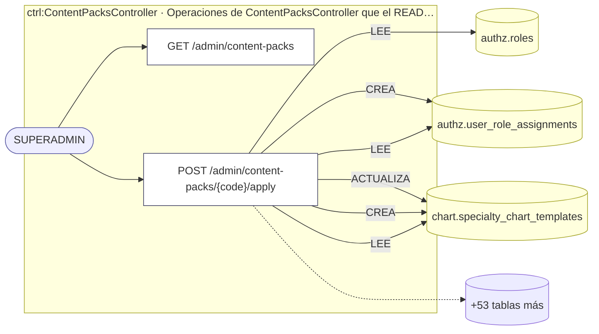

<!-- AUTOGENERADO por tools/inventario/flujos.mjs. No editar manualmente. -->

# Flujos del módulo `content_packs`

- **Procesos:** 1 · **Máquinas de estado:** 0
- **Operaciones:** 2 (1 con decisiones propias, 1 sin ellas)
- Inventario de endpoints del módulo: [content_packs](../endpoints/content_packs.md)

## Proceso: Módulo Content Packs — Contenido curado aplicable a demanda

- **Código:** `content_packs` · **Agrupación:** AGRUPACION_POR_CONTROLADOR · **Operaciones:** 2
- **Actores:** SUPERADMIN
- **Revisión:** AUTO_DETECTADA
- **Fuentes:** `src/modules/content_packs/README.md`

### Para qué sirve

Superficie de plataforma para aplicar **paquetes de contenido**: material curado que una instalación puede querer o no, y que antes se sembraba solo en cada arranque. Es la contracara de `SEED_CONTENT_ON_BOOT`: lo que el arranque dejó de sembrar por su cuenta se aplica desde acá cuando alguien lo decide.

_Fuente: `src/modules/content_packs/README.md:3`_

### Etapas y operaciones

| Etapa | Descripción | Operación | Quién actúa | Riesgo | Tablas |
|---|---|---|---|---|---|
| `ctrl:ContentPacksController` | Operaciones de ContentPacksController que el README no asigna a un caso de uso | GET /admin/content-packs | SUPERADMIN | BAJO | 0 |
|  |  | POST /admin/content-packs/{code}/apply | SUPERADMIN | ALTO | 59 |

### Diagrama — etapas `ctrl:ContentPacksController`

## Árbol de decisión por operación

Cada árbol se deriva del código del handler y de los métodos que invoca (hasta 4 niveles). Una rama que no decide, no escribe y no falla se poda. Los accesos y los efectos consecutivos se agrupan en un solo nodo.

### Operaciones con decisiones propias

#### 1. POST /admin/content-packs/{code}/apply

Aplicar un paquete de contenido

| HTTP | Código | Cuándo |
|---|---|---|
| 200 | — | Éxito |
| 400 | `VALIDATION_FAILED` | El cuerpo cumple el DTO (sin propiedades extra) |
| 401 | `UNAUTHENTICATED` | Hay una sesión válida (JWT) |
| 403 | `FORBIDDEN` | El rol está permitido; El tenant se resuelve y pertenece al actor |
| 404 | `NOT_FOUND` | ResourceNotFoundException: Paquete de contenido no encontrado |
| 422 | `PRECONDITION_FAILED` | PreconditionFailedException: Las cuentas de demostración necesitan una contraseña: declárela en la petición o en SEED_DEMO_PASSWORD.; PreconditionFailedException: Las cuentas de demostración no se crean en producción. Si de verdad las quiere acá, hace falta habilitarlo explícitamente en el entorno. |
| 429 | `RATE_LIMITED` | No se supera el límite de solicitudes |
| 500 | `INTERNAL` | Error: El catálogo del glosario declara el slug "{term.slug}" más de una vez; Error: El directorio declara el código "{facility.code}" más de una vez; Error: El catálogo geográfico declara la sigla "{department.code}" más de una vez; Error: El catálogo geográfico declara el código INE "{municipality.ine}" más de una vez; Error: El municipio "{municipality.name}" ({municipality.ine}) cuelga deldepartamento "{municipality.department}", que no está en el catálogo; Error: El municipio "{municipality.name}" declara el departamento"{municipality.department}" pero su código INE {municipality.ine}corresponde a "{byPrefix ?? 'ninguno…; Error: El catálogo de aseguradoras declara el código "{code}" más de una vez; Error: El nomenclador declara el código "{procedure.code}" más de una vez |

```mermaid
flowchart TD
  n1(("Solicitud")):::inicio
  n2{{"Acceso: sesión (401) · rol (403) · tenant (403) · cuerpo válido (400) · límite de tasa (429)"}}:::acceso
  n1 --> n2
  n3["Llama a ContentPacksService.apply"]:::llamada
  n2 --> n3
  n4{"pkg === undefined"}:::decision
  n3 --> n4
  n5(["404 NOT_FOUND Paquete de contenido no encontrado"]):::error
  n4 -->|"sí"| n5
  n6["Llama a ContentPacksService.run"]:::llamada
  n4 -->|"no"| n6
  n7{"según code"}:::decision
  n6 --> n7
  n8["Llama a GlossarySeedService.run"]:::llamada
  n7 -->|"'GLOSARIO'"| n8
  n9["Llama a GlossarySeedService.assertUniqueSlugs"]:::llamada
  n8 --> n9
  n10["Repite: por cada const term de GLOSSARY_TERMS"]:::bucle
  n9 --> n10
  n11{"seen.has(term.slug)"}:::decision
  n10 -->|"cada elemento"| n11
  n12(["500 INTERNAL El catálogo del glosario declara el slug '{term.slug}' más de una vez"]):::error
  n11 -->|"sí"| n12
  n13["Llama a GlossarySeedService.seedOwnCodeSystem"]:::llamada
  n11 -->|"no"| n13
  n10 -->|"al terminar"| n13
  n14{"!existing.has(glossarySourceId)"}:::decision
  n13 --> n14
  n15[("CREA terminology.terminology_sources")]:::efecto
  n14 -->|"sí"| n15
  n16{"!existingCodeSystem.has(glossaryCodeSystemId)"}:::decision
  n15 --> n16
  n14 -->|"no"| n16
  n17[("CREA terminology.code_systems")]:::efecto
  n16 -->|"sí"| n17
  n18{"!existingVersion.has(glossaryCodeSystemVersionId)"}:::decision
  n17 --> n18
  n16 -->|"no"| n18
  n19[("CREA terminology.code_system_versions")]:::efecto
  n18 -->|"sí"| n19
  n20["Repite: por cada const entry de GLOSSARY_TAXONOMY"]:::bucle
  n19 --> n20
  n18 -->|"no"| n20
  n21[("CREA terminology.value_sets")]:::efecto
  n20 -->|"cada elemento"| n21
  n22["Repite: por cada const entry de GLOSSARY_TAXONOMY"]:::bucle
  n21 --> n22
  n20 -->|"al terminar"| n22
  n23[("CREA terminology.value_set_versions")]:::efecto
  n22 -->|"cada elemento"| n23
  n24["Repite: por cada const term de GLOSSARY_TERMS"]:::bucle
  n23 --> n24
  n22 -->|"al terminar"| n24
  n25[("CREA terminology.catalog_concepts")]:::efecto
  n24 -->|"cada elemento"| n25
  n26["Llama a GlossarySeedService.backfillTermCodeSystem"]:::llamada
  n25 --> n26
  n24 -->|"al terminar"| n26
  n27[("ACTUALIZA terminology.catalog_concepts")]:::efecto
  n26 --> n27
  n28["Llama a GlossarySeedService.seedDesignations"]:::llamada
  n27 --> n28
  n29["Repite: por cada const term de GLOSSARY_TERMS"]:::bucle
  n28 --> n29
  n30{"!existing.has(preferredId)"}:::decision
  n29 -->|"cada elemento"| n30
  n31[("CREA terminology.concept_designations")]:::efecto
  n30 -->|"sí"| n31
  n32["Repite: forEach(…)"]:::bucle
  n31 --> n32
  n30 -->|"no"| n32
  n33[("CREA terminology.concept_designations")]:::efecto
  n32 -->|"cada elemento"| n33
  n34["Llama a GlossarySeedService.seedProperties"]:::llamada
  n33 --> n34
  n32 -->|"al terminar"| n34
  n29 -->|"al terminar"| n34
  n35["Repite: por cada const term de GLOSSARY_TERMS"]:::bucle
  n34 --> n35
  n36{"!existing.has(slugPropertyId)"}:::decision
  n35 -->|"cada elemento"| n36
  n37[("CREA terminology.concept_properties")]:::efecto
  n36 -->|"sí"| n37
  n38{"!existing.has(clinicalDefinitionId)"}:::decision
  n37 --> n38
  n36 -->|"no"| n38
  n39[("CREA terminology.concept_properties")]:::efecto
  n38 -->|"sí"| n39
  n40{"!existing.has(plainSummaryId)"}:::decision
  n39 --> n40
  n38 -->|"no"| n40
  n41[("CREA terminology.concept_properties")]:::efecto
  n40 -->|"sí"| n41
  n42{"sourceReferences !== undefined"}:::decision
  n41 --> n42
  n40 -->|"no"| n42
  n43{"!existing.has(sourceReferencesId)"}:::decision
  n42 -->|"sí"| n43
  n44[("CREA terminology.concept_properties")]:::efecto
  n43 -->|"sí"| n44
  n45{"article !== undefined"}:::decision
  n44 --> n45
  n43 -->|"no"| n45
  n42 -->|"no"| n45
  n46{"!existing.has(articleId)"}:::decision
  n45 -->|"sí"| n46
  n47[("CREA terminology.concept_properties")]:::efecto
  n46 -->|"sí"| n47
  n48["Llama a GlossarySeedService.seedMemberships"]:::llamada
  n47 --> n48
  n46 -->|"no"| n48
  n45 -->|"no"| n48
  n35 -->|"al terminar"| n48
  n49["Repite: por cada const membership de memberships"]:::bucle
  n48 --> n49
  n50[("CREA terminology.value_set_members")]:::efecto
  n49 -->|"cada elemento"| n50
  n51["Llama a GlossarySeedService.seedRelationships"]:::llamada
  n50 --> n51
  n49 -->|"al terminar"| n51
  n52["Repite: por cada const row de resolved"]:::bucle
  n51 --> n52
  n53[("CREA terminology.concept_relationships")]:::efecto
  n52 -->|"cada elemento"| n53
  n54["Llama a GlossarySeedService.reconcile"]:::llamada
  n53 --> n54
  n52 -->|"al terminar"| n54
  n55[("LEE terminology.catalog_concepts")]:::efecto
  n54 --> n55
  n56["Repite: por cada const concept de concepts"]:::bucle
  n55 --> n56
  n57{"term !== undefined && concept.display !== term.enDisplay"}:::decision
  n56 -->|"cada elemento"| n57
  n58[("ACTUALIZA terminology.catalog_concepts")]:::efecto
  n57 -->|"sí"| n58
  n59[("LEE terminology.concept_designations")]:::efecto
  n58 --> n59
  n57 -->|"no"| n59
  n56 -->|"al terminar"| n59
  n60["Repite: por cada const designation de designations"]:::bucle
  n59 --> n60
  n61{"value === undefined"}:::decision
  n60 -->|"cada elemento"| n61
  n62[("BORRA terminology.concept_designations")]:::efecto
  n61 -->|"sí"| n62
  n63{"designation.value !== value"}:::decision
  n61 -->|"no"| n63
  n64[("ACTUALIZA terminology.concept_designations")]:::efecto
  n63 -->|"sí"| n64
  n65[("LEE terminology.concept_properties")]:::efecto
  n62 --> n65
  n64 --> n65
  n63 -->|"no"| n65
  n60 -->|"al terminar"| n65
  n66["Repite: por cada const property de properties"]:::bucle
  n65 --> n66
  n67{"!desiredProperties.has(property.id)"}:::decision
  n66 -->|"cada elemento"| n67
  n68[("BORRA terminology.concept_properties")]:::efecto
  n67 -->|"sí"| n68
  n69{"!sameJson(property.valueJson, value)"}:::decision
  n68 --> n69
  n67 -->|"no"| n69
  n70[("ACTUALIZA terminology.concept_properties")]:::efecto
  n69 -->|"sí"| n70
  n71["… el resto del árbol (8 nodos) está en el JSON del inventario"]:::corte
  n70 --> n71
  n69 -->|"no"| n71
  n66 -->|"al terminar"| n71
  classDef acceso fill:#eef,stroke:#66a
  classDef error fill:#fee,stroke:#c33
  classDef ok fill:#efe,stroke:#3a3
  classDef efecto fill:#ffd,stroke:#aa3
  classDef decision fill:#fff,stroke:#555
  classDef corte fill:#eee,stroke:#999,stroke-dasharray: 4
```

### Operaciones sin decisiones propias

Sólo comprueban el acceso y leen o escriben: no tienen ramas que dibujar. Su detalle está en la ficha de endpoints.

| Operación | Respuestas posibles | Tablas |
|---|---|---|
| GET /admin/content-packs | 200, 401, 403, 429 | 0 |
