<!-- AUTOGENERADO por tools/inventario/flujos.mjs. No editar manualmente. -->

# Flujos del módulo `crm`

- **Procesos:** 1 · **Máquinas de estado:** 0
- **Operaciones:** 16 (15 con decisiones propias, 1 sin ellas)
- Inventario de endpoints del módulo: [crm](../endpoints/crm.md)

## Proceso: CRM

- **Código:** `crm` · **Agrupación:** AGRUPACION_POR_CONTROLADOR · **Operaciones:** 16
- **Actores:** CRM_ADMIN · CRM_AGENT
- **Revisión:** AUTO_DETECTADA
- **Fuentes:** `src/modules/crm/README.md`

### Para qué sirve

Gestiona cuentas, contactos, equipos, leads, oportunidades, actividades, alianzas, casos y preferencias de contacto mediante `CrmController` bajo `/crm`.

_Fuente: `src/modules/crm/README.md:3`_

### Etapas y operaciones

| Etapa | Descripción | Operación | Quién actúa | Riesgo | Tablas |
|---|---|---|---|---|---|
| `ctrl:CrmController` | Operaciones de CrmController que el README no asigna a un caso de uso | POST /crm/accounts | CRM_ADMIN · CRM_AGENT | MEDIO | 3 |
|  |  | GET /crm/accounts/{id}/360 | CRM_ADMIN · CRM_AGENT | BAJO | 3 |
|  |  | POST /crm/accounts/{id}/team-members | CRM_ADMIN | MEDIO | 3 |
|  |  | POST /crm/activities | CRM_ADMIN · CRM_AGENT | MEDIO | 3 |
|  |  | POST /crm/cases | CRM_ADMIN · CRM_AGENT | MEDIO | 3 |
|  |  | POST /crm/cases/{id}/comments | CRM_ADMIN · CRM_AGENT | MEDIO | 2 |
|  |  | POST /crm/cases/{id}/resolve | CRM_ADMIN · CRM_AGENT | MEDIO | 3 |
|  |  | PATCH /crm/cases/{id}/status | CRM_ADMIN · CRM_AGENT | MEDIO | 3 |
|  |  | PATCH /crm/contacts/{id}/channels/{cid}/opt-in | CRM_ADMIN · CRM_AGENT | MEDIO | 3 |
|  |  | POST /crm/leads | CRM_ADMIN · CRM_AGENT | MEDIO | 1 |
|  |  | POST /crm/leads/{id}/convert | CRM_ADMIN · CRM_AGENT | MEDIO | 4 |
|  |  | PATCH /crm/leads/{id}/qualify | CRM_ADMIN · CRM_AGENT | MEDIO | 2 |
|  |  | POST /crm/opportunities/{id}/advance-stage | CRM_ADMIN · CRM_AGENT | MEDIO | 4 |
|  |  | POST /crm/opportunities/{id}/lose | CRM_ADMIN · CRM_AGENT | MEDIO | 3 |
|  |  | POST /crm/opportunities/{id}/win | CRM_ADMIN · CRM_AGENT | MEDIO | 3 |
|  |  | POST /crm/partnerships | CRM_ADMIN | MEDIO | 2 |

### Diagrama — etapas `ctrl:CrmController`

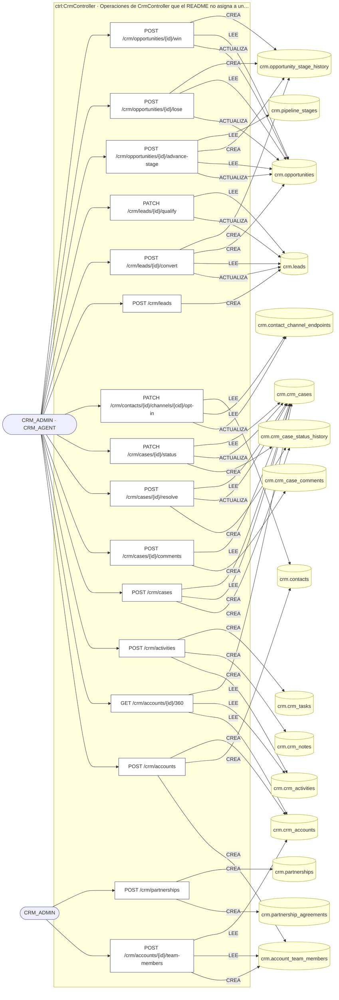

## Árbol de decisión por operación

Cada árbol se deriva del código del handler y de los métodos que invoca (hasta 4 niveles). Una rama que no decide, no escribe y no falla se poda. Los accesos y los efectos consecutivos se agrupan en un solo nodo.

### Operaciones con decisiones propias

#### 1. POST /crm/accounts

Crear una cuenta con su contacto principal

| HTTP | Código | Cuándo |
|---|---|---|
| 201 | — | Éxito |
| 400 | `VALIDATION_FAILED` | El cuerpo cumple el DTO (sin propiedades extra) |
| 401 | `UNAUTHENTICATED` | Hay una sesión válida (JWT) |
| 403 | `FORBIDDEN` | El rol está permitido; El tenant se resuelve y pertenece al actor |
| 429 | `RATE_LIMITED` | No se supera el límite de solicitudes |

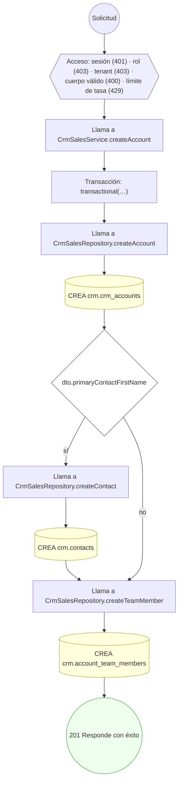

#### 2. GET /crm/accounts/{id}/360

Vista 360 de la cuenta

| HTTP | Código | Cuándo |
|---|---|---|
| 200 | — | Éxito |
| 400 | `VALIDATION_FAILED` | Los parámetros de ruta son UUID válidos |
| 401 | `UNAUTHENTICATED` | Hay una sesión válida (JWT) |
| 403 | `FORBIDDEN` | El rol está permitido; El tenant se resuelve y pertenece al actor |
| 404 | `NOT_FOUND` | ResourceNotFoundException: Cuenta no encontrada |
| 429 | `RATE_LIMITED` | No se supera el límite de solicitudes |

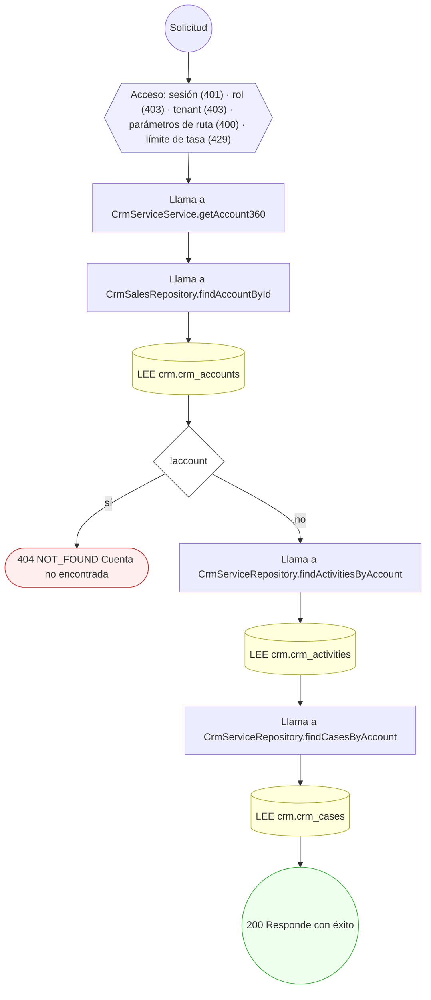

#### 3. POST /crm/accounts/{id}/team-members

Sumar un usuario al equipo de la cuenta

| HTTP | Código | Cuándo |
|---|---|---|
| 201 | — | Éxito |
| 400 | `VALIDATION_FAILED` | Los parámetros de ruta son UUID válidos; El cuerpo cumple el DTO (sin propiedades extra) |
| 401 | `UNAUTHENTICATED` | Hay una sesión válida (JWT) |
| 403 | `FORBIDDEN` | El rol está permitido; El tenant se resuelve y pertenece al actor |
| 404 | `NOT_FOUND` | ResourceNotFoundException: Cuenta no encontrada |
| 409 | `CONFLICT` | ConflictException: El usuario ya pertenece al equipo de la cuenta |
| 429 | `RATE_LIMITED` | No se supera el límite de solicitudes |

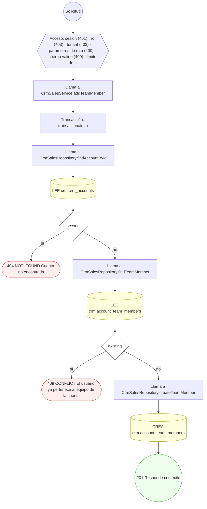

#### 4. POST /crm/activities

Registrar una actividad y su subtipo

| HTTP | Código | Cuándo |
|---|---|---|
| 201 | — | Éxito |
| 400 | `VALIDATION_FAILED` | El cuerpo cumple el DTO (sin propiedades extra) |
| 401 | `UNAUTHENTICATED` | Hay una sesión válida (JWT) |
| 403 | `FORBIDDEN` | El rol está permitido; El tenant se resuelve y pertenece al actor |
| 422 | `PRECONDITION_FAILED` | PreconditionFailedException: Una nota requiere `bodyText` |
| 429 | `RATE_LIMITED` | No se supera el límite de solicitudes |

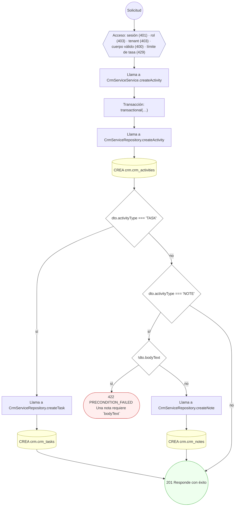

#### 5. POST /crm/cases

Abrir un caso de servicio

| HTTP | Código | Cuándo |
|---|---|---|
| 201 | — | Éxito |
| 400 | `VALIDATION_FAILED` | El cuerpo cumple el DTO (sin propiedades extra) |
| 401 | `UNAUTHENTICATED` | Hay una sesión válida (JWT) |
| 403 | `FORBIDDEN` | El rol está permitido; El tenant se resuelve y pertenece al actor |
| 409 | `CONFLICT` | ConflictException: Ya existe un caso con ese número |
| 429 | `RATE_LIMITED` | No se supera el límite de solicitudes |

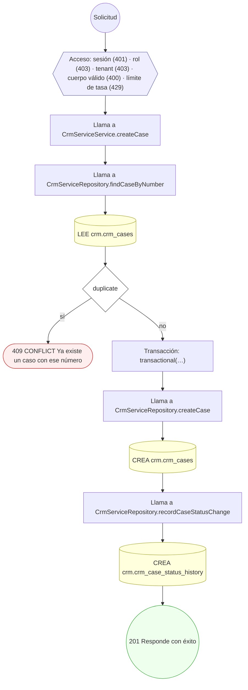

#### 6. POST /crm/cases/{id}/comments

Comentar el caso

| HTTP | Código | Cuándo |
|---|---|---|
| 201 | — | Éxito |
| 400 | `VALIDATION_FAILED` | Los parámetros de ruta son UUID válidos; El cuerpo cumple el DTO (sin propiedades extra) |
| 401 | `UNAUTHENTICATED` | Hay una sesión válida (JWT) |
| 403 | `FORBIDDEN` | El rol está permitido; El tenant se resuelve y pertenece al actor |
| 404 | `NOT_FOUND` | ResourceNotFoundException: Caso no encontrado |
| 422 | `PRECONDITION_FAILED` | PreconditionFailedException: No se comenta un caso cerrado |
| 429 | `RATE_LIMITED` | No se supera el límite de solicitudes |

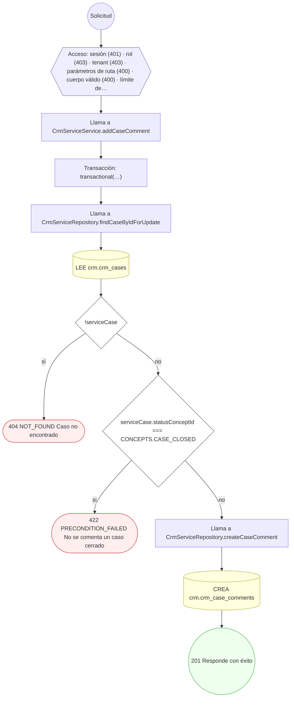

#### 7. POST /crm/cases/{id}/resolve

Resolver el caso

| HTTP | Código | Cuándo |
|---|---|---|
| 200 | — | Éxito |
| 400 | `VALIDATION_FAILED` | Los parámetros de ruta son UUID válidos |
| 401 | `UNAUTHENTICATED` | Hay una sesión válida (JWT) |
| 403 | `FORBIDDEN` | El rol está permitido; El tenant se resuelve y pertenece al actor |
| 404 | `NOT_FOUND` | ResourceNotFoundException: Caso no encontrado |
| 409 | `CONFLICT` | ConflictException: Un caso cerrado no se reabre por esta vía |
| 422 | `PRECONDITION_FAILED` | PreconditionFailedException: El caso ya está en ese estado |
| 429 | `RATE_LIMITED` | No se supera el límite de solicitudes |

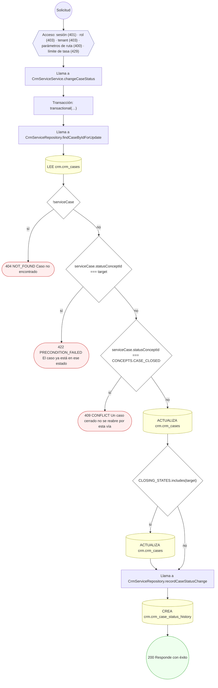

#### 8. PATCH /crm/cases/{id}/status

Transicionar el estado del caso

| HTTP | Código | Cuándo |
|---|---|---|
| 200 | — | Éxito |
| 400 | `VALIDATION_FAILED` | Los parámetros de ruta son UUID válidos; El cuerpo cumple el DTO (sin propiedades extra) |
| 401 | `UNAUTHENTICATED` | Hay una sesión válida (JWT) |
| 403 | `FORBIDDEN` | El rol está permitido; El tenant se resuelve y pertenece al actor |
| 404 | `NOT_FOUND` | ResourceNotFoundException: Caso no encontrado |
| 409 | `CONFLICT` | ConflictException: Un caso cerrado no se reabre por esta vía |
| 422 | `PRECONDITION_FAILED` | PreconditionFailedException: El caso ya está en ese estado |
| 429 | `RATE_LIMITED` | No se supera el límite de solicitudes |

#### 9. PATCH /crm/contacts/{id}/channels/{cid}/opt-in

Registrar el consentimiento del canal de contacto

| HTTP | Código | Cuándo |
|---|---|---|
| 200 | — | Éxito |
| 400 | `VALIDATION_FAILED` | Los parámetros de ruta son UUID válidos; El cuerpo cumple el DTO (sin propiedades extra) |
| 401 | `UNAUTHENTICATED` | Hay una sesión válida (JWT) |
| 403 | `FORBIDDEN` | El rol está permitido; El tenant se resuelve y pertenece al actor |
| 404 | `NOT_FOUND` | ResourceNotFoundException: Contacto no encontrado; ResourceNotFoundException: Canal de contacto no encontrado |
| 422 | `PRECONDITION_FAILED` | PreconditionFailedException: El canal no pertenece a ese contacto |
| 429 | `RATE_LIMITED` | No se supera el límite de solicitudes |

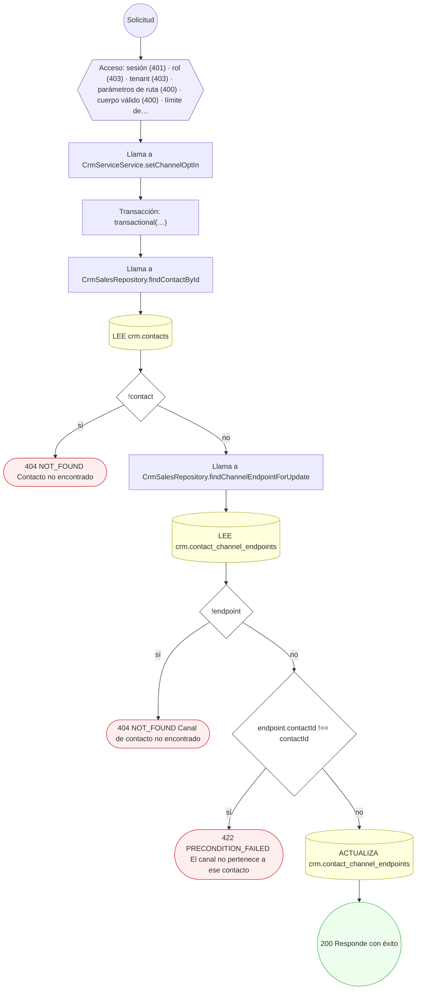

#### 10. POST /crm/leads/{id}/convert

Convertir el lead en oportunidad

| HTTP | Código | Cuándo |
|---|---|---|
| 201 | — | Éxito |
| 400 | `VALIDATION_FAILED` | Los parámetros de ruta son UUID válidos; El cuerpo cumple el DTO (sin propiedades extra) |
| 401 | `UNAUTHENTICATED` | Hay una sesión válida (JWT) |
| 403 | `FORBIDDEN` | El rol está permitido; El tenant se resuelve y pertenece al actor |
| 404 | `NOT_FOUND` | ResourceNotFoundException: Lead no encontrado |
| 409 | `CONFLICT` | ConflictException: El lead ya fue convertido |
| 422 | `PRECONDITION_FAILED` | PreconditionFailedException: Solo se convierte un lead calificado |
| 429 | `RATE_LIMITED` | No se supera el límite de solicitudes |

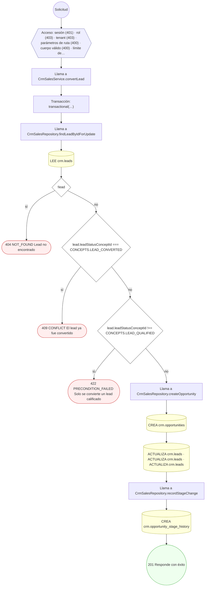

#### 11. PATCH /crm/leads/{id}/qualify

Calificar o descartar el lead

| HTTP | Código | Cuándo |
|---|---|---|
| 200 | — | Éxito |
| 400 | `VALIDATION_FAILED` | Los parámetros de ruta son UUID válidos; El cuerpo cumple el DTO (sin propiedades extra) |
| 401 | `UNAUTHENTICATED` | Hay una sesión válida (JWT) |
| 403 | `FORBIDDEN` | El rol está permitido; El tenant se resuelve y pertenece al actor |
| 404 | `NOT_FOUND` | ResourceNotFoundException: Lead no encontrado |
| 409 | `CONFLICT` | ConflictException: El lead ya fue convertido |
| 429 | `RATE_LIMITED` | No se supera el límite de solicitudes |

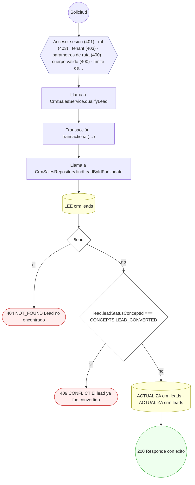

#### 12. POST /crm/opportunities/{id}/advance-stage

Avanzar la oportunidad de etapa

| HTTP | Código | Cuándo |
|---|---|---|
| 200 | — | Éxito |
| 400 | `VALIDATION_FAILED` | Los parámetros de ruta son UUID válidos; El cuerpo cumple el DTO (sin propiedades extra) |
| 401 | `UNAUTHENTICATED` | Hay una sesión válida (JWT) |
| 403 | `FORBIDDEN` | El rol está permitido; El tenant se resuelve y pertenece al actor |
| 404 | `NOT_FOUND` | ResourceNotFoundException: Oportunidad no encontrada; ResourceNotFoundException: Etapa no encontrada |
| 422 | `PRECONDITION_FAILED` | PreconditionFailedException: La oportunidad ya está cerrada; PreconditionFailedException: La oportunidad ya está en esa etapa |
| 429 | `RATE_LIMITED` | No se supera el límite de solicitudes |

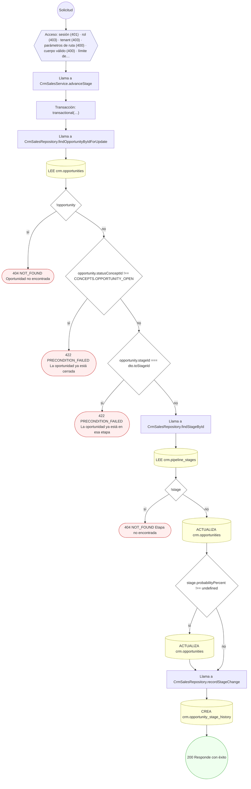

#### 13. POST /crm/opportunities/{id}/lose

Marcar la oportunidad como perdida con su motivo

| HTTP | Código | Cuándo |
|---|---|---|
| 200 | — | Éxito |
| 400 | `VALIDATION_FAILED` | Los parámetros de ruta son UUID válidos; El cuerpo cumple el DTO (sin propiedades extra) |
| 401 | `UNAUTHENTICATED` | Hay una sesión válida (JWT) |
| 403 | `FORBIDDEN` | El rol está permitido; El tenant se resuelve y pertenece al actor |
| 404 | `NOT_FOUND` | ResourceNotFoundException: Oportunidad no encontrada |
| 409 | `CONFLICT` | ConflictException: La oportunidad ya está cerrada |
| 429 | `RATE_LIMITED` | No se supera el límite de solicitudes |

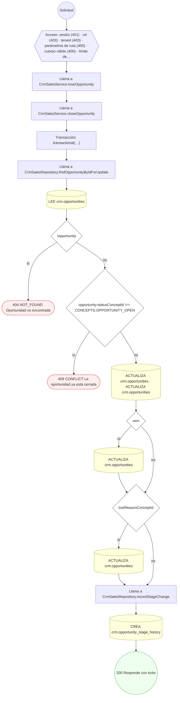

#### 14. POST /crm/opportunities/{id}/win

Marcar la oportunidad como ganada

| HTTP | Código | Cuándo |
|---|---|---|
| 200 | — | Éxito |
| 400 | `VALIDATION_FAILED` | Los parámetros de ruta son UUID válidos |
| 401 | `UNAUTHENTICATED` | Hay una sesión válida (JWT) |
| 403 | `FORBIDDEN` | El rol está permitido; El tenant se resuelve y pertenece al actor |
| 404 | `NOT_FOUND` | ResourceNotFoundException: Oportunidad no encontrada |
| 409 | `CONFLICT` | ConflictException: La oportunidad ya está cerrada |
| 429 | `RATE_LIMITED` | No se supera el límite de solicitudes |

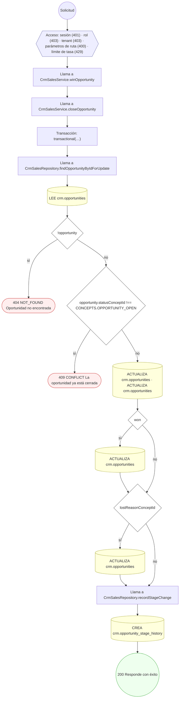

#### 15. POST /crm/partnerships

Registrar una alianza y su acuerdo marco

| HTTP | Código | Cuándo |
|---|---|---|
| 201 | — | Éxito |
| 400 | `VALIDATION_FAILED` | El cuerpo cumple el DTO (sin propiedades extra) |
| 401 | `UNAUTHENTICATED` | Hay una sesión válida (JWT) |
| 403 | `FORBIDDEN` | El rol está permitido; El tenant se resuelve y pertenece al actor |
| 429 | `RATE_LIMITED` | No se supera el límite de solicitudes |

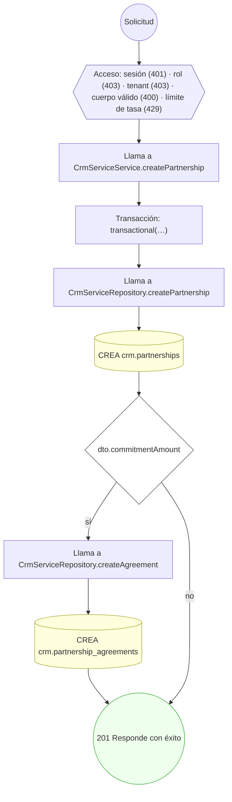

### Operaciones sin decisiones propias

Sólo comprueban el acceso y leen o escriben: no tienen ramas que dibujar. Su detalle está en la ficha de endpoints.

| Operación | Respuestas posibles | Tablas |
|---|---|---|
| POST /crm/leads | 201, 400, 401, 403, 429 | 1 |
