<!-- AUTOGENERADO por tools/inventario/flujos.mjs. No editar manualmente. -->

# Flujos del módulo `cross_store_consistency`

- **Procesos:** 1 · **Máquinas de estado:** 0
- **Operaciones:** 16 (14 con decisiones propias, 2 sin ellas)
- Inventario de endpoints del módulo: [cross_store_consistency](../endpoints/cross_store_consistency.md)

## Proceso: Módulo 62 — Consistencia cross-store

- **Código:** `cross_store_consistency` · **Agrupación:** MIXTO · **Operaciones:** 16
- **Actores:** DATA_GOVERNANCE_ADMIN · DELETION_WORKER · DPO · MAINTENANCE_WORKER · PLATFORM_ADMIN · PRIVACY_OFFICER · PROJECTION_WORKER · RECONCILIATION_WORKER · SYSTEM
- **Revisión:** AUTO_DETECTADA
- **Fuentes:** `src/modules/cross_store_consistency/README.md`

### Para qué sirve

Proyección del outbox a los stores secundarios con entrega idempotente y checkpoint, reconciliación del canónico contra sus proyecciones, propagación verificada del borrado, e invalidación de caché, movimiento entre zonas y archivado por retención.

_Fuente: `src/modules/cross_store_consistency/README.md:3`_

### Flujo general declarado en el README

```text
PROYECCIÓN
  admin/projections/definitions ──> definición + suscripciones + SLO
  workers/projections/deliveries/process
        clave = hash(evento, payload) ──> ya aplicada ⇒ duplicate, no se toca nada
        escritura durable confirmada ──> intento SUCCEEDED
              └─ checkpoint SÓLO entonces, y sólo si la posición avanza
        escritura fallida ────────────> intento FAILED, checkpoint quieto
  workers/projections/dead-letters ──> payload al almacén de objetos, entrada OPEN
    └─ admin/.../replay ─────────────> intento nuevo CON LA MISMA CLAVE

RECONCILIACIÓN
  admin/reconciliation/runs
        MATCH ──────────────> se cuenta
        DIVERGENT / MISSING / EXTRA ──> deriva OPEN (dedup por entidad y tipo)
                                        severidad MEDIUM / HIGH / CRITICAL
  admin/projections/drift/:id/repair-jobs
        REPROJECT · REINDEX (+ job) · DELETE_ORPHAN (sólo sobre EXTRA)
        la deriva se cierra al encolar, no al terminar

BORRADO
  admin/deletion-requests ─────────> PENDING, con due_at
  workers/.../expand ──────────────> un objetivo por store; legal hold ⇒ BLOCKED
  workers/.../executions ──────────> legal hold NO se toca; acuse del proveedor
  workers/.../verifications ───────> ausente y sin residuos ⇒ VERIFIED
                                     con residuos ⇒ vuelve a PENDING
  PATCH admin/deletion-requests/:id > COMPLETED sólo si TODO verificado o bloqueado
                                     todo bloqueado ⇒ BLOCKED, no COMPLETED

MANTENIMIENTO
  workers/cache/invalidations ─────> clave incluye la VERSIÓN de la entidad
  admin/data-movement-jobs ────────> idempotente por manifest_hash + invalida caché
  admin/archive-jobs ──────────────> sin manifiesto frío no se purga lo caliente
```

_Fuente: `src/modules/cross_store_consistency/README.md:85`_

### Etapas y operaciones

| Etapa | Descripción | Operación | Quién actúa | Riesgo | Tablas |
|---|---|---|---|---|---|
| `UC-62-01` | Definición, suscripciones y SLO | POST /admin/projections/definitions | DATA_GOVERNANCE_ADMIN · PLATFORM_ADMIN | MEDIO | 6 |
| `UC-62-02` | Entrega idempotente | POST /workers/projections/deliveries/process | SYSTEM · PROJECTION_WORKER · PLATFORM_ADMIN | MEDIO | 10 |
| `UC-62-04` | Cola muerta y reproceso | POST /admin/projections/dead-letters/{id}/replay | DATA_GOVERNANCE_ADMIN · PLATFORM_ADMIN | MEDIO | 4 |
|  |  | POST /workers/projections/dead-letters | SYSTEM · PROJECTION_WORKER · PLATFORM_ADMIN | MEDIO | 8 |
| `UC-62-05` | Corrida de reconciliación | POST /admin/reconciliation/runs | SYSTEM · RECONCILIATION_WORKER · DATA_GOVERNANCE_ADMIN · PLATFORM_ADMIN | MEDIO | 8 |
| `UC-62-07` | Reparación de deriva | POST /admin/projections/drift/{id}/repair-jobs | DATA_GOVERNANCE_ADMIN · SYSTEM · PLATFORM_ADMIN | MEDIO | 8 |
| `UC-62-08` | Solicitud de borrado | POST /admin/deletion-requests | PRIVACY_OFFICER · DPO · PLATFORM_ADMIN | MEDIO | 5 |
| `UC-62-09` | Expansión a objetivos | POST /workers/deletion-requests/{id}/expand | SYSTEM · DELETION_WORKER · PLATFORM_ADMIN | MEDIO | 4 |
| `UC-62-10` | Ejecución del borrado | POST /workers/deletion-targets/{id}/executions | SYSTEM · DELETION_WORKER · PLATFORM_ADMIN | MEDIO | 5 |
| `UC-62-11` | Verificación y cierre | PATCH /admin/deletion-requests/{id} | PRIVACY_OFFICER · DPO · PLATFORM_ADMIN | MEDIO | 6 |
|  |  | POST /workers/deletion-targets/{id}/verifications | SYSTEM · DELETION_WORKER · PLATFORM_ADMIN | MEDIO | 3 |
| `UC-62-12` | Invalidación de caché | POST /workers/cache/invalidations | SYSTEM · MAINTENANCE_WORKER · PLATFORM_ADMIN | MEDIO | 5 |
| `UC-62-13` | Movimiento entre zonas | POST /admin/data-movement-jobs | DATA_GOVERNANCE_ADMIN · PLATFORM_ADMIN | MEDIO | 7 |
| `UC-62-14` | Archivado por retención | POST /admin/archive-jobs | SYSTEM · DATA_GOVERNANCE_ADMIN · PLATFORM_ADMIN | MEDIO | 7 |
| `ctrl:CrossStoreWorkerController` | Operaciones de CrossStoreWorkerController que el README no asigna a un caso de uso | GET /workers/deletion-targets/executed | SYSTEM · DELETION_WORKER · PLATFORM_ADMIN | BAJO | 1 |
|  |  | GET /workers/deletion-targets/pending | SYSTEM · DELETION_WORKER · PLATFORM_ADMIN | BAJO | 1 |

### Diagrama — etapas `UC-62-01`, `UC-62-02`, `UC-62-04`…

```mermaid
flowchart LR
  a2(["DATA_GOVERNANCE_ADMIN · PLATFORM_ADMIN"]):::actor
  a7(["SYSTEM · PROJECTION_WORKER · PLATFORM_ADMIN"]):::actor
  a19(["SYSTEM · RECONCILIATION_WORKER · DATA_GOVERNANCE_ADMIN · PL…"]):::actor
  a26(["DATA_GOVERNANCE_ADMIN · SYSTEM · PLATFORM_ADMIN"]):::actor
  a32(["PRIVACY_OFFICER · DPO · PLATFORM_ADMIN"]):::actor
  a37(["SYSTEM · DELETION_WORKER · PLATFORM_ADMIN"]):::actor
  a46(["SYSTEM · MAINTENANCE_WORKER · PLATFORM_ADMIN"]):::actor
  a55(["SYSTEM · DATA_GOVERNANCE_ADMIN · PLATFORM_ADMIN"]):::actor
  t3[("cross_store_consistency.projection_definitions")]:::tabla
  t4[("cross_store_consistency.projection_subscriptions")]:::tabla
  t5[("cross_store_consistency.store_consistency_slos")]:::tabla
  t8[("cross_store_consistency.projection_checkpoints")]:::tabla
  t9[("cross_store_consistency.projection_consumers")]:::tabla
  t12[("cross_store_consistency.projection_dead_letters")]:::tabla
  t13[("cross_store_consistency.projection_delivery_attem…")]:::tabla
  t15[("messaging.domain_events")]:::tabla
  e17>"ProjectionDeadLettered"]:::evento
  t20[("cross_store_consistency.projection_drift_events")]:::tabla
  t21[("cross_store_consistency.reconciliation_items")]:::tabla
  t22[("cross_store_consistency.reconciliation_runs")]:::tabla
  e24>"ProjectionDriftDetected"]:::evento
  t27[("cross_store_consistency.projection_repair_jobs")]:::tabla
  t28[("cross_store_consistency.reindex_jobs")]:::tabla
  e30>"ProjectionRepairRequested"]:::evento
  t33[("cross_store_consistency.deletion_requests")]:::tabla
  t34[("messaging.outbox_messages")]:::tabla
  e35>"DeletionRequested"]:::evento
  t38[("cross_store_consistency.deletion_targets")]:::tabla
  t40[("cross_store_consistency.deletion_executions")]:::tabla
  e42>"DeletionRequestClosed"]:::evento
  t44[("cross_store_consistency.deletion_verifications")]:::tabla
  t47[("cross_store_consistency.cache_invalidation_jobs")]:::tabla
  e48>"CacheInvalidationRequested"]:::evento
  t50[("cross_store_consistency.data_movement_jobs")]:::tabla
  t51[("cross_store_consistency.schema_migration_jobs")]:::tabla
  e53>"DataMovementRequested"]:::evento
  t56[("cross_store_consistency.archive_jobs")]:::tabla
  e58>"DataArchived"]:::evento
  subgraph s0["UC-62-01 · Definición, suscripciones y SLO"]
    o1["POST /admin/projections/definitions"]:::op
  end
  t10[("+4 tablas más")]
  subgraph s1["UC-62-02 · Entrega idempotente"]
    o6["POST /workers/projections/deliveries/process"]:::op
  end
  t16[("+2 tablas más")]
  subgraph s2["UC-62-04 · Cola muerta y reproceso"]
    o11["POST /admin/projections/dead-letters/{id}/replay"]:::op
    o14["POST /workers/projections/dead-letters"]:::op
  end
  t23[("+2 tablas más")]
  subgraph s3["UC-62-05 · Corrida de reconciliación"]
    o18["POST /admin/reconciliation/runs"]:::op
  end
  t29[("+2 tablas más")]
  subgraph s4["UC-62-07 · Reparación de deriva"]
    o25["POST /admin/projections/drift/{id}/repair-jobs"]:::op
  end
  subgraph s5["UC-62-08 · Solicitud de borrado"]
    o31["POST /admin/deletion-requests"]:::op
  end
  subgraph s6["UC-62-09 · Expansión a objetivos"]
    o36["POST /workers/deletion-requests/{id}/expand"]:::op
  end
  subgraph s7["UC-62-10 · Ejecución del borrado"]
    o39["POST /workers/deletion-targets/{id}/executions"]:::op
  end
  subgraph s8["UC-62-11 · Verificación y cierre"]
    o41["PATCH /admin/deletion-requests/{id}"]:::op
    o43["POST /workers/deletion-targets/{id}/verifications"]:::op
  end
  subgraph s9["UC-62-12 · Invalidación de caché"]
    o45["POST /workers/cache/invalidations"]:::op
  end
  t52[("+1 tablas más")]
  subgraph s10["UC-62-13 · Movimiento entre zonas"]
    o49["POST /admin/data-movement-jobs"]:::op
  end
  t57[("+1 tablas más")]
  subgraph s11["UC-62-14 · Archivado por retención"]
    o54["POST /admin/archive-jobs"]:::op
  end
  subgraph s12["ctrl:CrossStoreWorkerController · Operaciones de CrossStoreWorkerController que…"]
    o59["GET /workers/deletion-targets/executed"]:::op
    o60["GET /workers/deletion-targets/pending"]:::op
  end
  a2 --> o1
  o1 -->|"CREA"| t3
  o1 -->|"LEE"| t3
  o1 -->|"CREA"| t4
  o1 -->|"ACTUALIZA"| t5
  o1 -->|"CREA"| t5
  o1 -->|"LEE"| t5
  a7 --> o6
  o6 -->|"ACTUALIZA"| t8
  o6 -->|"CREA"| t8
  o6 -->|"LEE"| t8
  o6 -->|"ACTUALIZA"| t9
  o6 -->|"CREA"| t9
  o6 -->|"LEE"| t9
  o6 -.-> t10
  a2 --> o11
  o11 -->|"ACTUALIZA"| t12
  o11 -->|"LEE"| t12
  o11 -->|"CREA"| t13
  o11 -->|"LEE"| t13
  a7 --> o14
  o14 -->|"CREA"| t12
  o14 -->|"LEE"| t12
  o14 -->|"ACTUALIZA"| t13
  o14 -->|"LEE"| t13
  o14 -->|"LEE"| t4
  o14 -->|"CREA"| t15
  o14 -.-> t16
  o14 -->|"evento"| e17
  a19 --> o18
  o18 -->|"CREA"| t20
  o18 -->|"LEE"| t20
  o18 -->|"CREA"| t21
  o18 -->|"ACTUALIZA"| t22
  o18 -->|"CREA"| t22
  o18 -->|"CREA"| t15
  o18 -.-> t23
  o18 -->|"evento"| e24
  a26 --> o25
  o25 -->|"ACTUALIZA"| t20
  o25 -->|"LEE"| t20
  o25 -->|"CREA"| t27
  o25 -->|"LEE"| t27
  o25 -->|"CREA"| t28
  o25 -->|"CREA"| t15
  o25 -.-> t29
  o25 -->|"evento"| e30
  a32 --> o31
  o31 -->|"CREA"| t33
  o31 -->|"LEE"| t33
  o31 -->|"CREA"| t15
  o31 -->|"CREA"| t34
  o31 -->|"LEE"| t34
  o31 -->|"evento"| e35
  a37 --> o36
  o36 -->|"ACTUALIZA"| t33
  o36 -->|"LEE"| t33
  o36 -->|"CREA"| t38
  o36 -->|"LEE"| t38
  a37 --> o39
  o39 -->|"ACTUALIZA"| t40
  o39 -->|"CREA"| t40
  o39 -->|"LEE"| t40
  o39 -->|"ACTUALIZA"| t38
  o39 -->|"LEE"| t38
  a32 --> o41
  o41 -->|"ACTUALIZA"| t33
  o41 -->|"LEE"| t33
  o41 -->|"LEE"| t38
  o41 -->|"CREA"| t15
  o41 -->|"CREA"| t34
  o41 -->|"LEE"| t34
  o41 -->|"evento"| e42
  a37 --> o43
  o43 -->|"ACTUALIZA"| t38
  o43 -->|"LEE"| t38
  o43 -->|"CREA"| t44
  a46 --> o45
  o45 -->|"CREA"| t47
  o45 -->|"LEE"| t47
  o45 -->|"CREA"| t15
  o45 -->|"CREA"| t34
  o45 -->|"LEE"| t34
  o45 -->|"evento"| e48
  a2 --> o49
  o49 -->|"CREA"| t47
  o49 -->|"CREA"| t50
  o49 -->|"LEE"| t50
  o49 -->|"CREA"| t51
  o49 -->|"CREA"| t15
  o49 -->|"CREA"| t34
  o49 -.-> t52
  o49 -->|"evento"| e53
  a55 --> o54
  o54 -->|"ACTUALIZA"| t56
  o54 -->|"CREA"| t56
  o54 -->|"LEE"| t56
  o54 -->|"CREA"| t47
  o54 -->|"CREA"| t15
  o54 -->|"CREA"| t34
  o54 -.-> t57
  o54 -->|"evento"| e58
  a37 --> o59
  o59 -->|"LEE"| t38
  a37 --> o60
  o60 -->|"LEE"| t38
  classDef op fill:#fff,stroke:#446
  classDef actor fill:#eef,stroke:#66a
  classDef tabla fill:#ffd,stroke:#aa3
  classDef evento fill:#efe,stroke:#3a3
```

## Árbol de decisión por operación

Cada árbol se deriva del código del handler y de los métodos que invoca (hasta 4 niveles). Una rama que no decide, no escribe y no falla se poda. Los accesos y los efectos consecutivos se agrupan en un solo nodo.

### Operaciones con decisiones propias

#### 1. POST /admin/archive-jobs

Archivar por retención y purgar la copia caliente

| HTTP | Código | Cuándo |
|---|---|---|
| 201 | — | Éxito |
| 400 | `VALIDATION_FAILED` | El cuerpo cumple el DTO (sin propiedades extra) |
| 401 | `UNAUTHENTICATED` | Hay una sesión válida (JWT) |
| 403 | `FORBIDDEN` | El rol está permitido; El tenant se resuelve y pertenece al actor |
| 422 | `PRECONDITION_FAILED` | PreconditionFailedException: El corte de retención tiene que estar en el pasado.; PreconditionFailedException: No se purga la copia caliente sin el manifiesto del archivo frío confirmado. |
| 429 | `RATE_LIMITED` | No se supera el límite de solicitudes |

```mermaid
flowchart TD
  n1(("Solicitud")):::inicio
  n2{{"Acceso: sesión (401) · rol (403) · tenant (403) · cuerpo válido (400) · límite de tasa (429)"}}:::acceso
  n1 --> n2
  n3["Llama a StorageMaintenanceService.archiveData"]:::llamada
  n2 --> n3
  n4["Transacción: transactional(…)"]:::transaccion
  n3 --> n4
  n5{"retentionCutoff ›= new Date()"}:::decision
  n4 --> n5
  n6(["422 PRECONDITION_FAILED El corte de retención tiene que estar en el pasado."]):::error
  n5 -->|"sí"| n6
  n7["Llama a DeletionRepository.findArchiveJob"]:::llamada
  n5 -->|"no"| n7
  n8[("LEE cross_store_consistency.archive_jobs")]:::efecto
  n7 --> n8
  n9{"!manifestConfirmed && BigInt(deletedHotCount) › 0n"}:::decision
  n8 --> n9
  n10(["422 PRECONDITION_FAILED No se purga la copia caliente sin el manifiesto del archivo frío confirmado."]):::error
  n9 -->|"sí"| n10
  n11["Llama a DeletionRepository.createArchiveJob"]:::llamada
  n9 -->|"no"| n11
  n12[("CREA cross_store_consistency.archive_jobs")]:::efecto
  n11 --> n12
  n13[("ACTUALIZA cross_store_consistency.archive_jobs")]:::efecto
  n12 --> n13
  n14["Llama a DeletionRepository.createCacheJob"]:::llamada
  n13 --> n14
  n15[("CREA cross_store_consistency.cache_invalidation_jobs")]:::efecto
  n14 --> n15
  n16["Llama a OutboxService.publishDomainEvent"]:::llamada
  n15 --> n16
  n17["Llama a MessagingTraceService.runInProducerSpan"]:::llamada
  n16 --> n17
  n18["Transacción: startActiveSpan(…)"]:::transaccion
  n17 --> n18
  n19["Intenta"]:::intento
  n18 --> n19
  n20(["↩ (relanza el error capturado)"]):::error
  n19 -->|"si falla"| n20
  n21["Llama a OutboxService.persistDomainEvent"]:::llamada
  n19 --> n21
  n22["Llama a OutboxRepository.findOutboxByIdempotencyKey"]:::llamada
  n21 --> n22
  n23[("LEE messaging.outbox_messages")]:::efecto
  n22 --> n23
  n24["Llama a OutboxRepository.createDomainEvent"]:::llamada
  n23 --> n24
  n25[("CREA messaging.domain_events")]:::efecto
  n24 --> n25
  n26["Llama a OutboxRepository.createOutboxMessage"]:::llamada
  n25 --> n26
  n27[("CREA messaging.outbox_messages")]:::efecto
  n26 --> n27
  n28>"Evento DataArchived"]:::evento
  n27 --> n28
  n29(("201 Responde con éxito")):::ok
  n28 --> n29
  classDef acceso fill:#eef,stroke:#66a
  classDef error fill:#fee,stroke:#c33
  classDef ok fill:#efe,stroke:#3a3
  classDef efecto fill:#ffd,stroke:#aa3
  classDef decision fill:#fff,stroke:#555
  classDef corte fill:#eee,stroke:#999,stroke-dasharray: 4
```

#### 2. POST /admin/data-movement-jobs

Mover datos entre zonas de almacenamiento

| HTTP | Código | Cuándo |
|---|---|---|
| 201 | — | Éxito |
| 400 | `VALIDATION_FAILED` | El cuerpo cumple el DTO (sin propiedades extra) |
| 401 | `UNAUTHENTICATED` | Hay una sesión válida (JWT) |
| 403 | `FORBIDDEN` | El rol está permitido; El tenant se resuelve y pertenece al actor |
| 422 | `PRECONDITION_FAILED` | PreconditionFailedException: El emplazamiento de origen y el de destino no pueden ser el mismo. |
| 429 | `RATE_LIMITED` | No se supera el límite de solicitudes |

```mermaid
flowchart TD
  n1(("Solicitud")):::inicio
  n2{{"Acceso: sesión (401) · rol (403) · tenant (403) · cuerpo válido (400) · límite de tasa (429)"}}:::acceso
  n1 --> n2
  n3["Llama a StorageMaintenanceService.moveData"]:::llamada
  n2 --> n3
  n4["Transacción: transactional(…)"]:::transaccion
  n3 --> n4
  n5{"dto.sourcePlacementId === dto.targetPlacementId"}:::decision
  n4 --> n5
  n6(["422 PRECONDITION_FAILED El emplazamiento de origen y el de destino no pueden ser el mismo."]):::error
  n5 -->|"sí"| n6
  n7["Llama a DeletionRepository.findMovementJob"]:::llamada
  n5 -->|"no"| n7
  n8[("LEE cross_store_consistency.data_movement_jobs")]:::efecto
  n7 --> n8
  n9["Llama a DeletionRepository.createMovementJob"]:::llamada
  n8 --> n9
  n10[("CREA cross_store_consistency.data_movement_jobs")]:::efecto
  n9 --> n10
  n11{"dto.toSchemaVersion"}:::decision
  n10 --> n11
  n12["Llama a DeletionRepository.createSchemaMigrationJob"]:::llamada
  n11 -->|"sí"| n12
  n13[("CREA cross_store_consistency.schema_migration_jobs")]:::efecto
  n12 --> n13
  n14["Llama a DeletionRepository.createCacheJob"]:::llamada
  n13 --> n14
  n11 -->|"no"| n14
  n15[("CREA cross_store_consistency.cache_invalidation_jobs")]:::efecto
  n14 --> n15
  n16["Llama a OutboxService.publishDomainEvent"]:::llamada
  n15 --> n16
  n17["Llama a MessagingTraceService.runInProducerSpan"]:::llamada
  n16 --> n17
  n18["Transacción: startActiveSpan(…)"]:::transaccion
  n17 --> n18
  n19["Intenta"]:::intento
  n18 --> n19
  n20(["↩ (relanza el error capturado)"]):::error
  n19 -->|"si falla"| n20
  n21["Llama a OutboxService.persistDomainEvent"]:::llamada
  n19 --> n21
  n22["Llama a OutboxRepository.findOutboxByIdempotencyKey"]:::llamada
  n21 --> n22
  n23[("LEE messaging.outbox_messages")]:::efecto
  n22 --> n23
  n24["Llama a OutboxRepository.createDomainEvent"]:::llamada
  n23 --> n24
  n25[("CREA messaging.domain_events")]:::efecto
  n24 --> n25
  n26["Llama a OutboxRepository.createOutboxMessage"]:::llamada
  n25 --> n26
  n27[("CREA messaging.outbox_messages")]:::efecto
  n26 --> n27
  n28>"Evento DataMovementRequested"]:::evento
  n27 --> n28
  n29(("201 Responde con éxito")):::ok
  n28 --> n29
  classDef acceso fill:#eef,stroke:#66a
  classDef error fill:#fee,stroke:#c33
  classDef ok fill:#efe,stroke:#3a3
  classDef efecto fill:#ffd,stroke:#aa3
  classDef decision fill:#fff,stroke:#555
  classDef corte fill:#eee,stroke:#999,stroke-dasharray: 4
```

#### 3. POST /admin/deletion-requests

Solicitar el borrado de un sujeto

| HTTP | Código | Cuándo |
|---|---|---|
| 201 | — | Éxito |
| 400 | `VALIDATION_FAILED` | El cuerpo cumple el DTO (sin propiedades extra) |
| 401 | `UNAUTHENTICATED` | Hay una sesión válida (JWT) |
| 403 | `FORBIDDEN` | El rol está permitido; El tenant se resuelve y pertenece al actor |
| 429 | `RATE_LIMITED` | No se supera el límite de solicitudes |

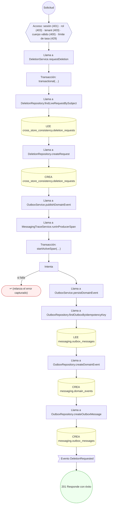

#### 4. PATCH /admin/deletion-requests/{id}

Cerrar la solicitud de borrado

| HTTP | Código | Cuándo |
|---|---|---|
| 200 | — | Éxito |
| 400 | `VALIDATION_FAILED` | Los parámetros de ruta son UUID válidos; El cuerpo cumple el DTO (sin propiedades extra) |
| 401 | `UNAUTHENTICATED` | Hay una sesión válida (JWT) |
| 403 | `FORBIDDEN` | El rol está permitido; El tenant se resuelve y pertenece al actor |
| 404 | `NOT_FOUND` | ResourceNotFoundException: Solicitud de borrado no encontrada. |
| 409 | `CONFLICT` | ConflictException: La solicitud ya está cerrada. |
| 422 | `PRECONDITION_FAILED` | PreconditionFailedException: La solicitud no tiene objetivos; expándela antes de cerrarla.; PreconditionFailedException: Quedan objetivos sin verificar; el borrado no está completo. |
| 429 | `RATE_LIMITED` | No se supera el límite de solicitudes |

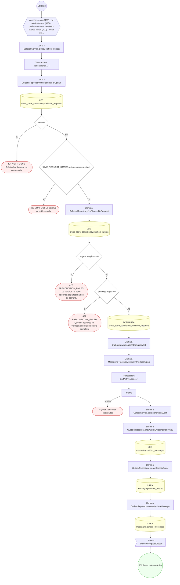

#### 5. POST /admin/projections/dead-letters/{id}/replay

Reprocesar una entrega de la cola muerta

| HTTP | Código | Cuándo |
|---|---|---|
| 201 | — | Éxito |
| 400 | `VALIDATION_FAILED` | Los parámetros de ruta son UUID válidos; El cuerpo cumple el DTO (sin propiedades extra) |
| 401 | `UNAUTHENTICATED` | Hay una sesión válida (JWT) |
| 403 | `FORBIDDEN` | El rol está permitido; El tenant se resuelve y pertenece al actor |
| 404 | `NOT_FOUND` | ResourceNotFoundException: Entrada de cola muerta no encontrada.; ResourceNotFoundException: Intento original no encontrado. |
| 409 | `CONFLICT` | ConflictException: La entrada de cola muerta ya no está abierta. |
| 429 | `RATE_LIMITED` | No se supera el límite de solicitudes |

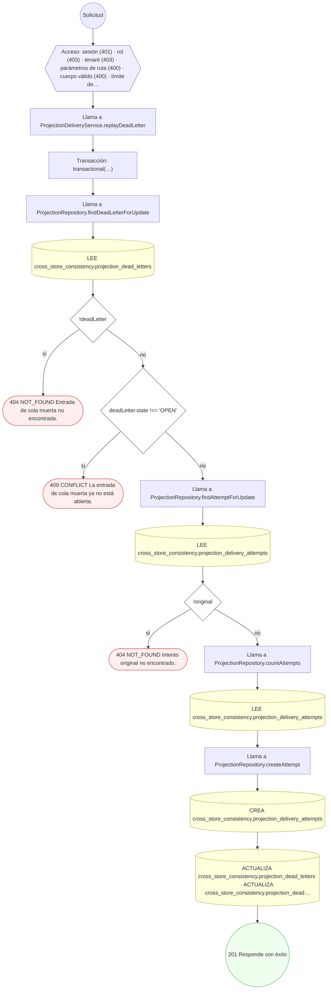

#### 6. POST /admin/projections/definitions

Registrar la definición de proyección con sus suscripciones y su SLO

| HTTP | Código | Cuándo |
|---|---|---|
| 201 | — | Éxito |
| 400 | `VALIDATION_FAILED` | El cuerpo cumple el DTO (sin propiedades extra) |
| 401 | `UNAUTHENTICATED` | Hay una sesión válida (JWT) |
| 403 | `FORBIDDEN` | El rol está permitido; El tenant se resuelve y pertenece al actor |
| 409 | `CONFLICT` | ConflictException: Ya existe esa versión de la definición de proyección.; ConflictException: Dos suscripciones comparten el mismo tipo de evento y consumidor. |
| 422 | `PRECONDITION_FAILED` | PreconditionFailedException: El dataset de origen y el de destino no pueden ser el mismo. |
| 429 | `RATE_LIMITED` | No se supera el límite de solicitudes |

```mermaid
flowchart TD
  n1(("Solicitud")):::inicio
  n2{{"Acceso: sesión (401) · rol (403) · tenant (403) · cuerpo válido (400) · límite de tasa (429)"}}:::acceso
  n1 --> n2
  n3["Llama a ProjectionDeliveryService.registerProjection"]:::llamada
  n2 --> n3
  n4["Transacción: transactional(…)"]:::transaccion
  n3 --> n4
  n5["Llama a ProjectionRepository.findDefinitionByVersion"]:::llamada
  n4 --> n5
  n6[("LEE cross_store_consistency.projection_definitions")]:::efecto
  n5 --> n6
  n7{"duplicate"}:::decision
  n6 --> n7
  n8(["409 CONFLICT Ya existe esa versión de la definición de proyección."]):::error
  n7 -->|"sí"| n8
  n9{"dto.sourceDatasetId === dto.targetDatasetId"}:::decision
  n7 -->|"no"| n9
  n10(["422 PRECONDITION_FAILED El dataset de origen y el de destino no pueden ser el mismo."]):::error
  n9 -->|"sí"| n10
  n11["Llama a ProjectionRepository.createDefinition"]:::llamada
  n9 -->|"no"| n11
  n12[("CREA cross_store_consistency.projection_definitions")]:::efecto
  n11 --> n12
  n13["Repite: por cada const subscription de dto.subscriptions"]:::bucle
  n12 --> n13
  n14{"seen.has(key)"}:::decision
  n13 -->|"cada elemento"| n14
  n15(["409 CONFLICT Dos suscripciones comparten el mismo tipo de evento y consumidor."]):::error
  n14 -->|"sí"| n15
  n16["Llama a ProjectionRepository.createSubscription"]:::llamada
  n14 -->|"no"| n16
  n17[("CREA cross_store_consistency.projection_subscriptions")]:::efecto
  n16 --> n17
  n18{"dto.slo"}:::decision
  n17 --> n18
  n13 -->|"al terminar"| n18
  n19["Llama a ProjectionRepository.findSloForUpdate"]:::llamada
  n18 -->|"sí"| n19
  n20[("LEE cross_store_consistency.store_consistency_slos")]:::efecto
  n19 --> n20
  n21{"existing"}:::decision
  n20 --> n21
  n22[("ACTUALIZA cross_store_consistency.store_consistency_slos")]:::efecto
  n21 -->|"sí"| n22
  n23{"dto.slo.maxDriftRate"}:::decision
  n22 --> n23
  n24[("ACTUALIZA cross_store_consistency.store_consistency_slos")]:::efecto
  n23 -->|"sí"| n24
  n25[("ACTUALIZA cross_store_consistency.store_consistency_slos")]:::efecto
  n24 --> n25
  n23 -->|"no"| n25
  n26{"dto.slo.alertPolicyCode"}:::decision
  n25 --> n26
  n27[("ACTUALIZA cross_store_consistency.store_consistency_slos")]:::efecto
  n26 -->|"sí"| n27
  n28[("ACTUALIZA cross_store_consistency.store_consistency_slos")]:::efecto
  n27 --> n28
  n26 -->|"no"| n28
  n29["Llama a ProjectionRepository.createSlo"]:::llamada
  n21 -->|"no"| n29
  n30[("CREA cross_store_consistency.store_consistency_slos")]:::efecto
  n29 --> n30
  n31(("201 Responde con éxito")):::ok
  n28 --> n31
  n30 --> n31
  n18 -->|"no"| n31
  classDef acceso fill:#eef,stroke:#66a
  classDef error fill:#fee,stroke:#c33
  classDef ok fill:#efe,stroke:#3a3
  classDef efecto fill:#ffd,stroke:#aa3
  classDef decision fill:#fff,stroke:#555
  classDef corte fill:#eee,stroke:#999,stroke-dasharray: 4
```

#### 7. POST /admin/projections/drift/{id}/repair-jobs

Encolar la reparación de una deriva

| HTTP | Código | Cuándo |
|---|---|---|
| 201 | — | Éxito |
| 400 | `VALIDATION_FAILED` | Los parámetros de ruta son UUID válidos; El cuerpo cumple el DTO (sin propiedades extra) |
| 401 | `UNAUTHENTICATED` | Hay una sesión válida (JWT) |
| 403 | `FORBIDDEN` | El rol está permitido; El tenant se resuelve y pertenece al actor |
| 404 | `NOT_FOUND` | ResourceNotFoundException: Evento de deriva no encontrado. |
| 422 | `PRECONDITION_FAILED` | PreconditionFailedException: La deriva ya no está abierta.; PreconditionFailedException: Borrar el huérfano sólo repara una deriva de tipo EXTRA. |
| 429 | `RATE_LIMITED` | No se supera el límite de solicitudes |

```mermaid
flowchart TD
  n1(("Solicitud")):::inicio
  n2{{"Acceso: sesión (401) · rol (403) · tenant (403) · parámetros de ruta (400) · cuerpo válido (400) · límite de…"}}:::acceso
  n1 --> n2
  n3["Llama a ReconciliationService.repairDrift"]:::llamada
  n2 --> n3
  n4["Transacción: transactional(…)"]:::transaccion
  n3 --> n4
  n5["Llama a ReconciliationRepository.findDriftForUpdate"]:::llamada
  n4 --> n5
  n6[("LEE cross_store_consistency.projection_drift_events")]:::efecto
  n5 --> n6
  n7{"!drift"}:::decision
  n6 --> n7
  n8(["404 NOT_FOUND Evento de deriva no encontrado."]):::error
  n7 -->|"sí"| n8
  n9{"drift.status !== 'OPEN'"}:::decision
  n7 -->|"no"| n9
  n10(["422 PRECONDITION_FAILED La deriva ya no está abierta."]):::error
  n9 -->|"sí"| n10
  n11{"dto.repairAction === 'DELETE_ORPHAN' && drift.driftType !== 'EXTRA'"}:::decision
  n9 -->|"no"| n11
  n12(["422 PRECONDITION_FAILED Borrar el huérfano sólo repara una deriva de tipo EXTRA."]):::error
  n11 -->|"sí"| n12
  n13["Llama a ReconciliationRepository.findRepairJobByKey"]:::llamada
  n11 -->|"no"| n13
  n14[("LEE cross_store_consistency.projection_repair_jobs")]:::efecto
  n13 --> n14
  n15["Llama a ReconciliationRepository.createRepairJob"]:::llamada
  n14 --> n15
  n16[("CREA cross_store_consistency.projection_repair_jobs")]:::efecto
  n15 --> n16
  n17{"dto.repairAction === 'REINDEX'"}:::decision
  n16 --> n17
  n18["Llama a ReconciliationRepository.createReindexJob"]:::llamada
  n17 -->|"sí"| n18
  n19[("CREA cross_store_consistency.reindex_jobs")]:::efecto
  n18 --> n19
  n20[("ACTUALIZA cross_store_consistency.projection_drift_events")]:::efecto
  n19 --> n20
  n17 -->|"no"| n20
  n21["Llama a OutboxService.publishDomainEvent"]:::llamada
  n20 --> n21
  n22["Llama a MessagingTraceService.runInProducerSpan"]:::llamada
  n21 --> n22
  n23["Transacción: startActiveSpan(…)"]:::transaccion
  n22 --> n23
  n24["Intenta"]:::intento
  n23 --> n24
  n25(["↩ (relanza el error capturado)"]):::error
  n24 -->|"si falla"| n25
  n26["Llama a OutboxService.persistDomainEvent"]:::llamada
  n24 --> n26
  n27["Llama a OutboxRepository.findOutboxByIdempotencyKey"]:::llamada
  n26 --> n27
  n28[("LEE messaging.outbox_messages")]:::efecto
  n27 --> n28
  n29["Llama a OutboxRepository.createDomainEvent"]:::llamada
  n28 --> n29
  n30[("CREA messaging.domain_events")]:::efecto
  n29 --> n30
  n31["Llama a OutboxRepository.createOutboxMessage"]:::llamada
  n30 --> n31
  n32[("CREA messaging.outbox_messages")]:::efecto
  n31 --> n32
  n33>"Evento ProjectionRepairRequested"]:::evento
  n32 --> n33
  n34(("201 Responde con éxito")):::ok
  n33 --> n34
  classDef acceso fill:#eef,stroke:#66a
  classDef error fill:#fee,stroke:#c33
  classDef ok fill:#efe,stroke:#3a3
  classDef efecto fill:#ffd,stroke:#aa3
  classDef decision fill:#fff,stroke:#555
  classDef corte fill:#eee,stroke:#999,stroke-dasharray: 4
```

#### 8. POST /admin/reconciliation/runs

Registrar la corrida de reconciliación y abrir las derivas

| HTTP | Código | Cuándo |
|---|---|---|
| 201 | — | Éxito |
| 400 | `VALIDATION_FAILED` | El cuerpo cumple el DTO (sin propiedades extra) |
| 401 | `UNAUTHENTICATED` | Hay una sesión válida (JWT) |
| 403 | `FORBIDDEN` | El rol está permitido; El tenant se resuelve y pertenece al actor |
| 409 | `CONFLICT` | ConflictException: La misma entidad canónica aparece dos veces en la corrida. |
| 429 | `RATE_LIMITED` | No se supera el límite de solicitudes |

```mermaid
flowchart TD
  n1(("Solicitud")):::inicio
  n2{{"Acceso: sesión (401) · rol (403) · tenant (403) · cuerpo válido (400) · límite de tasa (429)"}}:::acceso
  n1 --> n2
  n3["Llama a ReconciliationService.runReconciliation"]:::llamada
  n2 --> n3
  n4["Transacción: transactional(…)"]:::transaccion
  n3 --> n4
  n5["Llama a ReconciliationRepository.createRun"]:::llamada
  n4 --> n5
  n6[("CREA cross_store_consistency.reconciliation_runs")]:::efecto
  n5 --> n6
  n7["Repite: por cada const item de dto.items"]:::bucle
  n6 --> n7
  n8{"seen.has(item.canonicalEntityId)"}:::decision
  n7 -->|"cada elemento"| n8
  n9(["409 CONFLICT La misma entidad canónica aparece dos veces en la corrida."]):::error
  n8 -->|"sí"| n9
  n10["Llama a ReconciliationRepository.createItem"]:::llamada
  n8 -->|"no"| n10
  n11[("CREA cross_store_consistency.reconciliation_items")]:::efecto
  n10 --> n11
  n12["Llama a ReconciliationRepository.findOpenDrift"]:::llamada
  n11 --> n12
  n13[("LEE cross_store_consistency.projection_drift_events")]:::efecto
  n12 --> n13
  n14["Llama a ReconciliationRepository.createDrift"]:::llamada
  n13 --> n14
  n15[("CREA cross_store_consistency.projection_drift_events")]:::efecto
  n14 --> n15
  n16["Llama a OutboxService.publishDomainEvent"]:::llamada
  n15 --> n16
  n17["Llama a MessagingTraceService.runInProducerSpan"]:::llamada
  n16 --> n17
  n18["Transacción: startActiveSpan(…)"]:::transaccion
  n17 --> n18
  n19["Intenta"]:::intento
  n18 --> n19
  n20(["↩ (relanza el error capturado)"]):::error
  n19 -->|"si falla"| n20
  n21["Llama a OutboxService.persistDomainEvent"]:::llamada
  n19 --> n21
  n22["Llama a OutboxRepository.findOutboxByIdempotencyKey"]:::llamada
  n21 --> n22
  n23[("LEE messaging.outbox_messages")]:::efecto
  n22 --> n23
  n24["Llama a OutboxRepository.createDomainEvent"]:::llamada
  n23 --> n24
  n25[("CREA messaging.domain_events")]:::efecto
  n24 --> n25
  n26["Llama a OutboxRepository.createOutboxMessage"]:::llamada
  n25 --> n26
  n27[("CREA messaging.outbox_messages")]:::efecto
  n26 --> n27
  n28>"Evento ProjectionDriftDetected"]:::evento
  n27 --> n28
  n29[("ACTUALIZA cross_store_consistency.reconciliation_runs · ACTUALIZA cross_store_consistency.reconciliation_runs")]:::efecto
  n28 --> n29
  n7 -->|"al terminar"| n29
  n30(("201 Responde con éxito")):::ok
  n29 --> n30
  classDef acceso fill:#eef,stroke:#66a
  classDef error fill:#fee,stroke:#c33
  classDef ok fill:#efe,stroke:#3a3
  classDef efecto fill:#ffd,stroke:#aa3
  classDef decision fill:#fff,stroke:#555
  classDef corte fill:#eee,stroke:#999,stroke-dasharray: 4
```

#### 9. POST /workers/cache/invalidations

Encolar la invalidación de caché

| HTTP | Código | Cuándo |
|---|---|---|
| 201 | — | Éxito |
| 400 | `VALIDATION_FAILED` | El cuerpo cumple el DTO (sin propiedades extra) |
| 401 | `UNAUTHENTICATED` | Hay una sesión válida (JWT) |
| 403 | `FORBIDDEN` | El rol está permitido; El tenant se resuelve y pertenece al actor |
| 429 | `RATE_LIMITED` | No se supera el límite de solicitudes |

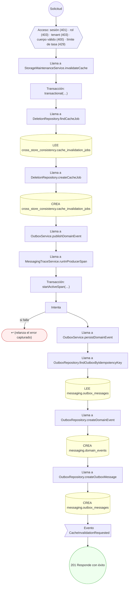

#### 10. POST /workers/deletion-requests/{id}/expand

Expandir la solicitud a objetivos por store

| HTTP | Código | Cuándo |
|---|---|---|
| 201 | — | Éxito |
| 400 | `VALIDATION_FAILED` | Los parámetros de ruta son UUID válidos; El cuerpo cumple el DTO (sin propiedades extra) |
| 401 | `UNAUTHENTICATED` | Hay una sesión válida (JWT) |
| 403 | `FORBIDDEN` | El rol está permitido; El tenant se resuelve y pertenece al actor |
| 404 | `NOT_FOUND` | ResourceNotFoundException: Solicitud de borrado no encontrada. |
| 422 | `PRECONDITION_FAILED` | PreconditionFailedException: La solicitud ya no admite expansión. |
| 429 | `RATE_LIMITED` | No se supera el límite de solicitudes |

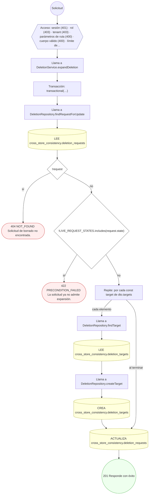

#### 11. POST /workers/deletion-targets/{id}/executions

Ejecutar el borrado en el store destino

| HTTP | Código | Cuándo |
|---|---|---|
| 201 | — | Éxito |
| 400 | `VALIDATION_FAILED` | Los parámetros de ruta son UUID válidos; El cuerpo cumple el DTO (sin propiedades extra) |
| 401 | `UNAUTHENTICATED` | Hay una sesión válida (JWT) |
| 403 | `FORBIDDEN` | El rol está permitido; El tenant se resuelve y pertenece al actor |
| 404 | `NOT_FOUND` | ResourceNotFoundException: Objetivo de borrado no encontrado. |
| 422 | `PRECONDITION_FAILED` | PreconditionFailedException: El objetivo está bloqueado por retención legal; no se borra.; PreconditionFailedException: El objetivo no está en un estado que admita ejecución. |
| 429 | `RATE_LIMITED` | No se supera el límite de solicitudes |

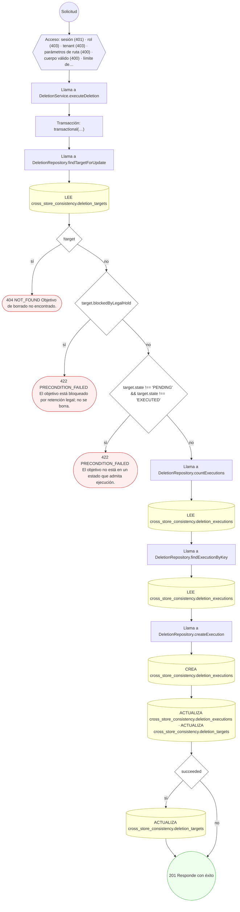

#### 12. POST /workers/deletion-targets/{id}/verifications

Verificar la ausencia en el store

| HTTP | Código | Cuándo |
|---|---|---|
| 201 | — | Éxito |
| 400 | `VALIDATION_FAILED` | Los parámetros de ruta son UUID válidos; El cuerpo cumple el DTO (sin propiedades extra) |
| 401 | `UNAUTHENTICATED` | Hay una sesión válida (JWT) |
| 403 | `FORBIDDEN` | El rol está permitido; El tenant se resuelve y pertenece al actor |
| 404 | `NOT_FOUND` | ResourceNotFoundException: Objetivo de borrado no encontrado. |
| 422 | `PRECONDITION_FAILED` | PreconditionFailedException: El objetivo tiene que estar ejecutado para poder verificarse. |
| 429 | `RATE_LIMITED` | No se supera el límite de solicitudes |

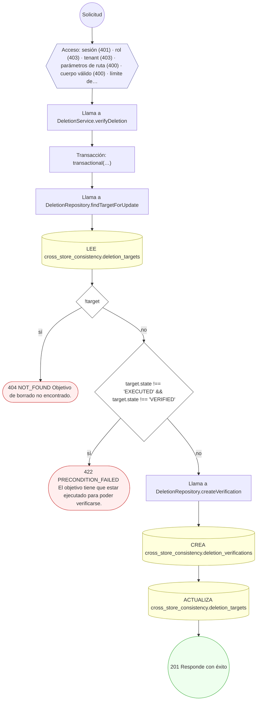

#### 13. POST /workers/projections/dead-letters

Mandar el intento fallido a la cola muerta

| HTTP | Código | Cuándo |
|---|---|---|
| 201 | — | Éxito |
| 400 | `VALIDATION_FAILED` | El cuerpo cumple el DTO (sin propiedades extra) |
| 401 | `UNAUTHENTICATED` | Hay una sesión válida (JWT) |
| 403 | `FORBIDDEN` | El rol está permitido; El tenant se resuelve y pertenece al actor |
| 404 | `NOT_FOUND` | ResourceNotFoundException: Intento de entrega no encontrado. |
| 422 | `PRECONDITION_FAILED` | PreconditionFailedException: La suscripción no tiene cola muerta habilitada. |
| 429 | `RATE_LIMITED` | No se supera el límite de solicitudes |

```mermaid
flowchart TD
  n1(("Solicitud")):::inicio
  n2{{"Acceso: sesión (401) · rol (403) · tenant (403) · cuerpo válido (400) · límite de tasa (429)"}}:::acceso
  n1 --> n2
  n3["Llama a ProjectionDeliveryService.sendToDeadLetter"]:::llamada
  n2 --> n3
  n4["Transacción: transactional(…)"]:::transaccion
  n3 --> n4
  n5["Llama a ProjectionRepository.findAttemptForUpdate"]:::llamada
  n4 --> n5
  n6[("LEE cross_store_consistency.projection_delivery_attempts")]:::efecto
  n5 --> n6
  n7{"!attempt"}:::decision
  n6 --> n7
  n8(["404 NOT_FOUND Intento de entrega no encontrado."]):::error
  n7 -->|"sí"| n8
  n9["Llama a ProjectionRepository.findSubscriptionById"]:::llamada
  n7 -->|"no"| n9
  n10[("LEE cross_store_consistency.projection_subscriptions")]:::efecto
  n9 --> n10
  n11{"!subscription?.deadLetterEnabled"}:::decision
  n10 --> n11
  n12(["422 PRECONDITION_FAILED La suscripción no tiene cola muerta habilitada."]):::error
  n11 -->|"sí"| n12
  n13["Llama a ProjectionRepository.findDeadLetterByAttempt"]:::llamada
  n11 -->|"no"| n13
  n14[("LEE cross_store_consistency.projection_dead_letters")]:::efecto
  n13 --> n14
  n15[("ACTUALIZA cross_store_consistency.projection_delivery_attempts · ACTUALIZA cross_store_consistency.projection…")]:::efecto
  n14 --> n15
  n16["Llama a ProjectionRepository.createDeadLetter"]:::llamada
  n15 --> n16
  n17[("CREA cross_store_consistency.projection_dead_letters")]:::efecto
  n16 --> n17
  n18["Llama a OutboxService.publishDomainEvent"]:::llamada
  n17 --> n18
  n19["Llama a MessagingTraceService.runInProducerSpan"]:::llamada
  n18 --> n19
  n20["Transacción: startActiveSpan(…)"]:::transaccion
  n19 --> n20
  n21["Intenta"]:::intento
  n20 --> n21
  n22(["↩ (relanza el error capturado)"]):::error
  n21 -->|"si falla"| n22
  n23["Llama a OutboxService.persistDomainEvent"]:::llamada
  n21 --> n23
  n24["Llama a OutboxRepository.findOutboxByIdempotencyKey"]:::llamada
  n23 --> n24
  n25[("LEE messaging.outbox_messages")]:::efecto
  n24 --> n25
  n26["Llama a OutboxRepository.createDomainEvent"]:::llamada
  n25 --> n26
  n27[("CREA messaging.domain_events")]:::efecto
  n26 --> n27
  n28["Llama a OutboxRepository.createOutboxMessage"]:::llamada
  n27 --> n28
  n29[("CREA messaging.outbox_messages")]:::efecto
  n28 --> n29
  n30>"Evento ProjectionDeadLettered"]:::evento
  n29 --> n30
  n31(("201 Responde con éxito")):::ok
  n30 --> n31
  classDef acceso fill:#eef,stroke:#66a
  classDef error fill:#fee,stroke:#c33
  classDef ok fill:#efe,stroke:#3a3
  classDef efecto fill:#ffd,stroke:#aa3
  classDef decision fill:#fff,stroke:#555
  classDef corte fill:#eee,stroke:#999,stroke-dasharray: 4
```

#### 14. POST /workers/projections/deliveries/process

Registrar la entrega y avanzar el checkpoint

| HTTP | Código | Cuándo |
|---|---|---|
| 200 | — | Éxito |
| 400 | `VALIDATION_FAILED` | El cuerpo cumple el DTO (sin propiedades extra) |
| 401 | `UNAUTHENTICATED` | Hay una sesión válida (JWT) |
| 403 | `FORBIDDEN` | El rol está permitido; El tenant se resuelve y pertenece al actor |
| 404 | `NOT_FOUND` | ResourceNotFoundException: Suscripción de proyección no encontrada. |
| 422 | `PRECONDITION_FAILED` | PreconditionFailedException: La suscripción no está activa. |
| 429 | `RATE_LIMITED` | No se supera el límite de solicitudes |

```mermaid
flowchart TD
  n1(("Solicitud")):::inicio
  n2{{"Acceso: sesión (401) · rol (403) · tenant (403) · cuerpo válido (400) · límite de tasa (429)"}}:::acceso
  n1 --> n2
  n3["Llama a ProjectionDeliveryService.processDelivery"]:::llamada
  n2 --> n3
  n4["Transacción: transactional(…)"]:::transaccion
  n3 --> n4
  n5["Llama a ProjectionRepository.findSubscriptionById"]:::llamada
  n4 --> n5
  n6[("LEE cross_store_consistency.projection_subscriptions")]:::efecto
  n5 --> n6
  n7{"!subscription"}:::decision
  n6 --> n7
  n8(["404 NOT_FOUND Suscripción de proyección no encontrada."]):::error
  n7 -->|"sí"| n8
  n9{"subscription.state !== 'ACTIVE'"}:::decision
  n7 -->|"no"| n9
  n10(["422 PRECONDITION_FAILED La suscripción no está activa."]):::error
  n9 -->|"sí"| n10
  n11["Llama a ProjectionRepository.findAttemptByIdempotencyKey"]:::llamada
  n9 -->|"no"| n11
  n12[("LEE cross_store_consistency.projection_delivery_attempts")]:::efecto
  n11 --> n12
  n13["Llama a ProjectionRepository.countAttempts"]:::llamada
  n12 --> n13
  n14[("LEE cross_store_consistency.projection_delivery_attempts")]:::efecto
  n13 --> n14
  n15["Llama a ProjectionRepository.createAttempt"]:::llamada
  n14 --> n15
  n16[("CREA cross_store_consistency.projection_delivery_attempts")]:::efecto
  n15 --> n16
  n17[("ACTUALIZA cross_store_consistency.projection_delivery_attempts · ACTUALIZA cross_store_consistency.projection…")]:::efecto
  n16 --> n17
  n18{"failed"}:::decision
  n17 --> n18
  n19[("ACTUALIZA cross_store_consistency.projection_delivery_attempts")]:::efecto
  n18 -->|"sí"| n19
  n20["Llama a ProjectionDeliveryService.touchConsumer"]:::llamada
  n19 --> n20
  n18 -->|"no"| n20
  n21["Llama a ProjectionRepository.findConsumerByCodeForUpdate"]:::llamada
  n20 --> n21
  n22[("LEE cross_store_consistency.projection_consumers")]:::efecto
  n21 --> n22
  n23{"consumer"}:::decision
  n22 --> n23
  n24[("ACTUALIZA cross_store_consistency.projection_consumers · ACTUALIZA cross_store_consistency.projection_consume…")]:::efecto
  n23 -->|"sí"| n24
  n25["Llama a ProjectionRepository.createConsumer"]:::llamada
  n24 --> n25
  n23 -->|"no"| n25
  n26[("CREA cross_store_consistency.projection_consumers")]:::efecto
  n25 --> n26
  n27["Llama a ProjectionDeliveryService.advanceCheckpoint"]:::llamada
  n26 --> n27
  n28["Llama a ProjectionRepository.findCheckpointForUpdate"]:::llamada
  n27 --> n28
  n29[("LEE cross_store_consistency.projection_checkpoints")]:::efecto
  n28 --> n29
  n30{"!existing"}:::decision
  n29 --> n30
  n31["Llama a ProjectionRepository.createCheckpoint"]:::llamada
  n30 -->|"sí"| n31
  n32[("CREA cross_store_consistency.projection_checkpoints")]:::efecto
  n31 --> n32
  n33[("ACTUALIZA cross_store_consistency.projection_checkpoints · ACTUALIZA cross_store_consistency.projection_check…")]:::efecto
  n32 --> n33
  n30 -->|"no"| n33
  n34{"dto.targetVersion"}:::decision
  n33 --> n34
  n35[("ACTUALIZA cross_store_consistency.projection_checkpoints")]:::efecto
  n34 -->|"sí"| n35
  n36[("ACTUALIZA cross_store_consistency.projection_checkpoints")]:::efecto
  n35 --> n36
  n34 -->|"no"| n36
  n37(("200 Responde con éxito")):::ok
  n36 --> n37
  classDef acceso fill:#eef,stroke:#66a
  classDef error fill:#fee,stroke:#c33
  classDef ok fill:#efe,stroke:#3a3
  classDef efecto fill:#ffd,stroke:#aa3
  classDef decision fill:#fff,stroke:#555
  classDef corte fill:#eee,stroke:#999,stroke-dasharray: 4
```

### Operaciones sin decisiones propias

Sólo comprueban el acceso y leen o escriben: no tienen ramas que dibujar. Su detalle está en la ficha de endpoints.

| Operación | Respuestas posibles | Tablas |
|---|---|---|
| GET /workers/deletion-targets/executed | 200, 400, 401, 403, 429 | 1 |
| GET /workers/deletion-targets/pending | 200, 400, 401, 403, 429 | 1 |
