<!-- AUTOGENERADO por tools/inventario/flujos.mjs. No editar manualmente. -->

# Flujos del módulo `data_catalog`

- **Procesos:** 1 · **Máquinas de estado:** 0
- **Operaciones:** 50 (42 con decisiones propias, 8 sin ellas)
- Inventario de endpoints del módulo: [data_catalog](../endpoints/data_catalog.md)

## Proceso: Módulo 67 — Catálogo de datos y portal administrativo

- **Código:** `data_catalog` · **Agrupación:** MIXTO · **Operaciones:** 50
- **Actores:** ...PORTAL_VIEW_ROLES · AUDITOR · DATA_GOVERNANCE_ADMIN · DATA_PLATFORM_ADMIN · DATA_STEWARD · DPO · GOVERNANCE_ADMIN · PLATFORM_ADMIN · SECURITY_ADMIN · SYSTEM
- **Revisión:** AUTO_DETECTADA
- **Fuentes:** `src/modules/data_catalog/README.md`

### Para qué sirve

Dos mitades que no se mezclan. `admin/portal/*` sirve el **inventario generado** del sistema (operaciones, flujos, catálogo estático, linaje, glosario) sin tocar la base. `admin/catalog/*` es el **catálogo vivo**: lo que un escaneo de `pg_catalog` observa de la base primaria y lo que el equipo de datos curó encima (fichas, evidencia, revisiones), sobre el esquema `data_catalog`.

_Fuente: `src/modules/data_catalog/README.md:3`_

### Flujo general declarado en el README

```text
POST /admin/catalog/scans (Idempotency-Key)
  └─ 202 QUEUED ── commit ──> escaneo fuera de la petición (lease de 300 s)
       └─ lee pg_catalog en una transacción de sólo lectura
            └─ planScan: compara con lo conocido -> altas / cambios / no observados / reaparecidos
                 └─ catalog_objects + catalog_columns + catalog_change_events (lo curado no se toca)

ficha de un objeto:   PUT annotation (expectedVersion) ──> revisión N inmutable
  └─ submit=true: exige propósito, razón de existir y grano de fila (o una pregunta abierta por campo)
       └─ NEEDS_REVIEW ──> POST review (otro usuario, con evidencia) ──> APPROVED | REJECTED
            └─ editar una ficha aprobada la devuelve a DRAFT: la aprobación deja de ser vigente

sonda (worker scan-tick, cada pocos segundos): POST /internal/catalog/scans/run-next
  ├─ cierra los escaneos abandonados (lease vencido) ── failAbandoned
  ├─ retoma el escaneo en cola, si lo hay
  └─ si no hay ninguno y pasaron PROBE_INTERVAL_MS desde que terminó el último → pide uno y lo ejecuta
       └─ al terminar bien: clasificación automática de las columnas nuevas o cambiadas

importación del inventario (worker scan-tick, tras un escaneo SUCCEEDED): POST /internal/catalog/inventory/import
  └─ pg_advisory_xact_lock: una importación a la vez
       └─ planImport: compara inventario/ con las cinco tablas -> altas / cambios / sin cambios / NOT_OBSERVED / reaparecidas
            └─ catalog_operations + catalog_operation_impacts + catalog_processes + catalog_process_steps + catalog_process_step_operations
               (todo en una transacción; lo que no cambió no se toca ni sube row_version)

columna: PUT columns/:id/annotation  /  POST columns/:id/evidence   (mismas reglas que la tabla)
clasificación automática ──> ficha de columna en AUTO_DETECTED (certeza) o NEEDS_REVIEW (duda)
  └─ una persona que guarda la ficha la saca de AUTO_DETECTED (queda DRAFT o NEEDS_REVIEW, origin MANUAL)
```

_Fuente: `src/modules/data_catalog/README.md:99`_

### Etapas y operaciones

| Etapa | Descripción | Operación | Quién actúa | Riesgo | Tablas |
|---|---|---|---|---|---|
| `UC-67-01` | Versión y huella del inventario servido | GET /admin/portal/version | ...PORTAL_VIEW_ROLES | BAJO | 0 |
| `UC-67-02` | Listar operaciones del sistema, con filtros | GET /admin/portal/operaciones | ...PORTAL_VIEW_ROLES | BAJO | 0 |
| `UC-67-03` | Ficha de una operación: tablas, DTO, requisitos, flujo | GET /admin/portal/operaciones/{id} | ...PORTAL_VIEW_ROLES | BAJO | 0 |
| `UC-67-04` | Árbol de decisión de una operación | GET /admin/portal/operaciones/{id}/arbol | ...PORTAL_VIEW_ROLES | BAJO | 0 |
| `UC-67-05` | Listar procesos | GET /admin/portal/flujos | ...PORTAL_VIEW_ROLES | BAJO | 0 |
| `UC-67-06` | Mapa de procesos y hallazgos del recorrido | GET /admin/portal/flujos/mapa | ...PORTAL_VIEW_ROLES | BAJO | 0 |
| `UC-67-07` | Listar hallazgos del inventario de flujos | GET /admin/portal/flujos/hallazgos | ...PORTAL_VIEW_ROLES | BAJO | 0 |
| `UC-67-08` | Un hallazgo | GET /admin/portal/flujos/hallazgos/{id} | ...PORTAL_VIEW_ROLES | BAJO | 0 |
| `UC-67-09` | Detalle de un proceso | GET /admin/portal/flujos/{codigo} | ...PORTAL_VIEW_ROLES | BAJO | 0 |
| `UC-67-10` | Grafo de un proceso | GET /admin/portal/flujos/{codigo}/grafo | ...PORTAL_VIEW_ROLES | BAJO | 0 |
| `UC-67-11` | Tablas del catálogo estático (modelo), paginadas | GET /admin/portal/catalogo/tablas | ...PORTAL_VIEW_ROLES | BAJO | 0 |
| `UC-67-12` | Ficha de una tabla: columnas, relaciones, índices | GET /admin/portal/catalogo/tablas/{schema}/{tabla} | ...PORTAL_VIEW_ROLES | BAJO | 0 |
| `UC-67-13` | Deriva entre modelo, ORM y base desplegada | GET /admin/portal/catalogo/deriva | ...PORTAL_VIEW_ROLES | BAJO | 0 |
| `UC-67-14` | Grafo de linaje endpoint → tabla | GET /admin/portal/linaje | ...PORTAL_VIEW_ROLES | BAJO | 0 |
| `UC-67-15` | Linaje de una tabla | GET /admin/portal/linaje/tablas/{schema}/{tabla} | ...PORTAL_VIEW_ROLES | BAJO | 0 |
| `UC-67-16` | Glosario de dominio | GET /admin/portal/glosario | ...PORTAL_VIEW_ROLES | BAJO | 0 |
| `UC-67-17` | Schemas observados, con fichas y aprobaciones | GET /admin/catalog/schemas | ...PORTAL_VIEW_ROLES | BAJO | 2 |
| `UC-67-18` | Objetos observados, con filtros y cursor | GET /admin/catalog/objects | ...PORTAL_VIEW_ROLES | BAJO | 3 |
| `UC-67-19` | Ficha técnica, observación, ficha curada, cobertura | GET /admin/catalog/objects/{id} | ...PORTAL_VIEW_ROLES | BAJO | 5 |
| `UC-67-20` | Columnas observadas con su ficha | GET /admin/catalog/objects/{id}/columns | ...PORTAL_VIEW_ROLES | BAJO | 4 |
| `UC-67-21` | Evidencia enlazada | GET /admin/catalog/objects/{id}/evidence | ...PORTAL_VIEW_ROLES | BAJO | 3 |
| `UC-67-22` | Enlazar evidencia | POST /admin/catalog/objects/{id}/evidence | GOVERNANCE_ADMIN · DATA_PLATFORM_ADMIN · DATA_STEWARD | MEDIO | 3 |
| `UC-67-23` | Revisiones y decisiones de la ficha | GET /admin/catalog/objects/{id}/history | ...PORTAL_VIEW_ROLES | BAJO | 5 |
| `UC-67-24` | Cambios que los escaneos detectaron | GET /admin/catalog/objects/{id}/changes | ...PORTAL_VIEW_ROLES | BAJO | 4 |
| `UC-67-25` | Análisis de impacto por claves foráneas observadas | GET /admin/catalog/objects/{id}/impact | ...PORTAL_VIEW_ROLES | BAJO | 4 |
| `UC-67-26` | Crear o editar la ficha (con versión esperada) | PUT /admin/catalog/objects/{id}/annotation | GOVERNANCE_ADMIN · DATA_PLATFORM_ADMIN · DATA_STEWARD | MEDIO | 6 |
| `UC-67-27` | Aprobar o rechazar la revisión vigente | POST /admin/catalog/annotations/{id}/review | GOVERNANCE_ADMIN · DATA_PLATFORM_ADMIN · DATA_STEWARD | MEDIO | 5 |
| `UC-67-28` | Cobertura del catálogo por dimensión | GET /admin/catalog/coverage | ...PORTAL_VIEW_ROLES | BAJO | 3 |
| `UC-67-29` | Listar escaneos | GET /admin/catalog/scans | ...PORTAL_VIEW_ROLES | BAJO | 1 |
| `UC-67-30` | Un escaneo | GET /admin/catalog/scans/{id} | ...PORTAL_VIEW_ROLES | BAJO | 1 |
| `UC-67-31` | Pedir un escaneo de la base primaria (202, idempotente) | POST /admin/catalog/scans | GOVERNANCE_ADMIN · DATA_PLATFORM_ADMIN · DATA_STEWARD | MEDIO | 15 |
| `ctrl:AdminCatalogController` | Operaciones de AdminCatalogController que el README no asigna a un caso de uso | POST /admin/catalog/classification/run | GOVERNANCE_ADMIN · DATA_PLATFORM_ADMIN · DATA_STEWARD | MEDIO | 7 |
|  |  | PUT /admin/catalog/columns/{id}/annotation | GOVERNANCE_ADMIN · DATA_PLATFORM_ADMIN · DATA_STEWARD | MEDIO | 5 |
|  |  | GET /admin/catalog/columns/{id}/evidence | ...PORTAL_VIEW_ROLES | BAJO | 2 |
|  |  | POST /admin/catalog/columns/{id}/evidence | GOVERNANCE_ADMIN · DATA_PLATFORM_ADMIN · DATA_STEWARD | MEDIO | 2 |
|  |  | GET /admin/catalog/permission-drift | ...PORTAL_VIEW_ROLES | BAJO | 1 |
|  |  | GET /admin/catalog/pii/columns | ...PORTAL_VIEW_ROLES | BAJO | 5 |
|  |  | GET /admin/catalog/pii/reconciliation | ...PORTAL_VIEW_ROLES | BAJO | 5 |
|  |  | GET /admin/catalog/pii/summary | ...PORTAL_VIEW_ROLES | BAJO | 5 |
|  |  | GET /admin/catalog/quality/issues | ...PORTAL_VIEW_ROLES | BAJO | 3 |
|  |  | GET /admin/catalog/quality/rules | ...PORTAL_VIEW_ROLES | BAJO | 3 |
| `ctrl:AdminCatalogFitController` | Operaciones de AdminCatalogFitController que el README no asigna a un caso de uso | GET /admin/catalog/fit | SECURITY_ADMIN · PLATFORM_ADMIN · GOVERNANCE_ADMIN · DATA_PLATFORM_ADMIN · DPO · AUDITOR · DATA_STEWARD | BAJO | 0 |
|  |  | POST /admin/catalog/fit/run | GOVERNANCE_ADMIN · DATA_PLATFORM_ADMIN · DATA_STEWARD | BAJO | 5 |
| `ctrl:AdminPortalController` | Operaciones de AdminPortalController que el README no asigna a un caso de uso | GET /admin/portal/linaje/aristas | ...PORTAL_VIEW_ROLES | BAJO | 0 |
|  |  | GET /admin/portal/linaje/nodos | ...PORTAL_VIEW_ROLES | BAJO | 0 |
| `ctrl:GovernanceQueueController` | Operaciones de GovernanceQueueController que el README no asigna a un caso de uso | GET /admin/governance/jobs | SECURITY_ADMIN · PLATFORM_ADMIN · GOVERNANCE_ADMIN · DATA_GOVERNANCE_ADMIN · DATA_PLATFORM_ADMIN · DPO · AUDITOR · DATA_STEWARD | BAJO | 4 |
|  |  | GET /admin/governance/review-queue | SECURITY_ADMIN · PLATFORM_ADMIN · GOVERNANCE_ADMIN · DATA_GOVERNANCE_ADMIN · DATA_PLATFORM_ADMIN · DPO · AUDITOR · DATA_STEWARD | BAJO | 4 |
| `ctrl:InternalCatalogFitController` | Operaciones de InternalCatalogFitController que el README no asigna a un caso de uso | POST /internal/catalog/fit/run | SYSTEM | BAJO | 5 |
| `ctrl:InternalCatalogInventoryController` | Operaciones de InternalCatalogInventoryController que el README no asigna a un caso de uso | POST /internal/catalog/inventory/import | SYSTEM | ALTO | 15 |
| `ctrl:InternalCatalogScansController` | Operaciones de InternalCatalogScansController que el README no asigna a un caso de uso | POST /internal/catalog/scans/run-next | SYSTEM | MEDIO | 15 |

### Diagrama 1 de 3 — etapas `UC-67-01`, `UC-67-02`, `UC-67-03`…

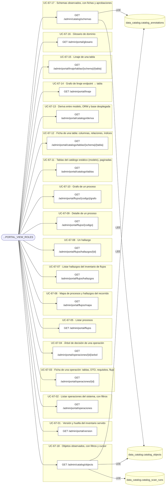

### Diagrama 2 de 3 — etapas `UC-67-19`, `UC-67-20`, `UC-67-21`…

```mermaid
flowchart LR
  a2(["...PORTAL_VIEW_ROLES"]):::actor
  a12(["GOVERNANCE_ADMIN · DATA_PLATFORM_ADMIN · DATA_STEWARD"]):::actor
  t3[("data_catalog.catalog_annotations")]:::tabla
  t4[("data_catalog.catalog_evidence_items")]:::tabla
  t5[("data_catalog.catalog_objects")]:::tabla
  t6[("data_catalog.catalog_scan_runs")]:::tabla
  t7[("system_ops.entity_registry")]:::tabla
  t9[("data_catalog.catalog_columns")]:::tabla
  t14[("data_catalog.catalog_annotation_revisions")]:::tabla
  t15[("data_catalog.catalog_review_decisions")]:::tabla
  t17[("data_catalog.catalog_change_events")]:::tabla
  subgraph s0["UC-67-19 · Ficha técnica, observación, ficha curada, cobertura"]
    o1["GET /admin/catalog/objects/{id}"]:::op
  end
  subgraph s1["UC-67-20 · Columnas observadas con su ficha"]
    o8["GET /admin/catalog/objects/{id}/columns"]:::op
  end
  subgraph s2["UC-67-21 · Evidencia enlazada"]
    o10["GET /admin/catalog/objects/{id}/evidence"]:::op
  end
  subgraph s3["UC-67-22 · Enlazar evidencia"]
    o11["POST /admin/catalog/objects/{id}/evidence"]:::op
  end
  subgraph s4["UC-67-23 · Revisiones y decisiones de la ficha"]
    o13["GET /admin/catalog/objects/{id}/history"]:::op
  end
  subgraph s5["UC-67-24 · Cambios que los escaneos detectaron"]
    o16["GET /admin/catalog/objects/{id}/changes"]:::op
  end
  subgraph s6["UC-67-25 · Análisis de impacto por claves foráneas observadas"]
    o18["GET /admin/catalog/objects/{id}/impact"]:::op
  end
  subgraph s7["UC-67-26 · Crear o editar la ficha (con versión esperada)"]
    o19["PUT /admin/catalog/objects/{id}/annotation"]:::op
  end
  subgraph s8["UC-67-27 · Aprobar o rechazar la revisión vigente"]
    o20["POST /admin/catalog/annotations/{id}/review"]:::op
  end
  subgraph s9["UC-67-28 · Cobertura del catálogo por dimensión"]
    o21["GET /admin/catalog/coverage"]:::op
  end
  subgraph s10["UC-67-29 · Listar escaneos"]
    o22["GET /admin/catalog/scans"]:::op
  end
  subgraph s11["UC-67-30 · Un escaneo"]
    o23["GET /admin/catalog/scans/{id}"]:::op
  end
  t25[("+9 tablas más")]
  subgraph s12["UC-67-31 · Pedir un escaneo de la base primaria (202, idempotente)"]
    o24["POST /admin/catalog/scans"]:::op
  end
  a2 --> o1
  o1 -->|"LEE"| t3
  o1 -->|"LEE"| t4
  o1 -->|"LEE"| t5
  o1 -->|"LEE"| t6
  o1 -->|"LEE"| t7
  a2 --> o8
  o8 -->|"LEE"| t3
  o8 -->|"LEE"| t9
  o8 -->|"LEE"| t5
  o8 -->|"LEE"| t6
  a2 --> o10
  o10 -->|"LEE"| t4
  o10 -->|"LEE"| t5
  o10 -->|"LEE"| t6
  a12 --> o11
  o11 -->|"CREA"| t4
  o11 -->|"LEE"| t5
  o11 -->|"LEE"| t6
  a2 --> o13
  o13 -->|"LEE"| t14
  o13 -->|"LEE"| t3
  o13 -->|"LEE"| t5
  o13 -->|"LEE"| t15
  o13 -->|"LEE"| t6
  a2 --> o16
  o16 -->|"LEE"| t17
  o16 -->|"LEE"| t9
  o16 -->|"LEE"| t5
  o16 -->|"LEE"| t6
  a2 --> o18
  o18 -->|"LEE"| t3
  o18 -->|"LEE"| t9
  o18 -->|"LEE"| t5
  o18 -->|"LEE"| t6
  a12 --> o19
  o19 -->|"CREA"| t14
  o19 -->|"CREA"| t3
  o19 -->|"ACTUALIZA"| t3
  o19 -->|"LEE"| t3
  o19 -->|"LEE"| t5
  o19 -->|"LEE"| t6
  a12 --> o20
  o20 -->|"LEE"| t14
  o20 -->|"ACTUALIZA"| t3
  o20 -->|"LEE"| t3
  o20 -->|"LEE"| t4
  o20 -->|"CREA"| t15
  a2 --> o21
  o21 -->|"LEE"| t3
  o21 -->|"LEE"| t5
  o21 -->|"LEE"| t6
  a2 --> o22
  o22 -->|"LEE"| t6
  a2 --> o23
  o23 -->|"LEE"| t6
  a12 --> o24
  o24 -->|"CREA"| t14
  o24 -->|"CREA"| t3
  o24 -->|"ACTUALIZA"| t3
  o24 -->|"LEE"| t3
  o24 -->|"CREA"| t17
  o24 -->|"LEE"| t17
  o24 -.-> t25
  classDef op fill:#fff,stroke:#446
  classDef actor fill:#eef,stroke:#66a
  classDef tabla fill:#ffd,stroke:#aa3
  classDef evento fill:#efe,stroke:#3a3
```

### Diagrama 3 de 3 — etapas `ctrl:AdminCatalogController`, `ctrl:AdminCatalogFitController`, `ctrl:AdminPortalController`…

```mermaid
flowchart LR
  a2(["GOVERNANCE_ADMIN · DATA_PLATFORM_ADMIN · DATA_STEWARD"]):::actor
  a10(["...PORTAL_VIEW_ROLES"]):::actor
  a24(["SECURITY_ADMIN · PLATFORM_ADMIN · GOVERNANCE_ADMIN · DATA_P…"]):::actor
  a31(["SECURITY_ADMIN · PLATFORM_ADMIN · GOVERNANCE_ADMIN · DATA_G…"]):::actor
  a37(["SYSTEM"]):::actor
  t3[("data_catalog.catalog_annotation_revisions")]:::tabla
  t4[("data_catalog.catalog_annotations")]:::tabla
  t5[("data_catalog.catalog_change_events")]:::tabla
  t6[("data_catalog.catalog_columns")]:::tabla
  t11[("data_catalog.catalog_evidence_items")]:::tabla
  t14[("authz.roles")]:::tabla
  t16[("data_catalog.catalog_objects")]:::tabla
  t17[("system_ops.entity_registry")]:::tabla
  t18[("system_ops.field_registry")]:::tabla
  t26[("data_catalog.catalog_operations")]:::tabla
  t27[("data_catalog.catalog_scan_runs")]:::tabla
  t32[("audit.audit_log")]:::tabla
  t33[("system_ops.retention_executions")]:::tabla
  t34[("terminology.catalog_concepts")]:::tabla
  t39[("data_catalog.catalog_operation_impacts")]:::tabla
  t7[("+1 tablas más")]
  subgraph s0["ctrl:AdminCatalogController · Operaciones de AdminCatalogController que el READ…"]
    o1["POST /admin/catalog/classification/run"]:::op
    o8["PUT /admin/catalog/columns/{id}/annotation"]:::op
    o9["GET /admin/catalog/columns/{id}/evidence"]:::op
    o12["POST /admin/catalog/columns/{id}/evidence"]:::op
    o13["GET /admin/catalog/permission-drift"]:::op
    o15["GET /admin/catalog/pii/columns"]:::op
    o19["GET /admin/catalog/pii/reconciliation"]:::op
    o20["GET /admin/catalog/pii/summary"]:::op
    o21["GET /admin/catalog/quality/issues"]:::op
    o22["GET /admin/catalog/quality/rules"]:::op
  end
  subgraph s1["ctrl:AdminCatalogFitController · Operaciones de AdminCatalogFitController que e…"]
    o23["GET /admin/catalog/fit"]:::op
    o25["POST /admin/catalog/fit/run"]:::op
  end
  subgraph s2["ctrl:AdminPortalController · Operaciones de AdminPortalController que el README…"]
    o28["GET /admin/portal/linaje/aristas"]:::op
    o29["GET /admin/portal/linaje/nodos"]:::op
  end
  subgraph s3["ctrl:GovernanceQueueController · Operaciones de GovernanceQueueController que e…"]
    o30["GET /admin/governance/jobs"]:::op
    o35["GET /admin/governance/review-queue"]:::op
  end
  subgraph s4["ctrl:InternalCatalogFitController · Operaciones de InternalCatalogFitController…"]
    o36["POST /internal/catalog/fit/run"]:::op
  end
  t40[("+9 tablas más")]
  subgraph s5["ctrl:InternalCatalogInventoryController · Operaciones de InternalCatalogInvento…"]
    o38["POST /internal/catalog/inventory/import"]:::op
  end
  t42[("+9 tablas más")]
  subgraph s6["ctrl:InternalCatalogScansController · Operaciones de InternalCatalogScansContro…"]
    o41["POST /internal/catalog/scans/run-next"]:::op
  end
  a2 --> o1
  o1 -->|"CREA"| t3
  o1 -->|"CREA"| t4
  o1 -->|"ACTUALIZA"| t4
  o1 -->|"LEE"| t4
  o1 -->|"LEE"| t5
  o1 -->|"LEE"| t6
  o1 -.-> t7
  a2 --> o8
  o8 -->|"CREA"| t3
  o8 -->|"CREA"| t4
  o8 -->|"ACTUALIZA"| t4
  o8 -->|"LEE"| t4
  o8 -->|"LEE"| t6
  a10 --> o9
  o9 -->|"LEE"| t6
  o9 -->|"LEE"| t11
  a2 --> o12
  o12 -->|"LEE"| t6
  o12 -->|"CREA"| t11
  a10 --> o13
  o13 -->|"LEE"| t14
  a10 --> o15
  o15 -->|"LEE"| t4
  o15 -->|"LEE"| t6
  o15 -->|"LEE"| t16
  o15 -->|"LEE"| t17
  o15 -->|"LEE"| t18
  a10 --> o19
  o19 -->|"LEE"| t4
  o19 -->|"LEE"| t6
  o19 -->|"LEE"| t16
  o19 -->|"LEE"| t17
  o19 -->|"LEE"| t18
  a10 --> o20
  o20 -->|"LEE"| t4
  o20 -->|"LEE"| t6
  o20 -->|"LEE"| t16
  o20 -->|"LEE"| t17
  o20 -->|"LEE"| t18
  a10 --> o21
  o21 -->|"LEE"| t4
  o21 -->|"LEE"| t6
  o21 -->|"LEE"| t16
  a10 --> o22
  o22 -->|"LEE"| t4
  o22 -->|"LEE"| t6
  o22 -->|"LEE"| t16
  a24 --> o23
  a2 --> o25
  o25 -->|"LEE"| t4
  o25 -->|"LEE"| t6
  o25 -->|"LEE"| t16
  o25 -->|"LEE"| t26
  o25 -->|"LEE"| t27
  a10 --> o28
  a10 --> o29
  a31 --> o30
  o30 -->|"LEE"| t32
  o30 -->|"LEE"| t27
  o30 -->|"LEE"| t33
  o30 -->|"LEE"| t34
  a31 --> o35
  o35 -->|"LEE"| t3
  o35 -->|"LEE"| t4
  o35 -->|"LEE"| t6
  o35 -->|"LEE"| t16
  a37 --> o36
  o36 -->|"LEE"| t4
  o36 -->|"LEE"| t6
  o36 -->|"LEE"| t16
  o36 -->|"LEE"| t26
  o36 -->|"LEE"| t27
  a37 --> o38
  o38 -->|"LEE"| t16
  o38 -->|"BORRA"| t39
  o38 -->|"CREA"| t39
  o38 -->|"CREA"| t26
  o38 -->|"ACTUALIZA"| t26
  o38 -->|"LEE"| t26
  o38 -.-> t40
  a37 --> o41
  o41 -->|"CREA"| t3
  o41 -->|"CREA"| t4
  o41 -->|"ACTUALIZA"| t4
  o41 -->|"LEE"| t4
  o41 -->|"CREA"| t5
  o41 -->|"LEE"| t5
  o41 -.-> t42
  classDef op fill:#fff,stroke:#446
  classDef actor fill:#eef,stroke:#66a
  classDef tabla fill:#ffd,stroke:#aa3
  classDef evento fill:#efe,stroke:#3a3
```

## Árbol de decisión por operación

Cada árbol se deriva del código del handler y de los métodos que invoca (hasta 4 niveles). Una rama que no decide, no escribe y no falla se poda. Los accesos y los efectos consecutivos se agrupan en un solo nodo.

### Operaciones con decisiones propias

#### 1. POST /admin/catalog/annotations/{id}/review

Aprueba o rechaza la revisión vigente de una ficha

| HTTP | Código | Cuándo |
|---|---|---|
| 200 | — | Éxito |
| 400 | `VALIDATION_FAILED` | El cuerpo cumple el DTO (sin propiedades extra) |
| 401 | `UNAUTHENTICATED` | Hay una sesión válida (JWT) |
| 403 | `FORBIDDEN` | El rol está permitido; El tenant se resuelve y pertenece al actor |
| 404 | `NOT_FOUND` | ResourceNotFoundException: Ficha no encontrada |
| 409 | `CONCURRENCY_CONFLICT` | ConcurrencyConflictException: {message}; ConcurrencyConflictException: La ficha cambió mientras se revisaba |
| 422 | `PRECONDITION_FAILED` | PreconditionFailedException: {message} |
| 429 | `RATE_LIMITED` | No se supera el límite de solicitudes |
| 500 | `INTERNAL` | DomainException: {403}; DomainException: {422} |

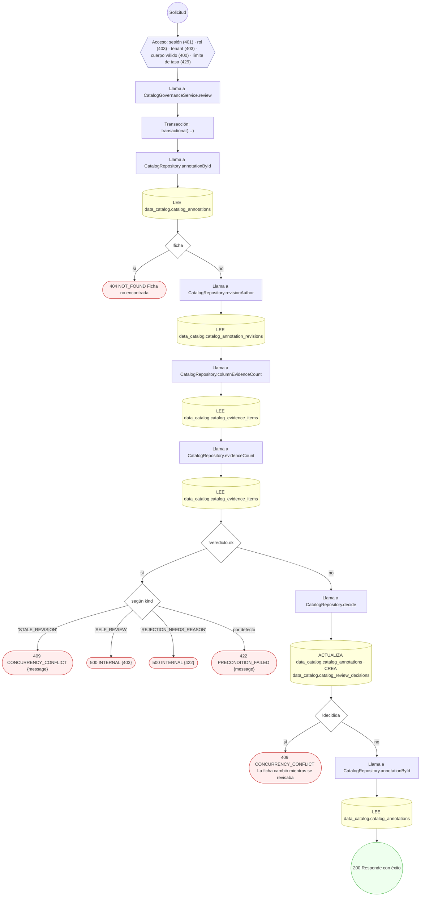

#### 2. POST /admin/catalog/classification/run

Corre la clasificación automática de sensibilidad sobre las columnas observadas

| HTTP | Código | Cuándo |
|---|---|---|
| 200 | — | Éxito |
| 400 | `VALIDATION_FAILED` | El cuerpo cumple el DTO (sin propiedades extra) |
| 401 | `UNAUTHENTICATED` | Hay una sesión válida (JWT) |
| 403 | `FORBIDDEN` | El rol está permitido; El tenant se resuelve y pertenece al actor |
| 429 | `RATE_LIMITED` | No se supera el límite de solicitudes |

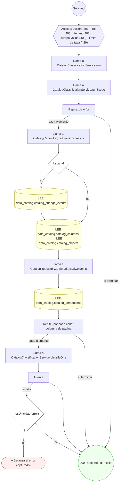

#### 3. PUT /admin/catalog/columns/{id}/annotation

Crea o edita la ficha de una columna (con versión esperada); guardar a mano saca la ficha de AUTO_DETECTED

| HTTP | Código | Cuándo |
|---|---|---|
| 200 | — | Éxito |
| 400 | `VALIDATION_FAILED` | El cuerpo cumple el DTO (sin propiedades extra) |
| 401 | `UNAUTHENTICATED` | Hay una sesión válida (JWT) |
| 403 | `FORBIDDEN` | El rol está permitido; El tenant se resuelve y pertenece al actor |
| 404 | `NOT_FOUND` | ResourceNotFoundException: Columna del catálogo no encontrada |
| 409 | `CONCURRENCY_CONFLICT` | ConcurrencyConflictException: La ficha cambió desde que se leyó |
| 429 | `RATE_LIMITED` | No se supera el límite de solicitudes |
| 500 | `INTERNAL` | DomainException: {422} |

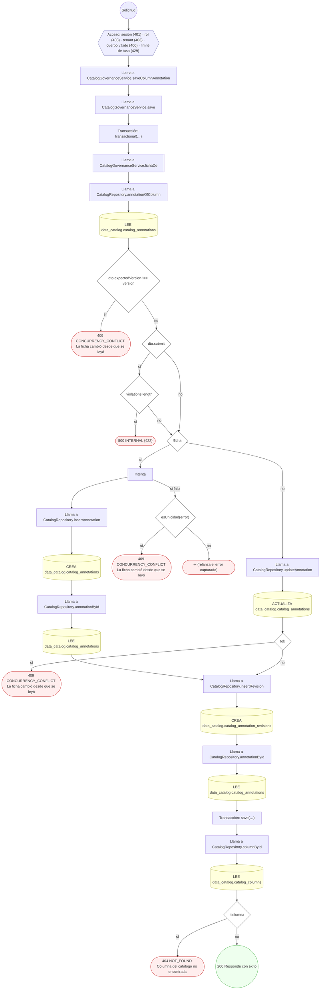

#### 4. GET /admin/catalog/columns/{id}/evidence

Evidencia enlazada a una columna

| HTTP | Código | Cuándo |
|---|---|---|
| 200 | — | Éxito |
| 401 | `UNAUTHENTICATED` | Hay una sesión válida (JWT) |
| 403 | `FORBIDDEN` | El rol está permitido; El tenant se resuelve y pertenece al actor |
| 404 | `NOT_FOUND` | ResourceNotFoundException: Columna del catálogo no encontrada |
| 429 | `RATE_LIMITED` | No se supera el límite de solicitudes |

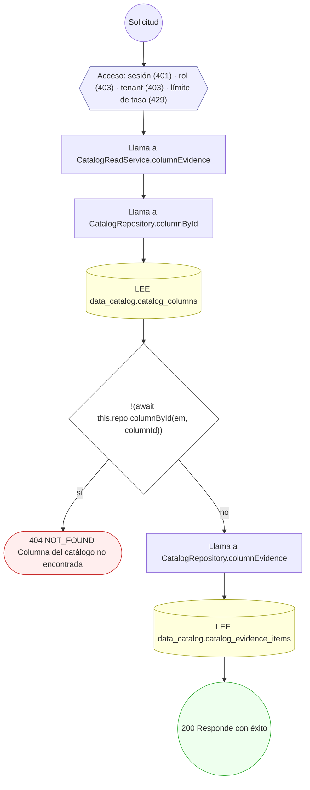

#### 5. POST /admin/catalog/columns/{id}/evidence

Enlaza evidencia a una columna

| HTTP | Código | Cuándo |
|---|---|---|
| 201 | — | Éxito |
| 400 | `VALIDATION_FAILED` | El cuerpo cumple el DTO (sin propiedades extra) |
| 401 | `UNAUTHENTICATED` | Hay una sesión válida (JWT) |
| 403 | `FORBIDDEN` | El rol está permitido; El tenant se resuelve y pertenece al actor |
| 404 | `NOT_FOUND` | ResourceNotFoundException: Columna del catálogo no encontrada |
| 429 | `RATE_LIMITED` | No se supera el límite de solicitudes |

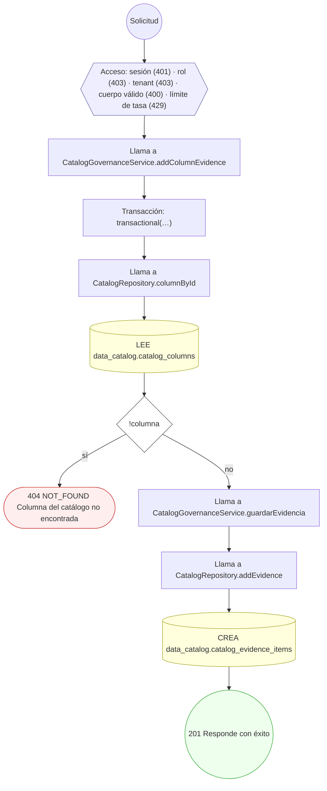

#### 6. POST /admin/catalog/fit/run


| HTTP | Código | Cuándo |
|---|---|---|
| 202 | — | Éxito |
| 401 | `UNAUTHENTICATED` | Hay una sesión válida (JWT) |
| 403 | `FORBIDDEN` | El rol está permitido; El tenant se resuelve y pertenece al actor |
| 429 | `RATE_LIMITED` | No se supera el límite de solicitudes |

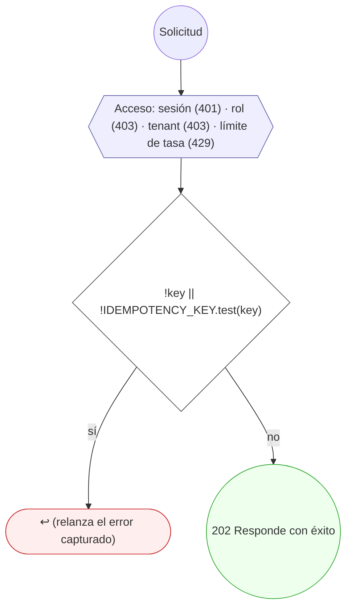

#### 7. GET /admin/catalog/objects

Objetos del catálogo, paginados por cursor

| HTTP | Código | Cuándo |
|---|---|---|
| 200 | — | Éxito |
| 400 | `VALIDATION_FAILED` | BadRequestException: El cursor de paginación no es válido |
| 401 | `UNAUTHENTICATED` | Hay una sesión válida (JWT) |
| 403 | `FORBIDDEN` | El rol está permitido; El tenant se resuelve y pertenece al actor |
| 429 | `RATE_LIMITED` | No se supera el límite de solicitudes |


#### 8. GET /admin/catalog/objects/{id}

Ficha técnica, observación, ficha curada, cobertura y gobierno de un objeto

| HTTP | Código | Cuándo |
|---|---|---|
| 200 | — | Éxito |
| 401 | `UNAUTHENTICATED` | Hay una sesión válida (JWT) |
| 403 | `FORBIDDEN` | El rol está permitido; El tenant se resuelve y pertenece al actor |
| 404 | `NOT_FOUND` | ResourceNotFoundException: Objeto del catálogo no encontrado |
| 429 | `RATE_LIMITED` | No se supera el límite de solicitudes |


#### 9. PUT /admin/catalog/objects/{id}/annotation

Crea o edita la ficha de un objeto (con versión esperada)

| HTTP | Código | Cuándo |
|---|---|---|
| 200 | — | Éxito |
| 400 | `VALIDATION_FAILED` | El cuerpo cumple el DTO (sin propiedades extra) |
| 401 | `UNAUTHENTICATED` | Hay una sesión válida (JWT) |
| 403 | `FORBIDDEN` | El rol está permitido; El tenant se resuelve y pertenece al actor |
| 404 | `NOT_FOUND` | ResourceNotFoundException: Objeto del catálogo no encontrado |
| 409 | `CONCURRENCY_CONFLICT` | ConcurrencyConflictException: La ficha cambió desde que se leyó |
| 429 | `RATE_LIMITED` | No se supera el límite de solicitudes |
| 500 | `INTERNAL` | DomainException: {422} |

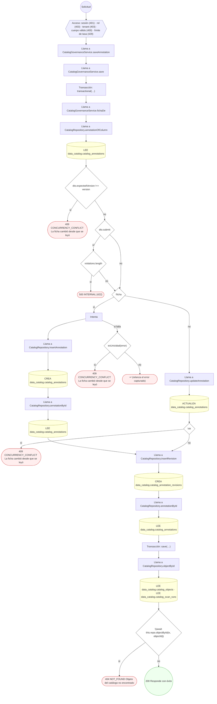

#### 10. GET /admin/catalog/objects/{id}/changes

Cambios que los escaneos detectaron en un objeto

| HTTP | Código | Cuándo |
|---|---|---|
| 200 | — | Éxito |
| 401 | `UNAUTHENTICATED` | Hay una sesión válida (JWT) |
| 403 | `FORBIDDEN` | El rol está permitido; El tenant se resuelve y pertenece al actor |
| 404 | `NOT_FOUND` | ResourceNotFoundException: Objeto del catálogo no encontrado |
| 429 | `RATE_LIMITED` | No se supera el límite de solicitudes |


#### 11. GET /admin/catalog/objects/{id}/columns

Columnas observadas de un objeto, con su ficha si la tienen

| HTTP | Código | Cuándo |
|---|---|---|
| 200 | — | Éxito |
| 401 | `UNAUTHENTICATED` | Hay una sesión válida (JWT) |
| 403 | `FORBIDDEN` | El rol está permitido; El tenant se resuelve y pertenece al actor |
| 404 | `NOT_FOUND` | ResourceNotFoundException: Objeto del catálogo no encontrado |
| 429 | `RATE_LIMITED` | No se supera el límite de solicitudes |


#### 12. GET /admin/catalog/objects/{id}/evidence

Evidencia enlazada a un objeto

| HTTP | Código | Cuándo |
|---|---|---|
| 200 | — | Éxito |
| 401 | `UNAUTHENTICATED` | Hay una sesión válida (JWT) |
| 403 | `FORBIDDEN` | El rol está permitido; El tenant se resuelve y pertenece al actor |
| 404 | `NOT_FOUND` | ResourceNotFoundException: Objeto del catálogo no encontrado |
| 429 | `RATE_LIMITED` | No se supera el límite de solicitudes |


#### 13. POST /admin/catalog/objects/{id}/evidence

Enlaza evidencia a un objeto

| HTTP | Código | Cuándo |
|---|---|---|
| 201 | — | Éxito |
| 400 | `VALIDATION_FAILED` | El cuerpo cumple el DTO (sin propiedades extra) |
| 401 | `UNAUTHENTICATED` | Hay una sesión válida (JWT) |
| 403 | `FORBIDDEN` | El rol está permitido; El tenant se resuelve y pertenece al actor |
| 404 | `NOT_FOUND` | ResourceNotFoundException: Objeto del catálogo no encontrado |
| 429 | `RATE_LIMITED` | No se supera el límite de solicitudes |

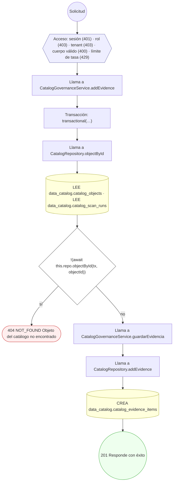

#### 14. GET /admin/catalog/objects/{id}/history

Revisiones y decisiones de la ficha de un objeto

| HTTP | Código | Cuándo |
|---|---|---|
| 200 | — | Éxito |
| 401 | `UNAUTHENTICATED` | Hay una sesión válida (JWT) |
| 403 | `FORBIDDEN` | El rol está permitido; El tenant se resuelve y pertenece al actor |
| 404 | `NOT_FOUND` | ResourceNotFoundException: Objeto del catálogo no encontrado |
| 429 | `RATE_LIMITED` | No se supera el límite de solicitudes |


#### 15. GET /admin/catalog/objects/{id}/impact

Quién referencia a un objeto y a quién referencia, por claves foráneas observadas

| HTTP | Código | Cuándo |
|---|---|---|
| 200 | — | Éxito |
| 401 | `UNAUTHENTICATED` | Hay una sesión válida (JWT) |
| 403 | `FORBIDDEN` | El rol está permitido; El tenant se resuelve y pertenece al actor |
| 404 | `NOT_FOUND` | ResourceNotFoundException: Objeto del catálogo no encontrado |
| 429 | `RATE_LIMITED` | No se supera el límite de solicitudes |

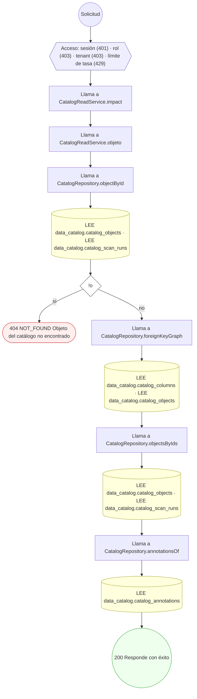

#### 16. GET /admin/catalog/pii/columns

Columnas clasificadas como datos personales, con su sensibilidad y estado de revisión

| HTTP | Código | Cuándo |
|---|---|---|
| 200 | — | Éxito |
| 400 | `VALIDATION_FAILED` | BadRequestException: {CURSOR_INVALIDO} |
| 401 | `UNAUTHENTICATED` | Hay una sesión válida (JWT) |
| 403 | `FORBIDDEN` | El rol está permitido; El tenant se resuelve y pertenece al actor |
| 429 | `RATE_LIMITED` | No se supera el límite de solicitudes |

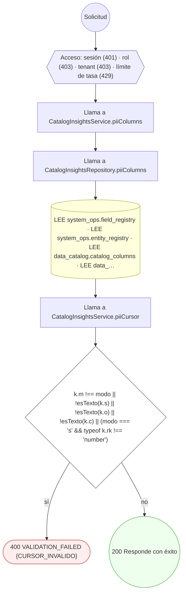

#### 17. GET /admin/catalog/pii/reconciliation


| HTTP | Código | Cuándo |
|---|---|---|
| 200 | — | Éxito |
| 400 | `VALIDATION_FAILED` | BadRequestException: {CURSOR_INVALIDO} |
| 401 | `UNAUTHENTICATED` | Hay una sesión válida (JWT) |
| 403 | `FORBIDDEN` | El rol está permitido; El tenant se resuelve y pertenece al actor |
| 429 | `RATE_LIMITED` | No se supera el límite de solicitudes |

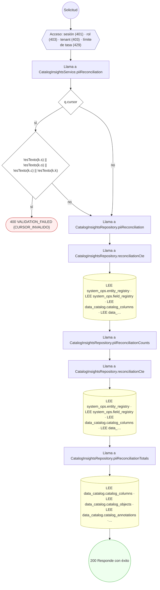

#### 18. GET /admin/catalog/quality/issues

Incidencias de calidad del catálogo (derivadas al leer), paginadas

| HTTP | Código | Cuándo |
|---|---|---|
| 200 | — | Éxito |
| 400 | `VALIDATION_FAILED` | BadRequestException: {CURSOR_INVALIDO} |
| 401 | `UNAUTHENTICATED` | Hay una sesión válida (JWT) |
| 403 | `FORBIDDEN` | El rol está permitido; El tenant se resuelve y pertenece al actor |
| 429 | `RATE_LIMITED` | No se supera el límite de solicitudes |

```mermaid
flowchart TD
  n1(("Solicitud")):::inicio
  n2{{"Acceso: sesión (401) · rol (403) · tenant (403) · límite de tasa (429)"}}:::acceso
  n1 --> n2
  n3["Llama a CatalogInsightsService.qualityIssues"]:::llamada
  n2 --> n3
  n4["Llama a CatalogInsightsRepository.qualityIssues"]:::llamada
  n3 --> n4
  n5["Llama a CatalogInsightsRepository.issuesCte"]:::llamada
  n4 --> n5
  n6[("LEE data_catalog.catalog_columns · LEE data_catalog.catalog_objects · LEE data_catalog.catalog_annotations")]:::efecto
  n5 --> n6
  n7["Llama a CatalogInsightsService.qualityCursor"]:::llamada
  n6 --> n7
  n8{"!esTexto(k.r) || !esTexto(k.s) || !esTexto(k.o) || !esTexto(k.c)"}:::decision
  n7 --> n8
  n9(["400 VALIDATION_FAILED {CURSOR_INVALIDO}"]):::error
  n8 -->|"sí"| n9
  n10["Llama a CatalogInsightsRepository.qualityCounts"]:::llamada
  n8 -->|"no"| n10
  n11["Llama a CatalogInsightsRepository.issuesCte"]:::llamada
  n10 --> n11
  n12[("LEE data_catalog.catalog_columns · LEE data_catalog.catalog_objects · LEE data_catalog.catalog_annotations")]:::efecto
  n11 --> n12
  n13(("200 Responde con éxito")):::ok
  n12 --> n13
  classDef acceso fill:#eef,stroke:#66a
  classDef error fill:#fee,stroke:#c33
  classDef ok fill:#efe,stroke:#3a3
  classDef efecto fill:#ffd,stroke:#aa3
  classDef decision fill:#fff,stroke:#555
  classDef corte fill:#eee,stroke:#999,stroke-dasharray: 4
```

#### 19. POST /admin/catalog/scans

Pide un escaneo de la base primaria (se ejecuta fuera de la petición)

| HTTP | Código | Cuándo |
|---|---|---|
| 202 | — | Éxito |
| 401 | `UNAUTHENTICATED` | Hay una sesión válida (JWT) |
| 403 | `FORBIDDEN` | El rol está permitido; El tenant se resuelve y pertenece al actor |
| 409 | `CONFLICT` | ConflictException: Ya hay un escaneo en curso de esta fuente |
| 429 | `RATE_LIMITED` | No se supera el límite de solicitudes |
| 500 | `INTERNAL` | ScanFenced |

```mermaid
flowchart TD
  n1(("Solicitud")):::inicio
  n2{{"Acceso: sesión (401) · rol (403) · tenant (403) · límite de tasa (429)"}}:::acceso
  n1 --> n2
  n3{"!key || !IDEMPOTENCY_KEY.test(key)"}:::decision
  n2 --> n3
  n4(["↩ (relanza el error capturado)"]):::error
  n3 -->|"sí"| n4
  n5["Llama a CatalogScanService.request"]:::llamada
  n3 -->|"no"| n5
  n6["Transacción: transactional(…)"]:::transaccion
  n5 --> n6
  n7["Llama a CatalogRepository.failAbandoned"]:::llamada
  n6 --> n7
  n8[("ACTUALIZA data_catalog.catalog_scan_runs")]:::efecto
  n7 --> n8
  n9{"idempotencyKey"}:::decision
  n8 --> n9
  n10["Llama a CatalogRepository.scanByIdempotency"]:::llamada
  n9 -->|"sí"| n10
  n11[("LEE data_catalog.catalog_scan_runs")]:::efecto
  n10 --> n11
  n12["Llama a CatalogRepository.activeScan"]:::llamada
  n11 --> n12
  n9 -->|"no"| n12
  n13[("LEE data_catalog.catalog_scan_runs")]:::efecto
  n12 --> n13
  n14{"activo"}:::decision
  n13 --> n14
  n15(["409 CONFLICT Ya hay un escaneo en curso de esta fuente"]):::error
  n14 -->|"sí"| n15
  n16["Intenta"]:::intento
  n14 -->|"no"| n16
  n17["Llama a CatalogRepository.insertScan"]:::llamada
  n16 --> n17
  n18[("CREA data_catalog.catalog_scan_runs")]:::efecto
  n17 --> n18
  n19["Llama a CatalogRepository.scanById"]:::llamada
  n18 --> n19
  n20[("LEE data_catalog.catalog_scan_runs")]:::efecto
  n19 --> n20
  n21{"error instanceof Error && /ux_data_catalog_scan_runs_(one_active|idempotency)/.test( error.message, )"}:::decision
  n16 -->|"si falla"| n21
  n22(["409 CONFLICT Ya hay un escaneo en curso de esta fuente"]):::error
  n21 -->|"sí"| n22
  n23(["↩ (relanza el error capturado)"]):::error
  n21 -->|"no"| n23
  n24["Llama a CatalogScanService.start"]:::llamada
  n20 --> n24
  n25["Llama a CatalogScanService.run"]:::llamada
  n24 --> n25
  n26["Llama a CatalogScanService.execute"]:::llamada
  n25 --> n26
  n27["Intenta"]:::intento
  n26 --> n27
  n28["Transacción: transactional(…)"]:::transaccion
  n27 --> n28
  n29{"!cerrado"}:::decision
  n28 --> n29
  n30(["500 INTERNAL ScanFenced"]):::error
  n29 -->|"sí"| n30
  n31{"resultado.created && autorun"}:::decision
  n29 -->|"no"| n31
  n32["Llama a CatalogScanService.start"]:::llamada
  n31 -->|"sí"| n32
  n33["Llama a CatalogScanService.run"]:::llamada
  n32 --> n33
  n34["Llama a CatalogScanService.execute"]:::llamada
  n33 --> n34
  n35["Intenta"]:::intento
  n34 --> n35
  n36["Transacción: transactional(…)"]:::transaccion
  n35 --> n36
  n37{"!cerrado"}:::decision
  n36 --> n37
  n38(["500 INTERNAL ScanFenced"]):::error
  n37 -->|"sí"| n38
  n39(("202 Responde con éxito")):::ok
  n37 -->|"no"| n39
  n31 -->|"no"| n39
  classDef acceso fill:#eef,stroke:#66a
  classDef error fill:#fee,stroke:#c33
  classDef ok fill:#efe,stroke:#3a3
  classDef efecto fill:#ffd,stroke:#aa3
  classDef decision fill:#fff,stroke:#555
  classDef corte fill:#eee,stroke:#999,stroke-dasharray: 4
```

#### 20. GET /admin/catalog/scans/{id}

Un escaneo

| HTTP | Código | Cuándo |
|---|---|---|
| 200 | — | Éxito |
| 401 | `UNAUTHENTICATED` | Hay una sesión válida (JWT) |
| 403 | `FORBIDDEN` | El rol está permitido; El tenant se resuelve y pertenece al actor |
| 404 | `NOT_FOUND` | ResourceNotFoundException: Escaneo no encontrado |
| 429 | `RATE_LIMITED` | No se supera el límite de solicitudes |

```mermaid
flowchart TD
  n1(("Solicitud")):::inicio
  n2{{"Acceso: sesión (401) · rol (403) · tenant (403) · límite de tasa (429)"}}:::acceso
  n1 --> n2
  n3["Llama a CatalogReadService.scan"]:::llamada
  n2 --> n3
  n4["Llama a CatalogRepository.scanById"]:::llamada
  n3 --> n4
  n5[("LEE data_catalog.catalog_scan_runs")]:::efecto
  n4 --> n5
  n6{"!s"}:::decision
  n5 --> n6
  n7(["404 NOT_FOUND Escaneo no encontrado"]):::error
  n6 -->|"sí"| n7
  n8(("200 Responde con éxito")):::ok
  n6 -->|"no"| n8
  classDef acceso fill:#eef,stroke:#66a
  classDef error fill:#fee,stroke:#c33
  classDef ok fill:#efe,stroke:#3a3
  classDef efecto fill:#ffd,stroke:#aa3
  classDef decision fill:#fff,stroke:#555
  classDef corte fill:#eee,stroke:#999,stroke-dasharray: 4
```

#### 21. GET /admin/governance/jobs


| HTTP | Código | Cuándo |
|---|---|---|
| 200 | — | Éxito |
| 400 | `VALIDATION_FAILED` | BadRequestException: «to» debe ser posterior a «from» |
| 401 | `UNAUTHENTICATED` | Hay una sesión válida (JWT) |
| 403 | `FORBIDDEN` | El rol está permitido; El tenant se resuelve y pertenece al actor |
| 429 | `RATE_LIMITED` | No se supera el límite de solicitudes |

```mermaid
flowchart TD
  n1(("Solicitud")):::inicio
  n2{{"Acceso: sesión (401) · rol (403) · tenant (403) · límite de tasa (429)"}}:::acceso
  n1 --> n2
  n3["Llama a GovernanceQueueService.jobs"]:::llamada
  n2 --> n3
  n4{"to && to ‹= from"}:::decision
  n3 --> n4
  n5(["400 VALIDATION_FAILED «to» debe ser posterior a «from»"]):::error
  n4 -->|"sí"| n5
  n6["Llama a GovernanceQueueRepository.jobs"]:::llamada
  n4 -->|"no"| n6
  n7[("LEE data_catalog.catalog_scan_runs · LEE system_ops.retention_executions · LEE terminology.catalog_concepts ·…")]:::efecto
  n6 --> n7
  n8(("200 Responde con éxito")):::ok
  n7 --> n8
  classDef acceso fill:#eef,stroke:#66a
  classDef error fill:#fee,stroke:#c33
  classDef ok fill:#efe,stroke:#3a3
  classDef efecto fill:#ffd,stroke:#aa3
  classDef decision fill:#fff,stroke:#555
  classDef corte fill:#eee,stroke:#999,stroke-dasharray: 4
```

#### 22. GET /admin/portal/catalogo/deriva

Deriva entre el DDL del modelo y las entidades del ORM

| HTTP | Código | Cuándo |
|---|---|---|
| 200 | — | Éxito |
| 401 | `UNAUTHENTICATED` | Hay una sesión válida (JWT) |
| 403 | `FORBIDDEN` | El rol está permitido; El tenant se resuelve y pertenece al actor |
| 429 | `RATE_LIMITED` | No se supera el límite de solicitudes |
| 503 | `DEPENDENCY_UNAVAILABLE` | ServiceUnavailableException: El inventario del portal no está disponible: falta {relative}. Se genera con `yarn inventario:endpoints`, `yarn inventario:flujos` y `yarn inventario:catalogo`…; ServiceUnavailableException: El inventario del portal está dañado: {relative} no es un JSON válido. Regenerarlo con `yarn inventario:verificar`. |

```mermaid
flowchart TD
  n1(("Solicitud")):::inicio
  n2{{"Acceso: sesión (401) · rol (403) · tenant (403) · límite de tasa (429)"}}:::acceso
  n1 --> n2
  n3["Llama a PortalInventoryService.derivaDelCatalogo"]:::llamada
  n2 --> n3
  n4["Llama a InventoryRepository.catalogoIndice"]:::llamada
  n3 --> n4
  n5["Llama a InventoryRepository.read"]:::llamada
  n4 --> n5
  n6["Intenta"]:::intento
  n5 --> n6
  n7["Llama a InventoryRepository.raw"]:::llamada
  n6 --> n7
  n8{"!existsSync(file)"}:::decision
  n7 --> n8
  n9(["503 DEPENDENCY_UNAVAILABLE El inventario del portal no está disponible: falta {relative}. Se genera con `yarn…"]):::error
  n8 -->|"sí"| n9
  n10{"error instanceof ServiceUnavailableException"}:::decision
  n6 -->|"si falla"| n10
  n11(["↩ (relanza el error capturado)"]):::error
  n10 -->|"sí"| n11
  n12(["503 DEPENDENCY_UNAVAILABLE El inventario del portal está dañado: {relative} no es un JSON válido. Regenerarlo…"]):::error
  n10 -->|"no"| n12
  n13(("200 Responde con éxito")):::ok
  n8 -->|"no"| n13
  classDef acceso fill:#eef,stroke:#66a
  classDef error fill:#fee,stroke:#c33
  classDef ok fill:#efe,stroke:#3a3
  classDef efecto fill:#ffd,stroke:#aa3
  classDef decision fill:#fff,stroke:#555
  classDef corte fill:#eee,stroke:#999,stroke-dasharray: 4
```

#### 23. GET /admin/portal/catalogo/tablas

Listar las tablas del catálogo de datos

| HTTP | Código | Cuándo |
|---|---|---|
| 200 | — | Éxito |
| 401 | `UNAUTHENTICATED` | Hay una sesión válida (JWT) |
| 403 | `FORBIDDEN` | El rol está permitido; El tenant se resuelve y pertenece al actor |
| 429 | `RATE_LIMITED` | No se supera el límite de solicitudes |
| 503 | `DEPENDENCY_UNAVAILABLE` | ServiceUnavailableException: El inventario del portal no está disponible: falta {relative}. Se genera con `yarn inventario:endpoints`, `yarn inventario:flujos` y `yarn inventario:catalogo`…; ServiceUnavailableException: El inventario del portal está dañado: {relative} no es un JSON válido. Regenerarlo con `yarn inventario:verificar`. |

```mermaid
flowchart TD
  n1(("Solicitud")):::inicio
  n2{{"Acceso: sesión (401) · rol (403) · tenant (403) · límite de tasa (429)"}}:::acceso
  n1 --> n2
  n3["Llama a PortalInventoryService.listarTablas"]:::llamada
  n2 --> n3
  n4["Llama a InventoryRepository.catalogoIndice"]:::llamada
  n3 --> n4
  n5["Llama a InventoryRepository.read"]:::llamada
  n4 --> n5
  n6["Intenta"]:::intento
  n5 --> n6
  n7["Llama a InventoryRepository.raw"]:::llamada
  n6 --> n7
  n8{"!existsSync(file)"}:::decision
  n7 --> n8
  n9(["503 DEPENDENCY_UNAVAILABLE El inventario del portal no está disponible: falta {relative}. Se genera con `yarn…"]):::error
  n8 -->|"sí"| n9
  n10{"error instanceof ServiceUnavailableException"}:::decision
  n6 -->|"si falla"| n10
  n11(["↩ (relanza el error capturado)"]):::error
  n10 -->|"sí"| n11
  n12(["503 DEPENDENCY_UNAVAILABLE El inventario del portal está dañado: {relative} no es un JSON válido. Regenerarlo…"]):::error
  n10 -->|"no"| n12
  n13(("200 Responde con éxito")):::ok
  n8 -->|"no"| n13
  classDef acceso fill:#eef,stroke:#66a
  classDef error fill:#fee,stroke:#c33
  classDef ok fill:#efe,stroke:#3a3
  classDef efecto fill:#ffd,stroke:#aa3
  classDef decision fill:#fff,stroke:#555
  classDef corte fill:#eee,stroke:#999,stroke-dasharray: 4
```

#### 24. GET /admin/portal/catalogo/tablas/{schema}/{tabla}

Ver la ficha de una tabla

| HTTP | Código | Cuándo |
|---|---|---|
| 200 | — | Éxito |
| 401 | `UNAUTHENTICATED` | Hay una sesión válida (JWT) |
| 403 | `FORBIDDEN` | El rol está permitido; El tenant se resuelve y pertenece al actor |
| 404 | `NOT_FOUND` | NotFoundException: Tabla no encontrada en el catálogo |
| 429 | `RATE_LIMITED` | No se supera el límite de solicitudes |
| 503 | `DEPENDENCY_UNAVAILABLE` | ServiceUnavailableException: El inventario del portal no está disponible: falta {relative}. Se genera con `yarn inventario:endpoints`, `yarn inventario:flujos` y `yarn inventario:catalogo`…; ServiceUnavailableException: El inventario del portal está dañado: {relative} no es un JSON válido. Regenerarlo con `yarn inventario:verificar`. |

```mermaid
flowchart TD
  n1(("Solicitud")):::inicio
  n2{{"Acceso: sesión (401) · rol (403) · tenant (403) · límite de tasa (429)"}}:::acceso
  n1 --> n2
  n3["Llama a PortalInventoryService.fichaDeTabla"]:::llamada
  n2 --> n3
  n4["Llama a InventoryRepository.catalogoIndice"]:::llamada
  n3 --> n4
  n5["Llama a InventoryRepository.read"]:::llamada
  n4 --> n5
  n6["Intenta"]:::intento
  n5 --> n6
  n7["Llama a InventoryRepository.raw"]:::llamada
  n6 --> n7
  n8{"!existsSync(file)"}:::decision
  n7 --> n8
  n9(["503 DEPENDENCY_UNAVAILABLE El inventario del portal no está disponible: falta {relative}. Se genera con `yarn…"]):::error
  n8 -->|"sí"| n9
  n10{"error instanceof ServiceUnavailableException"}:::decision
  n6 -->|"si falla"| n10
  n11(["↩ (relanza el error capturado)"]):::error
  n10 -->|"sí"| n11
  n12(["503 DEPENDENCY_UNAVAILABLE El inventario del portal está dañado: {relative} no es un JSON válido. Regenerarlo…"]):::error
  n10 -->|"no"| n12
  n13{"!enIndice"}:::decision
  n8 -->|"no"| n13
  n14(["404 NOT_FOUND Tabla no encontrada en el catálogo"]):::error
  n13 -->|"sí"| n14
  n15["Llama a InventoryRepository.tablasDeSchema"]:::llamada
  n13 -->|"no"| n15
  n16["Llama a InventoryRepository.read"]:::llamada
  n15 --> n16
  n17["Intenta"]:::intento
  n16 --> n17
  n18["Llama a InventoryRepository.raw"]:::llamada
  n17 --> n18
  n19{"!existsSync(file)"}:::decision
  n18 --> n19
  n20(["503 DEPENDENCY_UNAVAILABLE El inventario del portal no está disponible: falta {relative}. Se genera con `yarn…"]):::error
  n19 -->|"sí"| n20
  n21{"error instanceof ServiceUnavailableException"}:::decision
  n17 -->|"si falla"| n21
  n22(["↩ (relanza el error capturado)"]):::error
  n21 -->|"sí"| n22
  n23(["503 DEPENDENCY_UNAVAILABLE El inventario del portal está dañado: {relative} no es un JSON válido. Regenerarlo…"]):::error
  n21 -->|"no"| n23
  n24{"!t"}:::decision
  n19 -->|"no"| n24
  n25(["404 NOT_FOUND Tabla no encontrada en el catálogo"]):::error
  n24 -->|"sí"| n25
  n26(("200 Responde con éxito")):::ok
  n24 -->|"no"| n26
  classDef acceso fill:#eef,stroke:#66a
  classDef error fill:#fee,stroke:#c33
  classDef ok fill:#efe,stroke:#3a3
  classDef efecto fill:#ffd,stroke:#aa3
  classDef decision fill:#fff,stroke:#555
  classDef corte fill:#eee,stroke:#999,stroke-dasharray: 4
```

#### 25. GET /admin/portal/flujos

Listar los procesos de negocio

| HTTP | Código | Cuándo |
|---|---|---|
| 200 | — | Éxito |
| 401 | `UNAUTHENTICATED` | Hay una sesión válida (JWT) |
| 403 | `FORBIDDEN` | El rol está permitido; El tenant se resuelve y pertenece al actor |
| 429 | `RATE_LIMITED` | No se supera el límite de solicitudes |
| 503 | `DEPENDENCY_UNAVAILABLE` | ServiceUnavailableException: El inventario del portal no está disponible: falta {relative}. Se genera con `yarn inventario:endpoints`, `yarn inventario:flujos` y `yarn inventario:catalogo`…; ServiceUnavailableException: El inventario del portal está dañado: {relative} no es un JSON válido. Regenerarlo con `yarn inventario:verificar`. |

```mermaid
flowchart TD
  n1(("Solicitud")):::inicio
  n2{{"Acceso: sesión (401) · rol (403) · tenant (403) · límite de tasa (429)"}}:::acceso
  n1 --> n2
  n3["Llama a PortalInventoryService.listarProcesos"]:::llamada
  n2 --> n3
  n4["Llama a InventoryRepository.procesos"]:::llamada
  n3 --> n4
  n5["Llama a InventoryRepository.read"]:::llamada
  n4 --> n5
  n6["Intenta"]:::intento
  n5 --> n6
  n7["Llama a InventoryRepository.raw"]:::llamada
  n6 --> n7
  n8{"!existsSync(file)"}:::decision
  n7 --> n8
  n9(["503 DEPENDENCY_UNAVAILABLE El inventario del portal no está disponible: falta {relative}. Se genera con `yarn…"]):::error
  n8 -->|"sí"| n9
  n10{"error instanceof ServiceUnavailableException"}:::decision
  n6 -->|"si falla"| n10
  n11(["↩ (relanza el error capturado)"]):::error
  n10 -->|"sí"| n11
  n12(["503 DEPENDENCY_UNAVAILABLE El inventario del portal está dañado: {relative} no es un JSON válido. Regenerarlo…"]):::error
  n10 -->|"no"| n12
  n13(("200 Responde con éxito")):::ok
  n8 -->|"no"| n13
  classDef acceso fill:#eef,stroke:#66a
  classDef error fill:#fee,stroke:#c33
  classDef ok fill:#efe,stroke:#3a3
  classDef efecto fill:#ffd,stroke:#aa3
  classDef decision fill:#fff,stroke:#555
  classDef corte fill:#eee,stroke:#999,stroke-dasharray: 4
```

#### 26. GET /admin/portal/flujos/{codigo}

Ver un proceso con sus etapas y máquinas de estado

| HTTP | Código | Cuándo |
|---|---|---|
| 200 | — | Éxito |
| 401 | `UNAUTHENTICATED` | Hay una sesión válida (JWT) |
| 403 | `FORBIDDEN` | El rol está permitido; El tenant se resuelve y pertenece al actor |
| 404 | `NOT_FOUND` | NotFoundException: Proceso no encontrado en el inventario |
| 429 | `RATE_LIMITED` | No se supera el límite de solicitudes |
| 503 | `DEPENDENCY_UNAVAILABLE` | ServiceUnavailableException: El inventario del portal está dañado: {relative} no es un JSON válido. Regenerarlo con `yarn inventario:verificar`.; ServiceUnavailableException: El inventario del portal no está disponible: falta {relative}. Se genera con `yarn inventario:endpoints`, `yarn inventario:flujos` y `yarn inventario:catalogo`… |

```mermaid
flowchart TD
  n1(("Solicitud")):::inicio
  n2{{"Acceso: sesión (401) · rol (403) · tenant (403) · límite de tasa (429)"}}:::acceso
  n1 --> n2
  n3["Llama a PortalInventoryService.detalleDeProceso"]:::llamada
  n2 --> n3
  n4["Llama a PortalInventoryService.proceso"]:::llamada
  n3 --> n4
  n5["Llama a InventoryRepository.procesos"]:::llamada
  n4 --> n5
  n6["Llama a InventoryRepository.read"]:::llamada
  n5 --> n6
  n7["Intenta"]:::intento
  n6 --> n7
  n8{"error instanceof ServiceUnavailableException"}:::decision
  n7 -->|"si falla"| n8
  n9(["↩ (relanza el error capturado)"]):::error
  n8 -->|"sí"| n9
  n10(["503 DEPENDENCY_UNAVAILABLE El inventario del portal está dañado: {relative} no es un JSON válido. Regenerarlo…"]):::error
  n8 -->|"no"| n10
  n11{"!encontrado"}:::decision
  n7 --> n11
  n12(["404 NOT_FOUND Proceso no encontrado en el inventario"]):::error
  n11 -->|"sí"| n12
  n13["Llama a InventoryRepository.maquinas"]:::llamada
  n11 -->|"no"| n13
  n14["Llama a InventoryRepository.read"]:::llamada
  n13 --> n14
  n15["Intenta"]:::intento
  n14 --> n15
  n16["Llama a InventoryRepository.raw"]:::llamada
  n15 --> n16
  n17{"!existsSync(file)"}:::decision
  n16 --> n17
  n18(["503 DEPENDENCY_UNAVAILABLE El inventario del portal no está disponible: falta {relative}. Se genera con `yarn…"]):::error
  n17 -->|"sí"| n18
  n19{"error instanceof ServiceUnavailableException"}:::decision
  n15 -->|"si falla"| n19
  n20(["↩ (relanza el error capturado)"]):::error
  n19 -->|"sí"| n20
  n21(["503 DEPENDENCY_UNAVAILABLE El inventario del portal está dañado: {relative} no es un JSON válido. Regenerarlo…"]):::error
  n19 -->|"no"| n21
  n22(("200 Responde con éxito")):::ok
  n17 -->|"no"| n22
  classDef acceso fill:#eef,stroke:#66a
  classDef error fill:#fee,stroke:#c33
  classDef ok fill:#efe,stroke:#3a3
  classDef efecto fill:#ffd,stroke:#aa3
  classDef decision fill:#fff,stroke:#555
  classDef corte fill:#eee,stroke:#999,stroke-dasharray: 4
```

#### 27. GET /admin/portal/flujos/{codigo}/grafo

Ver el grafo de un proceso

| HTTP | Código | Cuándo |
|---|---|---|
| 200 | — | Éxito |
| 401 | `UNAUTHENTICATED` | Hay una sesión válida (JWT) |
| 403 | `FORBIDDEN` | El rol está permitido; El tenant se resuelve y pertenece al actor |
| 404 | `NOT_FOUND` | NotFoundException: Proceso no encontrado en el inventario |
| 429 | `RATE_LIMITED` | No se supera el límite de solicitudes |
| 503 | `DEPENDENCY_UNAVAILABLE` | ServiceUnavailableException: El inventario del portal está dañado: {relative} no es un JSON válido. Regenerarlo con `yarn inventario:verificar`.; ServiceUnavailableException: El inventario del portal no está disponible: falta {relative}. Se genera con `yarn inventario:endpoints`, `yarn inventario:flujos` y `yarn inventario:catalogo`… |

```mermaid
flowchart TD
  n1(("Solicitud")):::inicio
  n2{{"Acceso: sesión (401) · rol (403) · tenant (403) · límite de tasa (429)"}}:::acceso
  n1 --> n2
  n3["Llama a PortalInventoryService.grafoDeProceso"]:::llamada
  n2 --> n3
  n4["Llama a PortalInventoryService.proceso"]:::llamada
  n3 --> n4
  n5["Llama a InventoryRepository.procesos"]:::llamada
  n4 --> n5
  n6["Llama a InventoryRepository.read"]:::llamada
  n5 --> n6
  n7["Intenta"]:::intento
  n6 --> n7
  n8{"error instanceof ServiceUnavailableException"}:::decision
  n7 -->|"si falla"| n8
  n9(["↩ (relanza el error capturado)"]):::error
  n8 -->|"sí"| n9
  n10(["503 DEPENDENCY_UNAVAILABLE El inventario del portal está dañado: {relative} no es un JSON válido. Regenerarlo…"]):::error
  n8 -->|"no"| n10
  n11{"!encontrado"}:::decision
  n7 --> n11
  n12(["404 NOT_FOUND Proceso no encontrado en el inventario"]):::error
  n11 -->|"sí"| n12
  n13["Llama a InventoryRepository.grafo"]:::llamada
  n11 -->|"no"| n13
  n14["Llama a InventoryRepository.read"]:::llamada
  n13 --> n14
  n15["Intenta"]:::intento
  n14 --> n15
  n16["Llama a InventoryRepository.raw"]:::llamada
  n15 --> n16
  n17{"!existsSync(file)"}:::decision
  n16 --> n17
  n18(["503 DEPENDENCY_UNAVAILABLE El inventario del portal no está disponible: falta {relative}. Se genera con `yarn…"]):::error
  n17 -->|"sí"| n18
  n19{"error instanceof ServiceUnavailableException"}:::decision
  n15 -->|"si falla"| n19
  n20(["↩ (relanza el error capturado)"]):::error
  n19 -->|"sí"| n20
  n21(["503 DEPENDENCY_UNAVAILABLE El inventario del portal está dañado: {relative} no es un JSON válido. Regenerarlo…"]):::error
  n19 -->|"no"| n21
  n22(("200 Responde con éxito")):::ok
  n17 -->|"no"| n22
  classDef acceso fill:#eef,stroke:#66a
  classDef error fill:#fee,stroke:#c33
  classDef ok fill:#efe,stroke:#3a3
  classDef efecto fill:#ffd,stroke:#aa3
  classDef decision fill:#fff,stroke:#555
  classDef corte fill:#eee,stroke:#999,stroke-dasharray: 4
```

#### 28. GET /admin/portal/flujos/hallazgos

Resumen de hallazgos del mapa

| HTTP | Código | Cuándo |
|---|---|---|
| 200 | — | Éxito |
| 401 | `UNAUTHENTICATED` | Hay una sesión válida (JWT) |
| 403 | `FORBIDDEN` | El rol está permitido; El tenant se resuelve y pertenece al actor |
| 429 | `RATE_LIMITED` | No se supera el límite de solicitudes |
| 503 | `DEPENDENCY_UNAVAILABLE` | ServiceUnavailableException: El inventario del portal no está disponible: falta {relative}. Se genera con `yarn inventario:endpoints`, `yarn inventario:flujos` y `yarn inventario:catalogo`…; ServiceUnavailableException: El inventario del portal está dañado: {relative} no es un JSON válido. Regenerarlo con `yarn inventario:verificar`. |

```mermaid
flowchart TD
  n1(("Solicitud")):::inicio
  n2{{"Acceso: sesión (401) · rol (403) · tenant (403) · límite de tasa (429)"}}:::acceso
  n1 --> n2
  n3["Llama a PortalInventoryService.hallazgos"]:::llamada
  n2 --> n3
  n4["Llama a InventoryRepository.hallazgos"]:::llamada
  n3 --> n4
  n5["Llama a InventoryRepository.read"]:::llamada
  n4 --> n5
  n6["Intenta"]:::intento
  n5 --> n6
  n7["Llama a InventoryRepository.raw"]:::llamada
  n6 --> n7
  n8{"!existsSync(file)"}:::decision
  n7 --> n8
  n9(["503 DEPENDENCY_UNAVAILABLE El inventario del portal no está disponible: falta {relative}. Se genera con `yarn…"]):::error
  n8 -->|"sí"| n9
  n10{"error instanceof ServiceUnavailableException"}:::decision
  n6 -->|"si falla"| n10
  n11(["↩ (relanza el error capturado)"]):::error
  n10 -->|"sí"| n11
  n12(["503 DEPENDENCY_UNAVAILABLE El inventario del portal está dañado: {relative} no es un JSON válido. Regenerarlo…"]):::error
  n10 -->|"no"| n12
  n13(("200 Responde con éxito")):::ok
  n8 -->|"no"| n13
  classDef acceso fill:#eef,stroke:#66a
  classDef error fill:#fee,stroke:#c33
  classDef ok fill:#efe,stroke:#3a3
  classDef efecto fill:#ffd,stroke:#aa3
  classDef decision fill:#fff,stroke:#555
  classDef corte fill:#eee,stroke:#999,stroke-dasharray: 4
```

#### 29. GET /admin/portal/flujos/hallazgos/{id}

Ver los casos de un hallazgo

| HTTP | Código | Cuándo |
|---|---|---|
| 200 | — | Éxito |
| 401 | `UNAUTHENTICATED` | Hay una sesión válida (JWT) |
| 403 | `FORBIDDEN` | El rol está permitido; El tenant se resuelve y pertenece al actor |
| 404 | `NOT_FOUND` | NotFoundException: Hallazgo no encontrado |
| 429 | `RATE_LIMITED` | No se supera el límite de solicitudes |
| 503 | `DEPENDENCY_UNAVAILABLE` | ServiceUnavailableException: El inventario del portal no está disponible: falta {relative}. Se genera con `yarn inventario:endpoints`, `yarn inventario:flujos` y `yarn inventario:catalogo`…; ServiceUnavailableException: El inventario del portal está dañado: {relative} no es un JSON válido. Regenerarlo con `yarn inventario:verificar`. |

```mermaid
flowchart TD
  n1(("Solicitud")):::inicio
  n2{{"Acceso: sesión (401) · rol (403) · tenant (403) · límite de tasa (429)"}}:::acceso
  n1 --> n2
  n3["Llama a PortalInventoryService.detalleDeHallazgo"]:::llamada
  n2 --> n3
  n4["Llama a InventoryRepository.hallazgos"]:::llamada
  n3 --> n4
  n5["Llama a InventoryRepository.read"]:::llamada
  n4 --> n5
  n6["Intenta"]:::intento
  n5 --> n6
  n7["Llama a InventoryRepository.raw"]:::llamada
  n6 --> n7
  n8{"!existsSync(file)"}:::decision
  n7 --> n8
  n9(["503 DEPENDENCY_UNAVAILABLE El inventario del portal no está disponible: falta {relative}. Se genera con `yarn…"]):::error
  n8 -->|"sí"| n9
  n10{"error instanceof ServiceUnavailableException"}:::decision
  n6 -->|"si falla"| n10
  n11(["↩ (relanza el error capturado)"]):::error
  n10 -->|"sí"| n11
  n12(["503 DEPENDENCY_UNAVAILABLE El inventario del portal está dañado: {relative} no es un JSON válido. Regenerarlo…"]):::error
  n10 -->|"no"| n12
  n13{"!h"}:::decision
  n8 -->|"no"| n13
  n14(["404 NOT_FOUND Hallazgo no encontrado"]):::error
  n13 -->|"sí"| n14
  n15(("200 Responde con éxito")):::ok
  n13 -->|"no"| n15
  classDef acceso fill:#eef,stroke:#66a
  classDef error fill:#fee,stroke:#c33
  classDef ok fill:#efe,stroke:#3a3
  classDef efecto fill:#ffd,stroke:#aa3
  classDef decision fill:#fff,stroke:#555
  classDef corte fill:#eee,stroke:#999,stroke-dasharray: 4
```

#### 30. GET /admin/portal/flujos/mapa

Mapa de operaciones con sus señales

| HTTP | Código | Cuándo |
|---|---|---|
| 200 | — | Éxito |
| 401 | `UNAUTHENTICATED` | Hay una sesión válida (JWT) |
| 403 | `FORBIDDEN` | El rol está permitido; El tenant se resuelve y pertenece al actor |
| 429 | `RATE_LIMITED` | No se supera el límite de solicitudes |
| 503 | `DEPENDENCY_UNAVAILABLE` | ServiceUnavailableException: El inventario del portal no está disponible: falta {relative}. Se genera con `yarn inventario:endpoints`, `yarn inventario:flujos` y `yarn inventario:catalogo`…; ServiceUnavailableException: El inventario del portal está dañado: {relative} no es un JSON válido. Regenerarlo con `yarn inventario:verificar`. |

```mermaid
flowchart TD
  n1(("Solicitud")):::inicio
  n2{{"Acceso: sesión (401) · rol (403) · tenant (403) · límite de tasa (429)"}}:::acceso
  n1 --> n2
  n3["Llama a PortalInventoryService.mapa"]:::llamada
  n2 --> n3
  n4["Llama a InventoryRepository.mapa"]:::llamada
  n3 --> n4
  n5["Llama a InventoryRepository.read"]:::llamada
  n4 --> n5
  n6["Intenta"]:::intento
  n5 --> n6
  n7["Llama a InventoryRepository.raw"]:::llamada
  n6 --> n7
  n8{"!existsSync(file)"}:::decision
  n7 --> n8
  n9(["503 DEPENDENCY_UNAVAILABLE El inventario del portal no está disponible: falta {relative}. Se genera con `yarn…"]):::error
  n8 -->|"sí"| n9
  n10{"error instanceof ServiceUnavailableException"}:::decision
  n6 -->|"si falla"| n10
  n11(["↩ (relanza el error capturado)"]):::error
  n10 -->|"sí"| n11
  n12(["503 DEPENDENCY_UNAVAILABLE El inventario del portal está dañado: {relative} no es un JSON válido. Regenerarlo…"]):::error
  n10 -->|"no"| n12
  n13(("200 Responde con éxito")):::ok
  n8 -->|"no"| n13
  classDef acceso fill:#eef,stroke:#66a
  classDef error fill:#fee,stroke:#c33
  classDef ok fill:#efe,stroke:#3a3
  classDef efecto fill:#ffd,stroke:#aa3
  classDef decision fill:#fff,stroke:#555
  classDef corte fill:#eee,stroke:#999,stroke-dasharray: 4
```

#### 31. GET /admin/portal/glosario

Buscar en el glosario

| HTTP | Código | Cuándo |
|---|---|---|
| 200 | — | Éxito |
| 401 | `UNAUTHENTICATED` | Hay una sesión válida (JWT) |
| 403 | `FORBIDDEN` | El rol está permitido; El tenant se resuelve y pertenece al actor |
| 429 | `RATE_LIMITED` | No se supera el límite de solicitudes |
| 503 | `DEPENDENCY_UNAVAILABLE` | ServiceUnavailableException: El inventario del portal no está disponible: falta {relative}. Se genera con `yarn inventario:endpoints`, `yarn inventario:flujos` y `yarn inventario:catalogo`…; ServiceUnavailableException: El inventario del portal está dañado: {relative} no es un JSON válido. Regenerarlo con `yarn inventario:verificar`. |

```mermaid
flowchart TD
  n1(("Solicitud")):::inicio
  n2{{"Acceso: sesión (401) · rol (403) · tenant (403) · límite de tasa (429)"}}:::acceso
  n1 --> n2
  n3["Llama a PortalInventoryService.glosario"]:::llamada
  n2 --> n3
  n4["Llama a InventoryRepository.glosario"]:::llamada
  n3 --> n4
  n5["Llama a InventoryRepository.read"]:::llamada
  n4 --> n5
  n6["Intenta"]:::intento
  n5 --> n6
  n7["Llama a InventoryRepository.raw"]:::llamada
  n6 --> n7
  n8{"!existsSync(file)"}:::decision
  n7 --> n8
  n9(["503 DEPENDENCY_UNAVAILABLE El inventario del portal no está disponible: falta {relative}. Se genera con `yarn…"]):::error
  n8 -->|"sí"| n9
  n10{"error instanceof ServiceUnavailableException"}:::decision
  n6 -->|"si falla"| n10
  n11(["↩ (relanza el error capturado)"]):::error
  n10 -->|"sí"| n11
  n12(["503 DEPENDENCY_UNAVAILABLE El inventario del portal está dañado: {relative} no es un JSON válido. Regenerarlo…"]):::error
  n10 -->|"no"| n12
  n13(("200 Responde con éxito")):::ok
  n8 -->|"no"| n13
  classDef acceso fill:#eef,stroke:#66a
  classDef error fill:#fee,stroke:#c33
  classDef ok fill:#efe,stroke:#3a3
  classDef efecto fill:#ffd,stroke:#aa3
  classDef decision fill:#fff,stroke:#555
  classDef corte fill:#eee,stroke:#999,stroke-dasharray: 4
```

#### 32. GET /admin/portal/linaje

Métricas del linaje de datos

| HTTP | Código | Cuándo |
|---|---|---|
| 200 | — | Éxito |
| 401 | `UNAUTHENTICATED` | Hay una sesión válida (JWT) |
| 403 | `FORBIDDEN` | El rol está permitido; El tenant se resuelve y pertenece al actor |
| 429 | `RATE_LIMITED` | No se supera el límite de solicitudes |
| 503 | `DEPENDENCY_UNAVAILABLE` | ServiceUnavailableException: El inventario del portal no está disponible: falta {relative}. Se genera con `yarn inventario:endpoints`, `yarn inventario:flujos` y `yarn inventario:catalogo`…; ServiceUnavailableException: El inventario del portal está dañado: {relative} no es un JSON válido. Regenerarlo con `yarn inventario:verificar`. |

```mermaid
flowchart TD
  n1(("Solicitud")):::inicio
  n2{{"Acceso: sesión (401) · rol (403) · tenant (403) · límite de tasa (429)"}}:::acceso
  n1 --> n2
  n3["Llama a PortalInventoryService.linaje"]:::llamada
  n2 --> n3
  n4["Llama a InventoryRepository.linaje"]:::llamada
  n3 --> n4
  n5["Llama a InventoryRepository.read"]:::llamada
  n4 --> n5
  n6["Intenta"]:::intento
  n5 --> n6
  n7["Llama a InventoryRepository.raw"]:::llamada
  n6 --> n7
  n8{"!existsSync(file)"}:::decision
  n7 --> n8
  n9(["503 DEPENDENCY_UNAVAILABLE El inventario del portal no está disponible: falta {relative}. Se genera con `yarn…"]):::error
  n8 -->|"sí"| n9
  n10{"error instanceof ServiceUnavailableException"}:::decision
  n6 -->|"si falla"| n10
  n11(["↩ (relanza el error capturado)"]):::error
  n10 -->|"sí"| n11
  n12(["503 DEPENDENCY_UNAVAILABLE El inventario del portal está dañado: {relative} no es un JSON válido. Regenerarlo…"]):::error
  n10 -->|"no"| n12
  n13(("200 Responde con éxito")):::ok
  n8 -->|"no"| n13
  classDef acceso fill:#eef,stroke:#66a
  classDef error fill:#fee,stroke:#c33
  classDef ok fill:#efe,stroke:#3a3
  classDef efecto fill:#ffd,stroke:#aa3
  classDef decision fill:#fff,stroke:#555
  classDef corte fill:#eee,stroke:#999,stroke-dasharray: 4
```

#### 33. GET /admin/portal/linaje/aristas

Aristas del linaje (lee, escribe, borra, referencia, pertenece)

| HTTP | Código | Cuándo |
|---|---|---|
| 200 | — | Éxito |
| 401 | `UNAUTHENTICATED` | Hay una sesión válida (JWT) |
| 403 | `FORBIDDEN` | El rol está permitido; El tenant se resuelve y pertenece al actor |
| 429 | `RATE_LIMITED` | No se supera el límite de solicitudes |
| 503 | `DEPENDENCY_UNAVAILABLE` | ServiceUnavailableException: El inventario del portal no está disponible: falta {relative}. Se genera con `yarn inventario:endpoints`, `yarn inventario:flujos` y `yarn inventario:catalogo`…; ServiceUnavailableException: El inventario del portal está dañado: {relative} no es un JSON válido. Regenerarlo con `yarn inventario:verificar`. |

```mermaid
flowchart TD
  n1(("Solicitud")):::inicio
  n2{{"Acceso: sesión (401) · rol (403) · tenant (403) · límite de tasa (429)"}}:::acceso
  n1 --> n2
  n3["Llama a PortalInventoryService.linajeAristas"]:::llamada
  n2 --> n3
  n4["Llama a InventoryRepository.linaje"]:::llamada
  n3 --> n4
  n5["Llama a InventoryRepository.read"]:::llamada
  n4 --> n5
  n6["Intenta"]:::intento
  n5 --> n6
  n7["Llama a InventoryRepository.raw"]:::llamada
  n6 --> n7
  n8{"!existsSync(file)"}:::decision
  n7 --> n8
  n9(["503 DEPENDENCY_UNAVAILABLE El inventario del portal no está disponible: falta {relative}. Se genera con `yarn…"]):::error
  n8 -->|"sí"| n9
  n10{"error instanceof ServiceUnavailableException"}:::decision
  n6 -->|"si falla"| n10
  n11(["↩ (relanza el error capturado)"]):::error
  n10 -->|"sí"| n11
  n12(["503 DEPENDENCY_UNAVAILABLE El inventario del portal está dañado: {relative} no es un JSON válido. Regenerarlo…"]):::error
  n10 -->|"no"| n12
  n13(("200 Responde con éxito")):::ok
  n8 -->|"no"| n13
  classDef acceso fill:#eef,stroke:#66a
  classDef error fill:#fee,stroke:#c33
  classDef ok fill:#efe,stroke:#3a3
  classDef efecto fill:#ffd,stroke:#aa3
  classDef decision fill:#fff,stroke:#555
  classDef corte fill:#eee,stroke:#999,stroke-dasharray: 4
```

#### 34. GET /admin/portal/linaje/nodos

Nodos del linaje (operaciones, tablas, dominios)

| HTTP | Código | Cuándo |
|---|---|---|
| 200 | — | Éxito |
| 401 | `UNAUTHENTICATED` | Hay una sesión válida (JWT) |
| 403 | `FORBIDDEN` | El rol está permitido; El tenant se resuelve y pertenece al actor |
| 429 | `RATE_LIMITED` | No se supera el límite de solicitudes |
| 503 | `DEPENDENCY_UNAVAILABLE` | ServiceUnavailableException: El inventario del portal no está disponible: falta {relative}. Se genera con `yarn inventario:endpoints`, `yarn inventario:flujos` y `yarn inventario:catalogo`…; ServiceUnavailableException: El inventario del portal está dañado: {relative} no es un JSON válido. Regenerarlo con `yarn inventario:verificar`. |

```mermaid
flowchart TD
  n1(("Solicitud")):::inicio
  n2{{"Acceso: sesión (401) · rol (403) · tenant (403) · límite de tasa (429)"}}:::acceso
  n1 --> n2
  n3["Llama a PortalInventoryService.linajeNodos"]:::llamada
  n2 --> n3
  n4["Llama a InventoryRepository.linaje"]:::llamada
  n3 --> n4
  n5["Llama a InventoryRepository.read"]:::llamada
  n4 --> n5
  n6["Intenta"]:::intento
  n5 --> n6
  n7["Llama a InventoryRepository.raw"]:::llamada
  n6 --> n7
  n8{"!existsSync(file)"}:::decision
  n7 --> n8
  n9(["503 DEPENDENCY_UNAVAILABLE El inventario del portal no está disponible: falta {relative}. Se genera con `yarn…"]):::error
  n8 -->|"sí"| n9
  n10{"error instanceof ServiceUnavailableException"}:::decision
  n6 -->|"si falla"| n10
  n11(["↩ (relanza el error capturado)"]):::error
  n10 -->|"sí"| n11
  n12(["503 DEPENDENCY_UNAVAILABLE El inventario del portal está dañado: {relative} no es un JSON válido. Regenerarlo…"]):::error
  n10 -->|"no"| n12
  n13(("200 Responde con éxito")):::ok
  n8 -->|"no"| n13
  classDef acceso fill:#eef,stroke:#66a
  classDef error fill:#fee,stroke:#c33
  classDef ok fill:#efe,stroke:#3a3
  classDef efecto fill:#ffd,stroke:#aa3
  classDef decision fill:#fff,stroke:#555
  classDef corte fill:#eee,stroke:#999,stroke-dasharray: 4
```

#### 35. GET /admin/portal/linaje/tablas/{schema}/{tabla}

Linaje de una tabla

| HTTP | Código | Cuándo |
|---|---|---|
| 200 | — | Éxito |
| 401 | `UNAUTHENTICATED` | Hay una sesión válida (JWT) |
| 403 | `FORBIDDEN` | El rol está permitido; El tenant se resuelve y pertenece al actor |
| 404 | `NOT_FOUND` | NotFoundException: Tabla no encontrada en el linaje |
| 429 | `RATE_LIMITED` | No se supera el límite de solicitudes |
| 503 | `DEPENDENCY_UNAVAILABLE` | ServiceUnavailableException: El inventario del portal no está disponible: falta {relative}. Se genera con `yarn inventario:endpoints`, `yarn inventario:flujos` y `yarn inventario:catalogo`…; ServiceUnavailableException: El inventario del portal está dañado: {relative} no es un JSON válido. Regenerarlo con `yarn inventario:verificar`. |

```mermaid
flowchart TD
  n1(("Solicitud")):::inicio
  n2{{"Acceso: sesión (401) · rol (403) · tenant (403) · límite de tasa (429)"}}:::acceso
  n1 --> n2
  n3["Llama a PortalInventoryService.linajeDeTabla"]:::llamada
  n2 --> n3
  n4["Llama a InventoryRepository.linaje"]:::llamada
  n3 --> n4
  n5["Llama a InventoryRepository.read"]:::llamada
  n4 --> n5
  n6["Intenta"]:::intento
  n5 --> n6
  n7["Llama a InventoryRepository.raw"]:::llamada
  n6 --> n7
  n8{"!existsSync(file)"}:::decision
  n7 --> n8
  n9(["503 DEPENDENCY_UNAVAILABLE El inventario del portal no está disponible: falta {relative}. Se genera con `yarn…"]):::error
  n8 -->|"sí"| n9
  n10{"error instanceof ServiceUnavailableException"}:::decision
  n6 -->|"si falla"| n10
  n11(["↩ (relanza el error capturado)"]):::error
  n10 -->|"sí"| n11
  n12(["503 DEPENDENCY_UNAVAILABLE El inventario del portal está dañado: {relative} no es un JSON válido. Regenerarlo…"]):::error
  n10 -->|"no"| n12
  n13{"!l.nodos.some((n) =› n.id === `tabla:${id}`)"}:::decision
  n8 -->|"no"| n13
  n14(["404 NOT_FOUND Tabla no encontrada en el linaje"]):::error
  n13 -->|"sí"| n14
  n15(("200 Responde con éxito")):::ok
  n13 -->|"no"| n15
  classDef acceso fill:#eef,stroke:#66a
  classDef error fill:#fee,stroke:#c33
  classDef ok fill:#efe,stroke:#3a3
  classDef efecto fill:#ffd,stroke:#aa3
  classDef decision fill:#fff,stroke:#555
  classDef corte fill:#eee,stroke:#999,stroke-dasharray: 4
```

#### 36. GET /admin/portal/operaciones

Listar las operaciones HTTP del sistema

| HTTP | Código | Cuándo |
|---|---|---|
| 200 | — | Éxito |
| 401 | `UNAUTHENTICATED` | Hay una sesión válida (JWT) |
| 403 | `FORBIDDEN` | El rol está permitido; El tenant se resuelve y pertenece al actor |
| 429 | `RATE_LIMITED` | No se supera el límite de solicitudes |
| 503 | `DEPENDENCY_UNAVAILABLE` | ServiceUnavailableException: El inventario del portal está dañado: {relative} no es un JSON válido. Regenerarlo con `yarn inventario:verificar`.; ServiceUnavailableException: El inventario del portal no está disponible: falta el directorio {relative}. |

```mermaid
flowchart TD
  n1(("Solicitud")):::inicio
  n2{{"Acceso: sesión (401) · rol (403) · tenant (403) · límite de tasa (429)"}}:::acceso
  n1 --> n2
  n3["Llama a PortalInventoryService.listarOperaciones"]:::llamada
  n2 --> n3
  n4["Llama a PortalInventoryService.senales"]:::llamada
  n3 --> n4
  n5["Llama a InventoryRepository.mapa"]:::llamada
  n4 --> n5
  n6["Llama a InventoryRepository.read"]:::llamada
  n5 --> n6
  n7["Intenta"]:::intento
  n6 --> n7
  n8{"error instanceof ServiceUnavailableException"}:::decision
  n7 -->|"si falla"| n8
  n9(["↩ (relanza el error capturado)"]):::error
  n8 -->|"sí"| n9
  n10(["503 DEPENDENCY_UNAVAILABLE El inventario del portal está dañado: {relative} no es un JSON válido. Regenerarlo…"]):::error
  n8 -->|"no"| n10
  n11["Llama a InventoryRepository.operaciones"]:::llamada
  n7 --> n11
  n12["Llama a InventoryRepository.readDirectory"]:::llamada
  n11 --> n12
  n13{"!existsSync(dir)"}:::decision
  n12 --> n13
  n14(["503 DEPENDENCY_UNAVAILABLE El inventario del portal no está disponible: falta el directorio {relative}."]):::error
  n13 -->|"sí"| n14
  n15["Llama a InventoryRepository.read"]:::llamada
  n13 -->|"no"| n15
  n16["Intenta"]:::intento
  n15 --> n16
  n17{"error instanceof ServiceUnavailableException"}:::decision
  n16 -->|"si falla"| n17
  n18(["↩ (relanza el error capturado)"]):::error
  n17 -->|"sí"| n18
  n19(["503 DEPENDENCY_UNAVAILABLE El inventario del portal está dañado: {relative} no es un JSON válido. Regenerarlo…"]):::error
  n17 -->|"no"| n19
  n20(("200 Responde con éxito")):::ok
  n16 --> n20
  classDef acceso fill:#eef,stroke:#66a
  classDef error fill:#fee,stroke:#c33
  classDef ok fill:#efe,stroke:#3a3
  classDef efecto fill:#ffd,stroke:#aa3
  classDef decision fill:#fff,stroke:#555
  classDef corte fill:#eee,stroke:#999,stroke-dasharray: 4
```

#### 37. GET /admin/portal/operaciones/{id}

Ver la ficha de una operación

| HTTP | Código | Cuándo |
|---|---|---|
| 200 | — | Éxito |
| 401 | `UNAUTHENTICATED` | Hay una sesión válida (JWT) |
| 403 | `FORBIDDEN` | El rol está permitido; El tenant se resuelve y pertenece al actor |
| 404 | `NOT_FOUND` | NotFoundException: Operación no encontrada en el inventario |
| 429 | `RATE_LIMITED` | No se supera el límite de solicitudes |
| 503 | `DEPENDENCY_UNAVAILABLE` | ServiceUnavailableException: El inventario del portal no está disponible: falta el directorio {relative}.; ServiceUnavailableException: El inventario del portal está dañado: {relative} no es un JSON válido. Regenerarlo con `yarn inventario:verificar`. |

```mermaid
flowchart TD
  n1(("Solicitud")):::inicio
  n2{{"Acceso: sesión (401) · rol (403) · tenant (403) · límite de tasa (429)"}}:::acceso
  n1 --> n2
  n3["Llama a PortalInventoryService.detalleDeOperacion"]:::llamada
  n2 --> n3
  n4["Llama a PortalInventoryService.operacion"]:::llamada
  n3 --> n4
  n5["Llama a InventoryRepository.operaciones"]:::llamada
  n4 --> n5
  n6["Llama a InventoryRepository.readDirectory"]:::llamada
  n5 --> n6
  n7{"!existsSync(dir)"}:::decision
  n6 --> n7
  n8(["503 DEPENDENCY_UNAVAILABLE El inventario del portal no está disponible: falta el directorio {relative}."]):::error
  n7 -->|"sí"| n8
  n9{"!encontrada"}:::decision
  n7 -->|"no"| n9
  n10(["404 NOT_FOUND Operación no encontrada en el inventario"]):::error
  n9 -->|"sí"| n10
  n11["Llama a PortalInventoryService.senales"]:::llamada
  n9 -->|"no"| n11
  n12["Llama a InventoryRepository.mapa"]:::llamada
  n11 --> n12
  n13["Llama a InventoryRepository.read"]:::llamada
  n12 --> n13
  n14["Intenta"]:::intento
  n13 --> n14
  n15{"error instanceof ServiceUnavailableException"}:::decision
  n14 -->|"si falla"| n15
  n16(["↩ (relanza el error capturado)"]):::error
  n15 -->|"sí"| n16
  n17(["503 DEPENDENCY_UNAVAILABLE El inventario del portal está dañado: {relative} no es un JSON válido. Regenerarlo…"]):::error
  n15 -->|"no"| n17
  n18(("200 Responde con éxito")):::ok
  n14 --> n18
  classDef acceso fill:#eef,stroke:#66a
  classDef error fill:#fee,stroke:#c33
  classDef ok fill:#efe,stroke:#3a3
  classDef efecto fill:#ffd,stroke:#aa3
  classDef decision fill:#fff,stroke:#555
  classDef corte fill:#eee,stroke:#999,stroke-dasharray: 4
```

#### 38. GET /admin/portal/operaciones/{id}/arbol

Ver el árbol de decisión de una operación

| HTTP | Código | Cuándo |
|---|---|---|
| 200 | — | Éxito |
| 401 | `UNAUTHENTICATED` | Hay una sesión válida (JWT) |
| 403 | `FORBIDDEN` | El rol está permitido; El tenant se resuelve y pertenece al actor |
| 404 | `NOT_FOUND` | NotFoundException: Operación no encontrada en el inventario; NotFoundException: La operación no tiene árbol de decisión |
| 429 | `RATE_LIMITED` | No se supera el límite de solicitudes |
| 503 | `DEPENDENCY_UNAVAILABLE` | ServiceUnavailableException: El inventario del portal no está disponible: falta el directorio {relative}.; ServiceUnavailableException: El inventario del portal está dañado: {relative} no es un JSON válido. Regenerarlo con `yarn inventario:verificar`. |

```mermaid
flowchart TD
  n1(("Solicitud")):::inicio
  n2{{"Acceso: sesión (401) · rol (403) · tenant (403) · límite de tasa (429)"}}:::acceso
  n1 --> n2
  n3["Llama a PortalInventoryService.arbolDeOperacion"]:::llamada
  n2 --> n3
  n4["Llama a PortalInventoryService.operacion"]:::llamada
  n3 --> n4
  n5["Llama a InventoryRepository.operaciones"]:::llamada
  n4 --> n5
  n6["Llama a InventoryRepository.readDirectory"]:::llamada
  n5 --> n6
  n7{"!existsSync(dir)"}:::decision
  n6 --> n7
  n8(["503 DEPENDENCY_UNAVAILABLE El inventario del portal no está disponible: falta el directorio {relative}."]):::error
  n7 -->|"sí"| n8
  n9{"!encontrada"}:::decision
  n7 -->|"no"| n9
  n10(["404 NOT_FOUND Operación no encontrada en el inventario"]):::error
  n9 -->|"sí"| n10
  n11["Llama a InventoryRepository.arboles"]:::llamada
  n9 -->|"no"| n11
  n12{"!this.cache.has(key)"}:::decision
  n11 --> n12
  n13["Llama a InventoryRepository.readDirectory"]:::llamada
  n12 -->|"sí"| n13
  n14{"!existsSync(dir)"}:::decision
  n13 --> n14
  n15(["503 DEPENDENCY_UNAVAILABLE El inventario del portal no está disponible: falta el directorio {relative}."]):::error
  n14 -->|"sí"| n15
  n16["Llama a InventoryRepository.read"]:::llamada
  n14 -->|"no"| n16
  n17["Intenta"]:::intento
  n16 --> n17
  n18{"error instanceof ServiceUnavailableException"}:::decision
  n17 -->|"si falla"| n18
  n19(["↩ (relanza el error capturado)"]):::error
  n18 -->|"sí"| n19
  n20(["503 DEPENDENCY_UNAVAILABLE El inventario del portal está dañado: {relative} no es un JSON válido. Regenerarlo…"]):::error
  n18 -->|"no"| n20
  n21{"!arbol"}:::decision
  n17 --> n21
  n12 -->|"no"| n21
  n22(["404 NOT_FOUND La operación no tiene árbol de decisión"]):::error
  n21 -->|"sí"| n22
  n23(("200 Responde con éxito")):::ok
  n21 -->|"no"| n23
  classDef acceso fill:#eef,stroke:#66a
  classDef error fill:#fee,stroke:#c33
  classDef ok fill:#efe,stroke:#3a3
  classDef efecto fill:#ffd,stroke:#aa3
  classDef decision fill:#fff,stroke:#555
  classDef corte fill:#eee,stroke:#999,stroke-dasharray: 4
```

#### 39. GET /admin/portal/version

Versión y tamaño del inventario publicado

| HTTP | Código | Cuándo |
|---|---|---|
| 200 | — | Éxito |
| 401 | `UNAUTHENTICATED` | Hay una sesión válida (JWT) |
| 403 | `FORBIDDEN` | El rol está permitido; El tenant se resuelve y pertenece al actor |
| 429 | `RATE_LIMITED` | No se supera el límite de solicitudes |
| 503 | `DEPENDENCY_UNAVAILABLE` | ServiceUnavailableException: El inventario del portal no está disponible: falta {relative}. Se genera con `yarn inventario:endpoints`, `yarn inventario:flujos` y `yarn inventario:catalogo`…; ServiceUnavailableException: El inventario del portal está dañado: {relative} no es un JSON válido. Regenerarlo con `yarn inventario:verificar`. |

```mermaid
flowchart TD
  n1(("Solicitud")):::inicio
  n2{{"Acceso: sesión (401) · rol (403) · tenant (403) · límite de tasa (429)"}}:::acceso
  n1 --> n2
  n3["Llama a PortalInventoryService.version"]:::llamada
  n2 --> n3
  n4["Llama a InventoryRepository.version"]:::llamada
  n3 --> n4
  n5["Repite: por cada const f de [ 'endpoints/indice.json', 'catalogo/indice.json'…"]:::bucle
  n4 --> n5
  n6["Llama a InventoryRepository.raw"]:::llamada
  n5 -->|"cada elemento"| n6
  n7{"!existsSync(file)"}:::decision
  n6 --> n7
  n8(["503 DEPENDENCY_UNAVAILABLE El inventario del portal no está disponible: falta {relative}. Se genera con `yarn…"]):::error
  n7 -->|"sí"| n8
  n9["Llama a InventoryRepository.catalogoIndice"]:::llamada
  n7 -->|"no"| n9
  n5 -->|"al terminar"| n9
  n10["Llama a InventoryRepository.read"]:::llamada
  n9 --> n10
  n11["Intenta"]:::intento
  n10 --> n11
  n12{"error instanceof ServiceUnavailableException"}:::decision
  n11 -->|"si falla"| n12
  n13(["↩ (relanza el error capturado)"]):::error
  n12 -->|"sí"| n13
  n14(["503 DEPENDENCY_UNAVAILABLE El inventario del portal está dañado: {relative} no es un JSON válido. Regenerarlo…"]):::error
  n12 -->|"no"| n14
  n15["Llama a InventoryRepository.read"]:::llamada
  n11 --> n15
  n16["Intenta"]:::intento
  n15 --> n16
  n17["Llama a InventoryRepository.raw"]:::llamada
  n16 --> n17
  n18{"!existsSync(file)"}:::decision
  n17 --> n18
  n19(["503 DEPENDENCY_UNAVAILABLE El inventario del portal no está disponible: falta {relative}. Se genera con `yarn…"]):::error
  n18 -->|"sí"| n19
  n20{"error instanceof ServiceUnavailableException"}:::decision
  n16 -->|"si falla"| n20
  n21(["↩ (relanza el error capturado)"]):::error
  n20 -->|"sí"| n21
  n22(["503 DEPENDENCY_UNAVAILABLE El inventario del portal está dañado: {relative} no es un JSON válido. Regenerarlo…"]):::error
  n20 -->|"no"| n22
  n23["Llama a InventoryRepository.procesos"]:::llamada
  n18 -->|"no"| n23
  n24["Llama a InventoryRepository.read"]:::llamada
  n23 --> n24
  n25["Intenta"]:::intento
  n24 --> n25
  n26{"error instanceof ServiceUnavailableException"}:::decision
  n25 -->|"si falla"| n26
  n27(["↩ (relanza el error capturado)"]):::error
  n26 -->|"sí"| n27
  n28(["503 DEPENDENCY_UNAVAILABLE El inventario del portal está dañado: {relative} no es un JSON válido. Regenerarlo…"]):::error
  n26 -->|"no"| n28
  n29(("200 Responde con éxito")):::ok
  n25 --> n29
  classDef acceso fill:#eef,stroke:#66a
  classDef error fill:#fee,stroke:#c33
  classDef ok fill:#efe,stroke:#3a3
  classDef efecto fill:#ffd,stroke:#aa3
  classDef decision fill:#fff,stroke:#555
  classDef corte fill:#eee,stroke:#999,stroke-dasharray: 4
```

#### 40. POST /internal/catalog/fit/run


| HTTP | Código | Cuándo |
|---|---|---|
| 200 | — | Éxito |
| 401 | `UNAUTHENTICATED` | Hay una sesión válida (JWT) |
| 403 | `FORBIDDEN` | El rol está permitido; El tenant se resuelve y pertenece al actor |
| 429 | `RATE_LIMITED` | No se supera el límite de solicitudes |

```mermaid
flowchart TD
  n1(("Solicitud")):::inicio
  n2{{"Acceso: sesión (401) · rol (403) · tenant (403) · límite de tasa (429)"}}:::acceso
  n1 --> n2
  n3{"key !== undefined && !IDEMPOTENCY_KEY.test(key)"}:::decision
  n2 --> n3
  n4(["↩ (relanza el error capturado)"]):::error
  n3 -->|"sí"| n4
  n5(("200 Responde con éxito")):::ok
  n3 -->|"no"| n5
  classDef acceso fill:#eef,stroke:#66a
  classDef error fill:#fee,stroke:#c33
  classDef ok fill:#efe,stroke:#3a3
  classDef efecto fill:#ffd,stroke:#aa3
  classDef decision fill:#fff,stroke:#555
  classDef corte fill:#eee,stroke:#999,stroke-dasharray: 4
```

#### 41. POST /internal/catalog/inventory/import

Importa el inventario de la API a las tablas de operaciones y procesos (worker)

| HTTP | Código | Cuándo |
|---|---|---|
| 200 | — | Éxito |
| 401 | `UNAUTHENTICATED` | Hay una sesión válida (JWT) |
| 403 | `FORBIDDEN` | El rol está permitido; El tenant se resuelve y pertenece al actor |
| 429 | `RATE_LIMITED` | No se supera el límite de solicitudes |
| 503 | `DEPENDENCY_UNAVAILABLE` | ServiceUnavailableException: El inventario del portal no está disponible: falta el directorio {relative}.; ServiceUnavailableException: El inventario del portal está dañado: {relative} no es un JSON válido. Regenerarlo con `yarn inventario:verificar`.; ServiceUnavailableException: El inventario del portal no está disponible: falta {relative}. Se genera con `yarn inventario:endpoints`, `yarn inventario:flujos` y `yarn inventario:catalogo`… |

```mermaid
flowchart TD
  n1(("Solicitud")):::inicio
  n2{{"Acceso: sesión (401) · rol (403) · tenant (403) · límite de tasa (429)"}}:::acceso
  n1 --> n2
  n3["Llama a InventoryImportService.importInventory"]:::llamada
  n2 --> n3
  n4["Llama a InventoryRepository.operaciones"]:::llamada
  n3 --> n4
  n5["Llama a InventoryRepository.readDirectory"]:::llamada
  n4 --> n5
  n6{"!existsSync(dir)"}:::decision
  n5 --> n6
  n7(["503 DEPENDENCY_UNAVAILABLE El inventario del portal no está disponible: falta el directorio {relative}."]):::error
  n6 -->|"sí"| n7
  n8["Llama a InventoryRepository.read"]:::llamada
  n6 -->|"no"| n8
  n9["Intenta"]:::intento
  n8 --> n9
  n10{"error instanceof ServiceUnavailableException"}:::decision
  n9 -->|"si falla"| n10
  n11(["↩ (relanza el error capturado)"]):::error
  n10 -->|"sí"| n11
  n12(["503 DEPENDENCY_UNAVAILABLE El inventario del portal está dañado: {relative} no es un JSON válido. Regenerarlo…"]):::error
  n10 -->|"no"| n12
  n13["Llama a InventoryRepository.procesos"]:::llamada
  n9 --> n13
  n14["Llama a InventoryRepository.read"]:::llamada
  n13 --> n14
  n15["Intenta"]:::intento
  n14 --> n15
  n16["Llama a InventoryRepository.raw"]:::llamada
  n15 --> n16
  n17{"!existsSync(file)"}:::decision
  n16 --> n17
  n18(["503 DEPENDENCY_UNAVAILABLE El inventario del portal no está disponible: falta {relative}. Se genera con `yarn…"]):::error
  n17 -->|"sí"| n18
  n19{"error instanceof ServiceUnavailableException"}:::decision
  n15 -->|"si falla"| n19
  n20(["↩ (relanza el error capturado)"]):::error
  n19 -->|"sí"| n20
  n21(["503 DEPENDENCY_UNAVAILABLE El inventario del portal está dañado: {relative} no es un JSON válido. Regenerarlo…"]):::error
  n19 -->|"no"| n21
  n22["Llama a InventoryRepository.version"]:::llamada
  n17 -->|"no"| n22
  n23["Repite: por cada const f de [ 'endpoints/indice.json', 'catalogo/indice.json'…"]:::bucle
  n22 --> n23
  n24["Llama a InventoryRepository.raw"]:::llamada
  n23 -->|"cada elemento"| n24
  n25{"!existsSync(file)"}:::decision
  n24 --> n25
  n26(["503 DEPENDENCY_UNAVAILABLE El inventario del portal no está disponible: falta {relative}. Se genera con `yarn…"]):::error
  n25 -->|"sí"| n26
  n27["Llama a InventoryRepository.catalogoIndice"]:::llamada
  n25 -->|"no"| n27
  n23 -->|"al terminar"| n27
  n28["Llama a InventoryRepository.read"]:::llamada
  n27 --> n28
  n29["Intenta"]:::intento
  n28 --> n29
  n30{"error instanceof ServiceUnavailableException"}:::decision
  n29 -->|"si falla"| n30
  n31(["↩ (relanza el error capturado)"]):::error
  n30 -->|"sí"| n31
  n32(["503 DEPENDENCY_UNAVAILABLE El inventario del portal está dañado: {relative} no es un JSON válido. Regenerarlo…"]):::error
  n30 -->|"no"| n32
  n33["Llama a InventoryRepository.read"]:::llamada
  n29 --> n33
  n34["Intenta"]:::intento
  n33 --> n34
  n35["Llama a InventoryRepository.raw"]:::llamada
  n34 --> n35
  n36{"!existsSync(file)"}:::decision
  n35 --> n36
  n37(["503 DEPENDENCY_UNAVAILABLE El inventario del portal no está disponible: falta {relative}. Se genera con `yarn…"]):::error
  n36 -->|"sí"| n37
  n38{"error instanceof ServiceUnavailableException"}:::decision
  n34 -->|"si falla"| n38
  n39(["↩ (relanza el error capturado)"]):::error
  n38 -->|"sí"| n39
  n40(["503 DEPENDENCY_UNAVAILABLE El inventario del portal está dañado: {relative} no es un JSON válido. Regenerarlo…"]):::error
  n38 -->|"no"| n40
  n41["Llama a InventoryRepository.procesos"]:::llamada
  n36 -->|"no"| n41
  n42["Llama a InventoryRepository.read"]:::llamada
  n41 --> n42
  n43["Intenta"]:::intento
  n42 --> n43
  n44{"error instanceof ServiceUnavailableException"}:::decision
  n43 -->|"si falla"| n44
  n45(["↩ (relanza el error capturado)"]):::error
  n44 -->|"sí"| n45
  n46(["503 DEPENDENCY_UNAVAILABLE El inventario del portal está dañado: {relative} no es un JSON válido. Regenerarlo…"]):::error
  n44 -->|"no"| n46
  n47["Transacción: transactional(…)"]:::transaccion
  n43 --> n47
  n48["Llama a CatalogInventoryRepository.known"]:::llamada
  n47 --> n48
  n49[("LEE data_catalog.catalog_operations · LEE data_catalog.catalog_objects · LEE data_catalog.catalog_processes ·…")]:::efecto
  n48 --> n49
  n50["Llama a CatalogInventoryRepository.insertOperations"]:::llamada
  n49 --> n50
  n51["Repite: por cada const lote de lotes(filas)"]:::bucle
  n50 --> n51
  n52[("CREA data_catalog.catalog_operations")]:::efecto
  n51 -->|"cada elemento"| n52
  n53["Llama a CatalogInventoryRepository.updateOperations"]:::llamada
  n52 --> n53
  n51 -->|"al terminar"| n53
  n54["Repite: por cada const lote de lotes(filas)"]:::bucle
  n53 --> n54
  n55[("ACTUALIZA data_catalog.catalog_operations")]:::efecto
  n54 -->|"cada elemento"| n55
  n56["Llama a CatalogInventoryRepository.retireOperations"]:::llamada
  n55 --> n56
  n54 -->|"al terminar"| n56
  n57["Repite: por cada const lote de lotes(ids)"]:::bucle
  n56 --> n57
  n58[("ACTUALIZA data_catalog.catalog_operations")]:::efecto
  n57 -->|"cada elemento"| n58
  n59["Llama a CatalogInventoryRepository.deleteImpactsOf"]:::llamada
  n58 --> n59
  n57 -->|"al terminar"| n59
  n60["Repite: por cada const lote de lotes(operationIds)"]:::bucle
  n59 --> n60
  n61[("BORRA data_catalog.catalog_operation_impacts")]:::efecto
  n60 -->|"cada elemento"| n61
  n62["Llama a CatalogInventoryRepository.insertImpacts"]:::llamada
  n61 --> n62
  n60 -->|"al terminar"| n62
  n63["Repite: por cada const lote de lotes(filas)"]:::bucle
  n62 --> n63
  n64[("CREA data_catalog.catalog_operation_impacts")]:::efecto
  n63 -->|"cada elemento"| n64
  n65["Llama a CatalogInventoryRepository.insertProcesses"]:::llamada
  n64 --> n65
  n63 -->|"al terminar"| n65
  n66["Repite: por cada const lote de lotes(filas)"]:::bucle
  n65 --> n66
  n67[("CREA data_catalog.catalog_processes")]:::efecto
  n66 -->|"cada elemento"| n67
  n68["Llama a CatalogInventoryRepository.updateProcesses"]:::llamada
  n67 --> n68
  n66 -->|"al terminar"| n68
  n69["Repite: por cada const lote de lotes(filas)"]:::bucle
  n68 --> n69
  n70[("ACTUALIZA data_catalog.catalog_processes")]:::efecto
  n69 -->|"cada elemento"| n70
  n71["… el resto del árbol (11 nodos) está en el JSON del inventario"]:::corte
  n70 --> n71
  n69 -->|"al terminar"| n71
  classDef acceso fill:#eef,stroke:#66a
  classDef error fill:#fee,stroke:#c33
  classDef ok fill:#efe,stroke:#3a3
  classDef efecto fill:#ffd,stroke:#aa3
  classDef decision fill:#fff,stroke:#555
  classDef corte fill:#eee,stroke:#999,stroke-dasharray: 4
```

#### 42. POST /internal/catalog/scans/run-next

Sonda: reclama y ejecuta el siguiente escaneo (worker)

| HTTP | Código | Cuándo |
|---|---|---|
| 200 | — | Éxito |
| 401 | `UNAUTHENTICATED` | Hay una sesión válida (JWT) |
| 403 | `FORBIDDEN` | El rol está permitido; El tenant se resuelve y pertenece al actor |
| 409 | `CONFLICT` | ConflictException: Ya hay un escaneo en curso de esta fuente |
| 429 | `RATE_LIMITED` | No se supera el límite de solicitudes |
| 500 | `INTERNAL` | ScanFenced |

```mermaid
flowchart TD
  n1(("Solicitud")):::inicio
  n2{{"Acceso: sesión (401) · rol (403) · tenant (403) · límite de tasa (429)"}}:::acceso
  n1 --> n2
  n3["Llama a CatalogScanService.runNext"]:::llamada
  n2 --> n3
  n4["Transacción: transactional(…)"]:::transaccion
  n3 --> n4
  n5["Llama a CatalogRepository.failAbandoned"]:::llamada
  n4 --> n5
  n6[("ACTUALIZA data_catalog.catalog_scan_runs")]:::efecto
  n5 --> n6
  n7["Llama a CatalogRepository.activeScan"]:::llamada
  n6 --> n7
  n8[("LEE data_catalog.catalog_scan_runs")]:::efecto
  n7 --> n8
  n9{"activo"}:::decision
  n8 --> n9
  n10["Llama a CatalogScanService.runClaimed"]:::llamada
  n9 -->|"sí"| n10
  n11["Llama a CatalogScanService.execute"]:::llamada
  n10 --> n11
  n12["Llama a CatalogRepository.claimScan"]:::llamada
  n11 --> n12
  n13[("ACTUALIZA data_catalog.catalog_scan_runs")]:::efecto
  n12 --> n13
  n14{"!tomado"}:::decision
  n13 --> n14
  n15["Llama a CatalogRepository.scanById"]:::llamada
  n14 -->|"sí"| n15
  n16[("LEE data_catalog.catalog_scan_runs")]:::efecto
  n15 --> n16
  n17["Intenta"]:::intento
  n16 --> n17
  n14 -->|"no"| n17
  n18["Transacción: transactional(…)"]:::transaccion
  n17 --> n18
  n19["Llama a CatalogRepository.knownObjects"]:::llamada
  n18 --> n19
  n20[("LEE data_catalog.catalog_objects · LEE data_catalog.catalog_columns · LEE data_catalog.catalog_objects")]:::efecto
  n19 --> n20
  n21["Llama a CatalogRepository.applyScan"]:::llamada
  n20 --> n21
  n22{"objetosNuevos.length"}:::decision
  n21 --> n22
  n23[("CREA data_catalog.catalog_objects")]:::efecto
  n22 -->|"sí"| n23
  n24{"objetosExistentes.length"}:::decision
  n23 --> n24
  n22 -->|"no"| n24
  n25[("ACTUALIZA data_catalog.catalog_objects")]:::efecto
  n24 -->|"sí"| n25
  n26{"columnasNuevas.length"}:::decision
  n25 --> n26
  n24 -->|"no"| n26
  n27[("CREA data_catalog.catalog_columns")]:::efecto
  n26 -->|"sí"| n27
  n28{"columnasExistentes.length"}:::decision
  n27 --> n28
  n26 -->|"no"| n28
  n29[("ACTUALIZA data_catalog.catalog_columns")]:::efecto
  n28 -->|"sí"| n29
  n30{"columnasFaltantes.length"}:::decision
  n29 --> n30
  n28 -->|"no"| n30
  n31[("ACTUALIZA data_catalog.catalog_columns")]:::efecto
  n30 -->|"sí"| n31
  n32{"plan.vanished.length"}:::decision
  n31 --> n32
  n30 -->|"no"| n32
  n33[("ACTUALIZA data_catalog.catalog_objects · ACTUALIZA data_catalog.catalog_columns")]:::efecto
  n32 -->|"sí"| n33
  n34{"eventos.length"}:::decision
  n33 --> n34
  n32 -->|"no"| n34
  n35[("CREA data_catalog.catalog_change_events")]:::efecto
  n34 -->|"sí"| n35
  n36["Llama a CatalogRepository.finishScan"]:::llamada
  n35 --> n36
  n34 -->|"no"| n36
  n37[("ACTUALIZA data_catalog.catalog_scan_runs")]:::efecto
  n36 --> n37
  n38{"!cerrado"}:::decision
  n37 --> n38
  n39(["500 INTERNAL ScanFenced"]):::error
  n38 -->|"sí"| n39
  n40{"error instanceof ScanFenced"}:::decision
  n17 -->|"si falla"| n40
  n41["Llama a CatalogRepository.failScan"]:::llamada
  n40 -->|"no"| n41
  n42[("ACTUALIZA data_catalog.catalog_scan_runs")]:::efecto
  n41 --> n42
  n43["Llama a CatalogRepository.scanById"]:::llamada
  n38 -->|"no"| n43
  n40 -->|"sí"| n43
  n42 --> n43
  n44[("LEE data_catalog.catalog_scan_runs")]:::efecto
  n43 --> n44
  n45["Llama a CatalogRepository.lastFinishedScanAt"]:::llamada
  n44 --> n45
  n9 -->|"no"| n45
  n46[("LEE data_catalog.catalog_scan_runs")]:::efecto
  n45 --> n46
  n47["Intenta"]:::intento
  n46 --> n47
  n48["Llama a CatalogScanService.request"]:::llamada
  n47 --> n48
  n49["Transacción: transactional(…)"]:::transaccion
  n48 --> n49
  n50["Llama a CatalogRepository.failAbandoned"]:::llamada
  n49 --> n50
  n51[("ACTUALIZA data_catalog.catalog_scan_runs")]:::efecto
  n50 --> n51
  n52{"idempotencyKey"}:::decision
  n51 --> n52
  n53["Llama a CatalogRepository.scanByIdempotency"]:::llamada
  n52 -->|"sí"| n53
  n54[("LEE data_catalog.catalog_scan_runs")]:::efecto
  n53 --> n54
  n55["Llama a CatalogRepository.activeScan"]:::llamada
  n54 --> n55
  n52 -->|"no"| n55
  n56[("LEE data_catalog.catalog_scan_runs")]:::efecto
  n55 --> n56
  n57{"activo"}:::decision
  n56 --> n57
  n58(["409 CONFLICT Ya hay un escaneo en curso de esta fuente"]):::error
  n57 -->|"sí"| n58
  n59["Intenta"]:::intento
  n57 -->|"no"| n59
  n60["Llama a CatalogRepository.insertScan"]:::llamada
  n59 --> n60
  n61[("CREA data_catalog.catalog_scan_runs")]:::efecto
  n60 --> n61
  n62["Llama a CatalogRepository.scanById"]:::llamada
  n61 --> n62
  n63[("LEE data_catalog.catalog_scan_runs")]:::efecto
  n62 --> n63
  n64{"error instanceof Error && /ux_data_catalog_scan_runs_(one_active|idempotency)/.test( error.message, )"}:::decision
  n59 -->|"si falla"| n64
  n65(["409 CONFLICT Ya hay un escaneo en curso de esta fuente"]):::error
  n64 -->|"sí"| n65
  n66(["↩ (relanza el error capturado)"]):::error
  n64 -->|"no"| n66
  n67["Llama a CatalogScanService.runClaimed"]:::llamada
  n63 --> n67
  n68["Llama a CatalogScanService.execute"]:::llamada
  n67 --> n68
  n69["Llama a CatalogRepository.claimScan"]:::llamada
  n68 --> n69
  n70[("ACTUALIZA data_catalog.catalog_scan_runs")]:::efecto
  n69 --> n70
  n71["… el resto del árbol (34 nodos) está en el JSON del inventario"]:::corte
  n70 --> n71
  classDef acceso fill:#eef,stroke:#66a
  classDef error fill:#fee,stroke:#c33
  classDef ok fill:#efe,stroke:#3a3
  classDef efecto fill:#ffd,stroke:#aa3
  classDef decision fill:#fff,stroke:#555
  classDef corte fill:#eee,stroke:#999,stroke-dasharray: 4
```

### Operaciones sin decisiones propias

Sólo comprueban el acceso y leen o escriben: no tienen ramas que dibujar. Su detalle está en la ficha de endpoints.

| Operación | Respuestas posibles | Tablas |
|---|---|---|
| GET /admin/catalog/coverage | 200, 401, 403, 429 | 3 |
| GET /admin/catalog/fit | 200, 401, 403, 429 | 0 |
| GET /admin/catalog/permission-drift | 200, 401, 403, 429 | 1 |
| GET /admin/catalog/pii/summary | 200, 401, 403, 429 | 5 |
| GET /admin/catalog/quality/rules | 200, 401, 403, 429 | 3 |
| GET /admin/catalog/scans | 200, 401, 403, 429 | 1 |
| GET /admin/catalog/schemas | 200, 401, 403, 429 | 2 |
| GET /admin/governance/review-queue | 200, 401, 403, 429 | 4 |
