<!-- AUTOGENERADO por tools/inventario/flujos.mjs. No editar manualmente. -->

# Flujos del módulo `delegated_access`

- **Procesos:** 1 · **Máquinas de estado:** 0
- **Operaciones:** 46 (45 con decisiones propias, 1 sin ellas)
- Inventario de endpoints del módulo: [delegated_access](../endpoints/delegated_access.md)

## Proceso: Módulo 29 — Delegated Access and Scoped Infrastructure Users

- **Código:** `delegated_access` · **Agrupación:** MIXTO · **Operaciones:** 46
- **Actores:** CLINICIAN · Cualquier sesión válida · PRACTITIONER · SECURITY_ADMIN · SYSTEM
- **Revisión:** AUTO_DETECTADA
- **Fuentes:** `src/modules/delegated_access/README.md`

### Para qué sirve

Delegación scoped de acceso: usuarios de organización con alcance y vigencia, sets de permisos delegados versionados, delegaciones de practitioner, solicitudes con aprobación previa, grants temporales por propósito, revocación en cascada, barrido de expiración y evaluación del actor efectivo (con step-up). Sin impersonación: delegante y delegado quedan siempre auditados en `delegation_events`.

_Fuente: `src/modules/delegated_access/README.md:3`_

### Etapas y operaciones

| Etapa | Descripción | Operación | Quién actúa | Riesgo | Tablas |
|---|---|---|---|---|---|
| `UC-29-01` | Asignar usuario de organización (scoped, vigente) | POST /org/{tenantMembershipId}/user-assignments | SECURITY_ADMIN | MEDIO | 2 |
| `UC-29-02` | Publicar set de permisos delegados (v1) | POST /delegated-permission-sets | SECURITY_ADMIN | MEDIO | 3 |
|  |  | POST /delegated-permission-sets/{id}/versions | SECURITY_ADMIN | ALTO | 4 |
| `UC-29-03` | Crear delegación de practitioner | POST /practitioner-delegates | SECURITY_ADMIN | MEDIO | 7 |
| `UC-29-04` | Solicitar acceso delegado (aprobación previa) | POST /practitioner-delegates/{id}/access-requests | SECURITY_ADMIN | MEDIO | 7 |
| `UC-29-05` | Aprobar/Denegar y emitir grant scoped (decide el doctor) | POST /access-requests/{id}/decision | PRACTITIONER · CLINICIAN | MEDIO | 9 |
| `UC-29-06` | Grant pre-autorizado por-propósito y temporal | POST /practitioner-delegates/{id}/grants | SECURITY_ADMIN | MEDIO | 6 |
| `UC-29-07` | Revocar delegación inmediata (cascada) | POST /practitioner-delegates/{id}/revoke | SECURITY_ADMIN · PRACTITIONER · CLINICIAN | MEDIO | 6 |
| `UC-29-08` | Expirar delegaciones y grants vencidos | POST /delegated-access/expiry-sweep | SYSTEM · SECURITY_ADMIN | MEDIO | 7 |
| `UC-29-09` | Evaluar actor efectivo por propósito (step-up) | POST /authz/effective-actor/evaluate | SECURITY_ADMIN | MEDIO | 7 |
| `UC-29-10` | Reasignar supervisor / suspender (cascada) | PATCH /org/user-assignments/{id} | SECURITY_ADMIN | MEDIO | 3 |
| `ctrl:AffiliationInvitationsController` | Operaciones de AffiliationInvitationsController que el README no asigna a un caso de uso | POST /affiliation-invitations/redeem | Cualquier sesión válida | ALTO | 19 |
|  |  | GET /org/affiliation-invitations | SECURITY_ADMIN | BAJO | 2 |
|  |  | POST /org/affiliation-invitations | SECURITY_ADMIN | MEDIO | 4 |
|  |  | POST /org/affiliation-invitations/{id}/revoke | SECURITY_ADMIN | MEDIO | 2 |
| `ctrl:DelegatedPermissionSetsController` | Operaciones de DelegatedPermissionSetsController que el README no asigna a un caso de uso | GET /delegated-permission-sets | SECURITY_ADMIN | BAJO | 1 |
| `ctrl:PractitionerSupportController` | Operaciones de PractitionerSupportController que el README no asigna a un caso de uso | GET /me/practitioner/support-access-requests | PRACTITIONER · CLINICIAN | BAJO | 6 |
|  |  | GET /me/practitioner/support-activity | PRACTITIONER · CLINICIAN | BAJO | 11 |
|  |  | GET /me/practitioner/support-team | PRACTITIONER · CLINICIAN | BAJO | 15 |
|  |  | GET /me/support-activity | Cualquier sesión válida | BAJO | 11 |
|  |  | POST /me/support-patient-search | Cualquier sesión válida | ALTO | 10 |
|  |  | POST /practitioner-delegates/{id}/accept | PRACTITIONER · CLINICIAN | ALTO | 13 |
|  |  | PATCH /practitioner-delegates/{id}/reply-settings | PRACTITIONER · CLINICIAN | MEDIO | 6 |
| `ctrl:SupportEngagementRequestsController` | Operaciones de SupportEngagementRequestsController que el README no asigna a un caso de uso | POST /me/support-access-requests | Cualquier sesión válida | ALTO | 10 |
|  |  | GET /me/support-catalog | Cualquier sesión válida | BAJO | 11 |
|  |  | GET /me/support-engagements | Cualquier sesión válida | BAJO | 16 |
|  |  | POST /me/support-engagements/{id}/confirm | Cualquier sesión válida | BAJO | 8 |
|  |  | GET /org/support-engagement-requests | SECURITY_ADMIN | BAJO | 11 |
|  |  | POST /org/support-engagement-requests/{id}/decision | SECURITY_ADMIN | ALTO | 24 |
|  |  | POST /support-engagement-requests | Cualquier sesión válida | ALTO | 12 |
| `ctrl:SupportEngagementsController` | Operaciones de SupportEngagementsController que el README no asigna a un caso de uso | GET /org/access-lookup | SECURITY_ADMIN | BAJO | 4 |
|  |  | GET /org/role-templates | SECURITY_ADMIN | BAJO | 1 |
|  |  | POST /org/role-templates | SECURITY_ADMIN | MEDIO | 2 |
|  |  | PATCH /org/role-templates/{id} | SECURITY_ADMIN | MEDIO | 3 |
|  |  | GET /org/support-activity | SECURITY_ADMIN | BAJO | 10 |
|  |  | GET /org/support-catalog | SECURITY_ADMIN | BAJO | 8 |
|  |  | GET /org/support-engagements | SECURITY_ADMIN | BAJO | 8 |
|  |  | POST /org/support-engagements/{id}/end | SECURITY_ADMIN | ALTO | 19 |
|  |  | GET /org/support-engagements/{id}/grants | SECURITY_ADMIN | BAJO | 4 |
|  |  | PATCH /org/support-engagements/{id}/grants | SECURITY_ADMIN | ALTO | 17 |
|  |  | POST /org/support-engagements/{id}/grants | SECURITY_ADMIN | ALTO | 16 |
|  |  | POST /org/support-engagements/{id}/recertify | SECURITY_ADMIN | ALTO | 15 |
| `ctrl:SupportMaintenanceController` | Operaciones de SupportMaintenanceController que el README no asigna a un caso de uso | POST /delegated-access/support/expire-requests | SYSTEM | MEDIO | 2 |
|  |  | POST /delegated-access/support/recertification-sweep | SYSTEM | ALTO | 16 |
|  |  | POST /delegated-access/support/refresh-effective-access | SYSTEM | ALTO | 12 |
| `ctrl:SupportPatientsController` | Operaciones de SupportPatientsController que el README no asigna a un caso de uso | POST /me/support-patients | Cualquier sesión válida | ALTO | 16 |

### Diagrama 1 de 3 — etapas `UC-29-01`, `UC-29-02`, `UC-29-03`…

```mermaid
flowchart LR
  a2(["SECURITY_ADMIN"]):::actor
  a19(["PRACTITIONER · CLINICIAN"]):::actor
  a25(["SECURITY_ADMIN · PRACTITIONER · CLINICIAN"]):::actor
  a28(["SYSTEM · SECURITY_ADMIN"]):::actor
  a34(["Cualquier sesión válida"]):::actor
  t3[("delegated_access.organization_user_assignments")]:::tabla
  t5[("delegated_access.delegated_permission_set_items")]:::tabla
  t6[("delegated_access.delegated_permission_sets")]:::tabla
  t9[("delegated_access.delegation_events")]:::tabla
  t10[("delegated_access.practitioner_delegate_assignments")]:::tabla
  t11[("directory.tenant_memberships")]:::tabla
  t12[("practice.practices")]:::tabla
  t15[("clinical.encounters")]:::tabla
  t16[("delegated_access.delegated_access_approval_reques…")]:::tabla
  t20[("delegated_access.delegated_access_grants")]:::tabla
  t23[("profiles.patient_profiles")]:::tabla
  t26[("practice.practitioner_role_assignments")]:::tabla
  t35[("delegated_access.engagement_request_items")]:::tabla
  t36[("delegated_access.engagement_requests")]:::tabla
  t37[("delegated_access.role_templates")]:::tabla
  t38[("directory.affiliation_invitation_uses")]:::tabla
  t41[("directory.affiliation_invitations")]:::tabla
  t43[("practice.practice_sites")]:::tabla
  subgraph s0["UC-29-01 · Asignar usuario de organización (scoped, vigente)"]
    o1["POST /org/{tenantMembershipId}/user-assignments"]:::op
  end
  subgraph s1["UC-29-02 · Publicar set de permisos delegados (v1)"]
    o4["POST /delegated-permission-sets"]:::op
    o7["POST /delegated-permission-sets/{id}/versions"]:::op
  end
  t13[("+1 tablas más")]
  subgraph s2["UC-29-03 · Crear delegación de practitioner"]
    o8["POST /practitioner-delegates"]:::op
  end
  t17[("+1 tablas más")]
  subgraph s3["UC-29-04 · Solicitar acceso delegado (aprobación previa)"]
    o14["POST /practitioner-delegates/{id}/access-requests"]:::op
  end
  t21[("+3 tablas más")]
  subgraph s4["UC-29-05 · Aprobar/Denegar y emitir grant scoped (decide el doctor)"]
    o18["POST /access-requests/{id}/decision"]:::op
  end
  subgraph s5["UC-29-06 · Grant pre-autorizado por-propósito y temporal"]
    o22["POST /practitioner-delegates/{id}/grants"]:::op
  end
  subgraph s6["UC-29-07 · Revocar delegación inmediata (cascada)"]
    o24["POST /practitioner-delegates/{id}/revoke"]:::op
  end
  t29[("+1 tablas más")]
  subgraph s7["UC-29-08 · Expirar delegaciones y grants vencidos"]
    o27["POST /delegated-access/expiry-sweep"]:::op
  end
  t31[("+1 tablas más")]
  subgraph s8["UC-29-09 · Evaluar actor efectivo por propósito (step-up)"]
    o30["POST /authz/effective-actor/evaluate"]:::op
  end
  subgraph s9["UC-29-10 · Reasignar supervisor / suspender (cascada)"]
    o32["PATCH /org/user-assignments/{id}"]:::op
  end
  t39[("+13 tablas más")]
  subgraph s10["ctrl:AffiliationInvitationsController · Operaciones de AffiliationInvitationsCo…"]
    o33["POST /affiliation-invitations/redeem"]:::op
    o40["GET /org/affiliation-invitations"]:::op
    o42["POST /org/affiliation-invitations"]:::op
    o44["POST /org/affiliation-invitations/{id}/revoke"]:::op
  end
  subgraph s11["ctrl:DelegatedPermissionSetsController · Operaciones de DelegatedPermissionSets…"]
    o45["GET /delegated-permission-sets"]:::op
  end
  a2 --> o1
  o1 -->|"CREA"| t3
  o1 -->|"LEE"| t3
  a2 --> o4
  o4 -->|"CREA"| t5
  o4 -->|"CREA"| t6
  o4 -->|"LEE"| t6
  a2 --> o7
  o7 -->|"BORRA"| t5
  o7 -->|"CREA"| t5
  o7 -->|"ACTUALIZA"| t6
  o7 -->|"LEE"| t6
  a2 --> o8
  o8 -->|"LEE"| t6
  o8 -->|"CREA"| t9
  o8 -->|"LEE"| t3
  o8 -->|"CREA"| t10
  o8 -->|"LEE"| t11
  o8 -->|"LEE"| t12
  o8 -.-> t13
  a2 --> o14
  o14 -->|"LEE"| t15
  o14 -->|"CREA"| t16
  o14 -->|"LEE"| t16
  o14 -->|"LEE"| t6
  o14 -->|"CREA"| t9
  o14 -->|"LEE"| t10
  o14 -.-> t17
  a19 --> o18
  o18 -->|"LEE"| t15
  o18 -->|"ACTUALIZA"| t16
  o18 -->|"LEE"| t16
  o18 -->|"CREA"| t20
  o18 -->|"LEE"| t6
  o18 -->|"CREA"| t9
  o18 -.-> t21
  a2 --> o22
  o22 -->|"LEE"| t15
  o22 -->|"CREA"| t20
  o22 -->|"LEE"| t6
  o22 -->|"CREA"| t9
  o22 -->|"LEE"| t10
  o22 -->|"LEE"| t23
  a25 --> o24
  o24 -->|"ACTUALIZA"| t16
  o24 -->|"ACTUALIZA"| t20
  o24 -->|"LEE"| t6
  o24 -->|"CREA"| t9
  o24 -->|"LEE"| t10
  o24 -->|"LEE"| t26
  a28 --> o27
  o27 -->|"ACTUALIZA"| t20
  o27 -->|"LEE"| t20
  o27 -->|"CREA"| t9
  o27 -->|"ACTUALIZA"| t3
  o27 -->|"LEE"| t3
  o27 -->|"ACTUALIZA"| t10
  o27 -.-> t29
  a2 --> o30
  o30 -->|"LEE"| t20
  o30 -->|"LEE"| t5
  o30 -->|"LEE"| t6
  o30 -->|"CREA"| t9
  o30 -->|"LEE"| t3
  o30 -->|"LEE"| t10
  o30 -.-> t31
  a2 --> o32
  o32 -->|"ACTUALIZA"| t3
  o32 -->|"LEE"| t3
  o32 -->|"ACTUALIZA"| t10
  a34 --> o33
  o33 -->|"CREA"| t35
  o33 -->|"CREA"| t36
  o33 -->|"CREA"| t3
  o33 -->|"LEE"| t3
  o33 -->|"LEE"| t37
  o33 -->|"CREA"| t38
  o33 -.-> t39
  a2 --> o40
  o40 -->|"LEE"| t37
  o40 -->|"LEE"| t41
  a2 --> o42
  o42 -->|"LEE"| t37
  o42 -->|"CREA"| t41
  o42 -->|"LEE"| t43
  o42 -->|"LEE"| t12
  a2 --> o44
  o44 -->|"ACTUALIZA"| t41
  o44 -->|"LEE"| t41
  a2 --> o45
  o45 -->|"LEE"| t6
  classDef op fill:#fff,stroke:#446
  classDef actor fill:#eef,stroke:#66a
  classDef tabla fill:#ffd,stroke:#aa3
  classDef evento fill:#efe,stroke:#3a3
```

### Diagrama 2 de 3 — etapas `ctrl:PractitionerSupportController`, `ctrl:SupportEngagementRequestsController`, `ctrl:SupportEngagementsController`

```mermaid
flowchart LR
  a2(["PRACTITIONER · CLINICIAN"]):::actor
  a19(["Cualquier sesión válida"]):::actor
  a47(["SECURITY_ADMIN"]):::actor
  t3[("delegated_access.delegated_access_approval_reques…")]:::tabla
  t4[("delegated_access.organization_user_assignments")]:::tabla
  t5[("delegated_access.practitioner_delegate_assignments")]:::tabla
  t6[("directory.tenant_memberships")]:::tabla
  t7[("practice.practices")]:::tabla
  t8[("practice.practitioner_role_assignments")]:::tabla
  t10[("audit.audit_log")]:::tabla
  t11[("delegated_access.support_scope_grants")]:::tabla
  t12[("iam.users")]:::tabla
  t15[("delegated_access.role_templates")]:::tabla
  t16[("delegated_access.support_grant_actions")]:::tabla
  t22[("authz.patient_legal_representations")]:::tabla
  t23[("common.contact_points")]:::tabla
  t24[("common.identifiers")]:::tabla
  t25[("iam.sessions")]:::tabla
  t28[("delegated_access.effective_support_access")]:::tabla
  t32[("clinical.encounters")]:::tabla
  t33[("delegated_access.delegation_events")]:::tabla
  t36[("delegated_access.engagement_requests")]:::tabla
  t37[("practice.care_spaces")]:::tabla
  t38[("practice.healthcare_services")]:::tabla
  t39[("practice.practice_sites")]:::tabla
  t42[("delegated_access.engagement_request_items")]:::tabla
  t48[("directory.tenants")]:::tabla
  t61[("practice.practitioner_location_assignments")]:::tabla
  t13[("+5 tablas más")]
  t17[("+9 tablas más")]
  t20[("+5 tablas más")]
  t26[("+4 tablas más")]
  t29[("+7 tablas más")]
  subgraph s0["ctrl:PractitionerSupportController · Operaciones de PractitionerSupportControll…"]
    o1["GET /me/practitioner/support-access-requests"]:::op
    o9["GET /me/practitioner/support-activity"]:::op
    o14["GET /me/practitioner/support-team"]:::op
    o18["GET /me/support-activity"]:::op
    o21["POST /me/support-patient-search"]:::op
    o27["POST /practitioner-delegates/{id}/accept"]:::op
    o30["PATCH /practitioner-delegates/{id}/reply-settings"]:::op
  end
  t34[("+4 tablas más")]
  t40[("+5 tablas más")]
  t43[("+10 tablas más")]
  t45[("+2 tablas más")]
  t49[("+5 tablas más")]
  t51[("+18 tablas más")]
  t53[("+6 tablas más")]
  subgraph s1["ctrl:SupportEngagementRequestsController · Operaciones de SupportEngagementRequ…"]
    o31["POST /me/support-access-requests"]:::op
    o35["GET /me/support-catalog"]:::op
    o41["GET /me/support-engagements"]:::op
    o44["POST /me/support-engagements/{id}/confirm"]:::op
    o46["GET /org/support-engagement-requests"]:::op
    o50["POST /org/support-engagement-requests/{id}/decision"]:::op
    o52["POST /support-engagement-requests"]:::op
  end
  t59[("+4 tablas más")]
  t62[("+2 tablas más")]
  t64[("+2 tablas más")]
  t66[("+13 tablas más")]
  t69[("+11 tablas más")]
  t71[("+10 tablas más")]
  t73[("+9 tablas más")]
  subgraph s2["ctrl:SupportEngagementsController · Operaciones de SupportEngagementsController…"]
    o54["GET /org/access-lookup"]:::op
    o55["GET /org/role-templates"]:::op
    o56["POST /org/role-templates"]:::op
    o57["PATCH /org/role-templates/{id}"]:::op
    o58["GET /org/support-activity"]:::op
    o60["GET /org/support-catalog"]:::op
    o63["GET /org/support-engagements"]:::op
    o65["POST /org/support-engagements/{id}/end"]:::op
    o67["GET /org/support-engagements/{id}/grants"]:::op
    o68["PATCH /org/support-engagements/{id}/grants"]:::op
    o70["POST /org/support-engagements/{id}/grants"]:::op
    o72["POST /org/support-engagements/{id}/recertify"]:::op
  end
  a2 --> o1
  o1 -->|"LEE"| t3
  o1 -->|"LEE"| t4
  o1 -->|"LEE"| t5
  o1 -->|"LEE"| t6
  o1 -->|"LEE"| t7
  o1 -->|"LEE"| t8
  a2 --> o9
  o9 -->|"LEE"| t10
  o9 -->|"LEE"| t4
  o9 -->|"LEE"| t5
  o9 -->|"LEE"| t11
  o9 -->|"LEE"| t6
  o9 -->|"LEE"| t12
  o9 -.-> t13
  a2 --> o14
  o14 -->|"LEE"| t10
  o14 -->|"LEE"| t3
  o14 -->|"LEE"| t4
  o14 -->|"LEE"| t5
  o14 -->|"LEE"| t15
  o14 -->|"LEE"| t16
  o14 -.-> t17
  a19 --> o18
  o18 -->|"LEE"| t10
  o18 -->|"LEE"| t4
  o18 -->|"LEE"| t5
  o18 -->|"LEE"| t11
  o18 -->|"LEE"| t6
  o18 -->|"LEE"| t12
  o18 -.-> t20
  a19 --> o21
  o21 -->|"CREA"| t10
  o21 -->|"LEE"| t10
  o21 -->|"LEE"| t22
  o21 -->|"LEE"| t23
  o21 -->|"LEE"| t24
  o21 -->|"LEE"| t25
  o21 -.-> t26
  a2 --> o27
  o27 -->|"BORRA"| t28
  o27 -->|"CREA"| t28
  o27 -->|"LEE"| t4
  o27 -->|"ACTUALIZA"| t5
  o27 -->|"CREA"| t5
  o27 -->|"LEE"| t5
  o27 -.-> t29
  a2 --> o30
  o30 -->|"LEE"| t4
  o30 -->|"ACTUALIZA"| t5
  o30 -->|"LEE"| t5
  o30 -->|"LEE"| t6
  o30 -->|"LEE"| t7
  o30 -->|"LEE"| t8
  a19 --> o31
  o31 -->|"LEE"| t32
  o31 -->|"CREA"| t3
  o31 -->|"LEE"| t3
  o31 -->|"CREA"| t33
  o31 -->|"LEE"| t4
  o31 -->|"LEE"| t5
  o31 -.-> t34
  a19 --> o35
  o35 -->|"LEE"| t36
  o35 -->|"LEE"| t4
  o35 -->|"LEE"| t6
  o35 -->|"LEE"| t37
  o35 -->|"LEE"| t38
  o35 -->|"LEE"| t39
  o35 -.-> t40
  a19 --> o41
  o41 -->|"LEE"| t10
  o41 -->|"LEE"| t42
  o41 -->|"LEE"| t36
  o41 -->|"LEE"| t4
  o41 -->|"LEE"| t15
  o41 -->|"LEE"| t16
  o41 -.-> t43
  a19 --> o44
  o44 -->|"LEE"| t10
  o44 -->|"LEE"| t4
  o44 -->|"LEE"| t15
  o44 -->|"LEE"| t16
  o44 -->|"LEE"| t11
  o44 -->|"LEE"| t6
  o44 -.-> t45
  a47 --> o46
  o46 -->|"LEE"| t42
  o46 -->|"LEE"| t36
  o46 -->|"LEE"| t15
  o46 -->|"LEE"| t48
  o46 -->|"LEE"| t12
  o46 -->|"LEE"| t37
  o46 -.-> t49
  a47 --> o50
  o50 -->|"BORRA"| t28
  o50 -->|"CREA"| t28
  o50 -->|"LEE"| t42
  o50 -->|"ACTUALIZA"| t36
  o50 -->|"LEE"| t36
  o50 -->|"CREA"| t4
  o50 -.-> t51
  a19 --> o52
  o52 -->|"CREA"| t42
  o52 -->|"CREA"| t36
  o52 -->|"LEE"| t36
  o52 -->|"LEE"| t4
  o52 -->|"LEE"| t15
  o52 -->|"LEE"| t6
  o52 -.-> t53
  a47 --> o54
  o54 -->|"LEE"| t28
  o54 -->|"LEE"| t37
  o54 -->|"LEE"| t39
  o54 -->|"LEE"| t7
  a47 --> o55
  o55 -->|"LEE"| t15
  a47 --> o56
  o56 -->|"CREA"| t15
  o56 -->|"LEE"| t15
  a47 --> o57
  o57 -->|"ACTUALIZA"| t15
  o57 -->|"CREA"| t15
  o57 -->|"LEE"| t15
  a47 --> o58
  o58 -->|"LEE"| t10
  o58 -->|"LEE"| t4
  o58 -->|"LEE"| t5
  o58 -->|"LEE"| t11
  o58 -->|"LEE"| t6
  o58 -->|"LEE"| t12
  o58 -.-> t59
  a47 --> o60
  o60 -->|"LEE"| t37
  o60 -->|"LEE"| t38
  o60 -->|"LEE"| t39
  o60 -->|"LEE"| t7
  o60 -->|"LEE"| t61
  o60 -->|"LEE"| t8
  o60 -.-> t62
  a47 --> o63
  o63 -->|"LEE"| t10
  o63 -->|"LEE"| t4
  o63 -->|"LEE"| t15
  o63 -->|"LEE"| t16
  o63 -->|"LEE"| t11
  o63 -->|"LEE"| t6
  o63 -.-> t64
  a47 --> o65
  o65 -->|"CREA"| t33
  o65 -->|"BORRA"| t28
  o65 -->|"CREA"| t28
  o65 -->|"ACTUALIZA"| t36
  o65 -->|"LEE"| t36
  o65 -->|"LEE"| t4
  o65 -.-> t66
  a47 --> o67
  o67 -->|"LEE"| t4
  o67 -->|"LEE"| t16
  o67 -->|"LEE"| t11
  o67 -->|"LEE"| t6
  a47 --> o68
  o68 -->|"BORRA"| t28
  o68 -->|"CREA"| t28
  o68 -->|"LEE"| t4
  o68 -->|"CREA"| t5
  o68 -->|"LEE"| t5
  o68 -->|"BORRA"| t16
  o68 -.-> t69
  a47 --> o70
  o70 -->|"BORRA"| t28
  o70 -->|"CREA"| t28
  o70 -->|"LEE"| t4
  o70 -->|"CREA"| t5
  o70 -->|"LEE"| t5
  o70 -->|"CREA"| t16
  o70 -.-> t71
  a47 --> o72
  o72 -->|"BORRA"| t28
  o72 -->|"CREA"| t28
  o72 -->|"LEE"| t4
  o72 -->|"ACTUALIZA"| t5
  o72 -->|"CREA"| t5
  o72 -->|"LEE"| t5
  o72 -.-> t73
  classDef op fill:#fff,stroke:#446
  classDef actor fill:#eef,stroke:#66a
  classDef tabla fill:#ffd,stroke:#aa3
  classDef evento fill:#efe,stroke:#3a3
```

### Diagrama 3 de 3 — etapas `ctrl:SupportMaintenanceController`, `ctrl:SupportPatientsController`

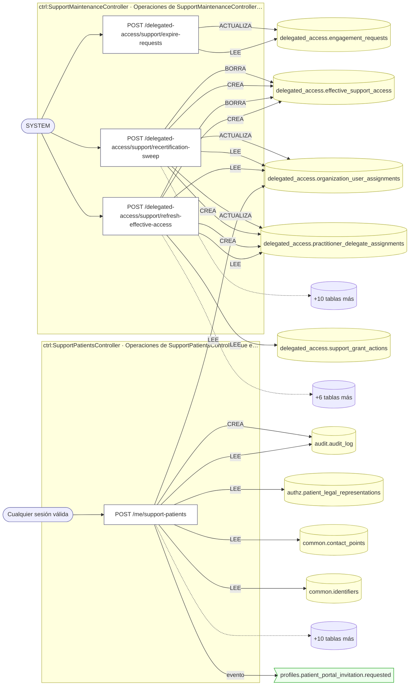

## Árbol de decisión por operación

Cada árbol se deriva del código del handler y de los métodos que invoca (hasta 4 niveles). Una rama que no decide, no escribe y no falla se poda. Los accesos y los efectos consecutivos se agrupan en un solo nodo.

### Operaciones con decisiones propias

#### 1. POST /access-requests/{id}/decision

Aprobar/Denegar solicitud y emitir grant scoped

| HTTP | Código | Cuándo |
|---|---|---|
| 200 | — | Éxito |
| 400 | `VALIDATION_FAILED` | Los parámetros de ruta son UUID válidos; El cuerpo cumple el DTO (sin propiedades extra) |
| 401 | `UNAUTHENTICATED` | Hay una sesión válida (JWT) |
| 403 | `FORBIDDEN` | El rol está permitido; El tenant se resuelve y pertenece al actor |
| 404 | `NOT_FOUND` | ResourceNotFoundException: Solicitud no encontrada |
| 422 | `PRECONDITION_FAILED` | PreconditionFailedException: La solicitud no está abierta |
| 429 | `RATE_LIMITED` | No se supera el límite de solicitudes |
| 500 | `INTERNAL` | DomainException: {HttpStatus.FORBIDDEN} |

```mermaid
flowchart TD
  n1(("Solicitud")):::inicio
  n2{{"Acceso: sesión (401) · rol (403) · tenant (403) · parámetros de ruta (400) · cuerpo válido (400) · límite de…"}}:::acceso
  n1 --> n2
  n3["Llama a AccessRequestsService.decide"]:::llamada
  n2 --> n3
  n4["Llama a DelegationScopeService.resolveTenant"]:::llamada
  n3 --> n4
  n5{"bodyTenantId !== undefined && bodyTenantId !== tenantId"}:::decision
  n4 --> n5
  n6(["500 INTERNAL {HttpStatus.FORBIDDEN}"]):::error
  n5 -->|"sí"| n6
  n7["Transacción: transactional(…)"]:::transaccion
  n5 -->|"no"| n7
  n8["Llama a DelegatedAccessApprovalRequestsRepository.findById"]:::llamada
  n7 --> n8
  n9[("LEE delegated_access.delegated_access_approval_requests")]:::efecto
  n8 --> n9
  n10{"!request"}:::decision
  n9 --> n10
  n11(["404 NOT_FOUND Solicitud no encontrada"]):::error
  n10 -->|"sí"| n11
  n12{"request.statusConceptId !== DELEG.REQUEST_OPEN"}:::decision
  n10 -->|"no"| n12
  n13(["422 PRECONDITION_FAILED La solicitud no está abierta"]):::error
  n12 -->|"sí"| n13
  n14["Llama a DelegationScopeService.loadDelegationInTenant"]:::llamada
  n12 -->|"no"| n14
  n15["Llama a PractitionerDelegateAssignmentsRepository.findById"]:::llamada
  n14 --> n15
  n16[("LEE delegated_access.practitioner_delegate_assignments")]:::efecto
  n15 --> n16
  n17{"!delegate"}:::decision
  n16 --> n17
  n18(["↩ (relanza el error capturado)"]):::error
  n17 -->|"sí"| n18
  n19["Llama a DelegatedPermissionSetsRepository.findById"]:::llamada
  n17 -->|"no"| n19
  n20[("LEE delegated_access.delegated_permission_sets")]:::efecto
  n19 --> n20
  n21["Llama a DelegationScopeService.assertOwningDoctor"]:::llamada
  n20 --> n21
  n22["Llama a DelegationScopeRepository.roleAssignmentPractitioner"]:::llamada
  n21 --> n22
  n23[("LEE practice.practitioner_role_assignments")]:::efecto
  n22 --> n23
  n24{"!profileId || !actor.practitionerProfileId || profileId !== actor.practitionerProfileId"}:::decision
  n23 --> n24
  n25(["↩ (relanza el error capturado)"]):::error
  n24 -->|"sí"| n25
  n26{"dto.decision === 'APPROVED'"}:::decision
  n24 -->|"no"| n26
  n27["Llama a DelegationScopeService.assertGrantTarget"]:::llamada
  n26 -->|"sí"| n27
  n28{"encounterId"}:::decision
  n27 --> n28
  n29["Llama a DelegationScopeRepository.encounterScope"]:::llamada
  n28 -->|"sí"| n29
  n30[("LEE clinical.encounters")]:::efecto
  n29 --> n30
  n31{"!encounter || encounter.tenantId !== tenantId || (patientProfileId !== undefined && encounter.patientProfileI…"}:::decision
  n30 --> n31
  n32(["↩ (relanza el error capturado)"]):::error
  n31 -->|"sí"| n32
  n33{"patientProfileId"}:::decision
  n31 -->|"no"| n33
  n28 -->|"no"| n33
  n34["Llama a DelegationScopeRepository.patientExists"]:::llamada
  n33 -->|"sí"| n34
  n35[("LEE profiles.patient_profiles")]:::efecto
  n34 --> n35
  n36{"!exists"}:::decision
  n35 --> n36
  n37(["↩ (relanza el error capturado)"]):::error
  n36 -->|"sí"| n37
  n38[("ACTUALIZA delegated_access.delegated_access_approval_requests · ACTUALIZA delegated_access.delegated_access_a…")]:::efecto
  n36 -->|"no"| n38
  n33 -->|"no"| n38
  n26 -->|"no"| n38
  n39{"approved"}:::decision
  n38 --> n39
  n40["Llama a DelegatedAccessGrantsRepository.create"]:::llamada
  n39 -->|"sí"| n40
  n41[("CREA delegated_access.delegated_access_grants")]:::efecto
  n40 --> n41
  n42["Llama a DelegationEventsRepository.record"]:::llamada
  n41 --> n42
  n39 -->|"no"| n42
  n43[("CREA delegated_access.delegation_events")]:::efecto
  n42 --> n43
  n44(("200 Responde con éxito")):::ok
  n43 --> n44
  classDef acceso fill:#eef,stroke:#66a
  classDef error fill:#fee,stroke:#c33
  classDef ok fill:#efe,stroke:#3a3
  classDef efecto fill:#ffd,stroke:#aa3
  classDef decision fill:#fff,stroke:#555
  classDef corte fill:#eee,stroke:#999,stroke-dasharray: 4
```

#### 2. POST /affiliation-invitations/redeem

Canjear un código o QR de afiliación

| HTTP | Código | Cuándo |
|---|---|---|
| 200 | — | Éxito |
| 400 | `VALIDATION_FAILED` | El cuerpo cumple el DTO (sin propiedades extra) |
| 401 | `UNAUTHENTICATED` | Hay una sesión válida (JWT) |
| 403 | `FORBIDDEN` | El rol está permitido; El tenant se resuelve y pertenece al actor |
| 404 | `NOT_FOUND` | ResourceNotFoundException: Plantilla de rol no encontrada |
| 422 | `PRECONDITION_FAILED` | PreconditionFailedException: Para afiliarse como médico, su cuenta necesita un perfil profesional; PreconditionFailedException: La organización no tiene una práctica activa que reciba la solicitud; PreconditionFailedException: La invitación no es válida |
| 429 | `RATE_LIMITED` | No se supera el límite de solicitudes |

```mermaid
flowchart TD
  n1(("Solicitud")):::inicio
  n2{{"Acceso: sesión (401) · rol (403) · tenant (403) · cuerpo válido (400) · límite de tasa (429)"}}:::acceso
  n1 --> n2
  n3["Llama a AffiliationInvitationsService.redeem"]:::llamada
  n2 --> n3
  n4["Llama a AffiliationInvitationsService.redeemInTransaction"]:::llamada
  n3 --> n4
  n5["Intenta"]:::intento
  n4 --> n5
  n6["Transacción: transactional(…)"]:::transaccion
  n5 --> n6
  n7["Llama a AffiliationInvitationsRepository.findByTokenHash"]:::llamada
  n6 --> n7
  n8[("LEE directory.affiliation_invitations")]:::efecto
  n7 --> n8
  n9["Llama a AffiliationInvitationsService.refusalOutcome"]:::llamada
  n8 --> n9
  n10["Llama a AffiliationInvitationsRepository.findUseBy"]:::llamada
  n9 --> n10
  n11[("LEE directory.affiliation_invitation_uses")]:::efecto
  n10 --> n11
  n12{"invitation.targetPersonId"}:::decision
  n11 --> n12
  n13["Llama a SupportDirectoryRepository.findPersonIdOfUser"]:::llamada
  n12 -->|"sí"| n13
  n14[("LEE profiles.person_account_links")]:::efecto
  n13 --> n14
  n15{"refusal"}:::decision
  n14 --> n15
  n12 -->|"no"| n15
  n16["Llama a AffiliationInvitationsRepository.recordUse"]:::llamada
  n15 -->|"sí"| n16
  n17[("CREA directory.affiliation_invitation_uses")]:::efecto
  n16 --> n17
  n18[("ACTUALIZA directory.affiliation_invitations")]:::efecto
  n17 --> n18
  n15 -->|"no"| n18
  n19{"counted.length === 0"}:::decision
  n18 --> n19
  n20["Llama a AffiliationInvitationsRepository.recordUse"]:::llamada
  n19 -->|"sí"| n20
  n21[("CREA directory.affiliation_invitation_uses")]:::efecto
  n20 --> n21
  n22["Llama a AffiliationInvitationsService.affiliate"]:::llamada
  n21 --> n22
  n19 -->|"no"| n22
  n23{"!invitation.targetPersonId"}:::decision
  n22 --> n23
  n24["Llama a AffiliationInvitationsService.leavePendingRequest"]:::llamada
  n23 -->|"sí"| n24
  n25{"!template"}:::decision
  n24 --> n25
  n26(["404 NOT_FOUND Plantilla de rol no encontrada"]):::error
  n25 -->|"sí"| n26
  n27["Llama a AffiliationInvitationsService.leavePendingAffiliation"]:::llamada
  n25 -->|"no"| n27
  n28{"!practitionerProfileId"}:::decision
  n27 --> n28
  n29(["422 PRECONDITION_FAILED Para afiliarse como médico, su cuenta necesita un perfil profesional"]):::error
  n28 -->|"sí"| n29
  n30{"!target"}:::decision
  n28 -->|"no"| n30
  n31(["422 PRECONDITION_FAILED La organización no tiene una práctica activa que reciba la solicitud"]):::error
  n30 -->|"sí"| n31
  n32["Llama a SupportDirectoryRepository.ensureActiveStaffMembership"]:::llamada
  n30 -->|"no"| n32
  n23 -->|"no"| n32
  n33{"existing.statusConceptId !== DIR.MEMBERSHIP_ACTIVE"}:::decision
  n32 --> n33
  n34[("ACTUALIZA directory.tenant_memberships · ACTUALIZA directory.tenant_memberships · ACTUALIZA directory.tenant_…")]:::efecto
  n33 -->|"sí"| n34
  n35["Llama a RoleTemplatesRepository.findById"]:::llamada
  n34 --> n35
  n33 -->|"no"| n35
  n36[("LEE delegated_access.role_templates")]:::efecto
  n35 --> n36
  n37{"!template"}:::decision
  n36 --> n37
  n38(["404 NOT_FOUND Plantilla de rol no encontrada"]):::error
  n37 -->|"sí"| n38
  n39["Llama a SupportDirectoryRepository.findTenant"]:::llamada
  n37 -->|"no"| n39
  n40[("LEE directory.tenants")]:::efecto
  n39 --> n40
  n41["Llama a SupportEngagementsRepository.findActiveByMembershipTemplate"]:::llamada
  n40 --> n41
  n42[("LEE delegated_access.organization_user_assignments")]:::efecto
  n41 --> n42
  n43["Llama a SupportEngagementsRepository.create"]:::llamada
  n42 --> n43
  n44[("CREA delegated_access.organization_user_assignments")]:::efecto
  n43 --> n44
  n45["Llama a EngagementRequestsRepository.create"]:::llamada
  n44 --> n45
  n46[("CREA delegated_access.engagement_requests")]:::efecto
  n45 --> n46
  n47["Llama a AffiliationInvitationsRepository.recordUse"]:::llamada
  n46 --> n47
  n48[("CREA directory.affiliation_invitation_uses")]:::efecto
  n47 --> n48
  n49(["↩ (relanza el error capturado)"]):::error
  n5 -->|"si falla"| n49
  n50{"!outcome.ok"}:::decision
  n48 --> n50
  n51(["422 PRECONDITION_FAILED La invitación no es válida"]):::error
  n50 -->|"sí"| n51
  n52(("200 Responde con éxito")):::ok
  n50 -->|"no"| n52
  classDef acceso fill:#eef,stroke:#66a
  classDef error fill:#fee,stroke:#c33
  classDef ok fill:#efe,stroke:#3a3
  classDef efecto fill:#ffd,stroke:#aa3
  classDef decision fill:#fff,stroke:#555
  classDef corte fill:#eee,stroke:#999,stroke-dasharray: 4
```

#### 3. POST /authz/effective-actor/evaluate

Evaluar actor efectivo por propósito (step-up)

| HTTP | Código | Cuándo |
|---|---|---|
| 200 | — | Éxito |
| 400 | `VALIDATION_FAILED` | El cuerpo cumple el DTO (sin propiedades extra) |
| 401 | `UNAUTHENTICATED` | Hay una sesión válida (JWT) |
| 403 | `FORBIDDEN` | El rol está permitido; El tenant se resuelve y pertenece al actor |
| 429 | `RATE_LIMITED` | No se supera el límite de solicitudes |
| 500 | `INTERNAL` | DomainException: {HttpStatus.FORBIDDEN} |

```mermaid
flowchart TD
  n1(("Solicitud")):::inicio
  n2{{"Acceso: sesión (401) · rol (403) · tenant (403) · cuerpo válido (400) · límite de tasa (429)"}}:::acceso
  n1 --> n2
  n3["Llama a DelegatedAccessEvaluationService.evaluate"]:::llamada
  n2 --> n3
  n4["Llama a DelegationScopeService.resolveTenant"]:::llamada
  n3 --> n4
  n5{"bodyTenantId !== undefined && bodyTenantId !== tenantId"}:::decision
  n4 --> n5
  n6(["500 INTERNAL {HttpStatus.FORBIDDEN}"]):::error
  n5 -->|"sí"| n6
  n7["Transacción: transactional(…)"]:::transaccion
  n5 -->|"no"| n7
  n8["Llama a DelegationScopeService.loadDelegationInTenant"]:::llamada
  n7 --> n8
  n9["Llama a PractitionerDelegateAssignmentsRepository.findById"]:::llamada
  n8 --> n9
  n10[("LEE delegated_access.practitioner_delegate_assignments")]:::efecto
  n9 --> n10
  n11{"!delegate"}:::decision
  n10 --> n11
  n12(["↩ (relanza el error capturado)"]):::error
  n11 -->|"sí"| n12
  n13["Llama a DelegatedPermissionSetsRepository.findById"]:::llamada
  n11 -->|"no"| n13
  n14[("LEE delegated_access.delegated_permission_sets")]:::efecto
  n13 --> n14
  n15["Llama a OrganizationUserAssignmentsRepository.findById"]:::llamada
  n14 --> n15
  n16[("LEE delegated_access.organization_user_assignments")]:::efecto
  n15 --> n16
  n17["Llama a DelegationScopeService.membershipOfAssignment"]:::llamada
  n16 --> n17
  n18["Llama a DelegationScopeRepository.membershipOf"]:::llamada
  n17 --> n18
  n19[("LEE directory.tenant_memberships")]:::efecto
  n18 --> n19
  n20{"!membership || membership.tenantId !== tenantId || membership.userId !== subjectUserId"}:::decision
  n19 --> n20
  n21["Llama a DelegationEventsRepository.record"]:::llamada
  n20 -->|"sí"| n21
  n22[("CREA delegated_access.delegation_events")]:::efecto
  n21 --> n22
  n23{"!withinWindow"}:::decision
  n22 --> n23
  n20 -->|"no"| n23
  n24["Llama a DelegationEventsRepository.record"]:::llamada
  n23 -->|"sí"| n24
  n25[("CREA delegated_access.delegation_events")]:::efecto
  n24 --> n25
  n26["Llama a DelegatedAccessGrantsRepository.findActiveMatch"]:::llamada
  n25 --> n26
  n23 -->|"no"| n26
  n27[("LEE delegated_access.delegated_access_grants")]:::efecto
  n26 --> n27
  n28{"!grant"}:::decision
  n27 --> n28
  n29["Llama a DelegationEventsRepository.record"]:::llamada
  n28 -->|"sí"| n29
  n30[("CREA delegated_access.delegation_events")]:::efecto
  n29 --> n30
  n31{"dto.permissionId"}:::decision
  n30 --> n31
  n28 -->|"no"| n31
  n32["Llama a DelegatedPermissionSetItemsRepository.findBySetAndPermission"]:::llamada
  n31 -->|"sí"| n32
  n33[("LEE delegated_access.delegated_permission_set_items")]:::efecto
  n32 --> n33
  n34{"requiresStepUp"}:::decision
  n33 --> n34
  n31 -->|"no"| n34
  n35["Llama a DelegationEventsRepository.record"]:::llamada
  n34 -->|"sí"| n35
  n36[("CREA delegated_access.delegation_events")]:::efecto
  n35 --> n36
  n37["Llama a DelegationEventsRepository.record"]:::llamada
  n36 --> n37
  n34 -->|"no"| n37
  n38[("CREA delegated_access.delegation_events")]:::efecto
  n37 --> n38
  n39(("200 Responde con éxito")):::ok
  n38 --> n39
  classDef acceso fill:#eef,stroke:#66a
  classDef error fill:#fee,stroke:#c33
  classDef ok fill:#efe,stroke:#3a3
  classDef efecto fill:#ffd,stroke:#aa3
  classDef decision fill:#fff,stroke:#555
  classDef corte fill:#eee,stroke:#999,stroke-dasharray: 4
```

#### 4. POST /delegated-access/expiry-sweep

Expirar delegaciones y grants vencidos (barrido)

| HTTP | Código | Cuándo |
|---|---|---|
| 200 | — | Éxito |
| 401 | `UNAUTHENTICATED` | Hay una sesión válida (JWT) |
| 403 | `FORBIDDEN` | El rol está permitido; El tenant se resuelve y pertenece al actor |
| 429 | `RATE_LIMITED` | No se supera el límite de solicitudes |

```mermaid
flowchart TD
  n1(("Solicitud")):::inicio
  n2{{"Acceso: sesión (401) · rol (403) · tenant (403) · límite de tasa (429)"}}:::acceso
  n1 --> n2
  n3["Llama a DelegatedAccessEvaluationService.expirySweep"]:::llamada
  n2 --> n3
  n4["Transacción: transactional(…)"]:::transaccion
  n3 --> n4
  n5["Llama a DelegatedAccessGrantsRepository.findOverdueActive"]:::llamada
  n4 --> n5
  n6[("LEE delegated_access.delegated_access_grants")]:::efecto
  n5 --> n6
  n7["Repite: por cada const grant de grants"]:::bucle
  n6 --> n7
  n8[("ACTUALIZA delegated_access.delegated_access_grants")]:::efecto
  n7 -->|"cada elemento"| n8
  n9["Llama a DelegationEventsRepository.record"]:::llamada
  n8 --> n9
  n10[("CREA delegated_access.delegation_events")]:::efecto
  n9 --> n10
  n11["Llama a PractitionerDelegateAssignmentsRepository.findOverdueActive"]:::llamada
  n10 --> n11
  n7 -->|"al terminar"| n11
  n12[("LEE delegated_access.practitioner_delegate_assignments")]:::efecto
  n11 --> n12
  n13["Repite: por cada const delegate de delegates"]:::bucle
  n12 --> n13
  n14[("ACTUALIZA delegated_access.practitioner_delegate_assignments")]:::efecto
  n13 -->|"cada elemento"| n14
  n15["Llama a DelegationEventsRepository.record"]:::llamada
  n14 --> n15
  n16[("CREA delegated_access.delegation_events")]:::efecto
  n15 --> n16
  n17["Llama a OrganizationUserAssignmentsRepository.findOverdueActive"]:::llamada
  n16 --> n17
  n13 -->|"al terminar"| n17
  n18[("LEE delegated_access.organization_user_assignments")]:::efecto
  n17 --> n18
  n19["Repite: por cada const assignment de orgAssignments"]:::bucle
  n18 --> n19
  n20[("ACTUALIZA delegated_access.organization_user_assignments")]:::efecto
  n19 -->|"cada elemento"| n20
  n21(("200 Responde con éxito")):::ok
  n20 --> n21
  n19 -->|"al terminar"| n21
  classDef acceso fill:#eef,stroke:#66a
  classDef error fill:#fee,stroke:#c33
  classDef ok fill:#efe,stroke:#3a3
  classDef efecto fill:#ffd,stroke:#aa3
  classDef decision fill:#fff,stroke:#555
  classDef corte fill:#eee,stroke:#999,stroke-dasharray: 4
```

#### 5. POST /delegated-access/support/expire-requests

Vencer solicitudes de apoyo sin decidir (15 días)

| HTTP | Código | Cuándo |
|---|---|---|
| 200 | — | Éxito |
| 401 | `UNAUTHENTICATED` | Hay una sesión válida (JWT) |
| 403 | `FORBIDDEN` | El rol está permitido; El tenant se resuelve y pertenece al actor |
| 429 | `RATE_LIMITED` | No se supera el límite de solicitudes |

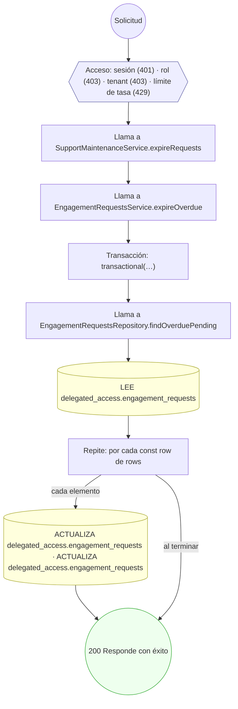

#### 6. POST /delegated-access/support/recertification-sweep

Suspender vínculos sin recertificar (15 días)

| HTTP | Código | Cuándo |
|---|---|---|
| 200 | — | Éxito |
| 401 | `UNAUTHENTICATED` | Hay una sesión válida (JWT) |
| 403 | `FORBIDDEN` | El rol está permitido; El tenant se resuelve y pertenece al actor |
| 429 | `RATE_LIMITED` | No se supera el límite de solicitudes |

```mermaid
flowchart TD
  n1(("Solicitud")):::inicio
  n2{{"Acceso: sesión (401) · rol (403) · tenant (403) · límite de tasa (429)"}}:::acceso
  n1 --> n2
  n3["Llama a SupportMaintenanceService.sweepRecertification"]:::llamada
  n2 --> n3
  n4["Llama a SupportEngagementsService.suspendLapsedRecertifications"]:::llamada
  n3 --> n4
  n5["Transacción: transactional(…)"]:::transaccion
  n4 --> n5
  n6["Llama a SupportEngagementsRepository.findActiveDueBefore"]:::llamada
  n5 --> n6
  n7[("LEE delegated_access.organization_user_assignments")]:::efecto
  n6 --> n7
  n8["Llama a SupportAccessRepository.findEngagements"]:::llamada
  n7 --> n8
  n9{"filter.ids"}:::decision
  n8 --> n9
  n10[("LEE delegated_access.organization_user_assignments · LEE directory.tenant_memberships")]:::efecto
  n9 -->|"sí"| n10
  n11[("LEE directory.tenant_memberships · LEE delegated_access.organization_user_assignments")]:::efecto
  n9 -->|"no"| n11
  n12["Repite: por cada const a de due"]:::bucle
  n10 --> n12
  n11 --> n12
  n13[("ACTUALIZA delegated_access.organization_user_assignments · ACTUALIZA delegated_access.organization_user_assig…")]:::efecto
  n12 -->|"cada elemento"| n13
  n14["Repite: por cada const d de await this.engagements.findDelegations(tx, a.id)"]:::bucle
  n13 --> n14
  n15{"d.statusConceptId === STATUS.ACTIVE"}:::decision
  n14 -->|"cada elemento"| n15
  n16[("ACTUALIZA delegated_access.practitioner_delegate_assignments")]:::efecto
  n15 -->|"sí"| n16
  n17["Llama a SupportEngagementsRepository.syncSupportMembership"]:::llamada
  n16 --> n17
  n15 -->|"no"| n17
  n14 -->|"al terminar"| n17
  n18[("LEE directory.tenant_memberships · LEE delegated_access.organization_user_assignments")]:::efecto
  n17 --> n18
  n19{"origin !== DIR.MEMBERSHIP_ORIGIN_SUPPORT_ENGAGEMENT"}:::decision
  n18 --> n19
  n20["Llama a SupportEngagementsRepository.hasOtherMembershipReason"]:::llamada
  n19 -->|"sí"| n20
  n21[("LEE directory.branch_memberships")]:::efecto
  n20 --> n21
  n22[("ACTUALIZA directory.tenant_memberships · ACTUALIZA directory.tenant_memberships · ACTUALIZA directory.tenant_…")]:::efecto
  n21 --> n22
  n19 -->|"no"| n22
  n23["Repite: por cada const tenantId de tenants.keys()"]:::bucle
  n22 --> n23
  n12 -->|"al terminar"| n23
  n24["Llama a EffectiveSupportAccessService.refreshTenant"]:::llamada
  n23 -->|"cada elemento"| n24
  n25["Llama a SupportAccessRepository.findEngagements"]:::llamada
  n24 --> n25
  n26{"filter.ids"}:::decision
  n25 --> n26
  n27[("LEE delegated_access.organization_user_assignments · LEE directory.tenant_memberships")]:::efecto
  n26 -->|"sí"| n27
  n28[("LEE directory.tenant_memberships · LEE delegated_access.organization_user_assignments")]:::efecto
  n26 -->|"no"| n28
  n29["Llama a SupportAccessRepository.findRoleAssignmentsOfTenant"]:::llamada
  n27 --> n29
  n28 --> n29
  n30[("LEE practice.practices · LEE practice.practitioner_role_assignments")]:::efecto
  n29 --> n30
  n31["Llama a SupportAccessRepository.findLocationPairs"]:::llamada
  n30 --> n31
  n32[("LEE practice.practitioner_location_assignments")]:::efecto
  n31 --> n32
  n33["Llama a SupportAccessRepository.findGrantsWithActions"]:::llamada
  n32 --> n33
  n34[("LEE delegated_access.support_scope_grants · LEE delegated_access.support_grant_actions")]:::efecto
  n33 --> n34
  n35["Llama a SupportAccessRepository.findRoleAssignments"]:::llamada
  n34 --> n35
  n36[("LEE practice.practitioner_role_assignments · LEE practice.practices")]:::efecto
  n35 --> n36
  n37["Llama a SupportAccessRepository.findDelegationsOfEngagements"]:::llamada
  n36 --> n37
  n38[("LEE delegated_access.practitioner_delegate_assignments")]:::efecto
  n37 --> n38
  n39["Llama a PractitionerDelegateAssignmentsRepository.create"]:::llamada
  n38 --> n39
  n40[("CREA delegated_access.practitioner_delegate_assignments")]:::efecto
  n39 --> n40
  n41["Llama a EffectiveSupportAccessRepository.replace"]:::llamada
  n40 --> n41
  n42[("BORRA delegated_access.effective_support_access")]:::efecto
  n41 --> n42
  n43["Repite: por cada const row de rows"]:::bucle
  n42 --> n43
  n44[("CREA delegated_access.effective_support_access")]:::efecto
  n43 -->|"cada elemento"| n44
  n45(("200 Responde con éxito")):::ok
  n44 --> n45
  n43 -->|"al terminar"| n45
  n23 -->|"al terminar"| n45
  classDef acceso fill:#eef,stroke:#66a
  classDef error fill:#fee,stroke:#c33
  classDef ok fill:#efe,stroke:#3a3
  classDef efecto fill:#ffd,stroke:#aa3
  classDef decision fill:#fff,stroke:#555
  classDef corte fill:#eee,stroke:#999,stroke-dasharray: 4
```

#### 7. POST /delegated-access/support/refresh-effective-access

Recalcular el acceso efectivo del personal de apoyo

| HTTP | Código | Cuándo |
|---|---|---|
| 200 | — | Éxito |
| 401 | `UNAUTHENTICATED` | Hay una sesión válida (JWT) |
| 403 | `FORBIDDEN` | El rol está permitido; El tenant se resuelve y pertenece al actor |
| 429 | `RATE_LIMITED` | No se supera el límite de solicitudes |

```mermaid
flowchart TD
  n1(("Solicitud")):::inicio
  n2{{"Acceso: sesión (401) · rol (403) · tenant (403) · límite de tasa (429)"}}:::acceso
  n1 --> n2
  n3["Llama a SupportMaintenanceService.refreshEffectiveAccess"]:::llamada
  n2 --> n3
  n4["Llama a EffectiveSupportAccessService.tenantsWithEngagements"]:::llamada
  n3 --> n4
  n5["Llama a SupportAccessRepository.findEngagements"]:::llamada
  n4 --> n5
  n6{"filter.ids"}:::decision
  n5 --> n6
  n7[("LEE delegated_access.organization_user_assignments · LEE directory.tenant_memberships")]:::efecto
  n6 -->|"sí"| n7
  n8[("LEE directory.tenant_memberships · LEE delegated_access.organization_user_assignments")]:::efecto
  n6 -->|"no"| n8
  n9["Repite: por cada const tenantId de tenants"]:::bucle
  n7 --> n9
  n8 --> n9
  n10["Llama a EffectiveSupportAccessService.refreshTenant"]:::llamada
  n9 -->|"cada elemento"| n10
  n11["Llama a SupportAccessRepository.findEngagements"]:::llamada
  n10 --> n11
  n12{"filter.ids"}:::decision
  n11 --> n12
  n13[("LEE delegated_access.organization_user_assignments · LEE directory.tenant_memberships")]:::efecto
  n12 -->|"sí"| n13
  n14[("LEE directory.tenant_memberships · LEE delegated_access.organization_user_assignments")]:::efecto
  n12 -->|"no"| n14
  n15["Llama a SupportAccessRepository.findRoleAssignmentsOfTenant"]:::llamada
  n13 --> n15
  n14 --> n15
  n16[("LEE practice.practices · LEE practice.practitioner_role_assignments")]:::efecto
  n15 --> n16
  n17["Llama a SupportAccessRepository.findLocationPairs"]:::llamada
  n16 --> n17
  n18[("LEE practice.practitioner_location_assignments")]:::efecto
  n17 --> n18
  n19["Llama a SupportAccessRepository.findGrantsWithActions"]:::llamada
  n18 --> n19
  n20[("LEE delegated_access.support_scope_grants · LEE delegated_access.support_grant_actions")]:::efecto
  n19 --> n20
  n21["Llama a SupportAccessRepository.findRoleAssignments"]:::llamada
  n20 --> n21
  n22[("LEE practice.practitioner_role_assignments · LEE practice.practices")]:::efecto
  n21 --> n22
  n23["Llama a EffectiveSupportAccessService.toExpandable"]:::llamada
  n22 --> n23
  n24["Repite: por cada const { grant, permissionIds } de own"]:::bucle
  n23 --> n24
  n25["Llama a SupportAccessRepository.findCareSpaceIdsWithin"]:::llamada
  n24 -->|"cada elemento"| n25
  n26{"location.practiceSiteId"}:::decision
  n25 --> n26
  n27[("LEE practice.care_spaces")]:::efecto
  n26 -->|"sí"| n27
  n28[("LEE practice.care_spaces")]:::efecto
  n27 --> n28
  n26 -->|"no"| n28
  n29["Llama a SupportAccessRepository.findDelegationsOfEngagements"]:::llamada
  n28 --> n29
  n24 -->|"al terminar"| n29
  n30[("LEE delegated_access.practitioner_delegate_assignments")]:::efecto
  n29 --> n30
  n31["Llama a SupportAccessRepository.findRoleAssignments"]:::llamada
  n30 --> n31
  n32[("LEE practice.practitioner_role_assignments · LEE practice.practices")]:::efecto
  n31 --> n32
  n33["Llama a PractitionerDelegateAssignmentsRepository.create"]:::llamada
  n32 --> n33
  n34[("CREA delegated_access.practitioner_delegate_assignments")]:::efecto
  n33 --> n34
  n35["Llama a EffectiveSupportAccessRepository.replace"]:::llamada
  n34 --> n35
  n36[("BORRA delegated_access.effective_support_access")]:::efecto
  n35 --> n36
  n37["Repite: por cada const row de rows"]:::bucle
  n36 --> n37
  n38[("CREA delegated_access.effective_support_access")]:::efecto
  n37 -->|"cada elemento"| n38
  n39(("200 Responde con éxito")):::ok
  n38 --> n39
  n37 -->|"al terminar"| n39
  n9 -->|"al terminar"| n39
  classDef acceso fill:#eef,stroke:#66a
  classDef error fill:#fee,stroke:#c33
  classDef ok fill:#efe,stroke:#3a3
  classDef efecto fill:#ffd,stroke:#aa3
  classDef decision fill:#fff,stroke:#555
  classDef corte fill:#eee,stroke:#999,stroke-dasharray: 4
```

#### 8. POST /delegated-permission-sets

Publicar set de permisos delegados (scoped)

| HTTP | Código | Cuándo |
|---|---|---|
| 201 | — | Éxito |
| 400 | `VALIDATION_FAILED` | El cuerpo cumple el DTO (sin propiedades extra) |
| 401 | `UNAUTHENTICATED` | Hay una sesión válida (JWT) |
| 403 | `FORBIDDEN` | El rol está permitido; El tenant se resuelve y pertenece al actor |
| 409 | `CONFLICT` | ConflictException: Ya existe un set con ese código en el tenant |
| 429 | `RATE_LIMITED` | No se supera el límite de solicitudes |
| 500 | `INTERNAL` | DomainException: {HttpStatus.FORBIDDEN} |


#### 9. POST /delegated-permission-sets/{id}/versions

Versionar set de permisos delegados

| HTTP | Código | Cuándo |
|---|---|---|
| 201 | — | Éxito |
| 400 | `VALIDATION_FAILED` | Los parámetros de ruta son UUID válidos; El cuerpo cumple el DTO (sin propiedades extra) |
| 401 | `UNAUTHENTICATED` | Hay una sesión válida (JWT) |
| 403 | `FORBIDDEN` | El rol está permitido; El tenant se resuelve y pertenece al actor |
| 429 | `RATE_LIMITED` | No se supera el límite de solicitudes |
| 500 | `INTERNAL` | DomainException: {HttpStatus.FORBIDDEN} |


#### 10. GET /me/practitioner/support-access-requests

Solicitudes de acceso clínico temporal de mi equipo

| HTTP | Código | Cuándo |
|---|---|---|
| 200 | — | Éxito |
| 401 | `UNAUTHENTICATED` | Hay una sesión válida (JWT) |
| 403 | `FORBIDDEN` | El rol está permitido; El tenant se resuelve y pertenece al actor; ForbiddenException: La cuenta no tiene perfil profesional: no tiene equipo de apoyo. |
| 429 | `RATE_LIMITED` | No se supera el límite de solicitudes |
| 500 | `INTERNAL` | DomainException: {HttpStatus.FORBIDDEN} |

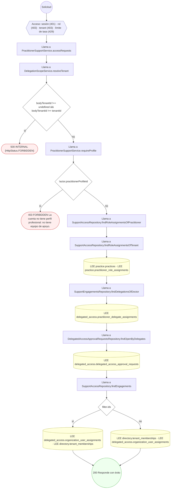

#### 11. GET /me/practitioner/support-activity

Actividad de mi equipo de apoyo

| HTTP | Código | Cuándo |
|---|---|---|
| 200 | — | Éxito |
| 401 | `UNAUTHENTICATED` | Hay una sesión válida (JWT) |
| 403 | `FORBIDDEN` | El rol está permitido; El tenant se resuelve y pertenece al actor; ForbiddenException: La cuenta no tiene perfil profesional: no tiene equipo de apoyo. |
| 429 | `RATE_LIMITED` | No se supera el límite de solicitudes |
| 500 | `INTERNAL` | DomainException: {HttpStatus.FORBIDDEN} |

```mermaid
flowchart TD
  n1(("Solicitud")):::inicio
  n2{{"Acceso: sesión (401) · rol (403) · tenant (403) · límite de tasa (429)"}}:::acceso
  n1 --> n2
  n3["Llama a SupportActivityService.forPractitioner"]:::llamada
  n2 --> n3
  n4["Llama a DelegationScopeService.resolveTenant"]:::llamada
  n3 --> n4
  n5{"bodyTenantId !== undefined && bodyTenantId !== tenantId"}:::decision
  n4 --> n5
  n6(["500 INTERNAL {HttpStatus.FORBIDDEN}"]):::error
  n5 -->|"sí"| n6
  n7{"!actor.practitionerProfileId"}:::decision
  n5 -->|"no"| n7
  n8(["403 FORBIDDEN La cuenta no tiene perfil profesional: no tiene equipo de apoyo."]):::error
  n7 -->|"sí"| n8
  n9["Llama a SupportAccessRepository.findRoleAssignmentsOfPractitioner"]:::llamada
  n7 -->|"no"| n9
  n10["Llama a SupportAccessRepository.findRoleAssignmentsOfTenant"]:::llamada
  n9 --> n10
  n11[("LEE practice.practices · LEE practice.practitioner_role_assignments")]:::efecto
  n10 --> n11
  n12["Llama a SupportEngagementsRepository.findDelegationsOfDoctor"]:::llamada
  n11 --> n12
  n13[("LEE delegated_access.practitioner_delegate_assignments")]:::efecto
  n12 --> n13
  n14["Llama a SupportAccessRepository.findEngagements"]:::llamada
  n13 --> n14
  n15{"filter.ids"}:::decision
  n14 --> n15
  n16[("LEE delegated_access.organization_user_assignments · LEE directory.tenant_memberships")]:::efecto
  n15 -->|"sí"| n16
  n17[("LEE directory.tenant_memberships · LEE delegated_access.organization_user_assignments")]:::efecto
  n15 -->|"no"| n17
  n18["Llama a SupportActivityService.page"]:::llamada
  n16 --> n18
  n17 --> n18
  n19["Llama a SupportActivityRepository.userNames"]:::llamada
  n18 --> n19
  n20[("LEE iam.users")]:::efecto
  n19 --> n20
  n21["Repite: ciclo for"]:::bucle
  n20 --> n21
  n22["Llama a SupportActivityRepository.scan"]:::llamada
  n21 -->|"cada elemento"| n22
  n23[("LEE audit.audit_log")]:::efecto
  n22 --> n23
  n24["Llama a SupportActivityRepository.attributions"]:::llamada
  n23 --> n24
  n25{"refs.bookingIds.length › 0 || refs.appointmentIds.length › 0"}:::decision
  n24 --> n25
  n26[("LEE scheduling.appointment_bookings · LEE scheduling.schedulable_resources · LEE profiles.persons")]:::efecto
  n25 -->|"sí"| n26
  n27{"refs.delegateIds.length › 0"}:::decision
  n26 --> n27
  n25 -->|"no"| n27
  n28[("LEE delegated_access.practitioner_delegate_assignments · LEE practice.practitioner_role_assignments · LEE pro…")]:::efecto
  n27 -->|"sí"| n28
  n29{"refs.grantIds.length › 0"}:::decision
  n28 --> n29
  n27 -->|"no"| n29
  n30[("LEE delegated_access.support_scope_grants · LEE practice.practitioner_role_assignments · LEE profiles.persons")]:::efecto
  n29 -->|"sí"| n30
  n31(("200 Responde con éxito")):::ok
  n30 --> n31
  n29 -->|"no"| n31
  n21 -->|"al terminar"| n31
  classDef acceso fill:#eef,stroke:#66a
  classDef error fill:#fee,stroke:#c33
  classDef ok fill:#efe,stroke:#3a3
  classDef efecto fill:#ffd,stroke:#aa3
  classDef decision fill:#fff,stroke:#555
  classDef corte fill:#eee,stroke:#999,stroke-dasharray: 4
```

#### 12. GET /me/practitioner/support-team

Mi equipo de apoyo

| HTTP | Código | Cuándo |
|---|---|---|
| 200 | — | Éxito |
| 401 | `UNAUTHENTICATED` | Hay una sesión válida (JWT) |
| 403 | `FORBIDDEN` | El rol está permitido; El tenant se resuelve y pertenece al actor; ForbiddenException: La cuenta no tiene perfil profesional: no tiene equipo de apoyo. |
| 429 | `RATE_LIMITED` | No se supera el límite de solicitudes |
| 500 | `INTERNAL` | DomainException: {HttpStatus.FORBIDDEN} |

```mermaid
flowchart TD
  n1(("Solicitud")):::inicio
  n2{{"Acceso: sesión (401) · rol (403) · tenant (403) · límite de tasa (429)"}}:::acceso
  n1 --> n2
  n3["Llama a PractitionerSupportService.supportTeam"]:::llamada
  n2 --> n3
  n4["Llama a DelegationScopeService.resolveTenant"]:::llamada
  n3 --> n4
  n5{"bodyTenantId !== undefined && bodyTenantId !== tenantId"}:::decision
  n4 --> n5
  n6(["500 INTERNAL {HttpStatus.FORBIDDEN}"]):::error
  n5 -->|"sí"| n6
  n7["Llama a PractitionerSupportService.requireProfile"]:::llamada
  n5 -->|"no"| n7
  n8{"!actor.practitionerProfileId"}:::decision
  n7 --> n8
  n9(["403 FORBIDDEN La cuenta no tiene perfil profesional: no tiene equipo de apoyo."]):::error
  n8 -->|"sí"| n9
  n10["Llama a SupportAccessRepository.findRoleAssignmentsOfPractitioner"]:::llamada
  n8 -->|"no"| n10
  n11["Llama a SupportAccessRepository.findRoleAssignmentsOfTenant"]:::llamada
  n10 --> n11
  n12[("LEE practice.practices · LEE practice.practitioner_role_assignments")]:::efecto
  n11 --> n12
  n13["Llama a SupportEngagementsRepository.findDelegationsOfDoctor"]:::llamada
  n12 --> n13
  n14[("LEE delegated_access.practitioner_delegate_assignments")]:::efecto
  n13 --> n14
  n15["Llama a SupportAccessRepository.findEngagements"]:::llamada
  n14 --> n15
  n16{"filter.ids"}:::decision
  n15 --> n16
  n17[("LEE delegated_access.organization_user_assignments · LEE directory.tenant_memberships")]:::efecto
  n16 -->|"sí"| n17
  n18[("LEE directory.tenant_memberships · LEE delegated_access.organization_user_assignments")]:::efecto
  n16 -->|"no"| n18
  n19["Llama a EffectiveSupportAccessService.previewForDoctor"]:::llamada
  n17 --> n19
  n18 --> n19
  n20["Llama a SupportAccessRepository.findEngagements"]:::llamada
  n19 --> n20
  n21{"filter.ids"}:::decision
  n20 --> n21
  n22[("LEE delegated_access.organization_user_assignments · LEE directory.tenant_memberships")]:::efecto
  n21 -->|"sí"| n22
  n23[("LEE directory.tenant_memberships · LEE delegated_access.organization_user_assignments")]:::efecto
  n21 -->|"no"| n23
  n24["Llama a SupportAccessRepository.findRoleAssignmentsOfTenant"]:::llamada
  n22 --> n24
  n23 --> n24
  n25[("LEE practice.practices · LEE practice.practitioner_role_assignments")]:::efecto
  n24 --> n25
  n26["Llama a SupportAccessRepository.findLocationPairs"]:::llamada
  n25 --> n26
  n27[("LEE practice.practitioner_location_assignments")]:::efecto
  n26 --> n27
  n28["Llama a SupportAccessRepository.findGrantsWithActions"]:::llamada
  n27 --> n28
  n29[("LEE delegated_access.support_scope_grants · LEE delegated_access.support_grant_actions")]:::efecto
  n28 --> n29
  n30["Llama a SupportAccessRepository.findRoleAssignments"]:::llamada
  n29 --> n30
  n31[("LEE practice.practitioner_role_assignments · LEE practice.practices")]:::efecto
  n30 --> n31
  n32["Repite: por cada const engagement de live"]:::bucle
  n31 --> n32
  n33["Llama a EffectiveSupportAccessService.toExpandable"]:::llamada
  n32 -->|"cada elemento"| n33
  n34["Repite: por cada const { grant, permissionIds } de own"]:::bucle
  n33 --> n34
  n35["Llama a SupportAccessRepository.findCareSpaceIdsWithin"]:::llamada
  n34 -->|"cada elemento"| n35
  n36{"location.practiceSiteId"}:::decision
  n35 --> n36
  n37[("LEE practice.care_spaces")]:::efecto
  n36 -->|"sí"| n37
  n38[("LEE practice.care_spaces")]:::efecto
  n37 --> n38
  n36 -->|"no"| n38
  n39["Llama a DelegatedAccessApprovalRequestsRepository.findOpenByDelegates"]:::llamada
  n38 --> n39
  n34 -->|"al terminar"| n39
  n32 -->|"al terminar"| n39
  n40[("LEE delegated_access.delegated_access_approval_requests")]:::efecto
  n39 --> n40
  n41["Llama a SupportActivityRepository.userNames"]:::llamada
  n40 --> n41
  n42[("LEE iam.users")]:::efecto
  n41 --> n42
  n43["Llama a SupportActivityRepository.tenantNames"]:::llamada
  n42 --> n43
  n44[("LEE directory.tenants")]:::efecto
  n43 --> n44
  n45["Llama a SupportActivityRepository.profileNames"]:::llamada
  n44 --> n45
  n46[("LEE profiles.persons")]:::efecto
  n45 --> n46
  n47["Llama a SupportActivityRepository.lastActivity"]:::llamada
  n46 --> n47
  n48[("LEE audit.audit_log")]:::efecto
  n47 --> n48
  n49["Repite: por cada const delegate de delegations"]:::bucle
  n48 --> n49
  n50["Llama a RoleTemplatesRepository.findById"]:::llamada
  n49 -->|"cada elemento"| n50
  n51[("LEE delegated_access.role_templates")]:::efecto
  n50 --> n51
  n52(("200 Responde con éxito")):::ok
  n51 --> n52
  n49 -->|"al terminar"| n52
  classDef acceso fill:#eef,stroke:#66a
  classDef error fill:#fee,stroke:#c33
  classDef ok fill:#efe,stroke:#3a3
  classDef efecto fill:#ffd,stroke:#aa3
  classDef decision fill:#fff,stroke:#555
  classDef corte fill:#eee,stroke:#999,stroke-dasharray: 4
```

#### 13. POST /me/support-access-requests

Pedir acceso clínico temporal a un paciente (lo decide el doctor)

| HTTP | Código | Cuándo |
|---|---|---|
| 201 | — | Éxito |
| 400 | `VALIDATION_FAILED` | El cuerpo cumple el DTO (sin propiedades extra) |
| 401 | `UNAUTHENTICATED` | Hay una sesión válida (JWT) |
| 403 | `FORBIDDEN` | El rol está permitido; El tenant se resuelve y pertenece al actor; ForbiddenException: No tiene un vínculo de apoyo en esa organización |
| 404 | `NOT_FOUND` | ResourceNotFoundException: Delegación no encontrada |
| 409 | `CONFLICT` | ConflictException: Ya existe una solicitud pendiente equivalente |
| 422 | `PRECONDITION_FAILED` | PreconditionFailedException: La delegación no está activa |
| 429 | `RATE_LIMITED` | No se supera el límite de solicitudes |

```mermaid
flowchart TD
  n1(("Solicitud")):::inicio
  n2{{"Acceso: sesión (401) · rol (403) · tenant (403) · cuerpo válido (400) · límite de tasa (429)"}}:::acceso
  n1 --> n2
  n3["Llama a AccessRequestsService.requestAsSupport"]:::llamada
  n2 --> n3
  n4["Transacción: transactional(…)"]:::transaccion
  n3 --> n4
  n5["Llama a SupportAccessRepository.findEngagements"]:::llamada
  n4 --> n5
  n6{"filter.ids"}:::decision
  n5 --> n6
  n7[("LEE delegated_access.organization_user_assignments · LEE directory.tenant_memberships")]:::efecto
  n6 -->|"sí"| n7
  n8[("LEE directory.tenant_memberships · LEE delegated_access.organization_user_assignments")]:::efecto
  n6 -->|"no"| n8
  n9{"engagements.length === 0"}:::decision
  n7 --> n9
  n8 --> n9
  n10(["403 FORBIDDEN No tiene un vínculo de apoyo en esa organización"]):::error
  n9 -->|"sí"| n10
  n11["Llama a SupportAccessRepository.findDelegationsOfEngagements"]:::llamada
  n9 -->|"no"| n11
  n12[("LEE delegated_access.practitioner_delegate_assignments")]:::efecto
  n11 --> n12
  n13["Llama a SupportAccessRepository.findRoleAssignments"]:::llamada
  n12 --> n13
  n14[("LEE practice.practitioner_role_assignments · LEE practice.practices")]:::efecto
  n13 --> n14
  n15{"!found"}:::decision
  n14 --> n15
  n16(["404 NOT_FOUND Delegación no encontrada"]):::error
  n15 -->|"sí"| n16
  n17["Llama a DelegationScopeService.assertGrantTarget"]:::llamada
  n15 -->|"no"| n17
  n18{"encounterId"}:::decision
  n17 --> n18
  n19["Llama a DelegationScopeRepository.encounterScope"]:::llamada
  n18 -->|"sí"| n19
  n20[("LEE clinical.encounters")]:::efecto
  n19 --> n20
  n21{"!encounter || encounter.tenantId !== tenantId || (patientProfileId !== undefined && encounter.patientProfileI…"}:::decision
  n20 --> n21
  n22(["↩ (relanza el error capturado)"]):::error
  n21 -->|"sí"| n22
  n23{"patientProfileId"}:::decision
  n21 -->|"no"| n23
  n18 -->|"no"| n23
  n24["Llama a DelegationScopeRepository.patientExists"]:::llamada
  n23 -->|"sí"| n24
  n25[("LEE profiles.patient_profiles")]:::efecto
  n24 --> n25
  n26{"!exists"}:::decision
  n25 --> n26
  n27(["↩ (relanza el error capturado)"]):::error
  n26 -->|"sí"| n27
  n28["Llama a AccessRequestsService.openRequest"]:::llamada
  n26 -->|"no"| n28
  n23 -->|"no"| n28
  n29{"delegate.statusConceptId !== STATUS.ACTIVE"}:::decision
  n28 --> n29
  n30(["422 PRECONDITION_FAILED La delegación no está activa"]):::error
  n29 -->|"sí"| n30
  n31["Llama a DelegatedAccessApprovalRequestsRepository.findOpenDuplicate"]:::llamada
  n29 -->|"no"| n31
  n32[("LEE delegated_access.delegated_access_approval_requests")]:::efecto
  n31 --> n32
  n33{"dup"}:::decision
  n32 --> n33
  n34(["409 CONFLICT Ya existe una solicitud pendiente equivalente"]):::error
  n33 -->|"sí"| n34
  n35["Llama a DelegatedAccessApprovalRequestsRepository.create"]:::llamada
  n33 -->|"no"| n35
  n36[("CREA delegated_access.delegated_access_approval_requests")]:::efecto
  n35 --> n36
  n37["Llama a DelegationEventsRepository.record"]:::llamada
  n36 --> n37
  n38[("CREA delegated_access.delegation_events")]:::efecto
  n37 --> n38
  n39(("201 Responde con éxito")):::ok
  n38 --> n39
  classDef acceso fill:#eef,stroke:#66a
  classDef error fill:#fee,stroke:#c33
  classDef ok fill:#efe,stroke:#3a3
  classDef efecto fill:#ffd,stroke:#aa3
  classDef decision fill:#fff,stroke:#555
  classDef corte fill:#eee,stroke:#999,stroke-dasharray: 4
```

#### 14. GET /me/support-activity

Mi actividad como personal de apoyo

| HTTP | Código | Cuándo |
|---|---|---|
| 200 | — | Éxito |
| 401 | `UNAUTHENTICATED` | Hay una sesión válida (JWT) |
| 403 | `FORBIDDEN` | El rol está permitido; El tenant se resuelve y pertenece al actor |
| 429 | `RATE_LIMITED` | No se supera el límite de solicitudes |

```mermaid
flowchart TD
  n1(("Solicitud")):::inicio
  n2{{"Acceso: sesión (401) · rol (403) · tenant (403) · límite de tasa (429)"}}:::acceso
  n1 --> n2
  n3["Llama a SupportActivityService.forPerson"]:::llamada
  n2 --> n3
  n4["Transacción: withPersonScope(…)"]:::transaccion
  n3 --> n4
  n5["Llama a SupportAccessRepository.findEngagements"]:::llamada
  n4 --> n5
  n6{"filter.ids"}:::decision
  n5 --> n6
  n7[("LEE delegated_access.organization_user_assignments · LEE directory.tenant_memberships")]:::efecto
  n6 -->|"sí"| n7
  n8[("LEE directory.tenant_memberships · LEE delegated_access.organization_user_assignments")]:::efecto
  n6 -->|"no"| n8
  n9["Llama a SupportAccessRepository.findDelegationsOfEngagements"]:::llamada
  n7 --> n9
  n8 --> n9
  n10[("LEE delegated_access.practitioner_delegate_assignments")]:::efecto
  n9 --> n10
  n11["Llama a SupportAccessRepository.findRoleAssignments"]:::llamada
  n10 --> n11
  n12[("LEE practice.practitioner_role_assignments · LEE practice.practices")]:::efecto
  n11 --> n12
  n13["Llama a SupportActivityService.page"]:::llamada
  n12 --> n13
  n14["Llama a SupportActivityRepository.userNames"]:::llamada
  n13 --> n14
  n15[("LEE iam.users")]:::efecto
  n14 --> n15
  n16["Repite: ciclo for"]:::bucle
  n15 --> n16
  n17["Llama a SupportActivityRepository.scan"]:::llamada
  n16 -->|"cada elemento"| n17
  n18[("LEE audit.audit_log")]:::efecto
  n17 --> n18
  n19["Llama a SupportActivityRepository.attributions"]:::llamada
  n18 --> n19
  n20{"refs.bookingIds.length › 0 || refs.appointmentIds.length › 0"}:::decision
  n19 --> n20
  n21[("LEE scheduling.appointment_bookings · LEE scheduling.schedulable_resources · LEE profiles.persons")]:::efecto
  n20 -->|"sí"| n21
  n22{"refs.delegateIds.length › 0"}:::decision
  n21 --> n22
  n20 -->|"no"| n22
  n23[("LEE delegated_access.practitioner_delegate_assignments · LEE practice.practitioner_role_assignments · LEE pro…")]:::efecto
  n22 -->|"sí"| n23
  n24{"refs.grantIds.length › 0"}:::decision
  n23 --> n24
  n22 -->|"no"| n24
  n25[("LEE delegated_access.support_scope_grants · LEE practice.practitioner_role_assignments · LEE profiles.persons")]:::efecto
  n24 -->|"sí"| n25
  n26(("200 Responde con éxito")):::ok
  n25 --> n26
  n24 -->|"no"| n26
  n16 -->|"al terminar"| n26
  classDef acceso fill:#eef,stroke:#66a
  classDef error fill:#fee,stroke:#c33
  classDef ok fill:#efe,stroke:#3a3
  classDef efecto fill:#ffd,stroke:#aa3
  classDef decision fill:#fff,stroke:#555
  classDef corte fill:#eee,stroke:#999,stroke-dasharray: 4
```

#### 15. GET /me/support-catalog

Catálogo de una organización para pedir permisos

| HTTP | Código | Cuándo |
|---|---|---|
| 200 | — | Éxito |
| 400 | `VALIDATION_FAILED` | Están los parámetros de consulta obligatorios |
| 401 | `UNAUTHENTICATED` | Hay una sesión válida (JWT) |
| 403 | `FORBIDDEN` | El rol está permitido; El tenant se resuelve y pertenece al actor; ForbiddenException: No tiene relación vigente con esa organización |
| 429 | `RATE_LIMITED` | No se supera el límite de solicitudes |

```mermaid
flowchart TD
  n1(("Solicitud")):::inicio
  n2{{"Acceso: sesión (401) · rol (403) · tenant (403) · parámetros de consulta (400) · límite de tasa (429)"}}:::acceso
  n1 --> n2
  n3["Llama a SupportCatalogService.forPerson"]:::llamada
  n2 --> n3
  n4["Transacción: withPersonScope(…)"]:::transaccion
  n3 --> n4
  n5["Transacción: ownRows(…)"]:::transaccion
  n4 --> n5
  n6["Llama a SupportAccessRepository.findEngagements"]:::llamada
  n5 --> n6
  n7{"filter.ids"}:::decision
  n6 --> n7
  n8[("LEE delegated_access.organization_user_assignments · LEE directory.tenant_memberships")]:::efecto
  n7 -->|"sí"| n8
  n9[("LEE directory.tenant_memberships · LEE delegated_access.organization_user_assignments")]:::efecto
  n7 -->|"no"| n9
  n10{"!engaged"}:::decision
  n8 --> n10
  n9 --> n10
  n11["Transacción: ownRows(…)"]:::transaccion
  n10 -->|"sí"| n11
  n12["Llama a EngagementRequestsRepository.findByRequester"]:::llamada
  n11 --> n12
  n13[("LEE delegated_access.engagement_requests")]:::efecto
  n12 --> n13
  n14{"!pending"}:::decision
  n13 --> n14
  n15(["403 FORBIDDEN No tiene relación vigente con esa organización"]):::error
  n14 -->|"sí"| n15
  n16["Llama a SupportCatalogService.build"]:::llamada
  n14 -->|"no"| n16
  n10 -->|"no"| n16
  n17["Llama a SupportCatalogRepository.doctors"]:::llamada
  n16 --> n17
  n18[("LEE practice.practitioner_role_assignments · LEE practice.practices · LEE profiles.persons")]:::efecto
  n17 --> n18
  n19["Llama a SupportCatalogRepository.services"]:::llamada
  n18 --> n19
  n20[("LEE practice.healthcare_services · LEE practice.practices · LEE terminology.catalog_concepts")]:::efecto
  n19 --> n20
  n21["Llama a SupportCatalogRepository.locations"]:::llamada
  n20 --> n21
  n22[("LEE practice.practice_sites · LEE practice.practices · LEE practice.care_spaces · LEE practice.practice_sites…")]:::efecto
  n21 --> n22
  n23["Llama a SupportCatalogRepository.locationAssignments"]:::llamada
  n22 --> n23
  n24[("LEE practice.practitioner_location_assignments")]:::efecto
  n23 --> n24
  n25(("200 Responde con éxito")):::ok
  n24 --> n25
  classDef acceso fill:#eef,stroke:#66a
  classDef error fill:#fee,stroke:#c33
  classDef ok fill:#efe,stroke:#3a3
  classDef efecto fill:#ffd,stroke:#aa3
  classDef decision fill:#fff,stroke:#555
  classDef corte fill:#eee,stroke:#999,stroke-dasharray: 4
```

#### 16. GET /me/support-engagements

Mis vínculos de apoyo y mis solicitudes

| HTTP | Código | Cuándo |
|---|---|---|
| 200 | — | Éxito |
| 401 | `UNAUTHENTICATED` | Hay una sesión válida (JWT) |
| 403 | `FORBIDDEN` | El rol está permitido; El tenant se resuelve y pertenece al actor |
| 429 | `RATE_LIMITED` | No se supera el límite de solicitudes |

```mermaid
flowchart TD
  n1(("Solicitud")):::inicio
  n2{{"Acceso: sesión (401) · rol (403) · tenant (403) · límite de tasa (429)"}}:::acceso
  n1 --> n2
  n3["Llama a SupportEngagementsService.listMine"]:::llamada
  n2 --> n3
  n4["Transacción: withPersonScope(…)"]:::transaccion
  n3 --> n4
  n5["Llama a SupportAccessRepository.findEngagements"]:::llamada
  n4 --> n5
  n6{"filter.ids"}:::decision
  n5 --> n6
  n7[("LEE delegated_access.organization_user_assignments · LEE directory.tenant_memberships")]:::efecto
  n6 -->|"sí"| n7
  n8[("LEE directory.tenant_memberships · LEE delegated_access.organization_user_assignments")]:::efecto
  n6 -->|"no"| n8
  n9["Repite: por cada const tenantId de new Set(records.map((r) =› r.tenantId))"]:::bucle
  n7 --> n9
  n8 --> n9
  n10["Llama a SupportEngagementsService.toViews"]:::llamada
  n9 -->|"cada elemento"| n10
  n11["Llama a SupportEngagementsService.grantViews"]:::llamada
  n10 --> n11
  n12["Llama a SupportAccessRepository.findGrantsWithActions"]:::llamada
  n11 --> n12
  n13[("LEE delegated_access.support_scope_grants · LEE delegated_access.support_grant_actions")]:::efecto
  n12 --> n13
  n14["Llama a SupportActivityRepository.userNames"]:::llamada
  n13 --> n14
  n15[("LEE iam.users")]:::efecto
  n14 --> n15
  n16["Llama a SupportActivityRepository.tenantNames"]:::llamada
  n15 --> n16
  n17[("LEE directory.tenants")]:::efecto
  n16 --> n17
  n18["Llama a SupportActivityRepository.lastActivity"]:::llamada
  n17 --> n18
  n19[("LEE audit.audit_log")]:::efecto
  n18 --> n19
  n20["Llama a SupportActivityRepository.lastPersonConfirmations"]:::llamada
  n19 --> n20
  n21[("LEE audit.audit_log")]:::efecto
  n20 --> n21
  n22["Repite: por cada const { assignment: a, tenantId, userId… de records"]:::bucle
  n21 --> n22
  n23["Llama a RoleTemplatesRepository.findById"]:::llamada
  n22 -->|"cada elemento"| n23
  n24[("LEE delegated_access.role_templates")]:::efecto
  n23 --> n24
  n25["Llama a EngagementRequestsService.listMine"]:::llamada
  n24 --> n25
  n22 -->|"al terminar"| n25
  n9 -->|"al terminar"| n25
  n26["Transacción: withPersonScope(…)"]:::transaccion
  n25 --> n26
  n27["Llama a EngagementRequestsRepository.findByRequester"]:::llamada
  n26 --> n27
  n28[("LEE delegated_access.engagement_requests")]:::efecto
  n27 --> n28
  n29["Repite: por cada const tenantId de new Set(rows.map((r) =› r.tenantId))"]:::bucle
  n28 --> n29
  n30["Llama a EngagementRequestsService.toViews"]:::llamada
  n29 -->|"cada elemento"| n30
  n31["Repite: por cada const row de rows"]:::bucle
  n30 --> n31
  n32["Llama a EngagementRequestsRepository.findItems"]:::llamada
  n31 -->|"cada elemento"| n32
  n33[("LEE delegated_access.engagement_request_items")]:::efecto
  n32 --> n33
  n34["Llama a RoleTemplatesRepository.findById"]:::llamada
  n33 --> n34
  n31 -->|"al terminar"| n34
  n35[("LEE delegated_access.role_templates")]:::efecto
  n34 --> n35
  n36["Llama a SupportActivityRepository.userNames"]:::llamada
  n35 --> n36
  n37[("LEE iam.users")]:::efecto
  n36 --> n37
  n38["Llama a SupportActivityRepository.tenantNames"]:::llamada
  n37 --> n38
  n39[("LEE directory.tenants")]:::efecto
  n38 --> n39
  n40["Llama a SupportActivityRepository.doctorNamesByRoleAssignment"]:::llamada
  n39 --> n40
  n41[("LEE practice.practitioner_role_assignments · LEE profiles.persons")]:::efecto
  n40 --> n41
  n42["Llama a SupportActivityRepository.serviceNames"]:::llamada
  n41 --> n42
  n43[("LEE practice.healthcare_services · LEE terminology.catalog_concepts")]:::efecto
  n42 --> n43
  n44["Llama a SupportActivityRepository.locationNames"]:::llamada
  n43 --> n44
  n45[("LEE practice.care_spaces · LEE practice.practice_sites")]:::efecto
  n44 --> n45
  n46(("200 Responde con éxito")):::ok
  n45 --> n46
  n29 -->|"al terminar"| n46
  classDef acceso fill:#eef,stroke:#66a
  classDef error fill:#fee,stroke:#c33
  classDef ok fill:#efe,stroke:#3a3
  classDef efecto fill:#ffd,stroke:#aa3
  classDef decision fill:#fff,stroke:#555
  classDef corte fill:#eee,stroke:#999,stroke-dasharray: 4
```

#### 17. POST /me/support-engagements/{id}/confirm

Confirmar mi propio vínculo de apoyo

| HTTP | Código | Cuándo |
|---|---|---|
| 200 | — | Éxito |
| 400 | `VALIDATION_FAILED` | Los parámetros de ruta son UUID válidos |
| 401 | `UNAUTHENTICATED` | Hay una sesión válida (JWT) |
| 403 | `FORBIDDEN` | El rol está permitido; El tenant se resuelve y pertenece al actor |
| 404 | `NOT_FOUND` | ResourceNotFoundException: Vínculo de apoyo no encontrado |
| 422 | `PRECONDITION_FAILED` | PreconditionFailedException: Solo declara su vínculo quien lo tiene activo o suspendido por no recertificarse a tiempo |
| 429 | `RATE_LIMITED` | No se supera el límite de solicitudes |

```mermaid
flowchart TD
  n1(("Solicitud")):::inicio
  n2{{"Acceso: sesión (401) · rol (403) · tenant (403) · parámetros de ruta (400) · límite de tasa (429)"}}:::acceso
  n1 --> n2
  n3["Llama a SupportEngagementsService.confirmMine"]:::llamada
  n2 --> n3
  n4["Transacción: withPersonScope(…)"]:::transaccion
  n3 --> n4
  n5["Llama a SupportAccessRepository.findEngagements"]:::llamada
  n4 --> n5
  n6{"filter.ids"}:::decision
  n5 --> n6
  n7[("LEE delegated_access.organization_user_assignments · LEE directory.tenant_memberships")]:::efecto
  n6 -->|"sí"| n7
  n8[("LEE directory.tenant_memberships · LEE delegated_access.organization_user_assignments")]:::efecto
  n6 -->|"no"| n8
  n9{"!record || record.userId !== actor.id"}:::decision
  n7 --> n9
  n8 --> n9
  n10(["404 NOT_FOUND Vínculo de apoyo no encontrado"]):::error
  n9 -->|"sí"| n10
  n11{"!liveActive && !isRecertificationLapsed(a)"}:::decision
  n9 -->|"no"| n11
  n12(["422 PRECONDITION_FAILED Solo declara su vínculo quien lo tiene activo o suspendido por no recertificarse a ti…"]):::error
  n11 -->|"sí"| n12
  n13["Llama a SupportEngagementsService.toViews"]:::llamada
  n11 -->|"no"| n13
  n14["Llama a SupportEngagementsService.grantViews"]:::llamada
  n13 --> n14
  n15["Llama a SupportAccessRepository.findGrantsWithActions"]:::llamada
  n14 --> n15
  n16[("LEE delegated_access.support_scope_grants · LEE delegated_access.support_grant_actions")]:::efecto
  n15 --> n16
  n17["Llama a SupportActivityRepository.userNames"]:::llamada
  n16 --> n17
  n18[("LEE iam.users")]:::efecto
  n17 --> n18
  n19["Llama a SupportActivityRepository.tenantNames"]:::llamada
  n18 --> n19
  n20[("LEE directory.tenants")]:::efecto
  n19 --> n20
  n21["Llama a SupportActivityRepository.lastActivity"]:::llamada
  n20 --> n21
  n22[("LEE audit.audit_log")]:::efecto
  n21 --> n22
  n23["Llama a SupportActivityRepository.lastPersonConfirmations"]:::llamada
  n22 --> n23
  n24[("LEE audit.audit_log")]:::efecto
  n23 --> n24
  n25["Repite: por cada const { assignment: a, tenantId, userId… de records"]:::bucle
  n24 --> n25
  n26["Llama a RoleTemplatesRepository.findById"]:::llamada
  n25 -->|"cada elemento"| n26
  n27[("LEE delegated_access.role_templates")]:::efecto
  n26 --> n27
  n28(("200 Responde con éxito")):::ok
  n27 --> n28
  n25 -->|"al terminar"| n28
  classDef acceso fill:#eef,stroke:#66a
  classDef error fill:#fee,stroke:#c33
  classDef ok fill:#efe,stroke:#3a3
  classDef efecto fill:#ffd,stroke:#aa3
  classDef decision fill:#fff,stroke:#555
  classDef corte fill:#eee,stroke:#999,stroke-dasharray: 4
```

#### 18. POST /me/support-patient-search

Buscar un paciente (búsqueda exacta, auditada)

| HTTP | Código | Cuándo |
|---|---|---|
| 200 | — | Éxito |
| 400 | `VALIDATION_FAILED` | El cuerpo cumple el DTO (sin propiedades extra) |
| 401 | `UNAUTHENTICATED` | Hay una sesión válida (JWT) |
| 403 | `FORBIDDEN` | El rol está permitido; El tenant se resuelve y pertenece al actor |
| 422 | `PRECONDITION_FAILED` | PreconditionFailedException: {EXACT_SEARCH_HELP} |
| 429 | `RATE_LIMITED` | No se supera el límite de solicitudes |
| 500 | `INTERNAL` | Error: MULTI sin respuesta completa; DomainException: {HttpStatus.FORBIDDEN} |

```mermaid
flowchart TD
  n1(("Solicitud")):::inicio
  n2{{"Acceso: sesión (401) · rol (403) · tenant (403) · cuerpo válido (400) · límite de tasa (429)"}}:::acceso
  n1 --> n2
  n3["Llama a SupportPatientSearchService.search"]:::llamada
  n2 --> n3
  n4["Llama a SupportPatientProbeCounter.hit"]:::llamada
  n3 --> n4
  n5["Llama a SupportPatientProbeCounter.increment"]:::llamada
  n4 --> n5
  n6["Intenta"]:::intento
  n5 --> n6
  n7{"!replies || replies.length !== counters.length * 3"}:::decision
  n6 --> n7
  n8(["500 INTERNAL MULTI sin respuesta completa"]):::error
  n7 -->|"sí"| n8
  n9["Repite: map(…)"]:::bucle
  n7 -->|"no"| n9
  n10{"failure"}:::decision
  n9 -->|"cada elemento"| n10
  n11(["↩ (relanza el error capturado)"]):::error
  n10 -->|"sí"| n11
  n12{"!probe.allowed"}:::decision
  n10 -->|"no"| n12
  n9 -->|"al terminar"| n12
  n13(["↩ (relanza el error capturado)"]):::error
  n12 -->|"sí"| n13
  n14["Transacción: withTenantContext(…)"]:::transaccion
  n12 -->|"no"| n14
  n15{"!standing.canSearch"}:::decision
  n14 --> n15
  n16{"standing.linked"}:::decision
  n15 -->|"sí"| n16
  n17["Llama a SupportPatientSearchService.seal"]:::llamada
  n16 -->|"sí"| n17
  n18["Llama a AuditTrailService.record"]:::llamada
  n17 --> n18
  n19["Llama a AuditLogRepository.append"]:::llamada
  n18 --> n19
  n20[("CREA audit.audit_log")]:::efecto
  n19 --> n20
  n21{"!verdict.allowed || !verdict.mode"}:::decision
  n20 --> n21
  n16 -->|"no"| n21
  n15 -->|"no"| n21
  n22["Llama a SupportPatientSearchService.seal"]:::llamada
  n21 -->|"sí"| n22
  n23["Llama a AuditTrailService.record"]:::llamada
  n22 --> n23
  n24["Llama a AuditLogRepository.append"]:::llamada
  n23 --> n24
  n25[("CREA audit.audit_log")]:::efecto
  n24 --> n25
  n26["Llama a SupportPatientsRepository.findExact"]:::llamada
  n25 --> n26
  n21 -->|"no"| n26
  n27[("LEE common.identifiers · LEE common.contact_points · LEE profiles.patient_profiles · LEE profiles.persons")]:::efecto
  n26 --> n27
  n28["Llama a SupportPatientSearchService.seal"]:::llamada
  n27 --> n28
  n29["Llama a AuditTrailService.record"]:::llamada
  n28 --> n29
  n30["Llama a AuditLogRepository.append"]:::llamada
  n29 --> n30
  n31[("CREA audit.audit_log")]:::efecto
  n30 --> n31
  n32["Repite: por cada const row de rows"]:::bucle
  n31 --> n32
  n33["Llama a AuditTrailService.record"]:::llamada
  n32 -->|"cada elemento"| n33
  n34["Llama a AuditLogRepository.append"]:::llamada
  n33 --> n34
  n35["Llama a AuditLogRepository.findChainTip"]:::llamada
  n34 --> n35
  n36[("LEE audit.audit_log")]:::efecto
  n35 --> n36
  n37[("CREA audit.audit_log")]:::efecto
  n36 --> n37
  n38["Llama a SupportPatientsRepository.findRepresentatives"]:::llamada
  n37 --> n38
  n32 -->|"al terminar"| n38
  n39[("LEE profiles.related_persons · LEE profiles.persons · LEE authz.patient_legal_representations · LEE iam.users")]:::efecto
  n38 --> n39
  n40{"outcome.kind === 'denied'"}:::decision
  n39 --> n40
  n41(["500 INTERNAL {HttpStatus.FORBIDDEN}"]):::error
  n40 -->|"sí"| n41
  n42{"outcome.kind === 'inexact'"}:::decision
  n40 -->|"no"| n42
  n43(["422 PRECONDITION_FAILED {EXACT_SEARCH_HELP}"]):::error
  n42 -->|"sí"| n43
  n44(("200 Responde con éxito")):::ok
  n42 -->|"no"| n44
  classDef acceso fill:#eef,stroke:#66a
  classDef error fill:#fee,stroke:#c33
  classDef ok fill:#efe,stroke:#3a3
  classDef efecto fill:#ffd,stroke:#aa3
  classDef decision fill:#fff,stroke:#555
  classDef corte fill:#eee,stroke:#999,stroke-dasharray: 4
```

#### 19. POST /me/support-patients

Registrar un paciente nuevo (con aviso de posibles duplicados)

| HTTP | Código | Cuándo |
|---|---|---|
| 201 | — | Éxito |
| 400 | `VALIDATION_FAILED` | El cuerpo cumple el DTO (sin propiedades extra) |
| 401 | `UNAUTHENTICATED` | Hay una sesión válida (JWT) |
| 403 | `FORBIDDEN` | El rol está permitido; El tenant se resuelve y pertenece al actor |
| 422 | `PRECONDITION_FAILED` | PreconditionFailedException: Un menor de edad se registra con su representante legal o un familiar autorizado: indique su nombre, documento, teléfono y parentesco. |
| 429 | `RATE_LIMITED` | No se supera el límite de solicitudes |
| 500 | `INTERNAL` | Error: MULTI sin respuesta completa; DomainException: {HttpStatus.BAD_REQUEST}; DomainException: {HttpStatus.FORBIDDEN} |

```mermaid
flowchart TD
  n1(("Solicitud")):::inicio
  n2{{"Acceso: sesión (401) · rol (403) · tenant (403) · cuerpo válido (400) · límite de tasa (429)"}}:::acceso
  n1 --> n2
  n3["Llama a SupportPatientRegistrationService.register"]:::llamada
  n2 --> n3
  n4["Llama a SupportPatientProbeCounter.hit"]:::llamada
  n3 --> n4
  n5["Llama a SupportPatientProbeCounter.increment"]:::llamada
  n4 --> n5
  n6["Intenta"]:::intento
  n5 --> n6
  n7{"!replies || replies.length !== counters.length * 3"}:::decision
  n6 --> n7
  n8(["500 INTERNAL MULTI sin respuesta completa"]):::error
  n7 -->|"sí"| n8
  n9["Repite: map(…)"]:::bucle
  n7 -->|"no"| n9
  n10{"failure"}:::decision
  n9 -->|"cada elemento"| n10
  n11(["↩ (relanza el error capturado)"]):::error
  n10 -->|"sí"| n11
  n12{"!probe.allowed"}:::decision
  n10 -->|"no"| n12
  n9 -->|"al terminar"| n12
  n13(["↩ (relanza el error capturado)"]):::error
  n12 -->|"sí"| n13
  n14{"nationalId.length ‹ MIN_NATIONAL_ID_LENGTH"}:::decision
  n12 -->|"no"| n14
  n15(["500 INTERNAL {HttpStatus.BAD_REQUEST}"]):::error
  n14 -->|"sí"| n15
  n16{"!isRealDate(dto.birthDate)"}:::decision
  n14 -->|"no"| n16
  n17(["500 INTERNAL {HttpStatus.BAD_REQUEST}"]):::error
  n16 -->|"sí"| n17
  n18["Intenta"]:::intento
  n16 -->|"no"| n18
  n19["Llama a SupportPatientRegistrationService.registerInTransaction"]:::llamada
  n18 --> n19
  n20["Llama a SupportPatientsRepository.findDuplicateCandidates"]:::llamada
  n19 --> n20
  n21[("LEE common.contact_points · LEE common.identifiers · LEE common.contact_points · LEE scheduling.appointment_b…")]:::efecto
  n20 --> n21
  n22{"candidates.length › 0 && dto.acknowledgeDuplicates !== true"}:::decision
  n21 --> n22
  n23["Llama a SupportPatientRegistrationService.duplicatesOutcome"]:::llamada
  n22 -->|"sí"| n23
  n24["Llama a SupportPatientsRepository.findRepresentatives"]:::llamada
  n23 --> n24
  n25[("LEE profiles.related_persons · LEE profiles.persons · LEE authz.patient_legal_representations · LEE iam.users")]:::efecto
  n24 --> n25
  n26{"dto.inviteToPortal === true"}:::decision
  n25 --> n26
  n22 -->|"no"| n26
  n27["Llama a OutboxService.publishDomainEvent"]:::llamada
  n26 -->|"sí"| n27
  n28["Llama a MessagingTraceService.runInProducerSpan"]:::llamada
  n27 --> n28
  n29["Transacción: startActiveSpan(…)"]:::transaccion
  n28 --> n29
  n30["Intenta"]:::intento
  n29 --> n30
  n31(["↩ (relanza el error capturado)"]):::error
  n30 -->|"si falla"| n31
  n32>"Evento profiles.patient_portal_invitation.requested"]:::evento
  n30 --> n32
  n33{"error instanceof PatientDocumentRegisteredException"}:::decision
  n18 -->|"si falla"| n33
  n34(["↩ (relanza el error capturado)"]):::error
  n33 -->|"sí"| n34
  n35(["↩ (relanza el error capturado)"]):::error
  n33 -->|"no"| n35
  n36{"según outcome.kind"}:::decision
  n32 --> n36
  n26 -->|"no"| n36
  n37(["500 INTERNAL {HttpStatus.FORBIDDEN}"]):::error
  n36 -->|"'denied'"| n37
  n38(["422 PRECONDITION_FAILED Un menor de edad se registra con su representante legal o un familiar autorizado: ind…"]):::error
  n36 -->|"'guardian-required'"| n38
  n39(["↩ (relanza el error capturado)"]):::error
  n36 -->|"'document-registered'"| n39
  n40(("201 Responde con éxito")):::ok
  n36 -->|"otro"| n40
  classDef acceso fill:#eef,stroke:#66a
  classDef error fill:#fee,stroke:#c33
  classDef ok fill:#efe,stroke:#3a3
  classDef efecto fill:#ffd,stroke:#aa3
  classDef decision fill:#fff,stroke:#555
  classDef corte fill:#eee,stroke:#999,stroke-dasharray: 4
```

#### 20. POST /org/{tenantMembershipId}/user-assignments

Asignar usuario de organización con alcance y vigencia

| HTTP | Código | Cuándo |
|---|---|---|
| 201 | — | Éxito |
| 400 | `VALIDATION_FAILED` | Los parámetros de ruta son UUID válidos; El cuerpo cumple el DTO (sin propiedades extra) |
| 401 | `UNAUTHENTICATED` | Hay una sesión válida (JWT) |
| 403 | `FORBIDDEN` | El rol está permitido; El tenant se resuelve y pertenece al actor |
| 409 | `CONFLICT` | ConflictException: Ya existe una asignación activa con ese rol y alcance |
| 429 | `RATE_LIMITED` | No se supera el límite de solicitudes |

```mermaid
flowchart TD
  n1(("Solicitud")):::inicio
  n2{{"Acceso: sesión (401) · rol (403) · tenant (403) · parámetros de ruta (400) · cuerpo válido (400) · límite de…"}}:::acceso
  n1 --> n2
  n3["Llama a OrgUserAssignmentsService.createAssignment"]:::llamada
  n2 --> n3
  n4["Transacción: transactional(…)"]:::transaccion
  n3 --> n4
  n5["Llama a OrganizationUserAssignmentsRepository.findActiveOverlap"]:::llamada
  n4 --> n5
  n6[("LEE delegated_access.organization_user_assignments")]:::efecto
  n5 --> n6
  n7{"overlap"}:::decision
  n6 --> n7
  n8(["409 CONFLICT Ya existe una asignación activa con ese rol y alcance"]):::error
  n7 -->|"sí"| n8
  n9["Llama a OrganizationUserAssignmentsRepository.create"]:::llamada
  n7 -->|"no"| n9
  n10[("CREA delegated_access.organization_user_assignments")]:::efecto
  n9 --> n10
  n11(("201 Responde con éxito")):::ok
  n10 --> n11
  classDef acceso fill:#eef,stroke:#66a
  classDef error fill:#fee,stroke:#c33
  classDef ok fill:#efe,stroke:#3a3
  classDef efecto fill:#ffd,stroke:#aa3
  classDef decision fill:#fff,stroke:#555
  classDef corte fill:#eee,stroke:#999,stroke-dasharray: 4
```

#### 21. GET /org/access-lookup

Quién tiene acceso a un doctor, servicio o ubicación

| HTTP | Código | Cuándo |
|---|---|---|
| 200 | — | Éxito |
| 401 | `UNAUTHENTICATED` | Hay una sesión válida (JWT) |
| 403 | `FORBIDDEN` | El rol está permitido; El tenant se resuelve y pertenece al actor |
| 429 | `RATE_LIMITED` | No se supera el límite de solicitudes |
| 500 | `INTERNAL` | DomainException: {HttpStatus.FORBIDDEN} |

```mermaid
flowchart TD
  n1(("Solicitud")):::inicio
  n2{{"Acceso: sesión (401) · rol (403) · tenant (403) · límite de tasa (429)"}}:::acceso
  n1 --> n2
  n3["Llama a EffectiveSupportAccessService.lookup"]:::llamada
  n2 --> n3
  n4["Llama a EffectiveSupportAccessService.locationSpaces"]:::llamada
  n3 --> n4
  n5["Llama a SupportAccessRepository.tenantsOfSites"]:::llamada
  n4 --> n5
  n6[("LEE practice.practice_sites · LEE practice.practices")]:::efecto
  n5 --> n6
  n7{"sites.get(location) === tenantId"}:::decision
  n6 --> n7
  n8["Llama a SupportAccessRepository.findCareSpaceIdsWithin"]:::llamada
  n7 -->|"sí"| n8
  n9{"location.practiceSiteId"}:::decision
  n8 --> n9
  n10[("LEE practice.care_spaces")]:::efecto
  n9 -->|"sí"| n10
  n11[("LEE practice.care_spaces")]:::efecto
  n10 --> n11
  n9 -->|"no"| n11
  n12["Llama a SupportAccessRepository.findCareSpaces"]:::llamada
  n11 --> n12
  n7 -->|"no"| n12
  n13[("LEE practice.care_spaces")]:::efecto
  n12 --> n13
  n14["Llama a SupportAccessRepository.tenantsOfSites"]:::llamada
  n13 --> n14
  n15[("LEE practice.practice_sites · LEE practice.practices")]:::efecto
  n14 --> n15
  n16["Llama a SupportAccessRepository.findCareSpaceIdsWithin"]:::llamada
  n15 --> n16
  n17{"location.practiceSiteId"}:::decision
  n16 --> n17
  n18[("LEE practice.care_spaces")]:::efecto
  n17 -->|"sí"| n18
  n19[("LEE practice.care_spaces")]:::efecto
  n18 --> n19
  n17 -->|"no"| n19
  n20["Llama a EffectiveSupportAccessRepository.find"]:::llamada
  n19 --> n20
  n21[("LEE delegated_access.effective_support_access")]:::efecto
  n20 --> n21
  n22["Llama a DelegationScopeService.resolveTenant"]:::llamada
  n21 --> n22
  n23{"bodyTenantId !== undefined && bodyTenantId !== tenantId"}:::decision
  n22 --> n23
  n24(["500 INTERNAL {HttpStatus.FORBIDDEN}"]):::error
  n23 -->|"sí"| n24
  n25(("200 Responde con éxito")):::ok
  n23 -->|"no"| n25
  classDef acceso fill:#eef,stroke:#66a
  classDef error fill:#fee,stroke:#c33
  classDef ok fill:#efe,stroke:#3a3
  classDef efecto fill:#ffd,stroke:#aa3
  classDef decision fill:#fff,stroke:#555
  classDef corte fill:#eee,stroke:#999,stroke-dasharray: 4
```

#### 22. GET /org/affiliation-invitations

Listar las invitaciones de afiliación

| HTTP | Código | Cuándo |
|---|---|---|
| 200 | — | Éxito |
| 401 | `UNAUTHENTICATED` | Hay una sesión válida (JWT) |
| 403 | `FORBIDDEN` | El rol está permitido; El tenant se resuelve y pertenece al actor |
| 429 | `RATE_LIMITED` | No se supera el límite de solicitudes |
| 500 | `INTERNAL` | DomainException: {HttpStatus.FORBIDDEN} |

```mermaid
flowchart TD
  n1(("Solicitud")):::inicio
  n2{{"Acceso: sesión (401) · rol (403) · tenant (403) · límite de tasa (429)"}}:::acceso
  n1 --> n2
  n3["Llama a AffiliationInvitationsService.list"]:::llamada
  n2 --> n3
  n4["Llama a DelegationScopeService.resolveTenant"]:::llamada
  n3 --> n4
  n5{"bodyTenantId !== undefined && bodyTenantId !== tenantId"}:::decision
  n4 --> n5
  n6(["500 INTERNAL {HttpStatus.FORBIDDEN}"]):::error
  n5 -->|"sí"| n6
  n7["Llama a AffiliationInvitationsRepository.listByTenant"]:::llamada
  n5 -->|"no"| n7
  n8[("LEE directory.affiliation_invitations")]:::efecto
  n7 --> n8
  n9["Llama a RoleTemplatesRepository.findById"]:::llamada
  n8 --> n9
  n10[("LEE delegated_access.role_templates")]:::efecto
  n9 --> n10
  n11(("200 Responde con éxito")):::ok
  n10 --> n11
  classDef acceso fill:#eef,stroke:#66a
  classDef error fill:#fee,stroke:#c33
  classDef ok fill:#efe,stroke:#3a3
  classDef efecto fill:#ffd,stroke:#aa3
  classDef decision fill:#fff,stroke:#555
  classDef corte fill:#eee,stroke:#999,stroke-dasharray: 4
```

#### 23. POST /org/affiliation-invitations

Crear un código o QR de afiliación

| HTTP | Código | Cuándo |
|---|---|---|
| 201 | — | Éxito |
| 400 | `VALIDATION_FAILED` | El cuerpo cumple el DTO (sin propiedades extra) |
| 401 | `UNAUTHENTICATED` | Hay una sesión válida (JWT) |
| 403 | `FORBIDDEN` | El rol está permitido; El tenant se resuelve y pertenece al actor |
| 404 | `NOT_FOUND` | ResourceNotFoundException: Plantilla de rol no encontrada |
| 422 | `PRECONDITION_FAILED` | PreconditionFailedException: La organización necesita una práctica activa para recibir solicitudes de médicos |
| 429 | `RATE_LIMITED` | No se supera el límite de solicitudes |
| 500 | `INTERNAL` | DomainException: {HttpStatus.FORBIDDEN} |

```mermaid
flowchart TD
  n1(("Solicitud")):::inicio
  n2{{"Acceso: sesión (401) · rol (403) · tenant (403) · cuerpo válido (400) · límite de tasa (429)"}}:::acceso
  n1 --> n2
  n3["Llama a AffiliationInvitationsService.create"]:::llamada
  n2 --> n3
  n4["Llama a DelegationScopeService.resolveTenant"]:::llamada
  n3 --> n4
  n5{"bodyTenantId !== undefined && bodyTenantId !== tenantId"}:::decision
  n4 --> n5
  n6(["500 INTERNAL {HttpStatus.FORBIDDEN}"]):::error
  n5 -->|"sí"| n6
  n7["Transacción: transactional(…)"]:::transaccion
  n5 -->|"no"| n7
  n8{"dto.kind === 'SUPPORT_STAFF'"}:::decision
  n7 --> n8
  n9["Llama a RoleTemplatesRepository.findEffectiveByCode"]:::llamada
  n8 -->|"sí"| n9
  n10[("LEE delegated_access.role_templates · LEE delegated_access.role_templates")]:::efecto
  n9 --> n10
  n11{"!template"}:::decision
  n10 --> n11
  n12(["404 NOT_FOUND Plantilla de rol no encontrada"]):::error
  n11 -->|"sí"| n12
  n13{"dto.kind === 'PRACTITIONER' && !dto.targetPersonId"}:::decision
  n11 -->|"no"| n13
  n8 -->|"no"| n13
  n14["Llama a PractitionerAffiliationRepository.findTarget"]:::llamada
  n13 -->|"sí"| n14
  n15[("LEE practice.practices · LEE practice.practice_sites")]:::efecto
  n14 --> n15
  n16{"!target"}:::decision
  n15 --> n16
  n17(["422 PRECONDITION_FAILED La organización necesita una práctica activa para recibir solicitudes de médicos"]):::error
  n16 -->|"sí"| n17
  n18["Llama a AffiliationInvitationsRepository.create"]:::llamada
  n16 -->|"no"| n18
  n13 -->|"no"| n18
  n19[("CREA directory.affiliation_invitations")]:::efecto
  n18 --> n19
  n20(("201 Responde con éxito")):::ok
  n19 --> n20
  classDef acceso fill:#eef,stroke:#66a
  classDef error fill:#fee,stroke:#c33
  classDef ok fill:#efe,stroke:#3a3
  classDef efecto fill:#ffd,stroke:#aa3
  classDef decision fill:#fff,stroke:#555
  classDef corte fill:#eee,stroke:#999,stroke-dasharray: 4
```

#### 24. POST /org/affiliation-invitations/{id}/revoke

Revocar un código o QR de afiliación

| HTTP | Código | Cuándo |
|---|---|---|
| 200 | — | Éxito |
| 400 | `VALIDATION_FAILED` | Los parámetros de ruta son UUID válidos |
| 401 | `UNAUTHENTICATED` | Hay una sesión válida (JWT) |
| 403 | `FORBIDDEN` | El rol está permitido; El tenant se resuelve y pertenece al actor |
| 404 | `NOT_FOUND` | ResourceNotFoundException: Invitación no encontrada |
| 429 | `RATE_LIMITED` | No se supera el límite de solicitudes |
| 500 | `INTERNAL` | DomainException: {HttpStatus.FORBIDDEN} |

```mermaid
flowchart TD
  n1(("Solicitud")):::inicio
  n2{{"Acceso: sesión (401) · rol (403) · tenant (403) · parámetros de ruta (400) · límite de tasa (429)"}}:::acceso
  n1 --> n2
  n3["Llama a AffiliationInvitationsService.revoke"]:::llamada
  n2 --> n3
  n4["Llama a DelegationScopeService.resolveTenant"]:::llamada
  n3 --> n4
  n5{"bodyTenantId !== undefined && bodyTenantId !== tenantId"}:::decision
  n4 --> n5
  n6(["500 INTERNAL {HttpStatus.FORBIDDEN}"]):::error
  n5 -->|"sí"| n6
  n7["Transacción: transactional(…)"]:::transaccion
  n5 -->|"no"| n7
  n8["Llama a AffiliationInvitationsRepository.findById"]:::llamada
  n7 --> n8
  n9[("LEE directory.affiliation_invitations")]:::efecto
  n8 --> n9
  n10{"!invitation || invitation.tenantId !== tenantId"}:::decision
  n9 --> n10
  n11(["404 NOT_FOUND Invitación no encontrada"]):::error
  n10 -->|"sí"| n11
  n12[("ACTUALIZA directory.affiliation_invitations")]:::efecto
  n10 -->|"no"| n12
  n13(("200 Responde con éxito")):::ok
  n12 --> n13
  classDef acceso fill:#eef,stroke:#66a
  classDef error fill:#fee,stroke:#c33
  classDef ok fill:#efe,stroke:#3a3
  classDef efecto fill:#ffd,stroke:#aa3
  classDef decision fill:#fff,stroke:#555
  classDef corte fill:#eee,stroke:#999,stroke-dasharray: 4
```

#### 25. GET /org/role-templates

Plantillas de rol de apoyo

| HTTP | Código | Cuándo |
|---|---|---|
| 200 | — | Éxito |
| 401 | `UNAUTHENTICATED` | Hay una sesión válida (JWT) |
| 403 | `FORBIDDEN` | El rol está permitido; El tenant se resuelve y pertenece al actor |
| 429 | `RATE_LIMITED` | No se supera el límite de solicitudes |
| 500 | `INTERNAL` | DomainException: {HttpStatus.FORBIDDEN} |

```mermaid
flowchart TD
  n1(("Solicitud")):::inicio
  n2{{"Acceso: sesión (401) · rol (403) · tenant (403) · límite de tasa (429)"}}:::acceso
  n1 --> n2
  n3["Llama a RoleTemplatesService.list"]:::llamada
  n2 --> n3
  n4["Llama a DelegationScopeService.resolveTenant"]:::llamada
  n3 --> n4
  n5{"bodyTenantId !== undefined && bodyTenantId !== tenantId"}:::decision
  n4 --> n5
  n6(["500 INTERNAL {HttpStatus.FORBIDDEN}"]):::error
  n5 -->|"sí"| n6
  n7["Llama a RoleTemplatesRepository.findVisible"]:::llamada
  n5 -->|"no"| n7
  n8[("LEE delegated_access.role_templates")]:::efecto
  n7 --> n8
  n9(("200 Responde con éxito")):::ok
  n8 --> n9
  classDef acceso fill:#eef,stroke:#66a
  classDef error fill:#fee,stroke:#c33
  classDef ok fill:#efe,stroke:#3a3
  classDef efecto fill:#ffd,stroke:#aa3
  classDef decision fill:#fff,stroke:#555
  classDef corte fill:#eee,stroke:#999,stroke-dasharray: 4
```

#### 26. POST /org/role-templates

Crear una plantilla de rol propia

| HTTP | Código | Cuándo |
|---|---|---|
| 201 | — | Éxito |
| 400 | `VALIDATION_FAILED` | El cuerpo cumple el DTO (sin propiedades extra) |
| 401 | `UNAUTHENTICATED` | Hay una sesión válida (JWT) |
| 403 | `FORBIDDEN` | El rol está permitido; El tenant se resuelve y pertenece al actor |
| 409 | `CONFLICT` | ConflictException: Ya existe una plantilla con ese código |
| 429 | `RATE_LIMITED` | No se supera el límite de solicitudes |
| 500 | `INTERNAL` | DomainException: {HttpStatus.FORBIDDEN} |

```mermaid
flowchart TD
  n1(("Solicitud")):::inicio
  n2{{"Acceso: sesión (401) · rol (403) · tenant (403) · cuerpo válido (400) · límite de tasa (429)"}}:::acceso
  n1 --> n2
  n3["Llama a RoleTemplatesService.create"]:::llamada
  n2 --> n3
  n4["Llama a DelegationScopeService.resolveTenant"]:::llamada
  n3 --> n4
  n5{"bodyTenantId !== undefined && bodyTenantId !== tenantId"}:::decision
  n4 --> n5
  n6(["500 INTERNAL {HttpStatus.FORBIDDEN}"]):::error
  n5 -->|"sí"| n6
  n7["Transacción: transactional(…)"]:::transaccion
  n5 -->|"no"| n7
  n8["Llama a RoleTemplatesRepository.findEffectiveByCode"]:::llamada
  n7 --> n8
  n9[("LEE delegated_access.role_templates · LEE delegated_access.role_templates")]:::efecto
  n8 --> n9
  n10{"await this.templates.findEffectiveByCode(tx, tenantId, dto.code)"}:::decision
  n9 --> n10
  n11(["409 CONFLICT Ya existe una plantilla con ese código"]):::error
  n10 -->|"sí"| n11
  n12["Llama a RoleTemplatesRepository.create"]:::llamada
  n10 -->|"no"| n12
  n13[("CREA delegated_access.role_templates")]:::efecto
  n12 --> n13
  n14(("201 Responde con éxito")):::ok
  n13 --> n14
  classDef acceso fill:#eef,stroke:#66a
  classDef error fill:#fee,stroke:#c33
  classDef ok fill:#efe,stroke:#3a3
  classDef efecto fill:#ffd,stroke:#aa3
  classDef decision fill:#fff,stroke:#555
  classDef corte fill:#eee,stroke:#999,stroke-dasharray: 4
```

#### 27. PATCH /org/role-templates/{id}

Versionar una plantilla de rol propia

| HTTP | Código | Cuándo |
|---|---|---|
| 200 | — | Éxito |
| 400 | `VALIDATION_FAILED` | Los parámetros de ruta son UUID válidos; El cuerpo cumple el DTO (sin propiedades extra) |
| 401 | `UNAUTHENTICATED` | Hay una sesión válida (JWT) |
| 403 | `FORBIDDEN` | El rol está permitido; El tenant se resuelve y pertenece al actor |
| 422 | `PRECONDITION_FAILED` | PreconditionFailedException: No hay cambios que aplicar; PreconditionFailedException: La plantilla de plataforma no se edita; PreconditionFailedException: Esa versión de la plantilla ya fue reemplazada: edite la vigente |
| 429 | `RATE_LIMITED` | No se supera el límite de solicitudes |
| 500 | `INTERNAL` | DomainException: {HttpStatus.FORBIDDEN} |

```mermaid
flowchart TD
  n1(("Solicitud")):::inicio
  n2{{"Acceso: sesión (401) · rol (403) · tenant (403) · parámetros de ruta (400) · cuerpo válido (400) · límite de…"}}:::acceso
  n1 --> n2
  n3["Llama a RoleTemplatesService.update"]:::llamada
  n2 --> n3
  n4["Llama a DelegationScopeService.resolveTenant"]:::llamada
  n3 --> n4
  n5{"bodyTenantId !== undefined && bodyTenantId !== tenantId"}:::decision
  n4 --> n5
  n6(["500 INTERNAL {HttpStatus.FORBIDDEN}"]):::error
  n5 -->|"sí"| n6
  n7{"dto.name === undefined && dto.defaultActions === undefined"}:::decision
  n5 -->|"no"| n7
  n8(["422 PRECONDITION_FAILED No hay cambios que aplicar"]):::error
  n7 -->|"sí"| n8
  n9["Transacción: transactional(…)"]:::transaccion
  n7 -->|"no"| n9
  n10["Llama a RoleTemplatesRepository.findById"]:::llamada
  n9 --> n10
  n11[("LEE delegated_access.role_templates")]:::efecto
  n10 --> n11
  n12{"!row || (row.tenantId && row.tenantId !== tenantId)"}:::decision
  n11 --> n12
  n13(["↩ (relanza el error capturado)"]):::error
  n12 -->|"sí"| n13
  n14{"!row.tenantId"}:::decision
  n12 -->|"no"| n14
  n15(["422 PRECONDITION_FAILED La plantilla de plataforma no se edita"]):::error
  n14 -->|"sí"| n15
  n16{"row.statusConceptId !== DELEG.ROLE_TEMPLATE_ACTIVE"}:::decision
  n14 -->|"no"| n16
  n17(["422 PRECONDITION_FAILED Esa versión de la plantilla ya fue reemplazada: edite la vigente"]):::error
  n16 -->|"sí"| n17
  n18["Llama a RoleTemplatesRepository.create"]:::llamada
  n16 -->|"no"| n18
  n19[("CREA delegated_access.role_templates")]:::efecto
  n18 --> n19
  n20[("ACTUALIZA delegated_access.role_templates")]:::efecto
  n19 --> n20
  n21(("200 Responde con éxito")):::ok
  n20 --> n21
  classDef acceso fill:#eef,stroke:#66a
  classDef error fill:#fee,stroke:#c33
  classDef ok fill:#efe,stroke:#3a3
  classDef efecto fill:#ffd,stroke:#aa3
  classDef decision fill:#fff,stroke:#555
  classDef corte fill:#eee,stroke:#999,stroke-dasharray: 4
```

#### 28. GET /org/support-activity

Actividad del personal de apoyo

| HTTP | Código | Cuándo |
|---|---|---|
| 200 | — | Éxito |
| 401 | `UNAUTHENTICATED` | Hay una sesión válida (JWT) |
| 403 | `FORBIDDEN` | El rol está permitido; El tenant se resuelve y pertenece al actor |
| 429 | `RATE_LIMITED` | No se supera el límite de solicitudes |
| 500 | `INTERNAL` | DomainException: {HttpStatus.FORBIDDEN} |

```mermaid
flowchart TD
  n1(("Solicitud")):::inicio
  n2{{"Acceso: sesión (401) · rol (403) · tenant (403) · límite de tasa (429)"}}:::acceso
  n1 --> n2
  n3["Llama a SupportActivityService.forTenant"]:::llamada
  n2 --> n3
  n4["Llama a DelegationScopeService.resolveTenant"]:::llamada
  n3 --> n4
  n5{"bodyTenantId !== undefined && bodyTenantId !== tenantId"}:::decision
  n4 --> n5
  n6(["500 INTERNAL {HttpStatus.FORBIDDEN}"]):::error
  n5 -->|"sí"| n6
  n7["Llama a SupportAccessRepository.findEngagements"]:::llamada
  n5 -->|"no"| n7
  n8{"filter.ids"}:::decision
  n7 --> n8
  n9[("LEE delegated_access.organization_user_assignments · LEE directory.tenant_memberships")]:::efecto
  n8 -->|"sí"| n9
  n10[("LEE directory.tenant_memberships · LEE delegated_access.organization_user_assignments")]:::efecto
  n8 -->|"no"| n10
  n11["Llama a SupportActivityService.page"]:::llamada
  n9 --> n11
  n10 --> n11
  n12["Llama a SupportActivityRepository.userNames"]:::llamada
  n11 --> n12
  n13[("LEE iam.users")]:::efecto
  n12 --> n13
  n14["Repite: ciclo for"]:::bucle
  n13 --> n14
  n15["Llama a SupportActivityRepository.scan"]:::llamada
  n14 -->|"cada elemento"| n15
  n16[("LEE audit.audit_log")]:::efecto
  n15 --> n16
  n17["Llama a SupportActivityRepository.attributions"]:::llamada
  n16 --> n17
  n18{"refs.bookingIds.length › 0 || refs.appointmentIds.length › 0"}:::decision
  n17 --> n18
  n19[("LEE scheduling.appointment_bookings · LEE scheduling.schedulable_resources · LEE profiles.persons")]:::efecto
  n18 -->|"sí"| n19
  n20{"refs.delegateIds.length › 0"}:::decision
  n19 --> n20
  n18 -->|"no"| n20
  n21[("LEE delegated_access.practitioner_delegate_assignments · LEE practice.practitioner_role_assignments · LEE pro…")]:::efecto
  n20 -->|"sí"| n21
  n22{"refs.grantIds.length › 0"}:::decision
  n21 --> n22
  n20 -->|"no"| n22
  n23[("LEE delegated_access.support_scope_grants · LEE practice.practitioner_role_assignments · LEE profiles.persons")]:::efecto
  n22 -->|"sí"| n23
  n24(("200 Responde con éxito")):::ok
  n23 --> n24
  n22 -->|"no"| n24
  n14 -->|"al terminar"| n24
  classDef acceso fill:#eef,stroke:#66a
  classDef error fill:#fee,stroke:#c33
  classDef ok fill:#efe,stroke:#3a3
  classDef efecto fill:#ffd,stroke:#aa3
  classDef decision fill:#fff,stroke:#555
  classDef corte fill:#eee,stroke:#999,stroke-dasharray: 4
```

#### 29. GET /org/support-catalog

Catálogo de doctores, servicios y ubicaciones para los permisos

| HTTP | Código | Cuándo |
|---|---|---|
| 200 | — | Éxito |
| 401 | `UNAUTHENTICATED` | Hay una sesión válida (JWT) |
| 403 | `FORBIDDEN` | El rol está permitido; El tenant se resuelve y pertenece al actor |
| 429 | `RATE_LIMITED` | No se supera el límite de solicitudes |
| 500 | `INTERNAL` | DomainException: {HttpStatus.FORBIDDEN} |

```mermaid
flowchart TD
  n1(("Solicitud")):::inicio
  n2{{"Acceso: sesión (401) · rol (403) · tenant (403) · límite de tasa (429)"}}:::acceso
  n1 --> n2
  n3["Llama a SupportCatalogService.forActiveTenant"]:::llamada
  n2 --> n3
  n4["Llama a SupportCatalogService.build"]:::llamada
  n3 --> n4
  n5["Llama a SupportCatalogRepository.doctors"]:::llamada
  n4 --> n5
  n6[("LEE practice.practitioner_role_assignments · LEE practice.practices · LEE profiles.persons")]:::efecto
  n5 --> n6
  n7["Llama a SupportCatalogRepository.services"]:::llamada
  n6 --> n7
  n8[("LEE practice.healthcare_services · LEE practice.practices · LEE terminology.catalog_concepts")]:::efecto
  n7 --> n8
  n9["Llama a SupportCatalogRepository.locations"]:::llamada
  n8 --> n9
  n10[("LEE practice.practice_sites · LEE practice.practices · LEE practice.care_spaces · LEE practice.practice_sites…")]:::efecto
  n9 --> n10
  n11["Llama a SupportCatalogRepository.locationAssignments"]:::llamada
  n10 --> n11
  n12[("LEE practice.practitioner_location_assignments")]:::efecto
  n11 --> n12
  n13["Llama a DelegationScopeService.resolveTenant"]:::llamada
  n12 --> n13
  n14{"bodyTenantId !== undefined && bodyTenantId !== tenantId"}:::decision
  n13 --> n14
  n15(["500 INTERNAL {HttpStatus.FORBIDDEN}"]):::error
  n14 -->|"sí"| n15
  n16(("200 Responde con éxito")):::ok
  n14 -->|"no"| n16
  classDef acceso fill:#eef,stroke:#66a
  classDef error fill:#fee,stroke:#c33
  classDef ok fill:#efe,stroke:#3a3
  classDef efecto fill:#ffd,stroke:#aa3
  classDef decision fill:#fff,stroke:#555
  classDef corte fill:#eee,stroke:#999,stroke-dasharray: 4
```

#### 30. GET /org/support-engagement-requests

Solicitudes de vínculo de apoyo de la organización

| HTTP | Código | Cuándo |
|---|---|---|
| 200 | — | Éxito |
| 401 | `UNAUTHENTICATED` | Hay una sesión válida (JWT) |
| 403 | `FORBIDDEN` | El rol está permitido; El tenant se resuelve y pertenece al actor |
| 429 | `RATE_LIMITED` | No se supera el límite de solicitudes |
| 500 | `INTERNAL` | DomainException: {HttpStatus.FORBIDDEN} |

```mermaid
flowchart TD
  n1(("Solicitud")):::inicio
  n2{{"Acceso: sesión (401) · rol (403) · tenant (403) · límite de tasa (429)"}}:::acceso
  n1 --> n2
  n3["Llama a EngagementRequestsService.listForTenant"]:::llamada
  n2 --> n3
  n4["Llama a DelegationScopeService.resolveTenant"]:::llamada
  n3 --> n4
  n5{"bodyTenantId !== undefined && bodyTenantId !== tenantId"}:::decision
  n4 --> n5
  n6(["500 INTERNAL {HttpStatus.FORBIDDEN}"]):::error
  n5 -->|"sí"| n6
  n7["Llama a EngagementRequestsRepository.findByTenant"]:::llamada
  n5 -->|"no"| n7
  n8[("LEE delegated_access.engagement_requests")]:::efecto
  n7 --> n8
  n9["Llama a EngagementRequestsService.toViews"]:::llamada
  n8 --> n9
  n10["Repite: por cada const row de rows"]:::bucle
  n9 --> n10
  n11["Llama a EngagementRequestsRepository.findItems"]:::llamada
  n10 -->|"cada elemento"| n11
  n12[("LEE delegated_access.engagement_request_items")]:::efecto
  n11 --> n12
  n13["Llama a RoleTemplatesRepository.findById"]:::llamada
  n12 --> n13
  n10 -->|"al terminar"| n13
  n14[("LEE delegated_access.role_templates")]:::efecto
  n13 --> n14
  n15["Llama a SupportActivityRepository.userNames"]:::llamada
  n14 --> n15
  n16[("LEE iam.users")]:::efecto
  n15 --> n16
  n17["Llama a SupportActivityRepository.tenantNames"]:::llamada
  n16 --> n17
  n18[("LEE directory.tenants")]:::efecto
  n17 --> n18
  n19["Llama a SupportActivityRepository.doctorNamesByRoleAssignment"]:::llamada
  n18 --> n19
  n20[("LEE practice.practitioner_role_assignments · LEE profiles.persons")]:::efecto
  n19 --> n20
  n21["Llama a SupportActivityRepository.serviceNames"]:::llamada
  n20 --> n21
  n22[("LEE practice.healthcare_services · LEE terminology.catalog_concepts")]:::efecto
  n21 --> n22
  n23["Llama a SupportActivityRepository.locationNames"]:::llamada
  n22 --> n23
  n24[("LEE practice.care_spaces · LEE practice.practice_sites")]:::efecto
  n23 --> n24
  n25(("200 Responde con éxito")):::ok
  n24 --> n25
  classDef acceso fill:#eef,stroke:#66a
  classDef error fill:#fee,stroke:#c33
  classDef ok fill:#efe,stroke:#3a3
  classDef efecto fill:#ffd,stroke:#aa3
  classDef decision fill:#fff,stroke:#555
  classDef corte fill:#eee,stroke:#999,stroke-dasharray: 4
```

#### 31. POST /org/support-engagement-requests/{id}/decision

Decidir una solicitud de apoyo ítem por ítem

| HTTP | Código | Cuándo |
|---|---|---|
| 200 | — | Éxito |
| 400 | `VALIDATION_FAILED` | Los parámetros de ruta son UUID válidos; El cuerpo cumple el DTO (sin propiedades extra) |
| 401 | `UNAUTHENTICATED` | Hay una sesión válida (JWT) |
| 403 | `FORBIDDEN` | El rol está permitido; El tenant se resuelve y pertenece al actor |
| 404 | `NOT_FOUND` | ResourceNotFoundException: Ítem de solicitud no encontrado |
| 422 | `PRECONDITION_FAILED` | PreconditionFailedException: La solicitud ya no está pendiente; PreconditionFailedException: La solicitud venció; PreconditionFailedException: La decisión debe cubrir todos los ítems pendientes; PreconditionFailedException: El vínculo que se amplía ya no está activo; PreconditionFailedException: {error.message} / Foto demasiado grande |
| 429 | `RATE_LIMITED` | No se supera el límite de solicitudes |
| 500 | `INTERNAL` | DomainException: {HttpStatus.FORBIDDEN}; DomainException: {HttpStatus.BAD_REQUEST}; Error: No hay doctores, servicios ni espacios que congelar: use un permiso dinámico |

```mermaid
flowchart TD
  n1(("Solicitud")):::inicio
  n2{{"Acceso: sesión (401) · rol (403) · tenant (403) · parámetros de ruta (400) · cuerpo válido (400) · límite de…"}}:::acceso
  n1 --> n2
  n3["Llama a EngagementRequestsService.decide"]:::llamada
  n2 --> n3
  n4["Llama a DelegationScopeService.resolveTenant"]:::llamada
  n3 --> n4
  n5{"bodyTenantId !== undefined && bodyTenantId !== tenantId"}:::decision
  n4 --> n5
  n6(["500 INTERNAL {HttpStatus.FORBIDDEN}"]):::error
  n5 -->|"sí"| n6
  n7["Transacción: transactional(…)"]:::transaccion
  n5 -->|"no"| n7
  n8["Llama a EngagementRequestsRepository.findById"]:::llamada
  n7 --> n8
  n9[("LEE delegated_access.engagement_requests")]:::efecto
  n8 --> n9
  n10{"!request || request.tenantId !== tenantId"}:::decision
  n9 --> n10
  n11(["↩ (relanza el error capturado)"]):::error
  n10 -->|"sí"| n11
  n12{"request.requesterUserId === actor.id"}:::decision
  n10 -->|"no"| n12
  n13(["500 INTERNAL {HttpStatus.FORBIDDEN}"]):::error
  n12 -->|"sí"| n13
  n14{"request.statusConceptId !== DELEG.ENGAGEMENT_STATUS_PENDING"}:::decision
  n12 -->|"no"| n14
  n15(["422 PRECONDITION_FAILED La solicitud ya no está pendiente"]):::error
  n14 -->|"sí"| n15
  n16{"request.expiresAt.getTime() ‹= Date.now()"}:::decision
  n14 -->|"no"| n16
  n17(["422 PRECONDITION_FAILED La solicitud venció"]):::error
  n16 -->|"sí"| n17
  n18["Llama a EngagementRequestsRepository.findItems"]:::llamada
  n16 -->|"no"| n18
  n19[("LEE delegated_access.engagement_request_items")]:::efecto
  n18 --> n19
  n20["Llama a EngagementRequestsService.matchDecisions"]:::llamada
  n19 --> n20
  n21["Repite: por cada const decision de decisions"]:::bucle
  n20 --> n21
  n22{"!pending.some((p) =› p.id === decision.itemId)"}:::decision
  n21 -->|"cada elemento"| n22
  n23(["404 NOT_FOUND Ítem de solicitud no encontrado"]):::error
  n22 -->|"sí"| n23
  n24{"decision.decision !== 'APPROVED' && !decision.comment"}:::decision
  n22 -->|"no"| n24
  n25(["500 INTERNAL {HttpStatus.BAD_REQUEST}"]):::error
  n24 -->|"sí"| n25
  n26{"decision.decision === 'ADJUSTED' && !decision.adjustment && !decision.actions"}:::decision
  n24 -->|"no"| n26
  n27(["500 INTERNAL {HttpStatus.BAD_REQUEST}"]):::error
  n26 -->|"sí"| n27
  n28{"missing.length › 0"}:::decision
  n26 -->|"no"| n28
  n21 -->|"al terminar"| n28
  n29(["422 PRECONDITION_FAILED La decisión debe cubrir todos los ítems pendientes"]):::error
  n28 -->|"sí"| n29
  n30{"approved.length › 0"}:::decision
  n28 -->|"no"| n30
  n31["Llama a EngagementRequestsService.openOrLoadEngagement"]:::llamada
  n30 -->|"sí"| n31
  n32{"request.parentAssignmentId"}:::decision
  n31 --> n32
  n33["Llama a EngagementRequestsService.loadOwnEngagements"]:::llamada
  n32 -->|"sí"| n33
  n34["Llama a SupportDirectoryRepository.findMembership"]:::llamada
  n33 --> n34
  n35[("LEE directory.tenant_memberships")]:::efecto
  n34 --> n35
  n36["Llama a SupportEngagementsRepository.findByIds"]:::llamada
  n35 --> n36
  n37[("LEE delegated_access.organization_user_assignments")]:::efecto
  n36 --> n37
  n38{"!parent || parent.statusConceptId !== STATUS.ACTIVE"}:::decision
  n37 --> n38
  n39(["422 PRECONDITION_FAILED El vínculo que se amplía ya no está activo"]):::error
  n38 -->|"sí"| n39
  n40["Llama a SupportDirectoryRepository.ensureActiveStaffMembership"]:::llamada
  n38 -->|"no"| n40
  n32 -->|"no"| n40
  n41["Llama a SupportDirectoryRepository.findMembership"]:::llamada
  n40 --> n41
  n42[("LEE directory.tenant_memberships")]:::efecto
  n41 --> n42
  n43{"!existing"}:::decision
  n42 --> n43
  n44["Llama a SupportDirectoryRepository.createStaffMembership"]:::llamada
  n43 -->|"sí"| n44
  n45[("CREA directory.tenant_memberships")]:::efecto
  n44 --> n45
  n46["Llama a SupportDirectoryRepository.promoteOrigin"]:::llamada
  n45 --> n46
  n43 -->|"no"| n46
  n47[("ACTUALIZA directory.tenant_memberships · ACTUALIZA directory.tenant_memberships · ACTUALIZA directory.tenant_…")]:::efecto
  n46 --> n47
  n48{"existing.statusConceptId !== DIR.MEMBERSHIP_ACTIVE"}:::decision
  n47 --> n48
  n49[("ACTUALIZA directory.tenant_memberships · ACTUALIZA directory.tenant_memberships · ACTUALIZA directory.tenant_…")]:::efecto
  n48 -->|"sí"| n49
  n50["Llama a RoleTemplatesRepository.findById"]:::llamada
  n49 --> n50
  n48 -->|"no"| n50
  n51[("LEE delegated_access.role_templates")]:::efecto
  n50 --> n51
  n52["Llama a SupportDirectoryRepository.findTenant"]:::llamada
  n51 --> n52
  n53[("LEE directory.tenants")]:::efecto
  n52 --> n53
  n54["Llama a SupportEngagementsRepository.findActiveByMembershipTemplate"]:::llamada
  n53 --> n54
  n55[("LEE delegated_access.organization_user_assignments")]:::efecto
  n54 --> n55
  n56["Llama a SupportEngagementsRepository.create"]:::llamada
  n55 --> n56
  n57[("CREA delegated_access.organization_user_assignments")]:::efecto
  n56 --> n57
  n58["Repite: por cada const item de pending"]:::bucle
  n57 --> n58
  n30 -->|"no"| n58
  n59["Llama a EngagementRequestsService.emitGrant"]:::llamada
  n58 -->|"cada elemento"| n59
  n60["Llama a SupportTargetsService.assertTarget"]:::llamada
  n59 --> n60
  n61{"problem"}:::decision
  n60 --> n61
  n62(["500 INTERNAL {HttpStatus.BAD_REQUEST}"]):::error
  n61 -->|"sí"| n62
  n63{"refs.practitionerRoleAssignmentId"}:::decision
  n61 -->|"no"| n63
  n64["Llama a SupportAccessRepository.findRoleAssignments"]:::llamada
  n63 -->|"sí"| n64
  n65[("LEE practice.practitioner_role_assignments · LEE practice.practices")]:::efecto
  n64 --> n65
  n66{"!role || role.tenantId !== tenantId"}:::decision
  n65 --> n66
  n67(["↩ (relanza el error capturado)"]):::error
  n66 -->|"sí"| n67
  n68{"refs.healthcareServiceId"}:::decision
  n66 -->|"no"| n68
  n63 -->|"no"| n68
  n69["Llama a SupportAccessRepository.findServices"]:::llamada
  n68 -->|"sí"| n69
  n70[("LEE practice.healthcare_services · LEE practice.practices")]:::efecto
  n69 --> n70
  n71["… el resto del árbol (2 nodos) está en el JSON del inventario"]:::corte
  n70 --> n71
  classDef acceso fill:#eef,stroke:#66a
  classDef error fill:#fee,stroke:#c33
  classDef ok fill:#efe,stroke:#3a3
  classDef efecto fill:#ffd,stroke:#aa3
  classDef decision fill:#fff,stroke:#555
  classDef corte fill:#eee,stroke:#999,stroke-dasharray: 4
```

#### 32. GET /org/support-engagements

Vínculos de apoyo de la organización

| HTTP | Código | Cuándo |
|---|---|---|
| 200 | — | Éxito |
| 401 | `UNAUTHENTICATED` | Hay una sesión válida (JWT) |
| 403 | `FORBIDDEN` | El rol está permitido; El tenant se resuelve y pertenece al actor |
| 429 | `RATE_LIMITED` | No se supera el límite de solicitudes |
| 500 | `INTERNAL` | DomainException: {HttpStatus.FORBIDDEN} |

```mermaid
flowchart TD
  n1(("Solicitud")):::inicio
  n2{{"Acceso: sesión (401) · rol (403) · tenant (403) · límite de tasa (429)"}}:::acceso
  n1 --> n2
  n3["Llama a SupportEngagementsService.listForTenant"]:::llamada
  n2 --> n3
  n4["Llama a DelegationScopeService.resolveTenant"]:::llamada
  n3 --> n4
  n5{"bodyTenantId !== undefined && bodyTenantId !== tenantId"}:::decision
  n4 --> n5
  n6(["500 INTERNAL {HttpStatus.FORBIDDEN}"]):::error
  n5 -->|"sí"| n6
  n7["Llama a SupportAccessRepository.findEngagements"]:::llamada
  n5 -->|"no"| n7
  n8{"filter.ids"}:::decision
  n7 --> n8
  n9[("LEE delegated_access.organization_user_assignments · LEE directory.tenant_memberships")]:::efecto
  n8 -->|"sí"| n9
  n10[("LEE directory.tenant_memberships · LEE delegated_access.organization_user_assignments")]:::efecto
  n8 -->|"no"| n10
  n11["Llama a SupportEngagementsService.toViews"]:::llamada
  n9 --> n11
  n10 --> n11
  n12["Llama a SupportEngagementsService.grantViews"]:::llamada
  n11 --> n12
  n13["Llama a SupportAccessRepository.findGrantsWithActions"]:::llamada
  n12 --> n13
  n14[("LEE delegated_access.support_scope_grants · LEE delegated_access.support_grant_actions")]:::efecto
  n13 --> n14
  n15["Llama a SupportActivityRepository.userNames"]:::llamada
  n14 --> n15
  n16[("LEE iam.users")]:::efecto
  n15 --> n16
  n17["Llama a SupportActivityRepository.tenantNames"]:::llamada
  n16 --> n17
  n18[("LEE directory.tenants")]:::efecto
  n17 --> n18
  n19["Llama a SupportActivityRepository.lastActivity"]:::llamada
  n18 --> n19
  n20[("LEE audit.audit_log")]:::efecto
  n19 --> n20
  n21["Llama a SupportActivityRepository.lastPersonConfirmations"]:::llamada
  n20 --> n21
  n22[("LEE audit.audit_log")]:::efecto
  n21 --> n22
  n23["Repite: por cada const { assignment: a, tenantId, userId… de records"]:::bucle
  n22 --> n23
  n24["Llama a RoleTemplatesRepository.findById"]:::llamada
  n23 -->|"cada elemento"| n24
  n25[("LEE delegated_access.role_templates")]:::efecto
  n24 --> n25
  n26(("200 Responde con éxito")):::ok
  n25 --> n26
  n23 -->|"al terminar"| n26
  classDef acceso fill:#eef,stroke:#66a
  classDef error fill:#fee,stroke:#c33
  classDef ok fill:#efe,stroke:#3a3
  classDef efecto fill:#ffd,stroke:#aa3
  classDef decision fill:#fff,stroke:#555
  classDef corte fill:#eee,stroke:#999,stroke-dasharray: 4
```

#### 33. POST /org/support-engagements/{id}/end

Terminar un vínculo de apoyo (revocación inmediata)

| HTTP | Código | Cuándo |
|---|---|---|
| 200 | — | Éxito |
| 400 | `VALIDATION_FAILED` | Los parámetros de ruta son UUID válidos; El cuerpo cumple el DTO (sin propiedades extra) |
| 401 | `UNAUTHENTICATED` | Hay una sesión válida (JWT) |
| 403 | `FORBIDDEN` | El rol está permitido; El tenant se resuelve y pertenece al actor |
| 404 | `NOT_FOUND` | ResourceNotFoundException: Vínculo de apoyo no encontrado |
| 429 | `RATE_LIMITED` | No se supera el límite de solicitudes |
| 500 | `INTERNAL` | DomainException: {HttpStatus.FORBIDDEN} |

```mermaid
flowchart TD
  n1(("Solicitud")):::inicio
  n2{{"Acceso: sesión (401) · rol (403) · tenant (403) · parámetros de ruta (400) · cuerpo válido (400) · límite de…"}}:::acceso
  n1 --> n2
  n3["Llama a SupportEngagementsService.end"]:::llamada
  n2 --> n3
  n4["Llama a DelegationScopeService.resolveTenant"]:::llamada
  n3 --> n4
  n5{"bodyTenantId !== undefined && bodyTenantId !== tenantId"}:::decision
  n4 --> n5
  n6(["500 INTERNAL {HttpStatus.FORBIDDEN}"]):::error
  n5 -->|"sí"| n6
  n7["Transacción: transactional(…)"]:::transaccion
  n5 -->|"no"| n7
  n8["Llama a SupportEngagementsService.loadInTenant"]:::llamada
  n7 --> n8
  n9["Llama a SupportAccessRepository.findEngagements"]:::llamada
  n8 --> n9
  n10{"filter.ids"}:::decision
  n9 --> n10
  n11[("LEE delegated_access.organization_user_assignments · LEE directory.tenant_memberships")]:::efecto
  n10 -->|"sí"| n11
  n12[("LEE directory.tenant_memberships · LEE delegated_access.organization_user_assignments")]:::efecto
  n10 -->|"no"| n12
  n13{"!record"}:::decision
  n11 --> n13
  n12 --> n13
  n14(["404 NOT_FOUND Vínculo de apoyo no encontrado"]):::error
  n13 -->|"sí"| n14
  n15["Repite: por cada const grant de await this.grants.findByEngagement(tx, a.id)"]:::bucle
  n13 -->|"no"| n15
  n16{"grant.statusConceptId !== DELEG.SUPPORT_GRANT_REVOKED"}:::decision
  n15 -->|"cada elemento"| n16
  n17[("ACTUALIZA delegated_access.support_scope_grants · ACTUALIZA delegated_access.support_scope_grants")]:::efecto
  n16 -->|"sí"| n17
  n18["Repite: por cada const delegate de await this.engagements.findDelegations(tx, a.id)"]:::bucle
  n17 --> n18
  n16 -->|"no"| n18
  n15 -->|"al terminar"| n18
  n19[("ACTUALIZA delegated_access.practitioner_delegate_assignments · ACTUALIZA delegated_access.practitioner_delega…")]:::efecto
  n18 -->|"cada elemento"| n19
  n20["Llama a DelegationEventsRepository.record"]:::llamada
  n19 --> n20
  n21[("CREA delegated_access.delegation_events")]:::efecto
  n20 --> n21
  n22["Llama a SupportEngagementsRepository.syncSupportMembership"]:::llamada
  n21 --> n22
  n18 -->|"al terminar"| n22
  n23[("LEE directory.tenant_memberships · LEE delegated_access.organization_user_assignments")]:::efecto
  n22 --> n23
  n24{"origin !== DIR.MEMBERSHIP_ORIGIN_SUPPORT_ENGAGEMENT"}:::decision
  n23 --> n24
  n25["Llama a SupportEngagementsRepository.hasOtherMembershipReason"]:::llamada
  n24 -->|"sí"| n25
  n26[("LEE directory.branch_memberships")]:::efecto
  n25 --> n26
  n27[("ACTUALIZA directory.tenant_memberships · ACTUALIZA directory.tenant_memberships · ACTUALIZA directory.tenant_…")]:::efecto
  n26 --> n27
  n24 -->|"no"| n27
  n28["Llama a EngagementRequestsRepository.findByRequester"]:::llamada
  n27 --> n28
  n29[("LEE delegated_access.engagement_requests")]:::efecto
  n28 --> n29
  n30["Repite: por cada const request de open"]:::bucle
  n29 --> n30
  n31{"request.tenantId === tenantId && request.statusConceptId === DELEG.ENGAGEMENT_STATUS_PENDING"}:::decision
  n30 -->|"cada elemento"| n31
  n32[("ACTUALIZA delegated_access.engagement_requests")]:::efecto
  n31 -->|"sí"| n32
  n33["Llama a EffectiveSupportAccessService.refreshTenant"]:::llamada
  n32 --> n33
  n31 -->|"no"| n33
  n30 -->|"al terminar"| n33
  n34["Llama a SupportAccessRepository.findEngagements"]:::llamada
  n33 --> n34
  n35{"filter.ids"}:::decision
  n34 --> n35
  n36[("LEE delegated_access.organization_user_assignments · LEE directory.tenant_memberships")]:::efecto
  n35 -->|"sí"| n36
  n37[("LEE directory.tenant_memberships · LEE delegated_access.organization_user_assignments")]:::efecto
  n35 -->|"no"| n37
  n38["Llama a SupportAccessRepository.findRoleAssignmentsOfTenant"]:::llamada
  n36 --> n38
  n37 --> n38
  n39[("LEE practice.practices · LEE practice.practitioner_role_assignments")]:::efecto
  n38 --> n39
  n40["Llama a SupportAccessRepository.findLocationPairs"]:::llamada
  n39 --> n40
  n41[("LEE practice.practitioner_location_assignments")]:::efecto
  n40 --> n41
  n42["Llama a SupportAccessRepository.findGrantsWithActions"]:::llamada
  n41 --> n42
  n43[("LEE delegated_access.support_scope_grants · LEE delegated_access.support_grant_actions")]:::efecto
  n42 --> n43
  n44["Llama a SupportAccessRepository.findRoleAssignments"]:::llamada
  n43 --> n44
  n45[("LEE practice.practitioner_role_assignments · LEE practice.practices")]:::efecto
  n44 --> n45
  n46["Llama a EffectiveSupportAccessService.toExpandable"]:::llamada
  n45 --> n46
  n47["Repite: por cada const { grant, permissionIds } de own"]:::bucle
  n46 --> n47
  n48["Llama a SupportAccessRepository.findCareSpaceIdsWithin"]:::llamada
  n47 -->|"cada elemento"| n48
  n49{"location.practiceSiteId"}:::decision
  n48 --> n49
  n50[("LEE practice.care_spaces")]:::efecto
  n49 -->|"sí"| n50
  n51[("LEE practice.care_spaces")]:::efecto
  n50 --> n51
  n49 -->|"no"| n51
  n52["Llama a SupportAccessRepository.findDelegationsOfEngagements"]:::llamada
  n51 --> n52
  n47 -->|"al terminar"| n52
  n53[("LEE delegated_access.practitioner_delegate_assignments")]:::efecto
  n52 --> n53
  n54["Llama a SupportAccessRepository.findRoleAssignments"]:::llamada
  n53 --> n54
  n55[("LEE practice.practitioner_role_assignments · LEE practice.practices")]:::efecto
  n54 --> n55
  n56["Llama a PractitionerDelegateAssignmentsRepository.create"]:::llamada
  n55 --> n56
  n57[("CREA delegated_access.practitioner_delegate_assignments")]:::efecto
  n56 --> n57
  n58["Llama a EffectiveSupportAccessRepository.replace"]:::llamada
  n57 --> n58
  n59[("BORRA delegated_access.effective_support_access")]:::efecto
  n58 --> n59
  n60["Repite: por cada const row de rows"]:::bucle
  n59 --> n60
  n61[("CREA delegated_access.effective_support_access")]:::efecto
  n60 -->|"cada elemento"| n61
  n62(("200 Responde con éxito")):::ok
  n61 --> n62
  n60 -->|"al terminar"| n62
  classDef acceso fill:#eef,stroke:#66a
  classDef error fill:#fee,stroke:#c33
  classDef ok fill:#efe,stroke:#3a3
  classDef efecto fill:#ffd,stroke:#aa3
  classDef decision fill:#fff,stroke:#555
  classDef corte fill:#eee,stroke:#999,stroke-dasharray: 4
```

#### 34. GET /org/support-engagements/{id}/grants

Permisos de un vínculo de apoyo

| HTTP | Código | Cuándo |
|---|---|---|
| 200 | — | Éxito |
| 400 | `VALIDATION_FAILED` | Los parámetros de ruta son UUID válidos |
| 401 | `UNAUTHENTICATED` | Hay una sesión válida (JWT) |
| 403 | `FORBIDDEN` | El rol está permitido; El tenant se resuelve y pertenece al actor |
| 404 | `NOT_FOUND` | ResourceNotFoundException: Vínculo de apoyo no encontrado |
| 429 | `RATE_LIMITED` | No se supera el límite de solicitudes |
| 500 | `INTERNAL` | DomainException: {HttpStatus.FORBIDDEN} |

```mermaid
flowchart TD
  n1(("Solicitud")):::inicio
  n2{{"Acceso: sesión (401) · rol (403) · tenant (403) · parámetros de ruta (400) · límite de tasa (429)"}}:::acceso
  n1 --> n2
  n3["Llama a SupportEngagementsService.listGrants"]:::llamada
  n2 --> n3
  n4["Llama a DelegationScopeService.resolveTenant"]:::llamada
  n3 --> n4
  n5{"bodyTenantId !== undefined && bodyTenantId !== tenantId"}:::decision
  n4 --> n5
  n6(["500 INTERNAL {HttpStatus.FORBIDDEN}"]):::error
  n5 -->|"sí"| n6
  n7["Llama a SupportEngagementsService.loadInTenant"]:::llamada
  n5 -->|"no"| n7
  n8["Llama a SupportAccessRepository.findEngagements"]:::llamada
  n7 --> n8
  n9{"filter.ids"}:::decision
  n8 --> n9
  n10[("LEE delegated_access.organization_user_assignments · LEE directory.tenant_memberships")]:::efecto
  n9 -->|"sí"| n10
  n11[("LEE directory.tenant_memberships · LEE delegated_access.organization_user_assignments")]:::efecto
  n9 -->|"no"| n11
  n12{"!record"}:::decision
  n10 --> n12
  n11 --> n12
  n13(["404 NOT_FOUND Vínculo de apoyo no encontrado"]):::error
  n12 -->|"sí"| n13
  n14["Llama a SupportEngagementsService.grantViews"]:::llamada
  n12 -->|"no"| n14
  n15["Llama a SupportAccessRepository.findGrantsWithActions"]:::llamada
  n14 --> n15
  n16[("LEE delegated_access.support_scope_grants · LEE delegated_access.support_grant_actions")]:::efecto
  n15 --> n16
  n17(("200 Responde con éxito")):::ok
  n16 --> n17
  classDef acceso fill:#eef,stroke:#66a
  classDef error fill:#fee,stroke:#c33
  classDef ok fill:#efe,stroke:#3a3
  classDef efecto fill:#ffd,stroke:#aa3
  classDef decision fill:#fff,stroke:#555
  classDef corte fill:#eee,stroke:#999,stroke-dasharray: 4
```

#### 35. PATCH /org/support-engagements/{id}/grants

Editar o dar de baja un permiso de apoyo

| HTTP | Código | Cuándo |
|---|---|---|
| 200 | — | Éxito |
| 400 | `VALIDATION_FAILED` | Los parámetros de ruta son UUID válidos; El cuerpo cumple el DTO (sin propiedades extra) |
| 401 | `UNAUTHENTICATED` | Hay una sesión válida (JWT) |
| 403 | `FORBIDDEN` | El rol está permitido; El tenant se resuelve y pertenece al actor |
| 404 | `NOT_FOUND` | ResourceNotFoundException: Vínculo de apoyo no encontrado; ResourceNotFoundException: Permiso no encontrado |
| 422 | `PRECONDITION_FAILED` | PreconditionFailedException: No hay cambios que aplicar; PreconditionFailedException: El vínculo de apoyo no está activo; PreconditionFailedException: {error.message} / Foto demasiado grande |
| 429 | `RATE_LIMITED` | No se supera el límite de solicitudes |
| 500 | `INTERNAL` | DomainException: {HttpStatus.FORBIDDEN}; Error: No hay doctores, servicios ni espacios que congelar: use un permiso dinámico |

```mermaid
flowchart TD
  n1(("Solicitud")):::inicio
  n2{{"Acceso: sesión (401) · rol (403) · tenant (403) · parámetros de ruta (400) · cuerpo válido (400) · límite de…"}}:::acceso
  n1 --> n2
  n3["Llama a SupportEngagementsService.updateGrant"]:::llamada
  n2 --> n3
  n4["Llama a DelegationScopeService.resolveTenant"]:::llamada
  n3 --> n4
  n5{"bodyTenantId !== undefined && bodyTenantId !== tenantId"}:::decision
  n4 --> n5
  n6(["500 INTERNAL {HttpStatus.FORBIDDEN}"]):::error
  n5 -->|"sí"| n6
  n7{"!dto.revoke && !dto.actions && dto.validTo === undefined && dto.expansionMode === undefined"}:::decision
  n5 -->|"no"| n7
  n8(["422 PRECONDITION_FAILED No hay cambios que aplicar"]):::error
  n7 -->|"sí"| n8
  n9["Transacción: transactional(…)"]:::transaccion
  n7 -->|"no"| n9
  n10["Llama a SupportEngagementsService.loadInTenant"]:::llamada
  n9 --> n10
  n11["Llama a SupportAccessRepository.findEngagements"]:::llamada
  n10 --> n11
  n12{"filter.ids"}:::decision
  n11 --> n12
  n13[("LEE delegated_access.organization_user_assignments · LEE directory.tenant_memberships")]:::efecto
  n12 -->|"sí"| n13
  n14[("LEE directory.tenant_memberships · LEE delegated_access.organization_user_assignments")]:::efecto
  n12 -->|"no"| n14
  n15{"!record"}:::decision
  n13 --> n15
  n14 --> n15
  n16(["404 NOT_FOUND Vínculo de apoyo no encontrado"]):::error
  n15 -->|"sí"| n16
  n17["Llama a SupportGrantsRepository.findById"]:::llamada
  n15 -->|"no"| n17
  n18[("LEE delegated_access.support_scope_grants")]:::efecto
  n17 --> n18
  n19{"!grant || grant.organizationUserAssignmentId !== engagementId"}:::decision
  n18 --> n19
  n20(["404 NOT_FOUND Permiso no encontrado"]):::error
  n19 -->|"sí"| n20
  n21{"dto.revoke"}:::decision
  n19 -->|"no"| n21
  n22[("ACTUALIZA delegated_access.support_scope_grants · ACTUALIZA delegated_access.support_scope_grants")]:::efecto
  n21 -->|"sí"| n22
  n23["Llama a SupportEngagementsService.assertActive"]:::llamada
  n21 -->|"no"| n23
  n24{"record.assignment.statusConceptId !== STATUS.ACTIVE"}:::decision
  n23 --> n24
  n25(["422 PRECONDITION_FAILED El vínculo de apoyo no está activo"]):::error
  n24 -->|"sí"| n25
  n26[("ACTUALIZA delegated_access.support_scope_grants")]:::efecto
  n24 -->|"no"| n26
  n27{"dto.validTo !== undefined"}:::decision
  n26 --> n27
  n28[("ACTUALIZA delegated_access.support_scope_grants")]:::efecto
  n27 -->|"sí"| n28
  n29["Llama a SupportEngagementsService.replaceActions"]:::llamada
  n28 --> n29
  n27 -->|"no"| n29
  n30["Llama a SupportGrantsRepository.findActions"]:::llamada
  n29 --> n30
  n31[("LEE delegated_access.support_grant_actions")]:::efecto
  n30 --> n31
  n32["Llama a SupportGrantsRepository.removeActions"]:::llamada
  n31 --> n32
  n33["Repite: por cada const row de rows"]:::bucle
  n32 --> n33
  n34[("BORRA delegated_access.support_grant_actions")]:::efecto
  n33 -->|"cada elemento"| n34
  n35["Llama a SupportGrantsRepository.addActions"]:::llamada
  n34 --> n35
  n33 -->|"al terminar"| n35
  n36["Repite: por cada const permissionId de permissionIds"]:::bucle
  n35 --> n36
  n37[("CREA delegated_access.support_grant_actions")]:::efecto
  n36 -->|"cada elemento"| n37
  n38{"dto.actions"}:::decision
  n37 --> n38
  n36 -->|"al terminar"| n38
  n39["Llama a SupportEngagementsService.replaceActions"]:::llamada
  n38 -->|"sí"| n39
  n40["Llama a SupportGrantsRepository.findActions"]:::llamada
  n39 --> n40
  n41[("LEE delegated_access.support_grant_actions")]:::efecto
  n40 --> n41
  n42["Llama a SupportGrantsRepository.removeActions"]:::llamada
  n41 --> n42
  n43["Repite: por cada const row de rows"]:::bucle
  n42 --> n43
  n44[("BORRA delegated_access.support_grant_actions")]:::efecto
  n43 -->|"cada elemento"| n44
  n45["Llama a SupportGrantsRepository.addActions"]:::llamada
  n44 --> n45
  n43 -->|"al terminar"| n45
  n46["Repite: por cada const permissionId de permissionIds"]:::bucle
  n45 --> n46
  n47[("CREA delegated_access.support_grant_actions")]:::efecto
  n46 -->|"cada elemento"| n47
  n48{"dto.expansionMode"}:::decision
  n47 --> n48
  n46 -->|"al terminar"| n48
  n38 -->|"no"| n48
  n49[("ACTUALIZA delegated_access.support_scope_grants · ACTUALIZA delegated_access.support_scope_grants")]:::efecto
  n48 -->|"sí"| n49
  n50["Llama a SupportTargetsService.buildSnapshot"]:::llamada
  n49 --> n50
  n51{"c.practitioner === 'SPECIFIC' && refs.practitionerRoleAssignmentId"}:::decision
  n50 --> n51
  n52["Llama a SupportAccessRepository.findRoleAssignments"]:::llamada
  n51 -->|"sí"| n52
  n53[("LEE practice.practitioner_role_assignments · LEE practice.practices")]:::efecto
  n52 --> n53
  n54["Llama a SupportAccessRepository.findRoleAssignmentsOfPractitioner"]:::llamada
  n53 --> n54
  n55["Llama a SupportAccessRepository.findRoleAssignmentsOfTenant"]:::llamada
  n54 --> n55
  n56[("LEE practice.practices · LEE practice.practitioner_role_assignments")]:::efecto
  n55 --> n56
  n57{"c.practitioner === 'ANY'"}:::decision
  n51 -->|"no"| n57
  n58["Llama a SupportAccessRepository.findRoleAssignmentsOfTenant"]:::llamada
  n57 -->|"sí"| n58
  n59[("LEE practice.practices · LEE practice.practitioner_role_assignments")]:::efecto
  n58 --> n59
  n60{"c.service === 'SPECIFIC' && refs.healthcareServiceId"}:::decision
  n56 --> n60
  n59 --> n60
  n57 -->|"no"| n60
  n61{"c.service === 'ANY'"}:::decision
  n60 -->|"no"| n61
  n62["Llama a SupportAccessRepository.findServiceIdsOfTenant"]:::llamada
  n61 -->|"sí"| n62
  n63[("LEE practice.practices · LEE practice.healthcare_services")]:::efecto
  n62 --> n63
  n64{"c.location === 'SPECIFIC'"}:::decision
  n60 -->|"sí"| n64
  n63 --> n64
  n61 -->|"no"| n64
  n65["Llama a SupportAccessRepository.findCareSpaceIdsWithin"]:::llamada
  n64 -->|"sí"| n65
  n66{"location.practiceSiteId"}:::decision
  n65 --> n66
  n67[("LEE practice.care_spaces")]:::efecto
  n66 -->|"sí"| n67
  n68[("LEE practice.care_spaces")]:::efecto
  n67 --> n68
  n66 -->|"no"| n68
  n69{"c.location === 'ANY'"}:::decision
  n64 -->|"no"| n69
  n70["Llama a SupportAccessRepository.findCareSpaceIdsOfTenant"]:::llamada
  n69 -->|"sí"| n70
  n71["… el resto del árbol (3 nodos) está en el JSON del inventario"]:::corte
  n70 --> n71
  classDef acceso fill:#eef,stroke:#66a
  classDef error fill:#fee,stroke:#c33
  classDef ok fill:#efe,stroke:#3a3
  classDef efecto fill:#ffd,stroke:#aa3
  classDef decision fill:#fff,stroke:#555
  classDef corte fill:#eee,stroke:#999,stroke-dasharray: 4
```

#### 36. POST /org/support-engagements/{id}/grants

Otorgar un permiso de apoyo

| HTTP | Código | Cuándo |
|---|---|---|
| 201 | — | Éxito |
| 400 | `VALIDATION_FAILED` | Los parámetros de ruta son UUID válidos; El cuerpo cumple el DTO (sin propiedades extra) |
| 401 | `UNAUTHENTICATED` | Hay una sesión válida (JWT) |
| 403 | `FORBIDDEN` | El rol está permitido; El tenant se resuelve y pertenece al actor |
| 404 | `NOT_FOUND` | ResourceNotFoundException: Vínculo de apoyo no encontrado |
| 422 | `PRECONDITION_FAILED` | PreconditionFailedException: El vínculo de apoyo no está activo; PreconditionFailedException: {error.message} / Foto demasiado grande |
| 429 | `RATE_LIMITED` | No se supera el límite de solicitudes |
| 500 | `INTERNAL` | DomainException: {HttpStatus.FORBIDDEN}; DomainException: {HttpStatus.BAD_REQUEST}; Error: No hay doctores, servicios ni espacios que congelar: use un permiso dinámico |

```mermaid
flowchart TD
  n1(("Solicitud")):::inicio
  n2{{"Acceso: sesión (401) · rol (403) · tenant (403) · parámetros de ruta (400) · cuerpo válido (400) · límite de…"}}:::acceso
  n1 --> n2
  n3["Llama a SupportEngagementsService.addGrant"]:::llamada
  n2 --> n3
  n4["Llama a DelegationScopeService.resolveTenant"]:::llamada
  n3 --> n4
  n5{"bodyTenantId !== undefined && bodyTenantId !== tenantId"}:::decision
  n4 --> n5
  n6(["500 INTERNAL {HttpStatus.FORBIDDEN}"]):::error
  n5 -->|"sí"| n6
  n7["Transacción: transactional(…)"]:::transaccion
  n5 -->|"no"| n7
  n8["Llama a SupportEngagementsService.loadInTenant"]:::llamada
  n7 --> n8
  n9["Llama a SupportAccessRepository.findEngagements"]:::llamada
  n8 --> n9
  n10{"filter.ids"}:::decision
  n9 --> n10
  n11[("LEE delegated_access.organization_user_assignments · LEE directory.tenant_memberships")]:::efecto
  n10 -->|"sí"| n11
  n12[("LEE directory.tenant_memberships · LEE delegated_access.organization_user_assignments")]:::efecto
  n10 -->|"no"| n12
  n13{"!record"}:::decision
  n11 --> n13
  n12 --> n13
  n14(["404 NOT_FOUND Vínculo de apoyo no encontrado"]):::error
  n13 -->|"sí"| n14
  n15["Llama a SupportEngagementsService.assertActive"]:::llamada
  n13 -->|"no"| n15
  n16{"record.assignment.statusConceptId !== STATUS.ACTIVE"}:::decision
  n15 --> n16
  n17(["422 PRECONDITION_FAILED El vínculo de apoyo no está activo"]):::error
  n16 -->|"sí"| n17
  n18["Llama a SupportTargetsService.assertTarget"]:::llamada
  n16 -->|"no"| n18
  n19{"problem"}:::decision
  n18 --> n19
  n20(["500 INTERNAL {HttpStatus.BAD_REQUEST}"]):::error
  n19 -->|"sí"| n20
  n21{"refs.practitionerRoleAssignmentId"}:::decision
  n19 -->|"no"| n21
  n22["Llama a SupportAccessRepository.findRoleAssignments"]:::llamada
  n21 -->|"sí"| n22
  n23[("LEE practice.practitioner_role_assignments · LEE practice.practices")]:::efecto
  n22 --> n23
  n24{"!role || role.tenantId !== tenantId"}:::decision
  n23 --> n24
  n25(["↩ (relanza el error capturado)"]):::error
  n24 -->|"sí"| n25
  n26{"refs.healthcareServiceId"}:::decision
  n24 -->|"no"| n26
  n21 -->|"no"| n26
  n27["Llama a SupportAccessRepository.findServices"]:::llamada
  n26 -->|"sí"| n27
  n28[("LEE practice.healthcare_services · LEE practice.practices")]:::efecto
  n27 --> n28
  n29{"services.get(refs.healthcareServiceId)?.tenantId !== tenantId"}:::decision
  n28 --> n29
  n30(["↩ (relanza el error capturado)"]):::error
  n29 -->|"sí"| n30
  n31{"refs.careSpaceId"}:::decision
  n29 -->|"no"| n31
  n26 -->|"no"| n31
  n32["Llama a SupportAccessRepository.findCareSpaces"]:::llamada
  n31 -->|"sí"| n32
  n33[("LEE practice.care_spaces")]:::efecto
  n32 --> n33
  n34["Llama a SupportAccessRepository.tenantsOfSites"]:::llamada
  n33 --> n34
  n35[("LEE practice.practice_sites · LEE practice.practices")]:::efecto
  n34 --> n35
  n36{"spaces.get(refs.careSpaceId)?.tenantId !== tenantId"}:::decision
  n35 --> n36
  n37(["↩ (relanza el error capturado)"]):::error
  n36 -->|"sí"| n37
  n38{"refs.practiceSiteId"}:::decision
  n36 -->|"no"| n38
  n31 -->|"no"| n38
  n39["Llama a SupportAccessRepository.tenantsOfSites"]:::llamada
  n38 -->|"sí"| n39
  n40[("LEE practice.practice_sites · LEE practice.practices")]:::efecto
  n39 --> n40
  n41{"sites.get(refs.practiceSiteId) !== tenantId"}:::decision
  n40 --> n41
  n42(["↩ (relanza el error capturado)"]):::error
  n41 -->|"sí"| n42
  n43["Llama a SupportGrantsRepository.create"]:::llamada
  n41 -->|"no"| n43
  n38 -->|"no"| n43
  n44[("CREA delegated_access.support_scope_grants")]:::efecto
  n43 --> n44
  n45["Llama a SupportTargetsService.buildSnapshot"]:::llamada
  n44 --> n45
  n46{"c.practitioner === 'SPECIFIC' && refs.practitionerRoleAssignmentId"}:::decision
  n45 --> n46
  n47["Llama a SupportAccessRepository.findRoleAssignments"]:::llamada
  n46 -->|"sí"| n47
  n48[("LEE practice.practitioner_role_assignments · LEE practice.practices")]:::efecto
  n47 --> n48
  n49["Llama a SupportAccessRepository.findRoleAssignmentsOfPractitioner"]:::llamada
  n48 --> n49
  n50["Llama a SupportAccessRepository.findRoleAssignmentsOfTenant"]:::llamada
  n49 --> n50
  n51[("LEE practice.practices · LEE practice.practitioner_role_assignments")]:::efecto
  n50 --> n51
  n52{"c.practitioner === 'ANY'"}:::decision
  n46 -->|"no"| n52
  n53["Llama a SupportAccessRepository.findRoleAssignmentsOfTenant"]:::llamada
  n52 -->|"sí"| n53
  n54[("LEE practice.practices · LEE practice.practitioner_role_assignments")]:::efecto
  n53 --> n54
  n55{"c.service === 'SPECIFIC' && refs.healthcareServiceId"}:::decision
  n51 --> n55
  n54 --> n55
  n52 -->|"no"| n55
  n56{"c.service === 'ANY'"}:::decision
  n55 -->|"no"| n56
  n57["Llama a SupportAccessRepository.findServiceIdsOfTenant"]:::llamada
  n56 -->|"sí"| n57
  n58[("LEE practice.practices · LEE practice.healthcare_services")]:::efecto
  n57 --> n58
  n59{"c.location === 'SPECIFIC'"}:::decision
  n55 -->|"sí"| n59
  n58 --> n59
  n56 -->|"no"| n59
  n60["Llama a SupportAccessRepository.findCareSpaceIdsWithin"]:::llamada
  n59 -->|"sí"| n60
  n61{"location.practiceSiteId"}:::decision
  n60 --> n61
  n62[("LEE practice.care_spaces")]:::efecto
  n61 -->|"sí"| n62
  n63[("LEE practice.care_spaces")]:::efecto
  n62 --> n63
  n61 -->|"no"| n63
  n64{"c.location === 'ANY'"}:::decision
  n59 -->|"no"| n64
  n65["Llama a SupportAccessRepository.findCareSpaceIdsOfTenant"]:::llamada
  n64 -->|"sí"| n65
  n66[("LEE practice.practices · LEE practice.practice_sites · LEE practice.care_spaces")]:::efecto
  n65 --> n66
  n67["Intenta"]:::intento
  n63 --> n67
  n66 --> n67
  n64 -->|"no"| n67
  n68{"snapshot.rows.length === 0"}:::decision
  n67 --> n68
  n69(["500 INTERNAL No hay doctores, servicios ni espacios que congelar: use un permiso dinámico"]):::error
  n68 -->|"sí"| n69
  n70(["422 PRECONDITION_FAILED {error.message} / Foto demasiado grande"]):::error
  n67 -->|"si falla"| n70
  n71["… el resto del árbol (38 nodos) está en el JSON del inventario"]:::corte
  n68 -->|"no"| n71
  classDef acceso fill:#eef,stroke:#66a
  classDef error fill:#fee,stroke:#c33
  classDef ok fill:#efe,stroke:#3a3
  classDef efecto fill:#ffd,stroke:#aa3
  classDef decision fill:#fff,stroke:#555
  classDef corte fill:#eee,stroke:#999,stroke-dasharray: 4
```

#### 37. POST /org/support-engagements/{id}/recertify

Recertificar un vínculo de apoyo

| HTTP | Código | Cuándo |
|---|---|---|
| 200 | — | Éxito |
| 400 | `VALIDATION_FAILED` | Los parámetros de ruta son UUID válidos; El cuerpo cumple el DTO (sin propiedades extra) |
| 401 | `UNAUTHENTICATED` | Hay una sesión válida (JWT) |
| 403 | `FORBIDDEN` | El rol está permitido; El tenant se resuelve y pertenece al actor |
| 404 | `NOT_FOUND` | ResourceNotFoundException: Vínculo de apoyo no encontrado |
| 422 | `PRECONDITION_FAILED` | PreconditionFailedException: Solo se recertifica un vínculo activo o suspendido por recertificación |
| 429 | `RATE_LIMITED` | No se supera el límite de solicitudes |
| 500 | `INTERNAL` | DomainException: {HttpStatus.FORBIDDEN} |

```mermaid
flowchart TD
  n1(("Solicitud")):::inicio
  n2{{"Acceso: sesión (401) · rol (403) · tenant (403) · parámetros de ruta (400) · cuerpo válido (400) · límite de…"}}:::acceso
  n1 --> n2
  n3["Llama a SupportEngagementsService.recertify"]:::llamada
  n2 --> n3
  n4["Llama a DelegationScopeService.resolveTenant"]:::llamada
  n3 --> n4
  n5{"bodyTenantId !== undefined && bodyTenantId !== tenantId"}:::decision
  n4 --> n5
  n6(["500 INTERNAL {HttpStatus.FORBIDDEN}"]):::error
  n5 -->|"sí"| n6
  n7["Transacción: transactional(…)"]:::transaccion
  n5 -->|"no"| n7
  n8["Llama a SupportEngagementsService.loadInTenant"]:::llamada
  n7 --> n8
  n9["Llama a SupportAccessRepository.findEngagements"]:::llamada
  n8 --> n9
  n10{"filter.ids"}:::decision
  n9 --> n10
  n11[("LEE delegated_access.organization_user_assignments · LEE directory.tenant_memberships")]:::efecto
  n10 -->|"sí"| n11
  n12[("LEE directory.tenant_memberships · LEE delegated_access.organization_user_assignments")]:::efecto
  n10 -->|"no"| n12
  n13{"!record"}:::decision
  n11 --> n13
  n12 --> n13
  n14(["404 NOT_FOUND Vínculo de apoyo no encontrado"]):::error
  n13 -->|"sí"| n14
  n15{"a.statusConceptId !== STATUS.ACTIVE && !isRecertificationLapsed(a)"}:::decision
  n13 -->|"no"| n15
  n16(["422 PRECONDITION_FAILED Solo se recertifica un vínculo activo o suspendido por recertificación"]):::error
  n15 -->|"sí"| n16
  n17["Llama a SupportEngagementsService.renew"]:::llamada
  n15 -->|"no"| n17
  n18{"lapsed"}:::decision
  n17 --> n18
  n19["Llama a SupportEngagementsRepository.findDelegations"]:::llamada
  n18 -->|"sí"| n19
  n20[("LEE delegated_access.practitioner_delegate_assignments")]:::efecto
  n19 --> n20
  n21["Repite: por cada const d de delegations"]:::bucle
  n20 --> n21
  n22{"d.statusConceptId === STATUS.SUSPENDED"}:::decision
  n21 -->|"cada elemento"| n22
  n23[("ACTUALIZA delegated_access.practitioner_delegate_assignments")]:::efecto
  n22 -->|"sí"| n23
  n24["Llama a SupportEngagementsRepository.syncSupportMembership"]:::llamada
  n23 --> n24
  n22 -->|"no"| n24
  n21 -->|"al terminar"| n24
  n25[("LEE directory.tenant_memberships · LEE delegated_access.organization_user_assignments")]:::efecto
  n24 --> n25
  n26{"origin !== DIR.MEMBERSHIP_ORIGIN_SUPPORT_ENGAGEMENT"}:::decision
  n25 --> n26
  n27["Llama a SupportEngagementsRepository.hasOtherMembershipReason"]:::llamada
  n26 -->|"sí"| n27
  n28[("LEE directory.branch_memberships")]:::efecto
  n27 --> n28
  n29[("ACTUALIZA directory.tenant_memberships · ACTUALIZA directory.tenant_memberships · ACTUALIZA directory.tenant_…")]:::efecto
  n28 --> n29
  n26 -->|"no"| n29
  n30["Llama a EffectiveSupportAccessService.refreshTenant"]:::llamada
  n29 --> n30
  n18 -->|"no"| n30
  n31["Llama a SupportAccessRepository.findEngagements"]:::llamada
  n30 --> n31
  n32{"filter.ids"}:::decision
  n31 --> n32
  n33[("LEE delegated_access.organization_user_assignments · LEE directory.tenant_memberships")]:::efecto
  n32 -->|"sí"| n33
  n34[("LEE directory.tenant_memberships · LEE delegated_access.organization_user_assignments")]:::efecto
  n32 -->|"no"| n34
  n35["Llama a SupportAccessRepository.findRoleAssignmentsOfTenant"]:::llamada
  n33 --> n35
  n34 --> n35
  n36[("LEE practice.practices · LEE practice.practitioner_role_assignments")]:::efecto
  n35 --> n36
  n37["Llama a SupportAccessRepository.findLocationPairs"]:::llamada
  n36 --> n37
  n38[("LEE practice.practitioner_location_assignments")]:::efecto
  n37 --> n38
  n39["Llama a SupportAccessRepository.findGrantsWithActions"]:::llamada
  n38 --> n39
  n40[("LEE delegated_access.support_scope_grants · LEE delegated_access.support_grant_actions")]:::efecto
  n39 --> n40
  n41["Llama a SupportAccessRepository.findRoleAssignments"]:::llamada
  n40 --> n41
  n42[("LEE practice.practitioner_role_assignments · LEE practice.practices")]:::efecto
  n41 --> n42
  n43["Llama a EffectiveSupportAccessService.toExpandable"]:::llamada
  n42 --> n43
  n44["Repite: por cada const { grant, permissionIds } de own"]:::bucle
  n43 --> n44
  n45["Llama a SupportAccessRepository.findCareSpaceIdsWithin"]:::llamada
  n44 -->|"cada elemento"| n45
  n46{"location.practiceSiteId"}:::decision
  n45 --> n46
  n47[("LEE practice.care_spaces")]:::efecto
  n46 -->|"sí"| n47
  n48[("LEE practice.care_spaces")]:::efecto
  n47 --> n48
  n46 -->|"no"| n48
  n49["Llama a SupportAccessRepository.findDelegationsOfEngagements"]:::llamada
  n48 --> n49
  n44 -->|"al terminar"| n49
  n50[("LEE delegated_access.practitioner_delegate_assignments")]:::efecto
  n49 --> n50
  n51["Llama a SupportAccessRepository.findRoleAssignments"]:::llamada
  n50 --> n51
  n52[("LEE practice.practitioner_role_assignments · LEE practice.practices")]:::efecto
  n51 --> n52
  n53["Llama a PractitionerDelegateAssignmentsRepository.create"]:::llamada
  n52 --> n53
  n54[("CREA delegated_access.practitioner_delegate_assignments")]:::efecto
  n53 --> n54
  n55["Llama a EffectiveSupportAccessRepository.replace"]:::llamada
  n54 --> n55
  n56[("BORRA delegated_access.effective_support_access")]:::efecto
  n55 --> n56
  n57["Repite: por cada const row de rows"]:::bucle
  n56 --> n57
  n58[("CREA delegated_access.effective_support_access")]:::efecto
  n57 -->|"cada elemento"| n58
  n59(("200 Responde con éxito")):::ok
  n58 --> n59
  n57 -->|"al terminar"| n59
  classDef acceso fill:#eef,stroke:#66a
  classDef error fill:#fee,stroke:#c33
  classDef ok fill:#efe,stroke:#3a3
  classDef efecto fill:#ffd,stroke:#aa3
  classDef decision fill:#fff,stroke:#555
  classDef corte fill:#eee,stroke:#999,stroke-dasharray: 4
```

#### 38. PATCH /org/user-assignments/{id}

Reasignar supervisor / suspender asignación de organización

| HTTP | Código | Cuándo |
|---|---|---|
| 200 | — | Éxito |
| 400 | `VALIDATION_FAILED` | Los parámetros de ruta son UUID válidos; El cuerpo cumple el DTO (sin propiedades extra) |
| 401 | `UNAUTHENTICATED` | Hay una sesión válida (JWT) |
| 403 | `FORBIDDEN` | El rol está permitido; El tenant se resuelve y pertenece al actor |
| 404 | `NOT_FOUND` | ResourceNotFoundException: Asignación no encontrada |
| 409 | `CONCURRENCY_CONFLICT` | ConcurrencyConflictException: row_version no coincide |
| 422 | `PRECONDITION_FAILED` | PreconditionFailedException: No hay cambios que aplicar; PreconditionFailedException: La asignación no está activa |
| 429 | `RATE_LIMITED` | No se supera el límite de solicitudes |

```mermaid
flowchart TD
  n1(("Solicitud")):::inicio
  n2{{"Acceso: sesión (401) · rol (403) · tenant (403) · parámetros de ruta (400) · cuerpo válido (400) · límite de…"}}:::acceso
  n1 --> n2
  n3["Llama a OrgUserAssignmentsService.updateAssignment"]:::llamada
  n2 --> n3
  n4{"dto.supervisorUserId === undefined && dto.accessScope === undefined && !dto.suspend"}:::decision
  n3 --> n4
  n5(["422 PRECONDITION_FAILED No hay cambios que aplicar"]):::error
  n4 -->|"sí"| n5
  n6["Transacción: transactional(…)"]:::transaccion
  n4 -->|"no"| n6
  n7["Llama a OrganizationUserAssignmentsRepository.findById"]:::llamada
  n6 --> n7
  n8[("LEE delegated_access.organization_user_assignments")]:::efecto
  n7 --> n8
  n9{"!assignment"}:::decision
  n8 --> n9
  n10(["404 NOT_FOUND Asignación no encontrada"]):::error
  n9 -->|"sí"| n10
  n11{"assignment.statusConceptId !== STATUS.ACTIVE"}:::decision
  n9 -->|"no"| n11
  n12(["422 PRECONDITION_FAILED La asignación no está activa"]):::error
  n11 -->|"sí"| n12
  n13{"dto.expectedRowVersion !== undefined && dto.expectedRowVersion !== assignment.rowVersion"}:::decision
  n11 -->|"no"| n13
  n14(["409 CONCURRENCY_CONFLICT row_version no coincide"]):::error
  n13 -->|"sí"| n14
  n15{"dto.supervisorUserId !== undefined"}:::decision
  n13 -->|"no"| n15
  n16[("ACTUALIZA delegated_access.organization_user_assignments")]:::efecto
  n15 -->|"sí"| n16
  n17{"dto.accessScope !== undefined"}:::decision
  n16 --> n17
  n15 -->|"no"| n17
  n18[("ACTUALIZA delegated_access.organization_user_assignments")]:::efecto
  n17 -->|"sí"| n18
  n19{"dto.suspend"}:::decision
  n18 --> n19
  n17 -->|"no"| n19
  n20[("ACTUALIZA delegated_access.organization_user_assignments")]:::efecto
  n19 -->|"sí"| n20
  n21["Llama a PractitionerDelegateAssignmentsRepository.suspendByDelegateAssignment"]:::llamada
  n20 --> n21
  n22[("ACTUALIZA delegated_access.practitioner_delegate_assignments")]:::efecto
  n21 --> n22
  n23(("200 Responde con éxito")):::ok
  n22 --> n23
  n19 -->|"no"| n23
  classDef acceso fill:#eef,stroke:#66a
  classDef error fill:#fee,stroke:#c33
  classDef ok fill:#efe,stroke:#3a3
  classDef efecto fill:#ffd,stroke:#aa3
  classDef decision fill:#fff,stroke:#555
  classDef corte fill:#eee,stroke:#999,stroke-dasharray: 4
```

#### 39. POST /practitioner-delegates

Crear asignación de delegado de practitioner

| HTTP | Código | Cuándo |
|---|---|---|
| 201 | — | Éxito |
| 400 | `VALIDATION_FAILED` | El cuerpo cumple el DTO (sin propiedades extra) |
| 401 | `UNAUTHENTICATED` | Hay una sesión válida (JWT) |
| 403 | `FORBIDDEN` | El rol está permitido; El tenant se resuelve y pertenece al actor |
| 422 | `PRECONDITION_FAILED` | PreconditionFailedException: El usuario de organización no está activo; PreconditionFailedException: El set de permisos no está activo |
| 429 | `RATE_LIMITED` | No se supera el límite de solicitudes |
| 500 | `INTERNAL` | DomainException: {HttpStatus.FORBIDDEN} |

```mermaid
flowchart TD
  n1(("Solicitud")):::inicio
  n2{{"Acceso: sesión (401) · rol (403) · tenant (403) · cuerpo válido (400) · límite de tasa (429)"}}:::acceso
  n1 --> n2
  n3["Llama a PractitionerDelegatesService.createDelegate"]:::llamada
  n2 --> n3
  n4["Llama a DelegationScopeService.resolveTenant"]:::llamada
  n3 --> n4
  n5{"bodyTenantId !== undefined && bodyTenantId !== tenantId"}:::decision
  n4 --> n5
  n6(["500 INTERNAL {HttpStatus.FORBIDDEN}"]):::error
  n5 -->|"sí"| n6
  n7["Transacción: transactional(…)"]:::transaccion
  n5 -->|"no"| n7
  n8["Llama a DelegationScopeService.loadOrgAssignmentInTenant"]:::llamada
  n7 --> n8
  n9["Llama a OrganizationUserAssignmentsRepository.findById"]:::llamada
  n8 --> n9
  n10[("LEE delegated_access.organization_user_assignments")]:::efecto
  n9 --> n10
  n11["Llama a DelegationScopeService.membershipOfAssignment"]:::llamada
  n10 --> n11
  n12["Llama a DelegationScopeRepository.membershipOf"]:::llamada
  n11 --> n12
  n13[("LEE directory.tenant_memberships")]:::efecto
  n12 --> n13
  n14["Llama a DelegationScopeService.assertRoleAssignmentInTenant"]:::llamada
  n13 --> n14
  n15["Llama a DelegationScopeRepository.roleAssignmentTenant"]:::llamada
  n14 --> n15
  n16[("LEE practice.practitioner_role_assignments · LEE practice.practices")]:::efecto
  n15 --> n16
  n17{"orgAssignment.statusConceptId !== STATUS.ACTIVE"}:::decision
  n16 --> n17
  n18(["422 PRECONDITION_FAILED El usuario de organización no está activo"]):::error
  n17 -->|"sí"| n18
  n19["Llama a DelegationScopeService.loadSetInTenant"]:::llamada
  n17 -->|"no"| n19
  n20["Llama a DelegatedPermissionSetsRepository.findById"]:::llamada
  n19 --> n20
  n21[("LEE delegated_access.delegated_permission_sets")]:::efecto
  n20 --> n21
  n22{"set.statusConceptId !== STATUS.ACTIVE"}:::decision
  n21 --> n22
  n23(["422 PRECONDITION_FAILED El set de permisos no está activo"]):::error
  n22 -->|"sí"| n23
  n24["Llama a PractitionerDelegateAssignmentsRepository.create"]:::llamada
  n22 -->|"no"| n24
  n25[("CREA delegated_access.practitioner_delegate_assignments")]:::efecto
  n24 --> n25
  n26["Llama a DelegationEventsRepository.record"]:::llamada
  n25 --> n26
  n27[("CREA delegated_access.delegation_events")]:::efecto
  n26 --> n27
  n28(("201 Responde con éxito")):::ok
  n27 --> n28
  classDef acceso fill:#eef,stroke:#66a
  classDef error fill:#fee,stroke:#c33
  classDef ok fill:#efe,stroke:#3a3
  classDef efecto fill:#ffd,stroke:#aa3
  classDef decision fill:#fff,stroke:#555
  classDef corte fill:#eee,stroke:#999,stroke-dasharray: 4
```

#### 40. POST /practitioner-delegates/{id}/accept

Aceptar a una persona de apoyo

| HTTP | Código | Cuándo |
|---|---|---|
| 200 | — | Éxito |
| 400 | `VALIDATION_FAILED` | Los parámetros de ruta son UUID válidos; El cuerpo cumple el DTO (sin propiedades extra) |
| 401 | `UNAUTHENTICATED` | Hay una sesión válida (JWT) |
| 403 | `FORBIDDEN` | El rol está permitido; El tenant se resuelve y pertenece al actor; ForbiddenException: La cuenta no tiene perfil profesional: no tiene equipo de apoyo. |
| 404 | `NOT_FOUND` | ResourceNotFoundException: Delegación no encontrada |
| 422 | `PRECONDITION_FAILED` | PreconditionFailedException: La delegación no está activa |
| 429 | `RATE_LIMITED` | No se supera el límite de solicitudes |
| 500 | `INTERNAL` | DomainException: {HttpStatus.FORBIDDEN} |

```mermaid
flowchart TD
  n1(("Solicitud")):::inicio
  n2{{"Acceso: sesión (401) · rol (403) · tenant (403) · parámetros de ruta (400) · cuerpo válido (400) · límite de…"}}:::acceso
  n1 --> n2
  n3["Llama a PractitionerSupportService.accept"]:::llamada
  n2 --> n3
  n4["Llama a DelegationScopeService.resolveTenant"]:::llamada
  n3 --> n4
  n5{"bodyTenantId !== undefined && bodyTenantId !== tenantId"}:::decision
  n4 --> n5
  n6(["500 INTERNAL {HttpStatus.FORBIDDEN}"]):::error
  n5 -->|"sí"| n6
  n7["Transacción: transactional(…)"]:::transaccion
  n5 -->|"no"| n7
  n8["Llama a PractitionerSupportService.loadOwn"]:::llamada
  n7 --> n8
  n9["Llama a PractitionerSupportService.requireProfile"]:::llamada
  n8 --> n9
  n10{"!actor.practitionerProfileId"}:::decision
  n9 --> n10
  n11(["403 FORBIDDEN La cuenta no tiene perfil profesional: no tiene equipo de apoyo."]):::error
  n10 -->|"sí"| n11
  n12["Llama a PractitionerDelegateAssignmentsRepository.findById"]:::llamada
  n10 -->|"no"| n12
  n13[("LEE delegated_access.practitioner_delegate_assignments")]:::efecto
  n12 --> n13
  n14["Llama a SupportAccessRepository.findRoleAssignments"]:::llamada
  n13 --> n14
  n15[("LEE practice.practitioner_role_assignments · LEE practice.practices")]:::efecto
  n14 --> n15
  n16["Llama a SupportAccessRepository.findEngagements"]:::llamada
  n15 --> n16
  n17{"filter.ids"}:::decision
  n16 --> n17
  n18[("LEE delegated_access.organization_user_assignments · LEE directory.tenant_memberships")]:::efecto
  n17 -->|"sí"| n18
  n19[("LEE directory.tenant_memberships · LEE delegated_access.organization_user_assignments")]:::efecto
  n17 -->|"no"| n19
  n20{"!delegate || !role || role.tenantId !== tenantId || role.practitionerProfileId !== profileId || !record"}:::decision
  n18 --> n20
  n19 --> n20
  n21(["404 NOT_FOUND Delegación no encontrada"]):::error
  n20 -->|"sí"| n21
  n22{"delegate.statusConceptId !== STATUS.ACTIVE"}:::decision
  n20 -->|"no"| n22
  n23(["422 PRECONDITION_FAILED La delegación no está activa"]):::error
  n22 -->|"sí"| n23
  n24["Llama a PractitionerSupportService.applyReplySettings"]:::llamada
  n22 -->|"no"| n24
  n25{"dto.mayReplyOnBehalf !== undefined"}:::decision
  n24 --> n25
  n26[("ACTUALIZA delegated_access.practitioner_delegate_assignments")]:::efecto
  n25 -->|"sí"| n26
  n27{"applyDefaults && delegate.mayReplyOnBehalf === undefined"}:::decision
  n25 -->|"no"| n27
  n28[("ACTUALIZA delegated_access.practitioner_delegate_assignments")]:::efecto
  n27 -->|"sí"| n28
  n29{"dto.replyDisclosure !== undefined"}:::decision
  n26 --> n29
  n28 --> n29
  n27 -->|"no"| n29
  n30[("ACTUALIZA delegated_access.practitioner_delegate_assignments")]:::efecto
  n29 -->|"sí"| n30
  n31{"applyDefaults && !delegate.replyDisclosureConceptId"}:::decision
  n29 -->|"no"| n31
  n32[("ACTUALIZA delegated_access.practitioner_delegate_assignments")]:::efecto
  n31 -->|"sí"| n32
  n33["Llama a EffectiveSupportAccessService.refreshTenant"]:::llamada
  n30 --> n33
  n32 --> n33
  n31 -->|"no"| n33
  n34["Llama a SupportAccessRepository.findEngagements"]:::llamada
  n33 --> n34
  n35{"filter.ids"}:::decision
  n34 --> n35
  n36[("LEE delegated_access.organization_user_assignments · LEE directory.tenant_memberships")]:::efecto
  n35 -->|"sí"| n36
  n37[("LEE directory.tenant_memberships · LEE delegated_access.organization_user_assignments")]:::efecto
  n35 -->|"no"| n37
  n38["Llama a SupportAccessRepository.findRoleAssignmentsOfTenant"]:::llamada
  n36 --> n38
  n37 --> n38
  n39[("LEE practice.practices · LEE practice.practitioner_role_assignments")]:::efecto
  n38 --> n39
  n40["Llama a SupportAccessRepository.findLocationPairs"]:::llamada
  n39 --> n40
  n41[("LEE practice.practitioner_location_assignments")]:::efecto
  n40 --> n41
  n42["Llama a SupportAccessRepository.findGrantsWithActions"]:::llamada
  n41 --> n42
  n43[("LEE delegated_access.support_scope_grants · LEE delegated_access.support_grant_actions")]:::efecto
  n42 --> n43
  n44["Llama a SupportAccessRepository.findRoleAssignments"]:::llamada
  n43 --> n44
  n45[("LEE practice.practitioner_role_assignments · LEE practice.practices")]:::efecto
  n44 --> n45
  n46["Llama a EffectiveSupportAccessService.toExpandable"]:::llamada
  n45 --> n46
  n47["Repite: por cada const { grant, permissionIds } de own"]:::bucle
  n46 --> n47
  n48["Llama a SupportAccessRepository.findCareSpaceIdsWithin"]:::llamada
  n47 -->|"cada elemento"| n48
  n49{"location.practiceSiteId"}:::decision
  n48 --> n49
  n50[("LEE practice.care_spaces")]:::efecto
  n49 -->|"sí"| n50
  n51[("LEE practice.care_spaces")]:::efecto
  n50 --> n51
  n49 -->|"no"| n51
  n52["Llama a SupportAccessRepository.findDelegationsOfEngagements"]:::llamada
  n51 --> n52
  n47 -->|"al terminar"| n52
  n53[("LEE delegated_access.practitioner_delegate_assignments")]:::efecto
  n52 --> n53
  n54["Llama a SupportAccessRepository.findRoleAssignments"]:::llamada
  n53 --> n54
  n55[("LEE practice.practitioner_role_assignments · LEE practice.practices")]:::efecto
  n54 --> n55
  n56["Llama a PractitionerDelegateAssignmentsRepository.create"]:::llamada
  n55 --> n56
  n57[("CREA delegated_access.practitioner_delegate_assignments")]:::efecto
  n56 --> n57
  n58["Llama a EffectiveSupportAccessRepository.replace"]:::llamada
  n57 --> n58
  n59[("BORRA delegated_access.effective_support_access")]:::efecto
  n58 --> n59
  n60["Repite: por cada const row de rows"]:::bucle
  n59 --> n60
  n61[("CREA delegated_access.effective_support_access")]:::efecto
  n60 -->|"cada elemento"| n61
  n62(("200 Responde con éxito")):::ok
  n61 --> n62
  n60 -->|"al terminar"| n62
  classDef acceso fill:#eef,stroke:#66a
  classDef error fill:#fee,stroke:#c33
  classDef ok fill:#efe,stroke:#3a3
  classDef efecto fill:#ffd,stroke:#aa3
  classDef decision fill:#fff,stroke:#555
  classDef corte fill:#eee,stroke:#999,stroke-dasharray: 4
```

#### 41. POST /practitioner-delegates/{id}/access-requests

Solicitar acceso delegado (aprobación previa)

| HTTP | Código | Cuándo |
|---|---|---|
| 201 | — | Éxito |
| 400 | `VALIDATION_FAILED` | Los parámetros de ruta son UUID válidos; El cuerpo cumple el DTO (sin propiedades extra) |
| 401 | `UNAUTHENTICATED` | Hay una sesión válida (JWT) |
| 403 | `FORBIDDEN` | El rol está permitido; El tenant se resuelve y pertenece al actor |
| 409 | `CONFLICT` | ConflictException: Ya existe una solicitud pendiente equivalente |
| 422 | `PRECONDITION_FAILED` | PreconditionFailedException: La delegación no está activa |
| 429 | `RATE_LIMITED` | No se supera el límite de solicitudes |
| 500 | `INTERNAL` | DomainException: {HttpStatus.FORBIDDEN} |

```mermaid
flowchart TD
  n1(("Solicitud")):::inicio
  n2{{"Acceso: sesión (401) · rol (403) · tenant (403) · parámetros de ruta (400) · cuerpo válido (400) · límite de…"}}:::acceso
  n1 --> n2
  n3["Llama a AccessRequestsService.requestAccess"]:::llamada
  n2 --> n3
  n4["Llama a DelegationScopeService.resolveTenant"]:::llamada
  n3 --> n4
  n5{"bodyTenantId !== undefined && bodyTenantId !== tenantId"}:::decision
  n4 --> n5
  n6(["500 INTERNAL {HttpStatus.FORBIDDEN}"]):::error
  n5 -->|"sí"| n6
  n7["Transacción: transactional(…)"]:::transaccion
  n5 -->|"no"| n7
  n8["Llama a DelegationScopeService.loadDelegationInTenant"]:::llamada
  n7 --> n8
  n9["Llama a PractitionerDelegateAssignmentsRepository.findById"]:::llamada
  n8 --> n9
  n10[("LEE delegated_access.practitioner_delegate_assignments")]:::efecto
  n9 --> n10
  n11{"!delegate"}:::decision
  n10 --> n11
  n12(["↩ (relanza el error capturado)"]):::error
  n11 -->|"sí"| n12
  n13["Llama a DelegatedPermissionSetsRepository.findById"]:::llamada
  n11 -->|"no"| n13
  n14[("LEE delegated_access.delegated_permission_sets")]:::efecto
  n13 --> n14
  n15["Llama a DelegationScopeService.assertGrantTarget"]:::llamada
  n14 --> n15
  n16{"encounterId"}:::decision
  n15 --> n16
  n17["Llama a DelegationScopeRepository.encounterScope"]:::llamada
  n16 -->|"sí"| n17
  n18[("LEE clinical.encounters")]:::efecto
  n17 --> n18
  n19{"!encounter || encounter.tenantId !== tenantId || (patientProfileId !== undefined && encounter.patientProfileI…"}:::decision
  n18 --> n19
  n20(["↩ (relanza el error capturado)"]):::error
  n19 -->|"sí"| n20
  n21{"patientProfileId"}:::decision
  n19 -->|"no"| n21
  n16 -->|"no"| n21
  n22["Llama a DelegationScopeRepository.patientExists"]:::llamada
  n21 -->|"sí"| n22
  n23[("LEE profiles.patient_profiles")]:::efecto
  n22 --> n23
  n24{"!exists"}:::decision
  n23 --> n24
  n25(["↩ (relanza el error capturado)"]):::error
  n24 -->|"sí"| n25
  n26["Llama a AccessRequestsService.openRequest"]:::llamada
  n24 -->|"no"| n26
  n21 -->|"no"| n26
  n27{"delegate.statusConceptId !== STATUS.ACTIVE"}:::decision
  n26 --> n27
  n28(["422 PRECONDITION_FAILED La delegación no está activa"]):::error
  n27 -->|"sí"| n28
  n29["Llama a DelegatedAccessApprovalRequestsRepository.findOpenDuplicate"]:::llamada
  n27 -->|"no"| n29
  n30[("LEE delegated_access.delegated_access_approval_requests")]:::efecto
  n29 --> n30
  n31{"dup"}:::decision
  n30 --> n31
  n32(["409 CONFLICT Ya existe una solicitud pendiente equivalente"]):::error
  n31 -->|"sí"| n32
  n33["Llama a DelegatedAccessApprovalRequestsRepository.create"]:::llamada
  n31 -->|"no"| n33
  n34[("CREA delegated_access.delegated_access_approval_requests")]:::efecto
  n33 --> n34
  n35["Llama a DelegationEventsRepository.record"]:::llamada
  n34 --> n35
  n36[("CREA delegated_access.delegation_events")]:::efecto
  n35 --> n36
  n37(("201 Responde con éxito")):::ok
  n36 --> n37
  classDef acceso fill:#eef,stroke:#66a
  classDef error fill:#fee,stroke:#c33
  classDef ok fill:#efe,stroke:#3a3
  classDef efecto fill:#ffd,stroke:#aa3
  classDef decision fill:#fff,stroke:#555
  classDef corte fill:#eee,stroke:#999,stroke-dasharray: 4
```

#### 42. POST /practitioner-delegates/{id}/grants

Otorgar grant delegado por-propósito y temporal

| HTTP | Código | Cuándo |
|---|---|---|
| 201 | — | Éxito |
| 400 | `VALIDATION_FAILED` | Los parámetros de ruta son UUID válidos; El cuerpo cumple el DTO (sin propiedades extra) |
| 401 | `UNAUTHENTICATED` | Hay una sesión válida (JWT) |
| 403 | `FORBIDDEN` | El rol está permitido; El tenant se resuelve y pertenece al actor |
| 422 | `PRECONDITION_FAILED` | PreconditionFailedException: La delegación no está activa |
| 429 | `RATE_LIMITED` | No se supera el límite de solicitudes |
| 500 | `INTERNAL` | DomainException: {HttpStatus.FORBIDDEN} |

```mermaid
flowchart TD
  n1(("Solicitud")):::inicio
  n2{{"Acceso: sesión (401) · rol (403) · tenant (403) · parámetros de ruta (400) · cuerpo válido (400) · límite de…"}}:::acceso
  n1 --> n2
  n3["Llama a PractitionerDelegatesService.issueGrant"]:::llamada
  n2 --> n3
  n4["Llama a DelegationScopeService.resolveTenant"]:::llamada
  n3 --> n4
  n5{"bodyTenantId !== undefined && bodyTenantId !== tenantId"}:::decision
  n4 --> n5
  n6(["500 INTERNAL {HttpStatus.FORBIDDEN}"]):::error
  n5 -->|"sí"| n6
  n7["Transacción: transactional(…)"]:::transaccion
  n5 -->|"no"| n7
  n8["Llama a DelegationScopeService.loadDelegationInTenant"]:::llamada
  n7 --> n8
  n9["Llama a PractitionerDelegateAssignmentsRepository.findById"]:::llamada
  n8 --> n9
  n10[("LEE delegated_access.practitioner_delegate_assignments")]:::efecto
  n9 --> n10
  n11{"!delegate"}:::decision
  n10 --> n11
  n12(["↩ (relanza el error capturado)"]):::error
  n11 -->|"sí"| n12
  n13["Llama a DelegatedPermissionSetsRepository.findById"]:::llamada
  n11 -->|"no"| n13
  n14[("LEE delegated_access.delegated_permission_sets")]:::efecto
  n13 --> n14
  n15{"delegate.statusConceptId !== STATUS.ACTIVE"}:::decision
  n14 --> n15
  n16(["422 PRECONDITION_FAILED La delegación no está activa"]):::error
  n15 -->|"sí"| n16
  n17["Llama a DelegationScopeService.assertGrantTarget"]:::llamada
  n15 -->|"no"| n17
  n18{"encounterId"}:::decision
  n17 --> n18
  n19["Llama a DelegationScopeRepository.encounterScope"]:::llamada
  n18 -->|"sí"| n19
  n20[("LEE clinical.encounters")]:::efecto
  n19 --> n20
  n21{"!encounter || encounter.tenantId !== tenantId || (patientProfileId !== undefined && encounter.patientProfileI…"}:::decision
  n20 --> n21
  n22(["↩ (relanza el error capturado)"]):::error
  n21 -->|"sí"| n22
  n23{"patientProfileId"}:::decision
  n21 -->|"no"| n23
  n18 -->|"no"| n23
  n24["Llama a DelegationScopeRepository.patientExists"]:::llamada
  n23 -->|"sí"| n24
  n25[("LEE profiles.patient_profiles")]:::efecto
  n24 --> n25
  n26{"!exists"}:::decision
  n25 --> n26
  n27(["↩ (relanza el error capturado)"]):::error
  n26 -->|"sí"| n27
  n28["Llama a DelegatedAccessGrantsRepository.create"]:::llamada
  n26 -->|"no"| n28
  n23 -->|"no"| n28
  n29[("CREA delegated_access.delegated_access_grants")]:::efecto
  n28 --> n29
  n30["Llama a DelegationEventsRepository.record"]:::llamada
  n29 --> n30
  n31[("CREA delegated_access.delegation_events")]:::efecto
  n30 --> n31
  n32(("201 Responde con éxito")):::ok
  n31 --> n32
  classDef acceso fill:#eef,stroke:#66a
  classDef error fill:#fee,stroke:#c33
  classDef ok fill:#efe,stroke:#3a3
  classDef efecto fill:#ffd,stroke:#aa3
  classDef decision fill:#fff,stroke:#555
  classDef corte fill:#eee,stroke:#999,stroke-dasharray: 4
```

#### 43. PATCH /practitioner-delegates/{id}/reply-settings

Permitir o no responder en mi nombre

| HTTP | Código | Cuándo |
|---|---|---|
| 200 | — | Éxito |
| 400 | `VALIDATION_FAILED` | Los parámetros de ruta son UUID válidos; El cuerpo cumple el DTO (sin propiedades extra) |
| 401 | `UNAUTHENTICATED` | Hay una sesión válida (JWT) |
| 403 | `FORBIDDEN` | El rol está permitido; El tenant se resuelve y pertenece al actor; ForbiddenException: La cuenta no tiene perfil profesional: no tiene equipo de apoyo. |
| 404 | `NOT_FOUND` | ResourceNotFoundException: Delegación no encontrada |
| 422 | `PRECONDITION_FAILED` | PreconditionFailedException: No hay cambios que aplicar |
| 429 | `RATE_LIMITED` | No se supera el límite de solicitudes |
| 500 | `INTERNAL` | DomainException: {HttpStatus.FORBIDDEN} |

```mermaid
flowchart TD
  n1(("Solicitud")):::inicio
  n2{{"Acceso: sesión (401) · rol (403) · tenant (403) · parámetros de ruta (400) · cuerpo válido (400) · límite de…"}}:::acceso
  n1 --> n2
  n3["Llama a PractitionerSupportService.replySettings"]:::llamada
  n2 --> n3
  n4["Llama a DelegationScopeService.resolveTenant"]:::llamada
  n3 --> n4
  n5{"bodyTenantId !== undefined && bodyTenantId !== tenantId"}:::decision
  n4 --> n5
  n6(["500 INTERNAL {HttpStatus.FORBIDDEN}"]):::error
  n5 -->|"sí"| n6
  n7{"dto.mayReplyOnBehalf === undefined && dto.replyDisclosure === undefined"}:::decision
  n5 -->|"no"| n7
  n8(["422 PRECONDITION_FAILED No hay cambios que aplicar"]):::error
  n7 -->|"sí"| n8
  n9["Transacción: transactional(…)"]:::transaccion
  n7 -->|"no"| n9
  n10["Llama a PractitionerSupportService.loadOwn"]:::llamada
  n9 --> n10
  n11["Llama a PractitionerSupportService.requireProfile"]:::llamada
  n10 --> n11
  n12{"!actor.practitionerProfileId"}:::decision
  n11 --> n12
  n13(["403 FORBIDDEN La cuenta no tiene perfil profesional: no tiene equipo de apoyo."]):::error
  n12 -->|"sí"| n13
  n14["Llama a PractitionerDelegateAssignmentsRepository.findById"]:::llamada
  n12 -->|"no"| n14
  n15[("LEE delegated_access.practitioner_delegate_assignments")]:::efecto
  n14 --> n15
  n16["Llama a SupportAccessRepository.findRoleAssignments"]:::llamada
  n15 --> n16
  n17[("LEE practice.practitioner_role_assignments · LEE practice.practices")]:::efecto
  n16 --> n17
  n18["Llama a SupportAccessRepository.findEngagements"]:::llamada
  n17 --> n18
  n19{"filter.ids"}:::decision
  n18 --> n19
  n20[("LEE delegated_access.organization_user_assignments · LEE directory.tenant_memberships")]:::efecto
  n19 -->|"sí"| n20
  n21[("LEE directory.tenant_memberships · LEE delegated_access.organization_user_assignments")]:::efecto
  n19 -->|"no"| n21
  n22{"!delegate || !role || role.tenantId !== tenantId || role.practitionerProfileId !== profileId || !record"}:::decision
  n20 --> n22
  n21 --> n22
  n23(["404 NOT_FOUND Delegación no encontrada"]):::error
  n22 -->|"sí"| n23
  n24["Llama a PractitionerSupportService.applyReplySettings"]:::llamada
  n22 -->|"no"| n24
  n25{"dto.mayReplyOnBehalf !== undefined"}:::decision
  n24 --> n25
  n26[("ACTUALIZA delegated_access.practitioner_delegate_assignments")]:::efecto
  n25 -->|"sí"| n26
  n27{"applyDefaults && delegate.mayReplyOnBehalf === undefined"}:::decision
  n25 -->|"no"| n27
  n28[("ACTUALIZA delegated_access.practitioner_delegate_assignments")]:::efecto
  n27 -->|"sí"| n28
  n29{"dto.replyDisclosure !== undefined"}:::decision
  n26 --> n29
  n28 --> n29
  n27 -->|"no"| n29
  n30[("ACTUALIZA delegated_access.practitioner_delegate_assignments")]:::efecto
  n29 -->|"sí"| n30
  n31{"applyDefaults && !delegate.replyDisclosureConceptId"}:::decision
  n29 -->|"no"| n31
  n32[("ACTUALIZA delegated_access.practitioner_delegate_assignments")]:::efecto
  n31 -->|"sí"| n32
  n33(("200 Responde con éxito")):::ok
  n30 --> n33
  n32 --> n33
  n31 -->|"no"| n33
  classDef acceso fill:#eef,stroke:#66a
  classDef error fill:#fee,stroke:#c33
  classDef ok fill:#efe,stroke:#3a3
  classDef efecto fill:#ffd,stroke:#aa3
  classDef decision fill:#fff,stroke:#555
  classDef corte fill:#eee,stroke:#999,stroke-dasharray: 4
```

#### 44. POST /practitioner-delegates/{id}/revoke

Revocar delegación de forma inmediata (cascada authz)

| HTTP | Código | Cuándo |
|---|---|---|
| 200 | — | Éxito |
| 400 | `VALIDATION_FAILED` | Los parámetros de ruta son UUID válidos; El cuerpo cumple el DTO (sin propiedades extra) |
| 401 | `UNAUTHENTICATED` | Hay una sesión válida (JWT) |
| 403 | `FORBIDDEN` | El rol está permitido; El tenant se resuelve y pertenece al actor |
| 429 | `RATE_LIMITED` | No se supera el límite de solicitudes |
| 500 | `INTERNAL` | DomainException: {HttpStatus.FORBIDDEN} |

```mermaid
flowchart TD
  n1(("Solicitud")):::inicio
  n2{{"Acceso: sesión (401) · rol (403) · tenant (403) · parámetros de ruta (400) · cuerpo válido (400) · límite de…"}}:::acceso
  n1 --> n2
  n3["Llama a PractitionerDelegatesService.revoke"]:::llamada
  n2 --> n3
  n4["Llama a DelegationScopeService.resolveTenant"]:::llamada
  n3 --> n4
  n5{"bodyTenantId !== undefined && bodyTenantId !== tenantId"}:::decision
  n4 --> n5
  n6(["500 INTERNAL {HttpStatus.FORBIDDEN}"]):::error
  n5 -->|"sí"| n6
  n7["Transacción: transactional(…)"]:::transaccion
  n5 -->|"no"| n7
  n8["Llama a DelegationScopeService.loadDelegationInTenant"]:::llamada
  n7 --> n8
  n9["Llama a PractitionerDelegateAssignmentsRepository.findById"]:::llamada
  n8 --> n9
  n10[("LEE delegated_access.practitioner_delegate_assignments")]:::efecto
  n9 --> n10
  n11{"!delegate"}:::decision
  n10 --> n11
  n12(["↩ (relanza el error capturado)"]):::error
  n11 -->|"sí"| n12
  n13["Llama a DelegatedPermissionSetsRepository.findById"]:::llamada
  n11 -->|"no"| n13
  n14[("LEE delegated_access.delegated_permission_sets")]:::efecto
  n13 --> n14
  n15["Llama a DelegationScopeService.assertAdminOrOwningDoctor"]:::llamada
  n14 --> n15
  n16["Llama a DelegationScopeService.assertOwningDoctor"]:::llamada
  n15 --> n16
  n17["Llama a DelegationScopeRepository.roleAssignmentPractitioner"]:::llamada
  n16 --> n17
  n18[("LEE practice.practitioner_role_assignments")]:::efecto
  n17 --> n18
  n19{"!profileId || !actor.practitionerProfileId || profileId !== actor.practitionerProfileId"}:::decision
  n18 --> n19
  n20(["↩ (relanza el error capturado)"]):::error
  n19 -->|"sí"| n20
  n21["Llama a DelegatedAccessGrantsRepository.revokeActiveByAssignment"]:::llamada
  n19 -->|"no"| n21
  n22[("ACTUALIZA delegated_access.delegated_access_grants")]:::efecto
  n21 --> n22
  n23["Llama a DelegatedAccessApprovalRequestsRepository.cancelOpenByAssignment"]:::llamada
  n22 --> n23
  n24[("ACTUALIZA delegated_access.delegated_access_approval_requests")]:::efecto
  n23 --> n24
  n25["Llama a DelegationEventsRepository.record"]:::llamada
  n24 --> n25
  n26[("CREA delegated_access.delegation_events")]:::efecto
  n25 --> n26
  n27(("200 Responde con éxito")):::ok
  n26 --> n27
  classDef acceso fill:#eef,stroke:#66a
  classDef error fill:#fee,stroke:#c33
  classDef ok fill:#efe,stroke:#3a3
  classDef efecto fill:#ffd,stroke:#aa3
  classDef decision fill:#fff,stroke:#555
  classDef corte fill:#eee,stroke:#999,stroke-dasharray: 4
```

#### 45. POST /support-engagement-requests

Pedir un vínculo de apoyo o su ampliación

| HTTP | Código | Cuándo |
|---|---|---|
| 201 | — | Éxito |
| 400 | `VALIDATION_FAILED` | El cuerpo cumple el DTO (sin propiedades extra) |
| 401 | `UNAUTHENTICATED` | Hay una sesión válida (JWT) |
| 403 | `FORBIDDEN` | El rol está permitido; El tenant se resuelve y pertenece al actor |
| 404 | `NOT_FOUND` | ResourceNotFoundException: Plantilla de rol no encontrada |
| 422 | `PRECONDITION_FAILED` | PreconditionFailedException: Ya tiene solicitudes abiertas en esa organización: espere su decisión; PreconditionFailedException: Solo se amplía un vínculo propio y activo |
| 429 | `RATE_LIMITED` | No se supera el límite de solicitudes |
| 500 | `INTERNAL` | DomainException: {HttpStatus.BAD_REQUEST} |

```mermaid
flowchart TD
  n1(("Solicitud")):::inicio
  n2{{"Acceso: sesión (401) · rol (403) · tenant (403) · cuerpo válido (400) · límite de tasa (429)"}}:::acceso
  n1 --> n2
  n3["Llama a EngagementRequestsService.create"]:::llamada
  n2 --> n3
  n4["Transacción: transactional(…)"]:::transaccion
  n3 --> n4
  n5["Llama a SupportDirectoryRepository.findTenant"]:::llamada
  n4 --> n5
  n6[("LEE directory.tenants")]:::efecto
  n5 --> n6
  n7{"!(await this.directory.findTenant(tx, dto.tenantId))"}:::decision
  n6 --> n7
  n8(["↩ (relanza el error capturado)"]):::error
  n7 -->|"sí"| n8
  n9["Llama a EngagementRequestsRepository.findByRequester"]:::llamada
  n7 -->|"no"| n9
  n10[("LEE delegated_access.engagement_requests")]:::efecto
  n9 --> n10
  n11{"open.length ›= MAX_OPEN_REQUESTS_PER_TENANT"}:::decision
  n10 --> n11
  n12(["422 PRECONDITION_FAILED Ya tiene solicitudes abiertas en esa organización: espere su decisión"]):::error
  n11 -->|"sí"| n12
  n13["Llama a RoleTemplatesRepository.findEffectiveByCode"]:::llamada
  n11 -->|"no"| n13
  n14[("LEE delegated_access.role_templates · LEE delegated_access.role_templates")]:::efecto
  n13 --> n14
  n15{"!template"}:::decision
  n14 --> n15
  n16(["404 NOT_FOUND Plantilla de rol no encontrada"]):::error
  n15 -->|"sí"| n16
  n17{"dto.parentAssignmentId"}:::decision
  n15 -->|"no"| n17
  n18["Llama a EngagementRequestsService.loadOwnEngagements"]:::llamada
  n17 -->|"sí"| n18
  n19["Llama a SupportDirectoryRepository.findMembership"]:::llamada
  n18 --> n19
  n20[("LEE directory.tenant_memberships")]:::efecto
  n19 --> n20
  n21["Llama a SupportEngagementsRepository.findByIds"]:::llamada
  n20 --> n21
  n22[("LEE delegated_access.organization_user_assignments")]:::efecto
  n21 --> n22
  n23{"!own || own.statusConceptId !== STATUS.ACTIVE"}:::decision
  n22 --> n23
  n24(["422 PRECONDITION_FAILED Solo se amplía un vínculo propio y activo"]):::error
  n23 -->|"sí"| n24
  n25["Repite: por cada const item de dto.items"]:::bucle
  n23 -->|"no"| n25
  n17 -->|"no"| n25
  n26["Llama a SupportTargetsService.assertTarget"]:::llamada
  n25 -->|"cada elemento"| n26
  n27{"problem"}:::decision
  n26 --> n27
  n28(["500 INTERNAL {HttpStatus.BAD_REQUEST}"]):::error
  n27 -->|"sí"| n28
  n29{"refs.practitionerRoleAssignmentId"}:::decision
  n27 -->|"no"| n29
  n30["Llama a SupportAccessRepository.findRoleAssignments"]:::llamada
  n29 -->|"sí"| n30
  n31[("LEE practice.practitioner_role_assignments · LEE practice.practices")]:::efecto
  n30 --> n31
  n32{"!role || role.tenantId !== tenantId"}:::decision
  n31 --> n32
  n33(["↩ (relanza el error capturado)"]):::error
  n32 -->|"sí"| n33
  n34{"refs.healthcareServiceId"}:::decision
  n32 -->|"no"| n34
  n29 -->|"no"| n34
  n35["Llama a SupportAccessRepository.findServices"]:::llamada
  n34 -->|"sí"| n35
  n36[("LEE practice.healthcare_services · LEE practice.practices")]:::efecto
  n35 --> n36
  n37{"services.get(refs.healthcareServiceId)?.tenantId !== tenantId"}:::decision
  n36 --> n37
  n38(["↩ (relanza el error capturado)"]):::error
  n37 -->|"sí"| n38
  n39{"refs.careSpaceId"}:::decision
  n37 -->|"no"| n39
  n34 -->|"no"| n39
  n40["Llama a SupportAccessRepository.findCareSpaces"]:::llamada
  n39 -->|"sí"| n40
  n41[("LEE practice.care_spaces")]:::efecto
  n40 --> n41
  n42["Llama a SupportAccessRepository.tenantsOfSites"]:::llamada
  n41 --> n42
  n43[("LEE practice.practice_sites · LEE practice.practices")]:::efecto
  n42 --> n43
  n44{"spaces.get(refs.careSpaceId)?.tenantId !== tenantId"}:::decision
  n43 --> n44
  n45(["↩ (relanza el error capturado)"]):::error
  n44 -->|"sí"| n45
  n46{"refs.practiceSiteId"}:::decision
  n44 -->|"no"| n46
  n39 -->|"no"| n46
  n47["Llama a SupportAccessRepository.tenantsOfSites"]:::llamada
  n46 -->|"sí"| n47
  n48[("LEE practice.practice_sites · LEE practice.practices")]:::efecto
  n47 --> n48
  n49{"sites.get(refs.practiceSiteId) !== tenantId"}:::decision
  n48 --> n49
  n50(["↩ (relanza el error capturado)"]):::error
  n49 -->|"sí"| n50
  n51["Llama a EngagementRequestsRepository.create"]:::llamada
  n49 -->|"no"| n51
  n46 -->|"no"| n51
  n25 -->|"al terminar"| n51
  n52[("CREA delegated_access.engagement_requests")]:::efecto
  n51 --> n52
  n53["Repite: por cada const item de dto.items"]:::bucle
  n52 --> n53
  n54["Llama a EngagementRequestsRepository.createItem"]:::llamada
  n53 -->|"cada elemento"| n54
  n55[("CREA delegated_access.engagement_request_items")]:::efecto
  n54 --> n55
  n56(("201 Responde con éxito")):::ok
  n55 --> n56
  n53 -->|"al terminar"| n56
  classDef acceso fill:#eef,stroke:#66a
  classDef error fill:#fee,stroke:#c33
  classDef ok fill:#efe,stroke:#3a3
  classDef efecto fill:#ffd,stroke:#aa3
  classDef decision fill:#fff,stroke:#555
  classDef corte fill:#eee,stroke:#999,stroke-dasharray: 4
```

### Operaciones sin decisiones propias

Sólo comprueban el acceso y leen o escriben: no tienen ramas que dibujar. Su detalle está en la ficha de endpoints.

| Operación | Respuestas posibles | Tablas |
|---|---|---|
| GET /delegated-permission-sets | 200, 401, 403, 429 | 1 |
