<!-- AUTOGENERADO por tools/inventario/flujos.mjs. No editar manualmente. -->

# Flujos del módulo `delegated_access`

- **Procesos:** 1 · **Máquinas de estado:** 0
- **Operaciones:** 36 (32 con decisiones propias, 4 sin ellas)
- Inventario de endpoints del módulo: [delegated_access](../endpoints/delegated_access.md)

## Proceso: Módulo 29 — Delegated Access and Scoped Infrastructure Users

- **Código:** `delegated_access` · **Agrupación:** MIXTO · **Operaciones:** 36
- **Actores:** CLINICIAN · Cualquier sesión válida · PATIENT · PRACTITIONER · Público (sin sesión) · SECURITY_ADMIN · SUPPORT_STAFF · SYSTEM
- **Revisión:** AUTO_DETECTADA
- **Fuentes:** `src/modules/delegated_access/README.md`

### Para qué sirve

Delegación scoped de acceso: usuarios de organización con alcance y vigencia, sets de permisos delegados versionados, delegaciones de practitioner, solicitudes con aprobación previa, grants temporales por propósito, revocación en cascada, barrido de expiración y evaluación del actor efectivo (con step-up). Sin impersonación: delegante y delegado quedan siempre auditados en `delegation_events`.

_Fuente: `src/modules/delegated_access/README.md:3`_

### Etapas y operaciones

| Etapa | Descripción | Operación | Quién actúa | Riesgo | Tablas |
|---|---|---|---|---|---|
| `UC-29-01` | Asignar usuario de organización (scoped, vigente) | POST /org/{tenantMembershipId}/user-assignments | SECURITY_ADMIN | MEDIO | 2 |
| `UC-29-02` | Publicar set de permisos delegados (v1) | POST /delegated-permission-sets | SECURITY_ADMIN | MEDIO | 3 |
|  |  | POST /delegated-permission-sets/{id}/versions | SECURITY_ADMIN | ALTO | 4 |
| `UC-29-03` | Crear delegación de practitioner | POST /practitioner-delegates | SECURITY_ADMIN | MEDIO | 7 |
| `UC-29-04` | Solicitar acceso delegado (aprobación previa) | POST /practitioner-delegates/{id}/access-requests | SECURITY_ADMIN | MEDIO | 4 |
| `UC-29-05` | Aprobar/Denegar y emitir grant scoped | POST /access-requests/{id}/decision | SECURITY_ADMIN | MEDIO | 4 |
| `UC-29-06` | Grant pre-autorizado por-propósito y temporal | POST /practitioner-delegates/{id}/grants | SECURITY_ADMIN | MEDIO | 6 |
| `UC-29-07` | Revocar delegación inmediata (cascada) | POST /practitioner-delegates/{id}/revoke | SECURITY_ADMIN | MEDIO | 5 |
| `UC-29-08` | Expirar delegaciones y grants vencidos | POST /delegated-access/expiry-sweep | SYSTEM · SECURITY_ADMIN | MEDIO | 7 |
| `UC-29-09` | Evaluar actor efectivo por propósito (step-up) | POST /authz/effective-actor/evaluate | SECURITY_ADMIN | MEDIO | 7 |
| `UC-29-10` | Reasignar supervisor / suspender (cascada) | PATCH /org/user-assignments/{id} | SECURITY_ADMIN | MEDIO | 7 |
| `ctrl:DelegatedPermissionSetsController` | Operaciones de DelegatedPermissionSetsController que el README no asigna a un caso de uso | GET /delegated-permission-sets | SECURITY_ADMIN | BAJO | 1 |
| `ctrl:PractitionerSupportController` | Operaciones de PractitionerSupportController que el README no asigna a un caso de uso | POST /me/practitioner/support-invitations | PRACTITIONER · CLINICIAN | MEDIO | 17 |
|  |  | GET /me/practitioner/support-team | PRACTITIONER · CLINICIAN | BAJO | 12 |
|  |  | POST /me/practitioner/support-team/{id}/end | PRACTITIONER · CLINICIAN | MEDIO | 13 |
|  |  | POST /practitioner-delegates/{id}/accept | PRACTITIONER · CLINICIAN | MEDIO | 14 |
|  |  | POST /practitioner-delegates/{id}/reject | PRACTITIONER · CLINICIAN | MEDIO | 14 |
| `ctrl:PrescriptionSharesController` | Operaciones de PrescriptionSharesController que el README no asigna a un caso de uso | GET /clinical/prescription-shares | PATIENT · PRACTITIONER | BAJO | 3 |
|  |  | POST /clinical/prescription-shares | PATIENT · PRACTITIONER | MEDIO | 2 |
|  |  | POST /clinical/prescription-shares/{shareId}/revoke | PATIENT · PRACTITIONER | MEDIO | 2 |
|  |  | GET /clinical/prescription-shares/by-token/{token} | PATIENT · PRACTITIONER | BAJO | 1 |
| `ctrl:PrescriptionSharesPublicController` | Operaciones de PrescriptionSharesPublicController que el README no asigna a un caso de uso | GET /public/prescription-shares/{token} | Público (sin sesión) | ALTO | 6 |
| `ctrl:SupportStaffController` | Operaciones de SupportStaffController que el README no asigna a un caso de uso | GET /me/support-access | SUPPORT_STAFF | BAJO | 12 |
|  |  | GET /me/support-agenda | SUPPORT_STAFF | BAJO | 16 |
|  |  | GET /me/support-catalog | SUPPORT_STAFF | BAJO | 9 |
|  |  | GET /me/support-engagements | SUPPORT_STAFF | BAJO | 12 |
|  |  | POST /me/support-engagements/{id}/confirm | SUPPORT_STAFF | MEDIO | 14 |
|  |  | POST /me/support-engagements/{id}/decline | SUPPORT_STAFF | MEDIO | 14 |
|  |  | POST /me/support-engagements/{id}/leave | SUPPORT_STAFF | MEDIO | 13 |
|  |  | GET /org/support-catalog | Cualquier sesión válida | BAJO | 8 |
|  |  | GET /org/support-engagement-requests | Cualquier sesión válida | BAJO | 12 |
|  |  | POST /org/support-engagement-requests/{id}/decision | Cualquier sesión válida | ALTO | 14 |
|  |  | GET /org/support-engagements | Cualquier sesión válida | BAJO | 12 |
|  |  | POST /org/support-engagements/{id}/end | Cualquier sesión válida | ALTO | 13 |
|  |  | POST /org/team/invitations | Cualquier sesión válida | ALTO | 17 |
|  |  | POST /support-engagement-requests | SUPPORT_STAFF | MEDIO | 16 |

### Diagrama 1 de 2 — etapas `UC-29-01`, `UC-29-02`, `UC-29-03`…

```mermaid
flowchart LR
  a2(["SECURITY_ADMIN"]):::actor
  a23(["SYSTEM · SECURITY_ADMIN"]):::actor
  a34(["PRACTITIONER · CLINICIAN"]):::actor
  a50(["PATIENT · PRACTITIONER"]):::actor
  t3[("delegated_access.organization_user_assignments")]:::tabla
  t5[("delegated_access.delegated_permission_set_items")]:::tabla
  t6[("delegated_access.delegated_permission_sets")]:::tabla
  t9[("delegated_access.delegation_events")]:::tabla
  t10[("delegated_access.practitioner_delegate_assignments")]:::tabla
  t11[("directory.tenant_memberships")]:::tabla
  t12[("practice.practices")]:::tabla
  t15[("delegated_access.delegated_access_approval_reques…")]:::tabla
  t17[("delegated_access.delegated_access_grants")]:::tabla
  t19[("clinical.encounters")]:::tabla
  t20[("profiles.patient_profiles")]:::tabla
  t28[("messaging.domain_events")]:::tabla
  t29[("messaging.outbox_messages")]:::tabla
  e31>"delegated_access.assignment.scope_changed"]:::evento
  t35[("directory.tenants")]:::tabla
  t36[("iam.authentication_credentials")]:::tabla
  t39[("iam.users")]:::tabla
  t40[("practice.care_spaces")]:::tabla
  t41[("practice.clinical_units")]:::tabla
  t51[("clinical.medication_requests")]:::tabla
  t52[("delegated_access.shared_access_link_uses")]:::tabla
  t53[("delegated_access.shared_access_links")]:::tabla
  subgraph s0["UC-29-01 · Asignar usuario de organización (scoped, vigente)"]
    o1["POST /org/{tenantMembershipId}/user-assignments"]:::op
  end
  subgraph s1["UC-29-02 · Publicar set de permisos delegados (v1)"]
    o4["POST /delegated-permission-sets"]:::op
    o7["POST /delegated-permission-sets/{id}/versions"]:::op
  end
  t13[("+1 tablas más")]
  subgraph s2["UC-29-03 · Crear delegación de practitioner"]
    o8["POST /practitioner-delegates"]:::op
  end
  subgraph s3["UC-29-04 · Solicitar acceso delegado (aprobación previa)"]
    o14["POST /practitioner-delegates/{id}/access-requests"]:::op
  end
  subgraph s4["UC-29-05 · Aprobar/Denegar y emitir grant scoped"]
    o16["POST /access-requests/{id}/decision"]:::op
  end
  subgraph s5["UC-29-06 · Grant pre-autorizado por-propósito y temporal"]
    o18["POST /practitioner-delegates/{id}/grants"]:::op
  end
  subgraph s6["UC-29-07 · Revocar delegación inmediata (cascada)"]
    o21["POST /practitioner-delegates/{id}/revoke"]:::op
  end
  t24[("+1 tablas más")]
  subgraph s7["UC-29-08 · Expirar delegaciones y grants vencidos"]
    o22["POST /delegated-access/expiry-sweep"]:::op
  end
  t26[("+1 tablas más")]
  subgraph s8["UC-29-09 · Evaluar actor efectivo por propósito (step-up)"]
    o25["POST /authz/effective-actor/evaluate"]:::op
  end
  t30[("+1 tablas más")]
  subgraph s9["UC-29-10 · Reasignar supervisor / suspender (cascada)"]
    o27["PATCH /org/user-assignments/{id}"]:::op
  end
  subgraph s10["ctrl:DelegatedPermissionSetsController · Operaciones de DelegatedPermissionSets…"]
    o32["GET /delegated-permission-sets"]:::op
  end
  t37[("+11 tablas más")]
  t42[("+6 tablas más")]
  t44[("+7 tablas más")]
  t46[("+8 tablas más")]
  t48[("+8 tablas más")]
  subgraph s11["ctrl:PractitionerSupportController · Operaciones de PractitionerSupportControll…"]
    o33["POST /me/practitioner/support-invitations"]:::op
    o38["GET /me/practitioner/support-team"]:::op
    o43["POST /me/practitioner/support-team/{id}/end"]:::op
    o45["POST /practitioner-delegates/{id}/accept"]:::op
    o47["POST /practitioner-delegates/{id}/reject"]:::op
  end
  subgraph s12["ctrl:PrescriptionSharesController · Operaciones de PrescriptionSharesController…"]
    o49["GET /clinical/prescription-shares"]:::op
    o54["POST /clinical/prescription-shares"]:::op
    o55["POST /clinical/prescription-shares/{shareId}/revoke"]:::op
    o56["GET /clinical/prescription-shares/by-token/{token}"]:::op
  end
  a2 --> o1
  o1 -->|"CREA"| t3
  o1 -->|"LEE"| t3
  a2 --> o4
  o4 -->|"CREA"| t5
  o4 -->|"CREA"| t6
  o4 -->|"LEE"| t6
  a2 --> o7
  o7 -->|"BORRA"| t5
  o7 -->|"CREA"| t5
  o7 -->|"ACTUALIZA"| t6
  o7 -->|"LEE"| t6
  a2 --> o8
  o8 -->|"LEE"| t6
  o8 -->|"CREA"| t9
  o8 -->|"LEE"| t3
  o8 -->|"CREA"| t10
  o8 -->|"LEE"| t11
  o8 -->|"LEE"| t12
  o8 -.-> t13
  a2 --> o14
  o14 -->|"CREA"| t15
  o14 -->|"LEE"| t15
  o14 -->|"CREA"| t9
  o14 -->|"LEE"| t10
  a2 --> o16
  o16 -->|"ACTUALIZA"| t15
  o16 -->|"LEE"| t15
  o16 -->|"CREA"| t17
  o16 -->|"CREA"| t9
  a2 --> o18
  o18 -->|"LEE"| t19
  o18 -->|"CREA"| t17
  o18 -->|"LEE"| t6
  o18 -->|"CREA"| t9
  o18 -->|"LEE"| t10
  o18 -->|"LEE"| t20
  a2 --> o21
  o21 -->|"ACTUALIZA"| t15
  o21 -->|"ACTUALIZA"| t17
  o21 -->|"LEE"| t6
  o21 -->|"CREA"| t9
  o21 -->|"LEE"| t10
  a23 --> o22
  o22 -->|"ACTUALIZA"| t17
  o22 -->|"LEE"| t17
  o22 -->|"CREA"| t9
  o22 -->|"ACTUALIZA"| t3
  o22 -->|"LEE"| t3
  o22 -->|"ACTUALIZA"| t10
  o22 -.-> t24
  a2 --> o25
  o25 -->|"LEE"| t17
  o25 -->|"LEE"| t5
  o25 -->|"LEE"| t6
  o25 -->|"CREA"| t9
  o25 -->|"LEE"| t3
  o25 -->|"LEE"| t10
  o25 -.-> t26
  a2 --> o27
  o27 -->|"ACTUALIZA"| t3
  o27 -->|"LEE"| t3
  o27 -->|"ACTUALIZA"| t10
  o27 -->|"LEE"| t11
  o27 -->|"CREA"| t28
  o27 -->|"CREA"| t29
  o27 -.-> t30
  o27 -->|"evento"| e31
  a2 --> o32
  o32 -->|"LEE"| t6
  a34 --> o33
  o33 -->|"CREA"| t3
  o33 -->|"LEE"| t3
  o33 -->|"CREA"| t11
  o33 -->|"LEE"| t11
  o33 -->|"LEE"| t35
  o33 -->|"LEE"| t36
  o33 -.-> t37
  a34 --> o38
  o38 -->|"LEE"| t3
  o38 -->|"LEE"| t11
  o38 -->|"LEE"| t35
  o38 -->|"LEE"| t39
  o38 -->|"LEE"| t40
  o38 -->|"LEE"| t41
  o38 -.-> t42
  a34 --> o43
  o43 -->|"LEE"| t3
  o43 -->|"ACTUALIZA"| t11
  o43 -->|"LEE"| t11
  o43 -->|"LEE"| t35
  o43 -->|"LEE"| t39
  o43 -->|"LEE"| t40
  o43 -.-> t44
  a34 --> o45
  o45 -->|"LEE"| t3
  o45 -->|"ACTUALIZA"| t11
  o45 -->|"CREA"| t11
  o45 -->|"LEE"| t11
  o45 -->|"LEE"| t35
  o45 -->|"LEE"| t39
  o45 -.-> t46
  a34 --> o47
  o47 -->|"LEE"| t3
  o47 -->|"ACTUALIZA"| t11
  o47 -->|"CREA"| t11
  o47 -->|"LEE"| t11
  o47 -->|"LEE"| t35
  o47 -->|"LEE"| t39
  o47 -.-> t48
  a50 --> o49
  o49 -->|"LEE"| t51
  o49 -->|"LEE"| t52
  o49 -->|"LEE"| t53
  a50 --> o54
  o54 -->|"LEE"| t51
  o54 -->|"CREA"| t53
  a50 --> o55
  o55 -->|"ACTUALIZA"| t53
  o55 -->|"LEE"| t53
  a50 --> o56
  o56 -->|"LEE"| t53
  classDef op fill:#fff,stroke:#446
  classDef actor fill:#eef,stroke:#66a
  classDef tabla fill:#ffd,stroke:#aa3
  classDef evento fill:#efe,stroke:#3a3
```

### Diagrama 2 de 2 — etapas `ctrl:PrescriptionSharesPublicController`, `ctrl:SupportStaffController`

```mermaid
flowchart LR
  a2(["Público (sin sesión)"]):::actor
  a10(["SUPPORT_STAFF"]):::actor
  a34(["Cualquier sesión válida"]):::actor
  t3[("clinical.medication_requests")]:::tabla
  t4[("delegated_access.shared_access_link_uses")]:::tabla
  t5[("delegated_access.shared_access_links")]:::tabla
  t6[("profiles.health_practitioner_profiles")]:::tabla
  t7[("profiles.jurisdiction_authorizations")]:::tabla
  t8[("profiles.persons")]:::tabla
  t11[("delegated_access.organization_user_assignments")]:::tabla
  t12[("directory.tenant_memberships")]:::tabla
  t13[("directory.tenants")]:::tabla
  t14[("iam.users")]:::tabla
  t15[("practice.care_spaces")]:::tabla
  t16[("practice.clinical_units")]:::tabla
  t21[("practice.practice_sites")]:::tabla
  t22[("practice.practices")]:::tabla
  t23[("practice.practitioner_role_assignments")]:::tabla
  t45[("iam.authentication_credentials")]:::tabla
  subgraph s0["ctrl:PrescriptionSharesPublicController · Operaciones de PrescriptionSharesPubl…"]
    o1["GET /public/prescription-shares/{token}"]:::op
  end
  t17[("+6 tablas más")]
  t19[("+10 tablas más")]
  t24[("+3 tablas más")]
  t26[("+6 tablas más")]
  t28[("+8 tablas más")]
  t30[("+8 tablas más")]
  t32[("+7 tablas más")]
  t35[("+2 tablas más")]
  t37[("+6 tablas más")]
  t39[("+8 tablas más")]
  t41[("+6 tablas más")]
  t43[("+7 tablas más")]
  t46[("+11 tablas más")]
  t48[("+10 tablas más")]
  subgraph s1["ctrl:SupportStaffController · Operaciones de SupportStaffController que el READ…"]
    o9["GET /me/support-access"]:::op
    o18["GET /me/support-agenda"]:::op
    o20["GET /me/support-catalog"]:::op
    o25["GET /me/support-engagements"]:::op
    o27["POST /me/support-engagements/{id}/confirm"]:::op
    o29["POST /me/support-engagements/{id}/decline"]:::op
    o31["POST /me/support-engagements/{id}/leave"]:::op
    o33["GET /org/support-catalog"]:::op
    o36["GET /org/support-engagement-requests"]:::op
    o38["POST /org/support-engagement-requests/{id}/decision"]:::op
    o40["GET /org/support-engagements"]:::op
    o42["POST /org/support-engagements/{id}/end"]:::op
    o44["POST /org/team/invitations"]:::op
    o47["POST /support-engagement-requests"]:::op
  end
  a2 --> o1
  o1 -->|"LEE"| t3
  o1 -->|"CREA"| t4
  o1 -->|"LEE"| t5
  o1 -->|"LEE"| t6
  o1 -->|"LEE"| t7
  o1 -->|"LEE"| t8
  a10 --> o9
  o9 -->|"LEE"| t11
  o9 -->|"LEE"| t12
  o9 -->|"LEE"| t13
  o9 -->|"LEE"| t14
  o9 -->|"LEE"| t15
  o9 -->|"LEE"| t16
  o9 -.-> t17
  a10 --> o18
  o18 -->|"LEE"| t11
  o18 -->|"LEE"| t12
  o18 -->|"LEE"| t13
  o18 -->|"LEE"| t14
  o18 -->|"LEE"| t15
  o18 -->|"LEE"| t16
  o18 -.-> t19
  a10 --> o20
  o20 -->|"LEE"| t13
  o20 -->|"LEE"| t15
  o20 -->|"LEE"| t16
  o20 -->|"LEE"| t21
  o20 -->|"LEE"| t22
  o20 -->|"LEE"| t23
  o20 -.-> t24
  a10 --> o25
  o25 -->|"LEE"| t11
  o25 -->|"LEE"| t12
  o25 -->|"LEE"| t13
  o25 -->|"LEE"| t14
  o25 -->|"LEE"| t15
  o25 -->|"LEE"| t16
  o25 -.-> t26
  a10 --> o27
  o27 -->|"LEE"| t11
  o27 -->|"ACTUALIZA"| t12
  o27 -->|"CREA"| t12
  o27 -->|"LEE"| t12
  o27 -->|"LEE"| t13
  o27 -->|"LEE"| t14
  o27 -.-> t28
  a10 --> o29
  o29 -->|"LEE"| t11
  o29 -->|"ACTUALIZA"| t12
  o29 -->|"CREA"| t12
  o29 -->|"LEE"| t12
  o29 -->|"LEE"| t13
  o29 -->|"LEE"| t14
  o29 -.-> t30
  a10 --> o31
  o31 -->|"LEE"| t11
  o31 -->|"ACTUALIZA"| t12
  o31 -->|"LEE"| t12
  o31 -->|"LEE"| t13
  o31 -->|"LEE"| t14
  o31 -->|"LEE"| t15
  o31 -.-> t32
  a34 --> o33
  o33 -->|"LEE"| t12
  o33 -->|"LEE"| t13
  o33 -->|"LEE"| t15
  o33 -->|"LEE"| t16
  o33 -->|"LEE"| t21
  o33 -->|"LEE"| t22
  o33 -.-> t35
  a34 --> o36
  o36 -->|"LEE"| t11
  o36 -->|"LEE"| t12
  o36 -->|"LEE"| t13
  o36 -->|"LEE"| t14
  o36 -->|"LEE"| t15
  o36 -->|"LEE"| t16
  o36 -.-> t37
  a34 --> o38
  o38 -->|"LEE"| t11
  o38 -->|"ACTUALIZA"| t12
  o38 -->|"CREA"| t12
  o38 -->|"LEE"| t12
  o38 -->|"LEE"| t13
  o38 -->|"LEE"| t14
  o38 -.-> t39
  a34 --> o40
  o40 -->|"LEE"| t11
  o40 -->|"LEE"| t12
  o40 -->|"LEE"| t13
  o40 -->|"LEE"| t14
  o40 -->|"LEE"| t15
  o40 -->|"LEE"| t16
  o40 -.-> t41
  a34 --> o42
  o42 -->|"LEE"| t11
  o42 -->|"ACTUALIZA"| t12
  o42 -->|"LEE"| t12
  o42 -->|"LEE"| t13
  o42 -->|"LEE"| t14
  o42 -->|"LEE"| t15
  o42 -.-> t43
  a34 --> o44
  o44 -->|"CREA"| t11
  o44 -->|"LEE"| t11
  o44 -->|"CREA"| t12
  o44 -->|"LEE"| t12
  o44 -->|"LEE"| t13
  o44 -->|"LEE"| t45
  o44 -.-> t46
  a10 --> o47
  o47 -->|"CREA"| t11
  o47 -->|"LEE"| t11
  o47 -->|"CREA"| t12
  o47 -->|"LEE"| t12
  o47 -->|"LEE"| t13
  o47 -->|"LEE"| t14
  o47 -.-> t48
  classDef op fill:#fff,stroke:#446
  classDef actor fill:#eef,stroke:#66a
  classDef tabla fill:#ffd,stroke:#aa3
  classDef evento fill:#efe,stroke:#3a3
```

## Árbol de decisión por operación

Cada árbol se deriva del código del handler y de los métodos que invoca (hasta 4 niveles). Una rama que no decide, no escribe y no falla se poda. Los accesos y los efectos consecutivos se agrupan en un solo nodo.

### Operaciones con decisiones propias

#### 1. POST /access-requests/{id}/decision

Aprobar/Denegar solicitud y emitir grant scoped

| HTTP | Código | Cuándo |
|---|---|---|
| 200 | — | Éxito |
| 400 | `VALIDATION_FAILED` | Los parámetros de ruta son UUID válidos; El cuerpo cumple el DTO (sin propiedades extra) |
| 401 | `UNAUTHENTICATED` | Hay una sesión válida (JWT) |
| 403 | `FORBIDDEN` | El rol está permitido; El tenant se resuelve y pertenece al actor |
| 404 | `NOT_FOUND` | ResourceNotFoundException: Solicitud no encontrada |
| 422 | `PRECONDITION_FAILED` | PreconditionFailedException: La solicitud no está abierta |
| 429 | `RATE_LIMITED` | No se supera el límite de solicitudes |


#### 2. POST /authz/effective-actor/evaluate

Evaluar actor efectivo por propósito (step-up)

| HTTP | Código | Cuándo |
|---|---|---|
| 200 | — | Éxito |
| 400 | `VALIDATION_FAILED` | El cuerpo cumple el DTO (sin propiedades extra) |
| 401 | `UNAUTHENTICATED` | Hay una sesión válida (JWT) |
| 403 | `FORBIDDEN` | El rol está permitido; El tenant se resuelve y pertenece al actor |
| 429 | `RATE_LIMITED` | No se supera el límite de solicitudes |
| 500 | `INTERNAL` | DomainException: {HttpStatus.FORBIDDEN} |


#### 3. GET /clinical/prescription-shares

Enlaces de receta de un paciente

| HTTP | Código | Cuándo |
|---|---|---|
| 200 | — | Éxito |
| 400 | `VALIDATION_FAILED` | Están los parámetros de consulta obligatorios |
| 401 | `UNAUTHENTICATED` | Hay una sesión válida (JWT) |
| 403 | `FORBIDDEN` | El rol está permitido; El tenant se resuelve y pertenece al actor |
| 404 | `NOT_FOUND` | ResourceNotFoundException: Paciente no encontrado |
| 429 | `RATE_LIMITED` | No se supera el límite de solicitudes |

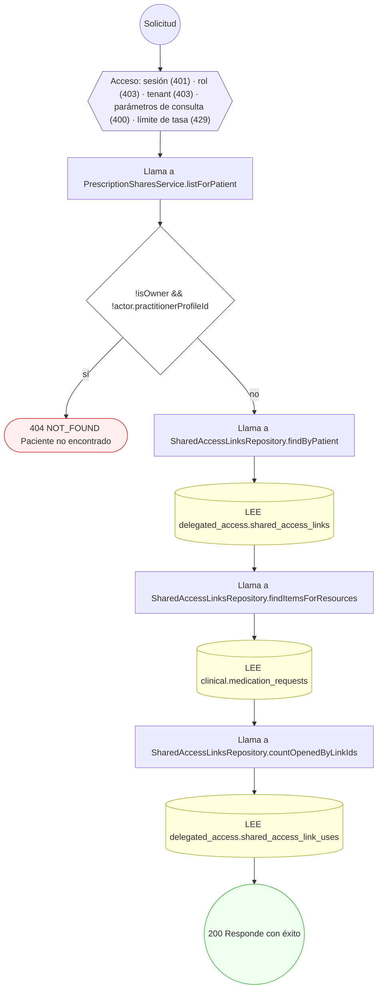

#### 4. POST /clinical/prescription-shares

Compartir una receta con un enlace

| HTTP | Código | Cuándo |
|---|---|---|
| 201 | — | Éxito |
| 400 | `VALIDATION_FAILED` | El cuerpo cumple el DTO (sin propiedades extra); BadRequestException: {{ code: ErrorCode.VALIDATION_FAILED, message: 'Indicá la co…} |
| 401 | `UNAUTHENTICATED` | Hay una sesión válida (JWT) |
| 403 | `FORBIDDEN` | El rol está permitido; El tenant se resuelve y pertenece al actor; ForbiddenException: {{ code: ErrorCode.FORBIDDEN, message: 'Solo el paciente o q…} |
| 422 | `PRECONDITION_FAILED` | PreconditionFailedException: La receta no tiene medicamentos emitidos y vigentes para compartir. |
| 429 | `RATE_LIMITED` | No se supera el límite de solicitudes |

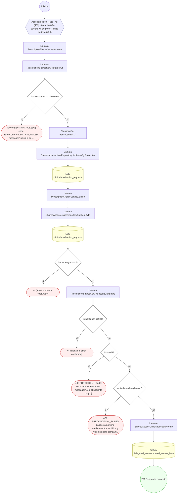

#### 5. POST /clinical/prescription-shares/{shareId}/revoke

Revocar un enlace de receta

| HTTP | Código | Cuándo |
|---|---|---|
| 204 | — | Éxito |
| 400 | `VALIDATION_FAILED` | Los parámetros de ruta son UUID válidos |
| 401 | `UNAUTHENTICATED` | Hay una sesión válida (JWT) |
| 403 | `FORBIDDEN` | El rol está permitido; El tenant se resuelve y pertenece al actor |
| 429 | `RATE_LIMITED` | No se supera el límite de solicitudes |


#### 6. GET /clinical/prescription-shares/by-token/{token}

Saber si un enlace es de la sesión

| HTTP | Código | Cuándo |
|---|---|---|
| 200 | — | Éxito |
| 401 | `UNAUTHENTICATED` | Hay una sesión válida (JWT) |
| 403 | `FORBIDDEN` | El rol está permitido; El tenant se resuelve y pertenece al actor |
| 429 | `RATE_LIMITED` | No se supera el límite de solicitudes |


#### 7. POST /delegated-access/expiry-sweep

Expirar delegaciones y grants vencidos (barrido)

| HTTP | Código | Cuándo |
|---|---|---|
| 200 | — | Éxito |
| 401 | `UNAUTHENTICATED` | Hay una sesión válida (JWT) |
| 403 | `FORBIDDEN` | El rol está permitido; El tenant se resuelve y pertenece al actor |
| 429 | `RATE_LIMITED` | No se supera el límite de solicitudes |

```mermaid
flowchart TD
  n1(("Solicitud")):::inicio
  n2{{"Acceso: sesión (401) · rol (403) · tenant (403) · límite de tasa (429)"}}:::acceso
  n1 --> n2
  n3["Llama a DelegatedAccessEvaluationService.expirySweep"]:::llamada
  n2 --> n3
  n4["Transacción: transactional(…)"]:::transaccion
  n3 --> n4
  n5["Llama a DelegatedAccessGrantsRepository.findOverdueActive"]:::llamada
  n4 --> n5
  n6[("LEE delegated_access.delegated_access_grants")]:::efecto
  n5 --> n6
  n7["Repite: por cada const grant de grants"]:::bucle
  n6 --> n7
  n8[("ACTUALIZA delegated_access.delegated_access_grants")]:::efecto
  n7 -->|"cada elemento"| n8
  n9["Llama a DelegationEventsRepository.record"]:::llamada
  n8 --> n9
  n10[("CREA delegated_access.delegation_events")]:::efecto
  n9 --> n10
  n11["Llama a PractitionerDelegateAssignmentsRepository.findOverdueActive"]:::llamada
  n10 --> n11
  n7 -->|"al terminar"| n11
  n12[("LEE delegated_access.practitioner_delegate_assignments")]:::efecto
  n11 --> n12
  n13["Repite: por cada const delegate de delegates"]:::bucle
  n12 --> n13
  n14[("ACTUALIZA delegated_access.practitioner_delegate_assignments")]:::efecto
  n13 -->|"cada elemento"| n14
  n15["Llama a DelegationEventsRepository.record"]:::llamada
  n14 --> n15
  n16[("CREA delegated_access.delegation_events")]:::efecto
  n15 --> n16
  n17["Llama a OrganizationUserAssignmentsRepository.findOverdueActive"]:::llamada
  n16 --> n17
  n13 -->|"al terminar"| n17
  n18[("LEE delegated_access.organization_user_assignments")]:::efecto
  n17 --> n18
  n19["Repite: por cada const assignment de orgAssignments"]:::bucle
  n18 --> n19
  n20[("ACTUALIZA delegated_access.organization_user_assignments")]:::efecto
  n19 -->|"cada elemento"| n20
  n21(("200 Responde con éxito")):::ok
  n20 --> n21
  n19 -->|"al terminar"| n21
  classDef acceso fill:#eef,stroke:#66a
  classDef error fill:#fee,stroke:#c33
  classDef ok fill:#efe,stroke:#3a3
  classDef efecto fill:#ffd,stroke:#aa3
  classDef decision fill:#fff,stroke:#555
  classDef corte fill:#eee,stroke:#999,stroke-dasharray: 4
```

#### 8. POST /delegated-permission-sets

Publicar set de permisos delegados (scoped)

| HTTP | Código | Cuándo |
|---|---|---|
| 201 | — | Éxito |
| 400 | `VALIDATION_FAILED` | El cuerpo cumple el DTO (sin propiedades extra) |
| 401 | `UNAUTHENTICATED` | Hay una sesión válida (JWT) |
| 403 | `FORBIDDEN` | El rol está permitido; El tenant se resuelve y pertenece al actor |
| 409 | `CONFLICT` | ConflictException: Ya existe un set con ese código en el tenant |
| 429 | `RATE_LIMITED` | No se supera el límite de solicitudes |
| 500 | `INTERNAL` | DomainException: {HttpStatus.FORBIDDEN} |


#### 9. POST /delegated-permission-sets/{id}/versions

Versionar set de permisos delegados

| HTTP | Código | Cuándo |
|---|---|---|
| 201 | — | Éxito |
| 400 | `VALIDATION_FAILED` | Los parámetros de ruta son UUID válidos; El cuerpo cumple el DTO (sin propiedades extra) |
| 401 | `UNAUTHENTICATED` | Hay una sesión válida (JWT) |
| 403 | `FORBIDDEN` | El rol está permitido; El tenant se resuelve y pertenece al actor |
| 429 | `RATE_LIMITED` | No se supera el límite de solicitudes |
| 500 | `INTERNAL` | DomainException: {HttpStatus.FORBIDDEN} |

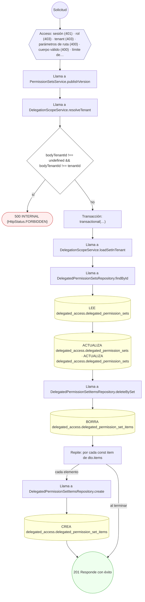

#### 10. POST /me/practitioner/support-invitations

Invitar a una secretaria a asistirme

| HTTP | Código | Cuándo |
|---|---|---|
| 201 | — | Éxito |
| 400 | `VALIDATION_FAILED` | El cuerpo cumple el DTO (sin propiedades extra) |
| 401 | `UNAUTHENTICATED` | Hay una sesión válida (JWT) |
| 403 | `FORBIDDEN` | El rol está permitido; El tenant se resuelve y pertenece al actor |
| 404 | `NOT_FOUND` | ResourceNotFoundException: Vinculación no encontrada; ResourceNotFoundException: No hay una secretaria registrada con ese documento; ResourceNotFoundException: Organización no encontrada |
| 409 | `CONFLICT` | ConflictException: Ya hay un vínculo vivo con ese mismo objetivo |
| 429 | `RATE_LIMITED` | No se supera el límite de solicitudes |

```mermaid
flowchart TD
  n1(("Solicitud")):::inicio
  n2{{"Acceso: sesión (401) · rol (403) · tenant (403) · cuerpo válido (400) · límite de tasa (429)"}}:::acceso
  n1 --> n2
  n3["Llama a SupportStaffService.inviteForPractitioner"]:::llamada
  n2 --> n3
  n4["Transacción: transactional(…)"]:::transaccion
  n3 --> n4
  n5["Llama a SupportLinksRepository.findActiveRoleAssignmentsOfPractitioner"]:::llamada
  n4 --> n5
  n6[("LEE practice.practitioner_role_assignments · LEE practice.practices")]:::efecto
  n5 --> n6
  n7{"!role"}:::decision
  n6 --> n7
  n8(["404 NOT_FOUND Vinculación no encontrada"]):::error
  n7 -->|"sí"| n8
  n9["Llama a SupportStaffService.requireSecretaryByNationalId"]:::llamada
  n7 -->|"no"| n9
  n10["Llama a SupportLinksRepository.findSecretaryByNationalId"]:::llamada
  n9 --> n10
  n11[("LEE iam.authentication_credentials · LEE profiles.person_account_links · LEE profiles.secretary_profiles")]:::efecto
  n10 --> n11
  n12{"!found"}:::decision
  n11 --> n12
  n13(["404 NOT_FOUND No hay una secretaria registrada con ese documento"]):::error
  n12 -->|"sí"| n13
  n14["Llama a SupportStaffService.createLinks"]:::llamada
  n12 -->|"no"| n14
  n15["Llama a SupportLinksRepository.findOrganizationName"]:::llamada
  n14 --> n15
  n16[("LEE directory.tenants")]:::efecto
  n15 --> n16
  n17{"organizationName === undefined"}:::decision
  n16 --> n17
  n18(["404 NOT_FOUND Organización no encontrada"]):::error
  n17 -->|"sí"| n18
  n19["Repite: por cada const item de input.items"]:::bucle
  n17 -->|"no"| n19
  n20["Llama a SupportStaffService.resolveTarget"]:::llamada
  n19 -->|"cada elemento"| n20
  n21{"según item.targetKind"}:::decision
  n20 --> n21
  n22["Llama a SupportLinksRepository.findSiteInTenant"]:::llamada
  n21 -->|"'SITE'"| n22
  n23[("LEE practice.practice_sites · LEE practice.practices")]:::efecto
  n22 --> n23
  n24["Llama a SupportLinksRepository.findUnitInTenant"]:::llamada
  n21 -->|"'SERVICE'"| n24
  n25[("LEE practice.clinical_units · LEE practice.practice_sites · LEE practice.practices")]:::efecto
  n24 --> n25
  n26["Llama a SupportLinksRepository.findSpaceInTenant"]:::llamada
  n21 -->|"'SPACE'"| n26
  n27[("LEE practice.care_spaces · LEE practice.practice_sites · LEE practice.practices")]:::efecto
  n26 --> n27
  n28["Llama a SupportLinksRepository.findActiveRoleAssignmentInTenant"]:::llamada
  n21 -->|"'PRACTITIONER'"| n28
  n29[("LEE practice.practitioner_role_assignments · LEE practice.practices")]:::efecto
  n28 --> n29
  n30["Llama a SupportLinksRepository.findLinks"]:::llamada
  n23 --> n30
  n25 --> n30
  n27 --> n30
  n29 --> n30
  n21 -->|"otro"| n30
  n19 -->|"al terminar"| n30
  n31[("LEE delegated_access.organization_user_assignments · LEE directory.tenant_memberships · LEE directory.tenants…")]:::efecto
  n30 --> n31
  n32["Repite: por cada const target de resolved"]:::bucle
  n31 --> n32
  n33{"seen.has(key)"}:::decision
  n32 -->|"cada elemento"| n33
  n34(["409 CONFLICT Ya hay un vínculo vivo con ese mismo objetivo"]):::error
  n33 -->|"sí"| n34
  n35["Llama a SupportLinksRepository.findOrCreateMembership"]:::llamada
  n33 -->|"no"| n35
  n32 -->|"al terminar"| n35
  n36[("LEE directory.tenant_memberships · CREA directory.tenant_memberships")]:::efecto
  n35 --> n36
  n37["Repite: por cada const target de resolved"]:::bucle
  n36 --> n37
  n38{"target.kind === 'PRACTITIONER'"}:::decision
  n37 -->|"cada elemento"| n38
  n39["Llama a SupportLinksRepository.createPractitionerLink"]:::llamada
  n38 -->|"sí"| n39
  n40[("CREA practice.practitioner_support_assignments")]:::efecto
  n39 --> n40
  n41["Llama a SupportLinksRepository.createLocationLink"]:::llamada
  n38 -->|"no"| n41
  n42[("CREA delegated_access.organization_user_assignments")]:::efecto
  n41 --> n42
  n43["Llama a SupportStaffService.createdView"]:::llamada
  n40 --> n43
  n42 --> n43
  n37 -->|"al terminar"| n43
  n44["Repite: por cada const id de ids"]:::bucle
  n43 --> n44
  n45["Llama a SupportLinksRepository.findLinks"]:::llamada
  n44 -->|"cada elemento"| n45
  n46[("LEE delegated_access.organization_user_assignments · LEE directory.tenant_memberships · LEE directory.tenants…")]:::efecto
  n45 --> n46
  n47(("201 Responde con éxito")):::ok
  n46 --> n47
  n44 -->|"al terminar"| n47
  classDef acceso fill:#eef,stroke:#66a
  classDef error fill:#fee,stroke:#c33
  classDef ok fill:#efe,stroke:#3a3
  classDef efecto fill:#ffd,stroke:#aa3
  classDef decision fill:#fff,stroke:#555
  classDef corte fill:#eee,stroke:#999,stroke-dasharray: 4
```

#### 11. POST /me/practitioner/support-team/{id}/end

Terminar el vínculo con una secretaria

| HTTP | Código | Cuándo |
|---|---|---|
| 200 | — | Éxito |
| 400 | `VALIDATION_FAILED` | Los parámetros de ruta son UUID válidos; El cuerpo cumple el DTO (sin propiedades extra) |
| 401 | `UNAUTHENTICATED` | Hay una sesión válida (JWT) |
| 403 | `FORBIDDEN` | El rol está permitido; El tenant se resuelve y pertenece al actor |
| 422 | `PRECONDITION_FAILED` | PreconditionFailedException: Sólo se termina un vínculo activo o pendiente |
| 429 | `RATE_LIMITED` | No se supera el límite de solicitudes |

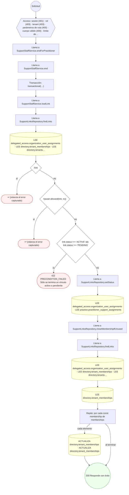

#### 12. GET /me/support-agenda

Agenda de un doctor asignado (403 si no hay vínculo activo)

| HTTP | Código | Cuándo |
|---|---|---|
| 200 | — | Éxito |
| 400 | `VALIDATION_FAILED` | Están los parámetros de consulta obligatorios |
| 401 | `UNAUTHENTICATED` | Hay una sesión válida (JWT) |
| 403 | `FORBIDDEN` | El rol está permitido; El tenant se resuelve y pertenece al actor |
| 422 | `PRECONDITION_FAILED` | PreconditionFailedException: El rango tiene que ser positivo y de {MAX_AGENDA_DAYS} días como mucho |
| 429 | `RATE_LIMITED` | No se supera el límite de solicitudes |

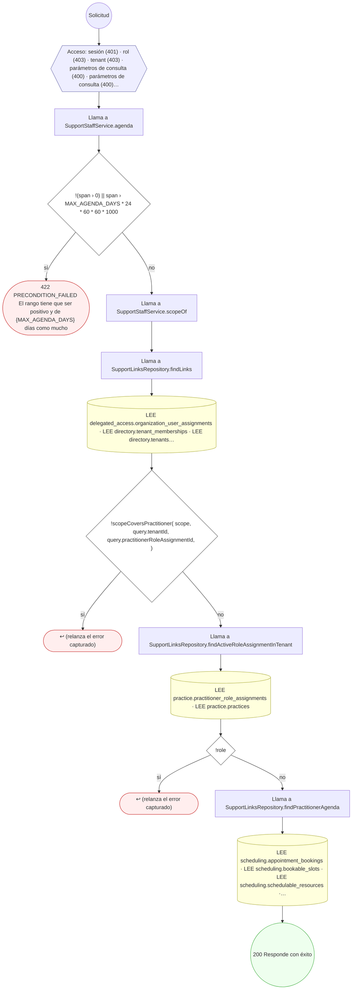

#### 13. GET /me/support-catalog

Sedes, servicios, pisos y doctores de un hospital para pedir

| HTTP | Código | Cuándo |
|---|---|---|
| 200 | — | Éxito |
| 400 | `VALIDATION_FAILED` | Están los parámetros de consulta obligatorios |
| 401 | `UNAUTHENTICATED` | Hay una sesión válida (JWT) |
| 403 | `FORBIDDEN` | El rol está permitido; El tenant se resuelve y pertenece al actor |
| 404 | `NOT_FOUND` | ResourceNotFoundException: Organización no encontrada |
| 429 | `RATE_LIMITED` | No se supera el límite de solicitudes |

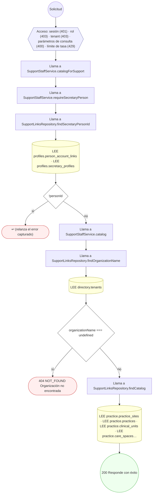

#### 14. POST /me/support-engagements/{id}/confirm

Aceptar una invitación de apoyo

| HTTP | Código | Cuándo |
|---|---|---|
| 200 | — | Éxito |
| 400 | `VALIDATION_FAILED` | Los parámetros de ruta son UUID válidos |
| 401 | `UNAUTHENTICATED` | Hay una sesión válida (JWT) |
| 403 | `FORBIDDEN` | El rol está permitido; El tenant se resuelve y pertenece al actor |
| 422 | `PRECONDITION_FAILED` | PreconditionFailedException: Ese vínculo no está esperando su decisión |
| 429 | `RATE_LIMITED` | No se supera el límite de solicitudes |

```mermaid
flowchart TD
  n1(("Solicitud")):::inicio
  n2{{"Acceso: sesión (401) · rol (403) · tenant (403) · parámetros de ruta (400) · límite de tasa (429)"}}:::acceso
  n1 --> n2
  n3["Llama a SupportStaffService.confirmMine"]:::llamada
  n2 --> n3
  n4["Llama a SupportStaffService.decide"]:::llamada
  n3 --> n4
  n5["Transacción: transactional(…)"]:::transaccion
  n4 --> n5
  n6["Llama a SupportStaffService.loadLink"]:::llamada
  n5 --> n6
  n7["Llama a SupportLinksRepository.findLinks"]:::llamada
  n6 --> n7
  n8[("LEE delegated_access.organization_user_assignments · LEE directory.tenant_memberships · LEE directory.tenants…")]:::efecto
  n7 --> n8
  n9{"!link"}:::decision
  n8 --> n9
  n10(["↩ (relanza el error capturado)"]):::error
  n9 -->|"sí"| n10
  n11{"guard && !(await guard(tx, link))"}:::decision
  n9 -->|"no"| n11
  n12(["↩ (relanza el error capturado)"]):::error
  n11 -->|"sí"| n12
  n13{"!decider.isSupportStaff && !decider.isOrganizationAdmin && !decider.isPractitioner"}:::decision
  n11 -->|"no"| n13
  n14(["↩ (relanza el error capturado)"]):::error
  n13 -->|"sí"| n14
  n15{"!mayDecide(link, decider)"}:::decision
  n13 -->|"no"| n15
  n16(["422 PRECONDITION_FAILED Ese vínculo no está esperando su decisión"]):::error
  n15 -->|"sí"| n16
  n17["Llama a SupportLinksRepository.setStatus"]:::llamada
  n15 -->|"no"| n17
  n18[("LEE delegated_access.organization_user_assignments · LEE practice.practitioner_support_assignments")]:::efecto
  n17 --> n18
  n19{"status === 'ACTIVE' && grantsOrganizationAccess(link, decider)"}:::decision
  n18 --> n19
  n20["Llama a SupportLinksRepository.activateMembership"]:::llamada
  n19 -->|"sí"| n20
  n21["Llama a SupportLinksRepository.findOrCreateMembership"]:::llamada
  n20 --> n21
  n22[("LEE directory.tenant_memberships · CREA directory.tenant_memberships")]:::efecto
  n21 --> n22
  n23{"membership.statusConceptId === DIR.MEMBERSHIP_INVITED"}:::decision
  n22 --> n23
  n24[("ACTUALIZA directory.tenant_memberships · ACTUALIZA directory.tenant_memberships")]:::efecto
  n23 -->|"sí"| n24
  n25{"status === 'REJECTED'"}:::decision
  n24 --> n25
  n23 -->|"no"| n25
  n19 -->|"no"| n25
  n26["Llama a SupportLinksRepository.closeMembershipIfUnused"]:::llamada
  n25 -->|"sí"| n26
  n27["Llama a SupportLinksRepository.findLinks"]:::llamada
  n26 --> n27
  n28[("LEE delegated_access.organization_user_assignments · LEE directory.tenant_memberships · LEE directory.tenants…")]:::efecto
  n27 --> n28
  n29[("LEE directory.tenant_memberships")]:::efecto
  n28 --> n29
  n30["Repite: por cada const membership de memberships"]:::bucle
  n29 --> n30
  n31[("ACTUALIZA directory.tenant_memberships · ACTUALIZA directory.tenant_memberships")]:::efecto
  n30 -->|"cada elemento"| n31
  n32(("200 Responde con éxito")):::ok
  n31 --> n32
  n30 -->|"al terminar"| n32
  n25 -->|"no"| n32
  classDef acceso fill:#eef,stroke:#66a
  classDef error fill:#fee,stroke:#c33
  classDef ok fill:#efe,stroke:#3a3
  classDef efecto fill:#ffd,stroke:#aa3
  classDef decision fill:#fff,stroke:#555
  classDef corte fill:#eee,stroke:#999,stroke-dasharray: 4
```

#### 15. POST /me/support-engagements/{id}/decline

Rechazar una invitación de apoyo

| HTTP | Código | Cuándo |
|---|---|---|
| 200 | — | Éxito |
| 400 | `VALIDATION_FAILED` | Los parámetros de ruta son UUID válidos; El cuerpo cumple el DTO (sin propiedades extra) |
| 401 | `UNAUTHENTICATED` | Hay una sesión válida (JWT) |
| 403 | `FORBIDDEN` | El rol está permitido; El tenant se resuelve y pertenece al actor |
| 422 | `PRECONDITION_FAILED` | PreconditionFailedException: Ese vínculo no está esperando su decisión |
| 429 | `RATE_LIMITED` | No se supera el límite de solicitudes |


#### 16. POST /me/support-engagements/{id}/leave

Dejar un vínculo o retirar mi pedido

| HTTP | Código | Cuándo |
|---|---|---|
| 200 | — | Éxito |
| 400 | `VALIDATION_FAILED` | Los parámetros de ruta son UUID válidos |
| 401 | `UNAUTHENTICATED` | Hay una sesión válida (JWT) |
| 403 | `FORBIDDEN` | El rol está permitido; El tenant se resuelve y pertenece al actor |
| 422 | `PRECONDITION_FAILED` | PreconditionFailedException: Sólo se termina un vínculo activo o pendiente |
| 429 | `RATE_LIMITED` | No se supera el límite de solicitudes |


#### 17. POST /org/{tenantMembershipId}/user-assignments

Asignar usuario de organización con alcance y vigencia

| HTTP | Código | Cuándo |
|---|---|---|
| 201 | — | Éxito |
| 400 | `VALIDATION_FAILED` | Los parámetros de ruta son UUID válidos; El cuerpo cumple el DTO (sin propiedades extra) |
| 401 | `UNAUTHENTICATED` | Hay una sesión válida (JWT) |
| 403 | `FORBIDDEN` | El rol está permitido; El tenant se resuelve y pertenece al actor |
| 409 | `CONFLICT` | ConflictException: Ya existe una asignación activa con ese rol y alcance |
| 429 | `RATE_LIMITED` | No se supera el límite de solicitudes |

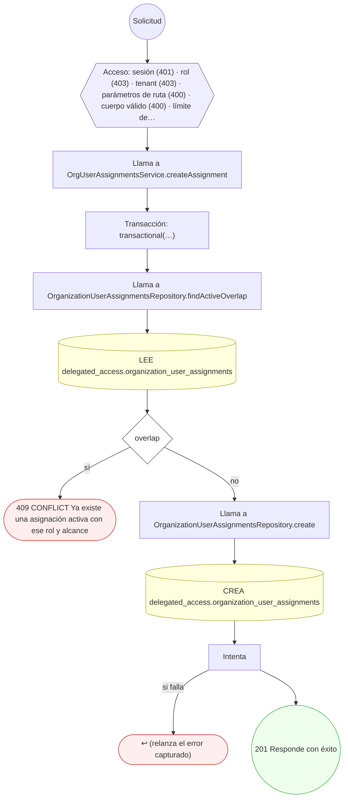

#### 18. GET /org/support-catalog

Sedes, servicios, pisos y doctores para invitar

| HTTP | Código | Cuándo |
|---|---|---|
| 200 | — | Éxito |
| 401 | `UNAUTHENTICATED` | Hay una sesión válida (JWT) |
| 403 | `FORBIDDEN` | El rol está permitido; El tenant se resuelve y pertenece al actor |
| 404 | `NOT_FOUND` | ResourceNotFoundException: Organización no encontrada |
| 429 | `RATE_LIMITED` | No se supera el límite de solicitudes |

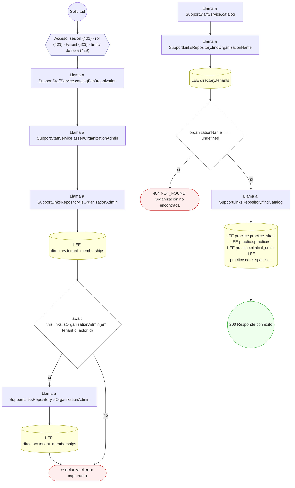

#### 19. GET /org/support-engagement-requests

Solicitudes e invitaciones de apoyo del hospital

| HTTP | Código | Cuándo |
|---|---|---|
| 200 | — | Éxito |
| 401 | `UNAUTHENTICATED` | Hay una sesión válida (JWT) |
| 403 | `FORBIDDEN` | El rol está permitido; El tenant se resuelve y pertenece al actor |
| 429 | `RATE_LIMITED` | No se supera el límite de solicitudes |

```mermaid
flowchart TD
  n1(("Solicitud")):::inicio
  n2{{"Acceso: sesión (401) · rol (403) · tenant (403) · límite de tasa (429)"}}:::acceso
  n1 --> n2
  n3["Llama a SupportStaffService.listForOrganization"]:::llamada
  n2 --> n3
  n4["Llama a SupportStaffService.assertOrganizationAdmin"]:::llamada
  n3 --> n4
  n5["Llama a SupportLinksRepository.isOrganizationAdmin"]:::llamada
  n4 --> n5
  n6[("LEE directory.tenant_memberships")]:::efecto
  n5 --> n6
  n7{"await this.links.isOrganizationAdmin(em, tenantId, actor.id)"}:::decision
  n6 --> n7
  n8["Llama a SupportLinksRepository.isOrganizationAdmin"]:::llamada
  n7 -->|"sí"| n8
  n9[("LEE directory.tenant_memberships")]:::efecto
  n8 --> n9
  n10(["↩ (relanza el error capturado)"]):::error
  n9 --> n10
  n7 -->|"no"| n10
  n11["Llama a SupportLinksRepository.findLinks"]:::llamada
  n12[("LEE delegated_access.organization_user_assignments · LEE directory.tenant_memberships · LEE directory.tenants…")]:::efecto
  n11 --> n12
  n13(("200 Responde con éxito")):::ok
  n12 --> n13
  classDef acceso fill:#eef,stroke:#66a
  classDef error fill:#fee,stroke:#c33
  classDef ok fill:#efe,stroke:#3a3
  classDef efecto fill:#ffd,stroke:#aa3
  classDef decision fill:#fff,stroke:#555
  classDef corte fill:#eee,stroke:#999,stroke-dasharray: 4
```

#### 20. POST /org/support-engagement-requests/{id}/decision

Aceptar o rechazar una solicitud de apoyo

| HTTP | Código | Cuándo |
|---|---|---|
| 200 | — | Éxito |
| 400 | `VALIDATION_FAILED` | Los parámetros de ruta son UUID válidos; El cuerpo cumple el DTO (sin propiedades extra) |
| 401 | `UNAUTHENTICATED` | Hay una sesión válida (JWT) |
| 403 | `FORBIDDEN` | El rol está permitido; El tenant se resuelve y pertenece al actor |
| 422 | `PRECONDITION_FAILED` | PreconditionFailedException: Ese vínculo no está esperando su decisión |
| 429 | `RATE_LIMITED` | No se supera el límite de solicitudes |

```mermaid
flowchart TD
  n1(("Solicitud")):::inicio
  n2{{"Acceso: sesión (401) · rol (403) · tenant (403) · parámetros de ruta (400) · cuerpo válido (400) · límite de…"}}:::acceso
  n1 --> n2
  n3["Llama a SupportStaffService.decideForOrganization"]:::llamada
  n2 --> n3
  n4["Llama a SupportStaffService.decide"]:::llamada
  n3 --> n4
  n5["Transacción: transactional(…)"]:::transaccion
  n4 --> n5
  n6["Llama a SupportStaffService.loadLink"]:::llamada
  n5 --> n6
  n7["Llama a SupportLinksRepository.findLinks"]:::llamada
  n6 --> n7
  n8[("LEE delegated_access.organization_user_assignments · LEE directory.tenant_memberships · LEE directory.tenants…")]:::efecto
  n7 --> n8
  n9{"!link"}:::decision
  n8 --> n9
  n10(["↩ (relanza el error capturado)"]):::error
  n9 -->|"sí"| n10
  n11{"guard && !(await guard(tx, link))"}:::decision
  n9 -->|"no"| n11
  n12(["↩ (relanza el error capturado)"]):::error
  n11 -->|"sí"| n12
  n13{"!decider.isSupportStaff && !decider.isOrganizationAdmin && !decider.isPractitioner"}:::decision
  n11 -->|"no"| n13
  n14(["↩ (relanza el error capturado)"]):::error
  n13 -->|"sí"| n14
  n15{"!mayDecide(link, decider)"}:::decision
  n13 -->|"no"| n15
  n16(["422 PRECONDITION_FAILED Ese vínculo no está esperando su decisión"]):::error
  n15 -->|"sí"| n16
  n17["Llama a SupportLinksRepository.setStatus"]:::llamada
  n15 -->|"no"| n17
  n18[("LEE delegated_access.organization_user_assignments · LEE practice.practitioner_support_assignments")]:::efecto
  n17 --> n18
  n19{"status === 'ACTIVE' && grantsOrganizationAccess(link, decider)"}:::decision
  n18 --> n19
  n20["Llama a SupportLinksRepository.activateMembership"]:::llamada
  n19 -->|"sí"| n20
  n21["Llama a SupportLinksRepository.findOrCreateMembership"]:::llamada
  n20 --> n21
  n22[("LEE directory.tenant_memberships · CREA directory.tenant_memberships")]:::efecto
  n21 --> n22
  n23{"membership.statusConceptId === DIR.MEMBERSHIP_INVITED"}:::decision
  n22 --> n23
  n24[("ACTUALIZA directory.tenant_memberships · ACTUALIZA directory.tenant_memberships")]:::efecto
  n23 -->|"sí"| n24
  n25{"status === 'REJECTED'"}:::decision
  n24 --> n25
  n23 -->|"no"| n25
  n19 -->|"no"| n25
  n26["Llama a SupportLinksRepository.closeMembershipIfUnused"]:::llamada
  n25 -->|"sí"| n26
  n27["Llama a SupportLinksRepository.findLinks"]:::llamada
  n26 --> n27
  n28[("LEE delegated_access.organization_user_assignments · LEE directory.tenant_memberships · LEE directory.tenants…")]:::efecto
  n27 --> n28
  n29[("LEE directory.tenant_memberships")]:::efecto
  n28 --> n29
  n30["Repite: por cada const membership de memberships"]:::bucle
  n29 --> n30
  n31[("ACTUALIZA directory.tenant_memberships · ACTUALIZA directory.tenant_memberships")]:::efecto
  n30 -->|"cada elemento"| n31
  n32["Transacción: decide(…)"]:::transaccion
  n31 --> n32
  n30 -->|"al terminar"| n32
  n25 -->|"no"| n32
  n33["Llama a SupportStaffService.assertOrganizationAdmin"]:::llamada
  n32 --> n33
  n34["Llama a SupportLinksRepository.isOrganizationAdmin"]:::llamada
  n33 --> n34
  n35[("LEE directory.tenant_memberships")]:::efecto
  n34 --> n35
  n36{"await this.links.isOrganizationAdmin(em, tenantId, actor.id)"}:::decision
  n35 --> n36
  n37["Llama a SupportLinksRepository.isOrganizationAdmin"]:::llamada
  n36 -->|"sí"| n37
  n38[("LEE directory.tenant_memberships")]:::efecto
  n37 --> n38
  n39(["↩ (relanza el error capturado)"]):::error
  n38 --> n39
  n36 -->|"no"| n39
  n40(("200 Responde con éxito")):::ok
  classDef acceso fill:#eef,stroke:#66a
  classDef error fill:#fee,stroke:#c33
  classDef ok fill:#efe,stroke:#3a3
  classDef efecto fill:#ffd,stroke:#aa3
  classDef decision fill:#fff,stroke:#555
  classDef corte fill:#eee,stroke:#999,stroke-dasharray: 4
```

#### 21. GET /org/support-engagements

Personal de apoyo del hospital

| HTTP | Código | Cuándo |
|---|---|---|
| 200 | — | Éxito |
| 401 | `UNAUTHENTICATED` | Hay una sesión válida (JWT) |
| 403 | `FORBIDDEN` | El rol está permitido; El tenant se resuelve y pertenece al actor |
| 429 | `RATE_LIMITED` | No se supera el límite de solicitudes |

```mermaid
flowchart TD
  n1(("Solicitud")):::inicio
  n2{{"Acceso: sesión (401) · rol (403) · tenant (403) · límite de tasa (429)"}}:::acceso
  n1 --> n2
  n3["Llama a SupportStaffService.listEngagementsForOrganization"]:::llamada
  n2 --> n3
  n4["Llama a SupportStaffService.assertOrganizationAdmin"]:::llamada
  n3 --> n4
  n5["Llama a SupportLinksRepository.isOrganizationAdmin"]:::llamada
  n4 --> n5
  n6[("LEE directory.tenant_memberships")]:::efecto
  n5 --> n6
  n7{"await this.links.isOrganizationAdmin(em, tenantId, actor.id)"}:::decision
  n6 --> n7
  n8["Llama a SupportLinksRepository.isOrganizationAdmin"]:::llamada
  n7 -->|"sí"| n8
  n9[("LEE directory.tenant_memberships")]:::efecto
  n8 --> n9
  n10(["↩ (relanza el error capturado)"]):::error
  n9 --> n10
  n7 -->|"no"| n10
  n11["Llama a SupportLinksRepository.findLinks"]:::llamada
  n12[("LEE delegated_access.organization_user_assignments · LEE directory.tenant_memberships · LEE directory.tenants…")]:::efecto
  n11 --> n12
  n13(("200 Responde con éxito")):::ok
  n12 --> n13
  classDef acceso fill:#eef,stroke:#66a
  classDef error fill:#fee,stroke:#c33
  classDef ok fill:#efe,stroke:#3a3
  classDef efecto fill:#ffd,stroke:#aa3
  classDef decision fill:#fff,stroke:#555
  classDef corte fill:#eee,stroke:#999,stroke-dasharray: 4
```

#### 22. POST /org/support-engagements/{id}/end

Terminar un vínculo de apoyo

| HTTP | Código | Cuándo |
|---|---|---|
| 200 | — | Éxito |
| 400 | `VALIDATION_FAILED` | Los parámetros de ruta son UUID válidos; El cuerpo cumple el DTO (sin propiedades extra) |
| 401 | `UNAUTHENTICATED` | Hay una sesión válida (JWT) |
| 403 | `FORBIDDEN` | El rol está permitido; El tenant se resuelve y pertenece al actor |
| 429 | `RATE_LIMITED` | No se supera el límite de solicitudes |

```mermaid
flowchart TD
  n1(("Solicitud")):::inicio
  n2{{"Acceso: sesión (401) · rol (403) · tenant (403) · parámetros de ruta (400) · cuerpo válido (400) · límite de…"}}:::acceso
  n1 --> n2
  n3["Llama a SupportStaffService.endForOrganization"]:::llamada
  n2 --> n3
  n4["Transacción: end(…)"]:::transaccion
  n3 --> n4
  n5["Llama a SupportStaffService.assertOrganizationAdmin"]:::llamada
  n4 --> n5
  n6["Llama a SupportLinksRepository.isOrganizationAdmin"]:::llamada
  n5 --> n6
  n7[("LEE directory.tenant_memberships")]:::efecto
  n6 --> n7
  n8{"await this.links.isOrganizationAdmin(em, tenantId, actor.id)"}:::decision
  n7 --> n8
  n9["Llama a SupportLinksRepository.isOrganizationAdmin"]:::llamada
  n8 -->|"sí"| n9
  n10[("LEE directory.tenant_memberships")]:::efecto
  n9 --> n10
  n11(["↩ (relanza el error capturado)"]):::error
  n10 --> n11
  n8 -->|"no"| n11
  n12(("200 Responde con éxito")):::ok
  classDef acceso fill:#eef,stroke:#66a
  classDef error fill:#fee,stroke:#c33
  classDef ok fill:#efe,stroke:#3a3
  classDef efecto fill:#ffd,stroke:#aa3
  classDef decision fill:#fff,stroke:#555
  classDef corte fill:#eee,stroke:#999,stroke-dasharray: 4
```

#### 23. POST /org/team/invitations

Invitar a una secretaria a lugares o doctores

| HTTP | Código | Cuándo |
|---|---|---|
| 201 | — | Éxito |
| 400 | `VALIDATION_FAILED` | El cuerpo cumple el DTO (sin propiedades extra) |
| 401 | `UNAUTHENTICATED` | Hay una sesión válida (JWT) |
| 403 | `FORBIDDEN` | El rol está permitido; El tenant se resuelve y pertenece al actor |
| 404 | `NOT_FOUND` | ResourceNotFoundException: No hay una secretaria registrada con ese documento; ResourceNotFoundException: Organización no encontrada |
| 409 | `CONFLICT` | ConflictException: Ya hay un vínculo vivo con ese mismo objetivo |
| 429 | `RATE_LIMITED` | No se supera el límite de solicitudes |

```mermaid
flowchart TD
  n1(("Solicitud")):::inicio
  n2{{"Acceso: sesión (401) · rol (403) · tenant (403) · cuerpo válido (400) · límite de tasa (429)"}}:::acceso
  n1 --> n2
  n3["Llama a SupportStaffService.inviteForOrganization"]:::llamada
  n2 --> n3
  n4["Transacción: transactional(…)"]:::transaccion
  n3 --> n4
  n5["Llama a SupportStaffService.assertOrganizationAdmin"]:::llamada
  n4 --> n5
  n6["Llama a SupportLinksRepository.isOrganizationAdmin"]:::llamada
  n5 --> n6
  n7[("LEE directory.tenant_memberships")]:::efecto
  n6 --> n7
  n8{"await this.links.isOrganizationAdmin(em, tenantId, actor.id)"}:::decision
  n7 --> n8
  n9["Llama a SupportLinksRepository.isOrganizationAdmin"]:::llamada
  n8 -->|"sí"| n9
  n10[("LEE directory.tenant_memberships")]:::efecto
  n9 --> n10
  n11(["↩ (relanza el error capturado)"]):::error
  n10 --> n11
  n8 -->|"no"| n11
  n12["Llama a SupportStaffService.requireSecretaryByNationalId"]:::llamada
  n13["Llama a SupportLinksRepository.findSecretaryByNationalId"]:::llamada
  n12 --> n13
  n14[("LEE iam.authentication_credentials · LEE profiles.person_account_links · LEE profiles.secretary_profiles")]:::efecto
  n13 --> n14
  n15{"!found"}:::decision
  n14 --> n15
  n16(["404 NOT_FOUND No hay una secretaria registrada con ese documento"]):::error
  n15 -->|"sí"| n16
  n17["Llama a SupportStaffService.createLinks"]:::llamada
  n15 -->|"no"| n17
  n18["Llama a SupportLinksRepository.findOrganizationName"]:::llamada
  n17 --> n18
  n19[("LEE directory.tenants")]:::efecto
  n18 --> n19
  n20{"organizationName === undefined"}:::decision
  n19 --> n20
  n21(["404 NOT_FOUND Organización no encontrada"]):::error
  n20 -->|"sí"| n21
  n22["Repite: por cada const item de input.items"]:::bucle
  n20 -->|"no"| n22
  n23["Llama a SupportStaffService.resolveTarget"]:::llamada
  n22 -->|"cada elemento"| n23
  n24{"según item.targetKind"}:::decision
  n23 --> n24
  n25["Llama a SupportLinksRepository.findSiteInTenant"]:::llamada
  n24 -->|"'SITE'"| n25
  n26[("LEE practice.practice_sites · LEE practice.practices")]:::efecto
  n25 --> n26
  n27["Llama a SupportLinksRepository.findUnitInTenant"]:::llamada
  n24 -->|"'SERVICE'"| n27
  n28[("LEE practice.clinical_units · LEE practice.practice_sites · LEE practice.practices")]:::efecto
  n27 --> n28
  n29["Llama a SupportLinksRepository.findSpaceInTenant"]:::llamada
  n24 -->|"'SPACE'"| n29
  n30[("LEE practice.care_spaces · LEE practice.practice_sites · LEE practice.practices")]:::efecto
  n29 --> n30
  n31["Llama a SupportLinksRepository.findActiveRoleAssignmentInTenant"]:::llamada
  n24 -->|"'PRACTITIONER'"| n31
  n32[("LEE practice.practitioner_role_assignments · LEE practice.practices")]:::efecto
  n31 --> n32
  n33["Llama a SupportLinksRepository.findLinks"]:::llamada
  n26 --> n33
  n28 --> n33
  n30 --> n33
  n32 --> n33
  n24 -->|"otro"| n33
  n22 -->|"al terminar"| n33
  n34[("LEE delegated_access.organization_user_assignments · LEE directory.tenant_memberships · LEE directory.tenants…")]:::efecto
  n33 --> n34
  n35["Repite: por cada const target de resolved"]:::bucle
  n34 --> n35
  n36{"seen.has(key)"}:::decision
  n35 -->|"cada elemento"| n36
  n37(["409 CONFLICT Ya hay un vínculo vivo con ese mismo objetivo"]):::error
  n36 -->|"sí"| n37
  n38["Llama a SupportLinksRepository.findOrCreateMembership"]:::llamada
  n36 -->|"no"| n38
  n35 -->|"al terminar"| n38
  n39[("LEE directory.tenant_memberships · CREA directory.tenant_memberships")]:::efecto
  n38 --> n39
  n40["Repite: por cada const target de resolved"]:::bucle
  n39 --> n40
  n41{"target.kind === 'PRACTITIONER'"}:::decision
  n40 -->|"cada elemento"| n41
  n42["Llama a SupportLinksRepository.createPractitionerLink"]:::llamada
  n41 -->|"sí"| n42
  n43[("CREA practice.practitioner_support_assignments")]:::efecto
  n42 --> n43
  n44["Llama a SupportLinksRepository.createLocationLink"]:::llamada
  n41 -->|"no"| n44
  n45[("CREA delegated_access.organization_user_assignments")]:::efecto
  n44 --> n45
  n46["Llama a SupportStaffService.createdView"]:::llamada
  n43 --> n46
  n45 --> n46
  n40 -->|"al terminar"| n46
  n47["Repite: por cada const id de ids"]:::bucle
  n46 --> n47
  n48["Llama a SupportLinksRepository.findLinks"]:::llamada
  n47 -->|"cada elemento"| n48
  n49[("LEE delegated_access.organization_user_assignments · LEE directory.tenant_memberships · LEE directory.tenants…")]:::efecto
  n48 --> n49
  n50(("201 Responde con éxito")):::ok
  n49 --> n50
  n47 -->|"al terminar"| n50
  classDef acceso fill:#eef,stroke:#66a
  classDef error fill:#fee,stroke:#c33
  classDef ok fill:#efe,stroke:#3a3
  classDef efecto fill:#ffd,stroke:#aa3
  classDef decision fill:#fff,stroke:#555
  classDef corte fill:#eee,stroke:#999,stroke-dasharray: 4
```

#### 24. PATCH /org/user-assignments/{id}

Reasignar supervisor / suspender asignación de organización

| HTTP | Código | Cuándo |
|---|---|---|
| 200 | — | Éxito |
| 400 | `VALIDATION_FAILED` | Los parámetros de ruta son UUID válidos; El cuerpo cumple el DTO (sin propiedades extra) |
| 401 | `UNAUTHENTICATED` | Hay una sesión válida (JWT) |
| 403 | `FORBIDDEN` | El rol está permitido; El tenant se resuelve y pertenece al actor |
| 404 | `NOT_FOUND` | ResourceNotFoundException: Asignación no encontrada |
| 409 | `CONCURRENCY_CONFLICT` | ConcurrencyConflictException: row_version no coincide |
| 422 | `PRECONDITION_FAILED` | PreconditionFailedException: No hay cambios que aplicar; PreconditionFailedException: La asignación no está activa |
| 429 | `RATE_LIMITED` | No se supera el límite de solicitudes |

```mermaid
flowchart TD
  n1(("Solicitud")):::inicio
  n2{{"Acceso: sesión (401) · rol (403) · tenant (403) · parámetros de ruta (400) · cuerpo válido (400) · límite de…"}}:::acceso
  n1 --> n2
  n3["Llama a OrgUserAssignmentsService.updateAssignment"]:::llamada
  n2 --> n3
  n4{"dto.supervisorUserId === undefined && dto.accessScope === undefined && !targetsChange && !dto.suspend"}:::decision
  n3 --> n4
  n5(["422 PRECONDITION_FAILED No hay cambios que aplicar"]):::error
  n4 -->|"sí"| n5
  n6["Transacción: transactional(…)"]:::transaccion
  n4 -->|"no"| n6
  n7["Llama a OrganizationUserAssignmentsRepository.findById"]:::llamada
  n6 --> n7
  n8[("LEE delegated_access.organization_user_assignments")]:::efecto
  n7 --> n8
  n9{"!assignment"}:::decision
  n8 --> n9
  n10(["404 NOT_FOUND Asignación no encontrada"]):::error
  n9 -->|"sí"| n10
  n11{"assignment.statusConceptId !== STATUS.ACTIVE"}:::decision
  n9 -->|"no"| n11
  n12(["422 PRECONDITION_FAILED La asignación no está activa"]):::error
  n11 -->|"sí"| n12
  n13{"dto.expectedRowVersion !== undefined && dto.expectedRowVersion !== assignment.rowVersion"}:::decision
  n11 -->|"no"| n13
  n14(["409 CONCURRENCY_CONFLICT row_version no coincide"]):::error
  n13 -->|"sí"| n14
  n15{"dto.supervisorUserId !== undefined"}:::decision
  n13 -->|"no"| n15
  n16[("ACTUALIZA delegated_access.organization_user_assignments")]:::efecto
  n15 -->|"sí"| n16
  n17{"scopeChange"}:::decision
  n16 --> n17
  n15 -->|"no"| n17
  n18[("ACTUALIZA delegated_access.organization_user_assignments · ACTUALIZA delegated_access.organization_user_assig…")]:::efecto
  n17 -->|"sí"| n18
  n19{"dto.suspend"}:::decision
  n18 --> n19
  n17 -->|"no"| n19
  n20[("ACTUALIZA delegated_access.organization_user_assignments")]:::efecto
  n19 -->|"sí"| n20
  n21["Llama a PractitionerDelegateAssignmentsRepository.suspendByDelegateAssignment"]:::llamada
  n20 --> n21
  n22[("ACTUALIZA delegated_access.practitioner_delegate_assignments")]:::efecto
  n21 --> n22
  n23{"scopeChange"}:::decision
  n22 --> n23
  n19 -->|"no"| n23
  n24["Intenta"]:::intento
  n23 -->|"sí"| n24
  n25(["↩ (relanza el error capturado)"]):::error
  n24 -->|"si falla"| n25
  n26[("LEE directory.tenant_memberships")]:::efecto
  n24 --> n26
  n27["Llama a OutboxService.publishDomainEvent"]:::llamada
  n26 --> n27
  n28["Llama a MessagingTraceService.runInProducerSpan"]:::llamada
  n27 --> n28
  n29["Transacción: startActiveSpan(…)"]:::transaccion
  n28 --> n29
  n30["Intenta"]:::intento
  n29 --> n30
  n31(["↩ (relanza el error capturado)"]):::error
  n30 -->|"si falla"| n31
  n32["Llama a OutboxService.persistDomainEvent"]:::llamada
  n30 --> n32
  n33["Llama a OutboxRepository.findOutboxByIdempotencyKey"]:::llamada
  n32 --> n33
  n34[("LEE messaging.outbox_messages")]:::efecto
  n33 --> n34
  n35["Llama a OutboxRepository.createDomainEvent"]:::llamada
  n34 --> n35
  n36[("CREA messaging.domain_events")]:::efecto
  n35 --> n36
  n37["Llama a OutboxRepository.createOutboxMessage"]:::llamada
  n36 --> n37
  n38[("CREA messaging.outbox_messages")]:::efecto
  n37 --> n38
  n39>"Evento delegated_access.assignment.scope_changed"]:::evento
  n38 --> n39
  n40(("200 Responde con éxito")):::ok
  n39 --> n40
  n23 -->|"no"| n40
  classDef acceso fill:#eef,stroke:#66a
  classDef error fill:#fee,stroke:#c33
  classDef ok fill:#efe,stroke:#3a3
  classDef efecto fill:#ffd,stroke:#aa3
  classDef decision fill:#fff,stroke:#555
  classDef corte fill:#eee,stroke:#999,stroke-dasharray: 4
```

#### 25. POST /practitioner-delegates

Crear asignación de delegado de practitioner

| HTTP | Código | Cuándo |
|---|---|---|
| 201 | — | Éxito |
| 400 | `VALIDATION_FAILED` | El cuerpo cumple el DTO (sin propiedades extra) |
| 401 | `UNAUTHENTICATED` | Hay una sesión válida (JWT) |
| 403 | `FORBIDDEN` | El rol está permitido; El tenant se resuelve y pertenece al actor |
| 422 | `PRECONDITION_FAILED` | PreconditionFailedException: El usuario de organización no está activo; PreconditionFailedException: El set de permisos no está activo |
| 429 | `RATE_LIMITED` | No se supera el límite de solicitudes |
| 500 | `INTERNAL` | DomainException: {HttpStatus.FORBIDDEN} |

```mermaid
flowchart TD
  n1(("Solicitud")):::inicio
  n2{{"Acceso: sesión (401) · rol (403) · tenant (403) · cuerpo válido (400) · límite de tasa (429)"}}:::acceso
  n1 --> n2
  n3["Llama a PractitionerDelegatesService.createDelegate"]:::llamada
  n2 --> n3
  n4["Llama a DelegationScopeService.resolveTenant"]:::llamada
  n3 --> n4
  n5{"bodyTenantId !== undefined && bodyTenantId !== tenantId"}:::decision
  n4 --> n5
  n6(["500 INTERNAL {HttpStatus.FORBIDDEN}"]):::error
  n5 -->|"sí"| n6
  n7["Transacción: transactional(…)"]:::transaccion
  n5 -->|"no"| n7
  n8["Llama a DelegationScopeService.loadOrgAssignmentInTenant"]:::llamada
  n7 --> n8
  n9["Llama a OrganizationUserAssignmentsRepository.findById"]:::llamada
  n8 --> n9
  n10[("LEE delegated_access.organization_user_assignments")]:::efecto
  n9 --> n10
  n11["Llama a DelegationScopeService.membershipOfAssignment"]:::llamada
  n10 --> n11
  n12["Llama a DelegationScopeRepository.membershipOf"]:::llamada
  n11 --> n12
  n13[("LEE directory.tenant_memberships")]:::efecto
  n12 --> n13
  n14["Llama a DelegationScopeService.assertRoleAssignmentInTenant"]:::llamada
  n13 --> n14
  n15["Llama a DelegationScopeRepository.roleAssignmentTenant"]:::llamada
  n14 --> n15
  n16[("LEE practice.practitioner_role_assignments · LEE practice.practices")]:::efecto
  n15 --> n16
  n17{"orgAssignment.statusConceptId !== STATUS.ACTIVE"}:::decision
  n16 --> n17
  n18(["422 PRECONDITION_FAILED El usuario de organización no está activo"]):::error
  n17 -->|"sí"| n18
  n19["Llama a DelegationScopeService.loadSetInTenant"]:::llamada
  n17 -->|"no"| n19
  n20["Llama a DelegatedPermissionSetsRepository.findById"]:::llamada
  n19 --> n20
  n21[("LEE delegated_access.delegated_permission_sets")]:::efecto
  n20 --> n21
  n22{"set.statusConceptId !== STATUS.ACTIVE"}:::decision
  n21 --> n22
  n23(["422 PRECONDITION_FAILED El set de permisos no está activo"]):::error
  n22 -->|"sí"| n23
  n24["Llama a PractitionerDelegateAssignmentsRepository.create"]:::llamada
  n22 -->|"no"| n24
  n25[("CREA delegated_access.practitioner_delegate_assignments")]:::efecto
  n24 --> n25
  n26["Llama a DelegationEventsRepository.record"]:::llamada
  n25 --> n26
  n27[("CREA delegated_access.delegation_events")]:::efecto
  n26 --> n27
  n28(("201 Responde con éxito")):::ok
  n27 --> n28
  classDef acceso fill:#eef,stroke:#66a
  classDef error fill:#fee,stroke:#c33
  classDef ok fill:#efe,stroke:#3a3
  classDef efecto fill:#ffd,stroke:#aa3
  classDef decision fill:#fff,stroke:#555
  classDef corte fill:#eee,stroke:#999,stroke-dasharray: 4
```

#### 26. POST /practitioner-delegates/{id}/accept

Aceptar a una secretaria

| HTTP | Código | Cuándo |
|---|---|---|
| 200 | — | Éxito |
| 400 | `VALIDATION_FAILED` | Los parámetros de ruta son UUID válidos |
| 401 | `UNAUTHENTICATED` | Hay una sesión válida (JWT) |
| 403 | `FORBIDDEN` | El rol está permitido; El tenant se resuelve y pertenece al actor |
| 422 | `PRECONDITION_FAILED` | PreconditionFailedException: Ese vínculo no está esperando su decisión |
| 429 | `RATE_LIMITED` | No se supera el límite de solicitudes |

```mermaid
flowchart TD
  n1(("Solicitud")):::inicio
  n2{{"Acceso: sesión (401) · rol (403) · tenant (403) · parámetros de ruta (400) · límite de tasa (429)"}}:::acceso
  n1 --> n2
  n3["Llama a SupportStaffService.acceptForPractitioner"]:::llamada
  n2 --> n3
  n4["Llama a SupportStaffService.decide"]:::llamada
  n3 --> n4
  n5["Transacción: transactional(…)"]:::transaccion
  n4 --> n5
  n6["Llama a SupportStaffService.loadLink"]:::llamada
  n5 --> n6
  n7["Llama a SupportLinksRepository.findLinks"]:::llamada
  n6 --> n7
  n8[("LEE delegated_access.organization_user_assignments · LEE directory.tenant_memberships · LEE directory.tenants…")]:::efecto
  n7 --> n8
  n9{"!link"}:::decision
  n8 --> n9
  n10(["↩ (relanza el error capturado)"]):::error
  n9 -->|"sí"| n10
  n11{"guard && !(await guard(tx, link))"}:::decision
  n9 -->|"no"| n11
  n12(["↩ (relanza el error capturado)"]):::error
  n11 -->|"sí"| n12
  n13{"!decider.isSupportStaff && !decider.isOrganizationAdmin && !decider.isPractitioner"}:::decision
  n11 -->|"no"| n13
  n14(["↩ (relanza el error capturado)"]):::error
  n13 -->|"sí"| n14
  n15{"!mayDecide(link, decider)"}:::decision
  n13 -->|"no"| n15
  n16(["422 PRECONDITION_FAILED Ese vínculo no está esperando su decisión"]):::error
  n15 -->|"sí"| n16
  n17["Llama a SupportLinksRepository.setStatus"]:::llamada
  n15 -->|"no"| n17
  n18[("LEE delegated_access.organization_user_assignments · LEE practice.practitioner_support_assignments")]:::efecto
  n17 --> n18
  n19{"status === 'ACTIVE' && grantsOrganizationAccess(link, decider)"}:::decision
  n18 --> n19
  n20["Llama a SupportLinksRepository.activateMembership"]:::llamada
  n19 -->|"sí"| n20
  n21["Llama a SupportLinksRepository.findOrCreateMembership"]:::llamada
  n20 --> n21
  n22[("LEE directory.tenant_memberships · CREA directory.tenant_memberships")]:::efecto
  n21 --> n22
  n23{"membership.statusConceptId === DIR.MEMBERSHIP_INVITED"}:::decision
  n22 --> n23
  n24[("ACTUALIZA directory.tenant_memberships · ACTUALIZA directory.tenant_memberships")]:::efecto
  n23 -->|"sí"| n24
  n25{"status === 'REJECTED'"}:::decision
  n24 --> n25
  n23 -->|"no"| n25
  n19 -->|"no"| n25
  n26["Llama a SupportLinksRepository.closeMembershipIfUnused"]:::llamada
  n25 -->|"sí"| n26
  n27["Llama a SupportLinksRepository.findLinks"]:::llamada
  n26 --> n27
  n28[("LEE delegated_access.organization_user_assignments · LEE directory.tenant_memberships · LEE directory.tenants…")]:::efecto
  n27 --> n28
  n29[("LEE directory.tenant_memberships")]:::efecto
  n28 --> n29
  n30["Repite: por cada const membership de memberships"]:::bucle
  n29 --> n30
  n31[("ACTUALIZA directory.tenant_memberships · ACTUALIZA directory.tenant_memberships")]:::efecto
  n30 -->|"cada elemento"| n31
  n32(("200 Responde con éxito")):::ok
  n31 --> n32
  n30 -->|"al terminar"| n32
  n25 -->|"no"| n32
  classDef acceso fill:#eef,stroke:#66a
  classDef error fill:#fee,stroke:#c33
  classDef ok fill:#efe,stroke:#3a3
  classDef efecto fill:#ffd,stroke:#aa3
  classDef decision fill:#fff,stroke:#555
  classDef corte fill:#eee,stroke:#999,stroke-dasharray: 4
```

#### 27. POST /practitioner-delegates/{id}/access-requests

Solicitar acceso delegado (aprobación previa)

| HTTP | Código | Cuándo |
|---|---|---|
| 201 | — | Éxito |
| 400 | `VALIDATION_FAILED` | Los parámetros de ruta son UUID válidos; El cuerpo cumple el DTO (sin propiedades extra) |
| 401 | `UNAUTHENTICATED` | Hay una sesión válida (JWT) |
| 403 | `FORBIDDEN` | El rol está permitido; El tenant se resuelve y pertenece al actor |
| 404 | `NOT_FOUND` | ResourceNotFoundException: Delegación no encontrada |
| 409 | `CONFLICT` | ConflictException: Ya existe una solicitud pendiente equivalente |
| 422 | `PRECONDITION_FAILED` | PreconditionFailedException: La delegación no está activa |
| 429 | `RATE_LIMITED` | No se supera el límite de solicitudes |

```mermaid
flowchart TD
  n1(("Solicitud")):::inicio
  n2{{"Acceso: sesión (401) · rol (403) · tenant (403) · parámetros de ruta (400) · cuerpo válido (400) · límite de…"}}:::acceso
  n1 --> n2
  n3["Llama a AccessRequestsService.requestAccess"]:::llamada
  n2 --> n3
  n4["Transacción: transactional(…)"]:::transaccion
  n3 --> n4
  n5["Llama a PractitionerDelegateAssignmentsRepository.findById"]:::llamada
  n4 --> n5
  n6[("LEE delegated_access.practitioner_delegate_assignments")]:::efecto
  n5 --> n6
  n7{"!delegate"}:::decision
  n6 --> n7
  n8(["404 NOT_FOUND Delegación no encontrada"]):::error
  n7 -->|"sí"| n8
  n9{"delegate.statusConceptId !== STATUS.ACTIVE"}:::decision
  n7 -->|"no"| n9
  n10(["422 PRECONDITION_FAILED La delegación no está activa"]):::error
  n9 -->|"sí"| n10
  n11["Llama a DelegatedAccessApprovalRequestsRepository.findOpenDuplicate"]:::llamada
  n9 -->|"no"| n11
  n12[("LEE delegated_access.delegated_access_approval_requests")]:::efecto
  n11 --> n12
  n13{"dup"}:::decision
  n12 --> n13
  n14(["409 CONFLICT Ya existe una solicitud pendiente equivalente"]):::error
  n13 -->|"sí"| n14
  n15["Llama a DelegatedAccessApprovalRequestsRepository.create"]:::llamada
  n13 -->|"no"| n15
  n16[("CREA delegated_access.delegated_access_approval_requests")]:::efecto
  n15 --> n16
  n17["Llama a DelegationEventsRepository.record"]:::llamada
  n16 --> n17
  n18[("CREA delegated_access.delegation_events")]:::efecto
  n17 --> n18
  n19(("201 Responde con éxito")):::ok
  n18 --> n19
  classDef acceso fill:#eef,stroke:#66a
  classDef error fill:#fee,stroke:#c33
  classDef ok fill:#efe,stroke:#3a3
  classDef efecto fill:#ffd,stroke:#aa3
  classDef decision fill:#fff,stroke:#555
  classDef corte fill:#eee,stroke:#999,stroke-dasharray: 4
```

#### 28. POST /practitioner-delegates/{id}/grants

Otorgar grant delegado por-propósito y temporal

| HTTP | Código | Cuándo |
|---|---|---|
| 201 | — | Éxito |
| 400 | `VALIDATION_FAILED` | Los parámetros de ruta son UUID válidos; El cuerpo cumple el DTO (sin propiedades extra) |
| 401 | `UNAUTHENTICATED` | Hay una sesión válida (JWT) |
| 403 | `FORBIDDEN` | El rol está permitido; El tenant se resuelve y pertenece al actor |
| 422 | `PRECONDITION_FAILED` | PreconditionFailedException: La delegación no está activa |
| 429 | `RATE_LIMITED` | No se supera el límite de solicitudes |
| 500 | `INTERNAL` | DomainException: {HttpStatus.FORBIDDEN} |

```mermaid
flowchart TD
  n1(("Solicitud")):::inicio
  n2{{"Acceso: sesión (401) · rol (403) · tenant (403) · parámetros de ruta (400) · cuerpo válido (400) · límite de…"}}:::acceso
  n1 --> n2
  n3["Llama a PractitionerDelegatesService.issueGrant"]:::llamada
  n2 --> n3
  n4["Llama a DelegationScopeService.resolveTenant"]:::llamada
  n3 --> n4
  n5{"bodyTenantId !== undefined && bodyTenantId !== tenantId"}:::decision
  n4 --> n5
  n6(["500 INTERNAL {HttpStatus.FORBIDDEN}"]):::error
  n5 -->|"sí"| n6
  n7["Transacción: transactional(…)"]:::transaccion
  n5 -->|"no"| n7
  n8["Llama a DelegationScopeService.loadDelegationInTenant"]:::llamada
  n7 --> n8
  n9["Llama a PractitionerDelegateAssignmentsRepository.findById"]:::llamada
  n8 --> n9
  n10[("LEE delegated_access.practitioner_delegate_assignments")]:::efecto
  n9 --> n10
  n11{"!delegate"}:::decision
  n10 --> n11
  n12(["↩ (relanza el error capturado)"]):::error
  n11 -->|"sí"| n12
  n13["Llama a DelegatedPermissionSetsRepository.findById"]:::llamada
  n11 -->|"no"| n13
  n14[("LEE delegated_access.delegated_permission_sets")]:::efecto
  n13 --> n14
  n15{"delegate.statusConceptId !== STATUS.ACTIVE"}:::decision
  n14 --> n15
  n16(["422 PRECONDITION_FAILED La delegación no está activa"]):::error
  n15 -->|"sí"| n16
  n17["Llama a DelegationScopeService.assertGrantTarget"]:::llamada
  n15 -->|"no"| n17
  n18{"encounterId"}:::decision
  n17 --> n18
  n19["Llama a DelegationScopeRepository.encounterScope"]:::llamada
  n18 -->|"sí"| n19
  n20[("LEE clinical.encounters")]:::efecto
  n19 --> n20
  n21{"!encounter || encounter.tenantId !== tenantId || (patientProfileId !== undefined && encounter.patientProfileI…"}:::decision
  n20 --> n21
  n22(["↩ (relanza el error capturado)"]):::error
  n21 -->|"sí"| n22
  n23{"patientProfileId"}:::decision
  n21 -->|"no"| n23
  n18 -->|"no"| n23
  n24["Llama a DelegationScopeRepository.patientExists"]:::llamada
  n23 -->|"sí"| n24
  n25[("LEE profiles.patient_profiles")]:::efecto
  n24 --> n25
  n26{"!exists"}:::decision
  n25 --> n26
  n27(["↩ (relanza el error capturado)"]):::error
  n26 -->|"sí"| n27
  n28["Llama a DelegatedAccessGrantsRepository.create"]:::llamada
  n26 -->|"no"| n28
  n23 -->|"no"| n28
  n29[("CREA delegated_access.delegated_access_grants")]:::efecto
  n28 --> n29
  n30["Llama a DelegationEventsRepository.record"]:::llamada
  n29 --> n30
  n31[("CREA delegated_access.delegation_events")]:::efecto
  n30 --> n31
  n32(("201 Responde con éxito")):::ok
  n31 --> n32
  classDef acceso fill:#eef,stroke:#66a
  classDef error fill:#fee,stroke:#c33
  classDef ok fill:#efe,stroke:#3a3
  classDef efecto fill:#ffd,stroke:#aa3
  classDef decision fill:#fff,stroke:#555
  classDef corte fill:#eee,stroke:#999,stroke-dasharray: 4
```

#### 29. POST /practitioner-delegates/{id}/reject

Rechazar a una secretaria

| HTTP | Código | Cuándo |
|---|---|---|
| 200 | — | Éxito |
| 400 | `VALIDATION_FAILED` | Los parámetros de ruta son UUID válidos; El cuerpo cumple el DTO (sin propiedades extra) |
| 401 | `UNAUTHENTICATED` | Hay una sesión válida (JWT) |
| 403 | `FORBIDDEN` | El rol está permitido; El tenant se resuelve y pertenece al actor |
| 422 | `PRECONDITION_FAILED` | PreconditionFailedException: Ese vínculo no está esperando su decisión |
| 429 | `RATE_LIMITED` | No se supera el límite de solicitudes |

```mermaid
flowchart TD
  n1(("Solicitud")):::inicio
  n2{{"Acceso: sesión (401) · rol (403) · tenant (403) · parámetros de ruta (400) · cuerpo válido (400) · límite de…"}}:::acceso
  n1 --> n2
  n3["Llama a SupportStaffService.rejectForPractitioner"]:::llamada
  n2 --> n3
  n4["Llama a SupportStaffService.decide"]:::llamada
  n3 --> n4
  n5["Transacción: transactional(…)"]:::transaccion
  n4 --> n5
  n6["Llama a SupportStaffService.loadLink"]:::llamada
  n5 --> n6
  n7["Llama a SupportLinksRepository.findLinks"]:::llamada
  n6 --> n7
  n8[("LEE delegated_access.organization_user_assignments · LEE directory.tenant_memberships · LEE directory.tenants…")]:::efecto
  n7 --> n8
  n9{"!link"}:::decision
  n8 --> n9
  n10(["↩ (relanza el error capturado)"]):::error
  n9 -->|"sí"| n10
  n11{"guard && !(await guard(tx, link))"}:::decision
  n9 -->|"no"| n11
  n12(["↩ (relanza el error capturado)"]):::error
  n11 -->|"sí"| n12
  n13{"!decider.isSupportStaff && !decider.isOrganizationAdmin && !decider.isPractitioner"}:::decision
  n11 -->|"no"| n13
  n14(["↩ (relanza el error capturado)"]):::error
  n13 -->|"sí"| n14
  n15{"!mayDecide(link, decider)"}:::decision
  n13 -->|"no"| n15
  n16(["422 PRECONDITION_FAILED Ese vínculo no está esperando su decisión"]):::error
  n15 -->|"sí"| n16
  n17["Llama a SupportLinksRepository.setStatus"]:::llamada
  n15 -->|"no"| n17
  n18[("LEE delegated_access.organization_user_assignments · LEE practice.practitioner_support_assignments")]:::efecto
  n17 --> n18
  n19{"status === 'ACTIVE' && grantsOrganizationAccess(link, decider)"}:::decision
  n18 --> n19
  n20["Llama a SupportLinksRepository.activateMembership"]:::llamada
  n19 -->|"sí"| n20
  n21["Llama a SupportLinksRepository.findOrCreateMembership"]:::llamada
  n20 --> n21
  n22[("LEE directory.tenant_memberships · CREA directory.tenant_memberships")]:::efecto
  n21 --> n22
  n23{"membership.statusConceptId === DIR.MEMBERSHIP_INVITED"}:::decision
  n22 --> n23
  n24[("ACTUALIZA directory.tenant_memberships · ACTUALIZA directory.tenant_memberships")]:::efecto
  n23 -->|"sí"| n24
  n25{"status === 'REJECTED'"}:::decision
  n24 --> n25
  n23 -->|"no"| n25
  n19 -->|"no"| n25
  n26["Llama a SupportLinksRepository.closeMembershipIfUnused"]:::llamada
  n25 -->|"sí"| n26
  n27["Llama a SupportLinksRepository.findLinks"]:::llamada
  n26 --> n27
  n28[("LEE delegated_access.organization_user_assignments · LEE directory.tenant_memberships · LEE directory.tenants…")]:::efecto
  n27 --> n28
  n29[("LEE directory.tenant_memberships")]:::efecto
  n28 --> n29
  n30["Repite: por cada const membership de memberships"]:::bucle
  n29 --> n30
  n31[("ACTUALIZA directory.tenant_memberships · ACTUALIZA directory.tenant_memberships")]:::efecto
  n30 -->|"cada elemento"| n31
  n32(("200 Responde con éxito")):::ok
  n31 --> n32
  n30 -->|"al terminar"| n32
  n25 -->|"no"| n32
  classDef acceso fill:#eef,stroke:#66a
  classDef error fill:#fee,stroke:#c33
  classDef ok fill:#efe,stroke:#3a3
  classDef efecto fill:#ffd,stroke:#aa3
  classDef decision fill:#fff,stroke:#555
  classDef corte fill:#eee,stroke:#999,stroke-dasharray: 4
```

#### 30. POST /practitioner-delegates/{id}/revoke

Revocar delegación de forma inmediata (cascada authz)

| HTTP | Código | Cuándo |
|---|---|---|
| 200 | — | Éxito |
| 400 | `VALIDATION_FAILED` | Los parámetros de ruta son UUID válidos; El cuerpo cumple el DTO (sin propiedades extra) |
| 401 | `UNAUTHENTICATED` | Hay una sesión válida (JWT) |
| 403 | `FORBIDDEN` | El rol está permitido; El tenant se resuelve y pertenece al actor |
| 429 | `RATE_LIMITED` | No se supera el límite de solicitudes |
| 500 | `INTERNAL` | DomainException: {HttpStatus.FORBIDDEN} |

```mermaid
flowchart TD
  n1(("Solicitud")):::inicio
  n2{{"Acceso: sesión (401) · rol (403) · tenant (403) · parámetros de ruta (400) · cuerpo válido (400) · límite de…"}}:::acceso
  n1 --> n2
  n3["Llama a PractitionerDelegatesService.revoke"]:::llamada
  n2 --> n3
  n4["Llama a DelegationScopeService.resolveTenant"]:::llamada
  n3 --> n4
  n5{"bodyTenantId !== undefined && bodyTenantId !== tenantId"}:::decision
  n4 --> n5
  n6(["500 INTERNAL {HttpStatus.FORBIDDEN}"]):::error
  n5 -->|"sí"| n6
  n7["Transacción: transactional(…)"]:::transaccion
  n5 -->|"no"| n7
  n8["Llama a DelegationScopeService.loadDelegationInTenant"]:::llamada
  n7 --> n8
  n9["Llama a PractitionerDelegateAssignmentsRepository.findById"]:::llamada
  n8 --> n9
  n10[("LEE delegated_access.practitioner_delegate_assignments")]:::efecto
  n9 --> n10
  n11{"!delegate"}:::decision
  n10 --> n11
  n12(["↩ (relanza el error capturado)"]):::error
  n11 -->|"sí"| n12
  n13["Llama a DelegatedPermissionSetsRepository.findById"]:::llamada
  n11 -->|"no"| n13
  n14[("LEE delegated_access.delegated_permission_sets")]:::efecto
  n13 --> n14
  n15["Llama a DelegatedAccessGrantsRepository.revokeActiveByAssignment"]:::llamada
  n14 --> n15
  n16[("ACTUALIZA delegated_access.delegated_access_grants")]:::efecto
  n15 --> n16
  n17["Llama a DelegatedAccessApprovalRequestsRepository.cancelOpenByAssignment"]:::llamada
  n16 --> n17
  n18[("ACTUALIZA delegated_access.delegated_access_approval_requests")]:::efecto
  n17 --> n18
  n19["Llama a DelegationEventsRepository.record"]:::llamada
  n18 --> n19
  n20[("CREA delegated_access.delegation_events")]:::efecto
  n19 --> n20
  n21(("200 Responde con éxito")):::ok
  n20 --> n21
  classDef acceso fill:#eef,stroke:#66a
  classDef error fill:#fee,stroke:#c33
  classDef ok fill:#efe,stroke:#3a3
  classDef efecto fill:#ffd,stroke:#aa3
  classDef decision fill:#fff,stroke:#555
  classDef corte fill:#eee,stroke:#999,stroke-dasharray: 4
```

#### 31. GET /public/prescription-shares/{token}

Comprobar un enlace de receta compartida

| HTTP | Código | Cuándo |
|---|---|---|
| 200 | — | Éxito |
| 401 | `UNAUTHENTICATED` | Hay una sesión válida (JWT) |
| 429 | `RATE_LIMITED` | No se supera el límite de solicitudes |

```mermaid
flowchart TD
  n1(("Solicitud")):::inicio
  n2{{"Acceso: sesión (401) · límite de tasa (429)"}}:::acceso
  n1 --> n2
  n3["Llama a PrescriptionSharesService.readPublic"]:::llamada
  n2 --> n3
  n4["Llama a PrescriptionSharesService.resolve"]:::llamada
  n3 --> n4
  n5["Llama a PrescriptionSharesService.findByToken"]:::llamada
  n4 --> n5
  n6["Llama a SharedAccessLinksRepository.findByTokenHash"]:::llamada
  n5 --> n6
  n7[("LEE delegated_access.shared_access_links")]:::efecto
  n6 --> n7
  n8["Llama a SharedAccessLinksRepository.findItemsByEncounter"]:::llamada
  n7 --> n8
  n9[("LEE clinical.medication_requests")]:::efecto
  n8 --> n9
  n10["Llama a PrescriptionSharesService.single"]:::llamada
  n9 --> n10
  n11["Llama a SharedAccessLinksRepository.findItemById"]:::llamada
  n10 --> n11
  n12[("LEE clinical.medication_requests")]:::efecto
  n11 --> n12
  n13{"!resolved"}:::decision
  n12 --> n13
  n14(["↩ (relanza el error capturado)"]):::error
  n13 -->|"sí"| n14
  n15{"resolved.status !== 'VALID'"}:::decision
  n13 -->|"no"| n15
  n16["Llama a PrescriptionSharesService.recordUse"]:::llamada
  n15 -->|"sí"| n16
  n17["Transacción: transactional(…)"]:::transaccion
  n16 --> n17
  n18["Llama a SharedAccessLinksRepository.appendUse"]:::llamada
  n17 --> n18
  n19[("CREA delegated_access.shared_access_link_uses")]:::efecto
  n18 --> n19
  n20["Llama a PrescriptionSharesService.prescriberOf"]:::llamada
  n19 --> n20
  n15 -->|"no"| n20
  n21["Llama a PrescriberIdentityReader.read"]:::llamada
  n20 --> n21
  n22["Llama a HealthPractitionerProfilesRepository.findById"]:::llamada
  n21 --> n22
  n23[("LEE profiles.health_practitioner_profiles")]:::efecto
  n22 --> n23
  n24["Llama a PersonsRepository.findById"]:::llamada
  n23 --> n24
  n25[("LEE profiles.persons")]:::efecto
  n24 --> n25
  n26["Llama a JurisdictionAuthorizationsRepository.findByPractitioner"]:::llamada
  n25 --> n26
  n27[("LEE profiles.jurisdiction_authorizations")]:::efecto
  n26 --> n27
  n28{"resolved.status === 'VALID'"}:::decision
  n27 --> n28
  n29["Llama a PrescriptionSharesService.recordUse"]:::llamada
  n28 -->|"sí"| n29
  n30["Transacción: transactional(…)"]:::transaccion
  n29 --> n30
  n31["Llama a SharedAccessLinksRepository.appendUse"]:::llamada
  n30 --> n31
  n32[("CREA delegated_access.shared_access_link_uses")]:::efecto
  n31 --> n32
  n33(("200 Responde con éxito")):::ok
  n32 --> n33
  n28 -->|"no"| n33
  classDef acceso fill:#eef,stroke:#66a
  classDef error fill:#fee,stroke:#c33
  classDef ok fill:#efe,stroke:#3a3
  classDef efecto fill:#ffd,stroke:#aa3
  classDef decision fill:#fff,stroke:#555
  classDef corte fill:#eee,stroke:#999,stroke-dasharray: 4
```

#### 32. POST /support-engagement-requests

Pedir un vínculo de apoyo (hospital, sede, servicio, piso o doctor)

| HTTP | Código | Cuándo |
|---|---|---|
| 201 | — | Éxito |
| 400 | `VALIDATION_FAILED` | El cuerpo cumple el DTO (sin propiedades extra) |
| 401 | `UNAUTHENTICATED` | Hay una sesión válida (JWT) |
| 403 | `FORBIDDEN` | El rol está permitido; El tenant se resuelve y pertenece al actor |
| 404 | `NOT_FOUND` | ResourceNotFoundException: Organización no encontrada |
| 409 | `CONFLICT` | ConflictException: Ya hay un vínculo vivo con ese mismo objetivo |
| 429 | `RATE_LIMITED` | No se supera el límite de solicitudes |

```mermaid
flowchart TD
  n1(("Solicitud")):::inicio
  n2{{"Acceso: sesión (401) · rol (403) · tenant (403) · cuerpo válido (400) · límite de tasa (429)"}}:::acceso
  n1 --> n2
  n3["Llama a SupportStaffService.request"]:::llamada
  n2 --> n3
  n4["Transacción: transactional(…)"]:::transaccion
  n3 --> n4
  n5["Llama a SupportStaffService.requireSecretaryPerson"]:::llamada
  n4 --> n5
  n6["Llama a SupportLinksRepository.findSecretaryPersonId"]:::llamada
  n5 --> n6
  n7[("LEE profiles.person_account_links · LEE profiles.secretary_profiles")]:::efecto
  n6 --> n7
  n8{"!personId"}:::decision
  n7 --> n8
  n9(["↩ (relanza el error capturado)"]):::error
  n8 -->|"sí"| n9
  n10["Llama a SupportStaffService.createLinks"]:::llamada
  n8 -->|"no"| n10
  n11["Llama a SupportLinksRepository.findOrganizationName"]:::llamada
  n10 --> n11
  n12[("LEE directory.tenants")]:::efecto
  n11 --> n12
  n13{"organizationName === undefined"}:::decision
  n12 --> n13
  n14(["404 NOT_FOUND Organización no encontrada"]):::error
  n13 -->|"sí"| n14
  n15["Repite: por cada const item de input.items"]:::bucle
  n13 -->|"no"| n15
  n16["Llama a SupportStaffService.resolveTarget"]:::llamada
  n15 -->|"cada elemento"| n16
  n17{"según item.targetKind"}:::decision
  n16 --> n17
  n18["Llama a SupportLinksRepository.findSiteInTenant"]:::llamada
  n17 -->|"'SITE'"| n18
  n19[("LEE practice.practice_sites · LEE practice.practices")]:::efecto
  n18 --> n19
  n20["Llama a SupportLinksRepository.findUnitInTenant"]:::llamada
  n17 -->|"'SERVICE'"| n20
  n21[("LEE practice.clinical_units · LEE practice.practice_sites · LEE practice.practices")]:::efecto
  n20 --> n21
  n22["Llama a SupportLinksRepository.findSpaceInTenant"]:::llamada
  n17 -->|"'SPACE'"| n22
  n23[("LEE practice.care_spaces · LEE practice.practice_sites · LEE practice.practices")]:::efecto
  n22 --> n23
  n24["Llama a SupportLinksRepository.findActiveRoleAssignmentInTenant"]:::llamada
  n17 -->|"'PRACTITIONER'"| n24
  n25[("LEE practice.practitioner_role_assignments · LEE practice.practices")]:::efecto
  n24 --> n25
  n26["Llama a SupportLinksRepository.findLinks"]:::llamada
  n19 --> n26
  n21 --> n26
  n23 --> n26
  n25 --> n26
  n17 -->|"otro"| n26
  n15 -->|"al terminar"| n26
  n27[("LEE delegated_access.organization_user_assignments · LEE directory.tenant_memberships · LEE directory.tenants…")]:::efecto
  n26 --> n27
  n28["Repite: por cada const target de resolved"]:::bucle
  n27 --> n28
  n29{"seen.has(key)"}:::decision
  n28 -->|"cada elemento"| n29
  n30(["409 CONFLICT Ya hay un vínculo vivo con ese mismo objetivo"]):::error
  n29 -->|"sí"| n30
  n31["Llama a SupportLinksRepository.findOrCreateMembership"]:::llamada
  n29 -->|"no"| n31
  n28 -->|"al terminar"| n31
  n32[("LEE directory.tenant_memberships · CREA directory.tenant_memberships")]:::efecto
  n31 --> n32
  n33["Repite: por cada const target de resolved"]:::bucle
  n32 --> n33
  n34{"target.kind === 'PRACTITIONER'"}:::decision
  n33 -->|"cada elemento"| n34
  n35["Llama a SupportLinksRepository.createPractitionerLink"]:::llamada
  n34 -->|"sí"| n35
  n36[("CREA practice.practitioner_support_assignments")]:::efecto
  n35 --> n36
  n37["Llama a SupportLinksRepository.createLocationLink"]:::llamada
  n34 -->|"no"| n37
  n38[("CREA delegated_access.organization_user_assignments")]:::efecto
  n37 --> n38
  n39["Llama a SupportStaffService.createdView"]:::llamada
  n36 --> n39
  n38 --> n39
  n33 -->|"al terminar"| n39
  n40["Repite: por cada const id de ids"]:::bucle
  n39 --> n40
  n41["Llama a SupportLinksRepository.findLinks"]:::llamada
  n40 -->|"cada elemento"| n41
  n42[("LEE delegated_access.organization_user_assignments · LEE directory.tenant_memberships · LEE directory.tenants…")]:::efecto
  n41 --> n42
  n43(("201 Responde con éxito")):::ok
  n42 --> n43
  n40 -->|"al terminar"| n43
  classDef acceso fill:#eef,stroke:#66a
  classDef error fill:#fee,stroke:#c33
  classDef ok fill:#efe,stroke:#3a3
  classDef efecto fill:#ffd,stroke:#aa3
  classDef decision fill:#fff,stroke:#555
  classDef corte fill:#eee,stroke:#999,stroke-dasharray: 4
```

### Operaciones sin decisiones propias

Sólo comprueban el acceso y leen o escriben: no tienen ramas que dibujar. Su detalle está en la ficha de endpoints.

| Operación | Respuestas posibles | Tablas |
|---|---|---|
| GET /delegated-permission-sets | 200, 401, 403, 429 | 1 |
| GET /me/practitioner/support-team | 200, 401, 403, 429 | 12 |
| GET /me/support-access | 200, 401, 403, 429 | 12 |
| GET /me/support-engagements | 200, 401, 403, 429 | 12 |
