<!-- AUTOGENERADO por tools/inventario/flujos.mjs. No editar manualmente. -->

# Flujos del módulo `delegated_access`

- **Procesos:** 1 · **Máquinas de estado:** 0
- **Operaciones:** 11 (11 con decisiones propias, 0 sin ellas)
- Inventario de endpoints del módulo: [delegated_access](../endpoints/delegated_access.md)

## Proceso: Módulo 29 — Delegated Access and Scoped Infrastructure Users

- **Código:** `delegated_access` · **Agrupación:** CASO_DE_USO_README · **Operaciones:** 11
- **Actores:** SECURITY_ADMIN · SYSTEM
- **Revisión:** AUTO_DETECTADA
- **Fuentes:** `src/modules/delegated_access/README.md`

### Para qué sirve

Delegación scoped de acceso: usuarios de organización con alcance y vigencia, sets de permisos delegados versionados, delegaciones de practitioner, solicitudes con aprobación previa, grants temporales por propósito, revocación en cascada, barrido de expiración y evaluación del actor efectivo (con step-up). Sin impersonación: delegante y delegado quedan siempre auditados en `delegation_events`.

_Fuente: `src/modules/delegated_access/README.md:3`_

### Etapas y operaciones

| Etapa | Descripción | Operación | Quién actúa | Riesgo | Tablas |
|---|---|---|---|---|---|
| `UC-29-01` | Asignar usuario de organización (scoped, vigente) | POST /org/{tenantMembershipId}/user-assignments | SECURITY_ADMIN | MEDIO | 2 |
| `UC-29-02` | Publicar set de permisos delegados (v1) | POST /delegated-permission-sets | SECURITY_ADMIN | MEDIO | 3 |
|  |  | POST /delegated-permission-sets/{id}/versions | SECURITY_ADMIN | ALTO | 4 |
| `UC-29-03` | Crear delegación de practitioner | POST /practitioner-delegates | SECURITY_ADMIN | MEDIO | 4 |
| `UC-29-04` | Solicitar acceso delegado (aprobación previa) | POST /practitioner-delegates/{id}/access-requests | SECURITY_ADMIN | MEDIO | 4 |
| `UC-29-05` | Aprobar/Denegar y emitir grant scoped | POST /access-requests/{id}/decision | SECURITY_ADMIN | MEDIO | 4 |
| `UC-29-06` | Grant pre-autorizado por-propósito y temporal | POST /practitioner-delegates/{id}/grants | SECURITY_ADMIN | MEDIO | 3 |
| `UC-29-07` | Revocar delegación inmediata (cascada) | POST /practitioner-delegates/{id}/revoke | SECURITY_ADMIN | MEDIO | 5 |
| `UC-29-08` | Expirar delegaciones y grants vencidos | POST /delegated-access/expiry-sweep | SYSTEM · SECURITY_ADMIN | MEDIO | 7 |
| `UC-29-09` | Evaluar actor efectivo por propósito (step-up) | POST /authz/effective-actor/evaluate | SECURITY_ADMIN | MEDIO | 4 |
| `UC-29-10` | Reasignar supervisor / suspender (cascada) | PATCH /org/user-assignments/{id} | SECURITY_ADMIN | MEDIO | 3 |

### Diagrama — etapas `UC-29-01`, `UC-29-02`, `UC-29-03`…

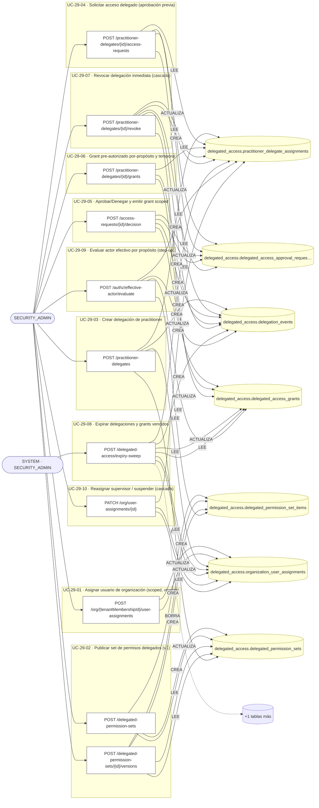

## Árbol de decisión por operación

Cada árbol se deriva del código del handler y de los métodos que invoca (hasta 4 niveles). Una rama que no decide, no escribe y no falla se poda. Los accesos y los efectos consecutivos se agrupan en un solo nodo.

### Operaciones con decisiones propias

#### 1. POST /access-requests/{id}/decision

Aprobar/Denegar solicitud y emitir grant scoped

| HTTP | Código | Cuándo |
|---|---|---|
| 200 | — | Éxito |
| 400 | `VALIDATION_FAILED` | Los parámetros de ruta son UUID válidos; El cuerpo cumple el DTO (sin propiedades extra) |
| 401 | `UNAUTHENTICATED` | Hay una sesión válida (JWT) |
| 403 | `FORBIDDEN` | El rol está permitido; El tenant se resuelve y pertenece al actor |
| 404 | `NOT_FOUND` | ResourceNotFoundException: Solicitud no encontrada |
| 422 | `PRECONDITION_FAILED` | PreconditionFailedException: La solicitud no está abierta |
| 429 | `RATE_LIMITED` | No se supera el límite de solicitudes |

#### 2. POST /authz/effective-actor/evaluate

Evaluar actor efectivo por propósito (step-up)

| HTTP | Código | Cuándo |
|---|---|---|
| 200 | — | Éxito |
| 400 | `VALIDATION_FAILED` | El cuerpo cumple el DTO (sin propiedades extra) |
| 401 | `UNAUTHENTICATED` | Hay una sesión válida (JWT) |
| 403 | `FORBIDDEN` | El rol está permitido; El tenant se resuelve y pertenece al actor |
| 404 | `NOT_FOUND` | ResourceNotFoundException: Delegación no encontrada |
| 429 | `RATE_LIMITED` | No se supera el límite de solicitudes |

```mermaid
flowchart TD
  n1(("Solicitud")):::inicio
  n2{{"Acceso: sesión (401) · rol (403) · tenant (403) · cuerpo válido (400) · límite de tasa (429)"}}:::acceso
  n1 --> n2
  n3["Llama a DelegatedAccessEvaluationService.evaluate"]:::llamada
  n2 --> n3
  n4["Transacción: transactional(…)"]:::transaccion
  n3 --> n4
  n5["Llama a PractitionerDelegateAssignmentsRepository.findById"]:::llamada
  n4 --> n5
  n6[("LEE delegated_access.practitioner_delegate_assignments")]:::efecto
  n5 --> n6
  n7{"!delegate"}:::decision
  n6 --> n7
  n8(["404 NOT_FOUND Delegación no encontrada"]):::error
  n7 -->|"sí"| n8
  n9{"!withinWindow"}:::decision
  n7 -->|"no"| n9
  n10["Llama a DelegationEventsRepository.record"]:::llamada
  n9 -->|"sí"| n10
  n11[("CREA delegated_access.delegation_events")]:::efecto
  n10 --> n11
  n12["Llama a DelegatedAccessGrantsRepository.findActiveMatch"]:::llamada
  n11 --> n12
  n9 -->|"no"| n12
  n13[("LEE delegated_access.delegated_access_grants")]:::efecto
  n12 --> n13
  n14{"!grant"}:::decision
  n13 --> n14
  n15["Llama a DelegationEventsRepository.record"]:::llamada
  n14 -->|"sí"| n15
  n16[("CREA delegated_access.delegation_events")]:::efecto
  n15 --> n16
  n17{"dto.permissionId"}:::decision
  n16 --> n17
  n14 -->|"no"| n17
  n18["Llama a DelegatedPermissionSetItemsRepository.findBySetAndPermission"]:::llamada
  n17 -->|"sí"| n18
  n19[("LEE delegated_access.delegated_permission_set_items")]:::efecto
  n18 --> n19
  n20{"requiresStepUp"}:::decision
  n19 --> n20
  n17 -->|"no"| n20
  n21["Llama a DelegationEventsRepository.record"]:::llamada
  n20 -->|"sí"| n21
  n22[("CREA delegated_access.delegation_events")]:::efecto
  n21 --> n22
  n23["Llama a DelegationEventsRepository.record"]:::llamada
  n22 --> n23
  n20 -->|"no"| n23
  n24[("CREA delegated_access.delegation_events")]:::efecto
  n23 --> n24
  n25(("200 Responde con éxito")):::ok
  n24 --> n25
  classDef acceso fill:#eef,stroke:#66a
  classDef error fill:#fee,stroke:#c33
  classDef ok fill:#efe,stroke:#3a3
  classDef efecto fill:#ffd,stroke:#aa3
  classDef decision fill:#fff,stroke:#555
  classDef corte fill:#eee,stroke:#999,stroke-dasharray: 4
```

#### 3. POST /delegated-access/expiry-sweep

Expirar delegaciones y grants vencidos (barrido)

| HTTP | Código | Cuándo |
|---|---|---|
| 200 | — | Éxito |
| 401 | `UNAUTHENTICATED` | Hay una sesión válida (JWT) |
| 403 | `FORBIDDEN` | El rol está permitido; El tenant se resuelve y pertenece al actor |
| 429 | `RATE_LIMITED` | No se supera el límite de solicitudes |

```mermaid
flowchart TD
  n1(("Solicitud")):::inicio
  n2{{"Acceso: sesión (401) · rol (403) · tenant (403) · límite de tasa (429)"}}:::acceso
  n1 --> n2
  n3["Llama a DelegatedAccessEvaluationService.expirySweep"]:::llamada
  n2 --> n3
  n4["Transacción: transactional(…)"]:::transaccion
  n3 --> n4
  n5["Llama a DelegatedAccessGrantsRepository.findOverdueActive"]:::llamada
  n4 --> n5
  n6[("LEE delegated_access.delegated_access_grants")]:::efecto
  n5 --> n6
  n7["Repite: por cada const grant de grants"]:::bucle
  n6 --> n7
  n8[("ACTUALIZA delegated_access.delegated_access_grants")]:::efecto
  n7 -->|"cada elemento"| n8
  n9["Llama a DelegationEventsRepository.record"]:::llamada
  n8 --> n9
  n10[("CREA delegated_access.delegation_events")]:::efecto
  n9 --> n10
  n11["Llama a PractitionerDelegateAssignmentsRepository.findOverdueActive"]:::llamada
  n10 --> n11
  n7 -->|"al terminar"| n11
  n12[("LEE delegated_access.practitioner_delegate_assignments")]:::efecto
  n11 --> n12
  n13["Repite: por cada const delegate de delegates"]:::bucle
  n12 --> n13
  n14[("ACTUALIZA delegated_access.practitioner_delegate_assignments")]:::efecto
  n13 -->|"cada elemento"| n14
  n15["Llama a DelegationEventsRepository.record"]:::llamada
  n14 --> n15
  n16[("CREA delegated_access.delegation_events")]:::efecto
  n15 --> n16
  n17["Llama a OrganizationUserAssignmentsRepository.findOverdueActive"]:::llamada
  n16 --> n17
  n13 -->|"al terminar"| n17
  n18[("LEE delegated_access.organization_user_assignments")]:::efecto
  n17 --> n18
  n19["Repite: por cada const assignment de orgAssignments"]:::bucle
  n18 --> n19
  n20[("ACTUALIZA delegated_access.organization_user_assignments")]:::efecto
  n19 -->|"cada elemento"| n20
  n21(("200 Responde con éxito")):::ok
  n20 --> n21
  n19 -->|"al terminar"| n21
  classDef acceso fill:#eef,stroke:#66a
  classDef error fill:#fee,stroke:#c33
  classDef ok fill:#efe,stroke:#3a3
  classDef efecto fill:#ffd,stroke:#aa3
  classDef decision fill:#fff,stroke:#555
  classDef corte fill:#eee,stroke:#999,stroke-dasharray: 4
```

#### 4. POST /delegated-permission-sets

Publicar set de permisos delegados (scoped)

| HTTP | Código | Cuándo |
|---|---|---|
| 201 | — | Éxito |
| 400 | `VALIDATION_FAILED` | El cuerpo cumple el DTO (sin propiedades extra) |
| 401 | `UNAUTHENTICATED` | Hay una sesión válida (JWT) |
| 403 | `FORBIDDEN` | El rol está permitido; El tenant se resuelve y pertenece al actor |
| 409 | `CONFLICT` | ConflictException: Ya existe un set con ese código en el tenant |
| 429 | `RATE_LIMITED` | No se supera el límite de solicitudes |

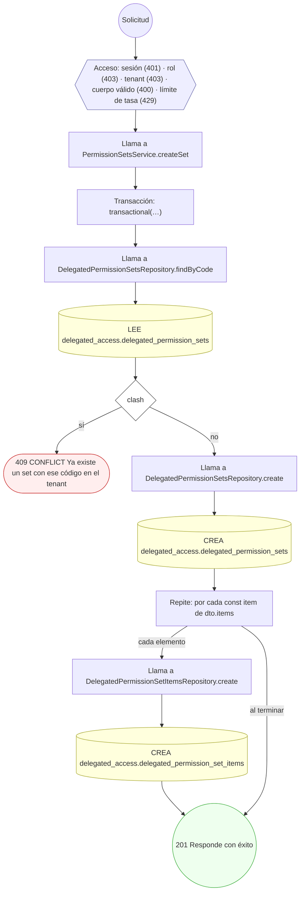

#### 5. POST /delegated-permission-sets/{id}/versions

Versionar set de permisos delegados

| HTTP | Código | Cuándo |
|---|---|---|
| 201 | — | Éxito |
| 400 | `VALIDATION_FAILED` | Los parámetros de ruta son UUID válidos; El cuerpo cumple el DTO (sin propiedades extra) |
| 401 | `UNAUTHENTICATED` | Hay una sesión válida (JWT) |
| 403 | `FORBIDDEN` | El rol está permitido; El tenant se resuelve y pertenece al actor |
| 404 | `NOT_FOUND` | ResourceNotFoundException: Set de permisos no encontrado |
| 429 | `RATE_LIMITED` | No se supera el límite de solicitudes |

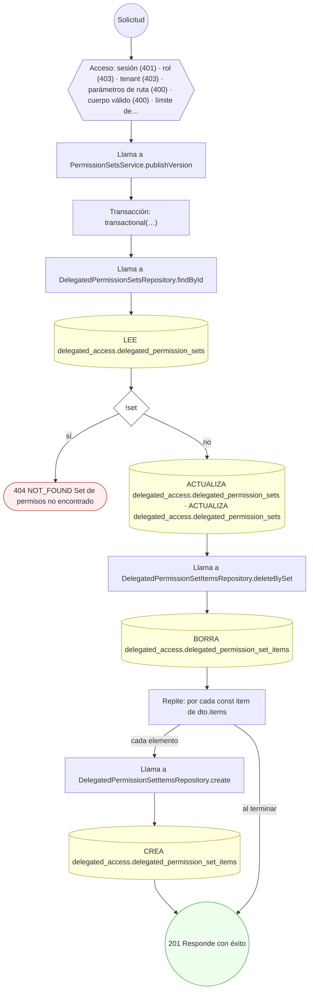

#### 6. POST /org/{tenantMembershipId}/user-assignments

Asignar usuario de organización con alcance y vigencia

| HTTP | Código | Cuándo |
|---|---|---|
| 201 | — | Éxito |
| 400 | `VALIDATION_FAILED` | Los parámetros de ruta son UUID válidos; El cuerpo cumple el DTO (sin propiedades extra) |
| 401 | `UNAUTHENTICATED` | Hay una sesión válida (JWT) |
| 403 | `FORBIDDEN` | El rol está permitido; El tenant se resuelve y pertenece al actor |
| 409 | `CONFLICT` | ConflictException: Ya existe una asignación activa con ese rol y alcance |
| 429 | `RATE_LIMITED` | No se supera el límite de solicitudes |

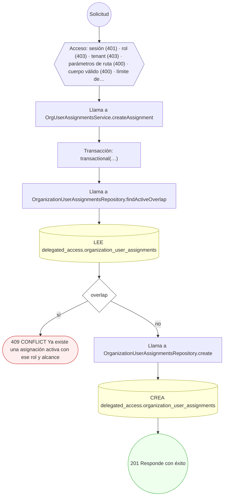

#### 7. PATCH /org/user-assignments/{id}

Reasignar supervisor / suspender asignación de organización

| HTTP | Código | Cuándo |
|---|---|---|
| 200 | — | Éxito |
| 400 | `VALIDATION_FAILED` | Los parámetros de ruta son UUID válidos; El cuerpo cumple el DTO (sin propiedades extra) |
| 401 | `UNAUTHENTICATED` | Hay una sesión válida (JWT) |
| 403 | `FORBIDDEN` | El rol está permitido; El tenant se resuelve y pertenece al actor |
| 404 | `NOT_FOUND` | ResourceNotFoundException: Asignación no encontrada |
| 409 | `CONCURRENCY_CONFLICT` | ConcurrencyConflictException: row_version no coincide |
| 422 | `PRECONDITION_FAILED` | PreconditionFailedException: No hay cambios que aplicar; PreconditionFailedException: La asignación no está activa |
| 429 | `RATE_LIMITED` | No se supera el límite de solicitudes |

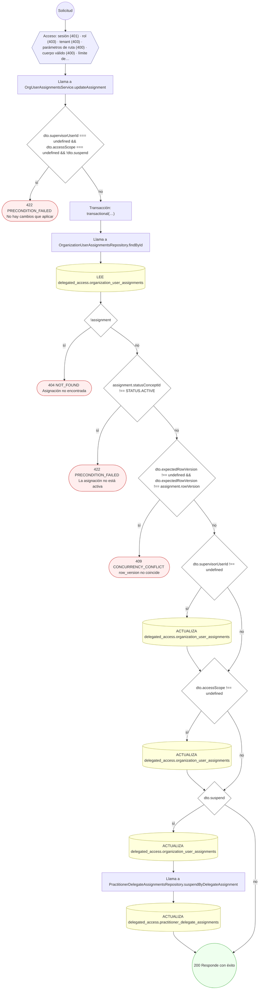

#### 8. POST /practitioner-delegates

Crear asignación de delegado de practitioner

| HTTP | Código | Cuándo |
|---|---|---|
| 201 | — | Éxito |
| 400 | `VALIDATION_FAILED` | El cuerpo cumple el DTO (sin propiedades extra) |
| 401 | `UNAUTHENTICATED` | Hay una sesión válida (JWT) |
| 403 | `FORBIDDEN` | El rol está permitido; El tenant se resuelve y pertenece al actor |
| 404 | `NOT_FOUND` | ResourceNotFoundException: Asignación de usuario de organización no encontrada; ResourceNotFoundException: Set de permisos no encontrado |
| 422 | `PRECONDITION_FAILED` | PreconditionFailedException: El usuario de organización no está activo; PreconditionFailedException: El set de permisos no está activo |
| 429 | `RATE_LIMITED` | No se supera el límite de solicitudes |

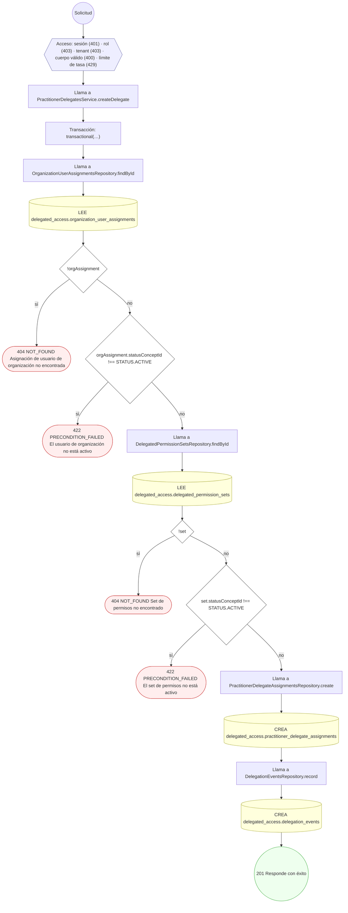

#### 9. POST /practitioner-delegates/{id}/access-requests

Solicitar acceso delegado (aprobación previa)

| HTTP | Código | Cuándo |
|---|---|---|
| 201 | — | Éxito |
| 400 | `VALIDATION_FAILED` | Los parámetros de ruta son UUID válidos; El cuerpo cumple el DTO (sin propiedades extra) |
| 401 | `UNAUTHENTICATED` | Hay una sesión válida (JWT) |
| 403 | `FORBIDDEN` | El rol está permitido; El tenant se resuelve y pertenece al actor |
| 404 | `NOT_FOUND` | ResourceNotFoundException: Delegación no encontrada |
| 409 | `CONFLICT` | ConflictException: Ya existe una solicitud pendiente equivalente |
| 422 | `PRECONDITION_FAILED` | PreconditionFailedException: La delegación no está activa |
| 429 | `RATE_LIMITED` | No se supera el límite de solicitudes |

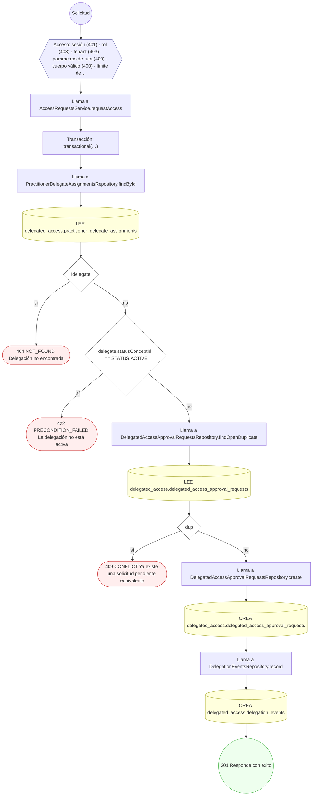

#### 10. POST /practitioner-delegates/{id}/grants

Otorgar grant delegado por-propósito y temporal

| HTTP | Código | Cuándo |
|---|---|---|
| 201 | — | Éxito |
| 400 | `VALIDATION_FAILED` | Los parámetros de ruta son UUID válidos; El cuerpo cumple el DTO (sin propiedades extra) |
| 401 | `UNAUTHENTICATED` | Hay una sesión válida (JWT) |
| 403 | `FORBIDDEN` | El rol está permitido; El tenant se resuelve y pertenece al actor |
| 404 | `NOT_FOUND` | ResourceNotFoundException: Delegación no encontrada |
| 422 | `PRECONDITION_FAILED` | PreconditionFailedException: La delegación no está activa |
| 429 | `RATE_LIMITED` | No se supera el límite de solicitudes |

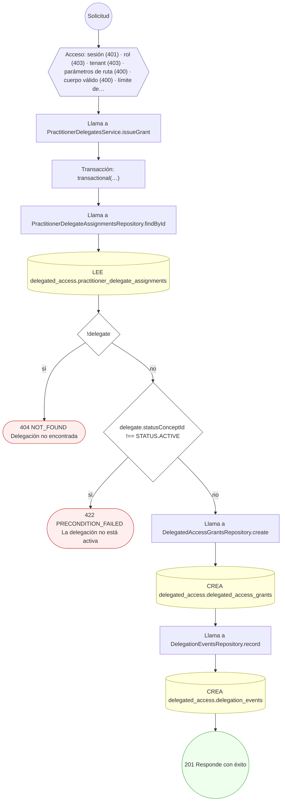

#### 11. POST /practitioner-delegates/{id}/revoke

Revocar delegación de forma inmediata (cascada authz)

| HTTP | Código | Cuándo |
|---|---|---|
| 200 | — | Éxito |
| 400 | `VALIDATION_FAILED` | Los parámetros de ruta son UUID válidos; El cuerpo cumple el DTO (sin propiedades extra) |
| 401 | `UNAUTHENTICATED` | Hay una sesión válida (JWT) |
| 403 | `FORBIDDEN` | El rol está permitido; El tenant se resuelve y pertenece al actor |
| 404 | `NOT_FOUND` | ResourceNotFoundException: Delegación no encontrada |
| 429 | `RATE_LIMITED` | No se supera el límite de solicitudes |

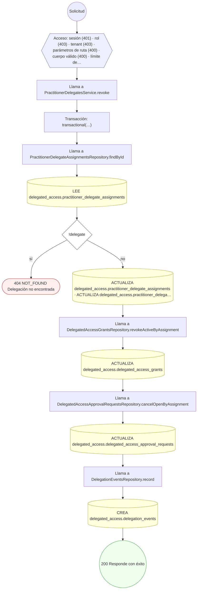

