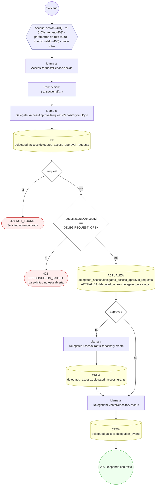
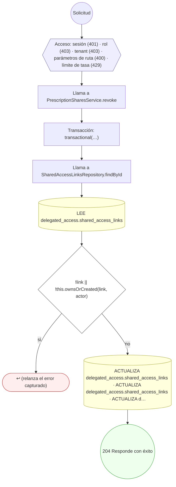
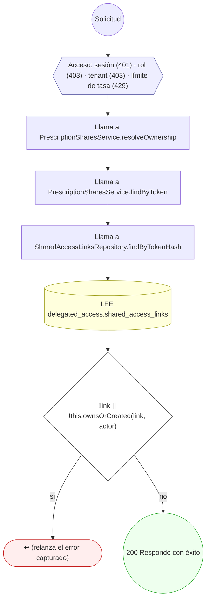
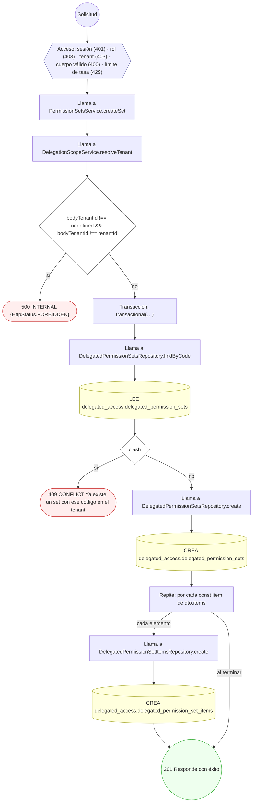
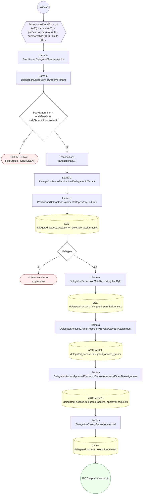

```mermaid
flowchart TD
  n1(("Solicitud")):::inicio
  n2{{"Acceso: sesión (401) · rol (403) · tenant (403) · límite de tasa (429)"}}:::acceso
  n1 --> n2
  n3["Llama a DelegatedAccessEvaluationService.expirySweep"]:::llamada
  n2 --> n3
  n4["Transacción: transactional(…)"]:::transaccion
  n3 --> n4
  n5["Llama a DelegatedAccessGrantsRepository.findOverdueActive"]:::llamada
  n4 --> n5
  n6[("LEE delegated_access.delegated_access_grants")]:::efecto
  n5 --> n6
  n7["Repite: por cada const grant de grants"]:::bucle
  n6 --> n7
  n8[("ACTUALIZA delegated_access.delegated_access_grants")]:::efecto
  n7 -->|"cada elemento"| n8
  n9["Llama a DelegationEventsRepository.record"]:::llamada
  n8 --> n9
  n10[("CREA delegated_access.delegation_events")]:::efecto
  n9 --> n10
  n11["Llama a PractitionerDelegateAssignmentsRepository.findOverdueActive"]:::llamada
  n10 --> n11
  n7 -->|"al terminar"| n11
  n12[("LEE delegated_access.practitioner_delegate_assignments")]:::efecto
  n11 --> n12
  n13["Repite: por cada const delegate de delegates"]:::bucle
  n12 --> n13
  n14[("ACTUALIZA delegated_access.practitioner_delegate_assignments")]:::efecto
  n13 -->|"cada elemento"| n14
  n15["Llama a DelegationEventsRepository.record"]:::llamada
  n14 --> n15
  n16[("CREA delegated_access.delegation_events")]:::efecto
  n15 --> n16
  n17["Llama a OrganizationUserAssignmentsRepository.findOverdueActive"]:::llamada
  n16 --> n17
  n13 -->|"al terminar"| n17
  n18[("LEE delegated_access.organization_user_assignments")]:::efecto
  n17 --> n18
  n19["Repite: por cada const assignment de orgAssignments"]:::bucle
  n18 --> n19
  n20[("ACTUALIZA delegated_access.organization_user_assignments")]:::efecto
  n19 -->|"cada elemento"| n20
  n21(("200 Responde con éxito")):::ok
  n20 --> n21
  n19 -->|"al terminar"| n21
  classDef acceso fill:#eef,stroke:#66a
  classDef error fill:#fee,stroke:#c33
  classDef ok fill:#efe,stroke:#3a3
  classDef efecto fill:#ffd,stroke:#aa3
  classDef decision fill:#fff,stroke:#555
  classDef corte fill:#eee,stroke:#999,stroke-dasharray: 4
```

<!-- AUTOGENERADO por tools/inventario/flujos.mjs. No editar manualmente. -->

# Flujos del módulo `delegated_access`

- **Procesos:** 1 · **Máquinas de estado:** 0
- **Operaciones:** 17 (16 con decisiones propias, 1 sin ellas)
- Inventario de endpoints del módulo: [delegated_access](../endpoints/delegated_access.md)

## Proceso: Módulo 29 — Delegated Access and Scoped Infrastructure Users

- **Código:** `delegated_access` · **Agrupación:** MIXTO · **Operaciones:** 17
- **Actores:** PATIENT · PRACTITIONER · Público (sin sesión) · SECURITY_ADMIN · SYSTEM
- **Revisión:** AUTO_DETECTADA
- **Fuentes:** `src/modules/delegated_access/README.md`

### Para qué sirve

Delegación scoped de acceso: usuarios de organización con alcance y vigencia, sets de permisos delegados versionados, delegaciones de practitioner, solicitudes con aprobación previa, grants temporales por propósito, revocación en cascada, barrido de expiración y evaluación del actor efectivo (con step-up). Sin impersonación: delegante y delegado quedan siempre auditados en `delegation_events`.

_Fuente: `src/modules/delegated_access/README.md:3`_

### Etapas y operaciones

| Etapa | Descripción | Operación | Quién actúa | Riesgo | Tablas |
|---|---|---|---|---|---|
| `UC-29-01` | Asignar usuario de organización (scoped, vigente) | POST /org/{tenantMembershipId}/user-assignments | SECURITY_ADMIN | MEDIO | 2 |
| `UC-29-02` | Publicar set de permisos delegados (v1) | POST /delegated-permission-sets | SECURITY_ADMIN | MEDIO | 3 |
|  |  | POST /delegated-permission-sets/{id}/versions | SECURITY_ADMIN | ALTO | 4 |
| `UC-29-03` | Crear delegación de practitioner | POST /practitioner-delegates | SECURITY_ADMIN | MEDIO | 7 |
| `UC-29-04` | Solicitar acceso delegado (aprobación previa) | POST /practitioner-delegates/{id}/access-requests | SECURITY_ADMIN | MEDIO | 4 |
| `UC-29-05` | Aprobar/Denegar y emitir grant scoped | POST /access-requests/{id}/decision | SECURITY_ADMIN | MEDIO | 4 |
| `UC-29-06` | Grant pre-autorizado por-propósito y temporal | POST /practitioner-delegates/{id}/grants | SECURITY_ADMIN | MEDIO | 6 |
| `UC-29-07` | Revocar delegación inmediata (cascada) | POST /practitioner-delegates/{id}/revoke | SECURITY_ADMIN | MEDIO | 5 |
| `UC-29-08` | Expirar delegaciones y grants vencidos | POST /delegated-access/expiry-sweep | SYSTEM · SECURITY_ADMIN | MEDIO | 7 |
| `UC-29-09` | Evaluar actor efectivo por propósito (step-up) | POST /authz/effective-actor/evaluate | SECURITY_ADMIN | MEDIO | 7 |
| `UC-29-10` | Reasignar supervisor / suspender (cascada) | PATCH /org/user-assignments/{id} | SECURITY_ADMIN | MEDIO | 3 |
| `ctrl:DelegatedPermissionSetsController` | Operaciones de DelegatedPermissionSetsController que el README no asigna a un caso de uso | GET /delegated-permission-sets | SECURITY_ADMIN | BAJO | 1 |
| `ctrl:PrescriptionSharesController` | Operaciones de PrescriptionSharesController que el README no asigna a un caso de uso | GET /clinical/prescription-shares | PATIENT · PRACTITIONER | BAJO | 3 |
|  |  | POST /clinical/prescription-shares | PATIENT · PRACTITIONER | MEDIO | 2 |
|  |  | POST /clinical/prescription-shares/{shareId}/revoke | PATIENT · PRACTITIONER | MEDIO | 2 |
|  |  | GET /clinical/prescription-shares/by-token/{token} | PATIENT · PRACTITIONER | BAJO | 1 |
| `ctrl:PrescriptionSharesPublicController` | Operaciones de PrescriptionSharesPublicController que el README no asigna a un caso de uso | GET /public/prescription-shares/{token} | Público (sin sesión) | ALTO | 6 |

### Diagrama — etapas `UC-29-01`, `UC-29-02`, `UC-29-03`…

```mermaid
flowchart LR
  a2(["SECURITY_ADMIN"]):::actor
  a23(["SYSTEM · SECURITY_ADMIN"]):::actor
  a30(["PATIENT · PRACTITIONER"]):::actor
  a38(["Público (sin sesión)"]):::actor
  t3[("delegated_access.organization_user_assignments")]:::tabla
  t5[("delegated_access.delegated_permission_set_items")]:::tabla
  t6[("delegated_access.delegated_permission_sets")]:::tabla
  t9[("delegated_access.delegation_events")]:::tabla
  t10[("delegated_access.practitioner_delegate_assignments")]:::tabla
  t11[("directory.tenant_memberships")]:::tabla
  t12[("practice.practices")]:::tabla
  t15[("delegated_access.delegated_access_approval_reques…")]:::tabla
  t17[("delegated_access.delegated_access_grants")]:::tabla
  t19[("clinical.encounters")]:::tabla
  t20[("profiles.patient_profiles")]:::tabla
  t31[("clinical.medication_requests")]:::tabla
  t32[("delegated_access.shared_access_link_uses")]:::tabla
  t33[("delegated_access.shared_access_links")]:::tabla
  t39[("profiles.health_practitioner_profiles")]:::tabla
  t40[("profiles.jurisdiction_authorizations")]:::tabla
  t41[("profiles.persons")]:::tabla
  subgraph s0["UC-29-01 · Asignar usuario de organización (scoped, vigente)"]
    o1["POST /org/{tenantMembershipId}/user-assignments"]:::op
  end
  subgraph s1["UC-29-02 · Publicar set de permisos delegados (v1)"]
    o4["POST /delegated-permission-sets"]:::op
    o7["POST /delegated-permission-sets/{id}/versions"]:::op
  end
  t13[("+1 tablas más")]
  subgraph s2["UC-29-03 · Crear delegación de practitioner"]
    o8["POST /practitioner-delegates"]:::op
  end
  subgraph s3["UC-29-04 · Solicitar acceso delegado (aprobación previa)"]
    o14["POST /practitioner-delegates/{id}/access-requests"]:::op
  end
  subgraph s4["UC-29-05 · Aprobar/Denegar y emitir grant scoped"]
    o16["POST /access-requests/{id}/decision"]:::op
  end
  subgraph s5["UC-29-06 · Grant pre-autorizado por-propósito y temporal"]
    o18["POST /practitioner-delegates/{id}/grants"]:::op
  end
  subgraph s6["UC-29-07 · Revocar delegación inmediata (cascada)"]
    o21["POST /practitioner-delegates/{id}/revoke"]:::op
  end
  t24[("+1 tablas más")]
  subgraph s7["UC-29-08 · Expirar delegaciones y grants vencidos"]
    o22["POST /delegated-access/expiry-sweep"]:::op
  end
  t26[("+1 tablas más")]
  subgraph s8["UC-29-09 · Evaluar actor efectivo por propósito (step-up)"]
    o25["POST /authz/effective-actor/evaluate"]:::op
  end
  subgraph s9["UC-29-10 · Reasignar supervisor / suspender (cascada)"]
    o27["PATCH /org/user-assignments/{id}"]:::op
  end
  subgraph s10["ctrl:DelegatedPermissionSetsController · Operaciones de DelegatedPermissionSets…"]
    o28["GET /delegated-permission-sets"]:::op
  end
  subgraph s11["ctrl:PrescriptionSharesController · Operaciones de PrescriptionSharesController…"]
    o29["GET /clinical/prescription-shares"]:::op
    o34["POST /clinical/prescription-shares"]:::op
    o35["POST /clinical/prescription-shares/{shareId}/revoke"]:::op
    o36["GET /clinical/prescription-shares/by-token/{token}"]:::op
  end
  subgraph s12["ctrl:PrescriptionSharesPublicController · Operaciones de PrescriptionSharesPubl…"]
    o37["GET /public/prescription-shares/{token}"]:::op
  end
  a2 --> o1
  o1 -->|"CREA"| t3
  o1 -->|"LEE"| t3
  a2 --> o4
  o4 -->|"CREA"| t5
  o4 -->|"CREA"| t6
  o4 -->|"LEE"| t6
  a2 --> o7
  o7 -->|"BORRA"| t5
  o7 -->|"CREA"| t5
  o7 -->|"ACTUALIZA"| t6
  o7 -->|"LEE"| t6
  a2 --> o8
  o8 -->|"LEE"| t6
  o8 -->|"CREA"| t9
  o8 -->|"LEE"| t3
  o8 -->|"CREA"| t10
  o8 -->|"LEE"| t11
  o8 -->|"LEE"| t12
  o8 -.-> t13
  a2 --> o14
  o14 -->|"CREA"| t15
  o14 -->|"LEE"| t15
  o14 -->|"CREA"| t9
  o14 -->|"LEE"| t10
  a2 --> o16
  o16 -->|"ACTUALIZA"| t15
  o16 -->|"LEE"| t15
  o16 -->|"CREA"| t17
  o16 -->|"CREA"| t9
  a2 --> o18
  o18 -->|"LEE"| t19
  o18 -->|"CREA"| t17
  o18 -->|"LEE"| t6
  o18 -->|"CREA"| t9
  o18 -->|"LEE"| t10
  o18 -->|"LEE"| t20
  a2 --> o21
  o21 -->|"ACTUALIZA"| t15
  o21 -->|"ACTUALIZA"| t17
  o21 -->|"LEE"| t6
  o21 -->|"CREA"| t9
  o21 -->|"LEE"| t10
  a23 --> o22
  o22 -->|"ACTUALIZA"| t17
  o22 -->|"LEE"| t17
  o22 -->|"CREA"| t9
  o22 -->|"ACTUALIZA"| t3
  o22 -->|"LEE"| t3
  o22 -->|"ACTUALIZA"| t10
  o22 -.-> t24
  a2 --> o25
  o25 -->|"LEE"| t17
  o25 -->|"LEE"| t5
  o25 -->|"LEE"| t6
  o25 -->|"CREA"| t9
  o25 -->|"LEE"| t3
  o25 -->|"LEE"| t10
  o25 -.-> t26
  a2 --> o27
  o27 -->|"ACTUALIZA"| t3
  o27 -->|"LEE"| t3
  o27 -->|"ACTUALIZA"| t10
  a2 --> o28
  o28 -->|"LEE"| t6
  a30 --> o29
  o29 -->|"LEE"| t31
  o29 -->|"LEE"| t32
  o29 -->|"LEE"| t33
  a30 --> o34
  o34 -->|"LEE"| t31
  o34 -->|"CREA"| t33
  a30 --> o35
  o35 -->|"ACTUALIZA"| t33
  o35 -->|"LEE"| t33
  a30 --> o36
  o36 -->|"LEE"| t33
  a38 --> o37
  o37 -->|"LEE"| t31
  o37 -->|"CREA"| t32
  o37 -->|"LEE"| t33
  o37 -->|"LEE"| t39
  o37 -->|"LEE"| t40
  o37 -->|"LEE"| t41
  classDef op fill:#fff,stroke:#446
  classDef actor fill:#eef,stroke:#66a
  classDef tabla fill:#ffd,stroke:#aa3
  classDef evento fill:#efe,stroke:#3a3
```

## Árbol de decisión por operación

Cada árbol se deriva del código del handler y de los métodos que invoca (hasta 4 niveles). Una rama que no decide, no escribe y no falla se poda. Los accesos y los efectos consecutivos se agrupan en un solo nodo.

### Operaciones con decisiones propias

#### 1. POST /access-requests/{id}/decision

Aprobar/Denegar solicitud y emitir grant scoped

| HTTP | Código | Cuándo |
|---|---|---|
| 200 | — | Éxito |
| 400 | `VALIDATION_FAILED` | Los parámetros de ruta son UUID válidos; El cuerpo cumple el DTO (sin propiedades extra) |
| 401 | `UNAUTHENTICATED` | Hay una sesión válida (JWT) |
| 403 | `FORBIDDEN` | El rol está permitido; El tenant se resuelve y pertenece al actor |
| 404 | `NOT_FOUND` | ResourceNotFoundException: Solicitud no encontrada |
| 422 | `PRECONDITION_FAILED` | PreconditionFailedException: La solicitud no está abierta |
| 429 | `RATE_LIMITED` | No se supera el límite de solicitudes |

#### 2. POST /authz/effective-actor/evaluate

Evaluar actor efectivo por propósito (step-up)

| HTTP | Código | Cuándo |
|---|---|---|
| 200 | — | Éxito |
| 400 | `VALIDATION_FAILED` | El cuerpo cumple el DTO (sin propiedades extra) |
| 401 | `UNAUTHENTICATED` | Hay una sesión válida (JWT) |
| 403 | `FORBIDDEN` | El rol está permitido; El tenant se resuelve y pertenece al actor |
| 429 | `RATE_LIMITED` | No se supera el límite de solicitudes |
| 500 | `INTERNAL` | DomainException: {HttpStatus.FORBIDDEN} |

#### 3. GET /clinical/prescription-shares

Enlaces de receta de un paciente

| HTTP | Código | Cuándo |
|---|---|---|
| 200 | — | Éxito |
| 400 | `VALIDATION_FAILED` | Están los parámetros de consulta obligatorios |
| 401 | `UNAUTHENTICATED` | Hay una sesión válida (JWT) |
| 403 | `FORBIDDEN` | El rol está permitido; El tenant se resuelve y pertenece al actor |
| 404 | `NOT_FOUND` | ResourceNotFoundException: Paciente no encontrado |
| 429 | `RATE_LIMITED` | No se supera el límite de solicitudes |

#### 4. POST /clinical/prescription-shares

Compartir una receta con un enlace

| HTTP | Código | Cuándo |
|---|---|---|
| 201 | — | Éxito |
| 400 | `VALIDATION_FAILED` | El cuerpo cumple el DTO (sin propiedades extra); BadRequestException: {{ code: ErrorCode.VALIDATION_FAILED, message: 'Indicá la co…} |
| 401 | `UNAUTHENTICATED` | Hay una sesión válida (JWT) |
| 403 | `FORBIDDEN` | El rol está permitido; El tenant se resuelve y pertenece al actor; ForbiddenException: {{ code: ErrorCode.FORBIDDEN, message: 'Solo el paciente o q…} |
| 422 | `PRECONDITION_FAILED` | PreconditionFailedException: La receta no tiene medicamentos emitidos y vigentes para compartir. |
| 429 | `RATE_LIMITED` | No se supera el límite de solicitudes |

#### 5. POST /clinical/prescription-shares/{shareId}/revoke

Revocar un enlace de receta

| HTTP | Código | Cuándo |
|---|---|---|
| 204 | — | Éxito |
| 400 | `VALIDATION_FAILED` | Los parámetros de ruta son UUID válidos |
| 401 | `UNAUTHENTICATED` | Hay una sesión válida (JWT) |
| 403 | `FORBIDDEN` | El rol está permitido; El tenant se resuelve y pertenece al actor |
| 429 | `RATE_LIMITED` | No se supera el límite de solicitudes |

#### 6. GET /clinical/prescription-shares/by-token/{token}

Saber si un enlace es de la sesión

| HTTP | Código | Cuándo |
|---|---|---|
| 200 | — | Éxito |
| 401 | `UNAUTHENTICATED` | Hay una sesión válida (JWT) |
| 403 | `FORBIDDEN` | El rol está permitido; El tenant se resuelve y pertenece al actor |
| 429 | `RATE_LIMITED` | No se supera el límite de solicitudes |

#### 7. POST /delegated-access/expiry-sweep

Expirar delegaciones y grants vencidos (barrido)

| HTTP | Código | Cuándo |
|---|---|---|
| 200 | — | Éxito |
| 401 | `UNAUTHENTICATED` | Hay una sesión válida (JWT) |
| 403 | `FORBIDDEN` | El rol está permitido; El tenant se resuelve y pertenece al actor |
| 429 | `RATE_LIMITED` | No se supera el límite de solicitudes |

#### 8. POST /delegated-permission-sets

Publicar set de permisos delegados (scoped)

| HTTP | Código | Cuándo |
|---|---|---|
| 201 | — | Éxito |
| 400 | `VALIDATION_FAILED` | El cuerpo cumple el DTO (sin propiedades extra) |
| 401 | `UNAUTHENTICATED` | Hay una sesión válida (JWT) |
| 403 | `FORBIDDEN` | El rol está permitido; El tenant se resuelve y pertenece al actor |
| 409 | `CONFLICT` | ConflictException: Ya existe un set con ese código en el tenant |
| 429 | `RATE_LIMITED` | No se supera el límite de solicitudes |
| 500 | `INTERNAL` | DomainException: {HttpStatus.FORBIDDEN} |

#### 9. POST /delegated-permission-sets/{id}/versions

Versionar set de permisos delegados

| HTTP | Código | Cuándo |
|---|---|---|
| 201 | — | Éxito |
| 400 | `VALIDATION_FAILED` | Los parámetros de ruta son UUID válidos; El cuerpo cumple el DTO (sin propiedades extra) |
| 401 | `UNAUTHENTICATED` | Hay una sesión válida (JWT) |
| 403 | `FORBIDDEN` | El rol está permitido; El tenant se resuelve y pertenece al actor |
| 429 | `RATE_LIMITED` | No se supera el límite de solicitudes |
| 500 | `INTERNAL` | DomainException: {HttpStatus.FORBIDDEN} |

#### 10. POST /org/{tenantMembershipId}/user-assignments

Asignar usuario de organización con alcance y vigencia

| HTTP | Código | Cuándo |
|---|---|---|
| 201 | — | Éxito |
| 400 | `VALIDATION_FAILED` | Los parámetros de ruta son UUID válidos; El cuerpo cumple el DTO (sin propiedades extra) |
| 401 | `UNAUTHENTICATED` | Hay una sesión válida (JWT) |
| 403 | `FORBIDDEN` | El rol está permitido; El tenant se resuelve y pertenece al actor |
| 409 | `CONFLICT` | ConflictException: Ya existe una asignación activa con ese rol y alcance |
| 429 | `RATE_LIMITED` | No se supera el límite de solicitudes |

#### 11. PATCH /org/user-assignments/{id}

Reasignar supervisor / suspender asignación de organización

| HTTP | Código | Cuándo |
|---|---|---|
| 200 | — | Éxito |
| 400 | `VALIDATION_FAILED` | Los parámetros de ruta son UUID válidos; El cuerpo cumple el DTO (sin propiedades extra) |
| 401 | `UNAUTHENTICATED` | Hay una sesión válida (JWT) |
| 403 | `FORBIDDEN` | El rol está permitido; El tenant se resuelve y pertenece al actor |
| 404 | `NOT_FOUND` | ResourceNotFoundException: Asignación no encontrada |
| 409 | `CONCURRENCY_CONFLICT` | ConcurrencyConflictException: row_version no coincide |
| 422 | `PRECONDITION_FAILED` | PreconditionFailedException: No hay cambios que aplicar; PreconditionFailedException: La asignación no está activa |
| 429 | `RATE_LIMITED` | No se supera el límite de solicitudes |

#### 12. POST /practitioner-delegates

Crear asignación de delegado de practitioner

| HTTP | Código | Cuándo |
|---|---|---|
| 201 | — | Éxito |
| 400 | `VALIDATION_FAILED` | El cuerpo cumple el DTO (sin propiedades extra) |
| 401 | `UNAUTHENTICATED` | Hay una sesión válida (JWT) |
| 403 | `FORBIDDEN` | El rol está permitido; El tenant se resuelve y pertenece al actor |
| 422 | `PRECONDITION_FAILED` | PreconditionFailedException: El usuario de organización no está activo; PreconditionFailedException: El set de permisos no está activo |
| 429 | `RATE_LIMITED` | No se supera el límite de solicitudes |
| 500 | `INTERNAL` | DomainException: {HttpStatus.FORBIDDEN} |

```mermaid
flowchart TD
  n1(("Solicitud")):::inicio
  n2{{"Acceso: sesión (401) · rol (403) · tenant (403) · cuerpo válido (400) · límite de tasa (429)"}}:::acceso
  n1 --> n2
  n3["Llama a PractitionerDelegatesService.createDelegate"]:::llamada
  n2 --> n3
  n4["Llama a DelegationScopeService.resolveTenant"]:::llamada
  n3 --> n4
  n5{"bodyTenantId !== undefined && bodyTenantId !== tenantId"}:::decision
  n4 --> n5
  n6(["500 INTERNAL {HttpStatus.FORBIDDEN}"]):::error
  n5 -->|"sí"| n6
  n7["Transacción: transactional(…)"]:::transaccion
  n5 -->|"no"| n7
  n8["Llama a DelegationScopeService.loadOrgAssignmentInTenant"]:::llamada
  n7 --> n8
  n9["Llama a OrganizationUserAssignmentsRepository.findById"]:::llamada
  n8 --> n9
  n10[("LEE delegated_access.organization_user_assignments")]:::efecto
  n9 --> n10
  n11["Llama a DelegationScopeService.membershipOfAssignment"]:::llamada
  n10 --> n11
  n12["Llama a DelegationScopeRepository.membershipOf"]:::llamada
  n11 --> n12
  n13[("LEE directory.tenant_memberships")]:::efecto
  n12 --> n13
  n14["Llama a DelegationScopeService.assertRoleAssignmentInTenant"]:::llamada
  n13 --> n14
  n15["Llama a DelegationScopeRepository.roleAssignmentTenant"]:::llamada
  n14 --> n15
  n16[("LEE practice.practitioner_role_assignments · LEE practice.practices")]:::efecto
  n15 --> n16
  n17{"orgAssignment.statusConceptId !== STATUS.ACTIVE"}:::decision
  n16 --> n17
  n18(["422 PRECONDITION_FAILED El usuario de organización no está activo"]):::error
  n17 -->|"sí"| n18
  n19["Llama a DelegationScopeService.loadSetInTenant"]:::llamada
  n17 -->|"no"| n19
  n20["Llama a DelegatedPermissionSetsRepository.findById"]:::llamada
  n19 --> n20
  n21[("LEE delegated_access.delegated_permission_sets")]:::efecto
  n20 --> n21
  n22{"set.statusConceptId !== STATUS.ACTIVE"}:::decision
  n21 --> n22
  n23(["422 PRECONDITION_FAILED El set de permisos no está activo"]):::error
  n22 -->|"sí"| n23
  n24["Llama a PractitionerDelegateAssignmentsRepository.create"]:::llamada
  n22 -->|"no"| n24
  n25[("CREA delegated_access.practitioner_delegate_assignments")]:::efecto
  n24 --> n25
  n26["Llama a DelegationEventsRepository.record"]:::llamada
  n25 --> n26
  n27[("CREA delegated_access.delegation_events")]:::efecto
  n26 --> n27
  n28(("201 Responde con éxito")):::ok
  n27 --> n28
  classDef acceso fill:#eef,stroke:#66a
  classDef error fill:#fee,stroke:#c33
  classDef ok fill:#efe,stroke:#3a3
  classDef efecto fill:#ffd,stroke:#aa3
  classDef decision fill:#fff,stroke:#555
  classDef corte fill:#eee,stroke:#999,stroke-dasharray: 4
```

#### 13. POST /practitioner-delegates/{id}/access-requests

Solicitar acceso delegado (aprobación previa)

| HTTP | Código | Cuándo |
|---|---|---|
| 201 | — | Éxito |
| 400 | `VALIDATION_FAILED` | Los parámetros de ruta son UUID válidos; El cuerpo cumple el DTO (sin propiedades extra) |
| 401 | `UNAUTHENTICATED` | Hay una sesión válida (JWT) |
| 403 | `FORBIDDEN` | El rol está permitido; El tenant se resuelve y pertenece al actor |
| 404 | `NOT_FOUND` | ResourceNotFoundException: Delegación no encontrada |
| 409 | `CONFLICT` | ConflictException: Ya existe una solicitud pendiente equivalente |
| 422 | `PRECONDITION_FAILED` | PreconditionFailedException: La delegación no está activa |
| 429 | `RATE_LIMITED` | No se supera el límite de solicitudes |

#### 14. POST /practitioner-delegates/{id}/grants

Otorgar grant delegado por-propósito y temporal

| HTTP | Código | Cuándo |
|---|---|---|
| 201 | — | Éxito |
| 400 | `VALIDATION_FAILED` | Los parámetros de ruta son UUID válidos; El cuerpo cumple el DTO (sin propiedades extra) |
| 401 | `UNAUTHENTICATED` | Hay una sesión válida (JWT) |
| 403 | `FORBIDDEN` | El rol está permitido; El tenant se resuelve y pertenece al actor |
| 422 | `PRECONDITION_FAILED` | PreconditionFailedException: La delegación no está activa |
| 429 | `RATE_LIMITED` | No se supera el límite de solicitudes |
| 500 | `INTERNAL` | DomainException: {HttpStatus.FORBIDDEN} |

```mermaid
flowchart TD
  n1(("Solicitud")):::inicio
  n2{{"Acceso: sesión (401) · rol (403) · tenant (403) · parámetros de ruta (400) · cuerpo válido (400) · límite de…"}}:::acceso
  n1 --> n2
  n3["Llama a PractitionerDelegatesService.issueGrant"]:::llamada
  n2 --> n3
  n4["Llama a DelegationScopeService.resolveTenant"]:::llamada
  n3 --> n4
  n5{"bodyTenantId !== undefined && bodyTenantId !== tenantId"}:::decision
  n4 --> n5
  n6(["500 INTERNAL {HttpStatus.FORBIDDEN}"]):::error
  n5 -->|"sí"| n6
  n7["Transacción: transactional(…)"]:::transaccion
  n5 -->|"no"| n7
  n8["Llama a DelegationScopeService.loadDelegationInTenant"]:::llamada
  n7 --> n8
  n9["Llama a PractitionerDelegateAssignmentsRepository.findById"]:::llamada
  n8 --> n9
  n10[("LEE delegated_access.practitioner_delegate_assignments")]:::efecto
  n9 --> n10
  n11{"!delegate"}:::decision
  n10 --> n11
  n12(["↩ (relanza el error capturado)"]):::error
  n11 -->|"sí"| n12
  n13["Llama a DelegatedPermissionSetsRepository.findById"]:::llamada
  n11 -->|"no"| n13
  n14[("LEE delegated_access.delegated_permission_sets")]:::efecto
  n13 --> n14
  n15{"delegate.statusConceptId !== STATUS.ACTIVE"}:::decision
  n14 --> n15
  n16(["422 PRECONDITION_FAILED La delegación no está activa"]):::error
  n15 -->|"sí"| n16
  n17["Llama a DelegationScopeService.assertGrantTarget"]:::llamada
  n15 -->|"no"| n17
  n18{"encounterId"}:::decision
  n17 --> n18
  n19["Llama a DelegationScopeRepository.encounterScope"]:::llamada
  n18 -->|"sí"| n19
  n20[("LEE clinical.encounters")]:::efecto
  n19 --> n20
  n21{"!encounter || encounter.tenantId !== tenantId || (patientProfileId !== undefined && encounter.patientProfileI…"}:::decision
  n20 --> n21
  n22(["↩ (relanza el error capturado)"]):::error
  n21 -->|"sí"| n22
  n23{"patientProfileId"}:::decision
  n21 -->|"no"| n23
  n18 -->|"no"| n23
  n24["Llama a DelegationScopeRepository.patientExists"]:::llamada
  n23 -->|"sí"| n24
  n25[("LEE profiles.patient_profiles")]:::efecto
  n24 --> n25
  n26{"!exists"}:::decision
  n25 --> n26
  n27(["↩ (relanza el error capturado)"]):::error
  n26 -->|"sí"| n27
  n28["Llama a DelegatedAccessGrantsRepository.create"]:::llamada
  n26 -->|"no"| n28
  n23 -->|"no"| n28
  n29[("CREA delegated_access.delegated_access_grants")]:::efecto
  n28 --> n29
  n30["Llama a DelegationEventsRepository.record"]:::llamada
  n29 --> n30
  n31[("CREA delegated_access.delegation_events")]:::efecto
  n30 --> n31
  n32(("201 Responde con éxito")):::ok
  n31 --> n32
  classDef acceso fill:#eef,stroke:#66a
  classDef error fill:#fee,stroke:#c33
  classDef ok fill:#efe,stroke:#3a3
  classDef efecto fill:#ffd,stroke:#aa3
  classDef decision fill:#fff,stroke:#555
  classDef corte fill:#eee,stroke:#999,stroke-dasharray: 4
```

#### 15. POST /practitioner-delegates/{id}/revoke

Revocar delegación de forma inmediata (cascada authz)

| HTTP | Código | Cuándo |
|---|---|---|
| 200 | — | Éxito |
| 400 | `VALIDATION_FAILED` | Los parámetros de ruta son UUID válidos; El cuerpo cumple el DTO (sin propiedades extra) |
| 401 | `UNAUTHENTICATED` | Hay una sesión válida (JWT) |
| 403 | `FORBIDDEN` | El rol está permitido; El tenant se resuelve y pertenece al actor |
| 429 | `RATE_LIMITED` | No se supera el límite de solicitudes |
| 500 | `INTERNAL` | DomainException: {HttpStatus.FORBIDDEN} |

#### 16. GET /public/prescription-shares/{token}

Comprobar un enlace de receta compartida

| HTTP | Código | Cuándo |
|---|---|---|
| 200 | — | Éxito |
| 401 | `UNAUTHENTICATED` | Hay una sesión válida (JWT) |
| 429 | `RATE_LIMITED` | No se supera el límite de solicitudes |

```mermaid
flowchart TD
  n1(("Solicitud")):::inicio
  n2{{"Acceso: sesión (401) · límite de tasa (429)"}}:::acceso
  n1 --> n2
  n3["Llama a PrescriptionSharesService.readPublic"]:::llamada
  n2 --> n3
  n4["Llama a PrescriptionSharesService.resolve"]:::llamada
  n3 --> n4
  n5["Llama a PrescriptionSharesService.findByToken"]:::llamada
  n4 --> n5
  n6["Llama a SharedAccessLinksRepository.findByTokenHash"]:::llamada
  n5 --> n6
  n7[("LEE delegated_access.shared_access_links")]:::efecto
  n6 --> n7
  n8["Llama a SharedAccessLinksRepository.findItemsByEncounter"]:::llamada
  n7 --> n8
  n9[("LEE clinical.medication_requests")]:::efecto
  n8 --> n9
  n10["Llama a PrescriptionSharesService.single"]:::llamada
  n9 --> n10
  n11["Llama a SharedAccessLinksRepository.findItemById"]:::llamada
  n10 --> n11
  n12[("LEE clinical.medication_requests")]:::efecto
  n11 --> n12
  n13{"!resolved"}:::decision
  n12 --> n13
  n14(["↩ (relanza el error capturado)"]):::error
  n13 -->|"sí"| n14
  n15{"resolved.status !== 'VALID'"}:::decision
  n13 -->|"no"| n15
  n16["Llama a PrescriptionSharesService.recordUse"]:::llamada
  n15 -->|"sí"| n16
  n17["Transacción: transactional(…)"]:::transaccion
  n16 --> n17
  n18["Llama a SharedAccessLinksRepository.appendUse"]:::llamada
  n17 --> n18
  n19[("CREA delegated_access.shared_access_link_uses")]:::efecto
  n18 --> n19
  n20["Llama a PrescriptionSharesService.prescriberOf"]:::llamada
  n19 --> n20
  n15 -->|"no"| n20
  n21["Llama a PrescriberIdentityReader.read"]:::llamada
  n20 --> n21
  n22["Llama a HealthPractitionerProfilesRepository.findById"]:::llamada
  n21 --> n22
  n23[("LEE profiles.health_practitioner_profiles")]:::efecto
  n22 --> n23
  n24["Llama a PersonsRepository.findById"]:::llamada
  n23 --> n24
  n25[("LEE profiles.persons")]:::efecto
  n24 --> n25
  n26["Llama a JurisdictionAuthorizationsRepository.findByPractitioner"]:::llamada
  n25 --> n26
  n27[("LEE profiles.jurisdiction_authorizations")]:::efecto
  n26 --> n27
  n28{"resolved.status === 'VALID'"}:::decision
  n27 --> n28
  n29["Llama a PrescriptionSharesService.recordUse"]:::llamada
  n28 -->|"sí"| n29
  n30["Transacción: transactional(…)"]:::transaccion
  n29 --> n30
  n31["Llama a SharedAccessLinksRepository.appendUse"]:::llamada
  n30 --> n31
  n32[("CREA delegated_access.shared_access_link_uses")]:::efecto
  n31 --> n32
  n33(("200 Responde con éxito")):::ok
  n32 --> n33
  n28 -->|"no"| n33
  classDef acceso fill:#eef,stroke:#66a
  classDef error fill:#fee,stroke:#c33
  classDef ok fill:#efe,stroke:#3a3
  classDef efecto fill:#ffd,stroke:#aa3
  classDef decision fill:#fff,stroke:#555
  classDef corte fill:#eee,stroke:#999,stroke-dasharray: 4
```

### Operaciones sin decisiones propias

Sólo comprueban el acceso y leen o escriben: no tienen ramas que dibujar. Su detalle está en la ficha de endpoints.

| Operación | Respuestas posibles | Tablas |
|---|---|---|
| GET /delegated-permission-sets | 200, 401, 403, 429 | 1 |
