<!-- AUTOGENERADO por tools/inventario/flujos.mjs. No editar manualmente. -->

# Flujos del módulo `diagnostic_units`

- **Procesos:** 1 · **Máquinas de estado:** 0
- **Operaciones:** 47 (43 con decisiones propias, 4 sin ellas)
- Inventario de endpoints del módulo: [diagnostic_units](../endpoints/diagnostic_units.md)

## Proceso: Módulo 23 — Diagnostic Units, Studies, Specialists and Prices

- **Código:** `diagnostic_units` · **Agrupación:** MIXTO · **Operaciones:** 47
- **Actores:** Cualquier sesión válida · PATIENT · SECURITY_ADMIN
- **Revisión:** AUTO_DETECTADA
- **Fuentes:** `src/modules/diagnostic_units/README.md`

### Para qué sirve

Gestión del ciclo de vida de **unidades diagnósticas** (laboratorios, imagenología): sus sitios operativos, especialidades, ofertas de estudio (paneles), cronogramas y versiones de precio (append-only), equipamiento/calibración, acreditaciones y asignación de especialistas; más la reproyección del perfil público.

_Fuente: `src/modules/diagnostic_units/README.md:3`_

### Etapas y operaciones

| Etapa | Descripción | Operación | Quién actúa | Riesgo | Tablas |
|---|---|---|---|---|---|
| `Directorio P3` | Listar unidades activas y verificadas del tenant activo | GET /diagnostic-units | Cualquier sesión válida | BAJO | 5 |
|  |  | GET /diagnostic-units/{id} | Cualquier sesión válida | BAJO | 10 |
| `UC-23-01` | Alta de unidad con sitios (1..N) y acreditaciones (0..N) | POST /diagnostic-units | SECURITY_ADMIN | MEDIO | 4 |
| `UC-23-02` | Actualizar sitio | PATCH /diagnostic-unit-sites/{siteId} | SECURITY_ADMIN | MEDIO | 3 |
|  |  | POST /diagnostic-units/{id}/sites | SECURITY_ADMIN | MEDIO | 2 |
| `UC-23-03` | Verificar y publicar perfil público | POST /diagnostic-units/{id}/verify-and-publish | SECURITY_ADMIN | MEDIO | 9 |
| `UC-23-04` | Declarar especialidades (upsert + soft-close) | PUT /diagnostic-units/{id}/specialties | SECURITY_ADMIN | MEDIO | 4 |
| `UC-23-05` | Publicar oferta con componentes (panel) | POST /diagnostic-units/{id}/study-offerings | SECURITY_ADMIN | MEDIO | 5 |
| `UC-23-06` | Crear cronograma de precios | POST /diagnostic-units/{id}/price-schedules | SECURITY_ADMIN | MEDIO | 4 |
| `UC-23-07` | Fijar/versionar precio (append-only) | POST /price-schedules/{scheduleId}/study-prices | SECURITY_ADMIN | MEDIO | 6 |
| `UC-23-08` | Retirar (soft-delete) oferta | DELETE /diagnostic-study-offerings/{id} | SECURITY_ADMIN | MEDIO | 3 |
|  |  | POST /study-prices/{priceId}/close | SECURITY_ADMIN | MEDIO | 4 |
| `UC-23-09` | Actualizar estado/calibración de equipo | PATCH /diagnostic-equipment/{id} | Cualquier sesión válida | ALTO | 14 |
|  |  | POST /diagnostic-unit-sites/{siteId}/equipment | SECURITY_ADMIN | MEDIO | 5 |
| `UC-23-10` | Asignar especialista | POST /diagnostic-units/{id}/practitioner-assignments | SECURITY_ADMIN | MEDIO | 6 |
| `UC-23-11` | Renovar acreditación | POST /diagnostic-unit-accreditations/{id}/renew | SECURITY_ADMIN | MEDIO | 4 |
|  |  | POST /diagnostic-units/{id}/accreditations | SECURITY_ADMIN | MEDIO | 3 |
| `UC-23-12` | Reconstruir proyección del perfil público | POST /diagnostic-units/{id}/reproject | SECURITY_ADMIN | BAJO | 1 |
| `ctrl:CenterScheduleController` | Operaciones de CenterScheduleController que el README no asigna a un caso de uso | POST /diagnostic-units/{unitId}/equipment | Cualquier sesión válida | ALTO | 17 |
|  |  | DELETE /diagnostic-units/{unitId}/equipment/{equipmentId} | Cualquier sesión válida | ALTO | 16 |
|  |  | PATCH /diagnostic-units/{unitId}/equipment/{equipmentId} | Cualquier sesión válida | ALTO | 19 |
|  |  | PUT /diagnostic-units/{unitId}/equipment/{equipmentId} | Cualquier sesión válida | ALTO | 16 |
|  |  | GET /diagnostic-units/{unitId}/schedule | Cualquier sesión válida | BAJO | 15 |
|  |  | PUT /diagnostic-units/{unitId}/schedule | Cualquier sesión válida | ALTO | 19 |
|  |  | GET /diagnostic-units/me/bookings | Cualquier sesión válida | BAJO | 16 |
|  |  | GET /diagnostic-units/me/schedule | Cualquier sesión válida | BAJO | 15 |
| `ctrl:DiagnosticEquipmentController` | Operaciones de DiagnosticEquipmentController que el README no asigna a un caso de uso | GET /diagnostic-equipment/{id} | Cualquier sesión válida | BAJO | 12 |
|  |  | GET /diagnostic-equipment/{id}/mwl-station | Cualquier sesión válida | BAJO | 11 |
|  |  | POST /diagnostic-equipment/{id}/resource | Cualquier sesión válida | ALTO | 16 |
| `ctrl:DiagnosticUnitsController` | Operaciones de DiagnosticUnitsController que el README no asigna a un caso de uso | GET /diagnostic-units/{id}/administration | SECURITY_ADMIN | BAJO | 11 |
|  |  | GET /diagnostic-units/administration | SECURITY_ADMIN | BAJO | 5 |
|  |  | GET /diagnostic-units/search | Cualquier sesión válida | BAJO | 10 |
| `ctrl:LabPortalServicesController` | Operaciones de LabPortalServicesController que el README no asigna a un caso de uso | GET /diagnostics/lab/catalog | Cualquier sesión válida | BAJO | 13 |
|  |  | POST /diagnostics/lab/catalog/import | Cualquier sesión válida | ALTO | 17 |
|  |  | GET /diagnostics/lab/categories | Cualquier sesión válida | BAJO | 7 |
|  |  | POST /diagnostics/lab/categories | Cualquier sesión válida | ALTO | 8 |
|  |  | DELETE /diagnostics/lab/categories/{id} | Cualquier sesión válida | ALTO | 8 |
|  |  | PATCH /diagnostics/lab/categories/{id} | Cualquier sesión válida | ALTO | 8 |
|  |  | GET /diagnostics/lab/services | Cualquier sesión válida | BAJO | 7 |
|  |  | POST /diagnostics/lab/services | Cualquier sesión válida | ALTO | 10 |
|  |  | DELETE /diagnostics/lab/services/{id} | Cualquier sesión válida | ALTO | 8 |
|  |  | PATCH /diagnostics/lab/services/{id} | Cualquier sesión válida | ALTO | 10 |
|  |  | POST /diagnostics/lab/services/import | Cualquier sesión válida | ALTO | 11 |
| `ctrl:OrderBookingController` | Operaciones de OrderBookingController que el README no asigna a un caso de uso | DELETE /diagnostic-results/me/orders/{orderId}/booking | PATIENT | MEDIO | 12 |
|  |  | POST /diagnostic-results/me/orders/{orderId}/booking | PATIENT | MEDIO | 29 |
|  |  | GET /diagnostic-results/me/orders/{orderId}/booking-options | PATIENT | BAJO | 25 |
| `ctrl:StudyAvailabilityController` | Operaciones de StudyAvailabilityController que el README no asigna a un caso de uso | GET /diagnostic-units/{unitId}/study-availability | Cualquier sesión válida | BAJO | 15 |

### Diagrama 1 de 3 — etapas `Directorio P3`, `UC-23-01`, `UC-23-02`…

```mermaid
flowchart LR
  a2(["Cualquier sesión válida"]):::actor
  a15(["SECURITY_ADMIN"]):::actor
  t3[("diagnostic_units.diagnostic_equipment")]:::tabla
  t4[("diagnostic_units.diagnostic_study_offerings")]:::tabla
  t5[("diagnostic_units.diagnostic_unit_sites")]:::tabla
  t6[("diagnostic_units.diagnostic_units")]:::tabla
  t7[("terminology.catalog_concepts")]:::tabla
  t9[("common.addresses")]:::tabla
  t10[("diagnostic_units.diagnostic_price_schedules")]:::tabla
  t11[("diagnostic_units.diagnostic_study_prices")]:::tabla
  t12[("diagnostic_units.diagnostic_unit_accreditations")]:::tabla
  t19[("community.public_profiles")]:::tabla
  t20[("diagnostic_units.diagnostic_unit_specialties")]:::tabla
  t24[("diagnostic_units.diagnostic_study_components")]:::tabla
  t30[("delegated_access.organization_user_assignments")]:::tabla
  t31[("directory.branch_memberships")]:::tabla
  t32[("directory.tenant_memberships")]:::tabla
  e34>"diagnostic_units.equipment.located"]:::evento
  e35>"diagnostic_units.equipment.status_changed"]:::evento
  t38[("diagnostic_units.diagnostic_unit_practitioner_ass…")]:::tabla
  t13[("+4 tablas más")]
  subgraph s0["Directorio P3 · Listar unidades activas y verificadas del tenant activo"]
    o1["GET /diagnostic-units"]:::op
    o8["GET /diagnostic-units/{id}"]:::op
  end
  subgraph s1["UC-23-01 · Alta de unidad con sitios (1..N) y acreditaciones (0..N)"]
    o14["POST /diagnostic-units"]:::op
  end
  subgraph s2["UC-23-02 · Actualizar sitio"]
    o16["PATCH /diagnostic-unit-sites/{siteId}"]:::op
    o17["POST /diagnostic-units/{id}/sites"]:::op
  end
  t21[("+3 tablas más")]
  subgraph s3["UC-23-03 · Verificar y publicar perfil público"]
    o18["POST /diagnostic-units/{id}/verify-and-publish"]:::op
  end
  subgraph s4["UC-23-04 · Declarar especialidades (upsert + soft-close)"]
    o22["PUT /diagnostic-units/{id}/specialties"]:::op
  end
  subgraph s5["UC-23-05 · Publicar oferta con componentes (panel)"]
    o23["POST /diagnostic-units/{id}/study-offerings"]:::op
  end
  subgraph s6["UC-23-06 · Crear cronograma de precios"]
    o25["POST /diagnostic-units/{id}/price-schedules"]:::op
  end
  subgraph s7["UC-23-07 · Fijar/versionar precio (append-only)"]
    o26["POST /price-schedules/{scheduleId}/study-prices"]:::op
  end
  subgraph s8["UC-23-08 · Retirar (soft-delete) oferta"]
    o27["DELETE /diagnostic-study-offerings/{id}"]:::op
    o28["POST /study-prices/{priceId}/close"]:::op
  end
  t33[("+8 tablas más")]
  subgraph s9["UC-23-09 · Actualizar estado/calibración de equipo"]
    o29["PATCH /diagnostic-equipment/{id}"]:::op
    o36["POST /diagnostic-unit-sites/{siteId}/equipment"]:::op
  end
  subgraph s10["UC-23-10 · Asignar especialista"]
    o37["POST /diagnostic-units/{id}/practitioner-assignments"]:::op
  end
  subgraph s11["UC-23-11 · Renovar acreditación"]
    o39["POST /diagnostic-unit-accreditations/{id}/renew"]:::op
    o40["POST /diagnostic-units/{id}/accreditations"]:::op
  end
  subgraph s12["UC-23-12 · Reconstruir proyección del perfil público"]
    o41["POST /diagnostic-units/{id}/reproject"]:::op
  end
  a2 --> o1
  o1 -->|"LEE"| t3
  o1 -->|"LEE"| t4
  o1 -->|"LEE"| t5
  o1 -->|"LEE"| t6
  o1 -->|"LEE"| t7
  a2 --> o8
  o8 -->|"LEE"| t9
  o8 -->|"LEE"| t3
  o8 -->|"LEE"| t10
  o8 -->|"LEE"| t4
  o8 -->|"LEE"| t11
  o8 -->|"LEE"| t12
  o8 -.-> t13
  a15 --> o14
  o14 -->|"CREA"| t12
  o14 -->|"CREA"| t5
  o14 -->|"CREA"| t6
  o14 -->|"LEE"| t6
  a15 --> o16
  o16 -->|"ACTUALIZA"| t5
  o16 -->|"LEE"| t5
  o16 -->|"LEE"| t6
  a15 --> o17
  o17 -->|"CREA"| t5
  o17 -->|"LEE"| t6
  a15 --> o18
  o18 -->|"ACTUALIZA"| t19
  o18 -->|"CREA"| t19
  o18 -->|"LEE"| t19
  o18 -->|"ACTUALIZA"| t12
  o18 -->|"LEE"| t5
  o18 -->|"ACTUALIZA"| t20
  o18 -.-> t21
  a15 --> o22
  o22 -->|"ACTUALIZA"| t20
  o22 -->|"CREA"| t20
  o22 -->|"LEE"| t20
  o22 -->|"LEE"| t6
  a15 --> o23
  o23 -->|"CREA"| t24
  o23 -->|"CREA"| t4
  o23 -->|"LEE"| t4
  o23 -->|"LEE"| t5
  o23 -->|"LEE"| t6
  a15 --> o25
  o25 -->|"CREA"| t10
  o25 -->|"LEE"| t10
  o25 -->|"LEE"| t5
  o25 -->|"LEE"| t6
  a15 --> o26
  o26 -->|"LEE"| t10
  o26 -->|"LEE"| t4
  o26 -->|"ACTUALIZA"| t11
  o26 -->|"CREA"| t11
  o26 -->|"LEE"| t11
  o26 -->|"LEE"| t6
  a15 --> o27
  o27 -->|"ACTUALIZA"| t4
  o27 -->|"LEE"| t4
  o27 -->|"LEE"| t6
  a15 --> o28
  o28 -->|"LEE"| t10
  o28 -->|"ACTUALIZA"| t11
  o28 -->|"LEE"| t11
  o28 -->|"LEE"| t6
  a2 --> o29
  o29 -->|"LEE"| t30
  o29 -->|"LEE"| t3
  o29 -->|"LEE"| t5
  o29 -->|"LEE"| t6
  o29 -->|"LEE"| t31
  o29 -->|"LEE"| t32
  o29 -.-> t33
  o29 -->|"evento"| e34
  o29 -->|"evento"| e35
  a15 --> o36
  o36 -->|"CREA"| t3
  o36 -->|"LEE"| t3
  o36 -->|"ACTUALIZA"| t5
  o36 -->|"LEE"| t5
  o36 -->|"LEE"| t6
  a15 --> o37
  o37 -->|"CREA"| t38
  o37 -->|"LEE"| t38
  o37 -->|"LEE"| t5
  o37 -->|"CREA"| t20
  o37 -->|"LEE"| t20
  o37 -->|"LEE"| t6
  a15 --> o39
  o39 -->|"ACTUALIZA"| t12
  o39 -->|"CREA"| t12
  o39 -->|"LEE"| t12
  o39 -->|"LEE"| t6
  a15 --> o40
  o40 -->|"CREA"| t12
  o40 -->|"LEE"| t5
  o40 -->|"LEE"| t6
  a15 --> o41
  o41 -->|"LEE"| t6
  classDef op fill:#fff,stroke:#446
  classDef actor fill:#eef,stroke:#66a
  classDef tabla fill:#ffd,stroke:#aa3
  classDef evento fill:#efe,stroke:#3a3
```

### Diagrama 2 de 3 — etapas `ctrl:CenterScheduleController`, `ctrl:DiagnosticEquipmentController`, `ctrl:DiagnosticUnitsController`…

```mermaid
flowchart LR
  a2(["Cualquier sesión válida"]):::actor
  a38(["SECURITY_ADMIN"]):::actor
  t3[("common.addresses")]:::tabla
  t4[("diagnostic_units.diagnostic_equipment")]:::tabla
  t5[("diagnostic_units.diagnostic_price_schedules")]:::tabla
  t6[("diagnostic_units.diagnostic_study_offerings")]:::tabla
  t7[("diagnostic_units.diagnostic_study_prices")]:::tabla
  e13>"diagnostic_units.equipment.located"]:::evento
  e14>"diagnostic_units.equipment.status_changed"]:::evento
  t18[("diagnostic_units.diagnostic_unit_sites")]:::tabla
  t27[("delegated_access.organization_user_assignments")]:::tabla
  t28[("diagnostic_units.diagnostic_units")]:::tabla
  t29[("directory.branch_memberships")]:::tabla
  t30[("directory.tenant_memberships")]:::tabla
  e36>"diagnostic_units.equipment.resource_linked"]:::evento
  t39[("diagnostic_units.diagnostic_unit_accreditations")]:::tabla
  t40[("diagnostic_units.diagnostic_unit_practitioner_ass…")]:::tabla
  t43[("terminology.catalog_concepts")]:::tabla
  t45[("community.service_reviews")]:::tabla
  t48[("diagnostic_units.diagnostic_service_categories")]:::tabla
  t49[("diagnostic_units.diagnostic_study_components")]:::tabla
  t8[("+11 tablas más")]
  t10[("+10 tablas más")]
  t12[("+13 tablas más")]
  t16[("+10 tablas más")]
  t19[("+9 tablas más")]
  t21[("+13 tablas más")]
  t23[("+10 tablas más")]
  t25[("+9 tablas más")]
  subgraph s0["ctrl:CenterScheduleController · Operaciones de CenterScheduleController que el…"]
    o1["POST /diagnostic-units/{unitId}/equipment"]:::op
    o9["DELETE /diagnostic-units/{unitId}/equipment/{equipmentId}"]:::op
    o11["PATCH /diagnostic-units/{unitId}/equipment/{equipmentId}"]:::op
    o15["PUT /diagnostic-units/{unitId}/equipment/{equipmentId}"]:::op
    o17["GET /diagnostic-units/{unitId}/schedule"]:::op
    o20["PUT /diagnostic-units/{unitId}/schedule"]:::op
    o22["GET /diagnostic-units/me/bookings"]:::op
    o24["GET /diagnostic-units/me/schedule"]:::op
  end
  t31[("+6 tablas más")]
  t33[("+5 tablas más")]
  t35[("+10 tablas más")]
  subgraph s1["ctrl:DiagnosticEquipmentController · Operaciones de DiagnosticEquipmentControll…"]
    o26["GET /diagnostic-equipment/{id}"]:::op
    o32["GET /diagnostic-equipment/{id}/mwl-station"]:::op
    o34["POST /diagnostic-equipment/{id}/resource"]:::op
  end
  t41[("+5 tablas más")]
  t46[("+4 tablas más")]
  subgraph s2["ctrl:DiagnosticUnitsController · Operaciones de DiagnosticUnitsController que e…"]
    o37["GET /diagnostic-units/{id}/administration"]:::op
    o42["GET /diagnostic-units/administration"]:::op
    o44["GET /diagnostic-units/search"]:::op
  end
  t50[("+7 tablas más")]
  t52[("+11 tablas más")]
  t54[("+1 tablas más")]
  t56[("+2 tablas más")]
  t58[("+2 tablas más")]
  t60[("+2 tablas más")]
  t62[("+1 tablas más")]
  t64[("+4 tablas más")]
  t66[("+2 tablas más")]
  t68[("+4 tablas más")]
  t70[("+5 tablas más")]
  subgraph s3["ctrl:LabPortalServicesController · Operaciones de LabPortalServicesController q…"]
    o47["GET /diagnostics/lab/catalog"]:::op
    o51["POST /diagnostics/lab/catalog/import"]:::op
    o53["GET /diagnostics/lab/categories"]:::op
    o55["POST /diagnostics/lab/categories"]:::op
    o57["DELETE /diagnostics/lab/categories/{id}"]:::op
    o59["PATCH /diagnostics/lab/categories/{id}"]:::op
    o61["GET /diagnostics/lab/services"]:::op
    o63["POST /diagnostics/lab/services"]:::op
    o65["DELETE /diagnostics/lab/services/{id}"]:::op
    o67["PATCH /diagnostics/lab/services/{id}"]:::op
    o69["POST /diagnostics/lab/services/import"]:::op
  end
  a2 --> o1
  o1 -->|"LEE"| t3
  o1 -->|"CREA"| t4
  o1 -->|"LEE"| t4
  o1 -->|"LEE"| t5
  o1 -->|"LEE"| t6
  o1 -->|"LEE"| t7
  o1 -.-> t8
  a2 --> o9
  o9 -->|"LEE"| t3
  o9 -->|"BORRA"| t4
  o9 -->|"LEE"| t4
  o9 -->|"LEE"| t5
  o9 -->|"LEE"| t6
  o9 -->|"LEE"| t7
  o9 -.-> t10
  a2 --> o11
  o11 -->|"LEE"| t3
  o11 -->|"ACTUALIZA"| t4
  o11 -->|"LEE"| t4
  o11 -->|"LEE"| t5
  o11 -->|"LEE"| t6
  o11 -->|"LEE"| t7
  o11 -.-> t12
  o11 -->|"evento"| e13
  o11 -->|"evento"| e14
  a2 --> o15
  o15 -->|"LEE"| t3
  o15 -->|"ACTUALIZA"| t4
  o15 -->|"LEE"| t4
  o15 -->|"LEE"| t5
  o15 -->|"LEE"| t6
  o15 -->|"LEE"| t7
  o15 -.-> t16
  a2 --> o17
  o17 -->|"LEE"| t3
  o17 -->|"LEE"| t4
  o17 -->|"LEE"| t5
  o17 -->|"LEE"| t6
  o17 -->|"LEE"| t7
  o17 -->|"LEE"| t18
  o17 -.-> t19
  a2 --> o20
  o20 -->|"LEE"| t3
  o20 -->|"LEE"| t4
  o20 -->|"LEE"| t5
  o20 -->|"LEE"| t6
  o20 -->|"LEE"| t7
  o20 -->|"LEE"| t18
  o20 -.-> t21
  a2 --> o22
  o22 -->|"LEE"| t3
  o22 -->|"LEE"| t4
  o22 -->|"LEE"| t5
  o22 -->|"LEE"| t6
  o22 -->|"LEE"| t7
  o22 -->|"LEE"| t18
  o22 -.-> t23
  a2 --> o24
  o24 -->|"LEE"| t3
  o24 -->|"LEE"| t4
  o24 -->|"LEE"| t5
  o24 -->|"LEE"| t6
  o24 -->|"LEE"| t7
  o24 -->|"LEE"| t18
  o24 -.-> t25
  a2 --> o26
  o26 -->|"LEE"| t27
  o26 -->|"LEE"| t4
  o26 -->|"LEE"| t18
  o26 -->|"LEE"| t28
  o26 -->|"LEE"| t29
  o26 -->|"LEE"| t30
  o26 -.-> t31
  a2 --> o32
  o32 -->|"LEE"| t27
  o32 -->|"LEE"| t4
  o32 -->|"LEE"| t18
  o32 -->|"LEE"| t28
  o32 -->|"LEE"| t29
  o32 -->|"LEE"| t30
  o32 -.-> t33
  a2 --> o34
  o34 -->|"LEE"| t27
  o34 -->|"LEE"| t4
  o34 -->|"LEE"| t18
  o34 -->|"LEE"| t28
  o34 -->|"LEE"| t29
  o34 -->|"LEE"| t30
  o34 -.-> t35
  o34 -->|"evento"| e36
  a38 --> o37
  o37 -->|"LEE"| t4
  o37 -->|"LEE"| t5
  o37 -->|"LEE"| t6
  o37 -->|"LEE"| t7
  o37 -->|"LEE"| t39
  o37 -->|"LEE"| t40
  o37 -.-> t41
  a38 --> o42
  o42 -->|"LEE"| t4
  o42 -->|"LEE"| t6
  o42 -->|"LEE"| t18
  o42 -->|"LEE"| t28
  o42 -->|"LEE"| t43
  a2 --> o44
  o44 -->|"LEE"| t3
  o44 -->|"LEE"| t45
  o44 -->|"LEE"| t4
  o44 -->|"LEE"| t5
  o44 -->|"LEE"| t6
  o44 -->|"LEE"| t7
  o44 -.-> t46
  a2 --> o47
  o47 -->|"LEE"| t5
  o47 -->|"LEE"| t48
  o47 -->|"LEE"| t49
  o47 -->|"LEE"| t6
  o47 -->|"LEE"| t7
  o47 -->|"LEE"| t28
  o47 -.-> t50
  a2 --> o51
  o51 -->|"CREA"| t5
  o51 -->|"LEE"| t5
  o51 -->|"LEE"| t48
  o51 -->|"CREA"| t49
  o51 -->|"LEE"| t49
  o51 -->|"CREA"| t6
  o51 -.-> t52
  a2 --> o53
  o53 -->|"LEE"| t5
  o53 -->|"LEE"| t48
  o53 -->|"LEE"| t49
  o53 -->|"LEE"| t6
  o53 -->|"LEE"| t7
  o53 -->|"LEE"| t28
  o53 -.-> t54
  a2 --> o55
  o55 -->|"LEE"| t5
  o55 -->|"CREA"| t48
  o55 -->|"LEE"| t48
  o55 -->|"LEE"| t49
  o55 -->|"LEE"| t6
  o55 -->|"LEE"| t7
  o55 -.-> t56
  a2 --> o57
  o57 -->|"LEE"| t5
  o57 -->|"BORRA"| t48
  o57 -->|"LEE"| t48
  o57 -->|"LEE"| t49
  o57 -->|"LEE"| t6
  o57 -->|"LEE"| t7
  o57 -.-> t58
  a2 --> o59
  o59 -->|"LEE"| t5
  o59 -->|"ACTUALIZA"| t48
  o59 -->|"LEE"| t48
  o59 -->|"LEE"| t49
  o59 -->|"LEE"| t6
  o59 -->|"LEE"| t7
  o59 -.-> t60
  a2 --> o61
  o61 -->|"LEE"| t5
  o61 -->|"LEE"| t48
  o61 -->|"LEE"| t49
  o61 -->|"LEE"| t6
  o61 -->|"LEE"| t7
  o61 -->|"LEE"| t28
  o61 -.-> t62
  a2 --> o63
  o63 -->|"CREA"| t5
  o63 -->|"LEE"| t5
  o63 -->|"LEE"| t48
  o63 -->|"LEE"| t49
  o63 -->|"CREA"| t6
  o63 -->|"LEE"| t6
  o63 -.-> t64
  a2 --> o65
  o65 -->|"LEE"| t5
  o65 -->|"LEE"| t48
  o65 -->|"LEE"| t49
  o65 -->|"ACTUALIZA"| t6
  o65 -->|"LEE"| t6
  o65 -->|"LEE"| t7
  o65 -.-> t66
  a2 --> o67
  o67 -->|"CREA"| t5
  o67 -->|"LEE"| t5
  o67 -->|"LEE"| t48
  o67 -->|"LEE"| t49
  o67 -->|"ACTUALIZA"| t6
  o67 -->|"LEE"| t6
  o67 -.-> t68
  a2 --> o69
  o69 -->|"CREA"| t5
  o69 -->|"LEE"| t5
  o69 -->|"LEE"| t48
  o69 -->|"LEE"| t49
  o69 -->|"CREA"| t6
  o69 -->|"ACTUALIZA"| t6
  o69 -.-> t70
  classDef op fill:#fff,stroke:#446
  classDef actor fill:#eef,stroke:#66a
  classDef tabla fill:#ffd,stroke:#aa3
  classDef evento fill:#efe,stroke:#3a3
```

### Diagrama 3 de 3 — etapas `ctrl:OrderBookingController`, `ctrl:StudyAvailabilityController`

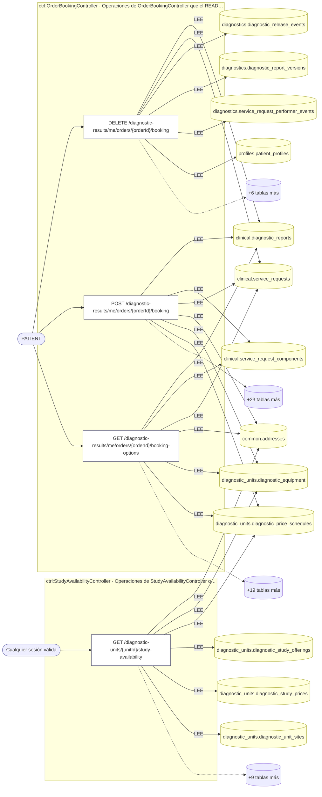

## Árbol de decisión por operación

Cada árbol se deriva del código del handler y de los métodos que invoca (hasta 4 niveles). Una rama que no decide, no escribe y no falla se poda. Los accesos y los efectos consecutivos se agrupan en un solo nodo.

### Operaciones con decisiones propias

#### 1. GET /diagnostic-equipment/{id}

Detalle de un equipo con su sala (F5a)

| HTTP | Código | Cuándo |
|---|---|---|
| 200 | — | Éxito |
| 400 | `VALIDATION_FAILED` | Los parámetros de ruta son UUID válidos |
| 401 | `UNAUTHENTICATED` | Hay una sesión válida (JWT) |
| 403 | `FORBIDDEN` | El rol está permitido; El tenant se resuelve y pertenece al actor; InsufficientRoleException: Su rol no permite esta acción sobre este espacio |
| 404 | `NOT_FOUND` | ResourceNotFoundException: Espacio no encontrado; ResourceNotFoundException: Unidad clínica no encontrada; ResourceNotFoundException: Sitio no encontrado |
| 429 | `RATE_LIMITED` | No se supera el límite de solicitudes |

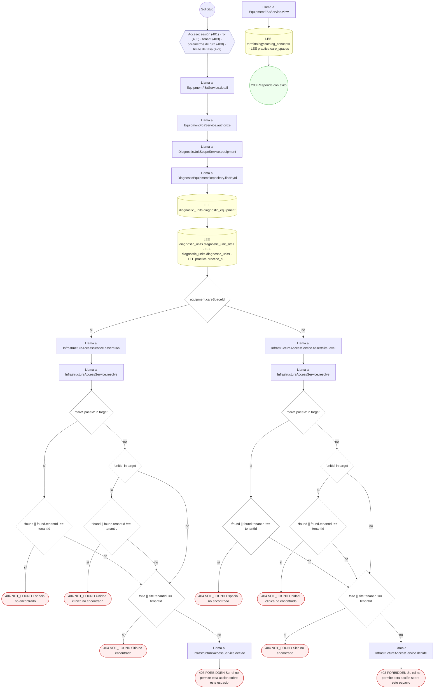

#### 2. PATCH /diagnostic-equipment/{id}

Actualizar estado/calibración de un equipo

| HTTP | Código | Cuándo |
|---|---|---|
| 200 | — | Éxito |
| 400 | `VALIDATION_FAILED` | Los parámetros de ruta son UUID válidos; El cuerpo cumple el DTO (sin propiedades extra) |
| 401 | `UNAUTHENTICATED` | Hay una sesión válida (JWT) |
| 403 | `FORBIDDEN` | El rol está permitido; El tenant se resuelve y pertenece al actor; InsufficientRoleException: Su rol no permite esta acción sobre este espacio |
| 404 | `NOT_FOUND` | ResourceNotFoundException: Espacio no encontrado; ResourceNotFoundException: Unidad clínica no encontrada; ResourceNotFoundException: Sitio no encontrado |
| 409 | `CONFLICT` | ConflictException: El AE Title ya está en uso en la sede |
| 422 | `PRECONDITION_FAILED` | PreconditionFailedException: La sala es de otra sede; PreconditionFailedException: El espacio no aloja equipos; PreconditionFailedException: AE Title inválido (≤ 16 caracteres ASCII, sin barra invertida) |
| 429 | `RATE_LIMITED` | No se supera el límite de solicitudes |

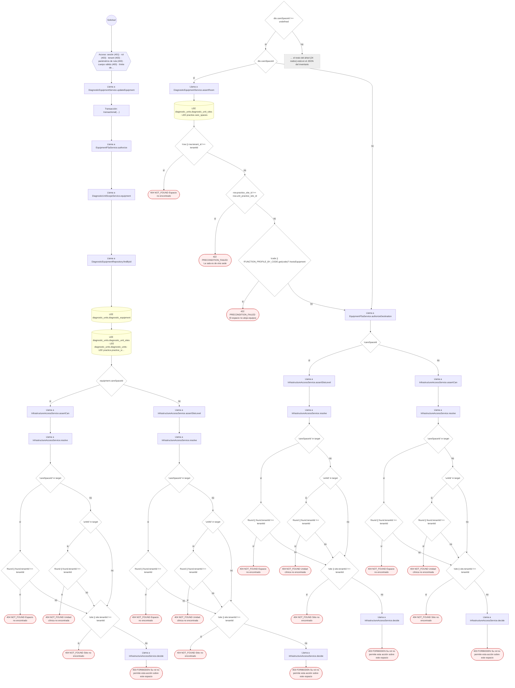

#### 3. GET /diagnostic-equipment/{id}/mwl-station

Estación MWL del equipo (F5a)

| HTTP | Código | Cuándo |
|---|---|---|
| 200 | — | Éxito |
| 400 | `VALIDATION_FAILED` | Los parámetros de ruta son UUID válidos |
| 401 | `UNAUTHENTICATED` | Hay una sesión válida (JWT) |
| 403 | `FORBIDDEN` | El rol está permitido; El tenant se resuelve y pertenece al actor; InsufficientRoleException: Su rol no permite esta acción sobre este espacio |
| 404 | `NOT_FOUND` | ResourceNotFoundException: Espacio no encontrado; ResourceNotFoundException: Unidad clínica no encontrada; ResourceNotFoundException: Sitio no encontrado |
| 429 | `RATE_LIMITED` | No se supera el límite de solicitudes |

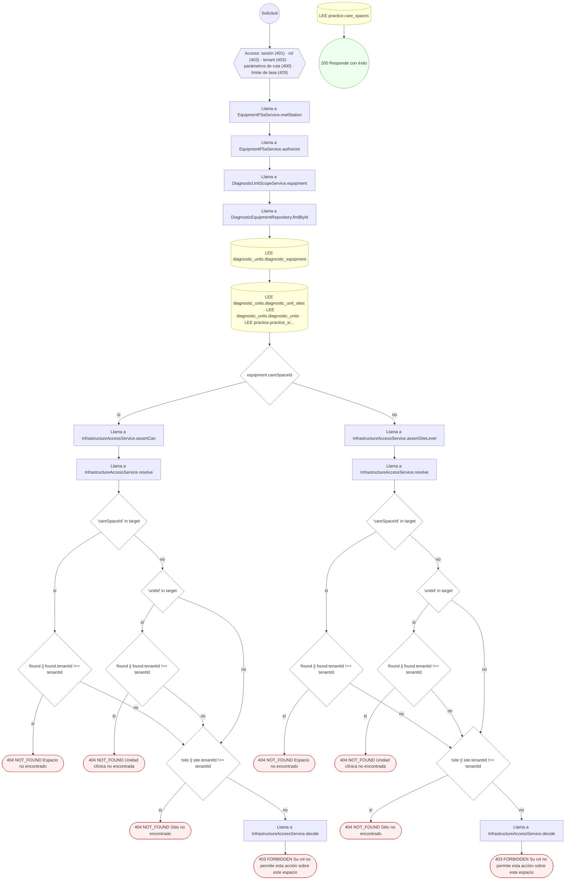

#### 4. POST /diagnostic-equipment/{id}/resource

Crear el recurso agendable del equipo (F5a)

| HTTP | Código | Cuándo |
|---|---|---|
| 201 | — | Éxito |
| 400 | `VALIDATION_FAILED` | Los parámetros de ruta son UUID válidos |
| 401 | `UNAUTHENTICATED` | Hay una sesión válida (JWT) |
| 403 | `FORBIDDEN` | El rol está permitido; El tenant se resuelve y pertenece al actor; InsufficientRoleException: Su rol no permite esta acción sobre este espacio |
| 404 | `NOT_FOUND` | ResourceNotFoundException: Espacio no encontrado; ResourceNotFoundException: Unidad clínica no encontrada; ResourceNotFoundException: Sitio no encontrado |
| 409 | `CONFLICT` | ConflictException: El equipo ya tiene un recurso agendable |
| 429 | `RATE_LIMITED` | No se supera el límite de solicitudes |

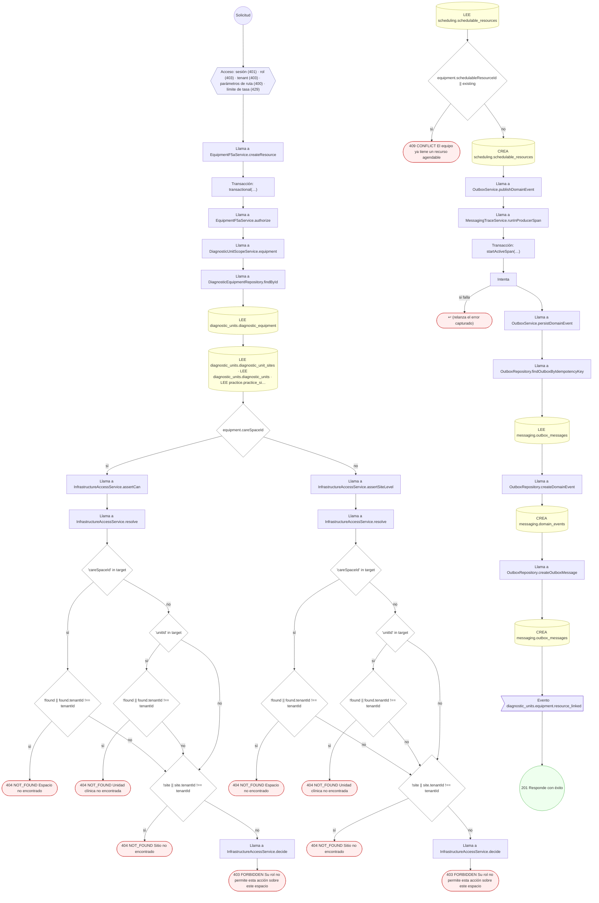

#### 5. DELETE /diagnostic-results/me/orders/{orderId}/booking

Cancel the appointment of my order

| HTTP | Código | Cuándo |
|---|---|---|
| 204 | — | Éxito |
| 400 | `VALIDATION_FAILED` | Los parámetros de ruta son UUID válidos |
| 401 | `UNAUTHENTICATED` | Hay una sesión válida (JWT) |
| 403 | `FORBIDDEN` | El rol está permitido; El tenant se resuelve y pertenece al actor |
| 404 | `NOT_FOUND` | ResourceNotFoundException: Orden no encontrada; ResourceNotFoundException: La orden no tiene cita |
| 409 | `CONFLICT` | ConflictException: Esta orden ya tiene su resultado: no hace falta reservar. |
| 422 | `PRECONDITION_FAILED` | PreconditionFailedException: La cuenta no tiene perfil de paciente; PreconditionFailedException: Ese turno ya pasó. |
| 429 | `RATE_LIMITED` | No se supera el límite de solicitudes |

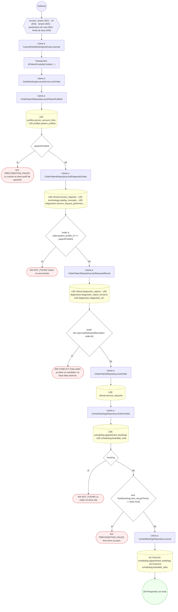

#### 6. POST /diagnostic-results/me/orders/{orderId}/booking

Book my order at a center, confirmed

| HTTP | Código | Cuándo |
|---|---|---|
| 201 | — | Éxito |
| 400 | `VALIDATION_FAILED` | Los parámetros de ruta son UUID válidos; El cuerpo cumple el DTO (sin propiedades extra) |
| 401 | `UNAUTHENTICATED` | Hay una sesión válida (JWT) |
| 403 | `FORBIDDEN` | El rol está permitido; El tenant se resuelve y pertenece al actor |
| 404 | `NOT_FOUND` | ResourceNotFoundException: Orden no encontrada; ResourceNotFoundException: Centro no encontrado; ResourceNotFoundException: El centro no hace ese estudio |
| 409 | `CONFLICT` | ConflictException: Esta orden ya tiene su resultado: no hace falta reservar.; ConflictException: Esta orden ya tiene un turno. Cancélelo para elegir otro.; ConflictException: Ese horario se acaba de ocupar. Elija otro. |
| 422 | `PRECONDITION_FAILED` | PreconditionFailedException: La cuenta no tiene perfil de paciente |
| 429 | `RATE_LIMITED` | No se supera el límite de solicitudes |

```mermaid
flowchart TD
  n1(("Solicitud")):::inicio
  n2{{"Acceso: sesión (401) · rol (403) · tenant (403) · parámetros de ruta (400) · cuerpo válido (400) · límite de…"}}:::acceso
  n1 --> n2
  n3["Llama a BookOrderUseCase.execute"]:::llamada
  n2 --> n3
  n4["Transacción: inPatientCustodyContext(…)"]:::transaccion
  n3 --> n4
  n5["Llama a OrderBookingAccessService.ownOrder"]:::llamada
  n4 --> n5
  n6["Llama a OrderPatientRepository.ownPatientProfileId"]:::llamada
  n5 --> n6
  n7[("LEE profiles.person_account_links · LEE profiles.patient_profiles")]:::efecto
  n6 --> n7
  n8{"!patientProfileId"}:::decision
  n7 --> n8
  n9(["422 PRECONDITION_FAILED La cuenta no tiene perfil de paciente"]):::error
  n8 -->|"sí"| n9
  n10["Llama a OrderPatientRepository.findDiagnosticOrder"]:::llamada
  n8 -->|"no"| n10
  n11[("LEE clinical.service_requests · LEE terminology.catalog_concepts · LEE diagnostics.service_request_performer_…")]:::efecto
  n10 --> n11
  n12{"!order || order.patient_profile_id !== patientProfileId"}:::decision
  n11 --> n12
  n13(["404 NOT_FOUND Orden no encontrada"]):::error
  n12 -->|"sí"| n13
  n14["Llama a OrderPatientRepository.hasReleasedResult"]:::llamada
  n12 -->|"no"| n14
  n15[("LEE clinical.diagnostic_reports · LEE diagnostics.diagnostic_report_versions · LEE diagnostics.diagnostic_rel…")]:::efecto
  n14 --> n15
  n16{"await this.repo.hasReleasedResult(em, order.id)"}:::decision
  n15 --> n16
  n17(["409 CONFLICT Esta orden ya tiene su resultado: no hace falta reservar."]):::error
  n16 -->|"sí"| n17
  n18["Llama a OrderPatientRepository.lockOrder"]:::llamada
  n16 -->|"no"| n18
  n19[("LEE clinical.service_requests")]:::efecto
  n18 --> n19
  n20["Llama a CenterBookingsRepository.findForOrder"]:::llamada
  n19 --> n20
  n21[("LEE scheduling.appointment_bookings · LEE scheduling.bookable_slots")]:::efecto
  n20 --> n21
  n22{"await this.bookingsRepo.findForOrder(tx, patientProfileId, order.id)"}:::decision
  n21 --> n22
  n23(["409 CONFLICT Esta orden ya tiene un turno. Cancélelo para elegir otro."]):::error
  n22 -->|"sí"| n23
  n24["Llama a CenterScheduleRepository.findUnit"]:::llamada
  n22 -->|"no"| n24
  n25[("LEE diagnostic_units.diagnostic_units")]:::efecto
  n24 --> n25
  n26{"!unit || !isPublished(unit) || !canWork(order, unit.tenant_id)"}:::decision
  n25 --> n26
  n27(["404 NOT_FOUND Centro no encontrado"]):::error
  n26 -->|"sí"| n27
  n28["Llama a CenterContextService.load"]:::llamada
  n26 -->|"no"| n28
  n29["Llama a CenterScheduleRepository.findResource"]:::llamada
  n28 --> n29
  n30[("LEE scheduling.schedulable_resources")]:::efecto
  n29 --> n30
  n31["Llama a CenterScheduleRepository.findMainSites"]:::llamada
  n30 --> n31
  n32[("LEE diagnostic_units.diagnostic_unit_sites · LEE practice.practice_sites · LEE practice.practices · LEE commo…")]:::efecto
  n31 --> n32
  n33["Llama a CenterStudiesRepository.findForUnit"]:::llamada
  n32 --> n33
  n34[("LEE diagnostic_units.diagnostic_study_offerings · LEE diagnostic_units.diagnostic_units · LEE diagnostic_unit…")]:::efecto
  n33 --> n34
  n35["Llama a CenterScheduleRepository.findEquipment"]:::llamada
  n34 --> n35
  n36[("LEE diagnostic_units.diagnostic_equipment · LEE diagnostic_units.diagnostic_unit_sites · LEE terminology.cata…")]:::efecto
  n35 --> n36
  n37["Llama a CenterScheduleRepository.findTemplateRules"]:::llamada
  n36 --> n37
  n38[("LEE scheduling.schedule_templates · LEE scheduling.schedule_rules")]:::efecto
  n37 --> n38
  n39{"!offering"}:::decision
  n38 --> n39
  n40(["404 NOT_FOUND El centro no hace ese estudio"]):::error
  n39 -->|"sí"| n40
  n41["Llama a CenterScheduleRepository.createResource"]:::llamada
  n39 -->|"no"| n41
  n42[("CREA scheduling.schedulable_resources")]:::efecto
  n41 --> n42
  n43["Llama a CenterBookingsRepository.lockResource"]:::llamada
  n42 --> n43
  n44[("LEE scheduling.schedulable_resources")]:::efecto
  n43 --> n44
  n45["Llama a CenterAvailabilityService.startsFor"]:::llamada
  n44 --> n45
  n46["Llama a CenterBookingsRepository.findOccupying"]:::llamada
  n45 --> n46
  n47[("LEE scheduling.appointment_bookings · LEE scheduling.bookable_slots")]:::efecto
  n46 --> n47
  n48{"!free"}:::decision
  n47 --> n48
  n49(["409 CONFLICT Ese horario se acaba de ocupar. Elija otro."]):::error
  n48 -->|"sí"| n49
  n50["Llama a OrderQuoteService.pricerFor"]:::llamada
  n48 -->|"no"| n50
  n51["Llama a OrderPatientRepository.orderedComponents"]:::llamada
  n50 --> n51
  n52[("LEE clinical.service_request_components")]:::efecto
  n51 --> n52
  n53["Llama a CenterStudiesRepository.findParts"]:::llamada
  n52 --> n53
  n54[("LEE diagnostic_units.diagnostic_study_components · LEE diagnostic_units.diagnostic_study_offerings · LEE diag…")]:::efecto
  n53 --> n54
  n55["Llama a CenterBookingsRepository.takeSlot"]:::llamada
  n54 --> n55
  n56[("ACTUALIZA scheduling.bookable_slots · LEE scheduling.bookable_slots · CREA scheduling.bookable_slots")]:::efecto
  n55 --> n56
  n57["Llama a CenterBookingsRepository.insertBooking"]:::llamada
  n56 --> n57
  n58[("CREA scheduling.appointment_bookings")]:::efecto
  n57 --> n58
  n59(("201 Responde con éxito")):::ok
  n58 --> n59
  classDef acceso fill:#eef,stroke:#66a
  classDef error fill:#fee,stroke:#c33
  classDef ok fill:#efe,stroke:#3a3
  classDef efecto fill:#ffd,stroke:#aa3
  classDef decision fill:#fff,stroke:#555
  classDef corte fill:#eee,stroke:#999,stroke-dasharray: 4
```

#### 7. GET /diagnostic-results/me/orders/{orderId}/booking-options

Centers that perform the study of my order

| HTTP | Código | Cuándo |
|---|---|---|
| 200 | — | Éxito |
| 400 | `VALIDATION_FAILED` | Los parámetros de ruta son UUID válidos |
| 401 | `UNAUTHENTICATED` | Hay una sesión válida (JWT) |
| 403 | `FORBIDDEN` | El rol está permitido; El tenant se resuelve y pertenece al actor |
| 404 | `NOT_FOUND` | ResourceNotFoundException: Orden no encontrada |
| 409 | `CONFLICT` | ConflictException: Esta orden ya tiene su resultado: no hace falta reservar. |
| 422 | `PRECONDITION_FAILED` | PreconditionFailedException: La cuenta no tiene perfil de paciente; PreconditionFailedException: Esta orden no es de un estudio que se reserve en un centro. |
| 429 | `RATE_LIMITED` | No se supera el límite de solicitudes |

```mermaid
flowchart TD
  n1(("Solicitud")):::inicio
  n2{{"Acceso: sesión (401) · rol (403) · tenant (403) · parámetros de ruta (400) · límite de tasa (429)"}}:::acceso
  n1 --> n2
  n3["Llama a GetBookingOptionsUseCase.execute"]:::llamada
  n2 --> n3
  n4["Llama a GetBookingOptionsUseCase.options"]:::llamada
  n3 --> n4
  n5["Llama a OrderBookingAccessService.ownOrder"]:::llamada
  n4 --> n5
  n6["Llama a OrderPatientRepository.ownPatientProfileId"]:::llamada
  n5 --> n6
  n7[("LEE profiles.person_account_links · LEE profiles.patient_profiles")]:::efecto
  n6 --> n7
  n8{"!patientProfileId"}:::decision
  n7 --> n8
  n9(["422 PRECONDITION_FAILED La cuenta no tiene perfil de paciente"]):::error
  n8 -->|"sí"| n9
  n10["Llama a OrderPatientRepository.findDiagnosticOrder"]:::llamada
  n8 -->|"no"| n10
  n11[("LEE clinical.service_requests · LEE terminology.catalog_concepts · LEE diagnostics.service_request_performer_…")]:::efecto
  n10 --> n11
  n12{"!order || order.patient_profile_id !== patientProfileId"}:::decision
  n11 --> n12
  n13(["404 NOT_FOUND Orden no encontrada"]):::error
  n12 -->|"sí"| n13
  n14["Llama a OrderPatientRepository.hasReleasedResult"]:::llamada
  n12 -->|"no"| n14
  n15[("LEE clinical.diagnostic_reports · LEE diagnostics.diagnostic_report_versions · LEE diagnostics.diagnostic_rel…")]:::efecto
  n14 --> n15
  n16{"await this.repo.hasReleasedResult(em, order.id)"}:::decision
  n15 --> n16
  n17(["409 CONFLICT Esta orden ya tiene su resultado: no hace falta reservar."]):::error
  n16 -->|"sí"| n17
  n18["Llama a CenterStudiesRepository.findPublishedByConcept"]:::llamada
  n16 -->|"no"| n18
  n19[("LEE diagnostic_units.diagnostic_study_offerings · LEE diagnostic_units.diagnostic_units · LEE diagnostic_unit…")]:::efecto
  n18 --> n19
  n20["Llama a OrderPatientRepository.homeOf"]:::llamada
  n19 --> n20
  n21[("LEE common.addresses")]:::efecto
  n20 --> n21
  n22["Llama a OrderQuoteService.pricerFor"]:::llamada
  n21 --> n22
  n23["Llama a OrderPatientRepository.orderedComponents"]:::llamada
  n22 --> n23
  n24[("LEE clinical.service_request_components")]:::efecto
  n23 --> n24
  n25["Llama a CenterStudiesRepository.findParts"]:::llamada
  n24 --> n25
  n26[("LEE diagnostic_units.diagnostic_study_components · LEE diagnostic_units.diagnostic_study_offerings · LEE diag…")]:::efecto
  n25 --> n26
  n27["Repite: por cada const offering de offerings"]:::bucle
  n26 --> n27
  n28["Llama a CenterScheduleRepository.findUnit"]:::llamada
  n27 -->|"cada elemento"| n28
  n29[("LEE diagnostic_units.diagnostic_units")]:::efecto
  n28 --> n29
  n30["Llama a CenterContextService.load"]:::llamada
  n29 --> n30
  n31["Llama a CenterScheduleRepository.findResource"]:::llamada
  n30 --> n31
  n32[("LEE scheduling.schedulable_resources")]:::efecto
  n31 --> n32
  n33["Llama a CenterScheduleRepository.findMainSites"]:::llamada
  n32 --> n33
  n34[("LEE diagnostic_units.diagnostic_unit_sites · LEE practice.practice_sites · LEE practice.practices · LEE commo…")]:::efecto
  n33 --> n34
  n35["Llama a CenterStudiesRepository.findForUnit"]:::llamada
  n34 --> n35
  n36[("LEE diagnostic_units.diagnostic_study_offerings · LEE diagnostic_units.diagnostic_units · LEE diagnostic_unit…")]:::efecto
  n35 --> n36
  n37["Llama a CenterScheduleRepository.findEquipment"]:::llamada
  n36 --> n37
  n38[("LEE diagnostic_units.diagnostic_equipment · LEE diagnostic_units.diagnostic_unit_sites · LEE terminology.cata…")]:::efecto
  n37 --> n38
  n39["Llama a CenterScheduleRepository.findTemplateRules"]:::llamada
  n38 --> n39
  n40[("LEE scheduling.schedule_templates · LEE scheduling.schedule_rules")]:::efecto
  n39 --> n40
  n41["Llama a CenterAvailabilityService.startsFor"]:::llamada
  n40 --> n41
  n42["Llama a CenterBookingsRepository.findOccupying"]:::llamada
  n41 --> n42
  n43[("LEE scheduling.appointment_bookings · LEE scheduling.bookable_slots")]:::efecto
  n42 --> n43
  n44{"modality === null"}:::decision
  n43 --> n44
  n27 -->|"al terminar"| n44
  n45(["422 PRECONDITION_FAILED Esta orden no es de un estudio que se reserve en un centro."]):::error
  n44 -->|"sí"| n45
  n46(("200 Responde con éxito")):::ok
  n44 -->|"no"| n46
  classDef acceso fill:#eef,stroke:#66a
  classDef error fill:#fee,stroke:#c33
  classDef ok fill:#efe,stroke:#3a3
  classDef efecto fill:#ffd,stroke:#aa3
  classDef decision fill:#fff,stroke:#555
  classDef corte fill:#eee,stroke:#999,stroke-dasharray: 4
```

#### 8. DELETE /diagnostic-study-offerings/{id}

Retirar (soft-delete) una oferta de estudio

| HTTP | Código | Cuándo |
|---|---|---|
| 200 | — | Éxito |
| 400 | `VALIDATION_FAILED` | Los parámetros de ruta son UUID válidos |
| 401 | `UNAUTHENTICATED` | Hay una sesión válida (JWT) |
| 403 | `FORBIDDEN` | El rol está permitido; El tenant se resuelve y pertenece al actor |
| 409 | `CONFLICT` | ConflictException: La oferta ya está retirada |
| 429 | `RATE_LIMITED` | No se supera el límite de solicitudes |

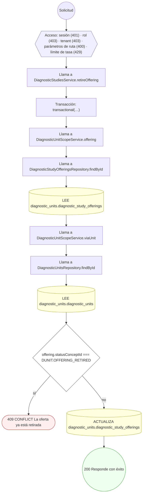

#### 9. PATCH /diagnostic-unit-sites/{siteId}

Actualizar un sitio operativo de la unidad

| HTTP | Código | Cuándo |
|---|---|---|
| 200 | — | Éxito |
| 400 | `VALIDATION_FAILED` | Los parámetros de ruta son UUID válidos; El cuerpo cumple el DTO (sin propiedades extra) |
| 401 | `UNAUTHENTICATED` | Hay una sesión válida (JWT) |
| 403 | `FORBIDDEN` | El rol está permitido; El tenant se resuelve y pertenece al actor |
| 429 | `RATE_LIMITED` | No se supera el límite de solicitudes |

```mermaid
flowchart TD
  n1(("Solicitud")):::inicio
  n2{{"Acceso: sesión (401) · rol (403) · tenant (403) · parámetros de ruta (400) · cuerpo válido (400) · límite de…"}}:::acceso
  n1 --> n2
  n3["Llama a DiagnosticUnitsService.updateSite"]:::llamada
  n2 --> n3
  n4["Transacción: transactional(…)"]:::transaccion
  n3 --> n4
  n5["Llama a DiagnosticUnitScopeService.site"]:::llamada
  n4 --> n5
  n6["Llama a DiagnosticUnitSitesRepository.findById"]:::llamada
  n5 --> n6
  n7[("LEE diagnostic_units.diagnostic_unit_sites")]:::efecto
  n6 --> n7
  n8["Llama a DiagnosticUnitScopeService.viaUnit"]:::llamada
  n7 --> n8
  n9["Llama a DiagnosticUnitsRepository.findById"]:::llamada
  n8 --> n9
  n10[("LEE diagnostic_units.diagnostic_units")]:::efecto
  n9 --> n10
  n11{"dto.siteRoleConceptId !== undefined"}:::decision
  n10 --> n11
  n12[("ACTUALIZA diagnostic_units.diagnostic_unit_sites")]:::efecto
  n11 -->|"sí"| n12
  n13{"dto.accessionPrefix !== undefined"}:::decision
  n12 --> n13
  n11 -->|"no"| n13
  n14[("ACTUALIZA diagnostic_units.diagnostic_unit_sites")]:::efecto
  n13 -->|"sí"| n14
  n15{"dto.sampleCollectionAvailable !== undefined"}:::decision
  n14 --> n15
  n13 -->|"no"| n15
  n16[("ACTUALIZA diagnostic_units.diagnostic_unit_sites")]:::efecto
  n15 -->|"sí"| n16
  n17{"dto.imagingAvailable !== undefined"}:::decision
  n16 --> n17
  n15 -->|"no"| n17
  n18[("ACTUALIZA diagnostic_units.diagnostic_unit_sites")]:::efecto
  n17 -->|"sí"| n18
  n19(("200 Responde con éxito")):::ok
  n18 --> n19
  n17 -->|"no"| n19
  classDef acceso fill:#eef,stroke:#66a
  classDef error fill:#fee,stroke:#c33
  classDef ok fill:#efe,stroke:#3a3
  classDef efecto fill:#ffd,stroke:#aa3
  classDef decision fill:#fff,stroke:#555
  classDef corte fill:#eee,stroke:#999,stroke-dasharray: 4
```

#### 10. POST /diagnostic-unit-sites/{siteId}/equipment

Registrar equipamiento y calibración del sitio

| HTTP | Código | Cuándo |
|---|---|---|
| 201 | — | Éxito |
| 400 | `VALIDATION_FAILED` | Los parámetros de ruta son UUID válidos; El cuerpo cumple el DTO (sin propiedades extra) |
| 401 | `UNAUTHENTICATED` | Hay una sesión válida (JWT) |
| 403 | `FORBIDDEN` | El rol está permitido; El tenant se resuelve y pertenece al actor |
| 409 | `CONFLICT` | ConflictException: Ya existe un equipo con ese número de serie en el sitio |
| 422 | `PRECONDITION_FAILED` | PreconditionFailedException: El sitio no está activo |
| 429 | `RATE_LIMITED` | No se supera el límite de solicitudes |

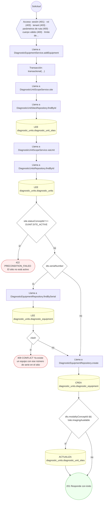

#### 11. POST /diagnostic-units

Alta de unidad diagnóstica con sitios y acreditaciones

| HTTP | Código | Cuándo |
|---|---|---|
| 201 | — | Éxito |
| 400 | `VALIDATION_FAILED` | El cuerpo cumple el DTO (sin propiedades extra) |
| 401 | `UNAUTHENTICATED` | Hay una sesión válida (JWT) |
| 403 | `FORBIDDEN` | El rol está permitido; El tenant se resuelve y pertenece al actor |
| 404 | `NOT_FOUND` | ResourceNotFoundException: Unidad no encontrada |
| 409 | `CONFLICT` | ConflictException: El código ya existe en el tenant |
| 429 | `RATE_LIMITED` | No se supera el límite de solicitudes |

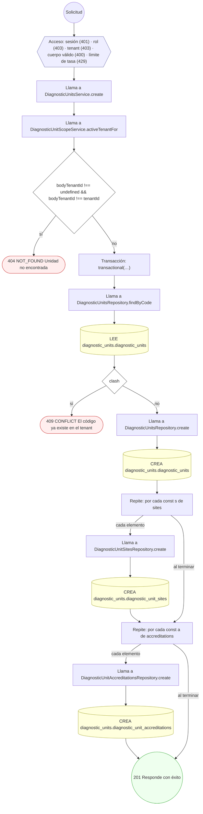

#### 12. GET /diagnostic-units/{id}

Consultar el perfil de una unidad diagnóstica

| HTTP | Código | Cuándo |
|---|---|---|
| 200 | — | Éxito |
| 400 | `VALIDATION_FAILED` | Los parámetros de ruta son UUID válidos |
| 401 | `UNAUTHENTICATED` | Hay una sesión válida (JWT) |
| 403 | `FORBIDDEN` | El rol está permitido; El tenant se resuelve y pertenece al actor |
| 404 | `NOT_FOUND` | ResourceNotFoundException: Unidad diagnóstica no encontrada |
| 429 | `RATE_LIMITED` | No se supera el límite de solicitudes |

```mermaid
flowchart TD
  n1(("Solicitud")):::inicio
  n2{{"Acceso: sesión (401) · rol (403) · tenant (403) · parámetros de ruta (400) · límite de tasa (429)"}}:::acceso
  n1 --> n2
  n3["Llama a DiagnosticUnitsReadService.getById"]:::llamada
  n2 --> n3
  n4["Llama a DiagnosticUnitsReadRepository.findVisibleById"]:::llamada
  n3 --> n4
  n5[("LEE diagnostic_units.diagnostic_units")]:::efecto
  n4 --> n5
  n6{"!unit"}:::decision
  n5 --> n6
  n7(["404 NOT_FOUND Unidad diagnóstica no encontrada"]):::error
  n6 -->|"sí"| n7
  n8["Llama a DiagnosticUnitsReadRepository.findActiveSites"]:::llamada
  n6 -->|"no"| n8
  n9[("LEE diagnostic_units.diagnostic_unit_sites")]:::efecto
  n8 --> n9
  n10["Llama a DiagnosticUnitsReadRepository.findActiveOfferings"]:::llamada
  n9 --> n10
  n11[("LEE diagnostic_units.diagnostic_study_offerings")]:::efecto
  n10 --> n11
  n12["Llama a DiagnosticUnitsReadRepository.findCurrentPublicSchedules"]:::llamada
  n11 --> n12
  n13[("LEE diagnostic_units.diagnostic_price_schedules")]:::efecto
  n12 --> n13
  n14["Llama a DiagnosticUnitsReadRepository.findCurrentAccreditations"]:::llamada
  n13 --> n14
  n15[("LEE diagnostic_units.diagnostic_unit_accreditations")]:::efecto
  n14 --> n15
  n16["Llama a DiagnosticUnitsReadRepository.findEquipment"]:::llamada
  n15 --> n16
  n17[("LEE diagnostic_units.diagnostic_equipment")]:::efecto
  n16 --> n17
  n18["Llama a DiagnosticUnitsReadRepository.findCurrentPrices"]:::llamada
  n17 --> n18
  n19[("LEE diagnostic_units.diagnostic_study_prices")]:::efecto
  n18 --> n19
  n20["Llama a DiagnosticUnitsReadRepository.findPracticeSites"]:::llamada
  n19 --> n20
  n21[("LEE practice.practice_sites")]:::efecto
  n20 --> n21
  n22["Llama a DiagnosticUnitsReadRepository.findAddresses"]:::llamada
  n21 --> n22
  n23[("LEE common.addresses")]:::efecto
  n22 --> n23
  n24["Llama a DiagnosticUnitsReadRepository.findConcepts"]:::llamada
  n23 --> n24
  n25[("LEE terminology.catalog_concepts")]:::efecto
  n24 --> n25
  n26(("200 Responde con éxito")):::ok
  n25 --> n26
  classDef acceso fill:#eef,stroke:#66a
  classDef error fill:#fee,stroke:#c33
  classDef ok fill:#efe,stroke:#3a3
  classDef efecto fill:#ffd,stroke:#aa3
  classDef decision fill:#fff,stroke:#555
  classDef corte fill:#eee,stroke:#999,stroke-dasharray: 4
```

#### 13. POST /diagnostic-units/{id}/accreditations

Registrar una acreditación con evidencia

| HTTP | Código | Cuándo |
|---|---|---|
| 201 | — | Éxito |
| 400 | `VALIDATION_FAILED` | Los parámetros de ruta son UUID válidos; El cuerpo cumple el DTO (sin propiedades extra) |
| 401 | `UNAUTHENTICATED` | Hay una sesión válida (JWT) |
| 403 | `FORBIDDEN` | El rol está permitido; El tenant se resuelve y pertenece al actor |
| 404 | `NOT_FOUND` | ResourceNotFoundException: Sitio no encontrado |
| 422 | `PRECONDITION_FAILED` | PreconditionFailedException: La unidad no está activa |
| 429 | `RATE_LIMITED` | No se supera el límite de solicitudes |

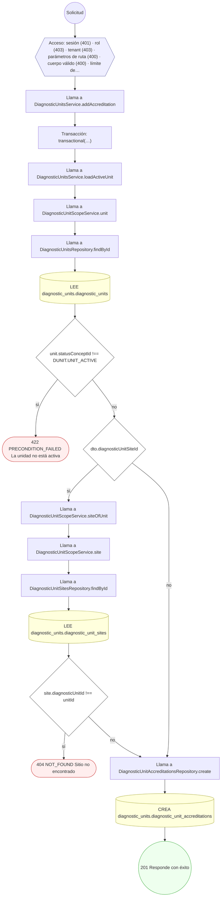

#### 14. GET /diagnostic-units/{id}/administration

Consola de administración de una unidad diagnóstica

| HTTP | Código | Cuándo |
|---|---|---|
| 200 | — | Éxito |
| 400 | `VALIDATION_FAILED` | Los parámetros de ruta son UUID válidos |
| 401 | `UNAUTHENTICATED` | Hay una sesión válida (JWT) |
| 403 | `FORBIDDEN` | El rol está permitido; El tenant se resuelve y pertenece al actor |
| 404 | `NOT_FOUND` | ResourceNotFoundException: Unidad diagnóstica no encontrada |
| 429 | `RATE_LIMITED` | No se supera el límite de solicitudes |

```mermaid
flowchart TD
  n1(("Solicitud")):::inicio
  n2{{"Acceso: sesión (401) · rol (403) · tenant (403) · parámetros de ruta (400) · límite de tasa (429)"}}:::acceso
  n1 --> n2
  n3["Llama a DiagnosticUnitsAdminReadService.getById"]:::llamada
  n2 --> n3
  n4["Llama a DiagnosticUnitsAdminReadRepository.findById"]:::llamada
  n3 --> n4
  n5[("LEE diagnostic_units.diagnostic_units")]:::efecto
  n4 --> n5
  n6{"!unit"}:::decision
  n5 --> n6
  n7(["404 NOT_FOUND Unidad diagnóstica no encontrada"]):::error
  n6 -->|"sí"| n7
  n8["Llama a DiagnosticUnitsAdminReadRepository.findSites"]:::llamada
  n6 -->|"no"| n8
  n9[("LEE diagnostic_units.diagnostic_unit_sites")]:::efecto
  n8 --> n9
  n10["Llama a DiagnosticUnitsAdminReadRepository.findOfferings"]:::llamada
  n9 --> n10
  n11[("LEE diagnostic_units.diagnostic_study_offerings")]:::efecto
  n10 --> n11
  n12["Llama a DiagnosticUnitsAdminReadRepository.findPriceSchedules"]:::llamada
  n11 --> n12
  n13[("LEE diagnostic_units.diagnostic_price_schedules")]:::efecto
  n12 --> n13
  n14["Llama a DiagnosticUnitsAdminReadRepository.findAccreditations"]:::llamada
  n13 --> n14
  n15[("LEE diagnostic_units.diagnostic_unit_accreditations")]:::efecto
  n14 --> n15
  n16["Llama a DiagnosticUnitsAdminReadRepository.findPractitionerAssignments"]:::llamada
  n15 --> n16
  n17[("LEE diagnostic_units.diagnostic_unit_practitioner_assignments")]:::efecto
  n16 --> n17
  n18["Llama a DiagnosticUnitsAdminReadRepository.findEquipment"]:::llamada
  n17 --> n18
  n19[("LEE diagnostic_units.diagnostic_equipment")]:::efecto
  n18 --> n19
  n20["Llama a DiagnosticUnitsAdminReadRepository.findPrices"]:::llamada
  n19 --> n20
  n21[("LEE diagnostic_units.diagnostic_study_prices")]:::efecto
  n20 --> n21
  n22["Llama a DiagnosticUnitsAdminReadRepository.findPracticeSites"]:::llamada
  n21 --> n22
  n23[("LEE practice.practice_sites")]:::efecto
  n22 --> n23
  n24["Llama a DiagnosticUnitsAdminReadRepository.findRoleAssignments"]:::llamada
  n23 --> n24
  n25[("LEE practice.practitioner_role_assignments")]:::efecto
  n24 --> n25
  n26["Llama a DiagnosticUnitsAdminReadRepository.findConcepts"]:::llamada
  n25 --> n26
  n27[("LEE terminology.catalog_concepts")]:::efecto
  n26 --> n27
  n28(("200 Responde con éxito")):::ok
  n27 --> n28
  classDef acceso fill:#eef,stroke:#66a
  classDef error fill:#fee,stroke:#c33
  classDef ok fill:#efe,stroke:#3a3
  classDef efecto fill:#ffd,stroke:#aa3
  classDef decision fill:#fff,stroke:#555
  classDef corte fill:#eee,stroke:#999,stroke-dasharray: 4
```

#### 15. POST /diagnostic-units/{id}/practitioner-assignments

Asignar un especialista a la unidad/sitio

| HTTP | Código | Cuándo |
|---|---|---|
| 201 | — | Éxito |
| 400 | `VALIDATION_FAILED` | Los parámetros de ruta son UUID válidos; El cuerpo cumple el DTO (sin propiedades extra) |
| 401 | `UNAUTHENTICATED` | Hay una sesión válida (JWT) |
| 403 | `FORBIDDEN` | El rol está permitido; El tenant se resuelve y pertenece al actor |
| 404 | `NOT_FOUND` | ResourceNotFoundException: Sitio no encontrado |
| 409 | `CONFLICT` | ConflictException: El profesional ya tiene una asignación activa en ese rol/sitio |
| 422 | `PRECONDITION_FAILED` | PreconditionFailedException: La unidad no está activa |
| 429 | `RATE_LIMITED` | No se supera el límite de solicitudes |

```mermaid
flowchart TD
  n1(("Solicitud")):::inicio
  n2{{"Acceso: sesión (401) · rol (403) · tenant (403) · parámetros de ruta (400) · cuerpo válido (400) · límite de…"}}:::acceso
  n1 --> n2
  n3["Llama a DiagnosticUnitsService.assignPractitioner"]:::llamada
  n2 --> n3
  n4["Transacción: transactional(…)"]:::transaccion
  n3 --> n4
  n5["Llama a DiagnosticUnitsService.loadActiveUnit"]:::llamada
  n4 --> n5
  n6["Llama a DiagnosticUnitScopeService.unit"]:::llamada
  n5 --> n6
  n7["Llama a DiagnosticUnitsRepository.findById"]:::llamada
  n6 --> n7
  n8[("LEE diagnostic_units.diagnostic_units")]:::efecto
  n7 --> n8
  n9{"unit.statusConceptId !== DUNIT.UNIT_ACTIVE"}:::decision
  n8 --> n9
  n10(["422 PRECONDITION_FAILED La unidad no está activa"]):::error
  n9 -->|"sí"| n10
  n11{"dto.diagnosticUnitSiteId"}:::decision
  n9 -->|"no"| n11
  n12["Llama a DiagnosticUnitScopeService.siteOfUnit"]:::llamada
  n11 -->|"sí"| n12
  n13["Llama a DiagnosticUnitScopeService.site"]:::llamada
  n12 --> n13
  n14["Llama a DiagnosticUnitSitesRepository.findById"]:::llamada
  n13 --> n14
  n15[("LEE diagnostic_units.diagnostic_unit_sites")]:::efecto
  n14 --> n15
  n16{"site.diagnosticUnitId !== unitId"}:::decision
  n15 --> n16
  n17(["404 NOT_FOUND Sitio no encontrado"]):::error
  n16 -->|"sí"| n17
  n18["Llama a DiagnosticUnitPractitionerAssignmentsRepository.findActiveOverlap"]:::llamada
  n16 -->|"no"| n18
  n11 -->|"no"| n18
  n19[("LEE diagnostic_units.diagnostic_unit_practitioner_assignments")]:::efecto
  n18 --> n19
  n20{"overlap"}:::decision
  n19 --> n20
  n21(["409 CONFLICT El profesional ya tiene una asignación activa en ese rol/sitio"]):::error
  n20 -->|"sí"| n21
  n22["Llama a DiagnosticUnitPractitionerAssignmentsRepository.create"]:::llamada
  n20 -->|"no"| n22
  n23[("CREA diagnostic_units.diagnostic_unit_practitioner_assignments")]:::efecto
  n22 --> n23
  n24{"dto.specialtyConceptId"}:::decision
  n23 --> n24
  n25["Llama a DiagnosticUnitSpecialtiesRepository.findOpenByConcept"]:::llamada
  n24 -->|"sí"| n25
  n26[("LEE diagnostic_units.diagnostic_unit_specialties")]:::efecto
  n25 --> n26
  n27{"!existing"}:::decision
  n26 --> n27
  n28["Llama a DiagnosticUnitSpecialtiesRepository.create"]:::llamada
  n27 -->|"sí"| n28
  n29[("CREA diagnostic_units.diagnostic_unit_specialties")]:::efecto
  n28 --> n29
  n30(("201 Responde con éxito")):::ok
  n29 --> n30
  n27 -->|"no"| n30
  n24 -->|"no"| n30
  classDef acceso fill:#eef,stroke:#66a
  classDef error fill:#fee,stroke:#c33
  classDef ok fill:#efe,stroke:#3a3
  classDef efecto fill:#ffd,stroke:#aa3
  classDef decision fill:#fff,stroke:#555
  classDef corte fill:#eee,stroke:#999,stroke-dasharray: 4
```

#### 16. POST /diagnostic-units/{id}/price-schedules

Crear un cronograma de precios

| HTTP | Código | Cuándo |
|---|---|---|
| 201 | — | Éxito |
| 400 | `VALIDATION_FAILED` | Los parámetros de ruta son UUID válidos; El cuerpo cumple el DTO (sin propiedades extra) |
| 401 | `UNAUTHENTICATED` | Hay una sesión válida (JWT) |
| 403 | `FORBIDDEN` | El rol está permitido; El tenant se resuelve y pertenece al actor |
| 404 | `NOT_FOUND` | ResourceNotFoundException: Sitio no encontrado |
| 409 | `CONFLICT` | ConflictException: El código de cronograma ya existe en la unidad |
| 422 | `PRECONDITION_FAILED` | PreconditionFailedException: La unidad no está activa |
| 429 | `RATE_LIMITED` | No se supera el límite de solicitudes |

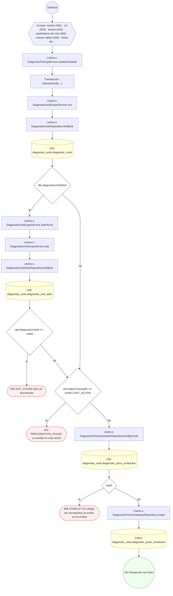

#### 17. POST /diagnostic-units/{id}/sites

Registrar un sitio operativo de la unidad

| HTTP | Código | Cuándo |
|---|---|---|
| 201 | — | Éxito |
| 400 | `VALIDATION_FAILED` | Los parámetros de ruta son UUID válidos; El cuerpo cumple el DTO (sin propiedades extra) |
| 401 | `UNAUTHENTICATED` | Hay una sesión válida (JWT) |
| 403 | `FORBIDDEN` | El rol está permitido; El tenant se resuelve y pertenece al actor |
| 422 | `PRECONDITION_FAILED` | PreconditionFailedException: La unidad no está activa |
| 429 | `RATE_LIMITED` | No se supera el límite de solicitudes |

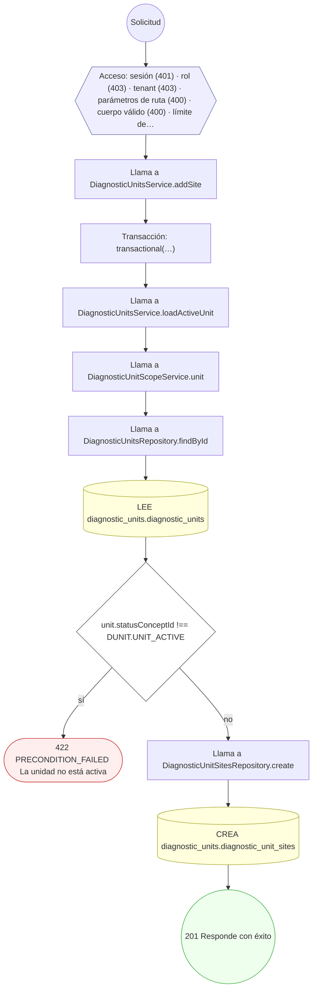

#### 18. PUT /diagnostic-units/{id}/specialties

Declarar las especialidades de la unidad

| HTTP | Código | Cuándo |
|---|---|---|
| 200 | — | Éxito |
| 400 | `VALIDATION_FAILED` | Los parámetros de ruta son UUID válidos; El cuerpo cumple el DTO (sin propiedades extra) |
| 401 | `UNAUTHENTICATED` | Hay una sesión válida (JWT) |
| 403 | `FORBIDDEN` | El rol está permitido; El tenant se resuelve y pertenece al actor |
| 422 | `PRECONDITION_FAILED` | PreconditionFailedException: A lo sumo una especialidad puede ser primaria; PreconditionFailedException: La unidad no está activa |
| 429 | `RATE_LIMITED` | No se supera el límite de solicitudes |

```mermaid
flowchart TD
  n1(("Solicitud")):::inicio
  n2{{"Acceso: sesión (401) · rol (403) · tenant (403) · parámetros de ruta (400) · cuerpo válido (400) · límite de…"}}:::acceso
  n1 --> n2
  n3["Llama a DiagnosticUnitsService.setSpecialties"]:::llamada
  n2 --> n3
  n4{"primaries › 1"}:::decision
  n3 --> n4
  n5(["422 PRECONDITION_FAILED A lo sumo una especialidad puede ser primaria"]):::error
  n4 -->|"sí"| n5
  n6["Transacción: transactional(…)"]:::transaccion
  n4 -->|"no"| n6
  n7["Llama a DiagnosticUnitsService.loadActiveUnit"]:::llamada
  n6 --> n7
  n8["Llama a DiagnosticUnitScopeService.unit"]:::llamada
  n7 --> n8
  n9["Llama a DiagnosticUnitsRepository.findById"]:::llamada
  n8 --> n9
  n10[("LEE diagnostic_units.diagnostic_units")]:::efecto
  n9 --> n10
  n11{"unit.statusConceptId !== DUNIT.UNIT_ACTIVE"}:::decision
  n10 --> n11
  n12(["422 PRECONDITION_FAILED La unidad no está activa"]):::error
  n11 -->|"sí"| n12
  n13["Llama a DiagnosticUnitSpecialtiesRepository.findOpenForUnit"]:::llamada
  n11 -->|"no"| n13
  n14[("LEE diagnostic_units.diagnostic_unit_specialties")]:::efecto
  n13 --> n14
  n15["Repite: por cada const existing de open"]:::bucle
  n14 --> n15
  n16{"!desired.has(existing.specialtyConceptId)"}:::decision
  n15 -->|"cada elemento"| n16
  n17[("ACTUALIZA diagnostic_units.diagnostic_unit_specialties")]:::efecto
  n16 -->|"sí"| n17
  n18["Repite: por cada const item de dto.specialties"]:::bucle
  n17 --> n18
  n16 -->|"no"| n18
  n15 -->|"al terminar"| n18
  n19["Llama a DiagnosticUnitSpecialtiesRepository.findOpenByConcept"]:::llamada
  n18 -->|"cada elemento"| n19
  n20[("LEE diagnostic_units.diagnostic_unit_specialties")]:::efecto
  n19 --> n20
  n21{"current"}:::decision
  n20 --> n21
  n22[("ACTUALIZA diagnostic_units.diagnostic_unit_specialties")]:::efecto
  n21 -->|"sí"| n22
  n23["Llama a DiagnosticUnitSpecialtiesRepository.create"]:::llamada
  n21 -->|"no"| n23
  n24[("CREA diagnostic_units.diagnostic_unit_specialties")]:::efecto
  n23 --> n24
  n25(("200 Responde con éxito")):::ok
  n22 --> n25
  n24 --> n25
  n18 -->|"al terminar"| n25
  classDef acceso fill:#eef,stroke:#66a
  classDef error fill:#fee,stroke:#c33
  classDef ok fill:#efe,stroke:#3a3
  classDef efecto fill:#ffd,stroke:#aa3
  classDef decision fill:#fff,stroke:#555
  classDef corte fill:#eee,stroke:#999,stroke-dasharray: 4
```

#### 19. POST /diagnostic-units/{id}/study-offerings

Publicar oferta de estudio con componentes (panel)

| HTTP | Código | Cuándo |
|---|---|---|
| 201 | — | Éxito |
| 400 | `VALIDATION_FAILED` | Los parámetros de ruta son UUID válidos; El cuerpo cumple el DTO (sin propiedades extra) |
| 401 | `UNAUTHENTICATED` | Hay una sesión válida (JWT) |
| 403 | `FORBIDDEN` | El rol está permitido; El tenant se resuelve y pertenece al actor |
| 404 | `NOT_FOUND` | ResourceNotFoundException: Sitio no encontrado |
| 409 | `CONFLICT` | ConflictException: El código de estudio ya existe en la unidad |
| 422 | `PRECONDITION_FAILED` | PreconditionFailedException: La unidad no está activa; PreconditionFailedException: Un panel no puede referenciarse a sí mismo como componente |
| 429 | `RATE_LIMITED` | No se supera el límite de solicitudes |

```mermaid
flowchart TD
  n1(("Solicitud")):::inicio
  n2{{"Acceso: sesión (401) · rol (403) · tenant (403) · parámetros de ruta (400) · cuerpo válido (400) · límite de…"}}:::acceso
  n1 --> n2
  n3["Llama a DiagnosticStudiesService.createOffering"]:::llamada
  n2 --> n3
  n4["Transacción: transactional(…)"]:::transaccion
  n3 --> n4
  n5["Llama a DiagnosticUnitScopeService.unit"]:::llamada
  n4 --> n5
  n6["Llama a DiagnosticUnitsRepository.findById"]:::llamada
  n5 --> n6
  n7[("LEE diagnostic_units.diagnostic_units")]:::efecto
  n6 --> n7
  n8{"dto.diagnosticUnitSiteId"}:::decision
  n7 --> n8
  n9["Llama a DiagnosticUnitScopeService.siteOfUnit"]:::llamada
  n8 -->|"sí"| n9
  n10["Llama a DiagnosticUnitScopeService.site"]:::llamada
  n9 --> n10
  n11["Llama a DiagnosticUnitSitesRepository.findById"]:::llamada
  n10 --> n11
  n12[("LEE diagnostic_units.diagnostic_unit_sites")]:::efecto
  n11 --> n12
  n13{"site.diagnosticUnitId !== unitId"}:::decision
  n12 --> n13
  n14(["404 NOT_FOUND Sitio no encontrado"]):::error
  n13 -->|"sí"| n14
  n15{"unit.statusConceptId !== DUNIT.UNIT_ACTIVE"}:::decision
  n13 -->|"no"| n15
  n8 -->|"no"| n15
  n16(["422 PRECONDITION_FAILED La unidad no está activa"]):::error
  n15 -->|"sí"| n16
  n17["Llama a DiagnosticStudyOfferingsRepository.findByStudyCode"]:::llamada
  n15 -->|"no"| n17
  n18[("LEE diagnostic_units.diagnostic_study_offerings")]:::efecto
  n17 --> n18
  n19{"clash"}:::decision
  n18 --> n19
  n20(["409 CONFLICT El código de estudio ya existe en la unidad"]):::error
  n19 -->|"sí"| n20
  n21["Repite: por cada const c de dto.components ?? []"]:::bucle
  n19 -->|"no"| n21
  n22["Llama a DiagnosticUnitScopeService.offering"]:::llamada
  n21 -->|"cada elemento"| n22
  n23["Llama a DiagnosticStudyOfferingsRepository.findById"]:::llamada
  n22 --> n23
  n24[("LEE diagnostic_units.diagnostic_study_offerings")]:::efecto
  n23 --> n24
  n25["Llama a DiagnosticUnitScopeService.viaUnit"]:::llamada
  n24 --> n25
  n26["Llama a DiagnosticUnitsRepository.findById"]:::llamada
  n25 --> n26
  n27[("LEE diagnostic_units.diagnostic_units")]:::efecto
  n26 --> n27
  n28["Llama a DiagnosticStudyOfferingsRepository.create"]:::llamada
  n27 --> n28
  n21 -->|"al terminar"| n28
  n29[("CREA diagnostic_units.diagnostic_study_offerings")]:::efecto
  n28 --> n29
  n30["Repite: por cada const c de components"]:::bucle
  n29 --> n30
  n31{"c.componentOfferingId === offering.id"}:::decision
  n30 -->|"cada elemento"| n31
  n32(["422 PRECONDITION_FAILED Un panel no puede referenciarse a sí mismo como componente"]):::error
  n31 -->|"sí"| n32
  n33["Llama a DiagnosticStudyComponentsRepository.create"]:::llamada
  n31 -->|"no"| n33
  n34[("CREA diagnostic_units.diagnostic_study_components")]:::efecto
  n33 --> n34
  n35(("201 Responde con éxito")):::ok
  n34 --> n35
  n30 -->|"al terminar"| n35
  classDef acceso fill:#eef,stroke:#66a
  classDef error fill:#fee,stroke:#c33
  classDef ok fill:#efe,stroke:#3a3
  classDef efecto fill:#ffd,stroke:#aa3
  classDef decision fill:#fff,stroke:#555
  classDef corte fill:#eee,stroke:#999,stroke-dasharray: 4
```

#### 20. POST /diagnostic-units/{id}/verify-and-publish

Verificar la unidad y publicar su perfil público

| HTTP | Código | Cuándo |
|---|---|---|
| 200 | — | Éxito |
| 400 | `VALIDATION_FAILED` | Los parámetros de ruta son UUID válidos |
| 401 | `UNAUTHENTICATED` | Hay una sesión válida (JWT) |
| 403 | `FORBIDDEN` | El rol está permitido; El tenant se resuelve y pertenece al actor |
| 422 | `PRECONDITION_FAILED` | PreconditionFailedException: La unidad no está activa; PreconditionFailedException: La unidad no tiene ningún sitio activo para publicar; PreconditionFailedException: El laboratorio no se publica hasta que la plataforma verifique a su organización con la matrícula del SEPREC, la licencia de funcionamiento y el certificado del SEDES |
| 429 | `RATE_LIMITED` | No se supera el límite de solicitudes |

```mermaid
flowchart TD
  n1(("Solicitud")):::inicio
  n2{{"Acceso: sesión (401) · rol (403) · tenant (403) · parámetros de ruta (400) · límite de tasa (429)"}}:::acceso
  n1 --> n2
  n3["Llama a DiagnosticUnitsService.verifyAndPublish"]:::llamada
  n2 --> n3
  n4["Transacción: transactional(…)"]:::transaccion
  n3 --> n4
  n5["Llama a DiagnosticUnitsService.loadActiveUnit"]:::llamada
  n4 --> n5
  n6["Llama a DiagnosticUnitScopeService.unit"]:::llamada
  n5 --> n6
  n7["Llama a DiagnosticUnitsRepository.findById"]:::llamada
  n6 --> n7
  n8[("LEE diagnostic_units.diagnostic_units")]:::efecto
  n7 --> n8
  n9{"unit.statusConceptId !== DUNIT.UNIT_ACTIVE"}:::decision
  n8 --> n9
  n10(["422 PRECONDITION_FAILED La unidad no está activa"]):::error
  n9 -->|"sí"| n10
  n11["Llama a DiagnosticUnitSitesRepository.countActiveForUnit"]:::llamada
  n9 -->|"no"| n11
  n12[("LEE diagnostic_units.diagnostic_unit_sites")]:::efecto
  n11 --> n12
  n13{"activeSites ‹ 1"}:::decision
  n12 --> n13
  n14(["422 PRECONDITION_FAILED La unidad no tiene ningún sitio activo para publicar"]):::error
  n13 -->|"sí"| n14
  n15["Llama a DiagnosticUnitsService.assertLaboratoryMayOperate"]:::llamada
  n13 -->|"no"| n15
  n16[("LEE directory.tenants")]:::efecto
  n15 --> n16
  n17(["422 PRECONDITION_FAILED El laboratorio no se publica hasta que la plataforma verifique a su organización con…"]):::error
  n16 --> n17
  n18[("ACTUALIZA diagnostic_units.diagnostic_units")]:::efecto
  n19{"!unit.publicProfileId"}:::decision
  n18 --> n19
  n20["Llama a PublicProfileProjectionService.projectOrganization"]:::llamada
  n19 -->|"sí"| n20
  n21["Llama a PublicProfilesRepository.findByTarget"]:::llamada
  n20 --> n21
  n22[("LEE community.public_profiles")]:::efecto
  n21 --> n22
  n23{"existing"}:::decision
  n22 --> n23
  n24{"existing.visibilityConceptId == null && existing.statusConceptId === CONCEPTS.STATE_PENDING"}:::decision
  n23 -->|"sí"| n24
  n25[("ACTUALIZA community.public_profiles · ACTUALIZA community.public_profiles · ACTUALIZA community.public_profil…")]:::efecto
  n24 -->|"sí"| n25
  n26["Llama a PublicProfilesRepository.create"]:::llamada
  n25 --> n26
  n24 -->|"no"| n26
  n23 -->|"no"| n26
  n27[("CREA community.public_profiles")]:::efecto
  n26 --> n27
  n28[("ACTUALIZA diagnostic_units.diagnostic_units")]:::efecto
  n27 --> n28
  n29["Llama a DiagnosticUnitSpecialtiesRepository.verifyOpenForUnit"]:::llamada
  n28 --> n29
  n19 -->|"no"| n29
  n30[("ACTUALIZA diagnostic_units.diagnostic_unit_specialties")]:::efecto
  n29 --> n30
  n31["Llama a DiagnosticUnitAccreditationsRepository.verifyOpenForUnit"]:::llamada
  n30 --> n31
  n32[("ACTUALIZA diagnostic_units.diagnostic_unit_accreditations")]:::efecto
  n31 --> n32
  n33(("200 Responde con éxito")):::ok
  n32 --> n33
  classDef acceso fill:#eef,stroke:#66a
  classDef error fill:#fee,stroke:#c33
  classDef ok fill:#efe,stroke:#3a3
  classDef efecto fill:#ffd,stroke:#aa3
  classDef decision fill:#fff,stroke:#555
  classDef corte fill:#eee,stroke:#999,stroke-dasharray: 4
```

#### 21. POST /diagnostic-units/{unitId}/equipment

Register a device (a production line)

| HTTP | Código | Cuándo |
|---|---|---|
| 201 | — | Éxito |
| 400 | `VALIDATION_FAILED` | Los parámetros de ruta son UUID válidos; El cuerpo cumple el DTO (sin propiedades extra) |
| 401 | `UNAUTHENTICATED` | Hay una sesión válida (JWT) |
| 403 | `FORBIDDEN` | El rol está permitido; El tenant se resuelve y pertenece al actor |
| 404 | `NOT_FOUND` | ResourceNotFoundException: Unidad no encontrada |
| 422 | `PRECONDITION_FAILED` | PreconditionFailedException: El centro no tiene una sucursal activa donde registrar el equipo.; PreconditionFailedException: El catálogo todavía no tiene un tipo de equipo para esa modalidad. |
| 429 | `RATE_LIMITED` | No se supera el límite de solicitudes |

```mermaid
flowchart TD
  n1(("Solicitud")):::inicio
  n2{{"Acceso: sesión (401) · rol (403) · tenant (403) · parámetros de ruta (400) · cuerpo válido (400) · límite de…"}}:::acceso
  n1 --> n2
  n3["Llama a ManageCenterEquipmentUseCase.create"]:::llamada
  n2 --> n3
  n4["Transacción: transactional(…)"]:::transaccion
  n3 --> n4
  n5["Llama a GetCenterScheduleUseCase.staffUnit"]:::llamada
  n4 --> n5
  n6["Llama a CenterScheduleRepository.findUnit"]:::llamada
  n5 --> n6
  n7[("LEE diagnostic_units.diagnostic_units")]:::efecto
  n6 --> n7
  n8{"!unit || unit.tenant_id !== requireTenantId()"}:::decision
  n7 --> n8
  n9(["404 NOT_FOUND Unidad no encontrada"]):::error
  n8 -->|"sí"| n9
  n10[("LEE diagnostic_units.diagnostic_unit_sites")]:::efecto
  n8 -->|"no"| n10
  n11{"!site"}:::decision
  n10 --> n11
  n12(["422 PRECONDITION_FAILED El centro no tiene una sucursal activa donde registrar el equipo."]):::error
  n11 -->|"sí"| n12
  n13[("CREA diagnostic_units.diagnostic_equipment")]:::efecto
  n11 -->|"no"| n13
  n14["Llama a ManageCenterEquipmentUseCase.identity"]:::llamada
  n13 --> n14
  n15{"type === undefined"}:::decision
  n14 --> n15
  n16(["422 PRECONDITION_FAILED El catálogo todavía no tiene un tipo de equipo para esa modalidad."]):::error
  n15 -->|"sí"| n16
  n17{"dto.modalityCode"}:::decision
  n15 -->|"no"| n17
  n18[("ACTUALIZA diagnostic_units.diagnostic_unit_sites")]:::efecto
  n17 -->|"sí"| n18
  n19["Llama a GetCenterScheduleUseCase.view"]:::llamada
  n18 --> n19
  n17 -->|"no"| n19
  n20["Llama a CenterBookingsRepository.findOccupying"]:::llamada
  n19 --> n20
  n21[("LEE scheduling.appointment_bookings · LEE scheduling.bookable_slots")]:::efecto
  n20 --> n21
  n22["Llama a CenterContextService.load"]:::llamada
  n21 --> n22
  n23["Llama a CenterScheduleRepository.findResource"]:::llamada
  n22 --> n23
  n24[("LEE scheduling.schedulable_resources")]:::efecto
  n23 --> n24
  n25["Llama a CenterScheduleRepository.findMainSites"]:::llamada
  n24 --> n25
  n26[("LEE diagnostic_units.diagnostic_unit_sites · LEE practice.practice_sites · LEE practice.practices · LEE commo…")]:::efecto
  n25 --> n26
  n27["Llama a CenterStudiesRepository.findForUnit"]:::llamada
  n26 --> n27
  n28[("LEE diagnostic_units.diagnostic_study_offerings · LEE diagnostic_units.diagnostic_units · LEE diagnostic_unit…")]:::efecto
  n27 --> n28
  n29["Llama a CenterScheduleRepository.findEquipment"]:::llamada
  n28 --> n29
  n30[("LEE diagnostic_units.diagnostic_equipment · LEE diagnostic_units.diagnostic_unit_sites · LEE terminology.cata…")]:::efecto
  n29 --> n30
  n31["Llama a CenterScheduleRepository.findTemplateRules"]:::llamada
  n30 --> n31
  n32[("LEE scheduling.schedule_templates · LEE scheduling.schedule_rules")]:::efecto
  n31 --> n32
  n33(("201 Responde con éxito")):::ok
  n32 --> n33
  classDef acceso fill:#eef,stroke:#66a
  classDef error fill:#fee,stroke:#c33
  classDef ok fill:#efe,stroke:#3a3
  classDef efecto fill:#ffd,stroke:#aa3
  classDef decision fill:#fff,stroke:#555
  classDef corte fill:#eee,stroke:#999,stroke-dasharray: 4
```

#### 22. DELETE /diagnostic-units/{unitId}/equipment/{equipmentId}

Remove a device registered by mistake

| HTTP | Código | Cuándo |
|---|---|---|
| 200 | — | Éxito |
| 400 | `VALIDATION_FAILED` | Los parámetros de ruta son UUID válidos |
| 401 | `UNAUTHENTICATED` | Hay una sesión válida (JWT) |
| 403 | `FORBIDDEN` | El rol está permitido; El tenant se resuelve y pertenece al actor |
| 404 | `NOT_FOUND` | ResourceNotFoundException: Unidad no encontrada; ResourceNotFoundException: Equipo no encontrado |
| 409 | `CONFLICT` | ConflictException: El equipo ya tiene registros asociados: márquelo «Fuera de servicio» en lugar de quitarlo. |
| 429 | `RATE_LIMITED` | No se supera el límite de solicitudes |

```mermaid
flowchart TD
  n1(("Solicitud")):::inicio
  n2{{"Acceso: sesión (401) · rol (403) · tenant (403) · parámetros de ruta (400) · límite de tasa (429)"}}:::acceso
  n1 --> n2
  n3["Llama a ManageCenterEquipmentUseCase.remove"]:::llamada
  n2 --> n3
  n4["Intenta"]:::intento
  n3 --> n4
  n5["Transacción: transactional(…)"]:::transaccion
  n4 --> n5
  n6["Llama a GetCenterScheduleUseCase.staffUnit"]:::llamada
  n5 --> n6
  n7["Llama a CenterScheduleRepository.findUnit"]:::llamada
  n6 --> n7
  n8[("LEE diagnostic_units.diagnostic_units")]:::efecto
  n7 --> n8
  n9{"!unit || unit.tenant_id !== requireTenantId()"}:::decision
  n8 --> n9
  n10(["404 NOT_FOUND Unidad no encontrada"]):::error
  n9 -->|"sí"| n10
  n11["Llama a ManageCenterEquipmentUseCase.ownDevice"]:::llamada
  n9 -->|"no"| n11
  n12[("LEE diagnostic_units.diagnostic_equipment · LEE diagnostic_units.diagnostic_unit_sites")]:::efecto
  n11 --> n12
  n13{"!equipment || site?.diagnosticUnitId !== unitId"}:::decision
  n12 --> n13
  n14(["404 NOT_FOUND Equipo no encontrado"]):::error
  n13 -->|"sí"| n14
  n15[("BORRA diagnostic_units.diagnostic_equipment")]:::efecto
  n13 -->|"no"| n15
  n16["Llama a GetCenterScheduleUseCase.view"]:::llamada
  n15 --> n16
  n17["Llama a CenterBookingsRepository.findOccupying"]:::llamada
  n16 --> n17
  n18[("LEE scheduling.appointment_bookings · LEE scheduling.bookable_slots")]:::efecto
  n17 --> n18
  n19["Llama a CenterContextService.load"]:::llamada
  n18 --> n19
  n20["Llama a CenterScheduleRepository.findResource"]:::llamada
  n19 --> n20
  n21[("LEE scheduling.schedulable_resources")]:::efecto
  n20 --> n21
  n22["Llama a CenterScheduleRepository.findMainSites"]:::llamada
  n21 --> n22
  n23[("LEE diagnostic_units.diagnostic_unit_sites · LEE practice.practice_sites · LEE practice.practices · LEE commo…")]:::efecto
  n22 --> n23
  n24["Llama a CenterStudiesRepository.findForUnit"]:::llamada
  n23 --> n24
  n25[("LEE diagnostic_units.diagnostic_study_offerings · LEE diagnostic_units.diagnostic_units · LEE diagnostic_unit…")]:::efecto
  n24 --> n25
  n26["Llama a CenterScheduleRepository.findEquipment"]:::llamada
  n25 --> n26
  n27[("LEE diagnostic_units.diagnostic_equipment · LEE diagnostic_units.diagnostic_unit_sites · LEE terminology.cata…")]:::efecto
  n26 --> n27
  n28["Llama a CenterScheduleRepository.findTemplateRules"]:::llamada
  n27 --> n28
  n29[("LEE scheduling.schedule_templates · LEE scheduling.schedule_rules")]:::efecto
  n28 --> n29
  n30{"error instanceof ForeignKeyConstraintViolationException"}:::decision
  n4 -->|"si falla"| n30
  n31(["409 CONFLICT El equipo ya tiene registros asociados: márquelo «Fuera de servicio» en lugar de quitarlo."]):::error
  n30 -->|"sí"| n31
  n32(["↩ (relanza el error capturado)"]):::error
  n30 -->|"no"| n32
  n33(("200 Responde con éxito")):::ok
  n29 --> n33
  classDef acceso fill:#eef,stroke:#66a
  classDef error fill:#fee,stroke:#c33
  classDef ok fill:#efe,stroke:#3a3
  classDef efecto fill:#ffd,stroke:#aa3
  classDef decision fill:#fff,stroke:#555
  classDef corte fill:#eee,stroke:#999,stroke-dasharray: 4
```

#### 23. PATCH /diagnostic-units/{unitId}/equipment/{equipmentId}

Mark a device operational or not

| HTTP | Código | Cuándo |
|---|---|---|
| 200 | — | Éxito |
| 400 | `VALIDATION_FAILED` | Los parámetros de ruta son UUID válidos; El cuerpo cumple el DTO (sin propiedades extra) |
| 401 | `UNAUTHENTICATED` | Hay una sesión válida (JWT) |
| 403 | `FORBIDDEN` | El rol está permitido; El tenant se resuelve y pertenece al actor |
| 404 | `NOT_FOUND` | ResourceNotFoundException: Unidad no encontrada; ResourceNotFoundException: Equipo no encontrado |
| 429 | `RATE_LIMITED` | No se supera el límite de solicitudes |

```mermaid
flowchart TD
  n1(("Solicitud")):::inicio
  n2{{"Acceso: sesión (401) · rol (403) · tenant (403) · parámetros de ruta (400) · cuerpo válido (400) · límite de…"}}:::acceso
  n1 --> n2
  n3["Llama a SetEquipmentStatusUseCase.execute"]:::llamada
  n2 --> n3
  n4["Transacción: transactional(…)"]:::transaccion
  n3 --> n4
  n5["Llama a GetCenterScheduleUseCase.staffUnit"]:::llamada
  n4 --> n5
  n6["Llama a CenterScheduleRepository.findUnit"]:::llamada
  n5 --> n6
  n7[("LEE diagnostic_units.diagnostic_units")]:::efecto
  n6 --> n7
  n8{"!unit || unit.tenant_id !== requireTenantId()"}:::decision
  n7 --> n8
  n9(["404 NOT_FOUND Unidad no encontrada"]):::error
  n8 -->|"sí"| n9
  n10[("LEE diagnostic_units.diagnostic_equipment · LEE diagnostic_units.diagnostic_unit_sites")]:::efecto
  n8 -->|"no"| n10
  n11{"!equipment || site?.diagnosticUnitId !== unit.id"}:::decision
  n10 --> n11
  n12(["404 NOT_FOUND Equipo no encontrado"]):::error
  n11 -->|"sí"| n12
  n13[("ACTUALIZA diagnostic_units.diagnostic_equipment")]:::efecto
  n11 -->|"no"| n13
  n14["Llama a EquipmentF5aService.announceChanges"]:::llamada
  n13 --> n14
  n15{"(equipment.careSpaceId ?? null) !== before.careSpaceId"}:::decision
  n14 --> n15
  n16["Llama a OutboxService.publishDomainEvent"]:::llamada
  n15 -->|"sí"| n16
  n17["Llama a MessagingTraceService.runInProducerSpan"]:::llamada
  n16 --> n17
  n18["Transacción: startActiveSpan(…)"]:::transaccion
  n17 --> n18
  n19["Intenta"]:::intento
  n18 --> n19
  n20(["↩ (relanza el error capturado)"]):::error
  n19 -->|"si falla"| n20
  n21>"Evento diagnostic_units.equipment.located"]:::evento
  n19 --> n21
  n22{"equipment.operationalStatusConceptId !== before.status"}:::decision
  n21 --> n22
  n15 -->|"no"| n22
  n23["Llama a OutboxService.publishDomainEvent"]:::llamada
  n22 -->|"sí"| n23
  n24["Llama a MessagingTraceService.runInProducerSpan"]:::llamada
  n23 --> n24
  n25["Transacción: startActiveSpan(…)"]:::transaccion
  n24 --> n25
  n26["Intenta"]:::intento
  n25 --> n26
  n27(["↩ (relanza el error capturado)"]):::error
  n26 -->|"si falla"| n27
  n28>"Evento diagnostic_units.equipment.status_changed"]:::evento
  n26 --> n28
  n29["Llama a GetCenterScheduleUseCase.view"]:::llamada
  n28 --> n29
  n22 -->|"no"| n29
  n30["Llama a CenterBookingsRepository.findOccupying"]:::llamada
  n29 --> n30
  n31[("LEE scheduling.appointment_bookings · LEE scheduling.bookable_slots")]:::efecto
  n30 --> n31
  n32["Llama a CenterContextService.load"]:::llamada
  n31 --> n32
  n33["Llama a CenterScheduleRepository.findResource"]:::llamada
  n32 --> n33
  n34[("LEE scheduling.schedulable_resources")]:::efecto
  n33 --> n34
  n35["Llama a CenterScheduleRepository.findMainSites"]:::llamada
  n34 --> n35
  n36[("LEE diagnostic_units.diagnostic_unit_sites · LEE practice.practice_sites · LEE practice.practices · LEE commo…")]:::efecto
  n35 --> n36
  n37["Llama a CenterStudiesRepository.findForUnit"]:::llamada
  n36 --> n37
  n38[("LEE diagnostic_units.diagnostic_study_offerings · LEE diagnostic_units.diagnostic_units · LEE diagnostic_unit…")]:::efecto
  n37 --> n38
  n39["Llama a CenterScheduleRepository.findEquipment"]:::llamada
  n38 --> n39
  n40[("LEE diagnostic_units.diagnostic_equipment · LEE diagnostic_units.diagnostic_unit_sites · LEE terminology.cata…")]:::efecto
  n39 --> n40
  n41["Llama a CenterScheduleRepository.findTemplateRules"]:::llamada
  n40 --> n41
  n42[("LEE scheduling.schedule_templates · LEE scheduling.schedule_rules")]:::efecto
  n41 --> n42
  n43(("200 Responde con éxito")):::ok
  n42 --> n43
  classDef acceso fill:#eef,stroke:#66a
  classDef error fill:#fee,stroke:#c33
  classDef ok fill:#efe,stroke:#3a3
  classDef efecto fill:#ffd,stroke:#aa3
  classDef decision fill:#fff,stroke:#555
  classDef corte fill:#eee,stroke:#999,stroke-dasharray: 4
```

#### 24. PUT /diagnostic-units/{unitId}/equipment/{equipmentId}

Edit a device: name, maker, serial, modality

| HTTP | Código | Cuándo |
|---|---|---|
| 200 | — | Éxito |
| 400 | `VALIDATION_FAILED` | Los parámetros de ruta son UUID válidos; El cuerpo cumple el DTO (sin propiedades extra) |
| 401 | `UNAUTHENTICATED` | Hay una sesión válida (JWT) |
| 403 | `FORBIDDEN` | El rol está permitido; El tenant se resuelve y pertenece al actor |
| 404 | `NOT_FOUND` | ResourceNotFoundException: Unidad no encontrada; ResourceNotFoundException: Equipo no encontrado |
| 422 | `PRECONDITION_FAILED` | PreconditionFailedException: El catálogo todavía no tiene un tipo de equipo para esa modalidad. |
| 429 | `RATE_LIMITED` | No se supera el límite de solicitudes |

```mermaid
flowchart TD
  n1(("Solicitud")):::inicio
  n2{{"Acceso: sesión (401) · rol (403) · tenant (403) · parámetros de ruta (400) · cuerpo válido (400) · límite de…"}}:::acceso
  n1 --> n2
  n3["Llama a ManageCenterEquipmentUseCase.update"]:::llamada
  n2 --> n3
  n4["Transacción: transactional(…)"]:::transaccion
  n3 --> n4
  n5["Llama a GetCenterScheduleUseCase.staffUnit"]:::llamada
  n4 --> n5
  n6["Llama a CenterScheduleRepository.findUnit"]:::llamada
  n5 --> n6
  n7[("LEE diagnostic_units.diagnostic_units")]:::efecto
  n6 --> n7
  n8{"!unit || unit.tenant_id !== requireTenantId()"}:::decision
  n7 --> n8
  n9(["404 NOT_FOUND Unidad no encontrada"]):::error
  n8 -->|"sí"| n9
  n10["Llama a ManageCenterEquipmentUseCase.ownDevice"]:::llamada
  n8 -->|"no"| n10
  n11[("LEE diagnostic_units.diagnostic_equipment · LEE diagnostic_units.diagnostic_unit_sites")]:::efecto
  n10 --> n11
  n12{"!equipment || site?.diagnosticUnitId !== unitId"}:::decision
  n11 --> n12
  n13(["404 NOT_FOUND Equipo no encontrado"]):::error
  n12 -->|"sí"| n13
  n14["Llama a ManageCenterEquipmentUseCase.identity"]:::llamada
  n12 -->|"no"| n14
  n15{"type === undefined"}:::decision
  n14 --> n15
  n16(["422 PRECONDITION_FAILED El catálogo todavía no tiene un tipo de equipo para esa modalidad."]):::error
  n15 -->|"sí"| n16
  n17[("ACTUALIZA diagnostic_units.diagnostic_equipment")]:::efecto
  n15 -->|"no"| n17
  n18["Llama a GetCenterScheduleUseCase.view"]:::llamada
  n17 --> n18
  n19["Llama a CenterBookingsRepository.findOccupying"]:::llamada
  n18 --> n19
  n20[("LEE scheduling.appointment_bookings · LEE scheduling.bookable_slots")]:::efecto
  n19 --> n20
  n21["Llama a CenterContextService.load"]:::llamada
  n20 --> n21
  n22["Llama a CenterScheduleRepository.findResource"]:::llamada
  n21 --> n22
  n23[("LEE scheduling.schedulable_resources")]:::efecto
  n22 --> n23
  n24["Llama a CenterScheduleRepository.findMainSites"]:::llamada
  n23 --> n24
  n25[("LEE diagnostic_units.diagnostic_unit_sites · LEE practice.practice_sites · LEE practice.practices · LEE commo…")]:::efecto
  n24 --> n25
  n26["Llama a CenterStudiesRepository.findForUnit"]:::llamada
  n25 --> n26
  n27[("LEE diagnostic_units.diagnostic_study_offerings · LEE diagnostic_units.diagnostic_units · LEE diagnostic_unit…")]:::efecto
  n26 --> n27
  n28["Llama a CenterScheduleRepository.findEquipment"]:::llamada
  n27 --> n28
  n29[("LEE diagnostic_units.diagnostic_equipment · LEE diagnostic_units.diagnostic_unit_sites · LEE terminology.cata…")]:::efecto
  n28 --> n29
  n30["Llama a CenterScheduleRepository.findTemplateRules"]:::llamada
  n29 --> n30
  n31[("LEE scheduling.schedule_templates · LEE scheduling.schedule_rules")]:::efecto
  n30 --> n31
  n32(("200 Responde con éxito")):::ok
  n31 --> n32
  classDef acceso fill:#eef,stroke:#66a
  classDef error fill:#fee,stroke:#c33
  classDef ok fill:#efe,stroke:#3a3
  classDef efecto fill:#ffd,stroke:#aa3
  classDef decision fill:#fff,stroke:#555
  classDef corte fill:#eee,stroke:#999,stroke-dasharray: 4
```

#### 25. GET /diagnostic-units/{unitId}/schedule

Schedule, studies and equipment of a center

| HTTP | Código | Cuándo |
|---|---|---|
| 200 | — | Éxito |
| 400 | `VALIDATION_FAILED` | Los parámetros de ruta son UUID válidos |
| 401 | `UNAUTHENTICATED` | Hay una sesión válida (JWT) |
| 403 | `FORBIDDEN` | El rol está permitido; El tenant se resuelve y pertenece al actor |
| 404 | `NOT_FOUND` | ResourceNotFoundException: Unidad no encontrada |
| 429 | `RATE_LIMITED` | No se supera el límite de solicitudes |

```mermaid
flowchart TD
  n1(("Solicitud")):::inicio
  n2{{"Acceso: sesión (401) · rol (403) · tenant (403) · parámetros de ruta (400) · límite de tasa (429)"}}:::acceso
  n1 --> n2
  n3["Llama a GetCenterScheduleUseCase.forUnit"]:::llamada
  n2 --> n3
  n4["Llama a GetCenterScheduleUseCase.staffUnit"]:::llamada
  n3 --> n4
  n5["Llama a CenterScheduleRepository.findUnit"]:::llamada
  n4 --> n5
  n6[("LEE diagnostic_units.diagnostic_units")]:::efecto
  n5 --> n6
  n7{"!unit || unit.tenant_id !== requireTenantId()"}:::decision
  n6 --> n7
  n8(["404 NOT_FOUND Unidad no encontrada"]):::error
  n7 -->|"sí"| n8
  n9["Llama a GetCenterScheduleUseCase.view"]:::llamada
  n7 -->|"no"| n9
  n10["Llama a CenterBookingsRepository.findOccupying"]:::llamada
  n9 --> n10
  n11[("LEE scheduling.appointment_bookings · LEE scheduling.bookable_slots")]:::efecto
  n10 --> n11
  n12["Llama a CenterContextService.load"]:::llamada
  n11 --> n12
  n13["Llama a CenterScheduleRepository.findResource"]:::llamada
  n12 --> n13
  n14[("LEE scheduling.schedulable_resources")]:::efecto
  n13 --> n14
  n15["Llama a CenterScheduleRepository.findMainSites"]:::llamada
  n14 --> n15
  n16[("LEE diagnostic_units.diagnostic_unit_sites · LEE practice.practice_sites · LEE practice.practices · LEE commo…")]:::efecto
  n15 --> n16
  n17["Llama a CenterStudiesRepository.findForUnit"]:::llamada
  n16 --> n17
  n18[("LEE diagnostic_units.diagnostic_study_offerings · LEE diagnostic_units.diagnostic_units · LEE diagnostic_unit…")]:::efecto
  n17 --> n18
  n19["Llama a CenterScheduleRepository.findEquipment"]:::llamada
  n18 --> n19
  n20[("LEE diagnostic_units.diagnostic_equipment · LEE diagnostic_units.diagnostic_unit_sites · LEE terminology.cata…")]:::efecto
  n19 --> n20
  n21["Llama a CenterScheduleRepository.findTemplateRules"]:::llamada
  n20 --> n21
  n22[("LEE scheduling.schedule_templates · LEE scheduling.schedule_rules")]:::efecto
  n21 --> n22
  n23(("200 Responde con éxito")):::ok
  n22 --> n23
  classDef acceso fill:#eef,stroke:#66a
  classDef error fill:#fee,stroke:#c33
  classDef ok fill:#efe,stroke:#3a3
  classDef efecto fill:#ffd,stroke:#aa3
  classDef decision fill:#fff,stroke:#555
  classDef corte fill:#eee,stroke:#999,stroke-dasharray: 4
```

#### 26. PUT /diagnostic-units/{unitId}/schedule

Publish the whole schedule of a center

| HTTP | Código | Cuándo |
|---|---|---|
| 200 | — | Éxito |
| 400 | `VALIDATION_FAILED` | Los parámetros de ruta son UUID válidos; El cuerpo cumple el DTO (sin propiedades extra) |
| 401 | `UNAUTHENTICATED` | Hay una sesión válida (JWT) |
| 403 | `FORBIDDEN` | El rol está permitido; El tenant se resuelve y pertenece al actor |
| 404 | `NOT_FOUND` | ResourceNotFoundException: Unidad no encontrada |
| 409 | `CONFLICT` | ConflictException: Hay 1 turno reservado que quedaría fuera del horario nuevo. / Hay {affected} turnos reservados que quedarían fuera del horario nuevo. |
| 422 | `PRECONDITION_FAILED` | PreconditionFailedException: El horario tiene datos incompletos. |
| 429 | `RATE_LIMITED` | No se supera el límite de solicitudes |

```mermaid
flowchart TD
  n1(("Solicitud")):::inicio
  n2{{"Acceso: sesión (401) · rol (403) · tenant (403) · parámetros de ruta (400) · cuerpo válido (400) · límite de…"}}:::acceso
  n1 --> n2
  n3["Llama a SaveCenterScheduleUseCase.execute"]:::llamada
  n2 --> n3
  n4["Transacción: transactional(…)"]:::transaccion
  n3 --> n4
  n5["Llama a GetCenterScheduleUseCase.staffUnit"]:::llamada
  n4 --> n5
  n6["Llama a CenterScheduleRepository.findUnit"]:::llamada
  n5 --> n6
  n7[("LEE diagnostic_units.diagnostic_units")]:::efecto
  n6 --> n7
  n8{"!unit || unit.tenant_id !== requireTenantId()"}:::decision
  n7 --> n8
  n9(["404 NOT_FOUND Unidad no encontrada"]):::error
  n8 -->|"sí"| n9
  n10["Llama a CenterContextService.load"]:::llamada
  n8 -->|"no"| n10
  n11["Llama a CenterScheduleRepository.findResource"]:::llamada
  n10 --> n11
  n12[("LEE scheduling.schedulable_resources")]:::efecto
  n11 --> n12
  n13["Llama a CenterScheduleRepository.findMainSites"]:::llamada
  n12 --> n13
  n14[("LEE diagnostic_units.diagnostic_unit_sites · LEE practice.practice_sites · LEE practice.practices · LEE commo…")]:::efecto
  n13 --> n14
  n15["Llama a CenterStudiesRepository.findForUnit"]:::llamada
  n14 --> n15
  n16[("LEE diagnostic_units.diagnostic_study_offerings · LEE diagnostic_units.diagnostic_units · LEE diagnostic_unit…")]:::efecto
  n15 --> n16
  n17["Llama a CenterScheduleRepository.findEquipment"]:::llamada
  n16 --> n17
  n18[("LEE diagnostic_units.diagnostic_equipment · LEE diagnostic_units.diagnostic_unit_sites · LEE terminology.cata…")]:::efecto
  n17 --> n18
  n19["Llama a CenterScheduleRepository.findTemplateRules"]:::llamada
  n18 --> n19
  n20[("LEE scheduling.schedule_templates · LEE scheduling.schedule_rules")]:::efecto
  n19 --> n20
  n21{"problems.length › 0"}:::decision
  n20 --> n21
  n22(["422 PRECONDITION_FAILED El horario tiene datos incompletos."]):::error
  n21 -->|"sí"| n22
  n23["Llama a CenterScheduleRepository.createResource"]:::llamada
  n21 -->|"no"| n23
  n24[("CREA scheduling.schedulable_resources")]:::efecto
  n23 --> n24
  n25["Llama a CenterBookingsRepository.lockResource"]:::llamada
  n24 --> n25
  n26[("LEE scheduling.schedulable_resources")]:::efecto
  n25 --> n26
  n27["Llama a CenterBookingsRepository.findOccupying"]:::llamada
  n26 --> n27
  n28[("LEE scheduling.appointment_bookings · LEE scheduling.bookable_slots")]:::efecto
  n27 --> n28
  n29{"affected › 0"}:::decision
  n28 --> n29
  n30(["409 CONFLICT Hay 1 turno reservado que quedaría fuera del horario nuevo. / Hay {affected} turnos reservados q…"]):::error
  n29 -->|"sí"| n30
  n31["Llama a CenterScheduleRepository.retireTemplates"]:::llamada
  n29 -->|"no"| n31
  n32[("ACTUALIZA scheduling.schedule_templates")]:::efecto
  n31 --> n32
  n33["Llama a CenterScheduleRepository.insertTemplate"]:::llamada
  n32 --> n33
  n34[("CREA scheduling.schedule_templates")]:::efecto
  n33 --> n34
  n35["Repite: por cada const w de data.windows"]:::bucle
  n34 --> n35
  n36[("CREA scheduling.schedule_rules")]:::efecto
  n35 -->|"cada elemento"| n36
  n37["Llama a GetCenterScheduleUseCase.view"]:::llamada
  n36 --> n37
  n35 -->|"al terminar"| n37
  n38["Llama a CenterBookingsRepository.findOccupying"]:::llamada
  n37 --> n38
  n39[("LEE scheduling.appointment_bookings · LEE scheduling.bookable_slots")]:::efecto
  n38 --> n39
  n40["Llama a CenterContextService.load"]:::llamada
  n39 --> n40
  n41["Llama a CenterScheduleRepository.findResource"]:::llamada
  n40 --> n41
  n42[("LEE scheduling.schedulable_resources")]:::efecto
  n41 --> n42
  n43["Llama a CenterScheduleRepository.findMainSites"]:::llamada
  n42 --> n43
  n44[("LEE diagnostic_units.diagnostic_unit_sites · LEE practice.practice_sites · LEE practice.practices · LEE commo…")]:::efecto
  n43 --> n44
  n45["Llama a CenterStudiesRepository.findForUnit"]:::llamada
  n44 --> n45
  n46[("LEE diagnostic_units.diagnostic_study_offerings · LEE diagnostic_units.diagnostic_units · LEE diagnostic_unit…")]:::efecto
  n45 --> n46
  n47["Llama a CenterScheduleRepository.findEquipment"]:::llamada
  n46 --> n47
  n48[("LEE diagnostic_units.diagnostic_equipment · LEE diagnostic_units.diagnostic_unit_sites · LEE terminology.cata…")]:::efecto
  n47 --> n48
  n49["Llama a CenterScheduleRepository.findTemplateRules"]:::llamada
  n48 --> n49
  n50[("LEE scheduling.schedule_templates · LEE scheduling.schedule_rules")]:::efecto
  n49 --> n50
  n51(("200 Responde con éxito")):::ok
  n50 --> n51
  classDef acceso fill:#eef,stroke:#66a
  classDef error fill:#fee,stroke:#c33
  classDef ok fill:#efe,stroke:#3a3
  classDef efecto fill:#ffd,stroke:#aa3
  classDef decision fill:#fff,stroke:#555
  classDef corte fill:#eee,stroke:#999,stroke-dasharray: 4
```

#### 27. GET /diagnostic-units/{unitId}/study-availability

Free starts of a study in a center

| HTTP | Código | Cuándo |
|---|---|---|
| 200 | — | Éxito |
| 400 | `VALIDATION_FAILED` | Están los parámetros de consulta obligatorios; Los parámetros de ruta son UUID válidos |
| 401 | `UNAUTHENTICATED` | Hay una sesión válida (JWT) |
| 403 | `FORBIDDEN` | El rol está permitido; El tenant se resuelve y pertenece al actor |
| 404 | `NOT_FOUND` | ResourceNotFoundException: Centro no encontrado; ResourceNotFoundException: El centro no hace ese estudio |
| 422 | `PRECONDITION_FAILED` | PreconditionFailedException: Pida una ventana de hasta {MAX_WINDOW_DAYS} días, con «to» posterior a «from». |
| 429 | `RATE_LIMITED` | No se supera el límite de solicitudes |

```mermaid
flowchart TD
  n1(("Solicitud")):::inicio
  n2{{"Acceso: sesión (401) · rol (403) · tenant (403) · parámetros de consulta (400) · parámetros de ruta (400) · l…"}}:::acceso
  n1 --> n2
  n3["Llama a GetStudyAvailabilityUseCase.execute"]:::llamada
  n2 --> n3
  n4["Llama a CenterScheduleRepository.findUnit"]:::llamada
  n3 --> n4
  n5[("LEE diagnostic_units.diagnostic_units")]:::efecto
  n4 --> n5
  n6{"!unit || (!isPublished(unit) && unit.tenant_id !== getCurrentTenantId())"}:::decision
  n5 --> n6
  n7(["404 NOT_FOUND Centro no encontrado"]):::error
  n6 -->|"sí"| n7
  n8["Llama a CenterContextService.load"]:::llamada
  n6 -->|"no"| n8
  n9["Llama a CenterScheduleRepository.findResource"]:::llamada
  n8 --> n9
  n10[("LEE scheduling.schedulable_resources")]:::efecto
  n9 --> n10
  n11["Llama a CenterScheduleRepository.findMainSites"]:::llamada
  n10 --> n11
  n12[("LEE diagnostic_units.diagnostic_unit_sites · LEE practice.practice_sites · LEE practice.practices · LEE commo…")]:::efecto
  n11 --> n12
  n13["Llama a CenterStudiesRepository.findForUnit"]:::llamada
  n12 --> n13
  n14[("LEE diagnostic_units.diagnostic_study_offerings · LEE diagnostic_units.diagnostic_units · LEE diagnostic_unit…")]:::efecto
  n13 --> n14
  n15["Llama a CenterScheduleRepository.findEquipment"]:::llamada
  n14 --> n15
  n16[("LEE diagnostic_units.diagnostic_equipment · LEE diagnostic_units.diagnostic_unit_sites · LEE terminology.cata…")]:::efecto
  n15 --> n16
  n17["Llama a CenterScheduleRepository.findTemplateRules"]:::llamada
  n16 --> n17
  n18[("LEE scheduling.schedule_templates · LEE scheduling.schedule_rules")]:::efecto
  n17 --> n18
  n19{"!study"}:::decision
  n18 --> n19
  n20(["404 NOT_FOUND El centro no hace ese estudio"]):::error
  n19 -->|"sí"| n20
  n21{"to.getTime() ‹ from.getTime() || to.getTime() - from.getTime() › MAX_WINDOW_DAYS * DAY_MS"}:::decision
  n19 -->|"no"| n21
  n22(["422 PRECONDITION_FAILED Pida una ventana de hasta {MAX_WINDOW_DAYS} días, con «to» posterior a «from»."]):::error
  n21 -->|"sí"| n22
  n23["Llama a CenterAvailabilityService.startsFor"]:::llamada
  n21 -->|"no"| n23
  n24["Llama a CenterBookingsRepository.findOccupying"]:::llamada
  n23 --> n24
  n25[("LEE scheduling.appointment_bookings · LEE scheduling.bookable_slots")]:::efecto
  n24 --> n25
  n26(("200 Responde con éxito")):::ok
  n25 --> n26
  classDef acceso fill:#eef,stroke:#66a
  classDef error fill:#fee,stroke:#c33
  classDef ok fill:#efe,stroke:#3a3
  classDef efecto fill:#ffd,stroke:#aa3
  classDef decision fill:#fff,stroke:#555
  classDef corte fill:#eee,stroke:#999,stroke-dasharray: 4
```

#### 28. GET /diagnostic-units/me/bookings

Appointments booked at my center, by start

| HTTP | Código | Cuándo |
|---|---|---|
| 200 | — | Éxito |
| 400 | `VALIDATION_FAILED` | Están los parámetros de consulta obligatorios |
| 401 | `UNAUTHENTICATED` | Hay una sesión válida (JWT) |
| 403 | `FORBIDDEN` | El rol está permitido; El tenant se resuelve y pertenece al actor |
| 404 | `NOT_FOUND` | ResourceNotFoundException: Su organización no tiene un centro de diagnóstico con agenda. |
| 422 | `PRECONDITION_FAILED` | PreconditionFailedException: Pida una ventana de hasta 31 días, con «to» posterior a «from». |
| 429 | `RATE_LIMITED` | No se supera el límite de solicitudes |

```mermaid
flowchart TD
  n1(("Solicitud")):::inicio
  n2{{"Acceso: sesión (401) · rol (403) · tenant (403) · parámetros de consulta (400) · parámetros de consulta (400)…"}}:::acceso
  n1 --> n2
  n3["Llama a ListCenterBookingsUseCase.execute"]:::llamada
  n2 --> n3
  n4{"to.getTime() ‹= from.getTime() || to.getTime() - from.getTime() › MAX_WINDOW_MS"}:::decision
  n3 --> n4
  n5(["422 PRECONDITION_FAILED Pida una ventana de hasta 31 días, con «to» posterior a «from»."]):::error
  n4 -->|"sí"| n5
  n6["Llama a GetCenterScheduleUseCase.myUnit"]:::llamada
  n4 -->|"no"| n6
  n7["Llama a CenterScheduleRepository.findUnitOfTenant"]:::llamada
  n6 --> n7
  n8[("LEE diagnostic_units.diagnostic_units")]:::efecto
  n7 --> n8
  n9{"!unit"}:::decision
  n8 --> n9
  n10(["404 NOT_FOUND Su organización no tiene un centro de diagnóstico con agenda."]):::error
  n9 -->|"sí"| n10
  n11["Llama a CenterScheduleRepository.findResource"]:::llamada
  n9 -->|"no"| n11
  n12[("LEE scheduling.schedulable_resources")]:::efecto
  n11 --> n12
  n13["Llama a CenterScheduleRepository.findMainSites"]:::llamada
  n12 --> n13
  n14[("LEE diagnostic_units.diagnostic_unit_sites · LEE practice.practice_sites · LEE practice.practices · LEE commo…")]:::efecto
  n13 --> n14
  n15["Llama a CenterContextService.load"]:::llamada
  n14 --> n15
  n16["Llama a CenterScheduleRepository.findResource"]:::llamada
  n15 --> n16
  n17[("LEE scheduling.schedulable_resources")]:::efecto
  n16 --> n17
  n18["Llama a CenterScheduleRepository.findMainSites"]:::llamada
  n17 --> n18
  n19[("LEE diagnostic_units.diagnostic_unit_sites · LEE practice.practice_sites · LEE practice.practices · LEE commo…")]:::efecto
  n18 --> n19
  n20["Llama a CenterStudiesRepository.findForUnit"]:::llamada
  n19 --> n20
  n21[("LEE diagnostic_units.diagnostic_study_offerings · LEE diagnostic_units.diagnostic_units · LEE diagnostic_unit…")]:::efecto
  n20 --> n21
  n22["Llama a CenterScheduleRepository.findEquipment"]:::llamada
  n21 --> n22
  n23[("LEE diagnostic_units.diagnostic_equipment · LEE diagnostic_units.diagnostic_unit_sites · LEE terminology.cata…")]:::efecto
  n22 --> n23
  n24["Llama a CenterScheduleRepository.findTemplateRules"]:::llamada
  n23 --> n24
  n25[("LEE scheduling.schedule_templates · LEE scheduling.schedule_rules")]:::efecto
  n24 --> n25
  n26["Llama a CenterBookingsRepository.listForResource"]:::llamada
  n25 --> n26
  n27[("LEE scheduling.appointment_bookings · LEE scheduling.bookable_slots · LEE profiles.persons")]:::efecto
  n26 --> n27
  n28(("200 Responde con éxito")):::ok
  n27 --> n28
  classDef acceso fill:#eef,stroke:#66a
  classDef error fill:#fee,stroke:#c33
  classDef ok fill:#efe,stroke:#3a3
  classDef efecto fill:#ffd,stroke:#aa3
  classDef decision fill:#fff,stroke:#555
  classDef corte fill:#eee,stroke:#999,stroke-dasharray: 4
```

#### 29. GET /diagnostic-units/me/schedule

Schedule, studies and equipment of my center

| HTTP | Código | Cuándo |
|---|---|---|
| 200 | — | Éxito |
| 401 | `UNAUTHENTICATED` | Hay una sesión válida (JWT) |
| 403 | `FORBIDDEN` | El rol está permitido; El tenant se resuelve y pertenece al actor |
| 404 | `NOT_FOUND` | ResourceNotFoundException: Su organización no tiene un centro de diagnóstico con agenda. |
| 429 | `RATE_LIMITED` | No se supera el límite de solicitudes |

```mermaid
flowchart TD
  n1(("Solicitud")):::inicio
  n2{{"Acceso: sesión (401) · rol (403) · tenant (403) · límite de tasa (429)"}}:::acceso
  n1 --> n2
  n3["Llama a GetCenterScheduleUseCase.forMe"]:::llamada
  n2 --> n3
  n4["Llama a GetCenterScheduleUseCase.view"]:::llamada
  n3 --> n4
  n5["Llama a CenterBookingsRepository.findOccupying"]:::llamada
  n4 --> n5
  n6[("LEE scheduling.appointment_bookings · LEE scheduling.bookable_slots")]:::efecto
  n5 --> n6
  n7["Llama a CenterContextService.load"]:::llamada
  n6 --> n7
  n8["Llama a CenterScheduleRepository.findResource"]:::llamada
  n7 --> n8
  n9[("LEE scheduling.schedulable_resources")]:::efecto
  n8 --> n9
  n10["Llama a CenterScheduleRepository.findMainSites"]:::llamada
  n9 --> n10
  n11[("LEE diagnostic_units.diagnostic_unit_sites · LEE practice.practice_sites · LEE practice.practices · LEE commo…")]:::efecto
  n10 --> n11
  n12["Llama a CenterStudiesRepository.findForUnit"]:::llamada
  n11 --> n12
  n13[("LEE diagnostic_units.diagnostic_study_offerings · LEE diagnostic_units.diagnostic_units · LEE diagnostic_unit…")]:::efecto
  n12 --> n13
  n14["Llama a CenterScheduleRepository.findEquipment"]:::llamada
  n13 --> n14
  n15[("LEE diagnostic_units.diagnostic_equipment · LEE diagnostic_units.diagnostic_unit_sites · LEE terminology.cata…")]:::efecto
  n14 --> n15
  n16["Llama a CenterScheduleRepository.findTemplateRules"]:::llamada
  n15 --> n16
  n17[("LEE scheduling.schedule_templates · LEE scheduling.schedule_rules")]:::efecto
  n16 --> n17
  n18["Llama a GetCenterScheduleUseCase.myUnit"]:::llamada
  n17 --> n18
  n19["Llama a CenterScheduleRepository.findUnitOfTenant"]:::llamada
  n18 --> n19
  n20[("LEE diagnostic_units.diagnostic_units")]:::efecto
  n19 --> n20
  n21{"!unit"}:::decision
  n20 --> n21
  n22(["404 NOT_FOUND Su organización no tiene un centro de diagnóstico con agenda."]):::error
  n21 -->|"sí"| n22
  n23(("200 Responde con éxito")):::ok
  n21 -->|"no"| n23
  classDef acceso fill:#eef,stroke:#66a
  classDef error fill:#fee,stroke:#c33
  classDef ok fill:#efe,stroke:#3a3
  classDef efecto fill:#ffd,stroke:#aa3
  classDef decision fill:#fff,stroke:#555
  classDef corte fill:#eee,stroke:#999,stroke-dasharray: 4
```

#### 30. GET /diagnostic-units/search

Buscar centros de diagnóstico, laboratorio e imagen

| HTTP | Código | Cuándo |
|---|---|---|
| 200 | — | Éxito |
| 401 | `UNAUTHENTICATED` | Hay una sesión válida (JWT) |
| 403 | `FORBIDDEN` | El rol está permitido; El tenant se resuelve y pertenece al actor |
| 429 | `RATE_LIMITED` | No se supera el límite de solicitudes |

```mermaid
flowchart TD
  n1(("Solicitud")):::inicio
  n2{{"Acceso: sesión (401) · rol (403) · tenant (403) · límite de tasa (429)"}}:::acceso
  n1 --> n2
  n3{"query.studyConceptIds !== undefined"}:::decision
  n2 --> n3
  n4["Llama a DiagnosticUnitsSearchService.searchCoverage"]:::llamada
  n3 -->|"sí"| n4
  n5["Llama a DiagnosticUnitsReadRepository.findOfferedConcepts"]:::llamada
  n4 --> n5
  n6[("LEE diagnostic_units.diagnostic_study_offerings")]:::efecto
  n5 --> n6
  n7["Llama a DiagnosticUnitsSearchService.restrictions"]:::llamada
  n6 --> n7
  n8{"query.studyCode !== undefined && query.studyCode !== ''"}:::decision
  n7 --> n8
  n9["Llama a DiagnosticUnitsReadRepository.findUnitIdsOfferingStudy"]:::llamada
  n8 -->|"sí"| n9
  n10[("LEE diagnostic_units.diagnostic_study_offerings")]:::efecto
  n9 --> n10
  n11{"query.insurerTenantId !== undefined"}:::decision
  n10 --> n11
  n8 -->|"no"| n11
  n12["Llama a DiagnosticUnitsReadRepository.findUnitIdsWithInsurerAgreement"]:::llamada
  n11 -->|"sí"| n12
  n13[("LEE diagnostic_units.diagnostic_price_schedules")]:::efecto
  n12 --> n13
  n14["Llama a DiagnosticUnitsReadRepository.countVisible"]:::llamada
  n13 --> n14
  n11 -->|"no"| n14
  n15[("LEE diagnostic_units.diagnostic_units")]:::efecto
  n14 --> n15
  n16["Llama a DiagnosticUnitsReadRepository.searchVisible"]:::llamada
  n15 --> n16
  n17[("LEE diagnostic_units.diagnostic_units")]:::efecto
  n16 --> n17
  n18["Llama a DiagnosticUnitsSearchService.project"]:::llamada
  n17 --> n18
  n19["Llama a DiagnosticUnitsReadRepository.findActiveSites"]:::llamada
  n18 --> n19
  n20[("LEE diagnostic_units.diagnostic_unit_sites")]:::efecto
  n19 --> n20
  n21["Llama a DiagnosticUnitsReadRepository.findActiveOfferings"]:::llamada
  n20 --> n21
  n22[("LEE diagnostic_units.diagnostic_study_offerings")]:::efecto
  n21 --> n22
  n23["Llama a DiagnosticUnitsReadRepository.findConcepts"]:::llamada
  n22 --> n23
  n24[("LEE terminology.catalog_concepts")]:::efecto
  n23 --> n24
  n25["Llama a DiagnosticUnitsReadRepository.findCurrentPublicSchedulesFor"]:::llamada
  n24 --> n25
  n26[("LEE diagnostic_units.diagnostic_price_schedules")]:::efecto
  n25 --> n26
  n27["Llama a CommunityRatingsService.ratingsByProfiles"]:::llamada
  n26 --> n27
  n28["Llama a ReviewsRepository.averageByTargets"]:::llamada
  n27 --> n28
  n29[("LEE community.service_reviews")]:::efecto
  n28 --> n29
  n30["Llama a DiagnosticUnitsReadRepository.findEquipment"]:::llamada
  n29 --> n30
  n31[("LEE diagnostic_units.diagnostic_equipment")]:::efecto
  n30 --> n31
  n32["Llama a DiagnosticUnitsReadRepository.findCurrentPricesForSchedules"]:::llamada
  n31 --> n32
  n33[("LEE diagnostic_units.diagnostic_study_prices")]:::efecto
  n32 --> n33
  n34["Llama a DiagnosticUnitsReadRepository.findPracticeSites"]:::llamada
  n33 --> n34
  n35[("LEE practice.practice_sites")]:::efecto
  n34 --> n35
  n36["Llama a DiagnosticUnitsReadRepository.findAddresses"]:::llamada
  n35 --> n36
  n37[("LEE common.addresses")]:::efecto
  n36 --> n37
  n38["Llama a DiagnosticUnitsReadRepository.findConcepts"]:::llamada
  n37 --> n38
  n39[("LEE terminology.catalog_concepts")]:::efecto
  n38 --> n39
  n40["Llama a DiagnosticUnitsSearchService.mainSitePlaces"]:::llamada
  n39 --> n40
  n41["Llama a DiagnosticUnitsReadRepository.findActiveSites"]:::llamada
  n40 --> n41
  n42[("LEE diagnostic_units.diagnostic_unit_sites")]:::efecto
  n41 --> n42
  n43["Llama a DiagnosticUnitsReadRepository.findPracticeSites"]:::llamada
  n42 --> n43
  n44[("LEE practice.practice_sites")]:::efecto
  n43 --> n44
  n45["Llama a DiagnosticUnitsReadRepository.findAddresses"]:::llamada
  n44 --> n45
  n46[("LEE common.addresses")]:::efecto
  n45 --> n46
  n47["Llama a DiagnosticUnitsSearchService.search"]:::llamada
  n46 --> n47
  n3 -->|"no"| n47
  n48["Llama a DiagnosticUnitsSearchService.restrictions"]:::llamada
  n47 --> n48
  n49{"query.studyCode !== undefined && query.studyCode !== ''"}:::decision
  n48 --> n49
  n50["Llama a DiagnosticUnitsReadRepository.findUnitIdsOfferingStudy"]:::llamada
  n49 -->|"sí"| n50
  n51[("LEE diagnostic_units.diagnostic_study_offerings")]:::efecto
  n50 --> n51
  n52{"query.insurerTenantId !== undefined"}:::decision
  n51 --> n52
  n49 -->|"no"| n52
  n53["Llama a DiagnosticUnitsReadRepository.findUnitIdsWithInsurerAgreement"]:::llamada
  n52 -->|"sí"| n53
  n54[("LEE diagnostic_units.diagnostic_price_schedules")]:::efecto
  n53 --> n54
  n55["Llama a DiagnosticUnitsReadRepository.searchVisible"]:::llamada
  n54 --> n55
  n52 -->|"no"| n55
  n56[("LEE diagnostic_units.diagnostic_units")]:::efecto
  n55 --> n56
  n57["Llama a DiagnosticUnitsReadRepository.countVisible"]:::llamada
  n56 --> n57
  n58[("LEE diagnostic_units.diagnostic_units")]:::efecto
  n57 --> n58
  n59["Llama a DiagnosticUnitsSearchService.project"]:::llamada
  n58 --> n59
  n60["Llama a DiagnosticUnitsReadRepository.findActiveSites"]:::llamada
  n59 --> n60
  n61[("LEE diagnostic_units.diagnostic_unit_sites")]:::efecto
  n60 --> n61
  n62["Llama a DiagnosticUnitsReadRepository.findActiveOfferings"]:::llamada
  n61 --> n62
  n63[("LEE diagnostic_units.diagnostic_study_offerings")]:::efecto
  n62 --> n63
  n64["Llama a DiagnosticUnitsReadRepository.findConcepts"]:::llamada
  n63 --> n64
  n65[("LEE terminology.catalog_concepts")]:::efecto
  n64 --> n65
  n66["Llama a DiagnosticUnitsReadRepository.findCurrentPublicSchedulesFor"]:::llamada
  n65 --> n66
  n67[("LEE diagnostic_units.diagnostic_price_schedules")]:::efecto
  n66 --> n67
  n68["Llama a CommunityRatingsService.ratingsByProfiles"]:::llamada
  n67 --> n68
  n69["Llama a ReviewsRepository.averageByTargets"]:::llamada
  n68 --> n69
  n70[("LEE community.service_reviews")]:::efecto
  n69 --> n70
  n71["… el resto del árbol (10 nodos) está en el JSON del inventario"]:::corte
  n70 --> n71
  classDef acceso fill:#eef,stroke:#66a
  classDef error fill:#fee,stroke:#c33
  classDef ok fill:#efe,stroke:#3a3
  classDef efecto fill:#ffd,stroke:#aa3
  classDef decision fill:#fff,stroke:#555
  classDef corte fill:#eee,stroke:#999,stroke-dasharray: 4
```

#### 31. GET /diagnostics/lab/catalog

Catálogo de análisis (LOINC) con componentes y precio sugerido

| HTTP | Código | Cuándo |
|---|---|---|
| 200 | — | Éxito |
| 401 | `UNAUTHENTICATED` | Hay una sesión válida (JWT) |
| 403 | `FORBIDDEN` | El rol está permitido; El tenant se resuelve y pertenece al actor |
| 404 | `NOT_FOUND` | ResourceNotFoundException: La organización activa no tiene un laboratorio registrado |
| 429 | `RATE_LIMITED` | No se supera el límite de solicitudes |

```mermaid
flowchart TD
  n1(("Solicitud")):::inicio
  n2{{"Acceso: sesión (401) · rol (403) · tenant (403) · límite de tasa (429)"}}:::acceso
  n1 --> n2
  n3["Llama a LabPortalStudyCatalogService.catalog"]:::llamada
  n2 --> n3
  n4["Llama a LabPortalContextService.load"]:::llamada
  n3 --> n4
  n5["Llama a LabPortalContextService.unitOfTenant"]:::llamada
  n4 --> n5
  n6[("LEE diagnostic_units.diagnostic_units")]:::efecto
  n5 --> n6
  n7{"!unit"}:::decision
  n6 --> n7
  n8(["404 NOT_FOUND La organización activa no tiene un laboratorio registrado"]):::error
  n7 -->|"sí"| n8
  n9["Llama a DiagnosticUnitsReadRepository.findCurrentPublicSchedules"]:::llamada
  n7 -->|"no"| n9
  n10[("LEE diagnostic_units.diagnostic_price_schedules")]:::efecto
  n9 --> n10
  n11[("LEE diagnostic_units.diagnostic_study_offerings · LEE diagnostic_units.diagnostic_service_categories")]:::efecto
  n10 --> n11
  n12["Llama a DiagnosticUnitsReadRepository.findCurrentPrices"]:::llamada
  n11 --> n12
  n13[("LEE diagnostic_units.diagnostic_study_prices")]:::efecto
  n12 --> n13
  n14["Llama a DiagnosticUnitsReadRepository.findConcepts"]:::llamada
  n13 --> n14
  n15[("LEE terminology.catalog_concepts")]:::efecto
  n14 --> n15
  n16[("LEE diagnostic_units.diagnostic_study_components")]:::efecto
  n15 --> n16
  n17["Llama a LabPortalStudyCatalogService.read"]:::llamada
  n16 --> n17
  n18["Llama a StudyCatalogRepository.findPage"]:::llamada
  n17 --> n18
  n19["Repite: por cada const token de filter.tokens"]:::bucle
  n18 --> n19
  n20[("LEE terminology.concept_designations · LEE terminology.concept_relationships")]:::efecto
  n19 -->|"cada elemento"| n20
  n21[("LEE terminology.value_set_members · LEE terminology.value_set_versions · LEE terminology.value_sets · LEE ter…")]:::efecto
  n20 --> n21
  n19 -->|"al terminar"| n21
  n22["Llama a LabCatalogRepository.findDirectComponents"]:::llamada
  n21 --> n22
  n23[("LEE terminology.concept_relationships · LEE terminology.catalog_concepts · LEE terminology.concept_designatio…")]:::efecto
  n22 --> n23
  n24(("200 Responde con éxito")):::ok
  n23 --> n24
  classDef acceso fill:#eef,stroke:#66a
  classDef error fill:#fee,stroke:#c33
  classDef ok fill:#efe,stroke:#3a3
  classDef efecto fill:#ffd,stroke:#aa3
  classDef decision fill:#fff,stroke:#555
  classDef corte fill:#eee,stroke:#999,stroke-dasharray: 4
```

#### 32. POST /diagnostics/lab/catalog/import

Sumar análisis del catálogo, con sus componentes y precio sugerido

| HTTP | Código | Cuándo |
|---|---|---|
| 200 | — | Éxito |
| 400 | `VALIDATION_FAILED` | El cuerpo cumple el DTO (sin propiedades extra) |
| 401 | `UNAUTHENTICATED` | Hay una sesión válida (JWT) |
| 403 | `FORBIDDEN` | El rol está permitido; El tenant se resuelve y pertenece al actor |
| 404 | `NOT_FOUND` | ResourceNotFoundException: La organización activa no tiene un laboratorio registrado |
| 429 | `RATE_LIMITED` | No se supera el límite de solicitudes |

```mermaid
flowchart TD
  n1(("Solicitud")):::inicio
  n2{{"Acceso: sesión (401) · rol (403) · tenant (403) · cuerpo válido (400) · límite de tasa (429)"}}:::acceso
  n1 --> n2
  n3["Llama a LabPortalStudyCatalogService.importCatalog"]:::llamada
  n2 --> n3
  n4["Llama a LabPortalStudyCatalogService.read"]:::llamada
  n3 --> n4
  n5["Llama a StudyCatalogRepository.findPage"]:::llamada
  n4 --> n5
  n6["Repite: por cada const token de filter.tokens"]:::bucle
  n5 --> n6
  n7[("LEE terminology.concept_designations · LEE terminology.concept_relationships")]:::efecto
  n6 -->|"cada elemento"| n7
  n8[("LEE terminology.value_set_members · LEE terminology.value_set_versions · LEE terminology.value_sets · LEE ter…")]:::efecto
  n7 --> n8
  n6 -->|"al terminar"| n8
  n9["Llama a LabCatalogRepository.findDirectComponents"]:::llamada
  n8 --> n9
  n10[("LEE terminology.concept_relationships · LEE terminology.catalog_concepts · LEE terminology.concept_designatio…")]:::efecto
  n9 --> n10
  n11["Transacción: transactional(…)"]:::transaccion
  n10 --> n11
  n12["Llama a LabPortalContextService.load"]:::llamada
  n11 --> n12
  n13["Llama a LabPortalContextService.unitOfTenant"]:::llamada
  n12 --> n13
  n14[("LEE diagnostic_units.diagnostic_units")]:::efecto
  n13 --> n14
  n15{"!unit"}:::decision
  n14 --> n15
  n16(["404 NOT_FOUND La organización activa no tiene un laboratorio registrado"]):::error
  n15 -->|"sí"| n16
  n17["Llama a DiagnosticUnitsReadRepository.findCurrentPublicSchedules"]:::llamada
  n15 -->|"no"| n17
  n18[("LEE diagnostic_units.diagnostic_price_schedules")]:::efecto
  n17 --> n18
  n19[("LEE diagnostic_units.diagnostic_study_offerings · LEE diagnostic_units.diagnostic_service_categories")]:::efecto
  n18 --> n19
  n20["Llama a DiagnosticUnitsReadRepository.findCurrentPrices"]:::llamada
  n19 --> n20
  n21[("LEE diagnostic_units.diagnostic_study_prices")]:::efecto
  n20 --> n21
  n22["Llama a DiagnosticUnitsReadRepository.findConcepts"]:::llamada
  n21 --> n22
  n23[("LEE terminology.catalog_concepts")]:::efecto
  n22 --> n23
  n24[("LEE diagnostic_units.diagnostic_study_components")]:::efecto
  n23 --> n24
  n25["Repite: por cada const conceptId de new Set(dto.conceptIds)"]:::bucle
  n24 --> n25
  n26["Llama a LabPortalStudyCatalogService.importOne"]:::llamada
  n25 -->|"cada elemento"| n26
  n27["Llama a LabPortalStudyCatalogService.add"]:::llamada
  n26 --> n27
  n28["Llama a DiagnosticStudyOfferingsRepository.create"]:::llamada
  n27 --> n28
  n29[("CREA diagnostic_units.diagnostic_study_offerings")]:::efecto
  n28 --> n29
  n30["Repite: por cada const [index, component] de item.components.entries()"]:::bucle
  n29 --> n30
  n31["Llama a LabPortalStudyCatalogService.add"]:::llamada
  n30 -->|"cada elemento"| n31
  n32["Llama a DiagnosticStudyOfferingsRepository.create"]:::llamada
  n31 --> n32
  n33[("CREA diagnostic_units.diagnostic_study_offerings")]:::efecto
  n32 --> n33
  n34["Llama a DiagnosticStudyComponentsRepository.create"]:::llamada
  n33 --> n34
  n35[("CREA diagnostic_units.diagnostic_study_components")]:::efecto
  n34 --> n35
  n36(("200 Responde con éxito")):::ok
  n35 --> n36
  n30 -->|"al terminar"| n36
  n25 -->|"al terminar"| n36
  classDef acceso fill:#eef,stroke:#66a
  classDef error fill:#fee,stroke:#c33
  classDef ok fill:#efe,stroke:#3a3
  classDef efecto fill:#ffd,stroke:#aa3
  classDef decision fill:#fff,stroke:#555
  classDef corte fill:#eee,stroke:#999,stroke-dasharray: 4
```

#### 33. GET /diagnostics/lab/categories

Categorías del laboratorio, con su conteo

| HTTP | Código | Cuándo |
|---|---|---|
| 200 | — | Éxito |
| 401 | `UNAUTHENTICATED` | Hay una sesión válida (JWT) |
| 403 | `FORBIDDEN` | El rol está permitido; El tenant se resuelve y pertenece al actor |
| 404 | `NOT_FOUND` | ResourceNotFoundException: La organización activa no tiene un laboratorio registrado |
| 429 | `RATE_LIMITED` | No se supera el límite de solicitudes |

```mermaid
flowchart TD
  n1(("Solicitud")):::inicio
  n2{{"Acceso: sesión (401) · rol (403) · tenant (403) · límite de tasa (429)"}}:::acceso
  n1 --> n2
  n3["Llama a LabPortalCategoriesService.list"]:::llamada
  n2 --> n3
  n4["Llama a LabPortalContextService.load"]:::llamada
  n3 --> n4
  n5["Llama a LabPortalContextService.unitOfTenant"]:::llamada
  n4 --> n5
  n6[("LEE diagnostic_units.diagnostic_units")]:::efecto
  n5 --> n6
  n7{"!unit"}:::decision
  n6 --> n7
  n8(["404 NOT_FOUND La organización activa no tiene un laboratorio registrado"]):::error
  n7 -->|"sí"| n8
  n9["Llama a DiagnosticUnitsReadRepository.findCurrentPublicSchedules"]:::llamada
  n7 -->|"no"| n9
  n10[("LEE diagnostic_units.diagnostic_price_schedules")]:::efecto
  n9 --> n10
  n11[("LEE diagnostic_units.diagnostic_study_offerings · LEE diagnostic_units.diagnostic_service_categories")]:::efecto
  n10 --> n11
  n12["Llama a DiagnosticUnitsReadRepository.findCurrentPrices"]:::llamada
  n11 --> n12
  n13[("LEE diagnostic_units.diagnostic_study_prices")]:::efecto
  n12 --> n13
  n14["Llama a DiagnosticUnitsReadRepository.findConcepts"]:::llamada
  n13 --> n14
  n15[("LEE terminology.catalog_concepts")]:::efecto
  n14 --> n15
  n16[("LEE diagnostic_units.diagnostic_study_components")]:::efecto
  n15 --> n16
  n17(("200 Responde con éxito")):::ok
  n16 --> n17
  classDef acceso fill:#eef,stroke:#66a
  classDef error fill:#fee,stroke:#c33
  classDef ok fill:#efe,stroke:#3a3
  classDef efecto fill:#ffd,stroke:#aa3
  classDef decision fill:#fff,stroke:#555
  classDef corte fill:#eee,stroke:#999,stroke-dasharray: 4
```

#### 34. POST /diagnostics/lab/categories

Crear una categoría (409 si el nombre ya existe, sin importar mayúsculas)

| HTTP | Código | Cuándo |
|---|---|---|
| 201 | — | Éxito |
| 400 | `VALIDATION_FAILED` | El cuerpo cumple el DTO (sin propiedades extra) |
| 401 | `UNAUTHENTICATED` | Hay una sesión válida (JWT) |
| 403 | `FORBIDDEN` | El rol está permitido; El tenant se resuelve y pertenece al actor |
| 404 | `NOT_FOUND` | ResourceNotFoundException: La organización activa no tiene un laboratorio registrado |
| 429 | `RATE_LIMITED` | No se supera el límite de solicitudes |

```mermaid
flowchart TD
  n1(("Solicitud")):::inicio
  n2{{"Acceso: sesión (401) · rol (403) · tenant (403) · cuerpo válido (400) · límite de tasa (429)"}}:::acceso
  n1 --> n2
  n3["Llama a LabPortalCategoriesService.create"]:::llamada
  n2 --> n3
  n4["Transacción: transactional(…)"]:::transaccion
  n3 --> n4
  n5["Llama a LabPortalContextService.load"]:::llamada
  n4 --> n5
  n6["Llama a LabPortalContextService.unitOfTenant"]:::llamada
  n5 --> n6
  n7[("LEE diagnostic_units.diagnostic_units")]:::efecto
  n6 --> n7
  n8{"!unit"}:::decision
  n7 --> n8
  n9(["404 NOT_FOUND La organización activa no tiene un laboratorio registrado"]):::error
  n8 -->|"sí"| n9
  n10["Llama a DiagnosticUnitsReadRepository.findCurrentPublicSchedules"]:::llamada
  n8 -->|"no"| n10
  n11[("LEE diagnostic_units.diagnostic_price_schedules")]:::efecto
  n10 --> n11
  n12[("LEE diagnostic_units.diagnostic_study_offerings · LEE diagnostic_units.diagnostic_service_categories")]:::efecto
  n11 --> n12
  n13["Llama a DiagnosticUnitsReadRepository.findCurrentPrices"]:::llamada
  n12 --> n13
  n14[("LEE diagnostic_units.diagnostic_study_prices")]:::efecto
  n13 --> n14
  n15["Llama a DiagnosticUnitsReadRepository.findConcepts"]:::llamada
  n14 --> n15
  n16[("LEE terminology.catalog_concepts")]:::efecto
  n15 --> n16
  n17[("LEE diagnostic_units.diagnostic_study_components")]:::efecto
  n16 --> n17
  n18["Llama a LabPortalCategoriesService.checkName"]:::llamada
  n17 --> n18
  n19{"ctx.categories.some( (c) =› c.id !== ownId && c.name.toLowerCase() === wanted, )"}:::decision
  n18 --> n19
  n20(["↩ (relanza el error capturado)"]):::error
  n19 -->|"sí"| n20
  n21[("CREA diagnostic_units.diagnostic_service_categories")]:::efecto
  n19 -->|"no"| n21
  n22["Llama a LabPortalCategoriesService.flushUnique"]:::llamada
  n21 --> n22
  n23["Intenta"]:::intento
  n22 --> n23
  n24{"error instanceof UniqueConstraintViolationException"}:::decision
  n23 -->|"si falla"| n24
  n25(["↩ (relanza el error capturado)"]):::error
  n24 -->|"sí"| n25
  n26(["↩ (relanza el error capturado)"]):::error
  n24 -->|"no"| n26
  n27(("201 Responde con éxito")):::ok
  n23 --> n27
  classDef acceso fill:#eef,stroke:#66a
  classDef error fill:#fee,stroke:#c33
  classDef ok fill:#efe,stroke:#3a3
  classDef efecto fill:#ffd,stroke:#aa3
  classDef decision fill:#fff,stroke:#555
  classDef corte fill:#eee,stroke:#999,stroke-dasharray: 4
```

#### 35. DELETE /diagnostics/lab/categories/{id}

Eliminar una categoría (409 mientras agrupe servicios no retirados)

| HTTP | Código | Cuándo |
|---|---|---|
| 200 | — | Éxito |
| 400 | `VALIDATION_FAILED` | Los parámetros de ruta son UUID válidos |
| 401 | `UNAUTHENTICATED` | Hay una sesión válida (JWT) |
| 403 | `FORBIDDEN` | El rol está permitido; El tenant se resuelve y pertenece al actor |
| 404 | `NOT_FOUND` | ResourceNotFoundException: La organización activa no tiene un laboratorio registrado; ResourceNotFoundException: Categoría no encontrada |
| 409 | `CONFLICT` | ConflictException: «{category.name}» tiene {live.length} servicios. Muévalos a otra categoría antes de borrarla. |
| 429 | `RATE_LIMITED` | No se supera el límite de solicitudes |

```mermaid
flowchart TD
  n1(("Solicitud")):::inicio
  n2{{"Acceso: sesión (401) · rol (403) · tenant (403) · parámetros de ruta (400) · límite de tasa (429)"}}:::acceso
  n1 --> n2
  n3["Llama a LabPortalCategoriesService.remove"]:::llamada
  n2 --> n3
  n4["Transacción: transactional(…)"]:::transaccion
  n3 --> n4
  n5["Llama a LabPortalContextService.load"]:::llamada
  n4 --> n5
  n6["Llama a LabPortalContextService.unitOfTenant"]:::llamada
  n5 --> n6
  n7[("LEE diagnostic_units.diagnostic_units")]:::efecto
  n6 --> n7
  n8{"!unit"}:::decision
  n7 --> n8
  n9(["404 NOT_FOUND La organización activa no tiene un laboratorio registrado"]):::error
  n8 -->|"sí"| n9
  n10["Llama a DiagnosticUnitsReadRepository.findCurrentPublicSchedules"]:::llamada
  n8 -->|"no"| n10
  n11[("LEE diagnostic_units.diagnostic_price_schedules")]:::efecto
  n10 --> n11
  n12[("LEE diagnostic_units.diagnostic_study_offerings · LEE diagnostic_units.diagnostic_service_categories")]:::efecto
  n11 --> n12
  n13["Llama a DiagnosticUnitsReadRepository.findCurrentPrices"]:::llamada
  n12 --> n13
  n14[("LEE diagnostic_units.diagnostic_study_prices")]:::efecto
  n13 --> n14
  n15["Llama a DiagnosticUnitsReadRepository.findConcepts"]:::llamada
  n14 --> n15
  n16[("LEE terminology.catalog_concepts")]:::efecto
  n15 --> n16
  n17[("LEE diagnostic_units.diagnostic_study_components")]:::efecto
  n16 --> n17
  n18["Llama a LabPortalContextService.category"]:::llamada
  n17 --> n18
  n19{"!category"}:::decision
  n18 --> n19
  n20(["404 NOT_FOUND Categoría no encontrada"]):::error
  n19 -->|"sí"| n20
  n21{"live.length › 0"}:::decision
  n19 -->|"no"| n21
  n22(["409 CONFLICT «{category.name}» tiene {live.length} servicios. Muévalos a otra categoría antes de borrarla."]):::error
  n21 -->|"sí"| n22
  n23[("BORRA diagnostic_units.diagnostic_service_categories")]:::efecto
  n21 -->|"no"| n23
  n24(("200 Responde con éxito")):::ok
  n23 --> n24
  classDef acceso fill:#eef,stroke:#66a
  classDef error fill:#fee,stroke:#c33
  classDef ok fill:#efe,stroke:#3a3
  classDef efecto fill:#ffd,stroke:#aa3
  classDef decision fill:#fff,stroke:#555
  classDef corte fill:#eee,stroke:#999,stroke-dasharray: 4
```

#### 36. PATCH /diagnostics/lab/categories/{id}

Renombrar una categoría (409 si el nombre ya existe)

| HTTP | Código | Cuándo |
|---|---|---|
| 200 | — | Éxito |
| 400 | `VALIDATION_FAILED` | Los parámetros de ruta son UUID válidos; El cuerpo cumple el DTO (sin propiedades extra) |
| 401 | `UNAUTHENTICATED` | Hay una sesión válida (JWT) |
| 403 | `FORBIDDEN` | El rol está permitido; El tenant se resuelve y pertenece al actor |
| 404 | `NOT_FOUND` | ResourceNotFoundException: La organización activa no tiene un laboratorio registrado; ResourceNotFoundException: Categoría no encontrada |
| 429 | `RATE_LIMITED` | No se supera el límite de solicitudes |

```mermaid
flowchart TD
  n1(("Solicitud")):::inicio
  n2{{"Acceso: sesión (401) · rol (403) · tenant (403) · parámetros de ruta (400) · cuerpo válido (400) · límite de…"}}:::acceso
  n1 --> n2
  n3["Llama a LabPortalCategoriesService.rename"]:::llamada
  n2 --> n3
  n4["Transacción: transactional(…)"]:::transaccion
  n3 --> n4
  n5["Llama a LabPortalContextService.load"]:::llamada
  n4 --> n5
  n6["Llama a LabPortalContextService.unitOfTenant"]:::llamada
  n5 --> n6
  n7[("LEE diagnostic_units.diagnostic_units")]:::efecto
  n6 --> n7
  n8{"!unit"}:::decision
  n7 --> n8
  n9(["404 NOT_FOUND La organización activa no tiene un laboratorio registrado"]):::error
  n8 -->|"sí"| n9
  n10["Llama a DiagnosticUnitsReadRepository.findCurrentPublicSchedules"]:::llamada
  n8 -->|"no"| n10
  n11[("LEE diagnostic_units.diagnostic_price_schedules")]:::efecto
  n10 --> n11
  n12[("LEE diagnostic_units.diagnostic_study_offerings · LEE diagnostic_units.diagnostic_service_categories")]:::efecto
  n11 --> n12
  n13["Llama a DiagnosticUnitsReadRepository.findCurrentPrices"]:::llamada
  n12 --> n13
  n14[("LEE diagnostic_units.diagnostic_study_prices")]:::efecto
  n13 --> n14
  n15["Llama a DiagnosticUnitsReadRepository.findConcepts"]:::llamada
  n14 --> n15
  n16[("LEE terminology.catalog_concepts")]:::efecto
  n15 --> n16
  n17[("LEE diagnostic_units.diagnostic_study_components")]:::efecto
  n16 --> n17
  n18["Llama a LabPortalContextService.category"]:::llamada
  n17 --> n18
  n19{"!category"}:::decision
  n18 --> n19
  n20(["404 NOT_FOUND Categoría no encontrada"]):::error
  n19 -->|"sí"| n20
  n21["Llama a LabPortalCategoriesService.checkName"]:::llamada
  n19 -->|"no"| n21
  n22{"ctx.categories.some( (c) =› c.id !== ownId && c.name.toLowerCase() === wanted, )"}:::decision
  n21 --> n22
  n23(["↩ (relanza el error capturado)"]):::error
  n22 -->|"sí"| n23
  n24[("ACTUALIZA diagnostic_units.diagnostic_service_categories")]:::efecto
  n22 -->|"no"| n24
  n25["Llama a LabPortalCategoriesService.flushUnique"]:::llamada
  n24 --> n25
  n26["Intenta"]:::intento
  n25 --> n26
  n27{"error instanceof UniqueConstraintViolationException"}:::decision
  n26 -->|"si falla"| n27
  n28(["↩ (relanza el error capturado)"]):::error
  n27 -->|"sí"| n28
  n29(["↩ (relanza el error capturado)"]):::error
  n27 -->|"no"| n29
  n30(("200 Responde con éxito")):::ok
  n26 --> n30
  classDef acceso fill:#eef,stroke:#66a
  classDef error fill:#fee,stroke:#c33
  classDef ok fill:#efe,stroke:#3a3
  classDef efecto fill:#ffd,stroke:#aa3
  classDef decision fill:#fff,stroke:#555
  classDef corte fill:#eee,stroke:#999,stroke-dasharray: 4
```

#### 37. GET /diagnostics/lab/services

Catálogo de servicios del laboratorio

| HTTP | Código | Cuándo |
|---|---|---|
| 200 | — | Éxito |
| 401 | `UNAUTHENTICATED` | Hay una sesión válida (JWT) |
| 403 | `FORBIDDEN` | El rol está permitido; El tenant se resuelve y pertenece al actor |
| 404 | `NOT_FOUND` | ResourceNotFoundException: La organización activa no tiene un laboratorio registrado |
| 429 | `RATE_LIMITED` | No se supera el límite de solicitudes |

```mermaid
flowchart TD
  n1(("Solicitud")):::inicio
  n2{{"Acceso: sesión (401) · rol (403) · tenant (403) · límite de tasa (429)"}}:::acceso
  n1 --> n2
  n3["Llama a LabPortalCatalogService.list"]:::llamada
  n2 --> n3
  n4["Llama a LabPortalContextService.load"]:::llamada
  n3 --> n4
  n5["Llama a LabPortalContextService.unitOfTenant"]:::llamada
  n4 --> n5
  n6[("LEE diagnostic_units.diagnostic_units")]:::efecto
  n5 --> n6
  n7{"!unit"}:::decision
  n6 --> n7
  n8(["404 NOT_FOUND La organización activa no tiene un laboratorio registrado"]):::error
  n7 -->|"sí"| n8
  n9["Llama a DiagnosticUnitsReadRepository.findCurrentPublicSchedules"]:::llamada
  n7 -->|"no"| n9
  n10[("LEE diagnostic_units.diagnostic_price_schedules")]:::efecto
  n9 --> n10
  n11[("LEE diagnostic_units.diagnostic_study_offerings · LEE diagnostic_units.diagnostic_service_categories")]:::efecto
  n10 --> n11
  n12["Llama a DiagnosticUnitsReadRepository.findCurrentPrices"]:::llamada
  n11 --> n12
  n13[("LEE diagnostic_units.diagnostic_study_prices")]:::efecto
  n12 --> n13
  n14["Llama a DiagnosticUnitsReadRepository.findConcepts"]:::llamada
  n13 --> n14
  n15[("LEE terminology.catalog_concepts")]:::efecto
  n14 --> n15
  n16[("LEE diagnostic_units.diagnostic_study_components")]:::efecto
  n15 --> n16
  n17(("200 Responde con éxito")):::ok
  n16 --> n17
  classDef acceso fill:#eef,stroke:#66a
  classDef error fill:#fee,stroke:#c33
  classDef ok fill:#efe,stroke:#3a3
  classDef efecto fill:#ffd,stroke:#aa3
  classDef decision fill:#fff,stroke:#555
  classDef corte fill:#eee,stroke:#999,stroke-dasharray: 4
```

#### 38. POST /diagnostics/lab/services

Dar de alta un servicio con su precio

| HTTP | Código | Cuándo |
|---|---|---|
| 201 | — | Éxito |
| 400 | `VALIDATION_FAILED` | El cuerpo cumple el DTO (sin propiedades extra) |
| 401 | `UNAUTHENTICATED` | Hay una sesión válida (JWT) |
| 403 | `FORBIDDEN` | El rol está permitido; El tenant se resuelve y pertenece al actor |
| 404 | `NOT_FOUND` | ResourceNotFoundException: La organización activa no tiene un laboratorio registrado |
| 409 | `CONFLICT` | ConflictException: {problem.message}; ConflictException: El tarifario público del laboratorio existe pero no está vigente |
| 422 | `PRECONDITION_FAILED` | PreconditionFailedException: {problem.message} |
| 429 | `RATE_LIMITED` | No se supera el límite de solicitudes |

```mermaid
flowchart TD
  n1(("Solicitud")):::inicio
  n2{{"Acceso: sesión (401) · rol (403) · tenant (403) · cuerpo válido (400) · límite de tasa (429)"}}:::acceso
  n1 --> n2
  n3["Llama a LabPortalCatalogService.create"]:::llamada
  n2 --> n3
  n4["Transacción: transactional(…)"]:::transaccion
  n3 --> n4
  n5["Llama a LabPortalContextService.load"]:::llamada
  n4 --> n5
  n6["Llama a LabPortalContextService.unitOfTenant"]:::llamada
  n5 --> n6
  n7[("LEE diagnostic_units.diagnostic_units")]:::efecto
  n6 --> n7
  n8{"!unit"}:::decision
  n7 --> n8
  n9(["404 NOT_FOUND La organización activa no tiene un laboratorio registrado"]):::error
  n8 -->|"sí"| n9
  n10["Llama a DiagnosticUnitsReadRepository.findCurrentPublicSchedules"]:::llamada
  n8 -->|"no"| n10
  n11[("LEE diagnostic_units.diagnostic_price_schedules")]:::efecto
  n10 --> n11
  n12[("LEE diagnostic_units.diagnostic_study_offerings · LEE diagnostic_units.diagnostic_service_categories")]:::efecto
  n11 --> n12
  n13["Llama a DiagnosticUnitsReadRepository.findCurrentPrices"]:::llamada
  n12 --> n13
  n14[("LEE diagnostic_units.diagnostic_study_prices")]:::efecto
  n13 --> n14
  n15["Llama a DiagnosticUnitsReadRepository.findConcepts"]:::llamada
  n14 --> n15
  n16[("LEE terminology.catalog_concepts")]:::efecto
  n15 --> n16
  n17[("LEE diagnostic_units.diagnostic_study_components")]:::efecto
  n16 --> n17
  n18["Llama a LabPortalCatalogService.raise"]:::llamada
  n17 --> n18
  n19{"problem.kind === 'CONFLICT'"}:::decision
  n18 --> n19
  n20(["409 CONFLICT {problem.message}"]):::error
  n19 -->|"sí"| n20
  n21(["422 PRECONDITION_FAILED {problem.message}"]):::error
  n19 -->|"no"| n21
  n22["Llama a LabPortalWriterService.create"]:::llamada
  n23["Llama a DiagnosticStudyOfferingsRepository.create"]:::llamada
  n22 --> n23
  n24[("CREA diagnostic_units.diagnostic_study_offerings")]:::efecto
  n23 --> n24
  n25["Llama a LabPortalPricingService.setPrice"]:::llamada
  n24 --> n25
  n26["Llama a LabPortalPricingService.ensureSchedule"]:::llamada
  n25 --> n26
  n27{"await this.schedulesRepo.findByCode(tx, ctx.unit.id, code)"}:::decision
  n26 --> n27
  n28(["409 CONFLICT El tarifario público del laboratorio existe pero no está vigente"]):::error
  n27 -->|"sí"| n28
  n29["Llama a DiagnosticStudyPricesRepository.create"]:::llamada
  n27 -->|"no"| n29
  n30[("CREA diagnostic_units.diagnostic_study_prices")]:::efecto
  n29 --> n30
  n31(("201 Responde con éxito")):::ok
  n30 --> n31
  classDef acceso fill:#eef,stroke:#66a
  classDef error fill:#fee,stroke:#c33
  classDef ok fill:#efe,stroke:#3a3
  classDef efecto fill:#ffd,stroke:#aa3
  classDef decision fill:#fff,stroke:#555
  classDef corte fill:#eee,stroke:#999,stroke-dasharray: 4
```

#### 39. DELETE /diagnostics/lab/services/{id}

Retirar un servicio (no se borra)

| HTTP | Código | Cuándo |
|---|---|---|
| 200 | — | Éxito |
| 400 | `VALIDATION_FAILED` | Los parámetros de ruta son UUID válidos |
| 401 | `UNAUTHENTICATED` | Hay una sesión válida (JWT) |
| 403 | `FORBIDDEN` | El rol está permitido; El tenant se resuelve y pertenece al actor |
| 404 | `NOT_FOUND` | ResourceNotFoundException: Servicio no encontrado; ResourceNotFoundException: La organización activa no tiene un laboratorio registrado |
| 409 | `CONFLICT` | ConflictException: La oferta ya está retirada |
| 429 | `RATE_LIMITED` | No se supera el límite de solicitudes |

```mermaid
flowchart TD
  n1(("Solicitud")):::inicio
  n2{{"Acceso: sesión (401) · rol (403) · tenant (403) · parámetros de ruta (400) · límite de tasa (429)"}}:::acceso
  n1 --> n2
  n3["Llama a LabPortalCatalogService.withdraw"]:::llamada
  n2 --> n3
  n4["Llama a LabPortalContextService.offering"]:::llamada
  n3 --> n4
  n5{"!offering"}:::decision
  n4 --> n5
  n6(["404 NOT_FOUND Servicio no encontrado"]):::error
  n5 -->|"sí"| n6
  n7["Llama a LabPortalContextService.load"]:::llamada
  n5 -->|"no"| n7
  n8["Llama a LabPortalContextService.unitOfTenant"]:::llamada
  n7 --> n8
  n9[("LEE diagnostic_units.diagnostic_units")]:::efecto
  n8 --> n9
  n10{"!unit"}:::decision
  n9 --> n10
  n11(["404 NOT_FOUND La organización activa no tiene un laboratorio registrado"]):::error
  n10 -->|"sí"| n11
  n12["Llama a DiagnosticUnitsReadRepository.findCurrentPublicSchedules"]:::llamada
  n10 -->|"no"| n12
  n13[("LEE diagnostic_units.diagnostic_price_schedules")]:::efecto
  n12 --> n13
  n14[("LEE diagnostic_units.diagnostic_study_offerings · LEE diagnostic_units.diagnostic_service_categories")]:::efecto
  n13 --> n14
  n15["Llama a DiagnosticUnitsReadRepository.findCurrentPrices"]:::llamada
  n14 --> n15
  n16[("LEE diagnostic_units.diagnostic_study_prices")]:::efecto
  n15 --> n16
  n17["Llama a DiagnosticUnitsReadRepository.findConcepts"]:::llamada
  n16 --> n17
  n18[("LEE terminology.catalog_concepts")]:::efecto
  n17 --> n18
  n19[("LEE diagnostic_units.diagnostic_study_components")]:::efecto
  n18 --> n19
  n20["Llama a DiagnosticStudiesService.retireOffering"]:::llamada
  n19 --> n20
  n21["Transacción: transactional(…)"]:::transaccion
  n20 --> n21
  n22["Llama a DiagnosticUnitScopeService.offering"]:::llamada
  n21 --> n22
  n23["Llama a DiagnosticStudyOfferingsRepository.findById"]:::llamada
  n22 --> n23
  n24[("LEE diagnostic_units.diagnostic_study_offerings")]:::efecto
  n23 --> n24
  n25{"offering.statusConceptId === DUNIT.OFFERING_RETIRED"}:::decision
  n24 --> n25
  n26(["409 CONFLICT La oferta ya está retirada"]):::error
  n25 -->|"sí"| n26
  n27[("ACTUALIZA diagnostic_units.diagnostic_study_offerings")]:::efecto
  n25 -->|"no"| n27
  n28["Llama a LabPortalCatalogService.retireParts"]:::llamada
  n27 --> n28
  n29["Transacción: transactional(…)"]:::transaccion
  n28 --> n29
  n30["Llama a LabPortalContextService.load"]:::llamada
  n29 --> n30
  n31["Llama a LabPortalContextService.unitOfTenant"]:::llamada
  n30 --> n31
  n32[("LEE diagnostic_units.diagnostic_units")]:::efecto
  n31 --> n32
  n33{"!unit"}:::decision
  n32 --> n33
  n34(["404 NOT_FOUND La organización activa no tiene un laboratorio registrado"]):::error
  n33 -->|"sí"| n34
  n35["Llama a DiagnosticUnitsReadRepository.findCurrentPublicSchedules"]:::llamada
  n33 -->|"no"| n35
  n36[("LEE diagnostic_units.diagnostic_price_schedules")]:::efecto
  n35 --> n36
  n37[("LEE diagnostic_units.diagnostic_study_offerings · LEE diagnostic_units.diagnostic_service_categories")]:::efecto
  n36 --> n37
  n38["Llama a DiagnosticUnitsReadRepository.findCurrentPrices"]:::llamada
  n37 --> n38
  n39[("LEE diagnostic_units.diagnostic_study_prices")]:::efecto
  n38 --> n39
  n40["Llama a DiagnosticUnitsReadRepository.findConcepts"]:::llamada
  n39 --> n40
  n41[("LEE terminology.catalog_concepts")]:::efecto
  n40 --> n41
  n42[("LEE diagnostic_units.diagnostic_study_components")]:::efecto
  n41 --> n42
  n43["Llama a LabPortalContextService.load"]:::llamada
  n42 --> n43
  n44["Llama a LabPortalContextService.unitOfTenant"]:::llamada
  n43 --> n44
  n45[("LEE diagnostic_units.diagnostic_units")]:::efecto
  n44 --> n45
  n46{"!unit"}:::decision
  n45 --> n46
  n47(["404 NOT_FOUND La organización activa no tiene un laboratorio registrado"]):::error
  n46 -->|"sí"| n47
  n48["Llama a DiagnosticUnitsReadRepository.findCurrentPublicSchedules"]:::llamada
  n46 -->|"no"| n48
  n49[("LEE diagnostic_units.diagnostic_price_schedules")]:::efecto
  n48 --> n49
  n50[("LEE diagnostic_units.diagnostic_study_offerings · LEE diagnostic_units.diagnostic_service_categories")]:::efecto
  n49 --> n50
  n51["Llama a DiagnosticUnitsReadRepository.findCurrentPrices"]:::llamada
  n50 --> n51
  n52[("LEE diagnostic_units.diagnostic_study_prices")]:::efecto
  n51 --> n52
  n53["Llama a DiagnosticUnitsReadRepository.findConcepts"]:::llamada
  n52 --> n53
  n54[("LEE terminology.catalog_concepts")]:::efecto
  n53 --> n54
  n55[("LEE diagnostic_units.diagnostic_study_components")]:::efecto
  n54 --> n55
  n56["Llama a LabPortalContextService.offering"]:::llamada
  n55 --> n56
  n57{"!offering"}:::decision
  n56 --> n57
  n58(["404 NOT_FOUND Servicio no encontrado"]):::error
  n57 -->|"sí"| n58
  n59(("200 Responde con éxito")):::ok
  n57 -->|"no"| n59
  classDef acceso fill:#eef,stroke:#66a
  classDef error fill:#fee,stroke:#c33
  classDef ok fill:#efe,stroke:#3a3
  classDef efecto fill:#ffd,stroke:#aa3
  classDef decision fill:#fff,stroke:#555
  classDef corte fill:#eee,stroke:#999,stroke-dasharray: 4
```

#### 40. PATCH /diagnostics/lab/services/{id}

Editar un servicio (un precio nuevo es una versión nueva)

| HTTP | Código | Cuándo |
|---|---|---|
| 200 | — | Éxito |
| 400 | `VALIDATION_FAILED` | Los parámetros de ruta son UUID válidos; El cuerpo cumple el DTO (sin propiedades extra) |
| 401 | `UNAUTHENTICATED` | Hay una sesión válida (JWT) |
| 403 | `FORBIDDEN` | El rol está permitido; El tenant se resuelve y pertenece al actor |
| 404 | `NOT_FOUND` | ResourceNotFoundException: La organización activa no tiene un laboratorio registrado; ResourceNotFoundException: Servicio no encontrado |
| 409 | `CONFLICT` | ConflictException: {problem.message}; ConflictException: El tarifario público del laboratorio existe pero no está vigente |
| 422 | `PRECONDITION_FAILED` | PreconditionFailedException: {problem.message} |
| 429 | `RATE_LIMITED` | No se supera el límite de solicitudes |

```mermaid
flowchart TD
  n1(("Solicitud")):::inicio
  n2{{"Acceso: sesión (401) · rol (403) · tenant (403) · parámetros de ruta (400) · cuerpo válido (400) · límite de…"}}:::acceso
  n1 --> n2
  n3["Llama a LabPortalCatalogService.update"]:::llamada
  n2 --> n3
  n4["Transacción: transactional(…)"]:::transaccion
  n3 --> n4
  n5["Llama a LabPortalContextService.load"]:::llamada
  n4 --> n5
  n6["Llama a LabPortalContextService.unitOfTenant"]:::llamada
  n5 --> n6
  n7[("LEE diagnostic_units.diagnostic_units")]:::efecto
  n6 --> n7
  n8{"!unit"}:::decision
  n7 --> n8
  n9(["404 NOT_FOUND La organización activa no tiene un laboratorio registrado"]):::error
  n8 -->|"sí"| n9
  n10["Llama a DiagnosticUnitsReadRepository.findCurrentPublicSchedules"]:::llamada
  n8 -->|"no"| n10
  n11[("LEE diagnostic_units.diagnostic_price_schedules")]:::efecto
  n10 --> n11
  n12[("LEE diagnostic_units.diagnostic_study_offerings · LEE diagnostic_units.diagnostic_service_categories")]:::efecto
  n11 --> n12
  n13["Llama a DiagnosticUnitsReadRepository.findCurrentPrices"]:::llamada
  n12 --> n13
  n14[("LEE diagnostic_units.diagnostic_study_prices")]:::efecto
  n13 --> n14
  n15["Llama a DiagnosticUnitsReadRepository.findConcepts"]:::llamada
  n14 --> n15
  n16[("LEE terminology.catalog_concepts")]:::efecto
  n15 --> n16
  n17[("LEE diagnostic_units.diagnostic_study_components")]:::efecto
  n16 --> n17
  n18["Llama a LabPortalContextService.offering"]:::llamada
  n17 --> n18
  n19{"!offering"}:::decision
  n18 --> n19
  n20(["404 NOT_FOUND Servicio no encontrado"]):::error
  n19 -->|"sí"| n20
  n21["Llama a LabPortalCatalogService.raise"]:::llamada
  n19 -->|"no"| n21
  n22{"problem.kind === 'CONFLICT'"}:::decision
  n21 --> n22
  n23(["409 CONFLICT {problem.message}"]):::error
  n22 -->|"sí"| n23
  n24(["422 PRECONDITION_FAILED {problem.message}"]):::error
  n22 -->|"no"| n24
  n25["Llama a LabPortalWriterService.update"]:::llamada
  n26[("ACTUALIZA diagnostic_units.diagnostic_study_offerings")]:::efecto
  n25 --> n26
  n27{"priceChanged"}:::decision
  n26 --> n27
  n28["Llama a LabPortalPricingService.setPrice"]:::llamada
  n27 -->|"sí"| n28
  n29["Llama a LabPortalPricingService.ensureSchedule"]:::llamada
  n28 --> n29
  n30{"await this.schedulesRepo.findByCode(tx, ctx.unit.id, code)"}:::decision
  n29 --> n30
  n31(["409 CONFLICT El tarifario público del laboratorio existe pero no está vigente"]):::error
  n30 -->|"sí"| n31
  n32["Llama a DiagnosticStudyPricesRepository.create"]:::llamada
  n30 -->|"no"| n32
  n33[("CREA diagnostic_units.diagnostic_study_prices")]:::efecto
  n32 --> n33
  n34(("200 Responde con éxito")):::ok
  n33 --> n34
  n27 -->|"no"| n34
  classDef acceso fill:#eef,stroke:#66a
  classDef error fill:#fee,stroke:#c33
  classDef ok fill:#efe,stroke:#3a3
  classDef efecto fill:#ffd,stroke:#aa3
  classDef decision fill:#fff,stroke:#555
  classDef corte fill:#eee,stroke:#999,stroke-dasharray: 4
```

#### 41. POST /diagnostics/lab/services/import

Carga masiva por código, fila por fila

| HTTP | Código | Cuándo |
|---|---|---|
| 200 | — | Éxito |
| 400 | `VALIDATION_FAILED` | El cuerpo cumple el DTO (sin propiedades extra) |
| 401 | `UNAUTHENTICATED` | Hay una sesión válida (JWT) |
| 403 | `FORBIDDEN` | El rol está permitido; El tenant se resuelve y pertenece al actor |
| 404 | `NOT_FOUND` | ResourceNotFoundException: La organización activa no tiene un laboratorio registrado |
| 409 | `CONFLICT` | ConflictException: El tarifario público del laboratorio existe pero no está vigente |
| 429 | `RATE_LIMITED` | No se supera el límite de solicitudes |

```mermaid
flowchart TD
  n1(("Solicitud")):::inicio
  n2{{"Acceso: sesión (401) · rol (403) · tenant (403) · cuerpo válido (400) · límite de tasa (429)"}}:::acceso
  n1 --> n2
  n3["Llama a LabPortalImportService.import"]:::llamada
  n2 --> n3
  n4["Transacción: transactional(…)"]:::transaccion
  n3 --> n4
  n5["Llama a LabPortalContextService.load"]:::llamada
  n4 --> n5
  n6["Llama a LabPortalContextService.unitOfTenant"]:::llamada
  n5 --> n6
  n7[("LEE diagnostic_units.diagnostic_units")]:::efecto
  n6 --> n7
  n8{"!unit"}:::decision
  n7 --> n8
  n9(["404 NOT_FOUND La organización activa no tiene un laboratorio registrado"]):::error
  n8 -->|"sí"| n9
  n10["Llama a DiagnosticUnitsReadRepository.findCurrentPublicSchedules"]:::llamada
  n8 -->|"no"| n10
  n11[("LEE diagnostic_units.diagnostic_price_schedules")]:::efecto
  n10 --> n11
  n12[("LEE diagnostic_units.diagnostic_study_offerings · LEE diagnostic_units.diagnostic_service_categories")]:::efecto
  n11 --> n12
  n13["Llama a DiagnosticUnitsReadRepository.findCurrentPrices"]:::llamada
  n12 --> n13
  n14[("LEE diagnostic_units.diagnostic_study_prices")]:::efecto
  n13 --> n14
  n15["Llama a DiagnosticUnitsReadRepository.findConcepts"]:::llamada
  n14 --> n15
  n16[("LEE terminology.catalog_concepts")]:::efecto
  n15 --> n16
  n17[("LEE diagnostic_units.diagnostic_study_components")]:::efecto
  n16 --> n17
  n18["Repite: por cada const row de dto.rows"]:::bucle
  n17 --> n18
  n19{"!existing"}:::decision
  n18 -->|"cada elemento"| n19
  n20["Llama a LabPortalWriterService.create"]:::llamada
  n19 -->|"sí"| n20
  n21["Llama a DiagnosticStudyOfferingsRepository.create"]:::llamada
  n20 --> n21
  n22[("CREA diagnostic_units.diagnostic_study_offerings")]:::efecto
  n21 --> n22
  n23["Llama a LabPortalPricingService.setPrice"]:::llamada
  n22 --> n23
  n24["Llama a LabPortalPricingService.ensureSchedule"]:::llamada
  n23 --> n24
  n25{"await this.schedulesRepo.findByCode(tx, ctx.unit.id, code)"}:::decision
  n24 --> n25
  n26(["409 CONFLICT El tarifario público del laboratorio existe pero no está vigente"]):::error
  n25 -->|"sí"| n26
  n27["Llama a DiagnosticStudyPricesRepository.create"]:::llamada
  n25 -->|"no"| n27
  n28[("CREA diagnostic_units.diagnostic_study_prices")]:::efecto
  n27 --> n28
  n29["Llama a LabPortalWriterService.update"]:::llamada
  n28 --> n29
  n19 -->|"no"| n29
  n30[("ACTUALIZA diagnostic_units.diagnostic_study_offerings")]:::efecto
  n29 --> n30
  n31{"priceChanged"}:::decision
  n30 --> n31
  n32["Llama a LabPortalPricingService.setPrice"]:::llamada
  n31 -->|"sí"| n32
  n33["Llama a LabPortalPricingService.ensureSchedule"]:::llamada
  n32 --> n33
  n34{"await this.schedulesRepo.findByCode(tx, ctx.unit.id, code)"}:::decision
  n33 --> n34
  n35(["409 CONFLICT El tarifario público del laboratorio existe pero no está vigente"]):::error
  n34 -->|"sí"| n35
  n36["Llama a DiagnosticStudyPricesRepository.create"]:::llamada
  n34 -->|"no"| n36
  n37[("CREA diagnostic_units.diagnostic_study_prices")]:::efecto
  n36 --> n37
  n38(("200 Responde con éxito")):::ok
  n37 --> n38
  n31 -->|"no"| n38
  n18 -->|"al terminar"| n38
  classDef acceso fill:#eef,stroke:#66a
  classDef error fill:#fee,stroke:#c33
  classDef ok fill:#efe,stroke:#3a3
  classDef efecto fill:#ffd,stroke:#aa3
  classDef decision fill:#fff,stroke:#555
  classDef corte fill:#eee,stroke:#999,stroke-dasharray: 4
```

#### 42. POST /price-schedules/{scheduleId}/study-prices

Fijar/versionar el precio de un estudio (append-only)

| HTTP | Código | Cuándo |
|---|---|---|
| 201 | — | Éxito |
| 400 | `VALIDATION_FAILED` | Los parámetros de ruta son UUID válidos; El cuerpo cumple el DTO (sin propiedades extra) |
| 401 | `UNAUTHENTICATED` | Hay una sesión válida (JWT) |
| 403 | `FORBIDDEN` | El rol está permitido; El tenant se resuelve y pertenece al actor |
| 422 | `PRECONDITION_FAILED` | PreconditionFailedException: El cronograma no está activo; PreconditionFailedException: La oferta no pertenece a la misma unidad que el cronograma |
| 429 | `RATE_LIMITED` | No se supera el límite de solicitudes |

```mermaid
flowchart TD
  n1(("Solicitud")):::inicio
  n2{{"Acceso: sesión (401) · rol (403) · tenant (403) · parámetros de ruta (400) · cuerpo válido (400) · límite de…"}}:::acceso
  n1 --> n2
  n3["Llama a DiagnosticPricingService.addStudyPrice"]:::llamada
  n2 --> n3
  n4["Transacción: transactional(…)"]:::transaccion
  n3 --> n4
  n5["Llama a DiagnosticUnitScopeService.schedule"]:::llamada
  n4 --> n5
  n6["Llama a DiagnosticPriceSchedulesRepository.findById"]:::llamada
  n5 --> n6
  n7[("LEE diagnostic_units.diagnostic_price_schedules")]:::efecto
  n6 --> n7
  n8["Llama a DiagnosticUnitScopeService.viaUnit"]:::llamada
  n7 --> n8
  n9["Llama a DiagnosticUnitsRepository.findById"]:::llamada
  n8 --> n9
  n10[("LEE diagnostic_units.diagnostic_units")]:::efecto
  n9 --> n10
  n11{"schedule.statusConceptId !== DUNIT.SCHEDULE_ACTIVE"}:::decision
  n10 --> n11
  n12(["422 PRECONDITION_FAILED El cronograma no está activo"]):::error
  n11 -->|"sí"| n12
  n13["Llama a DiagnosticUnitScopeService.offering"]:::llamada
  n11 -->|"no"| n13
  n14["Llama a DiagnosticStudyOfferingsRepository.findById"]:::llamada
  n13 --> n14
  n15[("LEE diagnostic_units.diagnostic_study_offerings")]:::efecto
  n14 --> n15
  n16["Llama a DiagnosticUnitScopeService.viaUnit"]:::llamada
  n15 --> n16
  n17["Llama a DiagnosticUnitsRepository.findById"]:::llamada
  n16 --> n17
  n18[("LEE diagnostic_units.diagnostic_units")]:::efecto
  n17 --> n18
  n19{"offering.diagnosticUnitId !== schedule.diagnosticUnitId"}:::decision
  n18 --> n19
  n20(["422 PRECONDITION_FAILED La oferta no pertenece a la misma unidad que el cronograma"]):::error
  n19 -->|"sí"| n20
  n21["Llama a DiagnosticStudyPricesRepository.findActive"]:::llamada
  n19 -->|"no"| n21
  n22[("LEE diagnostic_units.diagnostic_study_prices")]:::efecto
  n21 --> n22
  n23{"current"}:::decision
  n22 --> n23
  n24[("ACTUALIZA diagnostic_units.diagnostic_study_prices · ACTUALIZA diagnostic_units.diagnostic_study_prices")]:::efecto
  n23 -->|"sí"| n24
  n25["Llama a DiagnosticStudyPricesRepository.maxVersion"]:::llamada
  n24 --> n25
  n23 -->|"no"| n25
  n26[("LEE diagnostic_units.diagnostic_study_prices")]:::efecto
  n25 --> n26
  n27["Llama a DiagnosticStudyPricesRepository.create"]:::llamada
  n26 --> n27
  n28[("CREA diagnostic_units.diagnostic_study_prices")]:::efecto
  n27 --> n28
  n29(("201 Responde con éxito")):::ok
  n28 --> n29
  classDef acceso fill:#eef,stroke:#66a
  classDef error fill:#fee,stroke:#c33
  classDef ok fill:#efe,stroke:#3a3
  classDef efecto fill:#ffd,stroke:#aa3
  classDef decision fill:#fff,stroke:#555
  classDef corte fill:#eee,stroke:#999,stroke-dasharray: 4
```

#### 43. POST /study-prices/{priceId}/close

Cerrar una versión de precio vigente

| HTTP | Código | Cuándo |
|---|---|---|
| 200 | — | Éxito |
| 400 | `VALIDATION_FAILED` | Los parámetros de ruta son UUID válidos |
| 401 | `UNAUTHENTICATED` | Hay una sesión válida (JWT) |
| 403 | `FORBIDDEN` | El rol está permitido; El tenant se resuelve y pertenece al actor |
| 404 | `NOT_FOUND` | ResourceNotFoundException: {message} |
| 422 | `PRECONDITION_FAILED` | PreconditionFailedException: Solo se puede cerrar una versión de precio activa y aún abierta |
| 429 | `RATE_LIMITED` | No se supera el límite de solicitudes |

```mermaid
flowchart TD
  n1(("Solicitud")):::inicio
  n2{{"Acceso: sesión (401) · rol (403) · tenant (403) · parámetros de ruta (400) · límite de tasa (429)"}}:::acceso
  n1 --> n2
  n3["Llama a DiagnosticPricingService.closePrice"]:::llamada
  n2 --> n3
  n4["Transacción: transactional(…)"]:::transaccion
  n3 --> n4
  n5["Llama a DiagnosticUnitScopeService.price"]:::llamada
  n4 --> n5
  n6["Llama a DiagnosticStudyPricesRepository.findById"]:::llamada
  n5 --> n6
  n7[("LEE diagnostic_units.diagnostic_study_prices")]:::efecto
  n6 --> n7
  n8["Llama a DiagnosticUnitScopeService.notFound"]:::llamada
  n7 --> n8
  n9(["404 NOT_FOUND {message}"]):::error
  n8 --> n9
  n10{"!price"}:::decision
  n11["Llama a DiagnosticUnitScopeService.notFound"]:::llamada
  n10 -->|"sí"| n11
  n12(["404 NOT_FOUND {message}"]):::error
  n11 --> n12
  n13["Llama a DiagnosticUnitScopeService.schedule"]:::llamada
  n10 -->|"no"| n13
  n14["Llama a DiagnosticPriceSchedulesRepository.findById"]:::llamada
  n13 --> n14
  n15[("LEE diagnostic_units.diagnostic_price_schedules")]:::efecto
  n14 --> n15
  n16["Llama a DiagnosticUnitScopeService.notFound"]:::llamada
  n15 --> n16
  n17(["404 NOT_FOUND {message}"]):::error
  n16 --> n17
  n18{"price.statusConceptId !== DUNIT.PRICE_ACTIVE || price.effectiveTo"}:::decision
  n19(["422 PRECONDITION_FAILED Solo se puede cerrar una versión de precio activa y aún abierta"]):::error
  n18 -->|"sí"| n19
  n20[("ACTUALIZA diagnostic_units.diagnostic_study_prices · ACTUALIZA diagnostic_units.diagnostic_study_prices · ACT…")]:::efecto
  n18 -->|"no"| n20
  n21(("200 Responde con éxito")):::ok
  n20 --> n21
  classDef acceso fill:#eef,stroke:#66a
  classDef error fill:#fee,stroke:#c33
  classDef ok fill:#efe,stroke:#3a3
  classDef efecto fill:#ffd,stroke:#aa3
  classDef decision fill:#fff,stroke:#555
  classDef corte fill:#eee,stroke:#999,stroke-dasharray: 4
```

### Operaciones sin decisiones propias

Sólo comprueban el acceso y leen o escriben: no tienen ramas que dibujar. Su detalle está en la ficha de endpoints.

| Operación | Respuestas posibles | Tablas |
|---|---|---|
| POST /diagnostic-unit-accreditations/{id}/renew | 201, 400, 401, 403, 429 | 4 |
| GET /diagnostic-units | 200, 401, 403, 429 | 5 |
| POST /diagnostic-units/{id}/reproject | 200, 400, 401, 403, 429 | 1 |
| GET /diagnostic-units/administration | 200, 401, 403, 429 | 5 |
