<!-- AUTOGENERADO por tools/inventario/flujos.mjs. No editar manualmente. -->

# Flujos del módulo `diagnostic_units`

- **Procesos:** 1 · **Máquinas de estado:** 0
- **Operaciones:** 21 (19 con decisiones propias, 2 sin ellas)
- Inventario de endpoints del módulo: [diagnostic_units](../endpoints/diagnostic_units.md)

## Proceso: Módulo 23 — Diagnostic Units, Studies, Specialists and Prices

- **Código:** `diagnostic_units` · **Agrupación:** MIXTO · **Operaciones:** 21
- **Actores:** Cualquier sesión válida · SECURITY_ADMIN
- **Revisión:** AUTO_DETECTADA
- **Fuentes:** `src/modules/diagnostic_units/README.md`

### Para qué sirve

Gestión del ciclo de vida de **unidades diagnósticas** (laboratorios, imagenología): sus sitios operativos, especialidades, ofertas de estudio (paneles), cronogramas y versiones de precio (append-only), equipamiento/calibración, acreditaciones y asignación de especialistas; más la reproyección del perfil público.

_Fuente: `src/modules/diagnostic_units/README.md:3`_

### Etapas y operaciones

| Etapa | Descripción | Operación | Quién actúa | Riesgo | Tablas |
|---|---|---|---|---|---|
| `Directorio P3` | Listar unidades activas y verificadas del tenant activo | GET /diagnostic-units | Cualquier sesión válida | BAJO | 5 |
|  |  | GET /diagnostic-units/{id} | Cualquier sesión válida | BAJO | 9 |
| `UC-23-01` | Alta de unidad con sitios (1..N) y acreditaciones (0..N) | POST /diagnostic-units | SECURITY_ADMIN | MEDIO | 4 |
| `UC-23-02` | Actualizar sitio | PATCH /diagnostic-unit-sites/{siteId} | SECURITY_ADMIN | MEDIO | 2 |
|  |  | POST /diagnostic-units/{id}/sites | SECURITY_ADMIN | MEDIO | 2 |
| `UC-23-03` | Verificar y publicar perfil público | POST /diagnostic-units/{id}/verify-and-publish | SECURITY_ADMIN | MEDIO | 7 |
| `UC-23-04` | Declarar especialidades (upsert + soft-close) | PUT /diagnostic-units/{id}/specialties | SECURITY_ADMIN | MEDIO | 4 |
| `UC-23-05` | Publicar oferta con componentes (panel) | POST /diagnostic-units/{id}/study-offerings | SECURITY_ADMIN | MEDIO | 4 |
| `UC-23-06` | Crear cronograma de precios | POST /diagnostic-units/{id}/price-schedules | SECURITY_ADMIN | MEDIO | 3 |
| `UC-23-07` | Fijar/versionar precio (append-only) | POST /price-schedules/{scheduleId}/study-prices | SECURITY_ADMIN | MEDIO | 5 |
| `UC-23-08` | Retirar (soft-delete) oferta | DELETE /diagnostic-study-offerings/{id} | SECURITY_ADMIN | MEDIO | 2 |
|  |  | POST /study-prices/{priceId}/close | SECURITY_ADMIN | MEDIO | 2 |
| `UC-23-09` | Actualizar estado/calibración de equipo | PATCH /diagnostic-equipment/{id} | SECURITY_ADMIN | MEDIO | 2 |
|  |  | POST /diagnostic-unit-sites/{siteId}/equipment | SECURITY_ADMIN | MEDIO | 4 |
| `UC-23-10` | Asignar especialista | POST /diagnostic-units/{id}/practitioner-assignments | SECURITY_ADMIN | MEDIO | 5 |
| `UC-23-11` | Renovar acreditación | POST /diagnostic-unit-accreditations/{id}/renew | SECURITY_ADMIN | MEDIO | 3 |
|  |  | POST /diagnostic-units/{id}/accreditations | SECURITY_ADMIN | MEDIO | 2 |
| `UC-23-12` | Reconstruir proyección del perfil público | POST /diagnostic-units/{id}/reproject | SECURITY_ADMIN | BAJO | 1 |
| `ctrl:DiagnosticUnitsController` | Operaciones de DiagnosticUnitsController que el README no asigna a un caso de uso | GET /diagnostic-units/{id}/administration | SECURITY_ADMIN | BAJO | 11 |
|  |  | GET /diagnostic-units/administration | SECURITY_ADMIN | BAJO | 5 |
|  |  | GET /diagnostic-units/search | Cualquier sesión válida | BAJO | 8 |

### Diagrama 1 de 2 — etapas `Directorio P3`, `UC-23-01`, `UC-23-02`…

```mermaid
flowchart LR
  a2(["Cualquier sesión válida"]):::actor
  a14(["SECURITY_ADMIN"]):::actor
  t3[("diagnostic_units.diagnostic_equipment")]:::tabla
  t4[("diagnostic_units.diagnostic_study_offerings")]:::tabla
  t5[("diagnostic_units.diagnostic_unit_sites")]:::tabla
  t6[("diagnostic_units.diagnostic_units")]:::tabla
  t7[("terminology.catalog_concepts")]:::tabla
  t9[("diagnostic_units.diagnostic_price_schedules")]:::tabla
  t10[("diagnostic_units.diagnostic_study_prices")]:::tabla
  t11[("diagnostic_units.diagnostic_unit_accreditations")]:::tabla
  t18[("community.public_profiles")]:::tabla
  t19[("diagnostic_units.diagnostic_unit_specialties")]:::tabla
  t23[("diagnostic_units.diagnostic_study_components")]:::tabla
  t31[("diagnostic_units.diagnostic_unit_practitioner_ass…")]:::tabla
  t12[("+3 tablas más")]
  subgraph s0["Directorio P3 · Listar unidades activas y verificadas del tenant activo"]
    o1["GET /diagnostic-units"]:::op
    o8["GET /diagnostic-units/{id}"]:::op
  end
  subgraph s1["UC-23-01 · Alta de unidad con sitios (1..N) y acreditaciones (0..N)"]
    o13["POST /diagnostic-units"]:::op
  end
  subgraph s2["UC-23-02 · Actualizar sitio"]
    o15["PATCH /diagnostic-unit-sites/{siteId}"]:::op
    o16["POST /diagnostic-units/{id}/sites"]:::op
  end
  t20[("+1 tablas más")]
  subgraph s3["UC-23-03 · Verificar y publicar perfil público"]
    o17["POST /diagnostic-units/{id}/verify-and-publish"]:::op
  end
  subgraph s4["UC-23-04 · Declarar especialidades (upsert + soft-close)"]
    o21["PUT /diagnostic-units/{id}/specialties"]:::op
  end
  subgraph s5["UC-23-05 · Publicar oferta con componentes (panel)"]
    o22["POST /diagnostic-units/{id}/study-offerings"]:::op
  end
  subgraph s6["UC-23-06 · Crear cronograma de precios"]
    o24["POST /diagnostic-units/{id}/price-schedules"]:::op
  end
  subgraph s7["UC-23-07 · Fijar/versionar precio (append-only)"]
    o25["POST /price-schedules/{scheduleId}/study-prices"]:::op
  end
  subgraph s8["UC-23-08 · Retirar (soft-delete) oferta"]
    o26["DELETE /diagnostic-study-offerings/{id}"]:::op
    o27["POST /study-prices/{priceId}/close"]:::op
  end
  subgraph s9["UC-23-09 · Actualizar estado/calibración de equipo"]
    o28["PATCH /diagnostic-equipment/{id}"]:::op
    o29["POST /diagnostic-unit-sites/{siteId}/equipment"]:::op
  end
  subgraph s10["UC-23-10 · Asignar especialista"]
    o30["POST /diagnostic-units/{id}/practitioner-assignments"]:::op
  end
  subgraph s11["UC-23-11 · Renovar acreditación"]
    o32["POST /diagnostic-unit-accreditations/{id}/renew"]:::op
    o33["POST /diagnostic-units/{id}/accreditations"]:::op
  end
  subgraph s12["UC-23-12 · Reconstruir proyección del perfil público"]
    o34["POST /diagnostic-units/{id}/reproject"]:::op
  end
  a2 --> o1
  o1 -->|"LEE"| t3
  o1 -->|"LEE"| t4
  o1 -->|"LEE"| t5
  o1 -->|"LEE"| t6
  o1 -->|"LEE"| t7
  a2 --> o8
  o8 -->|"LEE"| t3
  o8 -->|"LEE"| t9
  o8 -->|"LEE"| t4
  o8 -->|"LEE"| t10
  o8 -->|"LEE"| t11
  o8 -->|"LEE"| t5
  o8 -.-> t12
  a14 --> o13
  o13 -->|"CREA"| t11
  o13 -->|"CREA"| t5
  o13 -->|"CREA"| t6
  o13 -->|"LEE"| t6
  a14 --> o15
  o15 -->|"ACTUALIZA"| t5
  o15 -->|"LEE"| t5
  a14 --> o16
  o16 -->|"CREA"| t5
  o16 -->|"LEE"| t6
  a14 --> o17
  o17 -->|"CREA"| t18
  o17 -->|"LEE"| t18
  o17 -->|"ACTUALIZA"| t11
  o17 -->|"LEE"| t5
  o17 -->|"ACTUALIZA"| t19
  o17 -->|"ACTUALIZA"| t6
  o17 -.-> t20
  a14 --> o21
  o21 -->|"ACTUALIZA"| t19
  o21 -->|"CREA"| t19
  o21 -->|"LEE"| t19
  o21 -->|"LEE"| t6
  a14 --> o22
  o22 -->|"CREA"| t23
  o22 -->|"CREA"| t4
  o22 -->|"LEE"| t4
  o22 -->|"LEE"| t6
  a14 --> o24
  o24 -->|"CREA"| t9
  o24 -->|"LEE"| t9
  o24 -->|"LEE"| t6
  a14 --> o25
  o25 -->|"LEE"| t9
  o25 -->|"LEE"| t4
  o25 -->|"ACTUALIZA"| t10
  o25 -->|"CREA"| t10
  o25 -->|"LEE"| t10
  a14 --> o26
  o26 -->|"ACTUALIZA"| t4
  o26 -->|"LEE"| t4
  a14 --> o27
  o27 -->|"ACTUALIZA"| t10
  o27 -->|"LEE"| t10
  a14 --> o28
  o28 -->|"ACTUALIZA"| t3
  o28 -->|"LEE"| t3
  a14 --> o29
  o29 -->|"CREA"| t3
  o29 -->|"LEE"| t3
  o29 -->|"ACTUALIZA"| t5
  o29 -->|"LEE"| t5
  a14 --> o30
  o30 -->|"CREA"| t31
  o30 -->|"LEE"| t31
  o30 -->|"CREA"| t19
  o30 -->|"LEE"| t19
  o30 -->|"LEE"| t6
  a14 --> o32
  o32 -->|"ACTUALIZA"| t11
  o32 -->|"CREA"| t11
  o32 -->|"LEE"| t11
  a14 --> o33
  o33 -->|"CREA"| t11
  o33 -->|"LEE"| t6
  a14 --> o34
  o34 -->|"LEE"| t6
  classDef op fill:#fff,stroke:#446
  classDef actor fill:#eef,stroke:#66a
  classDef tabla fill:#ffd,stroke:#aa3
  classDef evento fill:#efe,stroke:#3a3
```

### Diagrama 2 de 2 — etapas `ctrl:DiagnosticUnitsController`

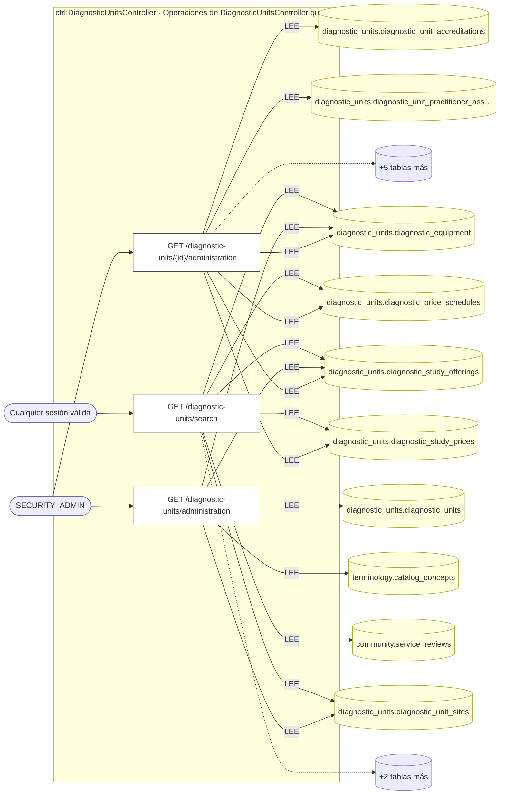

## Árbol de decisión por operación

Cada árbol se deriva del código del handler y de los métodos que invoca (hasta 4 niveles). Una rama que no decide, no escribe y no falla se poda. Los accesos y los efectos consecutivos se agrupan en un solo nodo.

### Operaciones con decisiones propias

#### 1. PATCH /diagnostic-equipment/{id}

Actualizar estado/calibración de un equipo

| HTTP | Código | Cuándo |
|---|---|---|
| 200 | — | Éxito |
| 400 | `VALIDATION_FAILED` | Los parámetros de ruta son UUID válidos; El cuerpo cumple el DTO (sin propiedades extra) |
| 401 | `UNAUTHENTICATED` | Hay una sesión válida (JWT) |
| 403 | `FORBIDDEN` | El rol está permitido; El tenant se resuelve y pertenece al actor |
| 404 | `NOT_FOUND` | ResourceNotFoundException: Equipo no encontrado |
| 429 | `RATE_LIMITED` | No se supera el límite de solicitudes |

```mermaid
flowchart TD
  n1(("Solicitud")):::inicio
  n2{{"Acceso: sesión (401) · rol (403) · tenant (403) · parámetros de ruta (400) · cuerpo válido (400) · límite de…"}}:::acceso
  n1 --> n2
  n3["Llama a DiagnosticEquipmentService.updateEquipment"]:::llamada
  n2 --> n3
  n4["Transacción: transactional(…)"]:::transaccion
  n3 --> n4
  n5["Llama a DiagnosticEquipmentRepository.findById"]:::llamada
  n4 --> n5
  n6[("LEE diagnostic_units.diagnostic_equipment")]:::efecto
  n5 --> n6
  n7{"!equipment"}:::decision
  n6 --> n7
  n8(["404 NOT_FOUND Equipo no encontrado"]):::error
  n7 -->|"sí"| n8
  n9{"dto.manufacturer !== undefined"}:::decision
  n7 -->|"no"| n9
  n10[("ACTUALIZA diagnostic_units.diagnostic_equipment")]:::efecto
  n9 -->|"sí"| n10
  n11[("ACTUALIZA diagnostic_units.diagnostic_equipment")]:::efecto
  n10 --> n11
  n9 -->|"no"| n11
  n12{"dto.model !== undefined"}:::decision
  n11 --> n12
  n13[("ACTUALIZA diagnostic_units.diagnostic_equipment")]:::efecto
  n12 -->|"sí"| n13
  n14{"dto.lastCalibrationAt !== undefined"}:::decision
  n13 --> n14
  n12 -->|"no"| n14
  n15[("ACTUALIZA diagnostic_units.diagnostic_equipment")]:::efecto
  n14 -->|"sí"| n15
  n16{"dto.nextCalibrationDueAt !== undefined"}:::decision
  n15 --> n16
  n14 -->|"no"| n16
  n17[("ACTUALIZA diagnostic_units.diagnostic_equipment")]:::efecto
  n16 -->|"sí"| n17
  n18{"dto.operationalStatusConceptId !== undefined"}:::decision
  n17 --> n18
  n16 -->|"no"| n18
  n19[("ACTUALIZA diagnostic_units.diagnostic_equipment")]:::efecto
  n18 -->|"sí"| n19
  n20(("200 Responde con éxito")):::ok
  n19 --> n20
  n18 -->|"no"| n20
  classDef acceso fill:#eef,stroke:#66a
  classDef error fill:#fee,stroke:#c33
  classDef ok fill:#efe,stroke:#3a3
  classDef efecto fill:#ffd,stroke:#aa3
  classDef decision fill:#fff,stroke:#555
  classDef corte fill:#eee,stroke:#999,stroke-dasharray: 4
```

#### 2. DELETE /diagnostic-study-offerings/{id}

Retirar (soft-delete) una oferta de estudio

| HTTP | Código | Cuándo |
|---|---|---|
| 200 | — | Éxito |
| 400 | `VALIDATION_FAILED` | Los parámetros de ruta son UUID válidos |
| 401 | `UNAUTHENTICATED` | Hay una sesión válida (JWT) |
| 403 | `FORBIDDEN` | El rol está permitido; El tenant se resuelve y pertenece al actor |
| 404 | `NOT_FOUND` | ResourceNotFoundException: Oferta no encontrada |
| 409 | `CONFLICT` | ConflictException: La oferta ya está retirada |
| 429 | `RATE_LIMITED` | No se supera el límite de solicitudes |

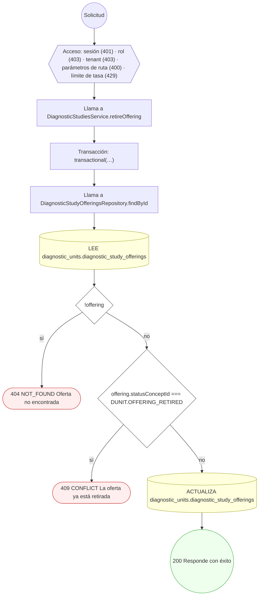

#### 3. POST /diagnostic-unit-accreditations/{id}/renew

Renovar/registrar acreditación con evidencia

| HTTP | Código | Cuándo |
|---|---|---|
| 201 | — | Éxito |
| 400 | `VALIDATION_FAILED` | Los parámetros de ruta son UUID válidos; El cuerpo cumple el DTO (sin propiedades extra) |
| 401 | `UNAUTHENTICATED` | Hay una sesión válida (JWT) |
| 403 | `FORBIDDEN` | El rol está permitido; El tenant se resuelve y pertenece al actor |
| 404 | `NOT_FOUND` | ResourceNotFoundException: Acreditación no encontrada |
| 429 | `RATE_LIMITED` | No se supera el límite de solicitudes |

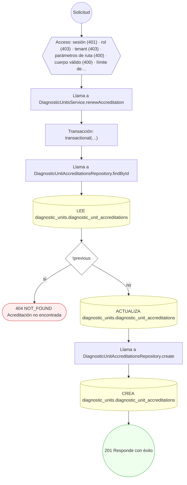

#### 4. PATCH /diagnostic-unit-sites/{siteId}

Actualizar un sitio operativo de la unidad

| HTTP | Código | Cuándo |
|---|---|---|
| 200 | — | Éxito |
| 400 | `VALIDATION_FAILED` | Los parámetros de ruta son UUID válidos; El cuerpo cumple el DTO (sin propiedades extra) |
| 401 | `UNAUTHENTICATED` | Hay una sesión válida (JWT) |
| 403 | `FORBIDDEN` | El rol está permitido; El tenant se resuelve y pertenece al actor |
| 404 | `NOT_FOUND` | ResourceNotFoundException: Sitio no encontrado |
| 429 | `RATE_LIMITED` | No se supera el límite de solicitudes |

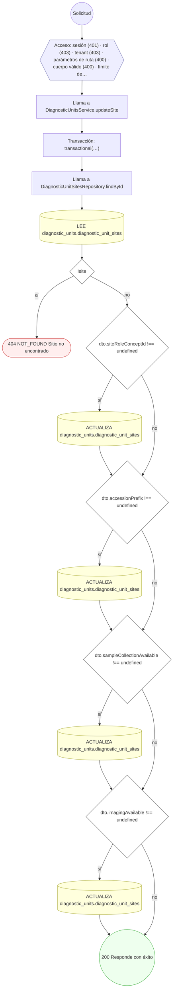

#### 5. POST /diagnostic-unit-sites/{siteId}/equipment

Registrar equipamiento y calibración del sitio

| HTTP | Código | Cuándo |
|---|---|---|
| 201 | — | Éxito |
| 400 | `VALIDATION_FAILED` | Los parámetros de ruta son UUID válidos; El cuerpo cumple el DTO (sin propiedades extra) |
| 401 | `UNAUTHENTICATED` | Hay una sesión válida (JWT) |
| 403 | `FORBIDDEN` | El rol está permitido; El tenant se resuelve y pertenece al actor |
| 404 | `NOT_FOUND` | ResourceNotFoundException: Sitio no encontrado |
| 409 | `CONFLICT` | ConflictException: Ya existe un equipo con ese número de serie en el sitio |
| 422 | `PRECONDITION_FAILED` | PreconditionFailedException: El sitio no está activo |
| 429 | `RATE_LIMITED` | No se supera el límite de solicitudes |

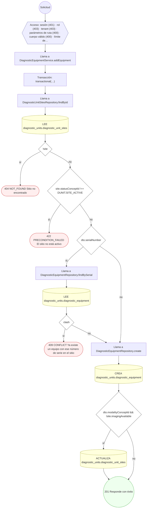

#### 6. POST /diagnostic-units

Alta de unidad diagnóstica con sitios y acreditaciones

| HTTP | Código | Cuándo |
|---|---|---|
| 201 | — | Éxito |
| 400 | `VALIDATION_FAILED` | El cuerpo cumple el DTO (sin propiedades extra) |
| 401 | `UNAUTHENTICATED` | Hay una sesión válida (JWT) |
| 403 | `FORBIDDEN` | El rol está permitido; El tenant se resuelve y pertenece al actor |
| 409 | `CONFLICT` | ConflictException: El código ya existe en el tenant |
| 429 | `RATE_LIMITED` | No se supera el límite de solicitudes |

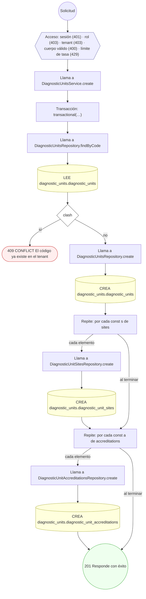

#### 7. GET /diagnostic-units/{id}

Consultar el perfil de una unidad diagnóstica

| HTTP | Código | Cuándo |
|---|---|---|
| 200 | — | Éxito |
| 400 | `VALIDATION_FAILED` | Los parámetros de ruta son UUID válidos |
| 401 | `UNAUTHENTICATED` | Hay una sesión válida (JWT) |
| 403 | `FORBIDDEN` | El rol está permitido; El tenant se resuelve y pertenece al actor |
| 404 | `NOT_FOUND` | ResourceNotFoundException: Unidad diagnóstica no encontrada |
| 429 | `RATE_LIMITED` | No se supera el límite de solicitudes |

```mermaid
flowchart TD
  n1(("Solicitud")):::inicio
  n2{{"Acceso: sesión (401) · rol (403) · tenant (403) · parámetros de ruta (400) · límite de tasa (429)"}}:::acceso
  n1 --> n2
  n3["Llama a DiagnosticUnitsReadService.getById"]:::llamada
  n2 --> n3
  n4["Llama a DiagnosticUnitsReadRepository.findVisibleById"]:::llamada
  n3 --> n4
  n5[("LEE diagnostic_units.diagnostic_units")]:::efecto
  n4 --> n5
  n6{"!unit"}:::decision
  n5 --> n6
  n7(["404 NOT_FOUND Unidad diagnóstica no encontrada"]):::error
  n6 -->|"sí"| n7
  n8["Llama a DiagnosticUnitsReadRepository.findActiveSites"]:::llamada
  n6 -->|"no"| n8
  n9[("LEE diagnostic_units.diagnostic_unit_sites")]:::efecto
  n8 --> n9
  n10["Llama a DiagnosticUnitsReadRepository.findActiveOfferings"]:::llamada
  n9 --> n10
  n11[("LEE diagnostic_units.diagnostic_study_offerings")]:::efecto
  n10 --> n11
  n12["Llama a DiagnosticUnitsReadRepository.findCurrentPublicSchedules"]:::llamada
  n11 --> n12
  n13[("LEE diagnostic_units.diagnostic_price_schedules")]:::efecto
  n12 --> n13
  n14["Llama a DiagnosticUnitsReadRepository.findCurrentAccreditations"]:::llamada
  n13 --> n14
  n15[("LEE diagnostic_units.diagnostic_unit_accreditations")]:::efecto
  n14 --> n15
  n16["Llama a DiagnosticUnitsReadRepository.findEquipment"]:::llamada
  n15 --> n16
  n17[("LEE diagnostic_units.diagnostic_equipment")]:::efecto
  n16 --> n17
  n18["Llama a DiagnosticUnitsReadRepository.findCurrentPrices"]:::llamada
  n17 --> n18
  n19[("LEE diagnostic_units.diagnostic_study_prices")]:::efecto
  n18 --> n19
  n20["Llama a DiagnosticUnitsReadRepository.findPracticeSites"]:::llamada
  n19 --> n20
  n21[("LEE practice.practice_sites")]:::efecto
  n20 --> n21
  n22["Llama a DiagnosticUnitsReadRepository.findConcepts"]:::llamada
  n21 --> n22
  n23[("LEE terminology.catalog_concepts")]:::efecto
  n22 --> n23
  n24(("200 Responde con éxito")):::ok
  n23 --> n24
  classDef acceso fill:#eef,stroke:#66a
  classDef error fill:#fee,stroke:#c33
  classDef ok fill:#efe,stroke:#3a3
  classDef efecto fill:#ffd,stroke:#aa3
  classDef decision fill:#fff,stroke:#555
  classDef corte fill:#eee,stroke:#999,stroke-dasharray: 4
```

#### 8. POST /diagnostic-units/{id}/accreditations

Registrar una acreditación con evidencia

| HTTP | Código | Cuándo |
|---|---|---|
| 201 | — | Éxito |
| 400 | `VALIDATION_FAILED` | Los parámetros de ruta son UUID válidos; El cuerpo cumple el DTO (sin propiedades extra) |
| 401 | `UNAUTHENTICATED` | Hay una sesión válida (JWT) |
| 403 | `FORBIDDEN` | El rol está permitido; El tenant se resuelve y pertenece al actor |
| 404 | `NOT_FOUND` | ResourceNotFoundException: Unidad no encontrada |
| 422 | `PRECONDITION_FAILED` | PreconditionFailedException: La unidad no está activa |
| 429 | `RATE_LIMITED` | No se supera el límite de solicitudes |

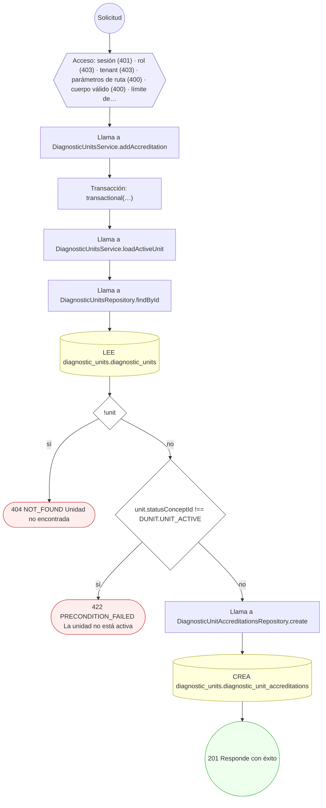

#### 9. GET /diagnostic-units/{id}/administration

Consola de administración de una unidad diagnóstica

| HTTP | Código | Cuándo |
|---|---|---|
| 200 | — | Éxito |
| 400 | `VALIDATION_FAILED` | Los parámetros de ruta son UUID válidos |
| 401 | `UNAUTHENTICATED` | Hay una sesión válida (JWT) |
| 403 | `FORBIDDEN` | El rol está permitido; El tenant se resuelve y pertenece al actor |
| 404 | `NOT_FOUND` | ResourceNotFoundException: Unidad diagnóstica no encontrada |
| 429 | `RATE_LIMITED` | No se supera el límite de solicitudes |

```mermaid
flowchart TD
  n1(("Solicitud")):::inicio
  n2{{"Acceso: sesión (401) · rol (403) · tenant (403) · parámetros de ruta (400) · límite de tasa (429)"}}:::acceso
  n1 --> n2
  n3["Llama a DiagnosticUnitsAdminReadService.getById"]:::llamada
  n2 --> n3
  n4["Llama a DiagnosticUnitsAdminReadRepository.findById"]:::llamada
  n3 --> n4
  n5[("LEE diagnostic_units.diagnostic_units")]:::efecto
  n4 --> n5
  n6{"!unit"}:::decision
  n5 --> n6
  n7(["404 NOT_FOUND Unidad diagnóstica no encontrada"]):::error
  n6 -->|"sí"| n7
  n8["Llama a DiagnosticUnitsAdminReadRepository.findSites"]:::llamada
  n6 -->|"no"| n8
  n9[("LEE diagnostic_units.diagnostic_unit_sites")]:::efecto
  n8 --> n9
  n10["Llama a DiagnosticUnitsAdminReadRepository.findOfferings"]:::llamada
  n9 --> n10
  n11[("LEE diagnostic_units.diagnostic_study_offerings")]:::efecto
  n10 --> n11
  n12["Llama a DiagnosticUnitsAdminReadRepository.findPriceSchedules"]:::llamada
  n11 --> n12
  n13[("LEE diagnostic_units.diagnostic_price_schedules")]:::efecto
  n12 --> n13
  n14["Llama a DiagnosticUnitsAdminReadRepository.findAccreditations"]:::llamada
  n13 --> n14
  n15[("LEE diagnostic_units.diagnostic_unit_accreditations")]:::efecto
  n14 --> n15
  n16["Llama a DiagnosticUnitsAdminReadRepository.findPractitionerAssignments"]:::llamada
  n15 --> n16
  n17[("LEE diagnostic_units.diagnostic_unit_practitioner_assignments")]:::efecto
  n16 --> n17
  n18["Llama a DiagnosticUnitsAdminReadRepository.findEquipment"]:::llamada
  n17 --> n18
  n19[("LEE diagnostic_units.diagnostic_equipment")]:::efecto
  n18 --> n19
  n20["Llama a DiagnosticUnitsAdminReadRepository.findPrices"]:::llamada
  n19 --> n20
  n21[("LEE diagnostic_units.diagnostic_study_prices")]:::efecto
  n20 --> n21
  n22["Llama a DiagnosticUnitsAdminReadRepository.findPracticeSites"]:::llamada
  n21 --> n22
  n23[("LEE practice.practice_sites")]:::efecto
  n22 --> n23
  n24["Llama a DiagnosticUnitsAdminReadRepository.findRoleAssignments"]:::llamada
  n23 --> n24
  n25[("LEE practice.practitioner_role_assignments")]:::efecto
  n24 --> n25
  n26["Llama a DiagnosticUnitsAdminReadRepository.findConcepts"]:::llamada
  n25 --> n26
  n27[("LEE terminology.catalog_concepts")]:::efecto
  n26 --> n27
  n28(("200 Responde con éxito")):::ok
  n27 --> n28
  classDef acceso fill:#eef,stroke:#66a
  classDef error fill:#fee,stroke:#c33
  classDef ok fill:#efe,stroke:#3a3
  classDef efecto fill:#ffd,stroke:#aa3
  classDef decision fill:#fff,stroke:#555
  classDef corte fill:#eee,stroke:#999,stroke-dasharray: 4
```

#### 10. POST /diagnostic-units/{id}/practitioner-assignments

Asignar un especialista a la unidad/sitio

| HTTP | Código | Cuándo |
|---|---|---|
| 201 | — | Éxito |
| 400 | `VALIDATION_FAILED` | Los parámetros de ruta son UUID válidos; El cuerpo cumple el DTO (sin propiedades extra) |
| 401 | `UNAUTHENTICATED` | Hay una sesión válida (JWT) |
| 403 | `FORBIDDEN` | El rol está permitido; El tenant se resuelve y pertenece al actor |
| 404 | `NOT_FOUND` | ResourceNotFoundException: Unidad no encontrada |
| 409 | `CONFLICT` | ConflictException: El profesional ya tiene una asignación activa en ese rol/sitio |
| 422 | `PRECONDITION_FAILED` | PreconditionFailedException: La unidad no está activa |
| 429 | `RATE_LIMITED` | No se supera el límite de solicitudes |

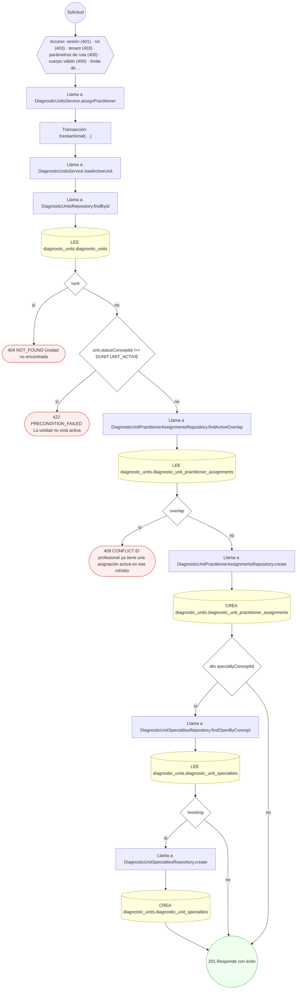

#### 11. POST /diagnostic-units/{id}/price-schedules

Crear un cronograma de precios

| HTTP | Código | Cuándo |
|---|---|---|
| 201 | — | Éxito |
| 400 | `VALIDATION_FAILED` | Los parámetros de ruta son UUID válidos; El cuerpo cumple el DTO (sin propiedades extra) |
| 401 | `UNAUTHENTICATED` | Hay una sesión válida (JWT) |
| 403 | `FORBIDDEN` | El rol está permitido; El tenant se resuelve y pertenece al actor |
| 404 | `NOT_FOUND` | ResourceNotFoundException: Unidad no encontrada |
| 409 | `CONFLICT` | ConflictException: El código de cronograma ya existe en la unidad |
| 422 | `PRECONDITION_FAILED` | PreconditionFailedException: La unidad no está activa |
| 429 | `RATE_LIMITED` | No se supera el límite de solicitudes |

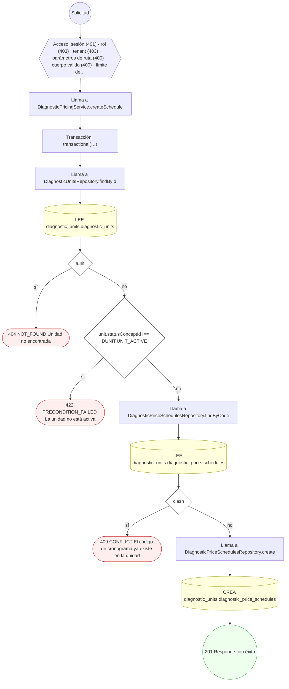

#### 12. POST /diagnostic-units/{id}/reproject

Reconstruir la proyección del perfil público

| HTTP | Código | Cuándo |
|---|---|---|
| 200 | — | Éxito |
| 400 | `VALIDATION_FAILED` | Los parámetros de ruta son UUID válidos |
| 401 | `UNAUTHENTICATED` | Hay una sesión válida (JWT) |
| 403 | `FORBIDDEN` | El rol está permitido; El tenant se resuelve y pertenece al actor |
| 404 | `NOT_FOUND` | ResourceNotFoundException: Unidad no encontrada |
| 429 | `RATE_LIMITED` | No se supera el límite de solicitudes |

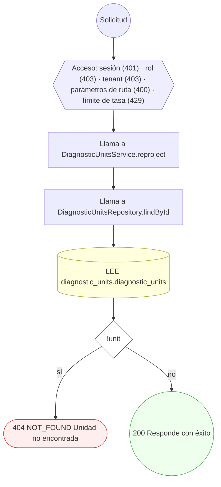

#### 13. POST /diagnostic-units/{id}/sites

Registrar un sitio operativo de la unidad

| HTTP | Código | Cuándo |
|---|---|---|
| 201 | — | Éxito |
| 400 | `VALIDATION_FAILED` | Los parámetros de ruta son UUID válidos; El cuerpo cumple el DTO (sin propiedades extra) |
| 401 | `UNAUTHENTICATED` | Hay una sesión válida (JWT) |
| 403 | `FORBIDDEN` | El rol está permitido; El tenant se resuelve y pertenece al actor |
| 404 | `NOT_FOUND` | ResourceNotFoundException: Unidad no encontrada |
| 422 | `PRECONDITION_FAILED` | PreconditionFailedException: La unidad no está activa |
| 429 | `RATE_LIMITED` | No se supera el límite de solicitudes |

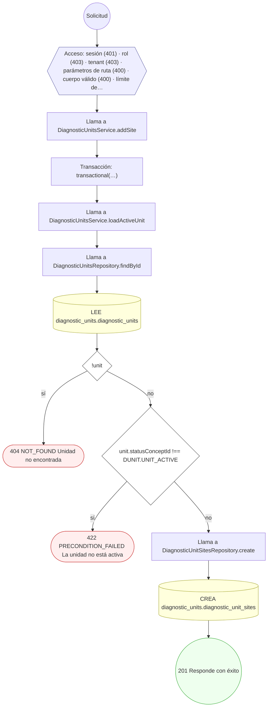

#### 14. PUT /diagnostic-units/{id}/specialties

Declarar las especialidades de la unidad

| HTTP | Código | Cuándo |
|---|---|---|
| 200 | — | Éxito |
| 400 | `VALIDATION_FAILED` | Los parámetros de ruta son UUID válidos; El cuerpo cumple el DTO (sin propiedades extra) |
| 401 | `UNAUTHENTICATED` | Hay una sesión válida (JWT) |
| 403 | `FORBIDDEN` | El rol está permitido; El tenant se resuelve y pertenece al actor |
| 404 | `NOT_FOUND` | ResourceNotFoundException: Unidad no encontrada |
| 422 | `PRECONDITION_FAILED` | PreconditionFailedException: A lo sumo una especialidad puede ser primaria; PreconditionFailedException: La unidad no está activa |
| 429 | `RATE_LIMITED` | No se supera el límite de solicitudes |

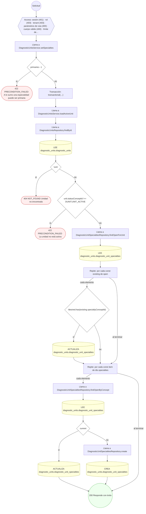

#### 15. POST /diagnostic-units/{id}/study-offerings

Publicar oferta de estudio con componentes (panel)

| HTTP | Código | Cuándo |
|---|---|---|
| 201 | — | Éxito |
| 400 | `VALIDATION_FAILED` | Los parámetros de ruta son UUID válidos; El cuerpo cumple el DTO (sin propiedades extra) |
| 401 | `UNAUTHENTICATED` | Hay una sesión válida (JWT) |
| 403 | `FORBIDDEN` | El rol está permitido; El tenant se resuelve y pertenece al actor |
| 404 | `NOT_FOUND` | ResourceNotFoundException: Unidad no encontrada |
| 409 | `CONFLICT` | ConflictException: El código de estudio ya existe en la unidad |
| 422 | `PRECONDITION_FAILED` | PreconditionFailedException: La unidad no está activa; PreconditionFailedException: Un panel no puede referenciarse a sí mismo como componente |
| 429 | `RATE_LIMITED` | No se supera el límite de solicitudes |

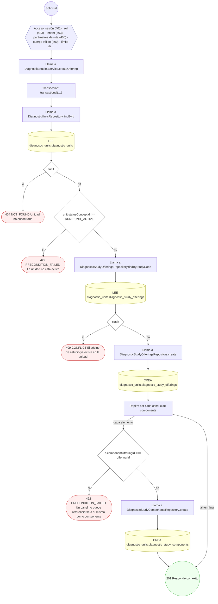

#### 16. POST /diagnostic-units/{id}/verify-and-publish

Verificar la unidad y publicar su perfil público

| HTTP | Código | Cuándo |
|---|---|---|
| 200 | — | Éxito |
| 400 | `VALIDATION_FAILED` | Los parámetros de ruta son UUID válidos |
| 401 | `UNAUTHENTICATED` | Hay una sesión válida (JWT) |
| 403 | `FORBIDDEN` | El rol está permitido; El tenant se resuelve y pertenece al actor |
| 404 | `NOT_FOUND` | ResourceNotFoundException: Unidad no encontrada |
| 422 | `PRECONDITION_FAILED` | PreconditionFailedException: La unidad no está activa; PreconditionFailedException: La unidad no tiene ningún sitio activo para publicar |
| 429 | `RATE_LIMITED` | No se supera el límite de solicitudes |

```mermaid
flowchart TD
  n1(("Solicitud")):::inicio
  n2{{"Acceso: sesión (401) · rol (403) · tenant (403) · parámetros de ruta (400) · límite de tasa (429)"}}:::acceso
  n1 --> n2
  n3["Llama a DiagnosticUnitsService.verifyAndPublish"]:::llamada
  n2 --> n3
  n4["Transacción: transactional(…)"]:::transaccion
  n3 --> n4
  n5["Llama a DiagnosticUnitsService.loadActiveUnit"]:::llamada
  n4 --> n5
  n6["Llama a DiagnosticUnitsRepository.findById"]:::llamada
  n5 --> n6
  n7[("LEE diagnostic_units.diagnostic_units")]:::efecto
  n6 --> n7
  n8{"!unit"}:::decision
  n7 --> n8
  n9(["404 NOT_FOUND Unidad no encontrada"]):::error
  n8 -->|"sí"| n9
  n10{"unit.statusConceptId !== DUNIT.UNIT_ACTIVE"}:::decision
  n8 -->|"no"| n10
  n11(["422 PRECONDITION_FAILED La unidad no está activa"]):::error
  n10 -->|"sí"| n11
  n12["Llama a DiagnosticUnitSitesRepository.countActiveForUnit"]:::llamada
  n10 -->|"no"| n12
  n13[("LEE diagnostic_units.diagnostic_unit_sites")]:::efecto
  n12 --> n13
  n14{"activeSites ‹ 1"}:::decision
  n13 --> n14
  n15(["422 PRECONDITION_FAILED La unidad no tiene ningún sitio activo para publicar"]):::error
  n14 -->|"sí"| n15
  n16[("ACTUALIZA diagnostic_units.diagnostic_units")]:::efecto
  n14 -->|"no"| n16
  n17{"!unit.publicProfileId"}:::decision
  n16 --> n17
  n18["Llama a PublicProfileProjectionService.projectOrganization"]:::llamada
  n17 -->|"sí"| n18
  n19["Llama a PublicProfilesRepository.findByTarget"]:::llamada
  n18 --> n19
  n20[("LEE community.public_profiles")]:::efecto
  n19 --> n20
  n21["Llama a PublicProfilesRepository.create"]:::llamada
  n20 --> n21
  n22[("CREA community.public_profiles")]:::efecto
  n21 --> n22
  n23[("ACTUALIZA diagnostic_units.diagnostic_units")]:::efecto
  n22 --> n23
  n24["Llama a DiagnosticUnitSpecialtiesRepository.verifyOpenForUnit"]:::llamada
  n23 --> n24
  n17 -->|"no"| n24
  n25[("ACTUALIZA diagnostic_units.diagnostic_unit_specialties")]:::efecto
  n24 --> n25
  n26["Llama a DiagnosticUnitAccreditationsRepository.verifyOpenForUnit"]:::llamada
  n25 --> n26
  n27[("ACTUALIZA diagnostic_units.diagnostic_unit_accreditations")]:::efecto
  n26 --> n27
  n28(("200 Responde con éxito")):::ok
  n27 --> n28
  classDef acceso fill:#eef,stroke:#66a
  classDef error fill:#fee,stroke:#c33
  classDef ok fill:#efe,stroke:#3a3
  classDef efecto fill:#ffd,stroke:#aa3
  classDef decision fill:#fff,stroke:#555
  classDef corte fill:#eee,stroke:#999,stroke-dasharray: 4
```

#### 17. GET /diagnostic-units/search

Buscar centros de diagnóstico, laboratorio e imagen

| HTTP | Código | Cuándo |
|---|---|---|
| 200 | — | Éxito |
| 401 | `UNAUTHENTICATED` | Hay una sesión válida (JWT) |
| 403 | `FORBIDDEN` | El rol está permitido; El tenant se resuelve y pertenece al actor |
| 429 | `RATE_LIMITED` | No se supera el límite de solicitudes |

```mermaid
flowchart TD
  n1(("Solicitud")):::inicio
  n2{{"Acceso: sesión (401) · rol (403) · tenant (403) · límite de tasa (429)"}}:::acceso
  n1 --> n2
  n3["Llama a DiagnosticUnitsSearchService.search"]:::llamada
  n2 --> n3
  n4{"query.studyCode !== undefined && query.studyCode !== ''"}:::decision
  n3 --> n4
  n5["Llama a DiagnosticUnitsReadRepository.findUnitIdsOfferingStudy"]:::llamada
  n4 -->|"sí"| n5
  n6[("LEE diagnostic_units.diagnostic_study_offerings")]:::efecto
  n5 --> n6
  n7{"query.insurerTenantId !== undefined"}:::decision
  n6 --> n7
  n4 -->|"no"| n7
  n8["Llama a DiagnosticUnitsReadRepository.findUnitIdsWithInsurerAgreement"]:::llamada
  n7 -->|"sí"| n8
  n9[("LEE diagnostic_units.diagnostic_price_schedules")]:::efecto
  n8 --> n9
  n10["Llama a DiagnosticUnitsReadRepository.searchVisible"]:::llamada
  n9 --> n10
  n7 -->|"no"| n10
  n11[("LEE diagnostic_units.diagnostic_units")]:::efecto
  n10 --> n11
  n12["Llama a DiagnosticUnitsReadRepository.countVisible"]:::llamada
  n11 --> n12
  n13[("LEE diagnostic_units.diagnostic_units")]:::efecto
  n12 --> n13
  n14["Llama a DiagnosticUnitsSearchService.proyectar"]:::llamada
  n13 --> n14
  n15["Llama a DiagnosticUnitsReadRepository.findActiveSites"]:::llamada
  n14 --> n15
  n16[("LEE diagnostic_units.diagnostic_unit_sites")]:::efecto
  n15 --> n16
  n17["Llama a DiagnosticUnitsReadRepository.findActiveOfferings"]:::llamada
  n16 --> n17
  n18[("LEE diagnostic_units.diagnostic_study_offerings")]:::efecto
  n17 --> n18
  n19["Llama a DiagnosticUnitsReadRepository.findConcepts"]:::llamada
  n18 --> n19
  n20[("LEE terminology.catalog_concepts")]:::efecto
  n19 --> n20
  n21["Llama a DiagnosticUnitsReadRepository.findCurrentPublicSchedulesFor"]:::llamada
  n20 --> n21
  n22[("LEE diagnostic_units.diagnostic_price_schedules")]:::efecto
  n21 --> n22
  n23["Llama a CommunityRatingsService.ratingsByProfiles"]:::llamada
  n22 --> n23
  n24["Llama a ReviewsRepository.averageByTargets"]:::llamada
  n23 --> n24
  n25[("LEE community.service_reviews")]:::efecto
  n24 --> n25
  n26["Llama a DiagnosticUnitsReadRepository.findEquipment"]:::llamada
  n25 --> n26
  n27[("LEE diagnostic_units.diagnostic_equipment")]:::efecto
  n26 --> n27
  n28["Llama a DiagnosticUnitsReadRepository.findCurrentPricesForSchedules"]:::llamada
  n27 --> n28
  n29[("LEE diagnostic_units.diagnostic_study_prices")]:::efecto
  n28 --> n29
  n30(("200 Responde con éxito")):::ok
  n29 --> n30
  classDef acceso fill:#eef,stroke:#66a
  classDef error fill:#fee,stroke:#c33
  classDef ok fill:#efe,stroke:#3a3
  classDef efecto fill:#ffd,stroke:#aa3
  classDef decision fill:#fff,stroke:#555
  classDef corte fill:#eee,stroke:#999,stroke-dasharray: 4
```

#### 18. POST /price-schedules/{scheduleId}/study-prices

Fijar/versionar el precio de un estudio (append-only)

| HTTP | Código | Cuándo |
|---|---|---|
| 201 | — | Éxito |
| 400 | `VALIDATION_FAILED` | Los parámetros de ruta son UUID válidos; El cuerpo cumple el DTO (sin propiedades extra) |
| 401 | `UNAUTHENTICATED` | Hay una sesión válida (JWT) |
| 403 | `FORBIDDEN` | El rol está permitido; El tenant se resuelve y pertenece al actor |
| 404 | `NOT_FOUND` | ResourceNotFoundException: Cronograma no encontrado; ResourceNotFoundException: Oferta de estudio no encontrada |
| 422 | `PRECONDITION_FAILED` | PreconditionFailedException: El cronograma no está activo; PreconditionFailedException: La oferta no pertenece a la misma unidad que el cronograma |
| 429 | `RATE_LIMITED` | No se supera el límite de solicitudes |

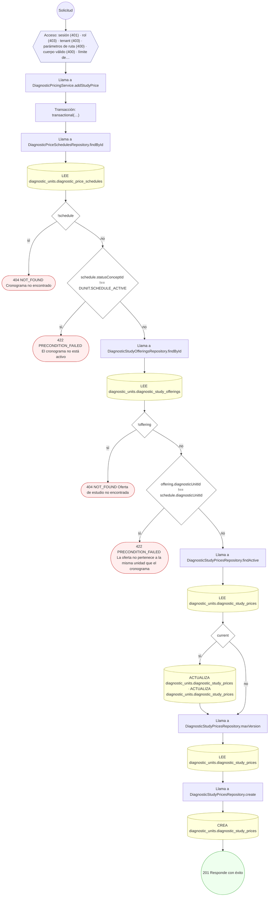

#### 19. POST /study-prices/{priceId}/close

Cerrar una versión de precio vigente

| HTTP | Código | Cuándo |
|---|---|---|
| 200 | — | Éxito |
| 400 | `VALIDATION_FAILED` | Los parámetros de ruta son UUID válidos |
| 401 | `UNAUTHENTICATED` | Hay una sesión válida (JWT) |
| 403 | `FORBIDDEN` | El rol está permitido; El tenant se resuelve y pertenece al actor |
| 404 | `NOT_FOUND` | ResourceNotFoundException: Precio no encontrado |
| 422 | `PRECONDITION_FAILED` | PreconditionFailedException: Solo se puede cerrar una versión de precio activa y aún abierta |
| 429 | `RATE_LIMITED` | No se supera el límite de solicitudes |

```mermaid
flowchart TD
  n1(("Solicitud")):::inicio
  n2{{"Acceso: sesión (401) · rol (403) · tenant (403) · parámetros de ruta (400) · límite de tasa (429)"}}:::acceso
  n1 --> n2
  n3["Llama a DiagnosticPricingService.closePrice"]:::llamada
  n2 --> n3
  n4["Transacción: transactional(…)"]:::transaccion
  n3 --> n4
  n5["Llama a DiagnosticStudyPricesRepository.findById"]:::llamada
  n4 --> n5
  n6[("LEE diagnostic_units.diagnostic_study_prices")]:::efecto
  n5 --> n6
  n7{"!price"}:::decision
  n6 --> n7
  n8(["404 NOT_FOUND Precio no encontrado"]):::error
  n7 -->|"sí"| n8
  n9{"price.statusConceptId !== DUNIT.PRICE_ACTIVE || price.effectiveTo"}:::decision
  n7 -->|"no"| n9
  n10(["422 PRECONDITION_FAILED Solo se puede cerrar una versión de precio activa y aún abierta"]):::error
  n9 -->|"sí"| n10
  n11[("ACTUALIZA diagnostic_units.diagnostic_study_prices · ACTUALIZA diagnostic_units.diagnostic_study_prices · ACT…")]:::efecto
  n9 -->|"no"| n11
  n12(("200 Responde con éxito")):::ok
  n11 --> n12
  classDef acceso fill:#eef,stroke:#66a
  classDef error fill:#fee,stroke:#c33
  classDef ok fill:#efe,stroke:#3a3
  classDef efecto fill:#ffd,stroke:#aa3
  classDef decision fill:#fff,stroke:#555
  classDef corte fill:#eee,stroke:#999,stroke-dasharray: 4
```

### Operaciones sin decisiones propias

Sólo comprueban el acceso y leen o escriben: no tienen ramas que dibujar. Su detalle está en la ficha de endpoints.

| Operación | Respuestas posibles | Tablas |
|---|---|---|
| GET /diagnostic-units | 200, 401, 403, 429 | 5 |
| GET /diagnostic-units/administration | 200, 401, 403, 429 | 5 |
