<!-- AUTOGENERADO por tools/inventario/flujos.mjs. No editar manualmente. -->

# Flujos del módulo `diagnostics`

- **Procesos:** 1 · **Máquinas de estado:** 1
- **Operaciones:** 63 (56 con decisiones propias, 7 sin ellas)
- Inventario de endpoints del módulo: [diagnostics](../endpoints/diagnostics.md)

## Proceso: Módulo Diagnostics (20) — Laboratorio, Imagen Médica y Media Clínica

- **Código:** `diagnostics` · **Agrupación:** MIXTO · **Operaciones:** 63
- **Actores:** CLINICIAN · Cualquier sesión válida · PATIENT · PRACTITIONER · Público (sin sesión)
- **Revisión:** AUTO_DETECTADA
- **Fuentes:** `src/modules/diagnostics/README.md`

### Para qué sirve

Implementa los 14 casos de uso del módulo 20 más 4 endpoints de soporte (cifra original; al 2026-10-08 el código declara 31 rutas, ver «Rutas HTTP y alcance (medido)») (altas de padres que el módulo no expone como UC pero que los flujos necesitan). Sigue el patrón de capas de `iam`: controladores finos → servicios con la unidad de trabajo (`em.transactional`) → repositorios stateless (reciben el `EntityManager`).

_Fuente: `src/modules/diagnostics/README.md:3`_

### Etapas y operaciones

| Etapa | Descripción | Operación | Quién actúa | Riesgo | Tablas |
|---|---|---|---|---|---|
| `UC-20-01` | Acesionar especímenes recibidos | POST /diagnostics/accessions | Cualquier sesión válida | ALTO | 6 |
| `UC-20-02` | Rechazar espécimen y solicitar recolección | POST /diagnostics/specimens/{id}/rejection | Cualquier sesión válida | ALTO | 5 |
| `UC-20-03` | Cadena de custodia / traslado | POST /diagnostics/containers/{id}/custody-events | Cualquier sesión válida | ALTO | 5 |
| `UC-20-04` | Abrir orden de trabajo y desglosar pruebas | POST /diagnostics/work-orders | Cualquier sesión válida | ALTO | 6 |
| `UC-20-05` | Ingerir mensaje de resultado (LIS/HL7/ASTM) | POST /diagnostics/analyzer-runs/{id}/messages | Cualquier sesión válida | ALTO | 8 |
| `UC-20-06` | Verificar (técnica/facultativa) | POST /diagnostics/results/{observationId}/verifications | Cualquier sesión válida | ALTO | 3 |
| `UC-20-07` | Crear/enmendar versión de informe | POST /diagnostics/reports/{reportId}/versions | CLINICIAN · PRACTITIONER | MEDIO | 8 |
| `UC-20-08` | Validar y liberar | POST /diagnostics/reports/{reportId}/versions/{versionId}/release | CLINICIAN · PRACTITIONER | MEDIO | 6 |
| `UC-20-09` | Detectar y notificar resultado crítico | POST /diagnostics/critical-results | CLINICIAN · PRACTITIONER | MEDIO | 16 |
| `UC-20-10` | Acusar recibo / escalar | POST /diagnostics/critical-results/{id}/acknowledge | CLINICIAN · PRACTITIONER | MEDIO | 2 |
| `UC-20-11` | Ingestar estudio DICOM (STOW-RS) | POST /dicomweb/studies | CLINICIAN · PRACTITIONER | MEDIO | 8 |
| `UC-20-12` | Adjuntar media clínica / imagen | POST /diagnostics/clinical-media | CLINICIAN · PRACTITIONER | MEDIO | 6 |
| `UC-20-13` | Registrar dosis de radiación | POST /diagnostics/imaging-studies/{id}/dose-events | CLINICIAN · PRACTITIONER | MEDIO | 3 |
| `UC-20-14` | Evento de calidad de datos + provenance | POST /diagnostics/data-quality-events | CLINICIAN · PRACTITIONER | MEDIO | 5 |
| `ctrl:DiagnosticsImagingController` | Operaciones de DiagnosticsImagingController que el README no asigna a un caso de uso | POST /diagnostics/imaging-endpoints | CLINICIAN · PRACTITIONER | MEDIO | 1 |
|  |  | GET /diagnostics/patients/{patientProfileId}/imaging-studies | CLINICIAN · PRACTITIONER | BAJO | 4 |
| `ctrl:DiagnosticsLabController` | Operaciones de DiagnosticsLabController que el README no asigna a un caso de uso | POST /diagnostics/analyzer-runs | Cualquier sesión válida | ALTO | 1 |
|  |  | GET /diagnostics/work-orders | Cualquier sesión válida | BAJO | 6 |
| `ctrl:DiagnosticsLabPortalController` | Operaciones de DiagnosticsLabPortalController que el README no asigna a un caso de uso | GET /diagnostics/lab/orders | Cualquier sesión válida | BAJO | 17 |
|  |  | POST /diagnostics/lab/orders | Cualquier sesión válida | ALTO | 26 |
|  |  | PUT /diagnostics/lab/orders/{orderId} | Cualquier sesión válida | ALTO | 23 |
|  |  | POST /diagnostics/lab/orders/{orderId}/transitions | Cualquier sesión válida | ALTO | 30 |
|  |  | POST /diagnostics/lab/patients/lookup | Cualquier sesión válida | BAJO | 4 |
|  |  | GET /diagnostics/lab/result-targets | Cualquier sesión válida | BAJO | 16 |
|  |  | GET /diagnostics/lab/summary | Cualquier sesión válida | BAJO | 20 |
| `ctrl:DiagnosticsLabResultsController` | Operaciones de DiagnosticsLabResultsController que el README no asigna a un caso de uso | GET /diagnostics/lab/result-files | Cualquier sesión válida | BAJO | 16 |
|  |  | GET /diagnostics/lab/result-files/{id}/content | Cualquier sesión válida | BAJO | 16 |
|  |  | POST /diagnostics/lab/result-files/{id}/withdrawal | Cualquier sesión válida | ALTO | 22 |
|  |  | POST /diagnostics/lab/result-files/search | Cualquier sesión válida | BAJO | 16 |
| `ctrl:DiagnosticsLabUploadsController` | Operaciones de DiagnosticsLabUploadsController que el README no asigna a un caso de uso | POST /diagnostics/lab/result-uploads | Cualquier sesión válida | BAJO | 16 |
|  |  | DELETE /diagnostics/lab/result-uploads/{uploadId} | Cualquier sesión válida | BAJO | 0 |
|  |  | POST /diagnostics/lab/result-uploads/{uploadId}/complete | Cualquier sesión válida | ALTO | 31 |
|  |  | PUT /diagnostics/lab/result-uploads/{uploadId}/parts/{index} | Cualquier sesión válida | BAJO | 0 |
| `ctrl:DiagnosticsOrdersController` | Operaciones de DiagnosticsOrdersController que el README no asigna a un caso de uso | GET /diagnostics/patients/{patientProfileId}/orders | CLINICIAN · PRACTITIONER | BAJO | 9 |
|  |  | GET /diagnostics/patients/{patientProfileId}/reports/{reportId} | CLINICIAN · PRACTITIONER | BAJO | 13 |
|  |  | GET /diagnostics/patients/{patientProfileId}/reports/{reportId}/files/{fileId}/content | CLINICIAN · PRACTITIONER | BAJO | 10 |
| `ctrl:DiagnosticsPatientResultsController` | Operaciones de DiagnosticsPatientResultsController que el README no asigna a un caso de uso | GET /diagnostic-results/me | PATIENT | BAJO | 7 |
|  |  | GET /diagnostic-results/me/{reportId} | PATIENT | BAJO | 7 |
|  |  | GET /diagnostic-results/me/{reportId}/files/{fileId}/content | PATIENT | BAJO | 9 |
|  |  | GET /diagnostic-results/me/{reportId}/shares | PATIENT | BAJO | 4 |
|  |  | POST /diagnostic-results/me/{reportId}/shares | PATIENT | MEDIO | 11 |
|  |  | POST /diagnostic-results/me/{reportId}/shares/{shareId}/revoke | PATIENT | MEDIO | 5 |
|  |  | GET /diagnostic-results/me/orders | PATIENT | BAJO | 29 |
| `ctrl:DiagnosticsReceptionController` | Operaciones de DiagnosticsReceptionController que el README no asigna a un caso de uso | GET /diagnostics/service-requests/{id} | Cualquier sesión válida | BAJO | 11 |
|  |  | POST /diagnostics/service-requests/inbox | Cualquier sesión válida | BAJO | 12 |
|  |  | POST /diagnostics/service-requests/worklist | Cualquier sesión válida | BAJO | 11 |
| `ctrl:DiagnosticsReportDraftsController` | Operaciones de DiagnosticsReportDraftsController que el README no asigna a un caso de uso | POST /diagnostics/report-drafts | Cualquier sesión válida | ALTO | 5 |
|  |  | GET /diagnostics/report-drafts/{id} | Cualquier sesión válida | BAJO | 4 |
|  |  | PUT /diagnostics/report-drafts/{id} | Cualquier sesión válida | BAJO | 9 |
|  |  | POST /diagnostics/report-drafts/{id}/files | Cualquier sesión válida | ALTO | 5 |
|  |  | DELETE /diagnostics/report-drafts/{id}/files/{draftFileId} | Cualquier sesión válida | ALTO | 5 |
|  |  | GET /diagnostics/report-drafts/signers | Cualquier sesión válida | BAJO | 5 |
| `ctrl:DiagnosticsReportPublishController` | Operaciones de DiagnosticsReportPublishController que el README no asigna a un caso de uso | POST /diagnostics/report-drafts/{id}/preview | Cualquier sesión válida | BAJO | 13 |
|  |  | POST /diagnostics/report-drafts/{id}/publish | Cualquier sesión válida | ALTO | 43 |
|  |  | POST /diagnostics/report-drafts/{id}/signature-request | Cualquier sesión válida | ALTO | 17 |
| `ctrl:DiagnosticsReportReleaseController` | Operaciones de DiagnosticsReportReleaseController que el README no asigna a un caso de uso | GET /diagnostics/report-issuer-settings | Cualquier sesión válida | BAJO | 2 |
|  |  | PUT /diagnostics/report-issuer-settings | Cualquier sesión válida | ALTO | 3 |
|  |  | POST /diagnostics/reports/{reportId}/patient-release | CLINICIAN · PRACTITIONER | MEDIO | 17 |
| `ctrl:DiagnosticsReportVerifyPublicController` | Operaciones de DiagnosticsReportVerifyPublicController que el README no asigna a un caso de uso | GET /public/diagnostic-reports/{versionId}/verify | Público (sin sesión) | BAJO | 5 |
| `ctrl:DiagnosticsSpecimensController` | Operaciones de DiagnosticsSpecimensController que el README no asigna a un caso de uso | GET /diagnostics/accessions/{id} | Cualquier sesión válida | BAJO | 5 |
|  |  | POST /diagnostics/specimens | Cualquier sesión válida | ALTO | 4 |
|  |  | GET /diagnostics/specimens/{id} | Cualquier sesión válida | BAJO | 3 |
|  |  | POST /diagnostics/specimens/{id}/containers | Cualquier sesión válida | ALTO | 3 |

### Diagrama 1 de 3 — etapas `UC-20-01`, `UC-20-02`, `UC-20-03`…

```mermaid
flowchart LR
  a2(["Cualquier sesión válida"]):::actor
  a25(["CLINICIAN · PRACTITIONER"]):::actor
  t3[("clinical.service_requests")]:::tabla
  t4[("diagnostics.accession_specimens")]:::tabla
  t5[("diagnostics.laboratory_accessions")]:::tabla
  t6[("diagnostics.specimen_chain_of_custody_events")]:::tabla
  t7[("diagnostics.specimens")]:::tabla
  t9[("diagnostics.laboratory_work_order_tests")]:::tabla
  t10[("diagnostics.specimen_rejection_events")]:::tabla
  t12[("diagnostics.specimen_container_events")]:::tabla
  t13[("diagnostics.specimen_containers")]:::tabla
  t15[("diagnostics.laboratory_work_orders")]:::tabla
  t17[("clinical.observations")]:::tabla
  t18[("common.files")]:::tabla
  t19[("diagnostics.analyzer_result_messages")]:::tabla
  t20[("diagnostics.analyzer_runs")]:::tabla
  t23[("diagnostics.result_verifications")]:::tabla
  t26[("clinical.diagnostic_reports")]:::tabla
  t27[("diagnostics.diagnostic_report_files")]:::tabla
  t28[("diagnostics.diagnostic_report_results")]:::tabla
  t29[("diagnostics.diagnostic_report_versions")]:::tabla
  t32[("diagnostics.diagnostic_release_events")]:::tabla
  t33[("diagnostics.report_drafts")]:::tabla
  t35[("clinical.encounters")]:::tabla
  t36[("diagnostics.critical_result_notifications")]:::tabla
  t40[("diagnostics.dicom_object_locations")]:::tabla
  t41[("diagnostics.imaging_endpoints")]:::tabla
  t42[("diagnostics.imaging_instances")]:::tabla
  t43[("diagnostics.imaging_series")]:::tabla
  t46[("diagnostics.clinical_media")]:::tabla
  t47[("diagnostics.media_annotations")]:::tabla
  t49[("diagnostics.imaging_studies")]:::tabla
  t50[("diagnostics.radiation_dose_events")]:::tabla
  t52[("diagnostics.diagnostic_data_quality_events")]:::tabla
  t53[("diagnostics.diagnostic_provenance_links")]:::tabla
  t56[("authz.care_relationships")]:::tabla
  t57[("profiles.health_practitioner_profiles")]:::tabla
  t58[("profiles.person_account_links")]:::tabla
  t61[("diagnostics.specimen_collection_events")]:::tabla
  t62[("practice.care_spaces")]:::tabla
  subgraph s0["UC-20-01 · Acesionar especímenes recibidos"]
    o1["POST /diagnostics/accessions"]:::op
  end
  subgraph s1["UC-20-02 · Rechazar espécimen y solicitar recolección"]
    o8["POST /diagnostics/specimens/{id}/rejection"]:::op
  end
  subgraph s2["UC-20-03 · Cadena de custodia / traslado"]
    o11["POST /diagnostics/containers/{id}/custody-events"]:::op
  end
  subgraph s3["UC-20-04 · Abrir orden de trabajo y desglosar pruebas"]
    o14["POST /diagnostics/work-orders"]:::op
  end
  t21[("+2 tablas más")]
  subgraph s4["UC-20-05 · Ingerir mensaje de resultado (LIS/HL7/ASTM)"]
    o16["POST /diagnostics/analyzer-runs/{id}/messages"]:::op
  end
  subgraph s5["UC-20-06 · Verificar (técnica/facultativa)"]
    o22["POST /diagnostics/results/{observationId}/verifications"]:::op
  end
  t30[("+2 tablas más")]
  subgraph s6["UC-20-07 · Crear/enmendar versión de informe"]
    o24["POST /diagnostics/reports/{reportId}/versions"]:::op
  end
  subgraph s7["UC-20-08 · Validar y liberar"]
    o31["POST /diagnostics/reports/{reportId}/versions/{versionId}/release"]:::op
  end
  t37[("+10 tablas más")]
  subgraph s8["UC-20-09 · Detectar y notificar resultado crítico"]
    o34["POST /diagnostics/critical-results"]:::op
  end
  subgraph s9["UC-20-10 · Acusar recibo / escalar"]
    o38["POST /diagnostics/critical-results/{id}/acknowledge"]:::op
  end
  t44[("+2 tablas más")]
  subgraph s10["UC-20-11 · Ingestar estudio DICOM (STOW-RS)"]
    o39["POST /dicomweb/studies"]:::op
  end
  subgraph s11["UC-20-12 · Adjuntar media clínica / imagen"]
    o45["POST /diagnostics/clinical-media"]:::op
  end
  subgraph s12["UC-20-13 · Registrar dosis de radiación"]
    o48["POST /diagnostics/imaging-studies/{id}/dose-events"]:::op
  end
  subgraph s13["UC-20-14 · Evento de calidad de datos + provenance"]
    o51["POST /diagnostics/data-quality-events"]:::op
  end
  subgraph s14["ctrl:DiagnosticsImagingController · Operaciones de DiagnosticsImagingController…"]
    o54["POST /diagnostics/imaging-endpoints"]:::op
    o55["GET /diagnostics/patients/{patientProfileId}/imaging-studies"]:::op
  end
  subgraph s15["ctrl:DiagnosticsLabController · Operaciones de DiagnosticsLabController que el…"]
    o59["POST /diagnostics/analyzer-runs"]:::op
    o60["GET /diagnostics/work-orders"]:::op
  end
  a2 --> o1
  o1 -->|"LEE"| t3
  o1 -->|"CREA"| t4
  o1 -->|"CREA"| t5
  o1 -->|"CREA"| t6
  o1 -->|"ACTUALIZA"| t7
  o1 -->|"LEE"| t7
  a2 --> o8
  o8 -->|"LEE"| t3
  o8 -->|"ACTUALIZA"| t9
  o8 -->|"CREA"| t10
  o8 -->|"ACTUALIZA"| t7
  o8 -->|"LEE"| t7
  a2 --> o11
  o11 -->|"CREA"| t6
  o11 -->|"CREA"| t12
  o11 -->|"ACTUALIZA"| t13
  o11 -->|"LEE"| t13
  o11 -->|"LEE"| t7
  a2 --> o14
  o14 -->|"LEE"| t3
  o14 -->|"ACTUALIZA"| t5
  o14 -->|"LEE"| t5
  o14 -->|"CREA"| t9
  o14 -->|"CREA"| t15
  o14 -->|"LEE"| t7
  a2 --> o16
  o16 -->|"LEE"| t17
  o16 -->|"LEE"| t18
  o16 -->|"CREA"| t19
  o16 -->|"LEE"| t19
  o16 -->|"LEE"| t20
  o16 -->|"ACTUALIZA"| t9
  o16 -.-> t21
  a2 --> o22
  o22 -->|"LEE"| t17
  o22 -->|"ACTUALIZA"| t9
  o22 -->|"CREA"| t23
  a25 --> o24
  o24 -->|"LEE"| t26
  o24 -->|"LEE"| t17
  o24 -->|"LEE"| t18
  o24 -->|"CREA"| t27
  o24 -->|"CREA"| t28
  o24 -->|"CREA"| t29
  o24 -.-> t30
  a25 --> o31
  o31 -->|"ACTUALIZA"| t26
  o31 -->|"LEE"| t26
  o31 -->|"CREA"| t32
  o31 -->|"ACTUALIZA"| t29
  o31 -->|"LEE"| t29
  o31 -->|"LEE"| t33
  a25 --> o34
  o34 -->|"LEE"| t26
  o34 -->|"LEE"| t35
  o34 -->|"LEE"| t17
  o34 -->|"LEE"| t3
  o34 -->|"CREA"| t36
  o34 -->|"LEE"| t36
  o34 -.-> t37
  a25 --> o38
  o38 -->|"ACTUALIZA"| t36
  o38 -->|"LEE"| t36
  a25 --> o39
  o39 -->|"LEE"| t35
  o39 -->|"LEE"| t3
  o39 -->|"CREA"| t40
  o39 -->|"LEE"| t41
  o39 -->|"CREA"| t42
  o39 -->|"CREA"| t43
  o39 -.-> t44
  a25 --> o45
  o45 -->|"LEE"| t26
  o45 -->|"LEE"| t35
  o45 -->|"LEE"| t18
  o45 -->|"CREA"| t46
  o45 -->|"LEE"| t46
  o45 -->|"CREA"| t47
  a25 --> o48
  o48 -->|"LEE"| t43
  o48 -->|"LEE"| t49
  o48 -->|"CREA"| t50
  a25 --> o51
  o51 -->|"LEE"| t17
  o51 -->|"CREA"| t52
  o51 -->|"CREA"| t53
  o51 -->|"LEE"| t49
  o51 -->|"LEE"| t7
  a25 --> o54
  o54 -->|"CREA"| t41
  a25 --> o55
  o55 -->|"LEE"| t56
  o55 -->|"LEE"| t49
  o55 -->|"LEE"| t57
  o55 -->|"LEE"| t58
  a2 --> o59
  o59 -->|"CREA"| t20
  a2 --> o60
  o60 -->|"LEE"| t3
  o60 -->|"LEE"| t5
  o60 -->|"LEE"| t15
  o60 -->|"LEE"| t61
  o60 -->|"LEE"| t7
  o60 -->|"LEE"| t62
  classDef op fill:#fff,stroke:#446
  classDef actor fill:#eef,stroke:#66a
  classDef tabla fill:#ffd,stroke:#aa3
  classDef evento fill:#efe,stroke:#3a3
```

### Diagrama 2 de 3 — etapas `ctrl:DiagnosticsLabPortalController`, `ctrl:DiagnosticsLabResultsController`, `ctrl:DiagnosticsLabUploadsController`…

```mermaid
flowchart LR
  a2(["Cualquier sesión válida"]):::actor
  a43(["CLINICIAN · PRACTITIONER"]):::actor
  a56(["PATIENT"]):::actor
  t3[("clinical.diagnostic_reports")]:::tabla
  t4[("clinical.service_requests")]:::tabla
  t5[("common.file_versions")]:::tabla
  t6[("common.files")]:::tabla
  t7[("diagnostics.accession_specimens")]:::tabla
  t8[("diagnostics.diagnostic_report_files")]:::tabla
  e12>"ServiceRequestPlaced"]:::evento
  t18[("common.identifiers")]:::tabla
  t19[("profiles.patient_profiles")]:::tabla
  t20[("profiles.person_profiles")]:::tabla
  t21[("profiles.persons")]:::tabla
  t25[("diagnostic_units.diagnostic_service_categories")]:::tabla
  t26[("diagnostic_units.diagnostic_study_offerings")]:::tabla
  t44[("clinical.encounters")]:::tabla
  t45[("clinical.service_request_notes")]:::tabla
  t46[("diagnostics.diagnostic_release_events")]:::tabla
  t47[("practice.care_spaces")]:::tabla
  t50[("clinical.observation_reference_ranges")]:::tabla
  t51[("clinical.observations")]:::tabla
  t57[("diagnostics.diagnostic_report_results")]:::tabla
  t58[("diagnostics.diagnostic_report_versions")]:::tabla
  t65[("authz.resource_scope_grants")]:::tabla
  t66[("profiles.person_account_links")]:::tabla
  t68[("authz.care_relationships")]:::tabla
  t72[("clinical.service_request_components")]:::tabla
  t73[("diagnostic_units.diagnostic_units")]:::tabla
  t9[("+11 tablas más")]
  t11[("+20 tablas más")]
  t14[("+17 tablas más")]
  t16[("+24 tablas más")]
  t23[("+10 tablas más")]
  t27[("+14 tablas más")]
  subgraph s0["ctrl:DiagnosticsLabPortalController · Operaciones de DiagnosticsLabPortalContro…"]
    o1["GET /diagnostics/lab/orders"]:::op
    o10["POST /diagnostics/lab/orders"]:::op
    o13["PUT /diagnostics/lab/orders/{orderId}"]:::op
    o15["POST /diagnostics/lab/orders/{orderId}/transitions"]:::op
    o17["POST /diagnostics/lab/patients/lookup"]:::op
    o22["GET /diagnostics/lab/result-targets"]:::op
    o24["GET /diagnostics/lab/summary"]:::op
  end
  t29[("+10 tablas más")]
  t31[("+10 tablas más")]
  t33[("+16 tablas más")]
  t35[("+10 tablas más")]
  subgraph s1["ctrl:DiagnosticsLabResultsController · Operaciones de DiagnosticsLabResultsCont…"]
    o28["GET /diagnostics/lab/result-files"]:::op
    o30["GET /diagnostics/lab/result-files/{id}/content"]:::op
    o32["POST /diagnostics/lab/result-files/{id}/withdrawal"]:::op
    o34["POST /diagnostics/lab/result-files/search"]:::op
  end
  t37[("+10 tablas más")]
  t40[("+25 tablas más")]
  subgraph s2["ctrl:DiagnosticsLabUploadsController · Operaciones de DiagnosticsLabUploadsCont…"]
    o36["POST /diagnostics/lab/result-uploads"]:::op
    o38["DELETE /diagnostics/lab/result-uploads/{uploadId}"]:::op
    o39["POST /diagnostics/lab/result-uploads/{uploadId}/complete"]:::op
    o41["PUT /diagnostics/lab/result-uploads/{uploadId}/parts/{index}"]:::op
  end
  t48[("+3 tablas más")]
  t52[("+7 tablas más")]
  t54[("+4 tablas más")]
  subgraph s3["ctrl:DiagnosticsOrdersController · Operaciones de DiagnosticsOrdersController q…"]
    o42["GET /diagnostics/patients/{patientProfileId}/orders"]:::op
    o49["GET /diagnostics/patients/{patientProfileId}/reports/{reportId}"]:::op
    o53["GET /diagnostics/patients/{patientProfileId}/reports/{reportId}/files…"]:::op
  end
  t59[("+1 tablas más")]
  t61[("+1 tablas más")]
  t63[("+3 tablas más")]
  t69[("+5 tablas más")]
  t74[("+23 tablas más")]
  subgraph s4["ctrl:DiagnosticsPatientResultsController · Operaciones de DiagnosticsPatientRes…"]
    o55["GET /diagnostic-results/me"]:::op
    o60["GET /diagnostic-results/me/{reportId}"]:::op
    o62["GET /diagnostic-results/me/{reportId}/files/{fileId}/content"]:::op
    o64["GET /diagnostic-results/me/{reportId}/shares"]:::op
    o67["POST /diagnostic-results/me/{reportId}/shares"]:::op
    o70["POST /diagnostic-results/me/{reportId}/shares/{shareId}/revoke"]:::op
    o71["GET /diagnostic-results/me/orders"]:::op
  end
  a2 --> o1
  o1 -->|"LEE"| t3
  o1 -->|"LEE"| t4
  o1 -->|"LEE"| t5
  o1 -->|"LEE"| t6
  o1 -->|"LEE"| t7
  o1 -->|"LEE"| t8
  o1 -.-> t9
  a2 --> o10
  o10 -->|"LEE"| t3
  o10 -->|"CREA"| t4
  o10 -->|"LEE"| t4
  o10 -->|"LEE"| t5
  o10 -->|"LEE"| t6
  o10 -->|"LEE"| t7
  o10 -.-> t11
  o10 -->|"evento"| e12
  a2 --> o13
  o13 -->|"LEE"| t3
  o13 -->|"ACTUALIZA"| t4
  o13 -->|"LEE"| t4
  o13 -->|"LEE"| t5
  o13 -->|"LEE"| t6
  o13 -->|"LEE"| t7
  o13 -.-> t14
  a2 --> o15
  o15 -->|"LEE"| t3
  o15 -->|"LEE"| t4
  o15 -->|"LEE"| t5
  o15 -->|"LEE"| t6
  o15 -->|"CREA"| t7
  o15 -->|"ACTUALIZA"| t7
  o15 -.-> t16
  a2 --> o17
  o17 -->|"LEE"| t18
  o17 -->|"LEE"| t19
  o17 -->|"LEE"| t20
  o17 -->|"LEE"| t21
  a2 --> o22
  o22 -->|"LEE"| t3
  o22 -->|"LEE"| t4
  o22 -->|"LEE"| t5
  o22 -->|"LEE"| t6
  o22 -->|"LEE"| t7
  o22 -->|"LEE"| t8
  o22 -.-> t23
  a2 --> o24
  o24 -->|"LEE"| t3
  o24 -->|"LEE"| t4
  o24 -->|"LEE"| t5
  o24 -->|"LEE"| t6
  o24 -->|"LEE"| t25
  o24 -->|"LEE"| t26
  o24 -.-> t27
  a2 --> o28
  o28 -->|"LEE"| t3
  o28 -->|"LEE"| t4
  o28 -->|"LEE"| t5
  o28 -->|"LEE"| t6
  o28 -->|"LEE"| t7
  o28 -->|"LEE"| t8
  o28 -.-> t29
  a2 --> o30
  o30 -->|"LEE"| t3
  o30 -->|"LEE"| t4
  o30 -->|"LEE"| t5
  o30 -->|"LEE"| t6
  o30 -->|"LEE"| t7
  o30 -->|"LEE"| t8
  o30 -.-> t31
  a2 --> o32
  o32 -->|"ACTUALIZA"| t3
  o32 -->|"LEE"| t3
  o32 -->|"LEE"| t4
  o32 -->|"LEE"| t5
  o32 -->|"LEE"| t6
  o32 -->|"LEE"| t7
  o32 -.-> t33
  a2 --> o34
  o34 -->|"LEE"| t3
  o34 -->|"LEE"| t4
  o34 -->|"LEE"| t5
  o34 -->|"LEE"| t6
  o34 -->|"LEE"| t7
  o34 -->|"LEE"| t8
  o34 -.-> t35
  a2 --> o36
  o36 -->|"LEE"| t3
  o36 -->|"LEE"| t4
  o36 -->|"LEE"| t5
  o36 -->|"LEE"| t6
  o36 -->|"LEE"| t7
  o36 -->|"LEE"| t8
  o36 -.-> t37
  a2 --> o38
  a2 --> o39
  o39 -->|"CREA"| t3
  o39 -->|"ACTUALIZA"| t3
  o39 -->|"LEE"| t3
  o39 -->|"LEE"| t4
  o39 -->|"CREA"| t5
  o39 -->|"LEE"| t5
  o39 -.-> t40
  a2 --> o41
  a43 --> o42
  o42 -->|"LEE"| t3
  o42 -->|"LEE"| t44
  o42 -->|"LEE"| t45
  o42 -->|"LEE"| t4
  o42 -->|"LEE"| t46
  o42 -->|"LEE"| t47
  o42 -.-> t48
  a43 --> o49
  o49 -->|"LEE"| t3
  o49 -->|"LEE"| t44
  o49 -->|"LEE"| t50
  o49 -->|"LEE"| t51
  o49 -->|"LEE"| t4
  o49 -->|"LEE"| t6
  o49 -.-> t52
  a43 --> o53
  o53 -->|"LEE"| t3
  o53 -->|"LEE"| t44
  o53 -->|"LEE"| t4
  o53 -->|"LEE"| t5
  o53 -->|"LEE"| t6
  o53 -->|"LEE"| t46
  o53 -.-> t54
  a56 --> o55
  o55 -->|"LEE"| t3
  o55 -->|"LEE"| t46
  o55 -->|"LEE"| t8
  o55 -->|"LEE"| t57
  o55 -->|"LEE"| t58
  o55 -->|"LEE"| t19
  o55 -.-> t59
  a56 --> o60
  o60 -->|"LEE"| t3
  o60 -->|"LEE"| t46
  o60 -->|"LEE"| t8
  o60 -->|"LEE"| t57
  o60 -->|"LEE"| t58
  o60 -->|"LEE"| t19
  o60 -.-> t61
  a56 --> o62
  o62 -->|"LEE"| t3
  o62 -->|"LEE"| t5
  o62 -->|"LEE"| t6
  o62 -->|"LEE"| t46
  o62 -->|"LEE"| t8
  o62 -->|"LEE"| t57
  o62 -.-> t63
  a56 --> o64
  o64 -->|"LEE"| t65
  o64 -->|"LEE"| t3
  o64 -->|"LEE"| t19
  o64 -->|"LEE"| t66
  a56 --> o67
  o67 -->|"LEE"| t68
  o67 -->|"ACTUALIZA"| t65
  o67 -->|"CREA"| t65
  o67 -->|"LEE"| t65
  o67 -->|"LEE"| t3
  o67 -->|"LEE"| t46
  o67 -.-> t69
  a56 --> o70
  o70 -->|"ACTUALIZA"| t65
  o70 -->|"LEE"| t65
  o70 -->|"LEE"| t3
  o70 -->|"LEE"| t19
  o70 -->|"LEE"| t66
  a56 --> o71
  o71 -->|"LEE"| t3
  o71 -->|"LEE"| t72
  o71 -->|"LEE"| t4
  o71 -->|"LEE"| t26
  o71 -->|"LEE"| t73
  o71 -->|"LEE"| t46
  o71 -.-> t74
  classDef op fill:#fff,stroke:#446
  classDef actor fill:#eef,stroke:#66a
  classDef tabla fill:#ffd,stroke:#aa3
  classDef evento fill:#efe,stroke:#3a3
```

### Diagrama 3 de 3 — etapas `ctrl:DiagnosticsReceptionController`, `ctrl:DiagnosticsReportDraftsController`, `ctrl:DiagnosticsReportPublishController`…

```mermaid
flowchart LR
  a2(["Cualquier sesión válida"]):::actor
  a45(["CLINICIAN · PRACTITIONER"]):::actor
  a49(["Público (sin sesión)"]):::actor
  t3[("clinical.service_request_components")]:::tabla
  t4[("clinical.service_requests")]:::tabla
  t5[("diagnostics.specimen_chain_of_custody_events")]:::tabla
  t6[("diagnostics.specimen_containers")]:::tabla
  t7[("diagnostics.specimens")]:::tabla
  t8[("directory.tenants")]:::tabla
  t11[("diagnostics.laboratory_accessions")]:::tabla
  t16[("diagnostics.diagnostic_report_files")]:::tabla
  t17[("diagnostics.report_draft_files")]:::tabla
  t18[("diagnostics.report_drafts")]:::tabla
  t21[("directory.tenant_memberships")]:::tabla
  t22[("profiles.health_practitioner_profiles")]:::tabla
  t27[("profiles.jurisdiction_authorizations")]:::tabla
  t28[("profiles.person_account_links")]:::tabla
  t29[("profiles.persons")]:::tabla
  t31[("common.file_versions")]:::tabla
  t32[("common.files")]:::tabla
  t33[("community.public_profiles")]:::tabla
  t34[("diagnostics.report_issuer_settings")]:::tabla
  t37[("clinical.diagnostic_reports")]:::tabla
  t40[("messaging.in_app_notifications")]:::tabla
  t46[("diagnostics.diagnostic_release_events")]:::tabla
  t50[("diagnostics.diagnostic_report_versions")]:::tabla
  t51[("terminology.catalog_concepts")]:::tabla
  t53[("diagnostics.accession_specimens")]:::tabla
  t55[("clinical.encounters")]:::tabla
  t56[("diagnostics.specimen_collection_events")]:::tabla
  t9[("+5 tablas más")]
  t12[("+6 tablas más")]
  t14[("+5 tablas más")]
  subgraph s0["ctrl:DiagnosticsReceptionController · Operaciones de DiagnosticsReceptionContro…"]
    o1["GET /diagnostics/service-requests/{id}"]:::op
    o10["POST /diagnostics/service-requests/inbox"]:::op
    o13["POST /diagnostics/service-requests/worklist"]:::op
  end
  t23[("+3 tablas más")]
  subgraph s1["ctrl:DiagnosticsReportDraftsController · Operaciones de DiagnosticsReportDrafts…"]
    o15["POST /diagnostics/report-drafts"]:::op
    o19["GET /diagnostics/report-drafts/{id}"]:::op
    o20["PUT /diagnostics/report-drafts/{id}"]:::op
    o24["POST /diagnostics/report-drafts/{id}/files"]:::op
    o25["DELETE /diagnostics/report-drafts/{id}/files/{draftFileId}"]:::op
    o26["GET /diagnostics/report-drafts/signers"]:::op
  end
  t35[("+7 tablas más")]
  t38[("+37 tablas más")]
  t41[("+11 tablas más")]
  subgraph s2["ctrl:DiagnosticsReportPublishController · Operaciones de DiagnosticsReportPubli…"]
    o30["POST /diagnostics/report-drafts/{id}/preview"]:::op
    o36["POST /diagnostics/report-drafts/{id}/publish"]:::op
    o39["POST /diagnostics/report-drafts/{id}/signature-request"]:::op
  end
  t47[("+11 tablas más")]
  subgraph s3["ctrl:DiagnosticsReportReleaseController · Operaciones de DiagnosticsReportRelea…"]
    o42["GET /diagnostics/report-issuer-settings"]:::op
    o43["PUT /diagnostics/report-issuer-settings"]:::op
    o44["POST /diagnostics/reports/{reportId}/patient-release"]:::op
  end
  subgraph s4["ctrl:DiagnosticsReportVerifyPublicController · Operaciones de DiagnosticsReport…"]
    o48["GET /public/diagnostic-reports/{versionId}/verify"]:::op
  end
  subgraph s5["ctrl:DiagnosticsSpecimensController · Operaciones de DiagnosticsSpecimensContro…"]
    o52["GET /diagnostics/accessions/{id}"]:::op
    o54["POST /diagnostics/specimens"]:::op
    o57["GET /diagnostics/specimens/{id}"]:::op
    o58["POST /diagnostics/specimens/{id}/containers"]:::op
  end
  a2 --> o1
  o1 -->|"LEE"| t3
  o1 -->|"LEE"| t4
  o1 -->|"LEE"| t5
  o1 -->|"LEE"| t6
  o1 -->|"LEE"| t7
  o1 -->|"LEE"| t8
  o1 -.-> t9
  a2 --> o10
  o10 -->|"LEE"| t3
  o10 -->|"LEE"| t4
  o10 -->|"LEE"| t11
  o10 -->|"LEE"| t5
  o10 -->|"LEE"| t6
  o10 -->|"LEE"| t7
  o10 -.-> t12
  a2 --> o13
  o13 -->|"LEE"| t3
  o13 -->|"LEE"| t4
  o13 -->|"LEE"| t5
  o13 -->|"LEE"| t6
  o13 -->|"LEE"| t7
  o13 -->|"LEE"| t8
  o13 -.-> t14
  a2 --> o15
  o15 -->|"LEE"| t4
  o15 -->|"LEE"| t16
  o15 -->|"LEE"| t17
  o15 -->|"CREA"| t18
  o15 -->|"LEE"| t18
  a2 --> o19
  o19 -->|"LEE"| t4
  o19 -->|"LEE"| t16
  o19 -->|"LEE"| t17
  o19 -->|"LEE"| t18
  a2 --> o20
  o20 -->|"LEE"| t4
  o20 -->|"LEE"| t16
  o20 -->|"LEE"| t17
  o20 -->|"LEE"| t18
  o20 -->|"LEE"| t21
  o20 -->|"LEE"| t22
  o20 -.-> t23
  a2 --> o24
  o24 -->|"LEE"| t4
  o24 -->|"LEE"| t16
  o24 -->|"CREA"| t17
  o24 -->|"LEE"| t17
  o24 -->|"LEE"| t18
  a2 --> o25
  o25 -->|"LEE"| t4
  o25 -->|"LEE"| t16
  o25 -->|"BORRA"| t17
  o25 -->|"LEE"| t17
  o25 -->|"LEE"| t18
  a2 --> o26
  o26 -->|"LEE"| t21
  o26 -->|"LEE"| t22
  o26 -->|"LEE"| t27
  o26 -->|"LEE"| t28
  o26 -->|"LEE"| t29
  a2 --> o30
  o30 -->|"LEE"| t4
  o30 -->|"LEE"| t31
  o30 -->|"LEE"| t32
  o30 -->|"LEE"| t33
  o30 -->|"LEE"| t18
  o30 -->|"LEE"| t34
  o30 -.-> t35
  a2 --> o36
  o36 -->|"CREA"| t37
  o36 -->|"ACTUALIZA"| t37
  o36 -->|"LEE"| t37
  o36 -->|"LEE"| t4
  o36 -->|"CREA"| t31
  o36 -->|"LEE"| t31
  o36 -.-> t38
  a2 --> o39
  o39 -->|"LEE"| t4
  o39 -->|"LEE"| t18
  o39 -->|"LEE"| t21
  o39 -->|"ACTUALIZA"| t40
  o39 -->|"CREA"| t40
  o39 -->|"LEE"| t40
  o39 -.-> t41
  a2 --> o42
  o42 -->|"LEE"| t34
  o42 -->|"LEE"| t21
  a2 --> o43
  o43 -->|"CREA"| t34
  o43 -->|"LEE"| t34
  o43 -->|"LEE"| t21
  a45 --> o44
  o44 -->|"ACTUALIZA"| t37
  o44 -->|"LEE"| t37
  o44 -->|"LEE"| t4
  o44 -->|"CREA"| t46
  o44 -->|"LEE"| t46
  o44 -->|"LEE"| t18
  o44 -.-> t47
  a49 --> o48
  o48 -->|"LEE"| t4
  o48 -->|"LEE"| t50
  o48 -->|"LEE"| t18
  o48 -->|"LEE"| t8
  o48 -->|"LEE"| t51
  a2 --> o52
  o52 -->|"LEE"| t53
  o52 -->|"LEE"| t11
  o52 -->|"LEE"| t5
  o52 -->|"LEE"| t6
  o52 -->|"LEE"| t7
  a2 --> o54
  o54 -->|"LEE"| t55
  o54 -->|"LEE"| t4
  o54 -->|"CREA"| t56
  o54 -->|"CREA"| t7
  a2 --> o57
  o57 -->|"LEE"| t5
  o57 -->|"LEE"| t6
  o57 -->|"LEE"| t7
  a2 --> o58
  o58 -->|"CREA"| t6
  o58 -->|"LEE"| t6
  o58 -->|"LEE"| t7
  classDef op fill:#fff,stroke:#446
  classDef actor fill:#eef,stroke:#66a
  classDef tabla fill:#ffd,stroke:#aa3
  classDef evento fill:#efe,stroke:#3a3
```

## Máquinas de estado

### Máquina de estados `LAB_ORDER_TRANSITIONS`

Declarada en `src/modules/diagnostics/services/lab-portal.projection.ts:25`. Los estados llevan el nombre del identificador del código; no se resuelven al catálogo de conceptos.

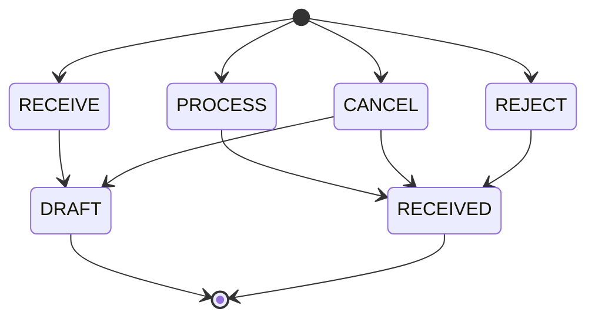

**Operaciones que ejercen esta máquina** _(POR_REFERENCIA: el handler alcanza un método que valida contra la tabla; «sin destino nombrado» significa que el estado de destino llega por el cuerpo de la petición)_:

| Operación | Estados de destino que nombra | A través de |
|---|---|---|
| POST /diagnostics/lab/orders/{orderId}/transitions | CANCEL, PROCESS, RECEIVE, REJECT | DiagnosticsLabPortalController.transition → LabPortalOrdersService.transition |

## Árbol de decisión por operación

Cada árbol se deriva del código del handler y de los métodos que invoca (hasta 4 niveles). Una rama que no decide, no escribe y no falla se poda. Los accesos y los efectos consecutivos se agrupan en un solo nodo.

### Operaciones con decisiones propias

#### 1. GET /diagnostic-results/me

Resultados de laboratorio, informes e imagen del titular

| HTTP | Código | Cuándo |
|---|---|---|
| 200 | — | Éxito |
| 401 | `UNAUTHENTICATED` | Hay una sesión válida (JWT) |
| 403 | `FORBIDDEN` | El rol está permitido; El tenant se resuelve y pertenece al actor |
| 422 | `PRECONDITION_FAILED` | PreconditionFailedException: La cuenta no tiene una persona vinculada; PreconditionFailedException: La cuenta no tiene perfil de paciente |
| 429 | `RATE_LIMITED` | No se supera el límite de solicitudes |

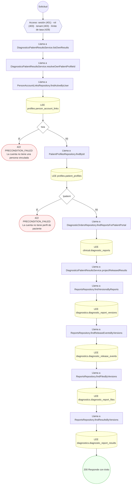

#### 2. GET /diagnostic-results/me/{reportId}

Un resultado del titular, con sus archivos

| HTTP | Código | Cuándo |
|---|---|---|
| 200 | — | Éxito |
| 400 | `VALIDATION_FAILED` | Los parámetros de ruta son UUID válidos |
| 401 | `UNAUTHENTICATED` | Hay una sesión válida (JWT); UnauthorizedException: El informe no pertenece a esta cuenta |
| 403 | `FORBIDDEN` | El rol está permitido; El tenant se resuelve y pertenece al actor |
| 404 | `NOT_FOUND` | ResourceNotFoundException: Informe no encontrado; ResourceNotFoundException: El resultado todavía no está disponible |
| 422 | `PRECONDITION_FAILED` | PreconditionFailedException: La cuenta no tiene una persona vinculada; PreconditionFailedException: La cuenta no tiene perfil de paciente |
| 429 | `RATE_LIMITED` | No se supera el límite de solicitudes |

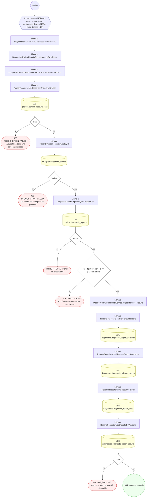

#### 3. GET /diagnostic-results/me/{reportId}/files/{fileId}/content

Descargar un archivo de un resultado del titular

| HTTP | Código | Cuándo |
|---|---|---|
| 200 | — | Éxito |
| 400 | `VALIDATION_FAILED` | Los parámetros de ruta son UUID válidos |
| 401 | `UNAUTHENTICATED` | Hay una sesión válida (JWT) |
| 403 | `FORBIDDEN` | El rol está permitido; El tenant se resuelve y pertenece al actor |
| 404 | `NOT_FOUND` | ResourceNotFoundException: Archivo no encontrado; ResourceNotFoundException: {labels.notFound}; ResourceNotFoundException: El contenido no está disponible en el almacenamiento local; ResourceNotFoundException: El contenido no está disponible en el almacenamiento configurado |
| 422 | `PRECONDITION_FAILED` | PreconditionFailedException: La cuenta no tiene una persona vinculada; PreconditionFailedException: La cuenta no tiene perfil de paciente; PreconditionFailedException: La descarga de archivos no está disponible |
| 429 | `RATE_LIMITED` | No se supera el límite de solicitudes |
| 500 | `INTERNAL` | Error: S3 object body is empty |

```mermaid
flowchart TD
  n1(("Solicitud")):::inicio
  n2{{"Acceso: sesión (401) · rol (403) · tenant (403) · parámetros de ruta (400) · límite de tasa (429)"}}:::acceso
  n1 --> n2
  n3["Llama a DiagnosticsPatientResultsService.getOwnResultFileContent"]:::llamada
  n2 --> n3
  n4["Llama a DiagnosticsPatientResultsService.resolveOwnPatientProfileId"]:::llamada
  n3 --> n4
  n5["Llama a PersonAccountLinksRepository.findActiveByUser"]:::llamada
  n4 --> n5
  n6[("LEE profiles.person_account_links")]:::efecto
  n5 --> n6
  n7{"!link"}:::decision
  n6 --> n7
  n8(["422 PRECONDITION_FAILED La cuenta no tiene una persona vinculada"]):::error
  n7 -->|"sí"| n8
  n9["Llama a PatientProfilesRepository.findById"]:::llamada
  n7 -->|"no"| n9
  n10[("LEE profiles.patient_profiles")]:::efecto
  n9 --> n10
  n11{"!patient"}:::decision
  n10 --> n11
  n12(["422 PRECONDITION_FAILED La cuenta no tiene perfil de paciente"]):::error
  n11 -->|"sí"| n12
  n13["Llama a DiagnosticOrdersRepository.findReportById"]:::llamada
  n11 -->|"no"| n13
  n14[("LEE clinical.diagnostic_reports")]:::efecto
  n13 --> n14
  n15{"!report || report.patientProfileId !== patientProfileId"}:::decision
  n14 --> n15
  n16(["404 NOT_FOUND Archivo no encontrado"]):::error
  n15 -->|"sí"| n16
  n17["Llama a DiagnosticsPatientResultsService.projectReleasedResults"]:::llamada
  n15 -->|"no"| n17
  n18["Llama a ReportsRepository.findVersionsByReports"]:::llamada
  n17 --> n18
  n19[("LEE diagnostics.diagnostic_report_versions")]:::efecto
  n18 --> n19
  n20["Llama a ReportsRepository.findReleaseEventsByVersions"]:::llamada
  n19 --> n20
  n21[("LEE diagnostics.diagnostic_release_events")]:::efecto
  n20 --> n21
  n22["Llama a ReportsRepository.findFilesByVersions"]:::llamada
  n21 --> n22
  n23[("LEE diagnostics.diagnostic_report_files")]:::efecto
  n22 --> n23
  n24["Llama a ReportsRepository.findResultsByVersions"]:::llamada
  n23 --> n24
  n25[("LEE diagnostics.diagnostic_report_results")]:::efecto
  n24 --> n25
  n26{"!item?.files.some((file) =› file.fileId === fileId)"}:::decision
  n25 --> n26
  n27(["404 NOT_FOUND Archivo no encontrado"]):::error
  n26 -->|"sí"| n27
  n28{"!this.fileUpload"}:::decision
  n26 -->|"no"| n28
  n29(["422 PRECONDITION_FAILED La descarga de archivos no está disponible"]):::error
  n28 -->|"sí"| n29
  n30["Llama a FileUploadService.downloadForAuthorizedContext"]:::llamada
  n28 -->|"no"| n30
  n31["Llama a FilesRepository.findById"]:::llamada
  n30 --> n31
  n32[("LEE common.files")]:::efecto
  n31 --> n32
  n33{"!file"}:::decision
  n32 --> n33
  n34(["404 NOT_FOUND Archivo no encontrado"]):::error
  n33 -->|"sí"| n34
  n35["Llama a FileUploadService.serveCurrentVersion"]:::llamada
  n33 -->|"no"| n35
  n36["Llama a AttachableFileService.assertUsableForAuthorizedContext"]:::llamada
  n35 --> n36
  n37{"!file"}:::decision
  n36 --> n37
  n38(["404 NOT_FOUND {labels.notFound}"]):::error
  n37 -->|"sí"| n38
  n39["Llama a LocalDiskFileStorageAdapter.retrieve"]:::llamada
  n37 -->|"no"| n39
  n40["Intenta"]:::intento
  n39 --> n40
  n41{"isMissingFile(error)"}:::decision
  n40 -->|"si falla"| n41
  n42(["404 NOT_FOUND El contenido no está disponible en el almacenamiento local"]):::error
  n41 -->|"sí"| n42
  n43(["↩ (relanza el error capturado)"]):::error
  n41 -->|"no"| n43
  n44["Llama a S3FileStorageAdapter.retrieve"]:::llamada
  n40 --> n44
  n45["Intenta"]:::intento
  n44 --> n45
  n46{"!result.Body"}:::decision
  n45 --> n46
  n47(["500 INTERNAL S3 object body is empty"]):::error
  n46 -->|"sí"| n47
  n48{"isNotFound(error)"}:::decision
  n45 -->|"si falla"| n48
  n49(["404 NOT_FOUND El contenido no está disponible en el almacenamiento configurado"]):::error
  n48 -->|"sí"| n49
  n50(["↩ (relanza el error capturado)"]):::error
  n48 -->|"no"| n50
  n51(("200 Responde con éxito")):::ok
  n46 -->|"no"| n51
  classDef acceso fill:#eef,stroke:#66a
  classDef error fill:#fee,stroke:#c33
  classDef ok fill:#efe,stroke:#3a3
  classDef efecto fill:#ffd,stroke:#aa3
  classDef decision fill:#fff,stroke:#555
  classDef corte fill:#eee,stroke:#999,stroke-dasharray: 4
```

#### 4. GET /diagnostic-results/me/{reportId}/shares

Con quién está compartido un resultado

| HTTP | Código | Cuándo |
|---|---|---|
| 200 | — | Éxito |
| 400 | `VALIDATION_FAILED` | Los parámetros de ruta son UUID válidos |
| 401 | `UNAUTHENTICATED` | Hay una sesión válida (JWT); UnauthorizedException: El informe no pertenece a esta cuenta |
| 403 | `FORBIDDEN` | El rol está permitido; El tenant se resuelve y pertenece al actor |
| 404 | `NOT_FOUND` | ResourceNotFoundException: Informe no encontrado |
| 422 | `PRECONDITION_FAILED` | PreconditionFailedException: La cuenta no tiene una persona vinculada; PreconditionFailedException: La cuenta no tiene perfil de paciente |
| 429 | `RATE_LIMITED` | No se supera el límite de solicitudes |

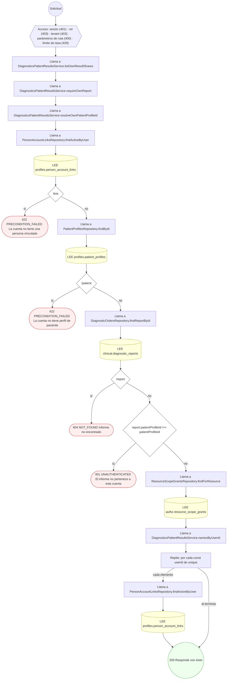

#### 5. POST /diagnostic-results/me/{reportId}/shares

Compartir temporalmente un resultado con un profesional

| HTTP | Código | Cuándo |
|---|---|---|
| 201 | — | Éxito |
| 400 | `VALIDATION_FAILED` | Los parámetros de ruta son UUID válidos; El cuerpo cumple el DTO (sin propiedades extra) |
| 401 | `UNAUTHENTICATED` | Hay una sesión válida (JWT); UnauthorizedException: El informe no pertenece a esta cuenta |
| 403 | `FORBIDDEN` | El rol está permitido; El tenant se resuelve y pertenece al actor |
| 404 | `NOT_FOUND` | ResourceNotFoundException: Informe no encontrado; ResourceNotFoundException: El profesional no tiene una cuenta activa en el portal |
| 422 | `PRECONDITION_FAILED` | PreconditionFailedException: El vencimiento del acceso compartido tiene que ser futuro; PreconditionFailedException: La cuenta no tiene una persona vinculada; PreconditionFailedException: La cuenta no tiene perfil de paciente; PreconditionFailedException: El profesional no tiene una relación asistencial vigente con este paciente; PreconditionFailedException: No hace falta compartirse un resultado con uno mismo; PreconditionFailedException: Sólo se puede compartir un resultado ya liberado |
| 429 | `RATE_LIMITED` | No se supera el límite de solicitudes |

```mermaid
flowchart TD
  n1(("Solicitud")):::inicio
  n2{{"Acceso: sesión (401) · rol (403) · tenant (403) · parámetros de ruta (400) · cuerpo válido (400) · límite de…"}}:::acceso
  n1 --> n2
  n3["Llama a DiagnosticsPatientResultsService.shareOwnResult"]:::llamada
  n2 --> n3
  n4{"dto.validUntil.getTime() ‹= now.getTime()"}:::decision
  n3 --> n4
  n5(["422 PRECONDITION_FAILED El vencimiento del acceso compartido tiene que ser futuro"]):::error
  n4 -->|"sí"| n5
  n6["Transacción: transactional(…)"]:::transaccion
  n4 -->|"no"| n6
  n7["Llama a DiagnosticsPatientResultsService.requireOwnReport"]:::llamada
  n6 --> n7
  n8["Llama a DiagnosticsPatientResultsService.resolveOwnPatientProfileId"]:::llamada
  n7 --> n8
  n9["Llama a PersonAccountLinksRepository.findActiveByUser"]:::llamada
  n8 --> n9
  n10[("LEE profiles.person_account_links")]:::efecto
  n9 --> n10
  n11{"!link"}:::decision
  n10 --> n11
  n12(["422 PRECONDITION_FAILED La cuenta no tiene una persona vinculada"]):::error
  n11 -->|"sí"| n12
  n13["Llama a PatientProfilesRepository.findById"]:::llamada
  n11 -->|"no"| n13
  n14[("LEE profiles.patient_profiles")]:::efecto
  n13 --> n14
  n15{"!patient"}:::decision
  n14 --> n15
  n16(["422 PRECONDITION_FAILED La cuenta no tiene perfil de paciente"]):::error
  n15 -->|"sí"| n16
  n17["Llama a DiagnosticOrdersRepository.findReportById"]:::llamada
  n15 -->|"no"| n17
  n18[("LEE clinical.diagnostic_reports")]:::efecto
  n17 --> n18
  n19{"!report"}:::decision
  n18 --> n19
  n20(["404 NOT_FOUND Informe no encontrado"]):::error
  n19 -->|"sí"| n20
  n21{"report.patientProfileId !== patientProfileId"}:::decision
  n19 -->|"no"| n21
  n22(["401 UNAUTHENTICATED El informe no pertenece a esta cuenta"]):::error
  n21 -->|"sí"| n22
  n23["Llama a CareRelationshipsRepository.findActive"]:::llamada
  n21 -->|"no"| n23
  n24[("LEE authz.care_relationships")]:::efecto
  n23 --> n24
  n25{"!relation"}:::decision
  n24 --> n25
  n26(["422 PRECONDITION_FAILED El profesional no tiene una relación asistencial vigente con este paciente"]):::error
  n25 -->|"sí"| n26
  n27["Llama a PersonAccountLinksRepository.findActiveByPerson"]:::llamada
  n25 -->|"no"| n27
  n28[("LEE profiles.person_account_links")]:::efecto
  n27 --> n28
  n29{"!account"}:::decision
  n28 --> n29
  n30(["404 NOT_FOUND El profesional no tiene una cuenta activa en el portal"]):::error
  n29 -->|"sí"| n30
  n31{"practitionerUserId === actor.id"}:::decision
  n29 -->|"no"| n31
  n32(["422 PRECONDITION_FAILED No hace falta compartirse un resultado con uno mismo"]):::error
  n31 -->|"sí"| n32
  n33["Llama a DiagnosticsPatientResultsService.projectReleasedResults"]:::llamada
  n31 -->|"no"| n33
  n34["Llama a ReportsRepository.findVersionsByReports"]:::llamada
  n33 --> n34
  n35[("LEE diagnostics.diagnostic_report_versions")]:::efecto
  n34 --> n35
  n36["Llama a ReportsRepository.findReleaseEventsByVersions"]:::llamada
  n35 --> n36
  n37[("LEE diagnostics.diagnostic_release_events")]:::efecto
  n36 --> n37
  n38["Llama a ReportsRepository.findFilesByVersions"]:::llamada
  n37 --> n38
  n39[("LEE diagnostics.diagnostic_report_files")]:::efecto
  n38 --> n39
  n40["Llama a ReportsRepository.findResultsByVersions"]:::llamada
  n39 --> n40
  n41[("LEE diagnostics.diagnostic_report_results")]:::efecto
  n40 --> n41
  n42{"!visible"}:::decision
  n41 --> n42
  n43(["422 PRECONDITION_FAILED Sólo se puede compartir un resultado ya liberado"]):::error
  n42 -->|"sí"| n43
  n44["Llama a ResourceScopeGrantsRepository.findExisting"]:::llamada
  n42 -->|"no"| n44
  n45[("LEE authz.resource_scope_grants")]:::efecto
  n44 --> n45
  n46{"existing"}:::decision
  n45 --> n46
  n47[("ACTUALIZA authz.resource_scope_grants · ACTUALIZA authz.resource_scope_grants")]:::efecto
  n46 -->|"sí"| n47
  n48["Llama a ResourceScopeGrantsRepository.create"]:::llamada
  n47 --> n48
  n46 -->|"no"| n48
  n49[("CREA authz.resource_scope_grants")]:::efecto
  n48 --> n49
  n50(("201 Responde con éxito")):::ok
  n49 --> n50
  classDef acceso fill:#eef,stroke:#66a
  classDef error fill:#fee,stroke:#c33
  classDef ok fill:#efe,stroke:#3a3
  classDef efecto fill:#ffd,stroke:#aa3
  classDef decision fill:#fff,stroke:#555
  classDef corte fill:#eee,stroke:#999,stroke-dasharray: 4
```

#### 6. POST /diagnostic-results/me/{reportId}/shares/{shareId}/revoke

Dejar de compartir un resultado

| HTTP | Código | Cuándo |
|---|---|---|
| 200 | — | Éxito |
| 400 | `VALIDATION_FAILED` | Los parámetros de ruta son UUID válidos |
| 401 | `UNAUTHENTICATED` | Hay una sesión válida (JWT); UnauthorizedException: El informe no pertenece a esta cuenta |
| 403 | `FORBIDDEN` | El rol está permitido; El tenant se resuelve y pertenece al actor |
| 404 | `NOT_FOUND` | ResourceNotFoundException: Informe no encontrado; ResourceNotFoundException: Ese resultado no está compartido así |
| 409 | `CONFLICT` | ConflictException: Ese acceso compartido ya estaba cerrado |
| 422 | `PRECONDITION_FAILED` | PreconditionFailedException: La cuenta no tiene una persona vinculada; PreconditionFailedException: La cuenta no tiene perfil de paciente |
| 429 | `RATE_LIMITED` | No se supera el límite de solicitudes |

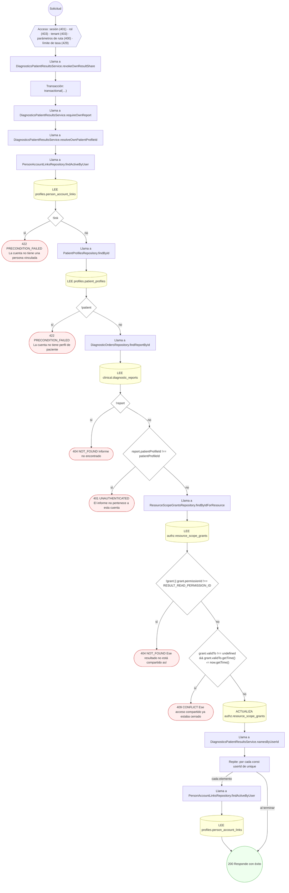

#### 7. GET /diagnostic-results/me/orders

Órdenes de laboratorio e imagen del titular

| HTTP | Código | Cuándo |
|---|---|---|
| 200 | — | Éxito |
| 401 | `UNAUTHENTICATED` | Hay una sesión válida (JWT) |
| 403 | `FORBIDDEN` | El rol está permitido; El tenant se resuelve y pertenece al actor |
| 422 | `PRECONDITION_FAILED` | PreconditionFailedException: La cuenta no tiene una persona vinculada; PreconditionFailedException: La cuenta no tiene perfil de paciente |
| 429 | `RATE_LIMITED` | No se supera el límite de solicitudes |

```mermaid
flowchart TD
  n1(("Solicitud")):::inicio
  n2{{"Acceso: sesión (401) · rol (403) · tenant (403) · límite de tasa (429)"}}:::acceso
  n1 --> n2
  n3["Llama a DiagnosticsPatientResultsService.listOwnOrders"]:::llamada
  n2 --> n3
  n4["Llama a DiagnosticsPatientResultsService.resolveOwnPatientProfileId"]:::llamada
  n3 --> n4
  n5["Llama a PersonAccountLinksRepository.findActiveByUser"]:::llamada
  n4 --> n5
  n6[("LEE profiles.person_account_links")]:::efecto
  n5 --> n6
  n7{"!link"}:::decision
  n6 --> n7
  n8(["422 PRECONDITION_FAILED La cuenta no tiene una persona vinculada"]):::error
  n7 -->|"sí"| n8
  n9["Llama a PatientProfilesRepository.findById"]:::llamada
  n7 -->|"no"| n9
  n10[("LEE profiles.patient_profiles")]:::efecto
  n9 --> n10
  n11{"!patient"}:::decision
  n10 --> n11
  n12(["422 PRECONDITION_FAILED La cuenta no tiene perfil de paciente"]):::error
  n11 -->|"sí"| n12
  n13["Llama a DiagnosticOrdersRepository.findOrdersForPatientPortal"]:::llamada
  n11 -->|"no"| n13
  n14[("LEE clinical.service_requests")]:::efecto
  n13 --> n14
  n15["Llama a PatientSettlementService.forOrders"]:::llamada
  n14 --> n15
  n16["Transacción: transactional(…)"]:::transaccion
  n15 --> n16
  n17["Llama a InsurancePatientAccountRepository.findActiveAccountLink"]:::llamada
  n16 --> n17
  n18[("LEE profiles.person_account_links")]:::efecto
  n17 --> n18
  n19["Llama a InsurancePatientAccountRepository.findPatientProfile"]:::llamada
  n18 --> n19
  n20[("LEE profiles.patient_profiles")]:::efecto
  n19 --> n20
  n21["Llama a PatientSettlementRepository.ownedOrders"]:::llamada
  n20 --> n21
  n22{"origin === 'PHARMACY'"}:::decision
  n21 --> n22
  n23[("LEE pharmacy_inventory.inventory_reservations")]:::efecto
  n22 -->|"sí"| n23
  n24[("LEE clinical.service_requests · LEE terminology.catalog_concepts")]:::efecto
  n23 --> n24
  n22 -->|"no"| n24
  n25["Llama a PatientSettlementRepository.load"]:::llamada
  n24 --> n25
  n26[("LEE insurance.patient_coverages · LEE insurance.insurance_claims · LEE insurance.insurance_claim_lines · LEE…")]:::efecto
  n25 --> n26
  n27["Llama a LinkedClaimOrderService.loadSnapshots"]:::llamada
  n26 --> n27
  n28[("LEE insurance.insurance_claim_lines")]:::efecto
  n27 --> n28
  n29["Llama a DiagnosticsPatientResultsService.preparationByConcept"]:::llamada
  n28 --> n29
  n30["Llama a DiagnosticOrdersRepository.findPreparationByStudyConcepts"]:::llamada
  n29 --> n30
  n31[("LEE diagnostic_units.diagnostic_study_offerings")]:::efecto
  n30 --> n31
  n32["Llama a DiagnosticsPatientResultsService.releasedReportByOrder"]:::llamada
  n31 --> n32
  n33["Llama a DiagnosticOrdersRepository.findReportsByServiceRequests"]:::llamada
  n32 --> n33
  n34[("LEE clinical.diagnostic_reports")]:::efecto
  n33 --> n34
  n35["Llama a DiagnosticsPatientResultsService.projectReleasedResults"]:::llamada
  n34 --> n35
  n36["Llama a ReportsRepository.findVersionsByReports"]:::llamada
  n35 --> n36
  n37[("LEE diagnostics.diagnostic_report_versions")]:::efecto
  n36 --> n37
  n38["Llama a ReportsRepository.findReleaseEventsByVersions"]:::llamada
  n37 --> n38
  n39[("LEE diagnostics.diagnostic_release_events")]:::efecto
  n38 --> n39
  n40["Llama a ReportsRepository.findFilesByVersions"]:::llamada
  n39 --> n40
  n41[("LEE diagnostics.diagnostic_report_files")]:::efecto
  n40 --> n41
  n42["Llama a ReportsRepository.findResultsByVersions"]:::llamada
  n41 --> n42
  n43[("LEE diagnostics.diagnostic_report_results")]:::efecto
  n42 --> n43
  n44["Llama a SuggestedSiteNamesReader.namesFor"]:::llamada
  n43 --> n44
  n45[("LEE practice.practice_sites")]:::efecto
  n44 --> n45
  n46["Llama a ServiceRequestDetailService.describe"]:::llamada
  n45 --> n46
  n47["Llama a ServiceRequestDetailService.loadComponents"]:::llamada
  n46 --> n47
  n48[("LEE clinical.service_request_components")]:::efecto
  n47 --> n48
  n49["Llama a ServiceRequestDetailService.displays"]:::llamada
  n48 --> n49
  n50["Llama a ConceptDesignationsRepository.findPreferredByLanguageForConcepts"]:::llamada
  n49 --> n50
  n51[("LEE terminology.concept_designations")]:::efecto
  n50 --> n51
  n52[("LEE terminology.catalog_concepts")]:::efecto
  n51 --> n52
  n53(("200 Responde con éxito")):::ok
  n52 --> n53
  classDef acceso fill:#eef,stroke:#66a
  classDef error fill:#fee,stroke:#c33
  classDef ok fill:#efe,stroke:#3a3
  classDef efecto fill:#ffd,stroke:#aa3
  classDef decision fill:#fff,stroke:#555
  classDef corte fill:#eee,stroke:#999,stroke-dasharray: 4
```

#### 8. POST /diagnostics/accessions

Acesionar especímenes recibidos en laboratorio

| HTTP | Código | Cuándo |
|---|---|---|
| 201 | — | Éxito |
| 400 | `VALIDATION_FAILED` | El cuerpo cumple el DTO (sin propiedades extra) |
| 401 | `UNAUTHENTICATED` | Hay una sesión válida (JWT) |
| 403 | `FORBIDDEN` | El rol está permitido; El tenant se resuelve y pertenece al actor |
| 404 | `NOT_FOUND` | ResourceNotFoundException: {message}; ResourceNotFoundException: Espécimen no encontrado |
| 422 | `PRECONDITION_FAILED` | PreconditionFailedException: El espécimen está rechazado y no puede acesionarse |
| 429 | `RATE_LIMITED` | No se supera el límite de solicitudes |

```mermaid
flowchart TD
  n1(("Solicitud")):::inicio
  n2{{"Acceso: sesión (401) · rol (403) · tenant (403) · cuerpo válido (400) · límite de tasa (429)"}}:::acceso
  n1 --> n2
  n3["Llama a DiagnosticsSpecimensService.accession"]:::llamada
  n2 --> n3
  n4["Transacción: transactional(…)"]:::transaccion
  n3 --> n4
  n5["Llama a DiagnosticsScopeService.activeTenantFor"]:::llamada
  n4 --> n5
  n6{"bodyTenantId !== undefined && bodyTenantId !== tenantId"}:::decision
  n5 --> n6
  n7["Llama a DiagnosticsScopeService.notFound"]:::llamada
  n6 -->|"sí"| n7
  n8(["404 NOT_FOUND {message}"]):::error
  n7 --> n8
  n9{"dto.serviceRequestId"}:::decision
  n6 -->|"no"| n9
  n10["Llama a DiagnosticsScopeService.serviceRequest"]:::llamada
  n9 -->|"sí"| n10
  n11["Llama a ClinicalRefsRepository.findServiceRequest"]:::llamada
  n10 --> n11
  n12[("LEE clinical.service_requests")]:::efecto
  n11 --> n12
  n13["Llama a DiagnosticsScopeService.assertPatientMatches"]:::llamada
  n12 --> n13
  n14{"resource && patientProfileId !== undefined && resource.patientProfileId !== patientProfileId"}:::decision
  n13 --> n14
  n15["Llama a DiagnosticsScopeService.notFound"]:::llamada
  n14 -->|"sí"| n15
  n16(["404 NOT_FOUND {message}"]):::error
  n15 --> n16
  n17["Repite: por cada const specimenId de dto.specimenIds"]:::bucle
  n14 -->|"no"| n17
  n9 -->|"no"| n17
  n18["Llama a DiagnosticsScopeService.specimen"]:::llamada
  n17 -->|"cada elemento"| n18
  n19["Llama a SpecimensRepository.findSpecimen"]:::llamada
  n18 --> n19
  n20[("LEE diagnostics.specimens")]:::efecto
  n19 --> n20
  n21{"specimen.patientProfileId !== dto.patientProfileId"}:::decision
  n20 --> n21
  n22(["404 NOT_FOUND Espécimen no encontrado"]):::error
  n21 -->|"sí"| n22
  n23{"specimen.statusConceptId === DIAG.SPECIMEN_REJECTED"}:::decision
  n21 -->|"no"| n23
  n24(["422 PRECONDITION_FAILED El espécimen está rechazado y no puede acesionarse"]):::error
  n23 -->|"sí"| n24
  n25["Llama a SpecimensRepository.createAccession"]:::llamada
  n23 -->|"no"| n25
  n17 -->|"al terminar"| n25
  n26[("CREA diagnostics.laboratory_accessions")]:::efecto
  n25 --> n26
  n27["Repite: por cada const specimen de specimens"]:::bucle
  n26 --> n27
  n28["Llama a SpecimensRepository.addAccessionSpecimen"]:::llamada
  n27 -->|"cada elemento"| n28
  n29[("CREA diagnostics.accession_specimens")]:::efecto
  n28 --> n29
  n30[("ACTUALIZA diagnostics.specimens · ACTUALIZA diagnostics.specimens")]:::efecto
  n29 --> n30
  n31["Llama a SpecimensRepository.recordCustodyEvent"]:::llamada
  n30 --> n31
  n32[("CREA diagnostics.specimen_chain_of_custody_events")]:::efecto
  n31 --> n32
  n33(("201 Responde con éxito")):::ok
  n32 --> n33
  n27 -->|"al terminar"| n33
  classDef acceso fill:#eef,stroke:#66a
  classDef error fill:#fee,stroke:#c33
  classDef ok fill:#efe,stroke:#3a3
  classDef efecto fill:#ffd,stroke:#aa3
  classDef decision fill:#fff,stroke:#555
  classDef corte fill:#eee,stroke:#999,stroke-dasharray: 4
```

#### 9. GET /diagnostics/accessions/{id}

Detalle de una acesión (especímenes, contenedores y custodia)

| HTTP | Código | Cuándo |
|---|---|---|
| 200 | — | Éxito |
| 400 | `VALIDATION_FAILED` | Los parámetros de ruta son UUID válidos |
| 401 | `UNAUTHENTICATED` | Hay una sesión válida (JWT) |
| 403 | `FORBIDDEN` | El rol está permitido; El tenant se resuelve y pertenece al actor |
| 404 | `NOT_FOUND` | ResourceNotFoundException: Acesión no encontrada |
| 429 | `RATE_LIMITED` | No se supera el límite de solicitudes |

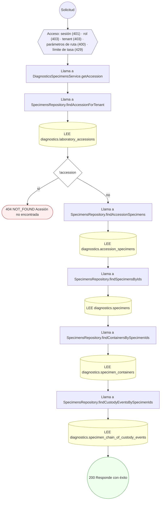

#### 10. POST /diagnostics/analyzer-runs

Abrir una corrida de analizador (soporte para ingesta)

| HTTP | Código | Cuándo |
|---|---|---|
| 201 | — | Éxito |
| 400 | `VALIDATION_FAILED` | El cuerpo cumple el DTO (sin propiedades extra) |
| 401 | `UNAUTHENTICATED` | Hay una sesión válida (JWT) |
| 403 | `FORBIDDEN` | El rol está permitido; El tenant se resuelve y pertenece al actor |
| 404 | `NOT_FOUND` | ResourceNotFoundException: {message} |
| 429 | `RATE_LIMITED` | No se supera el límite de solicitudes |

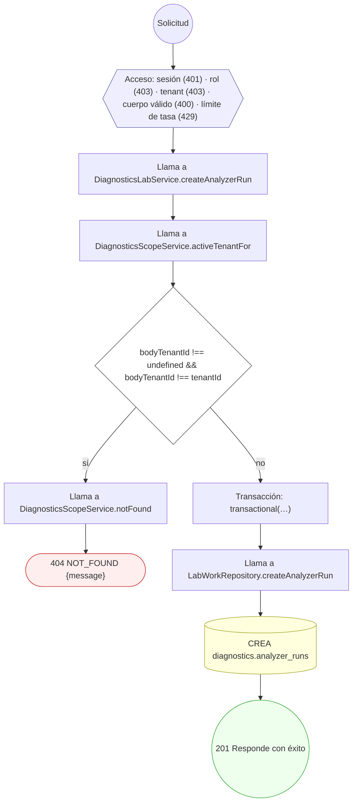

#### 11. POST /diagnostics/analyzer-runs/{id}/messages

Ingerir mensaje de resultado de analizador (LIS/HL7/ASTM)

| HTTP | Código | Cuándo |
|---|---|---|
| 201 | — | Éxito |
| 400 | `VALIDATION_FAILED` | Los parámetros de ruta son UUID válidos; El cuerpo cumple el DTO (sin propiedades extra) |
| 401 | `UNAUTHENTICATED` | Hay una sesión válida (JWT) |
| 403 | `FORBIDDEN` | El rol está permitido; El tenant se resuelve y pertenece al actor |
| 404 | `NOT_FOUND` | ResourceNotFoundException: {message} |
| 409 | `CONFLICT` | ConflictException: El mensaje ya fue ingerido para esta corrida |
| 429 | `RATE_LIMITED` | No se supera el límite de solicitudes |

```mermaid
flowchart TD
  n1(("Solicitud")):::inicio
  n2{{"Acceso: sesión (401) · rol (403) · tenant (403) · parámetros de ruta (400) · cuerpo válido (400) · límite de…"}}:::acceso
  n1 --> n2
  n3["Llama a DiagnosticsLabService.ingestMessage"]:::llamada
  n2 --> n3
  n4["Transacción: transactional(…)"]:::transaccion
  n3 --> n4
  n5["Llama a LabWorkRepository.findAnalyzerRun"]:::llamada
  n4 --> n5
  n6[("LEE diagnostics.analyzer_runs")]:::efecto
  n5 --> n6
  n7{"dto.laboratoryWorkOrderTestId"}:::decision
  n6 --> n7
  n8["Llama a LabWorkRepository.findWorkOrderTest"]:::llamada
  n7 -->|"sí"| n8
  n9[("LEE diagnostics.laboratory_work_order_tests")]:::efecto
  n8 --> n9
  n10["Llama a LabWorkRepository.findWorkOrder"]:::llamada
  n9 --> n10
  n11[("LEE diagnostics.laboratory_work_orders")]:::efecto
  n10 --> n11
  n12{"dto.mappedObservationId"}:::decision
  n11 --> n12
  n7 -->|"no"| n12
  n13["Llama a DiagnosticsScopeService.observation"]:::llamada
  n12 -->|"sí"| n13
  n14["Llama a ClinicalRefsRepository.findObservation"]:::llamada
  n13 --> n14
  n15[("LEE clinical.observations")]:::efecto
  n14 --> n15
  n16["Llama a DiagnosticsScopeService.assertPatientMatches"]:::llamada
  n15 --> n16
  n17{"resource && patientProfileId !== undefined && resource.patientProfileId !== patientProfileId"}:::decision
  n16 --> n17
  n18["Llama a DiagnosticsScopeService.notFound"]:::llamada
  n17 -->|"sí"| n18
  n19(["404 NOT_FOUND {message}"]):::error
  n18 --> n19
  n20{"dto.rawMessageFileId"}:::decision
  n17 -->|"no"| n20
  n12 -->|"no"| n20
  n21["Llama a DiagnosticsScopeService.file"]:::llamada
  n20 -->|"sí"| n21
  n22["Llama a ClinicalRefsRepository.findFile"]:::llamada
  n21 --> n22
  n23[("LEE common.files")]:::efecto
  n22 --> n23
  n24{"dto.messageControlId"}:::decision
  n23 --> n24
  n20 -->|"no"| n24
  n25["Llama a LabWorkRepository.findMessageByControlId"]:::llamada
  n24 -->|"sí"| n25
  n26[("LEE diagnostics.analyzer_result_messages")]:::efecto
  n25 --> n26
  n27{"dup"}:::decision
  n26 --> n27
  n28(["409 CONFLICT El mensaje ya fue ingerido para esta corrida"]):::error
  n27 -->|"sí"| n28
  n29["Llama a LabWorkRepository.recordMessage"]:::llamada
  n27 -->|"no"| n29
  n24 -->|"no"| n29
  n30[("CREA diagnostics.analyzer_result_messages")]:::efecto
  n29 --> n30
  n31{"test"}:::decision
  n30 --> n31
  n32[("ACTUALIZA diagnostics.laboratory_work_order_tests · ACTUALIZA diagnostics.laboratory_work_order_tests · ACTUA…")]:::efecto
  n31 -->|"sí"| n32
  n33(("201 Responde con éxito")):::ok
  n32 --> n33
  n31 -->|"no"| n33
  classDef acceso fill:#eef,stroke:#66a
  classDef error fill:#fee,stroke:#c33
  classDef ok fill:#efe,stroke:#3a3
  classDef efecto fill:#ffd,stroke:#aa3
  classDef decision fill:#fff,stroke:#555
  classDef corte fill:#eee,stroke:#999,stroke-dasharray: 4
```

#### 12. POST /diagnostics/clinical-media

Adjuntar media clínica / imagen al chart

| HTTP | Código | Cuándo |
|---|---|---|
| 201 | — | Éxito |
| 400 | `VALIDATION_FAILED` | El cuerpo cumple el DTO (sin propiedades extra) |
| 401 | `UNAUTHENTICATED` | Hay una sesión válida (JWT) |
| 403 | `FORBIDDEN` | El rol está permitido; El tenant se resuelve y pertenece al actor |
| 404 | `NOT_FOUND` | ResourceNotFoundException: {message} |
| 409 | `CONFLICT` | ConflictException: El archivo ya está adjunto como media clínica |
| 429 | `RATE_LIMITED` | No se supera el límite de solicitudes |

```mermaid
flowchart TD
  n1(("Solicitud")):::inicio
  n2{{"Acceso: sesión (401) · rol (403) · tenant (403) · cuerpo válido (400) · límite de tasa (429)"}}:::acceso
  n1 --> n2
  n3["Llama a DiagnosticsMediaQualityService.attachMedia"]:::llamada
  n2 --> n3
  n4["Transacción: transactional(…)"]:::transaccion
  n3 --> n4
  n5["Llama a DiagnosticsScopeService.activeTenantFor"]:::llamada
  n4 --> n5
  n6{"bodyTenantId !== undefined && bodyTenantId !== tenantId"}:::decision
  n5 --> n6
  n7["Llama a DiagnosticsScopeService.notFound"]:::llamada
  n6 -->|"sí"| n7
  n8(["404 NOT_FOUND {message}"]):::error
  n7 --> n8
  n9["Llama a DiagnosticsScopeService.file"]:::llamada
  n6 -->|"no"| n9
  n10["Llama a ClinicalRefsRepository.findFile"]:::llamada
  n9 --> n10
  n11[("LEE common.files")]:::efecto
  n10 --> n11
  n12{"dto.encounterId"}:::decision
  n11 --> n12
  n13["Llama a DiagnosticsScopeService.encounter"]:::llamada
  n12 -->|"sí"| n13
  n14["Llama a ClinicalRefsRepository.findEncounter"]:::llamada
  n13 --> n14
  n15[("LEE clinical.encounters")]:::efecto
  n14 --> n15
  n16["Llama a DiagnosticsScopeService.assertPatientMatches"]:::llamada
  n15 --> n16
  n17{"resource && patientProfileId !== undefined && resource.patientProfileId !== patientProfileId"}:::decision
  n16 --> n17
  n18["Llama a DiagnosticsScopeService.notFound"]:::llamada
  n17 -->|"sí"| n18
  n19(["404 NOT_FOUND {message}"]):::error
  n18 --> n19
  n20{"dto.diagnosticReportId"}:::decision
  n17 -->|"no"| n20
  n12 -->|"no"| n20
  n21["Llama a DiagnosticsScopeService.report"]:::llamada
  n20 -->|"sí"| n21
  n22["Llama a DiagnosticOrdersRepository.findReportById"]:::llamada
  n21 --> n22
  n23[("LEE clinical.diagnostic_reports")]:::efecto
  n22 --> n23
  n24["Llama a DiagnosticsScopeService.assertPatientMatches"]:::llamada
  n23 --> n24
  n25{"resource && patientProfileId !== undefined && resource.patientProfileId !== patientProfileId"}:::decision
  n24 --> n25
  n26["Llama a DiagnosticsScopeService.notFound"]:::llamada
  n25 -->|"sí"| n26
  n27(["404 NOT_FOUND {message}"]):::error
  n26 --> n27
  n28["Llama a MediaQualityRepository.findMediaByFile"]:::llamada
  n25 -->|"no"| n28
  n20 -->|"no"| n28
  n29[("LEE diagnostics.clinical_media")]:::efecto
  n28 --> n29
  n30{"dup"}:::decision
  n29 --> n30
  n31(["409 CONFLICT El archivo ya está adjunto como media clínica"]):::error
  n30 -->|"sí"| n31
  n32["Llama a MediaQualityRepository.createMedia"]:::llamada
  n30 -->|"no"| n32
  n33[("CREA diagnostics.clinical_media")]:::efecto
  n32 --> n33
  n34["Repite: por cada const a de dto.annotations ?? []"]:::bucle
  n33 --> n34
  n35["Llama a MediaQualityRepository.addAnnotation"]:::llamada
  n34 -->|"cada elemento"| n35
  n36[("CREA diagnostics.media_annotations")]:::efecto
  n35 --> n36
  n37(("201 Responde con éxito")):::ok
  n36 --> n37
  n34 -->|"al terminar"| n37
  classDef acceso fill:#eef,stroke:#66a
  classDef error fill:#fee,stroke:#c33
  classDef ok fill:#efe,stroke:#3a3
  classDef efecto fill:#ffd,stroke:#aa3
  classDef decision fill:#fff,stroke:#555
  classDef corte fill:#eee,stroke:#999,stroke-dasharray: 4
```

#### 13. POST /diagnostics/containers/{id}/custody-events

Registrar cadena de custodia / traslado de contenedor

| HTTP | Código | Cuándo |
|---|---|---|
| 201 | — | Éxito |
| 400 | `VALIDATION_FAILED` | Los parámetros de ruta son UUID válidos; El cuerpo cumple el DTO (sin propiedades extra) |
| 401 | `UNAUTHENTICATED` | Hay una sesión válida (JWT) |
| 403 | `FORBIDDEN` | El rol está permitido; El tenant se resuelve y pertenece al actor |
| 404 | `NOT_FOUND` | ResourceNotFoundException: Contenedor no encontrado |
| 429 | `RATE_LIMITED` | No se supera el límite de solicitudes |

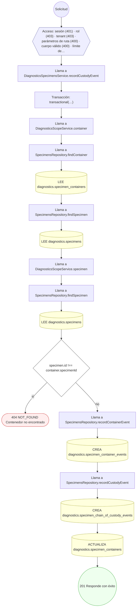

#### 14. POST /diagnostics/critical-results

Detectar y notificar un resultado crítico

| HTTP | Código | Cuándo |
|---|---|---|
| 201 | — | Éxito |
| 400 | `VALIDATION_FAILED` | El cuerpo cumple el DTO (sin propiedades extra) |
| 401 | `UNAUTHENTICATED` | Hay una sesión válida (JWT) |
| 403 | `FORBIDDEN` | El rol está permitido; El tenant se resuelve y pertenece al actor |
| 404 | `NOT_FOUND` | ResourceNotFoundException: {message}; ResourceNotFoundException: El proveedor configurado para el canal in-app no existe |
| 409 | `CONFLICT` | ConflictException: Ya existe una notificación crítica para la observación |
| 422 | `PRECONDITION_FAILED` | PreconditionFailedException: No hay canal in-app activo: falta correr el seed de mensajería; PreconditionFailedException: El canal in-app no tiene configuración de proveedor activa |
| 429 | `RATE_LIMITED` | No se supera el límite de solicitudes |

```mermaid
flowchart TD
  n1(("Solicitud")):::inicio
  n2{{"Acceso: sesión (401) · rol (403) · tenant (403) · cuerpo válido (400) · límite de tasa (429)"}}:::acceso
  n1 --> n2
  n3["Llama a CriticalResultDetectionService.detect"]:::llamada
  n2 --> n3
  n4["Llama a DiagnosticsReportsService.detectCritical"]:::llamada
  n3 --> n4
  n5["Transacción: transactional(…)"]:::transaccion
  n4 --> n5
  n6["Llama a DiagnosticsScopeService.activeTenantFor"]:::llamada
  n5 --> n6
  n7{"bodyTenantId !== undefined && bodyTenantId !== tenantId"}:::decision
  n6 --> n7
  n8["Llama a DiagnosticsScopeService.notFound"]:::llamada
  n7 -->|"sí"| n8
  n9(["404 NOT_FOUND {message}"]):::error
  n8 --> n9
  n10["Llama a DiagnosticsScopeService.observation"]:::llamada
  n7 -->|"no"| n10
  n11["Llama a ClinicalRefsRepository.findObservation"]:::llamada
  n10 --> n11
  n12[("LEE clinical.observations")]:::efecto
  n11 --> n12
  n13{"dto.diagnosticReportId"}:::decision
  n12 --> n13
  n14["Llama a DiagnosticsScopeService.report"]:::llamada
  n13 -->|"sí"| n14
  n15["Llama a DiagnosticOrdersRepository.findReportById"]:::llamada
  n14 --> n15
  n16[("LEE clinical.diagnostic_reports")]:::efecto
  n15 --> n16
  n17["Llama a ReportsRepository.criticalExistsForObservation"]:::llamada
  n16 --> n17
  n13 -->|"no"| n17
  n18[("LEE diagnostics.critical_result_notifications")]:::efecto
  n17 --> n18
  n19{"await this.repo.criticalExistsForObservation(tx, dto.observationId)"}:::decision
  n18 --> n19
  n20(["409 CONFLICT Ya existe una notificación crítica para la observación"]):::error
  n19 -->|"sí"| n20
  n21["Llama a ReportsRepository.createCriticalNotification"]:::llamada
  n19 -->|"no"| n21
  n22[("CREA diagnostics.critical_result_notifications")]:::efecto
  n21 --> n22
  n23["Llama a CriticalResultDetectionService.notifyResponsible"]:::llamada
  n22 --> n23
  n24["Intenta"]:::intento
  n23 --> n24
  n25["Llama a CriticalResultDetectionService.responsibleOf"]:::llamada
  n24 --> n25
  n26{"dto.diagnosticReportId"}:::decision
  n25 --> n26
  n27["Llama a DiagnosticOrdersRepository.findReportById"]:::llamada
  n26 -->|"sí"| n27
  n28[("LEE clinical.diagnostic_reports")]:::efecto
  n27 --> n28
  n29["Llama a ClinicalRefsRepository.findServiceRequest"]:::llamada
  n28 --> n29
  n30[("LEE clinical.service_requests")]:::efecto
  n29 --> n30
  n31["Llama a ClinicalRefsRepository.findObservation"]:::llamada
  n30 --> n31
  n26 -->|"no"| n31
  n32[("LEE clinical.observations")]:::efecto
  n31 --> n32
  n33["Llama a ClinicalRefsRepository.findEncounter"]:::llamada
  n32 --> n33
  n34[("LEE clinical.encounters")]:::efecto
  n33 --> n34
  n35["Llama a NotificationsService.emitInApp"]:::llamada
  n34 --> n35
  n36["Intenta"]:::intento
  n35 --> n36
  n37["Llama a NotificationsService.writeInApp"]:::llamada
  n36 --> n37
  n38{"!channel"}:::decision
  n37 --> n38
  n39(["422 PRECONDITION_FAILED No hay canal in-app activo: falta correr el seed de mensajería"]):::error
  n38 -->|"sí"| n39
  n40{"!config"}:::decision
  n38 -->|"no"| n40
  n41(["422 PRECONDITION_FAILED El canal in-app no tiene configuración de proveedor activa"]):::error
  n40 -->|"sí"| n41
  n42{"!provider"}:::decision
  n40 -->|"no"| n42
  n43(["404 NOT_FOUND El proveedor configurado para el canal in-app no existe"]):::error
  n42 -->|"sí"| n43
  n44[("ACTUALIZA messaging.in_app_notifications")]:::efecto
  n42 -->|"no"| n44
  n45{"availableAt › now"}:::decision
  n44 --> n45
  n46[("ACTUALIZA messaging.in_app_notifications")]:::efecto
  n45 -->|"sí"| n46
  n47(("201 Responde con éxito")):::ok
  n46 --> n47
  n45 -->|"no"| n47
  classDef acceso fill:#eef,stroke:#66a
  classDef error fill:#fee,stroke:#c33
  classDef ok fill:#efe,stroke:#3a3
  classDef efecto fill:#ffd,stroke:#aa3
  classDef decision fill:#fff,stroke:#555
  classDef corte fill:#eee,stroke:#999,stroke-dasharray: 4
```

#### 15. POST /diagnostics/critical-results/{id}/acknowledge

Acusar recibo / escalar notificación crítica

| HTTP | Código | Cuándo |
|---|---|---|
| 200 | — | Éxito |
| 400 | `VALIDATION_FAILED` | Los parámetros de ruta son UUID válidos; El cuerpo cumple el DTO (sin propiedades extra) |
| 401 | `UNAUTHENTICATED` | Hay una sesión válida (JWT) |
| 403 | `FORBIDDEN` | El rol está permitido; El tenant se resuelve y pertenece al actor; InsufficientRoleException: El autor debe ser el profesional que firma |
| 409 | `CONFLICT` | ConflictException: La notificación ya fue reconocida |
| 429 | `RATE_LIMITED` | No se supera el límite de solicitudes |

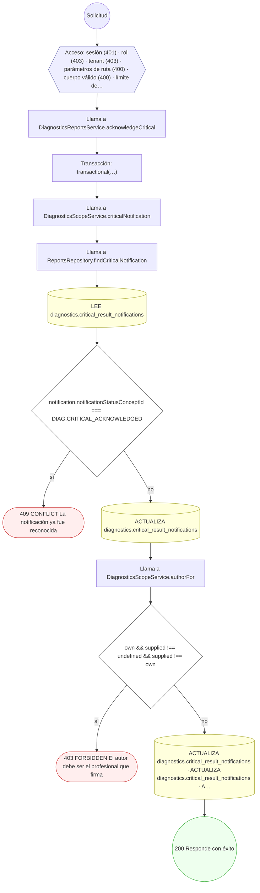

#### 16. POST /diagnostics/data-quality-events

Registrar evento de calidad de datos + enlazar provenance

| HTTP | Código | Cuándo |
|---|---|---|
| 201 | — | Éxito |
| 400 | `VALIDATION_FAILED` | El cuerpo cumple el DTO (sin propiedades extra) |
| 401 | `UNAUTHENTICATED` | Hay una sesión válida (JWT) |
| 403 | `FORBIDDEN` | El rol está permitido; El tenant se resuelve y pertenece al actor; InsufficientRoleException: El autor debe ser el profesional que firma |
| 404 | `NOT_FOUND` | ResourceNotFoundException: {message} |
| 429 | `RATE_LIMITED` | No se supera el límite de solicitudes |

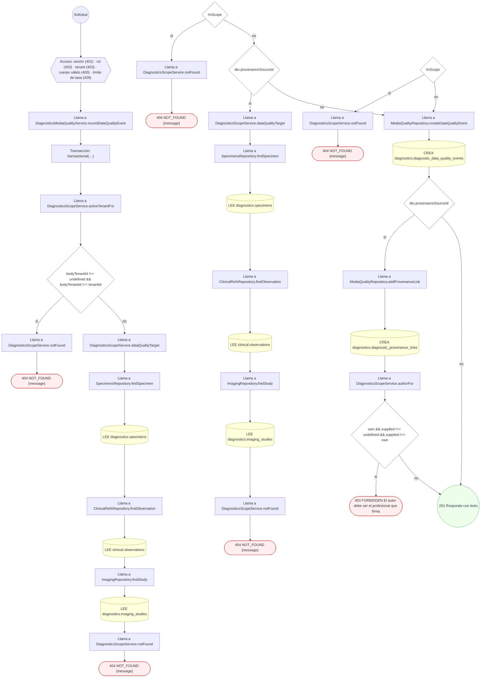

#### 17. POST /diagnostics/imaging-endpoints

Registrar un endpoint DICOM (soporte para STOW-RS)

| HTTP | Código | Cuándo |
|---|---|---|
| 201 | — | Éxito |
| 400 | `VALIDATION_FAILED` | El cuerpo cumple el DTO (sin propiedades extra) |
| 401 | `UNAUTHENTICATED` | Hay una sesión válida (JWT) |
| 403 | `FORBIDDEN` | El rol está permitido; El tenant se resuelve y pertenece al actor |
| 404 | `NOT_FOUND` | ResourceNotFoundException: {message} |
| 429 | `RATE_LIMITED` | No se supera el límite de solicitudes |

```mermaid
flowchart TD
  n1(("Solicitud")):::inicio
  n2{{"Acceso: sesión (401) · rol (403) · tenant (403) · cuerpo válido (400) · límite de tasa (429)"}}:::acceso
  n1 --> n2
  n3["Llama a DiagnosticsImagingService.createEndpoint"]:::llamada
  n2 --> n3
  n4["Llama a DiagnosticsScopeService.activeTenantFor"]:::llamada
  n3 --> n4
  n5{"bodyTenantId !== undefined && bodyTenantId !== tenantId"}:::decision
  n4 --> n5
  n6["Llama a DiagnosticsScopeService.notFound"]:::llamada
  n5 -->|"sí"| n6
  n7(["404 NOT_FOUND {message}"]):::error
  n6 --> n7
  n8["Transacción: transactional(…)"]:::transaccion
  n5 -->|"no"| n8
  n9["Llama a ImagingRepository.createEndpoint"]:::llamada
  n8 --> n9
  n10[("CREA diagnostics.imaging_endpoints")]:::efecto
  n9 --> n10
  n11(("201 Responde con éxito")):::ok
  n10 --> n11
  classDef acceso fill:#eef,stroke:#66a
  classDef error fill:#fee,stroke:#c33
  classDef ok fill:#efe,stroke:#3a3
  classDef efecto fill:#ffd,stroke:#aa3
  classDef decision fill:#fff,stroke:#555
  classDef corte fill:#eee,stroke:#999,stroke-dasharray: 4
```

#### 18. POST /diagnostics/imaging-studies/{id}/dose-events

Registrar evento de dosis de radiación

| HTTP | Código | Cuándo |
|---|---|---|
| 201 | — | Éxito |
| 400 | `VALIDATION_FAILED` | Los parámetros de ruta son UUID válidos; El cuerpo cumple el DTO (sin propiedades extra) |
| 401 | `UNAUTHENTICATED` | Hay una sesión válida (JWT) |
| 403 | `FORBIDDEN` | El rol está permitido; El tenant se resuelve y pertenece al actor |
| 429 | `RATE_LIMITED` | No se supera el límite de solicitudes |

```mermaid
flowchart TD
  n1(("Solicitud")):::inicio
  n2{{"Acceso: sesión (401) · rol (403) · tenant (403) · parámetros de ruta (400) · cuerpo válido (400) · límite de…"}}:::acceso
  n1 --> n2
  n3["Llama a DiagnosticsImagingService.recordDoseEvent"]:::llamada
  n2 --> n3
  n4["Transacción: transactional(…)"]:::transaccion
  n3 --> n4
  n5["Llama a DiagnosticsScopeService.study"]:::llamada
  n4 --> n5
  n6["Llama a ImagingRepository.findStudy"]:::llamada
  n5 --> n6
  n7[("LEE diagnostics.imaging_studies")]:::efecto
  n6 --> n7
  n8{"dto.imagingSeriesId"}:::decision
  n7 --> n8
  n9["Llama a DiagnosticsScopeService.seriesOfStudy"]:::llamada
  n8 -->|"sí"| n9
  n10["Llama a ImagingRepository.findSeriesInStudy"]:::llamada
  n9 --> n10
  n11[("LEE diagnostics.imaging_series")]:::efecto
  n10 --> n11
  n12["Llama a ImagingRepository.recordDoseEvent"]:::llamada
  n11 --> n12
  n8 -->|"no"| n12
  n13[("CREA diagnostics.radiation_dose_events")]:::efecto
  n12 --> n13
  n14(("201 Responde con éxito")):::ok
  n13 --> n14
  classDef acceso fill:#eef,stroke:#66a
  classDef error fill:#fee,stroke:#c33
  classDef ok fill:#efe,stroke:#3a3
  classDef efecto fill:#ffd,stroke:#aa3
  classDef decision fill:#fff,stroke:#555
  classDef corte fill:#eee,stroke:#999,stroke-dasharray: 4
```

#### 19. POST /diagnostics/lab/orders

El centro carga una orden que llega en papel o por mostrador

| HTTP | Código | Cuándo |
|---|---|---|
| 201 | — | Éxito |
| 400 | `VALIDATION_FAILED` | El cuerpo cumple el DTO (sin propiedades extra) |
| 401 | `UNAUTHENTICATED` | Hay una sesión válida (JWT) |
| 403 | `FORBIDDEN` | El rol está permitido; El tenant se resuelve y pertenece al actor |
| 422 | `PRECONDITION_FAILED` | PreconditionFailedException: {NO_PATIENT}; PreconditionFailedException: {message} |
| 429 | `RATE_LIMITED` | No se supera el límite de solicitudes |

```mermaid
flowchart TD
  n1(("Solicitud")):::inicio
  n2{{"Acceso: sesión (401) · rol (403) · tenant (403) · cuerpo válido (400) · límite de tasa (429)"}}:::acceso
  n1 --> n2
  n3["Llama a LabPortalOrderIntakeService.create"]:::llamada
  n2 --> n3
  n4["Transacción: transactional(…)"]:::transaccion
  n3 --> n4
  n5[("LEE profiles.patient_profiles")]:::efecto
  n4 --> n5
  n6{"!patient"}:::decision
  n5 --> n6
  n7(["422 PRECONDITION_FAILED {NO_PATIENT}"]):::error
  n6 -->|"sí"| n7
  n8["Llama a LabPortalOrderIntakeService.prepare"]:::llamada
  n6 -->|"no"| n8
  n9["Llama a ServiceRequestDetailService.prepare"]:::llamada
  n8 --> n9
  n10{"enforce && study === null"}:::decision
  n9 --> n10
  n11["Llama a ServiceRequestDetailService.fail"]:::llamada
  n10 -->|"sí"| n11
  n12(["422 PRECONDITION_FAILED {message}"]):::error
  n11 --> n12
  n13{"enforce && study?.family"}:::decision
  n10 -->|"no"| n13
  n14{"declared !== undefined && declared !== study.family"}:::decision
  n13 -->|"sí"| n14
  n15["Llama a ServiceRequestDetailService.fail"]:::llamada
  n14 -->|"sí"| n15
  n16(["422 PRECONDITION_FAILED {message}"]):::error
  n15 --> n16
  n17{"input.specimenTypeConceptId !== undefined"}:::decision
  n14 -->|"no"| n17
  n13 -->|"no"| n17
  n18{"!specimenAllowed && category !== 'LAB'"}:::decision
  n17 -->|"sí"| n18
  n19["Llama a ServiceRequestDetailService.fail"]:::llamada
  n18 -->|"sí"| n19
  n20(["422 PRECONDITION_FAILED {message}"]):::error
  n19 --> n20
  n21["Llama a TerminologyStudyCatalogAdapter.isInValueSet"]:::llamada
  n18 -->|"no"| n21
  n22[("LEE terminology.value_sets · LEE terminology.value_set_versions · LEE terminology.value_set_members")]:::efecto
  n21 --> n22
  n23{"!(await this.catalog.isInValueSet( em, 'specimen-type', input.specimenTypeConceptId, ))"}:::decision
  n22 --> n23
  n24["Llama a ServiceRequestDetailService.fail"]:::llamada
  n23 -->|"sí"| n24
  n25(["422 PRECONDITION_FAILED {message}"]):::error
  n24 --> n25
  n26{"components !== undefined || study?.componentsSelectable"}:::decision
  n23 -->|"no"| n26
  n17 -->|"no"| n26
  n27{"!study?.componentsSelectable"}:::decision
  n26 -->|"sí"| n27
  n28{"components !== undefined && components.length › 0"}:::decision
  n27 -->|"sí"| n28
  n29["Llama a ServiceRequestDetailService.fail"]:::llamada
  n28 -->|"sí"| n29
  n30(["422 PRECONDITION_FAILED {message}"]):::error
  n29 --> n30
  n31{"components === undefined || components.length === 0"}:::decision
  n27 -->|"no"| n31
  n32["Llama a ServiceRequestDetailService.fail"]:::llamada
  n31 -->|"sí"| n32
  n33(["422 PRECONDITION_FAILED {message}"]):::error
  n32 --> n33
  n34["Llama a TerminologyStudyCatalogAdapter.panelComponentIds"]:::llamada
  n31 -->|"no"| n34
  n35["Repite: ciclo for"]:::bucle
  n34 --> n35
  n36[("LEE terminology.concept_relationships")]:::efecto
  n35 -->|"cada elemento"| n36
  n37{"foreign.length › 0"}:::decision
  n36 --> n37
  n35 -->|"al terminar"| n37
  n38["Llama a ServiceRequestDetailService.fail"]:::llamada
  n37 -->|"sí"| n38
  n39(["422 PRECONDITION_FAILED {message}"]):::error
  n38 --> n39
  n40{"category !== 'IMAGING'"}:::decision
  n28 -->|"no"| n40
  n37 -->|"no"| n40
  n26 -->|"no"| n40
  n41{"hasImagingFields(imaging)"}:::decision
  n40 -->|"sí"| n41
  n42["Llama a ServiceRequestDetailService.fail"]:::llamada
  n41 -->|"sí"| n42
  n43(["422 PRECONDITION_FAILED {message}"]):::error
  n42 --> n43
  n44{"catalogImaging && modalityConceptId === undefined"}:::decision
  n41 -->|"no"| n44
  n40 -->|"no"| n44
  n45["Llama a ServiceRequestDetailService.fail"]:::llamada
  n44 -->|"sí"| n45
  n46(["422 PRECONDITION_FAILED {message}"]):::error
  n45 --> n46
  n47{"modalityConceptId !== undefined"}:::decision
  n44 -->|"no"| n47
  n48["Llama a TerminologyStudyCatalogAdapter.isInValueSet"]:::llamada
  n47 -->|"sí"| n48
  n49[("LEE terminology.value_sets · LEE terminology.value_set_versions · LEE terminology.value_set_members")]:::efecto
  n48 --> n49
  n50{"!(await this.catalog.isInValueSet( em, 'service-request-imaging-modality', modalityConceptId, ))"}:::decision
  n49 --> n50
  n51["Llama a ServiceRequestDetailService.fail"]:::llamada
  n50 -->|"sí"| n51
  n52(["422 PRECONDITION_FAILED {message}"]):::error
  n51 --> n52
  n53{"study?.modalityConceptId && study.modalityConceptId !== modalityConceptId"}:::decision
  n50 -->|"no"| n53
  n54["Llama a ServiceRequestDetailService.fail"]:::llamada
  n53 -->|"sí"| n54
  n55(["422 PRECONDITION_FAILED {message}"]):::error
  n54 --> n55
  n56{"bodySiteConceptId === undefined"}:::decision
  n53 -->|"no"| n56
  n47 -->|"no"| n56
  n57{"catalogImaging"}:::decision
  n56 -->|"sí"| n57
  n58["Llama a ServiceRequestDetailService.fail"]:::llamada
  n57 -->|"sí"| n58
  n59(["422 PRECONDITION_FAILED {message}"]):::error
  n58 --> n59
  n60{"bodySiteConceptId !== undefined && bodySite === null"}:::decision
  n57 -->|"no"| n60
  n56 -->|"no"| n60
  n61["Llama a ServiceRequestDetailService.fail"]:::llamada
  n60 -->|"sí"| n61
  n62(["422 PRECONDITION_FAILED {message}"]):::error
  n61 --> n62
  n63{"lateralityConceptId !== undefined"}:::decision
  n60 -->|"no"| n63
  n64["Llama a TerminologyStudyCatalogAdapter.isInValueSet"]:::llamada
  n63 -->|"sí"| n64
  n65[("LEE terminology.value_sets · LEE terminology.value_set_versions · LEE terminology.value_set_members")]:::efecto
  n64 --> n65
  n66{"!(await this.catalog.isInValueSet( em, 'condition-laterality', lateralityConceptId, ))"}:::decision
  n65 --> n66
  n67["Llama a ServiceRequestDetailService.fail"]:::llamada
  n66 -->|"sí"| n67
  n68(["422 PRECONDITION_FAILED {message}"]):::error
  n67 --> n68
  n69{"bodySiteConceptId === undefined"}:::decision
  n66 -->|"no"| n69
  n70["Llama a ServiceRequestDetailService.fail"]:::llamada
  n69 -->|"sí"| n70
  n71["… el resto del árbol (1 nodos) está en el JSON del inventario"]:::corte
  n70 --> n71
  classDef acceso fill:#eef,stroke:#66a
  classDef error fill:#fee,stroke:#c33
  classDef ok fill:#efe,stroke:#3a3
  classDef efecto fill:#ffd,stroke:#aa3
  classDef decision fill:#fff,stroke:#555
  classDef corte fill:#eee,stroke:#999,stroke-dasharray: 4
```

#### 20. PUT /diagnostics/lab/orders/{orderId}

Corregir una orden que cargó el centro, antes de recibirla

| HTTP | Código | Cuándo |
|---|---|---|
| 200 | — | Éxito |
| 400 | `VALIDATION_FAILED` | Los parámetros de ruta son UUID válidos; El cuerpo cumple el DTO (sin propiedades extra) |
| 401 | `UNAUTHENTICATED` | Hay una sesión válida (JWT) |
| 403 | `FORBIDDEN` | El rol está permitido; El tenant se resuelve y pertenece al actor |
| 409 | `CONFLICT` | ConflictException: Sólo se editan las órdenes que cargó el centro y que todavía no se recibieron. |
| 422 | `PRECONDITION_FAILED` | PreconditionFailedException: {message} |
| 429 | `RATE_LIMITED` | No se supera el límite de solicitudes |

```mermaid
flowchart TD
  n1(("Solicitud")):::inicio
  n2{{"Acceso: sesión (401) · rol (403) · tenant (403) · parámetros de ruta (400) · cuerpo válido (400) · límite de…"}}:::acceso
  n1 --> n2
  n3["Llama a LabPortalOrderIntakeService.update"]:::llamada
  n2 --> n3
  n4["Transacción: transactional(…)"]:::transaccion
  n3 --> n4
  n5["Llama a LabPortalRepository.findOrder"]:::llamada
  n4 --> n5
  n6[("LEE clinical.service_requests")]:::efecto
  n5 --> n6
  n7{"!order"}:::decision
  n6 --> n7
  n8(["↩ (relanza el error capturado)"]):::error
  n7 -->|"sí"| n8
  n9["Llama a LabPortalSnapshotService.load"]:::llamada
  n7 -->|"no"| n9
  n10["Llama a LabPortalRepository.findAccessions"]:::llamada
  n9 --> n10
  n11[("LEE diagnostics.laboratory_accessions")]:::efecto
  n10 --> n11
  n12["Llama a LabPortalRepository.findReports"]:::llamada
  n11 --> n12
  n13[("LEE clinical.diagnostic_reports")]:::efecto
  n12 --> n13
  n14["Llama a LabPortalEventsRepository.findLatestByOrders"]:::llamada
  n13 --> n14
  n15[("LEE diagnostics.service_request_performer_events")]:::efecto
  n14 --> n15
  n16["Llama a LabPortalRepository.findWorkOrders"]:::llamada
  n15 --> n16
  n17[("LEE diagnostics.laboratory_work_orders")]:::efecto
  n16 --> n17
  n18["Llama a LabPortalRepository.findAccessionItems"]:::llamada
  n17 --> n18
  n19[("LEE diagnostics.accession_specimens")]:::efecto
  n18 --> n19
  n20["Llama a ReportsRepository.findVersionsByReports"]:::llamada
  n19 --> n20
  n21[("LEE diagnostics.diagnostic_report_versions")]:::efecto
  n20 --> n21
  n22["Llama a LabPortalRepository.findRejections"]:::llamada
  n21 --> n22
  n23[("LEE diagnostics.specimen_rejection_events")]:::efecto
  n22 --> n23
  n24["Llama a ReportsRepository.findFilesByVersions"]:::llamada
  n23 --> n24
  n25[("LEE diagnostics.diagnostic_report_files")]:::efecto
  n24 --> n25
  n26["Llama a LabPortalRepository.findFileMeta"]:::llamada
  n25 --> n26
  n27[("LEE common.files · LEE common.file_versions")]:::efecto
  n26 --> n27
  n28["Llama a LabReceptionRepository.findPatientLabels"]:::llamada
  n27 --> n28
  n29[("LEE profiles.person_profiles · LEE profiles.patient_profiles · LEE profiles.persons")]:::efecto
  n28 --> n29
  n30["Llama a LabReceptionRepository.findConceptDisplays"]:::llamada
  n29 --> n30
  n31[("LEE terminology.catalog_concepts")]:::efecto
  n30 --> n31
  n32["Llama a LabPortalRepository.findUserNames"]:::llamada
  n31 --> n32
  n33[("LEE iam.users")]:::efecto
  n32 --> n33
  n34{"!order.registeredByPerformer || view.status !== 'DRAFT'"}:::decision
  n33 --> n34
  n35(["409 CONFLICT Sólo se editan las órdenes que cargó el centro y que todavía no se recibieron."]):::error
  n34 -->|"sí"| n35
  n36[("ACTUALIZA clinical.service_requests")]:::efecto
  n34 -->|"no"| n36
  n37["Llama a LabPortalOrderIntakeService.prepare"]:::llamada
  n36 --> n37
  n38["Llama a ServiceRequestDetailService.prepare"]:::llamada
  n37 --> n38
  n39{"enforce && study === null"}:::decision
  n38 --> n39
  n40["Llama a ServiceRequestDetailService.fail"]:::llamada
  n39 -->|"sí"| n40
  n41(["422 PRECONDITION_FAILED {message}"]):::error
  n40 --> n41
  n42{"enforce && study?.family"}:::decision
  n39 -->|"no"| n42
  n43{"declared !== undefined && declared !== study.family"}:::decision
  n42 -->|"sí"| n43
  n44["Llama a ServiceRequestDetailService.fail"]:::llamada
  n43 -->|"sí"| n44
  n45(["422 PRECONDITION_FAILED {message}"]):::error
  n44 --> n45
  n46{"input.specimenTypeConceptId !== undefined"}:::decision
  n43 -->|"no"| n46
  n42 -->|"no"| n46
  n47{"!specimenAllowed && category !== 'LAB'"}:::decision
  n46 -->|"sí"| n47
  n48["Llama a ServiceRequestDetailService.fail"]:::llamada
  n47 -->|"sí"| n48
  n49(["422 PRECONDITION_FAILED {message}"]):::error
  n48 --> n49
  n50["Llama a TerminologyStudyCatalogAdapter.isInValueSet"]:::llamada
  n47 -->|"no"| n50
  n51[("LEE terminology.value_sets · LEE terminology.value_set_versions · LEE terminology.value_set_members")]:::efecto
  n50 --> n51
  n52{"!(await this.catalog.isInValueSet( em, 'specimen-type', input.specimenTypeConceptId, ))"}:::decision
  n51 --> n52
  n53["Llama a ServiceRequestDetailService.fail"]:::llamada
  n52 -->|"sí"| n53
  n54(["422 PRECONDITION_FAILED {message}"]):::error
  n53 --> n54
  n55{"components !== undefined || study?.componentsSelectable"}:::decision
  n52 -->|"no"| n55
  n46 -->|"no"| n55
  n56{"!study?.componentsSelectable"}:::decision
  n55 -->|"sí"| n56
  n57{"components !== undefined && components.length › 0"}:::decision
  n56 -->|"sí"| n57
  n58["Llama a ServiceRequestDetailService.fail"]:::llamada
  n57 -->|"sí"| n58
  n59(["422 PRECONDITION_FAILED {message}"]):::error
  n58 --> n59
  n60{"components === undefined || components.length === 0"}:::decision
  n56 -->|"no"| n60
  n61["Llama a ServiceRequestDetailService.fail"]:::llamada
  n60 -->|"sí"| n61
  n62(["422 PRECONDITION_FAILED {message}"]):::error
  n61 --> n62
  n63["Llama a TerminologyStudyCatalogAdapter.panelComponentIds"]:::llamada
  n60 -->|"no"| n63
  n64["Repite: ciclo for"]:::bucle
  n63 --> n64
  n65[("LEE terminology.concept_relationships")]:::efecto
  n64 -->|"cada elemento"| n65
  n66{"foreign.length › 0"}:::decision
  n65 --> n66
  n64 -->|"al terminar"| n66
  n67["Llama a ServiceRequestDetailService.fail"]:::llamada
  n66 -->|"sí"| n67
  n68(["422 PRECONDITION_FAILED {message}"]):::error
  n67 --> n68
  n69{"category !== 'IMAGING'"}:::decision
  n57 -->|"no"| n69
  n66 -->|"no"| n69
  n55 -->|"no"| n69
  n70{"hasImagingFields(imaging)"}:::decision
  n69 -->|"sí"| n70
  n71["… el resto del árbol (2 nodos) está en el JSON del inventario"]:::corte
  n70 -->|"sí"| n71
  classDef acceso fill:#eef,stroke:#66a
  classDef error fill:#fee,stroke:#c33
  classDef ok fill:#efe,stroke:#3a3
  classDef efecto fill:#ffd,stroke:#aa3
  classDef decision fill:#fff,stroke:#555
  classDef corte fill:#eee,stroke:#999,stroke-dasharray: 4
```

#### 21. POST /diagnostics/lab/orders/{orderId}/transitions

Un paso del camino de la orden (RECEIVE, PROCESS, REJECT, CANCEL)

| HTTP | Código | Cuándo |
|---|---|---|
| 200 | — | Éxito |
| 400 | `VALIDATION_FAILED` | Los parámetros de ruta son UUID válidos; El cuerpo cumple el DTO (sin propiedades extra) |
| 401 | `UNAUTHENTICATED` | Hay una sesión válida (JWT) |
| 403 | `FORBIDDEN` | El rol está permitido; El tenant se resuelve y pertenece al actor |
| 409 | `CONFLICT` | ConflictException: La orden no está en un estado que admita ese paso. |
| 429 | `RATE_LIMITED` | No se supera el límite de solicitudes |

```mermaid
flowchart TD
  n1(("Solicitud")):::inicio
  n2{{"Acceso: sesión (401) · rol (403) · tenant (403) · parámetros de ruta (400) · cuerpo válido (400) · límite de…"}}:::acceso
  n1 --> n2
  n3["Llama a LabPortalOrdersService.transition"]:::llamada
  n2 --> n3
  n4["Transacción: transactional(…)"]:::transaccion
  n3 --> n4
  n5["Llama a LabPortalRepository.findOrder"]:::llamada
  n4 --> n5
  n6[("LEE clinical.service_requests")]:::efecto
  n5 --> n6
  n7{"!order"}:::decision
  n6 --> n7
  n8(["↩ (relanza el error capturado)"]):::error
  n7 -->|"sí"| n8
  n9["Llama a LabPortalSnapshotService.load"]:::llamada
  n7 -->|"no"| n9
  n10["Llama a LabPortalRepository.findAccessions"]:::llamada
  n9 --> n10
  n11[("LEE diagnostics.laboratory_accessions")]:::efecto
  n10 --> n11
  n12["Llama a LabPortalRepository.findReports"]:::llamada
  n11 --> n12
  n13[("LEE clinical.diagnostic_reports")]:::efecto
  n12 --> n13
  n14["Llama a LabPortalEventsRepository.findLatestByOrders"]:::llamada
  n13 --> n14
  n15[("LEE diagnostics.service_request_performer_events")]:::efecto
  n14 --> n15
  n16["Llama a LabPortalRepository.findWorkOrders"]:::llamada
  n15 --> n16
  n17[("LEE diagnostics.laboratory_work_orders")]:::efecto
  n16 --> n17
  n18["Llama a LabPortalRepository.findAccessionItems"]:::llamada
  n17 --> n18
  n19[("LEE diagnostics.accession_specimens")]:::efecto
  n18 --> n19
  n20["Llama a ReportsRepository.findVersionsByReports"]:::llamada
  n19 --> n20
  n21[("LEE diagnostics.diagnostic_report_versions")]:::efecto
  n20 --> n21
  n22["Llama a LabPortalRepository.findRejections"]:::llamada
  n21 --> n22
  n23[("LEE diagnostics.specimen_rejection_events")]:::efecto
  n22 --> n23
  n24["Llama a ReportsRepository.findFilesByVersions"]:::llamada
  n23 --> n24
  n25[("LEE diagnostics.diagnostic_report_files")]:::efecto
  n24 --> n25
  n26["Llama a LabPortalRepository.findFileMeta"]:::llamada
  n25 --> n26
  n27[("LEE common.files · LEE common.file_versions")]:::efecto
  n26 --> n27
  n28["Llama a LabReceptionRepository.findPatientLabels"]:::llamada
  n27 --> n28
  n29[("LEE profiles.person_profiles · LEE profiles.patient_profiles · LEE profiles.persons")]:::efecto
  n28 --> n29
  n30["Llama a LabReceptionRepository.findConceptDisplays"]:::llamada
  n29 --> n30
  n31[("LEE terminology.catalog_concepts")]:::efecto
  n30 --> n31
  n32["Llama a LabPortalRepository.findUserNames"]:::llamada
  n31 --> n32
  n33[("LEE iam.users")]:::efecto
  n32 --> n33
  n34{"!LAB_ORDER_TRANSITIONS[dto.action].includes(view.status)"}:::decision
  n33 --> n34
  n35(["409 CONFLICT La orden no está en un estado que admita ese paso."]):::error
  n34 -->|"sí"| n35
  n36{"dto.action === 'RECEIVE'"}:::decision
  n34 -->|"no"| n36
  n37["Llama a LabPortalOrdersService.receive"]:::llamada
  n36 -->|"sí"| n37
  n38["Llama a SpecimensRepository.createAccession"]:::llamada
  n37 --> n38
  n39[("CREA diagnostics.laboratory_accessions")]:::efecto
  n38 --> n39
  n40["Llama a SpecimensRepository.createSpecimen"]:::llamada
  n39 --> n40
  n41[("CREA diagnostics.specimens")]:::efecto
  n40 --> n41
  n42[("ACTUALIZA diagnostics.specimens")]:::efecto
  n41 --> n42
  n43["Llama a SpecimensRepository.addAccessionSpecimen"]:::llamada
  n42 --> n43
  n44[("CREA diagnostics.accession_specimens")]:::efecto
  n43 --> n44
  n45["Llama a SpecimensRepository.recordCustodyEvent"]:::llamada
  n44 --> n45
  n46[("CREA diagnostics.specimen_chain_of_custody_events")]:::efecto
  n45 --> n46
  n47{"dto.action === 'PROCESS'"}:::decision
  n46 --> n47
  n36 -->|"no"| n47
  n48["Llama a LabPortalOrdersService.process"]:::llamada
  n47 -->|"sí"| n48
  n49["Llama a LabWorkRepository.createWorkOrder"]:::llamada
  n48 --> n49
  n50[("CREA diagnostics.laboratory_work_orders")]:::efecto
  n49 --> n50
  n51[("ACTUALIZA diagnostics.laboratory_work_orders · ACTUALIZA diagnostics.laboratory_work_orders")]:::efecto
  n50 --> n51
  n52["Llama a LabWorkRepository.createWorkOrderTest"]:::llamada
  n51 --> n52
  n53[("CREA diagnostics.laboratory_work_order_tests")]:::efecto
  n52 --> n53
  n54{"dto.action === 'REJECT'"}:::decision
  n53 --> n54
  n47 -->|"no"| n54
  n55["Llama a LabPortalOrderOutcomeService.reject"]:::llamada
  n54 -->|"sí"| n55
  n56["Llama a LabPortalEventsRepository.record"]:::llamada
  n55 --> n56
  n57[("CREA diagnostics.service_request_performer_events")]:::efecto
  n56 --> n57
  n58{"openSpecimenIds.length › 0"}:::decision
  n57 --> n58
  n59["Llama a LabPortalOrderOutcomeService.rejectSpecimens"]:::llamada
  n58 -->|"sí"| n59
  n60["Llama a SpecimensRepository.findSpecimensByIds"]:::llamada
  n59 --> n60
  n61[("LEE diagnostics.specimens")]:::efecto
  n60 --> n61
  n62["Repite: por cada const specimen de specimens"]:::bucle
  n61 --> n62
  n63["Llama a SpecimensRepository.recordRejection"]:::llamada
  n62 -->|"cada elemento"| n63
  n64[("CREA diagnostics.specimen_rejection_events")]:::efecto
  n63 --> n64
  n65[("ACTUALIZA diagnostics.specimens")]:::efecto
  n64 --> n65
  n66["Llama a SpecimensRepository.cancelTestsForSpecimen"]:::llamada
  n65 --> n66
  n67[("ACTUALIZA diagnostics.laboratory_work_order_tests")]:::efecto
  n66 --> n67
  n68[("ACTUALIZA diagnostics.accession_specimens")]:::efecto
  n67 --> n68
  n62 -->|"al terminar"| n68
  n69{"dto.action === 'CANCEL'"}:::decision
  n68 --> n69
  n58 -->|"no"| n69
  n54 -->|"no"| n69
  n70["Llama a LabPortalOrderOutcomeService.cancel"]:::llamada
  n69 -->|"sí"| n70
  n71["… el resto del árbol (2 nodos) está en el JSON del inventario"]:::corte
  n70 --> n71
  classDef acceso fill:#eef,stroke:#66a
  classDef error fill:#fee,stroke:#c33
  classDef ok fill:#efe,stroke:#3a3
  classDef efecto fill:#ffd,stroke:#aa3
  classDef decision fill:#fff,stroke:#555
  classDef corte fill:#eee,stroke:#999,stroke-dasharray: 4
```

#### 22. POST /diagnostics/lab/patients/lookup

Paciente por número de documento, para cargar su orden

| HTTP | Código | Cuándo |
|---|---|---|
| 200 | — | Éxito |
| 400 | `VALIDATION_FAILED` | El cuerpo cumple el DTO (sin propiedades extra) |
| 401 | `UNAUTHENTICATED` | Hay una sesión válida (JWT) |
| 403 | `FORBIDDEN` | El rol está permitido; El tenant se resuelve y pertenece al actor |
| 404 | `NOT_FOUND` | ResourceNotFoundException: {NO_PATIENT} |
| 409 | `CONFLICT` | ConflictException: Ese documento figura en más de un paciente. Pida a soporte que lo revise. |
| 429 | `RATE_LIMITED` | No se supera el límite de solicitudes |

```mermaid
flowchart TD
  n1(("Solicitud")):::inicio
  n2{{"Acceso: sesión (401) · rol (403) · tenant (403) · cuerpo válido (400) · límite de tasa (429)"}}:::acceso
  n1 --> n2
  n3["Llama a LabPortalOrderIntakeService.lookupPatient"]:::llamada
  n2 --> n3
  n4[("LEE profiles.patient_profiles · LEE common.identifiers")]:::efecto
  n3 --> n4
  n5{"rows.length === 0"}:::decision
  n4 --> n5
  n6(["404 NOT_FOUND {NO_PATIENT}"]):::error
  n5 -->|"sí"| n6
  n7{"rows.length › 1"}:::decision
  n5 -->|"no"| n7
  n8(["409 CONFLICT Ese documento figura en más de un paciente. Pida a soporte que lo revise."]):::error
  n7 -->|"sí"| n8
  n9["Llama a LabReceptionRepository.findPatientLabels"]:::llamada
  n7 -->|"no"| n9
  n10[("LEE profiles.person_profiles · LEE profiles.patient_profiles · LEE profiles.persons")]:::efecto
  n9 --> n10
  n11(("200 Responde con éxito")):::ok
  n10 --> n11
  classDef acceso fill:#eef,stroke:#66a
  classDef error fill:#fee,stroke:#c33
  classDef ok fill:#efe,stroke:#3a3
  classDef efecto fill:#ffd,stroke:#aa3
  classDef decision fill:#fff,stroke:#555
  classDef corte fill:#eee,stroke:#999,stroke-dasharray: 4
```

#### 23. GET /diagnostics/lab/result-files/{id}/content

Descargar un resultado subido

| HTTP | Código | Cuándo |
|---|---|---|
| 200 | — | Éxito |
| 400 | `VALIDATION_FAILED` | Los parámetros de ruta son UUID válidos |
| 401 | `UNAUTHENTICATED` | Hay una sesión válida (JWT) |
| 403 | `FORBIDDEN` | El rol está permitido; El tenant se resuelve y pertenece al actor |
| 404 | `NOT_FOUND` | ResourceNotFoundException: Archivo no encontrado; ResourceNotFoundException: {labels.notFound}; ResourceNotFoundException: El contenido no está disponible en el almacenamiento local; ResourceNotFoundException: El contenido no está disponible en el almacenamiento configurado |
| 422 | `PRECONDITION_FAILED` | PreconditionFailedException: La descarga de archivos no está disponible |
| 429 | `RATE_LIMITED` | No se supera el límite de solicitudes |
| 500 | `INTERNAL` | Error: S3 object body is empty |

```mermaid
flowchart TD
  n1(("Solicitud")):::inicio
  n2{{"Acceso: sesión (401) · rol (403) · tenant (403) · parámetros de ruta (400) · límite de tasa (429)"}}:::acceso
  n1 --> n2
  n3["Llama a LabPortalResultsService.content"]:::llamada
  n2 --> n3
  n4["Llama a LabPortalResultsService.locate"]:::llamada
  n3 --> n4
  n5[("LEE diagnostics.diagnostic_report_files · LEE diagnostics.diagnostic_report_versions")]:::efecto
  n4 --> n5
  n6["Llama a LabPortalRepository.findReportsByIds"]:::llamada
  n5 --> n6
  n7[("LEE clinical.diagnostic_reports")]:::efecto
  n6 --> n7
  n8["Llama a LabPortalRepository.findOrder"]:::llamada
  n7 --> n8
  n9[("LEE clinical.service_requests")]:::efecto
  n8 --> n9
  n10{"!order"}:::decision
  n9 --> n10
  n11(["↩ (relanza el error capturado)"]):::error
  n10 -->|"sí"| n11
  n12["Llama a LabPortalSnapshotService.load"]:::llamada
  n10 -->|"no"| n12
  n13["Llama a LabPortalRepository.findAccessions"]:::llamada
  n12 --> n13
  n14[("LEE diagnostics.laboratory_accessions")]:::efecto
  n13 --> n14
  n15["Llama a LabPortalRepository.findReports"]:::llamada
  n14 --> n15
  n16[("LEE clinical.diagnostic_reports")]:::efecto
  n15 --> n16
  n17["Llama a LabPortalEventsRepository.findLatestByOrders"]:::llamada
  n16 --> n17
  n18[("LEE diagnostics.service_request_performer_events")]:::efecto
  n17 --> n18
  n19["Llama a LabPortalRepository.findWorkOrders"]:::llamada
  n18 --> n19
  n20[("LEE diagnostics.laboratory_work_orders")]:::efecto
  n19 --> n20
  n21["Llama a LabPortalRepository.findAccessionItems"]:::llamada
  n20 --> n21
  n22[("LEE diagnostics.accession_specimens")]:::efecto
  n21 --> n22
  n23["Llama a ReportsRepository.findVersionsByReports"]:::llamada
  n22 --> n23
  n24[("LEE diagnostics.diagnostic_report_versions")]:::efecto
  n23 --> n24
  n25["Llama a LabPortalRepository.findRejections"]:::llamada
  n24 --> n25
  n26[("LEE diagnostics.specimen_rejection_events")]:::efecto
  n25 --> n26
  n27["Llama a ReportsRepository.findFilesByVersions"]:::llamada
  n26 --> n27
  n28[("LEE diagnostics.diagnostic_report_files")]:::efecto
  n27 --> n28
  n29["Llama a LabPortalRepository.findFileMeta"]:::llamada
  n28 --> n29
  n30[("LEE common.files · LEE common.file_versions")]:::efecto
  n29 --> n30
  n31["Llama a LabReceptionRepository.findPatientLabels"]:::llamada
  n30 --> n31
  n32[("LEE profiles.person_profiles · LEE profiles.patient_profiles · LEE profiles.persons")]:::efecto
  n31 --> n32
  n33["Llama a LabReceptionRepository.findConceptDisplays"]:::llamada
  n32 --> n33
  n34[("LEE terminology.catalog_concepts")]:::efecto
  n33 --> n34
  n35["Llama a LabPortalRepository.findUserNames"]:::llamada
  n34 --> n35
  n36[("LEE iam.users")]:::efecto
  n35 --> n36
  n37{"!file"}:::decision
  n36 --> n37
  n38(["↩ (relanza el error capturado)"]):::error
  n37 -->|"sí"| n38
  n39{"!this.fileUpload"}:::decision
  n37 -->|"no"| n39
  n40(["422 PRECONDITION_FAILED La descarga de archivos no está disponible"]):::error
  n39 -->|"sí"| n40
  n41["Llama a FileUploadService.downloadForAuthorizedContext"]:::llamada
  n39 -->|"no"| n41
  n42["Llama a FilesRepository.findById"]:::llamada
  n41 --> n42
  n43[("LEE common.files")]:::efecto
  n42 --> n43
  n44{"!file"}:::decision
  n43 --> n44
  n45(["404 NOT_FOUND Archivo no encontrado"]):::error
  n44 -->|"sí"| n45
  n46["Llama a FileUploadService.serveCurrentVersion"]:::llamada
  n44 -->|"no"| n46
  n47["Llama a AttachableFileService.assertUsableForAuthorizedContext"]:::llamada
  n46 --> n47
  n48{"!file"}:::decision
  n47 --> n48
  n49(["404 NOT_FOUND {labels.notFound}"]):::error
  n48 -->|"sí"| n49
  n50["Llama a LocalDiskFileStorageAdapter.retrieve"]:::llamada
  n48 -->|"no"| n50
  n51["Intenta"]:::intento
  n50 --> n51
  n52{"isMissingFile(error)"}:::decision
  n51 -->|"si falla"| n52
  n53(["404 NOT_FOUND El contenido no está disponible en el almacenamiento local"]):::error
  n52 -->|"sí"| n53
  n54(["↩ (relanza el error capturado)"]):::error
  n52 -->|"no"| n54
  n55["Llama a S3FileStorageAdapter.retrieve"]:::llamada
  n51 --> n55
  n56["Intenta"]:::intento
  n55 --> n56
  n57{"!result.Body"}:::decision
  n56 --> n57
  n58(["500 INTERNAL S3 object body is empty"]):::error
  n57 -->|"sí"| n58
  n59{"isNotFound(error)"}:::decision
  n56 -->|"si falla"| n59
  n60(["404 NOT_FOUND El contenido no está disponible en el almacenamiento configurado"]):::error
  n59 -->|"sí"| n60
  n61(["↩ (relanza el error capturado)"]):::error
  n59 -->|"no"| n61
  n62(("200 Responde con éxito")):::ok
  n57 -->|"no"| n62
  classDef acceso fill:#eef,stroke:#66a
  classDef error fill:#fee,stroke:#c33
  classDef ok fill:#efe,stroke:#3a3
  classDef efecto fill:#ffd,stroke:#aa3
  classDef decision fill:#fff,stroke:#555
  classDef corte fill:#eee,stroke:#999,stroke-dasharray: 4
```

#### 24. POST /diagnostics/lab/result-files/{id}/withdrawal

Retirar un resultado subido por error (queda en el historial)

| HTTP | Código | Cuándo |
|---|---|---|
| 200 | — | Éxito |
| 400 | `VALIDATION_FAILED` | Los parámetros de ruta son UUID válidos; El cuerpo cumple el DTO (sin propiedades extra) |
| 401 | `UNAUTHENTICATED` | Hay una sesión válida (JWT) |
| 403 | `FORBIDDEN` | El rol está permitido; El tenant se resuelve y pertenece al actor |
| 409 | `CONFLICT` | ConflictException: El archivo ya estaba retirado. |
| 429 | `RATE_LIMITED` | No se supera el límite de solicitudes |

```mermaid
flowchart TD
  n1(("Solicitud")):::inicio
  n2{{"Acceso: sesión (401) · rol (403) · tenant (403) · parámetros de ruta (400) · cuerpo válido (400) · límite de…"}}:::acceso
  n1 --> n2
  n3["Llama a LabPortalResultWritesService.withdraw"]:::llamada
  n2 --> n3
  n4["Llama a LabPortalResultsService.locate"]:::llamada
  n3 --> n4
  n5[("LEE diagnostics.diagnostic_report_files · LEE diagnostics.diagnostic_report_versions")]:::efecto
  n4 --> n5
  n6["Llama a LabPortalRepository.findReportsByIds"]:::llamada
  n5 --> n6
  n7[("LEE clinical.diagnostic_reports")]:::efecto
  n6 --> n7
  n8["Llama a LabPortalRepository.findOrder"]:::llamada
  n7 --> n8
  n9[("LEE clinical.service_requests")]:::efecto
  n8 --> n9
  n10{"!order"}:::decision
  n9 --> n10
  n11(["↩ (relanza el error capturado)"]):::error
  n10 -->|"sí"| n11
  n12["Llama a LabPortalSnapshotService.load"]:::llamada
  n10 -->|"no"| n12
  n13["Llama a LabPortalRepository.findAccessions"]:::llamada
  n12 --> n13
  n14[("LEE diagnostics.laboratory_accessions")]:::efecto
  n13 --> n14
  n15["Llama a LabPortalRepository.findReports"]:::llamada
  n14 --> n15
  n16[("LEE clinical.diagnostic_reports")]:::efecto
  n15 --> n16
  n17["Llama a LabPortalEventsRepository.findLatestByOrders"]:::llamada
  n16 --> n17
  n18[("LEE diagnostics.service_request_performer_events")]:::efecto
  n17 --> n18
  n19["Llama a LabPortalRepository.findWorkOrders"]:::llamada
  n18 --> n19
  n20[("LEE diagnostics.laboratory_work_orders")]:::efecto
  n19 --> n20
  n21["Llama a LabPortalRepository.findAccessionItems"]:::llamada
  n20 --> n21
  n22[("LEE diagnostics.accession_specimens")]:::efecto
  n21 --> n22
  n23["Llama a ReportsRepository.findVersionsByReports"]:::llamada
  n22 --> n23
  n24[("LEE diagnostics.diagnostic_report_versions")]:::efecto
  n23 --> n24
  n25["Llama a LabPortalRepository.findRejections"]:::llamada
  n24 --> n25
  n26[("LEE diagnostics.specimen_rejection_events")]:::efecto
  n25 --> n26
  n27["Llama a ReportsRepository.findFilesByVersions"]:::llamada
  n26 --> n27
  n28[("LEE diagnostics.diagnostic_report_files")]:::efecto
  n27 --> n28
  n29["Llama a LabPortalRepository.findFileMeta"]:::llamada
  n28 --> n29
  n30[("LEE common.files · LEE common.file_versions")]:::efecto
  n29 --> n30
  n31["Llama a LabReceptionRepository.findPatientLabels"]:::llamada
  n30 --> n31
  n32[("LEE profiles.person_profiles · LEE profiles.patient_profiles · LEE profiles.persons")]:::efecto
  n31 --> n32
  n33["Llama a LabReceptionRepository.findConceptDisplays"]:::llamada
  n32 --> n33
  n34[("LEE terminology.catalog_concepts")]:::efecto
  n33 --> n34
  n35["Llama a LabPortalRepository.findUserNames"]:::llamada
  n34 --> n35
  n36[("LEE iam.users")]:::efecto
  n35 --> n36
  n37{"!file"}:::decision
  n36 --> n37
  n38(["↩ (relanza el error capturado)"]):::error
  n37 -->|"sí"| n38
  n39["Transacción: transactional(…)"]:::transaccion
  n37 -->|"no"| n39
  n40["Llama a ReportImmutabilityService.assertWritable"]:::llamada
  n39 --> n40
  n41["Llama a ReportDraftsRepository.findPublishedByReport"]:::llamada
  n40 --> n41
  n42[("LEE diagnostics.report_drafts")]:::efecto
  n41 --> n42
  n43{"published"}:::decision
  n42 --> n43
  n44(["↩ (relanza el error capturado)"]):::error
  n43 -->|"sí"| n44
  n45["Llama a LabPortalResultsService.locate"]:::llamada
  n43 -->|"no"| n45
  n46[("LEE diagnostics.diagnostic_report_files · LEE diagnostics.diagnostic_report_versions")]:::efecto
  n45 --> n46
  n47["Llama a LabPortalRepository.findReportsByIds"]:::llamada
  n46 --> n47
  n48[("LEE clinical.diagnostic_reports")]:::efecto
  n47 --> n48
  n49["Llama a LabPortalRepository.findOrder"]:::llamada
  n48 --> n49
  n50[("LEE clinical.service_requests")]:::efecto
  n49 --> n50
  n51{"!order"}:::decision
  n50 --> n51
  n52(["↩ (relanza el error capturado)"]):::error
  n51 -->|"sí"| n52
  n53["Llama a LabPortalSnapshotService.load"]:::llamada
  n51 -->|"no"| n53
  n54["Llama a LabPortalRepository.findAccessions"]:::llamada
  n53 --> n54
  n55[("LEE diagnostics.laboratory_accessions")]:::efecto
  n54 --> n55
  n56["Llama a LabPortalRepository.findReports"]:::llamada
  n55 --> n56
  n57[("LEE clinical.diagnostic_reports")]:::efecto
  n56 --> n57
  n58["Llama a LabPortalEventsRepository.findLatestByOrders"]:::llamada
  n57 --> n58
  n59[("LEE diagnostics.service_request_performer_events")]:::efecto
  n58 --> n59
  n60["Llama a LabPortalRepository.findWorkOrders"]:::llamada
  n59 --> n60
  n61[("LEE diagnostics.laboratory_work_orders")]:::efecto
  n60 --> n61
  n62["Llama a LabPortalRepository.findAccessionItems"]:::llamada
  n61 --> n62
  n63[("LEE diagnostics.accession_specimens")]:::efecto
  n62 --> n63
  n64["Llama a ReportsRepository.findVersionsByReports"]:::llamada
  n63 --> n64
  n65[("LEE diagnostics.diagnostic_report_versions")]:::efecto
  n64 --> n65
  n66["Llama a LabPortalRepository.findRejections"]:::llamada
  n65 --> n66
  n67[("LEE diagnostics.specimen_rejection_events")]:::efecto
  n66 --> n67
  n68["Llama a ReportsRepository.findFilesByVersions"]:::llamada
  n67 --> n68
  n69[("LEE diagnostics.diagnostic_report_files")]:::efecto
  n68 --> n69
  n70["Llama a LabPortalRepository.findFileMeta"]:::llamada
  n69 --> n70
  n71["… el resto del árbol (2 nodos) está en el JSON del inventario"]:::corte
  n70 --> n71
  classDef acceso fill:#eef,stroke:#66a
  classDef error fill:#fee,stroke:#c33
  classDef ok fill:#efe,stroke:#3a3
  classDef efecto fill:#ffd,stroke:#aa3
  classDef decision fill:#fff,stroke:#555
  classDef corte fill:#eee,stroke:#999,stroke-dasharray: 4
```

#### 25. POST /diagnostics/lab/result-uploads

Empezar la subida por partes de un resultado

| HTTP | Código | Cuándo |
|---|---|---|
| 201 | — | Éxito |
| 400 | `VALIDATION_FAILED` | El cuerpo cumple el DTO (sin propiedades extra) |
| 401 | `UNAUTHENTICATED` | Hay una sesión válida (JWT) |
| 403 | `FORBIDDEN` | El rol está permitido; El tenant se resuelve y pertenece al actor |
| 409 | `CONFLICT` | ConflictException: Marque la orden como procesada antes de subir sus resultados.; ConflictException: Hay demasiadas subidas abiertas; termine o cancele alguna. |
| 422 | `PRECONDITION_FAILED` | PreconditionFailedException: El archivo excede el tamaño máximo permitido |
| 429 | `RATE_LIMITED` | No se supera el límite de solicitudes |

```mermaid
flowchart TD
  n1(("Solicitud")):::inicio
  n2{{"Acceso: sesión (401) · rol (403) · tenant (403) · cuerpo válido (400) · límite de tasa (429)"}}:::acceso
  n1 --> n2
  n3["Llama a LabPortalUploadsService.start"]:::llamada
  n2 --> n3
  n4{"dto.sizeBytes › max"}:::decision
  n3 --> n4
  n5(["422 PRECONDITION_FAILED El archivo excede el tamaño máximo permitido"]):::error
  n4 -->|"sí"| n5
  n6["Llama a LabPortalResultsService.assertUploadable"]:::llamada
  n4 -->|"no"| n6
  n7["Llama a LabPortalRepository.findOrder"]:::llamada
  n6 --> n7
  n8[("LEE clinical.service_requests")]:::efecto
  n7 --> n8
  n9{"!order"}:::decision
  n8 --> n9
  n10(["↩ (relanza el error capturado)"]):::error
  n9 -->|"sí"| n10
  n11["Llama a LabPortalSnapshotService.load"]:::llamada
  n9 -->|"no"| n11
  n12["Llama a LabPortalRepository.findAccessions"]:::llamada
  n11 --> n12
  n13[("LEE diagnostics.laboratory_accessions")]:::efecto
  n12 --> n13
  n14["Llama a LabPortalRepository.findReports"]:::llamada
  n13 --> n14
  n15[("LEE clinical.diagnostic_reports")]:::efecto
  n14 --> n15
  n16["Llama a LabPortalEventsRepository.findLatestByOrders"]:::llamada
  n15 --> n16
  n17[("LEE diagnostics.service_request_performer_events")]:::efecto
  n16 --> n17
  n18["Llama a LabPortalRepository.findWorkOrders"]:::llamada
  n17 --> n18
  n19[("LEE diagnostics.laboratory_work_orders")]:::efecto
  n18 --> n19
  n20["Llama a LabPortalRepository.findAccessionItems"]:::llamada
  n19 --> n20
  n21[("LEE diagnostics.accession_specimens")]:::efecto
  n20 --> n21
  n22["Llama a ReportsRepository.findVersionsByReports"]:::llamada
  n21 --> n22
  n23[("LEE diagnostics.diagnostic_report_versions")]:::efecto
  n22 --> n23
  n24["Llama a LabPortalRepository.findRejections"]:::llamada
  n23 --> n24
  n25[("LEE diagnostics.specimen_rejection_events")]:::efecto
  n24 --> n25
  n26["Llama a ReportsRepository.findFilesByVersions"]:::llamada
  n25 --> n26
  n27[("LEE diagnostics.diagnostic_report_files")]:::efecto
  n26 --> n27
  n28["Llama a LabPortalRepository.findFileMeta"]:::llamada
  n27 --> n28
  n29[("LEE common.files · LEE common.file_versions")]:::efecto
  n28 --> n29
  n30["Llama a LabReceptionRepository.findPatientLabels"]:::llamada
  n29 --> n30
  n31[("LEE profiles.person_profiles · LEE profiles.patient_profiles · LEE profiles.persons")]:::efecto
  n30 --> n31
  n32["Llama a LabReceptionRepository.findConceptDisplays"]:::llamada
  n31 --> n32
  n33[("LEE terminology.catalog_concepts")]:::efecto
  n32 --> n33
  n34["Llama a LabPortalRepository.findUserNames"]:::llamada
  n33 --> n34
  n35[("LEE iam.users")]:::efecto
  n34 --> n35
  n36{"view.status !== 'PROCESSED' && view.status !== 'UPLOADED'"}:::decision
  n35 --> n36
  n37(["409 CONFLICT Marque la orden como procesada antes de subir sus resultados."]):::error
  n36 -->|"sí"| n37
  n38{"open.length ›= MAX_SESSIONS_PER_TENANT"}:::decision
  n36 -->|"no"| n38
  n39(["409 CONFLICT Hay demasiadas subidas abiertas; termine o cancele alguna."]):::error
  n38 -->|"sí"| n39
  n40(("201 Responde con éxito")):::ok
  n38 -->|"no"| n40
  classDef acceso fill:#eef,stroke:#66a
  classDef error fill:#fee,stroke:#c33
  classDef ok fill:#efe,stroke:#3a3
  classDef efecto fill:#ffd,stroke:#aa3
  classDef decision fill:#fff,stroke:#555
  classDef corte fill:#eee,stroke:#999,stroke-dasharray: 4
```

#### 26. DELETE /diagnostics/lab/result-uploads/{uploadId}

Cancelar una subida abierta

| HTTP | Código | Cuándo |
|---|---|---|
| 204 | — | Éxito |
| 400 | `VALIDATION_FAILED` | Los parámetros de ruta son UUID válidos |
| 401 | `UNAUTHENTICATED` | Hay una sesión válida (JWT) |
| 403 | `FORBIDDEN` | El rol está permitido; El tenant se resuelve y pertenece al actor |
| 409 | `CONFLICT` | ConflictException: La subida se está cerrando. |
| 429 | `RATE_LIMITED` | No se supera el límite de solicitudes |

```mermaid
flowchart TD
  n1(("Solicitud")):::inicio
  n2{{"Acceso: sesión (401) · rol (403) · tenant (403) · parámetros de ruta (400) · límite de tasa (429)"}}:::acceso
  n1 --> n2
  n3["Llama a LabPortalUploadsService.abort"]:::llamada
  n2 --> n3
  n4{"session.completing"}:::decision
  n3 --> n4
  n5(["409 CONFLICT La subida se está cerrando."]):::error
  n4 -->|"sí"| n5
  n6(("204 Responde con éxito")):::ok
  n4 -->|"no"| n6
  classDef acceso fill:#eef,stroke:#66a
  classDef error fill:#fee,stroke:#c33
  classDef ok fill:#efe,stroke:#3a3
  classDef efecto fill:#ffd,stroke:#aa3
  classDef decision fill:#fff,stroke:#555
  classDef corte fill:#eee,stroke:#999,stroke-dasharray: 4
```

#### 27. POST /diagnostics/lab/result-uploads/{uploadId}/complete

Cerrar la subida: guarda el archivo y lo publica en el informe

| HTTP | Código | Cuándo |
|---|---|---|
| 201 | — | Éxito |
| 400 | `VALIDATION_FAILED` | Los parámetros de ruta son UUID válidos |
| 401 | `UNAUTHENTICATED` | Hay una sesión válida (JWT) |
| 403 | `FORBIDDEN` | El rol está permitido; El tenant se resuelve y pertenece al actor; InsufficientRoleException: No tiene permiso para modificar este archivo |
| 404 | `NOT_FOUND` | ResourceNotFoundException: La subida no existe o ya se cerró.; ResourceNotFoundException: Archivo no encontrado |
| 409 | `CONFLICT` | ConflictException: Faltan {missing.length} partes del archivo.; ConflictException: La subida ya se está cerrando.; ConflictException: Marque la orden como procesada antes de subir sus resultados. |
| 422 | `PRECONDITION_FAILED` | PreconditionFailedException: No se recibió contenido en el campo "file"; PreconditionFailedException: El archivo excede el tamaño máximo permitido; PreconditionFailedException: Las fotos HEIC, HEIF o AVIF no se aceptan: enviala como JPEG, PNG, WEBP o GIF; PreconditionFailedException: El contenido no corresponde a ningún formato de archivo permitido; PreconditionFailedException: El formato del archivo no está permitido para esta categoría; PreconditionFailedException: El archivo está bajo retención legal y no puede borrarse |
| 429 | `RATE_LIMITED` | No se supera el límite de solicitudes |
| 500 | `INTERNAL` | StorageLifecycleDenied: LIFECYCLE_WIRING_MISSING; StorageLifecycleDenied: WRITE_RESERVATION_REQUIRED; StorageLifecycleDenied: FILE_NOT_LIVE; StorageLifecycleDenied: VERSION_UNKNOWN; StorageLifecycleDenied: PHYSICAL_IDENTITY_UNKNOWN |

```mermaid
flowchart TD
  n1(("Solicitud")):::inicio
  n2{{"Acceso: sesión (401) · rol (403) · tenant (403) · parámetros de ruta (400) · límite de tasa (429)"}}:::acceso
  n1 --> n2
  n3["Llama a LabPortalUploadsService.complete"]:::llamada
  n2 --> n3
  n4["Llama a LabPortalUploadsService.session"]:::llamada
  n3 --> n4
  n5{"!session || session.tenantId !== tenantId || session.expiresAt ‹ Date.now()"}:::decision
  n4 --> n5
  n6(["404 NOT_FOUND La subida no existe o ya se cerró."]):::error
  n5 -->|"sí"| n6
  n7{"missing.length › 0"}:::decision
  n5 -->|"no"| n7
  n8(["409 CONFLICT Faltan {missing.length} partes del archivo."]):::error
  n7 -->|"sí"| n8
  n9{"session.completing"}:::decision
  n7 -->|"no"| n9
  n10(["409 CONFLICT La subida ya se está cerrando."]):::error
  n9 -->|"sí"| n10
  n11["Intenta"]:::intento
  n9 -->|"no"| n11
  n12["Llama a LabPortalResultsService.assertUploadable"]:::llamada
  n11 --> n12
  n13["Llama a LabPortalRepository.findOrder"]:::llamada
  n12 --> n13
  n14[("LEE clinical.service_requests")]:::efecto
  n13 --> n14
  n15{"!order"}:::decision
  n14 --> n15
  n16(["↩ (relanza el error capturado)"]):::error
  n15 -->|"sí"| n16
  n17["Llama a LabPortalSnapshotService.load"]:::llamada
  n15 -->|"no"| n17
  n18["Llama a LabPortalRepository.findAccessions"]:::llamada
  n17 --> n18
  n19[("LEE diagnostics.laboratory_accessions")]:::efecto
  n18 --> n19
  n20["Llama a LabPortalRepository.findReports"]:::llamada
  n19 --> n20
  n21[("LEE clinical.diagnostic_reports")]:::efecto
  n20 --> n21
  n22["Llama a LabPortalEventsRepository.findLatestByOrders"]:::llamada
  n21 --> n22
  n23[("LEE diagnostics.service_request_performer_events")]:::efecto
  n22 --> n23
  n24["Llama a LabPortalRepository.findWorkOrders"]:::llamada
  n23 --> n24
  n25[("LEE diagnostics.laboratory_work_orders")]:::efecto
  n24 --> n25
  n26["Llama a LabPortalRepository.findAccessionItems"]:::llamada
  n25 --> n26
  n27[("LEE diagnostics.accession_specimens")]:::efecto
  n26 --> n27
  n28["Llama a ReportsRepository.findVersionsByReports"]:::llamada
  n27 --> n28
  n29[("LEE diagnostics.diagnostic_report_versions")]:::efecto
  n28 --> n29
  n30["Llama a LabPortalRepository.findRejections"]:::llamada
  n29 --> n30
  n31[("LEE diagnostics.specimen_rejection_events")]:::efecto
  n30 --> n31
  n32["Llama a ReportsRepository.findFilesByVersions"]:::llamada
  n31 --> n32
  n33[("LEE diagnostics.diagnostic_report_files")]:::efecto
  n32 --> n33
  n34["Llama a LabPortalRepository.findFileMeta"]:::llamada
  n33 --> n34
  n35[("LEE common.files · LEE common.file_versions")]:::efecto
  n34 --> n35
  n36["Llama a LabReceptionRepository.findPatientLabels"]:::llamada
  n35 --> n36
  n37[("LEE profiles.person_profiles · LEE profiles.patient_profiles · LEE profiles.persons")]:::efecto
  n36 --> n37
  n38["Llama a LabReceptionRepository.findConceptDisplays"]:::llamada
  n37 --> n38
  n39[("LEE terminology.catalog_concepts")]:::efecto
  n38 --> n39
  n40["Llama a LabPortalRepository.findUserNames"]:::llamada
  n39 --> n40
  n41[("LEE iam.users")]:::efecto
  n40 --> n41
  n42{"view.status !== 'PROCESSED' && view.status !== 'UPLOADED'"}:::decision
  n41 --> n42
  n43(["409 CONFLICT Marque la orden como procesada antes de subir sus resultados."]):::error
  n42 -->|"sí"| n43
  n44["Llama a FileUploadService.upload"]:::llamada
  n42 -->|"no"| n44
  n45{"!file?.buffer?.byteLength"}:::decision
  n44 --> n45
  n46(["422 PRECONDITION_FAILED No se recibió contenido en el campo 'file'"]):::error
  n45 -->|"sí"| n46
  n47{"file.buffer.byteLength › this.maxSizeBytes"}:::decision
  n45 -->|"no"| n47
  n48(["422 PRECONDITION_FAILED El archivo excede el tamaño máximo permitido"]):::error
  n47 -->|"sí"| n48
  n49{"!detectedMimeType"}:::decision
  n47 -->|"no"| n49
  n50{"unsupportedImage"}:::decision
  n49 -->|"sí"| n50
  n51(["422 PRECONDITION_FAILED Las fotos HEIC, HEIF o AVIF no se aceptan: enviala como JPEG, PNG, WEBP o GIF"]):::error
  n50 -->|"sí"| n51
  n52(["422 PRECONDITION_FAILED El contenido no corresponde a ningún formato de archivo permitido"]):::error
  n50 -->|"no"| n52
  n53{"!isMimeTypeAllowedForCategory(dto.category, detectedMimeType)"}:::decision
  n49 -->|"no"| n53
  n54(["422 PRECONDITION_FAILED El formato del archivo no está permitido para esta categoría"]):::error
  n53 -->|"sí"| n54
  n55["Llama a FileUploadService.persistBytes"]:::llamada
  n53 -->|"no"| n55
  n56{"this.publication"}:::decision
  n55 --> n56
  n57["Llama a FileUploadService.publishUpload"]:::llamada
  n56 -->|"sí"| n57
  n58{"!this.publication"}:::decision
  n57 --> n58
  n59(["500 INTERNAL LIFECYCLE_WIRING_MISSING"]):::error
  n58 -->|"sí"| n59
  n60{"loadStorageEnv().lifecycleBinding"}:::decision
  n58 -->|"no"| n60
  n56 -->|"no"| n60
  n61(["500 INTERNAL LIFECYCLE_WIRING_MISSING"]):::error
  n60 -->|"sí"| n61
  n62["Llama a LocalDiskFileStorageAdapter.store"]:::llamada
  n60 -->|"no"| n62
  n63{"this.lifecycleBinding"}:::decision
  n62 --> n63
  n64{"!permit || plan.identity.kind === 'UNKNOWN'"}:::decision
  n63 -->|"sí"| n64
  n65(["500 INTERNAL WRITE_RESERVATION_REQUIRED"]):::error
  n64 -->|"sí"| n65
  n66["Llama a S3FileStorageAdapter.store"]:::llamada
  n64 -->|"no"| n66
  n63 -->|"no"| n66
  n67{"this.env.lifecycleBinding"}:::decision
  n66 --> n67
  n68{"!permit || plan.identity.kind === 'UNKNOWN'"}:::decision
  n67 -->|"sí"| n68
  n69(["500 INTERNAL WRITE_RESERVATION_REQUIRED"]):::error
  n68 -->|"sí"| n69
  n70["Intenta"]:::intento
  n68 -->|"no"| n70
  n67 -->|"no"| n70
  n71["… el resto del árbol (59 nodos) está en el JSON del inventario"]:::corte
  n70 --> n71
  classDef acceso fill:#eef,stroke:#66a
  classDef error fill:#fee,stroke:#c33
  classDef ok fill:#efe,stroke:#3a3
  classDef efecto fill:#ffd,stroke:#aa3
  classDef decision fill:#fff,stroke:#555
  classDef corte fill:#eee,stroke:#999,stroke-dasharray: 4
```

#### 28. PUT /diagnostics/lab/result-uploads/{uploadId}/parts/{index}

Mandar una parte (bytes crudos)

| HTTP | Código | Cuándo |
|---|---|---|
| 204 | — | Éxito |
| 400 | `VALIDATION_FAILED` | Los parámetros de ruta son UUID válidos; BadRequestException: La parte {index} está fuera de rango.; BadRequestException: La parte {index} trae {part.byteLength} bytes y se esperaban {expected}. |
| 401 | `UNAUTHENTICATED` | Hay una sesión válida (JWT) |
| 403 | `FORBIDDEN` | El rol está permitido; El tenant se resuelve y pertenece al actor |
| 404 | `NOT_FOUND` | ResourceNotFoundException: La subida no existe o ya se cerró. |
| 409 | `CONFLICT` | ConflictException: La subida se está cerrando. |
| 429 | `RATE_LIMITED` | No se supera el límite de solicitudes |

```mermaid
flowchart TD
  n1(("Solicitud")):::inicio
  n2{{"Acceso: sesión (401) · rol (403) · tenant (403) · parámetros de ruta (400) · límite de tasa (429)"}}:::acceso
  n1 --> n2
  n3["Llama a LabPortalUploadsService.expectedPartSize"]:::llamada
  n2 --> n3
  n4["Llama a LabPortalUploadsService.session"]:::llamada
  n3 --> n4
  n5{"!session || session.tenantId !== tenantId || session.expiresAt ‹ Date.now()"}:::decision
  n4 --> n5
  n6(["404 NOT_FOUND La subida no existe o ya se cerró."]):::error
  n5 -->|"sí"| n6
  n7{"!Number.isInteger(index) || index ‹ 0 || index ›= session.totalParts"}:::decision
  n5 -->|"no"| n7
  n8(["400 VALIDATION_FAILED La parte {index} está fuera de rango."]):::error
  n7 -->|"sí"| n8
  n9["Llama a LabPortalUploadsService.putPart"]:::llamada
  n7 -->|"no"| n9
  n10["Llama a LabPortalUploadsService.expectedPartSize"]:::llamada
  n9 --> n10
  n11["Llama a LabPortalUploadsService.session"]:::llamada
  n10 --> n11
  n12{"!session || session.tenantId !== tenantId || session.expiresAt ‹ Date.now()"}:::decision
  n11 --> n12
  n13(["404 NOT_FOUND La subida no existe o ya se cerró."]):::error
  n12 -->|"sí"| n13
  n14{"!Number.isInteger(index) || index ‹ 0 || index ›= session.totalParts"}:::decision
  n12 -->|"no"| n14
  n15(["400 VALIDATION_FAILED La parte {index} está fuera de rango."]):::error
  n14 -->|"sí"| n15
  n16{"part.byteLength !== expected"}:::decision
  n14 -->|"no"| n16
  n17(["400 VALIDATION_FAILED La parte {index} trae {part.byteLength} bytes y se esperaban {expected}."]):::error
  n16 -->|"sí"| n17
  n18["Llama a LabPortalUploadsService.session"]:::llamada
  n16 -->|"no"| n18
  n19{"!session || session.tenantId !== tenantId || session.expiresAt ‹ Date.now()"}:::decision
  n18 --> n19
  n20(["404 NOT_FOUND La subida no existe o ya se cerró."]):::error
  n19 -->|"sí"| n20
  n21{"session.completing"}:::decision
  n19 -->|"no"| n21
  n22(["409 CONFLICT La subida se está cerrando."]):::error
  n21 -->|"sí"| n22
  n23(("204 Responde con éxito")):::ok
  n21 -->|"no"| n23
  classDef acceso fill:#eef,stroke:#66a
  classDef error fill:#fee,stroke:#c33
  classDef ok fill:#efe,stroke:#3a3
  classDef efecto fill:#ffd,stroke:#aa3
  classDef decision fill:#fff,stroke:#555
  classDef corte fill:#eee,stroke:#999,stroke-dasharray: 4
```

#### 29. GET /diagnostics/patients/{patientProfileId}/imaging-studies

Listar los estudios de imagen del paciente

| HTTP | Código | Cuándo |
|---|---|---|
| 200 | — | Éxito |
| 400 | `VALIDATION_FAILED` | Están los parámetros de consulta obligatorios; Los parámetros de ruta son UUID válidos |
| 401 | `UNAUTHENTICATED` | Hay una sesión válida (JWT) |
| 403 | `FORBIDDEN` | El rol está permitido; El tenant se resuelve y pertenece al actor |
| 404 | `NOT_FOUND` | ResourceNotFoundException: Paciente no encontrado |
| 429 | `RATE_LIMITED` | No se supera el límite de solicitudes |

```mermaid
flowchart TD
  n1(("Solicitud")):::inicio
  n2{{"Acceso: sesión (401) · rol (403) · tenant (403) · parámetros de consulta (400) · parámetros de consulta (400)…"}}:::acceso
  n1 --> n2
  n3["Llama a DiagnosticsImagingService.listStudiesByPatient"]:::llamada
  n2 --> n3
  n4["Llama a DiagnosticsPatientAccessService.assertCanReadPatient"]:::llamada
  n3 --> n4
  n5["Llama a PersonAccountLinksRepository.findActiveByUser"]:::llamada
  n4 --> n5
  n6[("LEE profiles.person_account_links")]:::efecto
  n5 --> n6
  n7["Llama a HealthPractitionerProfilesRepository.findById"]:::llamada
  n6 --> n7
  n8[("LEE profiles.health_practitioner_profiles")]:::efecto
  n7 --> n8
  n9{"practitioner"}:::decision
  n8 --> n9
  n10["Llama a CareRelationshipsRepository.findActiveForPractitionerPatient"]:::llamada
  n9 -->|"sí"| n10
  n11[("LEE authz.care_relationships")]:::efecto
  n10 --> n11
  n12(["404 NOT_FOUND Paciente no encontrado"]):::error
  n11 --> n12
  n9 -->|"no"| n12
  n13["Llama a ImagingRepository.findStudiesByPatient"]:::llamada
  n14[("LEE diagnostics.imaging_studies")]:::efecto
  n13 --> n14
  n15(("200 Responde con éxito")):::ok
  n14 --> n15
  classDef acceso fill:#eef,stroke:#66a
  classDef error fill:#fee,stroke:#c33
  classDef ok fill:#efe,stroke:#3a3
  classDef efecto fill:#ffd,stroke:#aa3
  classDef decision fill:#fff,stroke:#555
  classDef corte fill:#eee,stroke:#999,stroke-dasharray: 4
```

#### 30. GET /diagnostics/patients/{patientProfileId}/reports/{reportId}

Resultado liberado de un informe del paciente

| HTTP | Código | Cuándo |
|---|---|---|
| 200 | — | Éxito |
| 400 | `VALIDATION_FAILED` | Los parámetros de ruta son UUID válidos |
| 401 | `UNAUTHENTICATED` | Hay una sesión válida (JWT) |
| 403 | `FORBIDDEN` | El rol está permitido; El tenant se resuelve y pertenece al actor |
| 429 | `RATE_LIMITED` | No se supera el límite de solicitudes |

```mermaid
flowchart TD
  n1(("Solicitud")):::inicio
  n2{{"Acceso: sesión (401) · rol (403) · tenant (403) · parámetros de ruta (400) · límite de tasa (429)"}}:::acceso
  n1 --> n2
  n3["Llama a DiagnosticsPractitionerResultsService.getReleasedResult"]:::llamada
  n2 --> n3
  n4["Llama a DiagnosticsPractitionerResultsService.readVisible"]:::llamada
  n3 --> n4
  n5["Llama a ClinicalScopeFilterService.build"]:::llamada
  n4 --> n5
  n6["Llama a PractitionerSpecialtiesRepository.findProfileIdsBySpecialties"]:::llamada
  n5 --> n6
  n7[("LEE profiles.practitioner_specialties")]:::efecto
  n6 --> n7
  n8["Llama a PersonAccountLinksRepository.findActiveUserIdsByPersons"]:::llamada
  n7 --> n8
  n9[("LEE profiles.person_account_links")]:::efecto
  n8 --> n9
  n10["Llama a ClinicalScopeRepository.findEncounterIds"]:::llamada
  n9 --> n10
  n11[("LEE clinical.encounters")]:::efecto
  n10 --> n11
  n12[("LEE clinical.diagnostic_reports")]:::efecto
  n11 --> n12
  n13["Llama a RequesterReportsReader.readIssued"]:::llamada
  n12 --> n13
  n14["Transacción: readWithSystemRls(…)"]:::transaccion
  n13 --> n14
  n15["Llama a RequesterReportsReader.issuedWhere"]:::llamada
  n14 --> n15
  n16[("LEE clinical.service_requests")]:::efecto
  n15 --> n16
  n17[("LEE clinical.diagnostic_reports")]:::efecto
  n16 --> n17
  n18{"!issued"}:::decision
  n17 --> n18
  n19(["↩ (relanza el error capturado)"]):::error
  n18 -->|"sí"| n19
  n20["Llama a DiagnosticsPractitionerResultsService.project"]:::llamada
  n18 -->|"no"| n20
  n21["Llama a DiagnosticsPractitionerResultsService.requireReleased"]:::llamada
  n20 --> n21
  n22["Llama a ReportsRepository.findVersionsByReports"]:::llamada
  n21 --> n22
  n23[("LEE diagnostics.diagnostic_report_versions")]:::efecto
  n22 --> n23
  n24["Llama a ReportsRepository.findReleaseEventsByVersions"]:::llamada
  n23 --> n24
  n25[("LEE diagnostics.diagnostic_release_events")]:::efecto
  n24 --> n25
  n26{"!chosen || !release"}:::decision
  n25 --> n26
  n27(["↩ (relanza el error capturado)"]):::error
  n26 -->|"sí"| n27
  n28["Llama a ReportsRepository.findResultsByVersions"]:::llamada
  n26 -->|"no"| n28
  n29[("LEE diagnostics.diagnostic_report_results")]:::efecto
  n28 --> n29
  n30["Llama a ReportsRepository.findFilesByVersions"]:::llamada
  n29 --> n30
  n31[("LEE diagnostics.diagnostic_report_files")]:::efecto
  n30 --> n31
  n32["Llama a ClinicalRefsRepository.findObservations"]:::llamada
  n31 --> n32
  n33[("LEE clinical.observations")]:::efecto
  n32 --> n33
  n34["Llama a ClinicalRefsRepository.findReferenceRanges"]:::llamada
  n33 --> n34
  n35[("LEE clinical.observation_reference_ranges")]:::efecto
  n34 --> n35
  n36["Llama a ClinicalRefsRepository.findFiles"]:::llamada
  n35 --> n36
  n37[("LEE common.files")]:::efecto
  n36 --> n37
  n38["Llama a ClinicalRefsRepository.findConceptLabels"]:::llamada
  n37 --> n38
  n39[("LEE terminology.catalog_concepts")]:::efecto
  n38 --> n39
  n40(("200 Responde con éxito")):::ok
  n39 --> n40
  classDef acceso fill:#eef,stroke:#66a
  classDef error fill:#fee,stroke:#c33
  classDef ok fill:#efe,stroke:#3a3
  classDef efecto fill:#ffd,stroke:#aa3
  classDef decision fill:#fff,stroke:#555
  classDef corte fill:#eee,stroke:#999,stroke-dasharray: 4
```

#### 31. GET /diagnostics/patients/{patientProfileId}/reports/{reportId}/files/{fileId}/content

Descargar un archivo del resultado liberado

| HTTP | Código | Cuándo |
|---|---|---|
| 200 | — | Éxito |
| 400 | `VALIDATION_FAILED` | Los parámetros de ruta son UUID válidos |
| 401 | `UNAUTHENTICATED` | Hay una sesión válida (JWT) |
| 403 | `FORBIDDEN` | El rol está permitido; El tenant se resuelve y pertenece al actor |
| 404 | `NOT_FOUND` | ResourceNotFoundException: Archivo no encontrado; ResourceNotFoundException: {labels.notFound}; ResourceNotFoundException: El contenido no está disponible en el almacenamiento local; ResourceNotFoundException: El contenido no está disponible en el almacenamiento configurado |
| 422 | `PRECONDITION_FAILED` | PreconditionFailedException: La descarga de archivos no está disponible |
| 429 | `RATE_LIMITED` | No se supera el límite de solicitudes |
| 500 | `INTERNAL` | Error: S3 object body is empty |

```mermaid
flowchart TD
  n1(("Solicitud")):::inicio
  n2{{"Acceso: sesión (401) · rol (403) · tenant (403) · parámetros de ruta (400) · límite de tasa (429)"}}:::acceso
  n1 --> n2
  n3["Llama a DiagnosticsPractitionerResultsService.getReleasedResultFileContent"]:::llamada
  n2 --> n3
  n4["Llama a DiagnosticsPractitionerResultsService.readVisible"]:::llamada
  n3 --> n4
  n5["Llama a ClinicalScopeFilterService.build"]:::llamada
  n4 --> n5
  n6["Llama a PractitionerSpecialtiesRepository.findProfileIdsBySpecialties"]:::llamada
  n5 --> n6
  n7[("LEE profiles.practitioner_specialties")]:::efecto
  n6 --> n7
  n8["Llama a PersonAccountLinksRepository.findActiveUserIdsByPersons"]:::llamada
  n7 --> n8
  n9[("LEE profiles.person_account_links")]:::efecto
  n8 --> n9
  n10["Llama a ClinicalScopeRepository.findEncounterIds"]:::llamada
  n9 --> n10
  n11[("LEE clinical.encounters")]:::efecto
  n10 --> n11
  n12[("LEE clinical.diagnostic_reports")]:::efecto
  n11 --> n12
  n13["Llama a RequesterReportsReader.readIssued"]:::llamada
  n12 --> n13
  n14["Transacción: readWithSystemRls(…)"]:::transaccion
  n13 --> n14
  n15["Llama a RequesterReportsReader.issuedWhere"]:::llamada
  n14 --> n15
  n16[("LEE clinical.service_requests")]:::efecto
  n15 --> n16
  n17[("LEE clinical.diagnostic_reports")]:::efecto
  n16 --> n17
  n18{"!issued"}:::decision
  n17 --> n18
  n19(["↩ (relanza el error capturado)"]):::error
  n18 -->|"sí"| n19
  n20["Transacción: readVisible(…)"]:::transaccion
  n18 -->|"no"| n20
  n21["Llama a DiagnosticsPractitionerResultsService.requireReleased"]:::llamada
  n20 --> n21
  n22["Llama a ReportsRepository.findVersionsByReports"]:::llamada
  n21 --> n22
  n23[("LEE diagnostics.diagnostic_report_versions")]:::efecto
  n22 --> n23
  n24["Llama a ReportsRepository.findReleaseEventsByVersions"]:::llamada
  n23 --> n24
  n25[("LEE diagnostics.diagnostic_release_events")]:::efecto
  n24 --> n25
  n26{"!chosen || !release"}:::decision
  n25 --> n26
  n27(["↩ (relanza el error capturado)"]):::error
  n26 -->|"sí"| n27
  n28["Llama a ReportsRepository.findFilesByVersions"]:::llamada
  n26 -->|"no"| n28
  n29[("LEE diagnostics.diagnostic_report_files")]:::efecto
  n28 --> n29
  n30{"!files.some((file) =› file.fileId === fileId)"}:::decision
  n29 --> n30
  n31(["↩ (relanza el error capturado)"]):::error
  n30 -->|"sí"| n31
  n32{"!this.fileUpload"}:::decision
  n30 -->|"no"| n32
  n33(["422 PRECONDITION_FAILED La descarga de archivos no está disponible"]):::error
  n32 -->|"sí"| n33
  n34["Llama a FileUploadService.downloadForAuthorizedContext"]:::llamada
  n32 -->|"no"| n34
  n35["Llama a FilesRepository.findById"]:::llamada
  n34 --> n35
  n36[("LEE common.files")]:::efecto
  n35 --> n36
  n37{"!file"}:::decision
  n36 --> n37
  n38(["404 NOT_FOUND Archivo no encontrado"]):::error
  n37 -->|"sí"| n38
  n39["Llama a FileUploadService.serveCurrentVersion"]:::llamada
  n37 -->|"no"| n39
  n40["Llama a AttachableFileService.assertUsableForAuthorizedContext"]:::llamada
  n39 --> n40
  n41{"!file"}:::decision
  n40 --> n41
  n42(["404 NOT_FOUND {labels.notFound}"]):::error
  n41 -->|"sí"| n42
  n43["Llama a LocalDiskFileStorageAdapter.retrieve"]:::llamada
  n41 -->|"no"| n43
  n44["Intenta"]:::intento
  n43 --> n44
  n45{"isMissingFile(error)"}:::decision
  n44 -->|"si falla"| n45
  n46(["404 NOT_FOUND El contenido no está disponible en el almacenamiento local"]):::error
  n45 -->|"sí"| n46
  n47(["↩ (relanza el error capturado)"]):::error
  n45 -->|"no"| n47
  n48["Llama a S3FileStorageAdapter.retrieve"]:::llamada
  n44 --> n48
  n49["Intenta"]:::intento
  n48 --> n49
  n50{"!result.Body"}:::decision
  n49 --> n50
  n51(["500 INTERNAL S3 object body is empty"]):::error
  n50 -->|"sí"| n51
  n52{"isNotFound(error)"}:::decision
  n49 -->|"si falla"| n52
  n53(["404 NOT_FOUND El contenido no está disponible en el almacenamiento configurado"]):::error
  n52 -->|"sí"| n53
  n54(["↩ (relanza el error capturado)"]):::error
  n52 -->|"no"| n54
  n55(("200 Responde con éxito")):::ok
  n50 -->|"no"| n55
  classDef acceso fill:#eef,stroke:#66a
  classDef error fill:#fee,stroke:#c33
  classDef ok fill:#efe,stroke:#3a3
  classDef efecto fill:#ffd,stroke:#aa3
  classDef decision fill:#fff,stroke:#555
  classDef corte fill:#eee,stroke:#999,stroke-dasharray: 4
```

#### 32. POST /diagnostics/report-drafts

Abrir (u obtener) el borrador del informe de una orden

| HTTP | Código | Cuándo |
|---|---|---|
| 200 | — | Éxito |
| 400 | `VALIDATION_FAILED` | El cuerpo cumple el DTO (sin propiedades extra) |
| 401 | `UNAUTHENTICATED` | Hay una sesión válida (JWT) |
| 403 | `FORBIDDEN` | El rol está permitido; El tenant se resuelve y pertenece al actor |
| 429 | `RATE_LIMITED` | No se supera el límite de solicitudes |

```mermaid
flowchart TD
  n1(("Solicitud")):::inicio
  n2{{"Acceso: sesión (401) · rol (403) · tenant (403) · cuerpo válido (400) · límite de tasa (429)"}}:::acceso
  n1 --> n2
  n3["Llama a ReportDraftsService.open"]:::llamada
  n2 --> n3
  n4["Llama a ReportDraftsService.reportableOrder"]:::llamada
  n3 --> n4
  n5[("LEE clinical.service_requests")]:::efecto
  n4 --> n5
  n6{"!order || (order.performerTenantId !== tenantId && !ownOrder)"}:::decision
  n5 --> n6
  n7(["↩ (relanza el error capturado)"]):::error
  n6 -->|"sí"| n7
  n8["Llama a ReportDraftsRepository.findByOrder"]:::llamada
  n6 -->|"no"| n8
  n9[("LEE diagnostics.report_drafts")]:::efecto
  n8 --> n9
  n10["Llama a ReportDraftsService.toDto"]:::llamada
  n9 --> n10
  n11["Llama a ReportDraftsRepository.findFiles"]:::llamada
  n10 --> n11
  n12[("LEE diagnostics.report_draft_files")]:::efecto
  n11 --> n12
  n13["Llama a ReportDraftsRepository.findOfficialFileId"]:::llamada
  n12 --> n13
  n14[("LEE diagnostics.diagnostic_report_files")]:::efecto
  n13 --> n14
  n15{"existing"}:::decision
  n14 --> n15
  n16["Llama a ReportDraftsService.toDto"]:::llamada
  n15 -->|"sí"| n16
  n17["Llama a ReportDraftsRepository.findFiles"]:::llamada
  n16 --> n17
  n18[("LEE diagnostics.report_draft_files")]:::efecto
  n17 --> n18
  n19["Llama a ReportDraftsRepository.findOfficialFileId"]:::llamada
  n18 --> n19
  n20[("LEE diagnostics.diagnostic_report_files")]:::efecto
  n19 --> n20
  n21["Intenta"]:::intento
  n20 --> n21
  n15 -->|"no"| n21
  n22["Transacción: transactional(…)"]:::transaccion
  n21 --> n22
  n23[("CREA diagnostics.report_drafts")]:::efecto
  n22 --> n23
  n24["Llama a ReportDraftsService.toDto"]:::llamada
  n23 --> n24
  n25["Llama a ReportDraftsRepository.findFiles"]:::llamada
  n24 --> n25
  n26[("LEE diagnostics.report_draft_files")]:::efecto
  n25 --> n26
  n27["Llama a ReportDraftsRepository.findOfficialFileId"]:::llamada
  n26 --> n27
  n28[("LEE diagnostics.diagnostic_report_files")]:::efecto
  n27 --> n28
  n29{"!(error instanceof UniqueConstraintViolationException)"}:::decision
  n21 -->|"si falla"| n29
  n30(["↩ (relanza el error capturado)"]):::error
  n29 -->|"sí"| n30
  n31["Llama a ReportDraftsRepository.findByOrder"]:::llamada
  n29 -->|"no"| n31
  n32[("LEE diagnostics.report_drafts")]:::efecto
  n31 --> n32
  n33{"!winner"}:::decision
  n32 --> n33
  n34(["↩ (relanza el error capturado)"]):::error
  n33 -->|"sí"| n34
  n35["Llama a ReportDraftsService.toDto"]:::llamada
  n33 -->|"no"| n35
  n36["Llama a ReportDraftsRepository.findFiles"]:::llamada
  n35 --> n36
  n37[("LEE diagnostics.report_draft_files")]:::efecto
  n36 --> n37
  n38["Llama a ReportDraftsRepository.findOfficialFileId"]:::llamada
  n37 --> n38
  n39[("LEE diagnostics.diagnostic_report_files")]:::efecto
  n38 --> n39
  n40(("200 Responde con éxito")):::ok
  n28 --> n40
  n39 --> n40
  classDef acceso fill:#eef,stroke:#66a
  classDef error fill:#fee,stroke:#c33
  classDef ok fill:#efe,stroke:#3a3
  classDef efecto fill:#ffd,stroke:#aa3
  classDef decision fill:#fff,stroke:#555
  classDef corte fill:#eee,stroke:#999,stroke-dasharray: 4
```

#### 33. GET /diagnostics/report-drafts/{id}

Borrador del informe

| HTTP | Código | Cuándo |
|---|---|---|
| 200 | — | Éxito |
| 400 | `VALIDATION_FAILED` | Los parámetros de ruta son UUID válidos |
| 401 | `UNAUTHENTICATED` | Hay una sesión válida (JWT) |
| 403 | `FORBIDDEN` | El rol está permitido; El tenant se resuelve y pertenece al actor |
| 429 | `RATE_LIMITED` | No se supera el límite de solicitudes |

```mermaid
flowchart TD
  n1(("Solicitud")):::inicio
  n2{{"Acceso: sesión (401) · rol (403) · tenant (403) · parámetros de ruta (400) · límite de tasa (429)"}}:::acceso
  n1 --> n2
  n3["Llama a ReportDraftsService.get"]:::llamada
  n2 --> n3
  n4["Llama a ReportDraftsService.load"]:::llamada
  n3 --> n4
  n5["Llama a ReportDraftsRepository.findById"]:::llamada
  n4 --> n5
  n6[("LEE diagnostics.report_drafts")]:::efecto
  n5 --> n6
  n7{"!draft"}:::decision
  n6 --> n7
  n8(["↩ (relanza el error capturado)"]):::error
  n7 -->|"sí"| n8
  n9["Llama a ReportDraftsService.reportableOrder"]:::llamada
  n7 -->|"no"| n9
  n10[("LEE clinical.service_requests")]:::efecto
  n9 --> n10
  n11{"!order || (order.performerTenantId !== tenantId && !ownOrder)"}:::decision
  n10 --> n11
  n12(["↩ (relanza el error capturado)"]):::error
  n11 -->|"sí"| n12
  n13["Llama a ReportDraftsService.toDto"]:::llamada
  n11 -->|"no"| n13
  n14["Llama a ReportDraftsRepository.findFiles"]:::llamada
  n13 --> n14
  n15[("LEE diagnostics.report_draft_files")]:::efecto
  n14 --> n15
  n16["Llama a ReportDraftsRepository.findOfficialFileId"]:::llamada
  n15 --> n16
  n17[("LEE diagnostics.diagnostic_report_files")]:::efecto
  n16 --> n17
  n18(("200 Responde con éxito")):::ok
  n17 --> n18
  classDef acceso fill:#eef,stroke:#66a
  classDef error fill:#fee,stroke:#c33
  classDef ok fill:#efe,stroke:#3a3
  classDef efecto fill:#ffd,stroke:#aa3
  classDef decision fill:#fff,stroke:#555
  classDef corte fill:#eee,stroke:#999,stroke-dasharray: 4
```

#### 34. PUT /diagnostics/report-drafts/{id}

Guardar el borrador (409 si cambió o ya se publicó)

| HTTP | Código | Cuándo |
|---|---|---|
| 200 | — | Éxito |
| 400 | `VALIDATION_FAILED` | Los parámetros de ruta son UUID válidos; El cuerpo cumple el DTO (sin propiedades extra) |
| 401 | `UNAUTHENTICATED` | Hay una sesión válida (JWT) |
| 403 | `FORBIDDEN` | El rol está permitido; El tenant se resuelve y pertenece al actor |
| 422 | `PRECONDITION_FAILED` | PreconditionFailedException: El firmante elegido no está entre los profesionales de la organización |
| 429 | `RATE_LIMITED` | No se supera el límite de solicitudes |

```mermaid
flowchart TD
  n1(("Solicitud")):::inicio
  n2{{"Acceso: sesión (401) · rol (403) · tenant (403) · parámetros de ruta (400) · cuerpo válido (400) · límite de…"}}:::acceso
  n1 --> n2
  n3["Llama a ReportDraftsService.update"]:::llamada
  n2 --> n3
  n4["Transacción: transactional(…)"]:::transaccion
  n3 --> n4
  n5["Llama a ReportDraftsService.load"]:::llamada
  n4 --> n5
  n6["Llama a ReportDraftsRepository.findById"]:::llamada
  n5 --> n6
  n7[("LEE diagnostics.report_drafts")]:::efecto
  n6 --> n7
  n8{"!draft"}:::decision
  n7 --> n8
  n9(["↩ (relanza el error capturado)"]):::error
  n8 -->|"sí"| n9
  n10["Llama a ReportDraftsService.reportableOrder"]:::llamada
  n8 -->|"no"| n10
  n11[("LEE clinical.service_requests")]:::efecto
  n10 --> n11
  n12{"!order || (order.performerTenantId !== tenantId && !ownOrder)"}:::decision
  n11 --> n12
  n13(["↩ (relanza el error capturado)"]):::error
  n12 -->|"sí"| n13
  n14["Llama a ReportDraftsService.assertEditable"]:::llamada
  n12 -->|"no"| n14
  n15{"draft.statusCode !== DRAFT_STATUS.DRAFT"}:::decision
  n14 --> n15
  n16(["↩ (relanza el error capturado)"]):::error
  n15 -->|"sí"| n16
  n17{"dto.signerProfileId !== null"}:::decision
  n15 -->|"no"| n17
  n18["Llama a ReportSignersService.assertSigner"]:::llamada
  n17 -->|"sí"| n18
  n19["Llama a ReportSignersService.list"]:::llamada
  n18 --> n19
  n20[("LEE directory.tenant_memberships · LEE profiles.person_account_links")]:::efecto
  n19 --> n20
  n21["Llama a ReportSignersService.identities"]:::llamada
  n20 --> n21
  n22[("LEE profiles.health_practitioner_profiles · LEE profiles.persons · LEE profiles.jurisdiction_authorizations")]:::efecto
  n21 --> n22
  n23{"!signer"}:::decision
  n22 --> n23
  n24(["422 PRECONDITION_FAILED El firmante elegido no está entre los profesionales de la organización"]):::error
  n23 -->|"sí"| n24
  n25["Llama a ReportDraftsService.toDto"]:::llamada
  n23 -->|"no"| n25
  n17 -->|"no"| n25
  n26["Llama a ReportDraftsRepository.findFiles"]:::llamada
  n25 --> n26
  n27[("LEE diagnostics.report_draft_files")]:::efecto
  n26 --> n27
  n28["Llama a ReportDraftsRepository.findOfficialFileId"]:::llamada
  n27 --> n28
  n29[("LEE diagnostics.diagnostic_report_files")]:::efecto
  n28 --> n29
  n30(("200 Responde con éxito")):::ok
  n29 --> n30
  classDef acceso fill:#eef,stroke:#66a
  classDef error fill:#fee,stroke:#c33
  classDef ok fill:#efe,stroke:#3a3
  classDef efecto fill:#ffd,stroke:#aa3
  classDef decision fill:#fff,stroke:#555
  classDef corte fill:#eee,stroke:#999,stroke-dasharray: 4
```

#### 35. POST /diagnostics/report-drafts/{id}/files

Adjuntar documento, audio o anexo al borrador

| HTTP | Código | Cuándo |
|---|---|---|
| 201 | — | Éxito |
| 400 | `VALIDATION_FAILED` | Los parámetros de ruta son UUID válidos; El cuerpo cumple el DTO (sin propiedades extra) |
| 401 | `UNAUTHENTICATED` | Hay una sesión válida (JWT) |
| 403 | `FORBIDDEN` | El rol está permitido; El tenant se resuelve y pertenece al actor |
| 409 | `CONFLICT` | ConflictException: El archivo ya está en el borrador |
| 429 | `RATE_LIMITED` | No se supera el límite de solicitudes |

```mermaid
flowchart TD
  n1(("Solicitud")):::inicio
  n2{{"Acceso: sesión (401) · rol (403) · tenant (403) · parámetros de ruta (400) · cuerpo válido (400) · límite de…"}}:::acceso
  n1 --> n2
  n3["Llama a ReportDraftsService.attachFile"]:::llamada
  n2 --> n3
  n4["Transacción: transactional(…)"]:::transaccion
  n3 --> n4
  n5["Llama a ReportDraftsService.load"]:::llamada
  n4 --> n5
  n6["Llama a ReportDraftsRepository.findById"]:::llamada
  n5 --> n6
  n7[("LEE diagnostics.report_drafts")]:::efecto
  n6 --> n7
  n8{"!draft"}:::decision
  n7 --> n8
  n9(["↩ (relanza el error capturado)"]):::error
  n8 -->|"sí"| n9
  n10["Llama a ReportDraftsService.reportableOrder"]:::llamada
  n8 -->|"no"| n10
  n11[("LEE clinical.service_requests")]:::efecto
  n10 --> n11
  n12{"!order || (order.performerTenantId !== tenantId && !ownOrder)"}:::decision
  n11 --> n12
  n13(["↩ (relanza el error capturado)"]):::error
  n12 -->|"sí"| n13
  n14["Llama a ReportDraftsService.assertEditable"]:::llamada
  n12 -->|"no"| n14
  n15{"draft.statusCode !== DRAFT_STATUS.DRAFT"}:::decision
  n14 --> n15
  n16(["↩ (relanza el error capturado)"]):::error
  n15 -->|"sí"| n16
  n17["Llama a ReportDraftsRepository.findFiles"]:::llamada
  n15 -->|"no"| n17
  n18[("LEE diagnostics.report_draft_files")]:::efecto
  n17 --> n18
  n19{"files.some((f) =› f.fileId === dto.fileId)"}:::decision
  n18 --> n19
  n20(["409 CONFLICT El archivo ya está en el borrador"]):::error
  n19 -->|"sí"| n20
  n21[("CREA diagnostics.report_draft_files")]:::efecto
  n19 -->|"no"| n21
  n22["Llama a ReportDraftsService.toDto"]:::llamada
  n21 --> n22
  n23["Llama a ReportDraftsRepository.findFiles"]:::llamada
  n22 --> n23
  n24[("LEE diagnostics.report_draft_files")]:::efecto
  n23 --> n24
  n25["Llama a ReportDraftsRepository.findOfficialFileId"]:::llamada
  n24 --> n25
  n26[("LEE diagnostics.diagnostic_report_files")]:::efecto
  n25 --> n26
  n27(("201 Responde con éxito")):::ok
  n26 --> n27
  classDef acceso fill:#eef,stroke:#66a
  classDef error fill:#fee,stroke:#c33
  classDef ok fill:#efe,stroke:#3a3
  classDef efecto fill:#ffd,stroke:#aa3
  classDef decision fill:#fff,stroke:#555
  classDef corte fill:#eee,stroke:#999,stroke-dasharray: 4
```

#### 36. DELETE /diagnostics/report-drafts/{id}/files/{draftFileId}

Quitar un archivo del borrador

| HTTP | Código | Cuándo |
|---|---|---|
| 200 | — | Éxito |
| 400 | `VALIDATION_FAILED` | Los parámetros de ruta son UUID válidos |
| 401 | `UNAUTHENTICATED` | Hay una sesión válida (JWT) |
| 403 | `FORBIDDEN` | El rol está permitido; El tenant se resuelve y pertenece al actor |
| 429 | `RATE_LIMITED` | No se supera el límite de solicitudes |

```mermaid
flowchart TD
  n1(("Solicitud")):::inicio
  n2{{"Acceso: sesión (401) · rol (403) · tenant (403) · parámetros de ruta (400) · límite de tasa (429)"}}:::acceso
  n1 --> n2
  n3["Llama a ReportDraftsService.removeFile"]:::llamada
  n2 --> n3
  n4["Transacción: transactional(…)"]:::transaccion
  n3 --> n4
  n5["Llama a ReportDraftsService.load"]:::llamada
  n4 --> n5
  n6["Llama a ReportDraftsRepository.findById"]:::llamada
  n5 --> n6
  n7[("LEE diagnostics.report_drafts")]:::efecto
  n6 --> n7
  n8{"!draft"}:::decision
  n7 --> n8
  n9(["↩ (relanza el error capturado)"]):::error
  n8 -->|"sí"| n9
  n10["Llama a ReportDraftsService.reportableOrder"]:::llamada
  n8 -->|"no"| n10
  n11[("LEE clinical.service_requests")]:::efecto
  n10 --> n11
  n12{"!order || (order.performerTenantId !== tenantId && !ownOrder)"}:::decision
  n11 --> n12
  n13(["↩ (relanza el error capturado)"]):::error
  n12 -->|"sí"| n13
  n14["Llama a ReportDraftsService.assertEditable"]:::llamada
  n12 -->|"no"| n14
  n15{"draft.statusCode !== DRAFT_STATUS.DRAFT"}:::decision
  n14 --> n15
  n16(["↩ (relanza el error capturado)"]):::error
  n15 -->|"sí"| n16
  n17[("LEE diagnostics.report_draft_files")]:::efecto
  n15 -->|"no"| n17
  n18{"!file"}:::decision
  n17 --> n18
  n19(["↩ (relanza el error capturado)"]):::error
  n18 -->|"sí"| n19
  n20[("BORRA diagnostics.report_draft_files")]:::efecto
  n18 -->|"no"| n20
  n21["Llama a ReportDraftsService.toDto"]:::llamada
  n20 --> n21
  n22["Llama a ReportDraftsRepository.findFiles"]:::llamada
  n21 --> n22
  n23[("LEE diagnostics.report_draft_files")]:::efecto
  n22 --> n23
  n24["Llama a ReportDraftsRepository.findOfficialFileId"]:::llamada
  n23 --> n24
  n25[("LEE diagnostics.diagnostic_report_files")]:::efecto
  n24 --> n25
  n26(("200 Responde con éxito")):::ok
  n25 --> n26
  classDef acceso fill:#eef,stroke:#66a
  classDef error fill:#fee,stroke:#c33
  classDef ok fill:#efe,stroke:#3a3
  classDef efecto fill:#ffd,stroke:#aa3
  classDef decision fill:#fff,stroke:#555
  classDef corte fill:#eee,stroke:#999,stroke-dasharray: 4
```

#### 37. POST /diagnostics/report-drafts/{id}/preview

Vista previa en PDF con marca de agua «BORRADOR»

| HTTP | Código | Cuándo |
|---|---|---|
| 200 | — | Éxito |
| 400 | `VALIDATION_FAILED` | Los parámetros de ruta son UUID válidos |
| 401 | `UNAUTHENTICATED` | Hay una sesión válida (JWT) |
| 403 | `FORBIDDEN` | El rol está permitido; El tenant se resuelve y pertenece al actor |
| 404 | `NOT_FOUND` | ResourceNotFoundException: Archivo no encontrado |
| 429 | `RATE_LIMITED` | No se supera el límite de solicitudes |

```mermaid
flowchart TD
  n1(("Solicitud")):::inicio
  n2{{"Acceso: sesión (401) · rol (403) · tenant (403) · parámetros de ruta (400) · límite de tasa (429)"}}:::acceso
  n1 --> n2
  n3["Llama a ReportPublishService.preview"]:::llamada
  n2 --> n3
  n4["Llama a ReportDraftsService.load"]:::llamada
  n3 --> n4
  n5["Llama a ReportDraftsRepository.findById"]:::llamada
  n4 --> n5
  n6[("LEE diagnostics.report_drafts")]:::efecto
  n5 --> n6
  n7{"!draft"}:::decision
  n6 --> n7
  n8(["↩ (relanza el error capturado)"]):::error
  n7 -->|"sí"| n8
  n9["Llama a ReportDraftsService.reportableOrder"]:::llamada
  n7 -->|"no"| n9
  n10[("LEE clinical.service_requests")]:::efecto
  n9 --> n10
  n11{"!order || (order.performerTenantId !== tenantId && !ownOrder)"}:::decision
  n10 --> n11
  n12(["↩ (relanza el error capturado)"]):::error
  n11 -->|"sí"| n12
  n13["Llama a DiagnosticReportPdfService.render"]:::llamada
  n11 -->|"no"| n13
  n14["Llama a LabReceptionRepository.findTenantNames"]:::llamada
  n13 --> n14
  n15[("LEE directory.tenants")]:::efecto
  n14 --> n15
  n16["Llama a LabReceptionRepository.findPatientLabels"]:::llamada
  n15 --> n16
  n17[("LEE profiles.person_profiles · LEE profiles.patient_profiles · LEE profiles.persons")]:::efecto
  n16 --> n17
  n18["Llama a LabReceptionRepository.findConceptDisplays"]:::llamada
  n17 --> n18
  n19[("LEE terminology.catalog_concepts")]:::efecto
  n18 --> n19
  n20["Llama a ReportDraftsRepository.findIssuerSettings"]:::llamada
  n19 --> n20
  n21[("LEE diagnostics.report_issuer_settings")]:::efecto
  n20 --> n21
  n22[("LEE community.public_profiles")]:::efecto
  n21 --> n22
  n23["Llama a ReportSignersService.identities"]:::llamada
  n22 --> n23
  n24[("LEE profiles.health_practitioner_profiles · LEE profiles.persons · LEE profiles.jurisdiction_authorizations")]:::efecto
  n23 --> n24
  n25["Llama a DiagnosticReportPdfService.image"]:::llamada
  n24 --> n25
  n26["Intenta"]:::intento
  n25 --> n26
  n27["Llama a FileUploadService.downloadForAuthorizedContext"]:::llamada
  n26 --> n27
  n28{"!file"}:::decision
  n27 --> n28
  n29(["404 NOT_FOUND Archivo no encontrado"]):::error
  n28 -->|"sí"| n29
  n30(("200 Responde con éxito")):::ok
  n28 -->|"no"| n30
  classDef acceso fill:#eef,stroke:#66a
  classDef error fill:#fee,stroke:#c33
  classDef ok fill:#efe,stroke:#3a3
  classDef efecto fill:#ffd,stroke:#aa3
  classDef decision fill:#fff,stroke:#555
  classDef corte fill:#eee,stroke:#999,stroke-dasharray: 4
```

#### 38. POST /diagnostics/report-drafts/{id}/publish

Publicar el informe: versión inmutable, PDF oficial y liberación

| HTTP | Código | Cuándo |
|---|---|---|
| 200 | — | Éxito |
| 400 | `VALIDATION_FAILED` | Los parámetros de ruta son UUID válidos; El cuerpo cumple el DTO (sin propiedades extra) |
| 401 | `UNAUTHENTICATED` | Hay una sesión válida (JWT) |
| 403 | `FORBIDDEN` | El rol está permitido; El tenant se resuelve y pertenece al actor; InsufficientRoleException: Solo el profesional firmante puede publicar el informe con su firma |
| 404 | `NOT_FOUND` | ResourceNotFoundException: Archivo no encontrado |
| 422 | `PRECONDITION_FAILED` | PreconditionFailedException: Para publicar hacen falta un firmante y el texto del informe; PreconditionFailedException: El firmante elegido no está entre los profesionales de la organización; PreconditionFailedException: El artefacto generado no tiene contenido; PreconditionFailedException: El artefacto generado excede el tamaño máximo permitido |
| 429 | `RATE_LIMITED` | No se supera el límite de solicitudes |
| 500 | `INTERNAL` | StorageLifecycleDenied: LIFECYCLE_WIRING_MISSING; StorageLifecycleDenied: WRITE_RESERVATION_REQUIRED |

```mermaid
flowchart TD
  n1(("Solicitud")):::inicio
  n2{{"Acceso: sesión (401) · rol (403) · tenant (403) · parámetros de ruta (400) · cuerpo válido (400) · límite de…"}}:::acceso
  n1 --> n2
  n3["Llama a ReportPublishService.publish"]:::llamada
  n2 --> n3
  n4["Llama a ReportDraftsService.load"]:::llamada
  n3 --> n4
  n5["Llama a ReportDraftsRepository.findById"]:::llamada
  n4 --> n5
  n6[("LEE diagnostics.report_drafts")]:::efecto
  n5 --> n6
  n7{"!draft"}:::decision
  n6 --> n7
  n8(["↩ (relanza el error capturado)"]):::error
  n7 -->|"sí"| n8
  n9["Llama a ReportDraftsService.reportableOrder"]:::llamada
  n7 -->|"no"| n9
  n10[("LEE clinical.service_requests")]:::efecto
  n9 --> n10
  n11{"!order || (order.performerTenantId !== tenantId && !ownOrder)"}:::decision
  n10 --> n11
  n12(["↩ (relanza el error capturado)"]):::error
  n11 -->|"sí"| n12
  n13["Llama a ReportDraftsService.assertEditable"]:::llamada
  n11 -->|"no"| n13
  n14{"draft.statusCode !== DRAFT_STATUS.DRAFT"}:::decision
  n13 --> n14
  n15(["↩ (relanza el error capturado)"]):::error
  n14 -->|"sí"| n15
  n16{"!draft.signerProfileId || isReportBodyEmpty(body)"}:::decision
  n14 -->|"no"| n16
  n17(["422 PRECONDITION_FAILED Para publicar hacen falta un firmante y el texto del informe"]):::error
  n16 -->|"sí"| n17
  n18["Llama a ReportSignersService.assertSigner"]:::llamada
  n16 -->|"no"| n18
  n19["Llama a ReportSignersService.list"]:::llamada
  n18 --> n19
  n20[("LEE directory.tenant_memberships · LEE profiles.person_account_links")]:::efecto
  n19 --> n20
  n21["Llama a ReportSignersService.identities"]:::llamada
  n20 --> n21
  n22[("LEE profiles.health_practitioner_profiles · LEE profiles.persons · LEE profiles.jurisdiction_authorizations")]:::efecto
  n21 --> n22
  n23{"!signer"}:::decision
  n22 --> n23
  n24(["422 PRECONDITION_FAILED El firmante elegido no está entre los profesionales de la organización"]):::error
  n23 -->|"sí"| n24
  n25{"actor.practitionerProfileId !== signerProfileId"}:::decision
  n23 -->|"no"| n25
  n26(["403 FORBIDDEN Solo el profesional firmante puede publicar el informe con su firma"]):::error
  n25 -->|"sí"| n26
  n27["Llama a ReportPublicationWriter.findReport"]:::llamada
  n25 -->|"no"| n27
  n28[("LEE clinical.diagnostic_reports")]:::efecto
  n27 --> n28
  n29["Llama a ReportImmutabilityService.assertWritable"]:::llamada
  n28 --> n29
  n30["Llama a ReportDraftsRepository.findPublishedByReport"]:::llamada
  n29 --> n30
  n31[("LEE diagnostics.report_drafts")]:::efecto
  n30 --> n31
  n32{"published"}:::decision
  n31 --> n32
  n33(["↩ (relanza el error capturado)"]):::error
  n32 -->|"sí"| n33
  n34{"known"}:::decision
  n32 -->|"no"| n34
  n35["Llama a ReportImmutabilityService.assertWritable"]:::llamada
  n34 -->|"sí"| n35
  n36["Llama a ReportDraftsRepository.findPublishedByReport"]:::llamada
  n35 --> n36
  n37[("LEE diagnostics.report_drafts")]:::efecto
  n36 --> n37
  n38{"published"}:::decision
  n37 --> n38
  n39(["↩ (relanza el error capturado)"]):::error
  n38 -->|"sí"| n39
  n40["Llama a DiagnosticReportPdfService.render"]:::llamada
  n38 -->|"no"| n40
  n34 -->|"no"| n40
  n41["Llama a LabReceptionRepository.findTenantNames"]:::llamada
  n40 --> n41
  n42[("LEE directory.tenants")]:::efecto
  n41 --> n42
  n43["Llama a LabReceptionRepository.findPatientLabels"]:::llamada
  n42 --> n43
  n44[("LEE profiles.person_profiles · LEE profiles.patient_profiles · LEE profiles.persons")]:::efecto
  n43 --> n44
  n45["Llama a LabReceptionRepository.findConceptDisplays"]:::llamada
  n44 --> n45
  n46[("LEE terminology.catalog_concepts")]:::efecto
  n45 --> n46
  n47["Llama a ReportDraftsRepository.findIssuerSettings"]:::llamada
  n46 --> n47
  n48[("LEE diagnostics.report_issuer_settings")]:::efecto
  n47 --> n48
  n49[("LEE community.public_profiles")]:::efecto
  n48 --> n49
  n50["Llama a ReportSignersService.identities"]:::llamada
  n49 --> n50
  n51[("LEE profiles.health_practitioner_profiles · LEE profiles.persons · LEE profiles.jurisdiction_authorizations")]:::efecto
  n50 --> n51
  n52["Llama a DiagnosticReportPdfService.image"]:::llamada
  n51 --> n52
  n53["Intenta"]:::intento
  n52 --> n53
  n54["Llama a FileUploadService.downloadForAuthorizedContext"]:::llamada
  n53 --> n54
  n55{"!file"}:::decision
  n54 --> n55
  n56(["404 NOT_FOUND Archivo no encontrado"]):::error
  n55 -->|"sí"| n56
  n57["Llama a FileUploadService.storeGenerated"]:::llamada
  n55 -->|"no"| n57
  n58{"!input.buffer.byteLength"}:::decision
  n57 --> n58
  n59(["422 PRECONDITION_FAILED El artefacto generado no tiene contenido"]):::error
  n58 -->|"sí"| n59
  n60{"input.buffer.byteLength › this.maxSizeBytes"}:::decision
  n58 -->|"no"| n60
  n61(["422 PRECONDITION_FAILED El artefacto generado excede el tamaño máximo permitido"]):::error
  n60 -->|"sí"| n61
  n62["Llama a FileUploadService.persistBytes"]:::llamada
  n60 -->|"no"| n62
  n63{"this.publication"}:::decision
  n62 --> n63
  n64["Llama a FileUploadService.publishUpload"]:::llamada
  n63 -->|"sí"| n64
  n65{"!this.publication"}:::decision
  n64 --> n65
  n66(["500 INTERNAL LIFECYCLE_WIRING_MISSING"]):::error
  n65 -->|"sí"| n66
  n67{"loadStorageEnv().lifecycleBinding"}:::decision
  n65 -->|"no"| n67
  n63 -->|"no"| n67
  n68(["500 INTERNAL LIFECYCLE_WIRING_MISSING"]):::error
  n67 -->|"sí"| n68
  n69["Llama a LocalDiskFileStorageAdapter.store"]:::llamada
  n67 -->|"no"| n69
  n70{"this.lifecycleBinding"}:::decision
  n69 --> n70
  n71["… el resto del árbol (2 nodos) está en el JSON del inventario"]:::corte
  n70 -->|"sí"| n71
  classDef acceso fill:#eef,stroke:#66a
  classDef error fill:#fee,stroke:#c33
  classDef ok fill:#efe,stroke:#3a3
  classDef efecto fill:#ffd,stroke:#aa3
  classDef decision fill:#fff,stroke:#555
  classDef corte fill:#eee,stroke:#999,stroke-dasharray: 4
```

#### 39. POST /diagnostics/report-drafts/{id}/signature-request

Pedir al firmante elegido que revise y publique con su firma

| HTTP | Código | Cuándo |
|---|---|---|
| 200 | — | Éxito |
| 400 | `VALIDATION_FAILED` | Los parámetros de ruta son UUID válidos |
| 401 | `UNAUTHENTICATED` | Hay una sesión válida (JWT) |
| 403 | `FORBIDDEN` | El rol está permitido; El tenant se resuelve y pertenece al actor |
| 404 | `NOT_FOUND` | ResourceNotFoundException: El proveedor configurado para el canal in-app no existe |
| 422 | `PRECONDITION_FAILED` | PreconditionFailedException: Para pedir la firma hacen falta un firmante y el texto del informe; PreconditionFailedException: El firmante elegido no está entre los profesionales de la organización; PreconditionFailedException: No hay canal in-app activo: falta correr el seed de mensajería; PreconditionFailedException: El canal in-app no tiene configuración de proveedor activa |
| 429 | `RATE_LIMITED` | No se supera el límite de solicitudes |

```mermaid
flowchart TD
  n1(("Solicitud")):::inicio
  n2{{"Acceso: sesión (401) · rol (403) · tenant (403) · parámetros de ruta (400) · límite de tasa (429)"}}:::acceso
  n1 --> n2
  n3["Llama a ReportPublishService.requestSignature"]:::llamada
  n2 --> n3
  n4["Llama a ReportDraftsService.load"]:::llamada
  n3 --> n4
  n5["Llama a ReportDraftsRepository.findById"]:::llamada
  n4 --> n5
  n6[("LEE diagnostics.report_drafts")]:::efecto
  n5 --> n6
  n7{"!draft"}:::decision
  n6 --> n7
  n8(["↩ (relanza el error capturado)"]):::error
  n7 -->|"sí"| n8
  n9["Llama a ReportDraftsService.reportableOrder"]:::llamada
  n7 -->|"no"| n9
  n10[("LEE clinical.service_requests")]:::efecto
  n9 --> n10
  n11{"!order || (order.performerTenantId !== tenantId && !ownOrder)"}:::decision
  n10 --> n11
  n12(["↩ (relanza el error capturado)"]):::error
  n11 -->|"sí"| n12
  n13["Llama a ReportDraftsService.assertEditable"]:::llamada
  n11 -->|"no"| n13
  n14{"draft.statusCode !== DRAFT_STATUS.DRAFT"}:::decision
  n13 --> n14
  n15(["↩ (relanza el error capturado)"]):::error
  n14 -->|"sí"| n15
  n16{"!draft.signerProfileId || isReportBodyEmpty(body)"}:::decision
  n14 -->|"no"| n16
  n17(["422 PRECONDITION_FAILED Para pedir la firma hacen falta un firmante y el texto del informe"]):::error
  n16 -->|"sí"| n17
  n18["Llama a ReportSignersService.assertSigner"]:::llamada
  n16 -->|"no"| n18
  n19["Llama a ReportSignersService.list"]:::llamada
  n18 --> n19
  n20[("LEE directory.tenant_memberships · LEE profiles.person_account_links")]:::efecto
  n19 --> n20
  n21["Llama a ReportSignersService.identities"]:::llamada
  n20 --> n21
  n22[("LEE profiles.health_practitioner_profiles · LEE profiles.persons · LEE profiles.jurisdiction_authorizations")]:::efecto
  n21 --> n22
  n23{"!signer"}:::decision
  n22 --> n23
  n24(["422 PRECONDITION_FAILED El firmante elegido no está entre los profesionales de la organización"]):::error
  n23 -->|"sí"| n24
  n25["Llama a LabReceptionRepository.findConceptDisplays"]:::llamada
  n23 -->|"no"| n25
  n26[("LEE terminology.catalog_concepts")]:::efecto
  n25 --> n26
  n27["Llama a ReportNotificationsService.signatureRequested"]:::llamada
  n26 --> n27
  n28["Llama a ReportNotificationsService.userOf"]:::llamada
  n27 --> n28
  n29["Intenta"]:::intento
  n28 --> n29
  n30["Llama a PersonAccountLinksRepository.findActiveByPerson"]:::llamada
  n29 --> n30
  n31[("LEE profiles.person_account_links")]:::efecto
  n30 --> n31
  n32["Intenta"]:::intento
  n31 --> n32
  n33["Llama a NotificationsService.emitInApp"]:::llamada
  n32 --> n33
  n34["Intenta"]:::intento
  n33 --> n34
  n35["Llama a NotificationsService.writeInApp"]:::llamada
  n34 --> n35
  n36{"!channel"}:::decision
  n35 --> n36
  n37(["422 PRECONDITION_FAILED No hay canal in-app activo: falta correr el seed de mensajería"]):::error
  n36 -->|"sí"| n37
  n38{"!config"}:::decision
  n36 -->|"no"| n38
  n39(["422 PRECONDITION_FAILED El canal in-app no tiene configuración de proveedor activa"]):::error
  n38 -->|"sí"| n39
  n40{"!provider"}:::decision
  n38 -->|"no"| n40
  n41(["404 NOT_FOUND El proveedor configurado para el canal in-app no existe"]):::error
  n40 -->|"sí"| n41
  n42[("ACTUALIZA messaging.in_app_notifications")]:::efecto
  n40 -->|"no"| n42
  n43{"availableAt › now"}:::decision
  n42 --> n43
  n44[("ACTUALIZA messaging.in_app_notifications")]:::efecto
  n43 -->|"sí"| n44
  n45(("200 Responde con éxito")):::ok
  n44 --> n45
  n43 -->|"no"| n45
  classDef acceso fill:#eef,stroke:#66a
  classDef error fill:#fee,stroke:#c33
  classDef ok fill:#efe,stroke:#3a3
  classDef efecto fill:#ffd,stroke:#aa3
  classDef decision fill:#fff,stroke:#555
  classDef corte fill:#eee,stroke:#999,stroke-dasharray: 4
```

#### 40. GET /diagnostics/report-issuer-settings

Firma, sello y responsable de los informes

| HTTP | Código | Cuándo |
|---|---|---|
| 200 | — | Éxito |
| 401 | `UNAUTHENTICATED` | Hay una sesión válida (JWT) |
| 403 | `FORBIDDEN` | El rol está permitido; El tenant se resuelve y pertenece al actor; ForbiddenException: Se requiere pertenecer a la organización, o ser administrador de la plataforma |
| 429 | `RATE_LIMITED` | No se supera el límite de solicitudes |

```mermaid
flowchart TD
  n1(("Solicitud")):::inicio
  n2{{"Acceso: sesión (401) · rol (403) · tenant (403) · límite de tasa (429)"}}:::acceso
  n1 --> n2
  n3["Llama a ReportIssuerSettingsService.get"]:::llamada
  n2 --> n3
  n4["Llama a TenantAdministrationService.assertCanRead"]:::llamada
  n3 --> n4
  n5["Llama a TenantAdministrationService.activeMembershipOf"]:::llamada
  n4 --> n5
  n6["Llama a TenantMembershipsRepository.findActiveByUserTenant"]:::llamada
  n5 --> n6
  n7[("LEE directory.tenant_memberships")]:::efecto
  n6 --> n7
  n8(["403 FORBIDDEN Se requiere pertenecer a la organización, o ser administrador de la plataforma"]):::error
  n7 --> n8
  n9["Llama a ReportDraftsRepository.findIssuerSettings"]:::llamada
  n10[("LEE diagnostics.report_issuer_settings")]:::efecto
  n9 --> n10
  n11(("200 Responde con éxito")):::ok
  n10 --> n11
  classDef acceso fill:#eef,stroke:#66a
  classDef error fill:#fee,stroke:#c33
  classDef ok fill:#efe,stroke:#3a3
  classDef efecto fill:#ffd,stroke:#aa3
  classDef decision fill:#fff,stroke:#555
  classDef corte fill:#eee,stroke:#999,stroke-dasharray: 4
```

#### 41. PUT /diagnostics/report-issuer-settings

Cambiar firma, sello y responsable (OWNER/ADMIN)

| HTTP | Código | Cuándo |
|---|---|---|
| 200 | — | Éxito |
| 400 | `VALIDATION_FAILED` | El cuerpo cumple el DTO (sin propiedades extra) |
| 401 | `UNAUTHENTICATED` | Hay una sesión válida (JWT) |
| 403 | `FORBIDDEN` | El rol está permitido; El tenant se resuelve y pertenece al actor; ForbiddenException: Se requiere ser OWNER o ADMIN de la organización, o administrador de la plataforma |
| 429 | `RATE_LIMITED` | No se supera el límite de solicitudes |

```mermaid
flowchart TD
  n1(("Solicitud")):::inicio
  n2{{"Acceso: sesión (401) · rol (403) · tenant (403) · cuerpo válido (400) · límite de tasa (429)"}}:::acceso
  n1 --> n2
  n3["Llama a ReportIssuerSettingsService.set"]:::llamada
  n2 --> n3
  n4["Transacción: transactional(…)"]:::transaccion
  n3 --> n4
  n5["Llama a TenantAdministrationService.assertCanAdminister"]:::llamada
  n4 --> n5
  n6(["403 FORBIDDEN Se requiere ser OWNER o ADMIN de la organización, o administrador de la plataforma"]):::error
  n5 --> n6
  n7["Llama a ReportDraftsRepository.findIssuerSettings"]:::llamada
  n8[("LEE diagnostics.report_issuer_settings")]:::efecto
  n7 --> n8
  n9[("CREA diagnostics.report_issuer_settings")]:::efecto
  n8 --> n9
  n10(("200 Responde con éxito")):::ok
  n9 --> n10
  classDef acceso fill:#eef,stroke:#66a
  classDef error fill:#fee,stroke:#c33
  classDef ok fill:#efe,stroke:#3a3
  classDef efecto fill:#ffd,stroke:#aa3
  classDef decision fill:#fff,stroke:#555
  classDef corte fill:#eee,stroke:#999,stroke-dasharray: 4
```

#### 42. POST /diagnostics/reports/{reportId}/patient-release

Liberar al paciente un resultado retenido

| HTTP | Código | Cuándo |
|---|---|---|
| 200 | — | Éxito |
| 400 | `VALIDATION_FAILED` | Los parámetros de ruta son UUID válidos |
| 401 | `UNAUTHENTICATED` | Hay una sesión válida (JWT) |
| 403 | `FORBIDDEN` | El rol está permitido; El tenant se resuelve y pertenece al actor |
| 409 | `CONFLICT` | ConflictException: El resultado ya está visible para el paciente |
| 429 | `RATE_LIMITED` | No se supera el límite de solicitudes |

```mermaid
flowchart TD
  n1(("Solicitud")):::inicio
  n2{{"Acceso: sesión (401) · rol (403) · tenant (403) · parámetros de ruta (400) · límite de tasa (429)"}}:::acceso
  n1 --> n2
  n3["Llama a ReportReleaseService.releaseToPatient"]:::llamada
  n2 --> n3
  n4["Transacción: withSystemRlsInTransaction(…)"]:::transaccion
  n3 --> n4
  n5[("LEE clinical.diagnostic_reports · LEE clinical.service_requests")]:::efecto
  n4 --> n5
  n6{"!report || !order || order.custodianTenantId !== tenantId"}:::decision
  n5 --> n6
  n7(["↩ (relanza el error capturado)"]):::error
  n6 -->|"sí"| n7
  n8["Llama a ReportDraftsRepository.findPublishedByReport"]:::llamada
  n6 -->|"no"| n8
  n9[("LEE diagnostics.report_drafts")]:::efecto
  n8 --> n9
  n10{"!draft?.publishedVersionId"}:::decision
  n9 --> n10
  n11(["↩ (relanza el error capturado)"]):::error
  n10 -->|"sí"| n11
  n12["Llama a ReportsRepository.findReleaseEventsByVersions"]:::llamada
  n10 -->|"no"| n12
  n13[("LEE diagnostics.diagnostic_release_events")]:::efecto
  n12 --> n13
  n14{"last?.patientVisibilityConceptId === DIAG.VISIBILITY_PATIENT_VISIBLE"}:::decision
  n13 --> n14
  n15(["409 CONFLICT El resultado ya está visible para el paciente"]):::error
  n14 -->|"sí"| n15
  n16["Llama a ReportsRepository.recordReleaseEvent"]:::llamada
  n14 -->|"no"| n16
  n17[("CREA diagnostics.diagnostic_release_events")]:::efecto
  n16 --> n17
  n18["Llama a DiagnosticOrdersRepository.markReportReleased"]:::llamada
  n17 --> n18
  n19[("ACTUALIZA clinical.diagnostic_reports · ACTUALIZA clinical.diagnostic_reports · ACTUALIZA clinical.diagnostic…")]:::efecto
  n18 --> n19
  n20["Llama a LabReceptionRepository.findConceptDisplays"]:::llamada
  n19 --> n20
  n21[("LEE terminology.catalog_concepts")]:::efecto
  n20 --> n21
  n22["Llama a ReportNotificationsService.releasedToPatient"]:::llamada
  n21 --> n22
  n23["Llama a ReportNotificationsService.userOf"]:::llamada
  n22 --> n23
  n24["Intenta"]:::intento
  n23 --> n24
  n25["Llama a PersonAccountLinksRepository.findActiveByPerson"]:::llamada
  n24 --> n25
  n26[("LEE profiles.person_account_links")]:::efecto
  n25 --> n26
  n27(("200 Responde con éxito")):::ok
  n26 --> n27
  classDef acceso fill:#eef,stroke:#66a
  classDef error fill:#fee,stroke:#c33
  classDef ok fill:#efe,stroke:#3a3
  classDef efecto fill:#ffd,stroke:#aa3
  classDef decision fill:#fff,stroke:#555
  classDef corte fill:#eee,stroke:#999,stroke-dasharray: 4
```

#### 43. POST /diagnostics/reports/{reportId}/versions

Crear/enmendar versión de informe diagnóstico

| HTTP | Código | Cuándo |
|---|---|---|
| 201 | — | Éxito |
| 400 | `VALIDATION_FAILED` | Los parámetros de ruta son UUID válidos; El cuerpo cumple el DTO (sin propiedades extra) |
| 401 | `UNAUTHENTICATED` | Hay una sesión válida (JWT) |
| 403 | `FORBIDDEN` | El rol está permitido; El tenant se resuelve y pertenece al actor; InsufficientRoleException: El autor debe ser el profesional que firma |
| 404 | `NOT_FOUND` | ResourceNotFoundException: {message}; ResourceNotFoundException: La versión que se enmienda no existe en este informe |
| 429 | `RATE_LIMITED` | No se supera el límite de solicitudes |

```mermaid
flowchart TD
  n1(("Solicitud")):::inicio
  n2{{"Acceso: sesión (401) · rol (403) · tenant (403) · parámetros de ruta (400) · cuerpo válido (400) · límite de…"}}:::acceso
  n1 --> n2
  n3["Llama a ReportImmutabilityService.assertWritable"]:::llamada
  n2 --> n3
  n4["Llama a ReportDraftsRepository.findPublishedByReport"]:::llamada
  n3 --> n4
  n5[("LEE diagnostics.report_drafts")]:::efecto
  n4 --> n5
  n6{"published"}:::decision
  n5 --> n6
  n7(["↩ (relanza el error capturado)"]):::error
  n6 -->|"sí"| n7
  n8["Llama a DiagnosticsReportsService.createReportVersion"]:::llamada
  n6 -->|"no"| n8
  n9["Transacción: transactional(…)"]:::transaccion
  n8 --> n9
  n10["Llama a DiagnosticsScopeService.activeTenantFor"]:::llamada
  n9 --> n10
  n11{"bodyTenantId !== undefined && bodyTenantId !== tenantId"}:::decision
  n10 --> n11
  n12["Llama a DiagnosticsScopeService.notFound"]:::llamada
  n11 -->|"sí"| n12
  n13(["404 NOT_FOUND {message}"]):::error
  n12 --> n13
  n14["Llama a DiagnosticsScopeService.report"]:::llamada
  n11 -->|"no"| n14
  n15["Llama a DiagnosticOrdersRepository.findReportById"]:::llamada
  n14 --> n15
  n16[("LEE clinical.diagnostic_reports")]:::efecto
  n15 --> n16
  n17["Llama a DiagnosticsScopeService.assertPatientMatches"]:::llamada
  n16 --> n17
  n18{"resource && patientProfileId !== undefined && resource.patientProfileId !== patientProfileId"}:::decision
  n17 --> n18
  n19["Llama a DiagnosticsScopeService.notFound"]:::llamada
  n18 -->|"sí"| n19
  n20(["404 NOT_FOUND {message}"]):::error
  n19 --> n20
  n21["Repite: por cada const r de dto.results ?? []"]:::bucle
  n18 -->|"no"| n21
  n22["Llama a DiagnosticsScopeService.observation"]:::llamada
  n21 -->|"cada elemento"| n22
  n23["Llama a ClinicalRefsRepository.findObservation"]:::llamada
  n22 --> n23
  n24[("LEE clinical.observations")]:::efecto
  n23 --> n24
  n25["Llama a DiagnosticsScopeService.assertPatientMatches"]:::llamada
  n24 --> n25
  n26{"resource && patientProfileId !== undefined && resource.patientProfileId !== patientProfileId"}:::decision
  n25 --> n26
  n27["Llama a DiagnosticsScopeService.notFound"]:::llamada
  n26 -->|"sí"| n27
  n28(["404 NOT_FOUND {message}"]):::error
  n27 --> n28
  n29["Repite: por cada const f de dto.files ?? []"]:::bucle
  n26 -->|"no"| n29
  n21 -->|"al terminar"| n29
  n30["Llama a DiagnosticsScopeService.file"]:::llamada
  n29 -->|"cada elemento"| n30
  n31["Llama a ClinicalRefsRepository.findFile"]:::llamada
  n30 --> n31
  n32[("LEE common.files")]:::efecto
  n31 --> n32
  n33{"dto.supersedesVersionId"}:::decision
  n32 --> n33
  n29 -->|"al terminar"| n33
  n34["Llama a ReportsRepository.findVersionInReport"]:::llamada
  n33 -->|"sí"| n34
  n35[("LEE diagnostics.diagnostic_report_versions")]:::efecto
  n34 --> n35
  n36{"!prev"}:::decision
  n35 --> n36
  n37(["404 NOT_FOUND La versión que se enmienda no existe en este informe"]):::error
  n36 -->|"sí"| n37
  n38["Llama a ReportsRepository.maxVersionNumber"]:::llamada
  n36 -->|"no"| n38
  n33 -->|"no"| n38
  n39[("LEE diagnostics.diagnostic_report_versions")]:::efecto
  n38 --> n39
  n40["Llama a ReportsRepository.createVersion"]:::llamada
  n39 --> n40
  n41[("CREA diagnostics.diagnostic_report_versions")]:::efecto
  n40 --> n41
  n42["Llama a DiagnosticsScopeService.authorFor"]:::llamada
  n41 --> n42
  n43{"own && supplied !== undefined && supplied !== own"}:::decision
  n42 --> n43
  n44(["403 FORBIDDEN El autor debe ser el profesional que firma"]):::error
  n43 -->|"sí"| n44
  n45["Repite: por cada const r de dto.results ?? []"]:::bucle
  n43 -->|"no"| n45
  n46["Llama a ReportsRepository.addResult"]:::llamada
  n45 -->|"cada elemento"| n46
  n47[("CREA diagnostics.diagnostic_report_results")]:::efecto
  n46 --> n47
  n48["Repite: por cada const f de dto.files ?? []"]:::bucle
  n47 --> n48
  n45 -->|"al terminar"| n48
  n49["Llama a ReportsRepository.addFile"]:::llamada
  n48 -->|"cada elemento"| n49
  n50[("CREA diagnostics.diagnostic_report_files")]:::efecto
  n49 --> n50
  n51(("201 Responde con éxito")):::ok
  n50 --> n51
  n48 -->|"al terminar"| n51
  classDef acceso fill:#eef,stroke:#66a
  classDef error fill:#fee,stroke:#c33
  classDef ok fill:#efe,stroke:#3a3
  classDef efecto fill:#ffd,stroke:#aa3
  classDef decision fill:#fff,stroke:#555
  classDef corte fill:#eee,stroke:#999,stroke-dasharray: 4
```

#### 44. POST /diagnostics/reports/{reportId}/versions/{versionId}/release

Validar y liberar una versión del informe

| HTTP | Código | Cuándo |
|---|---|---|
| 200 | — | Éxito |
| 400 | `VALIDATION_FAILED` | Los parámetros de ruta son UUID válidos; El cuerpo cumple el DTO (sin propiedades extra) |
| 401 | `UNAUTHENTICATED` | Hay una sesión válida (JWT) |
| 403 | `FORBIDDEN` | El rol está permitido; El tenant se resuelve y pertenece al actor |
| 404 | `NOT_FOUND` | ResourceNotFoundException: {message}; ResourceNotFoundException: Versión de informe no encontrada |
| 409 | `CONFLICT` | ConflictException: La versión ya fue liberada |
| 422 | `PRECONDITION_FAILED` | PreconditionFailedException: La versión no es elegible para liberación |
| 429 | `RATE_LIMITED` | No se supera el límite de solicitudes |

```mermaid
flowchart TD
  n1(("Solicitud")):::inicio
  n2{{"Acceso: sesión (401) · rol (403) · tenant (403) · parámetros de ruta (400) · cuerpo válido (400) · límite de…"}}:::acceso
  n1 --> n2
  n3["Llama a ReportImmutabilityService.assertWritable"]:::llamada
  n2 --> n3
  n4["Llama a ReportDraftsRepository.findPublishedByReport"]:::llamada
  n3 --> n4
  n5[("LEE diagnostics.report_drafts")]:::efecto
  n4 --> n5
  n6{"published"}:::decision
  n5 --> n6
  n7(["↩ (relanza el error capturado)"]):::error
  n6 -->|"sí"| n7
  n8["Llama a DiagnosticsReportsService.releaseVersion"]:::llamada
  n6 -->|"no"| n8
  n9["Transacción: transactional(…)"]:::transaccion
  n8 --> n9
  n10["Llama a DiagnosticsScopeService.report"]:::llamada
  n9 --> n10
  n11["Llama a DiagnosticOrdersRepository.findReportById"]:::llamada
  n10 --> n11
  n12[("LEE clinical.diagnostic_reports")]:::efecto
  n11 --> n12
  n13["Llama a DiagnosticsScopeService.assertPatientMatches"]:::llamada
  n12 --> n13
  n14{"resource && patientProfileId !== undefined && resource.patientProfileId !== patientProfileId"}:::decision
  n13 --> n14
  n15["Llama a DiagnosticsScopeService.notFound"]:::llamada
  n14 -->|"sí"| n15
  n16(["404 NOT_FOUND {message}"]):::error
  n15 --> n16
  n17["Llama a ReportsRepository.findVersionInReport"]:::llamada
  n14 -->|"no"| n17
  n18[("LEE diagnostics.diagnostic_report_versions")]:::efecto
  n17 --> n18
  n19{"!version"}:::decision
  n18 --> n19
  n20(["404 NOT_FOUND Versión de informe no encontrada"]):::error
  n19 -->|"sí"| n20
  n21{"version.releaseEligibilityConceptId !== DIAG.RELEASE_ELIGIBLE"}:::decision
  n19 -->|"no"| n21
  n22(["422 PRECONDITION_FAILED La versión no es elegible para liberación"]):::error
  n21 -->|"sí"| n22
  n23{"version.clinicalStatusConceptId === DIAG.REPORT_FINAL"}:::decision
  n21 -->|"no"| n23
  n24(["409 CONFLICT La versión ya fue liberada"]):::error
  n23 -->|"sí"| n24
  n25["Llama a ReportsRepository.recordReleaseEvent"]:::llamada
  n23 -->|"no"| n25
  n26[("CREA diagnostics.diagnostic_release_events")]:::efecto
  n25 --> n26
  n27[("ACTUALIZA diagnostics.diagnostic_report_versions · ACTUALIZA diagnostics.diagnostic_report_versions")]:::efecto
  n26 --> n27
  n28["Llama a DiagnosticOrdersRepository.markReportReleased"]:::llamada
  n27 --> n28
  n29[("ACTUALIZA clinical.diagnostic_reports · ACTUALIZA clinical.diagnostic_reports · ACTUALIZA clinical.diagnostic…")]:::efecto
  n28 --> n29
  n30(("200 Responde con éxito")):::ok
  n29 --> n30
  classDef acceso fill:#eef,stroke:#66a
  classDef error fill:#fee,stroke:#c33
  classDef ok fill:#efe,stroke:#3a3
  classDef efecto fill:#ffd,stroke:#aa3
  classDef decision fill:#fff,stroke:#555
  classDef corte fill:#eee,stroke:#999,stroke-dasharray: 4
```

#### 45. POST /diagnostics/results/{observationId}/verifications

Verificar (técnica/facultativa) un resultado

| HTTP | Código | Cuándo |
|---|---|---|
| 201 | — | Éxito |
| 400 | `VALIDATION_FAILED` | Los parámetros de ruta son UUID válidos; El cuerpo cumple el DTO (sin propiedades extra) |
| 401 | `UNAUTHENTICATED` | Hay una sesión válida (JWT) |
| 403 | `FORBIDDEN` | El rol está permitido; El tenant se resuelve y pertenece al actor; InsufficientRoleException: El autor debe ser el profesional que firma |
| 404 | `NOT_FOUND` | ResourceNotFoundException: {message} |
| 429 | `RATE_LIMITED` | No se supera el límite de solicitudes |

```mermaid
flowchart TD
  n1(("Solicitud")):::inicio
  n2{{"Acceso: sesión (401) · rol (403) · tenant (403) · parámetros de ruta (400) · cuerpo válido (400) · límite de…"}}:::acceso
  n1 --> n2
  n3["Llama a DiagnosticsLabService.verifyResult"]:::llamada
  n2 --> n3
  n4["Llama a DiagnosticsScopeService.activeTenantFor"]:::llamada
  n3 --> n4
  n5{"bodyTenantId !== undefined && bodyTenantId !== tenantId"}:::decision
  n4 --> n5
  n6["Llama a DiagnosticsScopeService.notFound"]:::llamada
  n5 -->|"sí"| n6
  n7(["404 NOT_FOUND {message}"]):::error
  n6 --> n7
  n8["Transacción: transactional(…)"]:::transaccion
  n5 -->|"no"| n8
  n9["Llama a DiagnosticsScopeService.observation"]:::llamada
  n8 --> n9
  n10["Llama a ClinicalRefsRepository.findObservation"]:::llamada
  n9 --> n10
  n11[("LEE clinical.observations")]:::efecto
  n10 --> n11
  n12["Llama a DiagnosticsScopeService.assertPatientMatches"]:::llamada
  n11 --> n12
  n13{"resource && patientProfileId !== undefined && resource.patientProfileId !== patientProfileId"}:::decision
  n12 --> n13
  n14["Llama a DiagnosticsScopeService.notFound"]:::llamada
  n13 -->|"sí"| n14
  n15(["404 NOT_FOUND {message}"]):::error
  n14 --> n15
  n16["Llama a LabWorkRepository.recordVerification"]:::llamada
  n13 -->|"no"| n16
  n17[("CREA diagnostics.result_verifications")]:::efecto
  n16 --> n17
  n18["Llama a DiagnosticsScopeService.authorFor"]:::llamada
  n17 --> n18
  n19{"own && supplied !== undefined && supplied !== own"}:::decision
  n18 --> n19
  n20(["403 FORBIDDEN El autor debe ser el profesional que firma"]):::error
  n19 -->|"sí"| n20
  n21["Llama a LabWorkRepository.markTestsVerifiedForObservation"]:::llamada
  n19 -->|"no"| n21
  n22[("ACTUALIZA diagnostics.laboratory_work_order_tests")]:::efecto
  n21 --> n22
  n23(("201 Responde con éxito")):::ok
  n22 --> n23
  classDef acceso fill:#eef,stroke:#66a
  classDef error fill:#fee,stroke:#c33
  classDef ok fill:#efe,stroke:#3a3
  classDef efecto fill:#ffd,stroke:#aa3
  classDef decision fill:#fff,stroke:#555
  classDef corte fill:#eee,stroke:#999,stroke-dasharray: 4
```

#### 46. GET /diagnostics/service-requests/{id}

Detalle de una orden dirigida al tenant activo

| HTTP | Código | Cuándo |
|---|---|---|
| 200 | — | Éxito |
| 400 | `VALIDATION_FAILED` | Los parámetros de ruta son UUID válidos |
| 401 | `UNAUTHENTICATED` | Hay una sesión válida (JWT) |
| 403 | `FORBIDDEN` | El rol está permitido; El tenant se resuelve y pertenece al actor |
| 404 | `NOT_FOUND` | ResourceNotFoundException: Orden no encontrada |
| 429 | `RATE_LIMITED` | No se supera el límite de solicitudes |

```mermaid
flowchart TD
  n1(("Solicitud")):::inicio
  n2{{"Acceso: sesión (401) · rol (403) · tenant (403) · parámetros de ruta (400) · límite de tasa (429)"}}:::acceso
  n1 --> n2
  n3["Llama a DiagnosticsWorklistService.getById"]:::llamada
  n2 --> n3
  n4[("LEE clinical.service_requests")]:::efecto
  n3 --> n4
  n5["Llama a ServiceRequestWorklistRepository.findState"]:::llamada
  n4 --> n5
  n6[("LEE clinical.service_requests")]:::efecto
  n5 --> n6
  n7{"!order || state === null"}:::decision
  n6 --> n7
  n8(["404 NOT_FOUND Orden no encontrada"]):::error
  n7 -->|"sí"| n8
  n9["Llama a DiagnosticsReceptionService.toItems"]:::llamada
  n7 -->|"no"| n9
  n10["Llama a LabReceptionRepository.findSpecimensForServiceRequests"]:::llamada
  n9 --> n10
  n11[("LEE diagnostics.specimens")]:::efecto
  n10 --> n11
  n12["Llama a LabReceptionRepository.findConceptDisplays"]:::llamada
  n11 --> n12
  n13[("LEE terminology.catalog_concepts")]:::efecto
  n12 --> n13
  n14["Llama a LabReceptionRepository.findTenantNames"]:::llamada
  n13 --> n14
  n15[("LEE directory.tenants")]:::efecto
  n14 --> n15
  n16["Llama a ServiceRequestDetailService.describe"]:::llamada
  n15 --> n16
  n17["Llama a ServiceRequestDetailService.loadComponents"]:::llamada
  n16 --> n17
  n18[("LEE clinical.service_request_components")]:::efecto
  n17 --> n18
  n19["Llama a ServiceRequestDetailService.displays"]:::llamada
  n18 --> n19
  n20[("LEE terminology.catalog_concepts")]:::efecto
  n19 --> n20
  n21["Llama a DiagnosticsReceptionService.loadLabels"]:::llamada
  n20 --> n21
  n22["Llama a LabReceptionRepository.findPatientLabels"]:::llamada
  n21 --> n22
  n23[("LEE profiles.person_profiles · LEE profiles.patient_profiles · LEE profiles.persons")]:::efecto
  n22 --> n23
  n24["Llama a SpecimensRepository.findContainersBySpecimenIds"]:::llamada
  n23 --> n24
  n25[("LEE diagnostics.specimen_containers")]:::efecto
  n24 --> n25
  n26["Llama a SpecimensRepository.findCustodyEventsBySpecimenIds"]:::llamada
  n25 --> n26
  n27[("LEE diagnostics.specimen_chain_of_custody_events")]:::efecto
  n26 --> n27
  n28(("200 Responde con éxito")):::ok
  n27 --> n28
  classDef acceso fill:#eef,stroke:#66a
  classDef error fill:#fee,stroke:#c33
  classDef ok fill:#efe,stroke:#3a3
  classDef efecto fill:#ffd,stroke:#aa3
  classDef decision fill:#fff,stroke:#555
  classDef corte fill:#eee,stroke:#999,stroke-dasharray: 4
```

#### 47. POST /diagnostics/service-requests/inbox

Bandeja de órdenes de laboratorio por recibir

| HTTP | Código | Cuándo |
|---|---|---|
| 200 | — | Éxito |
| 400 | `VALIDATION_FAILED` | El cuerpo cumple el DTO (sin propiedades extra) |
| 401 | `UNAUTHENTICATED` | Hay una sesión válida (JWT) |
| 403 | `FORBIDDEN` | El rol está permitido; El tenant se resuelve y pertenece al actor |
| 429 | `RATE_LIMITED` | No se supera el límite de solicitudes |

```mermaid
flowchart TD
  n1(("Solicitud")):::inicio
  n2{{"Acceso: sesión (401) · rol (403) · tenant (403) · cuerpo válido (400) · límite de tasa (429)"}}:::acceso
  n1 --> n2
  n3["Llama a DiagnosticsReceptionService.listInbox"]:::llamada
  n2 --> n3
  n4["Repite: ciclo for"]:::bucle
  n3 --> n4
  n5["Llama a LabReceptionRepository.findInboxCandidates"]:::llamada
  n4 -->|"cada elemento"| n5
  n6[("LEE clinical.service_requests")]:::efecto
  n5 --> n6
  n7["Llama a LabReceptionRepository.findAccessionedServiceRequestIds"]:::llamada
  n6 --> n7
  n8[("LEE diagnostics.laboratory_accessions")]:::efecto
  n7 --> n8
  n9{"needle !== null && pending.length › 0"}:::decision
  n8 --> n9
  n10["Llama a DiagnosticsReceptionService.loadLabels"]:::llamada
  n9 -->|"sí"| n10
  n11["Llama a LabReceptionRepository.findPatientLabels"]:::llamada
  n10 --> n11
  n12[("LEE profiles.person_profiles · LEE profiles.patient_profiles · LEE profiles.persons")]:::efecto
  n11 --> n12
  n13["Llama a DiagnosticsReceptionService.toItems"]:::llamada
  n12 --> n13
  n9 -->|"no"| n13
  n4 -->|"al terminar"| n13
  n14["Llama a LabReceptionRepository.findSpecimensForServiceRequests"]:::llamada
  n13 --> n14
  n15[("LEE diagnostics.specimens")]:::efecto
  n14 --> n15
  n16["Llama a LabReceptionRepository.findConceptDisplays"]:::llamada
  n15 --> n16
  n17[("LEE terminology.catalog_concepts")]:::efecto
  n16 --> n17
  n18["Llama a LabReceptionRepository.findTenantNames"]:::llamada
  n17 --> n18
  n19[("LEE directory.tenants")]:::efecto
  n18 --> n19
  n20["Llama a ServiceRequestDetailService.describe"]:::llamada
  n19 --> n20
  n21["Llama a ServiceRequestDetailService.loadComponents"]:::llamada
  n20 --> n21
  n22[("LEE clinical.service_request_components")]:::efecto
  n21 --> n22
  n23["Llama a ServiceRequestDetailService.displays"]:::llamada
  n22 --> n23
  n24[("LEE terminology.catalog_concepts")]:::efecto
  n23 --> n24
  n25["Llama a DiagnosticsReceptionService.loadLabels"]:::llamada
  n24 --> n25
  n26["Llama a LabReceptionRepository.findPatientLabels"]:::llamada
  n25 --> n26
  n27[("LEE profiles.person_profiles · LEE profiles.patient_profiles · LEE profiles.persons")]:::efecto
  n26 --> n27
  n28["Llama a SpecimensRepository.findContainersBySpecimenIds"]:::llamada
  n27 --> n28
  n29[("LEE diagnostics.specimen_containers")]:::efecto
  n28 --> n29
  n30["Llama a SpecimensRepository.findCustodyEventsBySpecimenIds"]:::llamada
  n29 --> n30
  n31[("LEE diagnostics.specimen_chain_of_custody_events")]:::efecto
  n30 --> n31
  n32(("200 Responde con éxito")):::ok
  n31 --> n32
  classDef acceso fill:#eef,stroke:#66a
  classDef error fill:#fee,stroke:#c33
  classDef ok fill:#efe,stroke:#3a3
  classDef efecto fill:#ffd,stroke:#aa3
  classDef decision fill:#fff,stroke:#555
  classDef corte fill:#eee,stroke:#999,stroke-dasharray: 4
```

#### 48. POST /diagnostics/service-requests/worklist

Bandeja del ejecutor: órdenes de laboratorio o imagen con estado derivado

| HTTP | Código | Cuándo |
|---|---|---|
| 200 | — | Éxito |
| 400 | `VALIDATION_FAILED` | El cuerpo cumple el DTO (sin propiedades extra) |
| 401 | `UNAUTHENTICATED` | Hay una sesión válida (JWT) |
| 403 | `FORBIDDEN` | El rol está permitido; El tenant se resuelve y pertenece al actor |
| 429 | `RATE_LIMITED` | No se supera el límite de solicitudes |

```mermaid
flowchart TD
  n1(("Solicitud")):::inicio
  n2{{"Acceso: sesión (401) · rol (403) · tenant (403) · cuerpo válido (400) · límite de tasa (429)"}}:::acceso
  n1 --> n2
  n3["Llama a DiagnosticsWorklistService.list"]:::llamada
  n2 --> n3
  n4["Repite: ciclo for"]:::bucle
  n3 --> n4
  n5["Llama a ServiceRequestWorklistRepository.findBlock"]:::llamada
  n4 -->|"cada elemento"| n5
  n6[("LEE clinical.service_requests")]:::efecto
  n5 --> n6
  n7[("LEE clinical.service_requests")]:::efecto
  n6 --> n7
  n8{"needle !== null && pending.length › 0"}:::decision
  n7 --> n8
  n9["Llama a DiagnosticsReceptionService.loadLabels"]:::llamada
  n8 -->|"sí"| n9
  n10["Llama a LabReceptionRepository.findPatientLabels"]:::llamada
  n9 --> n10
  n11[("LEE profiles.person_profiles · LEE profiles.patient_profiles · LEE profiles.persons")]:::efecto
  n10 --> n11
  n12["Llama a DiagnosticsReceptionService.toItems"]:::llamada
  n11 --> n12
  n8 -->|"no"| n12
  n4 -->|"al terminar"| n12
  n13["Llama a LabReceptionRepository.findSpecimensForServiceRequests"]:::llamada
  n12 --> n13
  n14[("LEE diagnostics.specimens")]:::efecto
  n13 --> n14
  n15["Llama a LabReceptionRepository.findConceptDisplays"]:::llamada
  n14 --> n15
  n16[("LEE terminology.catalog_concepts")]:::efecto
  n15 --> n16
  n17["Llama a LabReceptionRepository.findTenantNames"]:::llamada
  n16 --> n17
  n18[("LEE directory.tenants")]:::efecto
  n17 --> n18
  n19["Llama a ServiceRequestDetailService.describe"]:::llamada
  n18 --> n19
  n20["Llama a ServiceRequestDetailService.loadComponents"]:::llamada
  n19 --> n20
  n21[("LEE clinical.service_request_components")]:::efecto
  n20 --> n21
  n22["Llama a ServiceRequestDetailService.displays"]:::llamada
  n21 --> n22
  n23[("LEE terminology.catalog_concepts")]:::efecto
  n22 --> n23
  n24["Llama a DiagnosticsReceptionService.loadLabels"]:::llamada
  n23 --> n24
  n25["Llama a LabReceptionRepository.findPatientLabels"]:::llamada
  n24 --> n25
  n26[("LEE profiles.person_profiles · LEE profiles.patient_profiles · LEE profiles.persons")]:::efecto
  n25 --> n26
  n27["Llama a SpecimensRepository.findContainersBySpecimenIds"]:::llamada
  n26 --> n27
  n28[("LEE diagnostics.specimen_containers")]:::efecto
  n27 --> n28
  n29["Llama a SpecimensRepository.findCustodyEventsBySpecimenIds"]:::llamada
  n28 --> n29
  n30[("LEE diagnostics.specimen_chain_of_custody_events")]:::efecto
  n29 --> n30
  n31(("200 Responde con éxito")):::ok
  n30 --> n31
  classDef acceso fill:#eef,stroke:#66a
  classDef error fill:#fee,stroke:#c33
  classDef ok fill:#efe,stroke:#3a3
  classDef efecto fill:#ffd,stroke:#aa3
  classDef decision fill:#fff,stroke:#555
  classDef corte fill:#eee,stroke:#999,stroke-dasharray: 4
```

#### 49. POST /diagnostics/specimens

Registrar un espécimen (soporte para acesión)

| HTTP | Código | Cuándo |
|---|---|---|
| 201 | — | Éxito |
| 400 | `VALIDATION_FAILED` | El cuerpo cumple el DTO (sin propiedades extra) |
| 401 | `UNAUTHENTICATED` | Hay una sesión válida (JWT) |
| 403 | `FORBIDDEN` | El rol está permitido; El tenant se resuelve y pertenece al actor |
| 404 | `NOT_FOUND` | ResourceNotFoundException: {message}; ResourceNotFoundException: Espacio no encontrado |
| 422 | `PRECONDITION_FAILED` | PreconditionFailedException: El espacio no es un punto de toma disponible |
| 429 | `RATE_LIMITED` | No se supera el límite de solicitudes |

```mermaid
flowchart TD
  n1(("Solicitud")):::inicio
  n2{{"Acceso: sesión (401) · rol (403) · tenant (403) · cuerpo válido (400) · límite de tasa (429)"}}:::acceso
  n1 --> n2
  n3["Llama a DiagnosticsSpecimensService.createSpecimen"]:::llamada
  n2 --> n3
  n4["Llama a DiagnosticsScopeService.activeTenantFor"]:::llamada
  n3 --> n4
  n5{"bodyTenantId !== undefined && bodyTenantId !== tenantId"}:::decision
  n4 --> n5
  n6["Llama a DiagnosticsScopeService.notFound"]:::llamada
  n5 -->|"sí"| n6
  n7(["404 NOT_FOUND {message}"]):::error
  n6 --> n7
  n8["Transacción: transactional(…)"]:::transaccion
  n5 -->|"no"| n8
  n9{"dto.encounterId"}:::decision
  n8 --> n9
  n10["Llama a DiagnosticsScopeService.encounter"]:::llamada
  n9 -->|"sí"| n10
  n11["Llama a ClinicalRefsRepository.findEncounter"]:::llamada
  n10 --> n11
  n12[("LEE clinical.encounters")]:::efecto
  n11 --> n12
  n13["Llama a DiagnosticsScopeService.assertPatientMatches"]:::llamada
  n12 --> n13
  n14{"resource && patientProfileId !== undefined && resource.patientProfileId !== patientProfileId"}:::decision
  n13 --> n14
  n15["Llama a DiagnosticsScopeService.notFound"]:::llamada
  n14 -->|"sí"| n15
  n16(["404 NOT_FOUND {message}"]):::error
  n15 --> n16
  n17{"dto.collectionCareSpaceId"}:::decision
  n14 -->|"no"| n17
  n9 -->|"no"| n17
  n18{"point && point.tenantId !== custodianTenantId"}:::decision
  n17 -->|"sí"| n18
  n19(["404 NOT_FOUND Espacio no encontrado"]):::error
  n18 -->|"sí"| n19
  n20{"!point || !point.available"}:::decision
  n18 -->|"no"| n20
  n21(["422 PRECONDITION_FAILED El espacio no es un punto de toma disponible"]):::error
  n20 -->|"sí"| n21
  n22{"dto.serviceRequestId"}:::decision
  n20 -->|"no"| n22
  n17 -->|"no"| n22
  n23["Llama a DiagnosticsScopeService.serviceRequest"]:::llamada
  n22 -->|"sí"| n23
  n24["Llama a ClinicalRefsRepository.findServiceRequest"]:::llamada
  n23 --> n24
  n25[("LEE clinical.service_requests")]:::efecto
  n24 --> n25
  n26["Llama a DiagnosticsScopeService.assertPatientMatches"]:::llamada
  n25 --> n26
  n27{"resource && patientProfileId !== undefined && resource.patientProfileId !== patientProfileId"}:::decision
  n26 --> n27
  n28["Llama a DiagnosticsScopeService.notFound"]:::llamada
  n27 -->|"sí"| n28
  n29(["404 NOT_FOUND {message}"]):::error
  n28 --> n29
  n30["Llama a SpecimensRepository.createSpecimen"]:::llamada
  n27 -->|"no"| n30
  n22 -->|"no"| n30
  n31[("CREA diagnostics.specimens")]:::efecto
  n30 --> n31
  n32{"point"}:::decision
  n31 --> n32
  n33[("CREA diagnostics.specimen_collection_events")]:::efecto
  n32 -->|"sí"| n33
  n34(("201 Responde con éxito")):::ok
  n33 --> n34
  n32 -->|"no"| n34
  classDef acceso fill:#eef,stroke:#66a
  classDef error fill:#fee,stroke:#c33
  classDef ok fill:#efe,stroke:#3a3
  classDef efecto fill:#ffd,stroke:#aa3
  classDef decision fill:#fff,stroke:#555
  classDef corte fill:#eee,stroke:#999,stroke-dasharray: 4
```

#### 50. GET /diagnostics/specimens/{id}

Detalle de un espécimen (con su cadena de custodia)

| HTTP | Código | Cuándo |
|---|---|---|
| 200 | — | Éxito |
| 400 | `VALIDATION_FAILED` | Los parámetros de ruta son UUID válidos |
| 401 | `UNAUTHENTICATED` | Hay una sesión válida (JWT) |
| 403 | `FORBIDDEN` | El rol está permitido; El tenant se resuelve y pertenece al actor |
| 404 | `NOT_FOUND` | ResourceNotFoundException: Espécimen no encontrado |
| 429 | `RATE_LIMITED` | No se supera el límite de solicitudes |

```mermaid
flowchart TD
  n1(("Solicitud")):::inicio
  n2{{"Acceso: sesión (401) · rol (403) · tenant (403) · parámetros de ruta (400) · límite de tasa (429)"}}:::acceso
  n1 --> n2
  n3["Llama a DiagnosticsSpecimensService.getSpecimen"]:::llamada
  n2 --> n3
  n4["Llama a SpecimensRepository.findSpecimenForTenant"]:::llamada
  n3 --> n4
  n5[("LEE diagnostics.specimens")]:::efecto
  n4 --> n5
  n6{"!specimen"}:::decision
  n5 --> n6
  n7(["404 NOT_FOUND Espécimen no encontrado"]):::error
  n6 -->|"sí"| n7
  n8["Llama a SpecimensRepository.findContainersBySpecimenIds"]:::llamada
  n6 -->|"no"| n8
  n9[("LEE diagnostics.specimen_containers")]:::efecto
  n8 --> n9
  n10["Llama a SpecimensRepository.findCustodyEventsBySpecimenIds"]:::llamada
  n9 --> n10
  n11[("LEE diagnostics.specimen_chain_of_custody_events")]:::efecto
  n10 --> n11
  n12(("200 Responde con éxito")):::ok
  n11 --> n12
  classDef acceso fill:#eef,stroke:#66a
  classDef error fill:#fee,stroke:#c33
  classDef ok fill:#efe,stroke:#3a3
  classDef efecto fill:#ffd,stroke:#aa3
  classDef decision fill:#fff,stroke:#555
  classDef corte fill:#eee,stroke:#999,stroke-dasharray: 4
```

#### 51. POST /diagnostics/specimens/{id}/containers

Registrar un contenedor de espécimen (soporte para custodia)

| HTTP | Código | Cuándo |
|---|---|---|
| 201 | — | Éxito |
| 400 | `VALIDATION_FAILED` | Los parámetros de ruta son UUID válidos; El cuerpo cumple el DTO (sin propiedades extra) |
| 401 | `UNAUTHENTICATED` | Hay una sesión válida (JWT) |
| 403 | `FORBIDDEN` | El rol está permitido; El tenant se resuelve y pertenece al actor |
| 404 | `NOT_FOUND` | ResourceNotFoundException: Contenedor no encontrado |
| 429 | `RATE_LIMITED` | No se supera el límite de solicitudes |

```mermaid
flowchart TD
  n1(("Solicitud")):::inicio
  n2{{"Acceso: sesión (401) · rol (403) · tenant (403) · parámetros de ruta (400) · cuerpo válido (400) · límite de…"}}:::acceso
  n1 --> n2
  n3["Llama a DiagnosticsSpecimensService.createContainer"]:::llamada
  n2 --> n3
  n4["Transacción: transactional(…)"]:::transaccion
  n3 --> n4
  n5["Llama a DiagnosticsScopeService.specimen"]:::llamada
  n4 --> n5
  n6["Llama a SpecimensRepository.findSpecimen"]:::llamada
  n5 --> n6
  n7[("LEE diagnostics.specimens")]:::efecto
  n6 --> n7
  n8{"dto.parentContainerId"}:::decision
  n7 --> n8
  n9["Llama a DiagnosticsScopeService.container"]:::llamada
  n8 -->|"sí"| n9
  n10["Llama a SpecimensRepository.findContainer"]:::llamada
  n9 --> n10
  n11[("LEE diagnostics.specimen_containers")]:::efecto
  n10 --> n11
  n12["Llama a SpecimensRepository.findSpecimen"]:::llamada
  n11 --> n12
  n13[("LEE diagnostics.specimens")]:::efecto
  n12 --> n13
  n14{"parent.specimenId !== specimen.id"}:::decision
  n13 --> n14
  n15(["404 NOT_FOUND Contenedor no encontrado"]):::error
  n14 -->|"sí"| n15
  n16["Llama a SpecimensRepository.createContainer"]:::llamada
  n14 -->|"no"| n16
  n8 -->|"no"| n16
  n17[("CREA diagnostics.specimen_containers")]:::efecto
  n16 --> n17
  n18(("201 Responde con éxito")):::ok
  n17 --> n18
  classDef acceso fill:#eef,stroke:#66a
  classDef error fill:#fee,stroke:#c33
  classDef ok fill:#efe,stroke:#3a3
  classDef efecto fill:#ffd,stroke:#aa3
  classDef decision fill:#fff,stroke:#555
  classDef corte fill:#eee,stroke:#999,stroke-dasharray: 4
```

#### 52. POST /diagnostics/specimens/{id}/rejection

Rechazar espécimen y solicitar recolección

| HTTP | Código | Cuándo |
|---|---|---|
| 201 | — | Éxito |
| 400 | `VALIDATION_FAILED` | Los parámetros de ruta son UUID válidos; El cuerpo cumple el DTO (sin propiedades extra) |
| 401 | `UNAUTHENTICATED` | Hay una sesión válida (JWT) |
| 403 | `FORBIDDEN` | El rol está permitido; El tenant se resuelve y pertenece al actor |
| 404 | `NOT_FOUND` | ResourceNotFoundException: {message} |
| 422 | `PRECONDITION_FAILED` | PreconditionFailedException: El espécimen ya está rechazado |
| 429 | `RATE_LIMITED` | No se supera el límite de solicitudes |

```mermaid
flowchart TD
  n1(("Solicitud")):::inicio
  n2{{"Acceso: sesión (401) · rol (403) · tenant (403) · parámetros de ruta (400) · cuerpo válido (400) · límite de…"}}:::acceso
  n1 --> n2
  n3["Llama a DiagnosticsSpecimensService.reject"]:::llamada
  n2 --> n3
  n4["Transacción: transactional(…)"]:::transaccion
  n3 --> n4
  n5["Llama a DiagnosticsScopeService.specimen"]:::llamada
  n4 --> n5
  n6["Llama a SpecimensRepository.findSpecimen"]:::llamada
  n5 --> n6
  n7[("LEE diagnostics.specimens")]:::efecto
  n6 --> n7
  n8{"dto.recollectionServiceRequestId"}:::decision
  n7 --> n8
  n9["Llama a DiagnosticsScopeService.serviceRequest"]:::llamada
  n8 -->|"sí"| n9
  n10["Llama a ClinicalRefsRepository.findServiceRequest"]:::llamada
  n9 --> n10
  n11[("LEE clinical.service_requests")]:::efecto
  n10 --> n11
  n12["Llama a DiagnosticsScopeService.assertPatientMatches"]:::llamada
  n11 --> n12
  n13{"resource && patientProfileId !== undefined && resource.patientProfileId !== patientProfileId"}:::decision
  n12 --> n13
  n14["Llama a DiagnosticsScopeService.notFound"]:::llamada
  n13 -->|"sí"| n14
  n15(["404 NOT_FOUND {message}"]):::error
  n14 --> n15
  n16{"specimen.statusConceptId === DIAG.SPECIMEN_REJECTED"}:::decision
  n13 -->|"no"| n16
  n8 -->|"no"| n16
  n17(["422 PRECONDITION_FAILED El espécimen ya está rechazado"]):::error
  n16 -->|"sí"| n17
  n18["Llama a SpecimensRepository.recordRejection"]:::llamada
  n16 -->|"no"| n18
  n19[("CREA diagnostics.specimen_rejection_events")]:::efecto
  n18 --> n19
  n20[("ACTUALIZA diagnostics.specimens")]:::efecto
  n19 --> n20
  n21["Llama a SpecimensRepository.cancelTestsForSpecimen"]:::llamada
  n20 --> n21
  n22[("ACTUALIZA diagnostics.laboratory_work_order_tests")]:::efecto
  n21 --> n22
  n23(("201 Responde con éxito")):::ok
  n22 --> n23
  classDef acceso fill:#eef,stroke:#66a
  classDef error fill:#fee,stroke:#c33
  classDef ok fill:#efe,stroke:#3a3
  classDef efecto fill:#ffd,stroke:#aa3
  classDef decision fill:#fff,stroke:#555
  classDef corte fill:#eee,stroke:#999,stroke-dasharray: 4
```

#### 53. GET /diagnostics/work-orders

Listar las órdenes de trabajo del laboratorio

| HTTP | Código | Cuándo |
|---|---|---|
| 200 | — | Éxito |
| 401 | `UNAUTHENTICATED` | Hay una sesión válida (JWT) |
| 403 | `FORBIDDEN` | El rol está permitido; El tenant se resuelve y pertenece al actor |
| 429 | `RATE_LIMITED` | No se supera el límite de solicitudes |

```mermaid
flowchart TD
  n1(("Solicitud")):::inicio
  n2{{"Acceso: sesión (401) · rol (403) · tenant (403) · límite de tasa (429)"}}:::acceso
  n1 --> n2
  n3["Llama a DiagnosticsLabService.listWorkOrders"]:::llamada
  n2 --> n3
  n4["Llama a LabWorkRepository.findWorkOrders"]:::llamada
  n3 --> n4
  n5{"filters.collectionCareSpaceId"}:::decision
  n4 --> n5
  n6[("LEE diagnostics.laboratory_accessions · LEE clinical.service_requests · LEE diagnostics.specimens · LEE diagn…")]:::efecto
  n5 -->|"sí"| n6
  n7[("LEE diagnostics.laboratory_work_orders")]:::efecto
  n6 --> n7
  n5 -->|"no"| n7
  n8["Llama a LabWorkRepository.collectionPointsOf"]:::llamada
  n7 --> n8
  n9[("LEE diagnostics.laboratory_accessions · LEE clinical.service_requests · LEE diagnostics.specimens · LEE diagn…")]:::efecto
  n8 --> n9
  n10(("200 Responde con éxito")):::ok
  n9 --> n10
  classDef acceso fill:#eef,stroke:#66a
  classDef error fill:#fee,stroke:#c33
  classDef ok fill:#efe,stroke:#3a3
  classDef efecto fill:#ffd,stroke:#aa3
  classDef decision fill:#fff,stroke:#555
  classDef corte fill:#eee,stroke:#999,stroke-dasharray: 4
```

#### 54. POST /diagnostics/work-orders

Abrir orden de trabajo y desglosar pruebas

| HTTP | Código | Cuándo |
|---|---|---|
| 201 | — | Éxito |
| 400 | `VALIDATION_FAILED` | El cuerpo cumple el DTO (sin propiedades extra) |
| 401 | `UNAUTHENTICATED` | Hay una sesión válida (JWT) |
| 403 | `FORBIDDEN` | El rol está permitido; El tenant se resuelve y pertenece al actor |
| 404 | `NOT_FOUND` | ResourceNotFoundException: {message} |
| 429 | `RATE_LIMITED` | No se supera el límite de solicitudes |

```mermaid
flowchart TD
  n1(("Solicitud")):::inicio
  n2{{"Acceso: sesión (401) · rol (403) · tenant (403) · cuerpo válido (400) · límite de tasa (429)"}}:::acceso
  n1 --> n2
  n3["Llama a DiagnosticsLabService.createWorkOrder"]:::llamada
  n2 --> n3
  n4["Llama a DiagnosticsScopeService.activeTenantFor"]:::llamada
  n3 --> n4
  n5{"bodyTenantId !== undefined && bodyTenantId !== tenantId"}:::decision
  n4 --> n5
  n6["Llama a DiagnosticsScopeService.notFound"]:::llamada
  n5 -->|"sí"| n6
  n7(["404 NOT_FOUND {message}"]):::error
  n6 --> n7
  n8["Transacción: transactional(…)"]:::transaccion
  n5 -->|"no"| n8
  n9["Llama a DiagnosticsScopeService.accession"]:::llamada
  n8 --> n9
  n10["Llama a SpecimensRepository.findAccession"]:::llamada
  n9 --> n10
  n11[("LEE diagnostics.laboratory_accessions")]:::efecto
  n10 --> n11
  n12["Repite: por cada const t de dto.tests"]:::bucle
  n11 --> n12
  n13{"t.serviceRequestId"}:::decision
  n12 -->|"cada elemento"| n13
  n14["Llama a DiagnosticsScopeService.serviceRequest"]:::llamada
  n13 -->|"sí"| n14
  n15["Llama a ClinicalRefsRepository.findServiceRequest"]:::llamada
  n14 --> n15
  n16[("LEE clinical.service_requests")]:::efecto
  n15 --> n16
  n17["Llama a DiagnosticsScopeService.assertPatientMatches"]:::llamada
  n16 --> n17
  n18{"resource && patientProfileId !== undefined && resource.patientProfileId !== patientProfileId"}:::decision
  n17 --> n18
  n19["Llama a DiagnosticsScopeService.notFound"]:::llamada
  n18 -->|"sí"| n19
  n20(["404 NOT_FOUND {message}"]):::error
  n19 --> n20
  n21{"t.specimenId"}:::decision
  n18 -->|"no"| n21
  n13 -->|"no"| n21
  n22["Llama a DiagnosticsScopeService.specimenOfPatient"]:::llamada
  n21 -->|"sí"| n22
  n23["Llama a DiagnosticsScopeService.specimen"]:::llamada
  n22 --> n23
  n24["Llama a SpecimensRepository.findSpecimen"]:::llamada
  n23 --> n24
  n25[("LEE diagnostics.specimens")]:::efecto
  n24 --> n25
  n26["Llama a DiagnosticsScopeService.assertPatientMatches"]:::llamada
  n25 --> n26
  n27{"resource && patientProfileId !== undefined && resource.patientProfileId !== patientProfileId"}:::decision
  n26 --> n27
  n28["Llama a DiagnosticsScopeService.notFound"]:::llamada
  n27 -->|"sí"| n28
  n29(["404 NOT_FOUND {message}"]):::error
  n28 --> n29
  n30["Llama a LabWorkRepository.createWorkOrder"]:::llamada
  n27 -->|"no"| n30
  n21 -->|"no"| n30
  n12 -->|"al terminar"| n30
  n31[("CREA diagnostics.laboratory_work_orders")]:::efecto
  n30 --> n31
  n32["Repite: por cada const t de dto.tests"]:::bucle
  n31 --> n32
  n33["Llama a LabWorkRepository.createWorkOrderTest"]:::llamada
  n32 -->|"cada elemento"| n33
  n34[("CREA diagnostics.laboratory_work_order_tests")]:::efecto
  n33 --> n34
  n35[("ACTUALIZA diagnostics.laboratory_accessions")]:::efecto
  n34 --> n35
  n32 -->|"al terminar"| n35
  n36(("201 Responde con éxito")):::ok
  n35 --> n36
  classDef acceso fill:#eef,stroke:#66a
  classDef error fill:#fee,stroke:#c33
  classDef ok fill:#efe,stroke:#3a3
  classDef efecto fill:#ffd,stroke:#aa3
  classDef decision fill:#fff,stroke:#555
  classDef corte fill:#eee,stroke:#999,stroke-dasharray: 4
```

#### 55. POST /dicomweb/studies

Ingestar estudio DICOM (STOW-RS) y ubicaciones de objeto

| HTTP | Código | Cuándo |
|---|---|---|
| 201 | — | Éxito |
| 400 | `VALIDATION_FAILED` | El cuerpo cumple el DTO (sin propiedades extra) |
| 401 | `UNAUTHENTICATED` | Hay una sesión válida (JWT) |
| 403 | `FORBIDDEN` | El rol está permitido; El tenant se resuelve y pertenece al actor |
| 404 | `NOT_FOUND` | ResourceNotFoundException: {message} |
| 409 | `CONFLICT` | ConflictException: El estudio DICOM ya fue almacenado |
| 429 | `RATE_LIMITED` | No se supera el límite de solicitudes |

```mermaid
flowchart TD
  n1(("Solicitud")):::inicio
  n2{{"Acceso: sesión (401) · rol (403) · tenant (403) · cuerpo válido (400) · límite de tasa (429)"}}:::acceso
  n1 --> n2
  n3["Llama a DiagnosticsImagingService.storeStudy"]:::llamada
  n2 --> n3
  n4["Transacción: transactional(…)"]:::transaccion
  n3 --> n4
  n5["Llama a DiagnosticsScopeService.activeTenantFor"]:::llamada
  n4 --> n5
  n6{"bodyTenantId !== undefined && bodyTenantId !== tenantId"}:::decision
  n5 --> n6
  n7["Llama a DiagnosticsScopeService.notFound"]:::llamada
  n6 -->|"sí"| n7
  n8(["404 NOT_FOUND {message}"]):::error
  n7 --> n8
  n9["Llama a DiagnosticsScopeService.endpoint"]:::llamada
  n6 -->|"no"| n9
  n10["Llama a ImagingRepository.findEndpoint"]:::llamada
  n9 --> n10
  n11[("LEE diagnostics.imaging_endpoints")]:::efecto
  n10 --> n11
  n12{"dto.encounterId"}:::decision
  n11 --> n12
  n13["Llama a DiagnosticsScopeService.encounter"]:::llamada
  n12 -->|"sí"| n13
  n14["Llama a ClinicalRefsRepository.findEncounter"]:::llamada
  n13 --> n14
  n15[("LEE clinical.encounters")]:::efecto
  n14 --> n15
  n16["Llama a DiagnosticsScopeService.assertPatientMatches"]:::llamada
  n15 --> n16
  n17{"resource && patientProfileId !== undefined && resource.patientProfileId !== patientProfileId"}:::decision
  n16 --> n17
  n18["Llama a DiagnosticsScopeService.notFound"]:::llamada
  n17 -->|"sí"| n18
  n19(["404 NOT_FOUND {message}"]):::error
  n18 --> n19
  n20{"dto.serviceRequestId"}:::decision
  n17 -->|"no"| n20
  n12 -->|"no"| n20
  n21["Llama a DiagnosticsScopeService.serviceRequest"]:::llamada
  n20 -->|"sí"| n21
  n22["Llama a ClinicalRefsRepository.findServiceRequest"]:::llamada
  n21 --> n22
  n23[("LEE clinical.service_requests")]:::efecto
  n22 --> n23
  n24["Llama a DiagnosticsScopeService.assertPatientMatches"]:::llamada
  n23 --> n24
  n25{"resource && patientProfileId !== undefined && resource.patientProfileId !== patientProfileId"}:::decision
  n24 --> n25
  n26["Llama a DiagnosticsScopeService.notFound"]:::llamada
  n25 -->|"sí"| n26
  n27(["404 NOT_FOUND {message}"]):::error
  n26 --> n27
  n28["Llama a ImagingRepository.findStudyByUid"]:::llamada
  n25 -->|"no"| n28
  n20 -->|"no"| n28
  n29[("LEE diagnostics.imaging_studies")]:::efecto
  n28 --> n29
  n30{"existing"}:::decision
  n29 --> n30
  n31(["409 CONFLICT El estudio DICOM ya fue almacenado"]):::error
  n30 -->|"sí"| n31
  n32["Llama a ImagingRepository.createStudy"]:::llamada
  n30 -->|"no"| n32
  n33[("CREA diagnostics.imaging_studies")]:::efecto
  n32 --> n33
  n34["Repite: por cada const s de dto.series"]:::bucle
  n33 --> n34
  n35["Llama a ImagingRepository.createSeries"]:::llamada
  n34 -->|"cada elemento"| n35
  n36[("CREA diagnostics.imaging_series")]:::efecto
  n35 --> n36
  n37["Repite: por cada const inst de s.instances ?? []"]:::bucle
  n36 --> n37
  n38["Llama a ImagingRepository.createInstance"]:::llamada
  n37 -->|"cada elemento"| n38
  n39[("CREA diagnostics.imaging_instances")]:::efecto
  n38 --> n39
  n40{"inst.storageBackendId && inst.objectKey"}:::decision
  n39 --> n40
  n41["Llama a ImagingRepository.createObjectLocation"]:::llamada
  n40 -->|"sí"| n41
  n42[("CREA diagnostics.dicom_object_locations")]:::efecto
  n41 --> n42
  n43(("201 Responde con éxito")):::ok
  n42 --> n43
  n40 -->|"no"| n43
  n37 -->|"al terminar"| n43
  n34 -->|"al terminar"| n43
  classDef acceso fill:#eef,stroke:#66a
  classDef error fill:#fee,stroke:#c33
  classDef ok fill:#efe,stroke:#3a3
  classDef efecto fill:#ffd,stroke:#aa3
  classDef decision fill:#fff,stroke:#555
  classDef corte fill:#eee,stroke:#999,stroke-dasharray: 4
```

#### 56. GET /public/diagnostic-reports/{versionId}/verify

Verificar la autenticidad de un informe diagnóstico

| HTTP | Código | Cuándo |
|---|---|---|
| 200 | — | Éxito |
| 400 | `VALIDATION_FAILED` | Los parámetros de ruta son UUID válidos |
| 401 | `UNAUTHENTICATED` | Hay una sesión válida (JWT) |
| 404 | `NOT_FOUND` | ResourceNotFoundException: Informe no encontrado |
| 429 | `RATE_LIMITED` | No se supera el límite de solicitudes |

```mermaid
flowchart TD
  n1(("Solicitud")):::inicio
  n2{{"Acceso: sesión (401) · parámetros de ruta (400) · límite de tasa (429)"}}:::acceso
  n1 --> n2
  n3["Llama a ReportReleaseService.verify"]:::llamada
  n2 --> n3
  n4["Transacción: readWithSystemRls(…)"]:::transaccion
  n3 --> n4
  n5["Llama a ReportDraftsRepository.findPublishedByVersion"]:::llamada
  n4 --> n5
  n6[("LEE diagnostics.report_drafts")]:::efecto
  n5 --> n6
  n7[("LEE diagnostics.diagnostic_report_versions · LEE clinical.service_requests")]:::efecto
  n6 --> n7
  n8{"!draft || !version?.contentHash || !order"}:::decision
  n7 --> n8
  n9(["404 NOT_FOUND Informe no encontrado"]):::error
  n8 -->|"sí"| n9
  n10["Llama a LabReceptionRepository.findTenantNames"]:::llamada
  n8 -->|"no"| n10
  n11[("LEE directory.tenants")]:::efecto
  n10 --> n11
  n12["Llama a LabReceptionRepository.findConceptDisplays"]:::llamada
  n11 --> n12
  n13[("LEE terminology.catalog_concepts")]:::efecto
  n12 --> n13
  n14(("200 Responde con éxito")):::ok
  n13 --> n14
  classDef acceso fill:#eef,stroke:#66a
  classDef error fill:#fee,stroke:#c33
  classDef ok fill:#efe,stroke:#3a3
  classDef efecto fill:#ffd,stroke:#aa3
  classDef decision fill:#fff,stroke:#555
  classDef corte fill:#eee,stroke:#999,stroke-dasharray: 4
```

### Operaciones sin decisiones propias

Sólo comprueban el acceso y leen o escriben: no tienen ramas que dibujar. Su detalle está en la ficha de endpoints.

| Operación | Respuestas posibles | Tablas |
|---|---|---|
| GET /diagnostics/lab/orders | 200, 401, 403, 429 | 17 |
| GET /diagnostics/lab/result-files | 200, 401, 403, 429 | 16 |
| POST /diagnostics/lab/result-files/search | 200, 400, 401, 403, 429 | 16 |
| GET /diagnostics/lab/result-targets | 200, 401, 403, 429 | 16 |
| GET /diagnostics/lab/summary | 200, 401, 403, 429 | 20 |
| GET /diagnostics/patients/{patientProfileId}/orders | 200, 400, 401, 403, 429 | 9 |
| GET /diagnostics/report-drafts/signers | 200, 401, 403, 429 | 5 |
