<!-- AUTOGENERADO por tools/inventario/flujos.mjs. No editar manualmente. -->

# Flujos del módulo `diagnostics`

- **Procesos:** 1 · **Máquinas de estado:** 0
- **Operaciones:** 33 (32 con decisiones propias, 1 sin ellas)
- Inventario de endpoints del módulo: [diagnostics](../endpoints/diagnostics.md)

## Proceso: Módulo Diagnostics (20) — Laboratorio, Imagen Médica y Media Clínica

- **Código:** `diagnostics` · **Agrupación:** MIXTO · **Operaciones:** 33
- **Actores:** CLINICIAN · Cualquier sesión válida · PATIENT · PRACTITIONER
- **Revisión:** AUTO_DETECTADA
- **Fuentes:** `src/modules/diagnostics/README.md`

### Para qué sirve

Implementa los 14 casos de uso del módulo 20 más 4 endpoints de soporte (cifra original; al 2026-10-08 el código declara 31 rutas, ver «Rutas HTTP y alcance (medido)») (altas de padres que el módulo no expone como UC pero que los flujos necesitan). Sigue el patrón de capas de `iam`: controladores finos → servicios con la unidad de trabajo (`em.transactional`) → repositorios stateless (reciben el `EntityManager`).

_Fuente: `src/modules/diagnostics/README.md:3`_

### Etapas y operaciones

| Etapa | Descripción | Operación | Quién actúa | Riesgo | Tablas |
|---|---|---|---|---|---|
| `UC-20-01` | Acesionar especímenes recibidos | POST /diagnostics/accessions | Cualquier sesión válida | ALTO | 6 |
| `UC-20-02` | Rechazar espécimen y solicitar recolección | POST /diagnostics/specimens/{id}/rejection | Cualquier sesión válida | ALTO | 5 |
| `UC-20-03` | Cadena de custodia / traslado | POST /diagnostics/containers/{id}/custody-events | Cualquier sesión válida | ALTO | 5 |
| `UC-20-04` | Abrir orden de trabajo y desglosar pruebas | POST /diagnostics/work-orders | Cualquier sesión válida | ALTO | 6 |
| `UC-20-05` | Ingerir mensaje de resultado (LIS/HL7/ASTM) | POST /diagnostics/analyzer-runs/{id}/messages | Cualquier sesión válida | ALTO | 8 |
| `UC-20-06` | Verificar (técnica/facultativa) | POST /diagnostics/results/{observationId}/verifications | Cualquier sesión válida | ALTO | 3 |
| `UC-20-07` | Crear/enmendar versión de informe | POST /diagnostics/reports/{reportId}/versions | CLINICIAN · PRACTITIONER | MEDIO | 7 |
| `UC-20-08` | Validar y liberar | POST /diagnostics/reports/{reportId}/versions/{versionId}/release | CLINICIAN · PRACTITIONER | MEDIO | 5 |
| `UC-20-09` | Detectar y notificar resultado crítico | POST /diagnostics/critical-results | CLINICIAN · PRACTITIONER | MEDIO | 4 |
| `UC-20-10` | Acusar recibo / escalar | POST /diagnostics/critical-results/{id}/acknowledge | CLINICIAN · PRACTITIONER | MEDIO | 2 |
| `UC-20-11` | Ingestar estudio DICOM (STOW-RS) | POST /dicomweb/studies | CLINICIAN · PRACTITIONER | MEDIO | 8 |
| `UC-20-12` | Adjuntar media clínica / imagen | POST /diagnostics/clinical-media | CLINICIAN · PRACTITIONER | MEDIO | 6 |
| `UC-20-13` | Registrar dosis de radiación | POST /diagnostics/imaging-studies/{id}/dose-events | CLINICIAN · PRACTITIONER | MEDIO | 3 |
| `UC-20-14` | Evento de calidad de datos + provenance | POST /diagnostics/data-quality-events | CLINICIAN · PRACTITIONER | MEDIO | 5 |
| `ctrl:DiagnosticsImagingController` | Operaciones de DiagnosticsImagingController que el README no asigna a un caso de uso | POST /diagnostics/imaging-endpoints | CLINICIAN · PRACTITIONER | MEDIO | 1 |
|  |  | GET /diagnostics/patients/{patientProfileId}/imaging-studies | CLINICIAN · PRACTITIONER | BAJO | 4 |
| `ctrl:DiagnosticsLabController` | Operaciones de DiagnosticsLabController que el README no asigna a un caso de uso | POST /diagnostics/analyzer-runs | Cualquier sesión válida | ALTO | 1 |
|  |  | GET /diagnostics/work-orders | Cualquier sesión válida | BAJO | 6 |
| `ctrl:DiagnosticsOrdersController` | Operaciones de DiagnosticsOrdersController que el README no asigna a un caso de uso | GET /diagnostics/patients/{patientProfileId}/orders | CLINICIAN · PRACTITIONER | BAJO | 5 |
| `ctrl:DiagnosticsPatientResultsController` | Operaciones de DiagnosticsPatientResultsController que el README no asigna a un caso de uso | GET /diagnostic-results/me | PATIENT | BAJO | 7 |
|  |  | GET /diagnostic-results/me/{reportId} | PATIENT | BAJO | 7 |
|  |  | GET /diagnostic-results/me/{reportId}/files/{fileId}/content | PATIENT | BAJO | 9 |
|  |  | GET /diagnostic-results/me/{reportId}/shares | PATIENT | BAJO | 4 |
|  |  | POST /diagnostic-results/me/{reportId}/shares | PATIENT | MEDIO | 11 |
|  |  | POST /diagnostic-results/me/{reportId}/shares/{shareId}/revoke | PATIENT | MEDIO | 5 |
|  |  | GET /diagnostic-results/me/orders | PATIENT | BAJO | 29 |
| `ctrl:DiagnosticsReceptionController` | Operaciones de DiagnosticsReceptionController que el README no asigna a un caso de uso | GET /diagnostics/service-requests/{id} | Cualquier sesión válida | BAJO | 11 |
|  |  | POST /diagnostics/service-requests/inbox | Cualquier sesión válida | BAJO | 12 |
|  |  | POST /diagnostics/service-requests/worklist | Cualquier sesión válida | BAJO | 11 |
| `ctrl:DiagnosticsSpecimensController` | Operaciones de DiagnosticsSpecimensController que el README no asigna a un caso de uso | GET /diagnostics/accessions/{id} | Cualquier sesión válida | BAJO | 5 |
|  |  | POST /diagnostics/specimens | Cualquier sesión válida | ALTO | 4 |
|  |  | GET /diagnostics/specimens/{id} | Cualquier sesión válida | BAJO | 3 |
|  |  | POST /diagnostics/specimens/{id}/containers | Cualquier sesión válida | ALTO | 3 |

### Diagrama 1 de 2 — etapas `UC-20-01`, `UC-20-02`, `UC-20-03`…

```mermaid
flowchart LR
  a2(["Cualquier sesión válida"]):::actor
  a25(["CLINICIAN · PRACTITIONER"]):::actor
  t3[("clinical.service_requests")]:::tabla
  t4[("diagnostics.accession_specimens")]:::tabla
  t5[("diagnostics.laboratory_accessions")]:::tabla
  t6[("diagnostics.specimen_chain_of_custody_events")]:::tabla
  t7[("diagnostics.specimens")]:::tabla
  t9[("diagnostics.laboratory_work_order_tests")]:::tabla
  t10[("diagnostics.specimen_rejection_events")]:::tabla
  t12[("diagnostics.specimen_container_events")]:::tabla
  t13[("diagnostics.specimen_containers")]:::tabla
  t15[("diagnostics.laboratory_work_orders")]:::tabla
  t17[("clinical.observations")]:::tabla
  t18[("common.files")]:::tabla
  t19[("diagnostics.analyzer_result_messages")]:::tabla
  t20[("diagnostics.analyzer_runs")]:::tabla
  t23[("diagnostics.result_verifications")]:::tabla
  t26[("clinical.diagnostic_reports")]:::tabla
  t27[("diagnostics.diagnostic_report_files")]:::tabla
  t28[("diagnostics.diagnostic_report_results")]:::tabla
  t29[("diagnostics.diagnostic_report_versions")]:::tabla
  t32[("diagnostics.diagnostic_release_events")]:::tabla
  t34[("diagnostics.critical_result_notifications")]:::tabla
  t37[("clinical.encounters")]:::tabla
  t38[("diagnostics.dicom_object_locations")]:::tabla
  t39[("diagnostics.imaging_endpoints")]:::tabla
  t40[("diagnostics.imaging_instances")]:::tabla
  t41[("diagnostics.imaging_series")]:::tabla
  t44[("diagnostics.clinical_media")]:::tabla
  t45[("diagnostics.media_annotations")]:::tabla
  t47[("diagnostics.imaging_studies")]:::tabla
  t48[("diagnostics.radiation_dose_events")]:::tabla
  t50[("diagnostics.diagnostic_data_quality_events")]:::tabla
  t51[("diagnostics.diagnostic_provenance_links")]:::tabla
  t54[("authz.care_relationships")]:::tabla
  t55[("profiles.health_practitioner_profiles")]:::tabla
  t56[("profiles.person_account_links")]:::tabla
  t59[("diagnostics.specimen_collection_events")]:::tabla
  t60[("practice.care_spaces")]:::tabla
  subgraph s0["UC-20-01 · Acesionar especímenes recibidos"]
    o1["POST /diagnostics/accessions"]:::op
  end
  subgraph s1["UC-20-02 · Rechazar espécimen y solicitar recolección"]
    o8["POST /diagnostics/specimens/{id}/rejection"]:::op
  end
  subgraph s2["UC-20-03 · Cadena de custodia / traslado"]
    o11["POST /diagnostics/containers/{id}/custody-events"]:::op
  end
  subgraph s3["UC-20-04 · Abrir orden de trabajo y desglosar pruebas"]
    o14["POST /diagnostics/work-orders"]:::op
  end
  t21[("+2 tablas más")]
  subgraph s4["UC-20-05 · Ingerir mensaje de resultado (LIS/HL7/ASTM)"]
    o16["POST /diagnostics/analyzer-runs/{id}/messages"]:::op
  end
  subgraph s5["UC-20-06 · Verificar (técnica/facultativa)"]
    o22["POST /diagnostics/results/{observationId}/verifications"]:::op
  end
  t30[("+1 tablas más")]
  subgraph s6["UC-20-07 · Crear/enmendar versión de informe"]
    o24["POST /diagnostics/reports/{reportId}/versions"]:::op
  end
  subgraph s7["UC-20-08 · Validar y liberar"]
    o31["POST /diagnostics/reports/{reportId}/versions/{versionId}/release"]:::op
  end
  subgraph s8["UC-20-09 · Detectar y notificar resultado crítico"]
    o33["POST /diagnostics/critical-results"]:::op
  end
  subgraph s9["UC-20-10 · Acusar recibo / escalar"]
    o35["POST /diagnostics/critical-results/{id}/acknowledge"]:::op
  end
  t42[("+2 tablas más")]
  subgraph s10["UC-20-11 · Ingestar estudio DICOM (STOW-RS)"]
    o36["POST /dicomweb/studies"]:::op
  end
  subgraph s11["UC-20-12 · Adjuntar media clínica / imagen"]
    o43["POST /diagnostics/clinical-media"]:::op
  end
  subgraph s12["UC-20-13 · Registrar dosis de radiación"]
    o46["POST /diagnostics/imaging-studies/{id}/dose-events"]:::op
  end
  subgraph s13["UC-20-14 · Evento de calidad de datos + provenance"]
    o49["POST /diagnostics/data-quality-events"]:::op
  end
  subgraph s14["ctrl:DiagnosticsImagingController · Operaciones de DiagnosticsImagingController…"]
    o52["POST /diagnostics/imaging-endpoints"]:::op
    o53["GET /diagnostics/patients/{patientProfileId}/imaging-studies"]:::op
  end
  subgraph s15["ctrl:DiagnosticsLabController · Operaciones de DiagnosticsLabController que el…"]
    o57["POST /diagnostics/analyzer-runs"]:::op
    o58["GET /diagnostics/work-orders"]:::op
  end
  a2 --> o1
  o1 -->|"LEE"| t3
  o1 -->|"CREA"| t4
  o1 -->|"CREA"| t5
  o1 -->|"CREA"| t6
  o1 -->|"ACTUALIZA"| t7
  o1 -->|"LEE"| t7
  a2 --> o8
  o8 -->|"LEE"| t3
  o8 -->|"ACTUALIZA"| t9
  o8 -->|"CREA"| t10
  o8 -->|"ACTUALIZA"| t7
  o8 -->|"LEE"| t7
  a2 --> o11
  o11 -->|"CREA"| t6
  o11 -->|"CREA"| t12
  o11 -->|"ACTUALIZA"| t13
  o11 -->|"LEE"| t13
  o11 -->|"LEE"| t7
  a2 --> o14
  o14 -->|"LEE"| t3
  o14 -->|"ACTUALIZA"| t5
  o14 -->|"LEE"| t5
  o14 -->|"CREA"| t9
  o14 -->|"CREA"| t15
  o14 -->|"LEE"| t7
  a2 --> o16
  o16 -->|"LEE"| t17
  o16 -->|"LEE"| t18
  o16 -->|"CREA"| t19
  o16 -->|"LEE"| t19
  o16 -->|"LEE"| t20
  o16 -->|"ACTUALIZA"| t9
  o16 -.-> t21
  a2 --> o22
  o22 -->|"LEE"| t17
  o22 -->|"ACTUALIZA"| t9
  o22 -->|"CREA"| t23
  a25 --> o24
  o24 -->|"LEE"| t26
  o24 -->|"LEE"| t17
  o24 -->|"LEE"| t18
  o24 -->|"CREA"| t27
  o24 -->|"CREA"| t28
  o24 -->|"CREA"| t29
  o24 -.-> t30
  a25 --> o31
  o31 -->|"ACTUALIZA"| t26
  o31 -->|"LEE"| t26
  o31 -->|"CREA"| t32
  o31 -->|"ACTUALIZA"| t29
  o31 -->|"LEE"| t29
  a25 --> o33
  o33 -->|"LEE"| t26
  o33 -->|"LEE"| t17
  o33 -->|"CREA"| t34
  o33 -->|"LEE"| t34
  a25 --> o35
  o35 -->|"ACTUALIZA"| t34
  o35 -->|"LEE"| t34
  a25 --> o36
  o36 -->|"LEE"| t37
  o36 -->|"LEE"| t3
  o36 -->|"CREA"| t38
  o36 -->|"LEE"| t39
  o36 -->|"CREA"| t40
  o36 -->|"CREA"| t41
  o36 -.-> t42
  a25 --> o43
  o43 -->|"LEE"| t26
  o43 -->|"LEE"| t37
  o43 -->|"LEE"| t18
  o43 -->|"CREA"| t44
  o43 -->|"LEE"| t44
  o43 -->|"CREA"| t45
  a25 --> o46
  o46 -->|"LEE"| t41
  o46 -->|"LEE"| t47
  o46 -->|"CREA"| t48
  a25 --> o49
  o49 -->|"LEE"| t17
  o49 -->|"CREA"| t50
  o49 -->|"CREA"| t51
  o49 -->|"LEE"| t47
  o49 -->|"LEE"| t7
  a25 --> o52
  o52 -->|"CREA"| t39
  a25 --> o53
  o53 -->|"LEE"| t54
  o53 -->|"LEE"| t47
  o53 -->|"LEE"| t55
  o53 -->|"LEE"| t56
  a2 --> o57
  o57 -->|"CREA"| t20
  a2 --> o58
  o58 -->|"LEE"| t3
  o58 -->|"LEE"| t5
  o58 -->|"LEE"| t15
  o58 -->|"LEE"| t59
  o58 -->|"LEE"| t7
  o58 -->|"LEE"| t60
  classDef op fill:#fff,stroke:#446
  classDef actor fill:#eef,stroke:#66a
  classDef tabla fill:#ffd,stroke:#aa3
  classDef evento fill:#efe,stroke:#3a3
```

### Diagrama 2 de 2 — etapas `ctrl:DiagnosticsOrdersController`, `ctrl:DiagnosticsPatientResultsController`, `ctrl:DiagnosticsReceptionController`…

```mermaid
flowchart LR
  a2(["CLINICIAN · PRACTITIONER"]):::actor
  a9(["PATIENT"]):::actor
  a35(["Cualquier sesión válida"]):::actor
  t3[("clinical.diagnostic_reports")]:::tabla
  t4[("clinical.service_request_notes")]:::tabla
  t5[("clinical.service_requests")]:::tabla
  t6[("practice.care_spaces")]:::tabla
  t7[("practice.practice_sites")]:::tabla
  t10[("diagnostics.diagnostic_release_events")]:::tabla
  t11[("diagnostics.diagnostic_report_files")]:::tabla
  t12[("diagnostics.diagnostic_report_results")]:::tabla
  t13[("diagnostics.diagnostic_report_versions")]:::tabla
  t14[("profiles.patient_profiles")]:::tabla
  t19[("common.file_versions")]:::tabla
  t20[("common.files")]:::tabla
  t23[("authz.resource_scope_grants")]:::tabla
  t24[("profiles.person_account_links")]:::tabla
  t26[("authz.care_relationships")]:::tabla
  t30[("clinical.service_request_components")]:::tabla
  t31[("diagnostic_units.diagnostic_study_offerings")]:::tabla
  t32[("diagnostic_units.diagnostic_units")]:::tabla
  t36[("diagnostics.specimen_chain_of_custody_events")]:::tabla
  t37[("diagnostics.specimen_containers")]:::tabla
  t38[("diagnostics.specimens")]:::tabla
  t39[("directory.tenants")]:::tabla
  t42[("diagnostics.laboratory_accessions")]:::tabla
  t47[("diagnostics.accession_specimens")]:::tabla
  t49[("clinical.encounters")]:::tabla
  t50[("diagnostics.specimen_collection_events")]:::tabla
  subgraph s0["ctrl:DiagnosticsOrdersController · Operaciones de DiagnosticsOrdersController q…"]
    o1["GET /diagnostics/patients/{patientProfileId}/orders"]:::op
  end
  t15[("+1 tablas más")]
  t17[("+1 tablas más")]
  t21[("+3 tablas más")]
  t27[("+5 tablas más")]
  t33[("+23 tablas más")]
  subgraph s1["ctrl:DiagnosticsPatientResultsController · Operaciones de DiagnosticsPatientRes…"]
    o8["GET /diagnostic-results/me"]:::op
    o16["GET /diagnostic-results/me/{reportId}"]:::op
    o18["GET /diagnostic-results/me/{reportId}/files/{fileId}/content"]:::op
    o22["GET /diagnostic-results/me/{reportId}/shares"]:::op
    o25["POST /diagnostic-results/me/{reportId}/shares"]:::op
    o28["POST /diagnostic-results/me/{reportId}/shares/{shareId}/revoke"]:::op
    o29["GET /diagnostic-results/me/orders"]:::op
  end
  t40[("+5 tablas más")]
  t43[("+6 tablas más")]
  t45[("+5 tablas más")]
  subgraph s2["ctrl:DiagnosticsReceptionController · Operaciones de DiagnosticsReceptionContro…"]
    o34["GET /diagnostics/service-requests/{id}"]:::op
    o41["POST /diagnostics/service-requests/inbox"]:::op
    o44["POST /diagnostics/service-requests/worklist"]:::op
  end
  subgraph s3["ctrl:DiagnosticsSpecimensController · Operaciones de DiagnosticsSpecimensContro…"]
    o46["GET /diagnostics/accessions/{id}"]:::op
    o48["POST /diagnostics/specimens"]:::op
    o51["GET /diagnostics/specimens/{id}"]:::op
    o52["POST /diagnostics/specimens/{id}/containers"]:::op
  end
  a2 --> o1
  o1 -->|"LEE"| t3
  o1 -->|"LEE"| t4
  o1 -->|"LEE"| t5
  o1 -->|"LEE"| t6
  o1 -->|"LEE"| t7
  a9 --> o8
  o8 -->|"LEE"| t3
  o8 -->|"LEE"| t10
  o8 -->|"LEE"| t11
  o8 -->|"LEE"| t12
  o8 -->|"LEE"| t13
  o8 -->|"LEE"| t14
  o8 -.-> t15
  a9 --> o16
  o16 -->|"LEE"| t3
  o16 -->|"LEE"| t10
  o16 -->|"LEE"| t11
  o16 -->|"LEE"| t12
  o16 -->|"LEE"| t13
  o16 -->|"LEE"| t14
  o16 -.-> t17
  a9 --> o18
  o18 -->|"LEE"| t3
  o18 -->|"LEE"| t19
  o18 -->|"LEE"| t20
  o18 -->|"LEE"| t10
  o18 -->|"LEE"| t11
  o18 -->|"LEE"| t12
  o18 -.-> t21
  a9 --> o22
  o22 -->|"LEE"| t23
  o22 -->|"LEE"| t3
  o22 -->|"LEE"| t14
  o22 -->|"LEE"| t24
  a9 --> o25
  o25 -->|"LEE"| t26
  o25 -->|"ACTUALIZA"| t23
  o25 -->|"CREA"| t23
  o25 -->|"LEE"| t23
  o25 -->|"LEE"| t3
  o25 -->|"LEE"| t10
  o25 -.-> t27
  a9 --> o28
  o28 -->|"ACTUALIZA"| t23
  o28 -->|"LEE"| t23
  o28 -->|"LEE"| t3
  o28 -->|"LEE"| t14
  o28 -->|"LEE"| t24
  a9 --> o29
  o29 -->|"LEE"| t3
  o29 -->|"LEE"| t30
  o29 -->|"LEE"| t5
  o29 -->|"LEE"| t31
  o29 -->|"LEE"| t32
  o29 -->|"LEE"| t10
  o29 -.-> t33
  a35 --> o34
  o34 -->|"LEE"| t30
  o34 -->|"LEE"| t5
  o34 -->|"LEE"| t36
  o34 -->|"LEE"| t37
  o34 -->|"LEE"| t38
  o34 -->|"LEE"| t39
  o34 -.-> t40
  a35 --> o41
  o41 -->|"LEE"| t30
  o41 -->|"LEE"| t5
  o41 -->|"LEE"| t42
  o41 -->|"LEE"| t36
  o41 -->|"LEE"| t37
  o41 -->|"LEE"| t38
  o41 -.-> t43
  a35 --> o44
  o44 -->|"LEE"| t30
  o44 -->|"LEE"| t5
  o44 -->|"LEE"| t36
  o44 -->|"LEE"| t37
  o44 -->|"LEE"| t38
  o44 -->|"LEE"| t39
  o44 -.-> t45
  a35 --> o46
  o46 -->|"LEE"| t47
  o46 -->|"LEE"| t42
  o46 -->|"LEE"| t36
  o46 -->|"LEE"| t37
  o46 -->|"LEE"| t38
  a35 --> o48
  o48 -->|"LEE"| t49
  o48 -->|"LEE"| t5
  o48 -->|"CREA"| t50
  o48 -->|"CREA"| t38
  a35 --> o51
  o51 -->|"LEE"| t36
  o51 -->|"LEE"| t37
  o51 -->|"LEE"| t38
  a35 --> o52
  o52 -->|"CREA"| t37
  o52 -->|"LEE"| t37
  o52 -->|"LEE"| t38
  classDef op fill:#fff,stroke:#446
  classDef actor fill:#eef,stroke:#66a
  classDef tabla fill:#ffd,stroke:#aa3
  classDef evento fill:#efe,stroke:#3a3
```

## Árbol de decisión por operación

Cada árbol se deriva del código del handler y de los métodos que invoca (hasta 4 niveles). Una rama que no decide, no escribe y no falla se poda. Los accesos y los efectos consecutivos se agrupan en un solo nodo.

### Operaciones con decisiones propias

#### 1. GET /diagnostic-results/me

Resultados de laboratorio, informes e imagen del titular

| HTTP | Código | Cuándo |
|---|---|---|
| 200 | — | Éxito |
| 401 | `UNAUTHENTICATED` | Hay una sesión válida (JWT) |
| 403 | `FORBIDDEN` | El rol está permitido; El tenant se resuelve y pertenece al actor |
| 422 | `PRECONDITION_FAILED` | PreconditionFailedException: La cuenta no tiene una persona vinculada; PreconditionFailedException: La cuenta no tiene perfil de paciente |
| 429 | `RATE_LIMITED` | No se supera el límite de solicitudes |


#### 2. GET /diagnostic-results/me/{reportId}

Un resultado del titular, con sus archivos

| HTTP | Código | Cuándo |
|---|---|---|
| 200 | — | Éxito |
| 400 | `VALIDATION_FAILED` | Los parámetros de ruta son UUID válidos |
| 401 | `UNAUTHENTICATED` | Hay una sesión válida (JWT); UnauthorizedException: El informe no pertenece a esta cuenta |
| 403 | `FORBIDDEN` | El rol está permitido; El tenant se resuelve y pertenece al actor |
| 404 | `NOT_FOUND` | ResourceNotFoundException: Informe no encontrado; ResourceNotFoundException: El resultado todavía no está disponible |
| 422 | `PRECONDITION_FAILED` | PreconditionFailedException: La cuenta no tiene una persona vinculada; PreconditionFailedException: La cuenta no tiene perfil de paciente |
| 429 | `RATE_LIMITED` | No se supera el límite de solicitudes |


#### 3. GET /diagnostic-results/me/{reportId}/files/{fileId}/content

Descargar un archivo de un resultado del titular

| HTTP | Código | Cuándo |
|---|---|---|
| 200 | — | Éxito |
| 400 | `VALIDATION_FAILED` | Los parámetros de ruta son UUID válidos |
| 401 | `UNAUTHENTICATED` | Hay una sesión válida (JWT) |
| 403 | `FORBIDDEN` | El rol está permitido; El tenant se resuelve y pertenece al actor |
| 404 | `NOT_FOUND` | ResourceNotFoundException: Archivo no encontrado; ResourceNotFoundException: {labels.notFound}; ResourceNotFoundException: El contenido no está disponible en el almacenamiento local; ResourceNotFoundException: El contenido no está disponible en el almacenamiento configurado |
| 422 | `PRECONDITION_FAILED` | PreconditionFailedException: La cuenta no tiene una persona vinculada; PreconditionFailedException: La cuenta no tiene perfil de paciente; PreconditionFailedException: La descarga de archivos no está disponible |
| 429 | `RATE_LIMITED` | No se supera el límite de solicitudes |
| 500 | `INTERNAL` | Error: S3 object body is empty |


#### 4. GET /diagnostic-results/me/{reportId}/shares

Con quién está compartido un resultado

| HTTP | Código | Cuándo |
|---|---|---|
| 200 | — | Éxito |
| 400 | `VALIDATION_FAILED` | Los parámetros de ruta son UUID válidos |
| 401 | `UNAUTHENTICATED` | Hay una sesión válida (JWT); UnauthorizedException: El informe no pertenece a esta cuenta |
| 403 | `FORBIDDEN` | El rol está permitido; El tenant se resuelve y pertenece al actor |
| 404 | `NOT_FOUND` | ResourceNotFoundException: Informe no encontrado |
| 422 | `PRECONDITION_FAILED` | PreconditionFailedException: La cuenta no tiene una persona vinculada; PreconditionFailedException: La cuenta no tiene perfil de paciente |
| 429 | `RATE_LIMITED` | No se supera el límite de solicitudes |


#### 5. POST /diagnostic-results/me/{reportId}/shares

Compartir temporalmente un resultado con un profesional

| HTTP | Código | Cuándo |
|---|---|---|
| 201 | — | Éxito |
| 400 | `VALIDATION_FAILED` | Los parámetros de ruta son UUID válidos; El cuerpo cumple el DTO (sin propiedades extra) |
| 401 | `UNAUTHENTICATED` | Hay una sesión válida (JWT); UnauthorizedException: El informe no pertenece a esta cuenta |
| 403 | `FORBIDDEN` | El rol está permitido; El tenant se resuelve y pertenece al actor |
| 404 | `NOT_FOUND` | ResourceNotFoundException: Informe no encontrado; ResourceNotFoundException: El profesional no tiene una cuenta activa en el portal |
| 422 | `PRECONDITION_FAILED` | PreconditionFailedException: El vencimiento del acceso compartido tiene que ser futuro; PreconditionFailedException: La cuenta no tiene una persona vinculada; PreconditionFailedException: La cuenta no tiene perfil de paciente; PreconditionFailedException: El profesional no tiene una relación asistencial vigente con este paciente; PreconditionFailedException: No hace falta compartirse un resultado con uno mismo; PreconditionFailedException: Sólo se puede compartir un resultado ya liberado |
| 429 | `RATE_LIMITED` | No se supera el límite de solicitudes |

```mermaid
flowchart TD
  n1(("Solicitud")):::inicio
  n2{{"Acceso: sesión (401) · rol (403) · tenant (403) · parámetros de ruta (400) · cuerpo válido (400) · límite de…"}}:::acceso
  n1 --> n2
  n3["Llama a DiagnosticsPatientResultsService.shareOwnResult"]:::llamada
  n2 --> n3
  n4{"dto.validUntil.getTime() ‹= now.getTime()"}:::decision
  n3 --> n4
  n5(["422 PRECONDITION_FAILED El vencimiento del acceso compartido tiene que ser futuro"]):::error
  n4 -->|"sí"| n5
  n6["Transacción: transactional(…)"]:::transaccion
  n4 -->|"no"| n6
  n7["Llama a DiagnosticsPatientResultsService.requireOwnReport"]:::llamada
  n6 --> n7
  n8["Llama a DiagnosticsPatientResultsService.resolveOwnPatientProfileId"]:::llamada
  n7 --> n8
  n9["Llama a PersonAccountLinksRepository.findActiveByUser"]:::llamada
  n8 --> n9
  n10[("LEE profiles.person_account_links")]:::efecto
  n9 --> n10
  n11{"!link"}:::decision
  n10 --> n11
  n12(["422 PRECONDITION_FAILED La cuenta no tiene una persona vinculada"]):::error
  n11 -->|"sí"| n12
  n13["Llama a PatientProfilesRepository.findById"]:::llamada
  n11 -->|"no"| n13
  n14[("LEE profiles.patient_profiles")]:::efecto
  n13 --> n14
  n15{"!patient"}:::decision
  n14 --> n15
  n16(["422 PRECONDITION_FAILED La cuenta no tiene perfil de paciente"]):::error
  n15 -->|"sí"| n16
  n17["Llama a DiagnosticOrdersRepository.findReportById"]:::llamada
  n15 -->|"no"| n17
  n18[("LEE clinical.diagnostic_reports")]:::efecto
  n17 --> n18
  n19{"!report"}:::decision
  n18 --> n19
  n20(["404 NOT_FOUND Informe no encontrado"]):::error
  n19 -->|"sí"| n20
  n21{"report.patientProfileId !== patientProfileId"}:::decision
  n19 -->|"no"| n21
  n22(["401 UNAUTHENTICATED El informe no pertenece a esta cuenta"]):::error
  n21 -->|"sí"| n22
  n23["Llama a CareRelationshipsRepository.findActive"]:::llamada
  n21 -->|"no"| n23
  n24[("LEE authz.care_relationships")]:::efecto
  n23 --> n24
  n25{"!relation"}:::decision
  n24 --> n25
  n26(["422 PRECONDITION_FAILED El profesional no tiene una relación asistencial vigente con este paciente"]):::error
  n25 -->|"sí"| n26
  n27["Llama a PersonAccountLinksRepository.findActiveByPerson"]:::llamada
  n25 -->|"no"| n27
  n28[("LEE profiles.person_account_links")]:::efecto
  n27 --> n28
  n29{"!account"}:::decision
  n28 --> n29
  n30(["404 NOT_FOUND El profesional no tiene una cuenta activa en el portal"]):::error
  n29 -->|"sí"| n30
  n31{"practitionerUserId === actor.id"}:::decision
  n29 -->|"no"| n31
  n32(["422 PRECONDITION_FAILED No hace falta compartirse un resultado con uno mismo"]):::error
  n31 -->|"sí"| n32
  n33["Llama a DiagnosticsPatientResultsService.projectReleasedResults"]:::llamada
  n31 -->|"no"| n33
  n34["Llama a ReportsRepository.findVersionsByReports"]:::llamada
  n33 --> n34
  n35[("LEE diagnostics.diagnostic_report_versions")]:::efecto
  n34 --> n35
  n36["Llama a ReportsRepository.findReleaseEventsByVersions"]:::llamada
  n35 --> n36
  n37[("LEE diagnostics.diagnostic_release_events")]:::efecto
  n36 --> n37
  n38["Llama a ReportsRepository.findFilesByVersions"]:::llamada
  n37 --> n38
  n39[("LEE diagnostics.diagnostic_report_files")]:::efecto
  n38 --> n39
  n40["Llama a ReportsRepository.findResultsByVersions"]:::llamada
  n39 --> n40
  n41[("LEE diagnostics.diagnostic_report_results")]:::efecto
  n40 --> n41
  n42{"!visible"}:::decision
  n41 --> n42
  n43(["422 PRECONDITION_FAILED Sólo se puede compartir un resultado ya liberado"]):::error
  n42 -->|"sí"| n43
  n44["Llama a ResourceScopeGrantsRepository.findExisting"]:::llamada
  n42 -->|"no"| n44
  n45[("LEE authz.resource_scope_grants")]:::efecto
  n44 --> n45
  n46{"existing"}:::decision
  n45 --> n46
  n47[("ACTUALIZA authz.resource_scope_grants · ACTUALIZA authz.resource_scope_grants")]:::efecto
  n46 -->|"sí"| n47
  n48["Llama a ResourceScopeGrantsRepository.create"]:::llamada
  n47 --> n48
  n46 -->|"no"| n48
  n49[("CREA authz.resource_scope_grants")]:::efecto
  n48 --> n49
  n50(("201 Responde con éxito")):::ok
  n49 --> n50
  classDef acceso fill:#eef,stroke:#66a
  classDef error fill:#fee,stroke:#c33
  classDef ok fill:#efe,stroke:#3a3
  classDef efecto fill:#ffd,stroke:#aa3
  classDef decision fill:#fff,stroke:#555
  classDef corte fill:#eee,stroke:#999,stroke-dasharray: 4
```

#### 6. POST /diagnostic-results/me/{reportId}/shares/{shareId}/revoke

Dejar de compartir un resultado

| HTTP | Código | Cuándo |
|---|---|---|
| 200 | — | Éxito |
| 400 | `VALIDATION_FAILED` | Los parámetros de ruta son UUID válidos |
| 401 | `UNAUTHENTICATED` | Hay una sesión válida (JWT); UnauthorizedException: El informe no pertenece a esta cuenta |
| 403 | `FORBIDDEN` | El rol está permitido; El tenant se resuelve y pertenece al actor |
| 404 | `NOT_FOUND` | ResourceNotFoundException: Informe no encontrado; ResourceNotFoundException: Ese resultado no está compartido así |
| 409 | `CONFLICT` | ConflictException: Ese acceso compartido ya estaba cerrado |
| 422 | `PRECONDITION_FAILED` | PreconditionFailedException: La cuenta no tiene una persona vinculada; PreconditionFailedException: La cuenta no tiene perfil de paciente |
| 429 | `RATE_LIMITED` | No se supera el límite de solicitudes |


#### 7. GET /diagnostic-results/me/orders

Órdenes de laboratorio e imagen del titular

| HTTP | Código | Cuándo |
|---|---|---|
| 200 | — | Éxito |
| 401 | `UNAUTHENTICATED` | Hay una sesión válida (JWT) |
| 403 | `FORBIDDEN` | El rol está permitido; El tenant se resuelve y pertenece al actor |
| 422 | `PRECONDITION_FAILED` | PreconditionFailedException: La cuenta no tiene una persona vinculada; PreconditionFailedException: La cuenta no tiene perfil de paciente |
| 429 | `RATE_LIMITED` | No se supera el límite de solicitudes |

```mermaid
flowchart TD
  n1(("Solicitud")):::inicio
  n2{{"Acceso: sesión (401) · rol (403) · tenant (403) · límite de tasa (429)"}}:::acceso
  n1 --> n2
  n3["Llama a DiagnosticsPatientResultsService.listOwnOrders"]:::llamada
  n2 --> n3
  n4["Llama a DiagnosticsPatientResultsService.resolveOwnPatientProfileId"]:::llamada
  n3 --> n4
  n5["Llama a PersonAccountLinksRepository.findActiveByUser"]:::llamada
  n4 --> n5
  n6[("LEE profiles.person_account_links")]:::efecto
  n5 --> n6
  n7{"!link"}:::decision
  n6 --> n7
  n8(["422 PRECONDITION_FAILED La cuenta no tiene una persona vinculada"]):::error
  n7 -->|"sí"| n8
  n9["Llama a PatientProfilesRepository.findById"]:::llamada
  n7 -->|"no"| n9
  n10[("LEE profiles.patient_profiles")]:::efecto
  n9 --> n10
  n11{"!patient"}:::decision
  n10 --> n11
  n12(["422 PRECONDITION_FAILED La cuenta no tiene perfil de paciente"]):::error
  n11 -->|"sí"| n12
  n13["Llama a DiagnosticOrdersRepository.findOrdersForPatientPortal"]:::llamada
  n11 -->|"no"| n13
  n14[("LEE clinical.service_requests")]:::efecto
  n13 --> n14
  n15["Llama a PatientSettlementService.forOrders"]:::llamada
  n14 --> n15
  n16["Transacción: transactional(…)"]:::transaccion
  n15 --> n16
  n17["Llama a InsurancePatientAccountRepository.findActiveAccountLink"]:::llamada
  n16 --> n17
  n18[("LEE profiles.person_account_links")]:::efecto
  n17 --> n18
  n19["Llama a InsurancePatientAccountRepository.findPatientProfile"]:::llamada
  n18 --> n19
  n20[("LEE profiles.patient_profiles")]:::efecto
  n19 --> n20
  n21["Llama a PatientSettlementRepository.ownedOrders"]:::llamada
  n20 --> n21
  n22{"origin === 'PHARMACY'"}:::decision
  n21 --> n22
  n23[("LEE pharmacy_inventory.inventory_reservations")]:::efecto
  n22 -->|"sí"| n23
  n24[("LEE clinical.service_requests · LEE terminology.catalog_concepts")]:::efecto
  n23 --> n24
  n22 -->|"no"| n24
  n25["Llama a PatientSettlementRepository.load"]:::llamada
  n24 --> n25
  n26[("LEE insurance.patient_coverages · LEE insurance.insurance_claims · LEE insurance.insurance_claim_lines · LEE…")]:::efecto
  n25 --> n26
  n27["Llama a LinkedClaimOrderService.loadSnapshots"]:::llamada
  n26 --> n27
  n28[("LEE insurance.insurance_claim_lines")]:::efecto
  n27 --> n28
  n29["Llama a DiagnosticsPatientResultsService.preparationByConcept"]:::llamada
  n28 --> n29
  n30["Llama a DiagnosticOrdersRepository.findPreparationByStudyConcepts"]:::llamada
  n29 --> n30
  n31[("LEE diagnostic_units.diagnostic_study_offerings")]:::efecto
  n30 --> n31
  n32["Llama a DiagnosticsPatientResultsService.releasedReportByOrder"]:::llamada
  n31 --> n32
  n33["Llama a DiagnosticOrdersRepository.findReportsByServiceRequests"]:::llamada
  n32 --> n33
  n34[("LEE clinical.diagnostic_reports")]:::efecto
  n33 --> n34
  n35["Llama a DiagnosticsPatientResultsService.projectReleasedResults"]:::llamada
  n34 --> n35
  n36["Llama a ReportsRepository.findVersionsByReports"]:::llamada
  n35 --> n36
  n37[("LEE diagnostics.diagnostic_report_versions")]:::efecto
  n36 --> n37
  n38["Llama a ReportsRepository.findReleaseEventsByVersions"]:::llamada
  n37 --> n38
  n39[("LEE diagnostics.diagnostic_release_events")]:::efecto
  n38 --> n39
  n40["Llama a ReportsRepository.findFilesByVersions"]:::llamada
  n39 --> n40
  n41[("LEE diagnostics.diagnostic_report_files")]:::efecto
  n40 --> n41
  n42["Llama a ReportsRepository.findResultsByVersions"]:::llamada
  n41 --> n42
  n43[("LEE diagnostics.diagnostic_report_results")]:::efecto
  n42 --> n43
  n44["Llama a SuggestedSiteNamesReader.namesFor"]:::llamada
  n43 --> n44
  n45[("LEE practice.practice_sites")]:::efecto
  n44 --> n45
  n46["Llama a ServiceRequestDetailService.describe"]:::llamada
  n45 --> n46
  n47["Llama a ServiceRequestDetailService.loadComponents"]:::llamada
  n46 --> n47
  n48[("LEE clinical.service_request_components")]:::efecto
  n47 --> n48
  n49["Llama a ServiceRequestDetailService.displays"]:::llamada
  n48 --> n49
  n50["Llama a ConceptDesignationsRepository.findPreferredByLanguageForConcepts"]:::llamada
  n49 --> n50
  n51[("LEE terminology.concept_designations")]:::efecto
  n50 --> n51
  n52[("LEE terminology.catalog_concepts")]:::efecto
  n51 --> n52
  n53(("200 Responde con éxito")):::ok
  n52 --> n53
  classDef acceso fill:#eef,stroke:#66a
  classDef error fill:#fee,stroke:#c33
  classDef ok fill:#efe,stroke:#3a3
  classDef efecto fill:#ffd,stroke:#aa3
  classDef decision fill:#fff,stroke:#555
  classDef corte fill:#eee,stroke:#999,stroke-dasharray: 4
```

#### 8. POST /diagnostics/accessions

Acesionar especímenes recibidos en laboratorio

| HTTP | Código | Cuándo |
|---|---|---|
| 201 | — | Éxito |
| 400 | `VALIDATION_FAILED` | El cuerpo cumple el DTO (sin propiedades extra) |
| 401 | `UNAUTHENTICATED` | Hay una sesión válida (JWT) |
| 403 | `FORBIDDEN` | El rol está permitido; El tenant se resuelve y pertenece al actor |
| 404 | `NOT_FOUND` | ResourceNotFoundException: {message}; ResourceNotFoundException: Espécimen no encontrado |
| 422 | `PRECONDITION_FAILED` | PreconditionFailedException: El espécimen está rechazado y no puede acesionarse |
| 429 | `RATE_LIMITED` | No se supera el límite de solicitudes |

```mermaid
flowchart TD
  n1(("Solicitud")):::inicio
  n2{{"Acceso: sesión (401) · rol (403) · tenant (403) · cuerpo válido (400) · límite de tasa (429)"}}:::acceso
  n1 --> n2
  n3["Llama a DiagnosticsSpecimensService.accession"]:::llamada
  n2 --> n3
  n4["Transacción: transactional(…)"]:::transaccion
  n3 --> n4
  n5["Llama a DiagnosticsScopeService.activeTenantFor"]:::llamada
  n4 --> n5
  n6{"bodyTenantId !== undefined && bodyTenantId !== tenantId"}:::decision
  n5 --> n6
  n7["Llama a DiagnosticsScopeService.notFound"]:::llamada
  n6 -->|"sí"| n7
  n8(["404 NOT_FOUND {message}"]):::error
  n7 --> n8
  n9{"dto.serviceRequestId"}:::decision
  n6 -->|"no"| n9
  n10["Llama a DiagnosticsScopeService.serviceRequest"]:::llamada
  n9 -->|"sí"| n10
  n11["Llama a ClinicalRefsRepository.findServiceRequest"]:::llamada
  n10 --> n11
  n12[("LEE clinical.service_requests")]:::efecto
  n11 --> n12
  n13["Llama a DiagnosticsScopeService.assertPatientMatches"]:::llamada
  n12 --> n13
  n14{"resource && patientProfileId !== undefined && resource.patientProfileId !== patientProfileId"}:::decision
  n13 --> n14
  n15["Llama a DiagnosticsScopeService.notFound"]:::llamada
  n14 -->|"sí"| n15
  n16(["404 NOT_FOUND {message}"]):::error
  n15 --> n16
  n17["Repite: por cada const specimenId de dto.specimenIds"]:::bucle
  n14 -->|"no"| n17
  n9 -->|"no"| n17
  n18["Llama a DiagnosticsScopeService.specimen"]:::llamada
  n17 -->|"cada elemento"| n18
  n19["Llama a SpecimensRepository.findSpecimen"]:::llamada
  n18 --> n19
  n20[("LEE diagnostics.specimens")]:::efecto
  n19 --> n20
  n21{"specimen.patientProfileId !== dto.patientProfileId"}:::decision
  n20 --> n21
  n22(["404 NOT_FOUND Espécimen no encontrado"]):::error
  n21 -->|"sí"| n22
  n23{"specimen.statusConceptId === DIAG.SPECIMEN_REJECTED"}:::decision
  n21 -->|"no"| n23
  n24(["422 PRECONDITION_FAILED El espécimen está rechazado y no puede acesionarse"]):::error
  n23 -->|"sí"| n24
  n25["Llama a SpecimensRepository.createAccession"]:::llamada
  n23 -->|"no"| n25
  n17 -->|"al terminar"| n25
  n26[("CREA diagnostics.laboratory_accessions")]:::efecto
  n25 --> n26
  n27["Repite: por cada const specimen de specimens"]:::bucle
  n26 --> n27
  n28["Llama a SpecimensRepository.addAccessionSpecimen"]:::llamada
  n27 -->|"cada elemento"| n28
  n29[("CREA diagnostics.accession_specimens")]:::efecto
  n28 --> n29
  n30[("ACTUALIZA diagnostics.specimens · ACTUALIZA diagnostics.specimens")]:::efecto
  n29 --> n30
  n31["Llama a SpecimensRepository.recordCustodyEvent"]:::llamada
  n30 --> n31
  n32[("CREA diagnostics.specimen_chain_of_custody_events")]:::efecto
  n31 --> n32
  n33(("201 Responde con éxito")):::ok
  n32 --> n33
  n27 -->|"al terminar"| n33
  classDef acceso fill:#eef,stroke:#66a
  classDef error fill:#fee,stroke:#c33
  classDef ok fill:#efe,stroke:#3a3
  classDef efecto fill:#ffd,stroke:#aa3
  classDef decision fill:#fff,stroke:#555
  classDef corte fill:#eee,stroke:#999,stroke-dasharray: 4
```

#### 9. GET /diagnostics/accessions/{id}

Detalle de una acesión (especímenes, contenedores y custodia)

| HTTP | Código | Cuándo |
|---|---|---|
| 200 | — | Éxito |
| 400 | `VALIDATION_FAILED` | Los parámetros de ruta son UUID válidos |
| 401 | `UNAUTHENTICATED` | Hay una sesión válida (JWT) |
| 403 | `FORBIDDEN` | El rol está permitido; El tenant se resuelve y pertenece al actor |
| 404 | `NOT_FOUND` | ResourceNotFoundException: Acesión no encontrada |
| 429 | `RATE_LIMITED` | No se supera el límite de solicitudes |

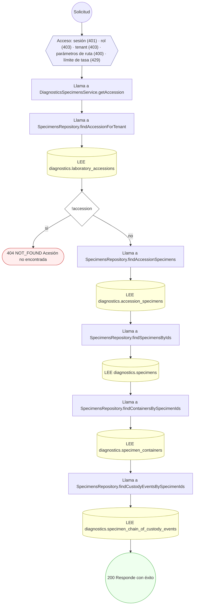

#### 10. POST /diagnostics/analyzer-runs

Abrir una corrida de analizador (soporte para ingesta)

| HTTP | Código | Cuándo |
|---|---|---|
| 201 | — | Éxito |
| 400 | `VALIDATION_FAILED` | El cuerpo cumple el DTO (sin propiedades extra) |
| 401 | `UNAUTHENTICATED` | Hay una sesión válida (JWT) |
| 403 | `FORBIDDEN` | El rol está permitido; El tenant se resuelve y pertenece al actor |
| 404 | `NOT_FOUND` | ResourceNotFoundException: {message} |
| 429 | `RATE_LIMITED` | No se supera el límite de solicitudes |

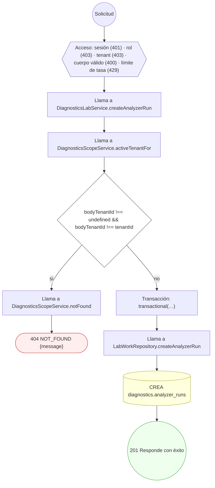

#### 11. POST /diagnostics/analyzer-runs/{id}/messages

Ingerir mensaje de resultado de analizador (LIS/HL7/ASTM)

| HTTP | Código | Cuándo |
|---|---|---|
| 201 | — | Éxito |
| 400 | `VALIDATION_FAILED` | Los parámetros de ruta son UUID válidos; El cuerpo cumple el DTO (sin propiedades extra) |
| 401 | `UNAUTHENTICATED` | Hay una sesión válida (JWT) |
| 403 | `FORBIDDEN` | El rol está permitido; El tenant se resuelve y pertenece al actor |
| 404 | `NOT_FOUND` | ResourceNotFoundException: {message} |
| 409 | `CONFLICT` | ConflictException: El mensaje ya fue ingerido para esta corrida |
| 429 | `RATE_LIMITED` | No se supera el límite de solicitudes |

```mermaid
flowchart TD
  n1(("Solicitud")):::inicio
  n2{{"Acceso: sesión (401) · rol (403) · tenant (403) · parámetros de ruta (400) · cuerpo válido (400) · límite de…"}}:::acceso
  n1 --> n2
  n3["Llama a DiagnosticsLabService.ingestMessage"]:::llamada
  n2 --> n3
  n4["Transacción: transactional(…)"]:::transaccion
  n3 --> n4
  n5["Llama a LabWorkRepository.findAnalyzerRun"]:::llamada
  n4 --> n5
  n6[("LEE diagnostics.analyzer_runs")]:::efecto
  n5 --> n6
  n7{"dto.laboratoryWorkOrderTestId"}:::decision
  n6 --> n7
  n8["Llama a LabWorkRepository.findWorkOrderTest"]:::llamada
  n7 -->|"sí"| n8
  n9[("LEE diagnostics.laboratory_work_order_tests")]:::efecto
  n8 --> n9
  n10["Llama a LabWorkRepository.findWorkOrder"]:::llamada
  n9 --> n10
  n11[("LEE diagnostics.laboratory_work_orders")]:::efecto
  n10 --> n11
  n12{"dto.mappedObservationId"}:::decision
  n11 --> n12
  n7 -->|"no"| n12
  n13["Llama a DiagnosticsScopeService.observation"]:::llamada
  n12 -->|"sí"| n13
  n14["Llama a ClinicalRefsRepository.findObservation"]:::llamada
  n13 --> n14
  n15[("LEE clinical.observations")]:::efecto
  n14 --> n15
  n16["Llama a DiagnosticsScopeService.assertPatientMatches"]:::llamada
  n15 --> n16
  n17{"resource && patientProfileId !== undefined && resource.patientProfileId !== patientProfileId"}:::decision
  n16 --> n17
  n18["Llama a DiagnosticsScopeService.notFound"]:::llamada
  n17 -->|"sí"| n18
  n19(["404 NOT_FOUND {message}"]):::error
  n18 --> n19
  n20{"dto.rawMessageFileId"}:::decision
  n17 -->|"no"| n20
  n12 -->|"no"| n20
  n21["Llama a DiagnosticsScopeService.file"]:::llamada
  n20 -->|"sí"| n21
  n22["Llama a ClinicalRefsRepository.findFile"]:::llamada
  n21 --> n22
  n23[("LEE common.files")]:::efecto
  n22 --> n23
  n24{"dto.messageControlId"}:::decision
  n23 --> n24
  n20 -->|"no"| n24
  n25["Llama a LabWorkRepository.findMessageByControlId"]:::llamada
  n24 -->|"sí"| n25
  n26[("LEE diagnostics.analyzer_result_messages")]:::efecto
  n25 --> n26
  n27{"dup"}:::decision
  n26 --> n27
  n28(["409 CONFLICT El mensaje ya fue ingerido para esta corrida"]):::error
  n27 -->|"sí"| n28
  n29["Llama a LabWorkRepository.recordMessage"]:::llamada
  n27 -->|"no"| n29
  n24 -->|"no"| n29
  n30[("CREA diagnostics.analyzer_result_messages")]:::efecto
  n29 --> n30
  n31{"test"}:::decision
  n30 --> n31
  n32[("ACTUALIZA diagnostics.laboratory_work_order_tests · ACTUALIZA diagnostics.laboratory_work_order_tests · ACTUA…")]:::efecto
  n31 -->|"sí"| n32
  n33(("201 Responde con éxito")):::ok
  n32 --> n33
  n31 -->|"no"| n33
  classDef acceso fill:#eef,stroke:#66a
  classDef error fill:#fee,stroke:#c33
  classDef ok fill:#efe,stroke:#3a3
  classDef efecto fill:#ffd,stroke:#aa3
  classDef decision fill:#fff,stroke:#555
  classDef corte fill:#eee,stroke:#999,stroke-dasharray: 4
```

#### 12. POST /diagnostics/clinical-media

Adjuntar media clínica / imagen al chart

| HTTP | Código | Cuándo |
|---|---|---|
| 201 | — | Éxito |
| 400 | `VALIDATION_FAILED` | El cuerpo cumple el DTO (sin propiedades extra) |
| 401 | `UNAUTHENTICATED` | Hay una sesión válida (JWT) |
| 403 | `FORBIDDEN` | El rol está permitido; El tenant se resuelve y pertenece al actor |
| 404 | `NOT_FOUND` | ResourceNotFoundException: {message} |
| 409 | `CONFLICT` | ConflictException: El archivo ya está adjunto como media clínica |
| 429 | `RATE_LIMITED` | No se supera el límite de solicitudes |

```mermaid
flowchart TD
  n1(("Solicitud")):::inicio
  n2{{"Acceso: sesión (401) · rol (403) · tenant (403) · cuerpo válido (400) · límite de tasa (429)"}}:::acceso
  n1 --> n2
  n3["Llama a DiagnosticsMediaQualityService.attachMedia"]:::llamada
  n2 --> n3
  n4["Transacción: transactional(…)"]:::transaccion
  n3 --> n4
  n5["Llama a DiagnosticsScopeService.activeTenantFor"]:::llamada
  n4 --> n5
  n6{"bodyTenantId !== undefined && bodyTenantId !== tenantId"}:::decision
  n5 --> n6
  n7["Llama a DiagnosticsScopeService.notFound"]:::llamada
  n6 -->|"sí"| n7
  n8(["404 NOT_FOUND {message}"]):::error
  n7 --> n8
  n9["Llama a DiagnosticsScopeService.file"]:::llamada
  n6 -->|"no"| n9
  n10["Llama a ClinicalRefsRepository.findFile"]:::llamada
  n9 --> n10
  n11[("LEE common.files")]:::efecto
  n10 --> n11
  n12{"dto.encounterId"}:::decision
  n11 --> n12
  n13["Llama a DiagnosticsScopeService.encounter"]:::llamada
  n12 -->|"sí"| n13
  n14["Llama a ClinicalRefsRepository.findEncounter"]:::llamada
  n13 --> n14
  n15[("LEE clinical.encounters")]:::efecto
  n14 --> n15
  n16["Llama a DiagnosticsScopeService.assertPatientMatches"]:::llamada
  n15 --> n16
  n17{"resource && patientProfileId !== undefined && resource.patientProfileId !== patientProfileId"}:::decision
  n16 --> n17
  n18["Llama a DiagnosticsScopeService.notFound"]:::llamada
  n17 -->|"sí"| n18
  n19(["404 NOT_FOUND {message}"]):::error
  n18 --> n19
  n20{"dto.diagnosticReportId"}:::decision
  n17 -->|"no"| n20
  n12 -->|"no"| n20
  n21["Llama a DiagnosticsScopeService.report"]:::llamada
  n20 -->|"sí"| n21
  n22["Llama a DiagnosticOrdersRepository.findReportById"]:::llamada
  n21 --> n22
  n23[("LEE clinical.diagnostic_reports")]:::efecto
  n22 --> n23
  n24["Llama a DiagnosticsScopeService.assertPatientMatches"]:::llamada
  n23 --> n24
  n25{"resource && patientProfileId !== undefined && resource.patientProfileId !== patientProfileId"}:::decision
  n24 --> n25
  n26["Llama a DiagnosticsScopeService.notFound"]:::llamada
  n25 -->|"sí"| n26
  n27(["404 NOT_FOUND {message}"]):::error
  n26 --> n27
  n28["Llama a MediaQualityRepository.findMediaByFile"]:::llamada
  n25 -->|"no"| n28
  n20 -->|"no"| n28
  n29[("LEE diagnostics.clinical_media")]:::efecto
  n28 --> n29
  n30{"dup"}:::decision
  n29 --> n30
  n31(["409 CONFLICT El archivo ya está adjunto como media clínica"]):::error
  n30 -->|"sí"| n31
  n32["Llama a MediaQualityRepository.createMedia"]:::llamada
  n30 -->|"no"| n32
  n33[("CREA diagnostics.clinical_media")]:::efecto
  n32 --> n33
  n34["Repite: por cada const a de dto.annotations ?? []"]:::bucle
  n33 --> n34
  n35["Llama a MediaQualityRepository.addAnnotation"]:::llamada
  n34 -->|"cada elemento"| n35
  n36[("CREA diagnostics.media_annotations")]:::efecto
  n35 --> n36
  n37(("201 Responde con éxito")):::ok
  n36 --> n37
  n34 -->|"al terminar"| n37
  classDef acceso fill:#eef,stroke:#66a
  classDef error fill:#fee,stroke:#c33
  classDef ok fill:#efe,stroke:#3a3
  classDef efecto fill:#ffd,stroke:#aa3
  classDef decision fill:#fff,stroke:#555
  classDef corte fill:#eee,stroke:#999,stroke-dasharray: 4
```

#### 13. POST /diagnostics/containers/{id}/custody-events

Registrar cadena de custodia / traslado de contenedor

| HTTP | Código | Cuándo |
|---|---|---|
| 201 | — | Éxito |
| 400 | `VALIDATION_FAILED` | Los parámetros de ruta son UUID válidos; El cuerpo cumple el DTO (sin propiedades extra) |
| 401 | `UNAUTHENTICATED` | Hay una sesión válida (JWT) |
| 403 | `FORBIDDEN` | El rol está permitido; El tenant se resuelve y pertenece al actor |
| 404 | `NOT_FOUND` | ResourceNotFoundException: Contenedor no encontrado |
| 429 | `RATE_LIMITED` | No se supera el límite de solicitudes |

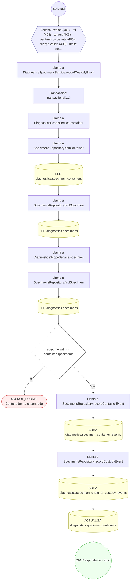

#### 14. POST /diagnostics/critical-results

Detectar y notificar un resultado crítico

| HTTP | Código | Cuándo |
|---|---|---|
| 201 | — | Éxito |
| 400 | `VALIDATION_FAILED` | El cuerpo cumple el DTO (sin propiedades extra) |
| 401 | `UNAUTHENTICATED` | Hay una sesión válida (JWT) |
| 403 | `FORBIDDEN` | El rol está permitido; El tenant se resuelve y pertenece al actor |
| 404 | `NOT_FOUND` | ResourceNotFoundException: {message} |
| 409 | `CONFLICT` | ConflictException: Ya existe una notificación crítica para la observación |
| 429 | `RATE_LIMITED` | No se supera el límite de solicitudes |

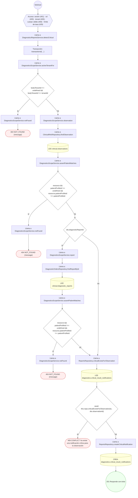

#### 15. POST /diagnostics/critical-results/{id}/acknowledge

Acusar recibo / escalar notificación crítica

| HTTP | Código | Cuándo |
|---|---|---|
| 200 | — | Éxito |
| 400 | `VALIDATION_FAILED` | Los parámetros de ruta son UUID válidos; El cuerpo cumple el DTO (sin propiedades extra) |
| 401 | `UNAUTHENTICATED` | Hay una sesión válida (JWT) |
| 403 | `FORBIDDEN` | El rol está permitido; El tenant se resuelve y pertenece al actor; InsufficientRoleException: El autor debe ser el profesional que firma |
| 409 | `CONFLICT` | ConflictException: La notificación ya fue reconocida |
| 429 | `RATE_LIMITED` | No se supera el límite de solicitudes |

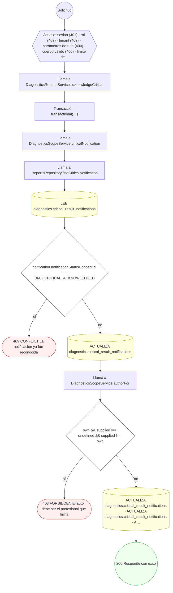

#### 16. POST /diagnostics/data-quality-events

Registrar evento de calidad de datos + enlazar provenance

| HTTP | Código | Cuándo |
|---|---|---|
| 201 | — | Éxito |
| 400 | `VALIDATION_FAILED` | El cuerpo cumple el DTO (sin propiedades extra) |
| 401 | `UNAUTHENTICATED` | Hay una sesión válida (JWT) |
| 403 | `FORBIDDEN` | El rol está permitido; El tenant se resuelve y pertenece al actor; InsufficientRoleException: El autor debe ser el profesional que firma |
| 404 | `NOT_FOUND` | ResourceNotFoundException: {message} |
| 429 | `RATE_LIMITED` | No se supera el límite de solicitudes |

```mermaid
flowchart TD
  n1(("Solicitud")):::inicio
  n2{{"Acceso: sesión (401) · rol (403) · tenant (403) · cuerpo válido (400) · límite de tasa (429)"}}:::acceso
  n1 --> n2
  n3["Llama a DiagnosticsMediaQualityService.recordDataQualityEvent"]:::llamada
  n2 --> n3
  n4["Transacción: transactional(…)"]:::transaccion
  n3 --> n4
  n5["Llama a DiagnosticsScopeService.activeTenantFor"]:::llamada
  n4 --> n5
  n6{"bodyTenantId !== undefined && bodyTenantId !== tenantId"}:::decision
  n5 --> n6
  n7["Llama a DiagnosticsScopeService.notFound"]:::llamada
  n6 -->|"sí"| n7
  n8(["404 NOT_FOUND {message}"]):::error
  n7 --> n8
  n9["Llama a DiagnosticsScopeService.dataQualityTarget"]:::llamada
  n6 -->|"no"| n9
  n10["Llama a SpecimensRepository.findSpecimen"]:::llamada
  n9 --> n10
  n11[("LEE diagnostics.specimens")]:::efecto
  n10 --> n11
  n12["Llama a ClinicalRefsRepository.findObservation"]:::llamada
  n11 --> n12
  n13[("LEE clinical.observations")]:::efecto
  n12 --> n13
  n14["Llama a ImagingRepository.findStudy"]:::llamada
  n13 --> n14
  n15[("LEE diagnostics.imaging_studies")]:::efecto
  n14 --> n15
  n16["Llama a DiagnosticsScopeService.notFound"]:::llamada
  n15 --> n16
  n17(["404 NOT_FOUND {message}"]):::error
  n16 --> n17
  n18{"!inScope"}:::decision
  n19["Llama a DiagnosticsScopeService.notFound"]:::llamada
  n18 -->|"sí"| n19
  n20(["404 NOT_FOUND {message}"]):::error
  n19 --> n20
  n21{"dto.provenanceSourceId"}:::decision
  n18 -->|"no"| n21
  n22["Llama a DiagnosticsScopeService.dataQualityTarget"]:::llamada
  n21 -->|"sí"| n22
  n23["Llama a SpecimensRepository.findSpecimen"]:::llamada
  n22 --> n23
  n24[("LEE diagnostics.specimens")]:::efecto
  n23 --> n24
  n25["Llama a ClinicalRefsRepository.findObservation"]:::llamada
  n24 --> n25
  n26[("LEE clinical.observations")]:::efecto
  n25 --> n26
  n27["Llama a ImagingRepository.findStudy"]:::llamada
  n26 --> n27
  n28[("LEE diagnostics.imaging_studies")]:::efecto
  n27 --> n28
  n29["Llama a DiagnosticsScopeService.notFound"]:::llamada
  n28 --> n29
  n30(["404 NOT_FOUND {message}"]):::error
  n29 --> n30
  n31{"!inScope"}:::decision
  n32["Llama a DiagnosticsScopeService.notFound"]:::llamada
  n31 -->|"sí"| n32
  n33(["404 NOT_FOUND {message}"]):::error
  n32 --> n33
  n34["Llama a MediaQualityRepository.createDataQualityEvent"]:::llamada
  n31 -->|"no"| n34
  n21 -->|"no"| n34
  n35[("CREA diagnostics.diagnostic_data_quality_events")]:::efecto
  n34 --> n35
  n36{"dto.provenanceSourceId"}:::decision
  n35 --> n36
  n37["Llama a MediaQualityRepository.addProvenanceLink"]:::llamada
  n36 -->|"sí"| n37
  n38[("CREA diagnostics.diagnostic_provenance_links")]:::efecto
  n37 --> n38
  n39["Llama a DiagnosticsScopeService.authorFor"]:::llamada
  n38 --> n39
  n40{"own && supplied !== undefined && supplied !== own"}:::decision
  n39 --> n40
  n41(["403 FORBIDDEN El autor debe ser el profesional que firma"]):::error
  n40 -->|"sí"| n41
  n42(("201 Responde con éxito")):::ok
  n40 -->|"no"| n42
  n36 -->|"no"| n42
  classDef acceso fill:#eef,stroke:#66a
  classDef error fill:#fee,stroke:#c33
  classDef ok fill:#efe,stroke:#3a3
  classDef efecto fill:#ffd,stroke:#aa3
  classDef decision fill:#fff,stroke:#555
  classDef corte fill:#eee,stroke:#999,stroke-dasharray: 4
```

#### 17. POST /diagnostics/imaging-endpoints

Registrar un endpoint DICOM (soporte para STOW-RS)

| HTTP | Código | Cuándo |
|---|---|---|
| 201 | — | Éxito |
| 400 | `VALIDATION_FAILED` | El cuerpo cumple el DTO (sin propiedades extra) |
| 401 | `UNAUTHENTICATED` | Hay una sesión válida (JWT) |
| 403 | `FORBIDDEN` | El rol está permitido; El tenant se resuelve y pertenece al actor |
| 404 | `NOT_FOUND` | ResourceNotFoundException: {message} |
| 429 | `RATE_LIMITED` | No se supera el límite de solicitudes |

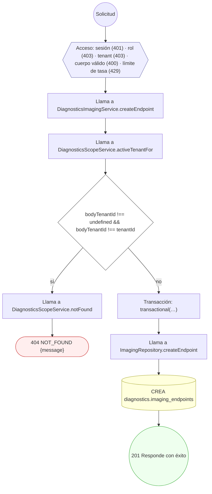

#### 18. POST /diagnostics/imaging-studies/{id}/dose-events

Registrar evento de dosis de radiación

| HTTP | Código | Cuándo |
|---|---|---|
| 201 | — | Éxito |
| 400 | `VALIDATION_FAILED` | Los parámetros de ruta son UUID válidos; El cuerpo cumple el DTO (sin propiedades extra) |
| 401 | `UNAUTHENTICATED` | Hay una sesión válida (JWT) |
| 403 | `FORBIDDEN` | El rol está permitido; El tenant se resuelve y pertenece al actor |
| 429 | `RATE_LIMITED` | No se supera el límite de solicitudes |

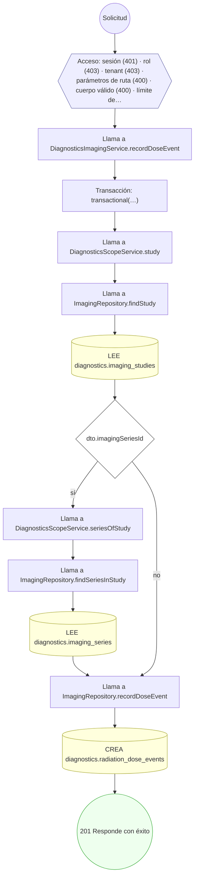

#### 19. GET /diagnostics/patients/{patientProfileId}/imaging-studies

Listar los estudios de imagen del paciente

| HTTP | Código | Cuándo |
|---|---|---|
| 200 | — | Éxito |
| 400 | `VALIDATION_FAILED` | Están los parámetros de consulta obligatorios; Los parámetros de ruta son UUID válidos |
| 401 | `UNAUTHENTICATED` | Hay una sesión válida (JWT) |
| 403 | `FORBIDDEN` | El rol está permitido; El tenant se resuelve y pertenece al actor |
| 404 | `NOT_FOUND` | ResourceNotFoundException: Paciente no encontrado |
| 429 | `RATE_LIMITED` | No se supera el límite de solicitudes |

```mermaid
flowchart TD
  n1(("Solicitud")):::inicio
  n2{{"Acceso: sesión (401) · rol (403) · tenant (403) · parámetros de consulta (400) · parámetros de consulta (400)…"}}:::acceso
  n1 --> n2
  n3["Llama a DiagnosticsImagingService.listStudiesByPatient"]:::llamada
  n2 --> n3
  n4["Llama a DiagnosticsPatientAccessService.assertCanReadPatient"]:::llamada
  n3 --> n4
  n5["Llama a PersonAccountLinksRepository.findActiveByUser"]:::llamada
  n4 --> n5
  n6[("LEE profiles.person_account_links")]:::efecto
  n5 --> n6
  n7["Llama a HealthPractitionerProfilesRepository.findById"]:::llamada
  n6 --> n7
  n8[("LEE profiles.health_practitioner_profiles")]:::efecto
  n7 --> n8
  n9{"practitioner"}:::decision
  n8 --> n9
  n10["Llama a CareRelationshipsRepository.findActiveForPractitionerPatient"]:::llamada
  n9 -->|"sí"| n10
  n11[("LEE authz.care_relationships")]:::efecto
  n10 --> n11
  n12(["404 NOT_FOUND Paciente no encontrado"]):::error
  n11 --> n12
  n9 -->|"no"| n12
  n13["Llama a ImagingRepository.findStudiesByPatient"]:::llamada
  n14[("LEE diagnostics.imaging_studies")]:::efecto
  n13 --> n14
  n15(("200 Responde con éxito")):::ok
  n14 --> n15
  classDef acceso fill:#eef,stroke:#66a
  classDef error fill:#fee,stroke:#c33
  classDef ok fill:#efe,stroke:#3a3
  classDef efecto fill:#ffd,stroke:#aa3
  classDef decision fill:#fff,stroke:#555
  classDef corte fill:#eee,stroke:#999,stroke-dasharray: 4
```

#### 20. POST /diagnostics/reports/{reportId}/versions

Crear/enmendar versión de informe diagnóstico

| HTTP | Código | Cuándo |
|---|---|---|
| 201 | — | Éxito |
| 400 | `VALIDATION_FAILED` | Los parámetros de ruta son UUID válidos; El cuerpo cumple el DTO (sin propiedades extra) |
| 401 | `UNAUTHENTICATED` | Hay una sesión válida (JWT) |
| 403 | `FORBIDDEN` | El rol está permitido; El tenant se resuelve y pertenece al actor; InsufficientRoleException: El autor debe ser el profesional que firma |
| 404 | `NOT_FOUND` | ResourceNotFoundException: {message}; ResourceNotFoundException: La versión que se enmienda no existe en este informe |
| 429 | `RATE_LIMITED` | No se supera el límite de solicitudes |

```mermaid
flowchart TD
  n1(("Solicitud")):::inicio
  n2{{"Acceso: sesión (401) · rol (403) · tenant (403) · parámetros de ruta (400) · cuerpo válido (400) · límite de…"}}:::acceso
  n1 --> n2
  n3["Llama a DiagnosticsReportsService.createReportVersion"]:::llamada
  n2 --> n3
  n4["Transacción: transactional(…)"]:::transaccion
  n3 --> n4
  n5["Llama a DiagnosticsScopeService.activeTenantFor"]:::llamada
  n4 --> n5
  n6{"bodyTenantId !== undefined && bodyTenantId !== tenantId"}:::decision
  n5 --> n6
  n7["Llama a DiagnosticsScopeService.notFound"]:::llamada
  n6 -->|"sí"| n7
  n8(["404 NOT_FOUND {message}"]):::error
  n7 --> n8
  n9["Llama a DiagnosticsScopeService.report"]:::llamada
  n6 -->|"no"| n9
  n10["Llama a DiagnosticOrdersRepository.findReportById"]:::llamada
  n9 --> n10
  n11[("LEE clinical.diagnostic_reports")]:::efecto
  n10 --> n11
  n12["Llama a DiagnosticsScopeService.assertPatientMatches"]:::llamada
  n11 --> n12
  n13{"resource && patientProfileId !== undefined && resource.patientProfileId !== patientProfileId"}:::decision
  n12 --> n13
  n14["Llama a DiagnosticsScopeService.notFound"]:::llamada
  n13 -->|"sí"| n14
  n15(["404 NOT_FOUND {message}"]):::error
  n14 --> n15
  n16["Repite: por cada const r de dto.results ?? []"]:::bucle
  n13 -->|"no"| n16
  n17["Llama a DiagnosticsScopeService.observation"]:::llamada
  n16 -->|"cada elemento"| n17
  n18["Llama a ClinicalRefsRepository.findObservation"]:::llamada
  n17 --> n18
  n19[("LEE clinical.observations")]:::efecto
  n18 --> n19
  n20["Llama a DiagnosticsScopeService.assertPatientMatches"]:::llamada
  n19 --> n20
  n21{"resource && patientProfileId !== undefined && resource.patientProfileId !== patientProfileId"}:::decision
  n20 --> n21
  n22["Llama a DiagnosticsScopeService.notFound"]:::llamada
  n21 -->|"sí"| n22
  n23(["404 NOT_FOUND {message}"]):::error
  n22 --> n23
  n24["Repite: por cada const f de dto.files ?? []"]:::bucle
  n21 -->|"no"| n24
  n16 -->|"al terminar"| n24
  n25["Llama a DiagnosticsScopeService.file"]:::llamada
  n24 -->|"cada elemento"| n25
  n26["Llama a ClinicalRefsRepository.findFile"]:::llamada
  n25 --> n26
  n27[("LEE common.files")]:::efecto
  n26 --> n27
  n28{"dto.supersedesVersionId"}:::decision
  n27 --> n28
  n24 -->|"al terminar"| n28
  n29["Llama a ReportsRepository.findVersionInReport"]:::llamada
  n28 -->|"sí"| n29
  n30[("LEE diagnostics.diagnostic_report_versions")]:::efecto
  n29 --> n30
  n31{"!prev"}:::decision
  n30 --> n31
  n32(["404 NOT_FOUND La versión que se enmienda no existe en este informe"]):::error
  n31 -->|"sí"| n32
  n33["Llama a ReportsRepository.maxVersionNumber"]:::llamada
  n31 -->|"no"| n33
  n28 -->|"no"| n33
  n34[("LEE diagnostics.diagnostic_report_versions")]:::efecto
  n33 --> n34
  n35["Llama a ReportsRepository.createVersion"]:::llamada
  n34 --> n35
  n36[("CREA diagnostics.diagnostic_report_versions")]:::efecto
  n35 --> n36
  n37["Llama a DiagnosticsScopeService.authorFor"]:::llamada
  n36 --> n37
  n38{"own && supplied !== undefined && supplied !== own"}:::decision
  n37 --> n38
  n39(["403 FORBIDDEN El autor debe ser el profesional que firma"]):::error
  n38 -->|"sí"| n39
  n40["Repite: por cada const r de dto.results ?? []"]:::bucle
  n38 -->|"no"| n40
  n41["Llama a ReportsRepository.addResult"]:::llamada
  n40 -->|"cada elemento"| n41
  n42[("CREA diagnostics.diagnostic_report_results")]:::efecto
  n41 --> n42
  n43["Repite: por cada const f de dto.files ?? []"]:::bucle
  n42 --> n43
  n40 -->|"al terminar"| n43
  n44["Llama a ReportsRepository.addFile"]:::llamada
  n43 -->|"cada elemento"| n44
  n45[("CREA diagnostics.diagnostic_report_files")]:::efecto
  n44 --> n45
  n46(("201 Responde con éxito")):::ok
  n45 --> n46
  n43 -->|"al terminar"| n46
  classDef acceso fill:#eef,stroke:#66a
  classDef error fill:#fee,stroke:#c33
  classDef ok fill:#efe,stroke:#3a3
  classDef efecto fill:#ffd,stroke:#aa3
  classDef decision fill:#fff,stroke:#555
  classDef corte fill:#eee,stroke:#999,stroke-dasharray: 4
```

#### 21. POST /diagnostics/reports/{reportId}/versions/{versionId}/release

Validar y liberar una versión del informe

| HTTP | Código | Cuándo |
|---|---|---|
| 200 | — | Éxito |
| 400 | `VALIDATION_FAILED` | Los parámetros de ruta son UUID válidos; El cuerpo cumple el DTO (sin propiedades extra) |
| 401 | `UNAUTHENTICATED` | Hay una sesión válida (JWT) |
| 403 | `FORBIDDEN` | El rol está permitido; El tenant se resuelve y pertenece al actor |
| 404 | `NOT_FOUND` | ResourceNotFoundException: {message}; ResourceNotFoundException: Versión de informe no encontrada |
| 409 | `CONFLICT` | ConflictException: La versión ya fue liberada |
| 422 | `PRECONDITION_FAILED` | PreconditionFailedException: La versión no es elegible para liberación |
| 429 | `RATE_LIMITED` | No se supera el límite de solicitudes |

```mermaid
flowchart TD
  n1(("Solicitud")):::inicio
  n2{{"Acceso: sesión (401) · rol (403) · tenant (403) · parámetros de ruta (400) · cuerpo válido (400) · límite de…"}}:::acceso
  n1 --> n2
  n3["Llama a DiagnosticsReportsService.releaseVersion"]:::llamada
  n2 --> n3
  n4["Transacción: transactional(…)"]:::transaccion
  n3 --> n4
  n5["Llama a DiagnosticsScopeService.report"]:::llamada
  n4 --> n5
  n6["Llama a DiagnosticOrdersRepository.findReportById"]:::llamada
  n5 --> n6
  n7[("LEE clinical.diagnostic_reports")]:::efecto
  n6 --> n7
  n8["Llama a DiagnosticsScopeService.assertPatientMatches"]:::llamada
  n7 --> n8
  n9{"resource && patientProfileId !== undefined && resource.patientProfileId !== patientProfileId"}:::decision
  n8 --> n9
  n10["Llama a DiagnosticsScopeService.notFound"]:::llamada
  n9 -->|"sí"| n10
  n11(["404 NOT_FOUND {message}"]):::error
  n10 --> n11
  n12["Llama a ReportsRepository.findVersionInReport"]:::llamada
  n9 -->|"no"| n12
  n13[("LEE diagnostics.diagnostic_report_versions")]:::efecto
  n12 --> n13
  n14{"!version"}:::decision
  n13 --> n14
  n15(["404 NOT_FOUND Versión de informe no encontrada"]):::error
  n14 -->|"sí"| n15
  n16{"version.releaseEligibilityConceptId !== DIAG.RELEASE_ELIGIBLE"}:::decision
  n14 -->|"no"| n16
  n17(["422 PRECONDITION_FAILED La versión no es elegible para liberación"]):::error
  n16 -->|"sí"| n17
  n18{"version.clinicalStatusConceptId === DIAG.REPORT_FINAL"}:::decision
  n16 -->|"no"| n18
  n19(["409 CONFLICT La versión ya fue liberada"]):::error
  n18 -->|"sí"| n19
  n20["Llama a ReportsRepository.recordReleaseEvent"]:::llamada
  n18 -->|"no"| n20
  n21[("CREA diagnostics.diagnostic_release_events")]:::efecto
  n20 --> n21
  n22[("ACTUALIZA diagnostics.diagnostic_report_versions · ACTUALIZA diagnostics.diagnostic_report_versions")]:::efecto
  n21 --> n22
  n23["Llama a DiagnosticOrdersRepository.markReportReleased"]:::llamada
  n22 --> n23
  n24[("ACTUALIZA clinical.diagnostic_reports · ACTUALIZA clinical.diagnostic_reports · ACTUALIZA clinical.diagnostic…")]:::efecto
  n23 --> n24
  n25(("200 Responde con éxito")):::ok
  n24 --> n25
  classDef acceso fill:#eef,stroke:#66a
  classDef error fill:#fee,stroke:#c33
  classDef ok fill:#efe,stroke:#3a3
  classDef efecto fill:#ffd,stroke:#aa3
  classDef decision fill:#fff,stroke:#555
  classDef corte fill:#eee,stroke:#999,stroke-dasharray: 4
```

#### 22. POST /diagnostics/results/{observationId}/verifications

Verificar (técnica/facultativa) un resultado

| HTTP | Código | Cuándo |
|---|---|---|
| 201 | — | Éxito |
| 400 | `VALIDATION_FAILED` | Los parámetros de ruta son UUID válidos; El cuerpo cumple el DTO (sin propiedades extra) |
| 401 | `UNAUTHENTICATED` | Hay una sesión válida (JWT) |
| 403 | `FORBIDDEN` | El rol está permitido; El tenant se resuelve y pertenece al actor; InsufficientRoleException: El autor debe ser el profesional que firma |
| 404 | `NOT_FOUND` | ResourceNotFoundException: {message} |
| 429 | `RATE_LIMITED` | No se supera el límite de solicitudes |

```mermaid
flowchart TD
  n1(("Solicitud")):::inicio
  n2{{"Acceso: sesión (401) · rol (403) · tenant (403) · parámetros de ruta (400) · cuerpo válido (400) · límite de…"}}:::acceso
  n1 --> n2
  n3["Llama a DiagnosticsLabService.verifyResult"]:::llamada
  n2 --> n3
  n4["Llama a DiagnosticsScopeService.activeTenantFor"]:::llamada
  n3 --> n4
  n5{"bodyTenantId !== undefined && bodyTenantId !== tenantId"}:::decision
  n4 --> n5
  n6["Llama a DiagnosticsScopeService.notFound"]:::llamada
  n5 -->|"sí"| n6
  n7(["404 NOT_FOUND {message}"]):::error
  n6 --> n7
  n8["Transacción: transactional(…)"]:::transaccion
  n5 -->|"no"| n8
  n9["Llama a DiagnosticsScopeService.observation"]:::llamada
  n8 --> n9
  n10["Llama a ClinicalRefsRepository.findObservation"]:::llamada
  n9 --> n10
  n11[("LEE clinical.observations")]:::efecto
  n10 --> n11
  n12["Llama a DiagnosticsScopeService.assertPatientMatches"]:::llamada
  n11 --> n12
  n13{"resource && patientProfileId !== undefined && resource.patientProfileId !== patientProfileId"}:::decision
  n12 --> n13
  n14["Llama a DiagnosticsScopeService.notFound"]:::llamada
  n13 -->|"sí"| n14
  n15(["404 NOT_FOUND {message}"]):::error
  n14 --> n15
  n16["Llama a LabWorkRepository.recordVerification"]:::llamada
  n13 -->|"no"| n16
  n17[("CREA diagnostics.result_verifications")]:::efecto
  n16 --> n17
  n18["Llama a DiagnosticsScopeService.authorFor"]:::llamada
  n17 --> n18
  n19{"own && supplied !== undefined && supplied !== own"}:::decision
  n18 --> n19
  n20(["403 FORBIDDEN El autor debe ser el profesional que firma"]):::error
  n19 -->|"sí"| n20
  n21["Llama a LabWorkRepository.markTestsVerifiedForObservation"]:::llamada
  n19 -->|"no"| n21
  n22[("ACTUALIZA diagnostics.laboratory_work_order_tests")]:::efecto
  n21 --> n22
  n23(("201 Responde con éxito")):::ok
  n22 --> n23
  classDef acceso fill:#eef,stroke:#66a
  classDef error fill:#fee,stroke:#c33
  classDef ok fill:#efe,stroke:#3a3
  classDef efecto fill:#ffd,stroke:#aa3
  classDef decision fill:#fff,stroke:#555
  classDef corte fill:#eee,stroke:#999,stroke-dasharray: 4
```

#### 23. GET /diagnostics/service-requests/{id}

Detalle de una orden dirigida al tenant activo

| HTTP | Código | Cuándo |
|---|---|---|
| 200 | — | Éxito |
| 400 | `VALIDATION_FAILED` | Los parámetros de ruta son UUID válidos |
| 401 | `UNAUTHENTICATED` | Hay una sesión válida (JWT) |
| 403 | `FORBIDDEN` | El rol está permitido; El tenant se resuelve y pertenece al actor |
| 404 | `NOT_FOUND` | ResourceNotFoundException: Orden no encontrada |
| 429 | `RATE_LIMITED` | No se supera el límite de solicitudes |

```mermaid
flowchart TD
  n1(("Solicitud")):::inicio
  n2{{"Acceso: sesión (401) · rol (403) · tenant (403) · parámetros de ruta (400) · límite de tasa (429)"}}:::acceso
  n1 --> n2
  n3["Llama a DiagnosticsWorklistService.getById"]:::llamada
  n2 --> n3
  n4[("LEE clinical.service_requests")]:::efecto
  n3 --> n4
  n5["Llama a ServiceRequestWorklistRepository.findState"]:::llamada
  n4 --> n5
  n6[("LEE clinical.service_requests")]:::efecto
  n5 --> n6
  n7{"!order || state === null"}:::decision
  n6 --> n7
  n8(["404 NOT_FOUND Orden no encontrada"]):::error
  n7 -->|"sí"| n8
  n9["Llama a DiagnosticsReceptionService.toItems"]:::llamada
  n7 -->|"no"| n9
  n10["Llama a LabReceptionRepository.findSpecimensForServiceRequests"]:::llamada
  n9 --> n10
  n11[("LEE diagnostics.specimens")]:::efecto
  n10 --> n11
  n12["Llama a LabReceptionRepository.findConceptDisplays"]:::llamada
  n11 --> n12
  n13[("LEE terminology.catalog_concepts")]:::efecto
  n12 --> n13
  n14["Llama a LabReceptionRepository.findTenantNames"]:::llamada
  n13 --> n14
  n15[("LEE directory.tenants")]:::efecto
  n14 --> n15
  n16["Llama a ServiceRequestDetailService.describe"]:::llamada
  n15 --> n16
  n17["Llama a ServiceRequestDetailService.loadComponents"]:::llamada
  n16 --> n17
  n18[("LEE clinical.service_request_components")]:::efecto
  n17 --> n18
  n19["Llama a ServiceRequestDetailService.displays"]:::llamada
  n18 --> n19
  n20[("LEE terminology.catalog_concepts")]:::efecto
  n19 --> n20
  n21["Llama a DiagnosticsReceptionService.loadLabels"]:::llamada
  n20 --> n21
  n22["Llama a LabReceptionRepository.findPatientLabels"]:::llamada
  n21 --> n22
  n23[("LEE profiles.person_profiles · LEE profiles.patient_profiles · LEE profiles.persons")]:::efecto
  n22 --> n23
  n24["Llama a SpecimensRepository.findContainersBySpecimenIds"]:::llamada
  n23 --> n24
  n25[("LEE diagnostics.specimen_containers")]:::efecto
  n24 --> n25
  n26["Llama a SpecimensRepository.findCustodyEventsBySpecimenIds"]:::llamada
  n25 --> n26
  n27[("LEE diagnostics.specimen_chain_of_custody_events")]:::efecto
  n26 --> n27
  n28(("200 Responde con éxito")):::ok
  n27 --> n28
  classDef acceso fill:#eef,stroke:#66a
  classDef error fill:#fee,stroke:#c33
  classDef ok fill:#efe,stroke:#3a3
  classDef efecto fill:#ffd,stroke:#aa3
  classDef decision fill:#fff,stroke:#555
  classDef corte fill:#eee,stroke:#999,stroke-dasharray: 4
```

#### 24. POST /diagnostics/service-requests/inbox

Bandeja de órdenes de laboratorio por recibir

| HTTP | Código | Cuándo |
|---|---|---|
| 200 | — | Éxito |
| 400 | `VALIDATION_FAILED` | El cuerpo cumple el DTO (sin propiedades extra) |
| 401 | `UNAUTHENTICATED` | Hay una sesión válida (JWT) |
| 403 | `FORBIDDEN` | El rol está permitido; El tenant se resuelve y pertenece al actor |
| 429 | `RATE_LIMITED` | No se supera el límite de solicitudes |

```mermaid
flowchart TD
  n1(("Solicitud")):::inicio
  n2{{"Acceso: sesión (401) · rol (403) · tenant (403) · cuerpo válido (400) · límite de tasa (429)"}}:::acceso
  n1 --> n2
  n3["Llama a DiagnosticsReceptionService.listInbox"]:::llamada
  n2 --> n3
  n4["Repite: ciclo for"]:::bucle
  n3 --> n4
  n5["Llama a LabReceptionRepository.findInboxCandidates"]:::llamada
  n4 -->|"cada elemento"| n5
  n6[("LEE clinical.service_requests")]:::efecto
  n5 --> n6
  n7["Llama a LabReceptionRepository.findAccessionedServiceRequestIds"]:::llamada
  n6 --> n7
  n8[("LEE diagnostics.laboratory_accessions")]:::efecto
  n7 --> n8
  n9{"needle !== null && pending.length › 0"}:::decision
  n8 --> n9
  n10["Llama a DiagnosticsReceptionService.loadLabels"]:::llamada
  n9 -->|"sí"| n10
  n11["Llama a LabReceptionRepository.findPatientLabels"]:::llamada
  n10 --> n11
  n12[("LEE profiles.person_profiles · LEE profiles.patient_profiles · LEE profiles.persons")]:::efecto
  n11 --> n12
  n13["Llama a DiagnosticsReceptionService.toItems"]:::llamada
  n12 --> n13
  n9 -->|"no"| n13
  n4 -->|"al terminar"| n13
  n14["Llama a LabReceptionRepository.findSpecimensForServiceRequests"]:::llamada
  n13 --> n14
  n15[("LEE diagnostics.specimens")]:::efecto
  n14 --> n15
  n16["Llama a LabReceptionRepository.findConceptDisplays"]:::llamada
  n15 --> n16
  n17[("LEE terminology.catalog_concepts")]:::efecto
  n16 --> n17
  n18["Llama a LabReceptionRepository.findTenantNames"]:::llamada
  n17 --> n18
  n19[("LEE directory.tenants")]:::efecto
  n18 --> n19
  n20["Llama a ServiceRequestDetailService.describe"]:::llamada
  n19 --> n20
  n21["Llama a ServiceRequestDetailService.loadComponents"]:::llamada
  n20 --> n21
  n22[("LEE clinical.service_request_components")]:::efecto
  n21 --> n22
  n23["Llama a ServiceRequestDetailService.displays"]:::llamada
  n22 --> n23
  n24[("LEE terminology.catalog_concepts")]:::efecto
  n23 --> n24
  n25["Llama a DiagnosticsReceptionService.loadLabels"]:::llamada
  n24 --> n25
  n26["Llama a LabReceptionRepository.findPatientLabels"]:::llamada
  n25 --> n26
  n27[("LEE profiles.person_profiles · LEE profiles.patient_profiles · LEE profiles.persons")]:::efecto
  n26 --> n27
  n28["Llama a SpecimensRepository.findContainersBySpecimenIds"]:::llamada
  n27 --> n28
  n29[("LEE diagnostics.specimen_containers")]:::efecto
  n28 --> n29
  n30["Llama a SpecimensRepository.findCustodyEventsBySpecimenIds"]:::llamada
  n29 --> n30
  n31[("LEE diagnostics.specimen_chain_of_custody_events")]:::efecto
  n30 --> n31
  n32(("200 Responde con éxito")):::ok
  n31 --> n32
  classDef acceso fill:#eef,stroke:#66a
  classDef error fill:#fee,stroke:#c33
  classDef ok fill:#efe,stroke:#3a3
  classDef efecto fill:#ffd,stroke:#aa3
  classDef decision fill:#fff,stroke:#555
  classDef corte fill:#eee,stroke:#999,stroke-dasharray: 4
```

#### 25. POST /diagnostics/service-requests/worklist

Bandeja del ejecutor: órdenes de laboratorio o imagen con estado derivado

| HTTP | Código | Cuándo |
|---|---|---|
| 200 | — | Éxito |
| 400 | `VALIDATION_FAILED` | El cuerpo cumple el DTO (sin propiedades extra) |
| 401 | `UNAUTHENTICATED` | Hay una sesión válida (JWT) |
| 403 | `FORBIDDEN` | El rol está permitido; El tenant se resuelve y pertenece al actor |
| 429 | `RATE_LIMITED` | No se supera el límite de solicitudes |

```mermaid
flowchart TD
  n1(("Solicitud")):::inicio
  n2{{"Acceso: sesión (401) · rol (403) · tenant (403) · cuerpo válido (400) · límite de tasa (429)"}}:::acceso
  n1 --> n2
  n3["Llama a DiagnosticsWorklistService.list"]:::llamada
  n2 --> n3
  n4["Repite: ciclo for"]:::bucle
  n3 --> n4
  n5["Llama a ServiceRequestWorklistRepository.findBlock"]:::llamada
  n4 -->|"cada elemento"| n5
  n6[("LEE clinical.service_requests")]:::efecto
  n5 --> n6
  n7[("LEE clinical.service_requests")]:::efecto
  n6 --> n7
  n8{"needle !== null && pending.length › 0"}:::decision
  n7 --> n8
  n9["Llama a DiagnosticsReceptionService.loadLabels"]:::llamada
  n8 -->|"sí"| n9
  n10["Llama a LabReceptionRepository.findPatientLabels"]:::llamada
  n9 --> n10
  n11[("LEE profiles.person_profiles · LEE profiles.patient_profiles · LEE profiles.persons")]:::efecto
  n10 --> n11
  n12["Llama a DiagnosticsReceptionService.toItems"]:::llamada
  n11 --> n12
  n8 -->|"no"| n12
  n4 -->|"al terminar"| n12
  n13["Llama a LabReceptionRepository.findSpecimensForServiceRequests"]:::llamada
  n12 --> n13
  n14[("LEE diagnostics.specimens")]:::efecto
  n13 --> n14
  n15["Llama a LabReceptionRepository.findConceptDisplays"]:::llamada
  n14 --> n15
  n16[("LEE terminology.catalog_concepts")]:::efecto
  n15 --> n16
  n17["Llama a LabReceptionRepository.findTenantNames"]:::llamada
  n16 --> n17
  n18[("LEE directory.tenants")]:::efecto
  n17 --> n18
  n19["Llama a ServiceRequestDetailService.describe"]:::llamada
  n18 --> n19
  n20["Llama a ServiceRequestDetailService.loadComponents"]:::llamada
  n19 --> n20
  n21[("LEE clinical.service_request_components")]:::efecto
  n20 --> n21
  n22["Llama a ServiceRequestDetailService.displays"]:::llamada
  n21 --> n22
  n23[("LEE terminology.catalog_concepts")]:::efecto
  n22 --> n23
  n24["Llama a DiagnosticsReceptionService.loadLabels"]:::llamada
  n23 --> n24
  n25["Llama a LabReceptionRepository.findPatientLabels"]:::llamada
  n24 --> n25
  n26[("LEE profiles.person_profiles · LEE profiles.patient_profiles · LEE profiles.persons")]:::efecto
  n25 --> n26
  n27["Llama a SpecimensRepository.findContainersBySpecimenIds"]:::llamada
  n26 --> n27
  n28[("LEE diagnostics.specimen_containers")]:::efecto
  n27 --> n28
  n29["Llama a SpecimensRepository.findCustodyEventsBySpecimenIds"]:::llamada
  n28 --> n29
  n30[("LEE diagnostics.specimen_chain_of_custody_events")]:::efecto
  n29 --> n30
  n31(("200 Responde con éxito")):::ok
  n30 --> n31
  classDef acceso fill:#eef,stroke:#66a
  classDef error fill:#fee,stroke:#c33
  classDef ok fill:#efe,stroke:#3a3
  classDef efecto fill:#ffd,stroke:#aa3
  classDef decision fill:#fff,stroke:#555
  classDef corte fill:#eee,stroke:#999,stroke-dasharray: 4
```

#### 26. POST /diagnostics/specimens

Registrar un espécimen (soporte para acesión)

| HTTP | Código | Cuándo |
|---|---|---|
| 201 | — | Éxito |
| 400 | `VALIDATION_FAILED` | El cuerpo cumple el DTO (sin propiedades extra) |
| 401 | `UNAUTHENTICATED` | Hay una sesión válida (JWT) |
| 403 | `FORBIDDEN` | El rol está permitido; El tenant se resuelve y pertenece al actor |
| 404 | `NOT_FOUND` | ResourceNotFoundException: {message}; ResourceNotFoundException: Espacio no encontrado |
| 422 | `PRECONDITION_FAILED` | PreconditionFailedException: El espacio no es un punto de toma disponible |
| 429 | `RATE_LIMITED` | No se supera el límite de solicitudes |

```mermaid
flowchart TD
  n1(("Solicitud")):::inicio
  n2{{"Acceso: sesión (401) · rol (403) · tenant (403) · cuerpo válido (400) · límite de tasa (429)"}}:::acceso
  n1 --> n2
  n3["Llama a DiagnosticsSpecimensService.createSpecimen"]:::llamada
  n2 --> n3
  n4["Llama a DiagnosticsScopeService.activeTenantFor"]:::llamada
  n3 --> n4
  n5{"bodyTenantId !== undefined && bodyTenantId !== tenantId"}:::decision
  n4 --> n5
  n6["Llama a DiagnosticsScopeService.notFound"]:::llamada
  n5 -->|"sí"| n6
  n7(["404 NOT_FOUND {message}"]):::error
  n6 --> n7
  n8["Transacción: transactional(…)"]:::transaccion
  n5 -->|"no"| n8
  n9{"dto.encounterId"}:::decision
  n8 --> n9
  n10["Llama a DiagnosticsScopeService.encounter"]:::llamada
  n9 -->|"sí"| n10
  n11["Llama a ClinicalRefsRepository.findEncounter"]:::llamada
  n10 --> n11
  n12[("LEE clinical.encounters")]:::efecto
  n11 --> n12
  n13["Llama a DiagnosticsScopeService.assertPatientMatches"]:::llamada
  n12 --> n13
  n14{"resource && patientProfileId !== undefined && resource.patientProfileId !== patientProfileId"}:::decision
  n13 --> n14
  n15["Llama a DiagnosticsScopeService.notFound"]:::llamada
  n14 -->|"sí"| n15
  n16(["404 NOT_FOUND {message}"]):::error
  n15 --> n16
  n17{"dto.collectionCareSpaceId"}:::decision
  n14 -->|"no"| n17
  n9 -->|"no"| n17
  n18{"point && point.tenantId !== custodianTenantId"}:::decision
  n17 -->|"sí"| n18
  n19(["404 NOT_FOUND Espacio no encontrado"]):::error
  n18 -->|"sí"| n19
  n20{"!point || !point.available"}:::decision
  n18 -->|"no"| n20
  n21(["422 PRECONDITION_FAILED El espacio no es un punto de toma disponible"]):::error
  n20 -->|"sí"| n21
  n22{"dto.serviceRequestId"}:::decision
  n20 -->|"no"| n22
  n17 -->|"no"| n22
  n23["Llama a DiagnosticsScopeService.serviceRequest"]:::llamada
  n22 -->|"sí"| n23
  n24["Llama a ClinicalRefsRepository.findServiceRequest"]:::llamada
  n23 --> n24
  n25[("LEE clinical.service_requests")]:::efecto
  n24 --> n25
  n26["Llama a DiagnosticsScopeService.assertPatientMatches"]:::llamada
  n25 --> n26
  n27{"resource && patientProfileId !== undefined && resource.patientProfileId !== patientProfileId"}:::decision
  n26 --> n27
  n28["Llama a DiagnosticsScopeService.notFound"]:::llamada
  n27 -->|"sí"| n28
  n29(["404 NOT_FOUND {message}"]):::error
  n28 --> n29
  n30["Llama a SpecimensRepository.createSpecimen"]:::llamada
  n27 -->|"no"| n30
  n22 -->|"no"| n30
  n31[("CREA diagnostics.specimens")]:::efecto
  n30 --> n31
  n32{"point"}:::decision
  n31 --> n32
  n33[("CREA diagnostics.specimen_collection_events")]:::efecto
  n32 -->|"sí"| n33
  n34(("201 Responde con éxito")):::ok
  n33 --> n34
  n32 -->|"no"| n34
  classDef acceso fill:#eef,stroke:#66a
  classDef error fill:#fee,stroke:#c33
  classDef ok fill:#efe,stroke:#3a3
  classDef efecto fill:#ffd,stroke:#aa3
  classDef decision fill:#fff,stroke:#555
  classDef corte fill:#eee,stroke:#999,stroke-dasharray: 4
```

#### 27. GET /diagnostics/specimens/{id}

Detalle de un espécimen (con su cadena de custodia)

| HTTP | Código | Cuándo |
|---|---|---|
| 200 | — | Éxito |
| 400 | `VALIDATION_FAILED` | Los parámetros de ruta son UUID válidos |
| 401 | `UNAUTHENTICATED` | Hay una sesión válida (JWT) |
| 403 | `FORBIDDEN` | El rol está permitido; El tenant se resuelve y pertenece al actor |
| 404 | `NOT_FOUND` | ResourceNotFoundException: Espécimen no encontrado |
| 429 | `RATE_LIMITED` | No se supera el límite de solicitudes |

```mermaid
flowchart TD
  n1(("Solicitud")):::inicio
  n2{{"Acceso: sesión (401) · rol (403) · tenant (403) · parámetros de ruta (400) · límite de tasa (429)"}}:::acceso
  n1 --> n2
  n3["Llama a DiagnosticsSpecimensService.getSpecimen"]:::llamada
  n2 --> n3
  n4["Llama a SpecimensRepository.findSpecimenForTenant"]:::llamada
  n3 --> n4
  n5[("LEE diagnostics.specimens")]:::efecto
  n4 --> n5
  n6{"!specimen"}:::decision
  n5 --> n6
  n7(["404 NOT_FOUND Espécimen no encontrado"]):::error
  n6 -->|"sí"| n7
  n8["Llama a SpecimensRepository.findContainersBySpecimenIds"]:::llamada
  n6 -->|"no"| n8
  n9[("LEE diagnostics.specimen_containers")]:::efecto
  n8 --> n9
  n10["Llama a SpecimensRepository.findCustodyEventsBySpecimenIds"]:::llamada
  n9 --> n10
  n11[("LEE diagnostics.specimen_chain_of_custody_events")]:::efecto
  n10 --> n11
  n12(("200 Responde con éxito")):::ok
  n11 --> n12
  classDef acceso fill:#eef,stroke:#66a
  classDef error fill:#fee,stroke:#c33
  classDef ok fill:#efe,stroke:#3a3
  classDef efecto fill:#ffd,stroke:#aa3
  classDef decision fill:#fff,stroke:#555
  classDef corte fill:#eee,stroke:#999,stroke-dasharray: 4
```

#### 28. POST /diagnostics/specimens/{id}/containers

Registrar un contenedor de espécimen (soporte para custodia)

| HTTP | Código | Cuándo |
|---|---|---|
| 201 | — | Éxito |
| 400 | `VALIDATION_FAILED` | Los parámetros de ruta son UUID válidos; El cuerpo cumple el DTO (sin propiedades extra) |
| 401 | `UNAUTHENTICATED` | Hay una sesión válida (JWT) |
| 403 | `FORBIDDEN` | El rol está permitido; El tenant se resuelve y pertenece al actor |
| 404 | `NOT_FOUND` | ResourceNotFoundException: Contenedor no encontrado |
| 429 | `RATE_LIMITED` | No se supera el límite de solicitudes |

```mermaid
flowchart TD
  n1(("Solicitud")):::inicio
  n2{{"Acceso: sesión (401) · rol (403) · tenant (403) · parámetros de ruta (400) · cuerpo válido (400) · límite de…"}}:::acceso
  n1 --> n2
  n3["Llama a DiagnosticsSpecimensService.createContainer"]:::llamada
  n2 --> n3
  n4["Transacción: transactional(…)"]:::transaccion
  n3 --> n4
  n5["Llama a DiagnosticsScopeService.specimen"]:::llamada
  n4 --> n5
  n6["Llama a SpecimensRepository.findSpecimen"]:::llamada
  n5 --> n6
  n7[("LEE diagnostics.specimens")]:::efecto
  n6 --> n7
  n8{"dto.parentContainerId"}:::decision
  n7 --> n8
  n9["Llama a DiagnosticsScopeService.container"]:::llamada
  n8 -->|"sí"| n9
  n10["Llama a SpecimensRepository.findContainer"]:::llamada
  n9 --> n10
  n11[("LEE diagnostics.specimen_containers")]:::efecto
  n10 --> n11
  n12["Llama a SpecimensRepository.findSpecimen"]:::llamada
  n11 --> n12
  n13[("LEE diagnostics.specimens")]:::efecto
  n12 --> n13
  n14{"parent.specimenId !== specimen.id"}:::decision
  n13 --> n14
  n15(["404 NOT_FOUND Contenedor no encontrado"]):::error
  n14 -->|"sí"| n15
  n16["Llama a SpecimensRepository.createContainer"]:::llamada
  n14 -->|"no"| n16
  n8 -->|"no"| n16
  n17[("CREA diagnostics.specimen_containers")]:::efecto
  n16 --> n17
  n18(("201 Responde con éxito")):::ok
  n17 --> n18
  classDef acceso fill:#eef,stroke:#66a
  classDef error fill:#fee,stroke:#c33
  classDef ok fill:#efe,stroke:#3a3
  classDef efecto fill:#ffd,stroke:#aa3
  classDef decision fill:#fff,stroke:#555
  classDef corte fill:#eee,stroke:#999,stroke-dasharray: 4
```

#### 29. POST /diagnostics/specimens/{id}/rejection

Rechazar espécimen y solicitar recolección

| HTTP | Código | Cuándo |
|---|---|---|
| 201 | — | Éxito |
| 400 | `VALIDATION_FAILED` | Los parámetros de ruta son UUID válidos; El cuerpo cumple el DTO (sin propiedades extra) |
| 401 | `UNAUTHENTICATED` | Hay una sesión válida (JWT) |
| 403 | `FORBIDDEN` | El rol está permitido; El tenant se resuelve y pertenece al actor |
| 404 | `NOT_FOUND` | ResourceNotFoundException: {message} |
| 422 | `PRECONDITION_FAILED` | PreconditionFailedException: El espécimen ya está rechazado |
| 429 | `RATE_LIMITED` | No se supera el límite de solicitudes |

```mermaid
flowchart TD
  n1(("Solicitud")):::inicio
  n2{{"Acceso: sesión (401) · rol (403) · tenant (403) · parámetros de ruta (400) · cuerpo válido (400) · límite de…"}}:::acceso
  n1 --> n2
  n3["Llama a DiagnosticsSpecimensService.reject"]:::llamada
  n2 --> n3
  n4["Transacción: transactional(…)"]:::transaccion
  n3 --> n4
  n5["Llama a DiagnosticsScopeService.specimen"]:::llamada
  n4 --> n5
  n6["Llama a SpecimensRepository.findSpecimen"]:::llamada
  n5 --> n6
  n7[("LEE diagnostics.specimens")]:::efecto
  n6 --> n7
  n8{"dto.recollectionServiceRequestId"}:::decision
  n7 --> n8
  n9["Llama a DiagnosticsScopeService.serviceRequest"]:::llamada
  n8 -->|"sí"| n9
  n10["Llama a ClinicalRefsRepository.findServiceRequest"]:::llamada
  n9 --> n10
  n11[("LEE clinical.service_requests")]:::efecto
  n10 --> n11
  n12["Llama a DiagnosticsScopeService.assertPatientMatches"]:::llamada
  n11 --> n12
  n13{"resource && patientProfileId !== undefined && resource.patientProfileId !== patientProfileId"}:::decision
  n12 --> n13
  n14["Llama a DiagnosticsScopeService.notFound"]:::llamada
  n13 -->|"sí"| n14
  n15(["404 NOT_FOUND {message}"]):::error
  n14 --> n15
  n16{"specimen.statusConceptId === DIAG.SPECIMEN_REJECTED"}:::decision
  n13 -->|"no"| n16
  n8 -->|"no"| n16
  n17(["422 PRECONDITION_FAILED El espécimen ya está rechazado"]):::error
  n16 -->|"sí"| n17
  n18["Llama a SpecimensRepository.recordRejection"]:::llamada
  n16 -->|"no"| n18
  n19[("CREA diagnostics.specimen_rejection_events")]:::efecto
  n18 --> n19
  n20[("ACTUALIZA diagnostics.specimens")]:::efecto
  n19 --> n20
  n21["Llama a SpecimensRepository.cancelTestsForSpecimen"]:::llamada
  n20 --> n21
  n22[("ACTUALIZA diagnostics.laboratory_work_order_tests")]:::efecto
  n21 --> n22
  n23(("201 Responde con éxito")):::ok
  n22 --> n23
  classDef acceso fill:#eef,stroke:#66a
  classDef error fill:#fee,stroke:#c33
  classDef ok fill:#efe,stroke:#3a3
  classDef efecto fill:#ffd,stroke:#aa3
  classDef decision fill:#fff,stroke:#555
  classDef corte fill:#eee,stroke:#999,stroke-dasharray: 4
```

#### 30. GET /diagnostics/work-orders

Listar las órdenes de trabajo del laboratorio

| HTTP | Código | Cuándo |
|---|---|---|
| 200 | — | Éxito |
| 401 | `UNAUTHENTICATED` | Hay una sesión válida (JWT) |
| 403 | `FORBIDDEN` | El rol está permitido; El tenant se resuelve y pertenece al actor |
| 429 | `RATE_LIMITED` | No se supera el límite de solicitudes |

```mermaid
flowchart TD
  n1(("Solicitud")):::inicio
  n2{{"Acceso: sesión (401) · rol (403) · tenant (403) · límite de tasa (429)"}}:::acceso
  n1 --> n2
  n3["Llama a DiagnosticsLabService.listWorkOrders"]:::llamada
  n2 --> n3
  n4["Llama a LabWorkRepository.findWorkOrders"]:::llamada
  n3 --> n4
  n5{"filters.collectionCareSpaceId"}:::decision
  n4 --> n5
  n6[("LEE diagnostics.laboratory_accessions · LEE clinical.service_requests · LEE diagnostics.specimens · LEE diagn…")]:::efecto
  n5 -->|"sí"| n6
  n7[("LEE diagnostics.laboratory_work_orders")]:::efecto
  n6 --> n7
  n5 -->|"no"| n7
  n8["Llama a LabWorkRepository.collectionPointsOf"]:::llamada
  n7 --> n8
  n9[("LEE diagnostics.laboratory_accessions · LEE clinical.service_requests · LEE diagnostics.specimens · LEE diagn…")]:::efecto
  n8 --> n9
  n10(("200 Responde con éxito")):::ok
  n9 --> n10
  classDef acceso fill:#eef,stroke:#66a
  classDef error fill:#fee,stroke:#c33
  classDef ok fill:#efe,stroke:#3a3
  classDef efecto fill:#ffd,stroke:#aa3
  classDef decision fill:#fff,stroke:#555
  classDef corte fill:#eee,stroke:#999,stroke-dasharray: 4
```

#### 31. POST /diagnostics/work-orders

Abrir orden de trabajo y desglosar pruebas

| HTTP | Código | Cuándo |
|---|---|---|
| 201 | — | Éxito |
| 400 | `VALIDATION_FAILED` | El cuerpo cumple el DTO (sin propiedades extra) |
| 401 | `UNAUTHENTICATED` | Hay una sesión válida (JWT) |
| 403 | `FORBIDDEN` | El rol está permitido; El tenant se resuelve y pertenece al actor |
| 404 | `NOT_FOUND` | ResourceNotFoundException: {message} |
| 429 | `RATE_LIMITED` | No se supera el límite de solicitudes |

```mermaid
flowchart TD
  n1(("Solicitud")):::inicio
  n2{{"Acceso: sesión (401) · rol (403) · tenant (403) · cuerpo válido (400) · límite de tasa (429)"}}:::acceso
  n1 --> n2
  n3["Llama a DiagnosticsLabService.createWorkOrder"]:::llamada
  n2 --> n3
  n4["Llama a DiagnosticsScopeService.activeTenantFor"]:::llamada
  n3 --> n4
  n5{"bodyTenantId !== undefined && bodyTenantId !== tenantId"}:::decision
  n4 --> n5
  n6["Llama a DiagnosticsScopeService.notFound"]:::llamada
  n5 -->|"sí"| n6
  n7(["404 NOT_FOUND {message}"]):::error
  n6 --> n7
  n8["Transacción: transactional(…)"]:::transaccion
  n5 -->|"no"| n8
  n9["Llama a DiagnosticsScopeService.accession"]:::llamada
  n8 --> n9
  n10["Llama a SpecimensRepository.findAccession"]:::llamada
  n9 --> n10
  n11[("LEE diagnostics.laboratory_accessions")]:::efecto
  n10 --> n11
  n12["Repite: por cada const t de dto.tests"]:::bucle
  n11 --> n12
  n13{"t.serviceRequestId"}:::decision
  n12 -->|"cada elemento"| n13
  n14["Llama a DiagnosticsScopeService.serviceRequest"]:::llamada
  n13 -->|"sí"| n14
  n15["Llama a ClinicalRefsRepository.findServiceRequest"]:::llamada
  n14 --> n15
  n16[("LEE clinical.service_requests")]:::efecto
  n15 --> n16
  n17["Llama a DiagnosticsScopeService.assertPatientMatches"]:::llamada
  n16 --> n17
  n18{"resource && patientProfileId !== undefined && resource.patientProfileId !== patientProfileId"}:::decision
  n17 --> n18
  n19["Llama a DiagnosticsScopeService.notFound"]:::llamada
  n18 -->|"sí"| n19
  n20(["404 NOT_FOUND {message}"]):::error
  n19 --> n20
  n21{"t.specimenId"}:::decision
  n18 -->|"no"| n21
  n13 -->|"no"| n21
  n22["Llama a DiagnosticsScopeService.specimenOfPatient"]:::llamada
  n21 -->|"sí"| n22
  n23["Llama a DiagnosticsScopeService.specimen"]:::llamada
  n22 --> n23
  n24["Llama a SpecimensRepository.findSpecimen"]:::llamada
  n23 --> n24
  n25[("LEE diagnostics.specimens")]:::efecto
  n24 --> n25
  n26["Llama a DiagnosticsScopeService.assertPatientMatches"]:::llamada
  n25 --> n26
  n27{"resource && patientProfileId !== undefined && resource.patientProfileId !== patientProfileId"}:::decision
  n26 --> n27
  n28["Llama a DiagnosticsScopeService.notFound"]:::llamada
  n27 -->|"sí"| n28
  n29(["404 NOT_FOUND {message}"]):::error
  n28 --> n29
  n30["Llama a LabWorkRepository.createWorkOrder"]:::llamada
  n27 -->|"no"| n30
  n21 -->|"no"| n30
  n12 -->|"al terminar"| n30
  n31[("CREA diagnostics.laboratory_work_orders")]:::efecto
  n30 --> n31
  n32["Repite: por cada const t de dto.tests"]:::bucle
  n31 --> n32
  n33["Llama a LabWorkRepository.createWorkOrderTest"]:::llamada
  n32 -->|"cada elemento"| n33
  n34[("CREA diagnostics.laboratory_work_order_tests")]:::efecto
  n33 --> n34
  n35[("ACTUALIZA diagnostics.laboratory_accessions")]:::efecto
  n34 --> n35
  n32 -->|"al terminar"| n35
  n36(("201 Responde con éxito")):::ok
  n35 --> n36
  classDef acceso fill:#eef,stroke:#66a
  classDef error fill:#fee,stroke:#c33
  classDef ok fill:#efe,stroke:#3a3
  classDef efecto fill:#ffd,stroke:#aa3
  classDef decision fill:#fff,stroke:#555
  classDef corte fill:#eee,stroke:#999,stroke-dasharray: 4
```

#### 32. POST /dicomweb/studies

Ingestar estudio DICOM (STOW-RS) y ubicaciones de objeto

| HTTP | Código | Cuándo |
|---|---|---|
| 201 | — | Éxito |
| 400 | `VALIDATION_FAILED` | El cuerpo cumple el DTO (sin propiedades extra) |
| 401 | `UNAUTHENTICATED` | Hay una sesión válida (JWT) |
| 403 | `FORBIDDEN` | El rol está permitido; El tenant se resuelve y pertenece al actor |
| 404 | `NOT_FOUND` | ResourceNotFoundException: {message} |
| 409 | `CONFLICT` | ConflictException: El estudio DICOM ya fue almacenado |
| 429 | `RATE_LIMITED` | No se supera el límite de solicitudes |

```mermaid
flowchart TD
  n1(("Solicitud")):::inicio
  n2{{"Acceso: sesión (401) · rol (403) · tenant (403) · cuerpo válido (400) · límite de tasa (429)"}}:::acceso
  n1 --> n2
  n3["Llama a DiagnosticsImagingService.storeStudy"]:::llamada
  n2 --> n3
  n4["Transacción: transactional(…)"]:::transaccion
  n3 --> n4
  n5["Llama a DiagnosticsScopeService.activeTenantFor"]:::llamada
  n4 --> n5
  n6{"bodyTenantId !== undefined && bodyTenantId !== tenantId"}:::decision
  n5 --> n6
  n7["Llama a DiagnosticsScopeService.notFound"]:::llamada
  n6 -->|"sí"| n7
  n8(["404 NOT_FOUND {message}"]):::error
  n7 --> n8
  n9["Llama a DiagnosticsScopeService.endpoint"]:::llamada
  n6 -->|"no"| n9
  n10["Llama a ImagingRepository.findEndpoint"]:::llamada
  n9 --> n10
  n11[("LEE diagnostics.imaging_endpoints")]:::efecto
  n10 --> n11
  n12{"dto.encounterId"}:::decision
  n11 --> n12
  n13["Llama a DiagnosticsScopeService.encounter"]:::llamada
  n12 -->|"sí"| n13
  n14["Llama a ClinicalRefsRepository.findEncounter"]:::llamada
  n13 --> n14
  n15[("LEE clinical.encounters")]:::efecto
  n14 --> n15
  n16["Llama a DiagnosticsScopeService.assertPatientMatches"]:::llamada
  n15 --> n16
  n17{"resource && patientProfileId !== undefined && resource.patientProfileId !== patientProfileId"}:::decision
  n16 --> n17
  n18["Llama a DiagnosticsScopeService.notFound"]:::llamada
  n17 -->|"sí"| n18
  n19(["404 NOT_FOUND {message}"]):::error
  n18 --> n19
  n20{"dto.serviceRequestId"}:::decision
  n17 -->|"no"| n20
  n12 -->|"no"| n20
  n21["Llama a DiagnosticsScopeService.serviceRequest"]:::llamada
  n20 -->|"sí"| n21
  n22["Llama a ClinicalRefsRepository.findServiceRequest"]:::llamada
  n21 --> n22
  n23[("LEE clinical.service_requests")]:::efecto
  n22 --> n23
  n24["Llama a DiagnosticsScopeService.assertPatientMatches"]:::llamada
  n23 --> n24
  n25{"resource && patientProfileId !== undefined && resource.patientProfileId !== patientProfileId"}:::decision
  n24 --> n25
  n26["Llama a DiagnosticsScopeService.notFound"]:::llamada
  n25 -->|"sí"| n26
  n27(["404 NOT_FOUND {message}"]):::error
  n26 --> n27
  n28["Llama a ImagingRepository.findStudyByUid"]:::llamada
  n25 -->|"no"| n28
  n20 -->|"no"| n28
  n29[("LEE diagnostics.imaging_studies")]:::efecto
  n28 --> n29
  n30{"existing"}:::decision
  n29 --> n30
  n31(["409 CONFLICT El estudio DICOM ya fue almacenado"]):::error
  n30 -->|"sí"| n31
  n32["Llama a ImagingRepository.createStudy"]:::llamada
  n30 -->|"no"| n32
  n33[("CREA diagnostics.imaging_studies")]:::efecto
  n32 --> n33
  n34["Repite: por cada const s de dto.series"]:::bucle
  n33 --> n34
  n35["Llama a ImagingRepository.createSeries"]:::llamada
  n34 -->|"cada elemento"| n35
  n36[("CREA diagnostics.imaging_series")]:::efecto
  n35 --> n36
  n37["Repite: por cada const inst de s.instances ?? []"]:::bucle
  n36 --> n37
  n38["Llama a ImagingRepository.createInstance"]:::llamada
  n37 -->|"cada elemento"| n38
  n39[("CREA diagnostics.imaging_instances")]:::efecto
  n38 --> n39
  n40{"inst.storageBackendId && inst.objectKey"}:::decision
  n39 --> n40
  n41["Llama a ImagingRepository.createObjectLocation"]:::llamada
  n40 -->|"sí"| n41
  n42[("CREA diagnostics.dicom_object_locations")]:::efecto
  n41 --> n42
  n43(("201 Responde con éxito")):::ok
  n42 --> n43
  n40 -->|"no"| n43
  n37 -->|"al terminar"| n43
  n34 -->|"al terminar"| n43
  classDef acceso fill:#eef,stroke:#66a
  classDef error fill:#fee,stroke:#c33
  classDef ok fill:#efe,stroke:#3a3
  classDef efecto fill:#ffd,stroke:#aa3
  classDef decision fill:#fff,stroke:#555
  classDef corte fill:#eee,stroke:#999,stroke-dasharray: 4
```

### Operaciones sin decisiones propias

Sólo comprueban el acceso y leen o escriben: no tienen ramas que dibujar. Su detalle está en la ficha de endpoints.

| Operación | Respuestas posibles | Tablas |
|---|---|---|
| GET /diagnostics/patients/{patientProfileId}/orders | 200, 400, 401, 403, 429 | 5 |
