<!-- AUTOGENERADO por tools/inventario/flujos.mjs. No editar manualmente. -->

# Flujos del módulo `directory`

- **Procesos:** 1 · **Máquinas de estado:** 0
- **Operaciones:** 23 (22 con decisiones propias, 1 sin ellas)
- Inventario de endpoints del módulo: [directory](../endpoints/directory.md)

## Proceso: Módulo 04 — Directory (Tenants, Sub-tenants, Branches y Membresías)

- **Código:** `directory` · **Agrupación:** AGRUPACION_POR_CONTROLADOR · **Operaciones:** 23
- **Actores:** Cualquier sesión válida · SECURITY_ADMIN · SUPERADMIN
- **Revisión:** AUTO_DETECTADA
- **Fuentes:** `src/modules/directory/README.md`

### Para qué sirve

Gestiona el directorio organizacional de la plataforma: aprovisionamiento y ciclo de vida de tenants, jerarquía de sub-tenants, sedes físicas (branches) y las membresías de usuarios a tenant y a branch.

_Fuente: `src/modules/directory/README.md:3`_

### Etapas y operaciones

| Etapa | Descripción | Operación | Quién actúa | Riesgo | Tablas |
|---|---|---|---|---|---|
| `ctrl:AdminTenantsController` | Operaciones de AdminTenantsController que el README no asigna a un caso de uso | GET /admin/tenants | SUPERADMIN · SECURITY_ADMIN | BAJO | 1 |
|  |  | POST /admin/tenants | SUPERADMIN | MEDIO | 13 |
|  |  | PUT /admin/tenants/{tenantId}/public-profile | SUPERADMIN · SECURITY_ADMIN | MEDIO | 3 |
|  |  | POST /admin/tenants/{tenantId}/suspend | SUPERADMIN | MEDIO | 6 |
|  |  | POST /admin/tenants/{tenantId}/verification | SECURITY_ADMIN | MEDIO | 7 |
| `ctrl:OrganizationLogoController` | Operaciones de OrganizationLogoController que el README no asigna a un caso de uso | GET /tenants/{tenantId}/logo | Cualquier sesión válida | BAJO | 3 |
|  |  | PUT /tenants/{tenantId}/logo | Cualquier sesión válida | ALTO | 7 |
|  |  | GET /tenants/{tenantId}/logo/content | Cualquier sesión válida | BAJO | 5 |
| `ctrl:TenantsController` | Operaciones de TenantsController que el README no asigna a un caso de uso | GET /tenants/{tenantId} | Cualquier sesión válida | BAJO | 2 |
|  |  | PATCH /tenants/{tenantId} | Cualquier sesión válida | ALTO | 5 |
|  |  | GET /tenants/{tenantId}/branches | Cualquier sesión válida | BAJO | 3 |
|  |  | POST /tenants/{tenantId}/branches | Cualquier sesión válida | ALTO | 4 |
|  |  | PATCH /tenants/{tenantId}/branches/{branchId} | Cualquier sesión válida | ALTO | 3 |
|  |  | GET /tenants/{tenantId}/child-tenants | Cualquier sesión válida | BAJO | 2 |
|  |  | POST /tenants/{tenantId}/child-tenants | SECURITY_ADMIN | MEDIO | 13 |
|  |  | GET /tenants/{tenantId}/memberships | Cualquier sesión válida | BAJO | 2 |
|  |  | POST /tenants/{tenantId}/memberships | Cualquier sesión válida | ALTO | 2 |
|  |  | GET /tenants/{tenantId}/memberships/{membershipId}/branch-assignments | Cualquier sesión válida | BAJO | 3 |
|  |  | POST /tenants/{tenantId}/memberships/{membershipId}/branch-assignments | Cualquier sesión válida | ALTO | 5 |
|  |  | POST /tenants/{tenantId}/memberships/{membershipId}/offboard | Cualquier sesión válida | ALTO | 4 |
|  |  | PATCH /tenants/{tenantId}/memberships/{membershipId}/role | Cualquier sesión válida | ALTO | 2 |
|  |  | POST /tenants/{tenantId}/memberships/{membershipId}/transfer | Cualquier sesión válida | ALTO | 6 |
|  |  | GET /tenants/me | Cualquier sesión válida | BAJO | 12 |

### Diagrama — etapas `ctrl:AdminTenantsController`, `ctrl:OrganizationLogoController`, `ctrl:TenantsController`

```mermaid
flowchart LR
  a2(["SUPERADMIN · SECURITY_ADMIN"]):::actor
  a5(["SUPERADMIN"]):::actor
  a17(["SECURITY_ADMIN"]):::actor
  a21(["Cualquier sesión válida"]):::actor
  t3[("directory.tenants")]:::tabla
  t6[("common.addresses")]:::tabla
  t7[("diagnostic_units.diagnostic_study_offerings")]:::tabla
  t8[("diagnostic_units.diagnostic_unit_sites")]:::tabla
  t9[("diagnostic_units.diagnostic_units")]:::tabla
  t10[("directory.tenant_memberships")]:::tabla
  t13[("community.public_profiles")]:::tabla
  t15[("directory.branches")]:::tabla
  t18[("pharmacy.pharmacies")]:::tabla
  t23[("common.file_versions")]:::tabla
  t24[("common.files")]:::tabla
  t29[("insurance.insurance_carriers")]:::tabla
  t39[("directory.branch_memberships")]:::tabla
  t45[("common.contact_points")]:::tabla
  t46[("common.identifiers")]:::tabla
  t47[("directory.tenant_legal_representatives")]:::tabla
  t11[("+7 tablas más")]
  t19[("+1 tablas más")]
  subgraph s0["ctrl:AdminTenantsController · Operaciones de AdminTenantsController que el READ…"]
    o1["GET /admin/tenants"]:::op
    o4["POST /admin/tenants"]:::op
    o12["PUT /admin/tenants/{tenantId}/public-profile"]:::op
    o14["POST /admin/tenants/{tenantId}/suspend"]:::op
    o16["POST /admin/tenants/{tenantId}/verification"]:::op
  end
  t25[("+1 tablas más")]
  subgraph s1["ctrl:OrganizationLogoController · Operaciones de OrganizationLogoController que…"]
    o20["GET /tenants/{tenantId}/logo"]:::op
    o22["PUT /tenants/{tenantId}/logo"]:::op
    o26["GET /tenants/{tenantId}/logo/content"]:::op
  end
  t35[("+7 tablas más")]
  t48[("+6 tablas más")]
  subgraph s2["ctrl:TenantsController · Operaciones de TenantsController que el README no asig…"]
    o27["GET /tenants/{tenantId}"]:::op
    o28["PATCH /tenants/{tenantId}"]:::op
    o30["GET /tenants/{tenantId}/branches"]:::op
    o31["POST /tenants/{tenantId}/branches"]:::op
    o32["PATCH /tenants/{tenantId}/branches/{branchId}"]:::op
    o33["GET /tenants/{tenantId}/child-tenants"]:::op
    o34["POST /tenants/{tenantId}/child-tenants"]:::op
    o36["GET /tenants/{tenantId}/memberships"]:::op
    o37["POST /tenants/{tenantId}/memberships"]:::op
    o38["GET /tenants/{tenantId}/memberships/{membershipId}/branch-assignments"]:::op
    o40["POST /tenants/{tenantId}/memberships/{membershipId}/branch-assignments"]:::op
    o41["POST /tenants/{tenantId}/memberships/{membershipId}/offboard"]:::op
    o42["PATCH /tenants/{tenantId}/memberships/{membershipId}/role"]:::op
    o43["POST /tenants/{tenantId}/memberships/{membershipId}/transfer"]:::op
    o44["GET /tenants/me"]:::op
  end
  a2 --> o1
  o1 -->|"LEE"| t3
  a5 --> o4
  o4 -->|"CREA"| t6
  o4 -->|"CREA"| t7
  o4 -->|"CREA"| t8
  o4 -->|"CREA"| t9
  o4 -->|"CREA"| t10
  o4 -->|"CREA"| t3
  o4 -.-> t11
  a2 --> o12
  o12 -->|"ACTUALIZA"| t13
  o12 -->|"LEE"| t13
  o12 -->|"LEE"| t3
  a5 --> o14
  o14 -->|"ACTUALIZA"| t15
  o14 -->|"LEE"| t15
  o14 -->|"ACTUALIZA"| t10
  o14 -->|"LEE"| t10
  o14 -->|"ACTUALIZA"| t3
  o14 -->|"LEE"| t3
  a17 --> o16
  o16 -->|"ACTUALIZA"| t13
  o16 -->|"CREA"| t13
  o16 -->|"LEE"| t13
  o16 -->|"ACTUALIZA"| t3
  o16 -->|"LEE"| t3
  o16 -->|"ACTUALIZA"| t18
  o16 -.-> t19
  a21 --> o20
  o20 -->|"LEE"| t13
  o20 -->|"LEE"| t10
  o20 -->|"LEE"| t3
  a21 --> o22
  o22 -->|"LEE"| t23
  o22 -->|"LEE"| t24
  o22 -->|"ACTUALIZA"| t13
  o22 -->|"CREA"| t13
  o22 -->|"LEE"| t13
  o22 -->|"LEE"| t10
  o22 -.-> t25
  a21 --> o26
  o26 -->|"LEE"| t23
  o26 -->|"LEE"| t24
  o26 -->|"LEE"| t13
  o26 -->|"LEE"| t10
  o26 -->|"LEE"| t3
  a21 --> o27
  o27 -->|"LEE"| t10
  o27 -->|"LEE"| t3
  a21 --> o28
  o28 -->|"LEE"| t10
  o28 -->|"ACTUALIZA"| t3
  o28 -->|"LEE"| t3
  o28 -->|"ACTUALIZA"| t29
  o28 -->|"LEE"| t29
  a21 --> o30
  o30 -->|"LEE"| t15
  o30 -->|"LEE"| t10
  o30 -->|"LEE"| t3
  a21 --> o31
  o31 -->|"CREA"| t15
  o31 -->|"LEE"| t15
  o31 -->|"LEE"| t10
  o31 -->|"LEE"| t3
  a21 --> o32
  o32 -->|"ACTUALIZA"| t15
  o32 -->|"LEE"| t15
  o32 -->|"LEE"| t10
  a21 --> o33
  o33 -->|"LEE"| t10
  o33 -->|"LEE"| t3
  a17 --> o34
  o34 -->|"CREA"| t6
  o34 -->|"CREA"| t7
  o34 -->|"CREA"| t8
  o34 -->|"CREA"| t9
  o34 -->|"CREA"| t10
  o34 -->|"CREA"| t3
  o34 -.-> t35
  a21 --> o36
  o36 -->|"LEE"| t10
  o36 -->|"LEE"| t3
  a21 --> o37
  o37 -->|"CREA"| t10
  o37 -->|"LEE"| t10
  a21 --> o38
  o38 -->|"LEE"| t39
  o38 -->|"LEE"| t10
  o38 -->|"LEE"| t3
  a21 --> o40
  o40 -->|"CREA"| t39
  o40 -->|"LEE"| t39
  o40 -->|"LEE"| t15
  o40 -->|"ACTUALIZA"| t10
  o40 -->|"LEE"| t10
  a21 --> o41
  o41 -->|"ACTUALIZA"| t39
  o41 -->|"LEE"| t39
  o41 -->|"ACTUALIZA"| t10
  o41 -->|"LEE"| t10
  a21 --> o42
  o42 -->|"ACTUALIZA"| t10
  o42 -->|"LEE"| t10
  a21 --> o43
  o43 -->|"ACTUALIZA"| t39
  o43 -->|"CREA"| t39
  o43 -->|"LEE"| t39
  o43 -->|"LEE"| t15
  o43 -->|"ACTUALIZA"| t10
  o43 -->|"LEE"| t10
  a21 --> o44
  o44 -->|"LEE"| t6
  o44 -->|"LEE"| t45
  o44 -->|"LEE"| t46
  o44 -->|"LEE"| t47
  o44 -->|"LEE"| t10
  o44 -->|"LEE"| t3
  o44 -.-> t48
  classDef op fill:#fff,stroke:#446
  classDef actor fill:#eef,stroke:#66a
  classDef tabla fill:#ffd,stroke:#aa3
  classDef evento fill:#efe,stroke:#3a3
```

## Árbol de decisión por operación

Cada árbol se deriva del código del handler y de los métodos que invoca (hasta 4 niveles). Una rama que no decide, no escribe y no falla se poda. Los accesos y los efectos consecutivos se agrupan en un solo nodo.

### Operaciones con decisiones propias

#### 1. POST /admin/tenants

Aprovisionar un tenant raíz con su membership owner

| HTTP | Código | Cuándo |
|---|---|---|
| 201 | — | Éxito |
| 400 | `VALIDATION_FAILED` | El cuerpo cumple el DTO (sin propiedades extra) |
| 401 | `UNAUTHENTICATED` | Hay una sesión válida (JWT) |
| 403 | `FORBIDDEN` | El rol está permitido; El tenant se resuelve y pertenece al actor |
| 409 | `CONFLICT` | ConflictException: El código de tenant ya existe |
| 422 | `PRECONDITION_FAILED` | PreconditionFailedException: Un tenant de tipo PAYER exige el bloque `payer`; PreconditionFailedException: Un tenant de tipo BROKER exige el bloque `broker`; PreconditionFailedException: Un tenant de tipo {tenantType} exige país y jurisdicción; PreconditionFailedException: El tipo societario pertenece al derecho de {entry!.countryIso} y no coincide con el país declarado; PreconditionFailedException: El bloque `payer` sólo corresponde a un tenant de tipo PAYER; PreconditionFailedException: El bloque `broker` sólo corresponde a un tenant de tipo BROKER; PreconditionFailedException: El bloque `diagnosticUnit` sólo corresponde a un tenant de tipo DIAGNOSTIC_CENTER; PreconditionFailedException: El tipo de unidad diagnóstica declarado no es válido; PreconditionFailedException: Las sucursales sólo se declaran en una unidad de laboratorio clínico; PreconditionFailedException: Alguna modalidad declarada no pertenece al catálogo de modalidades diagnósticas; PreconditionFailedException: Los conceptos declarados no existen en el catálogo de terminología |
| 429 | `RATE_LIMITED` | No se supera el límite de solicitudes |

```mermaid
flowchart TD
  n1(("Solicitud")):::inicio
  n2{{"Acceso: sesión (401) · rol (403) · tenant (403) · cuerpo válido (400) · límite de tasa (429)"}}:::acceso
  n1 --> n2
  n3["Llama a DirectoryTenantsService.provision"]:::llamada
  n2 --> n3
  n4["Transacción: transactional(…)"]:::transaccion
  n3 --> n4
  n5["Llama a TenantsRepository.findByCode"]:::llamada
  n4 --> n5
  n6[("LEE directory.tenants")]:::efecto
  n5 --> n6
  n7{"clash"}:::decision
  n6 --> n7
  n8(["409 CONFLICT El código de tenant ya existe"]):::error
  n7 -->|"sí"| n8
  n9["Llama a TenantTypeProfileService.assertProfileMatchesType"]:::llamada
  n7 -->|"no"| n9
  n10{"tenantType === 'PAYER' && !input.payer"}:::decision
  n9 --> n10
  n11(["422 PRECONDITION_FAILED Un tenant de tipo PAYER exige el bloque `payer`"]):::error
  n10 -->|"sí"| n11
  n12{"tenantType === 'BROKER' && !input.broker"}:::decision
  n10 -->|"no"| n12
  n13(["422 PRECONDITION_FAILED Un tenant de tipo BROKER exige el bloque `broker`"]):::error
  n12 -->|"sí"| n13
  n14{"TERRITORIAL_TENANT_TYPES.includes(tenantType)"}:::decision
  n12 -->|"no"| n14
  n15{"missing.length › 0"}:::decision
  n14 -->|"sí"| n15
  n16(["422 PRECONDITION_FAILED Un tenant de tipo {tenantType} exige país y jurisdicción"]):::error
  n15 -->|"sí"| n16
  n17{"input.legalEntityType && input.countryConceptId"}:::decision
  n15 -->|"no"| n17
  n14 -->|"no"| n17
  n18{"expectedCountryConceptId && expectedCountryConceptId !== input.countryConceptId"}:::decision
  n17 -->|"sí"| n18
  n19(["422 PRECONDITION_FAILED El tipo societario pertenece al derecho de {entry!.countryIso} y no coincide con el p…"]):::error
  n18 -->|"sí"| n19
  n20{"tenantType !== 'PAYER' && input.payer"}:::decision
  n18 -->|"no"| n20
  n17 -->|"no"| n20
  n21(["422 PRECONDITION_FAILED El bloque `payer` sólo corresponde a un tenant de tipo PAYER"]):::error
  n20 -->|"sí"| n21
  n22{"tenantType !== 'BROKER' && input.broker"}:::decision
  n20 -->|"no"| n22
  n23(["422 PRECONDITION_FAILED El bloque `broker` sólo corresponde a un tenant de tipo BROKER"]):::error
  n22 -->|"sí"| n23
  n24{"tenantType !== 'DIAGNOSTIC_CENTER' && input.diagnosticUnit"}:::decision
  n22 -->|"no"| n24
  n25(["422 PRECONDITION_FAILED El bloque `diagnosticUnit` sólo corresponde a un tenant de tipo DIAGNOSTIC_CENTER"]):::error
  n24 -->|"sí"| n25
  n26{"input.diagnosticUnit"}:::decision
  n24 -->|"no"| n26
  n27{"unitTypeConceptId !== undefined && !DIAGNOSTIC_UNIT_TYPE_CONCEPTS.has(unitTypeConceptId)"}:::decision
  n26 -->|"sí"| n27
  n28(["422 PRECONDITION_FAILED El tipo de unidad diagnóstica declarado no es válido"]):::error
  n27 -->|"sí"| n28
  n29{"(input.diagnosticUnit.branches?.length ?? 0) › 0 && unitTypeConceptId !== DUNIT.UNIT_TYPE_LABORATORY"}:::decision
  n27 -->|"no"| n29
  n30(["422 PRECONDITION_FAILED Las sucursales sólo se declaran en una unidad de laboratorio clínico"]):::error
  n29 -->|"sí"| n30
  n31{"invalidModalities.length › 0"}:::decision
  n29 -->|"no"| n31
  n32(["422 PRECONDITION_FAILED Alguna modalidad declarada no pertenece al catálogo de modalidades diagnósticas"]):::error
  n31 -->|"sí"| n32
  n33["Llama a TenantTypeProfileService.assertConceptsExist"]:::llamada
  n31 -->|"no"| n33
  n26 -->|"no"| n33
  n34["Llama a CatalogConceptsRepository.findByIds"]:::llamada
  n33 --> n34
  n35[("LEE terminology.catalog_concepts")]:::efecto
  n34 --> n35
  n36{"unknown.length › 0"}:::decision
  n35 --> n36
  n37(["422 PRECONDITION_FAILED Los conceptos declarados no existen en el catálogo de terminología"]):::error
  n36 -->|"sí"| n37
  n38["Llama a TenantsRepository.create"]:::llamada
  n36 -->|"no"| n38
  n39[("CREA directory.tenants")]:::efecto
  n38 --> n39
  n40["Llama a TenantTypeProfileService.materializeProfile"]:::llamada
  n39 --> n40
  n41{"input.tenantType === 'PAYER' && input.payer"}:::decision
  n40 --> n41
  n42["Llama a CatalogRepository.createCarrier"]:::llamada
  n41 -->|"sí"| n42
  n43[("CREA insurance.insurance_carriers")]:::efecto
  n42 --> n43
  n44["Llama a TenantTypeProfileService.materializePayerHeadquarters"]:::llamada
  n43 --> n44
  n45["Llama a AddressesRepository.create"]:::llamada
  n44 --> n45
  n46[("CREA common.addresses")]:::efecto
  n45 --> n46
  n47{"input.tenantType === 'BROKER' && input.broker"}:::decision
  n46 --> n47
  n41 -->|"no"| n47
  n48["Llama a CatalogRepository.createBroker"]:::llamada
  n47 -->|"sí"| n48
  n49[("CREA insurance.insurance_brokers")]:::efecto
  n48 --> n49
  n50{"input.tenantType === 'DIAGNOSTIC_CENTER' && input.diagnosticUnit"}:::decision
  n49 --> n50
  n47 -->|"no"| n50
  n51["Llama a DiagnosticUnitProvisioningService.provision"]:::llamada
  n50 -->|"sí"| n51
  n52["Llama a PracticesRepository.create"]:::llamada
  n51 --> n52
  n53[("CREA practice.practices")]:::efecto
  n52 --> n53
  n54["Llama a DiagnosticUnitsRepository.create"]:::llamada
  n53 --> n54
  n55[("CREA diagnostic_units.diagnostic_units")]:::efecto
  n54 --> n55
  n56["Llama a DiagnosticUnitSitesRepository.create"]:::llamada
  n55 --> n56
  n57[("CREA diagnostic_units.diagnostic_unit_sites")]:::efecto
  n56 --> n57
  n58["Repite: por cada const branch de profile.branches ?? []"]:::bucle
  n57 --> n58
  n59["Llama a DiagnosticUnitSitesRepository.create"]:::llamada
  n58 -->|"cada elemento"| n59
  n60[("CREA diagnostic_units.diagnostic_unit_sites")]:::efecto
  n59 --> n60
  n61["Repite: por cada const conceptId de profile.modalityConceptIds ?? []"]:::bucle
  n60 --> n61
  n58 -->|"al terminar"| n61
  n62["Llama a DiagnosticStudyOfferingsRepository.create"]:::llamada
  n61 -->|"cada elemento"| n62
  n63[("CREA diagnostic_units.diagnostic_study_offerings")]:::efecto
  n62 --> n63
  n64["Llama a TenantMembershipsRepository.create"]:::llamada
  n63 --> n64
  n61 -->|"al terminar"| n64
  n50 -->|"no"| n64
  n65[("CREA directory.tenant_memberships")]:::efecto
  n64 --> n65
  n66(("201 Responde con éxito")):::ok
  n65 --> n66
  classDef acceso fill:#eef,stroke:#66a
  classDef error fill:#fee,stroke:#c33
  classDef ok fill:#efe,stroke:#3a3
  classDef efecto fill:#ffd,stroke:#aa3
  classDef decision fill:#fff,stroke:#555
  classDef corte fill:#eee,stroke:#999,stroke-dasharray: 4
```

#### 2. PUT /admin/tenants/{tenantId}/public-profile

Completar la ficha pública de una organización verificada

| HTTP | Código | Cuándo |
|---|---|---|
| 200 | — | Éxito |
| 400 | `VALIDATION_FAILED` | Los parámetros de ruta son UUID válidos; El cuerpo cumple el DTO (sin propiedades extra) |
| 401 | `UNAUTHENTICATED` | Hay una sesión válida (JWT) |
| 403 | `FORBIDDEN` | El rol está permitido; El tenant se resuelve y pertenece al actor |
| 404 | `NOT_FOUND` | ResourceNotFoundException: Tenant no encontrado; ResourceNotFoundException: Esta organización todavía no tiene vitrina pública: se proyecta al verificarla |
| 429 | `RATE_LIMITED` | No se supera el límite de solicitudes |


#### 3. POST /admin/tenants/{tenantId}/suspend

Suspender un tenant con cascada de revocación

| HTTP | Código | Cuándo |
|---|---|---|
| 200 | — | Éxito |
| 400 | `VALIDATION_FAILED` | Los parámetros de ruta son UUID válidos; El cuerpo cumple el DTO (sin propiedades extra) |
| 401 | `UNAUTHENTICATED` | Hay una sesión válida (JWT) |
| 403 | `FORBIDDEN` | El rol está permitido; El tenant se resuelve y pertenece al actor |
| 404 | `NOT_FOUND` | ResourceNotFoundException: Tenant no encontrado |
| 422 | `PRECONDITION_FAILED` | PreconditionFailedException: El tenant no está activo |
| 429 | `RATE_LIMITED` | No se supera el límite de solicitudes |


#### 4. POST /admin/tenants/{tenantId}/verification

Verificar y activar un tenant

| HTTP | Código | Cuándo |
|---|---|---|
| 200 | — | Éxito |
| 400 | `VALIDATION_FAILED` | Los parámetros de ruta son UUID válidos; El cuerpo cumple el DTO (sin propiedades extra) |
| 401 | `UNAUTHENTICATED` | Hay una sesión válida (JWT) |
| 403 | `FORBIDDEN` | El rol está permitido; El tenant se resuelve y pertenece al actor |
| 404 | `NOT_FOUND` | ResourceNotFoundException: Tenant no encontrado |
| 422 | `PRECONDITION_FAILED` | PreconditionFailedException: El tenant no está pendiente de verificación |
| 429 | `RATE_LIMITED` | No se supera el límite de solicitudes |

```mermaid
flowchart TD
  n1(("Solicitud")):::inicio
  n2{{"Acceso: sesión (401) · rol (403) · tenant (403) · parámetros de ruta (400) · cuerpo válido (400) · límite de…"}}:::acceso
  n1 --> n2
  n3["Llama a DirectoryTenantsService.verify"]:::llamada
  n2 --> n3
  n4["Transacción: transactional(…)"]:::transaccion
  n3 --> n4
  n5["Llama a TenantsRepository.findById"]:::llamada
  n4 --> n5
  n6[("LEE directory.tenants")]:::efecto
  n5 --> n6
  n7{"!tenant"}:::decision
  n6 --> n7
  n8(["404 NOT_FOUND Tenant no encontrado"]):::error
  n7 -->|"sí"| n8
  n9{"tenant.statusConceptId !== DIR.TENANT_PENDING"}:::decision
  n7 -->|"no"| n9
  n10(["422 PRECONDITION_FAILED El tenant no está pendiente de verificación"]):::error
  n9 -->|"sí"| n10
  n11[("ACTUALIZA directory.tenants · ACTUALIZA directory.tenants · ACTUALIZA directory.tenants")]:::efecto
  n9 -->|"no"| n11
  n12{"dto.countryConceptId"}:::decision
  n11 --> n12
  n13[("ACTUALIZA directory.tenants")]:::efecto
  n12 -->|"sí"| n13
  n14{"dto.jurisdictionConceptId"}:::decision
  n13 --> n14
  n12 -->|"no"| n14
  n15[("ACTUALIZA directory.tenants")]:::efecto
  n14 -->|"sí"| n15
  n16["Llama a PublicProfileProjectionService.projectOrganization"]:::llamada
  n15 --> n16
  n14 -->|"no"| n16
  n17["Llama a PublicProfilesRepository.findByTarget"]:::llamada
  n16 --> n17
  n18[("LEE community.public_profiles")]:::efecto
  n17 --> n18
  n19{"existing"}:::decision
  n18 --> n19
  n20{"existing.visibilityConceptId == null && existing.statusConceptId === CONCEPTS.STATE_PENDING"}:::decision
  n19 -->|"sí"| n20
  n21[("ACTUALIZA community.public_profiles · ACTUALIZA community.public_profiles · ACTUALIZA community.public_profil…")]:::efecto
  n20 -->|"sí"| n21
  n22["Llama a PublicProfilesRepository.create"]:::llamada
  n21 --> n22
  n20 -->|"no"| n22
  n19 -->|"no"| n22
  n23[("CREA community.public_profiles")]:::efecto
  n22 --> n23
  n24{"tenant.tenantTypeConceptId === CONCEPTS.TENANT_TYPE_PHARMACY"}:::decision
  n23 --> n24
  n25[("LEE pharmacy.pharmacies")]:::efecto
  n24 -->|"sí"| n25
  n26["Repite: por cada const pharmacy de pharmacies"]:::bucle
  n25 --> n26
  n27[("ACTUALIZA pharmacy.pharmacies · ACTUALIZA pharmacy.pharmacies · ACTUALIZA pharmacy.pharmacies")]:::efecto
  n26 -->|"cada elemento"| n27
  n28(("200 Responde con éxito")):::ok
  n27 --> n28
  n26 -->|"al terminar"| n28
  n24 -->|"no"| n28
  classDef acceso fill:#eef,stroke:#66a
  classDef error fill:#fee,stroke:#c33
  classDef ok fill:#efe,stroke:#3a3
  classDef efecto fill:#ffd,stroke:#aa3
  classDef decision fill:#fff,stroke:#555
  classDef corte fill:#eee,stroke:#999,stroke-dasharray: 4
```

#### 5. GET /tenants/{tenantId}

Ficha de una organización

| HTTP | Código | Cuándo |
|---|---|---|
| 200 | — | Éxito |
| 400 | `VALIDATION_FAILED` | Los parámetros de ruta son UUID válidos |
| 401 | `UNAUTHENTICATED` | Hay una sesión válida (JWT) |
| 403 | `FORBIDDEN` | El rol está permitido; El tenant se resuelve y pertenece al actor; ForbiddenException: Se requiere pertenecer a la organización, o ser administrador de la plataforma |
| 404 | `NOT_FOUND` | ResourceNotFoundException: Organización no encontrada |
| 429 | `RATE_LIMITED` | No se supera el límite de solicitudes |


#### 6. PATCH /tenants/{tenantId}

Editar los datos de la propia organización

| HTTP | Código | Cuándo |
|---|---|---|
| 200 | — | Éxito |
| 400 | `VALIDATION_FAILED` | Los parámetros de ruta son UUID válidos; El cuerpo cumple el DTO (sin propiedades extra) |
| 401 | `UNAUTHENTICATED` | Hay una sesión válida (JWT) |
| 403 | `FORBIDDEN` | El rol está permitido; El tenant se resuelve y pertenece al actor; ForbiddenException: Se requiere ser OWNER o ADMIN de la organización, o administrador de la plataforma |
| 404 | `NOT_FOUND` | ResourceNotFoundException: Organización no encontrada |
| 429 | `RATE_LIMITED` | No se supera el límite de solicitudes |

```mermaid
flowchart TD
  n1(("Solicitud")):::inicio
  n2{{"Acceso: sesión (401) · rol (403) · tenant (403) · parámetros de ruta (400) · cuerpo válido (400) · límite de…"}}:::acceso
  n1 --> n2
  n3["Llama a DirectoryTenantsService.updateTenant"]:::llamada
  n2 --> n3
  n4["Transacción: transactional(…)"]:::transaccion
  n3 --> n4
  n5["Llama a TenantsRepository.findById"]:::llamada
  n4 --> n5
  n6[("LEE directory.tenants")]:::efecto
  n5 --> n6
  n7{"!tenant"}:::decision
  n6 --> n7
  n8(["404 NOT_FOUND Organización no encontrada"]):::error
  n7 -->|"sí"| n8
  n9["Llama a TenantAdministrationService.assertCanAdminister"]:::llamada
  n7 -->|"no"| n9
  n10(["403 FORBIDDEN Se requiere ser OWNER o ADMIN de la organización, o administrador de la plataforma"]):::error
  n9 --> n10
  n11[("ACTUALIZA directory.tenants")]:::efecto
  n12{"dto.legalName !== undefined"}:::decision
  n11 --> n12
  n13[("ACTUALIZA directory.tenants")]:::efecto
  n12 -->|"sí"| n13
  n14[("ACTUALIZA directory.tenants")]:::efecto
  n13 --> n14
  n12 -->|"no"| n14
  n15{"dto.tradeName !== undefined"}:::decision
  n14 --> n15
  n16[("ACTUALIZA directory.tenants")]:::efecto
  n15 -->|"sí"| n16
  n17[("ACTUALIZA directory.tenants")]:::efecto
  n16 --> n17
  n15 -->|"no"| n17
  n18{"dto.timeZone !== undefined"}:::decision
  n17 --> n18
  n19[("ACTUALIZA directory.tenants")]:::efecto
  n18 -->|"sí"| n19
  n20{"dto.currencyConceptId !== undefined"}:::decision
  n19 --> n20
  n18 -->|"no"| n20
  n21[("ACTUALIZA directory.tenants")]:::efecto
  n20 -->|"sí"| n21
  n22{"dto.payer"}:::decision
  n21 --> n22
  n20 -->|"no"| n22
  n23["Llama a CatalogRepository.findCarrierByTenantId"]:::llamada
  n22 -->|"sí"| n23
  n24[("LEE insurance.insurance_carriers")]:::efecto
  n23 --> n24
  n25{"carrier"}:::decision
  n24 --> n25
  n26[("ACTUALIZA insurance.insurance_carriers")]:::efecto
  n25 -->|"sí"| n26
  n27{"dto.payer.sigla !== undefined"}:::decision
  n26 --> n27
  n28[("ACTUALIZA insurance.insurance_carriers")]:::efecto
  n27 -->|"sí"| n28
  n29{"dto.payer.address !== undefined"}:::decision
  n28 --> n29
  n27 -->|"no"| n29
  n30[("ACTUALIZA insurance.insurance_carriers")]:::efecto
  n29 -->|"sí"| n30
  n31{"dto.payer.regulatorIdentifier !== undefined"}:::decision
  n30 --> n31
  n29 -->|"no"| n31
  n32[("ACTUALIZA insurance.insurance_carriers")]:::efecto
  n31 -->|"sí"| n32
  n33(("200 Responde con éxito")):::ok
  n32 --> n33
  n31 -->|"no"| n33
  n25 -->|"no"| n33
  n22 -->|"no"| n33
  classDef acceso fill:#eef,stroke:#66a
  classDef error fill:#fee,stroke:#c33
  classDef ok fill:#efe,stroke:#3a3
  classDef efecto fill:#ffd,stroke:#aa3
  classDef decision fill:#fff,stroke:#555
  classDef corte fill:#eee,stroke:#999,stroke-dasharray: 4
```

#### 7. GET /tenants/{tenantId}/branches

Sucursales de la organización

| HTTP | Código | Cuándo |
|---|---|---|
| 200 | — | Éxito |
| 400 | `VALIDATION_FAILED` | Los parámetros de ruta son UUID válidos |
| 401 | `UNAUTHENTICATED` | Hay una sesión válida (JWT) |
| 403 | `FORBIDDEN` | El rol está permitido; El tenant se resuelve y pertenece al actor; ForbiddenException: Se requiere pertenecer a la organización, o ser administrador de la plataforma |
| 404 | `NOT_FOUND` | ResourceNotFoundException: Organización no encontrada |
| 429 | `RATE_LIMITED` | No se supera el límite de solicitudes |


#### 8. POST /tenants/{tenantId}/branches

Crear una branch / sede física con geolocalización

| HTTP | Código | Cuándo |
|---|---|---|
| 201 | — | Éxito |
| 400 | `VALIDATION_FAILED` | Los parámetros de ruta son UUID válidos; El cuerpo cumple el DTO (sin propiedades extra) |
| 401 | `UNAUTHENTICATED` | Hay una sesión válida (JWT) |
| 403 | `FORBIDDEN` | El rol está permitido; El tenant se resuelve y pertenece al actor; ForbiddenException: Se requiere ser OWNER o ADMIN de la organización, o administrador de la plataforma |
| 404 | `NOT_FOUND` | ResourceNotFoundException: Tenant no encontrado |
| 409 | `CONFLICT` | ConflictException: Ya existe una branch con ese código en el tenant |
| 422 | `PRECONDITION_FAILED` | PreconditionFailedException: El tenant no está activo |
| 429 | `RATE_LIMITED` | No se supera el límite de solicitudes |

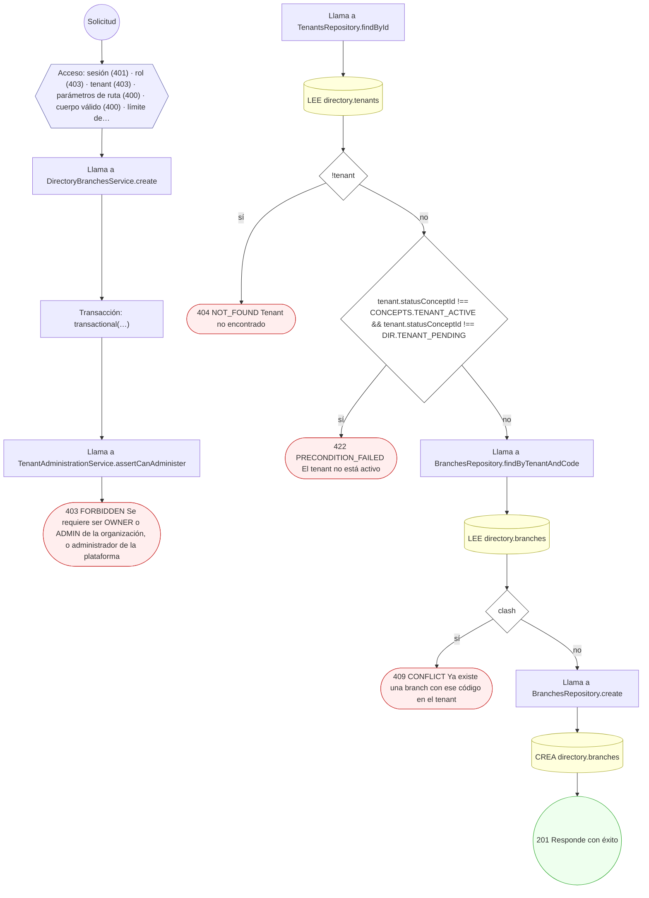

#### 9. PATCH /tenants/{tenantId}/branches/{branchId}

Editar una sucursal

| HTTP | Código | Cuándo |
|---|---|---|
| 200 | — | Éxito |
| 400 | `VALIDATION_FAILED` | Los parámetros de ruta son UUID válidos; El cuerpo cumple el DTO (sin propiedades extra) |
| 401 | `UNAUTHENTICATED` | Hay una sesión válida (JWT) |
| 403 | `FORBIDDEN` | El rol está permitido; El tenant se resuelve y pertenece al actor; ForbiddenException: Se requiere ser OWNER o ADMIN de la organización, o administrador de la plataforma |
| 404 | `NOT_FOUND` | ResourceNotFoundException: Sucursal no encontrada |
| 429 | `RATE_LIMITED` | No se supera el límite de solicitudes |

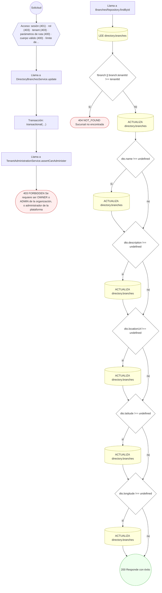

#### 10. GET /tenants/{tenantId}/child-tenants

Sub-organizaciones de una organización

| HTTP | Código | Cuándo |
|---|---|---|
| 200 | — | Éxito |
| 400 | `VALIDATION_FAILED` | Los parámetros de ruta son UUID válidos |
| 401 | `UNAUTHENTICATED` | Hay una sesión válida (JWT) |
| 403 | `FORBIDDEN` | El rol está permitido; El tenant se resuelve y pertenece al actor; ForbiddenException: Se requiere pertenecer a la organización, o ser administrador de la plataforma |
| 404 | `NOT_FOUND` | ResourceNotFoundException: Organización no encontrada |
| 429 | `RATE_LIMITED` | No se supera el límite de solicitudes |


#### 11. POST /tenants/{tenantId}/child-tenants

Crear una organización hija / sub-tenant

| HTTP | Código | Cuándo |
|---|---|---|
| 201 | — | Éxito |
| 400 | `VALIDATION_FAILED` | Los parámetros de ruta son UUID válidos; El cuerpo cumple el DTO (sin propiedades extra) |
| 401 | `UNAUTHENTICATED` | Hay una sesión válida (JWT) |
| 403 | `FORBIDDEN` | El rol está permitido; El tenant se resuelve y pertenece al actor |
| 404 | `NOT_FOUND` | ResourceNotFoundException: Tenant padre no encontrado |
| 409 | `CONFLICT` | ConflictException: El código de tenant ya existe |
| 422 | `PRECONDITION_FAILED` | PreconditionFailedException: El tenant padre no está activo; PreconditionFailedException: Un tenant de tipo PAYER exige el bloque `payer`; PreconditionFailedException: Un tenant de tipo BROKER exige el bloque `broker`; PreconditionFailedException: Un tenant de tipo {tenantType} exige país y jurisdicción; PreconditionFailedException: El tipo societario pertenece al derecho de {entry!.countryIso} y no coincide con el país declarado; PreconditionFailedException: El bloque `payer` sólo corresponde a un tenant de tipo PAYER; PreconditionFailedException: El bloque `broker` sólo corresponde a un tenant de tipo BROKER; PreconditionFailedException: El bloque `diagnosticUnit` sólo corresponde a un tenant de tipo DIAGNOSTIC_CENTER; PreconditionFailedException: El tipo de unidad diagnóstica declarado no es válido; PreconditionFailedException: Las sucursales sólo se declaran en una unidad de laboratorio clínico; PreconditionFailedException: Alguna modalidad declarada no pertenece al catálogo de modalidades diagnósticas; PreconditionFailedException: Los conceptos declarados no existen en el catálogo de terminología |
| 429 | `RATE_LIMITED` | No se supera el límite de solicitudes |

```mermaid
flowchart TD
  n1(("Solicitud")):::inicio
  n2{{"Acceso: sesión (401) · rol (403) · tenant (403) · parámetros de ruta (400) · cuerpo válido (400) · límite de…"}}:::acceso
  n1 --> n2
  n3["Llama a DirectoryTenantsService.createChild"]:::llamada
  n2 --> n3
  n4["Transacción: transactional(…)"]:::transaccion
  n3 --> n4
  n5["Llama a TenantsRepository.findById"]:::llamada
  n4 --> n5
  n6[("LEE directory.tenants")]:::efecto
  n5 --> n6
  n7{"!parent"}:::decision
  n6 --> n7
  n8(["404 NOT_FOUND Tenant padre no encontrado"]):::error
  n7 -->|"sí"| n8
  n9{"parent.statusConceptId !== CONCEPTS.TENANT_ACTIVE"}:::decision
  n7 -->|"no"| n9
  n10(["422 PRECONDITION_FAILED El tenant padre no está activo"]):::error
  n9 -->|"sí"| n10
  n11["Llama a TenantsRepository.findByCode"]:::llamada
  n9 -->|"no"| n11
  n12[("LEE directory.tenants")]:::efecto
  n11 --> n12
  n13{"clash"}:::decision
  n12 --> n13
  n14(["409 CONFLICT El código de tenant ya existe"]):::error
  n13 -->|"sí"| n14
  n15["Llama a TenantTypeProfileService.assertProfileMatchesType"]:::llamada
  n13 -->|"no"| n15
  n16{"tenantType === 'PAYER' && !input.payer"}:::decision
  n15 --> n16
  n17(["422 PRECONDITION_FAILED Un tenant de tipo PAYER exige el bloque `payer`"]):::error
  n16 -->|"sí"| n17
  n18{"tenantType === 'BROKER' && !input.broker"}:::decision
  n16 -->|"no"| n18
  n19(["422 PRECONDITION_FAILED Un tenant de tipo BROKER exige el bloque `broker`"]):::error
  n18 -->|"sí"| n19
  n20{"TERRITORIAL_TENANT_TYPES.includes(tenantType)"}:::decision
  n18 -->|"no"| n20
  n21{"missing.length › 0"}:::decision
  n20 -->|"sí"| n21
  n22(["422 PRECONDITION_FAILED Un tenant de tipo {tenantType} exige país y jurisdicción"]):::error
  n21 -->|"sí"| n22
  n23{"input.legalEntityType && input.countryConceptId"}:::decision
  n21 -->|"no"| n23
  n20 -->|"no"| n23
  n24{"expectedCountryConceptId && expectedCountryConceptId !== input.countryConceptId"}:::decision
  n23 -->|"sí"| n24
  n25(["422 PRECONDITION_FAILED El tipo societario pertenece al derecho de {entry!.countryIso} y no coincide con el p…"]):::error
  n24 -->|"sí"| n25
  n26{"tenantType !== 'PAYER' && input.payer"}:::decision
  n24 -->|"no"| n26
  n23 -->|"no"| n26
  n27(["422 PRECONDITION_FAILED El bloque `payer` sólo corresponde a un tenant de tipo PAYER"]):::error
  n26 -->|"sí"| n27
  n28{"tenantType !== 'BROKER' && input.broker"}:::decision
  n26 -->|"no"| n28
  n29(["422 PRECONDITION_FAILED El bloque `broker` sólo corresponde a un tenant de tipo BROKER"]):::error
  n28 -->|"sí"| n29
  n30{"tenantType !== 'DIAGNOSTIC_CENTER' && input.diagnosticUnit"}:::decision
  n28 -->|"no"| n30
  n31(["422 PRECONDITION_FAILED El bloque `diagnosticUnit` sólo corresponde a un tenant de tipo DIAGNOSTIC_CENTER"]):::error
  n30 -->|"sí"| n31
  n32{"input.diagnosticUnit"}:::decision
  n30 -->|"no"| n32
  n33{"unitTypeConceptId !== undefined && !DIAGNOSTIC_UNIT_TYPE_CONCEPTS.has(unitTypeConceptId)"}:::decision
  n32 -->|"sí"| n33
  n34(["422 PRECONDITION_FAILED El tipo de unidad diagnóstica declarado no es válido"]):::error
  n33 -->|"sí"| n34
  n35{"(input.diagnosticUnit.branches?.length ?? 0) › 0 && unitTypeConceptId !== DUNIT.UNIT_TYPE_LABORATORY"}:::decision
  n33 -->|"no"| n35
  n36(["422 PRECONDITION_FAILED Las sucursales sólo se declaran en una unidad de laboratorio clínico"]):::error
  n35 -->|"sí"| n36
  n37{"invalidModalities.length › 0"}:::decision
  n35 -->|"no"| n37
  n38(["422 PRECONDITION_FAILED Alguna modalidad declarada no pertenece al catálogo de modalidades diagnósticas"]):::error
  n37 -->|"sí"| n38
  n39["Llama a TenantTypeProfileService.assertConceptsExist"]:::llamada
  n37 -->|"no"| n39
  n32 -->|"no"| n39
  n40["Llama a CatalogConceptsRepository.findByIds"]:::llamada
  n39 --> n40
  n41[("LEE terminology.catalog_concepts")]:::efecto
  n40 --> n41
  n42{"unknown.length › 0"}:::decision
  n41 --> n42
  n43(["422 PRECONDITION_FAILED Los conceptos declarados no existen en el catálogo de terminología"]):::error
  n42 -->|"sí"| n43
  n44["Llama a TenantsRepository.create"]:::llamada
  n42 -->|"no"| n44
  n45[("CREA directory.tenants")]:::efecto
  n44 --> n45
  n46["Llama a TenantTypeProfileService.materializeProfile"]:::llamada
  n45 --> n46
  n47{"input.tenantType === 'PAYER' && input.payer"}:::decision
  n46 --> n47
  n48["Llama a CatalogRepository.createCarrier"]:::llamada
  n47 -->|"sí"| n48
  n49[("CREA insurance.insurance_carriers")]:::efecto
  n48 --> n49
  n50["Llama a TenantTypeProfileService.materializePayerHeadquarters"]:::llamada
  n49 --> n50
  n51["Llama a AddressesRepository.create"]:::llamada
  n50 --> n51
  n52[("CREA common.addresses")]:::efecto
  n51 --> n52
  n53{"input.tenantType === 'BROKER' && input.broker"}:::decision
  n52 --> n53
  n47 -->|"no"| n53
  n54["Llama a CatalogRepository.createBroker"]:::llamada
  n53 -->|"sí"| n54
  n55[("CREA insurance.insurance_brokers")]:::efecto
  n54 --> n55
  n56{"input.tenantType === 'DIAGNOSTIC_CENTER' && input.diagnosticUnit"}:::decision
  n55 --> n56
  n53 -->|"no"| n56
  n57["Llama a DiagnosticUnitProvisioningService.provision"]:::llamada
  n56 -->|"sí"| n57
  n58["Llama a PracticesRepository.create"]:::llamada
  n57 --> n58
  n59[("CREA practice.practices")]:::efecto
  n58 --> n59
  n60["Llama a DiagnosticUnitsRepository.create"]:::llamada
  n59 --> n60
  n61[("CREA diagnostic_units.diagnostic_units")]:::efecto
  n60 --> n61
  n62["Llama a DiagnosticUnitSitesRepository.create"]:::llamada
  n61 --> n62
  n63[("CREA diagnostic_units.diagnostic_unit_sites")]:::efecto
  n62 --> n63
  n64["Repite: por cada const branch de profile.branches ?? []"]:::bucle
  n63 --> n64
  n65["Llama a DiagnosticUnitSitesRepository.create"]:::llamada
  n64 -->|"cada elemento"| n65
  n66[("CREA diagnostic_units.diagnostic_unit_sites")]:::efecto
  n65 --> n66
  n67["Repite: por cada const conceptId de profile.modalityConceptIds ?? []"]:::bucle
  n66 --> n67
  n64 -->|"al terminar"| n67
  n68["Llama a DiagnosticStudyOfferingsRepository.create"]:::llamada
  n67 -->|"cada elemento"| n68
  n69[("CREA diagnostic_units.diagnostic_study_offerings")]:::efecto
  n68 --> n69
  n70["Llama a TenantMembershipsRepository.create"]:::llamada
  n69 --> n70
  n67 -->|"al terminar"| n70
  n56 -->|"no"| n70
  n71["… el resto del árbol (1 nodos) está en el JSON del inventario"]:::corte
  n70 --> n71
  classDef acceso fill:#eef,stroke:#66a
  classDef error fill:#fee,stroke:#c33
  classDef ok fill:#efe,stroke:#3a3
  classDef efecto fill:#ffd,stroke:#aa3
  classDef decision fill:#fff,stroke:#555
  classDef corte fill:#eee,stroke:#999,stroke-dasharray: 4
```

#### 12. GET /tenants/{tenantId}/logo

Logo de la propia organización

| HTTP | Código | Cuándo |
|---|---|---|
| 200 | — | Éxito |
| 400 | `VALIDATION_FAILED` | Los parámetros de ruta son UUID válidos |
| 401 | `UNAUTHENTICATED` | Hay una sesión válida (JWT) |
| 403 | `FORBIDDEN` | El rol está permitido; El tenant se resuelve y pertenece al actor; ForbiddenException: Se requiere pertenecer a la organización, o ser administrador de la plataforma |
| 404 | `NOT_FOUND` | ResourceNotFoundException: Organización no encontrada |
| 429 | `RATE_LIMITED` | No se supera el límite de solicitudes |

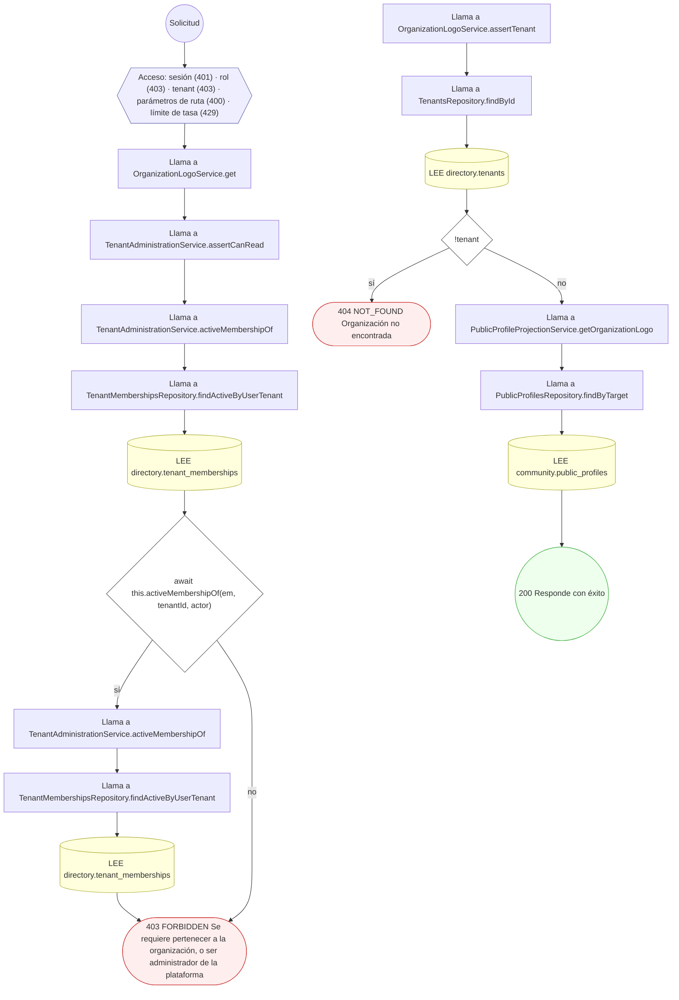

#### 13. PUT /tenants/{tenantId}/logo

Cambiar o quitar el logo como administrador de la organización

| HTTP | Código | Cuándo |
|---|---|---|
| 200 | — | Éxito |
| 400 | `VALIDATION_FAILED` | Los parámetros de ruta son UUID válidos; El cuerpo cumple el DTO (sin propiedades extra) |
| 401 | `UNAUTHENTICATED` | Hay una sesión válida (JWT) |
| 403 | `FORBIDDEN` | El rol está permitido; El tenant se resuelve y pertenece al actor; ForbiddenException: Se requiere ser OWNER o ADMIN de la organización, o administrador de la plataforma; ForbiddenException: {labels.subject} no le pertenece |
| 404 | `NOT_FOUND` | ResourceNotFoundException: Organización no encontrada; ResourceNotFoundException: {labels.notFound} |
| 422 | `PRECONDITION_FAILED` | PreconditionFailedException: {labels.subject} está borrado; PreconditionFailedException: {labels.subject} no tiene una versión vigente; PreconditionFailedException: {labels.subject} resultó infectado; PreconditionFailedException: {labels.subject} no es de un formato admitido para este uso; PreconditionFailedException: El logo debe ser una imagen de sensibilidad NORMAL; PreconditionFailedException: El logo supera los 2 MB |
| 429 | `RATE_LIMITED` | No se supera el límite de solicitudes |

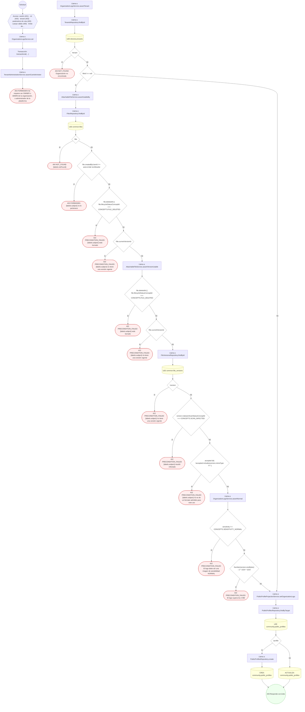

#### 14. GET /tenants/{tenantId}/logo/content

Imagen del logo para miembros de la organización

| HTTP | Código | Cuándo |
|---|---|---|
| 200 | — | Éxito |
| 400 | `VALIDATION_FAILED` | Los parámetros de ruta son UUID válidos |
| 401 | `UNAUTHENTICATED` | Hay una sesión válida (JWT) |
| 403 | `FORBIDDEN` | El rol está permitido; El tenant se resuelve y pertenece al actor; ForbiddenException: Se requiere pertenecer a la organización, o ser administrador de la plataforma |
| 404 | `NOT_FOUND` | ResourceNotFoundException: Organización no encontrada; ResourceNotFoundException: La organización no tiene logo; ResourceNotFoundException: {labels.notFound}; ResourceNotFoundException: Archivo no encontrado; ResourceNotFoundException: El contenido no está disponible en el almacenamiento local; ResourceNotFoundException: El contenido no está disponible en el almacenamiento configurado |
| 422 | `PRECONDITION_FAILED` | PreconditionFailedException: {labels.subject} está borrado; PreconditionFailedException: {labels.subject} no tiene una versión vigente; PreconditionFailedException: {labels.subject} resultó infectado; PreconditionFailedException: {labels.subject} no es de un formato admitido para este uso; PreconditionFailedException: El logo debe ser una imagen de sensibilidad NORMAL |
| 429 | `RATE_LIMITED` | No se supera el límite de solicitudes |
| 500 | `INTERNAL` | Error: S3 object body is empty |

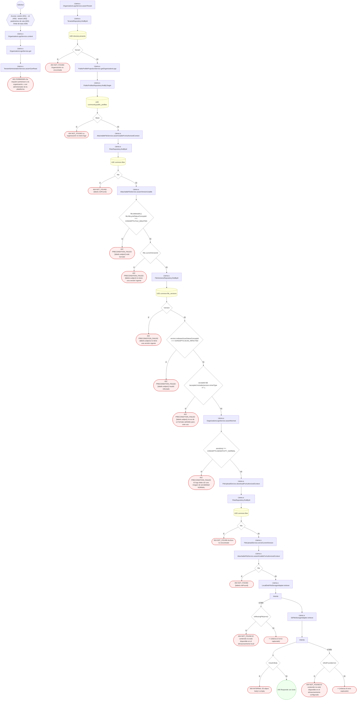

#### 15. GET /tenants/{tenantId}/memberships

Plantilla de la organización

| HTTP | Código | Cuándo |
|---|---|---|
| 200 | — | Éxito |
| 400 | `VALIDATION_FAILED` | Los parámetros de ruta son UUID válidos |
| 401 | `UNAUTHENTICATED` | Hay una sesión válida (JWT) |
| 403 | `FORBIDDEN` | El rol está permitido; El tenant se resuelve y pertenece al actor; ForbiddenException: Se requiere pertenecer a la organización, o ser administrador de la plataforma |
| 404 | `NOT_FOUND` | ResourceNotFoundException: Organización no encontrada |
| 429 | `RATE_LIMITED` | No se supera el límite de solicitudes |


#### 16. POST /tenants/{tenantId}/memberships

Incorporar un usuario al tenant (membership)

| HTTP | Código | Cuándo |
|---|---|---|
| 201 | — | Éxito |
| 400 | `VALIDATION_FAILED` | Los parámetros de ruta son UUID válidos; El cuerpo cumple el DTO (sin propiedades extra) |
| 401 | `UNAUTHENTICATED` | Hay una sesión válida (JWT) |
| 403 | `FORBIDDEN` | El rol está permitido; El tenant se resuelve y pertenece al actor; ForbiddenException: Se requiere ser OWNER o ADMIN de la organización, o administrador de la plataforma; ForbiddenException: Sólo un OWNER de la organización o la plataforma pueden cambiar quién la posee |
| 409 | `CONFLICT` | ConflictException: El usuario ya tiene una membresía activa en el tenant |
| 429 | `RATE_LIMITED` | No se supera el límite de solicitudes |

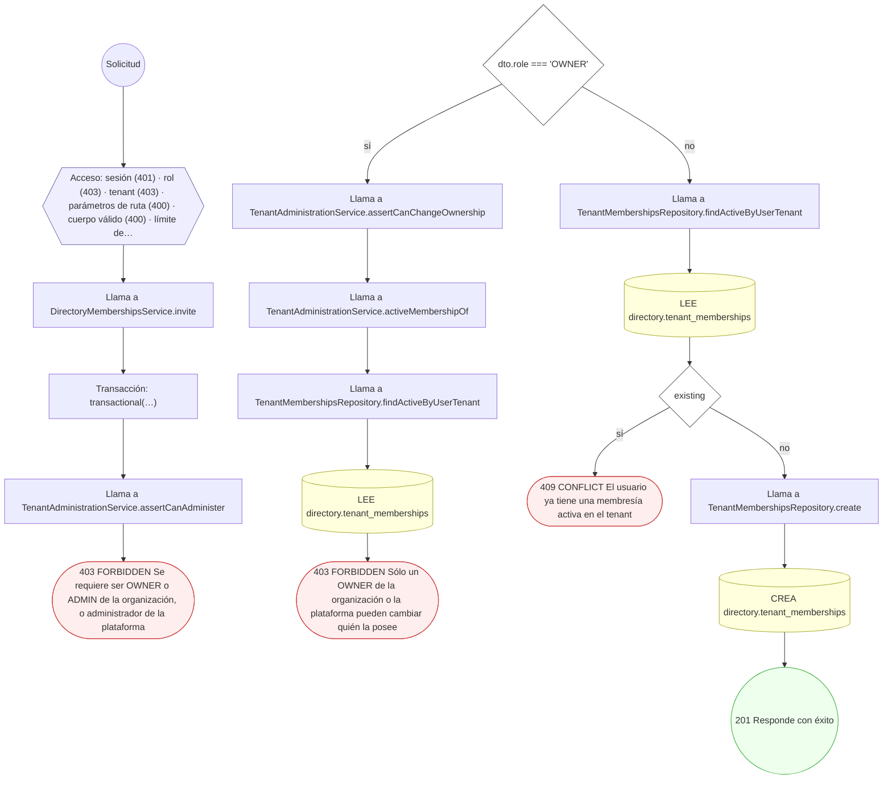

#### 17. GET /tenants/{tenantId}/memberships/{membershipId}/branch-assignments

Sucursales asignadas a una membresía

| HTTP | Código | Cuándo |
|---|---|---|
| 200 | — | Éxito |
| 400 | `VALIDATION_FAILED` | Los parámetros de ruta son UUID válidos |
| 401 | `UNAUTHENTICATED` | Hay una sesión válida (JWT) |
| 403 | `FORBIDDEN` | El rol está permitido; El tenant se resuelve y pertenece al actor; ForbiddenException: Se requiere pertenecer a la organización, o ser administrador de la plataforma |
| 404 | `NOT_FOUND` | ResourceNotFoundException: Organización no encontrada; ResourceNotFoundException: Membresía no encontrada |
| 429 | `RATE_LIMITED` | No se supera el límite de solicitudes |

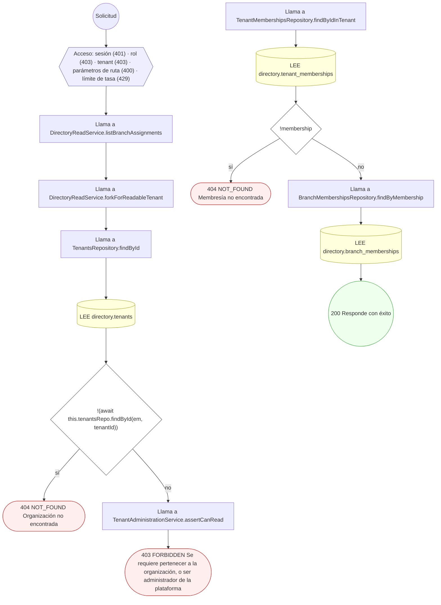

#### 18. POST /tenants/{tenantId}/memberships/{membershipId}/branch-assignments

Asignar la membresía a una branch

| HTTP | Código | Cuándo |
|---|---|---|
| 201 | — | Éxito |
| 400 | `VALIDATION_FAILED` | Los parámetros de ruta son UUID válidos; El cuerpo cumple el DTO (sin propiedades extra) |
| 401 | `UNAUTHENTICATED` | Hay una sesión válida (JWT) |
| 403 | `FORBIDDEN` | El rol está permitido; El tenant se resuelve y pertenece al actor; ForbiddenException: Se requiere ser OWNER o ADMIN de la organización, o administrador de la plataforma |
| 404 | `NOT_FOUND` | ResourceNotFoundException: Membresía no encontrada; ResourceNotFoundException: Branch no encontrada |
| 409 | `CONFLICT` | ConflictException: La membresía ya está asignada a esa branch |
| 422 | `PRECONDITION_FAILED` | PreconditionFailedException: La membresía no está activa; PreconditionFailedException: La branch no pertenece al tenant |
| 429 | `RATE_LIMITED` | No se supera el límite de solicitudes |

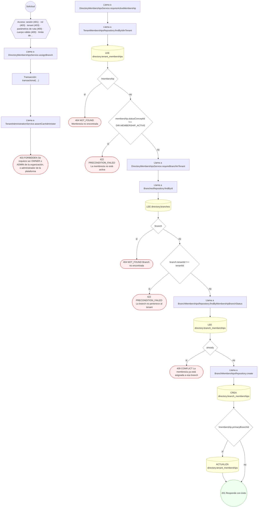

#### 19. POST /tenants/{tenantId}/memberships/{membershipId}/offboard

Revocar / offboarding de un miembro

| HTTP | Código | Cuándo |
|---|---|---|
| 200 | — | Éxito |
| 400 | `VALIDATION_FAILED` | Los parámetros de ruta son UUID válidos |
| 401 | `UNAUTHENTICATED` | Hay una sesión válida (JWT) |
| 403 | `FORBIDDEN` | El rol está permitido; El tenant se resuelve y pertenece al actor; ForbiddenException: Se requiere ser OWNER o ADMIN de la organización, o administrador de la plataforma; ForbiddenException: Sólo un OWNER de la organización o la plataforma pueden cambiar quién la posee |
| 404 | `NOT_FOUND` | ResourceNotFoundException: Membresía no encontrada |
| 422 | `PRECONDITION_FAILED` | PreconditionFailedException: La membresía no está activa; PreconditionFailedException: No se puede quitar al último OWNER de la organización: designe otro OWNER primero |
| 429 | `RATE_LIMITED` | No se supera el límite de solicitudes |

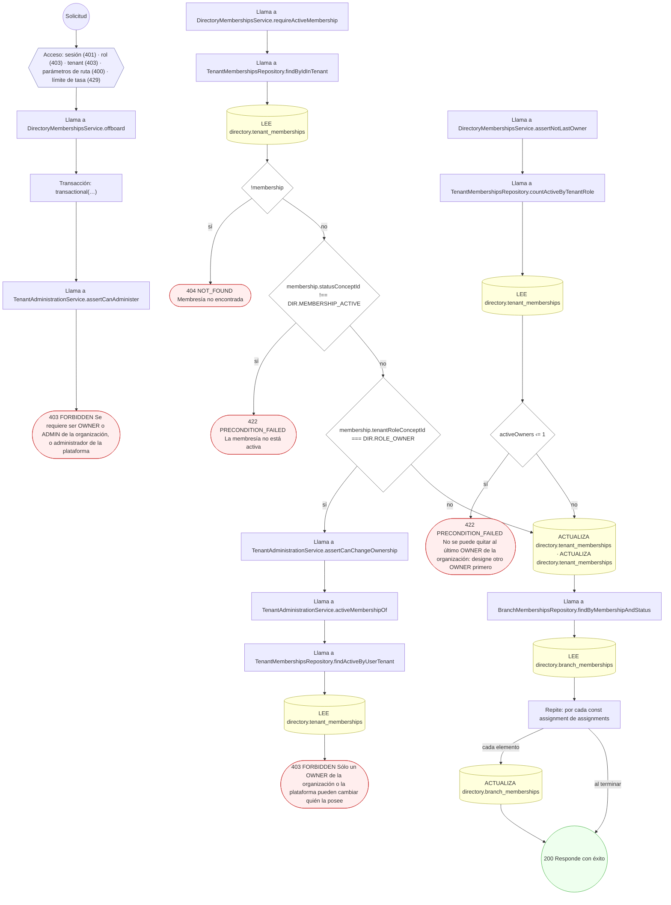

#### 20. PATCH /tenants/{tenantId}/memberships/{membershipId}/role

Cambiar rol / scope de la membresía

| HTTP | Código | Cuándo |
|---|---|---|
| 200 | — | Éxito |
| 400 | `VALIDATION_FAILED` | Los parámetros de ruta son UUID válidos; El cuerpo cumple el DTO (sin propiedades extra) |
| 401 | `UNAUTHENTICATED` | Hay una sesión válida (JWT) |
| 403 | `FORBIDDEN` | El rol está permitido; El tenant se resuelve y pertenece al actor; ForbiddenException: Se requiere ser OWNER o ADMIN de la organización, o administrador de la plataforma; ForbiddenException: Sólo un OWNER de la organización o la plataforma pueden cambiar quién la posee |
| 404 | `NOT_FOUND` | ResourceNotFoundException: Membresía no encontrada |
| 422 | `PRECONDITION_FAILED` | PreconditionFailedException: Debe indicar un nuevo rol o scope; PreconditionFailedException: La membresía no está activa; PreconditionFailedException: No se puede quitar al último OWNER de la organización: designe otro OWNER primero |
| 429 | `RATE_LIMITED` | No se supera el límite de solicitudes |

```mermaid
flowchart TD
  n1(("Solicitud")):::inicio
  n2{{"Acceso: sesión (401) · rol (403) · tenant (403) · parámetros de ruta (400) · cuerpo válido (400) · límite de…"}}:::acceso
  n1 --> n2
  n3["Llama a DirectoryMembershipsService.changeRole"]:::llamada
  n2 --> n3
  n4{"!dto.role && !dto.accessScope"}:::decision
  n3 --> n4
  n5(["422 PRECONDITION_FAILED Debe indicar un nuevo rol o scope"]):::error
  n4 -->|"sí"| n5
  n6["Transacción: transactional(…)"]:::transaccion
  n4 -->|"no"| n6
  n7["Llama a TenantAdministrationService.assertCanAdminister"]:::llamada
  n6 --> n7
  n8(["403 FORBIDDEN Se requiere ser OWNER o ADMIN de la organización, o administrador de la plataforma"]):::error
  n7 --> n8
  n9["Llama a DirectoryMembershipsService.requireActiveMembership"]:::llamada
  n10["Llama a TenantMembershipsRepository.findByIdInTenant"]:::llamada
  n9 --> n10
  n11[("LEE directory.tenant_memberships")]:::efecto
  n10 --> n11
  n12{"!membership"}:::decision
  n11 --> n12
  n13(["404 NOT_FOUND Membresía no encontrada"]):::error
  n12 -->|"sí"| n13
  n14{"membership.statusConceptId !== DIR.MEMBERSHIP_ACTIVE"}:::decision
  n12 -->|"no"| n14
  n15(["422 PRECONDITION_FAILED La membresía no está activa"]):::error
  n14 -->|"sí"| n15
  n16{"grantsOwner || targetIsOwner"}:::decision
  n14 -->|"no"| n16
  n17["Llama a TenantAdministrationService.assertCanChangeOwnership"]:::llamada
  n16 -->|"sí"| n17
  n18["Llama a TenantAdministrationService.activeMembershipOf"]:::llamada
  n17 --> n18
  n19["Llama a TenantMembershipsRepository.findActiveByUserTenant"]:::llamada
  n18 --> n19
  n20[("LEE directory.tenant_memberships")]:::efecto
  n19 --> n20
  n21(["403 FORBIDDEN Sólo un OWNER de la organización o la plataforma pueden cambiar quién la posee"]):::error
  n20 --> n21
  n22{"targetIsOwner && dto.role && !grantsOwner"}:::decision
  n16 -->|"no"| n22
  n23["Llama a DirectoryMembershipsService.assertNotLastOwner"]:::llamada
  n22 -->|"sí"| n23
  n24["Llama a TenantMembershipsRepository.countActiveByTenantRole"]:::llamada
  n23 --> n24
  n25[("LEE directory.tenant_memberships")]:::efecto
  n24 --> n25
  n26{"activeOwners ‹= 1"}:::decision
  n25 --> n26
  n27(["422 PRECONDITION_FAILED No se puede quitar al último OWNER de la organización: designe otro OWNER primero"]):::error
  n26 -->|"sí"| n27
  n28{"dto.role"}:::decision
  n26 -->|"no"| n28
  n22 -->|"no"| n28
  n29[("ACTUALIZA directory.tenant_memberships")]:::efecto
  n28 -->|"sí"| n29
  n30{"dto.accessScope"}:::decision
  n29 --> n30
  n28 -->|"no"| n30
  n31[("ACTUALIZA directory.tenant_memberships")]:::efecto
  n30 -->|"sí"| n31
  n32(("200 Responde con éxito")):::ok
  n31 --> n32
  n30 -->|"no"| n32
  classDef acceso fill:#eef,stroke:#66a
  classDef error fill:#fee,stroke:#c33
  classDef ok fill:#efe,stroke:#3a3
  classDef efecto fill:#ffd,stroke:#aa3
  classDef decision fill:#fff,stroke:#555
  classDef corte fill:#eee,stroke:#999,stroke-dasharray: 4
```

#### 21. POST /tenants/{tenantId}/memberships/{membershipId}/transfer

Transferir la membresía entre branches

| HTTP | Código | Cuándo |
|---|---|---|
| 200 | — | Éxito |
| 400 | `VALIDATION_FAILED` | Los parámetros de ruta son UUID válidos; El cuerpo cumple el DTO (sin propiedades extra) |
| 401 | `UNAUTHENTICATED` | Hay una sesión válida (JWT) |
| 403 | `FORBIDDEN` | El rol está permitido; El tenant se resuelve y pertenece al actor; ForbiddenException: Se requiere ser OWNER o ADMIN de la organización, o administrador de la plataforma |
| 404 | `NOT_FOUND` | ResourceNotFoundException: Membresía no encontrada; ResourceNotFoundException: Branch no encontrada; ResourceNotFoundException: No hay asignación activa en la branch de origen |
| 422 | `PRECONDITION_FAILED` | PreconditionFailedException: La membresía no está activa; PreconditionFailedException: La branch no pertenece al tenant |
| 429 | `RATE_LIMITED` | No se supera el límite de solicitudes |

```mermaid
flowchart TD
  n1(("Solicitud")):::inicio
  n2{{"Acceso: sesión (401) · rol (403) · tenant (403) · parámetros de ruta (400) · cuerpo válido (400) · límite de…"}}:::acceso
  n1 --> n2
  n3["Llama a DirectoryMembershipsService.transfer"]:::llamada
  n2 --> n3
  n4["Transacción: transactional(…)"]:::transaccion
  n3 --> n4
  n5["Llama a TenantAdministrationService.assertCanAdminister"]:::llamada
  n4 --> n5
  n6(["403 FORBIDDEN Se requiere ser OWNER o ADMIN de la organización, o administrador de la plataforma"]):::error
  n5 --> n6
  n7["Llama a DirectoryMembershipsService.requireActiveMembership"]:::llamada
  n8["Llama a TenantMembershipsRepository.findByIdInTenant"]:::llamada
  n7 --> n8
  n9[("LEE directory.tenant_memberships")]:::efecto
  n8 --> n9
  n10{"!membership"}:::decision
  n9 --> n10
  n11(["404 NOT_FOUND Membresía no encontrada"]):::error
  n10 -->|"sí"| n11
  n12{"membership.statusConceptId !== DIR.MEMBERSHIP_ACTIVE"}:::decision
  n10 -->|"no"| n12
  n13(["422 PRECONDITION_FAILED La membresía no está activa"]):::error
  n12 -->|"sí"| n13
  n14["Llama a DirectoryMembershipsService.requireBranchInTenant"]:::llamada
  n12 -->|"no"| n14
  n15["Llama a BranchesRepository.findById"]:::llamada
  n14 --> n15
  n16[("LEE directory.branches")]:::efecto
  n15 --> n16
  n17{"!branch"}:::decision
  n16 --> n17
  n18(["404 NOT_FOUND Branch no encontrada"]):::error
  n17 -->|"sí"| n18
  n19{"branch.tenantId !== tenantId"}:::decision
  n17 -->|"no"| n19
  n20(["422 PRECONDITION_FAILED La branch no pertenece al tenant"]):::error
  n19 -->|"sí"| n20
  n21["Llama a DirectoryMembershipsService.requireBranchInTenant"]:::llamada
  n19 -->|"no"| n21
  n22["Llama a BranchesRepository.findById"]:::llamada
  n21 --> n22
  n23[("LEE directory.branches")]:::efecto
  n22 --> n23
  n24{"!branch"}:::decision
  n23 --> n24
  n25(["404 NOT_FOUND Branch no encontrada"]):::error
  n24 -->|"sí"| n25
  n26{"branch.tenantId !== tenantId"}:::decision
  n24 -->|"no"| n26
  n27(["422 PRECONDITION_FAILED La branch no pertenece al tenant"]):::error
  n26 -->|"sí"| n27
  n28["Llama a BranchMembershipsRepository.findByMembershipBranchStatus"]:::llamada
  n26 -->|"no"| n28
  n29[("LEE directory.branch_memberships")]:::efecto
  n28 --> n29
  n30{"!source"}:::decision
  n29 --> n30
  n31(["404 NOT_FOUND No hay asignación activa en la branch de origen"]):::error
  n30 -->|"sí"| n31
  n32[("ACTUALIZA directory.branch_memberships")]:::efecto
  n30 -->|"no"| n32
  n33["Llama a BranchMembershipsRepository.create"]:::llamada
  n32 --> n33
  n34[("CREA directory.branch_memberships")]:::efecto
  n33 --> n34
  n35[("ACTUALIZA directory.tenant_memberships")]:::efecto
  n34 --> n35
  n36(("200 Responde con éxito")):::ok
  n35 --> n36
  classDef acceso fill:#eef,stroke:#66a
  classDef error fill:#fee,stroke:#c33
  classDef ok fill:#efe,stroke:#3a3
  classDef efecto fill:#ffd,stroke:#aa3
  classDef decision fill:#fff,stroke:#555
  classDef corte fill:#eee,stroke:#999,stroke-dasharray: 4
```

#### 22. GET /tenants/me

Las organizaciones del actor, con su rol en cada una

| HTTP | Código | Cuándo |
|---|---|---|
| 200 | — | Éxito |
| 401 | `UNAUTHENTICATED` | Hay una sesión válida (JWT) |
| 403 | `FORBIDDEN` | El rol está permitido; El tenant se resuelve y pertenece al actor |
| 429 | `RATE_LIMITED` | No se supera el límite de solicitudes |

```mermaid
flowchart TD
  n1(("Solicitud")):::inicio
  n2{{"Acceso: sesión (401) · rol (403) · tenant (403) · límite de tasa (429)"}}:::acceso
  n1 --> n2
  n3["Llama a DirectoryReadService.listMyTenants"]:::llamada
  n2 --> n3
  n4["Llama a TenantMembershipsRepository.findActiveByUser"]:::llamada
  n3 --> n4
  n5[("LEE directory.tenant_memberships")]:::efecto
  n4 --> n5
  n6["Repite: por cada const membership de memberships"]:::bucle
  n5 --> n6
  n7["Llama a TenantsRepository.findById"]:::llamada
  n6 -->|"cada elemento"| n7
  n8[("LEE directory.tenants")]:::efecto
  n7 --> n8
  n9{"tenant.tenantTypeConceptId === TENANT_TYPE_CONCEPT_BY_CODE.PAYER"}:::decision
  n8 --> n9
  n10["Llama a CatalogRepository.findCarrierByTenantId"]:::llamada
  n9 -->|"sí"| n10
  n11[("LEE insurance.insurance_carriers")]:::efecto
  n10 --> n11
  n12{"carrier"}:::decision
  n11 --> n12
  n13["Llama a AddressesRepository.findCurrentByOwnerAndUse"]:::llamada
  n12 -->|"sí"| n13
  n14[("LEE common.addresses")]:::efecto
  n13 --> n14
  n15["Llama a DirectoryReadService.loadRepresentation"]:::llamada
  n14 --> n15
  n12 -->|"no"| n15
  n9 -->|"no"| n15
  n16["Llama a DirectoryTenantLegalRepository.listLegalRepsByTenant"]:::llamada
  n15 --> n16
  n17[("LEE directory.tenant_legal_representatives")]:::efecto
  n16 --> n17
  n18["Llama a AffiliationDocumentConceptsService.resolve"]:::llamada
  n17 --> n18
  n19{"!this.cache"}:::decision
  n18 --> n19
  n20["Transacción: catch(…)"]:::transaccion
  n19 -->|"sí"| n20
  n21(["↩ (relanza el error capturado)"]):::error
  n20 --> n21
  n22["Llama a DirectoryTenantLegalRepository.findPersonsByIds"]:::llamada
  n19 -->|"no"| n22
  n23[("LEE profiles.persons")]:::efecto
  n22 --> n23
  n24["Llama a IdentifiersRepository.findByIds"]:::llamada
  n23 --> n24
  n25[("LEE common.identifiers")]:::efecto
  n24 --> n25
  n26["Llama a ContactPointsRepository.findAllCurrentByOwners"]:::llamada
  n25 --> n26
  n27[("LEE common.contact_points")]:::efecto
  n26 --> n27
  n28(("200 Responde con éxito")):::ok
  n27 --> n28
  n6 -->|"al terminar"| n28
  classDef acceso fill:#eef,stroke:#66a
  classDef error fill:#fee,stroke:#c33
  classDef ok fill:#efe,stroke:#3a3
  classDef efecto fill:#ffd,stroke:#aa3
  classDef decision fill:#fff,stroke:#555
  classDef corte fill:#eee,stroke:#999,stroke-dasharray: 4
```

### Operaciones sin decisiones propias

Sólo comprueban el acceso y leen o escriben: no tienen ramas que dibujar. Su detalle está en la ficha de endpoints.

| Operación | Respuestas posibles | Tablas |
|---|---|---|
| GET /admin/tenants | 200, 401, 403, 429 | 1 |
