<!-- AUTOGENERADO por tools/inventario/flujos.mjs. No editar manualmente. -->

# Flujos del módulo `directory`

- **Procesos:** 1 · **Máquinas de estado:** 0
- **Operaciones:** 19 (18 con decisiones propias, 1 sin ellas)
- Inventario de endpoints del módulo: [directory](../endpoints/directory.md)

## Proceso: Módulo 04 — Directory (Tenants, Sub-tenants, Branches y Membresías)

- **Código:** `directory` · **Agrupación:** AGRUPACION_POR_CONTROLADOR · **Operaciones:** 19
- **Actores:** Cualquier sesión válida · SECURITY_ADMIN · SUPERADMIN
- **Revisión:** AUTO_DETECTADA
- **Fuentes:** `src/modules/directory/README.md`

### Para qué sirve

Gestiona el directorio organizacional de la plataforma: aprovisionamiento y ciclo de vida de tenants, jerarquía de sub-tenants, sedes físicas (branches) y las membresías de usuarios a tenant y a branch.

_Fuente: `src/modules/directory/README.md:3`_

### Etapas y operaciones

| Etapa | Descripción | Operación | Quién actúa | Riesgo | Tablas |
|---|---|---|---|---|---|
| `ctrl:AdminTenantsController` | Operaciones de AdminTenantsController que el README no asigna a un caso de uso | GET /admin/tenants | SUPERADMIN · SECURITY_ADMIN | BAJO | 1 |
|  |  | POST /admin/tenants | SUPERADMIN | MEDIO | 6 |
|  |  | PUT /admin/tenants/{tenantId}/public-profile | SUPERADMIN · SECURITY_ADMIN | MEDIO | 3 |
|  |  | POST /admin/tenants/{tenantId}/suspend | SUPERADMIN | MEDIO | 6 |
|  |  | POST /admin/tenants/{tenantId}/verification | SECURITY_ADMIN | MEDIO | 4 |
| `ctrl:TenantsController` | Operaciones de TenantsController que el README no asigna a un caso de uso | GET /tenants/{tenantId} | Cualquier sesión válida | BAJO | 2 |
|  |  | PATCH /tenants/{tenantId} | Cualquier sesión válida | ALTO | 5 |
|  |  | GET /tenants/{tenantId}/branches | Cualquier sesión válida | BAJO | 3 |
|  |  | POST /tenants/{tenantId}/branches | Cualquier sesión válida | ALTO | 4 |
|  |  | GET /tenants/{tenantId}/child-tenants | Cualquier sesión válida | BAJO | 2 |
|  |  | POST /tenants/{tenantId}/child-tenants | SECURITY_ADMIN | MEDIO | 6 |
|  |  | GET /tenants/{tenantId}/memberships | Cualquier sesión válida | BAJO | 2 |
|  |  | POST /tenants/{tenantId}/memberships | Cualquier sesión válida | ALTO | 2 |
|  |  | GET /tenants/{tenantId}/memberships/{membershipId}/branch-assignments | Cualquier sesión válida | BAJO | 3 |
|  |  | POST /tenants/{tenantId}/memberships/{membershipId}/branch-assignments | Cualquier sesión válida | ALTO | 5 |
|  |  | POST /tenants/{tenantId}/memberships/{membershipId}/offboard | Cualquier sesión válida | ALTO | 4 |
|  |  | PATCH /tenants/{tenantId}/memberships/{membershipId}/role | Cualquier sesión válida | ALTO | 2 |
|  |  | POST /tenants/{tenantId}/memberships/{membershipId}/transfer | Cualquier sesión válida | ALTO | 6 |
|  |  | GET /tenants/me | Cualquier sesión válida | BAJO | 3 |

### Diagrama — etapas `ctrl:AdminTenantsController`, `ctrl:TenantsController`

```mermaid
flowchart LR
  a2(["SUPERADMIN · SECURITY_ADMIN"]):::actor
  a5(["SUPERADMIN"]):::actor
  a15(["SECURITY_ADMIN"]):::actor
  a17(["Cualquier sesión válida"]):::actor
  t3[("directory.tenants")]:::tabla
  t6[("directory.tenant_memberships")]:::tabla
  t7[("insurance.insurance_brokers")]:::tabla
  t8[("insurance.insurance_carriers")]:::tabla
  t9[("terminology.catalog_concepts")]:::tabla
  t11[("community.public_profiles")]:::tabla
  t13[("directory.branches")]:::tabla
  t26[("directory.branch_memberships")]:::tabla
  subgraph s0["ctrl:AdminTenantsController · Operaciones de AdminTenantsController que el READ…"]
    o1["GET /admin/tenants"]:::op
    o4["POST /admin/tenants"]:::op
    o10["PUT /admin/tenants/{tenantId}/public-profile"]:::op
    o12["POST /admin/tenants/{tenantId}/suspend"]:::op
    o14["POST /admin/tenants/{tenantId}/verification"]:::op
  end
  subgraph s1["ctrl:TenantsController · Operaciones de TenantsController que el README no asig…"]
    o16["GET /tenants/{tenantId}"]:::op
    o18["PATCH /tenants/{tenantId}"]:::op
    o19["GET /tenants/{tenantId}/branches"]:::op
    o20["POST /tenants/{tenantId}/branches"]:::op
    o21["GET /tenants/{tenantId}/child-tenants"]:::op
    o22["POST /tenants/{tenantId}/child-tenants"]:::op
    o23["GET /tenants/{tenantId}/memberships"]:::op
    o24["POST /tenants/{tenantId}/memberships"]:::op
    o25["GET /tenants/{tenantId}/memberships/{membershipId}/branch-assignments"]:::op
    o27["POST /tenants/{tenantId}/memberships/{membershipId}/branch-assignments"]:::op
    o28["POST /tenants/{tenantId}/memberships/{membershipId}/offboard"]:::op
    o29["PATCH /tenants/{tenantId}/memberships/{membershipId}/role"]:::op
    o30["POST /tenants/{tenantId}/memberships/{membershipId}/transfer"]:::op
    o31["GET /tenants/me"]:::op
  end
  a2 --> o1
  o1 -->|"LEE"| t3
  a5 --> o4
  o4 -->|"CREA"| t6
  o4 -->|"CREA"| t3
  o4 -->|"LEE"| t3
  o4 -->|"CREA"| t7
  o4 -->|"CREA"| t8
  o4 -->|"LEE"| t9
  a2 --> o10
  o10 -->|"ACTUALIZA"| t11
  o10 -->|"LEE"| t11
  o10 -->|"LEE"| t3
  a5 --> o12
  o12 -->|"ACTUALIZA"| t13
  o12 -->|"LEE"| t13
  o12 -->|"ACTUALIZA"| t6
  o12 -->|"LEE"| t6
  o12 -->|"ACTUALIZA"| t3
  o12 -->|"LEE"| t3
  a15 --> o14
  o14 -->|"CREA"| t11
  o14 -->|"LEE"| t11
  o14 -->|"ACTUALIZA"| t3
  o14 -->|"LEE"| t3
  a17 --> o16
  o16 -->|"LEE"| t6
  o16 -->|"LEE"| t3
  a17 --> o18
  o18 -->|"LEE"| t6
  o18 -->|"ACTUALIZA"| t3
  o18 -->|"LEE"| t3
  o18 -->|"ACTUALIZA"| t8
  o18 -->|"LEE"| t8
  a17 --> o19
  o19 -->|"LEE"| t13
  o19 -->|"LEE"| t6
  o19 -->|"LEE"| t3
  a17 --> o20
  o20 -->|"CREA"| t13
  o20 -->|"LEE"| t13
  o20 -->|"LEE"| t6
  o20 -->|"LEE"| t3
  a17 --> o21
  o21 -->|"LEE"| t6
  o21 -->|"LEE"| t3
  a15 --> o22
  o22 -->|"CREA"| t6
  o22 -->|"CREA"| t3
  o22 -->|"LEE"| t3
  o22 -->|"CREA"| t7
  o22 -->|"CREA"| t8
  o22 -->|"LEE"| t9
  a17 --> o23
  o23 -->|"LEE"| t6
  o23 -->|"LEE"| t3
  a17 --> o24
  o24 -->|"CREA"| t6
  o24 -->|"LEE"| t6
  a17 --> o25
  o25 -->|"LEE"| t26
  o25 -->|"LEE"| t6
  o25 -->|"LEE"| t3
  a17 --> o27
  o27 -->|"CREA"| t26
  o27 -->|"LEE"| t26
  o27 -->|"LEE"| t13
  o27 -->|"ACTUALIZA"| t6
  o27 -->|"LEE"| t6
  a17 --> o28
  o28 -->|"ACTUALIZA"| t26
  o28 -->|"LEE"| t26
  o28 -->|"ACTUALIZA"| t6
  o28 -->|"LEE"| t6
  a17 --> o29
  o29 -->|"ACTUALIZA"| t6
  o29 -->|"LEE"| t6
  a17 --> o30
  o30 -->|"ACTUALIZA"| t26
  o30 -->|"CREA"| t26
  o30 -->|"LEE"| t26
  o30 -->|"LEE"| t13
  o30 -->|"ACTUALIZA"| t6
  o30 -->|"LEE"| t6
  a17 --> o31
  o31 -->|"LEE"| t6
  o31 -->|"LEE"| t3
  o31 -->|"LEE"| t8
  classDef op fill:#fff,stroke:#446
  classDef actor fill:#eef,stroke:#66a
  classDef tabla fill:#ffd,stroke:#aa3
  classDef evento fill:#efe,stroke:#3a3
```

## Árbol de decisión por operación

Cada árbol se deriva del código del handler y de los métodos que invoca (hasta 4 niveles). Una rama que no decide, no escribe y no falla se poda. Los accesos y los efectos consecutivos se agrupan en un solo nodo.

### Operaciones con decisiones propias

#### 1. POST /admin/tenants

Aprovisionar un tenant raíz con su membership owner

| HTTP | Código | Cuándo |
|---|---|---|
| 201 | — | Éxito |
| 400 | `VALIDATION_FAILED` | El cuerpo cumple el DTO (sin propiedades extra) |
| 401 | `UNAUTHENTICATED` | Hay una sesión válida (JWT) |
| 403 | `FORBIDDEN` | El rol está permitido; El tenant se resuelve y pertenece al actor |
| 409 | `CONFLICT` | ConflictException: El código de tenant ya existe |
| 422 | `PRECONDITION_FAILED` | PreconditionFailedException: Un tenant de tipo PAYER exige el bloque `payer`; PreconditionFailedException: Un tenant de tipo BROKER exige el bloque `broker`; PreconditionFailedException: Un tenant de tipo {tenantType} exige país y jurisdicción; PreconditionFailedException: El bloque `payer` sólo corresponde a un tenant de tipo PAYER; PreconditionFailedException: El bloque `broker` sólo corresponde a un tenant de tipo BROKER; PreconditionFailedException: Los conceptos declarados no existen en el catálogo de terminología |
| 429 | `RATE_LIMITED` | No se supera el límite de solicitudes |

```mermaid
flowchart TD
  n1(("Solicitud")):::inicio
  n2{{"Acceso: sesión (401) · rol (403) · tenant (403) · cuerpo válido (400) · límite de tasa (429)"}}:::acceso
  n1 --> n2
  n3["Llama a DirectoryTenantsService.provision"]:::llamada
  n2 --> n3
  n4["Transacción: transactional(…)"]:::transaccion
  n3 --> n4
  n5["Llama a TenantsRepository.findByCode"]:::llamada
  n4 --> n5
  n6[("LEE directory.tenants")]:::efecto
  n5 --> n6
  n7{"clash"}:::decision
  n6 --> n7
  n8(["409 CONFLICT El código de tenant ya existe"]):::error
  n7 -->|"sí"| n8
  n9["Llama a TenantTypeProfileService.assertProfileMatchesType"]:::llamada
  n7 -->|"no"| n9
  n10{"tenantType === 'PAYER' && !input.payer"}:::decision
  n9 --> n10
  n11(["422 PRECONDITION_FAILED Un tenant de tipo PAYER exige el bloque `payer`"]):::error
  n10 -->|"sí"| n11
  n12{"tenantType === 'BROKER' && !input.broker"}:::decision
  n10 -->|"no"| n12
  n13(["422 PRECONDITION_FAILED Un tenant de tipo BROKER exige el bloque `broker`"]):::error
  n12 -->|"sí"| n13
  n14{"TERRITORIAL_TENANT_TYPES.includes(tenantType)"}:::decision
  n12 -->|"no"| n14
  n15{"missing.length › 0"}:::decision
  n14 -->|"sí"| n15
  n16(["422 PRECONDITION_FAILED Un tenant de tipo {tenantType} exige país y jurisdicción"]):::error
  n15 -->|"sí"| n16
  n17{"tenantType !== 'PAYER' && input.payer"}:::decision
  n15 -->|"no"| n17
  n14 -->|"no"| n17
  n18(["422 PRECONDITION_FAILED El bloque `payer` sólo corresponde a un tenant de tipo PAYER"]):::error
  n17 -->|"sí"| n18
  n19{"tenantType !== 'BROKER' && input.broker"}:::decision
  n17 -->|"no"| n19
  n20(["422 PRECONDITION_FAILED El bloque `broker` sólo corresponde a un tenant de tipo BROKER"]):::error
  n19 -->|"sí"| n20
  n21["Llama a TenantTypeProfileService.assertConceptsExist"]:::llamada
  n19 -->|"no"| n21
  n22["Llama a CatalogConceptsRepository.findByIds"]:::llamada
  n21 --> n22
  n23[("LEE terminology.catalog_concepts")]:::efecto
  n22 --> n23
  n24{"unknown.length › 0"}:::decision
  n23 --> n24
  n25(["422 PRECONDITION_FAILED Los conceptos declarados no existen en el catálogo de terminología"]):::error
  n24 -->|"sí"| n25
  n26["Llama a TenantsRepository.create"]:::llamada
  n24 -->|"no"| n26
  n27[("CREA directory.tenants")]:::efecto
  n26 --> n27
  n28["Llama a TenantTypeProfileService.materializeProfile"]:::llamada
  n27 --> n28
  n29{"input.tenantType === 'PAYER' && input.payer"}:::decision
  n28 --> n29
  n30["Llama a CatalogRepository.createCarrier"]:::llamada
  n29 -->|"sí"| n30
  n31[("CREA insurance.insurance_carriers")]:::efecto
  n30 --> n31
  n32{"input.tenantType === 'BROKER' && input.broker"}:::decision
  n31 --> n32
  n29 -->|"no"| n32
  n33["Llama a CatalogRepository.createBroker"]:::llamada
  n32 -->|"sí"| n33
  n34[("CREA insurance.insurance_brokers")]:::efecto
  n33 --> n34
  n35["Llama a TenantMembershipsRepository.create"]:::llamada
  n34 --> n35
  n32 -->|"no"| n35
  n36[("CREA directory.tenant_memberships")]:::efecto
  n35 --> n36
  n37(("201 Responde con éxito")):::ok
  n36 --> n37
  classDef acceso fill:#eef,stroke:#66a
  classDef error fill:#fee,stroke:#c33
  classDef ok fill:#efe,stroke:#3a3
  classDef efecto fill:#ffd,stroke:#aa3
  classDef decision fill:#fff,stroke:#555
  classDef corte fill:#eee,stroke:#999,stroke-dasharray: 4
```

#### 2. PUT /admin/tenants/{tenantId}/public-profile

Llena la vitrina pública de la organización. `PUT` y no `PATCH` porque es idempotente y la pantalla que la edita no necesita saber si ya había algo escrito; los campos omitidos se conservan, que es la misma regla que `PUT /community/profiles/me`.

| HTTP | Código | Cuándo |
|---|---|---|
| 200 | — | Éxito |
| 400 | `VALIDATION_FAILED` | Los parámetros de ruta son UUID válidos |
| 401 | `UNAUTHENTICATED` | Hay una sesión válida (JWT) |
| 403 | `FORBIDDEN` | El rol está permitido; El tenant se resuelve y pertenece al actor |
| 404 | `NOT_FOUND` | ResourceNotFoundException: Tenant no encontrado; ResourceNotFoundException: Esta organización todavía no tiene vitrina pública: se proyecta al verificarla |
| 429 | `RATE_LIMITED` | No se supera el límite de solicitudes |

```mermaid
flowchart TD
  n1(("Solicitud")):::inicio
  n2{{"Acceso: sesión (401) · rol (403) · tenant (403) · parámetros de ruta (400) · límite de tasa (429)"}}:::acceso
  n1 --> n2
  n3["Llama a DirectoryTenantsService.updatePublicProfile"]:::llamada
  n2 --> n3
  n4["Transacción: transactional(…)"]:::transaccion
  n3 --> n4
  n5["Llama a TenantsRepository.findById"]:::llamada
  n4 --> n5
  n6[("LEE directory.tenants")]:::efecto
  n5 --> n6
  n7{"!tenant"}:::decision
  n6 --> n7
  n8(["404 NOT_FOUND Tenant no encontrado"]):::error
  n7 -->|"sí"| n8
  n9["Llama a PublicProfileProjectionService.updateOrganizationVitrina"]:::llamada
  n7 -->|"no"| n9
  n10["Llama a PublicProfilesRepository.findByTarget"]:::llamada
  n9 --> n10
  n11[("LEE community.public_profiles")]:::efecto
  n10 --> n11
  n12{"!profile"}:::decision
  n11 --> n12
  n13(["404 NOT_FOUND Esta organización todavía no tiene vitrina pública: se proyecta al verificarla"]):::error
  n12 -->|"sí"| n13
  n14[("ACTUALIZA community.public_profiles")]:::efecto
  n12 -->|"no"| n14
  n15{"data.displayName !== undefined"}:::decision
  n14 --> n15
  n16[("ACTUALIZA community.public_profiles")]:::efecto
  n15 -->|"sí"| n16
  n17{"data.headline !== undefined"}:::decision
  n16 --> n17
  n15 -->|"no"| n17
  n18[("ACTUALIZA community.public_profiles")]:::efecto
  n17 -->|"sí"| n18
  n19{"data.biography !== undefined"}:::decision
  n18 --> n19
  n17 -->|"no"| n19
  n20[("ACTUALIZA community.public_profiles")]:::efecto
  n19 -->|"sí"| n20
  n21{"data.avatarFileId !== undefined"}:::decision
  n20 --> n21
  n19 -->|"no"| n21
  n22[("ACTUALIZA community.public_profiles")]:::efecto
  n21 -->|"sí"| n22
  n23{"data.coverFileId !== undefined"}:::decision
  n22 --> n23
  n21 -->|"no"| n23
  n24[("ACTUALIZA community.public_profiles")]:::efecto
  n23 -->|"sí"| n24
  n25(("200 Responde con éxito")):::ok
  n24 --> n25
  n23 -->|"no"| n25
  classDef acceso fill:#eef,stroke:#66a
  classDef error fill:#fee,stroke:#c33
  classDef ok fill:#efe,stroke:#3a3
  classDef efecto fill:#ffd,stroke:#aa3
  classDef decision fill:#fff,stroke:#555
  classDef corte fill:#eee,stroke:#999,stroke-dasharray: 4
```

#### 3. POST /admin/tenants/{tenantId}/suspend

Suspender un tenant con cascada de revocación

| HTTP | Código | Cuándo |
|---|---|---|
| 200 | — | Éxito |
| 400 | `VALIDATION_FAILED` | Los parámetros de ruta son UUID válidos; El cuerpo cumple el DTO (sin propiedades extra) |
| 401 | `UNAUTHENTICATED` | Hay una sesión válida (JWT) |
| 403 | `FORBIDDEN` | El rol está permitido; El tenant se resuelve y pertenece al actor |
| 404 | `NOT_FOUND` | ResourceNotFoundException: Tenant no encontrado |
| 422 | `PRECONDITION_FAILED` | PreconditionFailedException: El tenant no está activo |
| 429 | `RATE_LIMITED` | No se supera el límite de solicitudes |

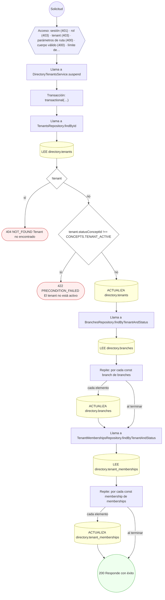

#### 4. POST /admin/tenants/{tenantId}/verification

Verificar y activar un tenant

| HTTP | Código | Cuándo |
|---|---|---|
| 200 | — | Éxito |
| 400 | `VALIDATION_FAILED` | Los parámetros de ruta son UUID válidos; El cuerpo cumple el DTO (sin propiedades extra) |
| 401 | `UNAUTHENTICATED` | Hay una sesión válida (JWT) |
| 403 | `FORBIDDEN` | El rol está permitido; El tenant se resuelve y pertenece al actor |
| 404 | `NOT_FOUND` | ResourceNotFoundException: Tenant no encontrado |
| 422 | `PRECONDITION_FAILED` | PreconditionFailedException: El tenant no está pendiente de verificación |
| 429 | `RATE_LIMITED` | No se supera el límite de solicitudes |

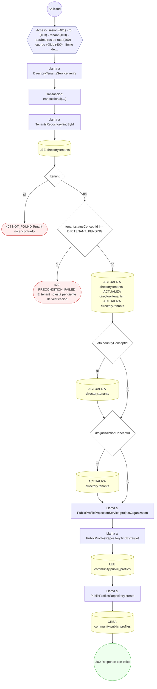

#### 5. GET /tenants/{tenantId}

Ficha de una organización

| HTTP | Código | Cuándo |
|---|---|---|
| 200 | — | Éxito |
| 400 | `VALIDATION_FAILED` | Los parámetros de ruta son UUID válidos |
| 401 | `UNAUTHENTICATED` | Hay una sesión válida (JWT) |
| 403 | `FORBIDDEN` | El rol está permitido; El tenant se resuelve y pertenece al actor; ForbiddenException: Se requiere pertenecer a la organización, o ser administrador de la plataforma |
| 404 | `NOT_FOUND` | ResourceNotFoundException: Organización no encontrada |
| 429 | `RATE_LIMITED` | No se supera el límite de solicitudes |

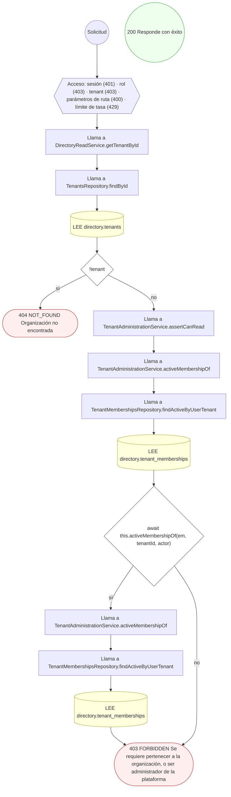

#### 6. PATCH /tenants/{tenantId}

Editar los datos de la propia organización

| HTTP | Código | Cuándo |
|---|---|---|
| 200 | — | Éxito |
| 400 | `VALIDATION_FAILED` | Los parámetros de ruta son UUID válidos; El cuerpo cumple el DTO (sin propiedades extra) |
| 401 | `UNAUTHENTICATED` | Hay una sesión válida (JWT) |
| 403 | `FORBIDDEN` | El rol está permitido; El tenant se resuelve y pertenece al actor; ForbiddenException: Se requiere ser OWNER o ADMIN de la organización, o administrador de la plataforma |
| 404 | `NOT_FOUND` | ResourceNotFoundException: Organización no encontrada |
| 429 | `RATE_LIMITED` | No se supera el límite de solicitudes |

```mermaid
flowchart TD
  n1(("Solicitud")):::inicio
  n2{{"Acceso: sesión (401) · rol (403) · tenant (403) · parámetros de ruta (400) · cuerpo válido (400) · límite de…"}}:::acceso
  n1 --> n2
  n3["Llama a DirectoryTenantsService.updateTenant"]:::llamada
  n2 --> n3
  n4["Transacción: transactional(…)"]:::transaccion
  n3 --> n4
  n5["Llama a TenantsRepository.findById"]:::llamada
  n4 --> n5
  n6[("LEE directory.tenants")]:::efecto
  n5 --> n6
  n7{"!tenant"}:::decision
  n6 --> n7
  n8(["404 NOT_FOUND Organización no encontrada"]):::error
  n7 -->|"sí"| n8
  n9["Llama a TenantAdministrationService.assertCanAdminister"]:::llamada
  n7 -->|"no"| n9
  n10["Llama a TenantAdministrationService.activeMembershipOf"]:::llamada
  n9 --> n10
  n11["Llama a TenantMembershipsRepository.findActiveByUserTenant"]:::llamada
  n10 --> n11
  n12[("LEE directory.tenant_memberships")]:::efecto
  n11 --> n12
  n13(["403 FORBIDDEN Se requiere ser OWNER o ADMIN de la organización, o administrador de la plataforma"]):::error
  n12 --> n13
  n14[("ACTUALIZA directory.tenants")]:::efecto
  n15{"dto.legalName !== undefined"}:::decision
  n14 --> n15
  n16[("ACTUALIZA directory.tenants")]:::efecto
  n15 -->|"sí"| n16
  n17[("ACTUALIZA directory.tenants")]:::efecto
  n16 --> n17
  n15 -->|"no"| n17
  n18{"dto.tradeName !== undefined"}:::decision
  n17 --> n18
  n19[("ACTUALIZA directory.tenants")]:::efecto
  n18 -->|"sí"| n19
  n20[("ACTUALIZA directory.tenants")]:::efecto
  n19 --> n20
  n18 -->|"no"| n20
  n21{"dto.timeZone !== undefined"}:::decision
  n20 --> n21
  n22[("ACTUALIZA directory.tenants")]:::efecto
  n21 -->|"sí"| n22
  n23{"dto.currencyConceptId !== undefined"}:::decision
  n22 --> n23
  n21 -->|"no"| n23
  n24[("ACTUALIZA directory.tenants")]:::efecto
  n23 -->|"sí"| n24
  n25{"dto.payer"}:::decision
  n24 --> n25
  n23 -->|"no"| n25
  n26["Llama a CatalogRepository.findCarrierByTenantId"]:::llamada
  n25 -->|"sí"| n26
  n27[("LEE insurance.insurance_carriers")]:::efecto
  n26 --> n27
  n28{"carrier"}:::decision
  n27 --> n28
  n29[("ACTUALIZA insurance.insurance_carriers")]:::efecto
  n28 -->|"sí"| n29
  n30{"dto.payer.sigla !== undefined"}:::decision
  n29 --> n30
  n31[("ACTUALIZA insurance.insurance_carriers")]:::efecto
  n30 -->|"sí"| n31
  n32{"dto.payer.address !== undefined"}:::decision
  n31 --> n32
  n30 -->|"no"| n32
  n33[("ACTUALIZA insurance.insurance_carriers")]:::efecto
  n32 -->|"sí"| n33
  n34{"dto.payer.regulatorIdentifier !== undefined"}:::decision
  n33 --> n34
  n32 -->|"no"| n34
  n35[("ACTUALIZA insurance.insurance_carriers")]:::efecto
  n34 -->|"sí"| n35
  n36(("200 Responde con éxito")):::ok
  n35 --> n36
  n34 -->|"no"| n36
  n28 -->|"no"| n36
  n25 -->|"no"| n36
  classDef acceso fill:#eef,stroke:#66a
  classDef error fill:#fee,stroke:#c33
  classDef ok fill:#efe,stroke:#3a3
  classDef efecto fill:#ffd,stroke:#aa3
  classDef decision fill:#fff,stroke:#555
  classDef corte fill:#eee,stroke:#999,stroke-dasharray: 4
```

#### 7. GET /tenants/{tenantId}/branches

Sucursales de la organización

| HTTP | Código | Cuándo |
|---|---|---|
| 200 | — | Éxito |
| 400 | `VALIDATION_FAILED` | Los parámetros de ruta son UUID válidos |
| 401 | `UNAUTHENTICATED` | Hay una sesión válida (JWT) |
| 403 | `FORBIDDEN` | El rol está permitido; El tenant se resuelve y pertenece al actor; ForbiddenException: Se requiere pertenecer a la organización, o ser administrador de la plataforma |
| 404 | `NOT_FOUND` | ResourceNotFoundException: Organización no encontrada |
| 429 | `RATE_LIMITED` | No se supera el límite de solicitudes |

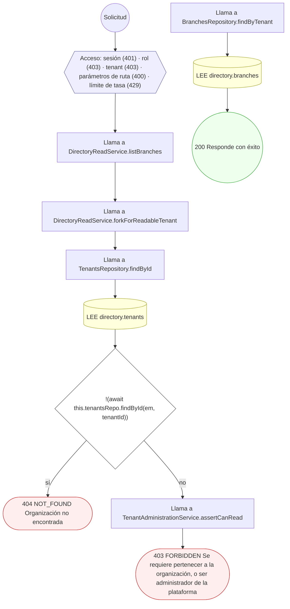

#### 8. POST /tenants/{tenantId}/branches

Crear una branch / sede física con geolocalización

| HTTP | Código | Cuándo |
|---|---|---|
| 201 | — | Éxito |
| 400 | `VALIDATION_FAILED` | Los parámetros de ruta son UUID válidos; El cuerpo cumple el DTO (sin propiedades extra) |
| 401 | `UNAUTHENTICATED` | Hay una sesión válida (JWT) |
| 403 | `FORBIDDEN` | El rol está permitido; El tenant se resuelve y pertenece al actor; ForbiddenException: Se requiere ser OWNER o ADMIN de la organización, o administrador de la plataforma |
| 404 | `NOT_FOUND` | ResourceNotFoundException: Tenant no encontrado |
| 409 | `CONFLICT` | ConflictException: Ya existe una branch con ese código en el tenant |
| 422 | `PRECONDITION_FAILED` | PreconditionFailedException: El tenant no está activo |
| 429 | `RATE_LIMITED` | No se supera el límite de solicitudes |

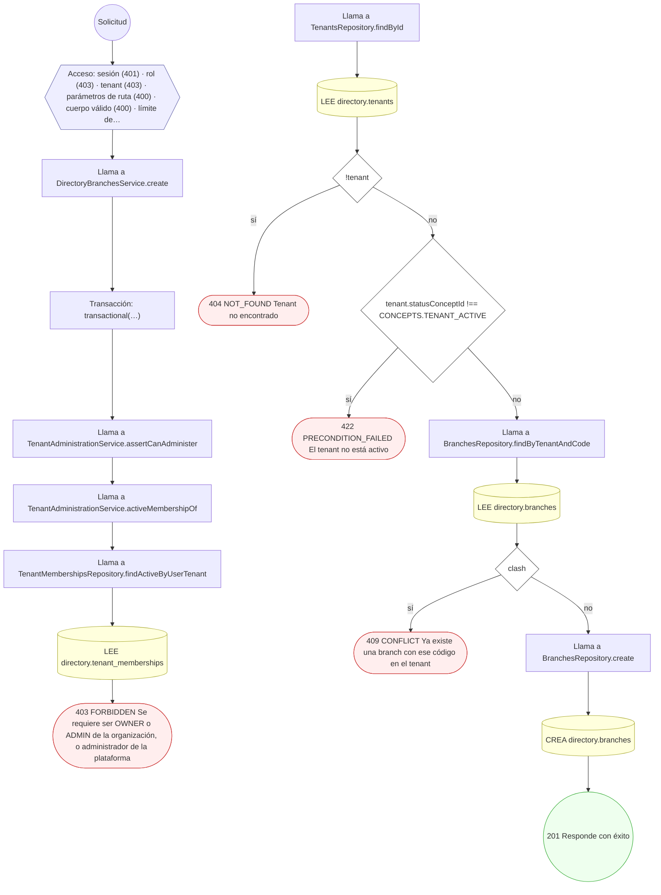

#### 9. GET /tenants/{tenantId}/child-tenants

Sub-organizaciones de una organización

| HTTP | Código | Cuándo |
|---|---|---|
| 200 | — | Éxito |
| 400 | `VALIDATION_FAILED` | Los parámetros de ruta son UUID válidos |
| 401 | `UNAUTHENTICATED` | Hay una sesión válida (JWT) |
| 403 | `FORBIDDEN` | El rol está permitido; El tenant se resuelve y pertenece al actor; ForbiddenException: Se requiere pertenecer a la organización, o ser administrador de la plataforma |
| 404 | `NOT_FOUND` | ResourceNotFoundException: Organización no encontrada |
| 429 | `RATE_LIMITED` | No se supera el límite de solicitudes |

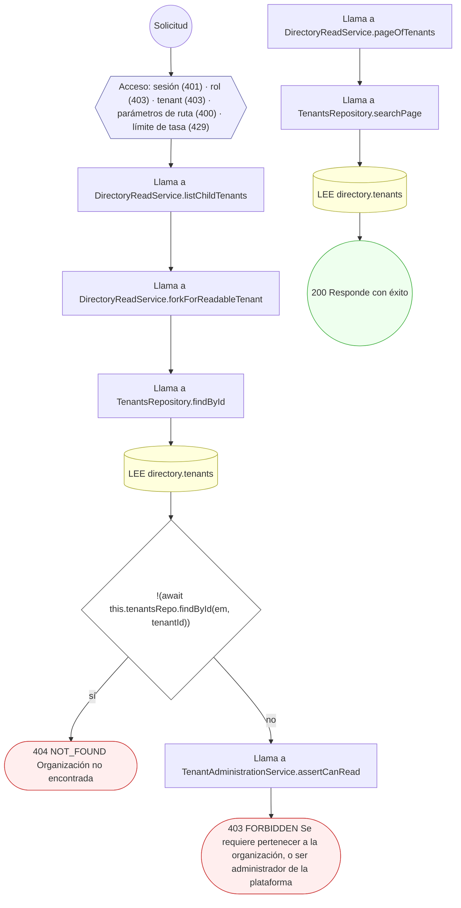

#### 10. POST /tenants/{tenantId}/child-tenants

Crear una organización hija / sub-tenant

| HTTP | Código | Cuándo |
|---|---|---|
| 201 | — | Éxito |
| 400 | `VALIDATION_FAILED` | Los parámetros de ruta son UUID válidos; El cuerpo cumple el DTO (sin propiedades extra) |
| 401 | `UNAUTHENTICATED` | Hay una sesión válida (JWT) |
| 403 | `FORBIDDEN` | El rol está permitido; El tenant se resuelve y pertenece al actor |
| 404 | `NOT_FOUND` | ResourceNotFoundException: Tenant padre no encontrado |
| 409 | `CONFLICT` | ConflictException: El código de tenant ya existe |
| 422 | `PRECONDITION_FAILED` | PreconditionFailedException: El tenant padre no está activo; PreconditionFailedException: Un tenant de tipo PAYER exige el bloque `payer`; PreconditionFailedException: Un tenant de tipo BROKER exige el bloque `broker`; PreconditionFailedException: Un tenant de tipo {tenantType} exige país y jurisdicción; PreconditionFailedException: El bloque `payer` sólo corresponde a un tenant de tipo PAYER; PreconditionFailedException: El bloque `broker` sólo corresponde a un tenant de tipo BROKER; PreconditionFailedException: Los conceptos declarados no existen en el catálogo de terminología |
| 429 | `RATE_LIMITED` | No se supera el límite de solicitudes |

```mermaid
flowchart TD
  n1(("Solicitud")):::inicio
  n2{{"Acceso: sesión (401) · rol (403) · tenant (403) · parámetros de ruta (400) · cuerpo válido (400) · límite de…"}}:::acceso
  n1 --> n2
  n3["Llama a DirectoryTenantsService.createChild"]:::llamada
  n2 --> n3
  n4["Transacción: transactional(…)"]:::transaccion
  n3 --> n4
  n5["Llama a TenantsRepository.findById"]:::llamada
  n4 --> n5
  n6[("LEE directory.tenants")]:::efecto
  n5 --> n6
  n7{"!parent"}:::decision
  n6 --> n7
  n8(["404 NOT_FOUND Tenant padre no encontrado"]):::error
  n7 -->|"sí"| n8
  n9{"parent.statusConceptId !== CONCEPTS.TENANT_ACTIVE"}:::decision
  n7 -->|"no"| n9
  n10(["422 PRECONDITION_FAILED El tenant padre no está activo"]):::error
  n9 -->|"sí"| n10
  n11["Llama a TenantsRepository.findByCode"]:::llamada
  n9 -->|"no"| n11
  n12[("LEE directory.tenants")]:::efecto
  n11 --> n12
  n13{"clash"}:::decision
  n12 --> n13
  n14(["409 CONFLICT El código de tenant ya existe"]):::error
  n13 -->|"sí"| n14
  n15["Llama a TenantTypeProfileService.assertProfileMatchesType"]:::llamada
  n13 -->|"no"| n15
  n16{"tenantType === 'PAYER' && !input.payer"}:::decision
  n15 --> n16
  n17(["422 PRECONDITION_FAILED Un tenant de tipo PAYER exige el bloque `payer`"]):::error
  n16 -->|"sí"| n17
  n18{"tenantType === 'BROKER' && !input.broker"}:::decision
  n16 -->|"no"| n18
  n19(["422 PRECONDITION_FAILED Un tenant de tipo BROKER exige el bloque `broker`"]):::error
  n18 -->|"sí"| n19
  n20{"TERRITORIAL_TENANT_TYPES.includes(tenantType)"}:::decision
  n18 -->|"no"| n20
  n21{"missing.length › 0"}:::decision
  n20 -->|"sí"| n21
  n22(["422 PRECONDITION_FAILED Un tenant de tipo {tenantType} exige país y jurisdicción"]):::error
  n21 -->|"sí"| n22
  n23{"tenantType !== 'PAYER' && input.payer"}:::decision
  n21 -->|"no"| n23
  n20 -->|"no"| n23
  n24(["422 PRECONDITION_FAILED El bloque `payer` sólo corresponde a un tenant de tipo PAYER"]):::error
  n23 -->|"sí"| n24
  n25{"tenantType !== 'BROKER' && input.broker"}:::decision
  n23 -->|"no"| n25
  n26(["422 PRECONDITION_FAILED El bloque `broker` sólo corresponde a un tenant de tipo BROKER"]):::error
  n25 -->|"sí"| n26
  n27["Llama a TenantTypeProfileService.assertConceptsExist"]:::llamada
  n25 -->|"no"| n27
  n28["Llama a CatalogConceptsRepository.findByIds"]:::llamada
  n27 --> n28
  n29[("LEE terminology.catalog_concepts")]:::efecto
  n28 --> n29
  n30{"unknown.length › 0"}:::decision
  n29 --> n30
  n31(["422 PRECONDITION_FAILED Los conceptos declarados no existen en el catálogo de terminología"]):::error
  n30 -->|"sí"| n31
  n32["Llama a TenantsRepository.create"]:::llamada
  n30 -->|"no"| n32
  n33[("CREA directory.tenants")]:::efecto
  n32 --> n33
  n34["Llama a TenantTypeProfileService.materializeProfile"]:::llamada
  n33 --> n34
  n35{"input.tenantType === 'PAYER' && input.payer"}:::decision
  n34 --> n35
  n36["Llama a CatalogRepository.createCarrier"]:::llamada
  n35 -->|"sí"| n36
  n37[("CREA insurance.insurance_carriers")]:::efecto
  n36 --> n37
  n38{"input.tenantType === 'BROKER' && input.broker"}:::decision
  n37 --> n38
  n35 -->|"no"| n38
  n39["Llama a CatalogRepository.createBroker"]:::llamada
  n38 -->|"sí"| n39
  n40[("CREA insurance.insurance_brokers")]:::efecto
  n39 --> n40
  n41["Llama a TenantMembershipsRepository.create"]:::llamada
  n40 --> n41
  n38 -->|"no"| n41
  n42[("CREA directory.tenant_memberships")]:::efecto
  n41 --> n42
  n43(("201 Responde con éxito")):::ok
  n42 --> n43
  classDef acceso fill:#eef,stroke:#66a
  classDef error fill:#fee,stroke:#c33
  classDef ok fill:#efe,stroke:#3a3
  classDef efecto fill:#ffd,stroke:#aa3
  classDef decision fill:#fff,stroke:#555
  classDef corte fill:#eee,stroke:#999,stroke-dasharray: 4
```

#### 11. GET /tenants/{tenantId}/memberships

Plantilla de la organización

| HTTP | Código | Cuándo |
|---|---|---|
| 200 | — | Éxito |
| 400 | `VALIDATION_FAILED` | Los parámetros de ruta son UUID válidos |
| 401 | `UNAUTHENTICATED` | Hay una sesión válida (JWT) |
| 403 | `FORBIDDEN` | El rol está permitido; El tenant se resuelve y pertenece al actor; ForbiddenException: Se requiere pertenecer a la organización, o ser administrador de la plataforma |
| 404 | `NOT_FOUND` | ResourceNotFoundException: Organización no encontrada |
| 429 | `RATE_LIMITED` | No se supera el límite de solicitudes |

#### 12. POST /tenants/{tenantId}/memberships

Incorporar un usuario al tenant (membership)

| HTTP | Código | Cuándo |
|---|---|---|
| 201 | — | Éxito |
| 400 | `VALIDATION_FAILED` | Los parámetros de ruta son UUID válidos; El cuerpo cumple el DTO (sin propiedades extra) |
| 401 | `UNAUTHENTICATED` | Hay una sesión válida (JWT) |
| 403 | `FORBIDDEN` | El rol está permitido; El tenant se resuelve y pertenece al actor; ForbiddenException: Se requiere ser OWNER o ADMIN de la organización, o administrador de la plataforma; ForbiddenException: Sólo un OWNER de la organización o la plataforma pueden cambiar quién la posee |
| 409 | `CONFLICT` | ConflictException: El usuario ya tiene una membresía activa en el tenant |
| 429 | `RATE_LIMITED` | No se supera el límite de solicitudes |

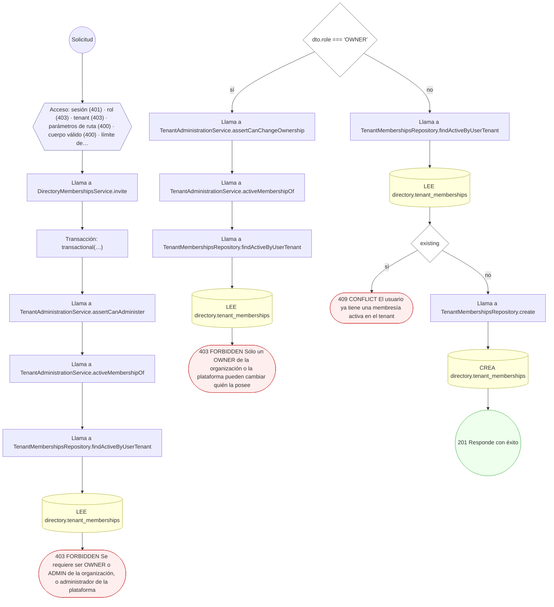

#### 13. GET /tenants/{tenantId}/memberships/{membershipId}/branch-assignments

Sucursales asignadas a una membresía

| HTTP | Código | Cuándo |
|---|---|---|
| 200 | — | Éxito |
| 400 | `VALIDATION_FAILED` | Los parámetros de ruta son UUID válidos |
| 401 | `UNAUTHENTICATED` | Hay una sesión válida (JWT) |
| 403 | `FORBIDDEN` | El rol está permitido; El tenant se resuelve y pertenece al actor; ForbiddenException: Se requiere pertenecer a la organización, o ser administrador de la plataforma |
| 404 | `NOT_FOUND` | ResourceNotFoundException: Organización no encontrada; ResourceNotFoundException: Membresía no encontrada |
| 429 | `RATE_LIMITED` | No se supera el límite de solicitudes |

#### 14. POST /tenants/{tenantId}/memberships/{membershipId}/branch-assignments

Asignar la membresía a una branch

| HTTP | Código | Cuándo |
|---|---|---|
| 201 | — | Éxito |
| 400 | `VALIDATION_FAILED` | Los parámetros de ruta son UUID válidos; El cuerpo cumple el DTO (sin propiedades extra) |
| 401 | `UNAUTHENTICATED` | Hay una sesión válida (JWT) |
| 403 | `FORBIDDEN` | El rol está permitido; El tenant se resuelve y pertenece al actor; ForbiddenException: Se requiere ser OWNER o ADMIN de la organización, o administrador de la plataforma |
| 404 | `NOT_FOUND` | ResourceNotFoundException: Membresía no encontrada; ResourceNotFoundException: Branch no encontrada |
| 409 | `CONFLICT` | ConflictException: La membresía ya está asignada a esa branch |
| 422 | `PRECONDITION_FAILED` | PreconditionFailedException: La membresía no está activa; PreconditionFailedException: La branch no pertenece al tenant |
| 429 | `RATE_LIMITED` | No se supera el límite de solicitudes |

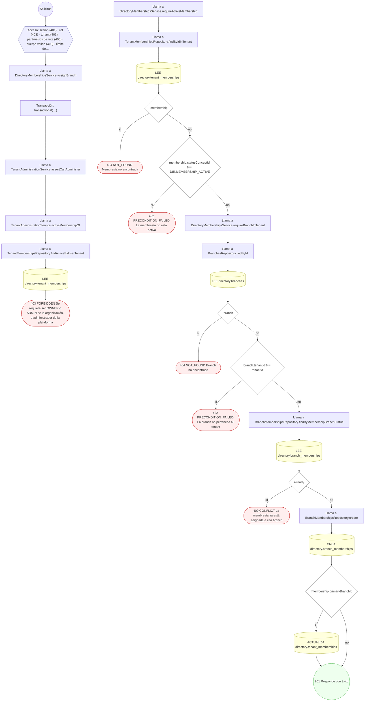

#### 15. POST /tenants/{tenantId}/memberships/{membershipId}/offboard

Revocar / offboarding de un miembro

| HTTP | Código | Cuándo |
|---|---|---|
| 200 | — | Éxito |
| 400 | `VALIDATION_FAILED` | Los parámetros de ruta son UUID válidos |
| 401 | `UNAUTHENTICATED` | Hay una sesión válida (JWT) |
| 403 | `FORBIDDEN` | El rol está permitido; El tenant se resuelve y pertenece al actor; ForbiddenException: Se requiere ser OWNER o ADMIN de la organización, o administrador de la plataforma; ForbiddenException: Sólo un OWNER de la organización o la plataforma pueden cambiar quién la posee |
| 404 | `NOT_FOUND` | ResourceNotFoundException: Membresía no encontrada |
| 422 | `PRECONDITION_FAILED` | PreconditionFailedException: La membresía no está activa; PreconditionFailedException: No se puede quitar al último OWNER de la organización: designe otro OWNER primero |
| 429 | `RATE_LIMITED` | No se supera el límite de solicitudes |

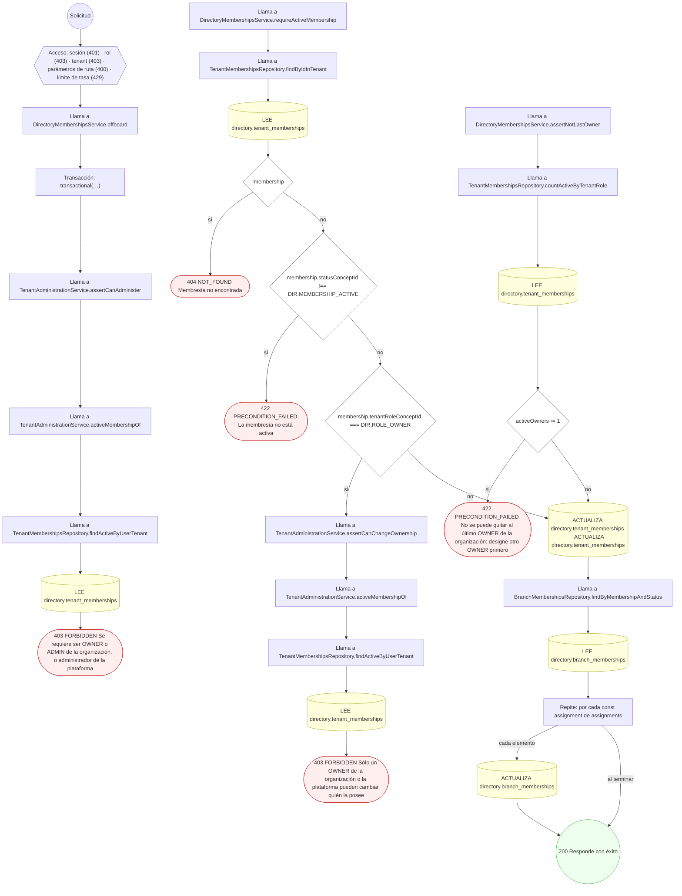

#### 16. PATCH /tenants/{tenantId}/memberships/{membershipId}/role

Cambiar rol / scope de la membresía

| HTTP | Código | Cuándo |
|---|---|---|
| 200 | — | Éxito |
| 400 | `VALIDATION_FAILED` | Los parámetros de ruta son UUID válidos; El cuerpo cumple el DTO (sin propiedades extra) |
| 401 | `UNAUTHENTICATED` | Hay una sesión válida (JWT) |
| 403 | `FORBIDDEN` | El rol está permitido; El tenant se resuelve y pertenece al actor; ForbiddenException: Se requiere ser OWNER o ADMIN de la organización, o administrador de la plataforma; ForbiddenException: Sólo un OWNER de la organización o la plataforma pueden cambiar quién la posee |
| 404 | `NOT_FOUND` | ResourceNotFoundException: Membresía no encontrada |
| 422 | `PRECONDITION_FAILED` | PreconditionFailedException: Debe indicar un nuevo rol o scope; PreconditionFailedException: La membresía no está activa; PreconditionFailedException: No se puede quitar al último OWNER de la organización: designe otro OWNER primero |
| 429 | `RATE_LIMITED` | No se supera el límite de solicitudes |

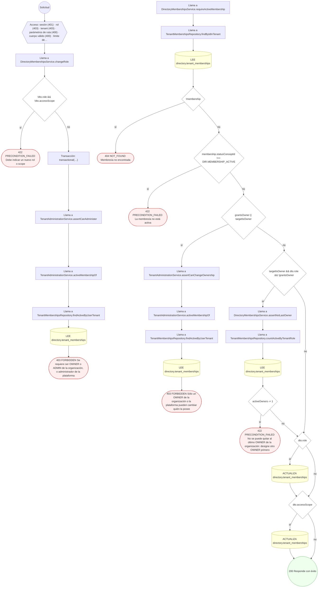

#### 17. POST /tenants/{tenantId}/memberships/{membershipId}/transfer

Transferir la membresía entre branches

| HTTP | Código | Cuándo |
|---|---|---|
| 200 | — | Éxito |
| 400 | `VALIDATION_FAILED` | Los parámetros de ruta son UUID válidos; El cuerpo cumple el DTO (sin propiedades extra) |
| 401 | `UNAUTHENTICATED` | Hay una sesión válida (JWT) |
| 403 | `FORBIDDEN` | El rol está permitido; El tenant se resuelve y pertenece al actor; ForbiddenException: Se requiere ser OWNER o ADMIN de la organización, o administrador de la plataforma |
| 404 | `NOT_FOUND` | ResourceNotFoundException: Membresía no encontrada; ResourceNotFoundException: Branch no encontrada; ResourceNotFoundException: No hay asignación activa en la branch de origen |
| 422 | `PRECONDITION_FAILED` | PreconditionFailedException: La membresía no está activa; PreconditionFailedException: La branch no pertenece al tenant |
| 429 | `RATE_LIMITED` | No se supera el límite de solicitudes |

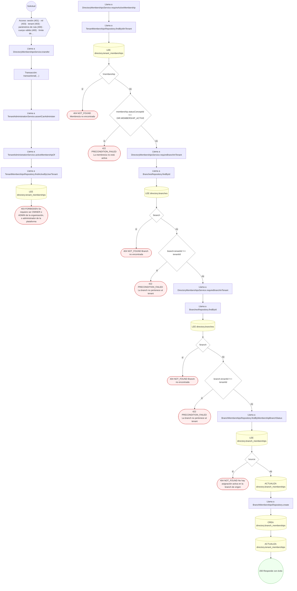

#### 18. GET /tenants/me

Las organizaciones del actor, con su rol en cada una

| HTTP | Código | Cuándo |
|---|---|---|
| 200 | — | Éxito |
| 401 | `UNAUTHENTICATED` | Hay una sesión válida (JWT) |
| 403 | `FORBIDDEN` | El rol está permitido; El tenant se resuelve y pertenece al actor |
| 429 | `RATE_LIMITED` | No se supera el límite de solicitudes |

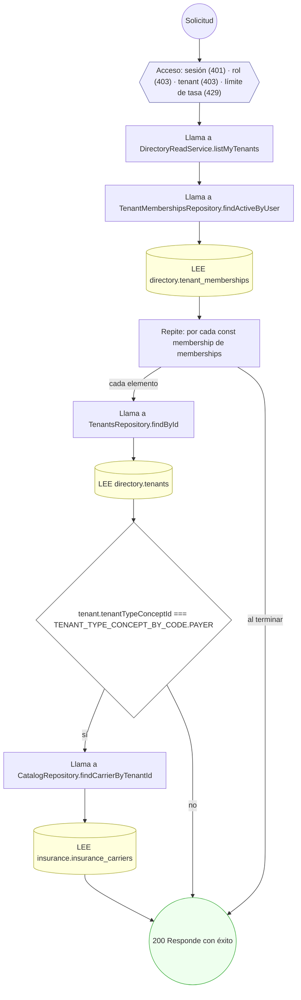

### Operaciones sin decisiones propias

Sólo comprueban el acceso y leen o escriben: no tienen ramas que dibujar. Su detalle está en la ficha de endpoints.

| Operación | Respuestas posibles | Tablas |
|---|---|---|
| GET /admin/tenants | 200, 401, 403, 429 | 1 |
