<!-- AUTOGENERADO por tools/inventario/flujos.mjs. No editar manualmente. -->

# Flujos del módulo `directory`

- **Procesos:** 1 · **Máquinas de estado:** 0
- **Operaciones:** 29 (28 con decisiones propias, 1 sin ellas)
- Inventario de endpoints del módulo: [directory](../endpoints/directory.md)

## Proceso: Módulo 04 — Directory (Tenants, Sub-tenants, Branches y Membresías)

- **Código:** `directory` · **Agrupación:** AGRUPACION_POR_CONTROLADOR · **Operaciones:** 29
- **Actores:** Cualquier sesión válida · SECURITY_ADMIN · SUPERADMIN
- **Revisión:** AUTO_DETECTADA
- **Fuentes:** `src/modules/directory/README.md`

### Para qué sirve

Gestiona el directorio organizacional de la plataforma: aprovisionamiento y ciclo de vida de tenants, jerarquía de sub-tenants, sedes físicas (branches) y las membresías de usuarios a tenant y a branch.

_Fuente: `src/modules/directory/README.md:3`_

### Etapas y operaciones

| Etapa | Descripción | Operación | Quién actúa | Riesgo | Tablas |
|---|---|---|---|---|---|
| `ctrl:AdminTenantsController` | Operaciones de AdminTenantsController que el README no asigna a un caso de uso | GET /admin/tenants | SUPERADMIN · SECURITY_ADMIN | BAJO | 1 |
|  |  | POST /admin/tenants | SUPERADMIN | MEDIO | 14 |
|  |  | PUT /admin/tenants/{tenantId}/public-profile | SUPERADMIN · SECURITY_ADMIN | MEDIO | 3 |
|  |  | POST /admin/tenants/{tenantId}/suspend | SUPERADMIN | MEDIO | 6 |
|  |  | POST /admin/tenants/{tenantId}/verification | SECURITY_ADMIN | MEDIO | 16 |
| `ctrl:OrganizationLogoController` | Operaciones de OrganizationLogoController que el README no asigna a un caso de uso | GET /tenants/{tenantId}/logo | Cualquier sesión válida | BAJO | 4 |
|  |  | PUT /tenants/{tenantId}/logo | Cualquier sesión válida | ALTO | 8 |
|  |  | GET /tenants/{tenantId}/logo/content | Cualquier sesión válida | BAJO | 6 |
| `ctrl:TenantsController` | Operaciones de TenantsController que el README no asigna a un caso de uso | GET /tenants/{tenantId} | Cualquier sesión válida | BAJO | 3 |
|  |  | PATCH /tenants/{tenantId} | Cualquier sesión válida | ALTO | 6 |
|  |  | POST /tenants/{tenantId}/affiliation-documents | Cualquier sesión válida | ALTO | 14 |
|  |  | GET /tenants/{tenantId}/branches | Cualquier sesión válida | BAJO | 4 |
|  |  | POST /tenants/{tenantId}/branches | Cualquier sesión válida | ALTO | 5 |
|  |  | PATCH /tenants/{tenantId}/branches/{branchId} | Cualquier sesión válida | ALTO | 4 |
|  |  | GET /tenants/{tenantId}/child-tenants | Cualquier sesión válida | BAJO | 3 |
|  |  | POST /tenants/{tenantId}/child-tenants | SECURITY_ADMIN | MEDIO | 14 |
|  |  | GET /tenants/{tenantId}/laboratory-readiness | Cualquier sesión válida | BAJO | 12 |
|  |  | GET /tenants/{tenantId}/memberships | Cualquier sesión válida | BAJO | 3 |
|  |  | POST /tenants/{tenantId}/memberships | Cualquier sesión válida | ALTO | 3 |
|  |  | GET /tenants/{tenantId}/memberships/{membershipId}/branch-assignments | Cualquier sesión válida | BAJO | 4 |
|  |  | POST /tenants/{tenantId}/memberships/{membershipId}/branch-assignments | Cualquier sesión válida | ALTO | 6 |
|  |  | POST /tenants/{tenantId}/memberships/{membershipId}/offboard | Cualquier sesión válida | ALTO | 5 |
|  |  | PATCH /tenants/{tenantId}/memberships/{membershipId}/role | Cualquier sesión válida | ALTO | 3 |
|  |  | POST /tenants/{tenantId}/memberships/{membershipId}/transfer | Cualquier sesión válida | ALTO | 7 |
|  |  | GET /tenants/{tenantId}/pharmacy-readiness | Cualquier sesión válida | BAJO | 12 |
|  |  | GET /tenants/me | Cualquier sesión válida | BAJO | 13 |
|  |  | GET /tenants/me/membership-invitations | Cualquier sesión válida | BAJO | 2 |
|  |  | POST /tenants/me/membership-invitations/{membershipId}/accept | Cualquier sesión válida | BAJO | 1 |
|  |  | POST /tenants/me/membership-invitations/{membershipId}/decline | Cualquier sesión válida | BAJO | 1 |

### Diagrama 1 de 2 — etapas `ctrl:AdminTenantsController`, `ctrl:OrganizationLogoController`

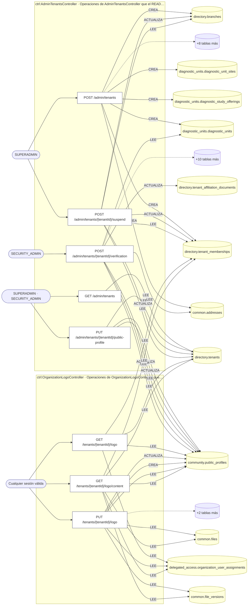

### Diagrama 2 de 2 — etapas `ctrl:TenantsController`

```mermaid
flowchart LR
  a2(["Cualquier sesión válida"]):::actor
  a19(["SECURITY_ADMIN"]):::actor
  t3[("delegated_access.organization_user_assignments")]:::tabla
  t4[("directory.tenant_memberships")]:::tabla
  t5[("directory.tenants")]:::tabla
  t7[("insurance.insurance_carriers")]:::tabla
  t9[("common.file_versions")]:::tabla
  t10[("common.files")]:::tabla
  t11[("directory.tenant_affiliation_documents")]:::tabla
  t14[("directory.branches")]:::tabla
  t20[("common.addresses")]:::tabla
  t21[("diagnostic_units.diagnostic_study_offerings")]:::tabla
  t22[("diagnostic_units.diagnostic_unit_sites")]:::tabla
  t23[("diagnostic_units.diagnostic_units")]:::tabla
  t30[("directory.branch_memberships")]:::tabla
  t39[("common.contact_points")]:::tabla
  t40[("common.identifiers")]:::tabla
  t41[("directory.tenant_legal_representatives")]:::tabla
  t12[("+8 tablas más")]
  t24[("+8 tablas más")]
  t26[("+6 tablas más")]
  t35[("+1 tablas más")]
  t37[("+6 tablas más")]
  t42[("+7 tablas más")]
  subgraph s0["ctrl:TenantsController · Operaciones de TenantsController que el README no asig…"]
    o1["GET /tenants/{tenantId}"]:::op
    o6["PATCH /tenants/{tenantId}"]:::op
    o8["POST /tenants/{tenantId}/affiliation-documents"]:::op
    o13["GET /tenants/{tenantId}/branches"]:::op
    o15["POST /tenants/{tenantId}/branches"]:::op
    o16["PATCH /tenants/{tenantId}/branches/{branchId}"]:::op
    o17["GET /tenants/{tenantId}/child-tenants"]:::op
    o18["POST /tenants/{tenantId}/child-tenants"]:::op
    o25["GET /tenants/{tenantId}/laboratory-readiness"]:::op
    o27["GET /tenants/{tenantId}/memberships"]:::op
    o28["POST /tenants/{tenantId}/memberships"]:::op
    o29["GET /tenants/{tenantId}/memberships/{membershipId}/branch-assignments"]:::op
    o31["POST /tenants/{tenantId}/memberships/{membershipId}/branch-assignments"]:::op
    o32["POST /tenants/{tenantId}/memberships/{membershipId}/offboard"]:::op
    o33["PATCH /tenants/{tenantId}/memberships/{membershipId}/role"]:::op
    o34["POST /tenants/{tenantId}/memberships/{membershipId}/transfer"]:::op
    o36["GET /tenants/{tenantId}/pharmacy-readiness"]:::op
    o38["GET /tenants/me"]:::op
    o43["GET /tenants/me/membership-invitations"]:::op
    o44["POST /tenants/me/membership-invitations/{membershipId}/accept"]:::op
    o45["POST /tenants/me/membership-invitations/{membershipId}/decline"]:::op
  end
  a2 --> o1
  o1 -->|"LEE"| t3
  o1 -->|"LEE"| t4
  o1 -->|"LEE"| t5
  a2 --> o6
  o6 -->|"LEE"| t3
  o6 -->|"LEE"| t4
  o6 -->|"ACTUALIZA"| t5
  o6 -->|"LEE"| t5
  o6 -->|"ACTUALIZA"| t7
  o6 -->|"LEE"| t7
  a2 --> o8
  o8 -->|"LEE"| t9
  o8 -->|"ACTUALIZA"| t10
  o8 -->|"LEE"| t10
  o8 -->|"LEE"| t3
  o8 -->|"CREA"| t11
  o8 -->|"LEE"| t11
  o8 -.-> t12
  a2 --> o13
  o13 -->|"LEE"| t3
  o13 -->|"LEE"| t14
  o13 -->|"LEE"| t4
  o13 -->|"LEE"| t5
  a2 --> o15
  o15 -->|"LEE"| t3
  o15 -->|"CREA"| t14
  o15 -->|"LEE"| t14
  o15 -->|"LEE"| t4
  o15 -->|"LEE"| t5
  a2 --> o16
  o16 -->|"LEE"| t3
  o16 -->|"ACTUALIZA"| t14
  o16 -->|"LEE"| t14
  o16 -->|"LEE"| t4
  a2 --> o17
  o17 -->|"LEE"| t3
  o17 -->|"LEE"| t4
  o17 -->|"LEE"| t5
  a19 --> o18
  o18 -->|"CREA"| t20
  o18 -->|"CREA"| t21
  o18 -->|"CREA"| t22
  o18 -->|"CREA"| t23
  o18 -->|"CREA"| t14
  o18 -->|"CREA"| t4
  o18 -.-> t24
  a2 --> o25
  o25 -->|"LEE"| t20
  o25 -->|"LEE"| t3
  o25 -->|"LEE"| t23
  o25 -->|"LEE"| t11
  o25 -->|"LEE"| t4
  o25 -->|"LEE"| t5
  o25 -.-> t26
  a2 --> o27
  o27 -->|"LEE"| t3
  o27 -->|"LEE"| t4
  o27 -->|"LEE"| t5
  a2 --> o28
  o28 -->|"LEE"| t3
  o28 -->|"CREA"| t4
  o28 -->|"LEE"| t4
  a2 --> o29
  o29 -->|"LEE"| t3
  o29 -->|"LEE"| t30
  o29 -->|"LEE"| t4
  o29 -->|"LEE"| t5
  a2 --> o31
  o31 -->|"LEE"| t3
  o31 -->|"CREA"| t30
  o31 -->|"LEE"| t30
  o31 -->|"LEE"| t14
  o31 -->|"ACTUALIZA"| t4
  o31 -->|"LEE"| t4
  a2 --> o32
  o32 -->|"LEE"| t3
  o32 -->|"ACTUALIZA"| t30
  o32 -->|"LEE"| t30
  o32 -->|"ACTUALIZA"| t4
  o32 -->|"LEE"| t4
  a2 --> o33
  o33 -->|"LEE"| t3
  o33 -->|"ACTUALIZA"| t4
  o33 -->|"LEE"| t4
  a2 --> o34
  o34 -->|"LEE"| t3
  o34 -->|"ACTUALIZA"| t30
  o34 -->|"CREA"| t30
  o34 -->|"LEE"| t30
  o34 -->|"LEE"| t14
  o34 -->|"ACTUALIZA"| t4
  o34 -.-> t35
  a2 --> o36
  o36 -->|"LEE"| t20
  o36 -->|"LEE"| t3
  o36 -->|"LEE"| t23
  o36 -->|"LEE"| t11
  o36 -->|"LEE"| t4
  o36 -->|"LEE"| t5
  o36 -.-> t37
  a2 --> o38
  o38 -->|"LEE"| t20
  o38 -->|"LEE"| t39
  o38 -->|"LEE"| t40
  o38 -->|"LEE"| t11
  o38 -->|"LEE"| t41
  o38 -->|"LEE"| t4
  o38 -.-> t42
  a2 --> o43
  o43 -->|"LEE"| t4
  o43 -->|"LEE"| t5
  a2 --> o44
  o44 -->|"LEE"| t4
  a2 --> o45
  o45 -->|"LEE"| t4
  classDef op fill:#fff,stroke:#446
  classDef actor fill:#eef,stroke:#66a
  classDef tabla fill:#ffd,stroke:#aa3
  classDef evento fill:#efe,stroke:#3a3
```

## Árbol de decisión por operación

Cada árbol se deriva del código del handler y de los métodos que invoca (hasta 4 niveles). Una rama que no decide, no escribe y no falla se poda. Los accesos y los efectos consecutivos se agrupan en un solo nodo.

### Operaciones con decisiones propias

#### 1. POST /admin/tenants

Aprovisionar un tenant raíz con su membership owner

| HTTP | Código | Cuándo |
|---|---|---|
| 201 | — | Éxito |
| 400 | `VALIDATION_FAILED` | El cuerpo cumple el DTO (sin propiedades extra) |
| 401 | `UNAUTHENTICATED` | Hay una sesión válida (JWT) |
| 403 | `FORBIDDEN` | El rol está permitido; El tenant se resuelve y pertenece al actor |
| 409 | `CONFLICT` | ConflictException: El código de tenant ya existe |
| 422 | `PRECONDITION_FAILED` | PreconditionFailedException: Un tenant de tipo PAYER exige el bloque `payer`; PreconditionFailedException: Un tenant de tipo BROKER exige el bloque `broker`; PreconditionFailedException: Un tenant de tipo {tenantType} exige país y jurisdicción; PreconditionFailedException: El tipo societario pertenece al derecho de {entry!.countryIso} y no coincide con el país declarado; PreconditionFailedException: El bloque `payer` sólo corresponde a un tenant de tipo PAYER; PreconditionFailedException: El bloque `broker` sólo corresponde a un tenant de tipo BROKER; PreconditionFailedException: El bloque `pharmacy` sólo corresponde a un tenant de tipo PHARMACY; PreconditionFailedException: El bloque `diagnosticUnit` sólo corresponde a un tenant de tipo DIAGNOSTIC_CENTER; PreconditionFailedException: El tipo de unidad diagnóstica declarado no es válido; PreconditionFailedException: Las sucursales sólo se declaran en una unidad de laboratorio clínico; PreconditionFailedException: Alguna modalidad declarada no pertenece al catálogo de modalidades diagnósticas; PreconditionFailedException: Los conceptos declarados no existen en el catálogo de terminología |
| 429 | `RATE_LIMITED` | No se supera el límite de solicitudes |

```mermaid
flowchart TD
  n1(("Solicitud")):::inicio
  n2{{"Acceso: sesión (401) · rol (403) · tenant (403) · cuerpo válido (400) · límite de tasa (429)"}}:::acceso
  n1 --> n2
  n3["Llama a DirectoryTenantsService.provision"]:::llamada
  n2 --> n3
  n4["Transacción: transactional(…)"]:::transaccion
  n3 --> n4
  n5["Llama a TenantsRepository.findByCode"]:::llamada
  n4 --> n5
  n6[("LEE directory.tenants")]:::efecto
  n5 --> n6
  n7{"clash"}:::decision
  n6 --> n7
  n8(["409 CONFLICT El código de tenant ya existe"]):::error
  n7 -->|"sí"| n8
  n9["Llama a TenantTypeProfileService.assertProfileMatchesType"]:::llamada
  n7 -->|"no"| n9
  n10{"tenantType === 'PAYER' && !input.payer"}:::decision
  n9 --> n10
  n11(["422 PRECONDITION_FAILED Un tenant de tipo PAYER exige el bloque `payer`"]):::error
  n10 -->|"sí"| n11
  n12{"tenantType === 'BROKER' && !input.broker"}:::decision
  n10 -->|"no"| n12
  n13(["422 PRECONDITION_FAILED Un tenant de tipo BROKER exige el bloque `broker`"]):::error
  n12 -->|"sí"| n13
  n14{"TERRITORIAL_TENANT_TYPES.includes(tenantType)"}:::decision
  n12 -->|"no"| n14
  n15{"missing.length › 0"}:::decision
  n14 -->|"sí"| n15
  n16(["422 PRECONDITION_FAILED Un tenant de tipo {tenantType} exige país y jurisdicción"]):::error
  n15 -->|"sí"| n16
  n17{"input.legalEntityType && input.countryConceptId"}:::decision
  n15 -->|"no"| n17
  n14 -->|"no"| n17
  n18{"expectedCountryConceptId && expectedCountryConceptId !== input.countryConceptId"}:::decision
  n17 -->|"sí"| n18
  n19(["422 PRECONDITION_FAILED El tipo societario pertenece al derecho de {entry!.countryIso} y no coincide con el p…"]):::error
  n18 -->|"sí"| n19
  n20{"tenantType !== 'PAYER' && input.payer"}:::decision
  n18 -->|"no"| n20
  n17 -->|"no"| n20
  n21(["422 PRECONDITION_FAILED El bloque `payer` sólo corresponde a un tenant de tipo PAYER"]):::error
  n20 -->|"sí"| n21
  n22{"tenantType !== 'BROKER' && input.broker"}:::decision
  n20 -->|"no"| n22
  n23(["422 PRECONDITION_FAILED El bloque `broker` sólo corresponde a un tenant de tipo BROKER"]):::error
  n22 -->|"sí"| n23
  n24{"tenantType !== 'PHARMACY' && input.pharmacy"}:::decision
  n22 -->|"no"| n24
  n25(["422 PRECONDITION_FAILED El bloque `pharmacy` sólo corresponde a un tenant de tipo PHARMACY"]):::error
  n24 -->|"sí"| n25
  n26{"tenantType !== 'DIAGNOSTIC_CENTER' && input.diagnosticUnit"}:::decision
  n24 -->|"no"| n26
  n27(["422 PRECONDITION_FAILED El bloque `diagnosticUnit` sólo corresponde a un tenant de tipo DIAGNOSTIC_CENTER"]):::error
  n26 -->|"sí"| n27
  n28{"input.diagnosticUnit"}:::decision
  n26 -->|"no"| n28
  n29{"unitTypeConceptId !== undefined && !DIAGNOSTIC_UNIT_TYPE_CONCEPTS.has(unitTypeConceptId)"}:::decision
  n28 -->|"sí"| n29
  n30(["422 PRECONDITION_FAILED El tipo de unidad diagnóstica declarado no es válido"]):::error
  n29 -->|"sí"| n30
  n31{"(input.diagnosticUnit.branches?.length ?? 0) › 0 && resolvedUnitTypeConceptId !== DUNIT.UNIT_TYPE_LABORATORY"}:::decision
  n29 -->|"no"| n31
  n32(["422 PRECONDITION_FAILED Las sucursales sólo se declaran en una unidad de laboratorio clínico"]):::error
  n31 -->|"sí"| n32
  n33{"invalidModalities.length › 0"}:::decision
  n31 -->|"no"| n33
  n34(["422 PRECONDITION_FAILED Alguna modalidad declarada no pertenece al catálogo de modalidades diagnósticas"]):::error
  n33 -->|"sí"| n34
  n35["Llama a TenantTypeProfileService.assertConceptsExist"]:::llamada
  n33 -->|"no"| n35
  n28 -->|"no"| n35
  n36["Llama a CatalogConceptsRepository.findByIds"]:::llamada
  n35 --> n36
  n37[("LEE terminology.catalog_concepts")]:::efecto
  n36 --> n37
  n38{"unknown.length › 0"}:::decision
  n37 --> n38
  n39(["422 PRECONDITION_FAILED Los conceptos declarados no existen en el catálogo de terminología"]):::error
  n38 -->|"sí"| n39
  n40["Llama a TenantsRepository.create"]:::llamada
  n38 -->|"no"| n40
  n41[("CREA directory.tenants")]:::efecto
  n40 --> n41
  n42["Llama a TenantTypeProfileService.materializeProfile"]:::llamada
  n41 --> n42
  n43{"input.tenantType === 'PAYER' && input.payer"}:::decision
  n42 --> n43
  n44["Llama a CatalogRepository.createCarrier"]:::llamada
  n43 -->|"sí"| n44
  n45[("CREA insurance.insurance_carriers")]:::efecto
  n44 --> n45
  n46["Llama a TenantTypeProfileService.materializePayerHeadquarters"]:::llamada
  n45 --> n46
  n47["Llama a AddressesRepository.create"]:::llamada
  n46 --> n47
  n48[("CREA common.addresses")]:::efecto
  n47 --> n48
  n49{"input.tenantType === 'BROKER' && input.broker"}:::decision
  n48 --> n49
  n43 -->|"no"| n49
  n50["Llama a CatalogRepository.createBroker"]:::llamada
  n49 -->|"sí"| n50
  n51[("CREA insurance.insurance_brokers")]:::efecto
  n50 --> n51
  n52{"input.tenantType === 'DIAGNOSTIC_CENTER' && input.diagnosticUnit"}:::decision
  n51 --> n52
  n49 -->|"no"| n52
  n53["Llama a DiagnosticUnitProvisioningService.provision"]:::llamada
  n52 -->|"sí"| n53
  n54["Llama a PracticesRepository.create"]:::llamada
  n53 --> n54
  n55[("CREA practice.practices")]:::efecto
  n54 --> n55
  n56["Llama a DiagnosticUnitsRepository.create"]:::llamada
  n55 --> n56
  n57[("CREA diagnostic_units.diagnostic_units")]:::efecto
  n56 --> n57
  n58["Llama a DiagnosticUnitSitesRepository.create"]:::llamada
  n57 --> n58
  n59[("CREA diagnostic_units.diagnostic_unit_sites")]:::efecto
  n58 --> n59
  n60["Repite: por cada const branch de profile.branches ?? []"]:::bucle
  n59 --> n60
  n61["Llama a DiagnosticUnitSitesRepository.create"]:::llamada
  n60 -->|"cada elemento"| n61
  n62[("CREA diagnostic_units.diagnostic_unit_sites")]:::efecto
  n61 --> n62
  n63["Repite: por cada const conceptId de profile.modalityConceptIds ?? []"]:::bucle
  n62 --> n63
  n60 -->|"al terminar"| n63
  n64["Llama a DiagnosticStudyOfferingsRepository.create"]:::llamada
  n63 -->|"cada elemento"| n64
  n65[("CREA diagnostic_units.diagnostic_study_offerings")]:::efecto
  n64 --> n65
  n66{"resolveDiagnosticUnitType(input.diagnosticUnit) === DUNIT.UNIT_TYPE_LABORATORY"}:::decision
  n65 --> n66
  n63 -->|"al terminar"| n66
  n67["Llama a TenantTypeProfileService.registerLaboratoryBranches"]:::llamada
  n66 -->|"sí"| n67
  n68["Llama a BranchesRepository.create"]:::llamada
  n67 --> n68
  n69[("CREA directory.branches")]:::efecto
  n68 --> n69
  n70["Llama a TenantMembershipsRepository.create"]:::llamada
  n69 --> n70
  n66 -->|"no"| n70
  n52 -->|"no"| n70
  n71["… el resto del árbol (1 nodos) está en el JSON del inventario"]:::corte
  n70 --> n71
  classDef acceso fill:#eef,stroke:#66a
  classDef error fill:#fee,stroke:#c33
  classDef ok fill:#efe,stroke:#3a3
  classDef efecto fill:#ffd,stroke:#aa3
  classDef decision fill:#fff,stroke:#555
  classDef corte fill:#eee,stroke:#999,stroke-dasharray: 4
```

#### 2. PUT /admin/tenants/{tenantId}/public-profile

Completar la ficha pública de una organización verificada

| HTTP | Código | Cuándo |
|---|---|---|
| 200 | — | Éxito |
| 400 | `VALIDATION_FAILED` | Los parámetros de ruta son UUID válidos; El cuerpo cumple el DTO (sin propiedades extra) |
| 401 | `UNAUTHENTICATED` | Hay una sesión válida (JWT) |
| 403 | `FORBIDDEN` | El rol está permitido; El tenant se resuelve y pertenece al actor |
| 404 | `NOT_FOUND` | ResourceNotFoundException: Tenant no encontrado; ResourceNotFoundException: Esta organización todavía no tiene vitrina pública: se proyecta al verificarla |
| 429 | `RATE_LIMITED` | No se supera el límite de solicitudes |

```mermaid
flowchart TD
  n1(("Solicitud")):::inicio
  n2{{"Acceso: sesión (401) · rol (403) · tenant (403) · parámetros de ruta (400) · cuerpo válido (400) · límite de…"}}:::acceso
  n1 --> n2
  n3["Llama a DirectoryTenantsService.updatePublicProfile"]:::llamada
  n2 --> n3
  n4["Transacción: transactional(…)"]:::transaccion
  n3 --> n4
  n5["Llama a TenantsRepository.findById"]:::llamada
  n4 --> n5
  n6[("LEE directory.tenants")]:::efecto
  n5 --> n6
  n7{"!tenant"}:::decision
  n6 --> n7
  n8(["404 NOT_FOUND Tenant no encontrado"]):::error
  n7 -->|"sí"| n8
  n9["Llama a PublicProfileProjectionService.updateOrganizationShowcase"]:::llamada
  n7 -->|"no"| n9
  n10["Llama a PublicProfilesRepository.findByTarget"]:::llamada
  n9 --> n10
  n11[("LEE community.public_profiles")]:::efecto
  n10 --> n11
  n12{"!profile"}:::decision
  n11 --> n12
  n13(["404 NOT_FOUND Esta organización todavía no tiene vitrina pública: se proyecta al verificarla"]):::error
  n12 -->|"sí"| n13
  n14[("ACTUALIZA community.public_profiles")]:::efecto
  n12 -->|"no"| n14
  n15{"data.displayName !== undefined"}:::decision
  n14 --> n15
  n16[("ACTUALIZA community.public_profiles")]:::efecto
  n15 -->|"sí"| n16
  n17{"data.headline !== undefined"}:::decision
  n16 --> n17
  n15 -->|"no"| n17
  n18[("ACTUALIZA community.public_profiles")]:::efecto
  n17 -->|"sí"| n18
  n19{"data.biography !== undefined"}:::decision
  n18 --> n19
  n17 -->|"no"| n19
  n20[("ACTUALIZA community.public_profiles")]:::efecto
  n19 -->|"sí"| n20
  n21{"data.avatarFileId !== undefined"}:::decision
  n20 --> n21
  n19 -->|"no"| n21
  n22[("ACTUALIZA community.public_profiles")]:::efecto
  n21 -->|"sí"| n22
  n23{"data.coverFileId !== undefined"}:::decision
  n22 --> n23
  n21 -->|"no"| n23
  n24[("ACTUALIZA community.public_profiles")]:::efecto
  n23 -->|"sí"| n24
  n25(("200 Responde con éxito")):::ok
  n24 --> n25
  n23 -->|"no"| n25
  classDef acceso fill:#eef,stroke:#66a
  classDef error fill:#fee,stroke:#c33
  classDef ok fill:#efe,stroke:#3a3
  classDef efecto fill:#ffd,stroke:#aa3
  classDef decision fill:#fff,stroke:#555
  classDef corte fill:#eee,stroke:#999,stroke-dasharray: 4
```

#### 3. POST /admin/tenants/{tenantId}/suspend

Suspender un tenant con cascada de revocación

| HTTP | Código | Cuándo |
|---|---|---|
| 200 | — | Éxito |
| 400 | `VALIDATION_FAILED` | Los parámetros de ruta son UUID válidos; El cuerpo cumple el DTO (sin propiedades extra) |
| 401 | `UNAUTHENTICATED` | Hay una sesión válida (JWT) |
| 403 | `FORBIDDEN` | El rol está permitido; El tenant se resuelve y pertenece al actor |
| 404 | `NOT_FOUND` | ResourceNotFoundException: Tenant no encontrado |
| 422 | `PRECONDITION_FAILED` | PreconditionFailedException: El tenant no está activo |
| 429 | `RATE_LIMITED` | No se supera el límite de solicitudes |


#### 4. POST /admin/tenants/{tenantId}/verification

Verificar y activar un tenant

| HTTP | Código | Cuándo |
|---|---|---|
| 200 | — | Éxito |
| 400 | `VALIDATION_FAILED` | Los parámetros de ruta son UUID válidos; El cuerpo cumple el DTO (sin propiedades extra) |
| 401 | `UNAUTHENTICATED` | Hay una sesión válida (JWT) |
| 403 | `FORBIDDEN` | El rol está permitido; El tenant se resuelve y pertenece al actor |
| 404 | `NOT_FOUND` | ResourceNotFoundException: Tenant no encontrado |
| 422 | `PRECONDITION_FAILED` | PreconditionFailedException: El tenant no está pendiente de verificación; PreconditionFailedException: La farmacia todavía no puede operar: faltan papeles o el punto de su casa central / El laboratorio todavía no puede operar: faltan la matrícula del SEPREC, la…; PreconditionFailedException: El catálogo de {subject} no incluye el código {code.toUpperCase()} |
| 429 | `RATE_LIMITED` | No se supera el límite de solicitudes |

```mermaid
flowchart TD
  n1(("Solicitud")):::inicio
  n2{{"Acceso: sesión (401) · rol (403) · tenant (403) · parámetros de ruta (400) · cuerpo válido (400) · límite de…"}}:::acceso
  n1 --> n2
  n3["Llama a DirectoryTenantsService.verify"]:::llamada
  n2 --> n3
  n4["Transacción: transactional(…)"]:::transaccion
  n3 --> n4
  n5["Llama a TenantsRepository.findById"]:::llamada
  n4 --> n5
  n6[("LEE directory.tenants")]:::efecto
  n5 --> n6
  n7{"!tenant"}:::decision
  n6 --> n7
  n8(["404 NOT_FOUND Tenant no encontrado"]):::error
  n7 -->|"sí"| n8
  n9{"tenant.statusConceptId !== DIR.TENANT_PENDING"}:::decision
  n7 -->|"no"| n9
  n10(["422 PRECONDITION_FAILED El tenant no está pendiente de verificación"]):::error
  n9 -->|"sí"| n10
  n11["Llama a PharmacyOperatingRequirementsService.evaluateForTenant"]:::llamada
  n9 -->|"no"| n11
  n12["Llama a PharmacyOperatingRequirementsService.kindOf"]:::llamada
  n11 --> n12
  n13[("LEE diagnostic_units.diagnostic_units")]:::efecto
  n12 --> n13
  n14["Llama a PharmacyOperatingRequirementsService.evaluate"]:::llamada
  n13 --> n14
  n15["Llama a AffiliationDocumentConceptsService.resolve"]:::llamada
  n14 --> n15
  n16{"!this.cache"}:::decision
  n15 --> n16
  n17["Transacción: catch(…)"]:::transaccion
  n16 -->|"sí"| n17
  n18(["↩ (relanza el error capturado)"]):::error
  n17 --> n18
  n19[("LEE pharmacy.pharmacies")]:::efecto
  n16 -->|"no"| n19
  n20{"!pharmacy"}:::decision
  n19 --> n20
  n21["Llama a PharmacyOperatingRequirementsService.headquartersHasPoint"]:::llamada
  n20 -->|"no"| n21
  n22[("LEE practice.practice_sites · LEE common.addresses")]:::efecto
  n21 --> n22
  n23{"operating && !operating.readiness.ready"}:::decision
  n20 -->|"sí"| n23
  n22 --> n23
  n24(["422 PRECONDITION_FAILED La farmacia todavía no puede operar: faltan papeles o el punto de su casa central / E…"]):::error
  n23 -->|"sí"| n24
  n25[("ACTUALIZA directory.tenants · ACTUALIZA directory.tenants · ACTUALIZA directory.tenants")]:::efecto
  n23 -->|"no"| n25
  n26{"dto.countryConceptId"}:::decision
  n25 --> n26
  n27[("ACTUALIZA directory.tenants")]:::efecto
  n26 -->|"sí"| n27
  n28{"dto.jurisdictionConceptId"}:::decision
  n27 --> n28
  n26 -->|"no"| n28
  n29[("ACTUALIZA directory.tenants")]:::efecto
  n28 -->|"sí"| n29
  n30["Llama a PublicProfileProjectionService.projectOrganization"]:::llamada
  n29 --> n30
  n28 -->|"no"| n30
  n31["Llama a PublicProfilesRepository.findByTarget"]:::llamada
  n30 --> n31
  n32[("LEE community.public_profiles")]:::efecto
  n31 --> n32
  n33{"existing"}:::decision
  n32 --> n33
  n34{"existing.visibilityConceptId == null && existing.statusConceptId === CONCEPTS.STATE_PENDING"}:::decision
  n33 -->|"sí"| n34
  n35[("ACTUALIZA community.public_profiles · ACTUALIZA community.public_profiles · ACTUALIZA community.public_profil…")]:::efecto
  n34 -->|"sí"| n35
  n36["Llama a PublicProfilesRepository.create"]:::llamada
  n35 --> n36
  n34 -->|"no"| n36
  n33 -->|"no"| n36
  n37[("CREA community.public_profiles")]:::efecto
  n36 --> n37
  n38{"tenant.tenantTypeConceptId === CONCEPTS.TENANT_TYPE_PHARMACY"}:::decision
  n37 --> n38
  n39[("LEE pharmacy.pharmacies")]:::efecto
  n38 -->|"sí"| n39
  n40["Repite: por cada const pharmacy de pharmacies"]:::bucle
  n39 --> n40
  n41[("ACTUALIZA pharmacy.pharmacies · ACTUALIZA pharmacy.pharmacies · ACTUALIZA pharmacy.pharmacies")]:::efecto
  n40 -->|"cada elemento"| n41
  n42["Llama a PharmacyOperatingRequirementsService.markDocumentsVerified"]:::llamada
  n41 --> n42
  n40 -->|"al terminar"| n42
  n43["Llama a AffiliationDocumentConceptsService.resolve"]:::llamada
  n42 --> n43
  n44{"!this.cache"}:::decision
  n43 --> n44
  n45["Transacción: catch(…)"]:::transaccion
  n44 -->|"sí"| n45
  n46(["↩ (relanza el error capturado)"]):::error
  n45 --> n46
  n47["Llama a AffiliationDocumentConceptsService.conceptIdOf"]:::llamada
  n44 -->|"no"| n47
  n48{"!conceptId"}:::decision
  n47 --> n48
  n49(["422 PRECONDITION_FAILED El catálogo de {subject} no incluye el código {code.toUpperCase()}"]):::error
  n48 -->|"sí"| n49
  n50["Repite: por cada const doc de await em.find(TenantAffiliationDocuments, { id: {…"]:::bucle
  n48 -->|"no"| n50
  n51[("ACTUALIZA directory.tenant_affiliation_documents · ACTUALIZA directory.tenant_affiliation_documents · ACTUALI…")]:::efecto
  n50 -->|"cada elemento"| n51
  n52{"operating?.kind === 'LABORATORY'"}:::decision
  n51 --> n52
  n50 -->|"al terminar"| n52
  n38 -->|"no"| n52
  n53["Llama a PharmacyOperatingRequirementsService.markDocumentsVerified"]:::llamada
  n52 -->|"sí"| n53
  n54["Llama a AffiliationDocumentConceptsService.resolve"]:::llamada
  n53 --> n54
  n55{"!this.cache"}:::decision
  n54 --> n55
  n56["Transacción: catch(…)"]:::transaccion
  n55 -->|"sí"| n56
  n57(["↩ (relanza el error capturado)"]):::error
  n56 --> n57
  n58["Llama a AffiliationDocumentConceptsService.conceptIdOf"]:::llamada
  n55 -->|"no"| n58
  n59{"!conceptId"}:::decision
  n58 --> n59
  n60(["422 PRECONDITION_FAILED El catálogo de {subject} no incluye el código {code.toUpperCase()}"]):::error
  n59 -->|"sí"| n60
  n61["Repite: por cada const doc de await em.find(TenantAffiliationDocuments, { id: {…"]:::bucle
  n59 -->|"no"| n61
  n62[("ACTUALIZA directory.tenant_affiliation_documents · ACTUALIZA directory.tenant_affiliation_documents · ACTUALI…")]:::efecto
  n61 -->|"cada elemento"| n62
  n63(("200 Responde con éxito")):::ok
  n62 --> n63
  n61 -->|"al terminar"| n63
  n52 -->|"no"| n63
  classDef acceso fill:#eef,stroke:#66a
  classDef error fill:#fee,stroke:#c33
  classDef ok fill:#efe,stroke:#3a3
  classDef efecto fill:#ffd,stroke:#aa3
  classDef decision fill:#fff,stroke:#555
  classDef corte fill:#eee,stroke:#999,stroke-dasharray: 4
```

#### 5. GET /tenants/{tenantId}

Ficha de una organización

| HTTP | Código | Cuándo |
|---|---|---|
| 200 | — | Éxito |
| 400 | `VALIDATION_FAILED` | Los parámetros de ruta son UUID válidos |
| 401 | `UNAUTHENTICATED` | Hay una sesión válida (JWT) |
| 403 | `FORBIDDEN` | El rol está permitido; El tenant se resuelve y pertenece al actor; ForbiddenException: Se requiere pertenecer a la organización, o ser administrador de la plataforma |
| 404 | `NOT_FOUND` | ResourceNotFoundException: Organización no encontrada |
| 429 | `RATE_LIMITED` | No se supera el límite de solicitudes |

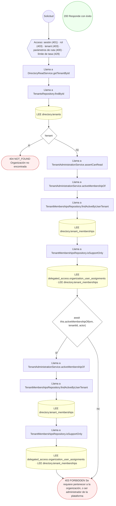

#### 6. PATCH /tenants/{tenantId}

Editar los datos de la propia organización

| HTTP | Código | Cuándo |
|---|---|---|
| 200 | — | Éxito |
| 400 | `VALIDATION_FAILED` | Los parámetros de ruta son UUID válidos; El cuerpo cumple el DTO (sin propiedades extra) |
| 401 | `UNAUTHENTICATED` | Hay una sesión válida (JWT) |
| 403 | `FORBIDDEN` | El rol está permitido; El tenant se resuelve y pertenece al actor; ForbiddenException: Se requiere ser OWNER o ADMIN de la organización, o administrador de la plataforma |
| 404 | `NOT_FOUND` | ResourceNotFoundException: Organización no encontrada |
| 429 | `RATE_LIMITED` | No se supera el límite de solicitudes |


#### 7. POST /tenants/{tenantId}/affiliation-documents

Completar los documentos legales de la organización

| HTTP | Código | Cuándo |
|---|---|---|
| 201 | — | Éxito |
| 400 | `VALIDATION_FAILED` | Los parámetros de ruta son UUID válidos; El cuerpo cumple el DTO (sin propiedades extra) |
| 401 | `UNAUTHENTICATED` | Hay una sesión válida (JWT) |
| 403 | `FORBIDDEN` | El rol está permitido; El tenant se resuelve y pertenece al actor; ForbiddenException: Se requiere ser OWNER o ADMIN de la organización, o administrador de la plataforma / Se requiere pertenecer a la organización, o ser administrador de la plataf… |
| 404 | `NOT_FOUND` | ResourceNotFoundException: Organización no encontrada |
| 409 | `CONFLICT` | ConflictException: Ese documento ya está presentado y pendiente de verificación |
| 422 | `PRECONDITION_FAILED` | PreconditionFailedException: Declare al menos un documento para vincular; PreconditionFailedException: Un mismo archivo no puede respaldar dos documentos distintos; PreconditionFailedException: Los papeles se completan mientras la organización está pendiente de verificación; PreconditionFailedException: El documento {label} ya está vinculado a una organización; PreconditionFailedException: {labels.subject} no corresponde a un archivo subido en este registro; PreconditionFailedException: El catálogo de {subject} no incluye el código {code.toUpperCase()}; PreconditionFailedException: La organización no tiene representante legal al que atar el poder |
| 429 | `RATE_LIMITED` | No se supera el límite de solicitudes |
| 500 | `INTERNAL` | StorageLifecycleDenied: LIFECYCLE_WIRING_MISSING |

```mermaid
flowchart TD
  n1(("Solicitud")):::inicio
  n2{{"Acceso: sesión (401) · rol (403) · tenant (403) · parámetros de ruta (400) · cuerpo válido (400) · límite de…"}}:::acceso
  n1 --> n2
  n3["Llama a TenantDocumentCompletionService.complete"]:::llamada
  n2 --> n3
  n4{"declared.length === 0"}:::decision
  n3 --> n4
  n5(["422 PRECONDITION_FAILED Declare al menos un documento para vincular"]):::error
  n4 -->|"sí"| n5
  n6{"new Set(fileIds).size !== fileIds.length"}:::decision
  n4 -->|"no"| n6
  n7(["422 PRECONDITION_FAILED Un mismo archivo no puede respaldar dos documentos distintos"]):::error
  n6 -->|"sí"| n7
  n8["Transacción: transactional(…)"]:::transaccion
  n6 -->|"no"| n8
  n9["Llama a TenantDocumentCompletionService.assertAuthorized"]:::llamada
  n8 --> n9
  n10(["403 FORBIDDEN Se requiere ser OWNER o ADMIN de la organización, o administrador de la plataforma / Se requier…"]):::error
  n9 --> n10
  n11["Llama a TenantsRepository.findById"]:::llamada
  n12[("LEE directory.tenants")]:::efecto
  n11 --> n12
  n13{"!tenant"}:::decision
  n12 --> n13
  n14(["404 NOT_FOUND Organización no encontrada"]):::error
  n13 -->|"sí"| n14
  n15{"tenant.statusConceptId !== DIR.TENANT_PENDING"}:::decision
  n13 -->|"no"| n15
  n16(["422 PRECONDITION_FAILED Los papeles se completan mientras la organización está pendiente de verificación"]):::error
  n15 -->|"sí"| n16
  n17["Llama a AffiliationDocumentConceptsService.resolve"]:::llamada
  n15 -->|"no"| n17
  n18{"!this.cache"}:::decision
  n17 --> n18
  n19["Transacción: catch(…)"]:::transaccion
  n18 -->|"sí"| n19
  n20(["↩ (relanza el error capturado)"]):::error
  n19 --> n20
  n21["Llama a PharmacyOperatingRequirementsService.liveDocumentsByType"]:::llamada
  n18 -->|"no"| n21
  n22["Llama a AffiliationDocumentConceptsService.resolve"]:::llamada
  n21 --> n22
  n23{"!this.cache"}:::decision
  n22 --> n23
  n24["Transacción: catch(…)"]:::transaccion
  n23 -->|"sí"| n24
  n25(["↩ (relanza el error capturado)"]):::error
  n24 --> n25
  n26["Repite: por cada const { role } de declared"]:::bucle
  n23 -->|"no"| n26
  n27{"typeConceptId !== undefined && live.has(typeConceptId)"}:::decision
  n26 -->|"cada elemento"| n27
  n28(["409 CONFLICT Ese documento ya está presentado y pendiente de verificación"]):::error
  n27 -->|"sí"| n28
  n29["Repite: por cada const { role, fileId } de declared"]:::bucle
  n27 -->|"no"| n29
  n26 -->|"al terminar"| n29
  n30["Llama a TenantAffiliationDocumentsService.attachDocument"]:::llamada
  n29 -->|"cada elemento"| n30
  n31["Llama a AffiliationDocumentConceptsService.resolve"]:::llamada
  n30 --> n31
  n32{"!this.cache"}:::decision
  n31 --> n32
  n33["Transacción: catch(…)"]:::transaccion
  n32 -->|"sí"| n33
  n34(["↩ (relanza el error capturado)"]):::error
  n33 --> n34
  n35["Llama a TenantAffiliationDocumentsService.attachOne"]:::llamada
  n32 -->|"no"| n35
  n36["Llama a DirectoryTenantLegalRepository.findAffiliationDocumentByFile"]:::llamada
  n35 --> n36
  n37[("LEE directory.tenant_affiliation_documents")]:::efecto
  n36 --> n37
  n38{"alreadyLinked"}:::decision
  n37 --> n38
  n39(["422 PRECONDITION_FAILED El documento {label} ya está vinculado a una organización"]):::error
  n38 -->|"sí"| n39
  n40["Llama a AttachableFileService.claimAnonymousUpload"]:::llamada
  n38 -->|"no"| n40
  n41{"loadStorageEnv().lifecycleBinding && !this.publication"}:::decision
  n40 --> n41
  n42(["500 INTERNAL LIFECYCLE_WIRING_MISSING"]):::error
  n41 -->|"sí"| n42
  n43{"!file || // `!= null` a propósito: MikroORM hidrata una FK nullable sin valor // como `null` (verificado cont…"}:::decision
  n41 -->|"no"| n43
  n44(["422 PRECONDITION_FAILED {labels.subject} no corresponde a un archivo subido en este registro"]):::error
  n43 -->|"sí"| n44
  n45{"options.allowedCategoryConceptId && file.categoryConceptId !== options.allowedCategoryConceptId"}:::decision
  n43 -->|"no"| n45
  n46(["422 PRECONDITION_FAILED {labels.subject} no corresponde a un archivo subido en este registro"]):::error
  n45 -->|"sí"| n46
  n47[("ACTUALIZA common.files · ACTUALIZA common.files · ACTUALIZA common.files · ACTUALIZA common.files")]:::efecto
  n45 -->|"no"| n47
  n48["Llama a AffiliationDocumentConceptsService.conceptIdOf"]:::llamada
  n47 --> n48
  n49{"!conceptId"}:::decision
  n48 --> n49
  n50(["422 PRECONDITION_FAILED El catálogo de {subject} no incluye el código {code.toUpperCase()}"]):::error
  n49 -->|"sí"| n50
  n51["Llama a AffiliationDocumentConceptsService.conceptIdOf"]:::llamada
  n49 -->|"no"| n51
  n52{"!conceptId"}:::decision
  n51 --> n52
  n53(["422 PRECONDITION_FAILED El catálogo de {subject} no incluye el código {code.toUpperCase()}"]):::error
  n52 -->|"sí"| n53
  n54["Llama a AffiliationDocumentConceptsService.conceptIdOf"]:::llamada
  n52 -->|"no"| n54
  n55{"!conceptId"}:::decision
  n54 --> n55
  n56(["422 PRECONDITION_FAILED El catálogo de {subject} no incluye el código {code.toUpperCase()}"]):::error
  n55 -->|"sí"| n56
  n57["Llama a DirectoryTenantLegalRepository.createAffiliationDocument"]:::llamada
  n55 -->|"no"| n57
  n58[("CREA directory.tenant_affiliation_documents")]:::efecto
  n57 --> n58
  n59{"dto.powerOfAttorneyFileId !== undefined"}:::decision
  n58 --> n59
  n29 -->|"al terminar"| n59
  n60["Llama a TenantDocumentCompletionService.attachPowerOfAttorney"]:::llamada
  n59 -->|"sí"| n60
  n61["Llama a AffiliationDocumentConceptsService.resolve"]:::llamada
  n60 --> n61
  n62{"!this.cache"}:::decision
  n61 --> n62
  n63["Transacción: catch(…)"]:::transaccion
  n62 -->|"sí"| n63
  n64(["↩ (relanza el error capturado)"]):::error
  n63 --> n64
  n65["Llama a DirectoryTenantLegalRepository.listLegalRepsByTenant"]:::llamada
  n62 -->|"no"| n65
  n66[("LEE directory.tenant_legal_representatives")]:::efecto
  n65 --> n66
  n67{"!representative"}:::decision
  n66 --> n67
  n68(["422 PRECONDITION_FAILED La organización no tiene representante legal al que atar el poder"]):::error
  n67 -->|"sí"| n68
  n69["Llama a TenantAffiliationDocumentsService.attachPowerOfAttorney"]:::llamada
  n67 -->|"no"| n69
  n70{"input.alreadyDeclaredFileIds.includes(input.fileId)"}:::decision
  n69 --> n70
  n71["… el resto del árbol (1 nodos) está en el JSON del inventario"]:::corte
  n70 -->|"sí"| n71
  classDef acceso fill:#eef,stroke:#66a
  classDef error fill:#fee,stroke:#c33
  classDef ok fill:#efe,stroke:#3a3
  classDef efecto fill:#ffd,stroke:#aa3
  classDef decision fill:#fff,stroke:#555
  classDef corte fill:#eee,stroke:#999,stroke-dasharray: 4
```

#### 8. GET /tenants/{tenantId}/branches

Sucursales de la organización

| HTTP | Código | Cuándo |
|---|---|---|
| 200 | — | Éxito |
| 400 | `VALIDATION_FAILED` | Los parámetros de ruta son UUID válidos |
| 401 | `UNAUTHENTICATED` | Hay una sesión válida (JWT) |
| 403 | `FORBIDDEN` | El rol está permitido; El tenant se resuelve y pertenece al actor; ForbiddenException: Se requiere pertenecer a la organización, o ser administrador de la plataforma |
| 404 | `NOT_FOUND` | ResourceNotFoundException: Organización no encontrada |
| 429 | `RATE_LIMITED` | No se supera el límite de solicitudes |


#### 9. POST /tenants/{tenantId}/branches

Crear una branch / sede física con geolocalización

| HTTP | Código | Cuándo |
|---|---|---|
| 201 | — | Éxito |
| 400 | `VALIDATION_FAILED` | Los parámetros de ruta son UUID válidos; El cuerpo cumple el DTO (sin propiedades extra) |
| 401 | `UNAUTHENTICATED` | Hay una sesión válida (JWT) |
| 403 | `FORBIDDEN` | El rol está permitido; El tenant se resuelve y pertenece al actor; ForbiddenException: Se requiere ser OWNER o ADMIN de la organización, o administrador de la plataforma |
| 404 | `NOT_FOUND` | ResourceNotFoundException: Tenant no encontrado |
| 409 | `CONFLICT` | ConflictException: Ya existe una branch con ese código en el tenant |
| 422 | `PRECONDITION_FAILED` | PreconditionFailedException: El tenant no está activo |
| 429 | `RATE_LIMITED` | No se supera el límite de solicitudes |


#### 10. PATCH /tenants/{tenantId}/branches/{branchId}

Editar una sucursal

| HTTP | Código | Cuándo |
|---|---|---|
| 200 | — | Éxito |
| 400 | `VALIDATION_FAILED` | Los parámetros de ruta son UUID válidos; El cuerpo cumple el DTO (sin propiedades extra) |
| 401 | `UNAUTHENTICATED` | Hay una sesión válida (JWT) |
| 403 | `FORBIDDEN` | El rol está permitido; El tenant se resuelve y pertenece al actor; ForbiddenException: Se requiere ser OWNER o ADMIN de la organización, o administrador de la plataforma |
| 404 | `NOT_FOUND` | ResourceNotFoundException: Sucursal no encontrada |
| 429 | `RATE_LIMITED` | No se supera el límite de solicitudes |


#### 11. GET /tenants/{tenantId}/child-tenants

Sub-organizaciones de una organización

| HTTP | Código | Cuándo |
|---|---|---|
| 200 | — | Éxito |
| 400 | `VALIDATION_FAILED` | Los parámetros de ruta son UUID válidos |
| 401 | `UNAUTHENTICATED` | Hay una sesión válida (JWT) |
| 403 | `FORBIDDEN` | El rol está permitido; El tenant se resuelve y pertenece al actor; ForbiddenException: Se requiere pertenecer a la organización, o ser administrador de la plataforma |
| 404 | `NOT_FOUND` | ResourceNotFoundException: Organización no encontrada |
| 429 | `RATE_LIMITED` | No se supera el límite de solicitudes |


#### 12. POST /tenants/{tenantId}/child-tenants

Crear una organización hija / sub-tenant

| HTTP | Código | Cuándo |
|---|---|---|
| 201 | — | Éxito |
| 400 | `VALIDATION_FAILED` | Los parámetros de ruta son UUID válidos; El cuerpo cumple el DTO (sin propiedades extra) |
| 401 | `UNAUTHENTICATED` | Hay una sesión válida (JWT) |
| 403 | `FORBIDDEN` | El rol está permitido; El tenant se resuelve y pertenece al actor |
| 404 | `NOT_FOUND` | ResourceNotFoundException: Tenant padre no encontrado |
| 409 | `CONFLICT` | ConflictException: El código de tenant ya existe |
| 422 | `PRECONDITION_FAILED` | PreconditionFailedException: El tenant padre no está activo; PreconditionFailedException: Un tenant de tipo PAYER exige el bloque `payer`; PreconditionFailedException: Un tenant de tipo BROKER exige el bloque `broker`; PreconditionFailedException: Un tenant de tipo {tenantType} exige país y jurisdicción; PreconditionFailedException: El tipo societario pertenece al derecho de {entry!.countryIso} y no coincide con el país declarado; PreconditionFailedException: El bloque `payer` sólo corresponde a un tenant de tipo PAYER; PreconditionFailedException: El bloque `broker` sólo corresponde a un tenant de tipo BROKER; PreconditionFailedException: El bloque `pharmacy` sólo corresponde a un tenant de tipo PHARMACY; PreconditionFailedException: El bloque `diagnosticUnit` sólo corresponde a un tenant de tipo DIAGNOSTIC_CENTER; PreconditionFailedException: El tipo de unidad diagnóstica declarado no es válido; PreconditionFailedException: Las sucursales sólo se declaran en una unidad de laboratorio clínico; PreconditionFailedException: Alguna modalidad declarada no pertenece al catálogo de modalidades diagnósticas; PreconditionFailedException: Los conceptos declarados no existen en el catálogo de terminología |
| 429 | `RATE_LIMITED` | No se supera el límite de solicitudes |

```mermaid
flowchart TD
  n1(("Solicitud")):::inicio
  n2{{"Acceso: sesión (401) · rol (403) · tenant (403) · parámetros de ruta (400) · cuerpo válido (400) · límite de…"}}:::acceso
  n1 --> n2
  n3["Llama a DirectoryTenantsService.createChild"]:::llamada
  n2 --> n3
  n4["Transacción: transactional(…)"]:::transaccion
  n3 --> n4
  n5["Llama a TenantsRepository.findById"]:::llamada
  n4 --> n5
  n6[("LEE directory.tenants")]:::efecto
  n5 --> n6
  n7{"!parent"}:::decision
  n6 --> n7
  n8(["404 NOT_FOUND Tenant padre no encontrado"]):::error
  n7 -->|"sí"| n8
  n9{"parent.statusConceptId !== CONCEPTS.TENANT_ACTIVE"}:::decision
  n7 -->|"no"| n9
  n10(["422 PRECONDITION_FAILED El tenant padre no está activo"]):::error
  n9 -->|"sí"| n10
  n11["Llama a TenantsRepository.findByCode"]:::llamada
  n9 -->|"no"| n11
  n12[("LEE directory.tenants")]:::efecto
  n11 --> n12
  n13{"clash"}:::decision
  n12 --> n13
  n14(["409 CONFLICT El código de tenant ya existe"]):::error
  n13 -->|"sí"| n14
  n15["Llama a TenantTypeProfileService.assertProfileMatchesType"]:::llamada
  n13 -->|"no"| n15
  n16{"tenantType === 'PAYER' && !input.payer"}:::decision
  n15 --> n16
  n17(["422 PRECONDITION_FAILED Un tenant de tipo PAYER exige el bloque `payer`"]):::error
  n16 -->|"sí"| n17
  n18{"tenantType === 'BROKER' && !input.broker"}:::decision
  n16 -->|"no"| n18
  n19(["422 PRECONDITION_FAILED Un tenant de tipo BROKER exige el bloque `broker`"]):::error
  n18 -->|"sí"| n19
  n20{"TERRITORIAL_TENANT_TYPES.includes(tenantType)"}:::decision
  n18 -->|"no"| n20
  n21{"missing.length › 0"}:::decision
  n20 -->|"sí"| n21
  n22(["422 PRECONDITION_FAILED Un tenant de tipo {tenantType} exige país y jurisdicción"]):::error
  n21 -->|"sí"| n22
  n23{"input.legalEntityType && input.countryConceptId"}:::decision
  n21 -->|"no"| n23
  n20 -->|"no"| n23
  n24{"expectedCountryConceptId && expectedCountryConceptId !== input.countryConceptId"}:::decision
  n23 -->|"sí"| n24
  n25(["422 PRECONDITION_FAILED El tipo societario pertenece al derecho de {entry!.countryIso} y no coincide con el p…"]):::error
  n24 -->|"sí"| n25
  n26{"tenantType !== 'PAYER' && input.payer"}:::decision
  n24 -->|"no"| n26
  n23 -->|"no"| n26
  n27(["422 PRECONDITION_FAILED El bloque `payer` sólo corresponde a un tenant de tipo PAYER"]):::error
  n26 -->|"sí"| n27
  n28{"tenantType !== 'BROKER' && input.broker"}:::decision
  n26 -->|"no"| n28
  n29(["422 PRECONDITION_FAILED El bloque `broker` sólo corresponde a un tenant de tipo BROKER"]):::error
  n28 -->|"sí"| n29
  n30{"tenantType !== 'PHARMACY' && input.pharmacy"}:::decision
  n28 -->|"no"| n30
  n31(["422 PRECONDITION_FAILED El bloque `pharmacy` sólo corresponde a un tenant de tipo PHARMACY"]):::error
  n30 -->|"sí"| n31
  n32{"tenantType !== 'DIAGNOSTIC_CENTER' && input.diagnosticUnit"}:::decision
  n30 -->|"no"| n32
  n33(["422 PRECONDITION_FAILED El bloque `diagnosticUnit` sólo corresponde a un tenant de tipo DIAGNOSTIC_CENTER"]):::error
  n32 -->|"sí"| n33
  n34{"input.diagnosticUnit"}:::decision
  n32 -->|"no"| n34
  n35{"unitTypeConceptId !== undefined && !DIAGNOSTIC_UNIT_TYPE_CONCEPTS.has(unitTypeConceptId)"}:::decision
  n34 -->|"sí"| n35
  n36(["422 PRECONDITION_FAILED El tipo de unidad diagnóstica declarado no es válido"]):::error
  n35 -->|"sí"| n36
  n37{"(input.diagnosticUnit.branches?.length ?? 0) › 0 && resolvedUnitTypeConceptId !== DUNIT.UNIT_TYPE_LABORATORY"}:::decision
  n35 -->|"no"| n37
  n38(["422 PRECONDITION_FAILED Las sucursales sólo se declaran en una unidad de laboratorio clínico"]):::error
  n37 -->|"sí"| n38
  n39{"invalidModalities.length › 0"}:::decision
  n37 -->|"no"| n39
  n40(["422 PRECONDITION_FAILED Alguna modalidad declarada no pertenece al catálogo de modalidades diagnósticas"]):::error
  n39 -->|"sí"| n40
  n41["Llama a TenantTypeProfileService.assertConceptsExist"]:::llamada
  n39 -->|"no"| n41
  n34 -->|"no"| n41
  n42["Llama a CatalogConceptsRepository.findByIds"]:::llamada
  n41 --> n42
  n43[("LEE terminology.catalog_concepts")]:::efecto
  n42 --> n43
  n44{"unknown.length › 0"}:::decision
  n43 --> n44
  n45(["422 PRECONDITION_FAILED Los conceptos declarados no existen en el catálogo de terminología"]):::error
  n44 -->|"sí"| n45
  n46["Llama a TenantsRepository.create"]:::llamada
  n44 -->|"no"| n46
  n47[("CREA directory.tenants")]:::efecto
  n46 --> n47
  n48["Llama a TenantTypeProfileService.materializeProfile"]:::llamada
  n47 --> n48
  n49{"input.tenantType === 'PAYER' && input.payer"}:::decision
  n48 --> n49
  n50["Llama a CatalogRepository.createCarrier"]:::llamada
  n49 -->|"sí"| n50
  n51[("CREA insurance.insurance_carriers")]:::efecto
  n50 --> n51
  n52["Llama a TenantTypeProfileService.materializePayerHeadquarters"]:::llamada
  n51 --> n52
  n53["Llama a AddressesRepository.create"]:::llamada
  n52 --> n53
  n54[("CREA common.addresses")]:::efecto
  n53 --> n54
  n55{"input.tenantType === 'BROKER' && input.broker"}:::decision
  n54 --> n55
  n49 -->|"no"| n55
  n56["Llama a CatalogRepository.createBroker"]:::llamada
  n55 -->|"sí"| n56
  n57[("CREA insurance.insurance_brokers")]:::efecto
  n56 --> n57
  n58{"input.tenantType === 'DIAGNOSTIC_CENTER' && input.diagnosticUnit"}:::decision
  n57 --> n58
  n55 -->|"no"| n58
  n59["Llama a DiagnosticUnitProvisioningService.provision"]:::llamada
  n58 -->|"sí"| n59
  n60["Llama a PracticesRepository.create"]:::llamada
  n59 --> n60
  n61[("CREA practice.practices")]:::efecto
  n60 --> n61
  n62["Llama a DiagnosticUnitsRepository.create"]:::llamada
  n61 --> n62
  n63[("CREA diagnostic_units.diagnostic_units")]:::efecto
  n62 --> n63
  n64["Llama a DiagnosticUnitSitesRepository.create"]:::llamada
  n63 --> n64
  n65[("CREA diagnostic_units.diagnostic_unit_sites")]:::efecto
  n64 --> n65
  n66["Repite: por cada const branch de profile.branches ?? []"]:::bucle
  n65 --> n66
  n67["Llama a DiagnosticUnitSitesRepository.create"]:::llamada
  n66 -->|"cada elemento"| n67
  n68[("CREA diagnostic_units.diagnostic_unit_sites")]:::efecto
  n67 --> n68
  n69["Repite: por cada const conceptId de profile.modalityConceptIds ?? []"]:::bucle
  n68 --> n69
  n66 -->|"al terminar"| n69
  n70["Llama a DiagnosticStudyOfferingsRepository.create"]:::llamada
  n69 -->|"cada elemento"| n70
  n71["… el resto del árbol (1 nodos) está en el JSON del inventario"]:::corte
  n70 --> n71
  classDef acceso fill:#eef,stroke:#66a
  classDef error fill:#fee,stroke:#c33
  classDef ok fill:#efe,stroke:#3a3
  classDef efecto fill:#ffd,stroke:#aa3
  classDef decision fill:#fff,stroke:#555
  classDef corte fill:#eee,stroke:#999,stroke-dasharray: 4
```

#### 13. GET /tenants/{tenantId}/laboratory-readiness

Requisitos pendientes para que el laboratorio opere

| HTTP | Código | Cuándo |
|---|---|---|
| 200 | — | Éxito |
| 400 | `VALIDATION_FAILED` | Los parámetros de ruta son UUID válidos |
| 401 | `UNAUTHENTICATED` | Hay una sesión válida (JWT) |
| 403 | `FORBIDDEN` | El rol está permitido; El tenant se resuelve y pertenece al actor; ForbiddenException: Se requiere ser OWNER o ADMIN de la organización, o administrador de la plataforma / Se requiere pertenecer a la organización, o ser administrador de la plataf… |
| 404 | `NOT_FOUND` | ResourceNotFoundException: Organización no encontrada |
| 422 | `PRECONDITION_FAILED` | PreconditionFailedException: La organización no es una farmacia / La organización no es un laboratorio |
| 429 | `RATE_LIMITED` | No se supera el límite de solicitudes |

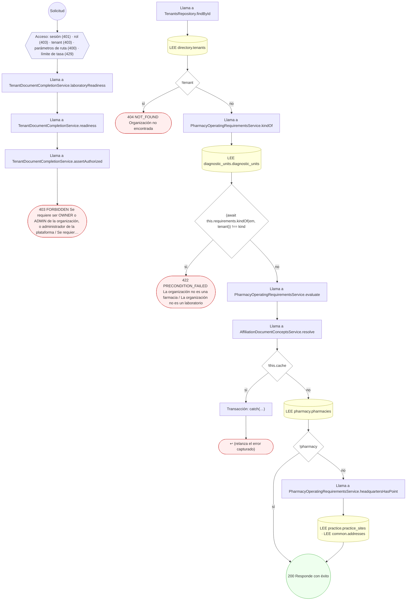

#### 14. GET /tenants/{tenantId}/logo

Logo de la propia organización

| HTTP | Código | Cuándo |
|---|---|---|
| 200 | — | Éxito |
| 400 | `VALIDATION_FAILED` | Los parámetros de ruta son UUID válidos |
| 401 | `UNAUTHENTICATED` | Hay una sesión válida (JWT) |
| 403 | `FORBIDDEN` | El rol está permitido; El tenant se resuelve y pertenece al actor; ForbiddenException: Se requiere pertenecer a la organización, o ser administrador de la plataforma |
| 404 | `NOT_FOUND` | ResourceNotFoundException: Organización no encontrada |
| 429 | `RATE_LIMITED` | No se supera el límite de solicitudes |

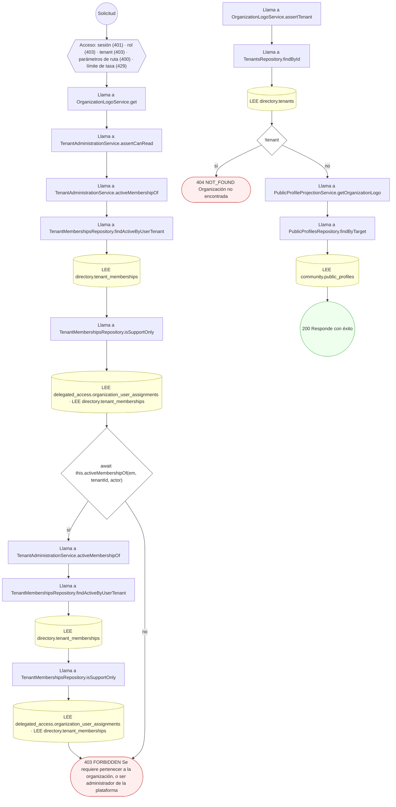

#### 15. PUT /tenants/{tenantId}/logo

Cambiar o quitar el logo como administrador de la organización

| HTTP | Código | Cuándo |
|---|---|---|
| 200 | — | Éxito |
| 400 | `VALIDATION_FAILED` | Los parámetros de ruta son UUID válidos; El cuerpo cumple el DTO (sin propiedades extra) |
| 401 | `UNAUTHENTICATED` | Hay una sesión válida (JWT) |
| 403 | `FORBIDDEN` | El rol está permitido; El tenant se resuelve y pertenece al actor; ForbiddenException: Se requiere ser OWNER o ADMIN de la organización, o administrador de la plataforma; ForbiddenException: {labels.subject} no le pertenece |
| 404 | `NOT_FOUND` | ResourceNotFoundException: Organización no encontrada; ResourceNotFoundException: {labels.notFound} |
| 422 | `PRECONDITION_FAILED` | PreconditionFailedException: {labels.subject} está borrado; PreconditionFailedException: {labels.subject} no tiene una versión vigente; PreconditionFailedException: {labels.subject} resultó infectado; PreconditionFailedException: {labels.subject} no es de un formato admitido para este uso |
| 429 | `RATE_LIMITED` | No se supera el límite de solicitudes |

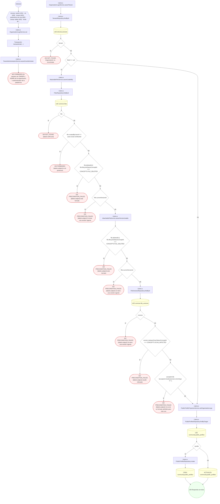

#### 16. GET /tenants/{tenantId}/logo/content

Imagen del logo para miembros de la organización

| HTTP | Código | Cuándo |
|---|---|---|
| 200 | — | Éxito |
| 400 | `VALIDATION_FAILED` | Los parámetros de ruta son UUID válidos |
| 401 | `UNAUTHENTICATED` | Hay una sesión válida (JWT) |
| 403 | `FORBIDDEN` | El rol está permitido; El tenant se resuelve y pertenece al actor; ForbiddenException: Se requiere pertenecer a la organización, o ser administrador de la plataforma |
| 404 | `NOT_FOUND` | ResourceNotFoundException: Organización no encontrada; ResourceNotFoundException: La organización no tiene logo; ResourceNotFoundException: {labels.notFound}; ResourceNotFoundException: Archivo no encontrado; ResourceNotFoundException: El contenido no está disponible en el almacenamiento local; ResourceNotFoundException: El contenido no está disponible en el almacenamiento configurado |
| 422 | `PRECONDITION_FAILED` | PreconditionFailedException: {labels.subject} está borrado; PreconditionFailedException: {labels.subject} no tiene una versión vigente; PreconditionFailedException: {labels.subject} resultó infectado; PreconditionFailedException: {labels.subject} no es de un formato admitido para este uso; PreconditionFailedException: El logo debe ser una imagen de sensibilidad NORMAL |
| 429 | `RATE_LIMITED` | No se supera el límite de solicitudes |
| 500 | `INTERNAL` | Error: S3 object body is empty |


#### 17. GET /tenants/{tenantId}/memberships

Plantilla de la organización

| HTTP | Código | Cuándo |
|---|---|---|
| 200 | — | Éxito |
| 400 | `VALIDATION_FAILED` | Los parámetros de ruta son UUID válidos |
| 401 | `UNAUTHENTICATED` | Hay una sesión válida (JWT) |
| 403 | `FORBIDDEN` | El rol está permitido; El tenant se resuelve y pertenece al actor; ForbiddenException: Se requiere pertenecer a la organización, o ser administrador de la plataforma |
| 404 | `NOT_FOUND` | ResourceNotFoundException: Organización no encontrada |
| 429 | `RATE_LIMITED` | No se supera el límite de solicitudes |

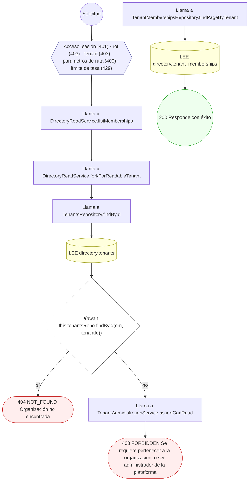

#### 18. POST /tenants/{tenantId}/memberships

Incorporar un usuario al tenant (membership)

| HTTP | Código | Cuándo |
|---|---|---|
| 201 | — | Éxito |
| 400 | `VALIDATION_FAILED` | Los parámetros de ruta son UUID válidos; El cuerpo cumple el DTO (sin propiedades extra) |
| 401 | `UNAUTHENTICATED` | Hay una sesión válida (JWT) |
| 403 | `FORBIDDEN` | El rol está permitido; El tenant se resuelve y pertenece al actor; ForbiddenException: Se requiere ser OWNER o ADMIN de la organización, o administrador de la plataforma; ForbiddenException: Sólo un OWNER de la organización o la plataforma pueden cambiar quién la posee |
| 409 | `CONFLICT` | ConflictException: El usuario ya tiene una membresía activa en el tenant; ConflictException: El usuario ya tiene una invitación pendiente de aceptar en el tenant |
| 429 | `RATE_LIMITED` | No se supera el límite de solicitudes |

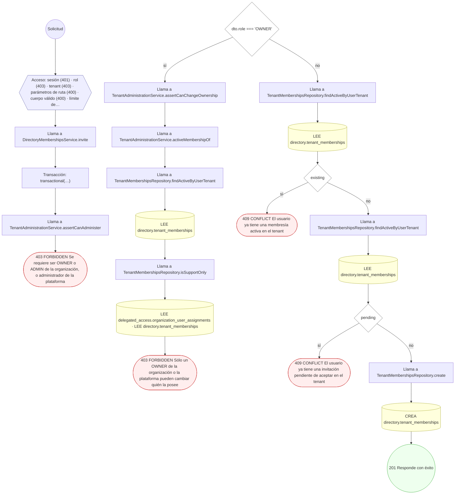

#### 19. GET /tenants/{tenantId}/memberships/{membershipId}/branch-assignments

Sucursales asignadas a una membresía

| HTTP | Código | Cuándo |
|---|---|---|
| 200 | — | Éxito |
| 400 | `VALIDATION_FAILED` | Los parámetros de ruta son UUID válidos |
| 401 | `UNAUTHENTICATED` | Hay una sesión válida (JWT) |
| 403 | `FORBIDDEN` | El rol está permitido; El tenant se resuelve y pertenece al actor; ForbiddenException: Se requiere pertenecer a la organización, o ser administrador de la plataforma |
| 404 | `NOT_FOUND` | ResourceNotFoundException: Organización no encontrada; ResourceNotFoundException: Membresía no encontrada |
| 429 | `RATE_LIMITED` | No se supera el límite de solicitudes |

```mermaid
flowchart TD
  n1(("Solicitud")):::inicio
  n2{{"Acceso: sesión (401) · rol (403) · tenant (403) · parámetros de ruta (400) · límite de tasa (429)"}}:::acceso
  n1 --> n2
  n3["Llama a DirectoryReadService.listBranchAssignments"]:::llamada
  n2 --> n3
  n4["Llama a DirectoryReadService.forkForReadableTenant"]:::llamada
  n3 --> n4
  n5["Llama a TenantsRepository.findById"]:::llamada
  n4 --> n5
  n6[("LEE directory.tenants")]:::efecto
  n5 --> n6
  n7{"!(await this.tenantsRepo.findById(em, tenantId))"}:::decision
  n6 --> n7
  n8(["404 NOT_FOUND Organización no encontrada"]):::error
  n7 -->|"sí"| n8
  n9["Llama a TenantAdministrationService.assertCanRead"]:::llamada
  n7 -->|"no"| n9
  n10(["403 FORBIDDEN Se requiere pertenecer a la organización, o ser administrador de la plataforma"]):::error
  n9 --> n10
  n11["Llama a TenantMembershipsRepository.findByIdInTenant"]:::llamada
  n12[("LEE directory.tenant_memberships")]:::efecto
  n11 --> n12
  n13{"!membership"}:::decision
  n12 --> n13
  n14(["404 NOT_FOUND Membresía no encontrada"]):::error
  n13 -->|"sí"| n14
  n15["Llama a BranchMembershipsRepository.findByMembership"]:::llamada
  n13 -->|"no"| n15
  n16[("LEE directory.branch_memberships")]:::efecto
  n15 --> n16
  n17(("200 Responde con éxito")):::ok
  n16 --> n17
  classDef acceso fill:#eef,stroke:#66a
  classDef error fill:#fee,stroke:#c33
  classDef ok fill:#efe,stroke:#3a3
  classDef efecto fill:#ffd,stroke:#aa3
  classDef decision fill:#fff,stroke:#555
  classDef corte fill:#eee,stroke:#999,stroke-dasharray: 4
```

#### 20. POST /tenants/{tenantId}/memberships/{membershipId}/branch-assignments

Asignar la membresía a una branch

| HTTP | Código | Cuándo |
|---|---|---|
| 201 | — | Éxito |
| 400 | `VALIDATION_FAILED` | Los parámetros de ruta son UUID válidos; El cuerpo cumple el DTO (sin propiedades extra) |
| 401 | `UNAUTHENTICATED` | Hay una sesión válida (JWT) |
| 403 | `FORBIDDEN` | El rol está permitido; El tenant se resuelve y pertenece al actor; ForbiddenException: Se requiere ser OWNER o ADMIN de la organización, o administrador de la plataforma |
| 404 | `NOT_FOUND` | ResourceNotFoundException: Membresía no encontrada; ResourceNotFoundException: Branch no encontrada |
| 409 | `CONFLICT` | ConflictException: La membresía ya está asignada a esa branch |
| 422 | `PRECONDITION_FAILED` | PreconditionFailedException: La membresía no está activa; PreconditionFailedException: La branch no pertenece al tenant |
| 429 | `RATE_LIMITED` | No se supera el límite de solicitudes |

```mermaid
flowchart TD
  n1(("Solicitud")):::inicio
  n2{{"Acceso: sesión (401) · rol (403) · tenant (403) · parámetros de ruta (400) · cuerpo válido (400) · límite de…"}}:::acceso
  n1 --> n2
  n3["Llama a DirectoryMembershipsService.assignBranch"]:::llamada
  n2 --> n3
  n4["Transacción: transactional(…)"]:::transaccion
  n3 --> n4
  n5["Llama a TenantAdministrationService.assertCanAdminister"]:::llamada
  n4 --> n5
  n6(["403 FORBIDDEN Se requiere ser OWNER o ADMIN de la organización, o administrador de la plataforma"]):::error
  n5 --> n6
  n7["Llama a DirectoryMembershipsService.requireActiveMembership"]:::llamada
  n8["Llama a TenantMembershipsRepository.findByIdInTenant"]:::llamada
  n7 --> n8
  n9[("LEE directory.tenant_memberships")]:::efecto
  n8 --> n9
  n10{"!membership"}:::decision
  n9 --> n10
  n11(["404 NOT_FOUND Membresía no encontrada"]):::error
  n10 -->|"sí"| n11
  n12{"membership.statusConceptId !== DIR.MEMBERSHIP_ACTIVE && !pending"}:::decision
  n10 -->|"no"| n12
  n13(["422 PRECONDITION_FAILED La membresía no está activa"]):::error
  n12 -->|"sí"| n13
  n14["Llama a DirectoryMembershipsService.requireBranchInTenant"]:::llamada
  n12 -->|"no"| n14
  n15["Llama a BranchesRepository.findById"]:::llamada
  n14 --> n15
  n16[("LEE directory.branches")]:::efecto
  n15 --> n16
  n17{"!branch"}:::decision
  n16 --> n17
  n18(["404 NOT_FOUND Branch no encontrada"]):::error
  n17 -->|"sí"| n18
  n19{"branch.tenantId !== tenantId"}:::decision
  n17 -->|"no"| n19
  n20(["422 PRECONDITION_FAILED La branch no pertenece al tenant"]):::error
  n19 -->|"sí"| n20
  n21["Llama a BranchMembershipsRepository.findByMembershipBranchStatus"]:::llamada
  n19 -->|"no"| n21
  n22[("LEE directory.branch_memberships")]:::efecto
  n21 --> n22
  n23{"already"}:::decision
  n22 --> n23
  n24(["409 CONFLICT La membresía ya está asignada a esa branch"]):::error
  n23 -->|"sí"| n24
  n25["Llama a BranchMembershipsRepository.create"]:::llamada
  n23 -->|"no"| n25
  n26[("CREA directory.branch_memberships")]:::efecto
  n25 --> n26
  n27{"!membership.primaryBranchId"}:::decision
  n26 --> n27
  n28[("ACTUALIZA directory.tenant_memberships")]:::efecto
  n27 -->|"sí"| n28
  n29(("201 Responde con éxito")):::ok
  n28 --> n29
  n27 -->|"no"| n29
  classDef acceso fill:#eef,stroke:#66a
  classDef error fill:#fee,stroke:#c33
  classDef ok fill:#efe,stroke:#3a3
  classDef efecto fill:#ffd,stroke:#aa3
  classDef decision fill:#fff,stroke:#555
  classDef corte fill:#eee,stroke:#999,stroke-dasharray: 4
```

#### 21. POST /tenants/{tenantId}/memberships/{membershipId}/offboard

Revocar / offboarding de un miembro

| HTTP | Código | Cuándo |
|---|---|---|
| 200 | — | Éxito |
| 400 | `VALIDATION_FAILED` | Los parámetros de ruta son UUID válidos |
| 401 | `UNAUTHENTICATED` | Hay una sesión válida (JWT) |
| 403 | `FORBIDDEN` | El rol está permitido; El tenant se resuelve y pertenece al actor; ForbiddenException: Se requiere ser OWNER o ADMIN de la organización, o administrador de la plataforma; ForbiddenException: Sólo un OWNER de la organización o la plataforma pueden cambiar quién la posee |
| 404 | `NOT_FOUND` | ResourceNotFoundException: Membresía no encontrada |
| 422 | `PRECONDITION_FAILED` | PreconditionFailedException: La membresía no está activa; PreconditionFailedException: No se puede quitar al último OWNER de la organización: designe otro OWNER primero |
| 429 | `RATE_LIMITED` | No se supera el límite de solicitudes |

```mermaid
flowchart TD
  n1(("Solicitud")):::inicio
  n2{{"Acceso: sesión (401) · rol (403) · tenant (403) · parámetros de ruta (400) · límite de tasa (429)"}}:::acceso
  n1 --> n2
  n3["Llama a DirectoryMembershipsService.offboard"]:::llamada
  n2 --> n3
  n4["Transacción: transactional(…)"]:::transaccion
  n3 --> n4
  n5["Llama a TenantAdministrationService.assertCanAdminister"]:::llamada
  n4 --> n5
  n6(["403 FORBIDDEN Se requiere ser OWNER o ADMIN de la organización, o administrador de la plataforma"]):::error
  n5 --> n6
  n7["Llama a DirectoryMembershipsService.requireActiveMembership"]:::llamada
  n8["Llama a TenantMembershipsRepository.findByIdInTenant"]:::llamada
  n7 --> n8
  n9[("LEE directory.tenant_memberships")]:::efecto
  n8 --> n9
  n10{"!membership"}:::decision
  n9 --> n10
  n11(["404 NOT_FOUND Membresía no encontrada"]):::error
  n10 -->|"sí"| n11
  n12{"membership.statusConceptId !== DIR.MEMBERSHIP_ACTIVE && !pending"}:::decision
  n10 -->|"no"| n12
  n13(["422 PRECONDITION_FAILED La membresía no está activa"]):::error
  n12 -->|"sí"| n13
  n14{"membership.tenantRoleConceptId === DIR.ROLE_OWNER"}:::decision
  n12 -->|"no"| n14
  n15["Llama a TenantAdministrationService.assertCanChangeOwnership"]:::llamada
  n14 -->|"sí"| n15
  n16["Llama a TenantAdministrationService.activeMembershipOf"]:::llamada
  n15 --> n16
  n17["Llama a TenantMembershipsRepository.findActiveByUserTenant"]:::llamada
  n16 --> n17
  n18[("LEE directory.tenant_memberships")]:::efecto
  n17 --> n18
  n19["Llama a TenantMembershipsRepository.isSupportOnly"]:::llamada
  n18 --> n19
  n20[("LEE delegated_access.organization_user_assignments · LEE directory.tenant_memberships")]:::efecto
  n19 --> n20
  n21(["403 FORBIDDEN Sólo un OWNER de la organización o la plataforma pueden cambiar quién la posee"]):::error
  n20 --> n21
  n22{"membership.statusConceptId === DIR.MEMBERSHIP_ACTIVE"}:::decision
  n23["Llama a DirectoryMembershipsService.assertNotLastOwner"]:::llamada
  n22 -->|"sí"| n23
  n24["Llama a TenantMembershipsRepository.countActiveByTenantRole"]:::llamada
  n23 --> n24
  n25[("LEE directory.tenant_memberships")]:::efecto
  n24 --> n25
  n26{"activeOwners ‹= 1"}:::decision
  n25 --> n26
  n27(["422 PRECONDITION_FAILED No se puede quitar al último OWNER de la organización: designe otro OWNER primero"]):::error
  n26 -->|"sí"| n27
  n28[("ACTUALIZA directory.tenant_memberships · ACTUALIZA directory.tenant_memberships")]:::efecto
  n26 -->|"no"| n28
  n22 -->|"no"| n28
  n14 -->|"no"| n28
  n29["Llama a BranchMembershipsRepository.findByMembershipAndStatus"]:::llamada
  n28 --> n29
  n30[("LEE directory.branch_memberships")]:::efecto
  n29 --> n30
  n31["Repite: por cada const assignment de assignments"]:::bucle
  n30 --> n31
  n32[("ACTUALIZA directory.branch_memberships")]:::efecto
  n31 -->|"cada elemento"| n32
  n33(("200 Responde con éxito")):::ok
  n32 --> n33
  n31 -->|"al terminar"| n33
  classDef acceso fill:#eef,stroke:#66a
  classDef error fill:#fee,stroke:#c33
  classDef ok fill:#efe,stroke:#3a3
  classDef efecto fill:#ffd,stroke:#aa3
  classDef decision fill:#fff,stroke:#555
  classDef corte fill:#eee,stroke:#999,stroke-dasharray: 4
```

#### 22. PATCH /tenants/{tenantId}/memberships/{membershipId}/role

Cambiar rol / scope de la membresía

| HTTP | Código | Cuándo |
|---|---|---|
| 200 | — | Éxito |
| 400 | `VALIDATION_FAILED` | Los parámetros de ruta son UUID válidos; El cuerpo cumple el DTO (sin propiedades extra) |
| 401 | `UNAUTHENTICATED` | Hay una sesión válida (JWT) |
| 403 | `FORBIDDEN` | El rol está permitido; El tenant se resuelve y pertenece al actor; ForbiddenException: Se requiere ser OWNER o ADMIN de la organización, o administrador de la plataforma; ForbiddenException: Sólo un OWNER de la organización o la plataforma pueden cambiar quién la posee |
| 404 | `NOT_FOUND` | ResourceNotFoundException: Membresía no encontrada |
| 422 | `PRECONDITION_FAILED` | PreconditionFailedException: Debe indicar un nuevo rol o scope; PreconditionFailedException: La membresía no está activa; PreconditionFailedException: No se puede quitar al último OWNER de la organización: designe otro OWNER primero |
| 429 | `RATE_LIMITED` | No se supera el límite de solicitudes |

```mermaid
flowchart TD
  n1(("Solicitud")):::inicio
  n2{{"Acceso: sesión (401) · rol (403) · tenant (403) · parámetros de ruta (400) · cuerpo válido (400) · límite de…"}}:::acceso
  n1 --> n2
  n3["Llama a DirectoryMembershipsService.changeRole"]:::llamada
  n2 --> n3
  n4{"!dto.role && !dto.accessScope"}:::decision
  n3 --> n4
  n5(["422 PRECONDITION_FAILED Debe indicar un nuevo rol o scope"]):::error
  n4 -->|"sí"| n5
  n6["Transacción: transactional(…)"]:::transaccion
  n4 -->|"no"| n6
  n7["Llama a TenantAdministrationService.assertCanAdminister"]:::llamada
  n6 --> n7
  n8(["403 FORBIDDEN Se requiere ser OWNER o ADMIN de la organización, o administrador de la plataforma"]):::error
  n7 --> n8
  n9["Llama a DirectoryMembershipsService.requireActiveMembership"]:::llamada
  n10["Llama a TenantMembershipsRepository.findByIdInTenant"]:::llamada
  n9 --> n10
  n11[("LEE directory.tenant_memberships")]:::efecto
  n10 --> n11
  n12{"!membership"}:::decision
  n11 --> n12
  n13(["404 NOT_FOUND Membresía no encontrada"]):::error
  n12 -->|"sí"| n13
  n14{"membership.statusConceptId !== DIR.MEMBERSHIP_ACTIVE && !pending"}:::decision
  n12 -->|"no"| n14
  n15(["422 PRECONDITION_FAILED La membresía no está activa"]):::error
  n14 -->|"sí"| n15
  n16{"grantsOwner || targetIsOwner"}:::decision
  n14 -->|"no"| n16
  n17["Llama a TenantAdministrationService.assertCanChangeOwnership"]:::llamada
  n16 -->|"sí"| n17
  n18["Llama a TenantAdministrationService.activeMembershipOf"]:::llamada
  n17 --> n18
  n19["Llama a TenantMembershipsRepository.findActiveByUserTenant"]:::llamada
  n18 --> n19
  n20[("LEE directory.tenant_memberships")]:::efecto
  n19 --> n20
  n21["Llama a TenantMembershipsRepository.isSupportOnly"]:::llamada
  n20 --> n21
  n22[("LEE delegated_access.organization_user_assignments · LEE directory.tenant_memberships")]:::efecto
  n21 --> n22
  n23(["403 FORBIDDEN Sólo un OWNER de la organización o la plataforma pueden cambiar quién la posee"]):::error
  n22 --> n23
  n24{"targetIsOwner && dto.role && !grantsOwner && membership.statusConceptId === DIR.MEMBERSHIP_ACTIVE"}:::decision
  n16 -->|"no"| n24
  n25["Llama a DirectoryMembershipsService.assertNotLastOwner"]:::llamada
  n24 -->|"sí"| n25
  n26["Llama a TenantMembershipsRepository.countActiveByTenantRole"]:::llamada
  n25 --> n26
  n27[("LEE directory.tenant_memberships")]:::efecto
  n26 --> n27
  n28{"activeOwners ‹= 1"}:::decision
  n27 --> n28
  n29(["422 PRECONDITION_FAILED No se puede quitar al último OWNER de la organización: designe otro OWNER primero"]):::error
  n28 -->|"sí"| n29
  n30{"dto.role"}:::decision
  n28 -->|"no"| n30
  n24 -->|"no"| n30
  n31[("ACTUALIZA directory.tenant_memberships")]:::efecto
  n30 -->|"sí"| n31
  n32{"dto.accessScope"}:::decision
  n31 --> n32
  n30 -->|"no"| n32
  n33[("ACTUALIZA directory.tenant_memberships")]:::efecto
  n32 -->|"sí"| n33
  n34(("200 Responde con éxito")):::ok
  n33 --> n34
  n32 -->|"no"| n34
  classDef acceso fill:#eef,stroke:#66a
  classDef error fill:#fee,stroke:#c33
  classDef ok fill:#efe,stroke:#3a3
  classDef efecto fill:#ffd,stroke:#aa3
  classDef decision fill:#fff,stroke:#555
  classDef corte fill:#eee,stroke:#999,stroke-dasharray: 4
```

#### 23. POST /tenants/{tenantId}/memberships/{membershipId}/transfer

Transferir la membresía entre branches

| HTTP | Código | Cuándo |
|---|---|---|
| 200 | — | Éxito |
| 400 | `VALIDATION_FAILED` | Los parámetros de ruta son UUID válidos; El cuerpo cumple el DTO (sin propiedades extra) |
| 401 | `UNAUTHENTICATED` | Hay una sesión válida (JWT) |
| 403 | `FORBIDDEN` | El rol está permitido; El tenant se resuelve y pertenece al actor; ForbiddenException: Se requiere ser OWNER o ADMIN de la organización, o administrador de la plataforma |
| 404 | `NOT_FOUND` | ResourceNotFoundException: Membresía no encontrada; ResourceNotFoundException: Branch no encontrada; ResourceNotFoundException: No hay asignación activa en la branch de origen |
| 422 | `PRECONDITION_FAILED` | PreconditionFailedException: La membresía no está activa; PreconditionFailedException: La branch no pertenece al tenant |
| 429 | `RATE_LIMITED` | No se supera el límite de solicitudes |

```mermaid
flowchart TD
  n1(("Solicitud")):::inicio
  n2{{"Acceso: sesión (401) · rol (403) · tenant (403) · parámetros de ruta (400) · cuerpo válido (400) · límite de…"}}:::acceso
  n1 --> n2
  n3["Llama a DirectoryMembershipsService.transfer"]:::llamada
  n2 --> n3
  n4["Transacción: transactional(…)"]:::transaccion
  n3 --> n4
  n5["Llama a TenantAdministrationService.assertCanAdminister"]:::llamada
  n4 --> n5
  n6(["403 FORBIDDEN Se requiere ser OWNER o ADMIN de la organización, o administrador de la plataforma"]):::error
  n5 --> n6
  n7["Llama a DirectoryMembershipsService.requireActiveMembership"]:::llamada
  n8["Llama a TenantMembershipsRepository.findByIdInTenant"]:::llamada
  n7 --> n8
  n9[("LEE directory.tenant_memberships")]:::efecto
  n8 --> n9
  n10{"!membership"}:::decision
  n9 --> n10
  n11(["404 NOT_FOUND Membresía no encontrada"]):::error
  n10 -->|"sí"| n11
  n12{"membership.statusConceptId !== DIR.MEMBERSHIP_ACTIVE && !pending"}:::decision
  n10 -->|"no"| n12
  n13(["422 PRECONDITION_FAILED La membresía no está activa"]):::error
  n12 -->|"sí"| n13
  n14["Llama a DirectoryMembershipsService.requireBranchInTenant"]:::llamada
  n12 -->|"no"| n14
  n15["Llama a BranchesRepository.findById"]:::llamada
  n14 --> n15
  n16[("LEE directory.branches")]:::efecto
  n15 --> n16
  n17{"!branch"}:::decision
  n16 --> n17
  n18(["404 NOT_FOUND Branch no encontrada"]):::error
  n17 -->|"sí"| n18
  n19{"branch.tenantId !== tenantId"}:::decision
  n17 -->|"no"| n19
  n20(["422 PRECONDITION_FAILED La branch no pertenece al tenant"]):::error
  n19 -->|"sí"| n20
  n21["Llama a DirectoryMembershipsService.requireBranchInTenant"]:::llamada
  n19 -->|"no"| n21
  n22["Llama a BranchesRepository.findById"]:::llamada
  n21 --> n22
  n23[("LEE directory.branches")]:::efecto
  n22 --> n23
  n24{"!branch"}:::decision
  n23 --> n24
  n25(["404 NOT_FOUND Branch no encontrada"]):::error
  n24 -->|"sí"| n25
  n26{"branch.tenantId !== tenantId"}:::decision
  n24 -->|"no"| n26
  n27(["422 PRECONDITION_FAILED La branch no pertenece al tenant"]):::error
  n26 -->|"sí"| n27
  n28["Llama a BranchMembershipsRepository.findByMembershipBranchStatus"]:::llamada
  n26 -->|"no"| n28
  n29[("LEE directory.branch_memberships")]:::efecto
  n28 --> n29
  n30{"!source"}:::decision
  n29 --> n30
  n31(["404 NOT_FOUND No hay asignación activa en la branch de origen"]):::error
  n30 -->|"sí"| n31
  n32[("ACTUALIZA directory.branch_memberships")]:::efecto
  n30 -->|"no"| n32
  n33["Llama a BranchMembershipsRepository.create"]:::llamada
  n32 --> n33
  n34[("CREA directory.branch_memberships")]:::efecto
  n33 --> n34
  n35[("ACTUALIZA directory.tenant_memberships")]:::efecto
  n34 --> n35
  n36(("200 Responde con éxito")):::ok
  n35 --> n36
  classDef acceso fill:#eef,stroke:#66a
  classDef error fill:#fee,stroke:#c33
  classDef ok fill:#efe,stroke:#3a3
  classDef efecto fill:#ffd,stroke:#aa3
  classDef decision fill:#fff,stroke:#555
  classDef corte fill:#eee,stroke:#999,stroke-dasharray: 4
```

#### 24. GET /tenants/{tenantId}/pharmacy-readiness

Requisitos pendientes para que la farmacia opere

| HTTP | Código | Cuándo |
|---|---|---|
| 200 | — | Éxito |
| 400 | `VALIDATION_FAILED` | Los parámetros de ruta son UUID válidos |
| 401 | `UNAUTHENTICATED` | Hay una sesión válida (JWT) |
| 403 | `FORBIDDEN` | El rol está permitido; El tenant se resuelve y pertenece al actor; ForbiddenException: Se requiere ser OWNER o ADMIN de la organización, o administrador de la plataforma / Se requiere pertenecer a la organización, o ser administrador de la plataf… |
| 404 | `NOT_FOUND` | ResourceNotFoundException: Organización no encontrada |
| 422 | `PRECONDITION_FAILED` | PreconditionFailedException: La organización no es una farmacia / La organización no es un laboratorio |
| 429 | `RATE_LIMITED` | No se supera el límite de solicitudes |

```mermaid
flowchart TD
  n1(("Solicitud")):::inicio
  n2{{"Acceso: sesión (401) · rol (403) · tenant (403) · parámetros de ruta (400) · límite de tasa (429)"}}:::acceso
  n1 --> n2
  n3["Llama a TenantDocumentCompletionService.pharmacyReadiness"]:::llamada
  n2 --> n3
  n4["Llama a TenantDocumentCompletionService.readiness"]:::llamada
  n3 --> n4
  n5["Llama a TenantDocumentCompletionService.assertAuthorized"]:::llamada
  n4 --> n5
  n6(["403 FORBIDDEN Se requiere ser OWNER o ADMIN de la organización, o administrador de la plataforma / Se requier…"]):::error
  n5 --> n6
  n7["Llama a TenantsRepository.findById"]:::llamada
  n8[("LEE directory.tenants")]:::efecto
  n7 --> n8
  n9{"!tenant"}:::decision
  n8 --> n9
  n10(["404 NOT_FOUND Organización no encontrada"]):::error
  n9 -->|"sí"| n10
  n11["Llama a PharmacyOperatingRequirementsService.kindOf"]:::llamada
  n9 -->|"no"| n11
  n12[("LEE diagnostic_units.diagnostic_units")]:::efecto
  n11 --> n12
  n13{"(await this.requirements.kindOf(em, tenant)) !== kind"}:::decision
  n12 --> n13
  n14(["422 PRECONDITION_FAILED La organización no es una farmacia / La organización no es un laboratorio"]):::error
  n13 -->|"sí"| n14
  n15["Llama a PharmacyOperatingRequirementsService.evaluate"]:::llamada
  n13 -->|"no"| n15
  n16["Llama a AffiliationDocumentConceptsService.resolve"]:::llamada
  n15 --> n16
  n17{"!this.cache"}:::decision
  n16 --> n17
  n18["Transacción: catch(…)"]:::transaccion
  n17 -->|"sí"| n18
  n19(["↩ (relanza el error capturado)"]):::error
  n18 --> n19
  n20[("LEE pharmacy.pharmacies")]:::efecto
  n17 -->|"no"| n20
  n21{"!pharmacy"}:::decision
  n20 --> n21
  n22["Llama a PharmacyOperatingRequirementsService.headquartersHasPoint"]:::llamada
  n21 -->|"no"| n22
  n23[("LEE practice.practice_sites · LEE common.addresses")]:::efecto
  n22 --> n23
  n24(("200 Responde con éxito")):::ok
  n21 -->|"sí"| n24
  n23 --> n24
  classDef acceso fill:#eef,stroke:#66a
  classDef error fill:#fee,stroke:#c33
  classDef ok fill:#efe,stroke:#3a3
  classDef efecto fill:#ffd,stroke:#aa3
  classDef decision fill:#fff,stroke:#555
  classDef corte fill:#eee,stroke:#999,stroke-dasharray: 4
```

#### 25. GET /tenants/me

Las organizaciones del actor, con su rol en cada una

| HTTP | Código | Cuándo |
|---|---|---|
| 200 | — | Éxito |
| 401 | `UNAUTHENTICATED` | Hay una sesión válida (JWT) |
| 403 | `FORBIDDEN` | El rol está permitido; El tenant se resuelve y pertenece al actor |
| 429 | `RATE_LIMITED` | No se supera el límite de solicitudes |

```mermaid
flowchart TD
  n1(("Solicitud")):::inicio
  n2{{"Acceso: sesión (401) · rol (403) · tenant (403) · límite de tasa (429)"}}:::acceso
  n1 --> n2
  n3["Llama a DirectoryReadService.listMyTenants"]:::llamada
  n2 --> n3
  n4["Llama a TenantMembershipsRepository.findActiveByUser"]:::llamada
  n3 --> n4
  n5[("LEE directory.tenant_memberships")]:::efecto
  n4 --> n5
  n6["Repite: por cada const membership de memberships"]:::bucle
  n5 --> n6
  n7["Llama a TenantsRepository.findById"]:::llamada
  n6 -->|"cada elemento"| n7
  n8[("LEE directory.tenants")]:::efecto
  n7 --> n8
  n9{"tenant.tenantTypeConceptId === TENANT_TYPE_CONCEPT_BY_CODE.PAYER"}:::decision
  n8 --> n9
  n10["Llama a CatalogRepository.findCarrierByTenantId"]:::llamada
  n9 -->|"sí"| n10
  n11[("LEE insurance.insurance_carriers")]:::efecto
  n10 --> n11
  n12{"carrier"}:::decision
  n11 --> n12
  n13["Llama a AddressesRepository.findCurrentByOwnerAndUse"]:::llamada
  n12 -->|"sí"| n13
  n14[("LEE common.addresses")]:::efecto
  n13 --> n14
  n15["Llama a DirectoryReadService.loadRepresentation"]:::llamada
  n14 --> n15
  n12 -->|"no"| n15
  n9 -->|"no"| n15
  n16["Llama a DirectoryTenantLegalRepository.listLegalRepsByTenant"]:::llamada
  n15 --> n16
  n17[("LEE directory.tenant_legal_representatives")]:::efecto
  n16 --> n17
  n18["Llama a AffiliationDocumentConceptsService.resolve"]:::llamada
  n17 --> n18
  n19{"!this.cache"}:::decision
  n18 --> n19
  n20["Transacción: catch(…)"]:::transaccion
  n19 -->|"sí"| n20
  n21(["↩ (relanza el error capturado)"]):::error
  n20 --> n21
  n22["Llama a DirectoryTenantLegalRepository.findPersonsByIds"]:::llamada
  n19 -->|"no"| n22
  n23[("LEE profiles.persons")]:::efecto
  n22 --> n23
  n24["Llama a IdentifiersRepository.findByIds"]:::llamada
  n23 --> n24
  n25[("LEE common.identifiers")]:::efecto
  n24 --> n25
  n26["Llama a ContactPointsRepository.findAllCurrentByOwners"]:::llamada
  n25 --> n26
  n27[("LEE common.contact_points")]:::efecto
  n26 --> n27
  n28["Llama a DirectoryReadService.loadLegalDocuments"]:::llamada
  n27 --> n28
  n29["Llama a DirectoryTenantLegalRepository.listAffiliationDocsByTenant"]:::llamada
  n28 --> n29
  n30[("LEE directory.tenant_affiliation_documents")]:::efecto
  n29 --> n30
  n31["Llama a AffiliationDocumentConceptsService.resolve"]:::llamada
  n30 --> n31
  n32{"!this.cache"}:::decision
  n31 --> n32
  n33["Transacción: catch(…)"]:::transaccion
  n32 -->|"sí"| n33
  n34(["↩ (relanza el error capturado)"]):::error
  n33 --> n34
  n35(("200 Responde con éxito")):::ok
  n32 -->|"no"| n35
  n6 -->|"al terminar"| n35
  classDef acceso fill:#eef,stroke:#66a
  classDef error fill:#fee,stroke:#c33
  classDef ok fill:#efe,stroke:#3a3
  classDef efecto fill:#ffd,stroke:#aa3
  classDef decision fill:#fff,stroke:#555
  classDef corte fill:#eee,stroke:#999,stroke-dasharray: 4
```

#### 26. GET /tenants/me/membership-invitations

Mis membresías pendientes de aceptar

| HTTP | Código | Cuándo |
|---|---|---|
| 200 | — | Éxito |
| 401 | `UNAUTHENTICATED` | Hay una sesión válida (JWT) |
| 403 | `FORBIDDEN` | El rol está permitido; El tenant se resuelve y pertenece al actor |
| 429 | `RATE_LIMITED` | No se supera el límite de solicitudes |

```mermaid
flowchart TD
  n1(("Solicitud")):::inicio
  n2{{"Acceso: sesión (401) · rol (403) · tenant (403) · límite de tasa (429)"}}:::acceso
  n1 --> n2
  n3["Llama a DirectoryMembershipsService.listMyInvitations"]:::llamada
  n2 --> n3
  n4["Transacción: withPersonScope(…)"]:::transaccion
  n3 --> n4
  n5["Llama a TenantMembershipsRepository.findActiveByUser"]:::llamada
  n4 --> n5
  n6[("LEE directory.tenant_memberships")]:::efecto
  n5 --> n6
  n7["Repite: por cada const membership de pending"]:::bucle
  n6 --> n7
  n8["Llama a TenantsRepository.findById"]:::llamada
  n7 -->|"cada elemento"| n8
  n9[("LEE directory.tenants")]:::efecto
  n8 --> n9
  n10(("200 Responde con éxito")):::ok
  n9 --> n10
  n7 -->|"al terminar"| n10
  classDef acceso fill:#eef,stroke:#66a
  classDef error fill:#fee,stroke:#c33
  classDef ok fill:#efe,stroke:#3a3
  classDef efecto fill:#ffd,stroke:#aa3
  classDef decision fill:#fff,stroke:#555
  classDef corte fill:#eee,stroke:#999,stroke-dasharray: 4
```

#### 27. POST /tenants/me/membership-invitations/{membershipId}/accept

Aceptar una membresía pendiente propia

| HTTP | Código | Cuándo |
|---|---|---|
| 200 | — | Éxito |
| 400 | `VALIDATION_FAILED` | Los parámetros de ruta son UUID válidos |
| 401 | `UNAUTHENTICATED` | Hay una sesión válida (JWT) |
| 403 | `FORBIDDEN` | El rol está permitido; El tenant se resuelve y pertenece al actor |
| 404 | `NOT_FOUND` | ResourceNotFoundException: Invitación no encontrada |
| 429 | `RATE_LIMITED` | No se supera el límite de solicitudes |

```mermaid
flowchart TD
  n1(("Solicitud")):::inicio
  n2{{"Acceso: sesión (401) · rol (403) · tenant (403) · parámetros de ruta (400) · límite de tasa (429)"}}:::acceso
  n1 --> n2
  n3["Llama a DirectoryMembershipsService.acceptMine"]:::llamada
  n2 --> n3
  n4["Llama a DirectoryMembershipsService.decideMine"]:::llamada
  n3 --> n4
  n5["Transacción: withPersonScope(…)"]:::transaccion
  n4 --> n5
  n6["Llama a TenantMembershipsRepository.findByIdAndUser"]:::llamada
  n5 --> n6
  n7[("LEE directory.tenant_memberships")]:::efecto
  n6 --> n7
  n8{"!membership || membership.statusConceptId !== DIR.MEMBERSHIP_PENDING_ACCEPTANCE"}:::decision
  n7 --> n8
  n9(["404 NOT_FOUND Invitación no encontrada"]):::error
  n8 -->|"sí"| n9
  n10["Transacción: inTenant(…)"]:::transaccion
  n8 -->|"no"| n10
  n11{"decision === 'ACTIVE'"}:::decision
  n10 --> n11
  n12["Llama a TenantMembershipsRepository.findActiveByUserTenant"]:::llamada
  n11 -->|"sí"| n12
  n13[("LEE directory.tenant_memberships")]:::efecto
  n12 --> n13
  n14(("200 Responde con éxito")):::ok
  n13 --> n14
  n11 -->|"no"| n14
  classDef acceso fill:#eef,stroke:#66a
  classDef error fill:#fee,stroke:#c33
  classDef ok fill:#efe,stroke:#3a3
  classDef efecto fill:#ffd,stroke:#aa3
  classDef decision fill:#fff,stroke:#555
  classDef corte fill:#eee,stroke:#999,stroke-dasharray: 4
```

#### 28. POST /tenants/me/membership-invitations/{membershipId}/decline

Rechazar una membresía pendiente propia

| HTTP | Código | Cuándo |
|---|---|---|
| 200 | — | Éxito |
| 400 | `VALIDATION_FAILED` | Los parámetros de ruta son UUID válidos |
| 401 | `UNAUTHENTICATED` | Hay una sesión válida (JWT) |
| 403 | `FORBIDDEN` | El rol está permitido; El tenant se resuelve y pertenece al actor |
| 404 | `NOT_FOUND` | ResourceNotFoundException: Invitación no encontrada |
| 429 | `RATE_LIMITED` | No se supera el límite de solicitudes |

```mermaid
flowchart TD
  n1(("Solicitud")):::inicio
  n2{{"Acceso: sesión (401) · rol (403) · tenant (403) · parámetros de ruta (400) · límite de tasa (429)"}}:::acceso
  n1 --> n2
  n3["Llama a DirectoryMembershipsService.declineMine"]:::llamada
  n2 --> n3
  n4["Llama a DirectoryMembershipsService.decideMine"]:::llamada
  n3 --> n4
  n5["Transacción: withPersonScope(…)"]:::transaccion
  n4 --> n5
  n6["Llama a TenantMembershipsRepository.findByIdAndUser"]:::llamada
  n5 --> n6
  n7[("LEE directory.tenant_memberships")]:::efecto
  n6 --> n7
  n8{"!membership || membership.statusConceptId !== DIR.MEMBERSHIP_PENDING_ACCEPTANCE"}:::decision
  n7 --> n8
  n9(["404 NOT_FOUND Invitación no encontrada"]):::error
  n8 -->|"sí"| n9
  n10["Transacción: inTenant(…)"]:::transaccion
  n8 -->|"no"| n10
  n11{"decision === 'ACTIVE'"}:::decision
  n10 --> n11
  n12["Llama a TenantMembershipsRepository.findActiveByUserTenant"]:::llamada
  n11 -->|"sí"| n12
  n13[("LEE directory.tenant_memberships")]:::efecto
  n12 --> n13
  n14(("200 Responde con éxito")):::ok
  n13 --> n14
  n11 -->|"no"| n14
  classDef acceso fill:#eef,stroke:#66a
  classDef error fill:#fee,stroke:#c33
  classDef ok fill:#efe,stroke:#3a3
  classDef efecto fill:#ffd,stroke:#aa3
  classDef decision fill:#fff,stroke:#555
  classDef corte fill:#eee,stroke:#999,stroke-dasharray: 4
```

### Operaciones sin decisiones propias

Sólo comprueban el acceso y leen o escriben: no tienen ramas que dibujar. Su detalle está en la ficha de endpoints.

| Operación | Respuestas posibles | Tablas |
|---|---|---|
| GET /admin/tenants | 200, 401, 403, 429 | 1 |
