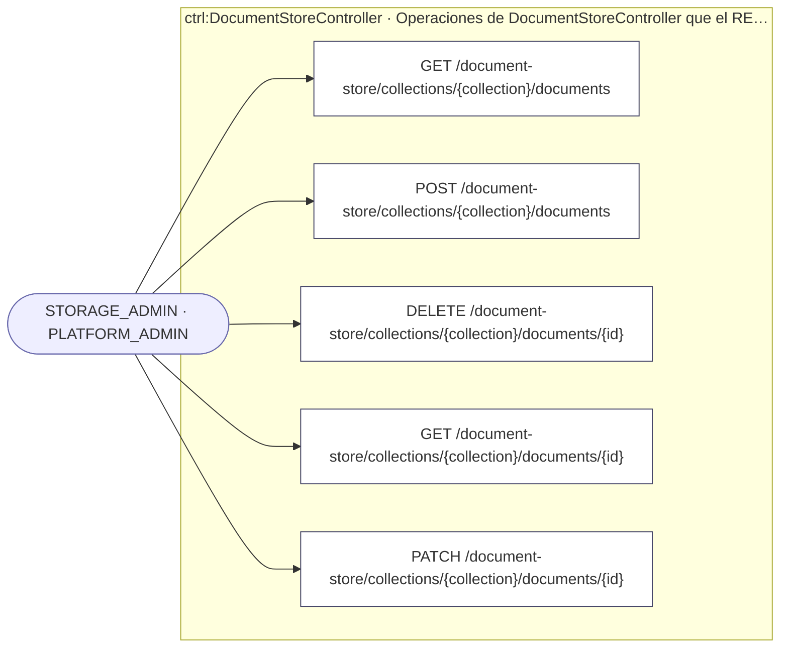
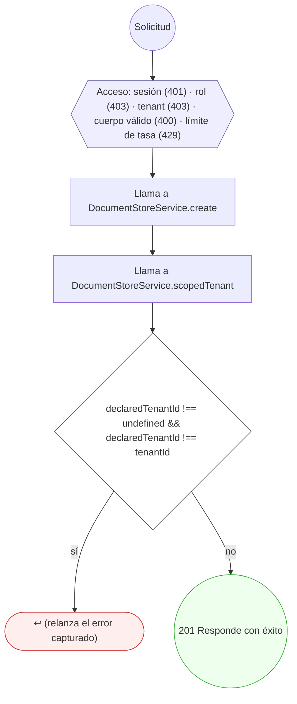
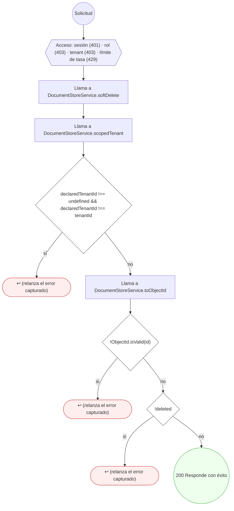
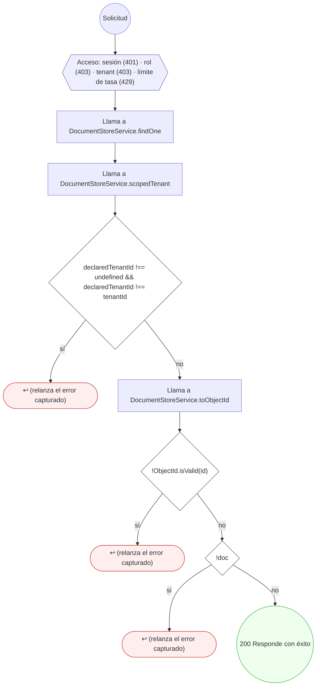
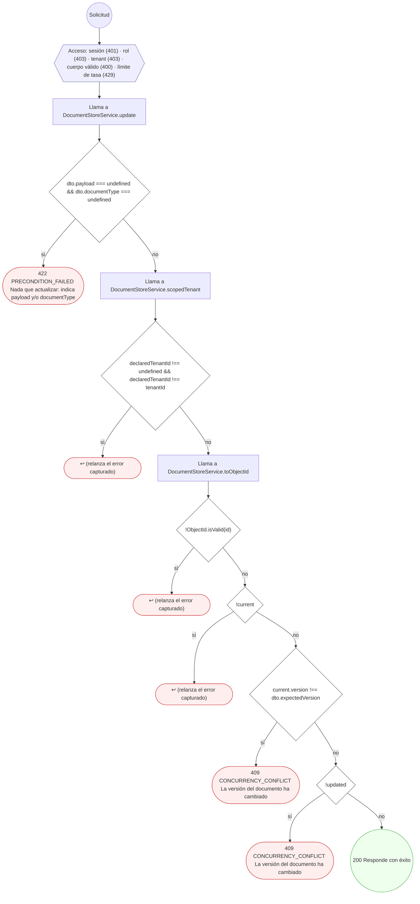

<!-- AUTOGENERADO por tools/inventario/flujos.mjs. No editar manualmente. -->

# Flujos del módulo `document_store`

- **Procesos:** 1 · **Máquinas de estado:** 0
- **Operaciones:** 5 (5 con decisiones propias, 0 sin ellas)
- Inventario de endpoints del módulo: [document_store](../endpoints/document_store.md)

## Proceso: Módulo 55 — Document Store (documentos flexibles sobre MongoDB)

- **Código:** `document_store` · **Agrupación:** AGRUPACION_POR_CONTROLADOR · **Operaciones:** 5
- **Actores:** PLATFORM_ADMIN · STORAGE_ADMIN
- **Revisión:** AUTO_DETECTADA
- **Fuentes:** `src/modules/document_store/README.md`

### Para qué sirve

Almacén de documentos flexibles (JSON/semiestructurados) que **complementa** Postgres: borradores, snapshots, payloads FHIR crudos, plantillas y cualquier estructura que no encaje bien en el modelo relacional. Persiste en MongoDB real (contenedor `mantra-redesa-mongodb-1`) leyendo `MONGODB_URI` y `MONGO_DB` del entorno.

_Fuente: `src/modules/document_store/README.md:3`_

### Etapas y operaciones

| Etapa | Descripción | Operación | Quién actúa | Riesgo | Tablas |
|---|---|---|---|---|---|
| `ctrl:DocumentStoreController` | Operaciones de DocumentStoreController que el README no asigna a un caso de uso | GET /document-store/collections/{collection}/documents | STORAGE_ADMIN · PLATFORM_ADMIN | BAJO | 0 |
|  |  | POST /document-store/collections/{collection}/documents | STORAGE_ADMIN · PLATFORM_ADMIN | BAJO | 0 |
|  |  | DELETE /document-store/collections/{collection}/documents/{id} | STORAGE_ADMIN · PLATFORM_ADMIN | BAJO | 0 |
|  |  | GET /document-store/collections/{collection}/documents/{id} | STORAGE_ADMIN · PLATFORM_ADMIN | BAJO | 0 |
|  |  | PATCH /document-store/collections/{collection}/documents/{id} | STORAGE_ADMIN · PLATFORM_ADMIN | BAJO | 0 |

### Diagrama — etapas `ctrl:DocumentStoreController`

## Árbol de decisión por operación

Cada árbol se deriva del código del handler y de los métodos que invoca (hasta 4 niveles). Una rama que no decide, no escribe y no falla se poda. Los accesos y los efectos consecutivos se agrupan en un solo nodo.

### Operaciones con decisiones propias

#### 1. GET /document-store/collections/{collection}/documents

Listar documentos del tenant (paginado)

| HTTP | Código | Cuándo |
|---|---|---|
| 200 | — | Éxito |
| 401 | `UNAUTHENTICATED` | Hay una sesión válida (JWT) |
| 403 | `FORBIDDEN` | El rol está permitido; El tenant se resuelve y pertenece al actor |
| 429 | `RATE_LIMITED` | No se supera el límite de solicitudes |

#### 2. POST /document-store/collections/{collection}/documents

Crear un documento flexible en la colección

| HTTP | Código | Cuándo |
|---|---|---|
| 201 | — | Éxito |
| 400 | `VALIDATION_FAILED` | El cuerpo cumple el DTO (sin propiedades extra) |
| 401 | `UNAUTHENTICATED` | Hay una sesión válida (JWT) |
| 403 | `FORBIDDEN` | El rol está permitido; El tenant se resuelve y pertenece al actor |
| 429 | `RATE_LIMITED` | No se supera el límite de solicitudes |

#### 3. DELETE /document-store/collections/{collection}/documents/{id}

Borrado lógico de un documento (soft-delete)

| HTTP | Código | Cuándo |
|---|---|---|
| 200 | — | Éxito |
| 401 | `UNAUTHENTICATED` | Hay una sesión válida (JWT) |
| 403 | `FORBIDDEN` | El rol está permitido; El tenant se resuelve y pertenece al actor |
| 429 | `RATE_LIMITED` | No se supera el límite de solicitudes |

#### 4. GET /document-store/collections/{collection}/documents/{id}

Leer un documento por id (acotado por tenant)

| HTTP | Código | Cuándo |
|---|---|---|
| 200 | — | Éxito |
| 401 | `UNAUTHENTICATED` | Hay una sesión válida (JWT) |
| 403 | `FORBIDDEN` | El rol está permitido; El tenant se resuelve y pertenece al actor |
| 429 | `RATE_LIMITED` | No se supera el límite de solicitudes |

#### 5. PATCH /document-store/collections/{collection}/documents/{id}

Actualizar un documento con concurrencia optimista

| HTTP | Código | Cuándo |
|---|---|---|
| 200 | — | Éxito |
| 400 | `VALIDATION_FAILED` | El cuerpo cumple el DTO (sin propiedades extra) |
| 401 | `UNAUTHENTICATED` | Hay una sesión válida (JWT) |
| 403 | `FORBIDDEN` | El rol está permitido; El tenant se resuelve y pertenece al actor |
| 409 | `CONCURRENCY_CONFLICT` | ConcurrencyConflictException: La versión del documento ha cambiado |
| 422 | `PRECONDITION_FAILED` | PreconditionFailedException: Nada que actualizar: indica payload y/o documentType |
| 429 | `RATE_LIMITED` | No se supera el límite de solicitudes |

